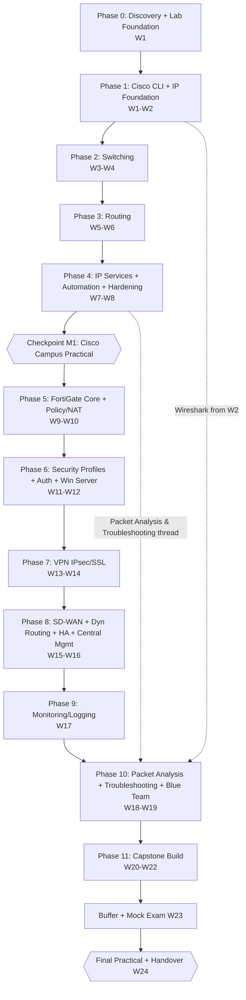
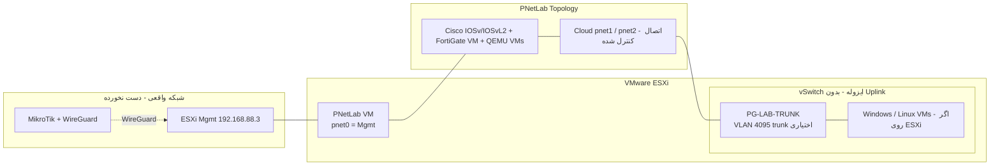
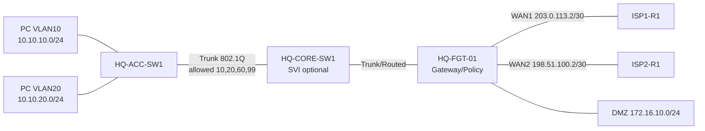
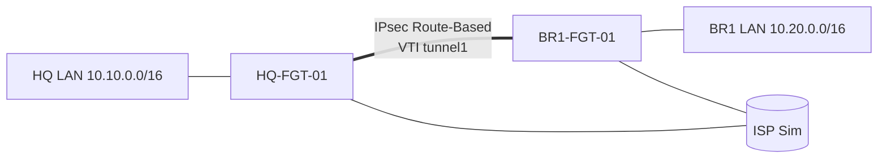
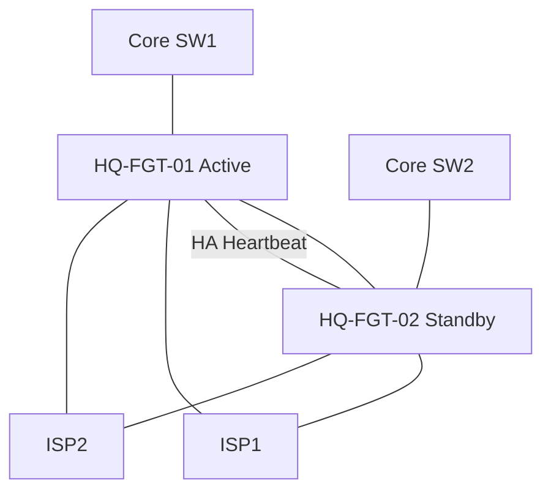
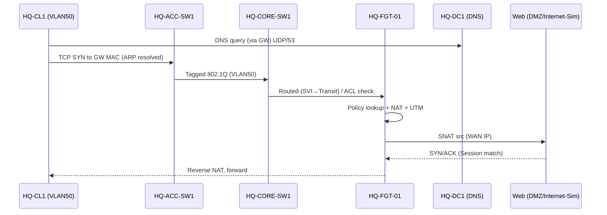
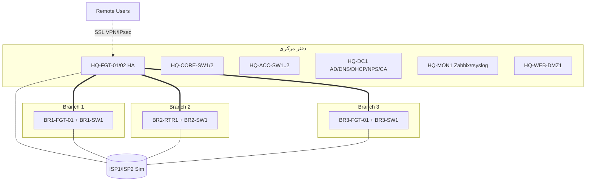

# Enterprise Network & Security Engineering — Course Master Blueprint

**Cisco Routing & Switching + FortiGate (FortiOS 7.0.3) + Windows/Linux Integration + Monitoring + Blue Team**

| مورد | مقدار |
|---|---|
| نسخه سند | v1.0 — پیش‌نویس برای ممیزی و تأیید |
| وضعیت | **فقط طراحی** — هیچ درس، نصب یا تغییر تنظیماتی آغاز نشده است |
| زمان هدف | ۲۴ هفته × ۶ روز × ۶ ساعت = ۸۶۴ ساعت |
| زبان | فارسی + اصطلاحات انگلیسی (با معادل و کاربرد فنی) |
| مرحله بعد | ممیزی ChatGPT و تأیید صریح کاربر → سپس Phase 0 (Discovery) |

### راهنمای برچسب‌ها در این سند

| برچسب | معنی |
|---|---|
| 🔎 **[تأیید Discovery]** | به اطلاعات نامعلوم زیرساخت کاربر وابسته است؛ حدس قطعی زده نشده |
| ⚠️ **[راستی‌آزمایی]** | ادعای نسخه/لایسنس/محدودیت/سازگاری که در این جلسه از منبع رسمی بررسی **نشده** (وب در این مرحله بررسی نشد) و باید قبل از ساخت درس با منبع و تاریخ ثبت شود |
| ✅ **[تصمیم طراحی]** | تصمیم پیشنهادی من؛ قابل تغییر با تأیید کاربر |

> **صداقت نسخه‌ای:** هیچ قابلیت FortiOS 7.x بالاتر از 7.0.3 به این نسخه تعمیم داده نشده است. هر جا قابلیت وابسته به مدل/لایسنس/نوع VM است، صریحاً علامت گذاشته شده است.

---

# فهرست مطالب

1. Executive Summary
2. اهداف و شایستگی‌های نهایی
3. شناخت سطح فعلی و فرضیات
4. معماری کلان دوره
5. نقشه راه ۲۴ هفته‌ای
6. Curriculum کامل Cisco
7. Curriculum کامل FortiGate 7.0.3
8. برنامه Windows/Linux
9. معماری Lab Foundation
10. Inventory و Image Compatibility
11. طرح یکپارچه Cisco/FortiGate
12. پروژه سازمانی پیوسته (Capstone)
13. فهرست کامل سناریوهای عملی (Labs)
14. فهرست ۵۰ سناریوی Troubleshooting
15. Packet Analysis و Wireshark
16. Monitoring و Logging
17. Security و Blue Team
18. ابزارها و منابع
19. روش تدریس و الگوی هر درس
20. برنامه روزانه و هفتگی
21. ارزیابی و معیار تسلط
22. مستندسازی و Deliverables
23. مدیریت ریسک
24. معیار پذیرش هر فاز
25. چک‌لیست آمادگی برای شروع اجرا
26. موارد نیازمند تأیید کاربر
27. منابع و مراجع رسمی

---

# ۱. Executive Summary

## ۱.۱ دوره چیست؟

یک مسیر **۲۴ هفته‌ای، پروژه‌محور و مبتنی بر اثبات مهارت** که فردی با درک مفهومی شبکه را به ادمین زیرساخت شبکه و امنیت سازمانی تبدیل می‌کند. دوره یک «دوره آمادگی آزمون» نیست؛ یک **سازمان فرضی** (دفتر مرکزی + ۳ شعبه) در طول دوره به‌تدریج ساخته، ایمن، مانیتور، خراب و عیب‌یابی و مستند می‌شود.

## ۱.۲ ستون‌های دوره

| ستون | توضیح |
|---|---|
| **Cisco R&S** | CLI از صفر، Switching، Routing، IP Services، امنیت مدیریتی، مقدمه Automation |
| **FortiGate 7.0.3** | Administration، Policy/NAT، Security Profiles، Auth، VPN، SD-WAN، HA، Dynamic Routing، مدیریت متمرکز |
| **یکپارچه‌سازی** | ۱۵ سناریوی الزامی که در آن‌ها Cisco و FortiGate در یک معماری واحد کار می‌کنند |
| **Windows/Linux** | فقط در حدی که برای شبکه/امنیت لازم است: AD، DNS/DHCP، NPS، PKI، DMZ Web، rsyslog |
| **Packet Analysis** | در هر هفته حضور دارد (نه فقط یک فصل) |
| **Troubleshooting** | چارچوب ۱۵ مرحله‌ای ثابت + ۵۰ سناریوی خرابی + Fault Injection در Capstone |
| **Monitoring/Logging** | Zabbix + rsyslog (Stack اصلی)، LibreNMS (جایگزین)، FortiAnalyzer (مشروط به لایسنس) |
| **Blue Team** | Segmentation، Hardening، Detection در Lab ایزوله |
| **مستندسازی** | HLD/LLD، As-Built، Runbook، Change/Rollback، Git |

## ۱.۳ ارزیابی صادقانه ظرفیت زمانی (خلاصه)

| پرسش | پاسخ |
|---|---|
| ۸۶۴ ساعت برای «برنامه اصلی ضروری» کافی است؟ | **بله، مشروط** — اگر Phase 0 (Lab) در هفته ۱ بدون مانع تمام شود، منابع ESXi کافی باشد و Image‌ها در دسترس باشند (🔎) |
| برای «همه چیز» کافی است؟ | **خیر** — BGP عمیق، VDOM، FortiManager/FortiAnalyzer کامل، QoS عمیق، IPv6 کامل روی FortiGate، Ansible عمیق، IPAM (NetBox) و Wi-Fi در برنامه توسعه‌یافته قرار گرفته‌اند |
| پیشنهاد | **Plan A (۲۴ هفته، ۸۶۴ ساعت) = ضروری**، **Plan B (۳۲ هفته، ۱۱۵۲ ساعت) = توسعه‌یافته** بدون حذف مباحث حیاتی (فصل ۵.۴) |
| ریسک اصلی زمان | Phase 0 و Image/License (Fortinet و Cisco) — نه حجم محتوا |

## ۱.۴ یافته‌های مهم طراحی (باید قبل از اجرا بدانید)

1. **FortiOS 7.0.3 قدیمی و دارای آسیب‌پذیری‌های شناخته‌شده است** ⚠️ [راستی‌آزمایی]: تا آنجا که می‌دانم CVE‌های بحرانی FortiOS (مانند CVE-2022-40684 در مدیریت، و چند CVE در SSL-VPN) نسخه‌های ۷.۰.x اولیه را شامل می‌شوند. **در این دوره FortiGate 7.0.3 فقط در Lab ایزوله بدون هیچ Exposure به اینترنت/شبکه واقعی اجرا می‌شود** و درس «Patch/Firmware Management» دقیقاً با همین مثال تدریس می‌شود.
2. **FortiGate-VM با لایسنس Evaluation محدود است** ⚠️ [راستی‌آزمایی]: (سقف vCPU/RAM، نبود FortiGuard، محدودیت تعداد Interface/Feature، احتمال محدودیت HA). این موضوع بر Security Profiles (AV/IPS/Web Filter) اثر مستقیم دارد → راه‌حل جایگزین آموزشی در فصل ۷.۳ تعریف شده است.
3. **دسترسی به Image نسخه 7.0.3 خاص** نیازمند حساب Support Fortinet است ⚠️ [راستی‌آزمایی]؛ اگر در دسترس نبود، جایگزین «نزدیک‌ترین 7.0.x قابل دانلود» + ثبت تفاوت‌هاست (نیازمند تأیید کاربر).
4. **Cisco IOSv/IOSvL2 لایسنس قانونی می‌خواهد** (CML/DevNet/Partner) — هیچ منبع غیرقانونی پیشنهاد نمی‌شود. اگر Image قانونی نبود → مسیر جایگزین در فصل ۱۰.

---

# ۲. اهداف و شایستگی‌های نهایی

## ۲.۱ شایستگی‌های نهایی (Exit Competencies)

| # | شایستگی | سطح هدف (فصل ۲۱) |
|---|---|---|
| C1 | تحلیل نیازمندی و طراحی HLD/LLD شبکه سازمانی | L4 |
| C2 | IP Plan، Subnetting/VLSM، VLAN Matrix | L4 |
| C3 | پیکربندی Cisco Switch/Router با CLI | L3–L4 |
| C4 | VLAN/Trunk/STP/EtherChannel/Routing (OSPF) | L3–L4 |
| C5 | تحلیل Packet Flow در هر لایه | L4 |
| C6 | جایگذاری درست FortiGate در معماری | L4 |
| C7 | Firewall Policy، NAT/VIP، Security Profiles | L3–L4 |
| C8 | IPsec Site-to-Site و Remote Access VPN | L3 |
| C9 | Auth با AD/LDAP/RADIUS | L3 |
| C10 | Windows/Linux در حد زیرساخت شبکه | L2–L3 |
| C11 | Wireshark/tcpdump/Sniffer/Debug Flow | L3–L4 |
| C12 | Monitoring/Logging راه‌اندازی و تفسیر | L3 |
| C13 | Backup/Restore/Change/Rollback | L3 |
| C14 | RCA و عیب‌یابی سیستماتیک | L4 |
| C15 | Hardening و Blue Team Lab | L3 |
| C16 | مستندسازی فنی و تحویل (As-Built) | L3–L4 |
| C17 | اجرای پروژه از طراحی تا تحویل | L4 |

## ۲.۲ اهداف اندازه‌پذیر

- حداقل **۹۰٪ Labها** با Acceptance Criteria تأییدشده تکمیل شوند.
- حداقل **۵۰ سناریوی Troubleshooting** حل و هرکدام با RCA یک‌صفحه‌ای مستند شود.
- Capstone با **Test Plan** اجرا و **As-Built** تحویل شود.
- آزمون نهایی عملی ۲ روزه با نمره ≥ ۸۰٪ و عدم افت هیچ شایستگی «بحرانی» زیر L3.

## ۲.۳ غیرهدف‌ها (Non-Goals)

| غیرهدف | دلیل |
|---|---|
| آمادگی آزمون CCNA/NSE | هدف مهارت عملی است؛ ولی نگاشت به سرفصل CCNA در Curriculum حفظ شده |
| دوره کامل Windows/Linux Administration | فقط آنچه برای شبکه/امنیت لازم است |
| Offensive Security روی شبکه واقعی | ممنوع؛ فقط در Lab ایزوله و دفاعی |
| Cisco ASA/SD-WAN Viptela/ACI/Wi-Fi Controller | خارج از دامنه (Wi-Fi در Plan B به‌صورت اختیاری) |

---

# ۳. شناخت سطح فعلی و فرضیات

## ۳.۱ پروفایل کاربر (بر اساس اطلاعات موجود)

| جنبه | وضعیت |
|---|---|
| مفاهیم شبکه (OSI، IP، Subnet، VLAN، Routing) | درک مفهومی دارد |
| Cisco IOS CLI | **نیازمند مرور از سطح مقدماتی** (فرض مهارت نداریم) |
| Windows | مدیر شبکه مایکروسافت است (تجربه کاری Windows Server احتمالی 🔎) |
| محیط کاری | MikroTik + WireGuard برای دسترسی به Lab |
| ESXi | `192.168.88.3` — میزبان اصلی |

> **پیامد طراحی:** فصل «مرور مفاهیم» کوتاه و تشخیصی (Diagnostic Quiz) است؛ مطالب مسلط‌شده تکرار نمی‌شوند. ولی CLI، Verification و Troubleshooting از صفر و خط‌به‌خط تدریس می‌شود.

## ۳.۲ فرضیات (با شناسه برای ردیابی)

| ID | فرض | وضعیت |
|---|---|---|
| A1 | ESXi و PNetLab نصب و در دسترس‌اند | 🔎 نسخه‌ها نامعلوم |
| A2 | منابع (CPU/RAM/Disk) کافی نیست مگر در Discovery اثبات شود | 🔎 |
| A3 | Image قانونی Cisco در دسترس نیست مگر کاربر تأیید کند | 🔎 |
| A4 | Image FortiGate 7.0.3 قابل تهیه است (حساب Fortinet) | ⚠️ 🔎 |
| A5 | شبکه واقعی کاربر `192.168.88.0/24` (حدس از آدرس ESXi و MikroTik پیش‌فرض) و **نباید با Lab هم‌پوشان** شود | 🔎 |
| A6 | دسترسی اینترنت از Lab فقط کنترل‌شده (برای دانلود Package/Update) لازم است؛ Lab به‌صورت پیش‌فرض Air-Gapped | ✅ |
| A7 | Windows Evaluation (۱۸۰ روز Server / ۹۰ روز Client) استفاده می‌شود ⚠️ | ✅ |
| A8 | کاربر روزانه ۶ ساعت متمرکز دارد؛ واقع‌بینانه نیست همه ۶ ساعت یکنواخت باشد → Pattern روزانه فصل ۲۰ | ✅ |
| A9 | هیچ تغییری در شبکه مدیریت ESXi و WireGuard/MikroTik انجام نمی‌شود | ✅ قانون |
| A10 | تمام فعالیت امنیتی در Lab ایزوله | ✅ قانون |

## ۳.۳ قوانین ایمنی اجرایی (Safety Rails)

1. **R1 — Snapshot/Backup قبل از هر تغییر روی ESXi/PNetLab.**
2. **R2 — بدون Uplink مستقیم Lab به شبکه واقعی** مگر یک NAT Gateway کنترل‌شده و مستند.
3. **R3 — هیچ DHCP Server یا Routing Protocol Lab نباید به شبکه واقعی نشت کند.**
4. **R4 — مدیریت ESXi (`192.168.88.3`) و Port Group مدیریتی دست‌نخورده می‌ماند.**
5. **R5 — Rollback Plan مکتوب قبل از هر تغییر زیرساختی.**
6. **R6 — Image غیرقانونی/Crack ممنوع.**

---

# ۴. معماری کلان دوره

## ۴.۱ نمودار مسیر یادگیری و پیش‌نیازها



## ۴.۲ ساختار «رشته‌های موازی» (Threads)

| Thread | از هفته | هر روز | نقش |
|---|---|---|---|
| Packet Analysis | W2 | ۳۰–۶۰ دقیقه | Capture در هر Lab |
| Troubleshooting Drill | W3 | ۶۰ دقیقه | یک عیب جدید یا مرور |
| Documentation (Git) | W1 | ۲۰–۳۰ دقیقه | Config/Workbook/Runbook |
| Active Recall / Spaced Repetition | W1 | ۱۵ دقیقه | کارت‌های مرور (Anki-style) |
| Security Mindset | W7 | در هر Lab | Secure by default |

## ۴.۳ ترکیب زمانی کل دوره (ساعت‌ها)

| فعالیت | نسبت | ساعت |
|---|---|---|
| Theory (مفهوم + معماری) | ۱۲٪ | ≈ ۱۰۴ |
| Demo مدرس | ۱۰٪ | ≈ ۸۶ |
| Guided Lab | ۲۵٪ | ≈ ۲۱۶ |
| Independent Lab | ۲۰٪ | ≈ ۱۷۳ |
| Troubleshooting | ۱۵٪ | ≈ ۱۳۰ |
| Review / Active Recall | ۸٪ | ≈ ۶۹ |
| Documentation | ۶٪ | ≈ ۵۲ |
| Assessment | ۴٪ | ≈ ۳۴ |
| **جمع** | **۱۰۰٪** | **۸۶۴** |

---

# ۵. نقشه راه ۲۴ هفته‌ای

> هر هفته = ۶ روز آموزشی × ۶ ساعت = **۳۶ ساعت**. روز هفتم = استراحت کامل. T=Theory, D=Demo, GL=Guided Lab, IL=Independent Lab, TS=Troubleshooting, R=Review, Doc=Documentation, A=Assessment.

## ۵.۱ جدول هفته‌به‌هفته

| هفته | محور | Cisco | FortiGate | Win/Linux/Tools | T | D | GL | IL | TS | R | Doc | A | کل |
|---|---|---|---|---|---|---|---|---|---|---|---|---|---|
| **W1** | Phase 0 + شروع CLI | CLI مقدماتی | — | Discovery، PNetLab، Git | 3 | 5 | 14 | 4 | 2 | 3 | 4 | 1 | 36 |
| **W2** | CLI + IP + Wireshark مقدماتی | IOS mgmt، SSH، Backup، IPv4/IPv6، VLSM | — | Wireshark، Terminal | 5 | 4 | 12 | 5 | 3 | 3 | 3 | 1 | 36 |
| **W3** | Switching I | MAC/VLAN/Trunk/Native/Inter-VLAN (RoAS, SVI) | — | Linux مقدماتی (VM) | 4 | 4 | 10 | 6 | 5 | 3 | 3 | 1 | 36 |
| **W4** | Switching II | STP/RSTP، PortFast/BPDU Guard، EtherChannel، Port-Sec، DHCP Snooping/DAI | — | Windows Server (IP/DNS/DHCP) | 4 | 4 | 10 | 6 | 5 | 3 | 3 | 1 | 36 |
| **W5** | Routing I | Routing Table، Static/Default/Floating، OSPFv2 Single-Area | — | — | 4 | 4 | 10 | 6 | 5 | 3 | 3 | 1 | 36 |
| **W6** | Routing II + FHRP | OSPF Multi-Area/Cost/Default-Prop، OSPFv3، HSRP/VRRP، IPv6 Routing | — | — | 4 | 3 | 9 | 7 | 6 | 3 | 3 | 1 | 36 |
| **W7** | IP Services | DHCP/Relay، DNS، NTP، NAT/PAT، ACL، Syslog، SNMP، QoS مقدماتی | — | Linux Services (rsyslog, DNS) | 4 | 4 | 10 | 6 | 5 | 3 | 3 | 1 | 36 |
| **W8** | Automation + Hardening + **M1** | JSON/API/Python/Netmiko، Git، Hardening، Cisco Mini-Project | — | Ansible (سطح مقدماتی) | 3 | 3 | 7 | 9 | 4 | 3 | 3 | **4** | 36 |
| **W9** | FortiGate I | تعامل | معماری، Interface، Zone، Objects، Admin/RBAC، Routing، Backup | — | 5 | 5 | 10 | 5 | 4 | 3 | 3 | 1 | 36 |
| **W10** | Policy/NAT | Integration S1–S4 | Policy، NAT/Central NAT، VIP، IP Pool، Session، Logging | — | 4 | 4 | 10 | 6 | 5 | 3 | 3 | 1 | 36 |
| **W11** | Security Profiles | — | AV/IPS/WebF/DNSF/AppCtrl/File Filter، SSL Inspection، Certs | Linux Web (DMZ)، CA | 5 | 5 | 10 | 4 | 4 | 3 | 3 | 2 | 36 |
| **W12** | Auth | — | Local/LDAP/RADIUS/FSSO/Captive، Auth Policy | Windows AD DS، NPS، Windows Client | 4 | 4 | 12 | 5 | 4 | 3 | 3 | 1 | 36 |
| **W13** | IPsec | Cisco داخلی | Site-to-Site، Route-Based، Ph1/Ph2، NAT-T، DPD | — | 4 | 4 | 10 | 6 | 5 | 3 | 3 | 1 | 36 |
| **W14** | Remote Access VPN | — | SSL VPN (7.0.3)، Dial-up IPsec، MFA (مشروط)، Multi-Site، Backup Path | Windows Client/FortiClient | 4 | 4 | 10 | 6 | 5 | 3 | 3 | 1 | 36 |
| **W15** | SD-WAN + Dyn Routing | OSPF/BGP تعامل | SD-WAN، Link Monitor، Dual-WAN، OSPF/BGP، Policy Route | — | 4 | 4 | 10 | 6 | 5 | 3 | 3 | 1 | 36 |
| **W16** | HA + Hardening + Central | HA Switching | HA A-P، DoS Policy، DMZ، FortiManager/FortiAnalyzer (مشروط) | — | 4 | 4 | 10 | 6 | 4 | 3 | 3 | 2 | 36 |
| **W17** | Monitoring/Logging | SNMP/Syslog Cisco | Logging/FortiView | Zabbix، rsyslog، Dashboard، Alert | 3 | 4 | 12 | 6 | 4 | 3 | 3 | 1 | 36 |
| **W18** | Packet Analysis + TS-1 | همه | همه | Wireshark عمیق | 2 | 3 | 8 | 6 | 10 | 3 | 3 | 1 | 36 |
| **W19** | Blue Team + TS-2 | Hardening | Hardening/IPS | Nmap (Lab)، Detection | 3 | 3 | 8 | 6 | 10 | 3 | 2 | 1 | 36 |
| **W20** | Capstone-1: Design + Campus/WAN | همه | — | IPAM/Doc | 2 | 1 | 8 | 14 | 3 | 2 | 5 | 1 | 36 |
| **W21** | Capstone-2: Security/AD/VPN | — | همه | AD، Linux | 1 | 1 | 6 | 17 | 4 | 2 | 4 | 1 | 36 |
| **W22** | Capstone-3: Mon/HA/Fault Injection | همه | همه | Monitoring | 1 | 1 | 4 | 14 | 8 | 3 | 4 | 1 | 36 |
| **W23** | Buffer + Remediation + Mock Exam | — | — | — | 1 | 0 | 2 | 12 | 8 | 6 | 3 | 4 | 36 |
| **W24** | Final Practical + As-Built + Handover | — | — | — | 0 | 0 | 0 | 10 | 6 | 4 | 8 | 8 | 36 |
| **جمع** | | | | | **~۸۵** | **~۷۴** | **~۲۲۲** | **~۱۷۶** | **~۱۲۶** | **~۷۴** | **~۷۴** | **~۳۳** | **۸۶۴** |

> **توضیح:** جمع ستون‌ها به‌دلیل گرد کردن نزدیک (نه دقیقاً برابر) درصدهای فصل ۴.۳ است؛ در مرحله Lesson Build، ساعات هر جلسه دقیق می‌شود. **Buffer واقعی** = W23 (۳۶ ساعت) + ۲ ساعت Review هر هفته.

## ۵.۲ Checkpointها و Milestoneها

| کد | هفته | محتوا | معیار عبور |
|---|---|---|---|
| **M0** | W1 | Lab Foundation Accepted | تمام Test‌های فصل ۹.۶ سبز |
| **M1** | W8 | Cisco Campus Practical (۴ ساعت) | Build + ۳ عیب ناشناخته + Verification |
| **M2** | W12 | FortiGate Core + Auth Practical | Policy/NAT/AD Auth عملیاتی |
| **M3** | W16 | VPN + SD-WAN + HA Practical | VPN دو سایت + Failover |
| **M4** | W19 | Troubleshooting Gate | ۴۰ از ۵۰ سناریو حل‌شده + RCA |
| **M5** | W22 | Capstone Delivered | Test Plan اجرا شده |
| **FINAL** | W24 | آزمون نهایی ۲ روزه | فصل ۲۱.۴ |

## ۵.۳ نقد برنامه ۶ ساعت در روز و اصلاح پیشنهادی

| مشکل | اثر | اصلاح ✅ |
|---|---|---|
| ۶ ساعت Lab پیوسته | خستگی شناختی، افت یادگیری بعد از ≈ ۹۰ دقیقه | بلوک‌های ۹۰ دقیقه‌ای + ۱۵ دقیقه استراحت (فصل ۲۰) |
| ۶ روز پشت‌سرهم | انباشت خستگی | روز ششم هر هفته «سبک‌تر» (Review + Documentation + Drill) |
| Theory طولانی | فراموشی | Theory ≤ ۴۵ دقیقه، بلافاصله Demo/Lab |
| بدون Buffer | یک تأخیر کل برنامه را می‌شکند | W23 + ساعت Review |
| نمره‌دهی با حضور | ایجاد توهم تسلط | فقط Practical + Verification |

## ۵.۴ برنامه توسعه‌یافته (Plan B — ۳۲ هفته / ۱۱۵۲ ساعت)

| هفته افزوده | محتوا (بدون حذف مباحث حیاتی Plan A) |
|---|---|
| +۱ | BGP عمیق + Route Redistribution (Cisco↔FortiGate) |
| +۱ | FortiManager + FortiAnalyzer کامل (اگر لایسنس/منابع) |
| +۱ | VDOM + Multi-Tenancy، IPv6 روی FortiGate |
| +۱ | QoS عمیق + Multicast مقدماتی |
| +۱ | Ansible/Python/Nornir عمیق + NetBox (IPAM) |
| +۱ | Wi-Fi/WLC مفهومی (اختیاری) یا ZTNA/FortiClient EMS (7.0.3، مشروط) |
| +۱ | Troubleshooting-3: ۳۰ سناریوی ترکیبی چندلایه |
| +۱ | Capstone-4: Multi-Region/Failover Drill + Chaos Test |

**قاعده تصمیم:** اگر در پایان W8 (M1) نمره Cisco < ۷۰٪ یا Phase 0 بیش از ۳ روز تأخیر داشت → سوئیچ به Plan B (مشروط به تأیید کاربر).

---
# ۶. Curriculum کامل Cisco

> **قالب هر مبحث:** پیش‌نیاز ← مفهوم ← دستورات کلیدی (توضیح خط‌به‌خط و خروجی نمونه در Lesson Build) ← Verification ← سناریوی سالم ← سناریوی خراب ← Capture/Monitoring ← معیار تسلط.
> دستورات زیر **نماینده**اند، نه کل Lesson. هر دستور در درس با منطق، خروجی مورد انتظار و تفسیر تدریس می‌شود. ⚠️ پشتیبانی هر Feature در IOSv/IOSvL2 باید در تست Image تأیید شود.

## ۶.۱ پایه و CLI (W1–W2)

| مبحث | پیش‌نیاز | مفهوم | دستورات کلیدی | Verification | سالم / خراب | Capture | معیار تسلط |
|---|---|---|---|---|---|---|---|
| OSI/TCP-IP عملی | — | Encapsulation واقعی در Wireshark | — | Capture یک ping | ping سالم / ARP بی‌پاسخ | ARP+ICMP | توضیح هر هدر در Capture |
| Ethernet/MAC/ARP | OSI | Frame، ARP Cache | `show mac address-table`, `show ip arp` | جدول ARP/MAC | ARP عادی / Duplicate IP | arp | توضیح مسیر L2 |
| IPv4/Subnet/VLSM | — | تقسیم‌بندی، Summarization | — | کار روی کاغذ+Lab | VLSM صحیح / Mask اشتباه | — | حل ۱۰ مسئله VLSM در ۲۰ دقیقه |
| IPv6 مقدماتی | IPv4 | Global/Link-Local، SLAAC، NDP | `ipv6 address`, `show ipv6 interface brief` | ping6 | سالم / نبود `ipv6 unicast-routing` | ICMPv6 NS/NA | ساخت طرح IPv6 |
| IOS CLI Modes | — | User/Priv/Global/Interface | `enable`, `configure terminal`, `interface`, `exit`, `end` | `show running-config` | — | — | جابه‌جایی سریع بدون خطا |
| مدیریت Config/File | CLI | Running vs Startup | `copy running-config startup-config`, `show startup-config`, `erase`, `reload`, `copy tftp`/`scp` | diff Config | Backup/Restore موفق / فراموشی save | — | Restore کامل از Backup |
| ابزار عیب‌یابی | CLI | Test و Evidence | `ping`, `traceroute`, `show ip interface brief`, `show interfaces`, `show logging`, `debug` (با احتیاط + `undebug all`) | خروجی ping/trace | — | — | استفاده بدون ایجاد Load/ریسک |
| امن‌سازی مدیریت | CLI | Password، SSH، AAA محلی، Banner | `enable secret`, `service password-encryption`, `username … secret`, `ip domain-name`, `crypto key generate rsa`, `ip ssh version 2`, `line vty 0 4`, `transport input ssh`, `login local`, `access-class`, `exec-timeout` | SSH از Linux/Windows | SSH سالم / Telnet فعال | SSH vs Telnet | حذف Telnet و محدودیت Source |

## ۶.۲ Switching (W3–W4)

| مبحث | پیش‌نیاز | مفهوم | دستورات کلیدی | Verification | سناریوی خراب | معیار تسلط |
|---|---|---|---|---|---|---|
| CAM/MAC Table | MAC/ARP | Learning/Flooding/Aging | `show mac address-table dynamic` | MAC در پورت درست | Flooding به‌دلیل MAC نشده | توضیح مسیر Frame |
| VLAN/Access | CAM | تفکیک L2 | `vlan 10`, `name`, `switchport mode access`, `switchport access vlan` | `show vlan brief` | VLAN اشتباه روی پورت | ساخت VLAN Matrix |
| Trunk/802.1Q | VLAN | Tag، Native، Allowed | `switchport trunk encapsulation dot1q` (در صورت نیاز)، `switchport mode trunk`, `switchport trunk native vlan`, `switchport trunk allowed vlan`, `switchport nonegotiate` | `show interfaces trunk` | Native Mismatch، Allowed حذف‌شده | رفع در <۵ دقیقه |
| Inter-VLAN: RoAS | Trunk | Sub-interface | `interface g0/0.10`, `encapsulation dot1Q 10`, `ip address` | ping بین VLAN | Encapsulation اشتباه | — |
| SVI / L3 Switch | VLAN | Gateway مجازی هر VLAN روی L3 Switch | `interface vlan 10`, `ip routing` | `show ip route`, `show ip interface brief` | SVI Down (بدون پورت UP در VLAN) | ping بین ۳ VLAN و توضیح شرط Up بودن SVI |
| STP/RSTP | VLAN/Trunk | Root، Port Roles، BPDU | `spanning-tree mode rapid-pvst`, `spanning-tree vlan 1 root primary`, `priority` | `show spanning-tree` | Root اشتباه، Loop | تعیین Root عمدی |
| PortFast/BPDU Guard | STP | Edge Port | `spanning-tree portfast`, `spanning-tree bpduguard enable`, `errdisable recovery` | `show spanning-tree summary` | Err-disable بعد از اتصال سوئیچ | — |
| EtherChannel | Trunk | LACP | `channel-group 1 mode active`, `interface port-channel 1` | `show etherchannel summary` | Mismatch (Mode/Speed/VLAN) | PAgP فقط مفهومی ⚠️ |
| Port Security | Access | MAC Limit | `switchport port-security`, `maximum`, `violation`, `mac-address sticky` | `show port-security interface` | Violation shutdown | — |
| DHCP Snooping / DAI | DHCP | Trusted/Untrusted | `ip dhcp snooping`, `ip dhcp snooping vlan`, `ip dhcp snooping trust`, `ip arp inspection vlan`, `ip arp inspection trust` | `show ip dhcp snooping binding` | Rogue DHCP در Lab ⚠️ پشتیبانی IOSvL2 | — |
| طراحی 3-Tier | همه | Access/Distribution/Core، Collapsed Core | — | HLD | — | توجیه Collapsed Core برای شعبه |

## ۶.۳ Routing (W5–W6)

| مبحث | مفهوم | دستورات کلیدی | Verification | سناریوی خراب | معیار تسلط |
|---|---|---|---|---|---|
| Routing Table / LPM | کدام Route انتخاب می‌شود | `show ip route`, `show ip route <net>` | توضیح AD/Metric/Prefix | Route بهتر اشتباه | پیش‌بینی مسیر بدون Lab |
| Static/Default/Floating | AD، Backup Path | `ip route`, `ip route 0.0.0.0 0.0.0.0`, `ip route … 200` | Failover با قطع لینک | مسیر برگشت نبود | Return-path Thinking |
| OSPFv2 | LSA، SPF، DR/BDR | `router ospf 1`, `network … area`, `passive-interface`, `ip ospf cost`, `default-information originate` | `show ip ospf neighbor`, `show ip ospf interface brief`, `show ip route ospf` | Hello/Dead/MTU/Area/Auth Mismatch | رفع ۵ نوع عدم تشکیل Adjacency |
| OSPF Multi-Area | ABR، Summarization | `area x range`, `area x stub` | LSDB | Virtual-link (مفهومی) | طراحی ۲ Area |
| OSPFv3 / IPv6 Routing | Address-Family | `ipv6 router ospf`, `ipv6 ospf 1 area 0` | `show ipv6 ospf neighbor` | — | — |
| HSRP/VRRP | Gateway Redundancy | `standby 1 ip`, `standby 1 priority`, `preempt` (⚠️ در IOSv/IOSvL2 تأیید شود) | `show standby brief` | Active دوگانه | Failover کمتر از ۵ ثانیه |
| Troubleshooting Routing | مسیر رفت/برگشت | `show ip route`, `traceroute`, `debug ip ospf adj` (با احتیاط) | | Asymmetric | روش سیستماتیک |

## ۶.۴ IP Services (W7)

| مبحث | دستورات کلیدی | Verification | خراب |
|---|---|---|---|
| DHCP + Relay | `ip dhcp pool`, `ip dhcp excluded-address`, `ip helper-address` | `show ip dhcp binding` | Relay فراموش‌شده |
| DNS | `ip name-server`, `ip domain lookup` | `nslookup` از Client | DNS غلط |
| NTP | `ntp server`, `clock timezone` | `show ntp associations` | اختلاف ساعت → Log بی‌ارزش |
| NAT/PAT | `ip nat inside/outside`, `ip nat inside source list … overload` | `show ip nat translations` | NAT دوگانه |
| ACL استاندارد/Extended | `ip access-list extended`, `permit/deny`, `ip access-group` | `show access-lists` (Hit Count) | ترتیب اشتباه، Implicit Deny |
| Syslog | `logging host`, `logging trap`, `service timestamps` | دریافت در rsyslog | عدم دریافت |
| SNMP | `snmp-server group/user` (v2c فقط Lab؛ v3 ⚠️ سینتکس تأیید شود) | Zabbix Poll موفق | Community لو رفته |
| QoS مقدماتی | Class-map/Policy-map (مفهومی + یک Lab ساده) | `show policy-map interface` | — |

## ۶.۵ Automation و مدیریت (W8)

| مبحث | محتوا | Lab | معیار |
|---|---|---|---|
| JSON/YAML/REST | ساختار، `curl`، Postman | فراخوانی API یک سرویس Lab | خواندن JSON |
| Python برای ادمین | `netmiko` برای `show` و Backup | اسکریپت Backup همه سوئیچ‌ها | اجرای ایمن (فقط read) |
| Ansible (مقدماتی) | Inventory/Playbook ساده (`ios_command`, `ios_config`) | استقرار Banner/NTP روی ۵ دستگاه | Idempotency |
| Git | commit/diff/branch برای Config | Versioning Configها | مشاهده تغییر با `git diff` |
| دستی vs خودکار | مقایسه ریسک/سرعت | گزارش یک‌صفحه‌ای | قضاوت مستدل |

---

# ۷. Curriculum کامل FortiGate 7.0.3

> ⚠️ **تمام دستورات و مسیرهای GUI باید در Lesson Build روی FortiGate-VM 7.0.3 واقعی تست شوند** (نه از حافظه). موارد وابسته به لایسنس/مدل علامت دارند.
> دستورات تشخیصی کلیدی (برای نمونه): `get system status`, `get system interface physical`, `get router info routing-table all`, `diagnose sys session list`, `diagnose debug flow …`, `diagnose sniffer packet <if> '<filter>' 4 0 l`, `diagnose firewall iprope lookup …`, `diagnose vpn ike gateway list`, `diagnose vpn tunnel list`, `get system ha status`.

## ۷.۱ Fundamentals & Administration (W9)

| مبحث | مفهوم | CLI/GUI | Verification | خراب | معیار تسلط |
|---|---|---|---|---|---|
| معماری | Kernel/Proxy-Flow، Packet Flow Ingress→Egress | `diagnose debug flow` | توضیح مسیر | — | رسم Packet Flow |
| Interface | Physical/VLAN/Aggregate/Loopback | `config system interface` / Network>Interfaces | `get system interface` | Role/Allowaccess اشتباه | VLAN Sub-interface روی Trunk |
| Management Access | HTTPS/SSH/PING Allowaccess، Trusted Hosts، Admin Port | `set allowaccess`, `set trusthost1` | دسترسی از Mgmt VLAN | قفل شدن از GUI | **Backup قبل از تغییر** |
| Routing/Static/Policy Route | RPF، ECMP، Distance/Priority | `config router static`, `config router policy` | `get router info routing-table all` | Route غلط | — |
| Zone/Address/Service | Object Model | `config firewall address/addrgrp/service` | — | Object اشتباه | Naming استاندارد |
| Admin/RBAC | Profile، 2FA (مشروط)، Trusted Host | `config system accprofile`, `config system admin` | Login محدود | Admin بدون Trusthost | Least Privilege |
| Backup/Restore/Firmware | Config Backup، Revision، Firmware Upgrade Path | `execute backup config …`, GUI | Restore در VM جدید | Upgrade بدون Backup | ⚠️ مسیر Upgrade طبق Release Notes |

## ۷.۲ Firewall Policy & NAT (W10)

| مبحث | مفهوم | Verification | خراب |
|---|---|---|---|
| Policy Evaluation | Top-Down، First Match، Implicit Deny | `diagnose firewall iprope lookup`, Hit Count | Shadow Policy |
| Policy Elements | Interface/Source/Dest/Service/Schedule/Action/Log | Log در Forward Traffic | Log Disabled |
| NAT (Policy NAT) vs Central NAT | تفاوت، محدودیت، انتخاب | `diagnose sys session list` | NAT اشتباه |
| IP Pool | Overload، One-to-One، Fixed Port Block | NAT IP در Capture | Pool مصرف‌شده |
| VIP/Port Forward | DNAT + Policy | از Client خارجی تست | VIP بدون Policy |
| Hairpin NAT | داخلی به VIP | تست از LAN | Reply مستقیم |
| Session Table | State، Timeout، Clear | `diagnose sys session filter …` | Session exhaustion |
| Policy Troubleshooting | روش ۶ مرحله‌ای | `diagnose debug flow` | — |

## ۷.۳ Security Profiles (W11)

| Feature | وابستگی | راه‌حل آموزشی در صورت نبود لایسنس FortiGuard ⚠️ 🔎 |
|---|---|---|
| Antivirus | FortiGuard AV | تست با EICAR + Local Signature محدود؛ توضیح مفهومی Engine/Proxy-vs-Flow |
| IPS | FortiGuard IPS | Custom IPS Signature محلی + Log؛ DoS Policy (محلی) |
| Web Filter | FortiGuard Rating | Static URL Filter + FQDN/Wildcard + Web Rating Override |
| DNS Filter | FortiGuard | Static Domain Filter + Local DNS Sinkhole |
| Application Control | FortiGuard App DB | بسته به DB موجود در VM؛ در صورت نبود → Port-based + مفهوم |
| File Filter | بدون FortiGuard (بسیاری موارد) | آزمایش با نوع فایل |
| SSL/SSH Inspection | CA/Certificate | Certificate-Inspection در برابر Deep-Inspection؛ Import CA به Windows Client از Windows CA |
| Logging/Analysis | — | Log Traffic/UTM در FortiGate محلی |

> **نکته مهم:** درس شامل «چرا Deep Inspection مشکل ایجاد می‌کند»: Pinning، Mobile Apps، Trust Store، Performance، حریم خصوصی/قانون.

## ۷.۴ Authentication (W12)

| مبحث | Lab | Verification | خراب |
|---|---|---|---|
| Local User/Group | Policy با User Group | `diagnose firewall auth list` | Group اشتباه |
| LDAP/AD | Bind DN، Base DN، LDAPS (CA) | `diagnose test authserver ldap` | Bind Fail، Cert Trust |
| RADIUS/NPS | Shared Secret، Attributes، Network Policy | `diagnose test authserver radius …` | Secret Mismatch/Client ثبت نشده |
| FSSO | Collector Agent (Windows) — ⚠️ دسترسی دانلود | `diagnose debug authd fsso list` | Collector/Port/Group |
| Captive Portal | Guest/User | تست مرورگر | Redirect/HTTPS |
| Authentication Policy | Identity-based Policy | Log User | Fallback |
| Certificate Auth | در صورت پشتیبانی/زمان | — | Expiry/CRL |

## ۷.۵ VPN (W13–W14)

| مبحث | Lab | Verification | خراب |
|---|---|---|---|
| IPsec Site-to-Site Route-Based | HQ↔BR1 با Cisco داخلی | `diagnose vpn tunnel list`, `get vpn ipsec tunnel summary` | Proposal Mismatch، PSK، Selectors |
| Policy-Based در برابر Route-Based | مقایسه نظری + Lab ساده | — | — |
| Phase 1/2، IKEv1/v2، Proposal | Hands-on | `diagnose debug application ike -1` (با احتیاط) | Mismatch |
| Routing/Policy برای VPN | Static/OSPF روی Tunnel | `get router info routing-table` | Tunnel UP ولی Traffic Block |
| NAT-T / DPD | WAN پشت NAT | Capture UDP 500/4500 | NAT-T غیرفعال |
| Remote Access | **SSL VPN (7.0.3)** — Web/Tunnel mode؛ ⚠️ نیاز FortiClient، محدودیت‌ها، **آسیب‌پذیری‌های شناخته‌شده در این نسخه → فقط Lab**؛ Dial-up IPsec (جایگزین) | اتصال از Windows Client | Cert، Split-Tunnel، Routing |
| Multi-Site / Backup Path | Hub-Spoke، Dual Tunnel | Failover | — |

## ۷.۶ Advanced (W15–W16)

| مبحث | Lab | Verification | وابستگی/محدودیت |
|---|---|---|---|
| SD-WAN | Members، Health-Check (Performance SLA)، Rule | `diagnose sys sdwan …` ⚠️ مسیر دقیق CLI 7.0.3 | تفاوت GUI نسخه‌ها |
| Link Monitor / Failover | Dual-WAN | Failover ≤ هدف | — |
| HA Active-Passive | FGCP، Heartbeat، Monitor Interface، Session Pickup | `get system ha status` | ⚠️ لایسنس Eval/HA در VM 🔎 |
| VDOM | فقط مفهومی (Plan B عملی) | — | ⚠️ تعداد VDOM در VM Eval |
| OSPF/BGP | Interop با Cisco | `get router info ospf neighbor` | ⚠️ Feature set |
| DoS Policy | Anomaly Threshold در Lab | Log | — |
| FortiView/Logging | تحلیل Log | — | ⚠️ ممکن است محدود |

## ۷.۷ مدیریت متمرکز (W16 — مشروط)

| محصول | Lab ایده‌آل | محدودیت | جایگزین آموزشی |
|---|---|---|---|
| FortiManager | Device Manager، Policy Package، Install | ⚠️ منابع (VM سنگین)، لایسنس Eval، سازگاری نسخه با 7.0.3 | **مفهومی + Demo/مستند رسمی** + مدیریت تغییر با Git+CLI |
| FortiAnalyzer | Log Collection، Event/Report | ⚠️ منابع/لایسنس | rsyslog + Zabbix + FortiGate Local Log |

🔎 [تأیید Discovery] اگر RAM/لایسنس نبود، این بخش «مفهومی + حداقل Lab» می‌شود، نه «حذف».

---

# ۸. برنامه Windows/Linux

## ۸.۱ نگاشت VM ← سناریو

| VM | چرا لازم است | منابع پیشنهادی ⚠️ | محل نصب | اتصال | هفته |
|---|---|---|---|---|---|
| Win Server 2022 (DC1) | AD DS، DNS، DHCP، NPS، PKI | 2 vCPU / 4 GB / 60 GB | (الف) QEMU در PNetLab یا (ب) ESXi — فصل ۹.۴ | VLAN Servers | W4، W12 |
| Win Server 2022 (SRV2 optional) | CA/NPS جدا یا Collector | 2 / 2–4 / 40 | همانند بالا | Servers | W12 |
| Win Client 10/11 (CL1,CL2) | Domain Join، Policy Test، Capture | 2 / 4 / 50 | همانند بالا | Users VLAN | W12–W22 |
| Ubuntu/Debian Server (WEB-DMZ) | Web Server DMZ | 1 / 1 / 15 | همانند بالا | DMZ | W11 |
| Linux (SYSLOG/MON) | rsyslog + Zabbix | 2 / 4 / 60 | همانند بالا | Mgmt/Servers | W17 |
| Linux Tools (KALI-LITE/utility) | Nmap/tcpdump در Lab | 1 / 2 / 20 | همانند بالا | Test VLAN | W19 |

> Win11 نیازمند TPM/Secure Boot است؛ پیشنهاد: Windows 10 Eval یا پیکربندی VM مطابق مستند مایکروسافت ⚠️.

## ۸.۲ Windows Server — محتوا (فقط آنچه شبکه نیاز دارد)

| مبحث | Lab | تست/Verification |
|---|---|---|
| نصب VM و تنظیم IP/DNS | Static IP، Hostname | `ipconfig /all`, `Test-NetConnection` |
| DNS/DHCP | Scope، Reservation، Option 003/006 | `ipconfig /renew`، Capture DORA |
| AD DS | Forest/Domain، OU، Users/Groups | `dcdiag`, `nltest` |
| Domain Join | Client به Domain | Login دامنه‌ای |
| GPO (حد نیاز) | Windows Firewall، CA Trust Distribution | `gpresult /r` |
| LDAP/LDAPS | Bind Account، Certificate | `ldp.exe` / FortiGate test |
| NPS/RADIUS | Client (FortiGate)، Network Policy | Event Viewer (۶۲۷۲/۶۲۷۳) |
| AD CS / PKI | Root/Issuing CA (Lab: Enterprise Root تک‌لایه) | Cert Template، توزیع CA |
| Windows Firewall | Rule مدیریتی | Block/Allow تست |
| Event Viewer / Logging | Security Log، Forward (Optional) | Event ID 4624/4625 |

## ۸.۳ Windows Client

نصب، IP/DNS، Domain Join، تست Policy، ابزارها (`ping`, `tracert`, `pathping`, `nslookup`, `netstat`, `Test-NetConnection`)، Wireshark، FortiClient (VPN)، تست Auth.

## ۸.۴ Linux

| مبحث | Lab |
|---|---|
| نصب و Netplan/NetworkManager | Static IP/VLAN Sub-if |
| Routing/DNS | `ip route`, `systemd-resolved`/`bind9` اختیاری |
| SSH | Key-based، `sshd_config` Hardening |
| Web DMZ | nginx/apache + TLS |
| Linux Firewall | `nftables`/`ufw` |
| Syslog | `rsyslog` Receiver (UDP/TCP 514) + Filtering |
| ابزار | `ping`, `traceroute`, `curl`, `dig`, `ss`, `tcpdump`, `mtr` |

---
# ۹. معماری Lab Foundation (Phase 0)

## ۹.۱ Discovery و Inventory — فقط خواندنی (Read-Only)

> در این فاز **هیچ تغییری** روی ESXi/PNetLab/MikroTik/WireGuard انجام نمی‌شود؛ فقط جمع‌آوری اطلاعات.

| # | مورد بررسی | روش (Read-Only) | خروجی |
|---|---|---|---|
| D1 | نسخه/Build ESXi | Host Client: Help>About یا `vmware -vl` | ثبت نسخه |
| D2 | CPU (Sockets/Cores/HT)، RAM، Hardware (Intel VT-x/EPT) | Host Client>Hardware | Inventory |
| D3 | Datastore، فضای آزاد، نوع (SSD/HDD)، Thin/Thick | Storage | Inventory |
| D4 | NIC فیزیکی، vSwitch، Port Group، VLAN ID، Uplink | Networking | **نقشه As-Is** |
| D5 | مسیر اتصال PNetLab (کدام Port Group/NIC) | VM Settings | نقشه |
| D6 | نسخه PNetLab و روش نصب (OVA/ISO) | `pnetlab` Web UI/VM | ثبت |
| D7 | منابع VM PNetLab (vCPU/RAM/Disk)، Nested Virt (`hv.enable…` / «Expose HW assisted virtualization») | VM Settings | Inventory |
| D8 | VMهای موجود، Snapshotها، Backup | VM list | وضعیت Backup |
| D9 | مسیر WireGuard/MikroTik (فقط مستندسازی، **بدون تغییر**) | مستند کاربر | نقشه |
| D10 | Subnetهای شبکه واقعی (برای جلوگیری از Overlap) | کاربر | لیست |
| D11 | دسترسی اینترنت Lab (Proxy/NAT) | کاربر | تصمیم |
| D12 | اکانت‌ها/لایسنس: Fortinet Support، Cisco (CML/DevNet)، Microsoft Evaluation | کاربر | وضعیت |

## ۹.۲ معماری هدف Lab



**اصول:**
- مدیریت PNetLab (`pnet0`) فقط به Management Port Group (دست‌نخورده).
- Lab Data-Plane کاملاً درون PNetLab یا vSwitch **بدون Uplink**.
- خروج به اینترنت (در صورت نیاز) فقط از یک مسیر NAT کنترل‌شده مستند، نه از Bridge مستقیم.

## ۹.۳ تفکیک شبکه‌ها

| شبکه | کاربرد | آدرس پیشنهادی ✅ | عبور به شبکه واقعی |
|---|---|---|---|
| Real Mgmt | ESXi/PNetLab/MikroTik | `192.168.88.0/24` (فرض 🔎) | — |
| Lab OOB Mgmt | مدیریت تجهیزات Lab | `10.255.0.0/24` | ممنوع (فقط از PNetLab Jump) |
| Lab Loopbacks | RID/Mgmt Loopback | `10.254.0.0/24` | ممنوع |
| HQ | سازمان | `10.10.0.0/16` | ممنوع |
| BR1/BR2/BR3 | شعب | `10.20/30/40.0.0/16` | ممنوع |
| DMZ | سرورهای عمومی | `172.16.10.0/24` | ممنوع |
| ISP1 (شبیه‌سازی) | WAN اصلی | `203.0.113.0/24` (TEST-NET-3) | ممنوع |
| ISP2 (شبیه‌سازی) | WAN پشتیبان | `198.51.100.0/24` (TEST-NET-2) | ممنوع |
| Transit/P2P | لینک بین دستگاه | `10.99.x.x/30` | ممنوع |
| Remote-VPN Pool | کاربران راه دور | `10.250.0.0/24` | ممنوع |

🔎 [تأیید Discovery] عدم Overlap با شبکه‌های واقعی کاربر.

## ۹.۴ روش اتصال Windows/Linux به PNetLab — مقایسه

| روش | شرح | مزایا | معایب | پیش‌نیاز | توصیه |
|---|---|---|---|---|---|
| **A) QEMU Node داخل PNetLab** | Win/Linux به‌صورت Node با qcow2 | تمام ترافیک داخل PNetLab، بدون وابستگی به Port Group، Snapshot/Export توپولوژی، مطابق ترجیح کاربر | مصرف CPU/RAM بالا (Nested)، سرعت کمتر Windows | Nested Virt فعال، Disk/RAM کافی | ✅ **پیش‌فرض برای ۱–۳ VM سنگین** 🔎 |
| **B) VM روی ESXi + PNetLab Cloud (pnet1) + vSwitch ایزوله** | VMها روی ESXi؛ یک NIC اضافی PNetLab به Port Group ایزوله | کارایی بهتر، Snapshot ESXi | **به یک Port Group وابسته است** (ولی ایزوله و اختصاصی؛ نه Port Groupهای VLAN موجود)، پیچیدگی VLAN Trunk (4095) | NIC اضافی برای PNetLab VM، Port Group ایزوله | ✅ **Fallback اگر RAM/Performance کافی نبود** |
| **C) Cloud0 (pnet0) / Bridge به شبکه Mgmt** | VMها روی شبکه مدیریت | ساده | **ریسک نشت Lab به شبکه واقعی، تداخل DHCP** | — | ❌ فقط برای Management-Only، با فایروال و بدون Data Plane |
| **D) Hybrid** | Windows DC/Client به‌صورت A؛ Linux سبک‌ها داخل PNetLab؛ Monitoring/Zabbix روی ESXi (B) | تعادل منابع | دو مسیر اتصال | — | ✅ **محتمل‌ترین Final Design** |

> **تصمیم قطعی** در پایان Discovery با تأیید کاربر.

## ۹.۵ طراحی عملیاتی Lab

| جنبه | طراحی ✅ |
|---|---|
| Naming Convention | `<SITE>-<ROLE><NN>`: `HQ-CORE-SW1`, `HQ-ACC-SW1`, `HQ-FGT-01/02`, `BR1-RTR1`, `ISP1-R1`, `HQ-DC1`, `HQ-WEB-DMZ1`, `HQ-MON1`, `HQ-CL1` |
| IP Convention | Gateway = `.1` (FortiGate) یا `.254` (SVI/HSRP Virtual)؛ سرورها `.10–.50`؛ DHCP Pool `.100–.200` |
| دسترسی | Console از PNetLab؛ SSH از Jump (Windows Terminal) بر روی Mgmt `10.255.0.0/24` |
| Backup | (۱) Export توپولوژی PNetLab (Lab Archive)؛ (۲) Snapshot ESXi قبل از تغییر PNetLab؛ (۳) Config Backup دستگاه‌ها به Git؛ (۴) Backup VMDK/Qcow2 هفتگی |
| Restore | Runbook مستقل (تست در W1) |
| تخمین منابع | جدول ۹.۵.۱ |

### ۹.۵.۱ تخمین منابع (⚠️ [راستی‌آزمایی] با مستندات رسمی و 🔎 با Inventory)

| Node/VM | vCPU | RAM | Disk | تعداد همزمان (Capstone) | جمع RAM |
|---|---|---|---|---|---|
| PNetLab VM | 8–16 | 16–32 GB | 100+ GB | 1 | 16–32 |
| IOSv | 1 | 0.5 GB | 0.5 | ~6 | 3 |
| IOSvL2 | 1 | ~1 GB | ~1 | ~4 | 4 |
| FortiGate-VM (Eval) | 1 (سقف Eval ⚠️) | 2 GB | 2–4 | 3–4 (HQ A/P + BR) | 6–8 |
| Win Server 2022 | 2 | 4 | 60 | 1–2 | 4–8 |
| Win Client | 2 | 4 | 50 | 2 | 8 |
| Linux (WEB/MON) | 1–2 | 1–4 | 15–60 | 3 | 6 |
| FortiManager/FAZ (اختیاری) | 4 | 8 | 100+ | 0–2 | 0–16 |
| **جمع تقریبی (Capstone)** | | | | | **~۵۰–۸۰ GB RAM** (مشروط به Hybrid/Tiering) |

> 🔎 اگر RAM میزبان < ۶۴ GB: Capstone به‌صورت **Tiered** (فقط بخشی از توپولوژی همزمان روشن) برنامه‌ریزی می‌شود و Monitoring روی VM سبک. Overcommit فقط با دانش ریسک.

## ۹.۶ معیار پذیرش Lab Foundation (M0)

| # | Test | Acceptance Criteria |
|---|---|---|
| T1 | ESXi/PNetLab سلامت | Login، Datastore Healthy، Snapshot قابل ایجاد |
| T2 | Nodeها روشن می‌شوند | IOSv/IOSvL2/FGT Boot موفق، CPU idle < ۳۰٪ |
| T3 | Console | دسترسی Console هر Node |
| T4 | L2 | دو Node در یک VLAN ARP می‌کنند |
| T5 | L3 | ping بین دو Subnet عبوری از Router |
| T6 | Packet Capture | Capture روی لینک PNetLab → Wireshark، ICMP دیده می‌شود |
| T7 | VM↔Lab | Windows/Linux Node با Lab ارتباط کنترل‌شده |
| T8 | Backup/Restore | Export و Import Lab + Restore Snapshot موفق |
| T9 | Isolation | از Lab، **هیچ** Packet به `192.168.88.0/24` (غیر از Jump) نمی‌رسد؛ Capture روی Uplink تایید می‌کند |
| T10 | WireGuard/ESXi Mgmt | دست‌نخورده، دسترسی قبل/بعد برابر |
| T11 | Git | Repo مستندات و Configها با اولین Commit |

**خروجی Phase 0:** Runbook آماده‌سازی Lab، نقشه اتصال (As-Built Lab)، چک‌لیست تأیید (امضا شده)، Inventory.

---

# ۱۰. Inventory و Image Compatibility

## ۱۰.۱ جدول سازگاری Image

| تجهیز | کاربرد آموزشی | منابع | سازگاری PNetLab/ESXi | محدودیت‌ها ⚠️ | روش قانونی تهیه | تست قبل از ورود |
|---|---|---|---|---|---|---|
| **FortiGate-VM 7.0.3** | نقش اصلی | 1 vCPU/2 GB (Eval ⚠️) | KVM/QEMU نوع `fortinet` در PNetLab | لایسنس Eval، FortiGuard، HA، تعداد Interface | Fortinet Support (حساب + Evaluation License) | Boot، License Import، `get system status` |
| **Cisco IOSv** | Router | 1/0.5 GB | QEMU | بدون برخی Featureهای سخت‌افزاری | CML-Personal/DevNet/Partner (لایسنس) 🔎 | ping/OSPF/NAT/ACL |
| **Cisco IOSvL2** | L2/L3 Switch | 1/~1 GB | QEMU | محدودیت در EtherChannel/DAI/Snooping/STP Feature ⚠️ | همان | VLAN/Trunk/STP/EtherChannel |
| Win Server 2022 Eval | AD/NPS/CA | 2/4 | QEMU یا ESXi | ۱۸۰ روز ⚠️ | Microsoft Evaluation Center | Boot، Domain |
| Win 10/11 Client Eval | Client | 2/4 | همان | ۹۰ روز ⚠️، TPM در Win11 | Microsoft | Join Domain |
| Ubuntu/Debian Server | WEB/MON | 1–2/1–4 | QEMU/ESXi | — | Distro رسمی | SSH، Package |
| FortiManager/FortiAnalyzer VM | مدیریت | 4/8 ⚠️ | ESXi (بهتر از QEMU) | لایسنس Eval، سازگاری نسخه | Fortinet Support | Login، Registration |
| Zabbix | Monitoring | 2/4 | Linux | — | رایگان | Poll SNMP |

## ۱۰.۲ سناریوهای جایگزین (Contingency)

| مشکل | جایگزین معتبر |
|---|---|
| IOSvL2 فاقد DAI/Snooping | لایه Security در سناریو «مفهومی + CLI Review» + استفاده Cisco **CSR1000v/Catalyst 8000v (لایسنس قانونی)** ⚠️ یا فقط Port-Security/Storm-Control |
| Image Cisco در دسترس نیست | Cisco **Packet Tracer** (رایگان با Netacad) برای Phase 1–2 CLI + سناریوی L2 محدود؛ ⚠️ Packet Tracer شبیه‌ساز است نه IOS واقعی؛ Plan برای CML Personal پیشنهاد می‌شود |
| FortiGate 7.0.3 در دسترس نیست | نزدیک‌ترین 7.0.x (مشروط به تأیید کاربر + ثبت تفاوت) |
| HA در Eval ممکن نیست | HA مفهومی + Lab روی VM لایسنس‌دار (اگر دسترسی) |
| FAZ/FMG ممکن نیست | مفهومی + مستند رسمی |

---

# ۱۱. طرح یکپارچه Cisco/FortiGate

## ۱۱.۱ قاعده طراحی نقش‌ها

| لایه | Cisco | FortiGate |
|---|---|---|
| Access (L2) | Port-Security، VLAN، DHCP Snooping | — |
| Distribution/Core (L3 داخلی) | Inter-VLAN، OSPF، HSRP | Gateway در سناریو خاص |
| Perimeter | ACL ساده Edge | Policy، NAT، UTM، VPN |
| WAN | Router ISP Sim | SD-WAN، Dual-WAN |

## ۱۱.۲ ۱۵ سناریوی الزامی (Spec مختصر)

| # | سناریو | نقش Cisco | نقش FortiGate | مسیر Packet کلیدی | تست موفقیت | خرابی نمونه | هفته |
|---|---|---|---|---|---|---|---|
| S1 | Access Switch + FGT Gateway VLANها | L2 Trunk به FGT | Gateway هر VLAN (VLAN Sub-if) | PC→Access→Trunk→FGT→Policy→WAN | ping/Policy Hit | VLAN Allowed غلط | W10 |
| S2 | L3 Switch Inter-VLAN + FGT Internet GW | SVI + Default به FGT | Gateway Internet + Return Route | PC→SVI→Transit→FGT→NAT→ISP | دسترسی Internet-Sim | Return Route بر FGT نبود | W10 |
| S3 | Router-on-a-Stick + Policy | RoAS | Policy بین VLANها (در FGT) | ... | Policy Block/Allow | Encapsulation | W10 |
| S4 | VLAN Trunk Switch↔FGT | Trunk | VLAN Interface | Tag | `diag sniffer` | Native VLAN Mismatch | W10 |
| S5 | Route-Based IPsec بین ۲ سایت + Cisco داخلی | Static/OSPF داخل | IPsec VTI | HQ-LAN→FGT→Tunnel→FGT→BR-LAN | ping + Capture ESP | Selectors/Route | W13 |
| S6 | OSPF Cisco↔FGT | OSPF Area 0 | OSPF Neighbor | Route Exchange | Table Route | MTU/Area/Network Type | W15 |
| S7 | Static Routing + Return Path | Static | Static | رفت و برگشت | traceroute | Asymmetric | W5/W10 |
| S8 | ACL Cisco + Policy FGT | ACL Edge/Access | Policy (Stateful) | کجا فیلتر کنیم | Hit Counters | دوگانه/تداخل | W10 |
| S9 | NAT Cisco vs FGT (Double NAT) | NAT on Router (مقایسه) | NAT on FGT | NAT Single-Point | Capture Pre/Post NAT | Double NAT | W10 |
| S10 | Dual WAN + Failover | ISP Sim دو Router | SD-WAN/Link-Monitor/Static Failover | Failover | قطع ISP1 | Health-Check اشتباه | W15 |
| S11 | HA FGT + Switch Redundancy | Dual Switch + EtherChannel/HSRP | FGCP A-P | Failover Session | قطع Primary | Heartbeat/Monitor | W16 |
| S12 | DMZ و تفکیک سرور | VLAN DMZ در Trunk | DMZ Interface + VIP | Internet→VIP→Web | تست از خارج | VIP بدون Policy | W11 |
| S13 | Authentication با AD | — | LDAP/NPS/FSSO | User→FGT→AD | Log User | Bind Fail | W12 |
| S14 | Centralized Logging/Monitoring | Syslog/SNMP | Syslog/SNMP | Log→rsyslog→Zabbix | Dashboard | عدم دریافت | W17 |
| S15 | Packet Flow End-to-End | همه | همه | PC→…→Web | Capture از ۵ نقطه | Drop نامشخص | W18 |

## ۱۱.۳ نمودارهای نمونه (Archetypeها — جزئیات در Lesson Build)

### Archetype A — S1/S2/S3/S4 (VLAN، Gateway)



### Archetype B — S5 (IPsec)



### Archetype C — S10/S11 (Dual WAN + HA)



### Packet Flow (S15) — مسیر یک درخواست Web از Client داخلی



> **قانون Capture:** در S15 در ۵ نقطه Capture گرفته می‌شود: NIC Client، Access→Core، Core→FGT، FGT WAN، Server.

---

# ۱۲. پروژه سازمانی پیوسته (Capstone)

## ۱۲.۱ سازمان فرضی: «**Zagros Logistics Co.**»

| ویژگی | مقدار |
|---|---|
| صنعت | حمل‌ونقل و لجستیک |
| کارکنان | ≈ ۲۵۰ (HQ: ۱۸۰، BR1: ۳۵، BR2: ۲۰، BR3: ۱۵) |
| نیاز تجاری | دسترسی ۲۴/۷ به ERP (در DMZ/Server)، VPN بین شعب، کار از راه دور، تفکیک مالی/منابع انسانی، گزارش‌پذیری امنیتی |
| محدودیت بودجه | تجهیزات متوسط؛ FortiGate HA فقط در HQ |
| الزامات امنیتی | Segmentation، MFA برای VPN (در صورت امکان)، Logging ۹۰ روزه، Backup |

## ۱۲.۲ توپولوژی منطقی کلان



> 🔎 BR2 با Cisco Router + IPsec Cisco (اختیاری) برای Interop؛ در صورت پشتیبانی Image.

## ۱۲.۳ VLAN Matrix (HQ)

| VLAN | نام | Subnet | Gateway | واحد | DHCP |
|---|---|---|---|---|---|
| 10 | MGMT | 10.10.10.0/24 | .254 | Network Admin | Static |
| 20 | FINANCE | 10.10.20.0/24 | .254 | Finance | بله |
| 30 | HR | 10.10.30.0/24 | .254 | HR | بله |
| 40 | IT | 10.10.40.0/24 | .254 | IT | بله |
| 50 | USERS | 10.10.50.0/24 | .254 | عمومی | بله |
| 60 | SERVERS | 10.10.60.0/24 | .254 | AD/DNS/Monitoring | Static |
| 80 | GUEST | 10.10.80.0/24 | FGT | مهمان | بله (Captive) |
| 99 | NATIVE/BLACKHOLE | — | — | Native/Unused | — |
| 100 | DMZ | 172.16.10.0/24 | FGT | Web/ERP | Static |

## ۱۲.۴ Milestoneهای Capstone

| Milestone | هفته | محتوا |
|---|---|---|
| CM1 | W8 | Campus HQ Cisco کامل (VLAN/STP/EtherChannel/OSPF/Services) |
| CM2 | W12 | FortiGate Perimeter + Policy + AD Auth |
| CM3 | W14 | VPN Site-to-Site + Remote Access |
| CM4 | W16 | SD-WAN + HA + DMZ |
| CM5 | W17 | Monitoring/Logging |
| CM6 | W20–22 | یکپارچه‌سازی، Hardening، Fault Injection، مستندسازی |
| FINAL | W24 | آزمون مستقل |

## ۱۲.۵ مستندات الزامی Capstone

| سند | محتوا |
|---|---|
| Business Requirements | نیازها و محدودیت‌ها |
| Assumptions | فرضیات |
| HLD | معماری کلان، Zoneها، افزونگی |
| LLD | VLAN/IP/Routing/Policy/VPN/Server |
| Diagrams | Physical/Logical/L3/Security Zones |
| IP Plan | مطابق ۹.۳/۱۲.۳ |
| VLAN Matrix | مطابق ۱۲.۳ |
| Routing Plan | OSPF Areas، Static، Default، VPN |
| Firewall Policy Matrix | Zone×Zone با Service و Profile |
| VPN Matrix | Peer، Phase1/2، Selector، Routing |
| Server/Service Matrix | سرویس، پورت، مالک |
| Security Baseline | Hardening چک‌لیست Cisco/FGT/Win/Linux |
| Implementation Plan | ترتیب و وابستگی |
| Test Plan | Test Case + Acceptance |
| Rollback Plan | هر تغییر |
| Monitoring Plan | Item/Trigger/Dashboard |
| As-Built | وضعیت نهایی واقعی |
| Handover Checklist | تحویل Runbookها، دسترسی‌ها، Backup |

---
# ۱۳. فهرست کامل سناریوهای عملی (Labs)

> هر Lab: شناسه، هدف، توپولوژی، Acceptance Criteria، فایل خروجی (فصل ۲۲.۳). «G»=Guided، «I»=Independent، «F»=Fault.

| هفته | Labها |
|---|---|
| W1 | L01 Discovery Inventory (G) · L02 Lab Foundation Test T1–T11 (G) · L03 اولین Console/CLI (G) · L04 Git Repo مستندات (G) |
| W2 | L05 IOS Modes/Config Mgmt (G) · L06 SSH/Hardening مدیریتی (G) · L07 Backup/Restore Config (G) · L08 IPv4/VLSM Design (I) · L09 IPv6 Addressing (G) · L10 Wireshark: ARP/ICMP/DNS (G) |
| W3 | L11 VLAN/Access (G) · L12 Trunk/Native/Allowed (G) · L13 RoAS (G) · L14 SVI Inter-VLAN (I) · L15 Linux VM+VLAN (G) · L16 F: VLAN/Trunk faults (F×۳) |
| W4 | L17 STP/RSTP Root (G) · L18 PortFast/BPDU Guard (G) · L19 EtherChannel LACP (G) · L20 Port-Security (G) · L21 DHCP Snooping/DAI (G، ⚠️) · L22 Windows Server DNS/DHCP (G) · L23 F: STP/EtherChannel faults (F×۳) |
| W5 | L24 Static/Default/Floating (G) · L25 OSPFv2 Single Area (G) · L26 OSPF Neighbor Faults (F×۴) · L27 Return-path Analysis (I) |
| W6 | L28 OSPF Multi-Area/Cost (G) · L29 OSPF Default-Prop (G) · L30 OSPFv3 (G) · L31 HSRP/VRRP (G) · L32 IPv6 Routing (I) · L33 F: OSPF/FHRP faults (F×۳) |
| W7 | L34 DHCP Relay (G) · L35 NTP/Syslog (G) · L36 NAT/PAT (G) · L37 ACL Std/Ext (G) · L38 SNMPv3 (G) · L39 QoS مقدماتی (G) · L40 Linux rsyslog Server (G) · L41 F: ACL/NAT faults (F×۳) |
| W8 | L42 Python Netmiko Backup (G) · L43 Ansible مقدماتی (G) · L44 Git Config Versioning (G) · L45 Cisco Hardening Baseline (I) · L46 **M1 Practical** (A) |
| W9 | L47 FGT Initial Setup/Interfaces/Zone (G) · L48 Admin/RBAC/Backup (G) · L49 Static/Policy Route (G) · L50 Packet Flow با `diagnose debug flow` (G) |
| W10 | L51 Policy/NAT Basic (G) · L52 Central NAT vs Policy NAT (G) · L53 VIP/IP Pool (G) · L54 Integration S1–S4 (G) · L55 S8/S9 ACL+NAT (I) · L56 F: Policy faults (F×۴) |
| W11 | L57 AV/IPS/WebFilter با محدودیت لایسنس (G) · L58 App Control/File Filter (G) · L59 SSL Inspection + CA Trust (G) · L60 DMZ Web + VIP (S12) (G) · L61 F: SSL/UTM faults (F×۳) |
| W12 | L62 AD DS Build (G) · L63 Domain Join (G) · L64 LDAP/LDAPS با FGT (G) · L65 NPS/RADIUS با FGT (G) · L66 FSSO/Captive (G) · L67 F: Auth faults (F×۳) |
| W13 | L68 IPsec S2S Route-Based (G) · L69 IPsec با Cisco داخلی (S5) (G) · L70 NAT-T/DPD (G) · L71 Hub-Spoke (I) · L72 F: VPN faults (F×۴) |
| W14 | L73 SSL VPN Web/Tunnel (G، Lab-only) · L74 Dial-up IPsec (G) · L75 Split-Tunnel/Policy (I) · L76 VPN Backup Path (I) · L77 F: RA-VPN faults (F×۳) |
| W15 | L78 SD-WAN Basics (G) · L79 Health-Check/SLA (G) · L80 Dual-WAN Failover S10 (G) · L81 OSPF Cisco↔FGT S6 (G) · L82 BGP مقدماتی (G) · L83 F: SD-WAN/Routing faults (F×۳) |
| W16 | L84 HA A-P S11 (G، مشروط) · L85 DoS Policy (G) · L86 DMZ Hardening (G) · L87 FortiManager/FAZ Demo (D) · L88 **M3 Practical** (A) |
| W17 | L89 Zabbix Install/SNMP (G) · L90 Syslog Correlation (G) · L91 Dashboard/Alert (I) · L92 Monitoring Scenarios×10 (F) |
| W18 | L93–L100 Packet Analysis Labs (جدول فصل ۱۵) · TS-01..25 |
| W19 | L101 Nmap Detection (G، Lab-only) · L102 Blue Team Investigation (G) · L103 Hardening Audit (I) · TS-26..50 |
| W20–22 | L104–L115 Capstone Build Tasks (I) + Fault Injection (F×۱۰) |
| W23 | L116 Mock Practical (A) · Remediation Labs |
| W24 | L117 **Final Practical** (A) · As-Built/Handover |

---

# ۱۴. فهرست ۵۰ سناریوی Troubleshooting

## ۱۴.۱ چارچوب ثابت (۱۵ مرحله)

1. تعریف دقیق Symptom (چه کسی، چه چیزی، از کی، تغییر اخیر؟)
2. جمع‌آوری اطلاعات و Scope (یک کاربر؟ یک VLAN؟ کل شعبه؟)
3. رسم مسیر End-to-End (Hop-by-Hop)
4. Physical/Link (Interface، Error، Duplex)
5. Layer 2 (VLAN، Trunk، MAC، STP)
6. IP و ARP (Mask، Gateway، Duplicate)
7. Routing و Return Path
8. ACL و Firewall Policy
9. NAT
10. DNS و سرویس
11. Packet Capture و Log Correlation
12. فرضیه‌سازی و آزمایش (یک تغییر در هر بار)
13. رفع با Change Control (Backup + Rollback)
14. Verification (از دید کاربر + Monitoring)
15. مستندسازی RCA و Preventive Action

> **قالب RCA یک‌صفحه‌ای:** Timeline، Impact، Root Cause، Contributing Factors، Fix، Verification، Preventive Action، Lesson.

## ۱۴.۲ جدول سناریوها

> برای هر سناریو، **وضعیت اولیه/علامت، علت پنهان، ابزار/سرنخ، راه‌حل+Verification، درس** مشخص شده است. در Lesson Build هر ردیف به قالب ۹ فیلدی کامل (شامل «مراحل عیب‌یابی» گام‌به‌گام) بسط داده می‌شود. سطح: ★ ساده، ★★ متوسط، ★★★ پیچیده.

| ID | سطح | علامت | علت پنهان | ابزار/سرنخ | راه‌حل + Verification | درس |
|---|---|---|---|---|---|---|
| TS01 | ★ | Link Down، کاربر آفلاین | Interface `shutdown`/کابل | `show ip int brief` (administratively down) | `no shutdown`؛ Link Up + ping | اول Physical |
| TS02 | ★★ | Throughput پایین، CRC Error | Duplex/Speed Mismatch ⚠️ (شبیه‌سازی محدود) | `show interfaces` (late collisions/CRC) | هماهنگ‌سازی؛ شمارنده ثابت | Counterها دروغ نمی‌گویند |
| TS03 | ★ | PC نمی‌تواند با Gateway ارتباط بگیرد | VLAN اشتباه روی Access Port | `show vlan brief`, ARP | تصحیح VLAN؛ ARP موفق | VLAN اول |
| TS04 | ★★ | VLAN20 از Access به Core نمی‌رسد | VLAN از Allowed Trunk حذف | `show int trunk` | `allowed vlan add 20` | Trunk Allowed |
| TS05 | ★★ | CDP هشدار Native Mismatch، ترافیک عجیب | Native VLAN متفاوت دو سر | `show int trunk`, log | یکسان‌سازی؛ بدون Warning | Native=99 |
| TS06 | ★★★ | شبکه کند/قطع، CPU بالا (Broadcast Storm) | STP Loop با اتصال اشتباه | `show spanning-tree`, MAC flapping | BPDU Guard + رفع Loop | STP طراحی |
| TS07 | ★★ | ترافیک مسیر بدی می‌گیرد | Root Bridge اشتباه (سوئیچ Access) | `show spanning-tree root` | Priority/Root Primary | Root عمدی |
| TS08 | ★★ | Port-Channel Down/Suspended | Mismatch Mode/VLAN/Speed | `show etherchannel summary` | یکسان‌سازی Config | Config یکسان |
| TS09 | ★★ | ping بین VLAN، SVI Down/Down | VLAN روی هیچ پورت Active نیست | `show ip int brief` | ایجاد VLAN/Up Port | SVI Up Condition |
| TS10 | ★★ | Client IP نمی‌گیرد (169.254) | `ip helper-address` نبود | Capture DHCP Discover | افزودن Helper | Relay |
| TS11 | ★★ | DHCP کار می‌کند ولی Snooping Drop | Port Trusted نشده | `show ip dhcp snooping` | Trust Uplink | Trust Model |
| TS12 | ★★ | Duplicate IP هشدار، قطع‌وصلی | دو Host با IP یکسان | ARP Capture/`show arp` | تغییر IP/Reservation | ARP Evidence |
| TS13 | ★ | ارتباط محلی دارد، خارج نه | Mask اشتباه | `ipconfig`، ping | Mask صحیح | Subnet |
| TS14 | ★ | فقط Subnet محلی در دسترس | Default Gateway اشتباه | `ipconfig`، `route print` | GW صحیح | GW |
| TS15 | ★★ | مقصد Unreachable | Static Route با Next-hop اشتباه | `show ip route`, traceroute | اصلاح NH | Route Evidence |
| TS16 | ★★★ | رفت ok، برگشت ندارد | Return Route نبود (Asymmetric) | Capture دو سر | Route برگشت | Return Path |
| TS17 | ★★ | OSPF Neighbor INIT/EXSTART | MTU Mismatch | `show ip ospf neighbor`, `debug` | MTU یکسان | MTU |
| TS18 | ★★ | OSPF Neighbor نمی‌زند | Hello/Dead/Area/Auth متفاوت | `show ip ospf interface` | یکسان‌سازی | Param Match |
| TS19 | ★★★ | ترافیک از لینک گران‌تر | Cost/Reference-BW | `show ip ospf int` | Cost | Cost |
| TS20 | ★★ | Redundancy Failover نمی‌کند | HSRP Priority/Preempt | `show standby` | تنظیم | FHRP |
| TS21 | ★★ | ترافیک خاص Block | ACL Extended ترتیب اشتباه | `show access-lists` hit | ترتیب/Permit | Implicit Deny |
| TS22 | ★★ | Internet قطع پس از NAT | NAT Inside/Outside جابه‌جا | `show ip nat translations` | تصحیح | NAT Roles |
| TS23 | ★★★ | دسترسی بعضی سایت‌ها | Double NAT (Cisco+FGT) | Capture Pre/Post | حذف NAT اضافی | تک‌NAT |
| TS24 | ★★ | کاربر Block می‌شود | FGT Policy: Interface/Service/Order | `diag debug flow`, Hit | اصلاح/Reorder | Policy Lookup |
| TS25 | ★★ | Policy هست ولی Log نیست | Logging Disable | Policy Settings | Log All/Violation | Log |
| TS26 | ★★★ | Policy ok ولی Traffic Drop | Shadow Policy بالاتر | `diag firewall iprope lookup` | Reorder | Shadow |
| TS27 | ★★ | VIP کار نمی‌کند | VIP بدون Policy/Interface | `diag debug flow` | Policy | VIP+Policy |
| TS28 | ★★ | Port-Forward از داخل نه | Hairpin NAT نبود | Capture | Policy+SNAT | Hairpin |
| TS29 | ★★ | NAT IP اشتباه | IP Pool/Central NAT | `diag sys session list` | اصلاح Pool | Pool |
| TS30 | ★★ | DNS Resolve Fail | DNS اشتباه/Policy DNS Block | `nslookup`, Capture UDP53 | DNS/Policy | DNS |
| TS31 | ★★★ | سایت‌های بزرگ باز نمی‌شوند | MTU/MSS (PMTUD) | `ping -f -l`, Capture | MSS Clamp | MTU/MSS |
| TS32 | ★★ | VPN Phase1 Down | PSK/Proposal/Peer Mismatch | `diag vpn ike gateway list`, IKE Debug | Match | Ph1 |
| TS33 | ★★ | Phase1 Up Phase2 Down | Selector/Proposal | `diag vpn tunnel list` | Match | Ph2 |
| TS34 | ★★★ | Tunnel UP ولی Traffic Block | Policy/Route برای VTI نبود | `get router info routing-table`, Policy | Route/Policy | VPN≠Policy |
| TS35 | ★★ | VPN پشت NAT Down | NAT-T/UDP4500 Block | Capture | Enable NAT-T | NAT-T |
| TS36 | ★★ | Tunnel Flap | DPD/Keepalive/Link | Log IKE | تنظیم | DPD |
| TS37 | ★★ | LDAP Login Fail | Bind DN/Password/Base DN | `diag test authserver ldap` | اصلاح | LDAP |
| TS38 | ★★★ | LDAPS Fail | CA/Cert Trust/Hostname | `diag test authserver ldap`, Capture TLS | Import CA | PKI |
| TS39 | ★★ | RADIUS Reject | Secret/Client NPS | Event 6273 | تصحیح | RADIUS |
| TS40 | ★★★ | کاربر Auth می‌شود ولی Policy Match نمی‌شود | Group Mapping/FSSO | `diag debug authd fsso list` | Group | Identity |
| TS41 | ★★★ | HTTPS Warning/Break | Deep Inspection CA غیرمعتمد | مرورگر/Log | Import CA/Exempt | Trust Store |
| TS42 | ★★ | Certificate منقضی | Expiry/Time Skew | `get vpn certificate local`, NTP | Renew+NTP | NTP |
| TS43 | ★★★ | SD-WAN Rule اشتباه | Health-Check Target/Threshold | `diag sys sdwan …` ⚠️ | اصلاح SLA | SLA |
| TS44 | ★★★ | Failover HA Session Drop | Heartbeat/Monitor Interface ⚠️ | `get system ha status` | اصلاح | HA |
| TS45 | ★★ | Logها غایب | Syslog Source/Filter/Firewall | Capture UDP514 | تنظیم/Policy | Log Path |
| TS46 | ★★ | Time ناهماهنگ، Correlation بی‌معنی | NTP Down | `show ntp`, `get system ntp` | NTP | Time Truth |
| TS47 | ★★ | Zabbix بدون SNMP Data | Community/ACL/FW | `snmpwalk`, Capture | تصحیح | SNMP Path |
| TS48 | ★★★ | CPU/Session بالا (Lab) | Session Exhaustion/Loop (Traffic Generator Lab) | `diag sys session stat`, `get sys perf` | DoS Policy/Timeout | Capacity |
| TS49 | ★★★ | Remote VPN User دسترسی به سرور نه | Split-Tunnel/Route/Policy | Client Route، Policy | Route/Policy | RA Path |
| TS50 | ★★★ | چند عیب هم‌زمان (Fault Chain) | ترکیب (VLAN+Route+Policy) | همه | Divide & Conquer | روش > حدس |

> **پوشش الزامی تأیید شد:** کابل/Interface، Duplex، VLAN، Trunk/Allowed، STP، EtherChannel، SVI، DHCP/Relay، ARP/Dup IP، Mask، GW، Static، OSPF، Asymmetric، ACL، FGT Policy، NAT/VIP، DNS، MTU/MSS، VPN Ph1/Ph2، VPN-Up-Block، Auth، Certificate، SD-WAN، HA، Log Gap، CPU/Session.

## ۱۴.۳ زمان‌بندی TS

W3–W8: TS01–TS23 (در Cisco Drill روزانه) · W9–W17: TS24–TS49 (در هفته مربوط) · W18–W19: TS-Block مرور تصادفی (Blind) و TS50 · M4: ۴۰ از ۵۰ حل‌شده.

---

# ۱۵. Packet Analysis و Wireshark

## ۱۵.۱ ابزارها (فقط آنچه واقعاً قابل استفاده است)

| ابزار | محل | کاربرد | نکته |
|---|---|---|---|
| PNetLab Capture (Wireshark) | روی لینک بین Nodeها | Capture در Lab | ✅ ابزار اصلی |
| Wireshark (Windows Jump) | Jump | تحلیل `.pcap` | ✅ |
| tcpdump | Linux VM | سریع | ✅ |
| FortiGate Sniffer | `diagnose sniffer packet any '<filter>' 4 0 l` | روی خود FGT | ✅ |
| FortiGate Debug Flow | `diagnose debug flow …` | سیاست/NAT/Route | با `diagnose debug reset` |
| Cisco | `show`, `debug` (با احتیاط)، Embedded Packet Capture (EPC) ⚠️ پشتیبانی IOSv | محدود | ⚠️ |
| SPAN/RSPAN | IOSvL2 | Mirror | ⚠️ |

## ۱۵.۲ تمرین‌های Capture (۱۸ مورد)

| ID | موضوع | محل Capture | Display Filter | بسته‌های مهم | انتظار صحیح | نشانه خرابی | نتیجه‌گیری |
|---|---|---|---|---|---|---|---|
| PA01 | Ethernet Frame | NIC Client | `eth` | Header | MAC src/dst درست | Dst نامعتبر | مسیر L2 |
| PA02 | ARP | Client↔GW | `arp` | Req/Reply | Reply سریع | No Reply | ARP/VLAN |
| PA03 | VLAN Tag | Trunk | `vlan` | 802.1Q Tag | VLAN ID درست | Tag اشتباه/نبود | Trunk |
| PA04 | IPv4/IPv6 | Client | `ip`/`ipv6` | TTL، NS/NA | عادی | — | L3 |
| PA05 | ICMP/TTL | Hop‌ها | `icmp` | Echo، Time Exceeded | TTL افت | Unreachable | Routing |
| PA06 | TCP Handshake/Teardown | Client+Server | `tcp.flags.syn==1` | SYN, SYN/ACK, ACK | کامل | بدون SYN/ACK | Policy/Route |
| PA07 | UDP | Client | `udp` | — | — | — | — |
| PA08 | DHCP DORA | Client/Server | `dhcp` | DISCOVER..ACK | کامل | Discover بدون Offer | Relay/Snooping |
| PA09 | DNS | Client/DNS | `dns` | Query/Response | Response سریع | NXDOMAIN/Timeout | DNS/Policy |
| PA10 | HTTP/TLS Handshake | Client | `http`/`tls.handshake` | ClientHello، Cert | Handshake کامل | Alert | SSL Inspection |
| PA11 | Routing/TTL | Multi-hop | `ip.ttl` | TTL | — | Loop | Loop |
| PA12 | MTU/Fragmentation | Path | `ip.flags.mf==1`, `icmp.type==3` | Frag Needed | PMTUD OK | Black Hole | MSS Clamp |
| PA13 | Retransmission/RST | Client | `tcp.analysis.retransmission`, `tcp.flags.reset==1` | — | کم | زیاد | Loss/Policy |
| PA14 | IPsec | WAN | `isakmp`, `esp` | IKE، ESP | ESP دو طرفه | ESP فقط یک‌طرفه | Policy/Route |
| PA15 | NAT قبل/بعد | دو سمت FGT | host filter | Src IP | تبدیل | بدون NAT | NAT |
| PA16 | FW Allow/Deny | Ingress/Egress | — | Pkt رسید/نرفت | — | Ingress بله Egress نه | Policy Drop |
| PA17 | Drop/Partial Path | چند نقطه | — | — | — | قطع در Hop | محل مشکل |
| PA18 | Capture چندنقطه S15 | ۵ نقطه | — | — | هماهنگ | — | End-to-End |

---

# ۱۶. Monitoring، Logging و Observability

## ۱۶.۱ مقایسه ابزارها و تصمیم

| ابزار | هزینه | منابع | پیچیدگی | محدودیت | مناسب Lab |
|---|---|---|---|---|---|
| **Zabbix** | رایگان | 2 vCPU/4 GB | متوسط | منحنی یادگیری Template | ✅ **اصلی** |
| **rsyslog (Central Syslog)** | رایگان | ناچیز | کم | UI ندارد | ✅ **اصلی (Syslog)** |
| LibreNMS | رایگان | 2/2–4 | کم (Auto-Discovery) | Syslog/Alert محدودتر از Zabbix | ✅ **جایگزین واحد** |
| PRTG | رایگان ≤۱۰۰ Sensor (⚠️ تأیید) | Windows | کم | Windows-only | ❌ وارد نمی‌شود (تکراری) |
| FortiView | داخلی FGT | — | کم | محدود به FGT | ✅ بخشی از FGT |
| FortiAnalyzer | تجاری | ⚠️ سنگین | متوسط | لایسنس | مشروط |
| Wireshark | رایگان | — | — | — | ✅ تحلیل Packet |

**تصمیم ✅:** Stack = **Zabbix (SNMP/ICMP/Template) + rsyslog (Syslog Central) + FortiGate Local Log/FortiView + Wireshark**. جایگزین: LibreNMS. FAZ فقط در صورت امکان.

## ۱۶.۲ مباحث و ابزار

| موضوع | ابزار | Lab |
|---|---|---|
| SNMPv2c/v3 | Zabbix | v3 (authPriv) در مقابل v2c Risk |
| Syslog + NTP | rsyslog | Cisco/FGT/Windows/Linux → Central |
| Interface Util/Error | Zabbix | Graph + Alert |
| CPU/Memory | Zabbix | Threshold |
| Latency/Loss | Zabbix ICMP | Alert |
| Device Availability | Zabbix | Trigger |
| Link State/Error | SNMP Trap | Down Event |
| Routing Neighbor | Template/Script | OSPF Down |
| VPN Status | SNMP/Syslog FGT | Tunnel Down |
| Firewall Sessions | SNMP FGT | Session Count |
| Security Events | FGT Log → rsyslog | Failed Login |
| Retention/Backup | logrotate | ۹۰ روز |
| Baseline | Zabbix History | Anomaly |
| Correlation | rsyslog + Time | هم‌زمانی ۴ منبع |

## ۱۶.۳ سناریوهای مانیتورینگ (۱۰ مورد — L92)

قطع لینک · افزایش CPU · Interface Errors · قطع VPN · تغییر غیرمنتظره Routing · افزایش Drop · تلاش ورود ناموفق · افزایش Session · از دست رفتن Syslog · اختلاف ساعت.

---

# ۱۷. Security و Blue Team

> **همه در Lab ایزوله؛ هدف دفاع و یادگیری. ممنوع: اسکن/حمله به شبکه واقعی، استفاده از ابزار مخرب.**

| موضوع | Lab | Verification |
|---|---|---|
| Segmentation | Zone×Zone Matrix | Test Allow/Deny |
| Least Privilege | RBAC FGT/Cisco/AD | Login محدود |
| Management Plane | SSH/HTTPS، Trusthost، Mgmt VLAN، Disable Telnet/HTTP | Port Scan داخلی Lab |
| ACL + Policy | Edge ACL + FGT | Hit Count |
| IPS/Profiles | Custom IPS (محلی) | Log |
| Web/App Control | Static URL | Log |
| DNS Security | DNS Filter (مشروط) | — |
| DMZ Hardening | Least Port، Linux `nftables`، TLS | `nmap` از Lab |
| VPN Security | Strong Proposal، MFA مشروط، DPD، Split-Tunnel ریسک | Capture |
| Certificate/TLS | CA، Expiry | — |
| Incident Investigation | از Log تا Timeline | Report |
| Port Scan Detection | `nmap` از VM Lab → Detect (IPS/Log/Zabbix) | Alert |
| Unwanted Service | `ss -tulpn`, `nmap` Inventory | لیست |
| Traffic Anomaly | Baseline | — |
| Hardening Baselines | Cisco/FGT checklist (مثلاً CIS/Vendor Guide ⚠️) | Audit Score |
| Backup Protection | رمزگذاری Backup، دسترسی Git | — |
| **Patch/Firmware Management** | مطالعه موردی CVEهای FortiOS 7.0.x ⚠️ → چرا 7.0.3 Exposed ممنوع است | Policy |

---
# ۱۸. ابزارها و منابع

| ابزار | کاربرد | محل نصب | منابع | رایگان/تجاری | لایسنس/محدودیت | مبحث | جایگزین |
|---|---|---|---|---|---|---|---|
| VMware ESXi | میزبان | سرور | — | بسته به لایسنس 🔎 | ⚠️ نسخه رایگان/Broadcom 🔎 | همه | — |
| PNetLab | Lab شبکه | VM روی ESXi | 8+ vCPU/16+ GB | رایگان (⚠️) | ⚠️ شرایط | همه | EVE-NG، CML |
| Cisco IOSv/IOSvL2 | روتر/سوئیچ | PNetLab | جدول ۹.۵.۱ | تجاری (CML/DevNet) | ⚠️ لایسنس | Cisco | Packet Tracer (محدود) |
| FortiGate-VM 7.0.3 | Firewall | PNetLab | 1/2 | Eval | ⚠️ سقف Eval | Forti | — |
| Wireshark | Packet | Jump (Windows) | کم | رایگان | GPL | همه | tcpdump |
| tcpdump | Packet | Linux | کم | رایگان | — | همه | — |
| Nmap | Inventory/Detection | Linux Lab | کم | رایگان | **فقط Lab** | Blue Team | — |
| Windows Server/Client | AD، Client | QEMU/ESXi | جدول ۸.۱ | Eval | ⚠️ ۱۸۰/۹۰ روز | Win | — |
| Linux (Ubuntu/Debian LTS) | WEB/MON/Syslog | همانند بالا | سبک | رایگان | — | Linux | Rocky/Alma |
| Windows Terminal (+PuTTY/SecureCRT) | CLI | Jump | — | رایگان (Terminal/PuTTY) | — | Cisco/Forti | SecureCRT (تجاری) |
| diagrams.net | نمودار | Jump | — | رایگان | — | Doc | Visio |
| Git | نسخه‌بندی | Jump/Linux | — | رایگان | — | Doc/Config | — |
| Zabbix | Monitoring | Linux | 2/4 | رایگان | — | Monitoring | LibreNMS |
| rsyslog | Syslog | Linux | کم | رایگان | — | Logging | Graylog (Plan B) |
| Python + Netmiko / Ansible | Automation | Jump/Linux | کم | رایگان | — | W8 | Nornir |
| NetBox (IPAM) | IPAM | Plan B | 2/4 | رایگان | — | Plan B | جدول Excel (Plan A) |

**قاعده:** هیچ ابزار اضافه‌ای بدون دلیل وارد نمی‌شود؛ PRTG وارد نشد چون با Zabbix هم‌پوشان است؛ NetBox به Plan B رفت چون Plan A بدون آن نیز کامل است.

---

# ۱۹. روش تدریس و الگوی هر درس

## ۱۹.۱ قالب ثابت ۱۸ بخشی

| # | بخش | شرح |
|---|---|---|
| 1 | عنوان و جایگاه | موقعیت در نقشه راه + پیش‌نیاز |
| 2 | اهداف قابل سنجش | فعل‌های Bloom: «پیکربندی کن، تحلیل کن، عیب‌یابی کن» |
| 3 | پیش‌نیازها | درس/Lab قبلی |
| 4 | مفهوم از پایه | بدون حشو، فارسی + معادل انگلیسی |
| 5 | نمودار/معماری | Mermaid/draw.io |
| 6 | Packet Flow | در صورت ارتباط |
| 7 | دستور و تنظیم | خط‌به‌خط + «چرا» |
| 8 | خروجی نمونه و تفسیر | خروجی واقعی Lab |
| 9 | Demo مدرس | ۱۰–۲۰ دقیقه |
| 10 | Guided Lab | قدم‌به‌قدم، Checkpoint |
| 11 | Independent Lab | بدون راهنما، فقط Requirement |
| 12 | سناریوی خرابی | Fault Injection |
| 13 | Troubleshooting | با چارچوب ۱۵ مرحله‌ای |
| 14 | Active Recall | ۵–۱۰ سؤال بدون نگاه |
| 15 | آزمون عملی | ۱۰–۳۰ دقیقه |
| 16 | تکلیف | مستندسازی/تمرین |
| 17 | چک‌لیست تسلط | Self-check |
| 18 | مستند خروجی | فایل‌های ذخیره‌شونده |

## ۱۹.۲ اصول تدریس

- ساده به پیچیده؛ هر مفهوم بلافاصله Lab.
- **هرگز Config کامل بدون شرح منطق.**
- مقایسه جایگزین‌ها (مثلاً RoAS vs SVI، Policy NAT vs Central NAT).
- مثال‌های سازمانی (Zagros Logistics).
- تکرار فاصله‌دار (روز ۱، ۳، ۷، ۱۴ مرور).
- Active Recall قبل از نمایش پاسخ.
- Teach-Back: توضیح مفهوم با زبان خود (ضبط یا نوشتن).
- Deliberate Practice: تکرار نقطه‌ضعف‌ها.
- اصطلاح انگلیسی با معادل فارسی و کاربرد فنی (مثلاً *Trunk = لینک چند-VLAN*).

---

# ۲۰. برنامه روزانه و هفتگی

## ۲۰.۱ الگوی روز عادی (۶ ساعت — روز ۱ تا ۵)

> ✅ پیشنهاد: دو Session سه‌ساعته با ۲–۳ ساعت فاصله (ترجیحاً)، یا یک بلوک پیوسته با استراحت‌های منظم.

| بلوک | مدت | فعالیت |
|---|---|---|
| A | 15 دقیقه | Active Recall از روز قبل + مرور کارت‌ها |
| A | 60 دقیقه | Theory ≤ ۴۵ + Demo ≤ ۱۵ |
| — | 15 دقیقه | استراحت (بدون صفحه نمایش) |
| B | 90 دقیقه | Guided Lab |
| — | 30 دقیقه | وقفه/ناهار |
| C | 75 دقیقه | Independent Lab |
| — | 15 دقیقه | استراحت |
| D | 45 دقیقه | Troubleshooting Drill (یک عیب) |
| D | 15 دقیقه | مستندسازی + Git Commit + خروجی Lab |
| | **جمع کار مفید ≈ ۶ ساعت** (+ ≈ ۱ ساعت استراحت بیرونی) | |

## ۲۰.۲ الگوی روز ششم (سبک)

| بلوک | مدت | فعالیت |
|---|---|---|
| 1 | 2 ساعت | Review هفته: کارت‌ها، Teach-Back |
| 2 | 2 ساعت | Troubleshooting Drill/Blind Test یا Mini-Assessment |
| 3 | 2 ساعت | Documentation: Workbook، RCA، Git، Weekly Report |

## ۲۰.۳ تنظیم برای هفته‌های Assessment/Capstone

Capstone: بلوک‌های طولانی‌تر Independent (۳ ساعته) با Milestone روزانه. M-هفته‌ها: روز آزمون ۴–۶ ساعت پیوسته با استراحت‌های تعریف‌شده.

## ۲۰.۴ شاخص‌های خستگی و واکنش

اگر در ۲ روز پیاپی نمره Active Recall < ۶۰٪ یا خطای اشتباه تکراری → روز بعد به «روز سبک» تبدیل شود و از Buffer کسر گردد.

---

# ۲۱. ارزیابی و معیار تسلط

## ۲۱.۱ سطوح مهارت

| سطح | نام | تعریف |
|---|---|---|
| L1 | آشنایی مفهومی | توضیح می‌دهد، اجرا نمی‌کند |
| L2 | اجرا با راهنما | با Runbook اجرا می‌کند |
| L3 | اجرای مستقل | بدون راهنما، با Verification صحیح |
| L4 | طراحی و عیب‌یابی مستقل | سناریوی جدید، طراحی + RCA |

## ۲۱.۲ نگاشت مهارت ← سطح هدف و هفته ارزیابی

| مهارت | سطح هدف | ارزیابی (هفته) | بحرانی؟ |
|---|---|---|---|
| IP/VLSM Design | L4 | W2، W20 | ✅ |
| Cisco CLI/Verification | L3 | W2، M1 | ✅ |
| VLAN/Trunk/Inter-VLAN | L4 | W3، M1 | ✅ |
| STP/EtherChannel | L3 | W4، M1 | |
| Routing (Static/OSPF) | L4 | W5–W6، M1 | ✅ |
| IP Services/ACL/NAT | L3 | W7 | ✅ |
| Cisco Hardening | L3 | W8 | ✅ |
| Automation | L2 | W8 | |
| FortiGate Admin/Interfaces | L3 | W9، M2 | ✅ |
| Policy/NAT/VIP | L4 | W10، M2 | ✅ |
| Security Profiles/SSL Inspection | L3 | W11 | |
| AD/LDAP/RADIUS | L3 | W12، M2 | ✅ |
| IPsec S2S | L4 | W13، M3 | ✅ |
| Remote Access VPN | L3 | W14، M3 | |
| SD-WAN/Dual-WAN | L3 | W15، M3 | |
| HA | L3 | W16، M3 | (مشروط) |
| Packet Analysis | L4 | W18، M4 | ✅ |
| Troubleshooting/RCA | L4 | M4، Final | ✅ |
| Monitoring/Logging | L3 | W17 | |
| Blue Team/Hardening | L3 | W19 | ✅ |
| Backup/Change/Rollback | L3 | W8، Capstone | ✅ |
| Documentation/As-Built | L3–L4 | Capstone | ✅ |

## ۲۱.۳ ماتریس مهارت × هفته (معرفی I / تمرین P / ارزیابی A / Capstone C)

| مهارت | I | P | A | C |
|---|---|---|---|---|
| CLI/Mgmt | W1 | W2–W8 | M1 | W20 |
| VLAN/Trunk | W3 | W3–W4 | M1 | W20 |
| STP/EtherChannel | W4 | W4 | M1 | W20 |
| OSPF/Static | W5 | W5–W6 | M1 | W20 |
| ACL/NAT/DHCP | W7 | W7 | W7 | W20 |
| FGT Interfaces/Policy | W9 | W9–W10 | M2 | W21 |
| NAT/VIP/DMZ | W10 | W10–W11 | M2 | W21 |
| UTM/SSL Inspection | W11 | W11 | W11 | W21 |
| AD/LDAP/RADIUS | W12 | W12 | M2 | W21 |
| IPsec/RA-VPN | W13 | W13–W14 | M3 | W21 |
| SD-WAN/Dual WAN | W15 | W15 | M3 | W22 |
| HA | W16 | W16 | M3 | W22 |
| Monitoring | W17 | W17 | W17 | W22 |
| Packet Analysis | W2 | W2–W19 | M4 | W22 |
| Troubleshooting | W3 | W3–W19 | M4 | W22 |
| Hardening/Blue Team | W7 | W8، W19 | W19 | W22 |
| Documentation | W1 | همه | هر Milestone | W24 |

## ۲۱.۴ آزمون نهایی (۲ روز × ۶ ساعت)

| روز | بخش | مدت | شرح |
|---|---|---|---|
| ۱ | تحلیل نیازمندی + طراحی | 1.5h | شرح نیاز جدید (مثلاً شعبه جدید + DMZ + VPN) → IP/VLAN/Topology |
| ۱ | پیاده‌سازی Cisco | 1.5h | VLAN/Trunk/Routing |
| ۱ | پیاده‌سازی FortiGate | 1.5h | Policy/NAT/AD Auth/VPN |
| ۱ | Monitoring/Security Baseline | 1.5h | Zabbix/Hardening |
| ۲ | عیب‌یابی ۳ خرابی ناشناخته (Fault Injection) | 3h | با RCA |
| ۲ | تحلیل Capture + Log | 1h | یک مسئله |
| ۲ | As-Built + گزارش تحویل | 2h | |

## ۲۱.۵ معیار قبولی

| معیار | وزن |
|---|---|
| معماری و Packet Flow | ۱۰٪ |
| پیکربندی مستقل | ۲۵٪ |
| Verification | ۱۰٪ |
| عیب‌یابی سیستماتیک | ۲۰٪ |
| Packet/Log Analysis | ۱۰٪ |
| Security Baseline | ۱۰٪ |
| Backup/Rollback | ۵٪ |
| مستندسازی | ۱۰٪ |

**قبولی:** ≥ ۸۰٪ **و** هیچ مهارت «بحرانی» زیر L3 **و** عدم نقض Safety Rails (R1–R6) **و** حضور/تکمیل صرفاً غیرمؤثر.

---

# ۲۲. مستندسازی و Deliverables

## ۲۲.۱ ساختار پوشه (Git Repo)

```
zagros-lab/
├── 00-governance/        # Blueprint, ChangeLog, RiskRegister
├── 01-discovery/         # Inventory, As-Is, Lab Runbook
├── 02-design/            # HLD, LLD, IP-Plan, VLAN-Matrix, Diagrams
├── 03-cisco/
│   ├── configs/          # <device>_<yyyymmdd>_<tag>.cfg
│   ├── labs/             # Lxx-<topic>/ (workbook, outputs, pcap)
│   └── reference/        # Command Reference
├── 04-fortigate/
│   ├── configs/          # <device>_<yyyymmdd>_<tag>.conf
│   ├── labs/
│   └── reference/        # CLI/GUI Reference (7.0.3)
├── 05-windows-linux/
├── 06-monitoring/        # Zabbix templates, dashboards
├── 07-troubleshooting/   # TSxx-RCA.md
├── 08-capstone/
├── 09-assessment/        # Answer-key (instructor), results
└── 10-handover/          # As-Built, Handover checklist
```

**Naming:** `<LabID>_<Topic>_<Device>_<YYYYMMDD>_<vN>.<ext>` (مثال: `L19_EtherChannel_HQ-CORE-SW1_20261201_v1.cfg`).
**Commit Message:** `[Lxx] <what> — <result>`.
**Secrets:** هیچ Password/PSK/Key در Git (فقط Placeholder + Vault/فایل رمزگذاری‌شده).

## ۲۲.۲ فهرست Deliverableهای دوره

Course Master Blueprint · Curriculum Map · Lab Inventory · Image Compatibility Matrix · Physical/Logical Topology · IP Addressing Plan · VLAN Matrix · Device Configuration Templates · Cisco Command Reference · FortiGate CLI/GUI Reference · Firewall Policy Matrix · VPN Design · Troubleshooting Runbooks · Monitoring Dashboard Plan · Backup/Restore Procedure · Change Management Template · Rollback Template · Test & Acceptance Plan · Weekly Progress Report · Lab Workbook · Answer Key (مدرس) · Final Project Documentation · As-Built Documentation.

## ۲۲.۳ خروجی ذخیره‌شونده هر Lab

| فایل | محتوا |
|---|---|
| `workbook.md` | اهداف، مراحل، یادداشت‌ها |
| `configs/` | Config قبل/بعد |
| `verification.txt` | خروجی `show`/`diagnose` |
| `capture.pcapng` | در صورت لزوم |
| `diagram.drawio/.png` | Topology |
| `rca.md` | برای Fault Labs |
| `recall.md` | ۵ سؤال + پاسخ خود |

## ۲۲.۴ قالب Change Management / Rollback (کوتاه)

| فیلد | مقدار |
|---|---|
| Change ID/تاریخ/مجری | — |
| هدف و ریسک (Low/Med/High) | — |
| Backup انجام‌شده | مسیر |
| مراحل | ۱..n |
| Test بعد از تغییر | — |
| **Rollback Trigger** | شرط مشخص |
| **Rollback Steps** | دستورات دقیق |
| نتیجه | Success/Rolled-back |

---

# ۲۳. مدیریت ریسک

| # | ریسک | احتمال | اثر | پیشگیری | برنامه جایگزین |
|---|---|---|---|---|---|
| R01 | کمبود RAM/CPU/Storage | 🔎 متوسط | بالا | Discovery + Tiered Lab | Capstone Tiered، Monitoring سبک |
| R02 | ناسازگاری Image | متوسط | بالا | Test Matrix فصل ۱۰ | Image جایگزین |
| R03 | Feature پشتیبانی‌نشده در Virtual Image | بالا (DAI/EPC/…) | متوسط | ⚠️ Test قبل از Lesson | CLI Review/Contingency ۱۰.۲ |
| R04 | لایسنس FortiGate/FortiGuard | بالا | بالا | تعریف راه‌حل آموزشی فصل ۷.۳ | Local Signature/Static Filter |
| R05 | محدودیت 7.0.3 (قدیمی) | قطعی | متوسط | ثبت Release Notes | Plan: نزدیک‌ترین 7.0.x |
| R06 | **آسیب‌پذیری‌های FortiOS 7.0.x** | قطعی | بحرانی در صورت Exposure | **Air-Gap، عدم Port-forward، بدون ارتباط به Internet** | Snapshot، مطالعه موردی CVE |
| R07 | محدودیت Windows Evaluation | قطعی | کم | Snapshot قبل از انقضا | Rebuild Script |
| R08 | Nested Virtualization | متوسط | بالا | بررسی D7 | Hybrid (B/D) |
| R09 | تداخل Lab با Management | متوسط | بحرانی | قوانین R2–R4، Test T9 | Disconnect فوری، Rollback |
| R10 | از دست رفتن دسترسی ESXi | کم | بحرانی | عدم تغییر Mgmt، Console/IPMI | دسترسی فیزیکی/Out-of-band 🔎 |
| R11 | آسیب VM/Config | متوسط | بالا | Snapshot + Git | Restore |
| R12 | نبود Backup | متوسط | بالا | Task W1، Backup خودکار | — |
| R13 | وابستگی به Internet (Download) | متوسط | متوسط | Offline Repo/ISO قبلی | Cache محلی |
| R14 | زمان بیش از ظرفیت | بالا | بالا | Buffer W23، Plan B | تمدید |
| R15 | خستگی ۶ ساعته | بالا | بالا | فصل ۲۰ | روز سبک |
| R16 | فراموشی | بالا | متوسط | Spaced Repetition | Mini-Assessment |
| R17 | سقف محدودیت HA/Interface در Eval | 🔎 | متوسط | تست در Discovery | HA مفهومی |

---

# ۲۴. معیار پذیرش هر فاز

| فاز | هفته | معیار پذیرش (Exit Criteria) | شاهد |
|---|---|---|---|
| Phase 0 | W1 | T1–T11 سبز، Isolation اثبات شد | چک‌لیست امضا |
| Phase 1 | W2 | SSH/Backup/IPv4/IPv6 Design، ۱۰ مسئله VLSM | Workbook |
| Phase 2 | W3–W4 | VLAN/Trunk/STP/EC/Port-Sec، ۶ TS حل‌شده | Verification + RCA |
| Phase 3 | W5–W6 | OSPF Multi-Area، FHRP، ۷ TS | Verification |
| Phase 4 | W7–W8 | NAT/ACL/DHCP/Syslog/SNMP، Automation Backup، **M1 ≥ ۷۰٪** | M1 |
| Phase 5 | W9–W10 | Policy/NAT/VIP/Session، S1–S4/S8/S9 | Capture + Hit |
| Phase 6 | W11–W12 | UTM (با محدودیت)، AD Auth، **M2** | M2 |
| Phase 7 | W13–W14 | S2S + RA-VPN، ۷ TS | Capture ESP |
| Phase 8 | W15–W16 | SD-WAN/Dual-WAN/HA (مشروط)، **M3** | M3 |
| Phase 9 | W17 | Zabbix+Syslog+Dashboard+۱۰ سناریو | Dashboard |
| Phase 10 | W18–W19 | ۴۰/۵۰ TS، PA01–PA18، Blue Team | **M4** |
| Phase 11 | W20–W22 | Capstone با Test Plan | **M5** |
| Final | W24 | ≥ ۸۰٪، بحرانی ≥ L3 | گزارش |

---

# ۲۵. چک‌لیست آمادگی برای شروع اجرا (Go/No-Go)

| # | مورد | وضعیت |
|---|---|---|
| ☐ | سند حاضر توسط کاربر تأیید صریح شد | منتظر |
| ☐ | ممیزی ChatGPT انجام و نکات اعمال شد | منتظر |
| ☐ | Inventory ESXi (CPU/RAM/Disk/NIC) ارائه شد | 🔎 |
| ☐ | نسخه ESXi و PNetLab مشخص شد | 🔎 |
| ☐ | Image Cisco قانونی تأیید شد | 🔎 |
| ☐ | Image FortiGate 7.0.3 + License Eval تأیید شد | 🔎 |
| ☐ | Win Server/Client Eval ISO | 🔎 |
| ☐ | Subnet واقعی (Overlap Check) | 🔎 |
| ☐ | Snapshot/Backup ESXi و PNetLab گرفته شد | 🔎 |
| ☐ | تایید «عدم تغییر Mgmt/WireGuard» | ✅ |
| ☐ | روش اتصال VM (A/B/D) تصمیم | 🔎 |
| ☐ | Plan A یا B | 🔎 |
| ☐ | زمان واقعی روزانه تأیید | 🔎 |
| ☐ | Git Repo آماده | 🔎 |

---

# ۲۶. موارد نیازمند تأیید کاربر

## ۲۶.۱ سؤالات Discovery (نیاز به اطلاعات)

1. **منابع:** مدل CPU، تعداد Core، RAM کل، Datastore و فضای آزاد؟ (+ Nested Virtualization فعال است؟)
2. **نسخه‌ها:** نسخه ESXi و نسخه PNetLab؟ PNetLab با چند vCPU/RAM/Disk؟
3. **NIC و شبکه:** چند NIC فیزیکی؟ می‌توان یک vSwitch **بدون Uplink** ساخت (فقط ایجاد، بدون تغییر Mgmt)؟
4. **Image‌ها:** کدام Image Cisco (IOSv/IOSvL2/CSR/IOL) به‌صورت **قانونی** دارید؟ آیا CML/DevNet دارید؟
5. **Fortinet:** آیا حساب Support/Eval دارید؟ آیا **دقیقاً 7.0.3** قابل دانلود است؟
6. **Windows:** ISO Evaluation Server 2022 و Client (10/11) آماده است؟
7. **شبکه واقعی:** Subnetهای استفاده‌شده در محل کار و VPN (برای جلوگیری از Overlap)؟
8. **اینترنت Lab:** نیاز به NAT کنترل‌شده برای Update/Package هست؟
9. **سخت‌افزار Jump:** با چه Client به Lab وصل می‌شوید (Windows + Wireshark)؟

## ۲۶.۲ تصمیم‌های طراحی نیازمند تأیید

| ID | تصمیم | پیشنهاد من |
|---|---|---|
| Q1 | Plan A (۲۴ هفته) یا Plan B (۳۲ هفته) | A با شرط M1 |
| Q2 | روش اتصال VM | D (Hybrid) پس از Discovery |
| Q3 | Stack مانیتورینگ | Zabbix + rsyslog |
| Q4 | FortiManager/FortiAnalyzer | مفهومی اگر منابع/لایسنس نبود |
| Q5 | Cisco Router برای BR2 | Interop مشروط به Image |
| Q6 | الگوی روزانه | دو Session سه‌ساعته / بلوک ۹۰ دقیقه‌ای |
| Q7 | اگر 7.0.3 نبود | نزدیک‌ترین 7.0.x با ثبت تفاوت |
| Q8 | Windows 10 در برابر 11 | Win 10 (ساده‌تر برای TPM) |
| Q9 | روز استراحت | روز ۷ هفته |

## ۲۶.۳ ادعاهای نیازمند راستی‌آزمایی (⚠️) — فهرست

سقف Eval FortiGate-VM · امکان HA در Eval · دسترسی/لایسنس FortiGuard · دستورات دقیق SD-WAN و FSSO در 7.0.3 · CVE‌های FortiOS 7.0.x (شماره و محدوده نسخه) · پشتیبانی Feature در IOSv/IOSvL2 (DAI، Snooping، EPC، HSRP) · سینتکس SNMPv3 در IOS · منابع FortiManager/FortiAnalyzer VM · محدودیت‌های PRTG · شرایط لایسنس PNetLab/ESXi.

---

# ۲۷. منابع و مراجع رسمی

> ⚠️ **وضعیت راستی‌آزمایی: در این مرحله وب بررسی نشده است.** لینک‌ها نشان‌دهنده «دامنه رسمی مرجع» هستند. در Phase 0/Lesson Build هر ادعا با **عنوان سند، نسخه، URL دقیق و تاریخ بررسی** ثبت می‌شود (جدول Reference Log).

| موضوع | مرجع رسمی | توضیح |
|---|---|---|
| Cisco IOS | Cisco Documentation (`cisco.com` → Support → IOS/IOS-XE Config Guides و Command Reference) | سینتکس و رفتار |
| Cisco CML/DevNet | Cisco Modeling Labs / DevNet | Image قانونی |
| FortiOS 7.0.3 | Fortinet Document Library (`docs.fortinet.com` → FortiOS 7.0 → Administration Guide, CLI Reference, **Release Notes 7.0.3**) | تنها مرجع نسخه |
| FortiGate-VM | FortiGate-VM Install/Eval Guide | منابع/لایسنس |
| Fortinet PSIRT | `fortiguard.com/psirt` | آسیب‌پذیری‌ها |
| PNetLab | مستندات رسمی PNetLab | نصب/Cloud/Image |
| VMware ESXi | Broadcom/VMware Docs | Networking/Nested |
| Wireshark | `wireshark.org/docs` | Filter/Analysis |
| Microsoft | Microsoft Learn (AD DS, NPS, AD CS, DNS/DHCP) | Windows |
| Linux | مستندات رسمی توزیع انتخابی (Ubuntu/Debian) | Linux |
| Zabbix | `zabbix.com/documentation` | Monitoring |
| RFCها | RFC 791, 792, 826, 1918, 2328 (OSPF), 4271 (BGP), 4301–4307 (IPsec), 7296 (IKEv2), 5424 (Syslog), 3411+ (SNMP) | مفهوم |
| Hardening | مثلاً CIS Benchmarks / Vendor Hardening Guide ⚠️ (نسخه مرتبط تأیید شود) | Baseline |

### Reference Log (الگو)

| ادعا | مرجع (عنوان/نسخه) | URL | تاریخ بررسی | وضعیت |
|---|---|---|---|---|
| (مثال) HA در FortiGate-VM Eval | ... | ... | ... | ⏳ |

---

# پیوست الف — گزارش ممیزی داخلی (Self-Audit فصل ۲۲ پرامپت)

| سؤال کنترل | نتیجه | اقدام/نکته |
|---|---|---|
| ترتیب پیش‌نیازها | ✅ | CLI→Switching→Routing→Services→Forti→VPN→SD-WAN→Monitoring→TS→Capstone |
| یکپارچگی Cisco/FGT | ✅ | ۱۵ سناریو + Capstone؛ Cisco در W9–W16 مرور می‌شود |
| مبحث حیاتی جا افتاده؟ | ⚠️ | IPv6 روی FortiGate، VDOM، BGP عمیق، QoS عمیق → Plan B؛ **Wi-Fi/WLC** خارج دامنه |
| قابل اجرا با Image انتخابی؟ | ⚠️ | DAI/Snooping/EPC/HSRP در IOSvL2 باید تست شود → Contingency ۱۰.۲ |
| منابع واقع‌بینانه؟ | ⚠️ | تخمین است؛ **Tiered Capstone** و Discovery الزامی |
| محدودیت 7.0.3 | ✅ | ثبت شده؛ بدون تعمیم؛ ریسک امنیتی صریح |
| هم‌پوشانی ابزارها | ✅ | PRTG/NetBox حذف یا Plan B |
| زمان ۸۶۴ ساعت | ⚠️ | ضروری ممکن، توسعه‌یافته در Plan B؛ Buffer W23 + قاعده سوئیچ |
| Labها معیار پذیرش؟ | ⚠️ | معیار فازها و M0 مشخص؛ **Acceptance دقیق هر Lab در Lesson Build** تعریف می‌شود |
| عمق Troubleshooting | ✅ | ۵۰ سناریو + Fault Injection + چارچوب |
| اجرای مستقل پروژه | ✅ | Final ۲ روزه + As-Built |
| بخش‌های فقط فهرست‌شده | ⚠️ | **صادقانه:** جدول‌های Curriculum «نماینده» دستورات‌اند؛ توضیح خط‌به‌خط، خروجی نمونه و Packet Flow کامل هر درس **عمداً** به Lesson Build موکول شده (طبق قانون «فعلاً فقط طراحی») — ولی ساختار، معیار تسلط، سناریوی سالم/خراب و Verification اینجا تعریف شده‌اند |
| جدول ساعات | ⚠️ | ستون‌های فصل ۵.۱ تقریبی‌اند؛ در Lesson Build به ساعت دقیق هر جلسه تبدیل می‌شوند |

### محدودیت‌های شناخته‌شده این نسخه سند

1. هیچ ادعای نسخه/لایسنس با وب بررسی نشده (⚠️).
2. دستورات Cisco/FortiGate تست نشده‌اند (نیاز به Lab واقعی).
3. نمودارها Archetype‌اند؛ نمودار کامل هر ۱۵ سناریو در Lesson Build تهیه می‌شود.
4. برخی جدول‌های Curriculum (فصل ۶) ستون‌ها را فشرده نشان می‌دهند.

---

**پایان سند — هیچ درس یا اجرای عملی آغاز نشده است. در انتظار ممیزی و تأیید صریح کاربر.**
