# ۱. Cover و Document Control

# Enterprise Network & Security Engineering — Course Master Blueprint v2.1

**دوره جامع تربیت ادمین حرفه‌ای زیرساخت شبکه و امنیت سازمانی**
Cisco Routing & Switching (سطح مهارتی CCNA) + FortiGate (FortiOS 7.0.3) + Windows/Linux + Monitoring + Blue Team

| مورد | مقدار |
|---|---|
| نام فایل | `Enterprise_Network_Security_Course_Master_Blueprint_v2.1.md` |
| نسخه | **2.1** (اصلاح هدفمند v2.0؛ سند مبنا: v2.0) |
| وضعیت | پیش‌نویس برای بررسی و تأیید کاربر — **فقط طراحی** |
| تاریخ تهیه | 2026-11-02 |
| مدت دوره | ۲۴ هفته × ۶ روز × ۶ ساعت مفید = ۸۶۴ ساعت مفید (جزئیات: فصل ۲۷) |
| محیط Lab | PNetLab روی VMware ESXi (وب PNetLab: `192.168.88.199`؛ مدیریت ESXi: `192.168.88.3`) |
| نسخه هدف Firewall | FortiOS 7.0.3 (تغییر بدون اجازه کاربر ممنوع) |
| مرحله بعد | بررسی و تأیید صریح کاربر → **Phase 0A (Discovery Read-Only)** → گزارش 0A → **تأیید جداگانه کاربر** → Phase 0B (Lab Foundation ایزوله) |

### Document Control

| نسخه | تاریخ | شرح | وضعیت |
|---|---|---|---|
| 1.0 | 2026-11-02 | طراحی اولیه (۲۷ فصل) | ممیزی‌شده |
| 2.0 | 2026-11-02 | اعمال اصلاحات ممیزی اول (زمان‌بندی، معماری Capstone، FortiOS/License، Cisco Spiral، ۵۰ Runbook، Image Matrix، Tierها، منابع) | مبنای v2.1 |
| **2.1** | 2026-11-02 | اصلاح هدفمند: محیط مرجع، Phase 0A/0B، Capstone مخصوص Tier، حسابداری منابع، Runbookهای اجرایی، Management Plane Cisco، منابع/ماتریس‌ها (فصل ۳۶.۱) | **در انتظار تأیید کاربر** |

### برچسب‌های وضعیت اطلاعات (در سراسر سند)

| برچسب | تعریف |
|---|---|
| `Verified` | با مستند رسمی نسخه مربوط یا آزمایش معتبر تأیید شده؛ منبع و تاریخ در فصل ۳۴ ثبت است |
| `Inferred` | استنباط مهندسی؛ هنوز تأیید نشده |
| `Unverified` | نیازمند بررسی مستندات، Image واقعی یا آزمایش در محیط کاربر |
| 🔎 | وابسته به اطلاعات Discovery (محیط کاربر) |
| **[OPT]** | Optional/Advanced؛ جزو ۸۶۴ ساعت ضروری نیست |

> **قانون حاکم:** هر قابلیت، سازگاری Image یا وضعیت لایسنس که در فصل ۳۴ با «`Verified`» ثبت نشده باشد، قطعی تلقی نمی‌شود.

### فهرست فصل‌ها

| # | فصل | # | فصل |
|---|---|---|---|
| 1 | Cover و Document Control | 20 | VPN، Branch Connectivity و SD-WAN |
| 2 | Executive Overview | 21 | Security، Segmentation و DMZ |
| 3 | Course Vision و Target Competencies | 22 | Monitoring، Logging و Alerting |
| 4 | Scope، Out of Scope و Assumptions | 23 | Wireshark، tcpdump و Packet Analysis |
| 5 | Learner Profile و Prerequisites | 24 | Troubleshooting Methodology |
| 6 | Learning Outcomes و Competency Matrix | 25 | 50 Troubleshooting Runbooks |
| 7 | Teaching Methodology | 26 | 24-Week Detailed Schedule |
| 8 | Overall Architecture و Reference Topology | 27 | Daily/Weekly Time Accounting |
| 9 | Lab Safety، Isolation و Risk Management | 28 | Continuous Cisco Spiral Practice |
| 10 | PNetLab/ESXi Lab Foundation | 29 | Capstone Project |
| 11 | Discovery و Environment Validation | 30 | Assessment و Competency Gates |
| 12 | Image Compatibility Matrix | 31 | Deliverables و Documentation Standards |
| 13 | Lab Resource Tiers | 32 | Backup، Restore، Change و Rollback |
| 14 | IP Addressing، VLAN و Naming Standards | 33 | Operations، Incident Response و Handover |
| 15 | Cisco Routing & Switching Curriculum | 34 | Official Resources و Version References |
| 16 | FortiGate 7.0.3 Curriculum | 35 | Risks، Dependencies و Open Questions |
| 17 | Cisco + FortiGate Integration | 36 | Changelog |
| 18 | Windows Server، AD، DNS، DHCP و RADIUS | 37 | Audit Traceability Matrix |
| 19 | Linux و سرویس‌های زیرساختی | 38 | Appendices (A: Runbooks، B: Labs، C: Go/No-Go، D: Self-Audit) |

---

# ۲. Executive Overview

## ۲.۱ دوره چیست؟

یک مسیر **۲۴ هفته‌ای، پروژه‌محور و مبتنی بر اثبات مهارت** که فردی با درک مفهومی شبکه را به ادمین زیرساخت شبکه و امنیت سازمانی تبدیل می‌کند. دوره یک «دوره آمادگی آزمون» نیست؛ یک **سازمان فرضی** (دفتر مرکزی + ۳ شعبه) در طول دوره به‌تدریج ساخته، ایمن، مانیتور، خراب و عیب‌یابی و مستند می‌شود.

## ۲.۲ ستون‌های دوره

| ستون | توضیح |
|---|---|
| **Cisco R&S** | CLI از صفر، Switching، Routing، IP Services، امنیت مدیریتی، مقدمه Automation |
| **FortiGate 7.0.3** | Administration، Policy/NAT، Security Profiles، Auth، VPN، SD-WAN، HA، Dynamic Routing، مدیریت متمرکز |
| **یکپارچه‌سازی** | ۱۵ سناریوی الزامی که در آن‌ها Cisco و FortiGate در یک معماری واحد کار می‌کنند |
| **Windows/Linux** | فقط در حدی که برای شبکه/امنیت لازم است: AD، DNS/DHCP، NPS، PKI، DMZ Web، rsyslog |
| **Packet Analysis** | در هر هفته حضور دارد (نه فقط یک فصل) |
| **Troubleshooting** | چارچوب ۱۵ مرحله‌ای ثابت + ۵۰ سناریوی خرابی + Fault Injection در Capstone |
| **Monitoring/Logging** | Zabbix + rsyslog (Stack اصلی)، LibreNMS (جایگزین)، FortiAnalyzer (مشروط به لایسنس) |
| **Blue Team** | Segmentation، Hardening، Detection در Lab ایزوله |
| **مستندسازی** | HLD/LLD، As-Built، Runbook، Change/Rollback، Git |

## ۲.۳ زمان: جمع‌بندی صادقانه و بدون تناقض

| پرسش | پاسخ |
|---|---|
| زمان مفید دوره | **ثابت: ۲۴ هفته × ۶ روز × ۳۶۰ دقیقه = ۸۶۴ ساعت مفید**؛ استراحت‌ها و روز هفتم **خارج** از این عدد (فصل ۲۷) |
| آیا محتوا بیش از ظرفیت است؟ | بخش «ضروری» در ۸۶۴ ساعت جا می‌شود **اگر** Phase 0A/0B (با تأیید) به‌موقع تمام شود و منابع/Image در دسترس باشند (🔎). مباحث تکمیلی در فصل ۲۶.۲ با برچسب **[OPT]** جدا شده‌اند و جای زمان ضروری را نمی‌گیرند |
| اگر عقب افتادیم؟ | به‌ترتیب: حذف [OPT] ← فشرده‌سازی Labهای Independent کم‌ارزش ← مصرف Buffer هفته ۲۳؛ **مدت دوره و ۸۶۴ ساعت تغییر نمی‌کند** |
| نقد برنامه ۶ ساعت/روز | ۶ ساعت متمرکز پیوسته مناسب نیست؛ الگوی روزانه به بلوک‌های ≤۹۰ دقیقه با استراحت **خارج از ۳۶۰ دقیقه** تقسیم شده و روز ششم هر هفته «سبک» است (قالب R) |

## ۲.۴ یافته‌های مهم طراحی

| # | یافته | وضعیت |
|---|---|---|
| 1 | **FortiOS 7.0.3 قدیمی است** و چند آسیب‌پذیری امنیتی بحرانی نسخه‌های 7.0.x را شامل شده است: CVE-2022-40684 (7.0.0 تا 7.0.6، رفع در 7.0.7+)، CVE-2022-42475 (7.0.0 تا 7.0.8، رفع در 7.0.9+)، CVE-2023-27997 (7.0.0 تا 7.0.11، رفع در 7.0.12+). 7.0.3 در همه این بازه‌ها قرار دارد. **پس Lab کاملاً ایزوله است؛ هیچ Port Forwarding/Exposure به اینترنت مجاز نیست.** این نسخه برای Production توصیه نمی‌شود. | `Verified` (PSIRT، 2026-11-02؛ فصل ۳۴) |
| 2 | **محدودیت‌های Evaluation License FortiGate-VM** (سقف vCPU/RAM، دسترسی FortiGuard، HA، تعداد Interface) | `Unverified` — صفحه رسمی در بررسی خودکار محتوای متنی نداد؛ باید در Discovery/Feature-Matrix (فصل ۱۶.۸) تأیید شود |
| 3 | **دسترسی به Image دقیق 7.0.3** نیازمند حساب Support Fortinet است | `Unverified` 🔎 |
| 4 | **Image Cisco** باید قانونی و متعلق به کاربر باشد؛ هیچ منبع غیرقانونی پیشنهاد نمی‌شود. قابلیت‌های IOSv/IOSvL2 باید در Image Validation اندازه‌گیری شود | `Unverified` 🔎 |
| 5 | **Windows Server 2022 Evaluation**: ۱۸۰ روز | `Verified` (Microsoft Evaluation Center) |
| 6 | معماری Capstone **یکی** است: **FortiGate = Gateway همه VLANهای سازمانی** (فصل ۲۹)؛ مدل Cisco L3 Core Gateway به‌صورت Lab A مستقل (فصل ۱۷) | ✅ تصمیم طراحی (در انتظار تأیید) |
| 7 | **Cisco در هر ۲۴ هفته** تمرین می‌شود (Spiral، فصل ۲۸) | ✅ |
| 8 | ۵۰ سناریوی عیب‌یابی به Runbook اجرایی تبدیل شد؛ ۱۰ مورد تفصیلی | ✅ (فصل ۲۵) |

> **هیچ نصب یا تغییری در محیط واقعی انجام نشده است.**

---

# ۳. Course Vision و Target Competencies

## ۳.۱ شایستگی‌های نهایی (Exit Competencies)

| # | شایستگی | سطح هدف (فصل ۳۰) |
|---|---|---|
| C1 | تحلیل نیازمندی و طراحی HLD/LLD شبکه سازمانی | L4 |
| C2 | IP Plan، Subnetting/VLSM، VLAN Matrix | L4 |
| C3 | پیکربندی Cisco Switch/Router با CLI | L3–L4 |
| C4 | VLAN/Trunk/STP/EtherChannel/Routing (OSPF) | L3–L4 |
| C5 | تحلیل Packet Flow در هر لایه | L4 |
| C6 | جایگذاری درست FortiGate در معماری | L4 |
| C7 | Firewall Policy، NAT/VIP، Security Profiles | L3–L4 |
| C8 | IPsec Site-to-Site و Remote Access VPN | L3 |
| C9 | Auth با AD/LDAP/RADIUS | L3 |
| C10 | Windows/Linux در حد زیرساخت شبکه | L2–L3 |
| C11 | Wireshark/tcpdump/Sniffer/Debug Flow | L3–L4 |
| C12 | Monitoring/Logging راه‌اندازی و تفسیر | L3 |
| C13 | Backup/Restore/Change/Rollback | L3 |
| C14 | RCA و عیب‌یابی سیستماتیک | L4 |
| C15 | Hardening و Blue Team Lab | L3 |
| C16 | مستندسازی فنی و تحویل (As-Built) | L3–L4 |
| C17 | اجرای پروژه از طراحی تا تحویل | L4 |

## ۳.۲ اهداف اندازه‌پذیر

- حداقل **۹۰٪ Labها** با Acceptance Criteria تأییدشده تکمیل شوند.
- حداقل **۵۰ سناریوی Troubleshooting** حل و هرکدام با RCA یک‌صفحه‌ای مستند شود.
- Capstone با **Test Plan** اجرا و **As-Built** تحویل شود.
- آزمون نهایی عملی ۲ روزه با نمره ≥ ۸۰٪ و عدم افت هیچ شایستگی «بحرانی» زیر L3.

# ۴. Scope، Out of Scope و Assumptions

## ۴.۱ Scope (در محدوده)

| حوزه | شامل |
|---|---|
| Cisco R&S | CLI از پایه، VLAN/Trunk/STP/EtherChannel، Inter-VLAN، Static/OSPF/FHRP، IPv6 پایه، DHCP/NAT/ACL/NTP/Syslog/SNMP، Hardening، Automation مقدماتی |
| FortiGate 7.0.3 | Administration، Policy/NAT/VIP، Security Profiles (مشروط به لایسنس)، Auth، IPsec/SSL VPN، SD-WAN، HA (مشروط)، Dynamic Routing پایه، Logging |
| زیرساخت | Windows Server (AD/DNS/DHCP/NPS/CA)، Windows Client، Linux (Web/rsyslog/Zabbix) |
| عملیات | Packet Analysis، Troubleshooting/RCA، Monitoring، Backup/Change/Rollback، Incident Response، Handover |
| پروژه | Capstone: HQ + ۳ Branch |

## ۴.۲ Out of Scope (خارج از محدوده)

| غیرهدف | دلیل |
|---|---|
| آمادگی آزمون CCNA/NSE | هدف مهارت عملی است؛ ولی نگاشت به سرفصل CCNA در Curriculum حفظ شده |
| دوره کامل Windows/Linux Administration | فقط آنچه برای شبکه/امنیت لازم است |
| Offensive Security روی شبکه واقعی | ممنوع؛ فقط در Lab ایزوله و دفاعی |
| Cisco ASA/SD-WAN Viptela/ACI/Wi-Fi Controller | خارج از دامنه (Wi-Fi/WLC [OPT] مفهومی) |

---

## ۴.۳ فرضیات (با شناسه برای ردیابی)

| ID | فرض | وضعیت |
|---|---|---|
| A1 | ESXi و PNetLab نصب و در دسترس‌اند | 🔎 نسخه‌ها نامعلوم |
| A2 | منابع (CPU/RAM/Disk) کافی نیست مگر در Discovery اثبات شود | 🔎 |
| A3 | Image قانونی Cisco در دسترس نیست مگر کاربر تأیید کند | 🔎 |
| A4 | Image FortiGate 7.0.3 قابل تهیه است (حساب Fortinet) | `Unverified` 🔎 |
| A5 | آدرس‌های معلوم: ESXi `192.168.88.3`، وب PNetLab `192.168.88.199`؛ ماسک/Subnet و سایر Subnetهای واقعی **نباید با Lab هم‌پوشان** شوند | `Inferred` (احتمالاً `192.168.88.0/24`)؛ Mask `Unverified` 🔎 |
| A6 | دسترسی اینترنت از Lab فقط کنترل‌شده (برای دانلود Package/Update) لازم است؛ Lab به‌صورت پیش‌فرض Air-Gapped | ✅ |
| A7 | Windows Evaluation استفاده می‌شود (Server ۱۸۰ روز: `Verified`؛ Client: `Unverified`) | ✅ |
| A8 | کاربر روزانه ۶ ساعت متمرکز دارد؛ واقع‌بینانه نیست همه ۶ ساعت یکنواخت باشد → Pattern روزانه فصل ۲۷ | ✅ |
| A9 | هیچ تغییری در شبکه مدیریت ESXi و WireGuard/MikroTik انجام نمی‌شود | ✅ قانون |
| A10 | تمام فعالیت امنیتی در Lab ایزوله | ✅ قانون |

# ۵. Learner Profile و Prerequisites

## ۵.۱ پروفایل هنرجو

| جنبه | وضعیت |
|---|---|
| مفاهیم شبکه (OSI، IP، Subnet، VLAN، Routing) | درک مفهومی دارد |
| Cisco IOS CLI | **نیازمند مرور از سطح مقدماتی** (فرض مهارت نداریم) |
| Windows | مدیر شبکه مایکروسافت است (تجربه کاری Windows Server احتمالی 🔎) |
| محیط کاری | MikroTik + WireGuard برای دسترسی به Lab |
| ESXi | `192.168.88.3` — میزبان اصلی |
| PNetLab | وب: `192.168.88.199` (روی ESXi) |

> **پیامد طراحی:** فصل «مرور مفاهیم» کوتاه و تشخیصی (Diagnostic Quiz) است؛ مطالب مسلط‌شده تکرار نمی‌شوند. ولی CLI، Verification و Troubleshooting از صفر و خط‌به‌خط تدریس می‌شود.


## ۵.۲ پیش‌نیازها و آزمون تشخیصی (Diagnostic)

| پیش‌نیاز | سطح لازم | روش سنجش (روز ۱–۲، ۶۰ دقیقه) |
|---|---|---|
| IPv4/Subnetting | توضیح Subnet/Mask/Gateway | ۱۰ سؤال Subnet/VLSM |
| مفاهیم VLAN/Routing | تعریف و کاربرد | ۸ سؤال مفهومی |
| Windows Server پایه | کار با AD/DNS/DHCP (تجربه کاری) 🔎 | چک‌لیست خوداظهاری |
| Linux پایه | ترمینال، SSH | ۵ دستور پایه |
| CLI Cisco | **فرض صفر** | آموزش از پایه (بدون آزمون) |

> **نتیجه آزمون تشخیصی** فقط برای تنظیم عمق مرور در W1–W2 است، نه حذف مبحث.

---

# ۶. Learning Outcomes و Competency Matrix

## ۶.۱ نتایج یادگیری اندازه‌پذیر (پس از دوره، هنرجو می‌تواند…)

| ID | نتیجه یادگیری (فعل قابل سنجش) | شایستگی | Gate | شاهد |
|---|---|---|---|---|
| LO1 | یک شبکه با ≥۴ VLAN را از صفر در Cisco پیکربندی و Verify کند | C2، C3 | G1–G2 | Config + `show` + Capture |
| LO2 | OSPF Multi-Area و مسیر پشتیبان Static را طراحی/اجرا کند | C4 | G3 | Routing Table + Failover Test |
| LO3 | مسیر Packet را از Client تا Server در ۵ نقطه Capture و توضیح دهد | C5، C11 | G7 | گزارش Capture |
| LO4 | FortiGate را Gateway VLANها کند و Policy/NAT/VIP بسازد | C6، C7 | G4 | Policy Matrix + Hit Count |
| LO5 | احراز هویت AD/RADIUS برای Policy/VPN پیاده کند | C9 | G5 | Test Report + Log |
| LO6 | IPsec Site-to-Site و Remote Access VPN برقرار و عیب‌یابی کند | C8 | G6 | Tunnel Test + RCA |
| LO7 | Monitoring/Alert/Dashboard بسازد و Noise را کاهش دهد | C12 | G7 | Dashboard + Alert Catalog |
| LO8 | ≥۴۰ از ۵۰ سناریوی عیب‌یابی را با RCA مستند حل کند | C14 | G7 | RCAها |
| LO9 | Hardening، Backup/Restore و Change با Rollback اجرا کند | C13، C15 | G7–G8 | Change Records |
| LO10 | پروژه HQ+۳ شعبه را طراحی، پیاده، تحویل (As-Built) و از تصمیم‌ها دفاع کند | C1، C16، C17 | G8 | مستندات + دفاع شفاهی |

## ۶.۲ ماتریس شایستگی × Gate

| شایستگی | G1 | G2 | G3 | G4 | G5 | G6 | G7 | G8 |
|---|---|---|---|---|---|---|---|---|
| C1 طراحی HLD/LLD | | | | | | | | ✔ |
| C2 IP/VLAN | ✔ | ✔ | | | | | | ✔ |
| C3 Cisco CLI | ✔ | ✔ | ✔ | | | | | ✔ |
| C4 Switching/Routing | | ✔ | ✔ | | | | | ✔ |
| C5 Packet Flow | | | | ✔ | | | ✔ | ✔ |
| C6/C7 FortiGate/Policy | | | | ✔ | ✔ | ✔ | | ✔ |
| C8 VPN | | | | | | ✔ | | ✔ |
| C9 Auth | | | | | ✔ | | | ✔ |
| C10 Windows/Linux | | | | | ✔ | | | ✔ |
| C11 Capture | | | | | | | ✔ | ✔ |
| C12 Monitoring | | | | | | | ✔ | ✔ |
| C13 Backup/Change | | | | | | | ✔ | ✔ |
| C14 RCA | | ✔ | ✔ | | | | ✔ | ✔ |
| C15 Hardening | | | | | ✔ | | ✔ | ✔ |
| C16/C17 Docs/Project | | | | | | | | ✔ |

---

# ۷. Teaching Methodology

## ۷.۱ قالب ثابت ۱۸ بخشی

| # | بخش | شرح |
|---|---|---|
| 1 | عنوان و جایگاه | موقعیت در نقشه راه + پیش‌نیاز |
| 2 | اهداف قابل سنجش | فعل‌های Bloom: «پیکربندی کن، تحلیل کن، عیب‌یابی کن» |
| 3 | پیش‌نیازها | درس/Lab قبلی |
| 4 | مفهوم از پایه | بدون حشو، فارسی + معادل انگلیسی |
| 5 | نمودار/معماری | Mermaid/draw.io |
| 6 | Packet Flow | در صورت ارتباط |
| 7 | دستور و تنظیم | خط‌به‌خط + «چرا» |
| 8 | خروجی نمونه و تفسیر | خروجی واقعی Lab |
| 9 | Demo مدرس | ۱۰–۲۰ دقیقه |
| 10 | Guided Lab | قدم‌به‌قدم، Checkpoint |
| 11 | Independent Lab | بدون راهنما، فقط Requirement |
| 12 | سناریوی خرابی | Fault Injection |
| 13 | Troubleshooting | با چارچوب ۱۵ مرحله‌ای |
| 14 | Active Recall | ۵–۱۰ سؤال بدون نگاه |
| 15 | آزمون عملی | ۱۰–۳۰ دقیقه |
| 16 | تکلیف | مستندسازی/تمرین |
| 17 | چک‌لیست تسلط | Self-check |
| 18 | مستند خروجی | فایل‌های ذخیره‌شونده |

## ۷.۲ اصول تدریس

- ساده به پیچیده؛ هر مفهوم بلافاصله Lab.
- **هرگز Config کامل بدون شرح منطق.**
- مقایسه جایگزین‌ها (مثلاً RoAS vs SVI، Policy NAT vs Central NAT).
- مثال‌های سازمانی (Zagros Logistics).
- تکرار فاصله‌دار (روز ۱، ۳، ۷، ۱۴ مرور).
- Active Recall قبل از نمایش پاسخ.
- Teach-Back: توضیح مفهوم با زبان خود (ضبط یا نوشتن).
- Deliberate Practice: تکرار نقطه‌ضعف‌ها.
- اصطلاح انگلیسی با معادل فارسی و کاربرد فنی (مثلاً *Trunk = لینک چند-VLAN*).

---

# ۸. Overall Architecture و Enterprise Reference Topology

## ۸.۱ نمودار مسیر یادگیری و پیش‌نیازها

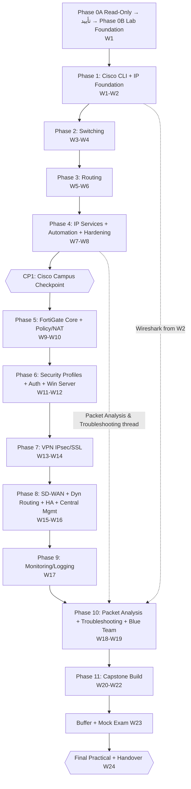

## ۸.۲ رشته‌های موازی (Threads)

| Thread | از هفته | هر روز | نقش |
|---|---|---|---|
| Packet Analysis | W2 | ۳۰–۶۰ دقیقه | Capture در هر Lab |
| Troubleshooting Drill | W3 | ۶۰ دقیقه | یک عیب جدید یا مرور |
| Documentation (Git) | W1 | ۲۰–۳۰ دقیقه | Config/Workbook/Runbook |
| Active Recall / Spaced Repetition | W1 | ۱۵ دقیقه | کارت‌های مرور (Anki-style) |
| Security Mindset | W7 | در هر Lab | Secure by default |

## ۸.۳ Enterprise Reference Topology (خلاصه)

معماری مرجع سازمان **Zagros Logistics**: HQ + ۳ Branch؛ **FortiGate = Gateway همه VLANها**؛ Cisco = Access/Core L2 + ISP/WAN-Sim؛ IPsec Hub-and-Spoke؛ DMZ؛ AD/DNS/DHCP/NPS؛ Monitoring. جزئیات و دیاگرام: فصل ۱۷.۲ و ۲۹.۲؛ Lab A (Cisco Gateway) مستقل: فصل ۱۷.۲.۱.

# ۹. Lab Safety، Isolation و Risk Management

## ۹.۱ قوانین ایمنی اجرایی (Safety Rails)

1. **R1 — Snapshot/Backup قبل از هر تغییر روی ESXi/PNetLab.**
2. **R2 — بدون Uplink مستقیم Lab به شبکه واقعی** مگر یک NAT Gateway کنترل‌شده و مستند.
3. **R3 — هیچ DHCP Server یا Routing Protocol Lab نباید به شبکه واقعی نشت کند.**
4. **R4 — مدیریت ESXi (`192.168.88.3`) و Port Group مدیریتی دست‌نخورده می‌ماند.**
5. **R5 — Rollback Plan مکتوب قبل از هر تغییر زیرساختی.**
6. **R6 — Image غیرقانونی/Crack ممنوع.**

---

## ۹.۲ الزامات ایمنی Lab (مختص محیط شما)

| # | الزام | شاهد/تست |
|---|---|---|
| S1 | شبکه Lab تا حد ممکن ایزوله (Air-Gapped پیش‌فرض) | Capture روی Uplink Lab: ترافیکی به شبکه واقعی نیست |
| S2 | مدیریت ESXi (`192.168.88.3`) و رابط وب PNetLab (`192.168.88.199`) **در معرض اینترنت قرار نمی‌گیرند**؛ هیچ Port-Forward روی MikroTik برای آن‌ها ساخته نمی‌شود | بررسی Rule MikroTik (فقط خواندن) 🔎 |
| S3 | **FortiGate 7.0.3 و تجهیزات Lab هیچ Port Forwarding یا دسترسی مستقیم اینترنتی ندارند**؛ خروج اینترنت (در صورت نیاز) فقط NAT کنترل‌شده و موقت از یک مرز مستند | Test T9 |
| S4 | مسیر WireGuard و شبکه مدیریت ESXi دست‌نخورده؛ هر تغییر احتمالی فقط با Snapshot/Backup + Rollback مکتوب + **تأیید صریح کاربر** | Checklist قبل/بعد |
| S5 | هر اتصال Lab↔شبکه واقعی یک **مرز مشخص** دارد (دستگاه، Interface، Rule، مالک) و در `02-design/boundary.md` ثبت می‌شود | سند مرز |
| S6 | Image غیرقانونی ممنوع؛ کاربر Imageهای قانونی خود را فراهم می‌کند | Inventory |
| S7 | Debug/Capture پس از استفاده خاموش و Credentialها در Git ذخیره نمی‌شوند | Review |

### مرز Lab↔Real (الگو)

| مرز | دستگاه/Interface | جهت مجاز | Rule | مالک | وضعیت |
|---|---|---|---|---|---|
| B1 Mgmt Jump | PNetLab `pnet0` | Real→Lab (فقط SSH/HTTPS از Jump) | از MikroTik/WireGuard (بدون تغییر) | کاربر | 🔎 |
| B2 اینترنت کنترل‌شده | (اختیاری) VM NAT | Lab→Internet (HTTP/HTTPS/DNS) | Allow-list موقت | کاربر | 🔎 |
| B3 Data-Plane | — | **هیچ** | — | — | ممنوع |

---

## ۹.۳ مدیریت ریسک

ثبت ریسک کامل (احتمال، اثر، پیشگیری، جایگزین) در **فصل ۳۵.۳** است؛ ریسک‌های ایمنی بحرانی: R06 (FortiOS 7.0.x CVE)، R09 (تداخل Lab/Management)، R10 (از دست رفتن دسترسی ESXi).

# ۱۰. PNetLab/ESXi Lab Foundation

## ۱۰.۰ محیط مرجع (Authoritative) و مرز مدیریت

> **این جدول بر هر ذکر متناقض در نسخه‌های قبلی مقدم است.** هیچ چیز دیگری (از جمله VM یا Firewall جداگانه) جزو محیط نیست.

| مؤلفه | وضعیت فعلی |
|---|---|
| مدیریت VMware ESXi | `192.168.88.3` |
| رابط وب PNetLab | `192.168.88.199` |
| MikroTik | دسترسی WireGuard از محل کار کاربر به Lab (مسیر **مدیریتی خارجی**) |
| FortiGate دوره | **فقط به‌صورت Node داخل PNetLab** (FortiOS 7.0.3؛ هیچ FortiGate مستقل روی ESXi) |
| Firewall پلتفرم دیگر | **وجود ندارد**؛ هیچ پلتفرم Firewall دیگری در معماری، پیش‌نیاز، سناریو یا Lab نیست |

### تفکیک مسیر مدیریت از شبکه‌های Lab

| مسیر | چیست | چه نیست |
|---|---|---|
| **MikroTik/WireGuard** | مسیر مدیریتی خارجی کاربر برای رسیدن به ESXi/PNetLab | **نه** بخشی از توپولوژی PNetLab، **نه** WAN شبیه‌سازی‌شده، **نه** تونل VPN بین شعب، **نه** Config FortiGate دوره |
| **WAN شبیه‌سازی‌شده** | `ISP1-R1`/`ISP2-R1` داخل PNetLab (`203.0.113.0/24`، `198.51.100.0/24`) | ربطی به اینترنت واقعی/MikroTik ندارد |
| **VPN دوره** | IPsec/SSL-VPN بین FortiGateهای Node داخل PNetLab | WireGuard نیست |

- **تغییر MikroTik/WireGuard در آماده‌سازی دوره ممنوع است** مگر ضرورت فنی مشخص شناسایی و جداگانه تأیید شود.
- همه توپولوژی‌ها/VLANها/سناریوهای Firewall تا حد معقول **داخل PNetLab** ساخته می‌شوند؛ وابستگی به Port Group VLANدار ESXi حداقل است.

## ۱۰.۱ معماری هدف Lab

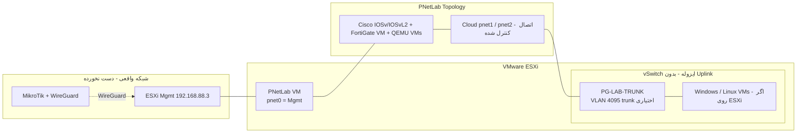

**اصول:**
- مدیریت PNetLab (`pnet0`) فقط به Management Port Group (دست‌نخورده).
- Lab Data-Plane کاملاً درون PNetLab یا vSwitch **بدون Uplink**.
- خروج به اینترنت (در صورت نیاز) فقط از یک مسیر NAT کنترل‌شده مستند، نه از Bridge مستقیم.

> وب PNetLab: `192.168.88.199`؛ مدیریت ESXi: `192.168.88.3` (هر دو فقط از مسیر WireGuard/Mgmt؛ بدون Exposure اینترنتی).

## ۱۰.۲ روش اتصال Windows/Linux به PNetLab — مقایسه

| روش | شرح | مزایا | معایب | پیش‌نیاز | توصیه |
|---|---|---|---|---|---|
| **A) QEMU Node داخل PNetLab** | Win/Linux به‌صورت Node با qcow2 | تمام ترافیک داخل PNetLab، بدون وابستگی به Port Group، Snapshot/Export توپولوژی، مطابق ترجیح کاربر | مصرف CPU/RAM بالا (Nested)، سرعت کمتر Windows | Nested Virt فعال، Disk/RAM کافی | ✅ **پیش‌فرض برای ۱–۳ VM سنگین** 🔎 |
| **B) VM روی ESXi + PNetLab Cloud (pnet1) + vSwitch ایزوله** | VMها روی ESXi؛ یک NIC اضافی PNetLab به Port Group ایزوله | کارایی بهتر، Snapshot ESXi | **به یک Port Group وابسته است** (ولی ایزوله و اختصاصی؛ نه Port Groupهای VLAN موجود)، پیچیدگی VLAN Trunk (4095) | NIC اضافی برای PNetLab VM، Port Group ایزوله | ✅ **Fallback اگر RAM/Performance کافی نبود** |
| **C) Cloud0 (pnet0) / Bridge به شبکه Mgmt** | VMها روی شبکه مدیریت | ساده | **ریسک نشت Lab به شبکه واقعی، تداخل DHCP** | — | ❌ فقط برای Management-Only، با فایروال و بدون Data Plane |
| **D) Hybrid** | Windows DC/Client به‌صورت A؛ Linux سبک‌ها داخل PNetLab؛ Monitoring/Zabbix روی ESXi (B) | تعادل منابع | دو مسیر اتصال | — | ✅ **محتمل‌ترین Final Design** |

> **تصمیم قطعی** در پایان Discovery با تأیید کاربر.

## ۱۰.۳ طراحی عملیاتی Lab

| جنبه | طراحی ✅ |
|---|---|
| Naming Convention | `<SITE>-<ROLE><NN>`: `HQ-CORE-SW1`, `HQ-ACC-SW1`, `HQ-FGT-01/02`, `BR1-RTR1`, `ISP1-R1`, `HQ-DC1`, `HQ-WEB-DMZ1`, `HQ-MON1`, `HQ-CL1` |
| IP Convention | Gateway = `.1` (FortiGate) یا `.254` (SVI/HSRP Virtual)؛ سرورها `.10–.50`؛ DHCP Pool `.100–.200` |
| دسترسی | Console از رابط وب PNetLab (`192.168.88.199`)؛ SSH از `HQ-JUMP1` داخل Lab (فصل ۱۴.۵)؛ Operator از WireGuard به PNetLab |
| Backup | (۱) Export توپولوژی PNetLab (Lab Archive)؛ (۲) Snapshot ESXi قبل از تغییر PNetLab؛ (۳) Config Backup دستگاه‌ها به Git؛ (۴) Backup VMDK/Qcow2 هفتگی |
| Restore | Runbook مستقل (تست در W1) |
| تخمین منابع | فصل ۱۳ (سه Tier) |

## ۱۰.۴ معیار پذیرش Lab Foundation (M0) — پایان Phase 0B

> این تست‌ها **Phase 0B** هستند (Boot Node، Snapshot، Capture، Backup/Restore) و **فقط پس از تأیید صریح کاربر** اجرا می‌شوند؛ Phase 0A هیچ‌یک را اجرا نمی‌کند.

| # | Test | Acceptance Criteria |
|---|---|---|
| T1 | ESXi/PNetLab سلامت | Login، Datastore Healthy، Snapshot قابل ایجاد |
| T2 | Nodeها روشن می‌شوند | IOSv/IOSvL2/FGT Boot موفق، CPU idle < ۳۰٪ |
| T3 | Console | دسترسی Console هر Node |
| T4 | L2 | دو Node در یک VLAN ARP می‌کنند |
| T5 | L3 | ping بین دو Subnet عبوری از Router |
| T6 | Packet Capture | Capture روی لینک PNetLab → Wireshark، ICMP دیده می‌شود |
| T7 | VM↔Lab | Windows/Linux Node با Lab ارتباط کنترل‌شده |
| T8 | Backup/Restore | Export و Import Lab + Restore Snapshot موفق |
| T9 | Isolation | از Lab، **هیچ** Packet به `192.168.88.0/24` (غیر از مسیر مدیریتی مجاز Jump/WireGuard) نمی‌رسد؛ Capture روی Uplink تایید می‌کند |
| T10 | WireGuard/ESXi Mgmt | دست‌نخورده، دسترسی قبل/بعد برابر |
| T11 | Git | Repo مستندات و Configها با اولین Commit |

**خروجی Phase 0B:** Runbook آماده‌سازی Lab، نقشه اتصال (As-Built Lab)، چک‌لیست تأیید (امضا شده)، Inventory.

---

# ۱۱. Discovery و Environment Validation (Phase 0A / Phase 0B)

## ۱۱.۰ مرز Phase 0A / Phase 0B و نقطه تأیید

> **Phase 0 در v2.0 ترکیبی از کارهای Read-Only و کارهای تغییردهنده بود؛ در v2.1 به دو فاز جدا تقسیم شد.**

| | **Phase 0A — Read-Only Discovery** | **Phase 0B — Isolated Lab Foundation** |
|---|---|---|
| ماهیت | فقط مشاهده، مستندسازی و تحقیق | ساخت و آزمایش Lab ایزوله |
| تغییر در زیرساخت | **ممنوع** | فقط داخل PNetLab و فقط پس از تأیید |
| مجاز | ثبت نسخه/پیکربندی ESXi و PNetLab؛ ظرفیت CPU/RAM/Storage؛ مستندسازی مسیر مدیریت؛ Inventory Image؛ بررسی سازگاری و مستندات؛ شناسایی پیش‌نیازهای ناقص؛ گزارش منابع/سازگاری | ساخت توپولوژی ایزوله؛ Import Image قانونی؛ Boot Nodeهای آزمایشی؛ Feature-Probe IOSv/IOSvL2؛ Boot و تست FortiGate؛ تست L2/L3/Data-Plane؛ تست Backup/Restore |
| ممنوع | هر تغییر Config، ساخت/Boot Node، قطع سرویس، تغییر شبکه، هر تست که محیط را عوض کند، تغییر MikroTik/WireGuard | تغییر Management ESXi، MikroTik/WireGuard، Port Groupهای موجود، اتصال Lab به شبکه واقعی بدون مرز مستند |
| زمان در برنامه | W1 روز ۱–۲ (قالب روز D، فصل ۲۷) | W1 روز ۳–۵ (L/S) — **پس از تأیید** |
| خروجی | **گزارش منابع و سازگاری (Phase 0A Report)** | Runbook Lab، Image Validation Matrix، چک‌لیست M0 امضاشده |

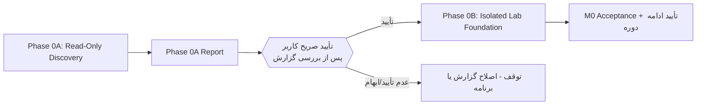

**قانون:** Phase 0B **شروع نمی‌شود** تا کاربر گزارش 0A را بررسی و تأیید صریح بدهد. تا آن لحظه هیچ Node ساخته/Boot نمی‌شود و ساعات اجرایی دوره شمرده نمی‌شود. این سند (v2.1) نیز تأیید 0B نیست.

### محتوای گزارش Phase 0A

| بخش | شرح |
|---|---|
| Inventory | CPU/RAM/Disk/NIC/نسخه‌ها (جدول فصل ۱۱.۳) |
| As-Is | نقشه شبکه/مسیر مدیریت (بدون تغییر) |
| Imageها | لیست Imageهای قانونی موجود، نسخه/منبع لایسنس |
| سازگاری | تطبیق با فصل ۱۲ بر اساس مستند؛ مواردی که نیاز به آزمایش دارند |
| ظرفیت | محاسبه ESXi-view و PNetLab-internal-view و پیشنهاد Tier (فصل ۱۳) |
| ریسک‌ها/ابهامات | Unverified و پیش‌نیازهای ناقص |
| درخواست تأیید | برای Phase 0B (با فهرست دقیق تغییرات پیشنهادی داخل PNetLab) |

## ۱۱.۱ **Phase 0A** — Discovery و Inventory (فقط خواندنی؛ Read-Only)

> در این فاز **هیچ تغییری** روی ESXi/PNetLab/MikroTik/WireGuard انجام نمی‌شود؛ فقط جمع‌آوری اطلاعات.

| # | مورد بررسی | روش (Read-Only) | خروجی |
|---|---|---|---|
| D1 | نسخه/Build ESXi | Host Client: Help>About یا `vmware -vl` | ثبت نسخه |
| D2 | CPU (Sockets/Cores/HT)، RAM، Hardware (Intel VT-x/EPT) | Host Client>Hardware | Inventory |
| D3 | Datastore، فضای آزاد، نوع (SSD/HDD)، Thin/Thick | Storage | Inventory |
| D4 | NIC فیزیکی، vSwitch، Port Group، VLAN ID، Uplink | Networking | **نقشه As-Is** |
| D5 | مسیر اتصال PNetLab (کدام Port Group/NIC) | VM Settings | نقشه |
| D6 | نسخه PNetLab و روش نصب (OVA/ISO)؛ وب `192.168.88.199` | PNetLab Web UI/VM | ثبت |
| D7 | منابع VM PNetLab (vCPU/RAM/Disk)، Nested Virt (`hv.enable…` / «Expose HW assisted virtualization») | VM Settings | Inventory |
| D8 | VMهای موجود، Snapshotها، Backup | VM list | وضعیت Backup |
| D9 | مسیر WireGuard/MikroTik (فقط مستندسازی، **بدون تغییر**) | مستند کاربر | نقشه |
| D10 | Subnetهای شبکه واقعی (برای جلوگیری از Overlap) | کاربر | لیست |
| D11 | دسترسی اینترنت Lab (Proxy/NAT) | کاربر | تصمیم |
| D12 | اکانت‌ها/لایسنس: Fortinet Support، Cisco (CML/DevNet)، Microsoft Evaluation | کاربر | وضعیت |


## ۱۱.۲ **Phase 0B** — مرحله Image Validation (فقط پس از تأیید صریح کاربر)

> هدف: به‌جای فرض، قابلیت واقعی هر Image اندازه‌گیری و در ماتریس فصل ۱۲ ثبت شود. نتیجه، تعیین‌کننده «اجرایی/مفهومی/جایگزین» بودن هر Lab است.

| گام | کار (**داخل PNetLab، ایزوله؛ تغییردهنده؛ فقط پس از تأیید 0B**) | خروجی |
|---|---|---|
| IV-1 | Imageهای **قانونی** کاربر (Inventory در 0A) در PNetLab Import می‌شوند (نام فایل، منبع لایسنس) | لیست Image |
| IV-2 | هر Image در یک Lab آزمایشی جدا Boot می‌شود؛ ثبت CPU/RAM مصرفی | Boot Log |
| IV-3 | Feature-Probe: برای هر Feature فصل ۱۲.۲ یک دستور/تست حداقلی (نمونه: `?` کمکی IOS، `show` مرتبط، Config/Revert بی‌خطر) | وضعیت Supported/Partial/No |
| IV-4 | تست Data-Plane: ping، VLAN Tag، STP BPDU، OSPF Hello بین دو Node | نتایج |
| IV-5 | FortiGate-VM: ورود، `get system status` (نسخه/لایسنس)، شمارش Interface، آزمون License/FortiGuard/HA/SSL-VPN/UTM (Feature-Probe فصل ۱۶.۸) | Feature Matrix |
| IV-6 | ثبت نتایج با تاریخ، نسخه دقیق Image، `Verified (tested)` یا `Unverified` | `image_validation.md` |
| IV-7 | تصمیم Contingency برای Featureهای ناموجود (فصل ۱۲.۳) | Decision Log |

**معیار پذیرش:** هیچ Lab به Featureای وابسته نیست که در IV-3/IV-5 `Unverified` مانده باشد، مگر اینکه Lab به‌صورت «مفهومی/جایگزین» علامت خورده باشد.

## ۱۱.۳ Discovery Checklist — **Phase 0A** (قبل از انتخاب Tier فصل ۱۳)

> **فقط اندازه‌گیری/خواندن؛ هیچ تغییری در محیط واقعی.**

| # | مورد | روش خواندنی | مقدار (کاربر پر می‌کند) | تأثیر بر Tier |
|---|---|---|---|---|
| 1 | مدل CPU، Core/Thread | ESXi Host Client → Hardware | ☐ | تعداد vCPU قابل تخصیص |
| 2 | RAM کل | همان | ☐ | تعیین Tier |
| 3 | RAM آزاد/قابل تخصیص به Lab | همان + VMهای موجود | ☐ | **تعیین Tier** |
| 4 | Storage کل/آزاد، SSD/HDD، Thin/Thick | Storage | ☐ | Disk/Snapshot |
| 5 | نسخه/Build دقیق ESXi | About | ☐ | سازگاری Nested |
| 6 | نسخه PNetLab (وب `192.168.88.199`) | Web UI → About/Settings | ☐ | Image/Interface Limit |
| 7 | نوع/تعداد NICهای فیزیکی و vNIC قابل‌افزودن به PNetLab VM | Networking | ☐ | مسیر اتصال VMهای ESXi |
| 8 | vSwitch/Port Groupهای موجود؛ امکان ساخت **یک** vSwitch بدون Uplink (فقط اگر کاربر تأیید کند) | Networking (مشاهده) | ☐ | روش B/D فصل ۱۰.۲ |
| 9 | نحوه اتصال PNetLab به VMهای خارج از آن | ترسیم As-Is | ☐ | معماری Hybrid |
| 10 | Imageهای قانونی موجود (Cisco/Fortinet) | کاربر | ☐ | Image Matrix |
| 11 | Nested Virtualization (Expose HW Virtualization روی PNetLab VM؛ CPU feature) | VM Settings | ☐ | امکان QEMU Node |
| 12 | Snapshot/Backup (Datastore، سیاست، آخرین Backup) | کاربر/ESXi | ☐ | R1 ایمنی |
| 13 | روش دسترسی امن و Rollback (WireGuard، دسترسی Out-of-band/کنسول فیزیکی) | کاربر | ☐ | ریسک از دست رفتن دسترسی |
| 14 | Subnetهای واقعی (Overlap با فصل ۱۴) | کاربر | ☐ | IP Plan |
| 15 | دسترسی حساب‌ها: Fortinet Support، Cisco (CML/DevNet)، Microsoft Eval | کاربر | ☐ | Image |

---

# ۱۲. Image Compatibility Matrix

## ۱۲.۱ جدول سازگاری Image

| تجهیز | کاربرد آموزشی | منابع | سازگاری PNetLab/ESXi | محدودیت‌ها `Unverified` | روش قانونی تهیه | تست قبل از ورود |
|---|---|---|---|---|---|---|
| **FortiGate-VM 7.0.3** | نقش اصلی | 1 vCPU/2 GB (Eval `Unverified`) | KVM/QEMU نوع `fortinet` در PNetLab | لایسنس Eval، FortiGuard، HA، تعداد Interface | Fortinet Support (حساب + Evaluation License) | Boot، License Import، `get system status` |
| **Cisco IOSv** | Router | 1/0.5 GB | QEMU | بدون برخی Featureهای سخت‌افزاری | CML-Personal/DevNet/Partner (لایسنس) 🔎 | ping/OSPF/NAT/ACL |
| **Cisco IOSvL2** | L2/L3 Switch | 1/~1 GB | QEMU | محدودیت در EtherChannel/DAI/Snooping/STP Feature `Unverified` | همان | VLAN/Trunk/STP/EtherChannel |
| Win Server 2022 Eval | AD/NPS/CA | 2/4 | QEMU یا ESXi | ۱۸۰ روز (Server: `Verified`) | Microsoft Evaluation Center | Boot، Domain |
| Win 10/11 Client Eval | Client | 2/4 | همان | ۹۰ روز `Unverified`، TPM در Win11 | Microsoft | Join Domain |
| Ubuntu/Debian Server | WEB/MON | 1–2/1–4 | QEMU/ESXi | — | Distro رسمی | SSH، Package |
| FortiManager/FortiAnalyzer VM | مدیریت | 4/8 `Unverified` | ESXi (بهتر از QEMU) | لایسنس Eval، سازگاری نسخه | Fortinet Support | Login، Registration |
| Zabbix | Monitoring | 2/4 | Linux | — | رایگان | Poll SNMP |


## ۱۲.۲ Cisco Feature Compatibility Matrix (Image Validation)

> **هیچ فرمانی صرفاً به‌دلیل آشنایی از IOS واقعی برای Image شبیه‌سازی‌شده قطعی فرض نشده است.** ستون «آزمایش» تا اجرای IV-3 همه `Unverified (Not Tested)` است. «وضعیت مستند» باید از Cisco Configuration Guide/CML Docs بر اساس **Image/Release دقیق** تکمیل شود (فعلاً `Unverified`). نسخه‌ها در IV-2 ثبت می‌شوند.

| # | Feature | Image/Platform هدف | نسخه موردنیاز | فرمان/روش بررسی قابلیت | وضعیت پشتیبانی مستندشده | آزمایش | محدودیت شناخته‌شده | جایگزین معتبر |
|---|---|---|---|---|---|---|---|---|
| 1 | VLAN و Access Port | IOSvL2 | 🔎 | `show vlan brief`؛ `switchport access vlan` | `Unverified` | Not Tested | — | — |
| 2 | 802.1Q Trunk | IOSvL2 | 🔎 | `show interfaces trunk` | `Unverified` | Not Tested | (Encapsulation dot1q ممکن است نیاز به فرمان صریح باشد) | — |
| 3 | STP/RSTP | IOSvL2 | 🔎 | `show spanning-tree summary` | `Unverified` | Not Tested | — | PVST+ مفهومی |
| 4 | EtherChannel LACP/PAgP | IOSvL2 | 🔎 | `show etherchannel summary` | `Unverified` | Not Tested | PAgP ممکن است ناموجود | LACP/مفهومی |
| 5 | Inter-VLAN (RoAS) | IOSv | 🔎 | Sub-interface + `show ip route` | `Unverified` | Not Tested | — | — |
| 6 | SVI/L3 Switching | IOSvL2 | 🔎 | `ip routing`، `show ip route` | `Unverified` | Not Tested | — | RoAS |
| 7 | Static/Default Route | IOSv/IOSvL2 | 🔎 | `show ip route` | `Unverified` | Not Tested | — | — |
| 8 | OSPFv2/v3 | IOSv/IOSvL2 | 🔎 | `show ip ospf neighbor` | `Unverified` | Not Tested | — | — |
| 9 | IPv6 | IOSv | 🔎 | `show ipv6 interface brief` | `Unverified` | Not Tested | — | — |
| 10 | ACL (Std/Ext) | IOSv/IOSvL2 | 🔎 | `show access-lists` | `Unverified` | Not Tested | — | — |
| 11 | DHCP Server/Relay | IOSv/IOSvL2 | 🔎 | `show ip dhcp pool/binding` | `Unverified` | Not Tested | — | Windows/FGT DHCP |
| 12 | HSRP/VRRP/FHRP | IOSv/IOSvL2 | 🔎 | `show standby brief` | `Unverified` | Not Tested | — | FGT VRRP/مفهومی |
| 13 | DHCP Snooping | IOSvL2 | 🔎 | `show ip dhcp snooping` | `Unverified` | Not Tested | احتمال پشتیبانی ناقص | CLI Review/Image دیگر (قانونی) |
| 14 | Dynamic ARP Inspection | IOSvL2 | 🔎 | `show ip arp inspection` | `Unverified` | Not Tested | احتمال ناموجود | همان |
| 15 | Port Security | IOSvL2 | 🔎 | `show port-security` | `Unverified` | Not Tested | — | Storm-control/مفهومی |
| 16 | SPAN/Port Mirroring | IOSvL2 | 🔎 | `show monitor session all` | `Unverified` | Not Tested | احتمال ناموجود | Capture روی لینک PNetLab |
| 17 | Embedded Packet Capture | IOSv | 🔎 | `monitor capture` (وجود فرمان) | `Unverified` | Not Tested | احتمال ناموجود | PNetLab Capture |
| 18 | Syslog | IOSv/IOSvL2 | 🔎 | `show logging` + دریافت در rsyslog | `Unverified` | Not Tested | — | — |
| 19 | SNMP (v2c/v3) | IOSv/IOSvL2 | 🔎 | `show snmp` + `snmpwalk` | `Unverified` | Not Tested | سینتکس v3 | v2c (فقط Lab) |
| 20 | NTP | IOSv/IOSvL2 | 🔎 | `show ntp status` | `Unverified` | Not Tested | — | — |
| 21 | QoS پایه | IOSv/IOSvL2 | 🔎 | `show policy-map` | `Unverified` | Not Tested | — | مفهومی |
| 22 | NAT/PAT | IOSv | 🔎 | `show ip nat translations` | `Unverified` | Not Tested | — | — |
| 23 | IP SLA/Track | IOSv | 🔎 | `show ip sla statistics` | `Unverified` | Not Tested | — | FGT Link Monitor |

**قاعده تصمیم:** Featureای که پس از IV-3 `Supported` شد، به «Verified (tested)» ارتقا و در Reference Log (فصل ۳۴) ثبت می‌شود؛ اگر `No/Partial` بود، Lab مربوط طبق ستون «جایگزین» بازطراحی می‌شود (و در Traceability ثبت).

---


> **دسته‌بندی هر Feature پس از Image Validation:** `Verified (tested)` · `Unverified` · `Unsupported` · `Requires-Other-Image/Platform`. در v2.1 هیچ ردیف `Verified (tested)` یا `Unsupported` نیست (آزمایشی انجام نشده)؛ ردیف‌های ۱۳، ۱۴، ۱۶، ۱۷ (Snooping، DAI، SPAN، EPC) **محتمل‌ترین کاندیدای Unsupported/Requires-Other-Image** هستند و صرفاً `Unverified` ثبت شده‌اند. منابع مرجع CML: IOSv 1 vCPU/512 MB و IOSv-L2 1 vCPU/768 MB (`Verified` از FAQ CML v2.10؛ لایسنس: «CML must be licensed before starting any node» — برای استفاده از Image در CML؛ شرایط لایسنس Image در PNetLab `Unverified`).

## ۱۲.۳ سناریوهای جایگزین (Contingency)

| مشکل | جایگزین معتبر |
|---|---|
| IOSvL2 فاقد DAI/Snooping | لایه Security در سناریو «مفهومی + CLI Review» + استفاده Cisco **CSR1000v/Catalyst 8000v (لایسنس قانونی)** `Unverified` یا فقط Port-Security/Storm-Control |
| Image Cisco در دسترس نیست | Cisco **Packet Tracer** (رایگان با Netacad) برای Phase 1–2 CLI + سناریوی L2 محدود؛ `Unverified` Packet Tracer شبیه‌ساز است نه IOS واقعی؛ Plan برای CML Personal پیشنهاد می‌شود |
| FortiGate 7.0.3 در دسترس نیست | نزدیک‌ترین 7.0.x (مشروط به تأیید کاربر + ثبت تفاوت) |
| HA در Eval ممکن نیست | HA مفهومی + Lab روی VM لایسنس‌دار (اگر دسترسی) |
| FAZ/FMG ممکن نیست | مفهومی + مستند رسمی |

---

# ۱۳. Lab Resource Tiers

> **همه اعداد «برآورد طراحی (`Inferred`)» هستند، نه مشخصات محیط شما.** مقادیر نهایی پس از Phase 0A اندازه‌گیری و پس از Phase 0B (Image Validation) اصلاح می‌شوند. اعداد منابع Nodeها از «منابع مرجع CML» در فصل ۳۴ فقط برای IOSv/IOSvL2 `Verified` شده‌اند (IOSv: 1 vCPU/512 MB؛ IOSvL2: 1 vCPU/768 MB — نسخه 2.10 FAQ)؛ بقیه `Unverified`/برآورد.

## ۱۳.۱ دو دید جدا: ESXi در برابر PNetLab-Internal

| | **دید ESXi (Allocation)** | **دید داخلی PNetLab (Workload)** |
|---|---|---|
| چه چیزی را نشان می‌دهد | آنچه ESXi به VMهای مستقل می‌دهد: VM PNetLab، سایر VMهای مستقل، Overhead/Reserve ESXi | سهم Nodeهای QEMU (FortiGate، IOSv، IOSvL2، Linux/Windows داخل PNetLab) از منابعی که **قبلاً** به VM PNetLab داده شده |
| جمع‌پذیری | VM PNetLab + VMهای مستقل + Reserve ESXi = RAM مورد نیاز میزبان | جمع RAM Nodeها + Overhead سیستم PNetLab ≤ RAM VM PNetLab (با Headroom) |
| **قانون ضد شمارش مضاعف** | RAM/CPU Nodeهای نِستد **دوباره** به VM PNetLab اضافه نمی‌شود | Nodeهای نِستد در «RAM میزبان» جدا جمع **نمی‌شوند** |

### فرض‌های محاسبه (Assumptions)

| فرض | مقدار | وضعیت |
|---|---|---|
| Overhead سیستم‌عامل PNetLab (Ubuntu+Services) | ≈ ۳–۴ GB RAM | `Unverified` (برآورد) |
| Headroom عملیاتی داخل PNetLab | ≥ ۲۰٪ | تصمیم طراحی |
| Reserve میزبان ESXi (Hypervisor + VM Overhead + Buffer) | ≈ ۴ GB + ۱۰٪ جمع VMها | `Inferred` |
| IOSv RAM | 512 MB | **`Verified` (CML FAQ v2.10)** برای CML؛ در PNetLab ممکن است متفاوت |
| IOSvL2 RAM | 768 MB | **`Verified` (همان)** |
| FortiGate-VM RAM/vCPU | 2 GB/1 vCPU (Eval ممکن است سقف داشته باشد) | `Unverified` |
| Windows Server/Client | 4 GB / 2 vCPU | `Unverified` (مستند مایکروسافت) |
| Linux Server | 1–2 GB / 1 vCPU | `Unverified` |
| Overcommit vCPU داخل PNetLab | مجموع vCPU Nodeها تا ≈ 2× vCPU VM PNetLab (Nodeهای بی‌کار) | `Inferred` |
| Overcommit RAM | **صفر** (RAM Reserve) | تصمیم طراحی |
| رشد Disk | qcow2 Overlay + Snapshot ≈ ۲۰–۳۰٪ + Capture/Log | `Inferred` |

## ۱۳.۲ Tier 1 — Minimum / Essential

**جایگذاری:** همه Nodeها (FGT، IOS، Linux، Windows) **داخل PNetLab**؛ هیچ VM مستقل دیگری روی ESXi برای Lab نیست.

| | مقدار (برآورد) |
|---|---|
| **دید ESXi** | |
| VM PNetLab — vCPU | 8 |
| VM PNetLab — RAM | 28 GB (پیک داخلی ≈ 22 + Headroom) |
| VM PNetLab — Disk | ≈ 150 GB (Thin) |
| VMهای مستقل Lab | ندارد |
| Reserve ESXi | ≈ 7 GB (4 + ۱۰٪ از 28) |
| **RAM میزبان لازم (حداقل)** | **≈ 35 GB** (+ هر VM غیر Lab موجود) |
| Datastore (با ۳۰٪ Snapshot/Growth) | ≈ 200 GB |
| **دید داخلی PNetLab (پیک Capstone نوبتی)** | |
| FortiGate × 2 (HQ + یک Branch در هر لحظه) | 2 × 2 = 4 GB / 2 vCPU |
| IOSvL2 × 3 | 3 × 0.75 = 2.25 GB / 3 vCPU |
| IOSv × 2 (ISP-Sim) | 2 × 0.5 = 1 GB / 2 vCPU |
| Windows Server × 1 (DC) | 4 GB / 2 vCPU |
| Windows Client × 1 | 4 GB / 2 vCPU |
| Linux × 2 (WEB-DMZ، MON) | ≈ 3 GB / 2 vCPU |
| **جمع Nodeها** | **≈ 18.3 GB RAM / 13 vCPU nominal** |
| Overhead PNetLab | ≈ 3.5 GB |
| **جمع نیاز داخلی** | ≈ 21.8 GB → با Headroom ۲۰٪ ≈ **26 GB** ≤ 28 GB ✔ |
| Overcommit vCPU | 13 / 8 ≈ 1.6× |

- **Capstone:** **نوبتی** — HQ + **یک** Branch در هر لحظه؛ سه Branch جداگانه تست می‌شوند (فصل ۲۹.۱۲).
- **HA:** اجرا نمی‌شود (فقط مفهومی/Tabletop).
- **FMG/FAZ:** مفهومی.
- **متوقف/Staged:** Branchهای دیگر؛ Client دوم؛ Zabbix سنگین (از Zabbix سبک یا rsyslog+Script).
- **ریسک:** RAM مرزی؛ Boot همزمان زیاد Nodeها کند.

## ۱۳.۳ Tier 2 — Standard / Recommended

**جایگذاری (Hybrid):** FortiGate/IOS/Clientها و Linux سبک داخل PNetLab؛ **Windows Server (DC) و Linux MON/Zabbix روی ESXi به‌صورت VM مستقل**.

| | مقدار (برآورد) |
|---|---|
| **دید ESXi** | |
| VM PNetLab — vCPU / RAM / Disk | 12 / 32 GB / ≈ 250 GB |
| VM مستقل: Windows Server DC | 2 vCPU / 4 GB / 60 GB |
| VM مستقل: Linux MON (Zabbix+rsyslog) | 2 vCPU / 4 GB / 60 GB |
| جمع RAM VMها | 32 + 4 + 4 = 40 GB |
| Reserve ESXi | ≈ 8 GB (4 + ۱۰٪) |
| **RAM میزبان لازم (حداقل)** | **≈ 48 GB** (پیشنهادی 64 GB) |
| Datastore | ≈ 500 GB |
| **دید داخلی PNetLab (پیک)** | |
| FortiGate × 3 (HQ + BR1 + BR2) | 6 GB / 3 vCPU |
| IOSvL2 × 4 | 3 GB / 4 vCPU |
| IOSv × 5 | 2.5 GB / 5 vCPU |
| Windows Client × 2 | 8 GB / 4 vCPU |
| Linux WEB-DMZ × 1 | 1.5 GB / 1 vCPU |
| **جمع Nodeها** | **≈ 21 GB / 17 vCPU** |
| Overhead PNetLab | ≈ 3.5 GB |
| جمع نیاز داخلی | ≈ 24.5 GB → با Headroom ≈ **29.5 GB** ≤ 32 GB ✔ |
| Overcommit vCPU | 17 / 12 ≈ 1.4× |

- **Capstone:** **HQ + دو Branch هم‌زمان**؛ Branch سوم Staged جداگانه (فصل ۲۹.۱۲).
- **HA:** مشروط به تأیید Image/License؛ اگر اجرا شود، FGT اضافی (+2 GB) و Branch سوم خاموش می‌ماند.
- **متوقف/Staged:** BR3؛ FMG/FAZ.
- **ریسک:** I/O مشترک Datastore؛ CPU-Ready.

## ۱۳.۴ Tier 3 — Full / Advanced

**جایگذاری:** FortiGate (۵ Node: HQ-HA×2 + BR1–BR3)، IOS، Linux ابزار داخل PNetLab؛ Windows Server×2، Windows Client×3، Linux MON و (اختیاری) FMG/FAZ **VM مستقل روی ESXi**.

| | مقدار (برآورد) |
|---|---|
| **دید ESXi** | |
| VM PNetLab — vCPU / RAM / Disk | 16 / 48 GB / ≈ 400 GB |
| VM مستقل: Windows Server × 2 | 4 vCPU / 8–16 GB / 120 GB |
| VM مستقل: Windows Client × 3 | 6 vCPU / 12 GB / 150 GB |
| VM مستقل: Linux MON | 2 vCPU / 4 GB / 60 GB |
| VM مستقل: FMG/FAZ (اختیاری، `Unverified` منابع) | 0–8 vCPU / 0–16 GB / 0–200 GB |
| جمع RAM VMها | 48 + (8–16) + 12 + 4 + (0–16) = **72–96 GB** |
| Reserve ESXi | ≈ 4 + ۱۰٪ ≈ 12–14 GB |
| **RAM میزبان لازم** | **≈ 83–110 GB** (پیشنهادی ≥ 128 GB) |
| Datastore | ≈ 0.8–1.2 TB |
| **دید داخلی PNetLab (پیک)** | |
| FortiGate × 5 (HQ A/P + BR1–3؛ اگر HA مجاز) | 5 × 4 = 20 GB (فرض 4 GB/نود؛ `Unverified`) / 10 vCPU |
| IOSvL2 × 6 | 4.5 GB / 6 vCPU |
| IOSv × 6 | 3 GB / 6 vCPU |
| Linux ابزار/WEB × 2 | 3 GB / 2 vCPU |
| **جمع Nodeها** | **≈ 30.5 GB / 24 vCPU** |
| Overhead PNetLab | ≈ 4 GB |
| جمع نیاز داخلی | ≈ 34.5 GB → با Headroom ≈ **41.5 GB** ≤ 48 GB ✔ |
| Overcommit vCPU | 24 / 16 = 1.5× |

- **Capstone:** **HQ + سه Branch هم‌زمان** با همه تونل‌ها؛ HA (مشروط)؛ Failure Drill.
- **ریسک:** هزینه/نگهداری؛ محدودیت HA/Eval؛ `Unverified` بودن RAM FGT.

## ۱۳.۵ تصمیم Tier و ادعاهای مجاز

| RAM میزبان ESXi (قابل تخصیص به Lab) | Tier | ادعای مجاز |
|---|---|---|
| < 35 GB | **زیر T1** | اعلام ریسک؛ کاهش دامنه/افزایش منابع؛ تصمیم کاربر |
| 35–47 GB | T1 | Capstone نوبتی |
| 48–95 GB | T2 | Capstone HQ+۲ Branch هم‌زمان |
| ≥ 96 GB | T3 | Capstone کامل هم‌زمان |

> **فرمول سریع:** RAM میزبان ≈ RAM(VM PNetLab) + Σ RAM(VMهای مستقل) + Reserve. RAM Nodeهای نِستد فقط در **دید داخلی** محاسبه می‌شوند.
> پس از Phase 0A، این جدول با اعداد واقعی پر و Tier نهایی با تأیید شما تعیین می‌شود. **هیچ Tier نباید قابلیتی را وعده دهد که واقعاً اجرا نمی‌شود.**

# ۱۴. IP Addressing، VLAN و Naming Standards

## ۱۴.۱ تفکیک شبکه‌ها و Address Space

| شبکه | کاربرد | آدرس پیشنهادی ✅ | عبور به شبکه واقعی |
|---|---|---|---|
| Real Mgmt | ESXi `192.168.88.3` / PNetLab `192.168.88.199` / MikroTik | `192.168.88.0/24` (`Inferred`؛ Mask `Unverified` 🔎) | — |
| Lab OOB Mgmt (Labهای مستقل W1–W8) | رزرو؛ در Capstone استفاده نمی‌شود (فصل ۱۴.۵.۸) | `10.255.0.0/24` | ممنوع |
| Lab Loopbacks | RID/Mgmt Loopback | `10.254.0.0/24` | ممنوع |
| HQ | سازمان | `10.10.0.0/16` | ممنوع |
| BR1/BR2/BR3 | شعب | `10.20/30/40.0.0/16` | ممنوع |
| DMZ | سرورهای عمومی | `172.16.10.0/24` | ممنوع |
| ISP1 (شبیه‌سازی) | WAN اصلی | `203.0.113.0/24` (TEST-NET-3) | ممنوع |
| ISP2 (شبیه‌سازی) | WAN پشتیبان | `198.51.100.0/24` (TEST-NET-2) | ممنوع |
| Transit/P2P | لینک بین دستگاه | `10.99.x.x/30` | ممنوع |
| Remote-VPN Pool | کاربران راه دور | `10.250.0.0/24` | ممنوع |

🔎 `Unverified` (Discovery) عدم Overlap با شبکه‌های واقعی کاربر.


## ۱۴.۲ طرح VLAN و Gateway سازمان (معماری اصلی Capstone: FortiGate Gateway)

> **قانون مالکیت:** در Capstone، **FortiGate مالک Default Gateway همه VLANهای سازمانی** است. سوئیچ‌های Cisco فقط L2 هستند (`no ip routing`) و تنها یک SVI مدیریتی (VLAN 10) برای مدیریت دارند.

| VLAN | نام | Subnet HQ | Gateway (مالک) | Zone FGT | DHCP | کاربرد |
|---|---|---|---|---|---|---|
| 10 | MGMT | 10.10.10.0/24 | `.1` — FGT | `Z-MGMT` | Static | مدیریت تجهیزات (SVI فقط روی سوئیچ برای مدیریت) |
| 20 | FINANCE | 10.10.20.0/24 | `.1` — FGT | `Z-FIN` | DHCP (DC/Relay) | مالی |
| 30 | HR | 10.10.30.0/24 | `.1` — FGT | `Z-HR` | DHCP | منابع انسانی |
| 40 | IT | 10.10.40.0/24 | `.1` — FGT | `Z-IT` | DHCP | IT |
| 50 | USERS | 10.10.50.0/24 | `.1` — FGT | `Z-USERS` | DHCP | کاربران عمومی |
| 60 | SERVERS | 10.10.60.0/24 | `.1` — FGT | `Z-SRV` | Static | AD/DNS/DHCP/MON/SYSLOG |
| 80 | GUEST | 10.10.80.0/24 | `.1` — FGT | `Z-GUEST` | DHCP (FGT) | مهمان (Captive) |
| 99 | BLACKHOLE | — | — | — | — | Native/Unused |
| 100 | DMZ | 172.16.10.0/24 | `.1` — FGT | `Z-DMZ` | Static | Web/ERP |

- **Branchها** (هر سایت FGT مالک Gateway): VLAN 10 MGMT `10.X.10.0/24`، VLAN 50 USERS `10.X.50.0/24`، VLAN 80 GUEST `10.X.80.0/24`؛ BR1 دارای VLAN 60 `10.20.60.0/24` (Local Server). با `X=20,30,40` برای BR1–BR3.
- **Gateway در HA:** آدرس `.1` روی Cluster (FGCP، `Unverified` در VM Eval)؛ بدون HA، FGT تکی.
- **DHCP:** VLANهای کاربری از DC (Relay توسط FGT)؛ GUEST از FGT.

## ۱۴.۳ IPAM و مستندسازی آدرس‌ها

| سطح | ابزار/روش | محتوا | مالک |
|---|---|---|---|
| ضروری | جدول IPAM در Git (`02-design/ipam.csv` + Markdown) | Prefix، VLAN، Gateway، Zone، DHCP Range، Reservation، مالک | هنرجو |
| **[OPT]** | NetBox (فصل ۳۴) | همان + Device/Interface | هنرجو |

| فیلد IPAM (حداقل) | مثال |
|---|---|
| Prefix | 10.10.20.0/24 |
| VLAN/Site | 20 / HQ |
| Gateway/Owner | 10.10.20.1 / HQ-FGT |
| Zone | Z-FIN |
| DHCP Range/Reservation | .100–.200 / `.20` پرینتر |
| تاریخ تغییر/شناسه Change | 2026-… / CHG-0007 |

**قوانین:** هر Subnet با Overlap-Check؛ تغییر آدرس فقط با Change Record؛ IPAM هم‌تراز با As-Built.

## ۱۴.۴ Naming Standards

| نوع | الگو | مثال |
|---|---|---|
| دستگاه | `<SITE>-<ROLE><NN>` | `HQ-CORE-SW1`، `HQ-FGT-01`، `BR1-FGT-01`، `ISP1-R1`، `HQ-DC1`، `HQ-WEB-DMZ1`، `HQ-MON1`، `HQ-CL1` |
| Zone FGT | `Z-<NAME>` | `Z-FIN` |
| Policy FGT | `<SRC>-to-<DST>-<SVC>` | `Z-USERS-to-WAN-WEB` |
| Address Obj | `NET-<name>` / `H-<name>` | `NET-FIN` |
| VPN | `VPN-<A>-<B>-<n>` | `VPN-HQ-BR1-1` |
| فایل | `<LabID>_<Topic>_<Device>_<YYYYMMDD>_<vN>.<ext>` | فصل ۳۱.۱ |


## ۱۴.۵ طراحی Management Plane سوئیچ‌های Cisco (معماری اصلی: FortiGate Gateway)

> **اصل:** سوئیچ‌های Core/Access در معماری اصلی **Layer 2 هستند** (`no ip routing`). آن‌ها Router نیستند؛ فقط **یک SVI مدیریتی** دارند و برای رسیدن به شبکه‌های دیگر از `ip default-gateway` استفاده می‌کنند. **مالک Gateway مدیریتی: فقط FortiGate** (`10.10.10.1` در VLAN 10). Gateway دوم تعریف نمی‌شود.

### ۱۴.۵.۱ جدول مدیریت

| مورد | HQ | Branch X (`X=20,30,40`) |
|---|---|---|
| Management VLAN | **VLAN 10 (MGMT)** | VLAN 10 |
| Management Subnet | `10.10.10.0/24` | `10.X.10.0/24` |
| Gateway مدیریتی (مالک) | `10.10.10.1` — **HQ-FGT** (Sub-interface VLAN10، Zone `Z-MGMT`) | `10.X.10.1` — BRX-FGT |
| `HQ-CORE-SW1` | `10.10.10.11/24` | — |
| `HQ-CORE-SW2` | `10.10.10.12/24` | — |
| `HQ-ACC-SW1` | `10.10.10.21/24` | — |
| `HQ-ACC-SW2` | `10.10.10.22/24` | — |
| Branch Switch | — | `BRX-SW1` = `10.X.10.11/24` |
| Jump Host (داخل Lab) | `HQ-JUMP1` = `10.10.40.10` در VLAN 40 (Z-IT) | از طریق VPN/HQ-JUMP1 |
| Operator Workstation | PC کاربر (خارج Lab) از مسیر WireGuard → رابط وب PNetLab `192.168.88.199` → Console Nodeها | همان |

### ۱۴.۵.۲ پیکربندی مرجع (الگو؛ `Unverified` تا Image Validation)

```text
! Layer 2 switch (Core/Access) — نمونه HQ-ACC-SW1
no ip routing
interface Vlan10
 description MGMT-SVI-ONLY
 ip address 10.10.10.21 255.255.255.0
 no shutdown
ip default-gateway 10.10.10.1
! Switch routes NOTHING: no SVI for user VLANs, no ip route
!
ip access-list standard MGMT-SSH
 permit host 10.10.40.10        ! HQ-JUMP1
 deny   any log
line vty 0 4
 access-class MGMT-SSH in
 transport input ssh
 login local
```

- `ip default-gateway` فقط وقتی کار می‌کند که `ip routing` **غیرفعال** باشد؛ اگر `ip routing` روشن شود، سوئیچ به `ip route 0.0.0.0 0.0.0.0` نیاز دارد و این **ممنوع** است (سوئیچ نباید Router شود).
- فقط SVI VLAN 10 وجود دارد؛ SVI برای VLANهای کاربری ساخته نمی‌شود (در Lab A استثنا است، که معماری جداگانه دارد).

### ۱۴.۵.۳ مسیر رسیدن Jump به سوئیچ

`HQ-JUMP1 (10.10.40.10, VLAN40)` → Access → Core → Trunk → **FGT Policy** `Z-IT → Z-MGMT` (SSH/HTTPS) → VLAN10 → Core/Access `10.10.10.x`. بازگشت: همان مسیر (تک Gateway = متقارن).

### ۱۴.۵.۴ محدودسازی دسترسی

| لایه | کنترل |
|---|---|
| FortiGate | فقط `HQ-JUMP1` و Z-IT → SSH/HTTPS به Z-MGMT؛ بقیه Deny با Log |
| سوئیچ | `access-class` فقط Jump؛ SSH v2؛ `login local`؛ `exec-timeout`؛ بدون Telnet/HTTP |
| FortiGate (مدیریت خود FGT) | `allowaccess ssh https` فقط روی Sub-interface VLAN10، `trusthost` = `10.10.40.10` |
| Operator | به سوئیچ‌ها مستقیم نمی‌رسد؛ از Console PNetLab یا Jump |
| Credential | Vault؛ نه Git |

### ۱۴.۵.۵ وقتی FortiGate در دسترس نیست

- مدیریت **از راه دور (Jump) قطع می‌شود** (Gateway ندارد) ولی Switching VLANهای L2 هم‌چنان ادامه می‌یابد (ترافیک کاربران بین VLAN نیز قطع است چون Gateway FGT است).
- **Console محلی لازم است** (PNetLab Console وب/Telnet) برای Recovery/Rollback؛ بنابراین Console همیشه باید قابل‌دسترس باشد و به FGT وابسته نباشد.
- در HA، Gateway `10.10.10.1` روی Cluster است؛ Failover باعث قطع کوتاه مدیریت می‌شود.

### ۱۴.۵.۶ دیاگرام مدیریتی

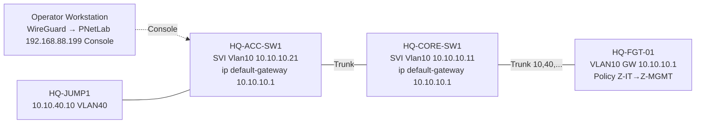

### ۱۴.۵.۷ استثنا: Lab A (Cisco Gateway)
در Lab A سوئیچ Core L3 است و مدیریتش با Loopback/SVI و Routing خودش انجام می‌شود؛ این مدل **با Capstone ترکیب نمی‌شود**.

### ۱۴.۵.۸ پاک‌سازی مبهم v2.0
`Lab OOB Mgmt 10.255.0.0/24` فقط برای **Labهای مستقل Cisco در W1–W8** (قبل از وجود FortiGate) رزرو است: Jump در همان VLAN L2 قرار می‌گیرد (بدون Gateway). در Capstone/FGT-Labs استفاده نمی‌شود و Gateway دومی ایجاد نمی‌کند.

# ۱۵. Cisco Routing & Switching Curriculum

> **Cisco در هر ۲۴ هفته حضور دارد** (Spiral، فصل ۲۸). جدول‌های این فصل نماینده فرمان‌ها هستند؛ هر فرمان تا Image Validation (فصل ۱۱.۲) روی IOSv/IOSvL2 `Unverified` است.

## ۱۵.۱ پایه و CLI (W1–W2)

| مبحث | پیش‌نیاز | مفهوم | دستورات کلیدی | Verification | سالم / خراب | Capture | معیار تسلط |
|---|---|---|---|---|---|---|---|
| OSI/TCP-IP عملی | — | Encapsulation واقعی در Wireshark | — | Capture یک ping | ping سالم / ARP بی‌پاسخ | ARP+ICMP | توضیح هر هدر در Capture |
| Ethernet/MAC/ARP | OSI | Frame، ARP Cache | `show mac address-table`, `show ip arp` | جدول ARP/MAC | ARP عادی / Duplicate IP | arp | توضیح مسیر L2 |
| IPv4/Subnet/VLSM | — | تقسیم‌بندی، Summarization | — | کار روی کاغذ+Lab | VLSM صحیح / Mask اشتباه | — | حل ۱۰ مسئله VLSM در ۲۰ دقیقه |
| IPv6 مقدماتی | IPv4 | Global/Link-Local، SLAAC، NDP | `ipv6 address`, `show ipv6 interface brief` | ping6 | سالم / نبود `ipv6 unicast-routing` | ICMPv6 NS/NA | ساخت طرح IPv6 |
| IOS CLI Modes | — | User/Priv/Global/Interface | `enable`, `configure terminal`, `interface`, `exit`, `end` | `show running-config` | — | — | جابه‌جایی سریع بدون خطا |
| مدیریت Config/File | CLI | Running vs Startup | `copy running-config startup-config`, `show startup-config`, `erase`, `reload`, `copy tftp`/`scp` | diff Config | Backup/Restore موفق / فراموشی save | — | Restore کامل از Backup |
| ابزار عیب‌یابی | CLI | Test و Evidence | `ping`, `traceroute`, `show ip interface brief`, `show interfaces`, `show logging`, `debug` (با احتیاط + `undebug all`) | خروجی ping/trace | — | — | استفاده بدون ایجاد Load/ریسک |
| امن‌سازی مدیریت | CLI | Password، SSH، AAA محلی، Banner | `enable secret`, `service password-encryption`, `username … secret`, `ip domain-name`, `crypto key generate rsa`, `ip ssh version 2`, `line vty 0 4`, `transport input ssh`, `login local`, `access-class`, `exec-timeout` | SSH از Linux/Windows | SSH سالم / Telnet فعال | SSH vs Telnet | حذف Telnet و محدودیت Source |

## ۱۵.۲ Switching (W3–W4)

| مبحث | پیش‌نیاز | مفهوم | دستورات کلیدی | Verification | سناریوی خراب | معیار تسلط |
|---|---|---|---|---|---|---|
| CAM/MAC Table | MAC/ARP | Learning/Flooding/Aging | `show mac address-table dynamic` | MAC در پورت درست | Flooding به‌دلیل MAC نشده | توضیح مسیر Frame |
| VLAN/Access | CAM | تفکیک L2 | `vlan 10`, `name`, `switchport mode access`, `switchport access vlan` | `show vlan brief` | VLAN اشتباه روی پورت | ساخت VLAN Matrix |
| Trunk/802.1Q | VLAN | Tag، Native، Allowed | `switchport trunk encapsulation dot1q` (در صورت نیاز)، `switchport mode trunk`, `switchport trunk native vlan`, `switchport trunk allowed vlan`, `switchport nonegotiate` | `show interfaces trunk` | Native Mismatch، Allowed حذف‌شده | رفع در <۵ دقیقه |
| Inter-VLAN: RoAS | Trunk | Sub-interface | `interface g0/0.10`, `encapsulation dot1Q 10`, `ip address` | ping بین VLAN | Encapsulation اشتباه | — |
| SVI / L3 Switch | VLAN | Gateway مجازی هر VLAN روی L3 Switch | `interface vlan 10`, `ip routing` | `show ip route`, `show ip interface brief` | SVI Down (بدون پورت UP در VLAN) | ping بین ۳ VLAN و توضیح شرط Up بودن SVI |
| STP/RSTP | VLAN/Trunk | Root، Port Roles، BPDU | `spanning-tree mode rapid-pvst`, `spanning-tree vlan 1 root primary`, `priority` | `show spanning-tree` | Root اشتباه، Loop | تعیین Root عمدی |
| PortFast/BPDU Guard | STP | Edge Port | `spanning-tree portfast`, `spanning-tree bpduguard enable`, `errdisable recovery` | `show spanning-tree summary` | Err-disable بعد از اتصال سوئیچ | — |
| EtherChannel | Trunk | LACP | `channel-group 1 mode active`, `interface port-channel 1` | `show etherchannel summary` | Mismatch (Mode/Speed/VLAN) | PAgP فقط مفهومی `Unverified` |
| Port Security | Access | MAC Limit | `switchport port-security`, `maximum`, `violation`, `mac-address sticky` | `show port-security interface` | Violation shutdown | — |
| DHCP Snooping / DAI | DHCP | Trusted/Untrusted | `ip dhcp snooping`, `ip dhcp snooping vlan`, `ip dhcp snooping trust`, `ip arp inspection vlan`, `ip arp inspection trust` | `show ip dhcp snooping binding` | Rogue DHCP در Lab `Unverified` پشتیبانی IOSvL2 | — |
| طراحی 3-Tier | همه | Access/Distribution/Core، Collapsed Core | — | HLD | — | توجیه Collapsed Core برای شعبه |

## ۱۵.۳ Routing (W5–W6)

| مبحث | مفهوم | دستورات کلیدی | Verification | سناریوی خراب | معیار تسلط |
|---|---|---|---|---|---|
| Routing Table / LPM | کدام Route انتخاب می‌شود | `show ip route`, `show ip route <net>` | توضیح AD/Metric/Prefix | Route بهتر اشتباه | پیش‌بینی مسیر بدون Lab |
| Static/Default/Floating | AD، Backup Path | `ip route`, `ip route 0.0.0.0 0.0.0.0`, `ip route … 200` | Failover با قطع لینک | مسیر برگشت نبود | Return-path Thinking |
| OSPFv2 | LSA، SPF، DR/BDR | `router ospf 1`, `network … area`, `passive-interface`, `ip ospf cost`, `default-information originate` | `show ip ospf neighbor`, `show ip ospf interface brief`, `show ip route ospf` | Hello/Dead/MTU/Area/Auth Mismatch | رفع ۵ نوع عدم تشکیل Adjacency |
| OSPF Multi-Area | ABR، Summarization | `area x range`, `area x stub` | LSDB | Virtual-link (مفهومی) | طراحی ۲ Area |
| OSPFv3 / IPv6 Routing | Address-Family | `ipv6 router ospf`, `ipv6 ospf 1 area 0` | `show ipv6 ospf neighbor` | — | — |
| HSRP/VRRP | Gateway Redundancy | `standby 1 ip`, `standby 1 priority`, `preempt` (`Unverified` در IOSv/IOSvL2 تأیید شود) | `show standby brief` | Active دوگانه | Failover کمتر از ۵ ثانیه |
| Troubleshooting Routing | مسیر رفت/برگشت | `show ip route`, `traceroute`, `debug ip ospf adj` (با احتیاط) | | Asymmetric | روش سیستماتیک |

## ۱۵.۴ IP Services (W7)

| مبحث | دستورات کلیدی | Verification | خراب |
|---|---|---|---|
| DHCP + Relay | `ip dhcp pool`, `ip dhcp excluded-address`, `ip helper-address` | `show ip dhcp binding` | Relay فراموش‌شده |
| DNS | `ip name-server`, `ip domain lookup` | `nslookup` از Client | DNS غلط |
| NTP | `ntp server`, `clock timezone` | `show ntp associations` | اختلاف ساعت → Log بی‌ارزش |
| NAT/PAT | `ip nat inside/outside`, `ip nat inside source list … overload` | `show ip nat translations` | NAT دوگانه |
| ACL استاندارد/Extended | `ip access-list extended`, `permit/deny`, `ip access-group` | `show access-lists` (Hit Count) | ترتیب اشتباه، Implicit Deny |
| Syslog | `logging host`, `logging trap`, `service timestamps` | دریافت در rsyslog | عدم دریافت |
| SNMP | `snmp-server group/user` (v2c فقط Lab؛ v3 `Unverified` سینتکس تأیید شود) | Zabbix Poll موفق | Community لو رفته |
| QoS مقدماتی | Class-map/Policy-map (مفهومی + یک Lab ساده) | `show policy-map interface` | — |

## ۱۵.۵ Automation و مدیریت (W8)

| مبحث | محتوا | Lab | معیار |
|---|---|---|---|
| JSON/YAML/REST | ساختار، `curl`، Postman | فراخوانی API یک سرویس Lab | خواندن JSON |
| Python برای ادمین | `netmiko` برای `show` و Backup | اسکریپت Backup همه سوئیچ‌ها | اجرای ایمن (فقط read) |
| Ansible (مقدماتی) | Inventory/Playbook ساده (`ios_command`, `ios_config`) | استقرار Banner/NTP روی ۵ دستگاه | Idempotency |
| Git | commit/diff/branch برای Config | Versioning Configها | مشاهده تغییر با `git diff` |
| دستی vs خودکار | مقایسه ریسک/سرعت | گزارش یک‌صفحه‌ای | قضاوت مستدل |

---

# ۱۶. FortiGate 7.0.3 Curriculum

> نسخه هدف **FortiOS 7.0.3** (بدون اجازه کاربر تغییر نمی‌کند). این نسخه قدیمی است و فقط در Lab ایزوله؛ استفاده آموزشی ≠ توصیه Production (فصل ۱۶.۹).

## ۱۶.۱ Fundamentals & Administration (W9)

| مبحث | مفهوم | CLI/GUI | Verification | خراب | معیار تسلط |
|---|---|---|---|---|---|
| معماری | Kernel/Proxy-Flow، Packet Flow Ingress→Egress | `diagnose debug flow` | توضیح مسیر | — | رسم Packet Flow |
| Interface | Physical/VLAN/Aggregate/Loopback | `config system interface` / Network>Interfaces | `get system interface` | Role/Allowaccess اشتباه | VLAN Sub-interface روی Trunk |
| Management Access | HTTPS/SSH/PING Allowaccess، Trusted Hosts، Admin Port | `set allowaccess`, `set trusthost1` | دسترسی از Mgmt VLAN | قفل شدن از GUI | **Backup قبل از تغییر** |
| Routing/Static/Policy Route | RPF، ECMP، Distance/Priority | `config router static`, `config router policy` | `get router info routing-table all` | Route غلط | — |
| Zone/Address/Service | Object Model | `config firewall address/addrgrp/service` | — | Object اشتباه | Naming استاندارد |
| Admin/RBAC | Profile، 2FA (مشروط)، Trusted Host | `config system accprofile`, `config system admin` | Login محدود | Admin بدون Trusthost | Least Privilege |
| Backup/Restore/Firmware | Config Backup، Revision، Firmware Upgrade Path | `execute backup config …`, GUI | Restore در VM جدید | Upgrade بدون Backup | `Unverified` مسیر Upgrade طبق Release Notes |

## ۱۶.۲ Firewall Policy & NAT (W10)

| مبحث | مفهوم | Verification | خراب |
|---|---|---|---|
| Policy Evaluation | Top-Down، First Match، Implicit Deny | `diagnose firewall iprope lookup`, Hit Count | Shadow Policy |
| Policy Elements | Interface/Source/Dest/Service/Schedule/Action/Log | Log در Forward Traffic | Log Disabled |
| NAT (Policy NAT) vs Central NAT | تفاوت، محدودیت، انتخاب | `diagnose sys session list` | NAT اشتباه |
| IP Pool | Overload، One-to-One، Fixed Port Block | NAT IP در Capture | Pool مصرف‌شده |
| VIP/Port Forward | DNAT + Policy | از Client خارجی تست | VIP بدون Policy |
| Hairpin NAT | داخلی به VIP | تست از LAN | Reply مستقیم |
| Session Table | State، Timeout، Clear | `diagnose sys session filter …` | Session exhaustion |
| Policy Troubleshooting | روش ۶ مرحله‌ای | `diagnose debug flow` | — |

## ۱۶.۳ Security Profiles (W11)

| Feature | وابستگی | راه‌حل آموزشی در صورت نبود لایسنس FortiGuard `Unverified` 🔎 |
|---|---|---|
| Antivirus | FortiGuard AV | تست با EICAR + Local Signature محدود؛ توضیح مفهومی Engine/Proxy-vs-Flow |
| IPS | FortiGuard IPS | Custom IPS Signature محلی + Log؛ DoS Policy (محلی) |
| Web Filter | FortiGuard Rating | Static URL Filter + FQDN/Wildcard + Web Rating Override |
| DNS Filter | FortiGuard | Static Domain Filter + Local DNS Sinkhole |
| Application Control | FortiGuard App DB | بسته به DB موجود در VM؛ در صورت نبود → Port-based + مفهوم |
| File Filter | بدون FortiGuard (بسیاری موارد) | آزمایش با نوع فایل |
| SSL/SSH Inspection | CA/Certificate | Certificate-Inspection در برابر Deep-Inspection؛ Import CA به Windows Client از Windows CA |
| Logging/Analysis | — | Log Traffic/UTM در FortiGate محلی |

> **نکته مهم:** درس شامل «چرا Deep Inspection مشکل ایجاد می‌کند»: Pinning، Mobile Apps، Trust Store، Performance، حریم خصوصی/قانون.

## ۱۶.۴ Authentication (W12)

| مبحث | Lab | Verification | خراب |
|---|---|---|---|
| Local User/Group | Policy با User Group | `diagnose firewall auth list` | Group اشتباه |
| LDAP/AD | Bind DN، Base DN، LDAPS (CA) | `diagnose test authserver ldap` | Bind Fail، Cert Trust |
| RADIUS/NPS | Shared Secret، Attributes، Network Policy | `diagnose test authserver radius …` | Secret Mismatch/Client ثبت نشده |
| FSSO | Collector Agent (Windows) — `Unverified` دسترسی دانلود | `diagnose debug authd fsso list` | Collector/Port/Group |
| Captive Portal | Guest/User | تست مرورگر | Redirect/HTTPS |
| Authentication Policy | Identity-based Policy | Log User | Fallback |
| Certificate Auth | در صورت پشتیبانی/زمان | — | Expiry/CRL |

## ۱۶.۵ VPN (W13–W14)

| مبحث | Lab | Verification | خراب |
|---|---|---|---|
| IPsec Site-to-Site Route-Based | HQ↔BR1 با Cisco داخلی | `diagnose vpn tunnel list`, `get vpn ipsec tunnel summary` | Proposal Mismatch، PSK، Selectors |
| Policy-Based در برابر Route-Based | مقایسه نظری + Lab ساده | — | — |
| Phase 1/2، IKEv1/v2، Proposal | Hands-on | `diagnose debug application ike -1` (با احتیاط) | Mismatch |
| Routing/Policy برای VPN | Static/OSPF روی Tunnel | `get router info routing-table` | Tunnel UP ولی Traffic Block |
| NAT-T / DPD | WAN پشت NAT | Capture UDP 500/4500 | NAT-T غیرفعال |
| Remote Access | **SSL VPN (7.0.3)** — Web/Tunnel mode؛ `Unverified` نیاز FortiClient، محدودیت‌ها، **آسیب‌پذیری‌های شناخته‌شده در این نسخه → فقط Lab**؛ Dial-up IPsec (جایگزین) | اتصال از Windows Client | Cert، Split-Tunnel، Routing |
| Multi-Site / Backup Path | Hub-Spoke، Dual Tunnel | Failover | — |

## ۱۶.۶ Advanced (W15–W16)

| مبحث | Lab | Verification | وابستگی/محدودیت |
|---|---|---|---|
| SD-WAN | Members، Health-Check (Performance SLA)، Rule | `diagnose sys sdwan …` `Unverified` مسیر دقیق CLI 7.0.3 | تفاوت GUI نسخه‌ها |
| Link Monitor / Failover | Dual-WAN | Failover ≤ هدف | — |
| HA Active-Passive | FGCP، Heartbeat، Monitor Interface، Session Pickup | `get system ha status` | `Unverified` لایسنس Eval/HA در VM 🔎 |
| VDOM | فقط مفهومی ([OPT] عملی) | — | `Unverified` تعداد VDOM در VM Eval |
| OSPF/BGP | Interop با Cisco | `get router info ospf neighbor` | `Unverified` Feature set |
| DoS Policy | Anomaly Threshold در Lab | Log | — |
| FortiView/Logging | تحلیل Log | — | `Unverified` ممکن است محدود |

## ۱۶.۷ مدیریت متمرکز (W16 — مشروط)

| محصول | Lab ایده‌آل | محدودیت | جایگزین آموزشی |
|---|---|---|---|
| FortiManager | Device Manager، Policy Package، Install | `Unverified` منابع (VM سنگین)، لایسنس Eval، سازگاری نسخه با 7.0.3 | **مفهومی + Demo/مستند رسمی** + مدیریت تغییر با Git+CLI |
| FortiAnalyzer | Log Collection، Event/Report | `Unverified` منابع/لایسنس | rsyslog + Zabbix + FortiGate Local Log |

🔎 `Unverified` (Discovery) اگر RAM/لایسنس نبود، این بخش «مفهومی + حداقل Lab» می‌شود، نه «حذف».

---


## ۱۶.۸ Feature / Licensing / Dependency Matrix (FortiOS 7.0.3 — FortiGate-VM)

## ۱۶.۸ Feature / Licensing / Dependency Matrix (FortiOS 7.0.3 — FortiGate-VM)

> **اصل:** «وجود فرمان CLI» یا «وجود منو در GUI» **برابر با حق استفاده از سرویس کامل نیست.** هر ردیف جدا می‌کند: پشتیبانی نسخه، پشتیبانی Image VM، نیاز لایسنس/Entitlement. هیچ قابلیت محدود/شبیه‌سازی‌شده «معادل» سرویس لایسنس‌دار تولیدی معرفی نشده است. **منبع رسمی نسخه 7.0.3 برای اکثر ردیف‌ها در این بازبینی به‌صورت متن کامل بررسی نشد؛ جز مواردی که در فصل ۳۴ `Verified` است، همه `Unverified` هستند.**

**دسته‌بندی وضعیت هر ستون:** `Documented-7.0.3` (در مستند همان نسخه) · `Image-Verified` (در Image Validation آزمایش شد) · `Needs-License` · `Needs-Entitlement` · `Not-Supported-in-Env` · `Unverified`.

| Feature | هدف آموزشی | پشتیبانی نسخه 7.0.3 | پشتیبانی Image VM انتخابی | لایسنس/Subscription | Entitlement ویژه | محدودیت/عدم‌پشتیبانی محیط | روش بررسی | وضعیت کلی | جایگزین آموزشی (≠ معادل کامل) |
|---|---|---|---|---|---|---|---|---|---|
| Policy/NAT/VIP | هسته | `Unverified` | `Unverified` | بدون Subscription (فرض) | — | سقف Interface/Policy؟ | IV-5 | `Unverified` | — |
| Routing Static/OSPF/BGP | Interop | `Unverified` | `Unverified` | بدون Subscription (فرض) | — | — | IV-5 | `Unverified` | — |
| Antivirus (FortiGuard) | AV Profile | `Unverified` (وجود Profile) | `Unverified` | **Needs-License** (FortiGuard AV) | FortiCare/FortiGuard | Update/DB واقعی احتمالاً در Eval/ایزوله **ناموجود** | تست EICAR + وضعیت DB | `Unverified` | مفهومی+EICAR؛ **بدون DB واقعی/به‌روز** |
| IPS (FortiGuard) | IPS Profile | `Unverified` | `Unverified` | **Needs-License** | FortiGuard IPS | همان | Signature/Log | `Unverified` | Custom IPS محلی؛ پوشش محدود |
| Web Filter | Filtering | `Unverified` | `Unverified` | **Needs-License** (Rating) | FortiGuard Web | Rating نیازمند اینترنت | تست Category | `Unverified` | Static URL/FQDN؛ بدون Category |
| DNS Filter | آموزش | `Unverified` | `Unverified` | **Needs-License** | FortiGuard | همان | تست | `Unverified` | Static Domain Filter |
| Application Control | آموزش | `Unverified` | `Unverified` | **Needs-License** (App DB به‌روز) | FortiGuard | DB داخلی/Update؟ | تست | `Unverified` | Port-based + مفهومی |
| SSL/SSH Inspection | CA/Trust | `Unverified` | `Unverified` | بدون Subscription (فرض) | — | Performance | IV-5 | `Unverified` | — |
| SSL VPN (Web/Tunnel) | RA-VPN | `Unverified` (وجود Mode ها) | `Unverified` | بدون Subscription (فرض)؛ Tunnel نیاز FortiClient | — | **آسیب‌پذیری‌های Verified در 7.0.3** (CVE-2022-42475، 2023-27997) → فقط Lab ایزوله | اتصال Client | وجود Feature `Unverified`؛ ریسک `Verified` | Dial-up IPsec (پروتکل/کلاینت متفاوت) |
| IPsec S2S/Dial-up | VPN | `Unverified` | `Unverified` | بدون Subscription (فرض) | — | — | IV-5 | `Unverified` | — |
| SD-WAN | WAN | `Unverified` (مستند 7.0.1 در جستجو؛ بررسی نشد) | `Unverified` | بدون Subscription (فرض) | — | — | IV-5 (`diagnose sys sdwan …`) | `Unverified` | Static+Link-Monitor |
| HA (FGCP) | افزونگی | `Unverified` | `Unverified` | **لایسنس هر Node** | — | **ممکن است در Eval محدود/ممنوع** | `config system ha` | `Unverified` | Tabletop؛ **بدون Failover واقعی** |
| VDOM | Multi-Tenancy | `Unverified` | `Unverified` | تعداد پیش‌فرض/لایسنس | — | سقف VDOM در Eval | مشاهده | `Unverified` | مفهومی [OPT] |
| FortiView/Log محلی | تحلیل | `Unverified` | `Unverified` | Log محلی؛ FAZ=لایسنس | — | Disk کوچک VM | IV-5 | `Unverified` | rsyslog+Zabbix |
| FortiManager | مدیریت | `Unverified` | `Unverified` | **Needs-License** | — | منابع/سازگاری | Registration | `Unverified` | مفهومی/Demo مستند |
| FortiAnalyzer | لاگ | `Unverified` | `Unverified` | **Needs-License** | — | منابع | Registration | `Unverified` | rsyslog/Zabbix |

**درباره Evaluation FortiGate-VM:** مستند «Permanent trial» برای نسخه‌های جدیدتر (از 7.2.1، طبق خلاصه جستجو) گزارش شده و **احتمالاً برای 7.0.3 صدق نمی‌کند**؛ محدودیت‌های Evaluation نسخه 7.0.3 (مدت، vCPU/RAM، Interface، HA، FortiGuard) `Unverified` است و باید از مستند رسمی FortiGate-VM همان نسخه و Image Validation تأیید شود. **هیچ عدد قطعی ثبت نشد.**

## ۱۶.۹ Lifecycle، Patch و Vulnerability Management (مبحث عملیاتی)

- **چرا 7.0.3 فقط در Lab:** `Verified`: CVE-2022-40684 (7.0.0–7.0.6)، CVE-2022-42475 (7.0.0–7.0.8)، CVE-2023-27997 (7.0.0–7.0.11) — فصل ۳۴.
- **Lab ایزوله:** هیچ مدیریتی/SSL-VPN/Port Forward از اینترنت؛ Management فقط از Jump/Mgmt-VLAN.
- **درس W9/W19 (Lifecycle):** (۱) Inventory نسخه‌ها؛ (۲) PSIRT Subscription؛ (۳) Risk-Rating؛ (۴) مسیر ارتقا طبق Release Notes (`Unverified` مسیر دقیق 7.0.3→بالاتر)؛ (۵) Backup قبل از Upgrade؛ (۶) Test Plan + Rollback Firmware؛ (۷) Post-Upgrade Verification.
- **آموزش ≠ توصیه Production:** هنرجو یاد می‌گیرد «چه نسخه‌ای را نباید Production کرد و چرا».
- **Lab Exercise:** مقایسه Advisory ها با نسخه Lab و تهیه «Vulnerability Assessment Memo» یک‌صفحه‌ای.

# ۱۷. Cisco + FortiGate Integration

## ۱۷.۱ اصل طراحی

دو فناوری یک معماری واحدند. **در هر توپولوژی مالک Gateway و نقطه اجرای Policy باید صریح باشد.** برای حذف ابهام، دو الگو جدا تعریف می‌شود (۱۷.۲).

## ۱۷.۲ دو الگوی Gateway — تصمیم آموزشی و حدود مالکیت

> **هر توپولوژی دقیقاً یک الگو دارد.** ترکیب مبهم ممنوع. **الگوی اصلی Capstone = الگوی B (FortiGate Gateway)**؛ الگوی A به‌صورت **Lab مستقل** (Lab A) آموزش داده می‌شود. تفاوت‌ها:

| جنبه | **Lab A:** Cisco L3 Core = Gateway، FGT = Perimeter | **Lab B / Capstone:** FGT = Gateway همه VLANها، Cisco = L2 |
|---|---|---|
| Default Gateway هر VLAN | SVI روی Core (HSRP در Lab A-HA) | VLAN Sub-interface روی FGT |
| Inter-VLAN Routing | Core (L3 Switch) | FGT |
| FGT کجاست؟ | بین Core و ISP؛ Transit /30 یا VLAN Transit | مرکز شبکه، Trunk به Core/Access |
| Policy بین VLANها | **Cisco ACL (Stateless)** | **FGT Policy (Stateful، UTM، Identity، Log)** |
| Policy Internet/DMZ | FGT | FGT |
| Routing Cisco↔FGT | Static یا OSPF (Core↔FGT) | Static/Default روی FGT؛ Cisco فقط Mgmt Default |
| NAT/VIP | FGT (مالک) | FGT (مالک) |
| Return Path | باید روی Core به FGT برای Default و روی FGT Route شبکه‌های داخلی | ساده (تک‌Hop) |
| Asymmetric Risk | بالاتر (Dual Core/Dual WAN) | پایین‌تر (تنها در Dual-WAN/HA/VPN) |
| Troubleshooting | Cisco + FGT هر دو | بیشتر در FGT (Debug Flow) |
| مزیت | مهارت L3 Cisco عمیق، مقیاس‌پذیر، رایج در Campus | Policy/Logging واحد، Segmentation ساده، Capstone امن‌تر |
| محدودیت | East-West بدون Inspection | بار روی FGT، Single Choke Point |
| امنیت | ACL Stateless؛ ریسک Policy گسترده | Least Privilege قوی‌تر |

**توجیه انتخاب B برای Capstone:** (۱) هدف دوره «زیرساخت شبکه و **امنیت** سازمانی» و Policy Matrix بین VLANها است؛ (۲) نقطه اجرای Policy و Log یکی است؛ (۳) Asymmetric Routing کمتر؛ (۴) عیب‌یابی با Debug Flow یکنواخت؛ (۵) مهارت L3 Cisco در Lab A و در Cisco ISP/WAN-Sim و در Spiral حفظ می‌شود (فصل ۲۸).

### ۱۷.۲.۱ Lab A — Cisco L3 Core Gateway + FortiGate Perimeter (W6/W10/W16؛ مستقل از Capstone)

| بخش | شرح |
|---|---|
| هدف یادگیری | SVI/Inter-VLAN، OSPF با FGT، HSRP، ACL، تفاوت Stateless/Stateful، Return Path |
| توپولوژی | VLAN10/20/50 → Access → `LabA-CORE-SW1/2` (SVI + HSRP) → روتد P2P `/30` → `LabA-FGT-01` → ISP-Sim |
| Gateway هر VLAN | **Cisco Core (HSRP Virtual IP `.254`)** |
| Policy | East-West: ACL روی SVI؛ North-South و DMZ: FGT |
| Packet Flow | Client→Access→Core(SVI)→(Route)→FGT→NAT→ISP؛ بازگشت: ISP→FGT→Core (Route داخلی روی FGT) |
| Return Path | FGT Static/OSPF به Subnetهای VLAN از طریق Core؛ Core Default به FGT |
| ملاحظات امنیتی | ACL بین VLANها، Mgmt Plane، FGT Policy Internet |
| سناریوهای TS | TS09، TS15–TS16، TS17–TS20، TS21، TS23 |
| محدودیت | East-West بدون UTM؛ Image: SVI/HSRP نیازمند تأیید IV-3 |

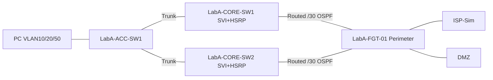

### ۱۷.۲.۲ Lab B — FortiGate Gateway + Cisco Access/Switching (W10، معماری اصلی Capstone)

| بخش | شرح |
|---|---|
| هدف یادگیری | VLAN Sub-interface روی FGT، Zone/Policy، Segmentation، Debug Flow، Log |
| توپولوژی | VLANها → Access (L2) → Core (L2) → Trunk (یا LACP، `Unverified`) → `HQ-FGT-01` → ISP-Sim |
| Gateway هر VLAN | **FortiGate** |
| Policy | همه East-West و North-South در FGT |
| Packet Flow | Client→Access→Core→FGT Sub-if (Policy+UTM)→(Route)→ مقصد؛ بین دو VLAN: ورود/خروج از **همان** Trunk با Hairpin (VLAN تگ متفاوت) |
| Return Path | یک Hop L3 → متقارن |
| ملاحظات امنیتی | Trunk Allowed محدود، Native=99، DHCP Snooping/DAI در Cisco |
| TS | TS03–TS05، TS24، TS26، TS27، TS28 |
| محدودیت | Single Choke Point؛ ظرفیت Throughput VM |

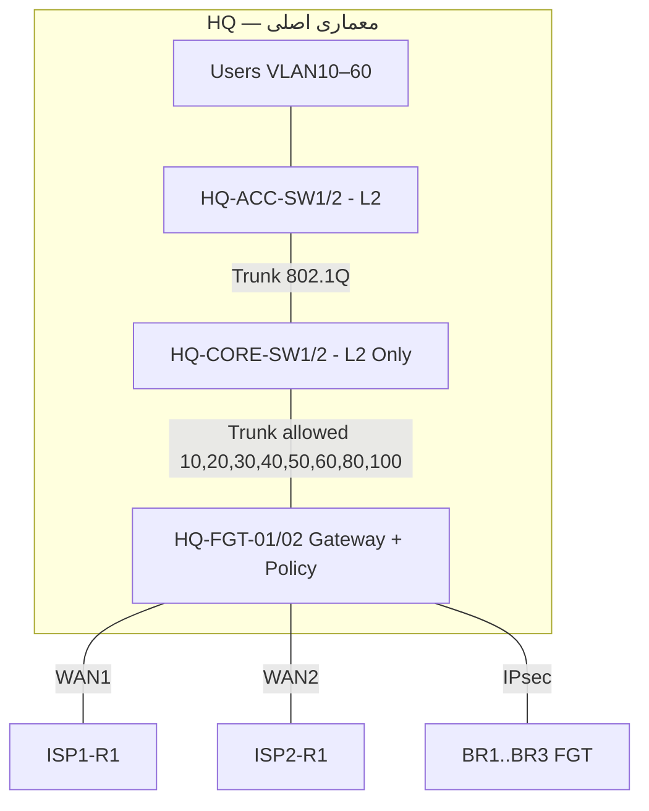

### ۱۷.۲.۳ Packet Flow معماری اصلی

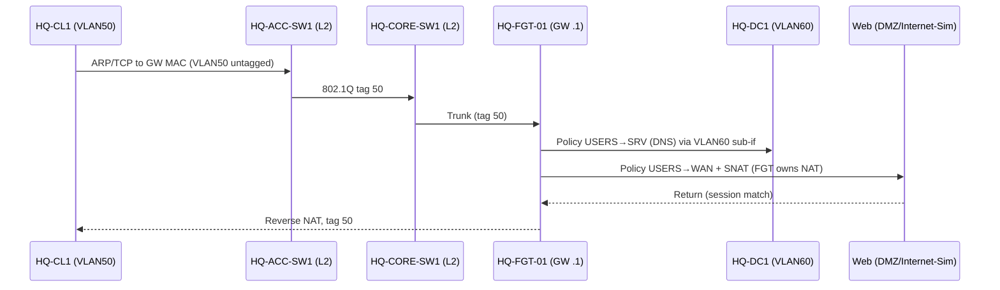

## ۱۷.۳ نقش‌ها بر حسب لایه (Capstone)

| لایه | Cisco | FortiGate |
|---|---|---|
| Access (L2) | VLAN، Port-Security، Snooping/DAI، STP | — |
| Core (L2) | Trunk/EtherChannel، STP Root | — |
| L3 + Gateway + Policy | — (Mgmt SVI فقط) | **همه** |
| WAN/ISP-Sim | **Cisco Router: OSPF/Static/IP SLA، ACL** | SD-WAN/Policy |
| NAT | — | **مالک NAT/VIP** |

## ۱۷.۴ ۱۵ سناریوی الزامی (با تعیین الگو)

> برچسب الگو: **[A]** Cisco Gateway، **[B]** FGT Gateway، **[N/A]** مستقل از Gateway. در هر سناریو مالک Gateway و نقطه Policy مشخص است.

| # | سناریو | الگو | مالک Gateway / نقطه Policy | نقش Cisco | نقش FGT | مسیر Packet کلیدی | تست | خرابی نمونه | هفته |
|---|---|---|---|---|---|---|---|---|---|
| S1 | Access Switch + FGT Gateway | **B** | FGT / FGT | L2 Access/Trunk | Gateway VLANها | PC→Access→Trunk→FGT→Policy→WAN | Policy Hit | TS04 | W10 |
| S2 | L3 Switch Inter-VLAN + FGT Internet GW | **A** | Core / ACL (E-W) + FGT (N-S) | SVI + Default به FGT | Internet GW + NAT | PC→SVI→/30→FGT→NAT→ISP | Internet-Sim | TS16 | W10 |
| S3 | Router-on-a-Stick + Policy | **A (Router GW)** | Cisco Router / ACL + FGT | RoAS | Perimeter Policy | PC→RoAS→FGT→ISP | Allow/Deny | TS03 | W10 |
| S4 | VLAN Trunk Switch↔FGT | **B** | FGT / FGT | Trunk | VLAN Interface | Tag روی لینک | Sniffer | TS05 | W10 |
| S5 | Route-Based IPsec بین ۲ سایت | N/A | FGT هر سایت | L2 داخل/ISP-Sim | VTI | HQ→Tunnel→BR | Capture ESP | TS33–TS34 | W13 |
| S6 | OSPF Cisco↔FGT | **A** | Core / — | OSPF Core | OSPF Neighbor | Route Exchange | Table | TS17–TS18 | W15 |
| S7 | Static Routing + Return Path | N/A | هر دو | Static | Static | رفت/برگشت | traceroute | TS15–TS16 | W5/W10 |
| S8 | ACL Cisco در برابر Policy FGT | A+B مقایسه | — | ACL | Policy | — | Hit Count | TS21، TS24 | W10 |
| S9 | NAT Cisco در برابر FGT (Double NAT) | N/A | FGT=مالک NAT | NAT (مقایسه فقط) | NAT | Capture Pre/Post | تک‌NAT | TS23 | W10 |
| S10 | Dual WAN + Failover | N/A | FGT | ISP-Sim×2 + IP SLA | SD-WAN/Link-Monitor | Failover | قطع ISP1 | TS43 | W15 |
| S11 | HA FGT + Switch Redundancy | **B** | FGT Cluster | Dual Switch + EC/STP | FGCP | Failover Session | قطع Primary | TS44 | W16 |
| S12 | DMZ و تفکیک سرور | **B** | FGT | VLAN 100 Trunk | DMZ + VIP | Internet→VIP→Web | تست خارجی | TS27 | W11 |
| S13 | Authentication با AD | N/A | FGT | — | LDAP/NPS/FSSO | User→FGT→AD | Log User | TS37–TS40 | W12 |
| S14 | Centralized Logging/Monitoring | N/A | — | Syslog/SNMP | Syslog/SNMP | Log→rsyslog→Zabbix | Dashboard | TS45–TS47 | W17 |
| S15 | Packet Flow End-to-End | **B** | FGT | همه | همه | Capture ۵ نقطه | PA18 | TS50 | W18 |

### ۱۷.۴.۱ نمودارهای Archetype (B: IPsec و C: HA/Dual WAN)

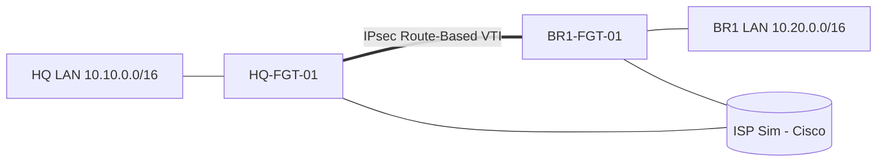

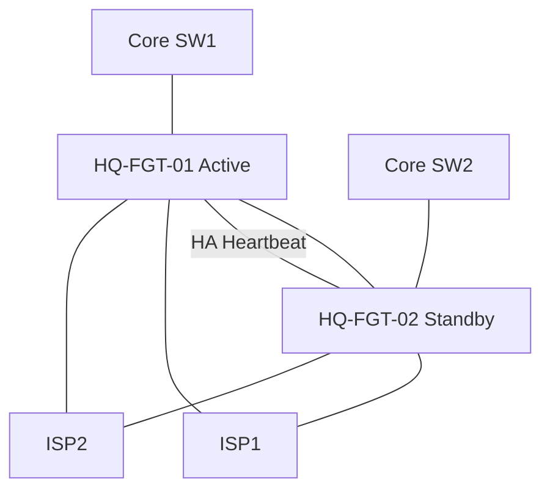

> **قانون Capture:** در S15 در ۵ نقطه Capture گرفته می‌شود: NIC Client، Access→Core، Core→FGT، FGT WAN، Server.

# ۱۸. Windows Server، AD، DNS، DHCP و RADIUS

## ۱۸.۱ نگاشت VM ← سناریو

| VM | چرا لازم است | منابع پیشنهادی `Unverified` | محل نصب | اتصال | هفته |
|---|---|---|---|---|---|
| Win Server 2022 (DC1) | AD DS، DNS، DHCP، NPS، PKI | 2 vCPU / 4 GB / 60 GB | (الف) QEMU در PNetLab یا (ب) ESXi — فصل ۱۰.۲ | VLAN Servers | W4، W12 |
| Win Server 2022 (SRV2 optional) | CA/NPS جدا یا Collector | 2 / 2–4 / 40 | همانند بالا | Servers | W12 |
| Win Client 10/11 (CL1,CL2) | Domain Join، Policy Test، Capture | 2 / 4 / 50 | همانند بالا | Users VLAN | W12–W22 |
| Ubuntu/Debian Server (WEB-DMZ) | Web Server DMZ | 1 / 1 / 15 | همانند بالا | DMZ | W11 |
| Linux (SYSLOG/MON) | rsyslog + Zabbix | 2 / 4 / 60 | همانند بالا | Mgmt/Servers | W17 |
| Linux Tools (KALI-LITE/utility) | Nmap/tcpdump در Lab | 1 / 2 / 20 | همانند بالا | Test VLAN | W19 |

> Win11 نیازمند TPM/Secure Boot است؛ پیشنهاد: Windows 10 Eval یا پیکربندی VM مطابق مستند مایکروسافت `Unverified`.

## ۱۸.۲ Windows Server — محتوا (فقط آنچه شبکه نیاز دارد)

| مبحث | Lab | تست/Verification |
|---|---|---|
| نصب VM و تنظیم IP/DNS | Static IP، Hostname | `ipconfig /all`, `Test-NetConnection` |
| DNS/DHCP | Scope، Reservation، Option 003/006 | `ipconfig /renew`، Capture DORA |
| AD DS | Forest/Domain، OU، Users/Groups | `dcdiag`, `nltest` |
| Domain Join | Client به Domain | Login دامنه‌ای |
| GPO (حد نیاز) | Windows Firewall، CA Trust Distribution | `gpresult /r` |
| LDAP/LDAPS | Bind Account، Certificate | `ldp.exe` / FortiGate test |
| NPS/RADIUS | Client (FortiGate)، Network Policy | Event Viewer (۶۲۷۲/۶۲۷۳) |
| AD CS / PKI | Root/Issuing CA (Lab: Enterprise Root تک‌لایه) | Cert Template، توزیع CA |
| Windows Firewall | Rule مدیریتی | Block/Allow تست |
| Event Viewer / Logging | Security Log، Forward (Optional) | Event ID 4624/4625 |

## ۱۸.۳ Windows Client

نصب، IP/DNS، Domain Join، تست Policy، ابزارها (`ping`, `tracert`, `pathping`, `nslookup`, `netstat`, `Test-NetConnection`)، Wireshark، FortiClient (VPN)، تست Auth.

# ۱۹. Linux و سرویس‌های زیرساختی

## ۱۹.۱ Linux — محتوا

| مبحث | Lab |
|---|---|
| نصب و Netplan/NetworkManager | Static IP/VLAN Sub-if |
| Routing/DNS | `ip route`, `systemd-resolved`/`bind9` اختیاری |
| SSH | Key-based، `sshd_config` Hardening |
| Web DMZ | nginx/apache + TLS |
| Linux Firewall | `nftables`/`ufw` |
| Syslog | `rsyslog` Receiver (UDP/TCP 514) + Filtering |
| ابزار | `ping`, `traceroute`, `curl`, `dig`, `ss`, `tcpdump`, `mtr` |

---

# ۲۰. VPN، Branch Connectivity و SD-WAN

> جزئیات Curriculum در فصل ۱۶.۵–۱۶.۶ است؛ این فصل **طراحی Branch و WAN** را برای Capstone تعریف می‌کند. همه Featureها تا Image Validation `Unverified` هستند.

## ۲۰.۱ مدل اتصال شعب (Hub-and-Spoke)

| سایت | نقش | WAN | Underlay | Overlay | مسیر داخلی |
|---|---|---|---|---|---|
| HQ | Hub | ISP1 (`203.0.113.0/24` Sim) + ISP2 (`198.51.100.0/24` Sim) | ISP-Sim Cisco | IPsec VTI به هر Branch | Static/OSPF روی VTI |
| BR1 | Spoke | ISP1 | ISP-Sim | VTI → HQ | Local VLAN 10/50/60/80 |
| BR2 | Spoke | ISP1 (+ISP2 اختیاری) | ISP-Sim | VTI → HQ | VLAN 10/50/80 |
| BR3 | Spoke | ISP2 | ISP-Sim | VTI → HQ | VLAN 10/50/80 |

> بین Branchها ترافیک از HQ (Hub) عبور می‌کند؛ Spoke-to-Spoke مستقیم **[OPT]**.

## ۲۰.۲ VPN Matrix (الگو)

| Tunnel | Peer A | Peer B | IKE | Phase1/2 | Selector | Routing | Policy |
|---|---|---|---|---|---|---|---|
| VPN-HQ-BR1-1 | HQ-FGT-01 WAN1 | BR1-FGT-01 WAN | IKEv2 (`Unverified` پشتیبانی) | AES256-SHA256 / DH ۱۴+ (نمونه؛ تأیید در Lab) | 0.0.0.0/0 (Route-Based) | OSPF/Static روی VTI | HQ↔BR1 Matrix |
| VPN-HQ-BR2-1 | همان | BR2-FGT-01 | همان | همان | همان | همان | همان |
| VPN-HQ-BR3-1 | همان | BR3-FGT-01 | همان | همان | همان | همان | همان |
| VPN-HQ-BR1-2 (Backup) | HQ WAN2 | BR1 | همان | همان | همان | Metric/Priority بالاتر | همان |

## ۲۰.۳ Remote Access

| مورد | طراحی |
|---|---|
| روش اول | Dial-up IPsec (FortiClient) — `Unverified` |
| روش دوم | SSL VPN (7.0.3) — **فقط Lab ایزوله به‌دلیل آسیب‌پذیری‌های Verified**؛ Web-mode/Tunnel-mode `Unverified` |
| Pool | `10.250.0.0/24` |
| Auth | AD/LDAP + MFA (در صورت امکان/لایسنس `Unverified`) |
| Policy | Least Privilege: فقط سرویس‌های مشخص |
| Return Route | Route Pool روی FGT؛ در Lab A روی Core |

## ۲۰.۴ SD-WAN Design

| مورد | طراحی |
|---|---|
| Members | WAN1، WAN2 (و تونل‌های VPN به‌عنوان Member **[OPT]**) |
| Health-Check | Target داخل ISP-Sim (ICMP/HTTP) با Threshold Latency/Loss |
| Rules | Business-Critical → Lowest-Latency؛ Default → Cost/Priority |
| Failover | زیر ۳۰ ثانیه هدف (`Unverified`) |
| ریسک Asymmetric | Return Route در ISP-Sim همسو؛ Sticky Session |
| Verification | `diagnose sys sdwan …` (`Unverified` سینتکس 7.0.3)، Capture |
| Fallback | Static + Link-Monitor |

# ۲۱. Security، Segmentation و DMZ

## ۲۱.۱ موضوعات و Labهای Blue Team (Lab ایزوله، دفاعی)

> **همه در Lab ایزوله؛ هدف دفاع و یادگیری. ممنوع: اسکن/حمله به شبکه واقعی، استفاده از ابزار مخرب.**

| موضوع | Lab | Verification |
|---|---|---|
| Segmentation | Zone×Zone Matrix | Test Allow/Deny |
| Least Privilege | RBAC FGT/Cisco/AD | Login محدود |
| Management Plane | SSH/HTTPS، Trusthost، Mgmt VLAN، Disable Telnet/HTTP | Port Scan داخلی Lab |
| ACL + Policy | Edge ACL + FGT | Hit Count |
| IPS/Profiles | Custom IPS (محلی) | Log |
| Web/App Control | Static URL | Log |
| DNS Security | DNS Filter (مشروط) | — |
| DMZ Hardening | Least Port، Linux `nftables`، TLS | `nmap` از Lab |
| VPN Security | Strong Proposal، MFA مشروط، DPD، Split-Tunnel ریسک | Capture |
| Certificate/TLS | CA، Expiry | — |
| Incident Investigation | از Log تا Timeline | Report |
| Port Scan Detection | `nmap` از VM Lab → Detect (IPS/Log/Zabbix) | Alert |
| Unwanted Service | `ss -tulpn`, `nmap` Inventory | لیست |
| Traffic Anomaly | Baseline | — |
| Hardening Baselines | Cisco/FGT checklist (مثلاً CIS/Vendor Guide `Unverified`) | Audit Score |
| Backup Protection | رمزگذاری Backup، دسترسی Git | — |
| **Patch/Firmware Management** | مطالعه موردی CVEهای FortiOS 7.0.x `Unverified` → چرا 7.0.3 Exposed ممنوع است | Policy |

---

## ۲۱.۲ مدل Zone و Segmentation (Capstone)

Zoneها: `Z-MGMT، Z-FIN، Z-HR، Z-IT، Z-USERS، Z-SRV، Z-GUEST، Z-DMZ، Z-WAN`؛ Matrix در فصل ۲۹.۵. اصول: Default-Deny بین Zoneها؛ Least Privilege؛ مدیریت فقط از Z-MGMT/Z-IT؛ DMZ بدون دسترسی آزاد به Z-SRV؛ Guest ایزوله؛ همه Policy با Log؛ Secure Management (SSH/HTTPS، Trusthost، MFA مشروط)؛ مدیریت Credential/Secret در Vault (نه Git).

# ۲۲. Monitoring، Logging و Alerting

## ۲۲.۱ مقایسه ابزارها و تصمیم

| ابزار | هزینه | منابع | پیچیدگی | محدودیت | مناسب Lab |
|---|---|---|---|---|---|
| **Zabbix** | رایگان | 2 vCPU/4 GB | متوسط | منحنی یادگیری Template | ✅ **اصلی** |
| **rsyslog (Central Syslog)** | رایگان | ناچیز | کم | UI ندارد | ✅ **اصلی (Syslog)** |
| LibreNMS | رایگان | 2/2–4 | کم (Auto-Discovery) | Syslog/Alert محدودتر از Zabbix | ✅ **جایگزین واحد** |
| PRTG | رایگان ≤۱۰۰ Sensor (`Unverified` تأیید) | Windows | کم | Windows-only | ❌ وارد نمی‌شود (تکراری) |
| FortiView | داخلی FGT | — | کم | محدود به FGT | ✅ بخشی از FGT |
| FortiAnalyzer | تجاری | `Unverified` سنگین | متوسط | لایسنس | مشروط |
| Wireshark | رایگان | — | — | — | ✅ تحلیل Packet |

**تصمیم ✅:** Stack = **Zabbix (SNMP/ICMP/Template) + rsyslog (Syslog Central) + FortiGate Local Log/FortiView + Wireshark**. جایگزین: LibreNMS. FAZ فقط در صورت امکان.

## ۲۲.۲ مباحث و ابزار

| موضوع | ابزار | Lab |
|---|---|---|
| SNMPv2c/v3 | Zabbix | v3 (authPriv) در مقابل v2c Risk |
| Syslog + NTP | rsyslog | Cisco/FGT/Windows/Linux → Central |
| Interface Util/Error | Zabbix | Graph + Alert |
| CPU/Memory | Zabbix | Threshold |
| Latency/Loss | Zabbix ICMP | Alert |
| Device Availability | Zabbix | Trigger |
| Link State/Error | SNMP Trap | Down Event |
| Routing Neighbor | Template/Script | OSPF Down |
| VPN Status | SNMP/Syslog FGT | Tunnel Down |
| Firewall Sessions | SNMP FGT | Session Count |
| Security Events | FGT Log → rsyslog | Failed Login |
| Retention/Backup | logrotate | ۹۰ روز |
| Baseline | Zabbix History | Anomaly |
| Correlation | rsyslog + Time | هم‌زمانی ۴ منبع |

## ۲۲.۳ سناریوهای مانیتورینگ (۱۰ مورد — L92)

قطع لینک · افزایش CPU · Interface Errors · قطع VPN · تغییر غیرمنتظره Routing · افزایش Drop · تلاش ورود ناموفق · افزایش Session · از دست رفتن Syslog · اختلاف ساعت.

---


## ۲۲.۴ Dashboardهای واقعی (W17)

| Dashboard | ویجت‌ها | منبع | مخاطب |
|---|---|---|---|
| Network Health | Up/Down دستگاه‌ها، Link State، Latency/Loss به Gateway/ISP | Zabbix ICMP/SNMP | NOC |
| Interface & Capacity | Utilization، Errors/Discards، Top Links | SNMP | شبکه |
| Firewall | Session Count، CPU/Mem FGT، Policy Deny Top، VPN Status | SNMP/Syslog FGT | امنیت |
| Security Events | Failed Login، Port-Scan Alert، Config Change | rsyslog | امنیت |
| Services | AD/DNS/DHCP/Web Availability (Port/HTTP Check) | Zabbix | IT |
| Time/Log Health | NTP Offset، Syslog Rate هر Source | Zabbix/rsyslog | عملیات |

## ۲۲.۵ طراحی Alert و Threshold

| اصل | قاعده |
|---|---|
| Severity | Info/Warning/Average/High/Disaster؛ فقط High+ تماس/Notification فوری |
| Threshold | مبتنی بر **Baseline** (Mean+Δ)، نه عدد حدسی؛ Hysteresis برای جلوگیری از Flap |
| Dependency | Trigger وابسته (Core Down ← خاموشی Alertهای پشت آن) |
| Time Window | شرط پایدار (مثلاً Loss>۵٪ برای ۵ دقیقه) |
| Owner/Runbook | هر Alert → Runbook (فصل ۳۳) |

### کاهش Noise (Alert Fatigue)
معیار: نسبت Alert Actionable ≥ ۸۰٪؛ Alertهایی که ۲ هفته بدون اقدام می‌مانند → حذف/اصلاح؛ Maintenance Window؛ Dedup؛ Review هفتگی (۳۰ دقیقه در روز R).

## ۲۲.۶ Syslog، SNMP و Flow Monitoring (در حد لازم)

| مبحث | حدود | Verified؟ |
|---|---|---|
| Syslog (UDP/TCP 514) | Cisco، FGT، Windows (Forwarder/NXLog **[OPT]**)، Linux | `Unverified` برای FGT 7.0.3 جزئیات |
| SNMP | v2c (فقط Lab)، v3 (authPriv) هدف | `Unverified` سینتکس |
| Flow (NetFlow/sFlow/IPFIX) | مفهومی + Lab اگر Image/FGT پشتیبانی کرد | `Unverified` |
| Capture | Wireshark/tcpdump برای تحقیق نقطه‌ای | — |

## ۲۲.۷ نگهداری و Rotation لاگ

| مورد | سیاست پیشنهادی (Lab) |
|---|---|
| Retention | ۹۰ روز قابل جستجو؛ Archive فشرده ۱۸۰ روز (Capacity-dependent) |
| Rotation | `logrotate` روزانه، فشرده‌سازی، حداکثر حجم |
| ظرفیت | محاسبه: Rate (MB/روز) × Retention؛ هشدار ۸۰٪ Disk |
| امنیت | دسترسی خواندنی محدود؛ Backup رمزگذاری‌شده |
| زمان | همه منابع با NTP (فصل ۲۲.۸) |

## ۲۲.۸ NTP و هم‌زمانی

| مورد | طراحی |
|---|---|
| منبع | NTP Server داخلی (`HQ-MON1` یا DC) |
| Clientها | همه Cisco/FGT/Windows/Linux |
| بررسی | Offset < ۱ ثانیه؛ Zabbix Item |
| Fault | TS46 |

## ۲۲.۹ Capacity Planning، Baseline و Health Check

| فعالیت | دوره | خروجی |
|---|---|---|
| Baseline عملکرد | هفته ۱۷ + بعد از Capstone | میانگین/پیک CPU، Session، Link Util |
| Capacity Report | ماهانه (Lab: هفتگی) | روند، پیش‌بینی ۳ ماه، Headroom |
| Health Check | روزانه/هفتگی | چک‌لیست: Backup، Log، Time، Disk، Cert Expiry، Firmware PSIRT |
| Review دوره‌ای | فصلی | Alert Tuning، Policy Review، Cert Review |

# ۲۳. Wireshark، tcpdump و Packet Analysis

## ۲۳.۱ ابزارها (فقط آنچه واقعاً قابل استفاده است)

| ابزار | محل | کاربرد | نکته |
|---|---|---|---|
| PNetLab Capture (Wireshark) | روی لینک بین Nodeها | Capture در Lab | ✅ ابزار اصلی |
| Wireshark (Windows Jump) | Jump | تحلیل `.pcap` | ✅ |
| tcpdump | Linux VM | سریع | ✅ |
| FortiGate Sniffer | `diagnose sniffer packet any '<filter>' 4 0 l` | روی خود FGT | ✅ |
| FortiGate Debug Flow | `diagnose debug flow …` | سیاست/NAT/Route | با `diagnose debug reset` |
| Cisco | `show`, `debug` (با احتیاط)، Embedded Packet Capture (EPC) `Unverified` پشتیبانی IOSv | محدود | `Unverified` |
| SPAN/RSPAN | IOSvL2 | Mirror | `Unverified` |

## ۲۳.۲ تمرین‌های Capture (۱۸ مورد)

| ID | موضوع | محل Capture | Display Filter | بسته‌های مهم | انتظار صحیح | نشانه خرابی | نتیجه‌گیری |
|---|---|---|---|---|---|---|---|
| PA01 | Ethernet Frame | NIC Client | `eth` | Header | MAC src/dst درست | Dst نامعتبر | مسیر L2 |
| PA02 | ARP | Client↔GW | `arp` | Req/Reply | Reply سریع | No Reply | ARP/VLAN |
| PA03 | VLAN Tag | Trunk | `vlan` | 802.1Q Tag | VLAN ID درست | Tag اشتباه/نبود | Trunk |
| PA04 | IPv4/IPv6 | Client | `ip`/`ipv6` | TTL، NS/NA | عادی | — | L3 |
| PA05 | ICMP/TTL | Hop‌ها | `icmp` | Echo، Time Exceeded | TTL افت | Unreachable | Routing |
| PA06 | TCP Handshake/Teardown | Client+Server | `tcp.flags.syn==1` | SYN, SYN/ACK, ACK | کامل | بدون SYN/ACK | Policy/Route |
| PA07 | UDP | Client | `udp` | — | — | — | — |
| PA08 | DHCP DORA | Client/Server | `dhcp` | DISCOVER..ACK | کامل | Discover بدون Offer | Relay/Snooping |
| PA09 | DNS | Client/DNS | `dns` | Query/Response | Response سریع | NXDOMAIN/Timeout | DNS/Policy |
| PA10 | HTTP/TLS Handshake | Client | `http`/`tls.handshake` | ClientHello، Cert | Handshake کامل | Alert | SSL Inspection |
| PA11 | Routing/TTL | Multi-hop | `ip.ttl` | TTL | — | Loop | Loop |
| PA12 | MTU/Fragmentation | Path | `ip.flags.mf==1`, `icmp.type==3` | Frag Needed | PMTUD OK | Black Hole | MSS Clamp |
| PA13 | Retransmission/RST | Client | `tcp.analysis.retransmission`, `tcp.flags.reset==1` | — | کم | زیاد | Loss/Policy |
| PA14 | IPsec | WAN | `isakmp`, `esp` | IKE، ESP | ESP دو طرفه | ESP فقط یک‌طرفه | Policy/Route |
| PA15 | NAT قبل/بعد | دو سمت FGT | host filter | Src IP | تبدیل | بدون NAT | NAT |
| PA16 | FW Allow/Deny | Ingress/Egress | — | Pkt رسید/نرفت | — | Ingress بله Egress نه | Policy Drop |
| PA17 | Drop/Partial Path | چند نقطه | — | — | — | قطع در Hop | محل مشکل |
| PA18 | Capture چندنقطه S15 | ۵ نقطه | — | — | هماهنگ | — | End-to-End |

---

## ۲۳.۳ tcpdump — فرمان‌های پایه (Linux)

```bash
sudo tcpdump -i eth0 -nn -s0 'host 10.10.50.20 and port 443' -w /tmp/c.pcap   # Capture با Filter
sudo tcpdump -i eth0 -nn icmp                                                   # فقط ICMP
sudo tcpdump -r /tmp/c.pcap -nn 'tcp[tcpflags] & tcp-syn != 0'                  # SYNها در فایل
```

`Unverified` تا اجرا در VM واقعی؛ Capture فقط در Lab مجاز و فایل‌ها بدون Credential نگهداری شوند.

# ۲۴. Troubleshooting Methodology

## ۲۴.۱ چارچوب ثابت (۱۵ مرحله)

1. تعریف دقیق Symptom (چه کسی، چه چیزی، از کی، تغییر اخیر؟)
2. جمع‌آوری اطلاعات و Scope (یک کاربر؟ یک VLAN؟ کل شعبه؟)
3. رسم مسیر End-to-End (Hop-by-Hop)
4. Physical/Link (Interface، Error، Duplex)
5. Layer 2 (VLAN، Trunk، MAC، STP)
6. IP و ARP (Mask، Gateway، Duplicate)
7. Routing و Return Path
8. ACL و Firewall Policy
9. NAT
10. DNS و سرویس
11. Packet Capture و Log Correlation
12. فرضیه‌سازی و آزمایش (یک تغییر در هر بار)
13. رفع با Change Control (Backup + Rollback)
14. Verification (از دید کاربر + Monitoring)
15. مستندسازی RCA و Preventive Action

> **قالب RCA یک‌صفحه‌ای:** Timeline، Impact، Root Cause، Contributing Factors، Fix، Verification، Preventive Action، Lesson.


## ۲۴.۲ Packet Flow و Debug Flow در FortiGate

| ابزار | کاربرد | نکته |
|---|---|---|
| `diagnose sniffer packet <if> '<filter>' 4 0 l` (`Unverified` سینتکس 7.0.3) | دیدن بسته روی Interface | ورودی/خروجی را جدا Capture کن |
| `diagnose debug flow filter …` / `trace start N` / `diagnose debug enable` | مسیر تصمیم: Route lookup، Policy-ID، NAT | **پس از کار:** `diagnose debug disable` + `diagnose debug reset` |
| `diagnose sys session list` / filter | وضعیت Session، NAT، Policy | بررسی Timeout/State |
| `diagnose firewall iprope lookup …` | کدام Policy Match می‌شود | |
| `get router info routing-table all` | Route انتخابی | AD/Priority |
| `get system status` | نسخه/لایسنس | |

### ۲۴.۲.۱ چرخه حیات Session (Session Lifecycle)
SYN → Policy Lookup → Session ایجاد (NAT) → Established → FIN/RST یا Timeout → Session حذف. **نشانه‌ها:** Session بدون Reply = مشکل Return/مقصد؛ Session نیست = Drop قبل از Policy (Route/RPF/Ingress).

## ۲۴.۳ تشخیص تفاوت Routing / Policy / NAT / سرویس مقصد

| علامت | Routing | Policy | NAT | سرویس مقصد |
|---|---|---|---|---|
| Debug Flow | `no route`/RPF fail | `denied by forward policy check`/Policy-ID=0 | NAT نشان داده نمی‌شود/Src اشتباه | Session برقرار ولی Reply/RST از مقصد |
| Sniffer | ورودی بله، خروجی نه | ورودی بله، خروجی نه | خروجی با Src اشتباه | SYN رفت، RST/بدون پاسخ |
| تست | `get router info routing-table` | Hit Count/Log | `session list` | از خود سرور `ss -tulpn` |

## ۲۴.۴ Return Path و Asymmetric Routing

| موضوع | روش |
|---|---|
| تشخیص | Capture هم‌زمان ورودی/خروجی؛ Sessionهای Half-open؛ RPF Drop |
| پیشگیری | یک Choke Point (معماری B)، Return Route همسو، SD-WAN Sticky، `show ip route`/`get router info routing-table` |
| Route Selection | Longest Prefix → AD/Priority → Metric |
| Management/Control/Data Plane | Management (SSH/SNMP/Syslog)، Control (OSPF/STP/IKE)، Data (کاربر)؛ عیب‌یابی را در **همان Plane** شروع کن |

## ۲۴.۵ MTU، MSS، Fragmentation و PMTUD
مسیر: Size-test (`ping -f -l`) → ICMP Frag-Needed → Capture TCP MSS → MSS Clamp/MTU. (TS31، PA12).

# ۲۵. ۵۰ Troubleshooting Runbooks

## ۲۵.۱ فهرست و توزیع

> ۵۰ سناریو از ساده (تک‌لایه) به دشوار (چندلایه/چندمحصولی). **Runbook ۲۳ فیلدی هر سناریو در پیوست A** است (محتوای اختصاصی، نه الگوی مشترک)؛ ۱۰ سناریوی نماینده در ۲۵.۳ تفصیلی‌اند. حوزه‌های پوشش‌داده‌شده: VLAN، Trunk، STP، EtherChannel، Routing، OSPF، ACL، DHCP، DNS، NAT، Firewall Policy، VIP، VPN، MTU/MSS، Asymmetric Routing، HA، SD-WAN، AD/LDAP، RADIUS، PKI، DNS Resolution، Monitoring، Logging، Time/NTP، Packet Loss، Performance، Human-Error/Change Management. سناریوهای وابسته به Feature تأییدنشده (TS02، TS11، TS16 Debug Flow، TS40، TS43، TS44، TS48) `Unverified` هستند.

| ID | عنوان | حوزه/مهارت هدف | سطح | هفته | Runbook |
|---|---|---|---|---|---|
| TS01 | Interface Shutdown | Physical/Link | ★ | W3 | [پیوست A](#appendix-a-ts01) |
| TS02 | Duplex/Speed Mismatch (قابل‌اجرا بودن Unverified) | Physical/Link | ★★ | W3 | [پیوست A](#appendix-a-ts02) |
| TS03 | VLAN اشتباه روی Access Port | VLAN | ★ | W3 | [پیوست A](#appendix-a-ts03) |
| TS04 | Allowed VLAN حذف‌شده روی Trunk | Trunk | ★★ | W3 | [پیوست A](#appendix-a-ts04) |
| TS05 | Human Error: جایگزینی Allowed List (Change Management) | Trunk/Change | ★★ | W3 | [پیوست A](#appendix-a-ts05) |
| TS06 | STP Loop / Broadcast Storm | STP | ★★★ | W4 | [پیوست A](#appendix-a-ts06) (+ تفصیلی در ۲۵.۳) |
| TS07 | Root Bridge اشتباه | STP | ★★ | W4 | [پیوست A](#appendix-a-ts07) |
| TS08 | EtherChannel Mismatch | EtherChannel | ★★ | W4 | [پیوست A](#appendix-a-ts08) |
| TS09 | SVI Down/Down (Lab A) | Inter-VLAN | ★★ | W3 | [پیوست A](#appendix-a-ts09) |
| TS10 | DHCP Relay فراموش‌شده | DHCP | ★★ | W7 | [پیوست A](#appendix-a-ts10) |
| TS11 | DHCP Snooping Untrusted Uplink (قابل‌اجرا Unverified) | DHCP/L2 Security | ★★ | W4 | [پیوست A](#appendix-a-ts11) |
| TS12 | Duplicate IP | ARP/IP | ★★ | W2 | [پیوست A](#appendix-a-ts12) |
| TS13 | Subnet Mask اشتباه | IP | ★ | W2 | [پیوست A](#appendix-a-ts13) |
| TS14 | Default Gateway اشتباه | IP | ★ | W2 | [پیوست A](#appendix-a-ts14) |
| TS15 | Static Route با Next-Hop اشتباه | Routing | ★★ | W5 | [پیوست A](#appendix-a-ts15) |
| TS16 | Asymmetric Routing | Asymmetric Routing | ★★★ | W5 | [پیوست A](#appendix-a-ts16) (+ تفصیلی در ۲۵.۳) |
| TS17 | OSPF MTU Mismatch | OSPF | ★★ | W5 | [پیوست A](#appendix-a-ts17) |
| TS18 | OSPF Hello/Dead/Area/Auth Mismatch | OSPF | ★★ | W5 | [پیوست A](#appendix-a-ts18) |
| TS19 | OSPF Cost/Reference-Bandwidth (Lab A) | OSPF | ★★★ | W6 | [پیوست A](#appendix-a-ts19) |
| TS20 | HSRP Priority/Preempt | FHRP | ★★ | W6 | [پیوست A](#appendix-a-ts20) |
| TS21 | ACL Extended ترتیب اشتباه | ACL | ★★ | W7 | [پیوست A](#appendix-a-ts21) |
| TS22 | NAT Inside/Outside جابه‌جا | NAT | ★★ | W7 | [پیوست A](#appendix-a-ts22) |
| TS23 | Double NAT | NAT | ★★★ | W10 | [پیوست A](#appendix-a-ts23) (+ تفصیلی در ۲۵.۳) |
| TS24 | FGT Policy: Interface/Service/Order | Firewall Policy | ★★ | W10 | [پیوست A](#appendix-a-ts24) |
| TS25 | Packet Loss روی لینک WAN | Packet Loss/Performance | ★★★ | W15 | [پیوست A](#appendix-a-ts25) |
| TS26 | Shadow Policy (Finance→WAN) | Firewall Policy | ★★★ | W10 | [پیوست A](#appendix-a-ts26) (+ تفصیلی در ۲۵.۳) |
| TS27 | VIP بدون Policy | VIP/DNAT | ★★ | W11 | [پیوست A](#appendix-a-ts27) |
| TS28 | Hairpin NAT (داخل→VIP) | NAT | ★★ | W10 | [پیوست A](#appendix-a-ts28) |
| TS29 | IP Pool/Central NAT اشتباه | NAT | ★★ | W10 | [پیوست A](#appendix-a-ts29) |
| TS30 | DNS Resolve Fail | DNS | ★★ | W12 | [پیوست A](#appendix-a-ts30) |
| TS31 | MTU/MSS (PMTUD) روی IPsec | MTU/MSS | ★★★ | W13 | [پیوست A](#appendix-a-ts31) (+ تفصیلی در ۲۵.۳) |
| TS32 | IPsec Phase1 Down | VPN | ★★ | W13 | [پیوست A](#appendix-a-ts32) |
| TS33 | Phase2 Down (Selector) | VPN | ★★ | W13 | [پیوست A](#appendix-a-ts33) |
| TS34 | Tunnel UP ولی Traffic Block | VPN/Routing/Policy | ★★★ | W13 | [پیوست A](#appendix-a-ts34) (+ تفصیلی در ۲۵.۳) |
| TS35 | NAT-T Block | VPN | ★★ | W13 | [پیوست A](#appendix-a-ts35) |
| TS36 | Tunnel Flap/DPD | VPN | ★★ | W13 | [پیوست A](#appendix-a-ts36) |
| TS37 | LDAP Bind Fail | AD/LDAP | ★★ | W12 | [پیوست A](#appendix-a-ts37) |
| TS38 | LDAPS Certificate Trust | AD/PKI | ★★★ | W12 | [پیوست A](#appendix-a-ts38) (+ تفصیلی در ۲۵.۳) |
| TS39 | RADIUS Reject | RADIUS | ★★ | W12 | [پیوست A](#appendix-a-ts39) |
| TS40 | FSSO/Group Mapping | AD/Identity | ★★★ | W12 | [پیوست A](#appendix-a-ts40) |
| TS41 | Deep Inspection CA غیرمعتمد | PKI/SSL | ★★★ | W11 | [پیوست A](#appendix-a-ts41) |
| TS42 | Certificate منقضی/Time Skew (FGT) | PKI/Time | ★★ | W12 | [پیوست A](#appendix-a-ts42) |
| TS43 | SD-WAN Health-Check (SLA) | SD-WAN | ★★★ | W15 | [پیوست A](#appendix-a-ts43) |
| TS44 | HA Heartbeat/Failover (مشروط به HA در Image/License) | HA | ★★★ | W16 | [پیوست A](#appendix-a-ts44) (+ تفصیلی در ۲۵.۳) |
| TS45 | Syslog Gap | Logging | ★★ | W17 | [پیوست A](#appendix-a-ts45) |
| TS46 | NTP Drift (Cisco/Linux) و Correlation | NTP | ★★ | W17 | [پیوست A](#appendix-a-ts46) |
| TS47 | Zabbix بدون SNMP | Monitoring | ★★ | W17 | [پیوست A](#appendix-a-ts47) (+ تفصیلی در ۲۵.۳) |
| TS48 | Session Exhaustion/Performance (Lab) | Performance | ★★★ | W19 | [پیوست A](#appendix-a-ts48) |
| TS49 | Remote User دسترسی ندارد | RA-VPN | ★★★ | W14 | [پیوست A](#appendix-a-ts49) |
| TS50 | Fault Chain چندلایه | Multi-Layer | ★★★ | W19 | [پیوست A](#appendix-a-ts50) (+ تفصیلی در ۲۵.۳) |

## ۲۵.۲ معیارهای مشترک Runbookها (CF-1 تا CF-6)

> در v2.1 هر Runbook محتوای اختصاصی دارد؛ CF فقط معیار مشترک سرنخ‌ها، شواهد، ارزیابی و تحویلی است.

| کد | فیلد | تعریف مشترک |
|---|---|---|
| CF-1 | Baseline سالم (۷) | Config مرجع در Git با Tag `baseline-<LabID>`؛ خروجی `show`/`get` مرجع ذخیره؛ تست End-to-End سبز؛ Snapshot PNetLab/ESXi قبل از تزریق |
| CF-2 | سرنخ‌های مجاز/غیرمجاز (۱۰) | **مجاز:** Symptom، Scope، زمان شروع، دسترسی CLI/Capture/Log. **غیرمجاز:** نام دستگاه/پارامتر خراب، Diff مستقیم با Baseline قبل از جمع‌آوری شواهد، حدس بدون آزمون |
| CF-3 | شواهد (۱۲) | خروجی دستورات تشخیصی با Timestamp، Capture/Log مرتبط، Screenshot، Config Diff پس از رفع |
| CF-4 | تحلیل Root Cause (۱۳) | چارچوب ۱۵ مرحله‌ای (فصل ۲۴)، هر فرضیه یک آزمون، «یک تغییر در هر بار» |
| CF-5 | معیار ارزیابی (۲۰) | ۱۰۰ امتیاز: Scope و شواهد ۲۰ · RCA ۲۵ · Fix+Verification ۲۰ · Rollback/ریسک ۱۰ · امنیت/Change (Pre/Post-check) ۱۰ · گزارش ۱۵ |
| CF-6 | تحویلی/درس‌آموخته (۲۱) | RCA یک‌صفحه‌ای: Timeline، Impact، Root Cause، Contributing Factors، Fix، Verification، Preventive Action، Lesson + Diff Config + فایل Capture |

> **قاعده امتیاز:** عبور = ≥ ۷۰ امتیاز و هیچ نقض ایمنی (مثلاً Debug روشن‌مانده، Verify غیرفعال‌شده به‌عنوان راه‌حل). **مرور مجدد (Re-take)** شامل سناریوی هم‌خانواده با Fault متفاوت است.

## ۲۵.۳ ۱۰ Runbook تفصیلی نماینده

> **همه فرمان‌های این بخش «نمونه» و `Unverified` هستند** تا Image Validation (فصل ۱۱) روی IOSv/IOSvL2 و FortiOS 7.0.3 واقعی انجام شود. نام Interfaceها نمونه است.

### DR-01 — TS06 STP Loop / Broadcast Storm (★★★، W4)
- **توپولوژی:** `HQ-ACC-SW1`، `HQ-ACC-SW2` ↔ `HQ-CORE-SW1` (Trunk)، VLAN 50 با دو PC.
- **Baseline:** Root=Core، لینک Access2→Core Blocking/Alternate؛ `show spanning-tree summary` بدون TCN مکرر؛ ping PC1↔PC2 سبز.
- **Fault Injection:** اتصال یک کابل (لینک) بین Access1 و Access2 با PortFast روی هر دو پورت و بدون BPDU Guard.
- **Symptom:** ping با Loss/Latency بالا؛ CPU سوئیچ‌ها بالا؛ LEDها در حال چشمک سریع (Console log: `%SW_MATM-4-MACFLAP_NOTIF`).
- **تشخیص نمونه:**
```text
show spanning-tree vlan 50
show mac address-table | include <MAC-PC1>
show processes cpu sorted
show interfaces counters
```
- **شواهد:** MAC یک Host روی دو پورت متناوب؛ شمارنده Broadcast/Multicast بالا؛ Capture روی Trunk: Frame Broadcast تکراری (`eth.dst==ff:ff:ff:ff:ff:ff`، افزایش نرخ).
- **تحلیل:** Loop L2 ← بررسی لینک جدید ← مقایسه Topology با Baseline.
- **Root Cause:** لینک اضافی + PortFast بدون Guard، STP (RSTP) روی پورت Edge Loop را نمی‌بیند تا BPDU برسد.
- **رفع:** (۱) قطع لینک اضافی (۲) صبر برای Stabilize (۳) `spanning-tree bpduguard enable` روی پورت‌های Access (۴) `show spanning-tree summary`.
- **Verification:** MAC پایدار؛ CPU عادی؛ ping Loss=۰؛ Capture بدون Storm.
- **Rollback:** اگر رفع باعث قطع یک مسیر مشروع شد، لینک را برگردان **فقط پس از** فعال‌سازی Guard/تایید Topology.
- **امتیاز:** مطابق CF-6 (فصل ۲۵.۲)؛ نمره ویژه برای «قطع لینک قبل از تغییر Config».

- **پیش‌نیاز:** دروس/Labهای تا W3؛ Baseline Git؛ **Logها:** `%SW_MATM-4-MACFLAP_NOTIF`؛ **ارزیابی:** CF-5 (۱۰۰ امتیاز)؛ **درس‌آموخته:** «Loop را اول قطع کن»؛ **ریسک:** قطع موقت سرویس.
- **فیلدهای کامل ۲۳ گانه این سناریو:** پیوست A (`TS06`).

### DR-02 — TS16 Asymmetric Routing (★★★، W5)
- **توپولوژی:** Client (VLAN50) ← FGT ← دو مسیر WAN (ISP1، ISP2) ← Server در Internet-Sim؛ Return Route ISP-Sim فقط از ISP2.
- **Baseline:** SD-WAN/Static فقط ISP1؛ Session TCP کامل (`SYN`, `SYN/ACK`, `ACK`).
- **Fault Injection:** افزودن Static Route برگشت به Client-Subnet روی ISP2-Sim (Next-hop FGT-WAN2) و حذف مسیر برگشت ISP1.
- **Symptom:** ping (ICMP) گاهی OK؛ TCP/HTTPS Time-out؛ Session در FGT ناقص.
- **تشخیص نمونه:**
```text

- **پیش‌نیاز:** دروس/Labهای تا W4؛ Baseline Git؛ **Logها:** Flow: reverse path check fail؛ **ارزیابی:** CF-5 (۱۰۰ امتیاز)؛ **درس‌آموخته:** «Return Path»؛ **ریسک:** Debug را خاموش کن (`diagnose debug disable`).
- **فیلدهای کامل ۲۳ گانه این سناریو:** پیوست A (`TS16`).

# FortiGate (Unverified در 7.0.3)
diagnose sniffer packet any 'host <server> and port 443' 4 0 l
diagnose sys session list
diagnose debug flow filter addr <server>
diagnose debug flow trace start 20
diagnose debug enable
# Cisco ISP-Sim
show ip route <client-subnet>
```
- **شواهد:** در Sniffer، SYN روی `wan1` خارج و SYN/ACK روی `wan2` وارد؛ Debug Flow: «reverse path check fail» یا Drop به‌دلیل Session mismatch.
- **تحلیل:** مسیر رفت ≠ مسیر برگشت → بررسی Route/SD-WAN Rule/Policy Route دو‌طرف.
- **Root Cause:** Return Route در ISP-Sim از Interface دیگر؛ FGT با Strict RPF/Stateful Session ترافیک را Drop می‌کند.
- **رفع:** هم‌سو‌سازی Route برگشت با مسیر خروج (یا SD-WAN Rule/Policy-Route متقارن)؛ `diagnose debug reset`.
- **Verification:** TCP Handshake کامل روی یک Interface؛ Session Table پایدار.
- **Rollback:** Route قبلی ISP-Sim از Backup؛ Debug خاموش (`diagnose debug disable`).
- **نکته ایمنی:** Debug Flow را پس از کار حتماً خاموش کن.

### DR-03 — TS23 Double NAT (★★★، W10)
- **توپولوژی:** (Lab A) Client ← Core ← Cisco Edge Router (NAT) ← FGT (NAT) ← ISP-Sim.
- **Baseline:** NAT فقط روی FGT؛ Client Source اصلی در Log سرور دیده می‌شود (WAN-IP FGT).
- **Fault Injection:** فعال کردن `ip nat inside source … overload` روی Cisco Edge.
- **Symptom:** برخی پروتکل‌ها (مثلاً SIP/IPsec/برخی Web Appها) خراب؛ Logهای FGT Source = IP Cisco (نه Client).
- **تشخیص نمونه:** Capture در ۳ نقطه (Client، بین Cisco و FGT، WAN FGT)؛ `show ip nat translations`; `diagnose sys session list`.
- **شواهد:** Src IP در هر Hop متفاوت؛ Translation دوبار.
- **Root Cause:** دو مالک NAT برای یک جریان (نقض Policy مالکیت NAT).
- **رفع:** تعیین «مالک NAT» (در معماری اصلی: FGT) و حذف NAT از Cisco؛ تنظیم Route.
- **Verification:** Src واحد؛ سرویس‌ها OK؛ Log دقیق.
- **Rollback:** Restore Config Cisco (Git) اگر Route وابسته بود.
- **درس:** قانون «یک Flow = یک مالک NAT».

- **پیش‌نیاز:** دروس/Labهای تا W9؛ Baseline Git؛ **Logها:** —؛ **ارزیابی:** CF-5 (۱۰۰ امتیاز)؛ **درس‌آموخته:** «یک Flow = یک مالک NAT»؛ **ریسک:** Session Reset.
- **فیلدهای کامل ۲۳ گانه این سناریو:** پیوست A (`TS23`).

### DR-04 — TS26 Shadow Policy (★★★، W10)
- **توپولوژی:** LAN (VLAN20 Finance) → WAN؛ Policy #5 Allow-All برای LAN، Policy #12 Deny Finance→Social.
- **Baseline:** Policy ترتیب صحیح، Deny Finance بالاتر.
- **Fault Injection:** جابه‌جایی Policy Allow-All به بالاتر از Deny.
- **Symptom:** Finance به سایت ممنوع دسترسی دارد (Log: Allow به Policy #5).
- **تشخیص نمونه:** `diagnose firewall iprope lookup <src> <sport> <dst> <dport> <proto> <iif>` (Unverified)؛ Hit Count هر Policy؛ `diagnose debug flow`.
- **Root Cause:** First-Match + ترتیب نادرست.
- **رفع:** Reorder + اضافه‌کردن توضیح Policy؛ Review Hit Count.
- **Verification:** تست Allow/Deny با دو Source.
- **Rollback:** Policy Package قبلی (Backup Config).
- **ریسک:** تغییر ترتیب، ترافیک مجاز دیگر را قطع کند → Pre-check با Policy Matrix.

- **پیش‌نیاز:** دروس/Labهای تا W9؛ Baseline Git؛ **Logها:** Forward Traffic Log: policyid=20؛ **ارزیابی:** CF-5 (۱۰۰ امتیاز)؛ **درس‌آموخته:** «First-Match»؛ **ریسک:** تغییر ترتیب ممکن است ترافیک مجاز دیگر را Block کند → Pre-check با Policy Matrix.
- **فیلدهای کامل ۲۳ گانه این سناریو:** پیوست A (`TS26`).

### DR-05 — TS31 MTU/MSS و PMTUD روی IPsec (★★★، W13)
- **توپولوژی:** HQ-FGT ⇄ BR1-FGT با IPsec Route-Based؛ Client BR1 → Web HQ.
- **Baseline:** ping با اندازه ۱۴۷۲ OK؛ HTTPS بزرگ OK.
- **Fault Injection:** کاهش MTU لینک Underlay (۱۴۰۰) و Block ICMP Type3 Code4 در Transit.
- **Symptom:** صفحات کوچک OK؛ دانلود/HTTPS بزرگ Hang.
- **تشخیص نمونه:**
```text
ping -f -l 1400 <dst>     # Windows
tracepath <dst>           # Linux

- **پیش‌نیاز:** دروس/Labهای تا W12؛ Baseline Git؛ **Logها:** —؛ **ارزیابی:** CF-5 (۱۰۰ امتیاز)؛ **درس‌آموخته:** «MTU/MSS»؛ **ریسک:** Overhead.
- **فیلدهای کامل ۲۳ گانه این سناریو:** پیوست A (`TS31`).

# Capture: icmp.type==3 && icmp.code==4 ; tcp.analysis.retransmission
```
- **Root Cause:** PMTUD شکست (ICMP Block) + MSS بزرگ‌تر از Path MTU.
- **رفع:** اجازه ICMP Frag-Needed **یا** MSS Clamp روی Policy/Tunnel Interface (Unverified مسیر GUI/CLI).
- **Verification:** دانلود بزرگ OK؛ Capture MSS تنظیم‌شده.
- **Rollback:** حذف Clamp (کاهش بازدهی).

### DR-06 — TS34 Tunnel UP ولی Traffic Block (★★★، W13)
- **توپولوژی:** مانند DR-05.
- **Baseline:** Tunnel up، Route به `10.20.0.0/16` از طریق VTI، Policy HQ→BR1.
- **Fault Injection:** حذف Route/یا Policy برگشت.
- **Symptom:** `get vpn ipsec tunnel summary` up؛ ping شکست.
- **تشخیص:** Route Table، Policy، Sniffer، `diagnose vpn tunnel list` (Counter encrypt/decrypt).
- **شواهد:** Encrypt افزایش، Decrypt ثابت (یا برعکس) → عدم بازگشت.
- **Root Cause:** Tunnel up ≠ Routing/Policy برقرار.
- **رفع:** Route Static/OSPF روی VTI + دو Policy.
- **Verification:** ping + ESP دو‌طرفه + Log Allow.
- **Rollback:** حذف Route/Policy اضافه.

- **پیش‌نیاز:** دروس/Labهای تا W12؛ Baseline Git؛ **Logها:** Forward Traffic log؛ **ارزیابی:** CF-5 (۱۰۰ امتیاز)؛ **درس‌آموخته:** «Tunnel≠Traffic»؛ **ریسک:** —.
- **فیلدهای کامل ۲۳ گانه این سناریو:** پیوست A (`TS34`).

### DR-07 — TS38 LDAPS Certificate Trust (★★★، W12)
- **توپولوژی:** FGT ← DC (LDAPS 636).
- **Baseline:** LDAP (389) تست موفق؛ LDAPS با CA Import موفق.
- **Fault Injection:** حذف CA از FGT یا تغییر ساعت DC (+۲ روز) یا Hostname اشتباه در Server.
- **Symptom:** Test Authserver خطا؛ Login کاربران دامنه شکست.
- **تشخیص:** `diagnose test authserver ldap <server> <user> <pass>` (Unverified)، Capture TLS (Alert `unknown_ca`/`bad_certificate`)، بررسی NTP.
- **Root Cause:** زنجیره اعتماد/زمان/نام.
- **رفع:** Import Root CA، همگام‌سازی NTP، تصحیح FQDN.
- **Verification:** Test Login؛ Log کاربر.
- **Rollback:** حذف CA آزمایشی؛ ثبت Cert در Inventory.
- **ریسک:** غیرفعال‌کردن Verify = ضعف امنیتی؛ **ممنوع** به‌عنوان راه‌حل.

- **پیش‌نیاز:** دروس/Labهای تا W11؛ Baseline Git؛ **Logها:** FGT auth/ldap log؛ DC Event Schannel (در صورت مرتبط)؛ **ارزیابی:** CF-5 (۱۰۰ امتیاز)؛ **درس‌آموخته:** «Trust Chain»؛ **ریسک:** **غیرفعال‌کردن Verify ممنوع**.
- **فیلدهای کامل ۲۳ گانه این سناریو:** پیوست A (`TS38`).

### DR-08 — TS44 HA Failover Session Drop (★★★، W16، مشروط به امکان HA در Image)
- **توپولوژی:** HQ-FGT-01/02 (FGCP A-P) + Core×2؛ **`Unverified`: امکان HA در FortiGate-VM Eval**.
- **Baseline:** `get system ha status` عادی، Heartbeat دو لینک، Session Pickup (در صورت پشتیبانی).
- **Fault Injection:** قطع Monitor Interface Primary یا HA Heartbeat تکی.
- **Symptom:** Failover رخ می‌دهد اما Session‌های TCP قطع می‌شوند یا Split-Brain.
- **تشخیص:** `get system ha status`، Log HA، Capture HA Heartbeat.
- **Root Cause:** Monitor/Heartbeat/Priority/Session-Pickup نامناسب.
- **رفع:** Heartbeat دو لینک مجزا، Monitor Interface درست، Override مناسب.
- **Verification:** Failover کنترل‌شده: Session ادامه یا RTO مستند.
- **Rollback:** بازگردانی Config HA از Backup (Cluster را با احتیاط، یک‌یکی).
- **اگر HA در Image ممکن نیست:** سناریو به «مفهومی + Tabletop» تبدیل می‌شود و در Runbook با `Unverified/NotExecutable` ثبت می‌شود.

- **پیش‌نیاز:** دروس/Labهای تا W15؛ Baseline Git؛ **Logها:** FGT Event: HA member state changed/heartbeat down؛ `diagnose sys ha history read`؛ **ارزیابی:** CF-5 (۱۰۰ امتیاز)؛ **درس‌آموخته:** «افزونگی HB»؛ **ریسک:** Split-brain/IP تکراری در صورت قطع هر دو HB.
- **فیلدهای کامل ۲۳ گانه این سناریو:** پیوست A (`TS44`).

### DR-09 — TS47 Zabbix بدون SNMP Data (★★، W17)
- **توپولوژی:** `HQ-MON1` ↔ Core/Access/FGT.
- **Baseline:** `snmpwalk` موفق؛ Item ها Data دارند.
- **Fault Injection:** تغییر Community/ACL یا Block UDP/161 در Policy.
- **Symptom:** Zabbix `No data`/`Timeout`.
- **تشخیص:**
```text
snmpwalk -v2c -c <community> <ip> 1.3.6.1.2.1.1   # از Monitoring

- **پیش‌نیاز:** دروس/Labهای تا W16؛ Baseline Git؛ **Logها:** Cisco `show snmp`؛ **ارزیابی:** CF-5 (۱۰۰ امتیاز)؛ **درس‌آموخته:** «SNMP Path»؛ **ریسک:** Community v2c فقط Lab.
- **فیلدهای کامل ۲۳ گانه این سناریو:** پیوست A (`TS47`).

# Cisco: show snmp ; show access-lists
# Capture: udp.port==161
```
- **Root Cause:** مسیر/ACL/Policy/Community.
- **رفع:** Allow Source Monitoring؛ **انتقال به SNMPv3 (`Unverified` سینتکس)** در Lab.
- **Verification:** Data در Zabbix؛ Trigger تست.
- **Rollback:** حذف Community موقت (v2c فقط Lab).
- **ریسک:** Community v2c قابل شنود → فقط Lab.

### DR-10 — TS50 Fault Chain چندلایه (★★★، W19)
- **توپولوژی:** End-to-End: Client VLAN50 → Access → FGT → DMZ Web.
- **Baseline:** Client به Web DMZ HTTPS OK.
- **Fault Injection (هم‌زمان، توسط مربی):** (۱) Allowed VLAN شامل 100 نیست (۲) Route DMZ روی FGT اشتباه (۳) Policy Client→DMZ سرویس HTTPS ندارد.
- **Symptom:** «Web DMZ باز نمی‌شود».
- **روش:** Divide & Conquer — ۱) Scope ۲) ping GW ۳) ARP ۴) Trunk ۵) Route ۶) Policy (Debug Flow) ۷) سرویس؛ **هر رفع را جداگانه Verify کن**.
- **شواهد:** سه Evidence مجزا (Trunk Output، Route Table، Debug Flow Policy-ID).
- **Root Cause:** سه علت مستقل (Fault Chain).
- **رفع:** سه Fix با Change Record جداگانه.
- **Verification:** Test End-to-End + Capture ۳ نقطه.
- **Rollback:** مرحله‌ای (برعکس ترتیب Fix).
- **امتیاز:** تأکید بر «یک تغییر در هر بار» و مستندسازی هر Fix.

- **پیش‌نیاز:** دروس/Labهای تا W18؛ Baseline Git؛ **Logها:** FGT Forward Traffic Log؛ `%SYS-5-CONFIG_I` برای Config Changeها؛ **ارزیابی:** CF-5 (۱۰۰ امتیاز)؛ **درس‌آموخته:** «یک تغییر در هر بار»؛ **ریسک:** تداخل Fix.
- **فیلدهای کامل ۲۳ گانه این سناریو:** پیوست A (`TS50`).

## ۲۵.۴ زمان‌بندی TS

W3–W8: TS01–TS23 (Cisco Drill) · W9–W17: TS24–TS49 (در هفته مربوط) · W18–W19: TS-Block مرور تصادفی (Blind) و TS50 · **G7:** ≥ ۴۰ از ۵۰ حل‌شده با RCA.

# ۲۶. 24-Week Detailed Schedule

> الگوی روز هر هفته (S/L/X/R/A/C) و دقیقه‌های دقیق در فصل ۲۷ است؛ این فصل «محتوا» را تعیین می‌کند. شناسه Labها (Lxx) در پیوست B تعریف شده‌اند. موارد `Optional/Advanced` با علامت **[OPT]** مشخص‌اند و هرگز جای زمان ضروری را نمی‌گیرند.

## ۲۶.۱ جدول هفته‌به‌هفته

| هفته | موضوع | Gate | Cisco (جدید/مرور) | FortiGate | Windows/Linux/Tools | تمرکز Packet Analysis | Labs | خروجی تحویلی |
|---|---|---|---|---|---|---|---|---|
| W1 | **0A (روز ۱–۲، Read-Only) → تأیید کاربر → 0B (روز ۳–۵)** + CLI Boot | — | جدید (فقط در 0B): Modes، show/ping، save | روز ۱–۲: بدون Node. روز ۳+ (پس از تأیید): Image Validation (Boot + License Import، بدون Policy) | PNetLab، Jump، Git | NIC→Wireshark smoke test | L01–L04 | Inventory، M0 Checklist، Commit اول |
| W2 | IP/IOS Mgmt/Wireshark | **G1** | جدید: IPv4/IPv6، VLSM، SSH، Backup | — | Wireshark/Windows Terminal | ARP/ICMP/DNS | L05–L10 | IP Plan اولیه، Backup Config |
| W3 | Switching I | — | جدید: VLAN/Trunk/RoAS/SVI؛ مرور: SSH/Backup | Demo-only: VLAN Sub-if روبه‌روی Trunk سیسکو | Linux VM | 802.1Q Tag | L11–L16 | VLAN Matrix، ۳ RCA |
| W4 | Switching II | **G2** | جدید: STP/EC/Port-Sec/Snooping/DAI | Demo-only: LACP/Trunk Uplink به FGT | Windows Server (DNS/DHCP) | DHCP DORA، STP BPDU | L17–L23 | Config L2 کامل، ۳ RCA |
| W5 | Routing I | — | جدید: Static/Floating/OSPFv2؛ مرور: VLAN/Trunk | Demo-only: Static+Return-Path | — | TTL/Routing | L24–L27 | Routing Table Analysis |
| W6 | Routing II + FHRP | **G3** | جدید: OSPF Multi-Area/OSPFv3/HSRP؛ مرور: STP | Demo-only: OSPF Neighbor با IOSv | — | OSPF Hello/LSA | L28–L33 | **Lab A طراحی/پیاده‌سازی (فصل ۱۷)** |
| W7 | IP Services | — | جدید: DHCP-Relay/NAT/ACL/NTP/SNMP/Syslog | Demo-only: NAT/ACL در برابر Policy | Linux rsyslog | NAT قبل/بعد | L34–L41 | Service Matrix |
| W8 | Automation/Hardening | CP1 | جدید: Hardening، Netmiko/Ansible، Git؛ مرور: همه | — | Ansible مقدماتی | Syslog/SNMP | L42–L46 | Cisco Campus As-Built (CP1) |
| W9 | FortiGate I | — | مرور: Trunk/VLAN/L2-Verification | معماری/Interface/Zone/Object/Admin/Routing/Backup | — | Debug Flow مقدماتی | L47–L50 | FGT Baseline Config + Backup |
| W10 | Policy/NAT | **G4** | مرور: ACL/NAT؛ Integration S1–S4، S8–S9 | Policy، NAT/VIP/Pool، Session | — | Sniffer + Flow | L51–L56 | Policy Matrix v1، Lab B (فصل ۱۷) |
| W11 | UTM/DMZ | — | جدید: SPAN (در صورت Image)؛ مرور: Port-Sec | AV/IPS/WebF/AppCtrl/SSL-Insp (مشروط به ماتریس لایسنس) | Linux Web، CA | TLS Handshake | L57–L61 | DMZ Design + Feature/License Log |
| W12 | Authentication | **G5** | مرور: DHCP-Relay/Snooping؛ AAA محلی | LDAP/RADIUS/FSSO/Captive | AD/NPS/Client | LDAP/RADIUS | L62–L67 | Auth Design + Test Report |
| W13 | IPsec/Branch | — | مرور: OSPF/Static داخل Branch، ACL | S2S Route-Based، Selector | — | IKE/ESP | L68–L72 | VPN Matrix |
| W14 | RA-VPN | — | مرور: Return Route به Pool، ACL | SSL VPN (7.0.3؛ فقط ایزوله) + Dial-up IPsec | FortiClient، Windows Client | TLS/ESP | L73–L77 | RA Design + Risk Note |
| W15 | SD-WAN/Dyn Routing | — | جدید: IP SLA/Track (در صورت Image)؛ مرور: OSPF | SD-WAN، Link-Monitor، OSPF، BGP مقدماتی | — | Health-Check | L78–L83 | WAN Design |
| W16 | HA/Central | **G6** | مرور: EtherChannel/STP برای HA | HA A-P (مشروط)، DoS، DMZ Hardening، FMG/FAZ (مفهومی) | — | HA Heartbeat | L84–L88 | HA Test Report |
| W17 | Monitoring | — | مرور: SNMP/Syslog/NTP | Logging/FortiView | Zabbix/rsyslog | Syslog/SNMP | L89–L92 | Dashboard Plan + Alert Catalog |
| W18 | Packets + TS-1 | — | مرور همه (Fault Mix) | مرور همه | Wireshark عمیق | PA01–PA18 | L93–L100 | RCAهای TS |
| W19 | Blue Team + TS-2 | **G7** | Hardening Audit | Hardening/IPS | Nmap (Lab-only) | Scan/Anomaly | L101–L103 | Hardening Report |
| W20 | Capstone-1 | — | Campus/WAN Build | — | IPAM/Doc | Capture Plan | L104–L107 | HLD/LLD/IP Plan |
| W21 | Capstone-2 | — | Cisco Support | Security/VPN | AD/Linux | Capture | L108–L111 | Policy/VPN Matrix |
| W22 | Capstone-3 | — | Fault Mix | HA/Mon | Monitoring | Capture | L112–L115 | Test Plan Results |
| W23 | Buffer/Mock | — | Remediation | Remediation | — | Blind Capture | L116 | Gap Closure Report |
| W24 | Final/Handover | **G8** | Final | Final | Final | Final | L117 | As-Built، Handover |

## ۲۶.۲ محتوای Optional/Advanced (بدون تغییر در ۸۶۴ ساعت)

| ID | محتوا | اولویت | در صورت وجود زمان/منابع |
|---|---|---|---|
| OPT-1 | BGP عمیق + Redistribution | بالا | در Buffer W23 یا خارج از دوره |
| OPT-2 | VDOM + Multi-Tenancy | متوسط | هفته‌های سبک (روز R) |
| OPT-3 | FortiManager/FortiAnalyzer Hands-on | بالا (اگر لایسنس/منابع) | W16 به‌جای Demo |
| OPT-4 | QoS عمیق + Multicast | پایین | پس از دوره |
| OPT-5 | NetBox (IPAM) | متوسط | W20 Optional |
| OPT-6 | Ansible/Nornir عمیق | متوسط | W8 Optional |
| OPT-7 | ZTNA/FortiClient EMS (مشروط به 7.0.3) | پایین | پس از دوره |
| OPT-8 | IPv6 کامل روی FortiGate | متوسط | W15 Optional |

> **قاعده:** اگر تأخیر ایجاد شد، ابتدا OPT حذف، سپس Lab‌های Independent کم‌ارزش فشرده و در نهایت Buffer (W23) مصرف می‌شود؛ هیچ‌وقت «استراحت» به ساعت مفید تبدیل نمی‌شود.

# ۲۷. Daily/Weekly Time Accounting

> **اصل:** هر روز دقیقاً **۳۶۰ دقیقه مفید**؛ استراحت جدا از آن؛ هفته = ۶ روز = ۲۱۶۰ دقیقه = ۳۶ ساعت؛ دوره = ۲۴ هفته = **۸۶۴ ساعت**. در v2.1 روزهای Phase 0A با قالب **D** (Read-Only، بدون Lab) تعریف شده‌اند تا مرز 0A/0B با زمان‌بندی هم‌خوان باشد.

## ۲۷.۱ تعریف قالب‌های روز (هر قالب دقیقاً ۳۶۰ دقیقه مفید)

| قالب | نام | Theory | Demo | Guided Lab | Independent Lab | Troubleshooting | Packet Analysis | Documentation | Active Recall/Review | Assessment | جمع (دقیقه) |
|---|---|---|---|---|---|---|---|---|---|---|---|
| **S** | Standard (مفهوم+Lab) | 60 | 40 | 90 | 60 | 40 | 30 | 15 | 25 | 0 | **360** |
| **L** | Lab-heavy | 20 | 20 | 90 | 120 | 50 | 30 | 15 | 15 | 0 | **360** |
| **X** | Troubleshooting-heavy | 15 | 15 | 30 | 60 | 165 | 45 | 15 | 15 | 0 | **360** |
| **R** | Review/Light | 0 | 0 | 0 | 45 | 75 | 30 | 90 | 120 | 0 | **360** |
| **A** | Assessment/Gate | 0 | 0 | 0 | 0 | 0 | 30 | 60 | 30 | 240 | **360** |
| **C** | Capstone/Project | 10 | 10 | 30 | 210 | 45 | 15 | 30 | 10 | 0 | **360** |
| **D** | Phase 0A: Discovery/Docs (Read-Only، بدون Lab) | 90 | 30 | 0 | 0 | 0 | 0 | 180 | 30 | 30 | **360** |

> **قالب D فقط در روزهای Phase 0A (Read-Only) استفاده می‌شود:** هیچ Node/Lab/تغییری وجود ندارد؛ فقط مطالعه، Inventory، تحقیق مستندات و تهیه گزارش. روزهای Phase 0B فقط **پس از تأیید صریح کاربر** شروع می‌شوند و تا آن لحظه ساعت مفید اجرایی محسوب نمی‌شود (تقویم متوقف می‌ماند).

> **قانون:** استراحت‌ها (حدود ۶۰–۹۰ دقیقه در روز؛ بلوک‌های ۱۵ دقیقه‌ای بین بخش‌ها + یک وقفه ناهار) **خارج** از این ۳۶۰ دقیقه‌اند و در هیچ جمعی احتمال نمی‌شوند. «پنجره روز» پیشنهادی ≈ ۷.۵ تا ۸ ساعت ساعت دیواری.

## ۲۷.۲ نمونه چیدمان ساعتی روز قالب S (۳۶۰ دقیقه مفید)

| ردیف | بلوک | دقیقه | تجمعی |
|---|---|---|---|
| 1 | Active Recall (مرور روز قبل + کارت‌ها) | 25 | 25 |
| 2 | Theory | 60 | 85 |
| 3 | Demo | 40 | 125 |
| — | — استراحت (غیرمفید) — | 0 | 125 |
| 4 | Guided Lab | 90 | 215 |
| — | — وقفه ناهار (غیرمفید) — | 0 | 215 |
| 5 | Independent Lab | 60 | 275 |
| 6 | Packet Analysis (Capture/تحلیل) | 30 | 305 |
| — | — استراحت (غیرمفید) — | 0 | 305 |
| 7 | Troubleshooting Drill | 40 | 345 |
| 8 | Documentation + Git Commit | 15 | 360 |
| **جمع** | | **360** | **360** |

## ۲۷.۳ الگوی روزها در هر هفته و جمع دقیقه هفتگی

> ترتیب روزها: روز ۱ تا ۶. روز ۷ هر هفته استراحت کامل و **خارج از ۸۶۴ ساعت** است.

| هفته | الگوی روزها | Theory | Demo | Guided Lab | Independent Lab | Troubleshooting | Packet Analysis | Documentation | Active Recall/Review | Assessment | جمع دقیقه | ساعت |
|---|---|---|---|---|---|---|---|---|---|---|---|---|
| W1 | `D-D-L-L-S-R` | 280 | 140 | 270 | 345 | 215 | 120 | 495 | 235 | 60 | 2160 | 36 |
| W2 | `S-S-L-S-A-R` | 200 | 140 | 360 | 345 | 245 | 180 | 210 | 240 | 240 | 2160 | 36 |
| W3 | `S-S-L-S-X-R` | 215 | 155 | 390 | 405 | 410 | 195 | 165 | 225 | 0 | 2160 | 36 |
| W4 | `S-S-L-X-A-R` | 155 | 115 | 300 | 345 | 370 | 195 | 210 | 230 | 240 | 2160 | 36 |
| W5 | `S-S-L-S-X-R` | 215 | 155 | 390 | 405 | 410 | 195 | 165 | 225 | 0 | 2160 | 36 |
| W6 | `S-L-S-X-A-R` | 155 | 115 | 300 | 345 | 370 | 195 | 210 | 230 | 240 | 2160 | 36 |
| W7 | `S-S-L-S-X-R` | 215 | 155 | 390 | 405 | 410 | 195 | 165 | 225 | 0 | 2160 | 36 |
| W8 | `S-L-S-L-A-R` | 160 | 120 | 360 | 405 | 255 | 180 | 210 | 230 | 240 | 2160 | 36 |
| W9 | `S-S-L-S-X-R` | 215 | 155 | 390 | 405 | 410 | 195 | 165 | 225 | 0 | 2160 | 36 |
| W10 | `S-S-L-X-A-R` | 155 | 115 | 300 | 345 | 370 | 195 | 210 | 230 | 240 | 2160 | 36 |
| W11 | `S-S-L-S-X-R` | 215 | 155 | 390 | 405 | 410 | 195 | 165 | 225 | 0 | 2160 | 36 |
| W12 | `S-L-S-X-A-R` | 155 | 115 | 300 | 345 | 370 | 195 | 210 | 230 | 240 | 2160 | 36 |
| W13 | `S-S-L-S-X-R` | 215 | 155 | 390 | 405 | 410 | 195 | 165 | 225 | 0 | 2160 | 36 |
| W14 | `S-S-L-S-X-R` | 215 | 155 | 390 | 405 | 410 | 195 | 165 | 225 | 0 | 2160 | 36 |
| W15 | `S-L-S-S-X-R` | 215 | 155 | 390 | 405 | 410 | 195 | 165 | 225 | 0 | 2160 | 36 |
| W16 | `S-L-S-X-A-R` | 155 | 115 | 300 | 345 | 370 | 195 | 210 | 230 | 240 | 2160 | 36 |
| W17 | `S-S-L-S-X-R` | 215 | 155 | 390 | 405 | 410 | 195 | 165 | 225 | 0 | 2160 | 36 |
| W18 | `S-X-L-X-X-R` | 125 | 105 | 270 | 405 | 660 | 225 | 165 | 205 | 0 | 2160 | 36 |
| W19 | `S-L-X-X-A-R` | 110 | 90 | 240 | 345 | 495 | 210 | 210 | 220 | 240 | 2160 | 36 |
| W20 | `C-C-C-C-X-R` | 55 | 55 | 150 | 945 | 420 | 135 | 225 | 175 | 0 | 2160 | 36 |
| W21 | `C-C-C-C-X-R` | 55 | 55 | 150 | 945 | 420 | 135 | 225 | 175 | 0 | 2160 | 36 |
| W22 | `C-C-C-X-C-R` | 55 | 55 | 150 | 945 | 420 | 135 | 225 | 175 | 0 | 2160 | 36 |
| W23 | `X-C-X-A-C-R` | 50 | 50 | 120 | 585 | 495 | 180 | 240 | 200 | 240 | 2160 | 36 |
| W24 | `C-A-A-C-C-R` | 30 | 30 | 90 | 675 | 210 | 135 | 300 | 210 | 480 | 2160 | 36 |
| **جمع ۲۴ هفته** | | **3830** | **2810** | **7170** | **11310** | **9375** | **4365** | **5040** | **5240** | **2700** | **51840** | **864** |
| نسبت | | 7.4٪ | 5.4٪ | 13.8٪ | 21.8٪ | 18.1٪ | 8.4٪ | 9.7٪ | 10.1٪ | 5.2٪ | ۱۰۰٪ | |

## ۲۷.۴ جمع‌بندی به تفکیک Phase (ماژول)

> ماژول‌ها هفته‌-تراز هستند (هر ماژول مضرب صحیحی از هفته)، پس جمع ماژول‌ها دقیقاً با جدول هفتگی هم‌خوان است.

| Phase | هفته‌ها | Theory | Demo | Guided Lab | Independent Lab | Troubleshooting | Packet Analysis | Documentation | Active Recall/Review | Assessment | جمع دقیقه | ساعت |
|---|---|---|---|---|---|---|---|---|---|---|---|---|
| Phase 0A/0B — Discovery (Read-Only) + Isolated Lab Foundation | W1 | 280 | 140 | 270 | 345 | 215 | 120 | 495 | 235 | 60 | 2160 | 36 |
| Phase 1 — Cisco CLI/IP | W2 | 200 | 140 | 360 | 345 | 245 | 180 | 210 | 240 | 240 | 2160 | 36 |
| Phase 2 — Switching | W3–W4 | 370 | 270 | 690 | 750 | 780 | 390 | 375 | 455 | 240 | 4320 | 72 |
| Phase 3 — Routing | W5–W6 | 370 | 270 | 690 | 750 | 780 | 390 | 375 | 455 | 240 | 4320 | 72 |
| Phase 4 — IP Services/Automation/Hardening | W7–W8 | 375 | 275 | 750 | 810 | 665 | 375 | 375 | 455 | 240 | 4320 | 72 |
| Phase 5 — FortiGate Core/Policy | W9–W10 | 370 | 270 | 690 | 750 | 780 | 390 | 375 | 455 | 240 | 4320 | 72 |
| Phase 6 — UTM/Auth/Windows | W11–W12 | 370 | 270 | 690 | 750 | 780 | 390 | 375 | 455 | 240 | 4320 | 72 |
| Phase 7 — VPN/Branch | W13–W14 | 430 | 310 | 780 | 810 | 820 | 390 | 330 | 450 | 0 | 4320 | 72 |
| Phase 8 — SD-WAN/HA/Central | W15–W16 | 370 | 270 | 690 | 750 | 780 | 390 | 375 | 455 | 240 | 4320 | 72 |
| Phase 9 — Monitoring | W17 | 215 | 155 | 390 | 405 | 410 | 195 | 165 | 225 | 0 | 2160 | 36 |
| Phase 10 — Packets/TS/Blue Team | W18–W19 | 235 | 195 | 510 | 750 | 1155 | 435 | 375 | 425 | 240 | 4320 | 72 |
| Phase 11 — Capstone | W20–W22 | 165 | 165 | 450 | 2835 | 1260 | 405 | 675 | 525 | 0 | 6480 | 108 |
| Phase 12 — Buffer/Final | W23–W24 | 80 | 80 | 210 | 1260 | 705 | 315 | 540 | 410 | 720 | 4320 | 72 |
| **جمع** | | **3830** | **2810** | **7170** | **11310** | **9375** | **4365** | **5040** | **5240** | **2700** | **51840** | **864** |

## ۲۷.۵ جدول کنترل محاسباتی نهایی

| کنترل | محاسبه | نتیجه | وضعیت |
|---|---|---|---|
| دقیقه مفید روزانه | هر قالب روز (جدول ۲۷.۱) | ۳۶۰ | ✅ مجموع هر ستون-ردیف در کد کنترل شد |
| دقیقه مفید هفتگی | ۳۶۰ × ۶ روز | **۲۱۶۰** | ✅ |
| ساعت مفید هفتگی | ۲۱۶۰ ÷ ۶۰ | **۳۶** | ✅ |
| ساعت مفید دوره | ۳۶ × ۲۴ هفته | **۸۶۴** | ✅ |
| دقیقه کل دوره | ۲۱۶۰ × ۲۴ | **51840** = 864h | ✅ (جمع جدول ۲۷.۳ = 51840) |
| روز هفتم | استراحت | ۰ دقیقه مفید | خارج از محاسبه |
| استراحت‌های درون روز | ≈ ۶۰–۹۰ دقیقه/روز | ۰ دقیقه مفید | خارج از محاسبه |

# ۲۸. Continuous Cisco Spiral Practice

> **اصل Spiral:** هر هفته Cisco در ۳ شکل حضور دارد: (۱) مهارت جدید یا (۲) مرور سطح‌بالاتر مهارت قبلی (Active Recall بدون نگاه به Config + Fault Injection) و (۳) یک سناریوی مشترک با FortiGate. سختی صعودی: **حفظ‌کردن ← اجرا ← عیب‌یابی ← طراحی ← دفاع از تصمیم**. فرمان‌های Cisco در IOSv/IOSvL2 تا پایان Image Validation (فصل ۱۱) `Unverified` هستند.

| هفته | موضوع Cisco (جدید / مرور) | فرمان‌ها و عملیات CLI | سناریوی مشترک Cisco + FortiGate | Active Recall (۱۰ دقیقه، بدون Config) | Troubleshooting / Fault Injection | خروجی قابل ارزیابی |
|---|---|---|---|---|---|---|
| 1 | جدید: Modes، Help، save | `enable`, `configure terminal`, `show running-config`, `copy running-config startup-config`, `?` | هر دو دستگاه Boot و Console (بدون Policy) | نام ۴ Mode و دستور ورود/خروج | Interface `shutdown` عمدی (TS-Warmup) | Screenshot/Log Boot + Inventory |
| 2 | جدید: IPv4/IPv6، SSH؛ مرور: Modes | `ip address`, `ipv6 address`, `crypto key generate rsa`, `line vty`, `transport input ssh`, `show ip interface brief` | SSH از Jump به Cisco و FGT (Mgmt Reachability) | ترتیب ۶ دستور SSH | Mask اشتباه + VTY Telnet فعال | Mgmt Plan + Backup Config |
| 3 | جدید: VLAN/Trunk/RoAS/SVI؛ مرور: SSH/IP | `vlan`, `switchport mode access/trunk`, `switchport trunk allowed vlan`, `interface g0/0.10`, `show interfaces trunk` | Demo: VLAN Sub-if FGT روبه‌روی Trunk؛ هنرجو سمت Cisco را Verify می‌کند | رسم Frame Tag/Untag روی کاغذ | TS03/TS04/TS05 (VLAN غلط، Allowed، Human-Error) | VLAN Matrix + ۳ RCA |
| 4 | جدید: STP/EC/Port-Sec؛ مرور: Trunk | `spanning-tree mode rapid-pvst`, `channel-group … mode active`, `switchport port-security`, `show etherchannel summary` | طراحی کاغذی Uplink Cisco→FGT (Trunk تکی یا LACP) | تفاوت Root/Designated/Blocked | TS06/TS07/TS08 | Config L2 + Root Plan |
| 5 | جدید: Static/Floating/OSPF؛ مرور: SVI/RoAS | `ip route`, `router ospf`, `show ip route`, `show ip ospf neighbor` | Demo: Static + Return Route در FGT | LPM روی ۵ مثال | TS13–TS16 | Routing Analysis |
| 6 | جدید: OSPF Multi-Area/HSRP؛ مرور: STP | `area range`, `default-information originate`, `standby 1 priority`, `show standby brief` | **Lab A:** Cisco L3 Core Gateway + FGT Edge (OSPF/Default) | ۴ شرط Adjacency | TS17–TS20 | Lab A As-Built |
| 7 | جدید: DHCP-Relay/NAT/ACL/SNMP/Syslog؛ مرور: OSPF | `ip helper-address`, `ip nat inside source`, `ip access-list extended`, `logging host`, `snmp-server` | مقایسه NAT/ACL سیسکو با Policy/NAT FGT (Demo) | ترتیب ACL و Implicit Deny | TS10/TS21/TS22 | Service Matrix |
| 8 | جدید: Hardening/Automation؛ مرور: همه | `service password-encryption`, `login local`, `access-class`, Netmiko `show`، `git diff` | Baseline مشترک: NTP/Syslog/SNMP به Monitoring | ۵ مورد Hardening بدون نگاه | **CP1:** ۳ عیب ناشناخته Campus | CP1 Practical + As-Built |
| 9 | مرور: Trunk/VLAN (سطح طراحی) | `show vlan brief`, `show interfaces trunk`, `show mac address-table` | FGT VLAN Sub-if روی Trunk Cisco واقعی (Lab B بخش ۱) | Native VLAN و اثر آن | Allowed VLAN حذف‌شده + FGT Interface غلط | Trunk Design Doc |
| 10 | مرور: ACL/NAT/SVI | `show access-lists`, `show ip nat translations`, `debug` با احتیاط | **Lab B** (FGT Gateway) و مقایسه با Lab A؛ S8/S9 (Double NAT) | تفاوت Packet Flow A در برابر B | TS23/TS24/TS26 | Packet Flow Comparison Doc |
| 11 | جدید: SPAN/Port-Mirror (اگر Image)؛ مرور: Port-Sec | `monitor session`, `show monitor session`, `show port-security` | Capture از Access برای DMZ/UTM | محل Capture برای ۳ مسئله | Rogue Host در VLAN + TS27 | Capture Report |
| 12 | مرور: DHCP-Relay/Snooping/AAA | `ip dhcp snooping`, `ip helper-address`, `aaa new-model` (Unverified) | DHCP Relay به DC در VLAN Servers؛ Auth Client | DORA و نقش Trust | TS10/TS11 + Auth Failure | Auth/DHCP Test Report |
| 13 | مرور: OSPF/Static/ACL در Branch | `show ip route`, `traceroute`, ACL روی Transit | Cisco ISP-Sim + IPsec FGT؛ Underlay/Overlay | تفاوت Underlay/Overlay | TS32–TS36 | Underlay Test Plan |
| 14 | مرور: Return Route/ACL | `ip route <pool>`, `show access-lists` | RA-VPN Pool Route از Core/ISP-Sim | مسیر برگشت VPN Pool | TS49 | RA Path Doc |
| 15 | جدید: IP SLA/Track؛ مرور: OSPF | `ip sla`, `track`, `ip route … track` (Unverified) | Dual-WAN با ISP-Sim Cisco + SD-WAN Health-Check | تفاوت Static-Track و SD-WAN | TS43 + Cisco Static Track | Failover Test Report |
| 16 | مرور: EtherChannel/STP/HSRP برای HA | `show etherchannel`, `show spanning-tree root`, `show standby` | HA FGT + Dual Switch (S11) | Failure Domain ۳ نقطه | TS44 + STP Reconvergence | HA Failover Report |
| 17 | مرور: SNMP/Syslog/NTP | `snmp-server`, `logging`, `ntp server`, `show ntp status` | Cisco+FGT → Zabbix/rsyslog (S14) | مسیر Log از Source تا Dashboard | TS45–TS47 | Monitoring Catalog |
| 18 | مرور: Fault-Mix سطح بالا | همه show/debug | Packet Flow End-to-End (S15) با Capture ۵ نقطه | ۱۰ Filter Wireshark | TS-Block (Blind) | PA Reports |
| 19 | مرور: Hardening/Port-Sec | `show run` (فیلتر Section), ACL Management Plane | Hardening Audit دو‌طرفه | چک‌لیست Hardening | TS48/TS50 | Hardening Report |
| 20 | طراحی: Capstone Campus Cisco | همه | Build HQ Access/Distribution + FGT | Failure Domain HQ | Pre/Post-check | HLD/LLD + Config |
| 21 | پیاده‌سازی: Cisco Support Capstone | همه | Policy/VPN/AD Integration | Return Path ۳ Flow | Mini Fault Mix | Policy/VPN Matrix |
| 22 | Fault Mix Capstone | همه | Fault Injection نهایی | RCA Format | ۵ Fault چندلایه | Test Results |
| 23 | Remediation | نقاط ضعف G1–G7 | Remediation Lab | کارت‌های ضعف | Blind TS | Gap Closure Report |
| 24 | آزمون نهایی Cisco | همه | G8 | — | ۳ Fault ناشناخته | Final Practical |

# ۲۹. Capstone Project

## ۲۹.۱ سازمان فرضی: «Zagros Logistics Co.»

| ویژگی | مقدار |
|---|---|
| صنعت | حمل‌ونقل و لجستیک |
| کارکنان | ≈ ۲۵۰ (HQ: ۱۸۰، BR1: ۳۵، BR2: ۲۰، BR3: ۱۵) |
| نیاز تجاری | دسترسی ۲۴/۷ به ERP (در DMZ/Server)، VPN بین شعب، کار از راه دور، تفکیک مالی/منابع انسانی، گزارش‌پذیری امنیتی |
| محدودیت بودجه | تجهیزات متوسط؛ FortiGate HA فقط در HQ |
| الزامات امنیتی | Segmentation، MFA برای VPN (در صورت امکان)، Logging ۹۰ روزه، Backup |


## ۲۹.۲ معماری اصلی Capstone (تصمیم: FortiGate = Gateway همه VLANها)

| پرسش معماری | پاسخ قطعی |
|---|---|
| Default Gateway هر VLAN | **FortiGate** (`.1` هر Subnet؛ فصل ۱۴.۲) |
| Inter-VLAN Routing کجا؟ | **روی FortiGate** (VLAN Sub-interface)؛ سوئیچ‌های Cisco L2-only (`no ip routing`) |
| FGT در کدام نقطه؟ | مرکز HQ؛ همه VLANها به آن Trunk می‌شوند؛ WAN1/WAN2 به ISP-Sim؛ DMZ روی Sub-if |
| اتصال Core↔FGT | Trunk 802.1Q (Allowed محدود، Native=99)؛ در صورت پشتیبانی LACP/Aggregate (`Unverified`) |
| Routing | **HQ:** Default به ISP (SD-WAN/Static)؛ شبکه‌های Branch از طریق VTI (Static یا OSPF روی تونل). **Cisco Core:** Default Gateway مدیریتی فقط برای SVI مدیریت. **ISP-Sim (Cisco):** Static/OSPF برای شبیه‌سازی اینترنت |
| مسیر رفت/برگشت | Client→Access→Core(L2)→FGT→(Policy/NAT)→WAN؛ بازگشت همان مسیر؛ بین VLAN: Hairpin روی همان Trunk با Policy |
| Asymmetric: پیشگیری/تشخیص | پیشگیری: یک Choke Point، Return Route همسو در ISP-Sim، SD-WAN Sticky. تشخیص: Capture دوسر، Session ناقص، Debug Flow (TS16) |
| Policy بین VLANها | **FGT** (Stateful، UTM در صورت لایسنس، Log، Identity) |
| Internet/DMZ/Server/User/Branch | Internet: Policy+SNAT در FGT. DMZ: VIP+Policy. Server VLAN: Policy از Users/IT. User VLAN: Least Privilege. Branch: IPsec + Policy Matrix |
| مسئول NAT/VIP/Policy/Route | **FortiGate**؛ Cisco فقط L2 + ISP-Sim Routing |

### ۲۹.۲.۱ دیاگرام فیزیکی/منطقی

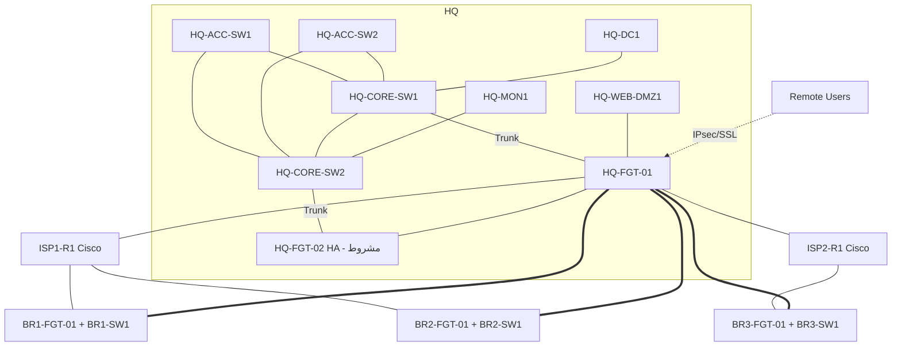

> **نقش‌های Cisco در Capstone:** Access/Core L2 (STP، EC، Port-Security، Snooping/DAI)، ISP/WAN-Sim (OSPF/Static/IP SLA)، Hardening/AAA/SNMP/Syslog/NTP، SPAN. این‌ها Cisco را در Capstone و در Spiral فعال نگه می‌دارند.

## ۲۹.۳ جدول VLAN / Gateway / Network / Zone / Policy (HQ)

| VLAN | Network | Gateway | Zone | Policy اصلی (خلاصه) |
|---|---|---|---|---|
| 10 MGMT | 10.10.10.0/24 | FGT `.1` | Z-MGMT | فقط IT→MGMT (SSH/HTTPS)؛ MGMT→MON (Syslog/SNMP) |
| 20 FINANCE | 10.10.20.0/24 | FGT `.1` | Z-FIN | →SRV (ERP/AD/DNS)؛ →WAN (Web محدود+UTM)؛ بدون HR |
| 30 HR | 10.10.30.0/24 | FGT `.1` | Z-HR | →SRV؛ →WAN؛ بدون FIN |
| 40 IT | 10.10.40.0/24 | FGT `.1` | Z-IT | →MGMT/SRV (مدیریتی)؛ →WAN |
| 50 USERS | 10.10.50.0/24 | FGT `.1` | Z-USERS | →SRV (DNS/AD/File)؛ →WAN؛ →DMZ (HTTPS) |
| 60 SERVERS | 10.10.60.0/24 | FGT `.1` | Z-SRV | ←Users/IT؛ →WAN (Update)؛ بدون Inbound آزاد |
| 80 GUEST | 10.10.80.0/24 | FGT `.1` | Z-GUEST | فقط WAN (Captive)؛ ممنوع→Z-* |
| 100 DMZ | 172.16.10.0/24 | FGT `.1` | Z-DMZ | ←WAN (VIP HTTPS)، ←Users (HTTPS)؛ DMZ→SRV فقط پورت‌های لازم |

## ۲۹.۴ Routing Table و مالکیت (خلاصه)

| دستگاه | Default | Routes مهم | مالک |
|---|---|---|---|
| HQ-FGT | به ISP1 (Primary)/ISP2 (Backup) | 10.20/30/40.0.0/16 از VTI؛ Connected VLANها | FGT |
| BR-FGT | به ISP محلی | 10.10.0.0/16 از VTI؛ Connected | FGT |
| HQ-CORE/ACC | Default → `10.10.10.1` (فقط Mgmt) | — | Cisco (L2) |
| ISP-Sim | — | WAN Subnetها (Static/OSPF) | Cisco |

## ۲۹.۵ Security Zone و Policy Matrix (نمونه)

| از \ به | MGMT | FIN | HR | IT | USERS | SRV | GUEST | DMZ | WAN |
|---|---|---|---|---|---|---|---|---|---|
| MGMT | — | ✗ | ✗ | ✗ | ✗ | MON/Syslog | ✗ | ✗ | ✗ |
| FIN | ✗ | — | ✗ | ✗ | ✗ | ERP/AD/DNS | ✗ | HTTPS | Web+UTM |
| HR | ✗ | ✗ | — | ✗ | ✗ | AD/DNS/File | ✗ | HTTPS | Web+UTM |
| IT | SSH/HTTPS | ✗ | ✗ | — | ✗ | Admin | ✗ | Admin | Web |
| USERS | ✗ | ✗ | ✗ | ✗ | — | AD/DNS/File | ✗ | HTTPS | Web+UTM |
| SRV | ✗ | ✗ | ✗ | ✗ | ✗ | — | ✗ | ✗ | Update |
| GUEST | ✗ | ✗ | ✗ | ✗ | ✗ | ✗ | — | ✗ | Web |
| DMZ | ✗ | ✗ | ✗ | ✗ | ✗ | محدود | ✗ | — | ✗ |
| WAN | ✗ | ✗ | ✗ | ✗ | ✗ | ✗ | ✗ | VIP HTTPS | — |

## ۲۹.۶ Packet Flowهای مهم

| Flow | مسیر | نقطه Policy | NAT | Return |
|---|---|---|---|---|
| F1 User→Internet | PC→ACC→CORE→FGT→WAN | Z-USERS→WAN | SNAT | همان |
| F2 User→AD | PC→FGT→Z-SRV | Z-USERS→SRV | بدون | همان |
| F3 Branch→HQ-SRV | BR-LAN→BR-FGT→VTI→HQ-FGT→SRV | Policy هر دو سمت | بدون | VTI |
| F4 Internet→DMZ | WAN→FGT VIP→DMZ | WAN→DMZ | DNAT | همان |
| F5 Remote→SRV | RA→FGT→SRV | RA→SRV (Auth) | بدون | همان |
| F6 MON→Devices | MON→FGT→MGMT | SRV→MGMT (SNMP) | بدون | همان |
| F7 Dual-WAN Failover | Client→FGT→(WAN2) | همان | SNAT WAN2 | Sticky/Return Route |

## ۲۹.۷ Acceptance Tests (AT)

## ۲۹.۷ Acceptance Tests (AT) — با تعیین نیاز به هم‌زمانی

| AT | آزمون | معیار پایه | نیاز به عملکرد هم‌زمان چندسایت؟ |
|---|---|---|---|
| AT01 | Inter-VLAN Policy | Allow/Deny مطابق Matrix؛ Hit Count | خیر (HQ) |
| AT02 | DHCP هر VLAN | Lease صحیح؛ Relay | خیر (HQ؛ Branch در Stage خودش) |
| AT03 | AD Login/GPO | Domain Join + Login | خیر (HQ) |
| AT04 | Auth FGT | LDAP/RADIUS موفق؛ Log کاربر | خیر (HQ) |
| AT05 | DMZ از Internet-Sim | HTTPS OK؛ بدون دسترسی DMZ→Z-* | خیر (HQ) |
| **AT06** | **Site-to-Site (هر ۳ Branch)** | **Tunnelهای HQ↔BR1/2/3 up، Ping، ESP دو‌طرفه، Policy** | **بله — «هم‌زمان ۳ تونل» فقط در T3** |
| AT07 | Remote Access | اتصال Client، Least Privilege (مشروط به امکان/لایسنس) | خیر |
| **AT08** | Dual WAN Failover | Failover زیر هدف؛ Session Impact مستند (با ترافیک Branch در حد Tier) | جزئی — با Branchهای آنلاین |
| **AT09** | HA | Failover؛ RTO/RPO ثبت (مشروط به Image/License) | بله (دو FGT HQ + بار Branchها) — T3 و مشروط |
| **AT10** | Monitoring | Dashboard؛ Alert؛ Syslog/SNMP از همه منابع **آنلاین** | بله برای «همه سایت‌ها» — Tier-dependent |
| AT11 | Backup/Restore | Restore یک دستگاه؛ مقایسه Config | خیر |
| AT12 | Hardening Audit | Score ≥ ۸۰٪ برای هر دستگاه آنلاین | جزئی (هر دستگاه در Stage خودش) |
| **AT13** | Packet Capture | PA18 ۵ نقطه برای HQ؛ Capture Branch↔HQ | جزئی (Flow شعبه‌ای در Stage) |
| **AT14** | Time Sync | همه دستگاه‌های آنلاین Offset<۱s | بله برای «همه» — Tier-dependent |
| AT15 | Rollback Drill | اجرای Rollback یک Change | خیر |

> **AT با نیاز هم‌زمانی:** AT06 (قطعی)، AT09، AT10، AT14؛ و به‌صورت جزئی AT08، AT12، AT13. فقط AT06 و AT09 «همه‌چیزهم‌زمان» لازم دارند.

## ۲۹.۸ Fault Injectionهای نهایی (آزمون ناشناخته؛ ۸ مورد پایه — ۳ مورد در آزمون نهایی انتخاب می‌شوند)

| FI | Fault | حوزه |
|---|---|---|
| FI-1 | VLAN 50 از Trunk حذف | Trunk/VLAN |
| FI-2 | Shadow Policy برای Finance | Policy |
| FI-3 | Return Route ISP-Sim نادرست (Asymmetric) | Routing |
| FI-4 | Double NAT (NAT اضافه روی ISP-Sim/Cisco) | NAT |
| FI-5 | IPsec Selector Mismatch + MTU | VPN/MTU |
| FI-6 | LDAPS CA Trust/Time Skew | PKI/AD |
| FI-7 | Syslog/SNMP Block + NTP Drift | Monitoring/Time |
| FI-8 | Human-Error Change (Allowed VLAN replace) بدون Pre-check | Change Mgmt |

## ۲۹.۹ Milestoneهای هفتگی Capstone

| هفته | Milestone | شاهد |
|---|---|---|
| W8 | CM1: Cisco Campus HQ (Lab A + L2 Baseline) | CP1 + As-Built |
| W10 | CM2: FGT Gateway + Policy Base (Lab B) | G4 |
| W12 | CM3: AD/Auth + UTM + DMZ | G5 |
| W14–16 | CM4: IPsec Branches + RA + SD-WAN + HA(مشروط) | G6 |
| W17 | CM5: Monitoring/Logging | Dashboard |
| W20 | CM6a: HLD/LLD/IP/VLAN/Policy Matrix نهایی + Build HQ | Review |
| W21 | CM6b: Branchها + VPN + Security | AT01–AT07 |
| W22 | CM6c: HA/Monitoring/Fault Injection | AT08–AT15 |
| W23 | Remediation + Mock Practical | Gap Closure |
| W24 | Final Practical + As-Built + Handover | G8 |

## ۲۹.۱۰ معیار پایان دوره و شواهد تحویلی

## ۲۹.۱۰ معیار پایان دوره و شواهد تحویلی

| معیار | حداقل |
|---|---|
| توانایی مستقل | Final Practical بدون راهنما؛ ۳ Fault ناشناخته با RCA |
| تکمیل AT | **طبق Completion Class فصل ۲۹.۱۲** (نه عدد ثابت) |
| شواهد | Config Git، Capture، Policy/VPN Matrix، As-Built، Runbook، Handover Checklist، Test Report |
| دفاع | ۳۰ دقیقه توضیح و دفاع از ۳ تصمیم معماری |
| نقض ایمنی | صفر (S و R قوانین) |

## ۲۹.۱۱ مستندات الزامی Capstone

| سند | محتوا |
|---|---|
| Business Requirements | نیازها و محدودیت‌ها |
| Assumptions | فرضیات |
| HLD | معماری کلان، Zoneها، افزونگی |
| LLD | VLAN/IP/Routing/Policy/VPN/Server |
| Diagrams | Physical/Logical/L3/Security Zones |
| IP Plan | مطابق ۹.۳/۱۲.۳ |
| VLAN Matrix | مطابق ۱۲.۳ |
| Routing Plan | OSPF Areas، Static، Default، VPN |
| Firewall Policy Matrix | Zone×Zone با Service و Profile |
| VPN Matrix | Peer، Phase1/2، Selector، Routing |
| Server/Service Matrix | سرویس، پورت، مالک |
| Security Baseline | Hardening چک‌لیست Cisco/FGT/Win/Linux |
| Implementation Plan | ترتیب و وابستگی |
| Test Plan | Test Case + Acceptance |
| Rollback Plan | هر تغییر |
| Monitoring Plan | Item/Trigger/Dashboard |
| As-Built | وضعیت نهایی واقعی |
| Handover Checklist | تحویل Runbookها، دسترسی‌ها، Backup |

---

## ۲۹.۱۲ Capstone مخصوص هر Tier — اجرا، پذیرش و کلاس تکمیل

> **اصل صداقت:** تکمیل Tier-limited نباید «تکمیل کامل هم‌زمان» اعلام شود. هر As-Built باید **Completion Class** را صریح بنویسد.

### ۲۹.۱۲.۱ جدول کلی

| Tier | اجرای Capstone | کلاس تکمیل | Nodeهای Staged/متوقف | معیار پذیرش |
|---|---|---|---|---|
| **T1 — Minimum** | **نوبتی:** HQ + یک Branch در هر لحظه؛ سه Branch به‌ترتیب | **C-SEQ** | بقیه Branchها خاموش؛ Client دوم/Zabbix سنگین خاموش | هر Branch جداگانه با HQ تست و شواهد جمع شود؛ **ادعای عملکرد هم‌زمان سه Branch ممنوع** |
| **T2 — Standard** | **HQ + دو Branch هم‌زمان**؛ Branch سوم Staged جدا | **C-DUAL** | BR3 (یا BR2) خاموش در زمان تست دو Branch؛ HA فقط اگر Branch سوم خاموش و منابع تأیید | دو Branch هم‌زمان؛ سومی با شواهد معادل در Stage جدا |
| **T3 — Full** | **HQ + سه Branch هم‌زمان** | **C-FULL** | هیچ (HA/FMG-FAZ مشروط به تأیید) | هر ۳ تونل هم‌زمان؛ همه Flowهای End-to-End |

### ۲۹.۱۲.۲ پذیرش AT به‌تفکیک Tier

| AT | T1 (C-SEQ) | T2 (C-DUAL) | T3 (C-FULL) |
|---|---|---|---|
| AT01–AT05، AT07، AT11، AT15 | کامل مطابق فصل ۲۹.۷ | همان | همان |
| **AT06** | **Pass-SEQ:** هر Branch جداگانه: Tunnel up + Ping + ESP + Policy + Capture؛ سه گزارش جدا. **«سه تونل هم‌زمان» ادعا نمی‌شود** | **Pass-DUAL:** دو تونل هم‌زمان + سومی در Stage جدا با شواهد معادل | **Pass-FULL:** سه تونل هم‌زمان + Failover مسیر پشتیبان |
| AT08 | Failover HQ با یک Branch آنلاین | با دو Branch | با سه Branch + بار هم‌زمان |
| **AT09 (HA)** | **Not-Executed:** Tabletop + مستند؛ بدون امتیاز اجرای HA | **مشروط:** فقط اگر Image/License HA تأیید و منابع (FGT اضافی) موجود؛ وگرنه Tabletop | **مشروط (T3):** اجرای Failover واقعی در صورت تأیید Image/License؛ وگرنه Tabletop و «Open» |
| AT10 | Monitoring همه منابع آنلاین در هر Stage؛ گزارش تجمیعی نوبتی | دو Branch + HQ هم‌زمان | همه منابع هم‌زمان |
| AT12 | Audit هر دستگاه در Stage خودش | همان | همه دستگاه‌ها |
| AT13 | Capture HQ + شعبه‌ای در Stage | دو Branch هم‌زمان؛ سوم در Stage | سه Branch |
| AT14 | Offset<۱s برای دستگاه‌های آنلاین هر Stage | دو Branch + HQ | همه |

### ۲۹.۱۲.۳ تعریف «Pass» و «کلاس تکمیل»

| وضعیت | تعریف |
|---|---|
| **Pass-FULL** | آزمون در شرایط هم‌زمان کامل و با شواهد (Config/Capture/Log) |
| **Pass-DUAL** | آزمون با دو Branch هم‌زمان؛ سوم Staged |
| **Pass-SEQ** | آزمون هر Branch به‌صورت نوبتی با شواهد کامل؛ بدون ادعای هم‌زمانی |
| **Not-Executed (Tabletop)** | اجرا ممکن نیست؛ فقط طراحی/Runbook؛ **امتیاز اجرا ندارد** |
| **C-FULL** | ≥ ۱۴ از ۱۵ AT در سطح Pass-FULL (AT09 و AT07 مشروط/Open قابل‌قبول با ثبت دلیل) |
| **C-DUAL** | AT06/AT10/AT14 در سطح Pass-DUAL؛ بقیه کامل؛ مجموع ≥ ۱۳ AT |
| **C-SEQ** | همه AT در سطح Pass-SEQ؛ مجموع ≥ ۱۲ AT (AT09 Not-Executed) |

> **قانون:** T1 هرگز C-DUAL/C-FULL نمی‌گیرد؛ T2 هرگز C-FULL نمی‌گیرد. «تکمیل Tier-limited» با «تکمیل کامل Capstone» **یکسان نیست**؛ مدرک/گزارش نهایی باید کلاس را قید کند. ارتقای Tier (افزایش منابع) به اجرای مجدد AT06/09/10/14 در همان کلاس نیاز دارد.

### ۲۹.۱۲.۴ روش Stage برای هر Tier

| Tier | Stageها | نکات |
|---|---|---|
| T1 | S1: HQ+BR1، S2: HQ+BR2، S3: HQ+BR3 (BR دیگران خاموش) | Snapshot/Export Lab بین Stageها؛ Config هر Branch ثابت در Git |
| T2 | S1: HQ+BR1+BR2 هم‌زمان؛ S2: HQ+BR3 (+یک Branch دیگر در صورت ظرفیت) | BR3 با Config معادل |
| T3 | S1: همه هم‌زمان | HA فقط پس از تأیید Image/License |

# ۳۰. Assessment و Competency Gates

## ۳۰.۱ سطوح مهارت

| سطح | نام | تعریف |
|---|---|---|
| L1 | آشنایی مفهومی | توضیح می‌دهد، اجرا نمی‌کند |
| L2 | اجرا با راهنما | با Runbook اجرا می‌کند |
| L3 | اجرای مستقل | بدون راهنما، با Verification صحیح |
| L4 | طراحی و عیب‌یابی مستقل | سناریوی جدید، طراحی + RCA |

## ۳۰.۲ نگاشت مهارت ← سطح هدف و Gate ارزیابی

| مهارت | سطح هدف | ارزیابی (هفته) | بحرانی؟ |
|---|---|---|---|
| IP/VLSM Design | L4 | W2، W20 | ✅ |
| Cisco CLI/Verification | L3 | W2، G1 | ✅ |
| VLAN/Trunk/Inter-VLAN | L4 | W3، G2 | ✅ |
| STP/EtherChannel | L3 | W4، G2 | |
| Routing (Static/OSPF) | L4 | W5–W6، G3 | ✅ |
| IP Services/ACL/NAT | L3 | W7 | ✅ |
| Cisco Hardening | L3 | W8 | ✅ |
| Automation | L2 | W8 | |
| FortiGate Admin/Interfaces | L3 | W9، G4 | ✅ |
| Policy/NAT/VIP | L4 | W10، G4 | ✅ |
| Security Profiles/SSL Inspection | L3 | W11 | |
| AD/LDAP/RADIUS | L3 | W12، G5 | ✅ |
| IPsec S2S | L4 | W13، G6 | ✅ |
| Remote Access VPN | L3 | W14، G6 | |
| SD-WAN/Dual-WAN | L3 | W15، G6 | |
| HA | L3 | W16، G6 | (مشروط) |
| Packet Analysis | L4 | W18، G7 | ✅ |
| Troubleshooting/RCA | L4 | G7، G8 | ✅ |
| Monitoring/Logging | L3 | W17 | |
| Blue Team/Hardening | L3 | W19 | ✅ |
| Backup/Change/Rollback | L3 | W8، Capstone | ✅ |
| Documentation/As-Built | L3–L4 | Capstone | ✅ |

## ۳۰.۳ ماتریس مهارت × هفته (معرفی I / تمرین P / ارزیابی A / Capstone C)

| مهارت | I | P | A | C |
|---|---|---|---|---|
| CLI/Mgmt | W1 | W2–W8 | G1 | W20 |
| VLAN/Trunk | W3 | W3–W4 | G2 | W20 |
| STP/EtherChannel | W4 | W4 | G2 | W20 |
| OSPF/Static | W5 | W5–W6 | G3 | W20 |
| ACL/NAT/DHCP | W7 | W7 | W7 | W20 |
| FGT Interfaces/Policy | W9 | W9–W10 | G4 | W21 |
| NAT/VIP/DMZ | W10 | W10–W11 | G4 | W21 |
| UTM/SSL Inspection | W11 | W11 | W11 | W21 |
| AD/LDAP/RADIUS | W12 | W12 | G5 | W21 |
| IPsec/RA-VPN | W13 | W13–W14 | G6 | W21 |
| SD-WAN/Dual WAN | W15 | W15 | G6 | W22 |
| HA | W16 | W16 | G6 | W22 |
| Monitoring | W17 | W17 | W17 | W22 |
| Packet Analysis | W2 | W2–W19 | G7 | W22 |
| Troubleshooting | W3 | W3–W19 | G7 | W22 |
| Hardening/Blue Team | W7 | W8، W19 | W19 | W22 |
| Documentation | W1 | همه | هر Milestone | W24 |

## ۳۰.۴ آزمون نهایی (۲ روز × ۶ ساعت — Gate G8)

| روز | بخش | مدت | شرح |
|---|---|---|---|
| ۱ | تحلیل نیازمندی + طراحی | 1.5h | شرح نیاز جدید (مثلاً شعبه جدید + DMZ + VPN) → IP/VLAN/Topology |
| ۱ | پیاده‌سازی Cisco | 1.5h | VLAN/Trunk/Routing |
| ۱ | پیاده‌سازی FortiGate | 1.5h | Policy/NAT/AD Auth/VPN |
| ۱ | Monitoring/Security Baseline | 1.5h | Zabbix/Hardening |
| ۲ | عیب‌یابی ۳ خرابی ناشناخته (Fault Injection) | 3h | با RCA |
| ۲ | تحلیل Capture + Log | 1h | یک مسئله |
| ۲ | As-Built + گزارش تحویل | 2h | |

## ۳۰.۵ معیار قبولی نهایی

| معیار | وزن |
|---|---|
| معماری و Packet Flow | ۱۰٪ |
| پیکربندی مستقل | ۲۵٪ |
| Verification | ۱۰٪ |
| عیب‌یابی سیستماتیک | ۲۰٪ |
| Packet/Log Analysis | ۱۰٪ |
| Security Baseline | ۱۰٪ |
| Backup/Rollback | ۵٪ |
| مستندسازی | ۱۰٪ |

**قبولی:** ≥ ۸۰٪ **و** هیچ مهارت «بحرانی» زیر L3 **و** عدم نقض Safety Rails (S1–S7 و R1–R6) **و** حضور/تکمیل صرفاً غیرمؤثر.

---


## ۳۰.۶ Rubric عملکرد

| معیار | L1 (ناکافی) | L2 (با راهنما) | L3 (مستقل) | L4 (طراحی/دفاع) | شاهد قابل مشاهده |
|---|---|---|---|---|---|
| دانش مفهومی | تعریف ناقص | توضیح با کمک | توضیح صحیح Packet Flow | مقایسه گزینه‌ها و توجیه | Teach-Back، پاسخ شفاهی |
| اجرای عملی | ناتمام | با Runbook | مستقل + Verification | بهینه/امن + جایگزین | Config + `show` |
| عیب‌یابی مستقل | حدس | با Hint | چارچوب ۱۵ مرحله‌ای | RCA عمیق + Prevent | RCA + Evidence |
| تحلیل Packet/Log | بدون ابزار | Capture بدون تحلیل | تحلیل صحیح | Correlation چند منبع | pcap + Report |
| امنیت و اصول عملیاتی | نقض | رعایت ناقص | رعایت کامل Baseline | بهبود Baseline | Audit Score |
| مستندسازی | ناقص | الگو پر شده | As-Built دقیق | قابل‌استفاده توسط دیگران | Docs در Git |
| توضیح/دفاع تصمیم | نمی‌تواند | تکرار | دفاع مستدل | تحلیل Trade-off | جلسه دفاع |

## ۳۰.۷ Competency Gates (G1 تا G8)

| Gate | هفته | حوزه | محتوای آزمون عملی | مدت | حد قبولی |
|---|---|---|---|---|---|
| **G1** | W2 | مقدمات و Cisco Basics | CLI Modes، IP/VLSM، SSH، Backup/Restore، ۱ عیب IP | ۴h | ≥۷۰٪ و CLI L3 |
| **G2** | W4 | Switching و VLAN | VLAN/Trunk/STP/EC/Port-Sec Build + ۲ عیب | ۴h | ≥۷۵٪ |
| **G3** | W6 | Routing | Static/Floating/OSPF Multi-Area/HSRP + ۲ عیب | ۴h | ≥۷۵٪ |
| **G4** | W10 | FortiGate Fundamentals | Interface/Zone/Policy/NAT/VIP + Debug Flow + ۲ عیب | ۴h | ≥۷۵٪ |
| **G5** | W12 | Integrated Network Security | Policy+UTM(مشروط)+AD/RADIUS+DMZ + Cisco Integration + ۲ عیب | ۴h | ≥۸۰٪ |
| **G6** | W16 | VPN/Branch | S2S + RA + SD-WAN + HA(مشروط) + ۲ عیب | ۴h | ≥۸۰٪ |
| **G7** | W19 | Monitoring/Troubleshooting | Dashboard/Alert + ۴۰/۵۰ TS + Capture + Blue Team | ۴h+ | ≥۸۰٪ و TS≥۴۰ |
| **G8** | W24 | Capstone | آزمون نهایی ۲ روزه (فصل ۳۰.۴) | ۲×۶h | ≥۸۰٪ و بحرانی ≥L3 |

> غیر Gate: **CP1** (W8) Cisco Campus Checkpoint (۴h) — بازخورد، بدون مردودی رسمی؛ **Mock Practical** (W23).

## ۳۰.۸ سیاست عدم قبولی، تمرین جبرانی و آزمون مجدد

| وضعیت | اقدام جبرانی | آزمون مجدد | سقف |
|---|---|---|---|
| ۶۰–۶۹٪ (نزدیک) | ۲ روز Remediation (از بافر هفته/روز R) + Labهای ضعف | بخش ناموفق (نیمه) با Fault متفاوت | ۲ بار |
| < ۶۰٪ | ۳–۴ روز Remediation + Lab‌های Guided مرتبط + Active Recall | آزمون کامل با Scenario جدید | ۲ بار |
| نقض ایمنی | Review Safety + تکلیف Change/Rollback | آزمون ویژه ایمنی | — |
| پس از ۲ شکست | بازنگری برنامه با کاربر: افزایش تمرین، کاهش [OPT]؛ **مدت ۲۴ هفته ثابت می‌ماند** | تصمیم کاربر | — |

> زمان Remediation از Buffer هفته ۲۳ و ساعات R/TS کسر می‌شود؛ ساعات مفید کل ۸۶۴ ثابت است.

## ۳۰.۹ معیار پذیرش (Exit Criteria) هر فاز

| فاز | هفته | معیار پذیرش (Exit Criteria) | شاهد |
|---|---|---|---|
| Phase 0A | W1 (روز ۱–۲) | گزارش 0A کامل (Inventory، سازگاری، ظرفیت) و بررسی کاربر | Report + **تأیید 0B** |
| Phase 0B | W1 (روز ۳–۵) | T1–T11 سبز، Isolation اثبات شد | چک‌لیست امضا |
| Phase 1 | W2 | SSH/Backup/IPv4/IPv6 Design، ۱۰ مسئله VLSM | Workbook |
| Phase 2 | W3–W4 | VLAN/Trunk/STP/EC/Port-Sec، ۶ TS حل‌شده | Verification + RCA |
| Phase 3 | W5–W6 | OSPF Multi-Area، FHRP، ۷ TS | Verification |
| Phase 4 | W7–W8 | NAT/ACL/DHCP/Syslog/SNMP، Automation Backup، CP1 (بازخورد) | CP1 |
| Phase 5 | W9–W10 | Policy/NAT/VIP/Session، S1–S4/S8/S9 | Capture + Hit |
| Phase 6 | W11–W12 | UTM (با محدودیت)، AD Auth، **G5** | G5 |
| Phase 7 | W13–W14 | S2S + RA-VPN، ۷ TS | Capture ESP |
| Phase 8 | W15–W16 | SD-WAN/Dual-WAN/HA (مشروط)، **G6** | G6 |
| Phase 9 | W17 | Zabbix+Syslog+Dashboard+۱۰ سناریو | Dashboard |
| Phase 10 | W18–W19 | ۴۰/۵۰ TS، PA01–PA18، Blue Team | **G7** |
| Phase 11 | W20–W22 | Capstone با Test Plan | **Capstone Delivered (AT01–AT15)** |
| Final | W24 | ≥ ۸۰٪، بحرانی ≥ L3 | **G8** |

---

# ۳۱. Deliverables و Documentation Standards

## ۳۱.۱ ساختار پوشه (Git Repo)

```
zagros-lab/
├── 00-governance/        # Blueprint, ChangeLog, RiskRegister
├── 01-discovery/         # Inventory, As-Is, Lab Runbook
├── 02-design/            # HLD, LLD, IP-Plan, VLAN-Matrix, Diagrams
├── 03-cisco/
│   ├── configs/          # <device>_<yyyymmdd>_<tag>.cfg
│   ├── labs/             # Lxx-<topic>/ (workbook, outputs, pcap)
│   └── reference/        # Command Reference
├── 04-fortigate/
│   ├── configs/          # <device>_<yyyymmdd>_<tag>.conf
│   ├── labs/
│   └── reference/        # CLI/GUI Reference (7.0.3)
├── 05-windows-linux/
├── 06-monitoring/        # Zabbix templates, dashboards
├── 07-troubleshooting/   # TSxx-RCA.md
├── 08-capstone/
├── 09-assessment/        # Answer-key (instructor), results
└── 10-handover/          # As-Built, Handover checklist
```

**Naming:** `<LabID>_<Topic>_<Device>_<YYYYMMDD>_<vN>.<ext>` (مثال: `L19_EtherChannel_HQ-CORE-SW1_20261201_v1.cfg`).
**Commit Message:** `[Lxx] <what> — <result>`.
**Secrets:** هیچ Password/PSK/Key در Git (فقط Placeholder + Vault/فایل رمزگذاری‌شده).

## ۳۱.۲ فهرست Deliverableهای دوره

Course Master Blueprint · Curriculum Map · Lab Inventory · Image Compatibility Matrix · Physical/Logical Topology · IP Addressing Plan · VLAN Matrix · Device Configuration Templates · Cisco Command Reference · FortiGate CLI/GUI Reference · Firewall Policy Matrix · VPN Design · Troubleshooting Runbooks · Monitoring Dashboard Plan · Backup/Restore Procedure · Change Management Template · Rollback Template · Test & Acceptance Plan · Weekly Progress Report · Lab Workbook · Answer Key (مدرس) · Final Project Documentation · As-Built Documentation.

## ۳۱.۳ خروجی ذخیره‌شونده هر Lab

| فایل | محتوا |
|---|---|
| `workbook.md` | اهداف، مراحل، یادداشت‌ها |
| `configs/` | Config قبل/بعد |
| `verification.txt` | خروجی `show`/`diagnose` |
| `capture.pcapng` | در صورت لزوم |
| `diagram.drawio/.png` | Topology |
| `rca.md` | برای Fault Labs |
| `recall.md` | ۵ سؤال + پاسخ خود |

## ۳۱.۴ قالب Change Management / Rollback (کوتاه)

| فیلد | مقدار |
|---|---|
| Change ID/تاریخ/مجری | — |
| هدف و ریسک (Low/Med/High) | — |
| Backup انجام‌شده | مسیر |
| مراحل | ۱..n |
| Test بعد از تغییر | — |
| **Rollback Trigger** | شرط مشخص |
| **Rollback Steps** | دستورات دقیق |
| نتیجه | Success/Rolled-back |

---

# ۳۲. Backup، Restore، Change و Rollback

> قالب Change/Rollback کوتاه در فصل ۳۱.۴ است؛ این فصل فرایند کامل را تعریف می‌کند. اصل: **هیچ تغییری بدون Backup + Pre-check + Rollback Plan.**

## ۳۲.۱ چرخه تغییر (Change Lifecycle)

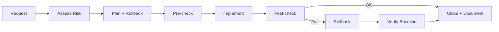

## ۳۲.۲ Pre-check / Post-check

| مرحله | Cisco | FortiGate | Server |
|---|---|---|---|
| Pre-check | `show run`/Backup؛ `show interfaces trunk`؛ Baseline Git Tag | `execute backup config …` (`Unverified` سینتکس)؛ Policy Hit قبل؛ HA Status | Snapshot/Backup؛ AD Health |
| Post-check | همان `show` + Ping/Trace | Policy/Route/Session؛ Log | سرویس‌ها |
| زمان | هر Change در Window | | |

## ۳۲.۳ Backup و Restore Verification

| مورد | تکرار | روش | Verification |
|---|---|---|---|
| Config Cisco | قبل از Change + روزانه خودکار (Netmiko) | Git | `git diff` با Running |
| Config FGT | قبل از Change + روزانه | Backup فایل → Git (رمزگذاری‌شده؛ Secrets مراقبت) | Restore روی VM جدید (Quarterly/Lab: ۱ بار) |
| PNetLab Lab | هفتگی | Export | Import در Lab تست |
| VM Windows/Linux | Snapshot قبل از Change | ESXi | Restore Test |
| Restore Drill | AT11 | یک دستگاه | مقایسه Config + سرویس |

> **قانون:** Backup بدون Restore-Test «Backup» محسوب نمی‌شود.

## ۳۲.۴ Rollback Plan (الگو)

| فیلد | مقدار |
|---|---|
| Trigger | معیار مشخص (مثلاً Ping GW شکست تا ۵ دقیقه) |
| روش | بازگردانی Config/Snapshot (دستور دقیق) |
| زمان هدف | ≤ N دقیقه |
| Verification | Test سیاهه Post-check |
| تصمیم‌گیر | نقش |
| Fail-safe | دسترسی Out-of-band/کنسول؛ **Safe-mode/Timer** (Cisco: `reload in N` با احتیاط؛ FGT: Scheduled Revert `Unverified`) |

## ۳۲.۵ تغییر در Management Plane (ESXi/PNetLab/WireGuard)

**ممنوع** مگر: Snapshot/Backup + Rollback مکتوب + تأیید صریح کاربر + Window + دسترسی جایگزین (کنسول فیزیکی/OOB) 🔎.

# ۳۳. Operations، Incident Response و Handover

## ۳۳.۱ Operations روزانه/هفتگی

| فعالیت | دوره | مالک | خروجی |
|---|---|---|---|
| بررسی Dashboard/Alert | روزانه | Operator | Ticket/یادداشت |
| Backup Verification | روزانه/هفتگی | Operator | Log |
| Log Review (Security) | روزانه | امنیت | Report |
| PSIRT/Firmware Review | هفتگی | امنیت | Risk Note |
| Capacity/Baseline | ماهانه | شبکه | Report |
| Cert Expiry Review | ماهانه | PKI | لیست |
| DR/Restore Drill | فصلی | تیم | Report |

## ۳۳.۲ Incident Response (IR)

| فاز | اقدام | ابزار | خروجی |
|---|---|---|---|
| Detect | Alert/گزارش کاربر | Zabbix/Log | Ticket |
| Triage | Severity (P1–P4)، Scope | Dashboard | Incident Record |
| Contain | محدودسازی (Block/Isolate) با Change اضطراری | FGT/Cisco | لاگ اقدام |
| Eradicate/Recover | رفع علت، Restore | Runbook | Verification |
| Communicate | به‌روزرسانی ذینفع‌ها | Template | پیام |
| Post-Incident Review | Blameless، RCA | قالب RCA | Action Items |

| Severity | تعریف | هدف پاسخ (Lab) |
|---|---|---|
| P1 | قطع سرویس HQ/VPN کلیدی | فوری |
| P2 | قطع جزئی/Degraded | ساعت |
| P3 | تک‌کاربر | روز |
| P4 | درخواست | برنامه |

### Post-Incident Review (قالب)
Timeline · Impact · Root Cause · Contributing Factors · چه خوب کار کرد · چه بد · Action Items (Owner/Due) · تغییر Runbook/Monitoring.

## ۳۳.۳ Incident Drills در دوره

| Drill | هفته | سناریو |
|---|---|---|
| D1 | W19 | قطع VPN شعبه (TS32–TS36) + IR کامل |
| D2 | W22 | Failover/Dual-WAN + Communication |
| D3 | W23 | Fault Chain (TS50) با PIR |

## ۳۳.۴ Handover

| مورد | محتوا |
|---|---|
| As-Built | دیاگرام، Config نهایی (Git Tag `as-built`)، IP/VLAN/Policy/VPN Matrix |
| Runbookها | Backup/Restore، Change، IR، TS Top-10، Monitoring |
| دسترسی‌ها | حساب‌ها (Least Privilege)، Rotation Credential، Break-glass |
| Monitoring | Dashboard، Alert Catalog، Owner |
| Backup | محل، Restore Test نتیجه |
| ریسک‌ها | Known Issues، Open Items (از جمله FortiOS 7.0.3 و Patch Plan) |
| آموزش | Walkthrough ۱ ساعته + Q&A |
| Sign-off | امضای Handover Checklist |

**Handover Checklist:** ☐ As-Built ☐ Git Tag ☐ Runbooks ☐ Credentials Vault ☐ Backup+Restore Test ☐ Monitoring Owners ☐ Risk Register ☐ Walkthrough ☐ Sign-off.

# ۳۴. Official Resources و Version References

> **تاریخ بررسی: 2026-11-02.** بررسی با Fetch محتوا و جستجو انجام شد. بسیاری از صفحات Fortinet فقط فهرست‌مطالب/ناوبری برگرداندند؛ در آن موارد هیچ ادعایی استنباط نشد. هیچ URL ساختگی ثبت نشده؛ URLهای «Opened» همان‌هایی‌اند که واقعاً باز شدند و «Candidate» فقط پیشنهاد بررسی است.
> **تفاوت Documented و Lab-Verified:** ستون «وضعیت» فقط «Documented (Opened)» را می‌گوید. **هیچ ردیفی «Lab-Verified» نیست** چون هیچ آزمایش عملی انجام نشده است.

## ۳۴.۱ Reference Log

| # | منبع (عنوان) | ناشر | محصول/نسخه | URL | تاریخ | ادعای پشتیبانی‌شده | وضعیت |
|---|---|---|---|---|---|---|---|
| R1 | PSIRT FG-IR-22-377 (CVE-2022-40684) | Fortinet | FortiOS 7.0.0–7.0.6؛ رفع 7.0.7+ | https://www.fortiguard.com/psirt/FG-IR-22-377 | 2026-11-02 | 7.0.3 در بازه آسیب‌پذیر | **Verified** (Documented/Opened) |
| R2 | PSIRT FG-IR-22-398 (CVE-2022-42475) | Fortinet | FortiOS 7.0.0–7.0.8؛ رفع 7.0.9+ | https://www.fortiguard.com/psirt/FG-IR-22-398 | 2026-11-02 | همان؛ SSL-VPN | **Verified** (مقدار از سلول جدول) |
| R3 | PSIRT FG-IR-23-097 (CVE-2023-27997) | Fortinet | FortiOS 7.0.0–7.0.11؛ رفع 7.0.12+ | https://www.fortiguard.com/psirt/FG-IR-23-097 | 2026-11-02 | همان | **Verified** |
| R4 | FortiOS 7.0.3 Release Notes (Introduction and supported models) | Fortinet | FortiOS 7.0.3 Build 0237 | https://docs.fortinet.com/document/fortigate/7.0.3/fortios-release-notes | 2026-11-02 | وجود RN؛ SKUهای VM (KVM/HV/XEN/VMX/Cloud) | **Verified (وجود)**؛ نسخه ESXi/حداقل منابع در همین صفحه **یافت نشد** → `Unverified` |
| R5 | Windows Server 2022 Evaluation | Microsoft | Windows Server 2022 | https://www.microsoft.com/en-us/evalcenter/evaluate-windows-server-2022 | 2026-11-02 | «expires in 180 days» | **Verified** (Evaluation Center) |
| R6 | CML FAQ (v2.10) — جدول منابع Reference Platform | Cisco | CML 2.10؛ IOSv، IOSv-L2 | https://developer.cisco.com/docs/modeling-labs/faq/ | 2026-11-02 | IOSv: 1 vCPU/512 MB؛ IOSv-L2: 1 vCPU/768 MB؛ «You must license CML before you can start any node» | **Verified** (CML؛ نه PNetLab) |
| R7 | PNETLab — Supported virtualization platforms and software | PNETLab | PNETLab (نسخه نامشخص) | https://pnetlab.com/pages/documentation?slug=supported-virtualization-platforms-and-software | 2026-11-02 | «VMware ESXi 6.0 or later»؛ بدون ذکر Nested | **Verified** (ESXi 6.0+)؛ Nested `Unverified` |
| R8 | Broadcom/VMware — Expose Hardware Assisted Virtualization | Broadcom | vSphere 7.0 | https://techdocs.broadcom.com/us/en/vmware-cis/vsphere/vsphere/7-0/vsphere-virtual-machine-administration/configuring-virtual-machine-hardwarevm-admin/virtual-cpu-configuration-and-limitationsvm-admin/expose-hardware-assisted-virtualizationvm-admin.html | 2026-11-02 | روش فعال‌سازی «Expose hardware assisted virtualization to the guest OS» (نیاز VM Compat ≥ ESXi 5.1، VT-x/AMD-V در BIOS) | **Verified (روش، vSphere 7.0)**؛ نسخه ESXi کاربر `Unverified`؛ پشتیبانی رسمی VMware از اجرای Hypervisor ثالث (QEMU/KVM) در این حالت `Inferred` (صفحه تذکر محدودیت دارد) |
| R9 | FortiGate-VM Evaluation/Trial License | Fortinet | FortiOS 7.0.3 | (کاندید) https://docs.fortinet.com/document/fortigate-private-cloud/6.4.0/vmware-esxi-administration-guide/504166/fortigate-vm-evaluation-license | 2026-11-02 | محدودیت‌های Eval | **Unverified** — صفحه 7.4.0 باز شد ولی فقط ناوبری؛ مستند «Permanent trial» برای نسخه‌های جدیدتر (7.2.1+، طبق خلاصه جستجو) و **نامرتبط با 7.0.3 احتمالاً** |
| R10 | SD-WAN related diagnose commands | Fortinet | FortiOS 7.0.1 Admin Guide | https://docs.fortinet.com/document/fortigate/7.0.1/administration-guide/818746/sd-wan-related-diagnose-commands | 2026-11-02 | `diagnose sys sdwan health-check` | **Unverified** — فقط ناوبری برگشت؛ نسخه 7.0.1 نه 7.0.3 |
| R11 | FortiOS 7.0 Administration Guide (Debug flow، sniffer، SSL-VPN Modes، NTP، HA hbdev) | Fortinet | FortiOS 7.0.x | https://docs.fortinet.com/document/fortigate/7.0.0/administration-guide | 2026-11-02 | سینتکس/Featureها | **Unverified** — متن کامل دریافت نشد؛ این موارد بررسی هدفمند نشدند |
| R12 | Cisco Modeling Labs Docs (کلی) | Cisco | CML | https://developer.cisco.com/docs/modeling-labs/ | 2026-11-02 | — | **Unverified** برای Featureهای IOSvL2 (DAI/Snooping/SPAN/EPC) |
| R13 | PNETLAB Documentation (فهرست) | PNETLAB | — | https://pnetlab.com/pages/documentation | 2026-11-02 | عناوین «Supported Images»، «NAT Cloud» | **Unverified** برای افزودن Image FortiGate/Interface |
| R14 | Zabbix — SNMP items | Zabbix | Zabbix (current 7.4 در زمان بررسی) | https://www.zabbix.com/documentation/current/en/manual/config/items/itemtypes/snmp | 2026-11-02 | وجود مستند SNMP | **Verified (صفحه باز می‌شود)** |
| R15 | rsyslog — imtcp | rsyslog | — | https://www.rsyslog.com/doc/configuration/modules/imtcp.html (→ 301 به docs.rsyslog.com) | 2026-11-02 | — | **Unverified** (مقصد باز نشد) |

### آنچه باید بررسی شود (برای ردیف‌های Unverified)
FortiGate-VM Eval 7.0.3 (R9)؛ ESXi پشتیبانی‌شده برای FortiGate 7.0.3 (R4/Product Integration)؛ CLI دقیق SD-WAN/Debug-Flow/NTP/HA/FSSO در 7.0.3 (R10–R11)؛ SSL-VPN Modes در 7.0 (R11)؛ Featureهای IOSvL2 (R12) — با Image Validation؛ افزودن Image در PNetLab و Nested (R7/R13/R8)؛ شرایط لایسنس Image Cisco خارج CML.

## ۳۴.۲ منابع رسمی هدف (بیشتر Unverified)

| موضوع | منبع رسمی | بخش | وضعیت |
|---|---|---|---|
| Cisco IOS/IOS-XE | Cisco Configuration Guides/Command Reference | فصل ۱۵، ۱۲.۲ | `Unverified` (Release دقیق Image در IV-2) |
| CML/IOSv/IOSvL2 | CML FAQ/Reference Platforms | منابع (R6) | منابع `Verified`؛ Featureها `Unverified` |
| FortiOS 7.0.3 | Admin Guide 7.0، CLI Reference 7.0، Release Notes 7.0.3 | فصل ۱۶/۲۰ | R4 وجود دارد؛ بقیه `Unverified` |
| FortiGate-VM | Install/Eval/Licensing Guide همان نسخه | فصل ۱۳، ۱۶.۸ | `Unverified` |
| PSIRT | fortiguard.com/psirt | آسیب‌پذیری‌ها | `Verified` (R1–R3) |
| PNETLAB | docs رسمی | فصل ۱۰ | ESXi 6.0+ `Verified`؛ بقیه `Unverified` |
| VMware/Broadcom | Docs | Nested | روش `Verified`؛ پشتیبانی رسمی `Inferred` |
| Microsoft | Microsoft Learn (AD DS، NPS، AD CS) | فصل ۱۸ | `Unverified`؛ Evaluation: `Verified` (R5) |
| Wireshark | wireshark.org/docs | فصل ۲۳ | `Unverified` |
| Zabbix | zabbix.com/documentation | فصل ۲۲ | `Verified` (R14) |
| rsyslog | rsyslog docs | فصل ۲۲ | `Unverified` |
| RFCها/CIS | RFC 791, 792, 826, 1918, 2328, 4271, 4301–4307, 7296, 5424, 3411+؛ CIS | مفهومی/Hardening | `Unverified` (متن بررسی نشد) |

> منابع عمومی/وبلاگ فقط برای توضیح تکمیلی‌اند و جایگزین مستند رسمی نمی‌شوند.

## ۳۴.۳ ابزارها

| ابزار | کاربرد | محل نصب | منابع | رایگان/تجاری | لایسنس/محدودیت | مبحث | جایگزین |
|---|---|---|---|---|---|---|---|
| VMware ESXi | میزبان | سرور | — | بسته به لایسنس 🔎 | `Unverified` نسخه رایگان/Broadcom 🔎 | همه | — |
| PNetLab | Lab شبکه | VM روی ESXi | 8+ vCPU/16+ GB | رایگان (`Unverified`) | `Unverified` شرایط | همه | EVE-NG، CML |
| Cisco IOSv/IOSvL2 | روتر/سوئیچ | PNetLab | فصل ۱۳ | تجاری (CML/DevNet) | `Unverified` لایسنس | Cisco | Packet Tracer (محدود) |
| FortiGate-VM 7.0.3 | Firewall | PNetLab | 1/2 | Eval | `Unverified` سقف Eval | Forti | — |
| Wireshark | Packet | Jump (Windows) | کم | رایگان | GPL | همه | tcpdump |
| tcpdump | Packet | Linux | کم | رایگان | — | همه | — |
| Nmap | Inventory/Detection | Linux Lab | کم | رایگان | **فقط Lab** | Blue Team | — |
| Windows Server/Client | AD، Client | QEMU/ESXi | جدول ۸.۱ | Eval | Server ۱۸۰ روز `Verified`؛ Client `Unverified` | Win | — |
| Linux (Ubuntu/Debian LTS) | WEB/MON/Syslog | همانند بالا | سبک | رایگان | — | Linux | Rocky/Alma |
| Windows Terminal (+PuTTY/SecureCRT) | CLI | Jump | — | رایگان (Terminal/PuTTY) | — | Cisco/Forti | SecureCRT (تجاری) |
| diagrams.net | نمودار | Jump | — | رایگان | — | Doc | Visio |
| Git | نسخه‌بندی | Jump/Linux | — | رایگان | — | Doc/Config | — |
| Zabbix | Monitoring | Linux | 2/4 | رایگان | — | Monitoring | LibreNMS |
| rsyslog | Syslog | Linux | کم | رایگان | — | Logging | Graylog [OPT] |
| Python + Netmiko / Ansible | Automation | Jump/Linux | کم | رایگان | — | W8 | Nornir |
| NetBox (IPAM) | IPAM | [OPT] | 2/4 | رایگان | — | [OPT] | جدول IPAM در Git (ضروری) |

**قاعده:** هیچ ابزار اضافه‌ای بدون دلیل وارد نمی‌شود؛ PRTG وارد نشد چون با Zabbix هم‌پوشان است؛ NetBox به [OPT] رفت چون برنامه ضروری بدون آن کامل است.

---

# ۳۵. Risks، Dependencies و Open Questions

## ۳۵.۱ وابستگی‌ها (Dependencies)

| # | وابستگی | اثر اگر نباشد | وضعیت |
|---|---|---|---|
| DEP1 | Image قانونی Cisco (IOSv/IOSvL2) | Labهای Cisco به Packet Tracer/مفهومی تبدیل می‌شوند (فصل ۱۲.۳) | 🔎 Open |
| DEP2 | FortiGate-VM 7.0.3 + License | هسته دوره | 🔎 Open |
| DEP3 | منابع ESXi (Tier) | Labهای نوبتی/مفهومی | 🔎 Open |
| DEP4 | Windows Eval ISO | AD/NPS | 🔎 Open |
| DEP5 | امکان vSwitch ایزوله (در صورت روش B/D) | Hybrid ممکن نیست؛ QEMU Node | 🔎 Open |
| DEP6 | حساب Fortinet Support | Image/Docs | 🔎 Open |
| DEP7 | Internet کنترل‌شده موقت | دانلود Package/ISO | 🔎 Open |

## ۳۵.۲ پرسش‌های باز (Open Questions) و تصمیم‌های نیازمند تأیید

| ID | پرسش/تصمیم | پیشنهاد من | وضعیت |
|---|---|---|---|
| Q1 | تأیید معماری اصلی Capstone = FGT Gateway (B) و Lab A مستقل | تأیید | Open |
| Q2 | روش اتصال VM (A QEMU / B vSwitch ایزوله / D Hybrid) | D بعد از Discovery | Open |
| Q3 | Tier هدف | بعد از اندازه‌گیری | Open |
| Q4 | FortiManager/FortiAnalyzer: Hands-on یا مفهومی | مفهومی اگر منابع/لایسنس نبود | Open |
| Q5 | اگر 7.0.3 در دسترس نبود: نزدیک‌ترین 7.0.x یا توقف؟ **(تغییر نسخه بدون اجازه شما ممنوع)** | سؤال از شما | Open |
| Q6 | Stack مانیتورینگ: Zabbix + rsyslog | تأیید | Open |
| Q7 | Windows 10 در برابر 11 | Win 10 (TPM) | Open |
| Q8 | الگوی روزانه (بلوک ۹۰ دقیقه‌ای) و ساعت‌های واقعی روز | تأیید | Open |
| Q9 | امکان ساخت vSwitch ایزوله بدون Uplink (فقط با تأیید صریح) | سؤال از شما | Open |
| Q10 | BR2 با Cisco Router برای Interop IPsec (Image `Unverified`) | [OPT] | Open |
| Q11 | تأیید گزارش Phase 0A و سپس **اجازه صریح برای Phase 0B** | پس از بررسی گزارش | Open |
| Q12 | پذیرش کلاس تکمیل Capstone مطابق Tier (C-SEQ/C-DUAL/C-FULL) | تأیید | Open |

## ۳۵.۳ ثبت ریسک (Risk Register)

| # | ریسک | احتمال | اثر | پیشگیری | برنامه جایگزین |
|---|---|---|---|---|---|
| R01 | کمبود RAM/CPU/Storage | 🔎 متوسط | بالا | Discovery + Tiered Lab | Capstone Tiered، Monitoring سبک |
| R02 | ناسازگاری Image | متوسط | بالا | Test Matrix فصل ۱۲ | Image جایگزین |
| R03 | Feature پشتیبانی‌نشده در Virtual Image | بالا (DAI/EPC/…) | متوسط | `Unverified` Test قبل از Lesson | CLI Review/Contingency ۱۰.۲ |
| R04 | لایسنس FortiGate/FortiGuard | بالا | بالا | تعریف راه‌حل آموزشی فصل ۱۶.۳ | Local Signature/Static Filter |
| R05 | محدودیت 7.0.3 (قدیمی) | قطعی | متوسط | ثبت Release Notes | **سؤال از کاربر (Q5)**؛ تغییر نسخه بدون اجازه ممنوع |
| R06 | **آسیب‌پذیری‌های FortiOS 7.0.x (`Verified`: CVE-2022-40684/42475، CVE-2023-27997)** | قطعی | بحرانی در صورت Exposure | **Air-Gap، عدم Port-forward، بدون ارتباط به Internet** | Snapshot، مطالعه موردی CVE |
| R07 | محدودیت Windows Evaluation (Server ۱۸۰ روز `Verified`) | قطعی | کم | Snapshot قبل از انقضا | Rebuild Script |
| R08 | Nested Virtualization | متوسط | بالا | بررسی D7 | Hybrid (B/D) |
| R09 | تداخل Lab با Management | متوسط | بحرانی | قوانین R2–R4، Test T9 | Disconnect فوری، Rollback |
| R10 | از دست رفتن دسترسی ESXi | کم | بحرانی | عدم تغییر Mgmt، Console/IPMI | دسترسی فیزیکی/Out-of-band 🔎 |
| R11 | آسیب VM/Config | متوسط | بالا | Snapshot + Git | Restore |
| R12 | نبود Backup | متوسط | بالا | Task W1، Backup خودکار | — |
| R13 | وابستگی به Internet (Download) | متوسط | متوسط | Offline Repo/ISO قبلی | Cache محلی |
| R14 | زمان بیش از ظرفیت | بالا | بالا | Buffer W23، حذف [OPT]، فشرده‌سازی Lab Independent | **مدت ثابت می‌ماند**؛ اولویت‌بندی |
| R15 | خستگی ۶ ساعته | بالا | بالا | فصل ۲۷ | روز سبک |
| R16 | فراموشی | بالا | متوسط | Spaced Repetition | Mini-Assessment |
| R17 | سقف محدودیت HA/Interface در Eval | 🔎 | متوسط | تست در Discovery | HA مفهومی |

---

## ۳۵.۴ فهرست ادعاهای `Unverified` برای بررسی

محدودیت‌های Eval FortiGate-VM · امکان HA/VDOM در Eval · دسترسی FortiGuard · سینتکس دقیق SD-WAN/FSSO/Debug-Flow در 7.0.3 · وجود SSL-VPN Web/Tunnel در 7.0.3 · پشتیبانی IOSv/IOSvL2 (DAI/Snooping/EPC/HSRP/SPAN/LACP) · سینتکس SNMPv3 · منابع FortiManager/FortiAnalyzer VM · حداقل منابع PNetLab · سازگاری ESXi/Nested · Windows Client Eval.

# ۳۶. Changelog

## ۳۶.۱ Changelog نسخه 2.1 (اصلاح هدفمند نسبت به v2.0)

> **سند مبنا:** `Enterprise_Network_Security_Course_Master_Blueprint_v2.0.md`. **v2.1 بازطراحی نیست**؛ فقط اصلاحات لازم اعمال شد. هیچ آزمایش واقعی روی Lab انجام نشده و هیچ سازگاری سخت‌افزاری تأیید نشده است.

| # | تغییر | فصل/بخش | تصمیم‌های حفظ‌شده |
|---|---|---|---|
| 1 | جدول «محیط مرجع» افزوده شد؛ FortiGateهای دوره فقط Node داخل PNetLab؛ MikroTik/WireGuard صریحاً مسیر مدیریتی خارجی و جدا از WAN/VPN دوره. (بررسی متنی: در v2.0 هیچ ارجاعی به FortiGate مستقل حذف‌شده یا Firewall پلتفرم دیگر وجود نداشت) | 10.0، 9.2 | ESXi `192.168.88.3`، PNetLab `192.168.88.199` |
| 2 | Phase 0 به **0A (Read-Only)** و **0B (Isolated Lab Foundation)** شکافته شد؛ 0B فقط پس از تأیید صریح کاربر؛ قالب روز D برای 0A؛ برنامه W1 اصلاح | 11.0–11.3، 10.4، 26، 27 | ۸۶۴ ساعت، ۳۶۰ دقیقه/روز |
| 3 | Capstone مخصوص Tier: C-SEQ/C-DUAL/C-FULL؛ AT06 و AT09/10/14 به‌صراحت وابسته به هم‌زمانی؛ Pass-FULL/DUAL/SEQ/Tabletop | 29.7، 29.10، 29.12، 13 | یک معماری اصلی Capstone |
| 4 | بازنویسی منابع: دو دید ESXi و PNetLab-Internal؛ حذف شمارش مضاعف نِستد؛ فرض‌ها، Reserve و Headroom | 13 (کل)، 10.3 | سه Tier |
| 5 | ۵۰ Runbook با ۲۳ فیلد اجرایی بازنویسی شد (Baseline، Fault Injection، دستورات، خروجی مورد انتظار، Rollback، Log…)؛ TS42/43/44/48 بسط یافت؛ ۱۰ تفصیلی حفظ | 25، پیوست A | ۵۰ سناریو، ≥۱۰ تفصیلی |
| 6 | طراحی Management Plane Cisco: VLAN10، IPهای سوئیچ‌ها، `ip default-gateway`، مالک Gateway=FGT، Jump، Console، دیاگرام | 14.5 (جدید)، 14.1، 10.3 | FGT Gateway |
| 7 | ماتریس Feature/License FortiOS بازنگری (۶ وضعیت)؛ Cisco Matrix با دسته‌بندی؛ Reference Log با ناشر/محصول/ادعا؛ منابع تازه R6–R8 | 16.8، 12.2، 34 | FortiOS 7.0.3 |
| 8 | Traceability: ردیف‌های R21-01…07 | 37 | — |
| 9 | Changelog v2.0→v2.1 و اصلاح عنوان/نسخه/Document Control | 1، 36 | — |

**موارد باز تأیید:** منابع واقعی و Tier؛ Image قانونی؛ محدودیت‌های Eval؛ سینتکس 7.0.3؛ Featureهای IOSvL2؛ پشتیبانی Nested؛ تأیید کاربر برای Phase 0B و معماری Capstone.

## ۳۶.۲ Changelog نسخه 2.0 (نسبت به v1.0)

| # | تغییر نسبت به v1.0 | چرا | فصل/پیوست در v2.0 | اثر بر قابلیت اجرا/کیفیت |
|---|---|---|---|---|
| 1 | حذف تناقض ۳۰۰ در برابر ۳۶۰ دقیقه؛ قالب‌های روز (S/L/X/R/A/C) هر کدام ۳۶۰ دقیقه، استراحت خارج از محاسبه، جدول کنترل محاسباتی | ایراد ممیزی: جمع روزانه ۳۰۰ ≠ ۳۶۰ | ۲۷ (و ۲.۳) | زمان‌بندی بدون تناقض؛ ۲۱۶۰ دقیقه/هفته؛ ۸۶۴ ساعت |
| 2 | جدول هفته‌به‌هفته v1 (۳۶ ساعت با ارقام گرد) جایگزین شد با جدول محتوایی + جمع دقیقه تولیدشده از قالب‌ها | تناقض ارقام | ۲۶، ۲۷ | کنترل‌پذیری |
| 3 | حذف Plan B (۳۲ هفته) به‌عنوان جایگزین مدت؛ تبدیل به فهرست [OPT] داخل ۲۴ هفته | مدت دوره ثابت است | ۲۶.۲ | مدت ثابت؛ اولویت‌بندی صریح |
| 4 | معماری اصلی Capstone یکپارچه: FGT Gateway همه VLANها؛ Cisco L2 | ایراد ممیزی: ابهام Gateway | ۱۷، ۲۹، ۱۴.۲ | بدون ابهام؛ Policy/Return Path روشن |
| 5 | Lab A (Cisco L3 Core Gateway) به‌عنوان Lab مستقل با Packet Flow، مزایا/محدودیت‌ها | حفظ ارزش آموزشی | ۱۷.۲.۱ | درک هر دو مدل |
| 6 | ۱۵ سناریو با برچسب الگو [A]/[B] و مالک Gateway | ابهام ترکیب | ۱۷.۴ | شفافیت |
| 7 | بازنویسی ریسک FortiOS 7.0.3 با CVEهای Verified + قوانین Air-Gap/No-PortForward | ایراد ممیزی | ۲.۴، ۹.۲، ۱۶.۹، ۳۴ | ایمنی |
| 8 | Feature/Licensing/Dependency Matrix با وضعیت و جایگزین (بدون ادعای معادل کامل) | ایراد ممیزی | ۱۶.۸ | شفافیت لایسنس |
| 9 | Cisco Spiral ۲۴ ردیفی | تمرکز زیاد Cisco در ابتدا | ۲۸، ۲۶ | حفظ مهارت Cisco |
| 10 | ۵۰ Runbook اجرایی (۲۱ فیلد) + ۱۰ Runbook تفصیلی | ایراد ممیزی | ۲۵، پیوست A | قابل اجرا |
| 11 | TS02/TS05/TS25 اصلاح: Human-Error/Change، Packet-Loss، Duplex Unverified | پوشش حوزه‌های لازم | ۲۵ | پوشش کامل |
| 12 | Cisco Feature Compatibility Matrix + Image Validation | ایراد ممیزی | ۱۲.۲، ۱۱.۲ | کاهش ریسک ناسازگاری |
| 13 | سه Tier منابع (T1/T2/T3) + Discovery Checklist + تصمیم Tier | منابع نامشخص | ۱۳، ۱۱.۳ | واقع‌بینانه |
| 14 | افزودن IPAM، Planeها، Asymmetric، Debug Flow، MTU/MSS، Monitoring، Change، IR، PIR، Handover | کمبود جزئیات | ۱۴.۳، ۲۴، ۲۲.۴–۲۲.۹، ۳۲، ۳۳ | کامل‌تر |
| 15 | Gateهای G1–G8، Rubric، سیاست مردودی و Remediation | الزام جدید | ۳۰ | ارزیابی مبتنی بر مهارت |
| 16 | آدرس وب PNetLab `192.168.88.199` و قیود ایمنی کاربر | اطلاعات جدید | ۱، ۹.۲، ۱۱.۳ | هم‌خوانی با محیط |
| 17 | جایگزینی برچسب‌های قدیمی (هشدار/جستجو) با `Verified/Inferred/Unverified` | الزام جدید | سراسر | شفافیت |
| 18 | Reference Log با URL و تاریخ بررسی؛ ۶ ردیف Verified یا قابل‌باز شدن، بقیه Unverified | الزام منابع | ۳۴ | قابل ردیابی |
| 19 | ادعای «۹۰ روز Windows Client» به `Unverified` تنزل یافت | Verified نشد | ۱۸، ۳۴ | صداقت |
| 20 | ساختار ۳۸ بخشی؛ بخش‌های جدید 1، 6، 13، 20، 25–28، 32، 33، 36–38 | الزام ساختار | سراسر | کامل |

# ۳۷. Audit Traceability Matrix

## ۳۷.۱ Traceability v2.1 (R21)

| ID | یافته/ایراد اصلی | تغییر انجام‌شده | بخش‌ها | شاهد حل | محدودیت‌های باقی‌مانده | وضعیت |
|---|---|---|---|---|---|---|
| R21-01 | تأیید محیط و حذف ارجاعات منسوخ (FortiGate جداگانه حذف‌شده و هر Firewall پلتفرم دیگر) | جدول محیط مرجع؛ تفکیک WireGuard؛ FortiGate فقط Node PNetLab؛ جستجوی متنی آدرس FortiGate حذف‌شده و Firewall پلتفرم دیگر → صفر مورد (گزارش QC) | 10.0، 9.2، 14.1 | جدول 10.0 + نتیجه grep در گزارش | محیط واقعی بررسی نشده | **Resolved** |
| R21-02 | تفکیک Phase 0A/0B | بخش 11.0 با مرز تأیید، قالب روز D، W1 جدید، 10.4 | 11.0–11.3، 10.4، 26–27 | جدول مرز + دیاگرام + تقویم | تأیید 0B هنوز داده نشده (عمداً) | **Resolved** |
| R21-03 | Capstone مطابق Tier | Completion Class + AT تفکیک‌شده + Stage | 29.7، 29.10، 29.12 | جداول 29.12.1–4 | اعداد منابع برآورد | **Resolved** (طراحی) |
| R21-04 | حسابداری منابع ESXi در برابر نِستد | دو دید + فرض + Reserve + Headroom | 13 | جداول Tierها با جمع‌ها | تأیید با Discovery؛ RAM FGT/Windows `Unverified` | **Partially Resolved** |
| R21-05 | قابل‌اجرا بودن ۵۰ Runbook | ۲۳ فیلد برای هر ۵۰؛ TS42/43/44/48 بسط؛ ۱۰ تفصیلی | 25، پیوست A | پیوست A | دستورات/خروجی `Unverified`؛ بعضی سناریوها مختصرتر؛ ثبت خروجی واقعی لازم | **Partially Resolved** |
| R21-06 | شفافیت Management Plane Cisco | بخش 14.5 با IPها، SVI، `ip default-gateway`، Jump، Console، دیاگرام | 14.5، 14.1 | جدول 14.5.1 | رفتار IOSvL2 در Image Validation | **Resolved** (طراحی) |
| R21-07 | تأیید منابع/Featureهای نسخه‌محور | Reference Log 15 ردیف؛ ماتریس‌ها دسته‌بندی؛ Verified: R1–R3، R5–R8، R14 | 34، 16.8، 12.2 | جدول 34.1 | بسیاری Unverified؛ هیچ Lab-Verified | **Partially Resolved** |

> هیچ ردیفی بدون شاهد در سند «Resolved» نشده است.

## ۳۷.۲ Traceability v2.0 (AF)

| Audit Finding ID | ایراد/پیشنهاد ممیزی | اقدام اصلاحی انجام‌شده | فصل/بخش دقیق در v2.0 | وضعیت | توضیح/دلیل باقی ماندن موارد باز |
|---|---|---|---|---|---|
| AF-01 | تناقض ۵ ساعت/۶ ساعت (جمع روزانه ۳۰۰ دقیقه در v1) | قالب‌های روز ۳۶۰ دقیقه؛ استراحت خارج؛ جدول کنترل؛ هفته‌ها و Phaseها هم‌خوان؛ محاسبه با اسکریپت تأیید شد | ۲۷.۱–۲۷.۵، ۲.۳ | **Resolved** | — |
| AF-02 | ابهام در مالکیت Default Gateway و معماری Capstone | معماری B (FGT Gateway) به‌عنوان اصلی؛ ۱۰ پرسش معماری پاسخ؛ جدول VLAN/Gateway/Zone/Policy؛ Lab A مستقل | ۱۷.۲، ۲۹.۲–۲۹.۶، ۱۴.۲ | **Partially Resolved** | **تأیید کاربر** برای انتخاب B لازم است (Q1) و پشتیبانی LACP/Trunk روی FGT-VM باید تست شود |
| AF-03 | ریسک و قدیمی بودن FortiOS 7.0.3 و محدودیت لایسنس | CVEهای Verified، قوانین ایزولاسیون، درس Lifecycle/Patch، Feature/License Matrix | ۲.۴، ۹.۲، ۱۶.۸–۱۶.۹، ۳۴ | **Partially Resolved** | محدودیت‌های Evaluation License (R6) و HA/SSL-VPN/FortiGuard `Unverified`؛ نیاز به IV-5 و سند رسمی |
| AF-04 | تمرکز بیش از حد Cisco در هفته‌های ابتدایی | Cisco Spiral برای ۲۴ هفته؛ Cisco در Capstone (L2، ISP-Sim) | ۲۸، ۲۶، ۲۹.۲ | **Resolved** (طراحی) | اجرا وابسته به Image Cisco (DEP1) |
| AF-05 | ناقص بودن ۵۰ سناریوی Troubleshooting | ۵۰ Runbook با ۲۱ فیلد + ۱۰ تفصیلی + فیلدهای مشترک | ۲۵، پیوست A | **Partially Resolved** | دستورات/Faults `Unverified` تا Image Validation؛ TS02/TS11/TS44 وابسته به Feature |
| AF-06 | تأییدنشده بودن سازگاری IOSv/IOSvL2 | Cisco Feature Matrix (۲۳ ردیف) + Image Validation IV-1…IV-7 | ۱۱.۲، ۱۲.۲ | **Open** | آزمایش واقعی لازم است؛ منبع رسمی R8 Unverified |
| AF-07 | نامشخص بودن منابع و ظرفیت Lab | سه Tier + Discovery Checklist + تصمیم Tier | ۱۳، ۱۱.۳ | **Partially Resolved** | مقادیر برآورد (Inferred)؛ اندازه‌گیری محیط کاربر لازم |
| AF-08 | کمبود جزئیات IPAM، Planeها، Asymmetric Routing، Debug Flow، Monitoring، Change، IR | بخش‌های اختصاصی با Lab/Deliverable | ۱۴.۳، ۲۴.۲–۲۴.۵، ۲۲.۴–۲۲.۹، ۳۲، ۳۳ | **Resolved** (طراحی) | اجرا/تست دستورات در Lesson Build |
| AF-09 | نیاز به تأیید رسمی نسخه‌ها و قابلیت‌ها | Reference Log با URL/تاریخ؛ ۴ مورد Verified قطعی (R1–R3, R5) + وجود R4/R10 | ۳۴ | **Partially Resolved** | R6–R9، R11 و سایر ادعاها `Unverified`؛ نیاز به بررسی مستقیم مستندات/آزمایش |

# ۳۸. Appendices

## پیوست A — ۵۰ Runbook اجرایی (۲۳ فیلد)

> هر سناریو محتوای اختصاصی دارد. **خروجی‌های «مورد انتظار» مثال/برآورد طراحی‌اند و در Lab واقعی ثبت نشده‌اند.** فرمان‌ها `Unverified` تا Image Validation (Phase 0B). همه Faultها در Lab ایزوله و دارای Rollback‌اند.

<a id="appendix-a-ts01"></a>
#### TS01 — Interface Shutdown

| فیلد | مقدار |
|---|---|
| ۱. شناسه/عنوان | TS01 — Interface Shutdown |
| ۲. حوزه/مهارت هدف | Physical/Link |
| ۳. دشواری | ★ |
| ۴. پیش‌نیازها | درس‌ها/Labهای تا W2؛ Baseline و Backup؛ چارچوب ۱۵ مرحله‌ای (فصل ۲۴) |
| ۵. توپولوژی/Nodeهای لازم | HQ-ACC-SW1 g0/2 ↔ PC1 (VLAN20) |
| ۶. Baseline سالم (Known-good) | Config Baseline در Git؛ g0/2 در VLAN20 up/up؛ Config در Git با Tag `baseline-TS01` |
| ۷. رفتار سالم مورد انتظار | PC1 از DHCP IP می‌گیرد و GW را ping می‌کند |
| ۸. Fault Injection (مربی) | `conf t` ← `interface g0/2` ← `shutdown` |
| ۹. Symptom | PC1 آفلاین؛ ping GW شکست |
| ۱۰. سرنخ‌های اولیه | فقط PC1 مشکل دارد (Scope=یک پورت)؛ سرنخ‌های بعدی فقط با درخواست و کسر امتیاز |
| ۱۱. دنباله تشخیص و دستورات/ابزار | 1) `show ip interface brief` 2) `show interfaces g0/2` 3) `show logging \| include g0/2` — (همه فرمان‌ها `Unverified` تا Image Validation) |
| ۱۲. خروجی/مشاهده مورد انتظار | نمونه (تأییدنشده): `GigabitEthernet0/2 is administratively down, line protocol is down` — **مثال/انتظار طراحی؛ خروجی واقعی در Lab ثبت نشده** |
| ۱۳. شواهد برای جمع‌آوری | خروجی ردیف ۱۱ با Timestamp + مشاهده ردیف ۱۲ + Capture/Log ردیف‌های ۲۰–۲۱ + Diff Config |
| ۱۴. روش RCA | فرضیه→یک آزمون؛ Divide & Conquer؛ «یک تغییر در هر بار» (CF-4) |
| ۱۵. علت اصلی و توضیح فنی | **علت:** پورت به‌صورت مدیریتی shutdown شده. **چرا:** Interface admin-down هیچ Frame ارسال/دریافت نمی‌کند؛ Link نیز به‌دلیل shutdown پایین است نه خرابی فیزیکی |
| ۱۶. رفع مرحله‌ای | `interface g0/2` ← `no shutdown` |
| ۱۷. Verification | `show interfaces status` = connected؛ PC1 ping GW؛ MAC در `show mac address-table` |
| ۱۸. Rollback | `shutdown` مجدد روی g0/2؛ سپس Post-check Baseline |
| ۱۹. ریسک/ایمنی | باز کردن پورتی که عمداً بسته بود (سیاست امنیتی) — قبل از رفع، Change Log را بررسی کن؛ Fault فقط در Lab ایزوله؛ Debug پس از کار خاموش |
| ۲۰. Packet Capture | Capture روی PC1: ARP Request بدون Reply قبل از رفع |
| ۲۱. منابع Log و شواهد Log | `%LINK-5-CHANGED: Interface GigabitEthernet0/2, changed state to administratively down` |
| ۲۲. معیار ارزیابی | ۱۰۰ امتیاز: Scope/شواهد ۲۰ · RCA ۲۵ · Fix+Verification ۲۰ · Rollback/ریسک ۱۰ · امنیت/Change ۱۰ · گزارش ۱۵؛ عبور ≥۷۰ بدون نقض ایمنی |
| ۲۳. درس‌آموخته/تحویلی | «اول Physical/Admin-state»؛ RCA یک‌صفحه‌ای + Diff Config |

<a id="appendix-a-ts02"></a>
#### TS02 — Duplex/Speed Mismatch (قابل‌اجرا بودن Unverified)

| فیلد | مقدار |
|---|---|
| ۱. شناسه/عنوان | TS02 — Duplex/Speed Mismatch (قابل‌اجرا بودن Unverified) |
| ۲. حوزه/مهارت هدف | Physical/Link |
| ۳. دشواری | ★★ |
| ۴. پیش‌نیازها | درس‌ها/Labهای تا W2؛ Baseline و Backup؛ چارچوب ۱۵ مرحله‌ای (فصل ۲۴) |
| ۵. توپولوژی/Nodeهای لازم | HQ-ACC-SW1 ↔ HQ-CORE-SW1 |
| ۶. Baseline سالم (Known-good) | لینک Auto/Auto؛ شمارنده خطا ۰؛ Config در Git با Tag `baseline-TS02` |
| ۷. رفتار سالم مورد انتظار | iperf بین دو Host نزدیک نرخ لینک |
| ۸. Fault Injection (مربی) | **مسیر A (اگر Image اجازه دهد):** یک سمت `speed 10` و `duplex half`. **مسیر B (محتمل‌تر؛ Tabletop):** مربی خروجی‌های `show interfaces` ازپیش‌آماده (ساختگی، برچسب‌خورده) را می‌دهد |
| ۹. Symptom | Throughput پایین؛ CRC/collision |
| ۱۰. سرنخ‌های اولیه | فقط روی یک لینک مشکل است؛ سرنخ‌های بعدی فقط با درخواست و کسر امتیاز |
| ۱۱. دنباله تشخیص و دستورات/ابزار | 1) `show interfaces g0/1` (duplex/speed، CRC، late collision) 2) مقایسه دو سر 3) `show interfaces counters errors` 4) iperf قبل/بعد — (همه فرمان‌ها `Unverified` تا Image Validation) |
| ۱۲. خروجی/مشاهده مورد انتظار | نمونه: Duplex دو سر متفاوت؛ شمارنده خطا در حال افزایش (فقط اگر Image بسازد) — **مثال/انتظار طراحی؛ خروجی واقعی در Lab ثبت نشده** |
| ۱۳. شواهد برای جمع‌آوری | خروجی ردیف ۱۱ با Timestamp + مشاهده ردیف ۱۲ + Capture/Log ردیف‌های ۲۰–۲۱ + Diff Config |
| ۱۴. روش RCA | فرضیه→یک آزمون؛ Divide & Conquer؛ «یک تغییر در هر بار» (CF-4) |
| ۱۵. علت اصلی و توضیح فنی | **علت:** Duplex/Speed دو سر ناهماهنگ. **چرا:** Half-Duplex یک‌سو و Full-Duplex سوی دیگر → Collision/Late-collision و افت Throughput |
| ۱۶. رفع مرحله‌ای | `default interface g0/1` یا `speed auto`/`duplex auto` دو سر |
| ۱۷. Verification | Counter خطا ثابت؛ iperf عادی |
| ۱۸. Rollback | بازگردانی Config از Baseline؛ سپس Post-check Baseline |
| ۱۹. ریسک/ایمنی | قطع لحظه‌ای لینک هنگام تغییر؛ Fault فقط در Lab ایزوله؛ Debug پس از کار خاموش |
| ۲۰. Packet Capture | Capture: Retransmission زیاد (`tcp.analysis.retransmission`) |
| ۲۱. منابع Log و شواهد Log | (Syslog ممکن است Duplex mismatch گزارش دهد: `%CDP-4-DUPLEX_MISMATCH` اگر CDP فعال) |
| ۲۲. معیار ارزیابی | ۱۰۰ امتیاز: Scope/شواهد ۲۰ · RCA ۲۵ · Fix+Verification ۲۰ · Rollback/ریسک ۱۰ · امنیت/Change ۱۰ · گزارش ۱۵؛ عبور ≥۷۰ بدون نقض ایمنی |
| ۲۳. درس‌آموخته/تحویلی | «Counterها شواهد‌اند»؛ RCA یک‌صفحه‌ای + Diff Config |

<a id="appendix-a-ts03"></a>
#### TS03 — VLAN اشتباه روی Access Port

| فیلد | مقدار |
|---|---|
| ۱. شناسه/عنوان | TS03 — VLAN اشتباه روی Access Port |
| ۲. حوزه/مهارت هدف | VLAN |
| ۳. دشواری | ★ |
| ۴. پیش‌نیازها | درس‌ها/Labهای تا W2؛ Baseline و Backup؛ چارچوب ۱۵ مرحله‌ای (فصل ۲۴) |
| ۵. توپولوژی/Nodeهای لازم | HQ-ACC-SW1 g0/3 ↔ PC2 |
| ۶. Baseline سالم (Known-good) | g0/3 در VLAN20؛ Config در Git با Tag `baseline-TS03` |
| ۷. رفتار سالم مورد انتظار | PC2 DHCP می‌گیرد؛ GW پاسخ می‌دهد |
| ۸. Fault Injection (مربی) | `interface g0/3` ← `switchport access vlan 50` |
| ۹. Symptom | PC2 IP 169.254.x یا ping GW شکست |
| ۱۰. سرنخ‌های اولیه | سایر PCها OK؛ سرنخ‌های بعدی فقط با درخواست و کسر امتیاز |
| ۱۱. دنباله تشخیص و دستورات/ابزار | 1) `show vlan brief` 2) `show mac address-table interface g0/3` 3) PC: `ipconfig /all` — (همه فرمان‌ها `Unverified` تا Image Validation) |
| ۱۲. خروجی/مشاهده مورد انتظار | MAC PC2 در VLAN50 دیده می‌شود نه 20 — **مثال/انتظار طراحی؛ خروجی واقعی در Lab ثبت نشده** |
| ۱۳. شواهد برای جمع‌آوری | خروجی ردیف ۱۱ با Timestamp + مشاهده ردیف ۱۲ + Capture/Log ردیف‌های ۲۰–۲۱ + Diff Config |
| ۱۴. روش RCA | فرضیه→یک آزمون؛ Divide & Conquer؛ «یک تغییر در هر بار» (CF-4) |
| ۱۵. علت اصلی و توضیح فنی | **علت:** پورت به VLAN دیگر Assign شده. **چرا:** Frame PC2 در VLAN50 سوئیچ می‌شود؛ DHCP Relay/GW VLAN50 با Subnet دیگری است (یا ندارد) |
| ۱۶. رفع مرحله‌ای | `switchport access vlan 20` |
| ۱۷. Verification | `show vlan brief`؛ `ipconfig /renew`؛ ping GW |
| ۱۸. Rollback | `switchport access vlan 50` را برگردان (فقط برای پایان تمرین Baseline=20)؛ سپس Post-check Baseline |
| ۱۹. ریسک/ایمنی | دسترسی PC به Zone اشتباه (امنیتی)؛ Fault فقط در Lab ایزوله؛ Debug پس از کار خاموش |
| ۲۰. Packet Capture | Capture: DHCP Discover بی‌پاسخ |
| ۲۱. منابع Log و شواهد Log | — |
| ۲۲. معیار ارزیابی | ۱۰۰ امتیاز: Scope/شواهد ۲۰ · RCA ۲۵ · Fix+Verification ۲۰ · Rollback/ریسک ۱۰ · امنیت/Change ۱۰ · گزارش ۱۵؛ عبور ≥۷۰ بدون نقض ایمنی |
| ۲۳. درس‌آموخته/تحویلی | «VLAN اولین مظنون L2»؛ RCA یک‌صفحه‌ای + Diff Config |

<a id="appendix-a-ts04"></a>
#### TS04 — Allowed VLAN حذف‌شده روی Trunk

| فیلد | مقدار |
|---|---|
| ۱. شناسه/عنوان | TS04 — Allowed VLAN حذف‌شده روی Trunk |
| ۲. حوزه/مهارت هدف | Trunk |
| ۳. دشواری | ★★ |
| ۴. پیش‌نیازها | درس‌ها/Labهای تا W2؛ Baseline و Backup؛ چارچوب ۱۵ مرحله‌ای (فصل ۲۴) |
| ۵. توپولوژی/Nodeهای لازم | HQ-ACC-SW1 ↔ HQ-CORE-SW1 |
| ۶. Baseline سالم (Known-good) | Trunk allowed 10,20,30,40,50,60,80,100؛ Config در Git با Tag `baseline-TS04` |
| ۷. رفتار سالم مورد انتظار | همه VLANها از Access به Core عبور می‌کنند |
| ۸. Fault Injection (مربی) | روی Trunk: `switchport trunk allowed vlan remove 20` |
| ۹. Symptom | فقط VLAN20 قطع است |
| ۱۰. سرنخ‌های اولیه | سایر VLANها OK → Trunk Allowed/Pruning؛ سرنخ‌های بعدی فقط با درخواست و کسر امتیاز |
| ۱۱. دنباله تشخیص و دستورات/ابزار | 1) `show interfaces trunk` 2) `show interfaces trunk \| section allowed` 3) `show spanning-tree vlan 20` — (همه فرمان‌ها `Unverified` تا Image Validation) |
| ۱۲. خروجی/مشاهده مورد انتظار | VLAN20 در «Vlans allowed on trunk» نیست — **مثال/انتظار طراحی؛ خروجی واقعی در Lab ثبت نشده** |
| ۱۳. شواهد برای جمع‌آوری | خروجی ردیف ۱۱ با Timestamp + مشاهده ردیف ۱۲ + Capture/Log ردیف‌های ۲۰–۲۱ + Diff Config |
| ۱۴. روش RCA | فرضیه→یک آزمون؛ Divide & Conquer؛ «یک تغییر در هر بار» (CF-4) |
| ۱۵. علت اصلی و توضیح فنی | **علت:** VLAN از Allowed list حذف شده. **چرا:** Trunk فقط VLANهای Allowed را Tag/Forward می‌کند؛ VLAN20 دور ریخته می‌شود |
| ۱۶. رفع مرحله‌ای | `switchport trunk allowed vlan add 20` |
| ۱۷. Verification | `show interfaces trunk` شامل 20؛ ping GW از VLAN20 |
| ۱۸. Rollback | `allowed vlan remove 20`؛ سپس Post-check Baseline |
| ۱۹. ریسک/ایمنی | `add` درست است نه جایگزینی کامل (TS05)؛ Fault فقط در Lab ایزوله؛ Debug پس از کار خاموش |
| ۲۰. Packet Capture | Capture روی Trunk: Frame با Tag 20 دیده نمی‌شود |
| ۲۱. منابع Log و شواهد Log | — |
| ۲۲. معیار ارزیابی | ۱۰۰ امتیاز: Scope/شواهد ۲۰ · RCA ۲۵ · Fix+Verification ۲۰ · Rollback/ریسک ۱۰ · امنیت/Change ۱۰ · گزارش ۱۵؛ عبور ≥۷۰ بدون نقض ایمنی |
| ۲۳. درس‌آموخته/تحویلی | «Trunk Allowed = Policy L2»؛ RCA یک‌صفحه‌ای + Diff Config |

<a id="appendix-a-ts05"></a>
#### TS05 — Human Error: جایگزینی Allowed List (Change Management)

| فیلد | مقدار |
|---|---|
| ۱. شناسه/عنوان | TS05 — Human Error: جایگزینی Allowed List (Change Management) |
| ۲. حوزه/مهارت هدف | Trunk/Change |
| ۳. دشواری | ★★ |
| ۴. پیش‌نیازها | درس‌ها/Labهای تا W2؛ Baseline و Backup؛ چارچوب ۱۵ مرحله‌ای (فصل ۲۴) |
| ۵. توپولوژی/Nodeهای لازم | HQ-ACC-SW1 ↔ HQ-CORE-SW1 |
| ۶. Baseline سالم (Known-good) | Baseline Git Tag؛ Pre-check ثبت؛ Config در Git با Tag `baseline-TS05` |
| ۷. رفتار سالم مورد انتظار | پس از Change باید همه VLANها برقرار بماند |
| ۸. Fault Injection (مربی) | مربی «Change» را شبیه‌سازی می‌کند: `switchport trunk allowed vlan 30` (به‌جای `add 30`) — **بدون Pre-check** |
| ۹. Symptom | چند VLAN هم‌زمان قطع پس از Change |
| ۱۰. سرنخ‌های اولیه | Timeline: بلافاصله پس از Change Window؛ سرنخ‌های بعدی فقط با درخواست و کسر امتیاز |
| ۱۱. دنباله تشخیص و دستورات/ابزار | 1) Timeline Change 2) `show running-config interface g0/1` 3) `git diff` با Baseline 4) `show interfaces trunk` — (همه فرمان‌ها `Unverified` تا Image Validation) |
| ۱۲. خروجی/مشاهده مورد انتظار | Allowed فقط `30` (بقیه حذف) — **مثال/انتظار طراحی؛ خروجی واقعی در Lab ثبت نشده** |
| ۱۳. شواهد برای جمع‌آوری | خروجی ردیف ۱۱ با Timestamp + مشاهده ردیف ۱۲ + Capture/Log ردیف‌های ۲۰–۲۱ + Diff Config |
| ۱۴. روش RCA | فرضیه→یک آزمون؛ Divide & Conquer؛ «یک تغییر در هر بار» (CF-4) |
| ۱۵. علت اصلی و توضیح فنی | **علت:** دستور `allowed vlan 30` لیست قبلی را **جایگزین** کرده. **چرا:** Trunk فقط VLAN30 را عبور می‌دهد؛ نبود Pre/Post-check و Peer Review |
| ۱۶. رفع مرحله‌ای | بازگردانی از Backup: `switchport trunk allowed vlan 10,20,30,40,50,60,80,100` (یا Config Replace از Backup) |
| ۱۷. Verification | Post-check کامل: Trunk، ping GW هر VLAN |
| ۱۸. Rollback | دستور Baseline را دوباره بزن؛ سپس Post-check Baseline |
| ۱۹. ریسک/ایمنی | Rollback ناقص → قطع بیشتر؛ از Backup بخوان نه حافظه؛ Fault فقط در Lab ایزوله؛ Debug پس از کار خاموش |
| ۲۰. Packet Capture | — |
| ۲۱. منابع Log و شواهد Log | `%SYS-5-CONFIG_I` (Config از Console/VTY) + Change Log |
| ۲۲. معیار ارزیابی | ۱۰۰ امتیاز: Scope/شواهد ۲۰ · RCA ۲۵ · Fix+Verification ۲۰ · Rollback/ریسک ۱۰ · امنیت/Change ۱۰ · گزارش ۱۵؛ عبور ≥۷۰ بدون نقض ایمنی |
| ۲۳. درس‌آموخته/تحویلی | «Pre/Post-check و `add`»؛ RCA یک‌صفحه‌ای + Diff Config |

<a id="appendix-a-ts06"></a>
#### TS06 — STP Loop / Broadcast Storm

| فیلد | مقدار |
|---|---|
| ۱. شناسه/عنوان | TS06 — STP Loop / Broadcast Storm |
| ۲. حوزه/مهارت هدف | STP |
| ۳. دشواری | ★★★ |
| ۴. پیش‌نیازها | درس‌ها/Labهای تا W3؛ Baseline و Backup؛ چارچوب ۱۵ مرحله‌ای (فصل ۲۴) |
| ۵. توپولوژی/Nodeهای لازم | HQ-ACC-SW1، HQ-ACC-SW2، HQ-CORE-SW1 |
| ۶. Baseline سالم (Known-good) | Root=Core؛ یک لینک Access→Core Alternate؛ BPDU Guard روی Edge؛ Config در Git با Tag `baseline-TS06` |
| ۷. رفتار سالم مورد انتظار | ping پایدار؛ CPU عادی |
| ۸. Fault Injection (مربی) | اتصال لینک بین Access1↔Access2 با PortFast و **بدون** BPDU Guard |
| ۹. Symptom | Loss/Latency، CPU بالا، MAC Flapping |
| ۱۰. سرنخ‌های اولیه | Scope VLAN50؛ همه Hostها؛ سرنخ‌های بعدی فقط با درخواست و کسر امتیاز |
| ۱۱. دنباله تشخیص و دستورات/ابزار | 1) `show spanning-tree vlan 50` 2) `show mac address-table \| include <MAC>` (Flap) 3) `show processes cpu sorted` 4) `show interfaces counters` — (همه فرمان‌ها `Unverified` تا Image Validation) |
| ۱۲. خروجی/مشاهده مورد انتظار | MAC یک Host روی دو پورت متناوب؛ Broadcast/Multicast بالا — **مثال/انتظار طراحی؛ خروجی واقعی در Lab ثبت نشده** |
| ۱۳. شواهد برای جمع‌آوری | خروجی ردیف ۱۱ با Timestamp + مشاهده ردیف ۱۲ + Capture/Log ردیف‌های ۲۰–۲۱ + Diff Config |
| ۱۴. روش RCA | فرضیه→یک آزمون؛ Divide & Conquer؛ «یک تغییر در هر بار» (CF-4) |
| ۱۵. علت اصلی و توضیح فنی | **علت:** Loop L2 (PortFast+بدون Guard). **چرا:** Edge PortFast فوراً Forward می‌کند؛ BPDU دیر می‌رسد → Loop |
| ۱۶. رفع مرحله‌ای | قطع لینک اضافی؛ `spanning-tree bpduguard enable` روی Access Portها |
| ۱۷. Verification | MAC پایدار؛ CPU عادی؛ ping Loss=۰ |
| ۱۸. Rollback | وصل‌کردن مجدد لینک **پس از** Guard (برای تکرار تمرین)؛ سپس Post-check Baseline |
| ۱۹. ریسک/ایمنی | قطع موقت سرویس؛ Fault فقط در Lab ایزوله؛ Debug پس از کار خاموش |
| ۲۰. Packet Capture | Capture: Broadcast مکرر `eth.dst==ff:ff:ff:ff:ff:ff` |
| ۲۱. منابع Log و شواهد Log | `%SW_MATM-4-MACFLAP_NOTIF` |
| ۲۲. معیار ارزیابی | ۱۰۰ امتیاز: Scope/شواهد ۲۰ · RCA ۲۵ · Fix+Verification ۲۰ · Rollback/ریسک ۱۰ · امنیت/Change ۱۰ · گزارش ۱۵؛ عبور ≥۷۰ بدون نقض ایمنی |
| ۲۳. درس‌آموخته/تحویلی | «Loop را اول قطع کن»؛ RCA یک‌صفحه‌ای + Diff Config |

<a id="appendix-a-ts07"></a>
#### TS07 — Root Bridge اشتباه

| فیلد | مقدار |
|---|---|
| ۱. شناسه/عنوان | TS07 — Root Bridge اشتباه |
| ۲. حوزه/مهارت هدف | STP |
| ۳. دشواری | ★★ |
| ۴. پیش‌نیازها | درس‌ها/Labهای تا W3؛ Baseline و Backup؛ چارچوب ۱۵ مرحله‌ای (فصل ۲۴) |
| ۵. توپولوژی/Nodeهای لازم | ACC-SW1/CORE-SW1 |
| ۶. Baseline سالم (Known-good) | Core priority 4096؛ Access 32768؛ Config در Git با Tag `baseline-TS07` |
| ۷. رفتار سالم مورد انتظار | Root Bridge=HQ-CORE-SW1؛ ترافیک Access↔Access از Core عبور می‌کند |
| ۸. Fault Injection (مربی) | روی `HQ-ACC-SW1`: `spanning-tree vlan 1-100 priority 0` |
| ۹. Symptom | مسیر ترافیک از Access |
| ۱۰. سرنخ‌های اولیه | Root فعلی کیست؟؛ سرنخ‌های بعدی فقط با درخواست و کسر امتیاز |
| ۱۱. دنباله تشخیص و دستورات/ابزار | 1) `show spanning-tree root` 2) `show spanning-tree vlan 50` — (همه فرمان‌ها `Unverified` تا Image Validation) |
| ۱۲. خروجی/مشاهده مورد انتظار | Root=ACC-SW1 — **مثال/انتظار طراحی؛ خروجی واقعی در Lab ثبت نشده** |
| ۱۳. شواهد برای جمع‌آوری | خروجی ردیف ۱۱ با Timestamp + مشاهده ردیف ۱۲ + Capture/Log ردیف‌های ۲۰–۲۱ + Diff Config |
| ۱۴. روش RCA | فرضیه→یک آزمون؛ Divide & Conquer؛ «یک تغییر در هر بار» (CF-4) |
| ۱۵. علت اصلی و توضیح فنی | **علت:** Priority Access کمتر از Core. **چرا:** کمترین Priority+MAC Root می‌شود → ترافیک از Access عبور می‌کند |
| ۱۶. رفع مرحله‌ای | اصلاح Priority Access به 32768 و Core به `root primary` |
| ۱۷. Verification | `show spanning-tree root` نشان‌دهنده Core؛ `show spanning-tree vlan 50` Root Port صحیح |
| ۱۸. Rollback | Priority Baseline؛ سپس Post-check Baseline |
| ۱۹. ریسک/ایمنی | Reconvergence کوتاه؛ Fault فقط در Lab ایزوله؛ Debug پس از کار خاموش |
| ۲۰. Packet Capture | Capture: BPDU Root-ID |
| ۲۱. منابع Log و شواهد Log | `%SPANTREE-…ROOTCHANGE` |
| ۲۲. معیار ارزیابی | ۱۰۰ امتیاز: Scope/شواهد ۲۰ · RCA ۲۵ · Fix+Verification ۲۰ · Rollback/ریسک ۱۰ · امنیت/Change ۱۰ · گزارش ۱۵؛ عبور ≥۷۰ بدون نقض ایمنی |
| ۲۳. درس‌آموخته/تحویلی | «Root را عمداً تعیین کن»؛ RCA یک‌صفحه‌ای + Diff Config |

<a id="appendix-a-ts08"></a>
#### TS08 — EtherChannel Mismatch

| فیلد | مقدار |
|---|---|
| ۱. شناسه/عنوان | TS08 — EtherChannel Mismatch |
| ۲. حوزه/مهارت هدف | EtherChannel |
| ۳. دشواری | ★★ |
| ۴. پیش‌نیازها | درس‌ها/Labهای تا W3؛ Baseline و Backup؛ چارچوب ۱۵ مرحله‌ای (فصل ۲۴) |
| ۵. توپولوژی/Nodeهای لازم | CORE-SW1 ↔ ACC-SW1 (Po1) |
| ۶. Baseline سالم (Known-good) | Po1 LACP active/active؛ Config در Git با Tag `baseline-TS08` |
| ۷. رفتار سالم مورد انتظار | Po1 (SU) اعضا (P) |
| ۸. Fault Injection (مربی) | روی یک سمت `channel-group 1 mode on` (یا VLAN allowed متفاوت) |
| ۹. Symptom | Port-Channel Down/Suspended |
| ۱۰. سرنخ‌های اولیه | فقط Po1؛ سرنخ‌های بعدی فقط با درخواست و کسر امتیاز |
| ۱۱. دنباله تشخیص و دستورات/ابزار | 1) `show etherchannel summary` 2) `show interfaces g0/x switchport` 3) `show lacp neighbor` — (همه فرمان‌ها `Unverified` تا Image Validation) |
| ۱۲. خروجی/مشاهده مورد انتظار | فلگ `(s)`/`(D)` — **مثال/انتظار طراحی؛ خروجی واقعی در Lab ثبت نشده** |
| ۱۳. شواهد برای جمع‌آوری | خروجی ردیف ۱۱ با Timestamp + مشاهده ردیف ۱۲ + Capture/Log ردیف‌های ۲۰–۲۱ + Diff Config |
| ۱۴. روش RCA | فرضیه→یک آزمون؛ Divide & Conquer؛ «یک تغییر در هر بار» (CF-4) |
| ۱۵. علت اصلی و توضیح فنی | **علت:** Mode/Config ناهماهنگ بین اعضا. **چرا:** LACP با Mode `on` مذاکره نمی‌کند → Suspend |
| ۱۶. رفع مرحله‌ای | یکسان‌سازی `mode active` دو سر |
| ۱۷. Verification | Po1 (SU)، اعضا (P) |
| ۱۸. Rollback | `mode on` را برگردان فقط پس از ثبت؛ سپس Post-check Baseline |
| ۱۹. ریسک/ایمنی | Flap Po؛ Fault فقط در Lab ایزوله؛ Debug پس از کار خاموش |
| ۲۰. Packet Capture | Capture: LACPDU فقط یک‌سو |
| ۲۱. منابع Log و شواهد Log | `%EC-5-BUNDLE`/`%EC-5-UNBUNDLE` و `%PM-4-ERR_DISABLE` (در صورت وجود) |
| ۲۲. معیار ارزیابی | ۱۰۰ امتیاز: Scope/شواهد ۲۰ · RCA ۲۵ · Fix+Verification ۲۰ · Rollback/ریسک ۱۰ · امنیت/Change ۱۰ · گزارش ۱۵؛ عبور ≥۷۰ بدون نقض ایمنی |
| ۲۳. درس‌آموخته/تحویلی | «Config اعضا یکسان»؛ RCA یک‌صفحه‌ای + Diff Config |

<a id="appendix-a-ts09"></a>
#### TS09 — SVI Down/Down (Lab A)

| فیلد | مقدار |
|---|---|
| ۱. شناسه/عنوان | TS09 — SVI Down/Down (Lab A) |
| ۲. حوزه/مهارت هدف | Inter-VLAN |
| ۳. دشواری | ★★ |
| ۴. پیش‌نیازها | درس‌ها/Labهای تا W2؛ Baseline و Backup؛ چارچوب ۱۵ مرحله‌ای (فصل ۲۴) |
| ۵. توپولوژی/Nodeهای لازم | LabA-CORE-SW1 (SVI VLAN20) ↔ LabA-ACC-SW1 (Trunk) ↔ PC VLAN20 |
| ۶. Baseline سالم (Known-good) | VLAN20 با Trunk/پورت Active؛ SVI up/up؛ Config در Git با Tag `baseline-TS09` |
| ۷. رفتار سالم مورد انتظار | ping بین VLAN از Core |
| ۸. Fault Injection (مربی) | VLAN20 را از Trunkها حذف و پورت‌های Access آن را shutdown |
| ۹. Symptom | Inter-VLAN شکست |
| ۱۰. سرنخ‌های اولیه | SVI Down؛ سرنخ‌های بعدی فقط با درخواست و کسر امتیاز |
| ۱۱. دنباله تشخیص و دستورات/ابزار | 1) `show ip interface brief` 2) `show vlan brief` 3) `show interfaces trunk` — (همه فرمان‌ها `Unverified` تا Image Validation) |
| ۱۲. خروجی/مشاهده مورد انتظار | `Vlan20 is down, line protocol is down` (نمونه) — **مثال/انتظار طراحی؛ خروجی واقعی در Lab ثبت نشده** |
| ۱۳. شواهد برای جمع‌آوری | خروجی ردیف ۱۱ با Timestamp + مشاهده ردیف ۱۲ + Capture/Log ردیف‌های ۲۰–۲۱ + Diff Config |
| ۱۴. روش RCA | فرضیه→یک آزمون؛ Divide & Conquer؛ «یک تغییر در هر بار» (CF-4) |
| ۱۵. علت اصلی و توضیح فنی | **علت:** هیچ پورت Active در VLAN. **چرا:** SVI شرط Up: حداقل یک پورت STP-Forwarding در VLAN |
| ۱۶. رفع مرحله‌ای | VLAN را به Trunk اضافه/یک پورت Up |
| ۱۷. Verification | SVI up/up؛ ping |
| ۱۸. Rollback | بازگردان؛ سپس Post-check Baseline |
| ۱۹. ریسک/ایمنی | —؛ Fault فقط در Lab ایزوله؛ Debug پس از کار خاموش |
| ۲۰. Packet Capture | — |
| ۲۱. منابع Log و شواهد Log | `%LINEPROTO-5-UPDOWN` |
| ۲۲. معیار ارزیابی | ۱۰۰ امتیاز: Scope/شواهد ۲۰ · RCA ۲۵ · Fix+Verification ۲۰ · Rollback/ریسک ۱۰ · امنیت/Change ۱۰ · گزارش ۱۵؛ عبور ≥۷۰ بدون نقض ایمنی |
| ۲۳. درس‌آموخته/تحویلی | «شرط Up بودن SVI»؛ RCA یک‌صفحه‌ای + Diff Config |

<a id="appendix-a-ts10"></a>
#### TS10 — DHCP Relay فراموش‌شده

| فیلد | مقدار |
|---|---|
| ۱. شناسه/عنوان | TS10 — DHCP Relay فراموش‌شده |
| ۲. حوزه/مهارت هدف | DHCP |
| ۳. دشواری | ★★ |
| ۴. پیش‌نیازها | درس‌ها/Labهای تا W6؛ Baseline و Backup؛ چارچوب ۱۵ مرحله‌ای (فصل ۲۴) |
| ۵. توپولوژی/Nodeهای لازم | PC (VLAN50) ↔ HQ-FGT-01 ↔ HQ-DC1 |
| ۶. Baseline سالم (Known-good) | FGT DHCP-Relay به DC در VLAN50 sub-if؛ Config در Git با Tag `baseline-TS10` |
| ۷. رفتار سالم مورد انتظار | Client IP از DC می‌گیرد |
| ۸. Fault Injection (مربی) | روی FGT: `config system interface; edit vlan50; unset dhcp-relay-service; unset dhcp-relay-ip` |
| ۹. Symptom | Client APIPA 169.254 |
| ۱۰. سرنخ‌های اولیه | فقط یک VLAN؛ سرنخ‌های بعدی فقط با درخواست و کسر امتیاز |
| ۱۱. دنباله تشخیص و دستورات/ابزار | 1) Capture DHCP روی PC و DC 2) `show run interface` (Cisco)/ `show system interface vlan50` (FGT) 3) `diagnose sniffer packet any "port 67 or port 68" 4` — (همه فرمان‌ها `Unverified` تا Image Validation) |
| ۱۲. خروجی/مشاهده مورد انتظار | Discover دیده می‌شود، به DC نمی‌رسد — **مثال/انتظار طراحی؛ خروجی واقعی در Lab ثبت نشده** |
| ۱۳. شواهد برای جمع‌آوری | خروجی ردیف ۱۱ با Timestamp + مشاهده ردیف ۱۲ + Capture/Log ردیف‌های ۲۰–۲۱ + Diff Config |
| ۱۴. روش RCA | فرضیه→یک آزمون؛ Divide & Conquer؛ «یک تغییر در هر بار» (CF-4) |
| ۱۵. علت اصلی و توضیح فنی | **علت:** Relay غیرفعال. **چرا:** Broadcast عبور نمی‌کند |
| ۱۶. رفع مرحله‌ای | فعال‌سازی Relay (`set dhcp-relay-service enable`، `set dhcp-relay-ip 10.10.60.10`) |
| ۱۷. Verification | Lease موفق (DORA کامل) |
| ۱۸. Rollback | حذف Relay برای پایان تمرین؛ سپس Post-check Baseline |
| ۱۹. ریسک/ایمنی | —؛ Fault فقط در Lab ایزوله؛ Debug پس از کار خاموش |
| ۲۰. Packet Capture | Capture: Discover بدون Offer |
| ۲۱. منابع Log و شواهد Log | DC: نبود Event DHCP |
| ۲۲. معیار ارزیابی | ۱۰۰ امتیاز: Scope/شواهد ۲۰ · RCA ۲۵ · Fix+Verification ۲۰ · Rollback/ریسک ۱۰ · امنیت/Change ۱۰ · گزارش ۱۵؛ عبور ≥۷۰ بدون نقض ایمنی |
| ۲۳. درس‌آموخته/تحویلی | «Relay/Broadcast»؛ RCA یک‌صفحه‌ای + Diff Config |

<a id="appendix-a-ts11"></a>
#### TS11 — DHCP Snooping Untrusted Uplink (قابل‌اجرا Unverified)

| فیلد | مقدار |
|---|---|
| ۱. شناسه/عنوان | TS11 — DHCP Snooping Untrusted Uplink (قابل‌اجرا Unverified) |
| ۲. حوزه/مهارت هدف | DHCP/L2 Security |
| ۳. دشواری | ★★ |
| ۴. پیش‌نیازها | درس‌ها/Labهای تا W3؛ Baseline و Backup؛ چارچوب ۱۵ مرحله‌ای (فصل ۲۴) |
| ۵. توپولوژی/Nodeهای لازم | HQ-ACC-SW1 uplink |
| ۶. Baseline سالم (Known-good) | Snooping فعال؛ Uplink Trusted؛ Config در Git با Tag `baseline-TS11` |
| ۷. رفتار سالم مورد انتظار | DHCP Offer از Server روی Uplink Trusted عبور می‌کند؛ `show ip dhcp snooping binding` رکورد Client را نشان می‌دهد |
| ۸. Fault Injection (مربی) | `no ip dhcp snooping trust` روی Uplink |
| ۹. Symptom | DHCP قطع پس از فعال‌سازی Snooping |
| ۱۰. سرنخ‌های اولیه | فقط VLANهای فعال Snooping؛ سرنخ‌های بعدی فقط با درخواست و کسر امتیاز |
| ۱۱. دنباله تشخیص و دستورات/ابزار | 1) `show ip dhcp snooping` 2) `show ip dhcp snooping statistics` (Drop) — (همه فرمان‌ها `Unverified` تا Image Validation) |
| ۱۲. خروجی/مشاهده مورد انتظار | DHCP Offer از Uplink Drop — **مثال/انتظار طراحی؛ خروجی واقعی در Lab ثبت نشده** |
| ۱۳. شواهد برای جمع‌آوری | خروجی ردیف ۱۱ با Timestamp + مشاهده ردیف ۱۲ + Capture/Log ردیف‌های ۲۰–۲۱ + Diff Config |
| ۱۴. روش RCA | فرضیه→یک آزمون؛ Divide & Conquer؛ «یک تغییر در هر بار» (CF-4) |
| ۱۵. علت اصلی و توضیح فنی | **علت:** Trust نبود. **چرا:** Offer از پورت Untrusted Drop می‌شود |
| ۱۶. رفع مرحله‌ای | `ip dhcp snooping trust` روی Uplink |
| ۱۷. Verification | Lease موفق؛ Binding Table |
| ۱۸. Rollback | برگردان؛ سپس Post-check Baseline |
| ۱۹. ریسک/ایمنی | Rogue DHCP در Trust اشتباه می‌ماند؛ Fault فقط در Lab ایزوله؛ Debug پس از کار خاموش |
| ۲۰. Packet Capture | Capture: Offer روی Uplink نمی‌رسد |
| ۲۱. منابع Log و شواهد Log | `%DHCP_SNOOPING-5-DHCP_SNOOPING_UNTRUSTED_PORT` |
| ۲۲. معیار ارزیابی | ۱۰۰ امتیاز: Scope/شواهد ۲۰ · RCA ۲۵ · Fix+Verification ۲۰ · Rollback/ریسک ۱۰ · امنیت/Change ۱۰ · گزارش ۱۵؛ عبور ≥۷۰ بدون نقض ایمنی |
| ۲۳. درس‌آموخته/تحویلی | «Trust Model»؛ RCA یک‌صفحه‌ای + Diff Config |

<a id="appendix-a-ts12"></a>
#### TS12 — Duplicate IP

| فیلد | مقدار |
|---|---|
| ۱. شناسه/عنوان | TS12 — Duplicate IP |
| ۲. حوزه/مهارت هدف | ARP/IP |
| ۳. دشواری | ★★ |
| ۴. پیش‌نیازها | درس‌ها/Labهای تا W1؛ Baseline و Backup؛ چارچوب ۱۵ مرحله‌ای (فصل ۲۴) |
| ۵. توپولوژی/Nodeهای لازم | VLAN50: PC3 و PC4 ↔ HQ-ACC-SW1 |
| ۶. Baseline سالم (Known-good) | IP/Reservation مستند؛ Config در Git با Tag `baseline-TS12` |
| ۷. رفتار سالم مورد انتظار | Clientها بدون اختلال |
| ۸. Fault Injection (مربی) | Client دوم را با IP Client اول (Static) تنظیم |
| ۹. Symptom | قطع‌وصلی Client |
| ۱۰. سرنخ‌های اولیه | دو Host IP یکسان؛ سرنخ‌های بعدی فقط با درخواست و کسر امتیاز |
| ۱۱. دنباله تشخیص و دستورات/ابزار | 1) `arp -a` (دو MAC) 2) Capture `arp.duplicate-address-detected` 3) Cisco `show ip arp` — (همه فرمان‌ها `Unverified` تا Image Validation) |
| ۱۲. خروجی/مشاهده مورد انتظار | دو MAC برای یک IP — **مثال/انتظار طراحی؛ خروجی واقعی در Lab ثبت نشده** |
| ۱۳. شواهد برای جمع‌آوری | خروجی ردیف ۱۱ با Timestamp + مشاهده ردیف ۱۲ + Capture/Log ردیف‌های ۲۰–۲۱ + Diff Config |
| ۱۴. روش RCA | فرضیه→یک آزمون؛ Divide & Conquer؛ «یک تغییر در هر بار» (CF-4) |
| ۱۵. علت اصلی و توضیح فنی | **علت:** Static IP تکراری. **چرا:** ARP Cache بین دو MAC می‌پرد |
| ۱۶. رفع مرحله‌ای | تغییر IP/Reservation DHCP |
| ۱۷. Verification | بدون هشدار IP Conflict؛ `arp -a` یک MAC ثابت برای IP؛ ping پایدار ۵ دقیقه |
| ۱۸. Rollback | IP اولیه؛ سپس Post-check Baseline |
| ۱۹. ریسک/ایمنی | —؛ Fault فقط در Lab ایزوله؛ Debug پس از کار خاموش |
| ۲۰. Packet Capture | Wireshark: `arp.duplicate-address-detected` |
| ۲۱. منابع Log و شواهد Log | — |
| ۲۲. معیار ارزیابی | ۱۰۰ امتیاز: Scope/شواهد ۲۰ · RCA ۲۵ · Fix+Verification ۲۰ · Rollback/ریسک ۱۰ · امنیت/Change ۱۰ · گزارش ۱۵؛ عبور ≥۷۰ بدون نقض ایمنی |
| ۲۳. درس‌آموخته/تحویلی | «ARP Evidence»؛ RCA یک‌صفحه‌ای + Diff Config |

<a id="appendix-a-ts13"></a>
#### TS13 — Subnet Mask اشتباه

| فیلد | مقدار |
|---|---|
| ۱. شناسه/عنوان | TS13 — Subnet Mask اشتباه |
| ۲. حوزه/مهارت هدف | IP |
| ۳. دشواری | ★ |
| ۴. پیش‌نیازها | درس‌ها/Labهای تا W1؛ Baseline و Backup؛ چارچوب ۱۵ مرحله‌ای (فصل ۲۴) |
| ۵. توپولوژی/Nodeهای لازم | PC3 (VLAN50) ↔ HQ-FGT-01 |
| ۶. Baseline سالم (Known-good) | PC3 با 10.10.50.23/24 و GW 10.10.50.1؛ Config در Git با Tag `baseline-TS13` |
| ۷. رفتار سالم مورد انتظار | ping به Hostهای 10.10.50.0/24 و GW موفق |
| ۸. Fault Injection (مربی) | روی PC3: Mask را به 255.255.255.128 تغییر بده |
| ۹. Symptom | فقط Hostهای نیمه بالای Subnet (مثلاً .150) در دسترس نیستند |
| ۱۰. سرنخ‌های اولیه | ping GW OK ولی بعضی Hostها نه؛ سرنخ‌های بعدی فقط با درخواست و کسر امتیاز |
| ۱۱. دنباله تشخیص و دستورات/ابزار | 1) `ipconfig /all` 2) `ping 10.10.50.150` 3) `arp -a` 4) مقایسه با DHCP Scope (/24) — (همه فرمان‌ها `Unverified` تا Image Validation) |
| ۱۲. خروجی/مشاهده مورد انتظار | Mask /25 در PC3 (نمونه)؛ ARP برای .150 ارسال نمی‌شود چون Host «off-link» فرض شده و به GW می‌رود — **مثال/انتظار طراحی؛ خروجی واقعی در Lab ثبت نشده** |
| ۱۳. شواهد برای جمع‌آوری | خروجی ردیف ۱۱ با Timestamp + مشاهده ردیف ۱۲ + Capture/Log ردیف‌های ۲۰–۲۱ + Diff Config |
| ۱۴. روش RCA | فرضیه→یک آزمون؛ Divide & Conquer؛ «یک تغییر در هر بار» (CF-4) |
| ۱۵. علت اصلی و توضیح فنی | **علت:** Mask نادرست روی Client. **چرا:** Client با /25 .150 را خارج Subnet می‌بیند و Frame را به GW می‌فرستد؛ مسیر برگشت/Policy همان‌شبکه ممکن است Block باشد |
| ۱۶. رفع مرحله‌ای | Mask 255.255.255.0 (یا `ipconfig /renew` از DHCP) |
| ۱۷. Verification | ping همه Hostها؛ `route print` عادی |
| ۱۸. Rollback | Mask را برای پایان تمرین به Baseline (/24) برگردان؛ سپس Post-check Baseline |
| ۱۹. ریسک/ایمنی | —؛ Fault فقط در Lab ایزوله؛ Debug پس از کار خاموش |
| ۲۰. Packet Capture | Capture PC3: برای .150 ARP نمی‌بینی؛ Frame به MAC GW |
| ۲۱. منابع Log و شواهد Log | — |
| ۲۲. معیار ارزیابی | ۱۰۰ امتیاز: Scope/شواهد ۲۰ · RCA ۲۵ · Fix+Verification ۲۰ · Rollback/ریسک ۱۰ · امنیت/Change ۱۰ · گزارش ۱۵؛ عبور ≥۷۰ بدون نقض ایمنی |
| ۲۳. درس‌آموخته/تحویلی | «Mask را اول ببین»؛ RCA یک‌صفحه‌ای + Diff Config |

<a id="appendix-a-ts14"></a>
#### TS14 — Default Gateway اشتباه

| فیلد | مقدار |
|---|---|
| ۱. شناسه/عنوان | TS14 — Default Gateway اشتباه |
| ۲. حوزه/مهارت هدف | IP |
| ۳. دشواری | ★ |
| ۴. پیش‌نیازها | درس‌ها/Labهای تا W1؛ Baseline و Backup؛ چارچوب ۱۵ مرحله‌ای (فصل ۲۴) |
| ۵. توپولوژی/Nodeهای لازم | PC3 (VLAN50) ↔ HQ-FGT-01 (VLAN50 `.1`) |
| ۶. Baseline سالم (Known-good) | GW=10.10.50.1 (FGT)؛ Config در Git با Tag `baseline-TS14` |
| ۷. رفتار سالم مورد انتظار | دسترسی به VLAN60/WAN |
| ۸. Fault Injection (مربی) | PC3: GW=10.10.50.254 (آدرس غیرموجود) |
| ۹. Symptom | فقط Subnet محلی در دسترس |
| ۱۰. سرنخ‌های اولیه | ping GW شکست ولی ping همسایه OK؛ سرنخ‌های بعدی فقط با درخواست و کسر امتیاز |
| ۱۱. دنباله تشخیص و دستورات/ابزار | 1) `route print` (Default) 2) `ping 10.10.50.254` 3) `arp -a` 4) Capture ARP — (همه فرمان‌ها `Unverified` تا Image Validation) |
| ۱۲. خروجی/مشاهده مورد انتظار | ARP Request برای .254 بی‌پاسخ — **مثال/انتظار طراحی؛ خروجی واقعی در Lab ثبت نشده** |
| ۱۳. شواهد برای جمع‌آوری | خروجی ردیف ۱۱ با Timestamp + مشاهده ردیف ۱۲ + Capture/Log ردیف‌های ۲۰–۲۱ + Diff Config |
| ۱۴. روش RCA | فرضیه→یک آزمون؛ Divide & Conquer؛ «یک تغییر در هر بار» (CF-4) |
| ۱۵. علت اصلی و توضیح فنی | **علت:** GW روی IP نادرست. **چرا:** بدون ARP برای GW، Frame غیرمحلی ارسال نمی‌شود |
| ۱۶. رفع مرحله‌ای | تنظیم GW=10.10.50.1 (یا `ipconfig /renew` از DHCP) |
| ۱۷. Verification | ping 10.10.60.10 و WAN |
| ۱۸. Rollback | GW را به Baseline برگردان؛ سپس Post-check Baseline |
| ۱۹. ریسک/ایمنی | —؛ Fault فقط در Lab ایزوله؛ Debug پس از کار خاموش |
| ۲۰. Packet Capture | Capture: ARP «who has 10.10.50.254» بی‌پاسخ |
| ۲۱. منابع Log و شواهد Log | — |
| ۲۲. معیار ارزیابی | ۱۰۰ امتیاز: Scope/شواهد ۲۰ · RCA ۲۵ · Fix+Verification ۲۰ · Rollback/ریسک ۱۰ · امنیت/Change ۱۰ · گزارش ۱۵؛ عبور ≥۷۰ بدون نقض ایمنی |
| ۲۳. درس‌آموخته/تحویلی | «GW و ARP»؛ RCA یک‌صفحه‌ای + Diff Config |

<a id="appendix-a-ts15"></a>
#### TS15 — Static Route با Next-Hop اشتباه

| فیلد | مقدار |
|---|---|
| ۱. شناسه/عنوان | TS15 — Static Route با Next-Hop اشتباه |
| ۲. حوزه/مهارت هدف | Routing |
| ۳. دشواری | ★★ |
| ۴. پیش‌نیازها | درس‌ها/Labهای تا W4؛ Baseline و Backup؛ چارچوب ۱۵ مرحله‌ای (فصل ۲۴) |
| ۵. توپولوژی/Nodeهای لازم | LabA-CORE ↔ Router |
| ۶. Baseline سالم (Known-good) | Route 10.30.0.0/16 via 10.99.1.2؛ Config در Git با Tag `baseline-TS15` |
| ۷. رفتار سالم مورد انتظار | ping/traceroute موفق |
| ۸. Fault Injection (مربی) | `ip route 10.30.0.0 255.255.0.0 10.99.1.9` |
| ۹. Symptom | مقصد Unreachable |
| ۱۰. سرنخ‌های اولیه | Hop قطع کجاست؟؛ سرنخ‌های بعدی فقط با درخواست و کسر امتیاز |
| ۱۱. دنباله تشخیص و دستورات/ابزار | 1) `show ip route 10.30.0.1` 2) `traceroute 10.30.0.1` 3) ping NH — (همه فرمان‌ها `Unverified` تا Image Validation) |
| ۱۲. خروجی/مشاهده مورد انتظار | NH بی‌پاسخ — **مثال/انتظار طراحی؛ خروجی واقعی در Lab ثبت نشده** |
| ۱۳. شواهد برای جمع‌آوری | خروجی ردیف ۱۱ با Timestamp + مشاهده ردیف ۱۲ + Capture/Log ردیف‌های ۲۰–۲۱ + Diff Config |
| ۱۴. روش RCA | فرضیه→یک آزمون؛ Divide & Conquer؛ «یک تغییر در هر بار» (CF-4) |
| ۱۵. علت اصلی و توضیح فنی | **علت:** Next-hop اشتباه. **چرا:** Route نصب‌شده ولی NH Unreachable → Blackhole |
| ۱۶. رفع مرحله‌ای | `no ip route 10.30.0.0 255.255.0.0 10.99.1.9` سپس `ip route 10.30.0.0 255.255.0.0 10.99.1.2` |
| ۱۷. Verification | traceroute کامل |
| ۱۸. Rollback | حذف Route اشتباه؛ سپس Post-check Baseline |
| ۱۹. ریسک/ایمنی | Blackhole موقت؛ Fault فقط در Lab ایزوله؛ Debug پس از کار خاموش |
| ۲۰. Packet Capture | Capture: ARP برای NH بی‌پاسخ |
| ۲۱. منابع Log و شواهد Log | — |
| ۲۲. معیار ارزیابی | ۱۰۰ امتیاز: Scope/شواهد ۲۰ · RCA ۲۵ · Fix+Verification ۲۰ · Rollback/ریسک ۱۰ · امنیت/Change ۱۰ · گزارش ۱۵؛ عبور ≥۷۰ بدون نقض ایمنی |
| ۲۳. درس‌آموخته/تحویلی | «NH Reachable؟»؛ RCA یک‌صفحه‌ای + Diff Config |

<a id="appendix-a-ts16"></a>
#### TS16 — Asymmetric Routing

| فیلد | مقدار |
|---|---|
| ۱. شناسه/عنوان | TS16 — Asymmetric Routing |
| ۲. حوزه/مهارت هدف | Asymmetric Routing |
| ۳. دشواری | ★★★ |
| ۴. پیش‌نیازها | درس‌ها/Labهای تا W4؛ Baseline و Backup؛ چارچوب ۱۵ مرحله‌ای (فصل ۲۴) |
| ۵. توپولوژی/Nodeهای لازم | Client ← HQ-FGT-01 ← ISP1/ISP2-Sim ← Server |
| ۶. Baseline سالم (Known-good) | Return Route ISP-Sim روی همان Interface؛ Config در Git با Tag `baseline-TS16` |
| ۷. رفتار سالم مورد انتظار | TCP Handshake کامل روی همان Interface؛ Session در `diagnose sys session list` دوطرفه |
| ۸. Fault Injection (مربی) | Return Route Client-Subnet را روی ISP2-Sim به FGT-WAN2 ببر و از ISP1 حذف کن |
| ۹. Symptom | TCP Timeout؛ ICMP گاهی OK |
| ۱۰. سرنخ‌های اولیه | ICMP OK/TCP نه؛ سرنخ‌های بعدی فقط با درخواست و کسر امتیاز |
| ۱۱. دنباله تشخیص و دستورات/ابزار | 1) `diagnose sniffer packet any "host <srv> and port 443" 4 0 l` 2) `diagnose sys session list` 3) `diagnose debug flow …` 4) Cisco `show ip route <subnet>` — (همه فرمان‌ها `Unverified` تا Image Validation) |
| ۱۲. خروجی/مشاهده مورد انتظار | SYN خروجی wan1، SYN/ACK ورودی wan2 — **مثال/انتظار طراحی؛ خروجی واقعی در Lab ثبت نشده** |
| ۱۳. شواهد برای جمع‌آوری | خروجی ردیف ۱۱ با Timestamp + مشاهده ردیف ۱۲ + Capture/Log ردیف‌های ۲۰–۲۱ + Diff Config |
| ۱۴. روش RCA | فرضیه→یک آزمون؛ Divide & Conquer؛ «یک تغییر در هر بار» (CF-4) |
| ۱۵. علت اصلی و توضیح فنی | **علت:** Return Route ناهمسو. **چرا:** Stateful Session برگشت از Interface دیگر را نمی‌پذیرد (RPF/Session) |
| ۱۶. رفع مرحله‌ای | هم‌سو‌سازی Route/Policy-Route |
| ۱۷. Verification | Handshake کامل روی یک Interface |
| ۱۸. Rollback | Route قبلی ISP-Sim از Backup؛ سپس Post-check Baseline |
| ۱۹. ریسک/ایمنی | Debug را خاموش کن (`diagnose debug disable`)؛ Fault فقط در Lab ایزوله؛ Debug پس از کار خاموش |
| ۲۰. Packet Capture | Capture: SYN بدون SYN/ACK |
| ۲۱. منابع Log و شواهد Log | Flow: reverse path check fail |
| ۲۲. معیار ارزیابی | ۱۰۰ امتیاز: Scope/شواهد ۲۰ · RCA ۲۵ · Fix+Verification ۲۰ · Rollback/ریسک ۱۰ · امنیت/Change ۱۰ · گزارش ۱۵؛ عبور ≥۷۰ بدون نقض ایمنی |
| ۲۳. درس‌آموخته/تحویلی | «Return Path»؛ RCA یک‌صفحه‌ای + Diff Config |

<a id="appendix-a-ts17"></a>
#### TS17 — OSPF MTU Mismatch

| فیلد | مقدار |
|---|---|
| ۱. شناسه/عنوان | TS17 — OSPF MTU Mismatch |
| ۲. حوزه/مهارت هدف | OSPF |
| ۳. دشواری | ★★ |
| ۴. پیش‌نیازها | درس‌ها/Labهای تا W4؛ Baseline و Backup؛ چارچوب ۱۵ مرحله‌ای (فصل ۲۴) |
| ۵. توپولوژی/Nodeهای لازم | LabA-CORE ↔ Router |
| ۶. Baseline سالم (Known-good) | OSPF FULL؛ Config در Git با Tag `baseline-TS17` |
| ۷. رفتار سالم مورد انتظار | Adjacency FULL |
| ۸. Fault Injection (مربی) | `ip mtu 1400` یک سمت |
| ۹. Symptom | Neighbor EXSTART/EXCHANGE |
| ۱۰. سرنخ‌های اولیه | —؛ سرنخ‌های بعدی فقط با درخواست و کسر امتیاز |
| ۱۱. دنباله تشخیص و دستورات/ابزار | 1) `show ip ospf neighbor` 2) `show interfaces` MTU 3) `debug ip ospf adj` (کوتاه) — (همه فرمان‌ها `Unverified` تا Image Validation) |
| ۱۲. خروجی/مشاهده مورد انتظار | State گیر — **مثال/انتظار طراحی؛ خروجی واقعی در Lab ثبت نشده** |
| ۱۳. شواهد برای جمع‌آوری | خروجی ردیف ۱۱ با Timestamp + مشاهده ردیف ۱۲ + Capture/Log ردیف‌های ۲۰–۲۱ + Diff Config |
| ۱۴. روش RCA | فرضیه→یک آزمون؛ Divide & Conquer؛ «یک تغییر در هر بار» (CF-4) |
| ۱۵. علت اصلی و توضیح فنی | **علت:** MTU متفاوت. **چرا:** DBD با MTU متفاوت رد می‌شود |
| ۱۶. رفع مرحله‌ای | یکسان‌سازی MTU |
| ۱۷. Verification | `show ip ospf neighbor` وضعیت FULL؛ `show ip route ospf` Routeها |
| ۱۸. Rollback | برگردان؛ سپس Post-check Baseline |
| ۱۹. ریسک/ایمنی | Reset Adjacency؛ Fault فقط در Lab ایزوله؛ Debug پس از کار خاموش |
| ۲۰. Packet Capture | Capture: DBD تکراری |
| ۲۱. منابع Log و شواهد Log | `%OSPF-…ADJCHG` |
| ۲۲. معیار ارزیابی | ۱۰۰ امتیاز: Scope/شواهد ۲۰ · RCA ۲۵ · Fix+Verification ۲۰ · Rollback/ریسک ۱۰ · امنیت/Change ۱۰ · گزارش ۱۵؛ عبور ≥۷۰ بدون نقض ایمنی |
| ۲۳. درس‌آموخته/تحویلی | «MTU»؛ RCA یک‌صفحه‌ای + Diff Config |

<a id="appendix-a-ts18"></a>
#### TS18 — OSPF Hello/Dead/Area/Auth Mismatch

| فیلد | مقدار |
|---|---|
| ۱. شناسه/عنوان | TS18 — OSPF Hello/Dead/Area/Auth Mismatch |
| ۲. حوزه/مهارت هدف | OSPF |
| ۳. دشواری | ★★ |
| ۴. پیش‌نیازها | درس‌ها/Labهای تا W4؛ Baseline و Backup؛ چارچوب ۱۵ مرحله‌ای (فصل ۲۴) |
| ۵. توپولوژی/Nodeهای لازم | LabA-CORE ↔ Router |
| ۶. Baseline سالم (Known-good) | Hello 10/Dead 40؛ Config در Git با Tag `baseline-TS18` |
| ۷. رفتار سالم مورد انتظار | Adjacency FULL با Hello/Dead یکسان |
| ۸. Fault Injection (مربی) | `ip ospf hello-interval 5` یک سمت (یا Area متفاوت) |
| ۹. Symptom | Neighbor نمی‌زند |
| ۱۰. سرنخ‌های اولیه | —؛ سرنخ‌های بعدی فقط با درخواست و کسر امتیاز |
| ۱۱. دنباله تشخیص و دستورات/ابزار | 1) `show ip ospf interface` 2) `show ip ospf neighbor` — (همه فرمان‌ها `Unverified` تا Image Validation) |
| ۱۲. خروجی/مشاهده مورد انتظار | Timer/Area نامطابق — **مثال/انتظار طراحی؛ خروجی واقعی در Lab ثبت نشده** |
| ۱۳. شواهد برای جمع‌آوری | خروجی ردیف ۱۱ با Timestamp + مشاهده ردیف ۱۲ + Capture/Log ردیف‌های ۲۰–۲۱ + Diff Config |
| ۱۴. روش RCA | فرضیه→یک آزمون؛ Divide & Conquer؛ «یک تغییر در هر بار» (CF-4) |
| ۱۵. علت اصلی و توضیح فنی | **علت:** Parameter Mismatch. **چرا:** Hello نامطابق Adjacency نمی‌سازد |
| ۱۶. رفع مرحله‌ای | یکسان‌سازی `ip ospf hello-interval 10` و `ip ospf dead-interval 40` (و Area/Auth) دو سر |
| ۱۷. Verification | `show ip ospf neighbor` FULL؛ `show ip route ospf` |
| ۱۸. Rollback | برگردان؛ سپس Post-check Baseline |
| ۱۹. ریسک/ایمنی | —؛ Fault فقط در Lab ایزوله؛ Debug پس از کار خاموش |
| ۲۰. Packet Capture | Capture: Hello با Timer متفاوت |
| ۲۱. منابع Log و شواهد Log | — |
| ۲۲. معیار ارزیابی | ۱۰۰ امتیاز: Scope/شواهد ۲۰ · RCA ۲۵ · Fix+Verification ۲۰ · Rollback/ریسک ۱۰ · امنیت/Change ۱۰ · گزارش ۱۵؛ عبور ≥۷۰ بدون نقض ایمنی |
| ۲۳. درس‌آموخته/تحویلی | «Param Match»؛ RCA یک‌صفحه‌ای + Diff Config |

<a id="appendix-a-ts19"></a>
#### TS19 — OSPF Cost/Reference-Bandwidth (Lab A)

| فیلد | مقدار |
|---|---|
| ۱. شناسه/عنوان | TS19 — OSPF Cost/Reference-Bandwidth (Lab A) |
| ۲. حوزه/مهارت هدف | OSPF |
| ۳. دشواری | ★★★ |
| ۴. پیش‌نیازها | درس‌ها/Labهای تا W5؛ Baseline و Backup؛ چارچوب ۱۵ مرحله‌ای (فصل ۲۴) |
| ۵. توپولوژی/Nodeهای لازم | LabA: Triangle Routers R1-R2-R3 |
| ۶. Baseline سالم (Known-good) | Cost پیش‌فرض؛ مسیر R1→R3 مستقیم؛ Config در Git با Tag `baseline-TS19` |
| ۷. رفتار سالم مورد انتظار | traceroute R1→R3 یک Hop |
| ۸. Fault Injection (مربی) | روی لینک مستقیم R1–R3: `ip ospf cost 500` |
| ۹. Symptom | ترافیک R1→R3 از R2 می‌رود |
| ۱۰. سرنخ‌های اولیه | Hop اضافه در traceroute؛ سرنخ‌های بعدی فقط با درخواست و کسر امتیاز |
| ۱۱. دنباله تشخیص و دستورات/ابزار | 1) `traceroute 10.99.3.1` 2) `show ip ospf interface brief` (Cost) 3) `show ip route ospf` 4) `show ip ospf database router` — (همه فرمان‌ها `Unverified` تا Image Validation) |
| ۱۲. خروجی/مشاهده مورد انتظار | Cost لینک مستقیم 500 در برابر مجموع 2 لینک کمتر — **مثال/انتظار طراحی؛ خروجی واقعی در Lab ثبت نشده** |
| ۱۳. شواهد برای جمع‌آوری | خروجی ردیف ۱۱ با Timestamp + مشاهده ردیف ۱۲ + Capture/Log ردیف‌های ۲۰–۲۱ + Diff Config |
| ۱۴. روش RCA | فرضیه→یک آزمون؛ Divide & Conquer؛ «یک تغییر در هر بار» (CF-4) |
| ۱۵. علت اصلی و توضیح فنی | **علت:** Cost دستی بالا. **چرا:** SPF مسیر کمترین مجموع Cost را انتخاب می‌کند نه کمترین Hop |
| ۱۶. رفع مرحله‌ای | حذف Cost دستی (`no ip ospf cost`) یا تنظیم هدفمند |
| ۱۷. Verification | traceroute یک Hop؛ Route OSPF |
| ۱۸. Rollback | `ip ospf cost 500` برای تکرار؛ سپس Post-check Baseline |
| ۱۹. ریسک/ایمنی | Reconvergence کوتاه؛ Fault فقط در Lab ایزوله؛ Debug پس از کار خاموش |
| ۲۰. Packet Capture | Capture: LSU پس از تغییر Cost |
| ۲۱. منابع Log و شواهد Log | `%OSPF-5-ADJCHG` ندارد (فقط SPF) |
| ۲۲. معیار ارزیابی | ۱۰۰ امتیاز: Scope/شواهد ۲۰ · RCA ۲۵ · Fix+Verification ۲۰ · Rollback/ریسک ۱۰ · امنیت/Change ۱۰ · گزارش ۱۵؛ عبور ≥۷۰ بدون نقض ایمنی |
| ۲۳. درس‌آموخته/تحویلی | «Cost=Metric»؛ RCA یک‌صفحه‌ای + Diff Config |

<a id="appendix-a-ts20"></a>
#### TS20 — HSRP Priority/Preempt

| فیلد | مقدار |
|---|---|
| ۱. شناسه/عنوان | TS20 — HSRP Priority/Preempt |
| ۲. حوزه/مهارت هدف | FHRP |
| ۳. دشواری | ★★ |
| ۴. پیش‌نیازها | درس‌ها/Labهای تا W5؛ Baseline و Backup؛ چارچوب ۱۵ مرحله‌ای (فصل ۲۴) |
| ۵. توپولوژی/Nodeهای لازم | LabA-CORE-SW1/2 |
| ۶. Baseline سالم (Known-good) | SW1 Active (priority 110, preempt)؛ Config در Git با Tag `baseline-TS20` |
| ۷. رفتار سالم مورد انتظار | Active=SW1 (priority بالاتر)؛ پس از قطع SW1، SW2 در <۵ ثانیه Active؛ با preempt پس از بازگشت SW1 دوباره Active می‌شود |
| ۸. Fault Injection (مربی) | `no standby 10 preempt` و priority برابر؛ shutdown Active |
| ۹. Symptom | Failover نمی‌کند/Active دوگانه |
| ۱۰. سرنخ‌های اولیه | —؛ سرنخ‌های بعدی فقط با درخواست و کسر امتیاز |
| ۱۱. دنباله تشخیص و دستورات/ابزار | 1) `show standby brief` 2) `show standby` — (همه فرمان‌ها `Unverified` تا Image Validation) |
| ۱۲. خروجی/مشاهده مورد انتظار | Active/Standby نادرست — **مثال/انتظار طراحی؛ خروجی واقعی در Lab ثبت نشده** |
| ۱۳. شواهد برای جمع‌آوری | خروجی ردیف ۱۱ با Timestamp + مشاهده ردیف ۱۲ + Capture/Log ردیف‌های ۲۰–۲۱ + Diff Config |
| ۱۴. روش RCA | فرضیه→یک آزمون؛ Divide & Conquer؛ «یک تغییر در هر بار» (CF-4) |
| ۱۵. علت اصلی و توضیح فنی | **علت:** Preempt/Priority/Track. **چرا:** بدون Preempt Active اولیه بازنمی‌گردد؛ Priority برابر → IP بالاتر |
| ۱۶. رفع مرحله‌ای | تنظیم Priority/Preempt/Track |
| ۱۷. Verification | Failover/Failback |
| ۱۸. Rollback | برگردان؛ سپس Post-check Baseline |
| ۱۹. ریسک/ایمنی | Flap؛ Fault فقط در Lab ایزوله؛ Debug پس از کار خاموش |
| ۲۰. Packet Capture | Capture: HSRP Hello |
| ۲۱. منابع Log و شواهد Log | `%HSRP-5-STATECHANGE` |
| ۲۲. معیار ارزیابی | ۱۰۰ امتیاز: Scope/شواهد ۲۰ · RCA ۲۵ · Fix+Verification ۲۰ · Rollback/ریسک ۱۰ · امنیت/Change ۱۰ · گزارش ۱۵؛ عبور ≥۷۰ بدون نقض ایمنی |
| ۲۳. درس‌آموخته/تحویلی | «FHRP»؛ RCA یک‌صفحه‌ای + Diff Config |

<a id="appendix-a-ts21"></a>
#### TS21 — ACL Extended ترتیب اشتباه

| فیلد | مقدار |
|---|---|
| ۱. شناسه/عنوان | TS21 — ACL Extended ترتیب اشتباه |
| ۲. حوزه/مهارت هدف | ACL |
| ۳. دشواری | ★★ |
| ۴. پیش‌نیازها | درس‌ها/Labهای تا W6؛ Baseline و Backup؛ چارچوب ۱۵ مرحله‌ای (فصل ۲۴) |
| ۵. توپولوژی/Nodeهای لازم | Router (ISP-Sim/Edge) g0/0 inbound |
| ۶. Baseline سالم (Known-good) | ACL 101: `permit tcp 10.10.50.0 0.0.0.255 host 172.16.10.10 eq 443` قبل از `deny ip any any`؛ Config در Git با Tag `baseline-TS21` |
| ۷. رفتار سالم مورد انتظار | HTTPS به DMZ از Users |
| ۸. Fault Injection (مربی) | ACL را دوباره بساز با `deny ip any any` در خط ۱۰ و permit در خط ۲۰ |
| ۹. Symptom | HTTPS مجاز Block |
| ۱۰. سرنخ‌های اولیه | Hit Count روی Deny بالا؛ سرنخ‌های بعدی فقط با درخواست و کسر امتیاز |
| ۱۱. دنباله تشخیص و دستورات/ابزار | 1) `show access-lists 101` (Hit Count) 2) `show ip interface g0/0 \| include access list` 3) تست `telnet 172.16.10.10 443` — (همه فرمان‌ها `Unverified` تا Image Validation) |
| ۱۲. خروجی/مشاهده مورد انتظار | Counter روی `deny` در حال افزایش؛ permit صفر — **مثال/انتظار طراحی؛ خروجی واقعی در Lab ثبت نشده** |
| ۱۳. شواهد برای جمع‌آوری | خروجی ردیف ۱۱ با Timestamp + مشاهده ردیف ۱۲ + Capture/Log ردیف‌های ۲۰–۲۱ + Diff Config |
| ۱۴. روش RCA | فرضیه→یک آزمون؛ Divide & Conquer؛ «یک تغییر در هر بار» (CF-4) |
| ۱۵. علت اصلی و توضیح فنی | **علت:** Deny قبل از Permit. **چرا:** ACL First-Match؛ Permit بعد از Deny هرگز Match نمی‌شود |
| ۱۶. رفع مرحله‌ای | `ip access-list resequence`/اصلاح ترتیب |
| ۱۷. Verification | Hit روی Permit؛ HTTPS OK |
| ۱۸. Rollback | ACL Baseline از Git؛ سپس Post-check Baseline |
| ۱۹. ریسک/ایمنی | باز شدن موقت اگر `permit any` موقت؛ Fault فقط در Lab ایزوله؛ Debug پس از کار خاموش |
| ۲۰. Packet Capture | Capture: SYN بدون SYN/ACK |
| ۲۱. منابع Log و شواهد Log | — |
| ۲۲. معیار ارزیابی | ۱۰۰ امتیاز: Scope/شواهد ۲۰ · RCA ۲۵ · Fix+Verification ۲۰ · Rollback/ریسک ۱۰ · امنیت/Change ۱۰ · گزارش ۱۵؛ عبور ≥۷۰ بدون نقض ایمنی |
| ۲۳. درس‌آموخته/تحویلی | «ACL ترتیب دارد»؛ RCA یک‌صفحه‌ای + Diff Config |

<a id="appendix-a-ts22"></a>
#### TS22 — NAT Inside/Outside جابه‌جا

| فیلد | مقدار |
|---|---|
| ۱. شناسه/عنوان | TS22 — NAT Inside/Outside جابه‌جا |
| ۲. حوزه/مهارت هدف | NAT |
| ۳. دشواری | ★★ |
| ۴. پیش‌نیازها | درس‌ها/Labهای تا W6؛ Baseline و Backup؛ چارچوب ۱۵ مرحله‌ای (فصل ۲۴) |
| ۵. توپولوژی/Nodeهای لازم | ISP1-R1 (Edge Router) |
| ۶. Baseline سالم (Known-good) | g0/0 inside، g0/1 outside؛ ACL NAT؛ Config در Git با Tag `baseline-TS22` |
| ۷. رفتار سالم مورد انتظار | Client→Internet-Sim با Src ترجمه‌شده |
| ۸. Fault Injection (مربی) | روی g0/0 `ip nat outside` و g0/1 `ip nat inside` |
| ۹. Symptom | Internet-Sim از LAN قطع |
| ۱۰. سرنخ‌های اولیه | `show ip nat translations` خالی؛ سرنخ‌های بعدی فقط با درخواست و کسر امتیاز |
| ۱۱. دنباله تشخیص و دستورات/ابزار | 1) `show ip nat translations` 2) `show ip nat statistics` (Misses) 3) `show running-config interface g0/0` — (همه فرمان‌ها `Unverified` تا Image Validation) |
| ۱۲. خروجی/مشاهده مورد انتظار | Translation خالی؛ Misses افزایش — **مثال/انتظار طراحی؛ خروجی واقعی در Lab ثبت نشده** |
| ۱۳. شواهد برای جمع‌آوری | خروجی ردیف ۱۱ با Timestamp + مشاهده ردیف ۱۲ + Capture/Log ردیف‌های ۲۰–۲۱ + Diff Config |
| ۱۴. روش RCA | فرضیه→یک آزمون؛ Divide & Conquer؛ «یک تغییر در هر بار» (CF-4) |
| ۱۵. علت اصلی و توضیح فنی | **علت:** Roleهای NAT معکوس. **چرا:** NAT فقط inside→outside ترجمه می‌کند |
| ۱۶. رفع مرحله‌ای | `ip nat inside` روی g0/0 و `ip nat outside` روی g0/1 |
| ۱۷. Verification | Translation ایجاد؛ ping Internet-Sim |
| ۱۸. Rollback | Roleها را برگردان؛ سپس Post-check Baseline |
| ۱۹. ریسک/ایمنی | —؛ Fault فقط در Lab ایزوله؛ Debug پس از کار خاموش |
| ۲۰. Packet Capture | Capture: Src بدون ترجمه روی outside |
| ۲۱. منابع Log و شواهد Log | — |
| ۲۲. معیار ارزیابی | ۱۰۰ امتیاز: Scope/شواهد ۲۰ · RCA ۲۵ · Fix+Verification ۲۰ · Rollback/ریسک ۱۰ · امنیت/Change ۱۰ · گزارش ۱۵؛ عبور ≥۷۰ بدون نقض ایمنی |
| ۲۳. درس‌آموخته/تحویلی | «NAT Roles»؛ RCA یک‌صفحه‌ای + Diff Config |

<a id="appendix-a-ts23"></a>
#### TS23 — Double NAT

| فیلد | مقدار |
|---|---|
| ۱. شناسه/عنوان | TS23 — Double NAT |
| ۲. حوزه/مهارت هدف | NAT |
| ۳. دشواری | ★★★ |
| ۴. پیش‌نیازها | درس‌ها/Labهای تا W9؛ Baseline و Backup؛ چارچوب ۱۵ مرحله‌ای (فصل ۲۴) |
| ۵. توپولوژی/Nodeهای لازم | Client → HQ-FGT-01 → ISP1-R1(NAT اضافه) → Internet-Sim |
| ۶. Baseline سالم (Known-good) | NAT فقط FGT؛ Config در Git با Tag `baseline-TS23` |
| ۷. رفتار سالم مورد انتظار | Src در Server = WAN-IP FGT |
| ۸. Fault Injection (مربی) | روی `ISP1-R1`: `ip nat inside source list 1 interface g0/1 overload` + inside/outside |
| ۹. Symptom | سرویس‌هایی خراب؛ Src عجیب |
| ۱۰. سرنخ‌های اولیه | —؛ سرنخ‌های بعدی فقط با درخواست و کسر امتیاز |
| ۱۱. دنباله تشخیص و دستورات/ابزار | 1) Capture ۳ نقطه 2) `show ip nat translations` 3) `diagnose sys session list` — (همه فرمان‌ها `Unverified` تا Image Validation) |
| ۱۲. خروجی/مشاهده مورد انتظار | دو ترجمه — **مثال/انتظار طراحی؛ خروجی واقعی در Lab ثبت نشده** |
| ۱۳. شواهد برای جمع‌آوری | خروجی ردیف ۱۱ با Timestamp + مشاهده ردیف ۱۲ + Capture/Log ردیف‌های ۲۰–۲۱ + Diff Config |
| ۱۴. روش RCA | فرضیه→یک آزمون؛ Divide & Conquer؛ «یک تغییر در هر بار» (CF-4) |
| ۱۵. علت اصلی و توضیح فنی | **علت:** NAT دوم روی ISP-Sim. **چرا:** دو مالک NAT برای یک Flow |
| ۱۶. رفع مرحله‌ای | حذف NAT از ISP-Sim |
| ۱۷. Verification | Src در Server = WAN-IP FGT؛ `show ip nat translations` روی ISP-Sim خالی؛ `diagnose sys session list` تنها یک NAT |
| ۱۸. Rollback | Config ISP-Sim از Backup؛ سپس Post-check Baseline |
| ۱۹. ریسک/ایمنی | Session Reset؛ Fault فقط در Lab ایزوله؛ Debug پس از کار خاموش |
| ۲۰. Packet Capture | Capture: Src متفاوت در هر Hop |
| ۲۱. منابع Log و شواهد Log | — |
| ۲۲. معیار ارزیابی | ۱۰۰ امتیاز: Scope/شواهد ۲۰ · RCA ۲۵ · Fix+Verification ۲۰ · Rollback/ریسک ۱۰ · امنیت/Change ۱۰ · گزارش ۱۵؛ عبور ≥۷۰ بدون نقض ایمنی |
| ۲۳. درس‌آموخته/تحویلی | «یک Flow = یک مالک NAT»؛ RCA یک‌صفحه‌ای + Diff Config |

<a id="appendix-a-ts24"></a>
#### TS24 — FGT Policy: Interface/Service/Order

| فیلد | مقدار |
|---|---|
| ۱. شناسه/عنوان | TS24 — FGT Policy: Interface/Service/Order |
| ۲. حوزه/مهارت هدف | Firewall Policy |
| ۳. دشواری | ★★ |
| ۴. پیش‌نیازها | درس‌ها/Labهای تا W9؛ Baseline و Backup؛ چارچوب ۱۵ مرحله‌ای (فصل ۲۴) |
| ۵. توپولوژی/Nodeهای لازم | PC1 (Z-USERS) → HQ-FGT-01 → WAN (Internet-Sim 203.0.113.80) |
| ۶. Baseline سالم (Known-good) | Policy HTTPS؛ Config در Git با Tag `baseline-TS24` |
| ۷. رفتار سالم مورد انتظار | HTTPS به 203.0.113.80 باز می‌شود؛ Log Allow با Policy `Z-USERS-to-WAN-WEB` |
| ۸. Fault Injection (مربی) | سرویس Policy را از HTTPS به DNS تغییر بده |
| ۹. Symptom | HTTPS به Internet-Sim Time-out؛ DNS و سایر سرویس‌ها OK |
| ۱۰. سرنخ‌های اولیه | Log Deny؟؛ سرنخ‌های بعدی فقط با درخواست و کسر امتیاز |
| ۱۱. دنباله تشخیص و دستورات/ابزار | 1) `diagnose debug flow filter saddr <pc>` + `trace start 10` + `diagnose debug enable` 2) Hit Count — (همه فرمان‌ها `Unverified` تا Image Validation) |
| ۱۲. خروجی/مشاهده مورد انتظار | `Denied by forward policy check (policy 0)` (نمونه) — **مثال/انتظار طراحی؛ خروجی واقعی در Lab ثبت نشده** |
| ۱۳. شواهد برای جمع‌آوری | خروجی ردیف ۱۱ با Timestamp + مشاهده ردیف ۱۲ + Capture/Log ردیف‌های ۲۰–۲۱ + Diff Config |
| ۱۴. روش RCA | فرضیه→یک آزمون؛ Divide & Conquer؛ «یک تغییر در هر بار» (CF-4) |
| ۱۵. علت اصلی و توضیح فنی | **علت:** Policy نامطابق. **چرا:** Flow به Policy Match نمی‌شود → Implicit Deny |
| ۱۶. رفع مرحله‌ای | بازگرداندن سرویس Policy به HTTPS (`set service "HTTPS"`) |
| ۱۷. Verification | Debug Flow: Allowed by Policy؛ Hit Count افزایش؛ HTTPS باز می‌شود |
| ۱۸. Rollback | Revert؛ سپس Post-check Baseline |
| ۱۹. ریسک/ایمنی | گسترده‌کردن Policy؛ Fault فقط در Lab ایزوله؛ Debug پس از کار خاموش |
| ۲۰. Packet Capture | Capture روی vlan50/wan1: SYN وارد می‌شود ولی خروجی نمی‌رود |
| ۲۱. منابع Log و شواهد Log | — |
| ۲۲. معیار ارزیابی | ۱۰۰ امتیاز: Scope/شواهد ۲۰ · RCA ۲۵ · Fix+Verification ۲۰ · Rollback/ریسک ۱۰ · امنیت/Change ۱۰ · گزارش ۱۵؛ عبور ≥۷۰ بدون نقض ایمنی |
| ۲۳. درس‌آموخته/تحویلی | «Policy Lookup»؛ RCA یک‌صفحه‌ای + Diff Config |

<a id="appendix-a-ts25"></a>
#### TS25 — Packet Loss روی لینک WAN

| فیلد | مقدار |
|---|---|
| ۱. شناسه/عنوان | TS25 — Packet Loss روی لینک WAN |
| ۲. حوزه/مهارت هدف | Packet Loss/Performance |
| ۳. دشواری | ★★★ |
| ۴. پیش‌نیازها | درس‌ها/Labهای تا W14؛ Baseline و Backup؛ چارچوب ۱۵ مرحله‌ای (فصل ۲۴) |
| ۵. توپولوژی/Nodeهای لازم | HQ-FGT-01 ↔ ISP-Sim |
| ۶. Baseline سالم (Known-good) | لینک تمیز؛ Config در Git با Tag `baseline-TS25` |
| ۷. رفتار سالم مورد انتظار | Loss<1٪؛ iperf3 نزدیک نرخ لینک |
| ۸. Fault Injection (مربی) | روی Linux In-line (netem): `tc qdisc add dev eth1 root netem loss 5%` (Inferred) |
| ۹. Symptom | کندی/Retransmission |
| ۱۰. سرنخ‌های اولیه | —؛ سرنخ‌های بعدی فقط با درخواست و کسر امتیاز |
| ۱۱. دنباله تشخیص و دستورات/ابزار | 1) `ping -c 100` 2) iperf3 3) Capture Retransmission 4) FGT Link-Monitor — (همه فرمان‌ها `Unverified` تا Image Validation) |
| ۱۲. خروجی/مشاهده مورد انتظار | Loss≈5٪ — **مثال/انتظار طراحی؛ خروجی واقعی در Lab ثبت نشده** |
| ۱۳. شواهد برای جمع‌آوری | خروجی ردیف ۱۱ با Timestamp + مشاهده ردیف ۱۲ + Capture/Log ردیف‌های ۲۰–۲۱ + Diff Config |
| ۱۴. روش RCA | فرضیه→یک آزمون؛ Divide & Conquer؛ «یک تغییر در هر بار» (CF-4) |
| ۱۵. علت اصلی و توضیح فنی | **علت:** Loss روی Path. **چرا:** Retransmission/Throughput افت |
| ۱۶. رفع مرحله‌ای | حذف netem `tc qdisc del dev eth1 root` |
| ۱۷. Verification | ping Loss<1٪؛ iperf3 عادی؛ Retransmission کم |
| ۱۸. Rollback | حذف netem؛ سپس Post-check Baseline |
| ۱۹. ریسک/ایمنی | Failover ناخواسته؛ Fault فقط در Lab ایزوله؛ Debug پس از کار خاموش |
| ۲۰. Packet Capture | Capture: `tcp.analysis.retransmission` |
| ۲۱. منابع Log و شواهد Log | FGT Event/Link-Monitor: packet-loss روی Member (در صورت فعال) |
| ۲۲. معیار ارزیابی | ۱۰۰ امتیاز: Scope/شواهد ۲۰ · RCA ۲۵ · Fix+Verification ۲۰ · Rollback/ریسک ۱۰ · امنیت/Change ۱۰ · گزارش ۱۵؛ عبور ≥۷۰ بدون نقض ایمنی |
| ۲۳. درس‌آموخته/تحویلی | «Loss Measure»؛ RCA یک‌صفحه‌ای + Diff Config |

<a id="appendix-a-ts26"></a>
#### TS26 — Shadow Policy (Finance→WAN)

| فیلد | مقدار |
|---|---|
| ۱. شناسه/عنوان | TS26 — Shadow Policy (Finance→WAN) |
| ۲. حوزه/مهارت هدف | Firewall Policy |
| ۳. دشواری | ★★★ |
| ۴. پیش‌نیازها | درس‌ها/Labهای تا W9؛ Baseline و Backup؛ چارچوب ۱۵ مرحله‌ای (فصل ۲۴) |
| ۵. توپولوژی/Nodeهای لازم | HQ-FGT-01: Z-FIN→WAN |
| ۶. Baseline سالم (Known-good) | Policy #12 `Z-FIN-to-WAN-SOCIAL` Deny بالاتر از #20 `Z-FIN-to-WAN-WEB` Allow؛ Config در Git با Tag `baseline-TS26` |
| ۷. رفتار سالم مورد انتظار | Finance به Social Block |
| ۸. Fault Injection (مربی) | Policy #20 را با `move 20 before 12` بالاتر ببر |
| ۹. Symptom | Finance به Social دسترسی دارد |
| ۱۰. سرنخ‌های اولیه | Log Allow با Policy ID 20؛ سرنخ‌های بعدی فقط با درخواست و کسر امتیاز |
| ۱۱. دنباله تشخیص و دستورات/ابزار | 1) `diagnose firewall iprope lookup 10.10.20.20 40000 <social-ip> 443 tcp vlan20` 2) GUI Hit Count/`get firewall policy` 3) `diagnose debug flow` (policy-id) — (همه فرمان‌ها `Unverified` تا Image Validation) |
| ۱۲. خروجی/مشاهده مورد انتظار | Policy-ID=20 (Allow) به‌جای 12 — **مثال/انتظار طراحی؛ خروجی واقعی در Lab ثبت نشده** |
| ۱۳. شواهد برای جمع‌آوری | خروجی ردیف ۱۱ با Timestamp + مشاهده ردیف ۱۲ + Capture/Log ردیف‌های ۲۰–۲۱ + Diff Config |
| ۱۴. روش RCA | فرضیه→یک آزمون؛ Divide & Conquer؛ «یک تغییر در هر بار» (CF-4) |
| ۱۵. علت اصلی و توضیح فنی | **علت:** ترتیب نادرست. **چرا:** First-Match: Allow عمومی Deny اختصاصی را پوشش می‌دهد |
| ۱۶. رفع مرحله‌ای | `move 12 before 20` |
| ۱۷. Verification | تست Finance→Social Block؛ Hit روی #12 |
| ۱۸. Rollback | `move` برگردان (برای تمرین)؛ سپس Post-check Baseline |
| ۱۹. ریسک/ایمنی | تغییر ترتیب ممکن است ترافیک مجاز دیگر را Block کند → Pre-check با Policy Matrix؛ Fault فقط در Lab ایزوله؛ Debug پس از کار خاموش |
| ۲۰. Packet Capture | Log Deny Policy 12 |
| ۲۱. منابع Log و شواهد Log | Forward Traffic Log: policyid=20 |
| ۲۲. معیار ارزیابی | ۱۰۰ امتیاز: Scope/شواهد ۲۰ · RCA ۲۵ · Fix+Verification ۲۰ · Rollback/ریسک ۱۰ · امنیت/Change ۱۰ · گزارش ۱۵؛ عبور ≥۷۰ بدون نقض ایمنی |
| ۲۳. درس‌آموخته/تحویلی | «First-Match»؛ RCA یک‌صفحه‌ای + Diff Config |

<a id="appendix-a-ts27"></a>
#### TS27 — VIP بدون Policy

| فیلد | مقدار |
|---|---|
| ۱. شناسه/عنوان | TS27 — VIP بدون Policy |
| ۲. حوزه/مهارت هدف | VIP/DNAT |
| ۳. دشواری | ★★ |
| ۴. پیش‌نیازها | درس‌ها/Labهای تا W10؛ Baseline و Backup؛ چارچوب ۱۵ مرحله‌ای (فصل ۲۴) |
| ۵. توپولوژی/Nodeهای لازم | Internet-Sim → HQ-FGT-01 VIP → HQ-WEB-DMZ1 |
| ۶. Baseline سالم (Known-good) | VIP 203.0.113.2:443→172.16.10.10:443 + Policy WAN→DMZ؛ Config در Git با Tag `baseline-TS27` |
| ۷. رفتار سالم مورد انتظار | HTTPS از Internet-Sim OK |
| ۸. Fault Injection (مربی) | Policy `WAN-to-DMZ-HTTPS` را disable کن |
| ۹. Symptom | Web DMZ بی‌پاسخ |
| ۱۰. سرنخ‌های اولیه | VIP موجود ولی Time-out؛ سرنخ‌های بعدی فقط با درخواست و کسر امتیاز |
| ۱۱. دنباله تشخیص و دستورات/ابزار | 1) `diagnose debug flow filter daddr 203.0.113.2` + `trace start 10` + `diagnose debug enable` 2) `show firewall vip` 3) Sniffer روی wan1/vlan100 — (همه فرمان‌ها `Unverified` تا Image Validation) |
| ۱۲. خروجی/مشاهده مورد انتظار | `Denied by forward policy check` (نمونه)؛ DNAT انجام شد ولی Policy Match نشد — **مثال/انتظار طراحی؛ خروجی واقعی در Lab ثبت نشده** |
| ۱۳. شواهد برای جمع‌آوری | خروجی ردیف ۱۱ با Timestamp + مشاهده ردیف ۱۲ + Capture/Log ردیف‌های ۲۰–۲۱ + Diff Config |
| ۱۴. روش RCA | فرضیه→یک آزمون؛ Divide & Conquer؛ «یک تغییر در هر بار» (CF-4) |
| ۱۵. علت اصلی و توضیح فنی | **علت:** Policy غیرفعال/نبود. **چرا:** VIP فقط DNAT می‌کند؛ اجازه ترافیک با Policy است |
| ۱۶. رفع مرحله‌ای | Policy را enable/بساز با dstaddr=VIP |
| ۱۷. Verification | HTTPS OK؛ Log Allow |
| ۱۸. Rollback | Disable برای تکرار؛ سپس Post-check Baseline |
| ۱۹. ریسک/ایمنی | Exposure فقط Lab؛ Policy حداقلی (فقط 443)؛ Fault فقط در Lab ایزوله؛ Debug پس از کار خاموش |
| ۲۰. Packet Capture | Capture: SYN در wan1 ولی نه در vlan100 |
| ۲۱. منابع Log و شواهد Log | Forward Traffic: action=deny |
| ۲۲. معیار ارزیابی | ۱۰۰ امتیاز: Scope/شواهد ۲۰ · RCA ۲۵ · Fix+Verification ۲۰ · Rollback/ریسک ۱۰ · امنیت/Change ۱۰ · گزارش ۱۵؛ عبور ≥۷۰ بدون نقض ایمنی |
| ۲۳. درس‌آموخته/تحویلی | «VIP+Policy»؛ RCA یک‌صفحه‌ای + Diff Config |

<a id="appendix-a-ts28"></a>
#### TS28 — Hairpin NAT (داخل→VIP)

| فیلد | مقدار |
|---|---|
| ۱. شناسه/عنوان | TS28 — Hairpin NAT (داخل→VIP) |
| ۲. حوزه/مهارت هدف | NAT |
| ۳. دشواری | ★★ |
| ۴. پیش‌نیازها | درس‌ها/Labهای تا W9؛ Baseline و Backup؛ چارچوب ۱۵ مرحله‌ای (فصل ۲۴) |
| ۵. توپولوژی/Nodeهای لازم | Client VLAN50 → VIP → DMZ |
| ۶. Baseline سالم (Known-good) | Policy داخلی + SNAT برای Hairpin؛ Config در Git با Tag `baseline-TS28` |
| ۷. رفتار سالم مورد انتظار | داخلی به VIP/نام عمومی OK |
| ۸. Fault Injection (مربی) | SNAT را در Policy Users→DMZ غیرفعال کن |
| ۹. Symptom | از داخل به IP عمومی کار نمی‌کند |
| ۱۰. سرنخ‌های اولیه | از بیرون OK؛ سرنخ‌های بعدی فقط با درخواست و کسر امتیاز |
| ۱۱. دنباله تشخیص و دستورات/ابزار | 1) Capture روی Client/DMZ 2) `diagnose sys session list` 3) Policy — (همه فرمان‌ها `Unverified` تا Image Validation) |
| ۱۲. خروجی/مشاهده مورد انتظار | Reply از DMZ مستقیم به Client (Src واقعی) می‌رود — **مثال/انتظار طراحی؛ خروجی واقعی در Lab ثبت نشده** |
| ۱۳. شواهد برای جمع‌آوری | خروجی ردیف ۱۱ با Timestamp + مشاهده ردیف ۱۲ + Capture/Log ردیف‌های ۲۰–۲۱ + Diff Config |
| ۱۴. روش RCA | فرضیه→یک آزمون؛ Divide & Conquer؛ «یک تغییر در هر بار» (CF-4) |
| ۱۵. علت اصلی و توضیح فنی | **علت:** نبود SNAT در Hairpin. **چرا:** Server Reply را مستقیم/از مسیر دیگر می‌دهد → Client Session ناقص |
| ۱۶. رفع مرحله‌ای | فعال‌سازی SNAT (یا DNS داخلی به IP DMZ) |
| ۱۷. Verification | دسترسی داخلی OK |
| ۱۸. Rollback | SNAT را به Baseline؛ سپس Post-check Baseline |
| ۱۹. ریسک/ایمنی | تغییر Src در Log؛ Fault فقط در Lab ایزوله؛ Debug پس از کار خاموش |
| ۲۰. Packet Capture | Capture: Reply با Src 172.16.10.10 |
| ۲۱. منابع Log و شواهد Log | — |
| ۲۲. معیار ارزیابی | ۱۰۰ امتیاز: Scope/شواهد ۲۰ · RCA ۲۵ · Fix+Verification ۲۰ · Rollback/ریسک ۱۰ · امنیت/Change ۱۰ · گزارش ۱۵؛ عبور ≥۷۰ بدون نقض ایمنی |
| ۲۳. درس‌آموخته/تحویلی | «Reply Path»؛ RCA یک‌صفحه‌ای + Diff Config |

<a id="appendix-a-ts29"></a>
#### TS29 — IP Pool/Central NAT اشتباه

| فیلد | مقدار |
|---|---|
| ۱. شناسه/عنوان | TS29 — IP Pool/Central NAT اشتباه |
| ۲. حوزه/مهارت هدف | NAT |
| ۳. دشواری | ★★ |
| ۴. پیش‌نیازها | درس‌ها/Labهای تا W9؛ Baseline و Backup؛ چارچوب ۱۵ مرحله‌ای (فصل ۲۴) |
| ۵. توپولوژی/Nodeهای لازم | HQ-FGT-01 Z-USERS→WAN |
| ۶. Baseline سالم (Known-good) | IP Pool Overload = WAN1 IP؛ Config در Git با Tag `baseline-TS29` |
| ۷. رفتار سالم مورد انتظار | Src=203.0.113.2 |
| ۸. Fault Injection (مربی) | Policy را روی Pool دوم (`POOL-TEST` 203.0.113.10) ببر که ISP آن را Route نمی‌کند |
| ۹. Symptom | Server Src دیگری می‌بیند/Pool Exhaust |
| ۱۰. سرنخ‌های اولیه | Log NAT IP؛ سرنخ‌های بعدی فقط با درخواست و کسر امتیاز |
| ۱۱. دنباله تشخیص و دستورات/ابزار | 1) `diagnose sys session list` (nat) 2) `show firewall ippool` 3) Capture WAN — (همه فرمان‌ها `Unverified` تا Image Validation) |
| ۱۲. خروجی/مشاهده مورد انتظار | Src ترجمه‌شده 203.0.113.10؛ برگشت نمی‌آید — **مثال/انتظار طراحی؛ خروجی واقعی در Lab ثبت نشده** |
| ۱۳. شواهد برای جمع‌آوری | خروجی ردیف ۱۱ با Timestamp + مشاهده ردیف ۱۲ + Capture/Log ردیف‌های ۲۰–۲۱ + Diff Config |
| ۱۴. روش RCA | فرضیه→یک آزمون؛ Divide & Conquer؛ «یک تغییر در هر بار» (CF-4) |
| ۱۵. علت اصلی و توضیح فنی | **علت:** Pool نادرست. **چرا:** ISP-Sim مسیر Pool را ندارد |
| ۱۶. رفع مرحله‌ای | Policy به WAN-IP/Pool صحیح |
| ۱۷. Verification | NAT صحیح؛ ping Internet-Sim |
| ۱۸. Rollback | Pool Baseline؛ سپس Post-check Baseline |
| ۱۹. ریسک/ایمنی | —؛ Fault فقط در Lab ایزوله؛ Debug پس از کار خاموش |
| ۲۰. Packet Capture | Capture: Request با Src اشتباه بی‌پاسخ |
| ۲۱. منابع Log و شواهد Log | — |
| ۲۲. معیار ارزیابی | ۱۰۰ امتیاز: Scope/شواهد ۲۰ · RCA ۲۵ · Fix+Verification ۲۰ · Rollback/ریسک ۱۰ · امنیت/Change ۱۰ · گزارش ۱۵؛ عبور ≥۷۰ بدون نقض ایمنی |
| ۲۳. درس‌آموخته/تحویلی | «Pool و Return Route»؛ RCA یک‌صفحه‌ای + Diff Config |

<a id="appendix-a-ts30"></a>
#### TS30 — DNS Resolve Fail

| فیلد | مقدار |
|---|---|
| ۱. شناسه/عنوان | TS30 — DNS Resolve Fail |
| ۲. حوزه/مهارت هدف | DNS |
| ۳. دشواری | ★★ |
| ۴. پیش‌نیازها | درس‌ها/Labهای تا W11؛ Baseline و Backup؛ چارچوب ۱۵ مرحله‌ای (فصل ۲۴) |
| ۵. توپولوژی/Nodeهای لازم | Client ↔ HQ-FGT-01 ↔ HQ-DC1 (DNS) |
| ۶. Baseline سالم (Known-good) | Policy Z-USERS→Z-SRV DNS؛ DHCP DNS=10.10.60.10؛ Config در Git با Tag `baseline-TS30` |
| ۷. رفتار سالم مورد انتظار | `nslookup dc.zagros.lab` OK |
| ۸. Fault Injection (مربی) | Policy DNS (UDP/TCP53) را disable کن |
| ۹. Symptom | نام‌ها Resolve نمی‌شوند ولی IP OK |
| ۱۰. سرنخ‌های اولیه | `ping 10.10.60.10` OK؛ سرنخ‌های بعدی فقط با درخواست و کسر امتیاز |
| ۱۱. دنباله تشخیص و دستورات/ابزار | 1) `nslookup dc.zagros.lab 10.10.60.10` 2) `ping 10.10.60.10` 3) Capture `udp.port==53` 4) Debug Flow — (همه فرمان‌ها `Unverified` تا Image Validation) |
| ۱۲. خروجی/مشاهده مورد انتظار | Query بی‌پاسخ؛ ping OK — **مثال/انتظار طراحی؛ خروجی واقعی در Lab ثبت نشده** |
| ۱۳. شواهد برای جمع‌آوری | خروجی ردیف ۱۱ با Timestamp + مشاهده ردیف ۱۲ + Capture/Log ردیف‌های ۲۰–۲۱ + Diff Config |
| ۱۴. روش RCA | فرضیه→یک آزمون؛ Divide & Conquer؛ «یک تغییر در هر بار» (CF-4) |
| ۱۵. علت اصلی و توضیح فنی | **علت:** Policy DNS غیرفعال. **چرا:** ICMP مجاز ولی DNS Block |
| ۱۶. رفع مرحله‌ای | فعال‌سازی Policy DNS |
| ۱۷. Verification | `nslookup dc.zagros.lab` پاسخ می‌دهد؛ Capture Query/Response |
| ۱۸. Rollback | Disable برای تکرار؛ سپس Post-check Baseline |
| ۱۹. ریسک/ایمنی | —؛ Fault فقط در Lab ایزوله؛ Debug پس از کار خاموش |
| ۲۰. Packet Capture | Capture: Query بدون Response |
| ۲۱. منابع Log و شواهد Log | FGT Deny Log service=DNS |
| ۲۲. معیار ارزیابی | ۱۰۰ امتیاز: Scope/شواهد ۲۰ · RCA ۲۵ · Fix+Verification ۲۰ · Rollback/ریسک ۱۰ · امنیت/Change ۱۰ · گزارش ۱۵؛ عبور ≥۷۰ بدون نقض ایمنی |
| ۲۳. درس‌آموخته/تحویلی | «DNS≠Ping»؛ RCA یک‌صفحه‌ای + Diff Config |

<a id="appendix-a-ts31"></a>
#### TS31 — MTU/MSS (PMTUD) روی IPsec

| فیلد | مقدار |
|---|---|
| ۱. شناسه/عنوان | TS31 — MTU/MSS (PMTUD) روی IPsec |
| ۲. حوزه/مهارت هدف | MTU/MSS |
| ۳. دشواری | ★★★ |
| ۴. پیش‌نیازها | درس‌ها/Labهای تا W12؛ Baseline و Backup؛ چارچوب ۱۵ مرحله‌ای (فصل ۲۴) |
| ۵. توپولوژی/Nodeهای لازم | BR1-FGT-01 ⇄ HQ-FGT-01 (VPN-HQ-BR1-1) |
| ۶. Baseline سالم (Known-good) | Underlay MTU 1500؛ MSS Clamp بدون نیاز؛ Config در Git با Tag `baseline-TS31` |
| ۷. رفتار سالم مورد انتظار | HTTPS بزرگ OK؛ ping -f 1400 OK |
| ۸. Fault Injection (مربی) | MTU Underlay ISP-Sim را 1400 و ICMP Type3 را ACL Block |
| ۹. Symptom | صفحات بزرگ Hang؛ ping کوچک OK |
| ۱۰. سرنخ‌های اولیه | از BR1 به HQ-WEB؛ سرنخ‌های بعدی فقط با درخواست و کسر امتیاز |
| ۱۱. دنباله تشخیص و دستورات/ابزار | 1) `ping -f -l 1400 10.10.60.10` 2) `tracepath` (Linux) 3) Capture `icmp.type==3 && icmp.code==4` 4) `diagnose vpn tunnel list` — (همه فرمان‌ها `Unverified` تا Image Validation) |
| ۱۲. خروجی/مشاهده مورد انتظار | نبود ICMP Frag-Needed؛ Retransmission — **مثال/انتظار طراحی؛ خروجی واقعی در Lab ثبت نشده** |
| ۱۳. شواهد برای جمع‌آوری | خروجی ردیف ۱۱ با Timestamp + مشاهده ردیف ۱۲ + Capture/Log ردیف‌های ۲۰–۲۱ + Diff Config |
| ۱۴. روش RCA | فرضیه→یک آزمون؛ Divide & Conquer؛ «یک تغییر در هر بار» (CF-4) |
| ۱۵. علت اصلی و توضیح فنی | **علت:** PMTUD شکست. **چرا:** Packet+Overhead ESP > MTU و DF=1؛ ICMP Block |
| ۱۶. رفع مرحله‌ای | Allow ICMP Frag-Needed یا MSS Clamp (Policy/VTI `tcp-mss`) |
| ۱۷. Verification | `ping -f -l 1400` موفق یا PMTUD با Frag-Needed؛ HTTPS بزرگ بدون Hang |
| ۱۸. Rollback | حذف Clamp/ACL؛ سپس Post-check Baseline |
| ۱۹. ریسک/ایمنی | Overhead؛ Fault فقط در Lab ایزوله؛ Debug پس از کار خاموش |
| ۲۰. Packet Capture | Capture: DF set، Retransmission |
| ۲۱. منابع Log و شواهد Log | — |
| ۲۲. معیار ارزیابی | ۱۰۰ امتیاز: Scope/شواهد ۲۰ · RCA ۲۵ · Fix+Verification ۲۰ · Rollback/ریسک ۱۰ · امنیت/Change ۱۰ · گزارش ۱۵؛ عبور ≥۷۰ بدون نقض ایمنی |
| ۲۳. درس‌آموخته/تحویلی | «MTU/MSS»؛ RCA یک‌صفحه‌ای + Diff Config |

<a id="appendix-a-ts32"></a>
#### TS32 — IPsec Phase1 Down

| فیلد | مقدار |
|---|---|
| ۱. شناسه/عنوان | TS32 — IPsec Phase1 Down |
| ۲. حوزه/مهارت هدف | VPN |
| ۳. دشواری | ★★ |
| ۴. پیش‌نیازها | درس‌ها/Labهای تا W12؛ Baseline و Backup؛ چارچوب ۱۵ مرحله‌ای (فصل ۲۴) |
| ۵. توپولوژی/Nodeهای لازم | HQ-FGT-01 ⇄ BR1-FGT-01 |
| ۶. Baseline سالم (Known-good) | IKE Proposal AES256-SHA256؛ PSK یکسان؛ Config در Git با Tag `baseline-TS32` |
| ۷. رفتار سالم مورد انتظار | Phase1 Established |
| ۸. Fault Injection (مربی) | PSK BR1 را تغییر بده |
| ۹. Symptom | VPN-HQ-BR1-1 Down؛ ping HQ↔BR1 شکست |
| ۱۰. سرنخ‌های اولیه | —؛ سرنخ‌های بعدی فقط با درخواست و کسر امتیاز |
| ۱۱. دنباله تشخیص و دستورات/ابزار | 1) `diagnose vpn ike gateway list` 2) `diagnose debug application ike -1` + `diagnose debug enable` (کوتاه) 3) Capture UDP/500 — (همه فرمان‌ها `Unverified` تا Image Validation) |
| ۱۲. خروجی/مشاهده مورد انتظار | پیام Authentication failed/no proposal chosen (نمونه) — **مثال/انتظار طراحی؛ خروجی واقعی در Lab ثبت نشده** |
| ۱۳. شواهد برای جمع‌آوری | خروجی ردیف ۱۱ با Timestamp + مشاهده ردیف ۱۲ + Capture/Log ردیف‌های ۲۰–۲۱ + Diff Config |
| ۱۴. روش RCA | فرضیه→یک آزمون؛ Divide & Conquer؛ «یک تغییر در هر بار» (CF-4) |
| ۱۵. علت اصلی و توضیح فنی | **علت:** PSK mismatch. **چرا:** Ph1 AUTH ناموفق |
| ۱۶. رفع مرحله‌ای | هم‌سازی PSK/Proposal روی BR1 مطابق HQ؛ سپس `diagnose vpn tunnel flush VPN-HQ-BR1-1` و Reconnect |
| ۱۷. Verification | `diagnose vpn tunnel list` up |
| ۱۸. Rollback | PSK Baseline؛ Debug خاموش؛ سپس Post-check Baseline |
| ۱۹. ریسک/ایمنی | Exposure PSK در Debug؛ Fault فقط در Lab ایزوله؛ Debug پس از کار خاموش |
| ۲۰. Packet Capture | Capture: IKE بدون ادامه |
| ۲۱. منابع Log و شواهد Log | FGT Event: IPsec Phase1 negotiate error (authentication failed) |
| ۲۲. معیار ارزیابی | ۱۰۰ امتیاز: Scope/شواهد ۲۰ · RCA ۲۵ · Fix+Verification ۲۰ · Rollback/ریسک ۱۰ · امنیت/Change ۱۰ · گزارش ۱۵؛ عبور ≥۷۰ بدون نقض ایمنی |
| ۲۳. درس‌آموخته/تحویلی | «Ph1 Mismatch»؛ RCA یک‌صفحه‌ای + Diff Config |

<a id="appendix-a-ts33"></a>
#### TS33 — Phase2 Down (Selector)

| فیلد | مقدار |
|---|---|
| ۱. شناسه/عنوان | TS33 — Phase2 Down (Selector) |
| ۲. حوزه/مهارت هدف | VPN |
| ۳. دشواری | ★★ |
| ۴. پیش‌نیازها | درس‌ها/Labهای تا W12؛ Baseline و Backup؛ چارچوب ۱۵ مرحله‌ای (فصل ۲۴) |
| ۵. توپولوژی/Nodeهای لازم | HQ-FGT-01 ⇄ BR1-FGT-01 |
| ۶. Baseline سالم (Known-good) | Selector 0.0.0.0/0 هر دو سر؛ Config در Git با Tag `baseline-TS33` |
| ۷. رفتار سالم مورد انتظار | Phase1 و Phase2 up |
| ۸. Fault Injection (مربی) | Selector BR1 را 10.20.0.0/16↔10.10.0.0/16 (نامتقارن) تنظیم |
| ۹. Symptom | Ph1 up، Ph2 down |
| ۱۰. سرنخ‌های اولیه | —؛ سرنخ‌های بعدی فقط با درخواست و کسر امتیاز |
| ۱۱. دنباله تشخیص و دستورات/ابزار | 1) `diagnose vpn tunnel list` 2) IKE Debug — (همه فرمان‌ها `Unverified` تا Image Validation) |
| ۱۲. خروجی/مشاهده مورد انتظار | TS_UNACCEPTABLE/no matching selector (نمونه) — **مثال/انتظار طراحی؛ خروجی واقعی در Lab ثبت نشده** |
| ۱۳. شواهد برای جمع‌آوری | خروجی ردیف ۱۱ با Timestamp + مشاهده ردیف ۱۲ + Capture/Log ردیف‌های ۲۰–۲۱ + Diff Config |
| ۱۴. روش RCA | فرضیه→یک آزمون؛ Divide & Conquer؛ «یک تغییر در هر بار» (CF-4) |
| ۱۵. علت اصلی و توضیح فنی | **علت:** Selector mismatch. **چرا:** Ph2 Selector باید هم‌خوان باشد |
| ۱۶. رفع مرحله‌ای | هم‌سازی Selector |
| ۱۷. Verification | `diagnose vpn tunnel list` نشان SA برای Selector؛ ping HQ↔BR1 |
| ۱۸. Rollback | Baseline؛ سپس Post-check Baseline |
| ۱۹. ریسک/ایمنی | —؛ Fault فقط در Lab ایزوله؛ Debug پس از کار خاموش |
| ۲۰. Packet Capture | Capture: IKE_AUTH child SA reject |
| ۲۱. منابع Log و شواهد Log | FGT Event: IPsec Phase2 negotiate error (no matching selector) |
| ۲۲. معیار ارزیابی | ۱۰۰ امتیاز: Scope/شواهد ۲۰ · RCA ۲۵ · Fix+Verification ۲۰ · Rollback/ریسک ۱۰ · امنیت/Change ۱۰ · گزارش ۱۵؛ عبور ≥۷۰ بدون نقض ایمنی |
| ۲۳. درس‌آموخته/تحویلی | «Ph2 Selector»؛ RCA یک‌صفحه‌ای + Diff Config |

<a id="appendix-a-ts34"></a>
#### TS34 — Tunnel UP ولی Traffic Block

| فیلد | مقدار |
|---|---|
| ۱. شناسه/عنوان | TS34 — Tunnel UP ولی Traffic Block |
| ۲. حوزه/مهارت هدف | VPN/Routing/Policy |
| ۳. دشواری | ★★★ |
| ۴. پیش‌نیازها | درس‌ها/Labهای تا W12؛ Baseline و Backup؛ چارچوب ۱۵ مرحله‌ای (فصل ۲۴) |
| ۵. توپولوژی/Nodeهای لازم | HQ-FGT-01 ⇄ BR1-FGT-01 |
| ۶. Baseline سالم (Known-good) | Route 10.20.0.0/16→VTI + Policy HQ↔BR1؛ Config در Git با Tag `baseline-TS34` |
| ۷. رفتار سالم مورد انتظار | ping HQ→BR1 OK |
| ۸. Fault Injection (مربی) | Route VTI را حذف و Policy برگشت را disable |
| ۹. Symptom | Tunnel up؛ ping شکست |
| ۱۰. سرنخ‌های اولیه | `get vpn ipsec tunnel summary` up؛ سرنخ‌های بعدی فقط با درخواست و کسر امتیاز |
| ۱۱. دنباله تشخیص و دستورات/ابزار | 1) `get router info routing-table details 10.20.0.1` 2) Policy 3) `diagnose vpn tunnel list` (encrypt/decrypt) 4) Sniffer — (همه فرمان‌ها `Unverified` تا Image Validation) |
| ۱۲. خروجی/مشاهده مورد انتظار | Encrypt↑ Decrypt ثابت یا بالعکس — **مثال/انتظار طراحی؛ خروجی واقعی در Lab ثبت نشده** |
| ۱۳. شواهد برای جمع‌آوری | خروجی ردیف ۱۱ با Timestamp + مشاهده ردیف ۱۲ + Capture/Log ردیف‌های ۲۰–۲۱ + Diff Config |
| ۱۴. روش RCA | فرضیه→یک آزمون؛ Divide & Conquer؛ «یک تغییر در هر بار» (CF-4) |
| ۱۵. علت اصلی و توضیح فنی | **علت:** Route/Policy. **چرا:** Tunnel up≠Traffic مجاز |
| ۱۶. رفع مرحله‌ای | افزودن Static Route 10.20.0.0/16→VTI و دو Policy (HQ→BR1 و BR1→HQ) با Log |
| ۱۷. Verification | ping + ESP دو‌طرفه |
| ۱۸. Rollback | Revert؛ سپس Post-check Baseline |
| ۱۹. ریسک/ایمنی | —؛ Fault فقط در Lab ایزوله؛ Debug پس از کار خاموش |
| ۲۰. Packet Capture | Capture: ESP یک‌طرفه |
| ۲۱. منابع Log و شواهد Log | Forward Traffic log |
| ۲۲. معیار ارزیابی | ۱۰۰ امتیاز: Scope/شواهد ۲۰ · RCA ۲۵ · Fix+Verification ۲۰ · Rollback/ریسک ۱۰ · امنیت/Change ۱۰ · گزارش ۱۵؛ عبور ≥۷۰ بدون نقض ایمنی |
| ۲۳. درس‌آموخته/تحویلی | «Tunnel≠Traffic»؛ RCA یک‌صفحه‌ای + Diff Config |

<a id="appendix-a-ts35"></a>
#### TS35 — NAT-T Block

| فیلد | مقدار |
|---|---|
| ۱. شناسه/عنوان | TS35 — NAT-T Block |
| ۲. حوزه/مهارت هدف | VPN |
| ۳. دشواری | ★★ |
| ۴. پیش‌نیازها | درس‌ها/Labهای تا W12؛ Baseline و Backup؛ چارچوب ۱۵ مرحله‌ای (فصل ۲۴) |
| ۵. توپولوژی/Nodeهای لازم | BR1-FGT-01 (WAN پشت ISP1-R1 با NAT) ⇄ HQ-FGT-01 |
| ۶. Baseline سالم (Known-good) | UDP/500 و UDP/4500 مجاز؛ NAT-T=auto؛ Tunnel up؛ Config در Git با Tag `baseline-TS35` |
| ۷. رفتار سالم مورد انتظار | VPN-HQ-BR1-1 up؛ ping HQ↔BR1 OK |
| ۸. Fault Injection (مربی) | روی `ISP1-R1` ACL: `deny udp any any eq 4500` روی g0/1 |
| ۹. Symptom | Tunnel پس از Ph1 اولیه Down می‌شود/Ph2 نمی‌آید |
| ۱۰. سرنخ‌های اولیه | Ph1 شروع می‌شود (UDP/500 دیده می‌شود)؛ سرنخ‌های بعدی فقط با درخواست و کسر امتیاز |
| ۱۱. دنباله تشخیص و دستورات/ابزار | 1) `diagnose vpn ike gateway list` 2) Capture `udp.port==500 \|\| udp.port==4500` 3) IKE Debug کوتاه `diagnose debug application ike -1` (سپس `diagnose debug disable`) — (همه فرمان‌ها `Unverified` تا Image Validation) |
| ۱۲. خروجی/مشاهده مورد انتظار | بسته‌های 500 ردوبدل؛ بسته‌های 4500 خروجی بدون پاسخ — **مثال/انتظار طراحی؛ خروجی واقعی در Lab ثبت نشده** |
| ۱۳. شواهد برای جمع‌آوری | خروجی ردیف ۱۱ با Timestamp + مشاهده ردیف ۱۲ + Capture/Log ردیف‌های ۲۰–۲۱ + Diff Config |
| ۱۴. روش RCA | فرضیه→یک آزمون؛ Divide & Conquer؛ «یک تغییر در هر بار» (CF-4) |
| ۱۵. علت اصلی و توضیح فنی | **علت:** UDP/4500 توسط ISP-Sim Drop می‌شود. **چرا:** با NAT Detection، IKE به UDP/4500 منتقل می‌شود؛ Block آن Phase 2/ESP را می‌شکند |
| ۱۶. رفع مرحله‌ای | حذف Deny و بازگردانی ACL؛ `diagnose vpn tunnel flush <name>`/Reconnect |
| ۱۷. Verification | Tunnel up؛ ping؛ Capture UDP/4500 |
| ۱۸. Rollback | ACL ISP-Sim را از Backup/Git برگردان؛ سپس Post-check Baseline |
| ۱۹. ریسک/ایمنی | Flush Tunnel Sessionهای VPN را قطع می‌کند؛ Fault فقط در Lab ایزوله؛ Debug پس از کار خاموش |
| ۲۰. Packet Capture | Capture: 4500 Request بدون Reply |
| ۲۱. منابع Log و شواهد Log | FGT IKE log: negotiation timeout |
| ۲۲. معیار ارزیابی | ۱۰۰ امتیاز: Scope/شواهد ۲۰ · RCA ۲۵ · Fix+Verification ۲۰ · Rollback/ریسک ۱۰ · امنیت/Change ۱۰ · گزارش ۱۵؛ عبور ≥۷۰ بدون نقض ایمنی |
| ۲۳. درس‌آموخته/تحویلی | «NAT-T=UDP/4500»؛ RCA یک‌صفحه‌ای + Diff Config |

<a id="appendix-a-ts36"></a>
#### TS36 — Tunnel Flap/DPD

| فیلد | مقدار |
|---|---|
| ۱. شناسه/عنوان | TS36 — Tunnel Flap/DPD |
| ۲. حوزه/مهارت هدف | VPN |
| ۳. دشواری | ★★ |
| ۴. پیش‌نیازها | درس‌ها/Labهای تا W12؛ Baseline و Backup؛ چارچوب ۱۵ مرحله‌ای (فصل ۲۴) |
| ۵. توپولوژی/Nodeهای لازم | HQ-FGT-01 ⇄ BR1-FGT-01 با لینک ISP-Sim |
| ۶. Baseline سالم (Known-good) | DPD on-idle (interval 10s، retry 3)؛ لینک تمیز؛ Config در Git با Tag `baseline-TS36` |
| ۷. رفتار سالم مورد انتظار | Tunnel پایدار ≥ ۳۰ دقیقه |
| ۸. Fault Injection (مربی) | روی Linux in-line: `tc qdisc add dev eth1 root netem loss 30% delay 200ms` برای ۲ دقیقه |
| ۹. Symptom | Tunnel هر چند دقیقه Down/Up |
| ۱۰. سرنخ‌های اولیه | الگوی زمانی تکرارشونده؛ سرنخ‌های بعدی فقط با درخواست و کسر امتیاز |
| ۱۱. دنباله تشخیص و دستورات/ابزار | 1) IKE/Event log Timeline 2) `diagnose vpn ike gateway list` 3) `ping -c 100` از مسیر 4) Capture DPD (R-U-THERE) — (همه فرمان‌ها `Unverified` تا Image Validation) |
| ۱۲. خروجی/مشاهده مورد انتظار | DPD بی‌پاسخ → SA Delete — **مثال/انتظار طراحی؛ خروجی واقعی در Lab ثبت نشده** |
| ۱۳. شواهد برای جمع‌آوری | خروجی ردیف ۱۱ با Timestamp + مشاهده ردیف ۱۲ + Capture/Log ردیف‌های ۲۰–۲۱ + Diff Config |
| ۱۴. روش RCA | فرضیه→یک آزمون؛ Divide & Conquer؛ «یک تغییر در هر بار» (CF-4) |
| ۱۵. علت اصلی و توضیح فنی | **علت:** Packet Loss شدید → DPD Timeout. **چرا:** پس از retry نرسیدن Ack، FGT SA را Down می‌کند |
| ۱۶. رفع مرحله‌ای | حذف netem: `tc qdisc del dev eth1 root`؛ بررسی لینک؛ تنظیم DPD در صورت نیاز |
| ۱۷. Verification | Tunnel پایدار ۳۰ دقیقه؛ Loss<1٪ |
| ۱۸. Rollback | netem حذف؛ سپس Post-check Baseline |
| ۱۹. ریسک/ایمنی | تغییر DPD می‌تواند Failover را کند کند؛ Fault فقط در Lab ایزوله؛ Debug پس از کار خاموش |
| ۲۰. Packet Capture | Capture: DPD Request بدون Response |
| ۲۱. منابع Log و شواهد Log | FGT Event: tunnel down (dpd) |
| ۲۲. معیار ارزیابی | ۱۰۰ امتیاز: Scope/شواهد ۲۰ · RCA ۲۵ · Fix+Verification ۲۰ · Rollback/ریسک ۱۰ · امنیت/Change ۱۰ · گزارش ۱۵؛ عبور ≥۷۰ بدون نقض ایمنی |
| ۲۳. درس‌آموخته/تحویلی | «DPD=Link Health»؛ RCA یک‌صفحه‌ای + Diff Config |

<a id="appendix-a-ts37"></a>
#### TS37 — LDAP Bind Fail

| فیلد | مقدار |
|---|---|
| ۱. شناسه/عنوان | TS37 — LDAP Bind Fail |
| ۲. حوزه/مهارت هدف | AD/LDAP |
| ۳. دشواری | ★★ |
| ۴. پیش‌نیازها | درس‌ها/Labهای تا W11؛ Baseline و Backup؛ چارچوب ۱۵ مرحله‌ای (فصل ۲۴) |
| ۵. توپولوژی/Nodeهای لازم | HQ-FGT-01 ↔ HQ-DC1 |
| ۶. Baseline سالم (Known-good) | Bind `svc-fgt@zagros.lab`؛ Config در Git با Tag `baseline-TS37` |
| ۷. رفتار سالم مورد انتظار | Login کاربران OK |
| ۸. Fault Injection (مربی) | Password حساب Bind در DC را عوض کن |
| ۹. Symptom | Authentication دامنه‌ای روی FGT ناموفق |
| ۱۰. سرنخ‌های اولیه | `diagnose test authserver ldap` fail؛ سرنخ‌های بعدی فقط با درخواست و کسر امتیاز |
| ۱۱. دنباله تشخیص و دستورات/ابزار | 1) `diagnose test authserver ldap LDAP-DC svc user pw` 2) DC Event 4625/4771 3) Capture 389 — (همه فرمان‌ها `Unverified` تا Image Validation) |
| ۱۲. خروجی/مشاهده مورد انتظار | Bind error (نمونه)؛ DC log — **مثال/انتظار طراحی؛ خروجی واقعی در Lab ثبت نشده** |
| ۱۳. شواهد برای جمع‌آوری | خروجی ردیف ۱۱ با Timestamp + مشاهده ردیف ۱۲ + Capture/Log ردیف‌های ۲۰–۲۱ + Diff Config |
| ۱۴. روش RCA | فرضیه→یک آزمون؛ Divide & Conquer؛ «یک تغییر در هر بار» (CF-4) |
| ۱۵. علت اصلی و توضیح فنی | **علت:** Bind credential نامعتبر. **چرا:** FGT با Credential قدیمی Bind نمی‌شود |
| ۱۶. رفع مرحله‌ای | Credential جدید در FGT |
| ۱۷. Verification | `diagnose test authserver ldap` موفق؛ Login کاربر آزمایشی |
| ۱۸. Rollback | Reset Password؛ سپس Post-check Baseline |
| ۱۹. ریسک/ایمنی | Lockout حساب؛ Fault فقط در Lab ایزوله؛ Debug پس از کار خاموش |
| ۲۰. Packet Capture | Capture LDAP bindResponse invalidCredentials |
| ۲۱. منابع Log و شواهد Log | DC Security Event |
| ۲۲. معیار ارزیابی | ۱۰۰ امتیاز: Scope/شواهد ۲۰ · RCA ۲۵ · Fix+Verification ۲۰ · Rollback/ریسک ۱۰ · امنیت/Change ۱۰ · گزارش ۱۵؛ عبور ≥۷۰ بدون نقض ایمنی |
| ۲۳. درس‌آموخته/تحویلی | «Bind Credential»؛ RCA یک‌صفحه‌ای + Diff Config |

<a id="appendix-a-ts38"></a>
#### TS38 — LDAPS Certificate Trust

| فیلد | مقدار |
|---|---|
| ۱. شناسه/عنوان | TS38 — LDAPS Certificate Trust |
| ۲. حوزه/مهارت هدف | AD/PKI |
| ۳. دشواری | ★★★ |
| ۴. پیش‌نیازها | درس‌ها/Labهای تا W11؛ Baseline و Backup؛ چارچوب ۱۵ مرحله‌ای (فصل ۲۴) |
| ۵. توپولوژی/Nodeهای لازم | HQ-FGT-01 ↔ HQ-DC1 (LDAPS 636) |
| ۶. Baseline سالم (Known-good) | Root CA Lab روی FGT Import؛ LDAPS `Secure=LDAPS` تست موفق؛ Config در Git با Tag `baseline-TS38` |
| ۷. رفتار سالم مورد انتظار | `diagnose test authserver ldap` موفق؛ Login کاربر دامنه |
| ۸. Fault Injection (مربی) | CA Root را از `config vpn certificate ca` حذف (پس از Backup) |
| ۹. Symptom | LDAPS Test شکست ولی LDAP 389 OK |
| ۱۰. سرنخ‌های اولیه | فقط LDAPS خراب است؛ سرنخ‌های بعدی فقط با درخواست و کسر امتیاز |
| ۱۱. دنباله تشخیص و دستورات/ابزار | 1) `diagnose test authserver ldap LDAP-DC user pw` 2) Capture `tls.alert_message` 3) `get vpn certificate ca` (وجود CA) 4) `diagnose sys ntp status` — (همه فرمان‌ها `Unverified` تا Image Validation) |
| ۱۲. خروجی/مشاهده مورد انتظار | Alert نظیر `unknown_ca` (نمونه) — **مثال/انتظار طراحی؛ خروجی واقعی در Lab ثبت نشده** |
| ۱۳. شواهد برای جمع‌آوری | خروجی ردیف ۱۱ با Timestamp + مشاهده ردیف ۱۲ + Capture/Log ردیف‌های ۲۰–۲۱ + Diff Config |
| ۱۴. روش RCA | فرضیه→یک آزمون؛ Divide & Conquer؛ «یک تغییر در هر بار» (CF-4) |
| ۱۵. علت اصلی و توضیح فنی | **علت:** CA Trust ناقص. **چرا:** FGT زنجیره Cert DC را بدون CA نمی‌تواند Verify کند |
| ۱۶. رفع مرحله‌ای | Import Root CA (Export از AD CS) + `set ca …` در LDAP Server |
| ۱۷. Verification | Test موفق؛ Login |
| ۱۸. Rollback | حذف CA آزمایشی (اگر برای تمرین)؛ سپس Post-check Baseline |
| ۱۹. ریسک/ایمنی | **غیرفعال‌کردن Verify ممنوع**؛ Fault فقط در Lab ایزوله؛ Debug پس از کار خاموش |
| ۲۰. Packet Capture | Capture: TLS Alert |
| ۲۱. منابع Log و شواهد Log | FGT auth/ldap log؛ DC Event Schannel (در صورت مرتبط) |
| ۲۲. معیار ارزیابی | ۱۰۰ امتیاز: Scope/شواهد ۲۰ · RCA ۲۵ · Fix+Verification ۲۰ · Rollback/ریسک ۱۰ · امنیت/Change ۱۰ · گزارش ۱۵؛ عبور ≥۷۰ بدون نقض ایمنی |
| ۲۳. درس‌آموخته/تحویلی | «Trust Chain»؛ RCA یک‌صفحه‌ای + Diff Config |

<a id="appendix-a-ts39"></a>
#### TS39 — RADIUS Reject

| فیلد | مقدار |
|---|---|
| ۱. شناسه/عنوان | TS39 — RADIUS Reject |
| ۲. حوزه/مهارت هدف | RADIUS |
| ۳. دشواری | ★★ |
| ۴. پیش‌نیازها | درس‌ها/Labهای تا W11؛ Baseline و Backup؛ چارچوب ۱۵ مرحله‌ای (فصل ۲۴) |
| ۵. توپولوژی/Nodeهای لازم | HQ-FGT-01 ↔ HQ-DC1 (NPS) |
| ۶. Baseline سالم (Known-good) | NPS Client=FGT با Secret S1؛ Network Policy Allow؛ Config در Git با Tag `baseline-TS39` |
| ۷. رفتار سالم مورد انتظار | `diagnose test authserver radius` Accept |
| ۸. Fault Injection (مربی) | Secret روی FGT را به S2 تغییر بده |
| ۹. Symptom | Reject/Timeout |
| ۱۰. سرنخ‌های اولیه | NPS لاگ Reject؛ سرنخ‌های بعدی فقط با درخواست و کسر امتیاز |
| ۱۱. دنباله تشخیص و دستورات/ابزار | 1) NPS Event 6273 (Reason) 2) `diagnose test authserver radius NPS pap user pw` 3) Capture `radius` — (همه فرمان‌ها `Unverified` تا Image Validation) |
| ۱۲. خروجی/مشاهده مورد انتظار | Access-Reject (نمونه)؛ Event 6273 با Reason مرتبط با Authentication — **مثال/انتظار طراحی؛ خروجی واقعی در Lab ثبت نشده** |
| ۱۳. شواهد برای جمع‌آوری | خروجی ردیف ۱۱ با Timestamp + مشاهده ردیف ۱۲ + Capture/Log ردیف‌های ۲۰–۲۱ + Diff Config |
| ۱۴. روش RCA | فرضیه→یک آزمون؛ Divide & Conquer؛ «یک تغییر در هر بار» (CF-4) |
| ۱۵. علت اصلی و توضیح فنی | **علت:** Shared Secret مغایر. **چرا:** Message-Authenticator با Secret متفاوت نامعتبر می‌شود |
| ۱۶. رفع مرحله‌ای | هم‌سازی Secret دو سر |
| ۱۷. Verification | Accept؛ Event 6272 |
| ۱۸. Rollback | Secret را Baseline کن؛ سپس Post-check Baseline |
| ۱۹. ریسک/ایمنی | Secret در Git ننویس؛ Fault فقط در Lab ایزوله؛ Debug پس از کار خاموش |
| ۲۰. Packet Capture | Capture: Access-Request→Reject |
| ۲۱. منابع Log و شواهد Log | NPS Event 6273/6272 |
| ۲۲. معیار ارزیابی | ۱۰۰ امتیاز: Scope/شواهد ۲۰ · RCA ۲۵ · Fix+Verification ۲۰ · Rollback/ریسک ۱۰ · امنیت/Change ۱۰ · گزارش ۱۵؛ عبور ≥۷۰ بدون نقض ایمنی |
| ۲۳. درس‌آموخته/تحویلی | «Secret»؛ RCA یک‌صفحه‌ای + Diff Config |

<a id="appendix-a-ts40"></a>
#### TS40 — FSSO/Group Mapping

| فیلد | مقدار |
|---|---|
| ۱. شناسه/عنوان | TS40 — FSSO/Group Mapping |
| ۲. حوزه/مهارت هدف | AD/Identity |
| ۳. دشواری | ★★★ |
| ۴. پیش‌نیازها | درس‌ها/Labهای تا W11؛ Baseline و Backup؛ چارچوب ۱۵ مرحله‌ای (فصل ۲۴) |
| ۵. توپولوژی/Nodeهای لازم | HQ-FGT-01 ↔ Collector/DC |
| ۶. Baseline سالم (Known-good) | Policy `Z-FIN-to-SRV` با Group `FIN-Users` (FSSO)؛ Config در Git با Tag `baseline-TS40` |
| ۷. رفتار سالم مورد انتظار | کاربر Finance Match می‌شود |
| ۸. Fault Injection (مربی) | کاربر تست را از Group AD `FIN-Users` حذف و Logoff/Logon |
| ۹. Symptom | Login دامنه OK ولی Policy Match نمی‌شود |
| ۱۰. سرنخ‌های اولیه | کاربر در لیست FSSO دیده می‌شود؛ سرنخ‌های بعدی فقط با درخواست و کسر امتیاز |
| ۱۱. دنباله تشخیص و دستورات/ابزار | 1) `diagnose debug authd fsso list` 2) `diagnose firewall auth list` 3) Log Forward Traffic (User/Group) 4) `diagnose debug flow` — (همه فرمان‌ها `Unverified` تا Image Validation) |
| ۱۲. خروجی/مشاهده مورد انتظار | کاربر Login ولی بدون Group — **مثال/انتظار طراحی؛ خروجی واقعی در Lab ثبت نشده** |
| ۱۳. شواهد برای جمع‌آوری | خروجی ردیف ۱۱ با Timestamp + مشاهده ردیف ۱۲ + Capture/Log ردیف‌های ۲۰–۲۱ + Diff Config |
| ۱۴. روش RCA | فرضیه→یک آزمون؛ Divide & Conquer؛ «یک تغییر در هر بار» (CF-4) |
| ۱۵. علت اصلی و توضیح فنی | **علت:** Group Mapping نادرست. **چرا:** Policy Identity-based به Group وابسته است |
| ۱۶. رفع مرحله‌ای | افزودن به Group + Logoff/Logon؛ بررسی Collector |
| ۱۷. Verification | Match Policy؛ Log User |
| ۱۸. Rollback | Group Baseline؛ سپس Post-check Baseline |
| ۱۹. ریسک/ایمنی | تغییر دسترسی کاربر؛ Fault فقط در Lab ایزوله؛ Debug پس از کار خاموش |
| ۲۰. Packet Capture | — |
| ۲۱. منابع Log و شواهد Log | FSSO/Collector log |
| ۲۲. معیار ارزیابی | ۱۰۰ امتیاز: Scope/شواهد ۲۰ · RCA ۲۵ · Fix+Verification ۲۰ · Rollback/ریسک ۱۰ · امنیت/Change ۱۰ · گزارش ۱۵؛ عبور ≥۷۰ بدون نقض ایمنی |
| ۲۳. درس‌آموخته/تحویلی | «Identity=Group»؛ RCA یک‌صفحه‌ای + Diff Config |

<a id="appendix-a-ts41"></a>
#### TS41 — Deep Inspection CA غیرمعتمد

| فیلد | مقدار |
|---|---|
| ۱. شناسه/عنوان | TS41 — Deep Inspection CA غیرمعتمد |
| ۲. حوزه/مهارت هدف | PKI/SSL |
| ۳. دشواری | ★★★ |
| ۴. پیش‌نیازها | درس‌ها/Labهای تا W10؛ Baseline و Backup؛ چارچوب ۱۵ مرحله‌ای (فصل ۲۴) |
| ۵. توپولوژی/Nodeهای لازم | Client ↔ HQ-FGT-01 |
| ۶. Baseline سالم (Known-good) | CA FGT در Trust Store Client (GPO)؛ Policy با Deep-Inspection؛ Config در Git با Tag `baseline-TS41` |
| ۷. رفتار سالم مورد انتظار | HTTPS بدون Warning |
| ۸. Fault Injection (مربی) | CA را از Trust Store Client حذف یا Client خارج از GPO |
| ۹. Symptom | Warning/شکست HTTPS |
| ۱۰. سرنخ‌های اولیه | فقط Clientهای بدون CA؛ سرنخ‌های بعدی فقط با درخواست و کسر امتیاز |
| ۱۱. دنباله تشخیص و دستورات/ابزار | 1) مشاهده Cert (Issuer) در مرورگر 2) Capture `tls.handshake.type==11` 3) Log UTM — (همه فرمان‌ها `Unverified` تا Image Validation) |
| ۱۲. خروجی/مشاهده مورد انتظار | Issuer=CA FGT غیرمعتمد — **مثال/انتظار طراحی؛ خروجی واقعی در Lab ثبت نشده** |
| ۱۳. شواهد برای جمع‌آوری | خروجی ردیف ۱۱ با Timestamp + مشاهده ردیف ۱۲ + Capture/Log ردیف‌های ۲۰–۲۱ + Diff Config |
| ۱۴. روش RCA | فرضیه→یک آزمون؛ Divide & Conquer؛ «یک تغییر در هر بار» (CF-4) |
| ۱۵. علت اصلی و توضیح فنی | **علت:** Trust Store ناقص. **چرا:** Deep Inspection Cert را Re-sign می‌کند؛ بدون CA اعتماد نیست |
| ۱۶. رفع مرحله‌ای | Import CA از GPO یا Exempt دامنه‌های حساس |
| ۱۷. Verification | HTTPS بدون Warning |
| ۱۸. Rollback | CA را حذف (برای تکرار)؛ سپس Post-check Baseline |
| ۱۹. ریسک/ایمنی | حریم خصوصی/قانون؛ Exempt بانکی/سلامت؛ Fault فقط در Lab ایزوله؛ Debug پس از کار خاموش |
| ۲۰. Packet Capture | Capture: Certificate Issuer |
| ۲۱. منابع Log و شواهد Log | — |
| ۲۲. معیار ارزیابی | ۱۰۰ امتیاز: Scope/شواهد ۲۰ · RCA ۲۵ · Fix+Verification ۲۰ · Rollback/ریسک ۱۰ · امنیت/Change ۱۰ · گزارش ۱۵؛ عبور ≥۷۰ بدون نقض ایمنی |
| ۲۳. درس‌آموخته/تحویلی | «Trust Store»؛ RCA یک‌صفحه‌ای + Diff Config |

<a id="appendix-a-ts42"></a>
#### TS42 — Certificate منقضی/Time Skew (FGT)

| فیلد | مقدار |
|---|---|
| ۱. شناسه/عنوان | TS42 — Certificate منقضی/Time Skew (FGT) |
| ۲. حوزه/مهارت هدف | PKI/Time |
| ۳. دشواری | ★★ |
| ۴. پیش‌نیازها | درس‌ها/Labهای تا W11؛ Baseline و Backup؛ چارچوب ۱۵ مرحله‌ای (فصل ۲۴) |
| ۵. توپولوژی/Nodeهای لازم | HQ-FGT-01 ↔ HQ-DC1 (LDAPS) و NTP=HQ-MON1 |
| ۶. Baseline سالم (Known-good) | NTP=HQ-MON1 `10.10.60.20`؛ LDAPS OK؛ Offset<1s؛ Config در Git با Tag `baseline-TS42` |
| ۷. رفتار سالم مورد انتظار | LDAPS/Login OK؛ Log Timestamp درست |
| ۸. Fault Injection (مربی) | روی FGT: `config system ntp; set ntpsync disable; end` سپس `execute date 2026-12-20` (تغییر ≥۱ ماه) |
| ۹. Symptom | Login LDAPS شکست با خطای Certificate (not yet valid/expired)؛ Timestamp Log اشتباه |
| ۱۰. سرنخ‌های اولیه | فقط سرویس‌های وابسته به Cert/زمان؛ سرنخ‌های بعدی فقط با درخواست و کسر امتیاز |
| ۱۱. دنباله تشخیص و دستورات/ابزار | 1) `diagnose sys ntp status` 2) `execute date`/`execute time` 3) مقایسه `date` روی HQ-MON1 و `w32tm /query /status` روی DC 4) Capture TLS Alert 5) Cisco `show clock detail` — (همه فرمان‌ها `Unverified` تا Image Validation) |
| ۱۲. خروجی/مشاهده مورد انتظار | FGT با MON اختلاف؛ NTP unsynchronized — **مثال/انتظار طراحی؛ خروجی واقعی در Lab ثبت نشده** |
| ۱۳. شواهد برای جمع‌آوری | خروجی ردیف ۱۱ با Timestamp + مشاهده ردیف ۱۲ + Capture/Log ردیف‌های ۲۰–۲۱ + Diff Config |
| ۱۴. روش RCA | فرضیه→یک آزمون؛ Divide & Conquer؛ «یک تغییر در هر بار» (CF-4) |
| ۱۵. علت اصلی و توضیح فنی | **علت:** NTP غیرفعال و Clock شیفت‌شده. **چرا:** Cert با Validity بازه‌دار؛ Clock خارج بازه → Verification fail؛ Kerberos>۵ دقیقه نیز رد می‌شود |
| ۱۶. رفع مرحله‌ای | `config system ntp; set ntpsync enable; set type custom; config ntpserver; edit 1; set server 10.10.60.20; end` ← `diagnose sys ntp status` منتظر Sync |
| ۱۷. Verification | Offset<1s؛ LDAPS test موفق |
| ۱۸. Rollback | Time Baseline پس از Sync؛ سپس Post-check Baseline |
| ۱۹. ریسک/ایمنی | Step بزرگ زمان Session/VPNها را Reset کند؛ Fault فقط در Lab ایزوله؛ Debug پس از کار خاموش |
| ۲۰. Packet Capture | Capture: TLS Alert `certificate_expired`/`bad_certificate` |
| ۲۱. منابع Log و شواهد Log | FGT Event log، Windows Event 4625/Kerberos |
| ۲۲. معیار ارزیابی | ۱۰۰ امتیاز: Scope/شواهد ۲۰ · RCA ۲۵ · Fix+Verification ۲۰ · Rollback/ریسک ۱۰ · امنیت/Change ۱۰ · گزارش ۱۵؛ عبور ≥۷۰ بدون نقض ایمنی |
| ۲۳. درس‌آموخته/تحویلی | «Time Truth»؛ RCA یک‌صفحه‌ای + Diff Config |

<a id="appendix-a-ts43"></a>
#### TS43 — SD-WAN Health-Check (SLA)

| فیلد | مقدار |
|---|---|
| ۱. شناسه/عنوان | TS43 — SD-WAN Health-Check (SLA) |
| ۲. حوزه/مهارت هدف | SD-WAN |
| ۳. دشواری | ★★★ |
| ۴. پیش‌نیازها | درس‌ها/Labهای تا W14؛ Baseline و Backup؛ چارچوب ۱۵ مرحله‌ای (فصل ۲۴) |
| ۵. توپولوژی/Nodeهای لازم | HQ-FGT-01 WAN1/WAN2 ↔ ISP1/ISP2-Sim |
| ۶. Baseline سالم (Known-good) | Health-Check `HC-ISP` (ping، target 203.0.113.254، interval 1000ms، failtime 5، recoverytime 5؛ SLA: latency≤150ms، jitter≤30ms، loss≤2%)؛ هر دو Member alive؛ Config در Git با Tag `baseline-TS43` |
| ۷. رفتار سالم مورد انتظار | Rule «Default» از WAN1؛ WAN1 قطع→WAN2 |
| ۸. Fault Injection (مربی) | Server HC را به آدرس نادرست `203.0.113.245` تغییر بده (یا ACL روی ISP-Sim ICMP را Block) |
| ۹. Symptom | هر دو Member «dead»/Rule اعمال نمی‌شود؛ کاربران ناپایدار |
| ۱۰. سرنخ‌های اولیه | HC Server شبیه‌سازی‌شده (ISP-Sim) در دسترس است؛ سرنخ‌های بعدی فقط با درخواست و کسر امتیاز |
| ۱۱. دنباله تشخیص و دستورات/ابزار | 1) `diagnose sys sdwan health-check` 2) `diagnose sys sdwan member` 3) `diagnose sys sdwan service` 4) `execute ping-options source <wan1-ip>` + `execute ping 203.0.113.254` 5) Capture ICMP — (همه فرمان‌ها `Unverified` تا Image Validation) |
| ۱۲. خروجی/مشاهده مورد انتظار | Member state dead؛ Probe بدون Reply (نمونه) — **مثال/انتظار طراحی؛ خروجی واقعی در Lab ثبت نشده** |
| ۱۳. شواهد برای جمع‌آوری | خروجی ردیف ۱۱ با Timestamp + مشاهده ردیف ۱۲ + Capture/Log ردیف‌های ۲۰–۲۱ + Diff Config |
| ۱۴. روش RCA | فرضیه→یک آزمون؛ Divide & Conquer؛ «یک تغییر در هر بار» (CF-4) |
| ۱۵. علت اصلی و توضیح فنی | **علت:** Target HC نادرست. **چرا:** Probe بی‌پاسخ → Member dead → SD-WAN Rule اثر ندارد |
| ۱۶. رفع مرحله‌ای | اصلاح Server HC به 203.0.113.254؛ انتظار Recovery (recoverytime×interval) |
| ۱۷. Verification | Members alive؛ Rule اعمال؛ قطع WAN1 → Failover |
| ۱۸. Rollback | Server HC Baseline؛ سپس Post-check Baseline |
| ۱۹. ریسک/ایمنی | Flap تا Recovery؛ Fault فقط در Lab ایزوله؛ Debug پس از کار خاموش |
| ۲۰. Packet Capture | Capture: ICMP Echo Request بدون Reply |
| ۲۱. منابع Log و شواهد Log | FGT Event: SDWAN health-check state change |
| ۲۲. معیار ارزیابی | ۱۰۰ امتیاز: Scope/شواهد ۲۰ · RCA ۲۵ · Fix+Verification ۲۰ · Rollback/ریسک ۱۰ · امنیت/Change ۱۰ · گزارش ۱۵؛ عبور ≥۷۰ بدون نقض ایمنی |
| ۲۳. درس‌آموخته/تحویلی | «SLA واقعی را اندازه بگیر»؛ RCA یک‌صفحه‌ای + Diff Config |

<a id="appendix-a-ts44"></a>
#### TS44 — HA Heartbeat/Failover (مشروط به HA در Image/License)

| فیلد | مقدار |
|---|---|
| ۱. شناسه/عنوان | TS44 — HA Heartbeat/Failover (مشروط به HA در Image/License) |
| ۲. حوزه/مهارت هدف | HA |
| ۳. دشواری | ★★★ |
| ۴. پیش‌نیازها | درس‌ها/Labهای تا W15؛ Baseline و Backup؛ چارچوب ۱۵ مرحله‌ای (فصل ۲۴) |
| ۵. توپولوژی/Nodeهای لازم | HQ-FGT-01/02 + CORE-SW1/2 |
| ۶. Baseline سالم (Known-good) | HA A-P؛ hbdev port5(100)+port6(50)؛ monitor port2 (LAN trunk)؛ session-pickup فعال؛ `get system ha status` سالم؛ Config در Git با Tag `baseline-TS44` |
| ۷. رفتار سالم مورد انتظار | Primary=FGT-01؛ Secondary Sync |
| ۸. Fault Injection (مربی) | **مرحله ۱ (ایمن):** در PNetLab لینک HB1 (port5) را Disconnect (HB2 سالم). **مرحله ۲:** Monitor port2 Primary را down کن. **هرگز هر دو HB را با Monitor سالم قطع نکن** (Split-brain) |
| ۹. Symptom | **مرحله ۱:** Event HB link down؛ **مرحله ۲:** Failover Session Drop |
| ۱۰. سرنخ‌های اولیه | کدام Event/Role تغییر کرد؟؛ سرنخ‌های بعدی فقط با درخواست و کسر امتیاز |
| ۱۱. دنباله تشخیص و دستورات/ابزار | 1) `get system ha status` 2) `diagnose sys ha status` 3) `diagnose sys ha history read` 4) `diagnose sys ha checksum cluster` 5) Cisco `show mac address-table` (جابه‌جایی MAC مجازی) — (همه فرمان‌ها `Unverified` تا Image Validation) |
| ۱۲. خروجی/مشاهده مورد انتظار | مرحله ۱: Cluster سالم با HB2؛ مرحله ۲: Role Change در History — **مثال/انتظار طراحی؛ خروجی واقعی در Lab ثبت نشده** |
| ۱۳. شواهد برای جمع‌آوری | خروجی ردیف ۱۱ با Timestamp + مشاهده ردیف ۱۲ + Capture/Log ردیف‌های ۲۰–۲۱ + Diff Config |
| ۱۴. روش RCA | فرضیه→یک آزمون؛ Divide & Conquer؛ «یک تغییر در هر بار» (CF-4) |
| ۱۵. علت اصلی و توضیح فنی | **علت:** HB/Monitor/Priority/Session-pickup نامناسب. **چرا:** با یک HB کاهش افزونگی؛ Monitor-fail باعث Failover؛ Session-pickup برای TCP |
| ۱۶. رفع مرحله‌ای | HB دوم/Monitor/Priority اصلاح؛ وصل مجدد HB1 |
| ۱۷. Verification | Cluster sync؛ Session ادامه/RTO ثبت |
| ۱۸. Rollback | وصل کردن لینک‌ها و بازگرداندن Role با Priority؛ سپس Post-check Baseline |
| ۱۹. ریسک/ایمنی | Split-brain/IP تکراری در صورت قطع هر دو HB؛ Fault فقط در Lab ایزوله؛ Debug پس از کار خاموش |
| ۲۰. Packet Capture | Capture HA Heartbeat |
| ۲۱. منابع Log و شواهد Log | FGT Event: HA member state changed/heartbeat down؛ `diagnose sys ha history read` |
| ۲۲. معیار ارزیابی | ۱۰۰ امتیاز: Scope/شواهد ۲۰ · RCA ۲۵ · Fix+Verification ۲۰ · Rollback/ریسک ۱۰ · امنیت/Change ۱۰ · گزارش ۱۵؛ عبور ≥۷۰ بدون نقض ایمنی |
| ۲۳. درس‌آموخته/تحویلی | «افزونگی HB»؛ RCA یک‌صفحه‌ای + Diff Config |

<a id="appendix-a-ts45"></a>
#### TS45 — Syslog Gap

| فیلد | مقدار |
|---|---|
| ۱. شناسه/عنوان | TS45 — Syslog Gap |
| ۲. حوزه/مهارت هدف | Logging |
| ۳. دشواری | ★★ |
| ۴. پیش‌نیازها | درس‌ها/Labهای تا W16؛ Baseline و Backup؛ چارچوب ۱۵ مرحله‌ای (فصل ۲۴) |
| ۵. توپولوژی/Nodeهای لازم | FGT/Cisco/Linux → HQ-MON1 (rsyslog) |
| ۶. Baseline سالم (Known-good) | rsyslog UDP/514؛ Policy SRV؛ ufw allow 514؛ Config در Git با Tag `baseline-TS45` |
| ۷. رفتار سالم مورد انتظار | Log از ۴ منبع رسیده |
| ۸. Fault Injection (مربی) | `ufw deny 514/udp` روی HQ-MON1 |
| ۹. Symptom | در rsyslog رکوردی از Cisco/FGT/Linux دیده نمی‌شود؛ Local log دستگاه‌ها موجود است |
| ۱۰. سرنخ‌های اولیه | Device Log محلی دارد؛ سرنخ‌های بعدی فقط با درخواست و کسر امتیاز |
| ۱۱. دنباله تشخیص و دستورات/ابزار | 1) Capture روی MON `udp.port==514` 2) `ss -ulpn \| grep 514` 3) `ufw status` 4) `tail /var/log/syslog` — (همه فرمان‌ها `Unverified` تا Image Validation) |
| ۱۲. خروجی/مشاهده مورد انتظار | Packet می‌رسد؛ ثبت نمی‌شود — **مثال/انتظار طراحی؛ خروجی واقعی در Lab ثبت نشده** |
| ۱۳. شواهد برای جمع‌آوری | خروجی ردیف ۱۱ با Timestamp + مشاهده ردیف ۱۲ + Capture/Log ردیف‌های ۲۰–۲۱ + Diff Config |
| ۱۴. روش RCA | فرضیه→یک آزمون؛ Divide & Conquer؛ «یک تغییر در هر بار» (CF-4) |
| ۱۵. علت اصلی و توضیح فنی | **علت:** Firewall Linux. **چرا:** Packet قبل از rsyslog Drop می‌شود |
| ۱۶. رفع مرحله‌ای | `ufw allow from 10.10.10.0/24 to any port 514 proto udp` |
| ۱۷. Verification | Log رسید از همه منابع |
| ۱۸. Rollback | حذف Deny؛ سپس Post-check Baseline |
| ۱۹. ریسک/ایمنی | مجاز نکردن 514 از همه جا؛ Fault فقط در Lab ایزوله؛ Debug پس از کار خاموش |
| ۲۰. Packet Capture | Capture: UDP/514 در Interface |
| ۲۱. منابع Log و شواهد Log | rsyslog: نبود ورودی؛ لاگ `ufw` (در صورت فعال) Block را نشان می‌دهد |
| ۲۲. معیار ارزیابی | ۱۰۰ امتیاز: Scope/شواهد ۲۰ · RCA ۲۵ · Fix+Verification ۲۰ · Rollback/ریسک ۱۰ · امنیت/Change ۱۰ · گزارش ۱۵؛ عبور ≥۷۰ بدون نقض ایمنی |
| ۲۳. درس‌آموخته/تحویلی | «Log Path»؛ RCA یک‌صفحه‌ای + Diff Config |

<a id="appendix-a-ts46"></a>
#### TS46 — NTP Drift (Cisco/Linux) و Correlation

| فیلد | مقدار |
|---|---|
| ۱. شناسه/عنوان | TS46 — NTP Drift (Cisco/Linux) و Correlation |
| ۲. حوزه/مهارت هدف | NTP |
| ۳. دشواری | ★★ |
| ۴. پیش‌نیازها | درس‌ها/Labهای تا W16؛ Baseline و Backup؛ چارچوب ۱۵ مرحله‌ای (فصل ۲۴) |
| ۵. توپولوژی/Nodeهای لازم | Cisco/Linux/FGT ↔ HQ-MON1 (NTP 10.10.60.20) |
| ۶. Baseline سالم (Known-good) | NTP OK؛ Config در Git با Tag `baseline-TS46` |
| ۷. رفتار سالم مورد انتظار | Offset<1s در همه؛ Logها هم‌زمان |
| ۸. Fault Injection (مربی) | Cisco: `clock set` شیفت ۷ دقیقه + `no ntp server` |
| ۹. Symptom | Timestamp ناهماهنگ |
| ۱۰. سرنخ‌های اولیه | —؛ سرنخ‌های بعدی فقط با درخواست و کسر امتیاز |
| ۱۱. دنباله تشخیص و دستورات/ابزار | 1) `show ntp status` 2) `show clock detail` 3) `chronyc tracking` — (همه فرمان‌ها `Unverified` تا Image Validation) |
| ۱۲. خروجی/مشاهده مورد انتظار | Unsynchronized — **مثال/انتظار طراحی؛ خروجی واقعی در Lab ثبت نشده** |
| ۱۳. شواهد برای جمع‌آوری | خروجی ردیف ۱۱ با Timestamp + مشاهده ردیف ۱۲ + Capture/Log ردیف‌های ۲۰–۲۱ + Diff Config |
| ۱۴. روش RCA | فرضیه→یک آزمون؛ Divide & Conquer؛ «یک تغییر در هر بار» (CF-4) |
| ۱۵. علت اصلی و توضیح فنی | **علت:** NTP. **چرا:** Drift |
| ۱۶. رفع مرحله‌ای | `ntp server 10.10.60.20` |
| ۱۷. Verification | `show ntp status` synchronized؛ `show clock detail` درست؛ Syslog هم‌زمان |
| ۱۸. Rollback | Revert؛ سپس Post-check Baseline |
| ۱۹. ریسک/ایمنی | —؛ Fault فقط در Lab ایزوله؛ Debug پس از کار خاموش |
| ۲۰. Packet Capture | Capture UDP123 |
| ۲۱. منابع Log و شواهد Log | — |
| ۲۲. معیار ارزیابی | ۱۰۰ امتیاز: Scope/شواهد ۲۰ · RCA ۲۵ · Fix+Verification ۲۰ · Rollback/ریسک ۱۰ · امنیت/Change ۱۰ · گزارش ۱۵؛ عبور ≥۷۰ بدون نقض ایمنی |
| ۲۳. درس‌آموخته/تحویلی | «Time»؛ RCA یک‌صفحه‌ای + Diff Config |

<a id="appendix-a-ts47"></a>
#### TS47 — Zabbix بدون SNMP

| فیلد | مقدار |
|---|---|
| ۱. شناسه/عنوان | TS47 — Zabbix بدون SNMP |
| ۲. حوزه/مهارت هدف | Monitoring |
| ۳. دشواری | ★★ |
| ۴. پیش‌نیازها | درس‌ها/Labهای تا W16؛ Baseline و Backup؛ چارچوب ۱۵ مرحله‌ای (فصل ۲۴) |
| ۵. توپولوژی/Nodeهای لازم | HQ-MON1 ↔ HQ-CORE-SW1 |
| ۶. Baseline سالم (Known-good) | SNMP community مجاز از 10.10.60.20؛ Item Active؛ Config در Git با Tag `baseline-TS47` |
| ۷. رفتار سالم مورد انتظار | Graph Interface دارد |
| ۸. Fault Injection (مربی) | روی Cisco Community را عوض (`snmp-server community NEW RO`) |
| ۹. Symptom | Item «No data/Timeout» |
| ۱۰. سرنخ‌های اولیه | Ping OK؛ سرنخ‌های بعدی فقط با درخواست و کسر امتیاز |
| ۱۱. دنباله تشخیص و دستورات/ابزار | 1) `snmpwalk -v2c -c OLD 10.10.10.11 1.3.6.1.2.1.1` 2) `show snmp community` 3) Capture `udp.port==161` — (همه فرمان‌ها `Unverified` تا Image Validation) |
| ۱۲. خروجی/مشاهده مورد انتظار | Timeout/No Response — **مثال/انتظار طراحی؛ خروجی واقعی در Lab ثبت نشده** |
| ۱۳. شواهد برای جمع‌آوری | خروجی ردیف ۱۱ با Timestamp + مشاهده ردیف ۱۲ + Capture/Log ردیف‌های ۲۰–۲۱ + Diff Config |
| ۱۴. روش RCA | فرضیه→یک آزمون؛ Divide & Conquer؛ «یک تغییر در هر بار» (CF-4) |
| ۱۵. علت اصلی و توضیح فنی | **علت:** Community نامطابق. **چرا:** SNMP با Community نادرست پاسخ نمی‌دهد |
| ۱۶. رفع مرحله‌ای | هم‌سازی Community/Macro Zabbix |
| ۱۷. Verification | `snmpwalk` پاسخ؛ Zabbix Item دارای Data |
| ۱۸. Rollback | Community Baseline؛ سپس Post-check Baseline |
| ۱۹. ریسک/ایمنی | Community v2c فقط Lab؛ Fault فقط در Lab ایزوله؛ Debug پس از کار خاموش |
| ۲۰. Packet Capture | Capture: Get بدون Response |
| ۲۱. منابع Log و شواهد Log | Cisco `show snmp` |
| ۲۲. معیار ارزیابی | ۱۰۰ امتیاز: Scope/شواهد ۲۰ · RCA ۲۵ · Fix+Verification ۲۰ · Rollback/ریسک ۱۰ · امنیت/Change ۱۰ · گزارش ۱۵؛ عبور ≥۷۰ بدون نقض ایمنی |
| ۲۳. درس‌آموخته/تحویلی | «SNMP Path»؛ RCA یک‌صفحه‌ای + Diff Config |

<a id="appendix-a-ts48"></a>
#### TS48 — Session Exhaustion/Performance (Lab)

| فیلد | مقدار |
|---|---|
| ۱. شناسه/عنوان | TS48 — Session Exhaustion/Performance (Lab) |
| ۲. حوزه/مهارت هدف | Performance |
| ۳. دشواری | ★★★ |
| ۴. پیش‌نیازها | درس‌ها/Labهای تا W18؛ Baseline و Backup؛ چارچوب ۱۵ مرحله‌ای (فصل ۲۴) |
| ۵. توپولوژی/Nodeهای لازم | Linux Tools → HQ-FGT-01 → HQ-WEB-DMZ1 |
| ۶. Baseline سالم (Known-good) | Sessions عادی (`diagnose sys session stat`)؛ CPU<30٪؛ DoS-policy اولیه نیست؛ Config در Git با Tag `baseline-TS48` |
| ۷. رفتار سالم مورد انتظار | Web DMZ پاسخ سریع |
| ۸. Fault Injection (مربی) | از VM Tools (Lab ایزوله، محدود): `hping3 -S -p 80 -i u1000 -c 20000 <dmz-web>` |
| ۹. Symptom | CPU/Session بالا؛ Web کند |
| ۱۰. سرنخ‌های اولیه | —؛ سرنخ‌های بعدی فقط با درخواست و کسر امتیاز |
| ۱۱. دنباله تشخیص و دستورات/ابزار | 1) `diagnose sys session stat` 2) `get system performance status` 3) `diagnose sys top` 4) `diagnose sys session list` (فیلتر) 5) Capture SYN — (همه فرمان‌ها `Unverified` تا Image Validation) |
| ۱۲. خروجی/مشاهده مورد انتظار | Session ↑ half-open؛ CPU ↑ — **مثال/انتظار طراحی؛ خروجی واقعی در Lab ثبت نشده** |
| ۱۳. شواهد برای جمع‌آوری | خروجی ردیف ۱۱ با Timestamp + مشاهده ردیف ۱۲ + Capture/Log ردیف‌های ۲۰–۲۱ + Diff Config |
| ۱۴. روش RCA | فرضیه→یک آزمون؛ Divide & Conquer؛ «یک تغییر در هر بار» (CF-4) |
| ۱۵. علت اصلی و توضیح فنی | **علت:** SYN flood مصنوعی. **چرا:** Session Table با SYNهای نیمه‌باز پر می‌شود |
| ۱۶. رفع مرحله‌ای | `config firewall DoS-policy` با `tcp_syn_flood` Threshold؛ `config system global; set tcp-halfopen-timer 10; end` یا Session-TTL کوتاه؛ پایان تست |
| ۱۷. Verification | Session عادی؛ CPU عادی |
| ۱۸. Rollback | قطع Generator؛ حذف DoS-Policy آزمایشی؛ سپس Post-check Baseline |
| ۱۹. ریسک/ایمنی | Drop ترافیک مجاز؛ فقط Lab؛ Fault فقط در Lab ایزوله؛ Debug پس از کار خاموش |
| ۲۰. Packet Capture | Capture: SYN بدون ACK |
| ۲۱. منابع Log و شواهد Log | FGT Log: DoS anomaly |
| ۲۲. معیار ارزیابی | ۱۰۰ امتیاز: Scope/شواهد ۲۰ · RCA ۲۵ · Fix+Verification ۲۰ · Rollback/ریسک ۱۰ · امنیت/Change ۱۰ · گزارش ۱۵؛ عبور ≥۷۰ بدون نقض ایمنی |
| ۲۳. درس‌آموخته/تحویلی | «Capacity و DoS»؛ RCA یک‌صفحه‌ای + Diff Config |

<a id="appendix-a-ts49"></a>
#### TS49 — Remote User دسترسی ندارد

| فیلد | مقدار |
|---|---|
| ۱. شناسه/عنوان | TS49 — Remote User دسترسی ندارد |
| ۲. حوزه/مهارت هدف | RA-VPN |
| ۳. دشواری | ★★★ |
| ۴. پیش‌نیازها | درس‌ها/Labهای تا W13؛ Baseline و Backup؛ چارچوب ۱۵ مرحله‌ای (فصل ۲۴) |
| ۵. توپولوژی/Nodeهای لازم | RA Client ↔ HQ-FGT-01 |
| ۶. Baseline سالم (Known-good) | Pool 10.250.0.0/24؛ Policy RA→SRV؛ Route Pool؛ Config در Git با Tag `baseline-TS49` |
| ۷. رفتار سالم مورد انتظار | Connect OK؛ DC در دسترس |
| ۸. Fault Injection (مربی) | Policy `RA-to-SRV` را disable |
| ۹. Symptom | Connect OK ولی Server نه |
| ۱۰. سرنخ‌های اولیه | VPN IP گرفته؛ سرنخ‌های بعدی فقط با درخواست و کسر امتیاز |
| ۱۱. دنباله تشخیص و دستورات/ابزار | 1) Client `route print`/`ipconfig` 2) Policy Hit 3) `diagnose sniffer packet any "host 10.250.0.5" 4` — (همه فرمان‌ها `Unverified` تا Image Validation) |
| ۱۲. خروجی/مشاهده مورد انتظار | Traffic رسیده ولی Deny — **مثال/انتظار طراحی؛ خروجی واقعی در Lab ثبت نشده** |
| ۱۳. شواهد برای جمع‌آوری | خروجی ردیف ۱۱ با Timestamp + مشاهده ردیف ۱۲ + Capture/Log ردیف‌های ۲۰–۲۱ + Diff Config |
| ۱۴. روش RCA | فرضیه→یک آزمون؛ Divide & Conquer؛ «یک تغییر در هر بار» (CF-4) |
| ۱۵. علت اصلی و توضیح فنی | **علت:** Policy/Route. **چرا:** Authentication ≠ Authorization |
| ۱۶. رفع مرحله‌ای | Policy+Split-Tunnel Route |
| ۱۷. Verification | دسترسی Least-Privilege |
| ۱۸. Rollback | Revert؛ سپس Post-check Baseline |
| ۱۹. ریسک/ایمنی | Exposure؛ Fault فقط در Lab ایزوله؛ Debug پس از کار خاموش |
| ۲۰. Packet Capture | Capture روی Interface VPN FGT: ترافیک ورودی از Pool |
| ۲۱. منابع Log و شواهد Log | FGT Forward Traffic: action و policy-id |
| ۲۲. معیار ارزیابی | ۱۰۰ امتیاز: Scope/شواهد ۲۰ · RCA ۲۵ · Fix+Verification ۲۰ · Rollback/ریسک ۱۰ · امنیت/Change ۱۰ · گزارش ۱۵؛ عبور ≥۷۰ بدون نقض ایمنی |
| ۲۳. درس‌آموخته/تحویلی | «AuthN≠AuthZ»؛ RCA یک‌صفحه‌ای + Diff Config |

<a id="appendix-a-ts50"></a>
#### TS50 — Fault Chain چندلایه

| فیلد | مقدار |
|---|---|
| ۱. شناسه/عنوان | TS50 — Fault Chain چندلایه |
| ۲. حوزه/مهارت هدف | Multi-Layer |
| ۳. دشواری | ★★★ |
| ۴. پیش‌نیازها | درس‌ها/Labهای تا W18؛ Baseline و Backup؛ چارچوب ۱۵ مرحله‌ای (فصل ۲۴) |
| ۵. توپولوژی/Nodeهای لازم | Client VLAN50 → ACC → CORE → HQ-FGT-01 → HQ-WEB-DMZ1 |
| ۶. Baseline سالم (Known-good) | Baseline Git Tag؛ Config در Git با Tag `baseline-TS50` |
| ۷. رفتار سالم مورد انتظار | HTTPS به DMZ OK |
| ۸. Fault Injection (مربی) | سه Fault هم‌زمان: Allowed VLAN100 حذف؛ Route DMZ اشتباه؛ Policy HTTPS حذف |
| ۹. Symptom | Web DMZ باز نمی‌شود |
| ۱۰. سرنخ‌های اولیه | فقط DMZ؛ سرنخ‌های بعدی فقط با درخواست و کسر امتیاز |
| ۱۱. دنباله تشخیص و دستورات/ابزار | 1) `arp -a`/ping GW 2) `show interfaces trunk` 3) `get router info routing-table details 172.16.10.10` 4) `diagnose debug flow` (policy-id) — (همه فرمان‌ها `Unverified` تا Image Validation) |
| ۱۲. خروجی/مشاهده مورد انتظار | سه شاهد مجزا — **مثال/انتظار طراحی؛ خروجی واقعی در Lab ثبت نشده** |
| ۱۳. شواهد برای جمع‌آوری | خروجی ردیف ۱۱ با Timestamp + مشاهده ردیف ۱۲ + Capture/Log ردیف‌های ۲۰–۲۱ + Diff Config |
| ۱۴. روش RCA | فرضیه→یک آزمون؛ Divide & Conquer؛ «یک تغییر در هر بار» (CF-4) |
| ۱۵. علت اصلی و توضیح فنی | **علت:** سه علت مستقل. **چرا:** Fault Chain |
| ۱۶. رفع مرحله‌ای | هر Fix جدا با Verification |
| ۱۷. Verification | HTTPS OK؛ Capture ۳ نقطه |
| ۱۸. Rollback | Rollback مرحله‌ای؛ سپس Post-check Baseline |
| ۱۹. ریسک/ایمنی | تداخل Fix؛ Fault فقط در Lab ایزوله؛ Debug پس از کار خاموش |
| ۲۰. Packet Capture | Capture ۵ نقطه |
| ۲۱. منابع Log و شواهد Log | FGT Forward Traffic Log؛ `%SYS-5-CONFIG_I` برای Config Changeها |
| ۲۲. معیار ارزیابی | ۱۰۰ امتیاز: Scope/شواهد ۲۰ · RCA ۲۵ · Fix+Verification ۲۰ · Rollback/ریسک ۱۰ · امنیت/Change ۱۰ · گزارش ۱۵؛ عبور ≥۷۰ بدون نقض ایمنی |
| ۲۳. درس‌آموخته/تحویلی | «یک تغییر در هر بار»؛ RCA یک‌صفحه‌ای + Diff Config |

## پیوست B — فهرست Labها

> هر Lab: شناسه، هدف، توپولوژی، Acceptance Criteria، فایل خروجی (فصل ۳۱.۳). «G»=Guided، «I»=Independent، «F»=Fault.

| هفته | Labها |
|---|---|
| W1 | L01 Discovery Inventory (G) · L02 Lab Foundation Test T1–T11 (G) · L03 اولین Console/CLI (G) · L04 Git Repo مستندات (G) |
| W2 | L05 IOS Modes/Config Mgmt (G) · L06 SSH/Hardening مدیریتی (G) · L07 Backup/Restore Config (G) · L08 IPv4/VLSM Design (I) · L09 IPv6 Addressing (G) · L10 Wireshark: ARP/ICMP/DNS (G) |
| W3 | L11 VLAN/Access (G) · L12 Trunk/Native/Allowed (G) · L13 RoAS (G) · L14 SVI Inter-VLAN (I) · L15 Linux VM+VLAN (G) · L16 F: VLAN/Trunk faults (F×۳) |
| W4 | L17 STP/RSTP Root (G) · L18 PortFast/BPDU Guard (G) · L19 EtherChannel LACP (G) · L20 Port-Security (G) · L21 DHCP Snooping/DAI (G، `Unverified`) · L22 Windows Server DNS/DHCP (G) · L23 F: STP/EtherChannel faults (F×۳) |
| W5 | L24 Static/Default/Floating (G) · L25 OSPFv2 Single Area (G) · L26 OSPF Neighbor Faults (F×۴) · L27 Return-path Analysis (I) |
| W6 | L28 OSPF Multi-Area/Cost (G) · L29 OSPF Default-Prop (G) · L30 OSPFv3 (G) · L31 HSRP/VRRP (G) · L32 IPv6 Routing (I) · L33 F: OSPF/FHRP faults (F×۳) |
| W7 | L34 DHCP Relay (G) · L35 NTP/Syslog (G) · L36 NAT/PAT (G) · L37 ACL Std/Ext (G) · L38 SNMPv3 (G) · L39 QoS مقدماتی (G) · L40 Linux rsyslog Server (G) · L41 F: ACL/NAT faults (F×۳) |
| W8 | L42 Python Netmiko Backup (G) · L43 Ansible مقدماتی (G) · L44 Git Config Versioning (G) · L45 Cisco Hardening Baseline (I) · L46 **CP1 Practical** (A) |
| W9 | L47 FGT Initial Setup/Interfaces/Zone (G) · L48 Admin/RBAC/Backup (G) · L49 Static/Policy Route (G) · L50 Packet Flow با `diagnose debug flow` (G) |
| W10 | L51 Policy/NAT Basic (G) · L52 Central NAT vs Policy NAT (G) · L53 VIP/IP Pool (G) · L54 Integration S1–S4 (G) · L55 S8/S9 ACL+NAT (I) · L56 F: Policy faults (F×۴) |
| W11 | L57 AV/IPS/WebFilter با محدودیت لایسنس (G) · L58 App Control/File Filter (G) · L59 SSL Inspection + CA Trust (G) · L60 DMZ Web + VIP (S12) (G) · L61 F: SSL/UTM faults (F×۳) |
| W12 | L62 AD DS Build (G) · L63 Domain Join (G) · L64 LDAP/LDAPS با FGT (G) · L65 NPS/RADIUS با FGT (G) · L66 FSSO/Captive (G) · L67 F: Auth faults (F×۳) |
| W13 | L68 IPsec S2S Route-Based (G) · L69 IPsec با Cisco داخلی (S5) (G) · L70 NAT-T/DPD (G) · L71 Hub-Spoke (I) · L72 F: VPN faults (F×۴) |
| W14 | L73 SSL VPN Web/Tunnel (G، Lab-only) · L74 Dial-up IPsec (G) · L75 Split-Tunnel/Policy (I) · L76 VPN Backup Path (I) · L77 F: RA-VPN faults (F×۳) |
| W15 | L78 SD-WAN Basics (G) · L79 Health-Check/SLA (G) · L80 Dual-WAN Failover S10 (G) · L81 OSPF Cisco↔FGT S6 (G) · L82 BGP مقدماتی (G) · L83 F: SD-WAN/Routing faults (F×۳) |
| W16 | L84 HA A-P S11 (G، مشروط) · L85 DoS Policy (G) · L86 DMZ Hardening (G) · L87 FortiManager/FAZ Demo (D) · L88 **G6 Practical** (A) |
| W17 | L89 Zabbix Install/SNMP (G) · L90 Syslog Correlation (G) · L91 Dashboard/Alert (I) · L92 Monitoring Scenarios×10 (F) |
| W18 | L93–L100 Packet Analysis Labs (جدول فصل ۲۳) · TS-01..25 |
| W19 | L101 Nmap Detection (G، Lab-only) · L102 Blue Team Investigation (G) · L103 Hardening Audit (I) · TS-26..50 |
| W20–22 | L104–L115 Capstone Build Tasks (I) + Fault Injection (F×۱۰) |
| W23 | L116 Mock Practical (A) · Remediation Labs |
| W24 | L117 **Final Practical** (A) · As-Built/Handover |

---

> **Gate Labs:** G1 (W2)، G2 (W4)، G3 (W6)، CP1 (W8)، G4 (W10)، G5 (W12)، G6 (W16)، G7 (W19)، G8 (W24) — آزمون‌های عملی فصل ۳۰.۷؛ Lab-ID آن‌ها در Lesson Build تخصیص می‌یابد.

## پیوست C — چک‌لیست آمادگی برای شروع اجرا (Go/No-Go)

| # | مورد | وضعیت |
|---|---|---|
| ☐ | سند حاضر توسط کاربر تأیید صریح شد | منتظر |
| ☐ | ممیزی v2.0 و اعمال نکات | منتظر |
| ☐ | Inventory ESXi (CPU/RAM/Disk/NIC) ارائه شد | 🔎 |
| ☐ | نسخه ESXi و PNetLab مشخص شد | 🔎 |
| ☐ | Image Cisco قانونی تأیید شد | 🔎 |
| ☐ | Image FortiGate 7.0.3 + License Eval تأیید شد | 🔎 |
| ☐ | Win Server/Client Eval ISO | 🔎 |
| ☐ | Subnet واقعی (Overlap Check) | 🔎 |
| ☐ | Snapshot/Backup ESXi و PNetLab گرفته شد | 🔎 |
| ☐ | تایید «عدم تغییر Mgmt/WireGuard» | ✅ |
| ☐ | روش اتصال VM (A/B/D) تصمیم | 🔎 |
| ☐ | تأیید Gateway اصلی Capstone = FGT (Q1) | منتظر |
| ☐ | گزارش Phase 0A (فقط Read-Only) تهیه و بررسی شد | منتظر |
| ☐ | **تأیید صریح و جداگانه کاربر برای Phase 0B** | منتظر |
| ☐ | آدرس‌های `192.168.88.3` و `192.168.88.199` تأیید و Mask ثبت شد | 🔎 |
| ☐ | Tier هدف (T1/T2/T3) | 🔎 |
| ☐ | زمان واقعی روزانه تأیید | 🔎 |
| ☐ | Git Repo آماده | 🔎 |

---

## پیوست D — بازبینی داخلی کنترل کیفیت (پیش از تحویل)

| کنترل | نتیجه | یادداشت |
|---|---|---|
| محتوای مفید v1 حفظ شده؟ | ✅ (به‌جز جدول‌های جایگزین‌شده: زمان‌بندی، Plan B (حذف‌شده)، TS جدول کوتاه) | Plan B حذف شد چون مدت ثابت است |
| تصمیم ثابت کاربر بی‌اجازه تغییر نکرده؟ | ✅ | مدت/ساعت/FortiOS 7.0.3/HQ+۳ شعبه ثابت |
| زمان روزانه ۳۶۰ دقیقه؟ | ✅ | تأیید با اسکریپت |
| جمع هفتگی ۳۶ ساعت؟ | ✅ | |
| جمع دوره ۸۶۴ ساعت؟ | ✅ | |
| معماری اصلی Capstone بدون ابهام؟ | ✅ (طراحی)؛ تأیید کاربر Open | |
| معماری جایگزین Lab مستقل؟ | ✅ | Lab A |
| مالک Gateway هر VLAN مشخص؟ | ✅ | |
| Cisco در هر ۲۴ هفته؟ | ✅ | فصل ۲۸ |
| ۵۰ TS مشخصات کافی؟ | ✅ | |
| ≥۱۰ Runbook تفصیلی؟ | ✅ | ۱۰ مورد |
| قابلیت Imageها Verified/Unverified؟ | ✅ | همه Unverified مگر خلاف ذکر شده |
| سه Tier؟ | ✅ | |
| محدودیت FortiOS/لایسنس صریح؟ | ✅ | |
| هیچ قابلیت تأییدنشده‌ای قطعی نیست؟ | ✅ (طبق بررسی داخلی) | |
| امنیت ESXi/PNetLab/WireGuard؟ | ✅ | |
| خروجی‌ها/معیارهای Capstone؟ | ✅ | |
| منابع رسمی و تاریخ؟ | جزئی | بسیاری Unverified |
| Traceability همه یافته‌ها؟ | ✅ | ۹ ردیف |
| سند مستقل؟ | ✅ | |

### محدودیت‌های شناخته‌شده v2.0
1. اغلب ادعاهای وابسته به Image/نسخه `Unverified` هستند و نیاز به IV-3/IV-5 و مستند رسمی دارند.
2. دستورات Cisco/FortiGate اجرا نشده‌اند.
3. جدول‌های Curriculum (فصل ۱۵–۱۶) نماینده‌اند؛ شرح خط‌به‌خط در Lesson Build.
4. منابع وب فقط به‌صورت محدود بررسی شد (فصل ۳۴).


## پیوست E — نتایج کنترل کیفیت v2.1

| # | نتیجه بررسی | وضعیت |
|---|---|---|
| 1 | جستجوی `192.168.88.4` در کل سند: 0 مورد | ✅ |
| 2 | ارجاع به FortiGate جداگانه/مستقل: 3 خط، همه «بیان نبودن/حذف‌شدن» (جدول محیط مرجع، Changelog، Traceability) | ✅ |
| 3 | جستجوی OPNsense: 0 مورد | ✅ |
| 4 | IPهای 192.168.88.x: ['192.168.88.0/24', '192.168.88.199', '192.168.88.3']؛ همه ارجاعات .199 مربوط به PNetLab‌اند (یک ردیف چک‌لیست هر دو آدرس را کنار هم می‌آورد) | ✅ |
| 5 | ESXi=192.168.88.3 (11 ارجاع) بدون مقدار دیگر | ✅ |
| 6 | MikroTik/WireGuard: جدول 10.0 مسیر مدیریتی خارجی و جدا از WAN/VPN/توپولوژی؛ تغییر ممنوع | ✅ |
| 7 | جمع هفتگی همه ۲۴ هفته=۲۱۶۰ دقیقه؛ جمع کل=864 ساعت | ✅ |
| 8 | تعداد Runbook در پیوست A: 50 | ✅ |
| 9 | هر Runbook {23} فیلد؛ فیلدهای اختصاصی بسیار کوتاه (<14 نویسه، به‌جز حوزه/دشواری): 19 مورد از 1050 — محتوا اجرایی ولی بخشی مختصر؛ خروجی‌ها بدون تأیید Lab | ✅ |
| 10 | Runbook تفصیلی (DR): 10 | ✅ |
| 11 | فصل ۱۳: دو دید جدا؛ Σ نودها داخل PNetLab فقط در «دید داخلی»؛ بررسی دستی جمع‌ها: T1 18.25+3.5=21.75→×1.2=26.1≤28؛ T2 21+3.5=24.5→29.4≤32؛ T3 30.5+4=34.5→41.4≤48؛ میزبان: 35/48/83–110 GB | ✅ |
| 12 | فصل ۲۹.۱۲: T1=C-SEQ، T2=C-DUAL، T3=C-FULL؛ AT06/09/10/14 تعیین‌شده | ✅ |
| 13 | Phase 0A/0B با مرز تأیید جدا در 11.0 و قالب روز D | ✅ |
| 14 | Management Plane: VLAN10، مالک GW=FGT `10.10.10.1`، `ip default-gateway`، `.254` مدیریتی ندارد | ✅ |
| 15 | ماتریس‌ها و منابع: تعداد `Unverified` در سند = 234؛ هیچ ردیف Lab-Verified نیست | ✅ |
| 16 | تناقض IP/دستگاه: Gateway مدیریتی یکتا (FGT)؛ `.254` فقط Lab A؛ سوئیچ‌ها .11/.12/.21/.22 | ✅ |
| 17 | هیچ اقدام عملیاتی روی زیرساخت انجام نشد (فقط خواندن/نوشتن فایل Markdown و Fetch مستندات عمومی) | ✅ |

---

**پایان سند v2.1 — هیچ درس، نصب، اجرا یا تغییری در محیط کاربر انجام نشده است. در انتظار بررسی و تأیید صریح کاربر.**
