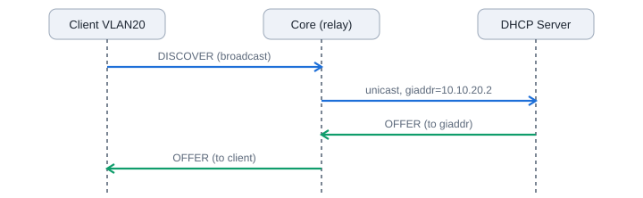
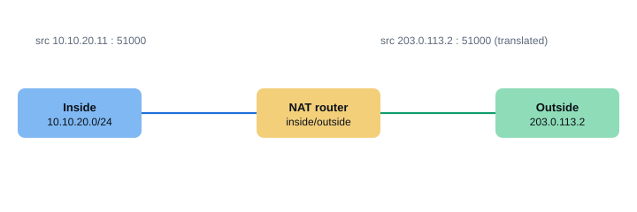
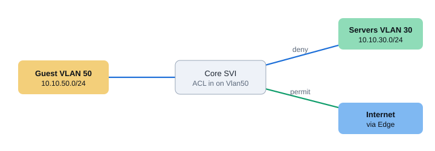
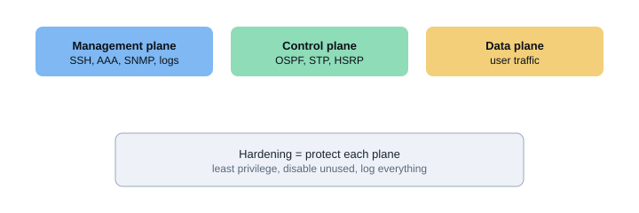
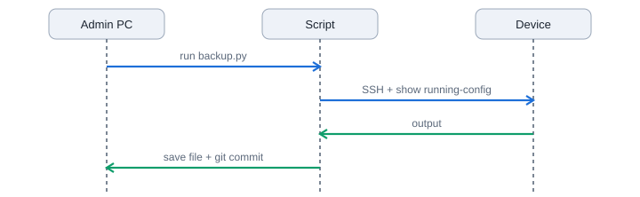
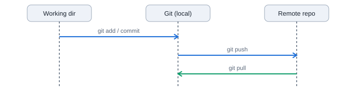

# Enterprise Network & Security Engineering — دوره‌ی تخصصی Cisco و Enterprise Firewall
## بخش ۳ از ۱۱ — فصل‌های ۷ تا ۹

| مورد | مقدار |
|---|---|
| نام دوره | Enterprise Network & Security Engineering (Cisco + FortiGate) |
| شماره بخش | ۳ از ۱۱ |
| فصل‌های این فایل | ۷ ، ۸ ، ۹ |
| تاریخ تولید | ۲۰۲۶-۱۱-۲۶ |
| نسخه Blueprint | v3.0 (+ بازبینی ۱٫۱) |
| نسخه‌های نرم‌افزار | Cisco vIOS-L2 15.2(20200924، Experimental) ؛ Cisco vIOS 15.9(3)M9 ؛ VPCS ؛ PNetLab 4.2.8 ؛ ESXi 8.0U2 |
| وضعیت تکمیل | **فصل‌های ۷–۹: ۷ و ۸ از درس‌های موجود تبدیل شد؛ فصل ۹ (BGP) جدید.** Labها عمدتاً اجرا نشده‌اند. |

> **قوانین خواندن:** تمرین‌ها و پرسش‌های مرور بدون پاسخ‌اند؛ پاسخ در «پاسخ‌های فصل». «اجرا نشده» یعنی خروجی‌ها **پیش‌نیاز/پیش‌بینی** هستند. «CLI-Accepted» ≠ «کار می‌کند». رمزها نمونه‌اند.

### وضعیت راستی‌آزمایی Labهای این بخش
خلاصه: اجرا نشده (فقط طراحی): 17, جزئی: 1.

| Lab | وضعیت |
|---|---|
| 7-1 | اجرا نشده (فقط طراحی) |
| 7-2 | اجرا نشده (فقط طراحی) |
| 7-3 | اجرا نشده (فقط طراحی) |
| 7-4 | اجرا نشده (فقط طراحی) |
| 7-5 | جزئی |
| 7-6 | اجرا نشده (فقط طراحی) |
| 8-1 | اجرا نشده (فقط طراحی) |
| 8-2 | اجرا نشده (فقط طراحی) |
| 8-3 | اجرا نشده (فقط طراحی) |
| 8-4 | اجرا نشده (فقط طراحی) |
| 8-5 | اجرا نشده (فقط طراحی) |
| 8-6 | اجرا نشده (فقط طراحی) |
| 9-1 | اجرا نشده (فقط طراحی) |
| 9-2 | اجرا نشده (فقط طراحی) |
| 9-3 | اجرا نشده (فقط طراحی) |
| 9-4 | اجرا نشده (فقط طراحی) |
| 9-5 | اجرا نشده (فقط طراحی) |
| 9-6 | اجرا نشده (فقط طراحی) |

---

<a id="ch7"></a>

# فصل 7 — IP Services: DHCP، DNS، NTP، NAT، ACL، Syslog و QoS

**مدت:** ۳۶ ساعت | **پیش‌نیاز:** فصل ۶.
**اهداف:** DHCP/Relay، DNS/NTP، NAT/PAT، ACL، Syslog/SNMP، QoS، Service Matrix.
**معیار تسلط:** Relay و Scope؛ NAT قابل‌اثبات؛ ACL با ترتیب درست؛ لاگ با ساعت درست.
**اشتباهات رایج:** فراموشی helper-address؛ ACL بدون permit؛ SNMP v2c در تولید.

**درس‌های فصل:**
- [درس 7-1 — DHCP و Relay](#l-7-1)
- [درس 7-2 — DNS و NTP](#l-7-2)
- [درس 7-3 — NAT و PAT](#l-7-3)
- [درس 7-4 — ACL](#l-7-4)
- [درس 7-5 — Syslog و SNMP](#l-7-5)
- [درس 7-6 — QoS و Service Matrix](#l-7-6)

---

<a id="l-7-1"></a>

## درس 7-1 — DHCP و Relay

**فصل ۷ - روز ۱ · پیش‌نیاز: درس ۴-۵ · ۶ ساعت**

### این درس درباره چیست و چرا باید یاد بگیریم؟

**چه چیزی یاد می‌گیریم:** راه‌اندازی DHCP Server روی روتر/سوییچ سیسکو، رزرو آدرس، و DHCP Relay (ip helper-address) برای زمانی که سرور در VLAN دیگری است.

**چرا لازم است:** هیچ سازمانی آدرس‌ها را دستی روی صدها کامپیوتر نمی‌زند. DHCP این کار را خودکار می‌کند؛ ولی چون Discover یک Broadcast است و Broadcast از VLAN خارج نمی‌شود، بدون Relay هر VLAN باید سرور جدا داشته باشد. فراموش‌کردن Relay از رایج‌ترین خطاهاست.

- **در کار روزانه:** «کاربر آدرس نمی‌گیرد» پرتکرارترین تیکت است.
- **در امنیت:** Reservation و Snooping از آدرس‌های غیرمجاز جلوگیری می‌کنند.
- **در Capstone:** Windows Server DHCP مرکز برای همه‌ی VLANها Relay می‌شود.

> **مسیر درس**
>
> DHCP Pool ← آدرس‌های مستثنا ← Lease و Reservation ← Relay ← مثال ساده/متوسط/سخت ← Lab ← عیب‌یابی.

#### اصطلاحات این درس (مخفف ← شکل کامل ← معنی)

| مخفف        | شکل کامل انگلیسی                    | معنی فارسی                              |
|-------------|-------------------------------------|-----------------------------------------|
| DHCP        | Dynamic Host Configuration Protocol | تخصیص خودکار IP                         |
| Pool        | DHCP Pool                           | محدوده‌ی آدرس قابل‌واگذاری                |
| Lease       | Lease time                          | مدت اجاره‌ی آدرس                         |
| Reservation | DHCP Reservation                    | اختصاص آدرس ثابت به یک MAC              |
| Relay       | DHCP Relay Agent                    | انتقال Discover به سرور در VLAN دیگر    |
| giaddr      | Gateway IP address                  | آدرس Interface Relay داخل پیام          |
| Scope       | DHCP Scope                          | معادل Pool در Windows Server            |
| Option      | DHCP Option                         | اطلاعات اضافه مثل DNS (۶) و Gateway (۳) |

### ۱. DHCP روی روتر یا سوییچ

یک Pool تعریف می‌کنیم: بازه‌ی آدرس، Gateway، DNS و مدت اجاره. آدرس‌های ثابت (Gateway، سرورها، پرینترها) را «مستثنا» می‌کنیم تا به کسی داده نشود.

``` text
R1(config)# ip dhcp excluded-address 10.10.20.1 10.10.20.20
R1(config)# ip dhcp pool USERS20
R1(dhcp-config)# network 10.10.20.0 255.255.255.0
R1(dhcp-config)# default-router 10.10.20.1
R1(dhcp-config)# dns-server 10.10.10.53
R1(dhcp-config)# domain-name lab.local
R1(dhcp-config)# lease 0 8 0
```

- `excluded-address`: بازه‌ی .1 تا .20 هرگز داده نمی‌شود.
- `lease 0 8 0`: روز، ساعت، دقیقه؛ یعنی ۸ ساعت. برای Wi-Fi مهمان کوتاه‌تر، برای کاربران ثابت بلندتر.
- `dns-server` و `default-router`: Optionهای ۶ و ۳ که به کلاینت می‌رسند.

### ۲. Reservation: آدرس ثابت برای یک دستگاه

پرینتر باید همیشه یک IP داشته باشد ولی تنظیم دستی روی آن ممکن نیست. با MAC آن یک رزرو می‌سازیم:

``` text
R1(config)# ip dhcp pool PRINTER1
R1(dhcp-config)# host 10.10.20.50 255.255.255.0
R1(dhcp-config)# client-identifier 01aa.bbcc.0001.00
R1(dhcp-config)# default-router 10.10.20.1
```

نکته: `client-identifier` با 01 شروع می‌شود (نوع Ethernet) و بعد MAC می‌آید.

### ۳. مشکل: سرور در VLAN دیگر

DHCP Server معمولاً در VLAN سرورهاست، نه در VLAN کاربران. Discover یک Broadcast است و Router/Core آن را عبور نمی‌دهد. **DHCP Relay** روی Interface Gateway کاربران، Broadcast را می‌گیرد و به‌صورت Unicast به سرور می‌فرستد:



*شکل ۱: Relay، Discover را Unicast می‌کند و آدرس Interface خودش را در giaddr می‌گذارد تا سرور Pool درست را انتخاب کند.*

``` text
Core(config)# interface vlan 20
Core(config-if)# ip helper-address 10.10.30.10
! 10.10.30.10 = DHCP server in VLAN 30
```

سرور با **giaddr** می‌فهمد Discover از کدام Subnet آمده و Pool مربوط (VLAN 20) را به کلاینت می‌دهد. پس سرور باید Scope برای هر Subnet داشته باشد.

> **هشدار**
>
> `ip helper-address` علاوه بر DHCP، ۸ سرویس UDP دیگر را هم Forward می‌کند (TFTP، DNS، NetBIOS، TACACS و ...). در Hardening با `no ip forward-protocol udp ...` محدودشان می‌کنیم.

### ۴. دستورهای مشاهده

``` text
R1# show ip dhcp pool
R1# show ip dhcp binding
R1# show ip dhcp conflict
R1# show ip dhcp server statistics
R1# debug ip dhcp server events   (briefly)
```

- `binding`: کدام MAC چه IP گرفته و تا کی.
- `conflict`: آدرسی که قبل از واگذاری Ping داده شد و کسی جواب داد (تداخل).
- `pool`: تعداد آدرس‌های مصرف‌شده و باقی‌مانده.

### ۵. مثال‌ها

#### ساده

``` text
PC1> ip dhcp
DDORA IP 10.10.20.21/24 GW 10.10.20.1
```

#### متوسط: Relay

``` text
Server in VLAN 30, clients in VLAN 20
ip helper-address on Vlan20 -> clients get 10.10.20.x from the right scope
```

#### سخت: Pool تمام شد

``` text
Symptom : new clients get 169.254.x.x
Check   : show ip dhcp pool -> 0 free addresses
Cause   : lease too long + many short-lived devices (e.g. guest Wi-Fi)
Fix     : shorten the lease, enlarge the pool, clear stale bindings
```

### تمرین‌ها

**ت1.** ۱ (ساده): چرا آدرس Gateway را exclude می‌کنیم؟ *(پاسخ: 7-1-ت1 در بخش «پاسخ‌ها» انتهای فصل)*

**ت2.** ۲ (ساده): DHCP Relay چه می‌کند؟ *(پاسخ: 7-1-ت2 در بخش «پاسخ‌ها» انتهای فصل)*

**ت3.** ۳ (متوسط): giaddr برای چیست؟ *(پاسخ: 7-1-ت3 در بخش «پاسخ‌ها» انتهای فصل)*

**ت4.** ۴ (متوسط): ۲۵۴ آدرس، ۲۰ مستثنا؛ حداکثر کلاینت؟ *(پاسخ: 7-1-ت4 در بخش «پاسخ‌ها» انتهای فصل)*

**ت5.** ۵ (سخت): کاربران VLAN 20 آدرس نمی‌گیرند ولی VLAN 10 می‌گیرد؛ علت محتمل؟ *(پاسخ: 7-1-ت5 در بخش «پاسخ‌ها» انتهای فصل)*

### Lab هدایت‌شده

#### گام ۱: DHCP روی Core

``` text
Core(config)# ip dhcp excluded-address 10.10.20.1 10.10.20.20
Core(config)# ip dhcp pool USERS20
Core(dhcp-config)# network 10.10.20.0 255.255.255.0
Core(dhcp-config)# default-router 10.10.20.254
Core(dhcp-config)# dns-server 10.10.10.53
```

#### گام ۲: تست با VPCS

``` text
PC1> ip dhcp
PC1> show ip
Core# show ip dhcp binding
```

#### گام ۳: Relay

DHCP Pool را روی یک روتر دیگر (مثلاً R-SRV در VLAN 30) بسازید و روی `interface vlan 20` دستور helper-address بزنید؛ از VPCS دوباره آدرس بگیرید و Capture را ببینید: Discover Broadcast روی لینک PC، Unicast روی لینک سرور.

#### گام ۴: Reservation

یک رزرو برای MAC یکی از VPCSها بسازید و تأیید کنید همیشه همان IP را می‌گیرد.

### Lab مستقل

جدول «Scope Plan» (VLAN، Subnet، بازه، Excluded، Lease، DNS، Reservationها) را در `02-design/dhcp-plan.md` بنویسید.

### عیب‌یابی

|         |                                                                                                                                  |
|---------|----------------------------------------------------------------------------------------------------------------------------------|
| Symptom | کلاینت 169.254.x.x می‌گیرد                                                                                                        |
| چک‌لیست  | ۱) Relay تنظیم است؟ ؛ ۲) Scope برای آن Subnet هست؟ ؛ ۳) Pool پر نشده؟ ؛ ۴) Snooping/ACL جلوی Offer را نمی‌گیرد؟ ؛ ۵) مسیر به سرور |
| ابزار   | show ip dhcp binding ، show ip dhcp pool ، Capture                                                                               |
| رفع     | افزودن Relay یا Scope                                                                                                            |

### سؤال‌های مرور

**م1.** DHCP Relay کی لازم است؟ *(پاسخ: 7-1-م1 در بخش «پاسخ‌ها» انتهای فصل)*

**م2.** Reservation چیست؟ *(پاسخ: 7-1-م2 در بخش «پاسخ‌ها» انتهای فصل)*

### English Corner: انگلیسی تخصصی این درس

این جمله‌ها از مستندات و محیط کار واقعی‌اند. بلند بخوانید و ترجمه را بپوشانید.

| English sentence                                     | ترجمه                                                 |
|------------------------------------------------------|-------------------------------------------------------|
| Exclude the static addresses from the DHCP pool.     | آدرس‌های ثابت را از Pool DHCP مستثنا کنید.             |
| The relay agent forwards the broadcast as a unicast. | Relay Agent، Broadcast را به‌صورت Unicast ارسال می‌کند. |
| The client received an APIPA address.                | کلاینت آدرس APIPA گرفت.                               |
| Create a reservation for the printer.                | برای پرینتر یک Reservation بسازید.                    |

**Q1.** Quick quiz (answer in English): Why does a DHCP request not cross a router by default? *(پاسخ: 7-1-Q1 در بخش «پاسخ‌ها» انتهای فصل)*

### تکلیف و چک‌لیست تسلط

- [ ] DHCP و Reservation را بسازم.
- [ ] Relay را تست و Capture را تحلیل کنم.
- [ ] Scope Plan را بنویسم.

### یادآوری اشتباهات شما

> **یادآوری**
>
> پیش‌بینی قبل از اجرا؛ بکاپ قبل از تغییر؛ پذیرفته‌شدن دستور ≠ کار کردن؛ فرمول‌ها در بلوک مستقل.


#### کارت Lab — DHCP و Relay

| # | فیلد | محتوا |
|---|---|---|
| 1 | عنوان و هدف | DHCP Server و Relay |
| 2 | پیش‌نیاز | فصل 6 |
| 3 | توپولوژی | Core + R-SRV |
| 4 | تجهیزات | Core، روتر |
| 5 | نسخه نرم‌افزار | vIOS-L2 15.2(20200924، Experimental) برای SW؛ vIOS 15.9(3)M9 برای R؛ VPCS؛ PNetLab 4.2.8 |
| 6 | IP Plan | VLAN 20/30 |
| 7 | وضعیت اولیه | Pool/Relay |
| 8 | صورت مسئله | IP از VLAN دیگر |
| 9 | مراحل هدایت‌شده | همان بخش «Lab هدایت‌شده» همین درس |
| 10 | تست عملکرد | `show ip dhcp binding` |
| 11 | سناریوی خرابی | بدون helper |
| 12 | روش عیب‌یابی | لایه‌ای/با شواهد (بخش عیب‌یابی همین درس) |
| 13 | نتیجه‌ی مورد انتظار | Lease |
| 14 | معیار پذیرش | Scope Plan |
| 15 | مستندات نهایی | `02-design/dhcp-plan.md` |
| 16 | Cleanup و بازگردانی | — |

> **وضعیت راستی‌آزمایی (خارج از ۱۶ فیلد):** **اجرا نشده (فقط طراحی).** DHCP pool فقط CLI-Accepted.

---

<a id="l-7-2"></a>

## درس 7-2 — DNS و NTP

**فصل ۷ - روز ۲ · پیش‌نیاز: درس ۷-۱ · ۶ ساعت**

### این درس درباره چیست و چرا باید یاد بگیریم؟

**چه چیزی یاد می‌گیریم:** دو سرویس پایه که همه‌چیز به آن‌ها وابسته است: DNS (تبدیل نام به IP) و NTP (هماهنگی ساعت). چطور کار می‌کنند، چطور روی سیسکو تنظیم و بررسی می‌شوند، و چرا خرابی‌شان شبکه را «عجیب» می‌کند.

**چرا لازم است:** بیشتر شکایت‌های «اینترنت قطع است» در واقع «DNS خراب است». و Logها، Certificateها، Kerberos و Active Directory بدون ساعت درست بی‌معنی یا خراب می‌شوند؛ اختلاف بیش از ۵ دقیقه، ورود به دامنه را ناممکن می‌کند.

- **در کار روزانه:** ping به IP جواب می‌دهد ولی به نام نه؟ DNS است.
- **در امنیت:** Log با ساعت اشتباه برای تحلیل حادثه بی‌ارزش است.
- **در Capstone:** DNS و NTP مرکز روی Windows Server است و همه‌ی تجهیزات به آن اشاره می‌کنند.

> **مسیر درس**
>
> DNS چطور کار می‌کند ← رکوردها ← تنظیم روی سیسکو ← NTP و Stratum ← مثال ساده/متوسط/سخت ← Lab ← عیب‌یابی.

#### اصطلاحات این درس (مخفف ← شکل کامل ← معنی)

| مخفف     | شکل کامل انگلیسی            | معنی فارسی                                 |
|----------|-----------------------------|--------------------------------------------|
| DNS      | Domain Name System          | سیستم نام دامنه                            |
| Resolver | DNS Resolver                | سرویس‌دهنده‌ای که پرس‌وجوی کلاینت را حل می‌کند |
| A        | A record                    | نام به IPv4                                |
| AAAA     | AAAA record                 | نام به IPv6                                |
| PTR      | Pointer record              | IP به نام                                  |
| CNAME    | Canonical Name              | نام مستعار                                 |
| NTP      | Network Time Protocol       | پروتکل هماهنگی ساعت                        |
| Stratum  | Stratum                     | فاصله از منبع زمان دقیق                    |
| UTC      | Coordinated Universal Time  | زمان هماهنگ جهانی                          |
| FQDN     | Fully Qualified Domain Name | نام کامل دامنه                             |

### ۱. DNS چطور کار می‌کند؟

دفترچه‌ی تلفن را تصور کنید: شما نام «example.com» را می‌دانید و DNS «شماره» (IP) آن را می‌دهد. کلاینت از سرور DNS خودش می‌پرسد؛ اگر سرور پاسخ را نداشت، از سرورهای بالاتر می‌پرسد و در پایان جواب را می‌گیرد و برای مدتی نگه می‌دارد (Cache).

``` text
Client -> local DNS server : www.example.com ?
Local DNS -> root / TLD / authoritative servers (if not cached)
Local DNS -> client : 203.0.113.10   (cached for TTL seconds)
```

| رکورد | کار                 | مثال                             |
|-------|---------------------|----------------------------------|
| A     | نام به IPv4         | srv1.lab.local = 10.10.30.10     |
| AAAA  | نام به IPv6         | srv1.lab.local = 2001:db8:30::10 |
| PTR   | IP به نام (Reverse) | 10.10.30.10 = srv1.lab.local     |
| CNAME | نام مستعار          | www = srv1                       |
| MX    | سرور ایمیل          | mail.lab.local                   |
| NS    | سرور DNS یک Zone    | dns1.lab.local                   |

### ۲. تنظیم DNS روی سیسکو

``` text
R1(config)# ip domain-name lab.local
R1(config)# ip name-server 10.10.10.53
R1(config)# ip domain lookup
R1# ping srv1
R1# nslookup srv1  (not on all images)
```

> **یادآوری از دوره**
>
> در درس ۲-۴ گفتیم `no ip domain-lookup` برای جلوگیری از «Translating...». اگر DNS واقعی دارید و می‌خواهید روی دستگاه از نام استفاده کنید، `ip domain lookup` و `ip name-server` را بزنید.

روی کلاینت Windows: `nslookup srv1.lab.local` و `ipconfig /flushdns`.

### ۳. NTP: همه‌ی ساعت‌ها یکی

ساعت کامپیوترها کم‌کم از هم فاصله می‌گیرد (Drift). NTP آن‌ها را با یک منبع دقیق هماهنگ می‌کند. سلسله‌مراتب Stratum: منبع اتمی/GPS ‏Stratum 0، سروری که مستقیم به آن وصل است Stratum 1، و هر مرحله پایین‌تر یک عدد بیشتر.

``` text
Stratum 0 : atomic clock / GPS
Stratum 1 : server directly attached
Stratum 2 : synchronizes from stratum 1
...
Stratum 16 : unsynchronized (invalid)
```

#### تنظیم NTP روی سیسکو

``` text
R1(config)# clock timezone IRST 3 30
R1(config)# ntp server 10.10.10.53
R1(config)# ntp server 192.168.88.1 prefer
R1(config)# service timestamps log datetime msec localtime
R1(config)# service timestamps debug datetime msec localtime
R1# show ntp status
R1# show ntp associations
R1# show clock detail
```

- `clock timezone IRST 3 30`: ایران +۳:۳۰ (UTC). منطقه‌ی زمانی را در نظر بگیرید.
- `ntp server ... prefer`: منبع ترجیحی. چند منبع برای تحمل خطا.
- `show ntp status`: باید `Clock is synchronized` باشد.

``` text
R1# show ntp associations
  address        ref clock   st  when  poll reach  delay  offset
*~10.10.10.53   .GPS.       2   18    64   377    1.2   0.3

* = synchronized   ~ = configured   reach 377 = all last 8 polls succeeded
```

در Lab ما ESXi از MikroTik (192.168.88.1) NTP می‌گیرد؛ همان منبع می‌تواند ریشه‌ی Stratum کل Lab باشد.

### ۴. مثال‌ها

#### ساده

``` text
ping 10.10.30.10 works but ping srv1 fails
-> DNS problem (name resolution), not connectivity
```

#### متوسط: ساعت اشتباه

``` text
Syslog entries from R1 show 2000-01-01 and from SW1 2026-11-08
-> logs cannot be correlated; configure NTP on all devices
```

#### سخت: Kerberos و Windows

اگر ساعت یک کلاینت بیش از ۵ دقیقه با Domain Controller اختلاف داشته باشد، ورود به دامنه یا دسترسی به فایل‌سرور شکست می‌خورد، با پیام‌های مبهم احراز هویت. همیشه اول ساعت را بررسی کنید.

### تمرین‌ها

**ت1.** ۱ (ساده): A و PTR چه فرقی دارند؟ *(پاسخ: 7-2-ت1 در بخش «پاسخ‌ها» انتهای فصل)*

**ت2.** ۲ (ساده): Stratum 16 یعنی؟ *(پاسخ: 7-2-ت2 در بخش «پاسخ‌ها» انتهای فصل)*

**ت3.** ۳ (متوسط): ping به IP می‌رسد ولی به نام نه؛ علت؟ *(پاسخ: 7-2-ت3 در بخش «پاسخ‌ها» انتهای فصل)*

**ت4.** ۴ (متوسط): ساعت Windows 6 دقیقه عقب است؛ اثر؟ *(پاسخ: 7-2-ت4 در بخش «پاسخ‌ها» انتهای فصل)*

**ت5.** ۵ (سخت): reach 0 در show ntp associations یعنی؟ *(پاسخ: 7-2-ت5 در بخش «پاسخ‌ها» انتهای فصل)*

### Lab هدایت‌شده

#### گام ۱: NTP روی روترها

``` text
R1(config)# clock timezone IRST 3 30
R1(config)# ntp server 192.168.88.1
R1# show ntp status
R1# show ntp associations
```

اگر IP مسیر نداشت، در Lab ایزوله NTP محلی را روی یک روتر (`ntp master 3`) بسازید و بقیه را به آن وصل کنید:

``` text
R1(config)# ntp master 3
R2(config)# ntp server 10.0.12.1
R2# show ntp status
```

#### گام ۲: DNS

در PNetLab یک VM سبک (مثلاً لینوکس) به‌عنوان DNS بسازید یا فعلاً روی سیسکو یک نگاشت محلی بنویسید:

``` text
R1(config)# ip host srv1 10.10.30.10
R1# ping srv1
```

#### گام ۳: Syslog با ساعت درست

``` text
R1(config)# service timestamps log datetime msec localtime
R1# show logging | include %
```

### Lab مستقل

«Service Dependency Map» بنویسید: چه تجهیزی به DNS/NTP کدام سرور اشاره می‌کند؛ در `02-design/dns-ntp-map.md`.

### عیب‌یابی

|         |                                                                                                         |
|---------|---------------------------------------------------------------------------------------------------------|
| Symptom | IP کار می‌کند، نام نه (یا ساعت اشتباه)                                                                   |
| چک‌لیست  | ۱) DNS Server درست روی کلاینت؟ ؛ ۲) رکورد A هست؟ ؛ ۳) NTP reach؟ ؛ ۴) Timezone؟ ؛ ۵) فایروال UDP 53/123 |
| ابزار   | nslookup ، show ntp associations ، show clock detail                                                    |
| رفع     | اصلاح DNS/NTP                                                                                           |

### سؤال‌های مرور

**م1.** DNS چه می‌کند؟ *(پاسخ: 7-2-م1 در بخش «پاسخ‌ها» انتهای فصل)*

**م2.** چرا NTP برای امنیت مهم است؟ *(پاسخ: 7-2-م2 در بخش «پاسخ‌ها» انتهای فصل)*

### English Corner: انگلیسی تخصصی این درس

این جمله‌ها از مستندات و محیط کار واقعی‌اند. بلند بخوانید و ترجمه را بپوشانید.

| English sentence                                       | ترجمه                                                |
|--------------------------------------------------------|------------------------------------------------------|
| The device synchronizes its clock with the NTP server. | دستگاه ساعتش را با سرور NTP هماهنگ می‌کند.            |
| DNS resolves hostnames to IP addresses.                | DNS نام میزبان را به IP تبدیل می‌کند.                 |
| A time skew of more than five minutes breaks Kerberos. | اختلاف ساعت بیش از پنج دقیقه Kerberos را خراب می‌کند. |
| Flush the DNS cache on the client.                     | Cache DNS کلاینت را پاک کنید.                        |

**Q1.** Quick quiz (answer in English): Why do all devices need the same NTP source? *(پاسخ: 7-2-Q1 در بخش «پاسخ‌ها» انتهای فصل)*

### تکلیف و چک‌لیست تسلط

- [ ] NTP را بالا بیاورم و Synchronized ببینم.
- [ ] فرق خرابی DNS و اتصال را توضیح دهم.
- [ ] Dependency Map را بنویسم.

### یادآوری اشتباهات شما

> **یادآوری**
>
> پیش‌بینی قبل از اجرا؛ بکاپ قبل از تغییر؛ پذیرفته‌شدن دستور ≠ کار کردن؛ فرمول‌ها در بلوک مستقل.


#### کارت Lab — DNS و NTP

| # | فیلد | محتوا |
|---|---|---|
| 1 | عنوان و هدف | DNS و NTP |
| 2 | پیش‌نیاز | درس 7-1 |
| 3 | توپولوژی | R1,R2 + سرور |
| 4 | تجهیزات | R1،R2 |
| 5 | نسخه نرم‌افزار | vIOS-L2 15.2(20200924، Experimental) برای SW؛ vIOS 15.9(3)M9 برای R؛ VPCS؛ PNetLab 4.2.8 |
| 6 | IP Plan | — |
| 7 | وضعیت اولیه | ntp/ip host |
| 8 | صورت مسئله | Sync |
| 9 | مراحل هدایت‌شده | همان بخش «Lab هدایت‌شده» همین درس |
| 10 | تست عملکرد | `show ntp status` |
| 11 | سناریوی خرابی | reach 0 |
| 12 | روش عیب‌یابی | لایه‌ای/با شواهد (بخش عیب‌یابی همین درس) |
| 13 | نتیجه‌ی مورد انتظار | Synchronized |
| 14 | معیار پذیرش | Dependency Map |
| 15 | مستندات نهایی | `02-design/dns-ntp-map.md` |
| 16 | Cleanup و بازگردانی | — |

> **وضعیت راستی‌آزمایی (خارج از ۱۶ فیلد):** **اجرا نشده (فقط طراحی).** NTP فقط CLI-Accepted (Sync آزمایش نشده).

---

<a id="l-7-3"></a>

## درس 7-3 — NAT و PAT

**فصل ۷ - روز ۳ · پیش‌نیاز: درس‌های ۲-۱ و ۷-۱ · ۶ ساعت**

### این درس درباره چیست و چرا باید یاد بگیریم؟

**چه چیزی یاد می‌گیریم:** NAT و PAT: چطور آدرس‌های خصوصی با یک (یا چند) آدرس عمومی به اینترنت می‌روند؛ انواع Static، Dynamic و Overload؛ Inside/Outside؛ و جدول Translation.

**چرا لازم است:** آدرس‌های خصوصی (10.x، 192.168.x) در اینترنت Route نمی‌شوند. NAT مبدأ بسته را در لبه عوض می‌کند تا پاسخ برگردد. هر شبکه‌ی داخلی که به اینترنت وصل است NAT دارد؛ و خرابی آن (مثلاً NAT دوگانه) مبهم‌ترین مشکلات را می‌سازد.

- **در کار روزانه:** تقریباً همه‌ی اینترنت‌ها PAT هستند.
- **در امنیت:** NAT امنیت نیست؛ فقط پنهان‌سازی آدرس است. محافظ اصلی Policy فایروال است.
- **در FortiGate:** Policy NAT، IP Pool و VIP همین مفاهیم را در فایروال دارند (W10).

> **مسیر درس**
>
> چرا NAT ← Inside/Outside ← Static ← Dynamic ← PAT/Overload ← مثال ساده/متوسط/سخت ← Lab ← عیب‌یابی.

#### اصطلاحات این درس (مخفف ← شکل کامل ← معنی)

| مخفف          | شکل کامل انگلیسی            | معنی فارسی                      |
|---------------|-----------------------------|---------------------------------|
| NAT           | Network Address Translation | ترجمه‌ی آدرس                     |
| PAT           | Port Address Translation    | ترجمه‌ی آدرس و پورت (Overload)   |
| Inside Local  | Inside Local                | آدرس داخلی قبل از ترجمه         |
| Inside Global | Inside Global               | آدرس عمومی بعد از ترجمه         |
| Overload      | NAT Overload                | چند آدرس داخلی با یک آدرس عمومی |
| VIP           | Virtual IP                  | Port Forward در فایروال (DNAT)  |
| DNAT          | Destination NAT             | تغییر آدرس مقصد                 |
| SNAT          | Source NAT                  | تغییر آدرس مبدأ                 |

### ۱. NAT چرا و چطور؟

فرض کنید یک ساختمان اداری یک شماره‌ی تلفن بیرونی دارد و داخل داخلی‌ها (۱۰۱، ۱۰۲...). وقتی کارمند ۱۰۲ تماس می‌گیرد، گیرنده شماره‌ی بیرونی را می‌بیند؛ منشی (NAT) می‌داند پاسخ را به کدام داخلی بدهد. NAT هم همین جدول را نگه می‌دارد.



*شکل ۱: NAT مبدأ بسته را از آدرس داخلی به آدرس عمومی تبدیل می‌کند و در جدول نگه می‌دارد.*

| اصطلاح         | معنی                                   | مثال        |
|----------------|----------------------------------------|-------------|
| Inside Local   | آدرس داخلی (قبل از ترجمه)              | 10.10.20.11 |
| Inside Global  | آدرس داخلی از دید بیرون (بعد از ترجمه) | 203.0.113.2 |
| Outside Global | آدرس مقصد در اینترنت                   | 8.8.8.8     |

### ۲. سه نوع NAT

| نوع            | نگاشت                                   | کاربرد                         |
|----------------|-----------------------------------------|--------------------------------|
| Static NAT     | یک به یک ثابت                           | انتشار سرور (مثلاً وب) به بیرون |
| Dynamic NAT    | داخلی به Pool از چند آدرس عمومی         | نادر؛ وقتی چند IP عمومی داریم  |
| PAT / Overload | چند داخلی به یک IP عمومی با پورت متفاوت | اینترنت عادی                   |

PAT چطور؟ برای هر ارتباط، علاوه بر آدرس، شماره‌ی پورت مبدأ هم عوض می‌شود تا ارتباط‌ها از هم جدا بمانند:

``` text
10.10.20.11:51000 -> 203.0.113.2:51000
10.10.20.12:51000 -> 203.0.113.2:51001   (port changed to stay unique)
```

### ۳. دستورها (خط‌به‌خط)

#### PAT (Overload) با ACL

``` text
R1(config)# access-list 10 permit 10.10.20.0 0.0.0.255
R1(config)# interface gi0/0
R1(config-if)# ip nat inside
R1(config)# interface gi0/1
R1(config-if)# ip nat outside
R1(config)# ip nat inside source list 10 interface gi0/1 overload
```

- `ip nat inside / outside`: هر Interface را نقش می‌دهد؛ بدون این‌ها NAT کار نمی‌کند.
- `access-list 10`: مشخص می‌کند کدام ترافیک ترجمه شود (چه کسی «داخل» است).
- `overload`: PAT. `interface gi0/1`: از IP همان Interface خروجی استفاده شود.

#### Static NAT (انتشار سرور)

``` text
R1(config)# ip nat inside source static 10.10.30.10 203.0.113.10
! port forward only HTTPS:
R1(config)# ip nat inside source static tcp 10.10.30.10 443 203.0.113.10 443
```

#### مشاهده

``` text
R1# show ip nat translations
R1# show ip nat statistics
R1# clear ip nat translation *
R1# debug ip nat   (briefly)
```

``` text
Pro Inside global        Inside local        Outside local    Outside global
icmp 203.0.113.2:1       10.10.20.11:1       8.8.8.8:1        8.8.8.8:1
tcp  203.0.113.2:51000   10.10.20.12:51000   93.184.216.34:443 93.184.216.34:443
```

### ۴. مثال‌ها

#### ساده

``` text
PC (10.10.20.11) pings 8.8.8.8
show ip nat translations shows the entry with inside global 203.0.113.2
```

#### متوسط: Static برای سرور

``` text
Outside client -> 203.0.113.10:443
Router translates the destination to 10.10.30.10:443 (inbound)
Return traffic is translated back automatically
```

#### سخت: چرا NAT کار نمی‌کند؟

``` text
Cause 1: ip nat inside/outside missing or on the wrong interface
Cause 2: ACL does not match the inside subnet
Cause 3: missing default route to the ISP
Cause 4: double NAT (router and firewall both translate)
Check : show ip nat translations (empty?) , show ip nat statistics (misses)
```

### تمرین‌ها

**ت1.** ۱ (ساده): PAT چه چیزی را علاوه بر IP تغییر می‌دهد؟ *(پاسخ: 7-3-ت1 در بخش «پاسخ‌ها» انتهای فصل)*

**ت2.** ۲ (ساده): Inside Global چیست؟ *(پاسخ: 7-3-ت2 در بخش «پاسخ‌ها» انتهای فصل)*

**ت3.** ۳ (متوسط): دو دستور لازم برای NAT روی یک Interface؟ *(پاسخ: 7-3-ت3 در بخش «پاسخ‌ها» انتهای فصل)*

**ت4.** ۴ (متوسط): چرا NAT امنیت نیست؟ *(پاسخ: 7-3-ت4 در بخش «پاسخ‌ها» انتهای فصل)*

**ت5.** ۵ (سخت): NAT دوگانه (Double NAT) چه مشکلی می‌سازد؟ *(پاسخ: 7-3-ت5 در بخش «پاسخ‌ها» انتهای فصل)*

### Lab هدایت‌شده

روتر EDGE-R1 با Inside = لینک به Core و Outside = Loopback شبیه اینترنت (یا یک روتر دیگر).

#### گام ۱: PAT

``` text
EDGE-R1(config)# access-list 10 permit 10.10.0.0 0.0.255.255
EDGE-R1(config)# interface gi0/0
EDGE-R1(config-if)# ip nat inside
EDGE-R1(config)# interface gi0/2
EDGE-R1(config-if)# ip address 203.0.113.2 255.255.255.0
EDGE-R1(config-if)# ip nat outside
EDGE-R1(config)# ip nat inside source list 10 interface gi0/2 overload
```

#### گام ۲: تست

``` text
PC1> ping 203.0.113.1
EDGE-R1# show ip nat translations
EDGE-R1# show ip nat statistics
```

طبق Probe اولیه، دستور NAT در vIOSL2 «پذیرفته» می‌شود؛ روی روتر vIOS (IOS واقعی) باید کار کند. نتیجه‌ی واقعی را ثبت کنید.

#### گام ۳: Static NAT

یک سرور Inside را با Static منتشر کنید و از «بیرون» تست کنید.

#### گام ۴: قبل/بعد Capture

روی لینک Inside و Outside Capture بگیرید و آدرس مبدأ را مقایسه کنید.

### Lab مستقل

جدول «NAT Matrix» (Inside Local، Inside Global، نوع، سرویس) و تصویر Packet Flow قبل/بعد NAT را در `02-design/nat-matrix.md` بنویسید.

### عیب‌یابی

|         |                                                                                                                  |
|---------|------------------------------------------------------------------------------------------------------------------|
| Symptom | اینترنت ندارم؛ ping داخلی OK                                                                                     |
| چک‌لیست  | ۱) show ip nat translations خالی؟ ؛ ۲) inside/outside درست؟ ؛ ۳) ACL مطابق؟ ؛ ۴) Default route؟ ؛ ۵) Double NAT؟ |
| ابزار   | show ip nat statistics ، debug ip nat                                                                            |
| رفع     | اصلاح نقش Interface یا ACL                                                                                       |

### سؤال‌های مرور

**م1.** PAT چطور چند کاربر را با یک IP می‌برد؟ *(پاسخ: 7-3-م1 در بخش «پاسخ‌ها» انتهای فصل)*

**م2.** Static NAT برای چیست؟ *(پاسخ: 7-3-م2 در بخش «پاسخ‌ها» انتهای فصل)*

### English Corner: انگلیسی تخصصی این درس

این جمله‌ها از مستندات و محیط کار واقعی‌اند. بلند بخوانید و ترجمه را بپوشانید.

| English sentence                                                          | ترجمه                                                                 |
|---------------------------------------------------------------------------|-----------------------------------------------------------------------|
| Configure NAT overload on the outside interface.                          | NAT Overload را روی Interface خارجی تنظیم کنید.                       |
| The translation table shows the inside local and inside global addresses. | جدول Translation، آدرس‌های Inside Local و Inside Global را نشان می‌دهد. |
| NAT is not a security feature.                                            | NAT ویژگی امنیتی نیست.                                                |
| Double NAT breaks inbound port forwarding.                                | Double NAT ارسال پورت ورودی را خراب می‌کند.                            |

**Q1.** Quick quiz (answer in English): What does PAT add to the translation to keep sessions unique? *(پاسخ: 7-3-Q1 در بخش «پاسخ‌ها» انتهای فصل)*

### تکلیف و چک‌لیست تسلط

- [ ] PAT را بسازم و Translation را ببینم.
- [ ] Static NAT را تست کنم.
- [ ] NAT Matrix را بنویسم.

### یادآوری اشتباهات شما

> **یادآوری**
>
> پیش‌بینی قبل از اجرا؛ بکاپ قبل از تغییر؛ پذیرفته‌شدن دستور ≠ کار کردن؛ فرمول‌ها در بلوک مستقل.


#### کارت Lab — NAT و PAT

| # | فیلد | محتوا |
|---|---|---|
| 1 | عنوان و هدف | NAT/PAT |
| 2 | پیش‌نیاز | درس 7-2 |
| 3 | توپولوژی | Edge |
| 4 | تجهیزات | EDGE-R1 |
| 5 | نسخه نرم‌افزار | vIOS-L2 15.2(20200924، Experimental) برای SW؛ vIOS 15.9(3)M9 برای R؛ VPCS؛ PNetLab 4.2.8 |
| 6 | IP Plan | Inside/Outside |
| 7 | وضعیت اولیه | overload |
| 8 | صورت مسئله | Translation |
| 9 | مراحل هدایت‌شده | همان بخش «Lab هدایت‌شده» همین درس |
| 10 | تست عملکرد | `show ip nat translations` |
| 11 | سناریوی خرابی | inside/outside غلط |
| 12 | روش عیب‌یابی | لایه‌ای/با شواهد (بخش عیب‌یابی همین درس) |
| 13 | نتیجه‌ی مورد انتظار | Translation |
| 14 | معیار پذیرش | NAT Matrix |
| 15 | مستندات نهایی | `02-design/nat-matrix.md` |
| 16 | Cleanup و بازگردانی | — |

> **وضعیت راستی‌آزمایی (خارج از ۱۶ فیلد):** **اجرا نشده (فقط طراحی).** NAT فقط CLI-Accepted.

---

<a id="l-7-4"></a>

## درس 7-4 — ACL

**فصل ۷ - روز ۴ · پیش‌نیاز: درس‌های ۲-۵ و ۶-۵ · ۶ ساعت**

### این درس درباره چیست و چرا باید یاد بگیریم؟

**چه چیزی یاد می‌گیریم:** فهرست کنترل دسترسی (ACL): انواع Standard و Extended، قاعده‌ی «اولین تطابق» و Implicit Deny، جای درست گذاشتن ACL، و نوشتن Policy بین VLANها.

**چرا لازم است:** ACL اولین ابزار کنترل ترافیک روی سیسکوست و پایه‌ی فهم Policy فایروال است. ترتیب اشتباه یک قاعده یا فراموشی Implicit Deny می‌تواند کل شبکه را قطع کند یا درِ امنیت را باز بگذارد.

- **در کار روزانه:** جداکردن مهمان از شبکه‌ی داخلی و محدودکردن مدیریت (SSH).
- **در امنیت:** ACL، Least Privilege را در لایه‌ی شبکه پیاده می‌کند.
- **در FortiGate:** Policy فایروال همان منطق Top-Down و First Match را دارد (با Stateful بودن).

> **مسیر درس**
>
> ACL چیست ← First Match و Implicit Deny ← Standard در برابر Extended ← جای ACL ← مثال ساده/متوسط/سخت ← Lab ← عیب‌یابی.

#### اصطلاحات این درس (مخفف ← شکل کامل ← معنی)

| مخفف          | شکل کامل انگلیسی     | معنی فارسی                 |
|---------------|----------------------|----------------------------|
| ACL           | Access Control List  | فهرست قوانین permit/deny   |
| Standard      | Standard ACL         | فقط آدرس مبدأ              |
| Extended      | Extended ACL         | مبدأ، مقصد، پروتکل، پورت   |
| Implicit Deny | Implicit Deny        | انکار ضمنی در پایان هر ACL |
| Wildcard      | Wildcard mask        | معکوس Mask                 |
| ACE           | Access Control Entry | یک خط ACL                  |
| Stateless     | Stateless            | بدون حافظه‌ی وضعیت ارتباط   |
| established   | TCP established      | بسته‌های بعد از برقراری TCP |

### ۱. ACL چیست؟

ACL فهرستی از قوانین است. هر قانون می‌گوید: «اگر بسته با این مشخصات بود، اجازه بده (permit) یا ببند (deny)». مثل لیست مهمانان در ورودی یک سالن؛ نگهبان از بالای لیست شروع می‌کند و هر نامی را پیدا کرد همان‌جا تصمیم می‌گیرد.

> **دو قانون اصلی**
>
> ۱) **اولین تطابق** (First Match): از بالا به پایین؛ به محض اولین قانونی که جور شد، بقیه خوانده نمی‌شود. ۲) **Implicit Deny**: در انتهای هر ACL یک `deny any` نامرئی هست؛ پس هر چه صریحاً permit نشده، بسته می‌شود.



*شکل ۱: ACL روی ورودی SVI مهمان: دسترسی به سرورها بسته و اینترنت باز است.*

### ۲. Standard در برابر Extended

| معیار   | Standard             | Extended                 |
|---------|----------------------|--------------------------|
| شماره   | 1-99 و 1300-1999     | 100-199 و 2000-2699      |
| معیار   | فقط IP مبدأ          | مبدأ، مقصد، پروتکل، پورت |
| جای نصب | نزدیک مقصد           | نزدیک مبدأ               |
| کاربرد  | فیلتر ساده (مثل VTY) | Policy دقیق بین VLANها   |

چرا Standard نزدیک مقصد؟ چون فقط مبدأ را می‌شناسد؛ اگر نزدیک مبدأ بگذارید، ترافیک آن مبدأ به همه‌ی مقصدها بسته می‌شود. Extended را نزدیک مبدأ می‌گذارند تا ترافیک ناخواسته زودتر از شبکه خارج شود.

### ۳. دستورها (خط‌به‌خط)

روش Named که قابل‌ویرایش و خواناست:

``` text
Core(config)# ip access-list extended GUEST-IN
Core(config-ext-nacl)# remark block guests from internal networks
Core(config-ext-nacl)# deny ip 10.10.50.0 0.0.0.255 10.10.0.0 0.0.255.255
Core(config-ext-nacl)# permit udp 10.10.50.0 0.0.0.255 any eq 53
Core(config-ext-nacl)# permit tcp 10.10.50.0 0.0.0.255 any eq 80
Core(config-ext-nacl)# permit tcp 10.10.50.0 0.0.0.255 any eq 443
Core(config-ext-nacl)# deny ip any any log
Core(config-ext-nacl)# exit
Core(config)# interface vlan 50
Core(config-if)# ip access-group GUEST-IN in
```

- `remark`: توضیح خط‌به‌خط (حتماً بنویسید).
- اول `deny` برای شبکه‌ی داخلی (10.10.0.0/16)؛ بعد permitهای لازم (DNS، وب).
- `log`: برای دیدن Hit در Log (روی خطوط deny مفید است).
- `ip access-group NAME in`: ACL را روی ورودی Interface اعمال می‌کند.

``` text
Core# show access-lists
Core# show ip interface vlan 50 | include access list
Core# show running-config | section ip access-list
```

``` text
Extended IP access list GUEST-IN
    10 deny ip 10.10.50.0 0.0.0.255 10.10.0.0 0.0.255.255 (12 matches)
    20 permit udp 10.10.50.0 0.0.0.255 any eq domain (45 matches)
    30 permit tcp 10.10.50.0 0.0.0.255 any eq www
    40 permit tcp 10.10.50.0 0.0.0.255 any eq 443
    50 deny ip any any log (3 matches)
```

### ۴. نکته‌های حرفه‌ای

- **ترتیب مهم است:** اگر permit کلی را بالای deny بگذارید، deny هرگز اجرا نمی‌شود.
- **ACL فقط ترافیک عبوری را فیلتر می‌کند،** نه ترافیکی که خود روتر می‌سازد.
- **Stateless است:** برگشت ترافیک باید صراحتاً مجاز شود (مثلاً `established` برای TCP)؛ فایروال Stateful این را خودکار می‌کند.
- **جهت (in/out) را درست انتخاب کنید:** in = ورودی به Interface از بیرون؛ out = خروجی.
- **قبل از اعمال،** مطمئن شوید قانون مدیریت (SSH) شما را قطع نمی‌کند.

``` text
Return traffic example (TCP, stateless ACL):
  permit tcp any 10.10.20.0 0.0.0.255 established
matches only packets with ACK/RST bits set (replies), not new connections
```

### ۵. مثال‌ها

#### ساده: SSH فقط از مدیریت (Standard)

``` text
Core(config)# ip access-list standard MGMT-ONLY
Core(config-std-nacl)# permit 10.10.10.0 0.0.0.255
Core(config)# line vty 0 4
Core(config-line)# access-class MGMT-ONLY in
```

#### متوسط: کاربران فقط HTTPS و DNS به سرور

``` text
ip access-list extended USERS-TO-SRV
 permit tcp 10.10.20.0 0.0.0.255 host 10.10.30.10 eq 443
 permit udp 10.10.20.0 0.0.0.255 host 10.10.30.53 eq 53
 deny ip 10.10.20.0 0.0.0.255 10.10.30.0 0.0.0.255 log
 permit ip any any
```

#### سخت: چرا Ping کار می‌کند ولی HTTPS نه؟

``` text
Cause 1: ACL has permit icmp above, no permit for tcp 443
Cause 2: ACL applied in the wrong direction or on the wrong interface
Cause 3: implicit deny (no permit for the traffic)
Cause 4: return path ACL blocks the replies (stateless)
Check : show access-lists (hit counters), show ip interface ... | include access
```

### تمرین‌ها

**ت1.** ۱ (ساده): Implicit Deny چیست؟ *(پاسخ: 7-4-ت1 در بخش «پاسخ‌ها» انتهای فصل)*

**ت2.** ۲ (ساده): Extended را کجا می‌گذاریم؟ *(پاسخ: 7-4-ت2 در بخش «پاسخ‌ها» انتهای فصل)*

**ت3.** ۳ (متوسط): Wildcard برای 10.10.20.0/24؟ *(پاسخ: 7-4-ت3 در بخش «پاسخ‌ها» انتهای فصل)*

**ت4.** ۴ (متوسط): چرا ترتیب مهم است؟ *(پاسخ: 7-4-ت4 در بخش «پاسخ‌ها» انتهای فصل)*

**ت5.** ۵ (سخت): ACL روی VLAN مهمان هر چیزی را می‌بندد؛ چه چیزی فراموش شده؟ *(پاسخ: 7-4-ت5 در بخش «پاسخ‌ها» انتهای فصل)*

### Lab هدایت‌شده

روی Core از Lab A (یا هر روتر با دو VLAN):

#### گام ۱: Baseline

``` text
PC-guest> ping 10.10.30.10   (before ACL: success)
```

#### گام ۲: ACL و اعمال

ACL بخش ۳ را بسازید و روی `interface vlan 50` اعمال کنید (in). قبل از آن بکاپ بگیرید.

#### گام ۳: Verify

``` text
PC-guest> ping 10.10.30.10   (expect: fail)
PC-guest> ping 8.8.8.8        (expect: success via edge)
Core# show access-lists       (hit counters rise)
```

طبق Probe، ACL روی vIOSL2 «پذیرفته» می‌شود و ممکن است عملاً اعمال نشود؛ روی روتر vIOS (L3) تست کنید و نتیجه‌ی واقعی را ثبت کنید.

#### گام ۴: خراب‌کردن عمدی ترتیب

یک `permit ip any any` بالای deny بگذارید و ببینید deny بی‌اثر می‌شود؛ سپس با شماره‌ی خط ترتیب را اصلاح کنید.

### Lab مستقل

یک «Policy Matrix» (مبدأ VLAN، مقصد VLAN، سرویس، اجازه/انکار) برای ۳ VLAN در `02-design/policy-matrix.md` بنویسید.

### عیب‌یابی

|         |                                                                                                         |
|---------|---------------------------------------------------------------------------------------------------------|
| Symptom | ترافیک مجاز بسته شده یا ترافیک ممنوع رد می‌شود                                                           |
| چک‌لیست  | ۱) ACL روی کدام Interface و جهت؟ ؛ ۲) ترتیب خطوط؟ ؛ ۳) Hit Count؟ ؛ ۴) Implicit Deny؟ ؛ ۵) برگشت ترافیک |
| ابزار   | show access-lists ، show ip interface                                                                   |
| رفع     | اصلاح ترتیب یا افزودن permit                                                                            |

### سؤال‌های مرور

**م1.** اولین تطابق یعنی چه؟ *(پاسخ: 7-4-م1 در بخش «پاسخ‌ها» انتهای فصل)*

**م2.** تفاوت Stateless و Stateful؟ *(پاسخ: 7-4-م2 در بخش «پاسخ‌ها» انتهای فصل)*

### English Corner: انگلیسی تخصصی این درس

این جمله‌ها از مستندات و محیط کار واقعی‌اند. بلند بخوانید و ترجمه را بپوشانید.

| English sentence                                                     | ترجمه                                                          |
|----------------------------------------------------------------------|----------------------------------------------------------------|
| Apply the ACL inbound on the VLAN interface.                         | ACL را روی ورودی Interface مربوط به VLAN اعمال کنید.           |
| Rules are evaluated top-down, first match wins.                      | قوانین از بالا به پایین ارزیابی می‌شوند؛ اولین تطابق برنده است. |
| Add a remark to document the purpose of each entry.                  | برای مستندسازی هدف هر خط یک remark بگذارید.                    |
| The implicit deny drops everything that is not explicitly permitted. | Implicit Deny هر چه صریحاً مجاز نشده را می‌اندازد.               |

**Q1.** Quick quiz (answer in English): Where should a standard ACL be placed and why? *(پاسخ: 7-4-Q1 در بخش «پاسخ‌ها» انتهای فصل)*

### تکلیف و چک‌لیست تسلط

- [ ] ACL را بسازم و Hit Count ببینم.
- [ ] ترتیب اشتباه را بسازم و رفع کنم.
- [ ] Policy Matrix را بنویسم.

### یادآوری اشتباهات شما

> **یادآوری**
>
> پیش‌بینی قبل از اجرا؛ بکاپ قبل از تغییر؛ پذیرفته‌شدن دستور ≠ کار کردن؛ فرمول‌ها در بلوک مستقل.


#### کارت Lab — ACL

| # | فیلد | محتوا |
|---|---|---|
| 1 | عنوان و هدف | ACL استاندارد/Extended |
| 2 | پیش‌نیاز | درس 7-3 |
| 3 | توپولوژی | Core |
| 4 | تجهیزات | Core |
| 5 | نسخه نرم‌افزار | vIOS-L2 15.2(20200924، Experimental) برای SW؛ vIOS 15.9(3)M9 برای R؛ VPCS؛ PNetLab 4.2.8 |
| 6 | IP Plan | VLAN 50 |
| 7 | وضعیت اولیه | GUEST-IN |
| 8 | صورت مسئله | Hit Count |
| 9 | مراحل هدایت‌شده | همان بخش «Lab هدایت‌شده» همین درس |
| 10 | تست عملکرد | `show access-lists` |
| 11 | سناریوی خرابی | ترتیب غلط |
| 12 | روش عیب‌یابی | لایه‌ای/با شواهد (بخش عیب‌یابی همین درس) |
| 13 | نتیجه‌ی مورد انتظار | deny مهمان→سرور |
| 14 | معیار پذیرش | Policy Matrix |
| 15 | مستندات نهایی | `02-design/policy-matrix.md` |
| 16 | Cleanup و بازگردانی | — |

> **وضعیت راستی‌آزمایی (خارج از ۱۶ فیلد):** **اجرا نشده (فقط طراحی).** ACL فقط CLI-Accepted.

---

<a id="l-7-5"></a>

## درس 7-5 — Syslog و SNMP

**فصل ۷ - روز ۵ · پیش‌نیاز: درس ۷-۲ · ۶ ساعت**

### این درس درباره چیست و چرا باید یاد بگیریم؟

**چه چیزی یاد می‌گیریم:** پایش دستگاه‌ها: ارسال Log به سرور مرکزی با Syslog (سطح‌های ۰ تا ۷)، تنظیم سرور rsyslog، و پرس‌وجوی وضعیت با SNMP (v2c فقط در Lab و v3 امن).

**چرا لازم است:** وقتی شبکه خراب شد، اولین سؤال این است: «چه چیزی تغییر کرد؟». Log مرکزی با ساعت درست جواب می‌دهد. SNMP هم داده‌ی عددی (CPU، ترافیک، Interface) برای مانیتورینگ و هشدار می‌دهد. بدون این دو، مدیریت شبکه کور است.

- **در کار روزانه:** هر Interface که قطع/وصل می‌شود در Log دیده می‌شود.
- **در امنیت:** Log مرکزی پایه‌ی SIEM و تحلیل حادثه است؛ Community لو رفته یعنی نفوذ.
- **در Capstone:** Zabbix و rsyslog در Phase مانیتورینگ همین داده‌ها را می‌گیرند.

> **مسیر درس**
>
> Syslog و سطح‌ها ← سرور rsyslog ← SNMP v2c و v3 ← امنیت ← مثال ساده/متوسط/سخت ← Lab ← عیب‌یابی.

#### اصطلاحات این درس (مخفف ← شکل کامل ← معنی)

| مخفف      | شکل کامل انگلیسی                          | معنی فارسی               |
|-----------|-------------------------------------------|--------------------------|
| Syslog    | System Logging Protocol                   | ارسال پیام Log به سرور   |
| Severity  | Syslog severity                           | سطح اهمیت ۰ تا ۷         |
| rsyslog   | rsyslog                                   | سرور Syslog در لینوکس    |
| SNMP      | Simple Network Management Protocol        | پروتکل پایش و مدیریت     |
| MIB       | Management Information Base               | پایگاه اشیاء قابل‌پایش    |
| OID       | Object Identifier                         | شناسه‌ی هر شیء            |
| Community | SNMP Community                            | رمز ساده‌ی v2c (متن ساده) |
| Trap      | SNMP Trap                                 | اعلان غیرهم‌زمان دستگاه   |
| SIEM      | Security Information and Event Management | تحلیل متمرکز Log         |

### ۱. Syslog: دفتر ثبت وقایع

دستگاه هر رویداد مهم را به‌صورت یک خط پیام می‌نویسد: لینک بالا رفت، کاربر وارد شد، ACL بسته را رد کرد. هر پیام یک سطح اهمیت (Severity) دارد:

| سطح | نام           | معنی                |
|-----|---------------|---------------------|
| 0   | Emergency     | سیستم از کار افتاده |
| 1   | Alert         | نیاز به اقدام فوری  |
| 2   | Critical      | وضعیت بحرانی        |
| 3   | Error         | خطا                 |
| 4   | Warning       | هشدار               |
| 5   | Notice        | رویداد معمولی مهم   |
| 6   | Informational | اطلاعات             |
| 7   | Debug         | اشکال‌زدایی          |

قاعده: عدد کمتر یعنی مهم‌تر. اگر روی «سطح ۶» تنظیم کنید، سطح‌های ۰ تا ۶ ارسال می‌شود.

### ۲. تنظیم سیسکو برای ارسال Log

``` text
R1(config)# service timestamps log datetime msec localtime
R1(config)# logging host 10.10.10.60
R1(config)# logging trap informational
R1(config)# logging source-interface loopback 0
R1(config)# logging buffered 16384
R1(config)# logging console warnings
R1# show logging
```

- `logging host`: آدرس سرور rsyslog (UDP 514).
- `logging trap informational`: سطح ارسال (تا ۶).
- `source-interface loopback 0`: همه‌ی Logها با آدرس ثابت دستگاه می‌آیند.
- `buffered`: نگه‌داری در حافظه‌ی خود دستگاه (برای وقتی سرور نیست).

> **ساعت!**
>
> بدون NTP (درس ۷-۲)، Log بی‌ارزش است. اول NTP، بعد Syslog.

### ۳. سرور rsyslog (لینوکس)

روی VM مانیتورینگ (`MON`) rsyslog را برای دریافت UDP 514 فعال می‌کنیم و Log هر دستگاه را در فایل جدا می‌نویسیم:

``` text
# /etc/rsyslog.d/10-network.conf
module(load="imudp")
input(type="imudp" port="514")

template(name="PerHost" type="string"
  string="/var/log/network/%HOSTNAME%.log")
if ($fromhost-ip startswith "10.10.") then {
  action(type="omfile" dynaFile="PerHost")
  stop
}
```

``` text
sudo mkdir -p /var/log/network
sudo systemctl restart rsyslog
sudo ss -ulnp | grep 514
sudo tail -f /var/log/network/R1.log
```

این دستورها را شما روی VM اجرا می‌کنید؛ من فقط فرمان می‌دهم. VM هنوز ساخته نشده؛ در Phase مانیتورینگ ساخته می‌شود، اینجا مفهوم و پیکربندی را بشناسید.

### ۴. SNMP: سؤال‌وجواب با دستگاه

سرور مانیتورینگ هر چند ثانیه از دستگاه می‌پرسد (Poll): «CPU چند درصد؟ ترافیک Interface؟». هر مقدار با یک OID مشخص می‌شود. دستگاه می‌تواند خودش هم رویداد اعلام کند (Trap).

| نسخه | احراز هویت           | رمزگذاری       | توصیه   |
|------|----------------------|----------------|---------|
| v1   | Community (متن ساده) | ندارد          | ممنوع   |
| v2c  | Community (متن ساده) | ندارد          | فقط Lab |
| v3   | نام‌کاربری + SHA      | AES (authPriv) | تولید   |

#### v2c فقط برای Lab

``` text
R1(config)# ip access-list standard SNMP-MGR
R1(config-std-nacl)# permit host 10.10.10.60
R1(config)# snmp-server community <LAB-COMMUNITY> RO SNMP-MGR
R1(config)# snmp-server location LAB-HQ
R1(config)# snmp-server contact netadmin@lab.local
```

#### v3 امن

``` text
R1(config)# snmp-server group MON-GRP v3 priv
R1(config)# snmp-server user monitor MON-GRP v3 auth sha <AUTH-PASS> priv aes 128 <PRIV-PASS>
R1(config)# snmp-server host 10.10.10.60 version 3 priv monitor
R1(config)# snmp-server enable traps
```

> **نکته‌ی امنیتی**
>
> رمزها و Communityها را در ریپو و اسناد ننویسید؛ جانگهدار بگذارید و مقدار واقعی را در مدیریت رمز نگه دارید. Community پیش‌فرض (public/private) ممنوع است. دسترسی SNMP را با ACL به آدرس سرور مانیتورینگ محدود کنید. سینتکس v3 روی Image شما باید تأیید شود (Unverified).

``` text
R1# show snmp
R1# show snmp user
R1# show snmp host
! from the monitoring VM (Linux):
snmpwalk -v2c -c <LAB-COMMUNITY> 10.0.12.1 1.3.6.1.2.1.1.1.0
```

### ۵. مثال‌ها

#### ساده

``` text
Interface flaps -> log line on the server:
Nov  8 10:12:01 R1 %LINK-3-UPDOWN: Interface GigabitEthernet0/1, changed state to down
```

#### متوسط: تحلیل رویداد

``` text
10:12:01 %LINK-3-UPDOWN gi0/1 down
10:12:02 %OSPF-5-ADJCHG neighbor 2.2.2.2 Full -> Down
10:12:32 %LINK-3-UPDOWN gi0/1 up
10:12:40 %OSPF-5-ADJCHG neighbor 2.2.2.2 Down -> Full
Conclusion: a 31 s link outage caused an OSPF flap
```

#### سخت: چرا Log نمی‌رسد؟

``` text
Cause 1: no route to the log server
Cause 2: ACL/firewall blocks UDP 514
Cause 3: wrong logging trap level
Cause 4: server not listening (ss -ulnp)
Cause 5: wrong time makes entries look missing
```

### تمرین‌ها

**ت1.** ۱ (ساده): سطح Syslog برای «خطا»؟ *(پاسخ: 7-5-ت1 در بخش «پاسخ‌ها» انتهای فصل)*

**ت2.** ۲ (ساده): چرا v2c خطرناک است؟ *(پاسخ: 7-5-ت2 در بخش «پاسخ‌ها» انتهای فصل)*

**ت3.** ۳ (متوسط): logging trap warnings چه سطح‌هایی را می‌فرستد؟ *(پاسخ: 7-5-ت3 در بخش «پاسخ‌ها» انتهای فصل)*

**ت4.** ۴ (متوسط): چرا source-interface loopback؟ *(پاسخ: 7-5-ت4 در بخش «پاسخ‌ها» انتهای فصل)*

**ت5.** ۵ (سخت): Poll در برابر Trap؟ *(پاسخ: 7-5-ت5 در بخش «پاسخ‌ها» انتهای فصل)*

### Lab هدایت‌شده

#### گام ۱: Syslog روی روتر

``` text
R1(config)# service timestamps log datetime msec localtime
R1(config)# logging buffered 16384
R1(config)# logging host 10.10.10.60
R1(config)# logging trap informational
R1# show logging
```

#### گام ۲: تولید رویداد

``` text
R1(config)# interface loopback 99
R1(config-if)# shutdown
R1(config-if)# no shutdown
R1# show logging | include LINEPROTO
```

اگر سرور rsyslog ندارید، فقط `show logging` (Buffer) را بررسی کنید؛ بعداً سرور را می‌سازیم.

#### گام ۳: SNMP (فقط ساخت و Verify)

``` text
R1# show snmp
R1# show snmp community
```

طبق Probe، SNMP روی vIOSL2 فقط «پذیرفته» بود؛ روی روتر نتیجه را ثبت کنید.

### Lab مستقل

یک «Monitoring Matrix» بنویسید: هر دستگاه، ارسال Syslog (سطح)، SNMP (نسخه/ACL)، منبع NTP، در `02-design/monitoring-matrix.md`.

### عیب‌یابی

|         |                                                                                      |
|---------|--------------------------------------------------------------------------------------|
| Symptom | Log روی سرور نمی‌رسد                                                                  |
| چک‌لیست  | ۱) logging host درست؟ ؛ ۲) مسیر و ACL؟ ؛ ۳) سطح trap؟ ؛ ۴) سرور گوش می‌دهد؟ ؛ ۵) ساعت |
| ابزار   | show logging ، tcpdump روی سرور                                                      |
| رفع     | اصلاح مسیر یا سطح                                                                    |

### سؤال‌های مرور

**م1.** Syslog چیست؟ *(پاسخ: 7-5-م1 در بخش «پاسخ‌ها» انتهای فصل)*

**م2.** چرا SNMPv3؟ *(پاسخ: 7-5-م2 در بخش «پاسخ‌ها» انتهای فصل)*

### English Corner: انگلیسی تخصصی این درس

این جمله‌ها از مستندات و محیط کار واقعی‌اند. بلند بخوانید و ترجمه را بپوشانید.

| English sentence                                             | ترجمه                                               |
|--------------------------------------------------------------|-----------------------------------------------------|
| Send logs to a central syslog server for correlation.        | Logها را برای همبستگی به سرور Syslog مرکزی بفرستید. |
| SNMPv3 provides authentication and encryption.               | SNMPv3 احراز هویت و رمزگذاری دارد.                  |
| Never use the default community strings.                     | هرگز از Community پیش‌فرض استفاده نکنید.             |
| Make sure the clocks are synchronized before analyzing logs. | قبل از تحلیل Log مطمئن شوید ساعت‌ها هماهنگ‌اند.       |

**Q1.** Quick quiz (answer in English): What does a lower syslog severity number mean? *(پاسخ: 7-5-Q1 در بخش «پاسخ‌ها» انتهای فصل)*

### تکلیف و چک‌لیست تسلط

- [ ] Syslog را تنظیم و رویداد تولید کنم.
- [ ] تفاوت v2c و v3 را بگویم.
- [ ] Monitoring Matrix را بنویسم.

### یادآوری اشتباهات شما

> **یادآوری**
>
> پیش‌بینی قبل از اجرا؛ بکاپ قبل از تغییر؛ پذیرفته‌شدن دستور ≠ کار کردن؛ فرمول‌ها در بلوک مستقل.


#### کارت Lab — Syslog و SNMP

| # | فیلد | محتوا |
|---|---|---|
| 1 | عنوان و هدف | Syslog و SNMP |
| 2 | پیش‌نیاز | درس 7-4 |
| 3 | توپولوژی | R1 + MON |
| 4 | تجهیزات | R1 |
| 5 | نسخه نرم‌افزار | vIOS-L2 15.2(20200924، Experimental) برای SW؛ vIOS 15.9(3)M9 برای R؛ VPCS؛ PNetLab 4.2.8 |
| 6 | IP Plan | — |
| 7 | وضعیت اولیه | logging host |
| 8 | صورت مسئله | لاگ |
| 9 | مراحل هدایت‌شده | همان بخش «Lab هدایت‌شده» همین درس |
| 10 | تست عملکرد | `show logging` |
| 11 | سناریوی خرابی | سطح غلط |
| 12 | روش عیب‌یابی | لایه‌ای/با شواهد (بخش عیب‌یابی همین درس) |
| 13 | نتیجه‌ی مورد انتظار | لاگ رویداد |
| 14 | معیار پذیرش | Monitoring Matrix |
| 15 | مستندات نهایی | `02-design/monitoring-matrix.md` |
| 16 | Cleanup و بازگردانی | — |

> **وضعیت راستی‌آزمایی (خارج از ۱۶ فیلد):** **جزئی.** شروع Syslog Tested-OK؛ دریافت در سرور و SNMP آزمایش نشده.

---

<a id="l-7-6"></a>

## درس 7-6 — QoS و Service Matrix

**فصل ۷ - روز ۶ · پیش‌نیاز: درس‌های ۷-۱ تا ۷-۵ · ۶ ساعت**

### این درس درباره چیست و چرا باید یاد بگیریم؟

**چه چیزی یاد می‌گیریم:** مفهوم کیفیت سرویس (QoS): دسته‌بندی، علامت‌گذاری (DSCP)، صف‌بندی و محدودسازی؛ و جمع‌بندی هفته با «Service Matrix» و آزمون کوچک.

**چرا لازم است:** وقتی پهنای باند کم است، صدا و تصویر زنده (VoIP) باید جلوتر از دانلود فایل بروند وگرنه قطع‌وصل می‌شوند. QoS تعیین می‌کند چه ترافیکی اولویت دارد. حتی اگر روزانه استفاده نکنید، باید مفهومش را بدانید.

- **در کار روزانه:** تماس صوتی/ویدیویی و پشتیبان‌گیری هم‌زمان؛ QoS راه‌حل است.
- **در امنیت:** محدودسازی ترافیک مشکوک و جلوگیری از اشباع لینک.
- **در FortiGate:** Traffic Shaper همین مفاهیم را دارد.

> **مسیر درس**
>
> مشکل رقابت ترافیک ← چهار ابزار QoS ← DSCP ← مثال ساده/متوسط/سخت ← Lab ← Service Matrix ← آزمون.

#### اصطلاحات این درس (مخفف ← شکل کامل ← معنی)

| مخفف       | شکل کامل انگلیسی                   | معنی فارسی                       |
|------------|------------------------------------|----------------------------------|
| QoS        | Quality of Service                 | کیفیت سرویس؛ اولویت‌دهی ترافیک    |
| DSCP       | Differentiated Services Code Point | علامت ۶ بیتی اولویت در IP        |
| EF         | Expedited Forwarding (DSCP 46)     | اولویت بالا برای صدا             |
| AF         | Assured Forwarding                 | کلاس‌های تضمین‌شده                 |
| Policing   | Policing                           | قطع/کاهش ترافیک اضافی            |
| Shaping    | Shaping                            | کند کردن و صف‌کردن برای رعایت نرخ |
| Queuing    | Queuing                            | صف‌بندی بر اساس کلاس              |
| Class-map  | Class-map                          | تعریف کلاس ترافیک                |
| Policy-map | Policy-map                         | تعریف رفتار هر کلاس              |

### ۱. مشکل: رقابت روی یک لینک

جاده‌ای را تصور کنید که آمبولانس و کامیون باری هر دو در آن گرفتار ترافیک‌اند. آمبولانس (صدا) باید جلو برود؛ کامیون (دانلود) می‌تواند صبر کند. QoS همان «لاین ویژه» است.

### ۲. چهار ابزار QoS

| ابزار            | کار                                                 |
|------------------|-----------------------------------------------------|
| Classification   | تشخیص نوع ترافیک (با ACL یا DSCP)                   |
| Marking          | علامت‌گذاری اولویت (DSCP/CoS)                        |
| Queuing          | صف‌بندی؛ ترافیک مهم زودتر خارج می‌شود                 |
| Policing/Shaping | محدودکردن نرخ؛ Policing قطع می‌کند، Shaping صف می‌کند |

#### DSCP چیست؟

یک فیلد ۶ بیتی در هدر IP که اولویت را نشان می‌دهد؛ ۶ بیت یعنی ۶۴ مقدار:

``` text
DSCP bits = 6 -> 2 ^ 6 = 64 values (0 .. 63)
```

| کلاس         | DSCP | کاربرد              |
|--------------|------|---------------------|
| EF           | 46   | صدا (VoIP)          |
| AF41         | 34   | ویدیو               |
| AF31         | 26   | داده‌ی مهم           |
| BE (Default) | 0    | ترافیک عادی         |
| CS1          | 8    | کم‌اهمیت (Scavenger) |

### ۳. دستورها (MQC)

سیسکو QoS را با «Modular QoS CLI» می‌سازد: سه قدم Class-map، Policy-map، Service-policy:

``` text
R1(config)# ip access-list extended VOICE
R1(config-ext-nacl)# permit udp any any range 16384 32767
R1(config-ext-nacl)# exit
R1(config)# class-map match-any VOICE-CLASS
R1(config-cmap)# match access-group name VOICE
R1(config-cmap)# exit
R1(config)# policy-map WAN-OUT
R1(config-pmap)# class VOICE-CLASS
R1(config-pmap-c)# priority percent 20
R1(config-pmap-c)# set dscp ef
R1(config-pmap)# class class-default
R1(config-pmap-c)# fair-queue
R1(config-pmap-c)# exit
R1(config)# interface gi0/1
R1(config-if)# service-policy output WAN-OUT
```

- `priority percent 20`: ۲۰٪ پهنای باند برای صدا با اولویت مطلق (صف LLQ).
- `set dscp ef`: علامت‌گذاری EF.
- `class-default`: بقیه‌ی ترافیک.
- `service-policy output`: روی Interface خروجی اعمال می‌شود (QoS معمولاً روی خروجی صف می‌سازد).

``` text
R1# show policy-map interface gi0/1
R1# show class-map
R1# show policy-map
```

> **صادقانه**
>
> QoS در شبیه‌ساز vIOS ممکن است فقط پیکربندی را بپذیرد بدون صف‌بندی واقعی. هدف این درس فهم مفهوم و دستورهاست؛ نتیجه‌ی واقعی Lab را ثبت کنید.

### ۴. Service Matrix: جمع‌بندی فصل ۷

یک جدول که برای هر سرویس مشخص می‌کند «چه کسی، کجا، با چه تنظیمی»:

| سرویس  | سرور/دستگاه      | Client        | تنظیم کلیدی            | Verification             |
|--------|------------------|---------------|------------------------|--------------------------|
| DHCP   | Core/Windows     | همه‌ی VLANها   | Scope + helper-address | show ip dhcp binding     |
| DNS    | Windows          | همه           | ip name-server         | nslookup                 |
| NTP    | MikroTik/Windows | همه تجهیزات   | ntp server             | show ntp status          |
| NAT    | Edge/FGT         | VLANهای کاربر | overload               | show ip nat translations |
| ACL    | Core/FGT         | VLAN مهمان    | access-group           | show access-lists        |
| Syslog | MON VM           | همه تجهیزات   | logging host           | tail log                 |
| SNMP   | MON VM           | همه تجهیزات   | v3 + ACL               | snmpwalk                 |

### ۵. آزمون کوچک پایان هفته‌ی ۷ (بدون نگاه به درس)

| \#  | وظیفه                          | مدرک                     |
|-----|--------------------------------|--------------------------|
| ۱   | DHCP + Relay برای VLAN دیگر    | show ip dhcp binding     |
| ۲   | NTP روی همه‌ی تجهیزات           | show ntp status          |
| ۳   | PAT و Static NAT               | show ip nat translations |
| ۴   | ACL برای مهمان (Policy Matrix) | show access-lists        |
| ۵   | Syslog + مفهوم SNMPv3          | show logging             |
| ۶   | Service Matrix کامل            | فایل طراحی               |

معیار: حداقل ۵ از ۶ مورد. وقتی تمام شد بگویید «فصل ۷ انجام شد».

### تمرین‌ها

**ت1.** ۱ (ساده): DSCP چند بیت و چند مقدار؟ *(پاسخ: 7-6-ت1 در بخش «پاسخ‌ها» انتهای فصل)*

**ت2.** ۲ (ساده): فرق Policing و Shaping؟ *(پاسخ: 7-6-ت2 در بخش «پاسخ‌ها» انتهای فصل)*

**ت3.** ۳ (متوسط): سه قدم MQC؟ *(پاسخ: 7-6-ت3 در بخش «پاسخ‌ها» انتهای فصل)*

**ت4.** ۴ (متوسط): DSCP صدا؟ *(پاسخ: 7-6-ت4 در بخش «پاسخ‌ها» انتهای فصل)*

**ت5.** ۵ (سخت): چرا QoS را معمولاً روی خروجی اعمال می‌کنیم؟ *(پاسخ: 7-6-ت5 در بخش «پاسخ‌ها» انتهای فصل)*

### Lab هدایت‌شده

#### گام ۱: ساخت MQC

Class-map و Policy-map بخش ۳ را بسازید.

#### گام ۲: Verify

``` text
R1# show policy-map interface gi0/1
R1# show class-map
```

#### گام ۳: تولید ترافیک

ping با اندازه‌ی بزرگ و ترافیک ساده تولید کنید و شمارنده‌ی کلاس را ببینید؛ اگر شمارنده بالا نرفت، همان را به‌عنوان محدودیت شبیه‌ساز ثبت کنید.

### Lab مستقل

Service Matrix فصل ۷ را در `02-design/service-matrix.md` بنویسید و آزمون کوچک را کامل کنید.

### عیب‌یابی

|         |                                                                                               |
|---------|-----------------------------------------------------------------------------------------------|
| Symptom | صدا قطع‌وصل می‌شود                                                                              |
| چک‌لیست  | ۱) لینک اشباع است؟ ؛ ۲) کلاس صدا مطابق؟ ؛ ۳) policy روی Interface خروجی؟ ؛ ۴) DSCP حفظ می‌شود؟ |
| ابزار   | show policy-map interface                                                                     |
| رفع     | افزودن کلاس اولویت                                                                            |

### سؤال‌های مرور

**م1.** QoS برای چیست؟ *(پاسخ: 7-6-م1 در بخش «پاسخ‌ها» انتهای فصل)*

**م2.** DSCP چه می‌کند؟ *(پاسخ: 7-6-م2 در بخش «پاسخ‌ها» انتهای فصل)*

### English Corner: انگلیسی تخصصی این درس

این جمله‌ها از مستندات و محیط کار واقعی‌اند. بلند بخوانید و ترجمه را بپوشانید.

| English sentence                                        | ترجمه                                                         |
|---------------------------------------------------------|---------------------------------------------------------------|
| Classify the voice traffic and give it strict priority. | ترافیک صدا را دسته‌بندی کنید و اولویت مطلق بدهید.              |
| Apply the service policy in the outbound direction.     | Service Policy را روی جهت خروجی اعمال کنید.                   |
| Shaping buffers excess traffic while policing drops it. | Shaping ترافیک اضافه را بافر می‌کند، Policing آن را حذف می‌کند. |
| QoS only matters when the link is congested.            | QoS فقط هنگام ازدحام لینک اهمیت دارد.                         |

**Q1.** Quick quiz (answer in English): When does QoS actually make a difference? *(پاسخ: 7-6-Q1 در بخش «پاسخ‌ها» انتهای فصل)*

### تکلیف و چک‌لیست تسلط

- [ ] MQC را بسازم و Verify کنم.
- [ ] Service Matrix را بنویسم.
- [ ] آزمون کوچک را کامل کنم.

### یادآوری اشتباهات شما

> **یادآوری**
>
> پیش‌بینی قبل از اجرا؛ بکاپ قبل از تغییر؛ پذیرفته‌شدن دستور ≠ کار کردن؛ فرمول‌ها در بلوک مستقل.


#### کارت Lab — QoS و Service Matrix

| # | فیلد | محتوا |
|---|---|---|
| 1 | عنوان و هدف | QoS مقدماتی و Service Matrix |
| 2 | پیش‌نیاز | درس 7-5 |
| 3 | توپولوژی | R1 |
| 4 | تجهیزات | R1 |
| 5 | نسخه نرم‌افزار | vIOS-L2 15.2(20200924، Experimental) برای SW؛ vIOS 15.9(3)M9 برای R؛ VPCS؛ PNetLab 4.2.8 |
| 6 | IP Plan | — |
| 7 | وضعیت اولیه | MQC |
| 8 | صورت مسئله | شمارنده کلاس |
| 9 | مراحل هدایت‌شده | همان بخش «Lab هدایت‌شده» همین درس |
| 10 | تست عملکرد | `show policy-map interface` |
| 11 | سناریوی خرابی | Interface ورودی |
| 12 | روش عیب‌یابی | لایه‌ای/با شواهد (بخش عیب‌یابی همین درس) |
| 13 | نتیجه‌ی مورد انتظار | شمارنده |
| 14 | معیار پذیرش | Service Matrix |
| 15 | مستندات نهایی | `02-design/service-matrix.md` |
| 16 | Cleanup و بازگردانی | — |

> **وضعیت راستی‌آزمایی (خارج از ۱۶ فیلد):** **اجرا نشده (فقط طراحی).** QoS اجرا نشده.

---

<a id="ans-7"></a>

## پاسخ‌های فصل 7

> ابتدا بدون نگاه حل کنید. شناسه: درس-نوع+شماره (ت = تمرین، م = مرور، Q = Quick quiz).

**7-1-ت1** — ۱ (ساده): چرا آدرس Gateway را exclude می‌کنیم؟

``` text
So the DHCP server never hands out the gateway address to a client.
```

**7-1-ت2** — ۲ (ساده): DHCP Relay چه می‌کند؟

``` text
It converts the client broadcast into a unicast to a DHCP server on another subnet.
```

**7-1-ت3** — ۳ (متوسط): giaddr برای چیست؟

``` text
It tells the server which subnet the request came from, so it picks the right scope.
```

**7-1-ت4** — ۴ (متوسط): ۲۵۴ آدرس، ۲۰ مستثنا؛ حداکثر کلاینت؟

``` text
254 - 20 = 234
```

**7-1-ت5** — ۵ (سخت): کاربران VLAN 20 آدرس نمی‌گیرند ولی VLAN 10 می‌گیرد؛ علت محتمل؟

``` text
Missing ip helper-address on Vlan20 (or no scope for that subnet on the server).
```

**7-1-م1** — DHCP Relay کی لازم است؟

وقتی سرور DHCP در Subnet دیگری است.

**7-1-م2** — Reservation چیست؟

اختصاص آدرس ثابت به یک MAC در Pool.

**7-1-Q1** — Quick quiz (answer in English): Why does a DHCP request not cross a router by default?

Because it is a broadcast and routers do not forward broadcasts.

**7-2-ت1** — ۱ (ساده): A و PTR چه فرقی دارند؟

``` text
A maps a name to an IP; PTR maps an IP back to a name (reverse lookup).
```

**7-2-ت2** — ۲ (ساده): Stratum 16 یعنی؟

``` text
The device is not synchronized (invalid time source).
```

**7-2-ت3** — ۳ (متوسط): ping به IP می‌رسد ولی به نام نه؛ علت؟

``` text
DNS resolution failure (no/wrong DNS server, missing record).
```

**7-2-ت4** — ۴ (متوسط): ساعت Windows 6 دقیقه عقب است؛ اثر؟

``` text
Kerberos authentication to the domain fails (allowed skew is about 5 minutes).
```

**7-2-ت5** — ۵ (سخت): reach 0 در show ntp associations یعنی؟

``` text
None of the recent polls succeeded: server unreachable or filtered.
```

**7-2-م1** — DNS چه می‌کند؟

نام را به IP تبدیل می‌کند.

**7-2-م2** — چرا NTP برای امنیت مهم است؟

تحلیل Log و احراز هویت به ساعت صحیح وابسته است.

**7-2-Q1** — Quick quiz (answer in English): Why do all devices need the same NTP source?

So timestamps in logs and certificates are consistent and events can be correlated.

**7-3-ت1** — ۱ (ساده): PAT چه چیزی را علاوه بر IP تغییر می‌دهد؟

``` text
The source port, so many hosts can share one public IP.
```

**7-3-ت2** — ۲ (ساده): Inside Global چیست؟

``` text
The inside host's address as seen from outside after translation.
```

**7-3-ت3** — ۳ (متوسط): دو دستور لازم برای NAT روی یک Interface؟

``` text
ip nat inside on the LAN interface and ip nat outside on the WAN interface.
```

**7-3-ت4** — ۴ (متوسط): چرا NAT امنیت نیست؟

``` text
It only hides addresses; it does not filter traffic. A firewall policy provides the protection.
```

**7-3-ت5** — ۵ (سخت): NAT دوگانه (Double NAT) چه مشکلی می‌سازد؟

``` text
Translations at two devices break inbound port forwards and complicate troubleshooting.
```

**7-3-م1** — PAT چطور چند کاربر را با یک IP می‌برد؟

با تغییر پورت مبدأ برای هر ارتباط.

**7-3-م2** — Static NAT برای چیست؟

انتشار یک سرور داخلی با آدرس ثابت به بیرون.

**7-3-Q1** — Quick quiz (answer in English): What does PAT add to the translation to keep sessions unique?

The source port number.

**7-4-ت1** — ۱ (ساده): Implicit Deny چیست؟

``` text
An invisible "deny any" at the end of every ACL.
```

**7-4-ت2** — ۲ (ساده): Extended را کجا می‌گذاریم؟

``` text
Close to the source of the traffic.
```

**7-4-ت3** — ۳ (متوسط): Wildcard برای 10.10.20.0/24؟

``` text
0.0.0.255
```

**7-4-ت4** — ۴ (متوسط): چرا ترتیب مهم است؟

``` text
Evaluation stops at the first match; a broad permit above a deny makes the deny unreachable.
```

**7-4-ت5** — ۵ (سخت): ACL روی VLAN مهمان هر چیزی را می‌بندد؛ چه چیزی فراموش شده؟

``` text
A permit for DNS (udp/53) and required web ports, because of the implicit deny.
```

**7-4-م1** — اولین تطابق یعنی چه؟

بررسی از بالا به پایین و توقف در اولین قانون مطابق.

**7-4-م2** — تفاوت Stateless و Stateful؟

Stateless هر بسته را مستقل بررسی می‌کند؛ Stateful وضعیت ارتباط را نگه می‌دارد.

**7-4-Q1** — Quick quiz (answer in English): Where should a standard ACL be placed and why?

Close to the destination, because it matches only the source address.

**7-5-ت1** — ۱ (ساده): سطح Syslog برای «خطا»؟

``` text
3 (Error)
```

**7-5-ت2** — ۲ (ساده): چرا v2c خطرناک است؟

``` text
The community string is sent in clear text and there is no encryption.
```

**7-5-ت3** — ۳ (متوسط): logging trap warnings چه سطح‌هایی را می‌فرستد؟

``` text
Levels 0 to 4 (emergencies to warnings).
```

**7-5-ت4** — ۴ (متوسط): چرا source-interface loopback؟

``` text
The log source address stays stable even if a physical interface fails.
```

**7-5-ت5** — ۵ (سخت): Poll در برابر Trap؟

``` text
Poll: the server asks periodically. Trap: the device sends an event on its own.
```

**7-5-م1** — Syslog چیست؟

ارسال پیام رویدادها به سرور مرکزی.

**7-5-م2** — چرا SNMPv3؟

احراز هویت و رمزگذاری دارد، برخلاف v2c.

**7-5-Q1** — Quick quiz (answer in English): What does a lower syslog severity number mean?

A more severe event (0 = emergency, 7 = debug).

**7-6-ت1** — ۱ (ساده): DSCP چند بیت و چند مقدار؟

``` text
6 bits, 64 values.
```

**7-6-ت2** — ۲ (ساده): فرق Policing و Shaping؟

``` text
Policing drops/marks excess traffic; shaping buffers and delays it to smooth the rate.
```

**7-6-ت3** — ۳ (متوسط): سه قدم MQC؟

``` text
class-map, policy-map, service-policy
```

**7-6-ت4** — ۴ (متوسط): DSCP صدا؟

``` text
EF (46).
```

**7-6-ت5** — ۵ (سخت): چرا QoS را معمولاً روی خروجی اعمال می‌کنیم؟

``` text
Congestion (queues) forms when sending out a slower/limited interface, so queuing is applied on egress.
```

**7-6-م1** — QoS برای چیست؟

اولویت‌دهی ترافیک حساس هنگام کمبود پهنای باند.

**7-6-م2** — DSCP چه می‌کند؟

اولویت ترافیک را در هدر IP علامت می‌زند.

**7-6-Q1** — Quick quiz (answer in English): When does QoS actually make a difference?

Only when there is congestion on a link.

---

<a id="ch8"></a>

# فصل 8 — Hardening، AAA، Automation و As-Built (CP1)

**مدت:** ۳۶ ساعت | **پیش‌نیاز:** فصل ۷.
**اهداف:** Hardening، AAA، JSON/YAML/REST، Netmiko، Ansible، Git، As-Built؛ **CP1**.
**معیار تسلط:** Baseline امن؛ بکاپ خودکار read-only؛ As-Built کامل.
**اشتباهات رایج:** قفل‌شدن با AAA؛ رمز در Git؛ اجرای خودکار بدون `--check`.

**درس‌های فصل:**
- [درس 8-1 — Hardening تجهیزات](#l-8-1)
- [درس 8-2 — AAA و سطح‌های دسترسی](#l-8-2)
- [درس 8-3 — JSON، YAML و REST](#l-8-3)
- [درس 8-4 — Python و Netmiko](#l-8-4)
- [درس 8-5 — Ansible](#l-8-5)
- [درس 8-6 — Git، As-Built و CP1](#l-8-6)

---

<a id="l-8-1"></a>

## درس 8-1 — Hardening تجهیزات

**فصل ۸ - روز ۱ · پیش‌نیاز: درس‌های ۲-۵، ۴-۲ و ۷-۴ · ۶ ساعت**

### این درس درباره چیست و چرا باید یاد بگیریم؟

**چه چیزی یاد می‌گیریم:** سخت‌سازی (Hardening) تجهیزات سیسکو: بستن سرویس‌های غیرضروری، محافظت از سه صفحه‌ی دستگاه (مدیریت، کنترل، داده)، و تهیه‌ی یک چک‌لیست استاندارد قابل‌اجرا روی همه‌ی دستگاه‌ها.

**چرا لازم است:** تجهیز شبکه‌ی «روشن‌شده و کار می‌کند» با تنظیمات پیش‌فرض آسیب‌پذیر است: سرویس‌های اضافه، رمزهای ضعیف، Telnet و پورت‌های باز. بیشتر نفوذها از پیکربندی ضعیف است، نه ضعف الگوریتم. Hardening ارزان‌ترین کنترل امنیتی است.

- **در کار روزانه:** هر دستگاه جدید قبل از ورود به Production باید طبق چک‌لیست سخت‌سازی شود.
- **در امنیت:** کاهش سطح حمله (Attack Surface).
- **در Capstone:** CP1 (نقطه‌ی بازبینی ۱) بر اساس همین استاندارد ارزیابی می‌شود.

> **مسیر درس**
>
> سه صفحه‌ی دستگاه ← چک‌لیست مدیریت ← کنترل ← داده ← مثال ساده/متوسط/سخت ← Lab ← عیب‌یابی.

#### اصطلاحات این درس (مخفف ← شکل کامل ← معنی)

| مخفف             | شکل کامل انگلیسی              | معنی فارسی                |
|------------------|-------------------------------|---------------------------|
| Hardening        | Device hardening              | سخت‌سازی؛ کاهش سطح حمله    |
| Attack Surface   | Attack Surface                | مجموع نقاط قابل‌حمله       |
| Management Plane | Management Plane              | مدیریت دستگاه (SSH، SNMP) |
| Control Plane    | Control Plane                 | پروتکل‌های مسیریابی/STP    |
| Data Plane       | Data Plane                    | ترافیک کاربران            |
| CDP              | Cisco Discovery Protocol      | کشف همسایه (اطلاعات‌افشا)  |
| LLDP             | Link Layer Discovery Protocol | نسخه‌ی استاندارد CDP       |
| CoPP             | Control Plane Policing        | محدودسازی ترافیک به CPU   |

### ۱. سه صفحه‌ی هر دستگاه

یک تجهیز شبکه سه «لایه‌ی کار» دارد؛ هر کدام راه حمله‌ی خودش را دارد:



*شکل ۱: سه صفحه‌ی دستگاه و هدف Hardening.*

| صفحه       | کار                   | خطر                      | کنترل                           |
|------------|-----------------------|--------------------------|---------------------------------|
| Management | ورود ادمین، SNMP، Log | دسترسی غیرمجاز           | SSH، ACL، AAA، رمز قوی          |
| Control    | OSPF، STP، HSRP       | تزریق مسیر/Root جعلی     | Authentication، BPDU/Root Guard |
| Data       | ترافیک کاربران        | اسکن، Spoofing، Flooding | ACL، Port Security، Snooping    |

### ۲. چک‌لیست Management Plane

``` text
! 1. strong local credentials, hashed
enable secret <SECRET>
username admin privilege 15 secret <PASSWORD>
service password-encryption
no enable password

! 2. SSH only, version 2, key >= 2048
ip domain-name lab.local
crypto key generate rsa modulus 2048
ip ssh version 2
ip ssh time-out 60
ip ssh authentication-retries 3
line vty 0 4
 transport input ssh
 login local
 exec-timeout 10 0
 access-class MGMT-ONLY in
line console 0
 exec-timeout 10 0
 logging synchronous

! 3. brute-force protection
login block-for 120 attempts 5 within 60
login on-failure log
login on-success log

! 4. banners
banner login # Authorized access only #

! 5. turn off unneeded management
no ip http server
no ip http secure-server
no service pad
no service finger
no ip bootp server
```

- `service password-encryption`: رمزهای Type 7 را مخفی می‌کند ولی ضعیف است؛ رمز واقعی را فقط با `secret` بگذارید.
- `login block-for`: بعد از ۵ تلاش ناموفق در ۶۰ ثانیه، ۱۲۰ ثانیه ورود بسته می‌شود.
- `no ip http server`: وب‌مدیریت بدون نیاز را می‌بندد.

> **هشدار**
>
> رمز واقعی را در ریپو نگذارید (جانگهدار). و قبل از اعمال ACL/تغییر VTY از راه دور، `reload in 5` بگذارید تا قفل نشوید (درس ۲-۴).

### ۳. چک‌لیست Control Plane

``` text
! Layer 2
spanning-tree mode rapid-pvst
spanning-tree portfast bpduguard default
spanning-tree guard root     (on edge facing ports)

! Neighbor discovery: only where needed
no cdp run                   (or: no cdp enable on user-facing ports)
lldp run                     (only on trusted links)

! Routing: passive interfaces and authentication
router ospf 1
 passive-interface default
 no passive-interface gi0/1
interface gi0/1
 ip ospf authentication message-digest
 ip ospf message-digest-key 1 md5 <OSPF-KEY>
```

CDP/LLDP اطلاعات دستگاه (نام، IP، Image) را برای هر همسایه می‌گوید. روی پورت‌های کاربر باید خاموش باشد، چون مهاجم اطلاعات ارزشمند می‌گیرد.

### ۴. چک‌لیست Data Plane

``` text
! unused access ports: shut down and park in an unused VLAN
interface range gi0/10 - 24
 switchport mode access
 switchport access vlan 999
 shutdown

! disable negotiation, avoid VLAN hopping
interface range gi0/1 - 24
 switchport nonegotiate

! trunks: explicit native + allowed
interface gi0/0
 switchport trunk native vlan 999
 switchport trunk allowed vlan 10,20,50

! anti-spoofing basics
no ip source-route
no ip proxy-arp     (on user-facing interfaces)
no ip redirects
no ip unreachables  (on untrusted interfaces)
```

«VLAN 999 بدون استفاده» جای پارک پورت‌های خالی است؛ حتی اگر کسی کابل بزند، به شبکه‌ی خالی می‌رسد.

### ۵. مثال‌ها

#### ساده: بستن وب‌مدیریت

``` text
Core# show ip http server status
HTTP server status: Enabled
Core(config)# no ip http server
```

#### متوسط: پورت‌های خالی

``` text
Before: 18 unused ports, all in VLAN 1, no shutdown (open door)
After : shutdown + VLAN 999 for all unused ports
```

#### سخت: کنترل خودکار

``` text
Compare each device against the golden baseline:
  show running-config | include http|telnet|cdp|snmp
Any deviation = finding; record it and fix with a CHG.
```

> **صادقانه**
>
> بعضی دستورها (مثل `login block-for` یا `service-policy`) روی Imageهای شبیه‌ساز ممکن است محدود باشند. نتیجه‌ی واقعی را ثبت کنید و در تجهیز واقعی تکرار کنید.

### تمرین‌ها

**ت1.** ۱ (ساده): سه صفحه‌ی دستگاه؟ *(پاسخ: 8-1-ت1 در بخش «پاسخ‌ها» انتهای فصل)*

**ت2.** ۲ (ساده): چرا no ip http server؟ *(پاسخ: 8-1-ت2 در بخش «پاسخ‌ها» انتهای فصل)*

**ت3.** ۳ (متوسط): چرا پورت‌های خالی shutdown و VLAN 999؟ *(پاسخ: 8-1-ت3 در بخش «پاسخ‌ها» انتهای فصل)*

**ت4.** ۴ (متوسط): چرا CDP روی پورت کاربر خاموش؟ *(پاسخ: 8-1-ت4 در بخش «پاسخ‌ها» انتهای فصل)*

**ت5.** ۵ (سخت): قبل از Hardening VTY از راه دور چه شبکه‌ی ایمنی می‌گذاریم؟ *(پاسخ: 8-1-ت5 در بخش «پاسخ‌ها» انتهای فصل)*

### Lab هدایت‌شده

یک دستگاه (مثلاً Core-1) را با چک‌لیست سخت‌سازی کنید، مرحله‌ای و با بکاپ:

#### گام ۱: بکاپ و Baseline

``` text
Core-1# copy running-config flash:Core1-before-hardening.cfg
Core-1# show running-config | include http|telnet|cdp|snmp|password
```

#### گام ۲: Management Plane

بخش ۲ را اعمال کنید (با `reload in 5`).

#### گام ۳: Control/Data Plane

بخش‌های ۳ و ۴ را اعمال و `reload cancel` کنید.

#### گام ۴: بازبینی

``` text
Core-1# show running-config | include http|telnet|cdp|password
Core-1# show ip ssh
Core-1# show login
```

### Lab مستقل

«Hardening Baseline» (چک‌لیست ≥ ۲۰ بند با Verification) را در `03-ops/hardening-baseline.md` بنویسید.

### عیب‌یابی

|         |                                                                                                               |
|---------|---------------------------------------------------------------------------------------------------------------|
| Symptom | بعد از Hardening دسترسی SSH قطع شد                                                                            |
| چک‌لیست  | ۱) ACL VTY شامل آدرس شما؟ ؛ ۲) transport input ssh؟ ؛ ۳) کلید RSA و نام‌کاربری؟ ؛ ۴) login block-for فعال شده؟ |
| رفع     | از Console وارد شوید و اصلاح کنید یا reload in منتظر بماند                                                    |
| پیشگیری | بکاپ + reload in                                                                                              |

### سؤال‌های مرور

**م1.** Hardening چیست؟ *(پاسخ: 8-1-م1 در بخش «پاسخ‌ها» انتهای فصل)*

**م2.** چرا Management Plane مهم‌ترین است؟ *(پاسخ: 8-1-م2 در بخش «پاسخ‌ها» انتهای فصل)*

### English Corner: انگلیسی تخصصی این درس

این جمله‌ها از مستندات و محیط کار واقعی‌اند. بلند بخوانید و ترجمه را بپوشانید.

| English sentence                                       | ترجمه                                                       |
|--------------------------------------------------------|-------------------------------------------------------------|
| Disable all unused services and ports.                 | همه‌ی سرویس‌ها و پورت‌های بلااستفاده را غیرفعال کنید.          |
| Restrict management access to a dedicated subnet.      | دسترسی مدیریتی را به یک Subnet اختصاصی محدود کنید.          |
| Use secret instead of password for stored credentials. | برای رمزهای ذخیره‌شده به‌جای password از secret استفاده کنید. |
| Compare every device against a hardening baseline.     | هر دستگاه را با Baseline سخت‌سازی مقایسه کنید.               |

**Q1.** Quick quiz (answer in English): Why is "enable secret" preferred over "enable password"? *(پاسخ: 8-1-Q1 در بخش «پاسخ‌ها» انتهای فصل)*

### تکلیف و چک‌لیست تسلط

- [ ] Hardening را روی یک دستگاه اجرا و Verify کنم.
- [ ] Baseline را بنویسم.
- [ ] بکاپ قبل/بعد را نگه دارم.

### یادآوری اشتباهات شما

> **یادآوری**
>
> پیش‌بینی قبل از اجرا؛ بکاپ قبل از تغییر؛ پذیرفته‌شدن دستور ≠ کار کردن؛ فرمول‌ها در بلوک مستقل.


#### کارت Lab — Hardening تجهیزات

| # | فیلد | محتوا |
|---|---|---|
| 1 | عنوان و هدف | Hardening سه صفحه‌ی دستگاه |
| 2 | پیش‌نیاز | فصل 7 |
| 3 | توپولوژی | Core-1 |
| 4 | تجهیزات | Core-1 |
| 5 | نسخه نرم‌افزار | vIOS-L2 15.2(20200924، Experimental) برای SW؛ vIOS 15.9(3)M9 برای R؛ VPCS؛ PNetLab 4.2.8 |
| 6 | IP Plan | Baseline |
| 7 | وضعیت اولیه | چک‌لیست |
| 8 | صورت مسئله | Verify |
| 9 | مراحل هدایت‌شده | همان بخش «Lab هدایت‌شده» همین درس |
| 10 | تست عملکرد | `show running-config \| include http\|telnet` |
| 11 | سناریوی خرابی | قفل شدن از VTY |
| 12 | روش عیب‌یابی | لایه‌ای/با شواهد (بخش عیب‌یابی همین درس) |
| 13 | نتیجه‌ی مورد انتظار | بدون http/telnet |
| 14 | معیار پذیرش | Baseline Hardening |
| 15 | مستندات نهایی | `03-ops/hardening-baseline.md` |
| 16 | Cleanup و بازگردانی | reload cancel |

> **وضعیت راستی‌آزمایی (خارج از ۱۶ فیلد):** **اجرا نشده (فقط طراحی).** اجرا نشده.

---

<a id="l-8-2"></a>

## درس 8-2 — AAA و سطح‌های دسترسی

**فصل ۸ - روز ۲ · پیش‌نیاز: درس ۸-۱ · ۶ ساعت**

### این درس درباره چیست و چرا باید یاد بگیریم؟

**چه چیزی یاد می‌گیریم:** کنترل «چه کسی، چه کاری، چه زمانی» روی دستگاه: AAA (احراز هویت، مجوز، حسابداری)، سطح‌های دسترسی (Privilege Level)، و مفهوم TACACS+ و RADIUS.

**چرا لازم است:** اگر همه‌ی ادمین‌ها یک رمز مشترک بدانند، نمی‌توانید بگویید «چه کسی این تغییر را داد». AAA هر ادمین را جدا می‌شناسد، دسترسی را به نیاز او محدود می‌کند (Least Privilege) و ثبت می‌کند چه دستوری زد.

- **در کار روزانه:** کارمند کمک‌حال فقط show می‌بیند؛ ارشد تنظیم می‌کند.
- **در امنیت:** مسئولیت‌پذیری (Accountability) و اصل Least Privilege.
- **در Capstone:** Admin FortiGate هم با Profile و Trusted Host همین منطق را دارد.

> **مسیر درس**
>
> سه A ← Local AAA ← Privilege Level ← TACACS+ و RADIUS ← مثال ساده/متوسط/سخت ← Lab ← عیب‌یابی.

#### اصطلاحات این درس (مخفف ← شکل کامل ← معنی)

| مخفف      | شکل کامل انگلیسی                                      | معنی فارسی                              |
|-----------|-------------------------------------------------------|-----------------------------------------|
| AAA       | Authentication, Authorization, Accounting             | احراز هویت، مجوز، حسابداری              |
| TACACS+   | Terminal Access Controller Access-Control System Plus | پروتکل AAA سیسکو برای مدیریت دستگاه     |
| RADIUS    | Remote Authentication Dial-In User Service            | پروتکل AAA برای دسترسی شبکه             |
| Privilege | Privilege level                                       | سطح دسترسی 0 تا 15                      |
| RBAC      | Role-Based Access Control                             | دسترسی بر اساس نقش                      |
| Fallback  | Fallback                                              | روش جایگزین وقتی سرور AAA در دسترس نیست |

### ۱. سه A

| حرف            | معنی       | سؤال                     |
|----------------|------------|--------------------------|
| Authentication | احراز هویت | تو کیستی؟                |
| Authorization  | مجوز       | چه کاری مجازی انجام دهی؟ |
| Accounting     | حسابداری   | چه کاری انجام دادی؟      |

مثال: ورود به ساختمان: کارت (هویت)، دسترسی فقط به طبقه‌ی خودت (مجوز)، و دفتر ورود و خروج (ثبت).

### ۲. Local AAA (بدون سرور)

``` text
R1(config)# username netadmin privilege 15 secret <PASSWORD1>
R1(config)# username helpdesk privilege 5 secret <PASSWORD2>
R1(config)# aaa new-model
R1(config)# aaa authentication login default local
R1(config)# aaa authorization exec default local
R1(config)# aaa accounting exec default start-stop group tacacs+
R1(config)# line vty 0 4
R1(config-line)# login authentication default
```

> **هشدار قفل‌شدن**
>
> `aaa new-model` رفتار ورود را عوض می‌کند. قبل از آن حتماً یک کاربر محلی بسازید، با `reload in 5` کار کنید، و همیشه یک روش Fallback (Local) بگذارید.

### ۳. سطح‌های دسترسی (Privilege Level)

| سطح        | معنی                              |
|------------|-----------------------------------|
| 0          | دستورهای حداقلی (logout، exit...) |
| 1          | User EXEC (مشاهده‌ی محدود)         |
| 5 (سفارشی) | مثلاً show و ping برای کمک‌حال      |
| 15         | دسترسی کامل (Privileged EXEC)     |

``` text
R1(config)# privilege exec level 5 show running-config
R1(config)# privilege exec level 5 show ip interface brief
R1(config)# privilege exec level 5 ping
R1(config)# privilege exec level 5 traceroute
```

کاربر helpdesk با سطح ۵ فقط دستورهایی که به سطح ۵ داده‌اید را می‌بیند. راه امن‌تر و مدرن‌تر: Role-Based CLI (Parser View).

### ۴. TACACS+ و RADIUS

به‌جای ساختن کاربر روی ۵۰ دستگاه، یک سرور مرکزی کاربران را نگه می‌دارد؛ دستگاه از سرور می‌پرسد.

| ویژگی                              | TACACS+       | RADIUS             |
|------------------------------------|---------------|--------------------|
| سازنده                             | سیسکو         | استاندارد          |
| پورت                               | TCP 49        | UDP 1812/1813      |
| رمزگذاری                           | کل بسته       | فقط رمز            |
| مجوز دستور (Command Authorization) | بله، دقیق     | محدود              |
| کاربرد معمول                       | مدیریت دستگاه | VPN، Wi-Fi، 802.1X |

``` text
R1(config)# tacacs server TAC1
R1(config-server-tacacs)# address ipv4 10.10.10.70
R1(config-server-tacacs)# key <TACACS-KEY>
R1(config)# aaa group server tacacs+ TAC-GRP
R1(config-sg-tacacs+)# server name TAC1
R1(config)# aaa authentication login default group TAC-GRP local
R1(config)# aaa authorization exec default group TAC-GRP local
```

ترتیب در انتها یعنی: اول سرور، اگر در دسترس نبود Local (Fallback). این دستورها نیاز به سرور واقعی دارند؛ در Lab فقط ساخت و مفهوم را می‌بینیم و بعداً در FortiGate با RADIUS/LDAP کار می‌کنیم.

### ۵. مثال‌ها

#### ساده

``` text
Two users: netadmin (priv 15) and helpdesk (priv 5)
helpdesk logs in via SSH and can only run show and ping
```

#### متوسط: ثبت فعالیت

``` text
Accounting on: every exec session and command is logged to the AAA server
Audit question "who changed the ACL at 14:05?" is answerable
```

#### سخت: سرور AAA از کار افتاد

``` text
Config: group TAC-GRP local
TAC server down  -> login falls back to the local user (still works)
Without "local" -> everyone is locked out (only console recovery)
```

### تمرین‌ها

**ت1.** ۱ (ساده): سه A؟ *(پاسخ: 8-2-ت1 در بخش «پاسخ‌ها» انتهای فصل)*

**ت2.** ۲ (ساده): TACACS+ چه پورتی؟ *(پاسخ: 8-2-ت2 در بخش «پاسخ‌ها» انتهای فصل)*

**ت3.** ۳ (متوسط): چرا Local را Fallback می‌گذاریم؟ *(پاسخ: 8-2-ت3 در بخش «پاسخ‌ها» انتهای فصل)*

**ت4.** ۴ (متوسط): Privilege 15 یعنی؟ *(پاسخ: 8-2-ت4 در بخش «پاسخ‌ها» انتهای فصل)*

**ت5.** ۵ (سخت): TACACS+ در برابر RADIUS برای مدیریت دستگاه؟ *(پاسخ: 8-2-ت5 در بخش «پاسخ‌ها» انتهای فصل)*

### Lab هدایت‌شده

#### گام ۱: بکاپ و شبکه‌ی ایمنی

``` text
R1# copy running-config flash:R1-before-aaa.cfg
R1# reload in 10
```

#### گام ۲: کاربران و AAA محلی

بخش ۲ را اجرا کنید.

#### گام ۳: تست

از R2 با `ssh -l helpdesk` وارد شوید و ببینید فقط دستورهای سطح ۵ کار می‌کنند. با netadmin وارد شوید و تنظیم بزنید.

#### گام ۴: برداشتن reload

``` text
R1# reload cancel
R1# copy running-config startup-config
```

### Lab مستقل

یک «Access Matrix» (نقش‌ها، سطح، دستورها، دستگاه‌ها) در `03-ops/access-matrix.md` بنویسید.

### عیب‌یابی

|         |                                                                                                    |
|---------|----------------------------------------------------------------------------------------------------|
| Symptom | بعد از aaa new-model هیچ‌کس وارد نمی‌شود                                                             |
| چک‌لیست  | ۱) کاربر محلی وجود دارد؟ ؛ ۲) login authentication روی VTY؟ ؛ ۳) Fallback؟ ؛ ۴) سرور AAA در دسترس؟ |
| رفع     | Console + اصلاح؛ یا انتظار برای reload in                                                          |
| پیشگیری | همیشه شبکه‌ی ایمنی                                                                                  |

### سؤال‌های مرور

**م1.** Authorization چیست؟ *(پاسخ: 8-2-م1 در بخش «پاسخ‌ها» انتهای فصل)*

**م2.** چرا Accounting؟ *(پاسخ: 8-2-م2 در بخش «پاسخ‌ها» انتهای فصل)*

### English Corner: انگلیسی تخصصی این درس

این جمله‌ها از مستندات و محیط کار واقعی‌اند. بلند بخوانید و ترجمه را بپوشانید.

| English sentence                                                 | ترجمه                                                       |
|------------------------------------------------------------------|-------------------------------------------------------------|
| AAA controls who can log in, what they can do and what they did. | AAA تعیین می‌کند چه کسی وارد شود، چه کاری کند و چه کرده است. |
| Configure a local fallback in case the AAA server is down.       | برای زمانی که سرور AAA قطع است Fallback محلی بگذارید.       |
| Apply least privilege to each role.                              | برای هر نقش اصل حداقل دسترسی را رعایت کنید.                 |
| TACACS+ encrypts the entire payload.                             | TACACS+ کل بار بسته را رمز می‌کند.                           |

**Q1.** Quick quiz (answer in English): What happens if you configure AAA with no local fallback and the server is down? *(پاسخ: 8-2-Q1 در بخش «پاسخ‌ها» انتهای فصل)*

### تکلیف و چک‌لیست تسلط

- [ ] AAA محلی را با دو سطح بسازم.
- [ ] Fallback را توضیح دهم.
- [ ] Access Matrix را بنویسم.

### یادآوری اشتباهات شما

> **یادآوری**
>
> پیش‌بینی قبل از اجرا؛ بکاپ قبل از تغییر؛ پذیرفته‌شدن دستور ≠ کار کردن؛ فرمول‌ها در بلوک مستقل.


#### کارت Lab — AAA و سطح‌های دسترسی

| # | فیلد | محتوا |
|---|---|---|
| 1 | عنوان و هدف | AAA محلی و Privilege |
| 2 | پیش‌نیاز | درس 8-1 |
| 3 | توپولوژی | R1 |
| 4 | تجهیزات | R1،R2 |
| 5 | نسخه نرم‌افزار | vIOS-L2 15.2(20200924، Experimental) برای SW؛ vIOS 15.9(3)M9 برای R؛ VPCS؛ PNetLab 4.2.8 |
| 6 | IP Plan | — |
| 7 | وضعیت اولیه | دو کاربر |
| 8 | صورت مسئله | ورود helpdesk |
| 9 | مراحل هدایت‌شده | همان بخش «Lab هدایت‌شده» همین درس |
| 10 | تست عملکرد | `show privilege` |
| 11 | سناریوی خرابی | بدون fallback |
| 12 | روش عیب‌یابی | لایه‌ای/با شواهد (بخش عیب‌یابی همین درس) |
| 13 | نتیجه‌ی مورد انتظار | دسترسی سطحی |
| 14 | معیار پذیرش | Access Matrix |
| 15 | مستندات نهایی | `03-ops/access-matrix.md` |
| 16 | Cleanup و بازگردانی | reload cancel |

> **وضعیت راستی‌آزمایی (خارج از ۱۶ فیلد):** **اجرا نشده (فقط طراحی).** اجرا نشده.

---

<a id="l-8-3"></a>

## درس 8-3 — JSON، YAML و REST

**فصل ۸ - روز ۳ · پیش‌نیاز: فصل ۷ · ۶ ساعت**

### این درس درباره چیست و چرا باید یاد بگیریم؟

**چه چیزی یاد می‌گیریم:** زبان مشترک اتوماسیون: JSON و YAML، مفهوم REST API (متدها و کدهای وضعیت)، و ابزار curl؛ همراه با تمرین خواندن داده‌ی ساختاریافته.

**چرا لازم است:** دستگاه‌ها و سرویس‌های امروزی (FortiGate، Zabbix، Ansible، ابزارهای ابری) همه با API و JSON صحبت می‌کنند. اگر نتوانید JSON بخوانید و یک درخواست API بفرستید، از بخش بزرگی از کار مدرن بیرون می‌مانید.

- **در کار روزانه:** API فایروال برای گرفتن لیست Policy یا اضافه‌کردن Object.
- **در امنیت:** اتوماسیون ایمن (Token، Least Privilege) و جلوگیری از افشای رمز.
- **در FortiGate:** REST API فایروال با Token (W9 به بعد).

> **مسیر درس**
>
> داده ساختاریافته ← JSON ← YAML ← REST ← curl ← مثال ساده/متوسط/سخت ← Lab ← عیب‌یابی.

#### اصطلاحات این درس (مخفف ← شکل کامل ← معنی)

| مخفف     | شکل کامل انگلیسی                  | معنی فارسی                     |
|----------|-----------------------------------|--------------------------------|
| JSON     | JavaScript Object Notation        | قالب داده‌ی کلید-مقدار          |
| YAML     | YAML Ain't Markup Language        | قالب خوانای انسان برای تنظیمات |
| API      | Application Programming Interface | رابط برنامه‌نویسی               |
| REST     | Representational State Transfer   | سبک API مبتنی بر HTTP          |
| HTTP     | HyperText Transfer Protocol       | پروتکل وب                      |
| Token    | API token                         | کلید دسترسی به API             |
| Endpoint | API endpoint                      | آدرس یک منبع API               |
| jq       | jq                                | ابزار خط فرمان برای JSON       |

### ۱. چرا داده «ساختاریافته»؟

خروجی `show ip interface brief` برای انسان خوانا و برای برنامه دشوار است؛ باید ستون‌ها را جدا کرد و هر نسخه فرق می‌کند. اگر دستگاه همین اطلاعات را به‌صورت «کلید و مقدار» بدهد، برنامه مستقیم می‌خواند.

### ۲. JSON

JSON از دو ساختار ساخته می‌شود: شیء (Object) داخل آکولاد و آرایه (Array) داخل کروشه. مقدارها: رشته، عدد، true/false، null:

``` text
{
  "hostname": "R1",
  "interfaces": [
    { "name": "Gi0/0", "ip": "10.0.12.1", "status": "up" },
    { "name": "Gi0/1", "ip": null,        "status": "down" }
  ],
  "ospf_enabled": true,
  "uptime_days": 42
}
```

خواندن: `hostname` کلید است و `"R1"` مقدار. `interfaces` آرایه‌ای از دو شیء است. قواعد: کلیدها با دابل‌کوتیشن، بین عناصر ویرگول، بدون ویرگول آخر.

``` text
Path examples:
  hostname            -> "R1"
  interfaces[0].ip    -> "10.0.12.1"
  interfaces[1].status-> "down"
```

### ۳. YAML

همان داده، بدون آکولاد، با تورفتگی (فاصله‌ها، نه Tab):

``` text
hostname: R1
interfaces:
  - name: Gi0/0
    ip: 10.0.12.1
    status: up
  - name: Gi0/1
    ip: null
    status: down
ospf_enabled: true
uptime_days: 42
```

> **قانون YAML**
>
> تورفتگی معنی دارد. دو فاصله برای هر سطح؛ هرگز Tab. یک فاصله‌ی اضافه ساختار را خراب می‌کند. Ansible با YAML کار می‌کند.

### ۴. REST API و HTTP

REST یعنی هر «منبع» (مثلاً یک Interface) یک آدرس (URL) دارد و با متدهای HTTP روی آن کار می‌کنیم:

| متد    | کار           | مثال             |
|--------|---------------|------------------|
| GET    | خواندن        | لیست Interfaceها |
| POST   | ساختن         | Object جدید      |
| PUT    | جایگزینی کامل | به‌روزرسانی کامل  |
| PATCH  | تغییر جزئی    | یک فیلد          |
| DELETE | حذف           | حذف Object       |

| کد وضعیت | معنی            |
|----------|-----------------|
| 200      | موفق            |
| 201      | ساخته شد        |
| 400      | درخواست نامعتبر |
| 401      | احراز هویت نشده |
| 403      | دسترسی ممنوع    |
| 404      | یافت نشد        |
| 500      | خطای سرور       |

### ۵. curl و jq

ابزار خط فرمان برای ارسال درخواست HTTP. در Lab ما، سرویس API لوکال و Token نمونه استفاده می‌شود (بدون رمز واقعی):

``` text
# GET request with a token header (token comes from an environment variable)
curl -s -H "Authorization: Bearer $LAB_TOKEN" https://10.10.10.80/api/v2/monitor/system/status

# pretty print and pick a field with jq
curl -s -H "Authorization: Bearer $LAB_TOKEN" https://10.10.10.80/api/v2/monitor/system/status | jq ".results.hostname"

# POST a JSON body
curl -s -X POST -H "Content-Type: application/json" -d "{\"name\":\"web1\"}" https://10.10.10.80/api/v2/cmdb/firewall/address
```

> **امنیت**
>
> Token را در دستور یا فایل ذخیره‌شده در Git ننویسید؛ از متغیر محیطی یا مدیر رمز استفاده کنید. `-k` (نادیده‌گرفتن Certificate) فقط در Lab و با علم به خطر.

### ۶. مثال‌ها

#### ساده: خواندن JSON

``` text
From the JSON above: what is the IP of Gi0/0?  -> 10.0.12.1
```

#### متوسط: تبدیل به YAML

همان شیء Gi0/1 را به YAML بنویسید (بخش ۳).

#### سخت: خطای 401

``` text
curl returns HTTP 401
Causes: missing/expired token, wrong header name, wrong scheme (Bearer vs api_key),
        token tied to a different source IP (trusted host)
Do not retry blindly: fix auth first
```

### تمرین‌ها

**ت1.** ۱ (ساده): تفاوت Object و Array؟ *(پاسخ: 8-3-ت1 در بخش «پاسخ‌ها» انتهای فصل)*

**ت2.** ۲ (ساده): GET چه می‌کند؟ *(پاسخ: 8-3-ت2 در بخش «پاسخ‌ها» انتهای فصل)*

**ت3.** ۳ (متوسط): کد 403 یعنی؟ *(پاسخ: 8-3-ت3 در بخش «پاسخ‌ها» انتهای فصل)*

**ت4.** ۴ (متوسط): چرا YAML با Tab خراب می‌شود؟ *(پاسخ: 8-3-ت4 در بخش «پاسخ‌ها» انتهای فصل)*

**ت5.** ۵ (سخت): چرا Token در Git ممنوع؟ *(پاسخ: 8-3-ت5 در بخش «پاسخ‌ها» انتهای فصل)*

### Lab هدایت‌شده

این Lab روی لپ‌تاپ/VM شماست و به تجهیزات دست نمی‌زند.

#### گام ۱: فایل JSON بسازید

با یک ویرایشگر، JSON بخش ۲ را در `interfaces.json` ذخیره کنید.

#### گام ۲: خواندن با jq

``` text
jq ".hostname" interfaces.json
jq ".interfaces[].name" interfaces.json
jq ".interfaces[] | select(.status==\"down\")" interfaces.json
```

#### گام ۳: تبدیل به YAML

همان داده را دستی به YAML بنویسید و با یک ابزار آنلاین/محلی اعتبارسنجی کنید.

#### گام ۴: درخواست API آزمایشی

اگر API لوکال ندارید، با یک سرویس عمومی تست (مثلاً یک API نمونه) یک GET بزنید و کد وضعیت را بخوانید؛ بعداً با FortiGate تکرار می‌کنیم.

### Lab مستقل

سه خروجی show را (دستی) به JSON ساختاریافته تبدیل کنید و در `04-automation/data-samples/` ذخیره کنید.

### عیب‌یابی

|         |                                                         |
|---------|---------------------------------------------------------|
| Symptom | JSON خطای Parse می‌دهد                                   |
| چک‌لیست  | ۱) دابل‌کوتیشن؟ ؛ ۲) ویرگول آخر؟ ؛ ۳) آکولاد/کروشه بسته؟ |
| ابزار   | jq ، validator                                          |
| رفع     | اصلاح دستور نگارشی                                      |

### سؤال‌های مرور

**م1.** REST چیست؟ *(پاسخ: 8-3-م1 در بخش «پاسخ‌ها» انتهای فصل)*

**م2.** چرا YAML برای Ansible؟ *(پاسخ: 8-3-م2 در بخش «پاسخ‌ها» انتهای فصل)*

### English Corner: انگلیسی تخصصی این درس

این جمله‌ها از مستندات و محیط کار واقعی‌اند. بلند بخوانید و ترجمه را بپوشانید.

| English sentence                                             | ترجمه                                           |
|--------------------------------------------------------------|-------------------------------------------------|
| The API returns the data in JSON format.                     | API داده را به قالب JSON برمی‌گرداند.            |
| Send a GET request with the authorization header.            | یک درخواست GET با هدر Authorization بفرستید.    |
| The server responded with HTTP 401, so the token is invalid. | سرور HTTP 401 داد، پس Token نامعتبر است.        |
| Keep tokens in environment variables, not in the repository. | Tokenها را در متغیر محیطی نگه دارید نه در ریپو. |

**Q1.** Quick quiz (answer in English): What is the difference between PUT and PATCH? *(پاسخ: 8-3-Q1 در بخش «پاسخ‌ها» انتهای فصل)*

### تکلیف و چک‌لیست تسلط

- [ ] JSON را بخوانم و بنویسم.
- [ ] YAML را بنویسم.
- [ ] curl/jq را تمرین کنم.

### یادآوری اشتباهات شما

> **یادآوری**
>
> پیش‌بینی قبل از اجرا؛ بکاپ قبل از تغییر؛ پذیرفته‌شدن دستور ≠ کار کردن؛ فرمول‌ها در بلوک مستقل.


#### کارت Lab — JSON، YAML و REST

| # | فیلد | محتوا |
|---|---|---|
| 1 | عنوان و هدف | JSON/YAML/REST |
| 2 | پیش‌نیاز | درس 8-2 |
| 3 | توپولوژی | PC |
| 4 | تجهیزات | PC شما |
| 5 | نسخه نرم‌افزار | vIOS-L2 15.2(20200924، Experimental) برای SW؛ vIOS 15.9(3)M9 برای R؛ VPCS؛ PNetLab 4.2.8 |
| 6 | IP Plan | — |
| 7 | وضعیت اولیه | نمونه فایل |
| 8 | صورت مسئله | jq |
| 9 | مراحل هدایت‌شده | همان بخش «Lab هدایت‌شده» همین درس |
| 10 | تست عملکرد | `jq` |
| 11 | سناریوی خرابی | Parse error |
| 12 | روش عیب‌یابی | لایه‌ای/با شواهد (بخش عیب‌یابی همین درس) |
| 13 | نتیجه‌ی مورد انتظار | خواندن مقدار |
| 14 | معیار پذیرش | نمونه‌ها |
| 15 | مستندات نهایی | `04-automation/data-samples/` |
| 16 | Cleanup و بازگردانی | — |

> **وضعیت راستی‌آزمایی (خارج از ۱۶ فیلد):** **اجرا نشده (فقط طراحی).** روی PC شما؛ اجرا نشده.

---

<a id="l-8-4"></a>

## درس 8-4 — Python و Netmiko

**فصل ۸ - روز ۴ · پیش‌نیاز: درس‌های ۸-۱ و ۸-۳ · ۶ ساعت**

### این درس درباره چیست و چرا باید یاد بگیریم؟

**چه چیزی یاد می‌گیریم:** نوشتن یک اسکریپت Python با کتابخانه‌ی Netmiko که به چند دستگاه با SSH وصل شود، فقط دستورهای مشاهده (`show`) اجرا کند و پیکربندی را بکاپ بگیرد؛ بدون ذخیره‌ی رمز در کد.

**چرا لازم است:** گرفتن بکاپ از ۵۰ سوییچ به‌صورت دستی ساعت‌ها طول می‌کشد و فراموش می‌شود. یک اسکریپت ساده همین کار را در دقیقه‌ها و هر شب انجام می‌دهد و یک «تاریخچه‌ی تغییرات» می‌سازد. این اولین قدم عملی اتوماسیون است و ریسکش (چون فقط read است) پایین است.

- **در کار روزانه:** بکاپ شبانه و گزارش Inventory.
- **در امنیت:** اسکریپت اشتباه می‌تواند همه‌ی دستگاه‌ها را همزمان خراب کند؛ برای همین فقط read-only و تست روی یک دستگاه.
- **در Capstone:** بکاپ خودکار Config همه‌ی تجهیزات در Git.

> **مسیر درس**
>
> چرا Netmiko ← محیط امن ← اسکریپت قدم‌به‌قدم ← خطاها ← مثال ساده/متوسط/سخت ← Lab ← عیب‌یابی.

#### اصطلاحات این درس (مخفف ← شکل کامل ← معنی)

| مخفف                 | شکل کامل انگلیسی           | معنی فارسی                                |
|----------------------|----------------------------|-------------------------------------------|
| Python               | Python                     | زبان برنامه‌نویسی                          |
| Netmiko              | Netmiko                    | کتابخانه‌ی Python برای SSH به تجهیزات شبکه |
| venv                 | Python virtual environment | محیط جدا برای بسته‌ها                      |
| Idempotent           | Idempotent                 | اجرای چندباره = نتیجه‌ی یکسان              |
| Read-only            | Read-only                  | فقط خواندن؛ بدون تغییر                    |
| Inventory            | Device inventory           | فهرست دستگاه‌ها                            |
| Environment variable | Environment variable       | متغیر محیطی برای نگه‌داری رمز              |

### ۱. ایده

Netmiko یک «کاربر خودکار» است: با SSH وارد دستگاه می‌شود، دستور می‌زند و خروجی را برمی‌گرداند.



*شکل ۱: اسکریپت با SSH به دستگاه وصل می‌شود، show می‌زند و خروجی را ذخیره می‌کند.*

### ۲. آماده‌سازی محیط (روی PC/VM شما)

این دستورها را شما روی دستگاه خودتان اجرا می‌کنید (من فقط فرمان می‌دهم و به شبکه‌ی شما متصل نمی‌شوم):

``` text
python3 -m venv netauto
source netauto/bin/activate          # Windows: netauto\Scripts\activate
pip install netmiko
pip freeze > requirements.txt
```

رمز را در متغیر محیطی می‌گذاریم، نه در کد:

``` text
export NET_USER=netadmin
export NET_PASS='<your-password>'
# Windows PowerShell:  $env:NET_USER="netadmin"; $env:NET_PASS="<your-password>"
```

### ۳. Inventory

فایل `inventory.yaml` فقط آدرس‌ها و نوع دستگاه را دارد؛ رمز ندارد:

``` text
devices:
  - name: CORE-SW1
    host: 10.10.10.2
    device_type: cisco_ios
  - name: CORE-SW2
    host: 10.10.10.3
    device_type: cisco_ios
  - name: EDGE-R1
    host: 10.10.10.1
    device_type: cisco_ios
```

### ۴. اسکریپت (Read-only)

``` text
import os, sys, datetime, pathlib
import yaml
from netmiko import ConnectHandler
from netmiko.exceptions import NetmikoTimeoutException, NetmikoAuthenticationException

USER = os.environ.get("NET_USER")
PASS = os.environ.get("NET_PASS")
if not USER or not PASS:
    sys.exit("Set NET_USER and NET_PASS first")

# read-only: only show commands are allowed
ALLOWED = ("show ",)
COMMANDS = ["show running-config", "show version", "show ip interface brief"]
for c in COMMANDS:
    assert c.startswith(ALLOWED), "only show commands are allowed"

out_dir = pathlib.Path("backups")
out_dir.mkdir(exist_ok=True)
stamp = datetime.date.today().isoformat()

with open("inventory.yaml") as f:
    inventory = yaml.safe_load(f)["devices"]

for dev in inventory:
    params = {"device_type": dev["device_type"], "host": dev["host"],
              "username": USER, "password": PASS, "timeout": 20}
    try:
        with ConnectHandler(**params) as conn:
            for cmd in COMMANDS:
                text = conn.send_command(cmd)
                name = cmd.replace(" ", "_")
                (out_dir / f"{dev['name']}_{name}_{stamp}.txt").write_text(text)
        print(f"OK   {dev['name']}")
    except NetmikoTimeoutException:
        print(f"FAIL {dev['name']}: timeout")
    except NetmikoAuthenticationException:
        print(f"FAIL {dev['name']}: authentication")
    except Exception as e:
        print(f"FAIL {dev['name']}: {e}")
```

توضیح بخش‌ها:

- رمز از متغیر محیطی خوانده می‌شود، نه از کد.
- `ALLOWED`: اسکریپت فقط اجازه‌ی show دارد؛ اگر دستور دیگری اضافه شود برنامه می‌ایستد.
- `try/except`: خرابی یک دستگاه بقیه را متوقف نمی‌کند.
- فایل خروجی هر دستگاه و تاریخ دارد؛ در Git نگه‌داری می‌شود (درس ۸-۶).

### ۵. قبل از اجرا: چک‌لیست ایمنی

1.  اول روی **یک** دستگاه تست کنید.
2.  فقط دستورهای show.
3.  رمز در متغیر محیطی؛ فایل خروجی هم ممکن است Hash رمز داشته باشد؛ خروجی را در Git عمومی نگذارید.
4.  حد تعداد اتصال همزمان؛ در Lab ما یکی‌یکی.
5.  لاگ اجرا را نگه دارید.

### ۶. مثال‌ها

#### ساده: یک دستگاه

``` text
Inventory has 1 device -> script prints "OK CORE-SW1" and one file per command
```

#### متوسط: خطای SSH

``` text
FAIL CORE-SW2: timeout
Check: ping, SSH enabled, VTY ACL allows the automation host, route
```

#### سخت: تغییرات امن

وقتی بخواهید پیکربندی هم بزنید (`send_config_set`)، اول `--check` یا Dry-run، تغییر روی یک دستگاه، تأیید، بعد بقیه؛ و بکاپ قبل از تغییر. اتوماسیون خطا را سریع‌تر و گسترده‌تر پخش می‌کند.

> **دسترسی در PNetLab**
>
> گره‌های PNetLab به‌طور پیش‌فرض از بیرون SSH ندارند. یا مدیریت را به Lab وصل می‌کنید (VLAN10 مدیریت با آدرس قابل‌دسترس از VM اتوماسیون)، یا از `cisco_ios_telnet` روی پورت Console PNetLab استفاده می‌کنید. این تصمیم را قبل از اجرا با هم می‌گیریم؛ من به تجهیزات شما وصل نمی‌شوم.

### تمرین‌ها

**ت1.** ۱ (ساده): چرا رمز در متغیر محیطی؟ *(پاسخ: 8-4-ت1 در بخش «پاسخ‌ها» انتهای فصل)*

**ت2.** ۲ (ساده): read-only یعنی چه؟ *(پاسخ: 8-4-ت2 در بخش «پاسخ‌ها» انتهای فصل)*

**ت3.** ۳ (متوسط): چرا try/except؟ *(پاسخ: 8-4-ت3 در بخش «پاسخ‌ها» انتهای فصل)*

**ت4.** ۴ (متوسط): چرا اول روی یک دستگاه؟ *(پاسخ: 8-4-ت4 در بخش «پاسخ‌ها» انتهای فصل)*

**ت5.** ۵ (سخت): چه چیزی در خروجی show running-config حساس است؟ *(پاسخ: 8-4-ت5 در بخش «پاسخ‌ها» انتهای فصل)*

### Lab هدایت‌شده

این Lab روی PC/VM شماست؛ هر گام را خودتان اجرا و نتیجه را گزارش می‌کنید:

1.  محیط و بسته‌ها را بسازید (بخش ۲).
2.  `inventory.yaml` را با یک دستگاه بسازید.
3.  اسکریپت را اجرا کنید و فایل خروجی را ببینید.
4.  یک دستگاه را عمداً با آدرس اشتباه بگذارید و خطا را ببینید.
5.  سپس با ۳ دستگاه اجرا کنید.

### Lab مستقل

اسکریپت را به «گزارش Inventory» (hostname، Version، Interfaceهای down) گسترش دهید؛ بدون هیچ تغییر روی دستگاه. در `04-automation/backup.py` (بدون رمز) ذخیره کنید.

### عیب‌یابی

|         |                                                                        |
|---------|------------------------------------------------------------------------|
| Symptom | اسکریپت به دستگاه وصل نمی‌شود                                           |
| چک‌لیست  | ۱) ping؟ ؛ ۲) SSH روشن؟ ؛ ۳) ACL VTY؟ ؛ ۴) رمز/کاربر؟ ؛ ۵) device_type |
| ابزار   | ssh دستی ، debug Netmiko با session_log                                |
| رفع     | اصلاح اتصال                                                            |

### سؤال‌های مرور

**م1.** Netmiko چه می‌کند؟ *(پاسخ: 8-4-م1 در بخش «پاسخ‌ها» انتهای فصل)*

**م2.** چرا Read-only برای شروع؟ *(پاسخ: 8-4-م2 در بخش «پاسخ‌ها» انتهای فصل)*

### English Corner: انگلیسی تخصصی این درس

این جمله‌ها از مستندات و محیط کار واقعی‌اند. بلند بخوانید و ترجمه را بپوشانید.

| English sentence                                                    | ترجمه                                                     |
|---------------------------------------------------------------------|-----------------------------------------------------------|
| The script connects over SSH and saves the running configuration.   | اسکریپت با SSH وصل می‌شود و running-config را ذخیره می‌کند. |
| Store credentials in environment variables.                         | اعتبارنامه‌ها را در متغیر محیطی نگه دارید.                 |
| Test on a single device before running against the whole inventory. | قبل از اجرا روی کل Inventory روی یک دستگاه تست کنید.      |
| Handle exceptions so one failure does not stop the run.             | خطاها را مدیریت کنید تا یک شکست اجرا را متوقف نکند.       |

**Q1.** Quick quiz (answer in English): Why is a read-only script a safe first step in network automation? *(پاسخ: 8-4-Q1 در بخش «پاسخ‌ها» انتهای فصل)*

### تکلیف و چک‌لیست تسلط

- [ ] اسکریپت را روی یک دستگاه اجرا کنم.
- [ ] هیچ رمزی در کد یا ریپو نباشد.
- [ ] خروجی بکاپ را ذخیره کنم.

### یادآوری اشتباهات شما

> **یادآوری**
>
> پیش‌بینی قبل از اجرا؛ بکاپ قبل از تغییر؛ پذیرفته‌شدن دستور ≠ کار کردن؛ فرمول‌ها در بلوک مستقل.


#### کارت Lab — Python و Netmiko

| # | فیلد | محتوا |
|---|---|---|
| 1 | عنوان و هدف | Python/Netmiko بکاپ read-only |
| 2 | پیش‌نیاز | درس 8-3 |
| 3 | توپولوژی | PC + SW |
| 4 | تجهیزات | PC،SW |
| 5 | نسخه نرم‌افزار | vIOS-L2 15.2(20200924، Experimental) برای SW؛ vIOS 15.9(3)M9 برای R؛ VPCS؛ PNetLab 4.2.8 |
| 6 | IP Plan | SSH فعال |
| 7 | وضعیت اولیه | inventory.yaml |
| 8 | صورت مسئله | بکاپ |
| 9 | مراحل هدایت‌شده | همان بخش «Lab هدایت‌شده» همین درس |
| 10 | تست عملکرد | اجرای اسکریپت |
| 11 | سناریوی خرابی | timeout |
| 12 | روش عیب‌یابی | لایه‌ای/با شواهد (بخش عیب‌یابی همین درس) |
| 13 | نتیجه‌ی مورد انتظار | فایل بکاپ |
| 14 | معیار پذیرش | backup.py |
| 15 | مستندات نهایی | `04-automation/backup.py` |
| 16 | Cleanup و بازگردانی | — |

> **وضعیت راستی‌آزمایی (خارج از ۱۶ فیلد):** **اجرا نشده (فقط طراحی).** اجرا نشده؛ مسیر SSH به Node بررسی نشده.

---

<a id="l-8-5"></a>

## درس 8-5 — Ansible

**فصل ۸ - روز ۵ · پیش‌نیاز: درس‌های ۸-۳ و ۸-۴ · ۶ ساعت**

### این درس درباره چیست و چرا باید یاد بگیریم؟

**چه چیزی یاد می‌گیریم:** ابزار Ansible برای مدیریت پیکربندی چند دستگاه: Inventory، Playbook، ماژول‌های `ios_command` و `ios_config`، مفهوم Idempotency، و حالت‌های امن `--check` و `--diff`.

**چرا لازم است:** Python به شما آزادی کامل می‌دهد ولی همه‌چیز را خودتان باید بنویسید. Ansible تنظیمات را «توصیفی» می‌کند: بگویید «این Banner و این NTP روی همه‌ی ۵ دستگاه باشد»، و خودش فقط تفاوت‌ها را اعمال می‌کند. نتیجه یکنواختی تنظیمات و سرعت است.

- **در کار روزانه:** استقرار استاندارد (Banner، NTP، Syslog) روی ده‌ها دستگاه.
- **در امنیت:** Playbook = سند قابل‌بازبینی و Rollback؛ Vault برای رمزها.
- **در Capstone:** اعمال Baseline سخت‌سازی روی همه‌ی تجهیزات Cisco.

> **مسیر درس**
>
> چرا Ansible ← Inventory ← Playbook ← Idempotency ← Check/Diff ← مثال ساده/متوسط/سخت ← Lab ← عیب‌یابی.

#### اصطلاحات این درس (مخفف ← شکل کامل ← معنی)

| مخفف        | شکل کامل انگلیسی | معنی فارسی                 |
|-------------|------------------|----------------------------|
| Ansible     | Ansible          | ابزار اتوماسیون بدون Agent |
| Playbook    | Playbook         | فایل YAML مراحل کار        |
| Module      | Ansible module   | واحد عمل مثل ios_config    |
| Inventory   | Inventory        | فهرست دستگاه‌ها و گروه‌ها    |
| Idempotency | Idempotency      | اجرای مکرر، نتیجه‌ی یکسان   |
| Vault       | Ansible Vault    | رمزگذاری فایل‌های حساس      |
| Check mode  | --check          | اجرای آزمایشی بدون تغییر   |
| Diff        | --diff           | نمایش تفاوت                |

### ۱. تفاوت اسکریپت و Ansible

| موضوع      | اسکریپت Python             | Ansible                            |
|------------|----------------------------|------------------------------------|
| سبک        | دستوری: «این کارها را بکن» | توصیفی: «وضعیت باید این باشد»      |
| اجرای مکرر | ممکن است دوباره اعمال شود  | فقط تفاوت اعمال می‌شود (Idempotent) |
| تنظیم      | کد                         | YAML                               |
| یادگیری    | نیاز به برنامه‌نویسی        | ساده‌تر برای ادمین                  |

### ۲. نصب و Inventory

``` text
python3 -m venv ansenv && source ansenv/bin/activate
pip install ansible ansible-pylibssh
ansible-galaxy collection install cisco.ios
ansible --version
```

``` text
# inventory.ini
[cisco]
CORE-SW1 ansible_host=10.10.10.2
CORE-SW2 ansible_host=10.10.10.3
EDGE-R1  ansible_host=10.10.10.1

[cisco:vars]
ansible_network_os=cisco.ios.ios
ansible_connection=ansible.netcommon.network_cli
ansible_user={{ lookup('env','NET_USER') }}
ansible_password={{ lookup('env','NET_PASS') }}
```

رمز دوباره از متغیر محیطی می‌آید؛ در فایل ننویسید.

### ۳. Playbook اول: فقط خواندن

``` text
# show_version.yml
- name: Collect version
  hosts: cisco
  gather_facts: false
  tasks:
    - name: Run show version
      cisco.ios.ios_command:
        commands:
          - show version
      register: out

    - name: Print first lines
      ansible.builtin.debug:
        msg: "{{ out.stdout_lines[0][:3] }}"
```

``` text
ansible-playbook -i inventory.ini show_version.yml
```

### ۴. Playbook تنظیم: Banner و NTP

``` text
# baseline.yml
- name: Apply baseline
  hosts: cisco
  gather_facts: false
  tasks:
    - name: Set login banner
      cisco.ios.ios_banner:
        banner: login
        text: "Authorized access only"
        state: present

    - name: Set NTP and syslog
      cisco.ios.ios_config:
        lines:
          - ntp server 10.10.10.53
          - logging host 10.10.10.60
          - service timestamps log datetime msec localtime
```

#### اجرای امن (سه قدم)

1.  **Check:** `ansible-playbook baseline.yml --check --diff --limit CORE-SW1` فقط نشان می‌دهد چه تغییر می‌کند.
2.  **یک دستگاه:** بدون `--check` ولی با `--limit CORE-SW1`.
3.  **همه:** بعد از تأیید، بدون `--limit`.

> **Idempotency**
>
> اگر Banner و NTP قبلاً تنظیم شده باشند، اجرای دوباره `changed=0` می‌دهد. این یعنی Playbook «حالت مطلوب» را می‌گوید، نه «کار».

``` text
PLAY RECAP
CORE-SW1 : ok=2 changed=1 unreachable=0 failed=0   (first run)
CORE-SW1 : ok=2 changed=0 unreachable=0 failed=0   (second run: idempotent)
```

### ۵. Vault: رمز امن

اگر مجبور شدید رمز در فایل بگذارید، با Vault رمزگذاری کنید:

``` text
ansible-vault create secrets.yml
ansible-playbook -i inventory.ini baseline.yml --ask-vault-pass
```

فایل Vault هم نباید به‌همراه کلیدش در Git عمومی برود.

### ۶. مثال‌ها

#### ساده

``` text
ios_command: show version on all hosts -> read-only, safe
```

#### متوسط: همگن‌سازی

``` text
Baseline applied to 5 devices -> all have the same NTP/syslog/banner
Second run -> changed=0
```

#### سخت: تغییر خطرناک

``` text
Wrong ios_config line (e.g. removing the VTY ACL) pushed to ALL devices at once
-> everyone loses SSH
Prevention: --check/--diff first, --limit to one device, backup before, reload in on critical changes
```

> **صادقانه**
>
> اجرای Ansible روی IOS شبیه‌ساز ممکن است به‌خاطر نسخه‌ی SSH یا الگوریتم‌ها خطا بدهد. اگر شد، خطا را ثبت کنید؛ این هم بخشی از یادگیری است.

### تمرین‌ها

**ت1.** ۱ (ساده): Idempotency چیست؟ *(پاسخ: 8-5-ت1 در بخش «پاسخ‌ها» انتهای فصل)*

**ت2.** ۲ (ساده): --check چه می‌کند؟ *(پاسخ: 8-5-ت2 در بخش «پاسخ‌ها» انتهای فصل)*

**ت3.** ۳ (متوسط): چرا --limit؟ *(پاسخ: 8-5-ت3 در بخش «پاسخ‌ها» انتهای فصل)*

**ت4.** ۴ (متوسط): رمز را کجا نگه می‌داریم؟ *(پاسخ: 8-5-ت4 در بخش «پاسخ‌ها» انتهای فصل)*

**ت5.** ۵ (سخت): تفاوت ios_command و ios_config؟ *(پاسخ: 8-5-ت5 در بخش «پاسخ‌ها» انتهای فصل)*

### Lab هدایت‌شده

روی PC/VM شما:

1.  Inventory با ۲ دستگاه بسازید.
2.  Playbook `show_version.yml` را اجرا کنید.
3.  `baseline.yml` را با `--check --diff --limit` اجرا کنید.
4.  روی یک دستگاه اعمال و سپس روی همه.
5.  دوباره اجرا کنید و `changed=0` را تأیید کنید.

### Lab مستقل

یک Playbook «hardening-lite» (Banner، no ip http server، NTP، Syslog) در `04-automation/baseline.yml` بنویسید؛ بدون رمز.

### عیب‌یابی

|         |                                                                                                 |
|---------|-------------------------------------------------------------------------------------------------|
| Symptom | Playbook خطای اتصال می‌دهد                                                                       |
| چک‌لیست  | ۱) network_cli و network_os؟ ؛ ۲) collection نصب است؟ ؛ ۳) SSH کار می‌کند؟ ؛ ۴) رمز/متغیر محیطی؟ |
| ابزار   | ansible -m ping ، -vvv                                                                          |
| رفع     | اصلاح Inventory یا اتصال                                                                        |

### سؤال‌های مرور

**م1.** Ansible در چه چیزی بهتر از اسکریپت است؟ *(پاسخ: 8-5-م1 در بخش «پاسخ‌ها» انتهای فصل)*

**م2.** --diff چه نشان می‌دهد؟ *(پاسخ: 8-5-م2 در بخش «پاسخ‌ها» انتهای فصل)*

### English Corner: انگلیسی تخصصی این درس

این جمله‌ها از مستندات و محیط کار واقعی‌اند. بلند بخوانید و ترجمه را بپوشانید.

| English sentence                                              | ترجمه                                                     |
|---------------------------------------------------------------|-----------------------------------------------------------|
| Run the playbook in check mode before applying changes.       | قبل از اعمال تغییرات Playbook را در Check Mode اجرا کنید. |
| The task is idempotent, so the second run reports no changes. | Task Idempotent است، پس اجرای دوم تغییری گزارش نمی‌کند.    |
| Limit the run to a single host first.                         | ابتدا اجرا را به یک میزبان محدود کنید.                    |
| Encrypt secrets with Ansible Vault.                           | رمزها را با Ansible Vault رمز کنید.                       |

**Q1.** Quick quiz (answer in English): What does changed=0 on a second run tell you? *(پاسخ: 8-5-Q1 در بخش «پاسخ‌ها» انتهای فصل)*

### تکلیف و چک‌لیست تسلط

- [ ] Playbook را با Check/Diff اجرا کنم.
- [ ] Idempotency را ببینم.
- [ ] هیچ رمزی در Git نباشد.

### یادآوری اشتباهات شما

> **یادآوری**
>
> پیش‌بینی قبل از اجرا؛ بکاپ قبل از تغییر؛ پذیرفته‌شدن دستور ≠ کار کردن؛ فرمول‌ها در بلوک مستقل.


#### کارت Lab — Ansible

| # | فیلد | محتوا |
|---|---|---|
| 1 | عنوان و هدف | Ansible Baseline |
| 2 | پیش‌نیاز | درس 8-4 |
| 3 | توپولوژی | PC + SW |
| 4 | تجهیزات | PC،SW |
| 5 | نسخه نرم‌افزار | vIOS-L2 15.2(20200924، Experimental) برای SW؛ vIOS 15.9(3)M9 برای R؛ VPCS؛ PNetLab 4.2.8 |
| 6 | IP Plan | SSH فعال |
| 7 | وضعیت اولیه | baseline.yml |
| 8 | صورت مسئله | changed=0 دوم |
| 9 | مراحل هدایت‌شده | همان بخش «Lab هدایت‌شده» همین درس |
| 10 | تست عملکرد | `ansible-playbook --check` |
| 11 | سناریوی خرابی | خطای اتصال |
| 12 | روش عیب‌یابی | لایه‌ای/با شواهد (بخش عیب‌یابی همین درس) |
| 13 | نتیجه‌ی مورد انتظار | Idempotent |
| 14 | معیار پذیرش | Playbook |
| 15 | مستندات نهایی | `04-automation/baseline.yml` |
| 16 | Cleanup و بازگردانی | — |

> **وضعیت راستی‌آزمایی (خارج از ۱۶ فیلد):** **اجرا نشده (فقط طراحی).** اجرا نشده.

---

<a id="l-8-6"></a>

## درس 8-6 — Git، As-Built و CP1

**فصل ۸ - روز ۶ · پیش‌نیاز: درس‌های ۸-۴ و ۸-۵ · ۶ ساعت**

### این درس درباره چیست و چرا باید یاد بگیریم؟

**چه چیزی یاد می‌گیریم:** نسخه‌بندی پیکربندی‌ها با Git (commit، diff، branch)، جلوگیری از ورود رمز به ریپو، مقایسه‌ی روش دستی و خودکار، و تکمیل مستند Cisco Campus As-Built برای نقطه‌ی بازبینی CP1.

**چرا لازم است:** وقتی شبکه خراب شد، سؤال اول «چه چیزی تغییر کرد؟» است. Git هر تغییر را با زمان و دلیل نگه می‌دارد و با `git diff` تفاوت را نشان می‌دهد. As-Built هم تصویر دقیق شبکه‌ی ساخته‌شده است و بدون آن هیچ‌چیز قابل‌نگه‌داری نیست.

- **در کار روزانه:** تاریخچه‌ی Config و بازگشت به نسخه‌ی قبل.
- **در امنیت:** جلوگیری از افشای رمز در Git و ثبت تغییرات برای حسابرسی.
- **در Capstone:** CP1 پایان فاز Cisco و آغاز FortiGate است.

> **مسیر درس**
>
> Git چیست ← دستورها ← فایل‌های حساس ← مقایسه‌ی دستی و خودکار ← As-Built ← CP1 ← عیب‌یابی.

#### اصطلاحات این درس (مخفف ← شکل کامل ← معنی)

| مخفف            | شکل کامل انگلیسی       | معنی فارسی                    |
|-----------------|------------------------|-------------------------------|
| Git             | Git                    | سیستم کنترل نسخه              |
| Commit          | Commit                 | ثبت یک نسخه با پیام           |
| Diff            | Diff                   | تفاوت دو نسخه                 |
| Branch          | Branch                 | شاخه‌ی موازی کار               |
| Remote          | Remote repository      | ریپوی راه دور                 |
| .gitignore      | .gitignore             | فهرست فایل‌هایی که ثبت نمی‌شوند |
| As-Built        | As-Built documentation | مستند وضعیت نهایی             |
| CP1             | Checkpoint 1           | نقطه‌ی بازبینی پایان فاز Cisco |
| Secret scanning | Secret scanning        | جست‌وجوی رمز در ریپو           |

### ۱. Git به زبان ساده

Git مثل «Ctrl+Z با حافظه‌ی نامحدود» است: هر بار که چیزی را مهم می‌دانید، یک «عکس» (commit) می‌گیرید با یک پیام؛ بعداً هر عکس را می‌بینید و تفاوت‌ها را مقایسه می‌کنید.



*شکل ۱: جریان کار Git؛ تغییر ← commit محلی ← push به ریپو.*

### ۲. دستورهای اصلی

``` text
git init                                   # create a repository
git status                                 # what changed?
git add configs/CORE-SW1.cfg               # stage a file
git commit -m "CORE-SW1: add NTP and syslog (CHG-0012)"
git log --oneline                          # history
git diff                                   # unstaged changes
git diff HEAD~1 HEAD -- configs/CORE-SW1.cfg   # compare two versions
git checkout -b feature/hardening          # new branch
git restore configs/CORE-SW1.cfg           # undo local changes to a file
```

- پیام commit باید بگوید «چه کسی/چرا» (شماره‌ی CHG).
- `git diff` بعد از هر بکاپ: اگر تفاوتی هست، یعنی کسی تغییر داده؛ بدون تفاوت = شبکه تغییر نکرده.

### ۳. رمز در Git: خط قرمز

``` text
# .gitignore
backups/*.raw
*.vault
secrets*.yml
.env
*.pcap
*.pcapng
```

قبل از commit فایل‌های Config را از رمزها پاک‌سازی (Sanitize) کنید:

``` text
# redact secrets from a config before committing
sed -E -e "s/(secret [0-9] ).*/\1<REDACTED>/" \
       -e "s/(password [0-9] ).*/\1<REDACTED>/" \
       -e "s/(snmp-server community ).*/\1<REDACTED>/" \
       CORE-SW1.raw > configs/CORE-SW1.cfg
```

> **اگر رمز اشتباهی commit شد**
>
> ۱) فوراً رمز را عوض کنید (فرض کنید لو رفته). ۲) تاریخچه را پاک‌سازی کنید (فقط با راهنمایی؛ حذف از commit‌های قبلی ساده نیست). ۳) Secret Scanning را فعال کنید. هرگز فقط «پاک‌کردن فایل در commit بعدی» را کافی ندانید.

### ۴. دستی در برابر خودکار: قضاوت مستدل

| معیار            | دستی               | خودکار                     |
|------------------|--------------------|----------------------------|
| سرعت (۵۰ دستگاه) | ساعت‌ها             | دقیقه‌ها                    |
| خطای تایپی       | محتمل              | کم                         |
| یکنواختی         | کم                 | زیاد                       |
| ریسک خطای گسترده | محدود به یک دستگاه | همه‌ی دستگاه‌ها همزمان       |
| ردپا/Audit       | دستی               | Playbook + Git             |
| یادگیری          | کم                 | نیاز به مهارت              |
| مناسب برای       | تغییر یک‌باره/خاص   | تغییرات تکراری و استاندارد |

نتیجه: اتوماسیون ابزار است، نه جایگزین قضاوت. تغییر پرریسک را با Check، یک دستگاه، سپس همه و همیشه با بکاپ انجام دهید.

### ۵. Cisco Campus As-Built (محصول CP1)

مستند نهایی بخش Cisco باید این‌ها را داشته باشد:

| بخش              | محتوا                                      | منبع                         |
|------------------|--------------------------------------------|------------------------------|
| ۱. توپولوژی      | نمودار فیزیکی و منطقی                      | Lab A و PNetLab              |
| ۲. IP Plan       | VLAN، Subnet، Gateway                      | 02-design/ip-plan.md         |
| ۳. VLAN Matrix   | VLAN، پورت‌ها                               | 02-design/vlan-matrix.md     |
| ۴. L2            | STP، EtherChannel، Port Security، Snooping | تنظیمات و show               |
| ۵. L3            | OSPF، HSRP، Default                        | As-Built Lab A               |
| ۶. سرویس‌ها       | DHCP، DNS، NTP، NAT، ACL، Syslog، SNMP     | Service Matrix               |
| ۷. Hardening     | Baseline و نتیجه‌ی بازبینی                  | 03-ops/hardening-baseline.md |
| ۸. Runbookها     | Change/Rollback و TSها                     | 03-ops                       |
| ۹. Config Backup | نسخه‌های Git (Sanitize‌شده)                  | Git                          |
| ۱۰. محدودیت‌ها    | موارد Unverified و نتیجه‌ی واقعی Lab        | یادداشت Lab                  |

### ۶. نقطه‌ی بازبینی CP1

CP1 پایان فاز Cisco (فصل ۱ تا ۸) است. چک‌لیست قبولی:

| \#  | معیار                               | مدرک                  |
|-----|-------------------------------------|-----------------------|
| ۱   | IP Plan و VLAN Matrix کامل          | فایل‌های طراحی         |
| ۲   | Lab A کامل و Failover تست‌شده        | As-Built + نتیجه‌ی تست |
| ۳   | Hardening Baseline روی همه‌ی تجهیزات | گزارش مقایسه          |
| ۴   | Service Matrix و سرویس‌ها            | فایل Matrix           |
| ۵   | بکاپ Git (بدون رمز)                 | git log               |
| ۶   | Gate G1، G2، G3 گذرانده             | سوابق                 |
| ۷   | لیست درس‌آموخته‌ها و اشتباهات         | صفحه‌ی مرور            |

**معیار قبولی:** هر ۷ مورد. با پایان CP1 و تأیید شما، فاز FortiGate (فصل ۹ به بعد) شروع می‌شود. تا آن زمان FortiGate را بوت نمی‌کنیم تا ساعت Evaluation مصرف نشود.

### ۷. مثال‌ها

#### ساده

``` text
git add backups/CORE-SW1.cfg && git commit -m "baseline backup"
```

#### متوسط: پیدا کردن تغییر

``` text
git diff HEAD~1 HEAD -- backups/CORE-SW1.cfg
+ no ip http server        (someone hardened the device)
```

#### سخت: رمز لو رفته

``` text
A SNMP community appeared in a committed config
Action: rotate the community immediately, sanitize history, enable secret scanning, add sanitize step before commit
```

### تمرین‌ها

**ت1.** ۱ (ساده): commit چیست؟ *(پاسخ: 8-6-ت1 در بخش «پاسخ‌ها» انتهای فصل)*

**ت2.** ۲ (ساده): git diff چه می‌کند؟ *(پاسخ: 8-6-ت2 در بخش «پاسخ‌ها» انتهای فصل)*

**ت3.** ۳ (متوسط): چرا رمز را بعد از commit اشتباهی باید عوض کنیم؟ *(پاسخ: 8-6-ت3 در بخش «پاسخ‌ها» انتهای فصل)*

**ت4.** ۴ (متوسط): دستی یا خودکار برای ۵۰ دستگاه؟ *(پاسخ: 8-6-ت4 در بخش «پاسخ‌ها» انتهای فصل)*

**ت5.** ۵ (سخت): CP1 چه چیزی را می‌سنجد؟ *(پاسخ: 8-6-ت5 در بخش «پاسخ‌ها» انتهای فصل)*

### Lab هدایت‌شده

روی PC/VM شما:

1.  یک ریپوی جدید برای Config بسازید (`git init`).
2.  بکاپ‌های فصل ۸-۴ را با اسکریپت Sanitize کنید و commit کنید.
3.  یک تغییر کوچک روی یک دستگاه بدهید، دوباره بکاپ بگیرید و `git diff` را ببینید.
4.  `.gitignore` را بسازید و تأیید کنید فایل‌های حساس commit نمی‌شوند.
5.  As-Built را بنویسید و چک‌لیست CP1 را پر کنید.

### Lab مستقل

مستند «Cisco Campus As-Built» (۱۰ بخش) را در `03-ops/campus-as-built.md` کامل کنید. این محصول CP1 است.

### عیب‌یابی

|         |                                                                             |
|---------|-----------------------------------------------------------------------------|
| Symptom | git push رد می‌شود یا رمز در ریپو است                                        |
| چک‌لیست  | ۱) .gitignore؟ ؛ ۲) Sanitize انجام شده؟ ؛ ۳) Secret scan؟ ؛ ۴) Remote درست؟ |
| ابزار   | git status ، git log ، grep برای الگوهای رمز                                |
| رفع     | عوض‌کردن رمز و پاک‌سازی                                                       |

### سؤال‌های مرور

**م1.** Git برای Config چه فایده‌ای دارد؟ *(پاسخ: 8-6-م1 در بخش «پاسخ‌ها» انتهای فصل)*

**م2.** CP1 چیست؟ *(پاسخ: 8-6-م2 در بخش «پاسخ‌ها» انتهای فصل)*

### English Corner: انگلیسی تخصصی این درس

این جمله‌ها از مستندات و محیط کار واقعی‌اند. بلند بخوانید و ترجمه را بپوشانید.

| English sentence                                                      | ترجمه                                                          |
|-----------------------------------------------------------------------|----------------------------------------------------------------|
| Commit every configuration change with a meaningful message.          | هر تغییر پیکربندی را با پیام معنادار commit کنید.              |
| Use git diff to see what changed between two backups.                 | با git diff ببینید بین دو بکاپ چه تغییر کرده است.              |
| Never commit passwords or API tokens.                                 | هرگز رمز یا Token را commit نکنید.                             |
| The as-built document describes the network as it was actually built. | مستند As-Built شبکه را همان‌طور که واقعاً ساخته شده توصیف می‌کند. |

**Q1.** Quick quiz (answer in English): What should you do if a secret was committed to the repository? *(پاسخ: 8-6-Q1 در بخش «پاسخ‌ها» انتهای فصل)*

### تکلیف و چک‌لیست تسلط

- [ ] ریپوی Config را بسازم و diff ببینم.
- [ ] As-Built را کامل کنم.
- [ ] چک‌لیست CP1 را پر کنم.

### یادآوری اشتباهات شما

> **یادآوری**
>
> پیش‌بینی قبل از اجرا؛ بکاپ قبل از تغییر؛ پذیرفته‌شدن دستور ≠ کار کردن؛ فرمول‌ها در بلوک مستقل.


#### کارت Lab — Git، As-Built و CP1

| # | فیلد | محتوا |
|---|---|---|
| 1 | عنوان و هدف | Git/As-Built/CP1 |
| 2 | پیش‌نیاز | درس 8-5 |
| 3 | توپولوژی | PC |
| 4 | تجهیزات | PC |
| 5 | نسخه نرم‌افزار | vIOS-L2 15.2(20200924، Experimental) برای SW؛ vIOS 15.9(3)M9 برای R؛ VPCS؛ PNetLab 4.2.8 |
| 6 | IP Plan | — |
| 7 | وضعیت اولیه | Repo Config |
| 8 | صورت مسئله | git diff |
| 9 | مراحل هدایت‌شده | همان بخش «Lab هدایت‌شده» همین درس |
| 10 | تست عملکرد | `git log` |
| 11 | سناریوی خرابی | رمز در commit |
| 12 | روش عیب‌یابی | لایه‌ای/با شواهد (بخش عیب‌یابی همین درس) |
| 13 | نتیجه‌ی مورد انتظار | As-Built کامل |
| 14 | معیار پذیرش | چک‌لیست CP1 |
| 15 | مستندات نهایی | `03-ops/campus-as-built.md` |
| 16 | Cleanup و بازگردانی | — |

> **وضعیت راستی‌آزمایی (خارج از ۱۶ فیلد):** **اجرا نشده (فقط طراحی).** اجرا نشده.

---

<a id="ans-8"></a>

## پاسخ‌های فصل 8

> ابتدا بدون نگاه حل کنید. شناسه: درس-نوع+شماره (ت = تمرین، م = مرور، Q = Quick quiz).

**8-1-ت1** — ۱ (ساده): سه صفحه‌ی دستگاه؟

``` text
Management, control and data plane.
```

**8-1-ت2** — ۲ (ساده): چرا no ip http server؟

``` text
To close an unnecessary management service and reduce the attack surface.
```

**8-1-ت3** — ۳ (متوسط): چرا پورت‌های خالی shutdown و VLAN 999؟

``` text
So that a rogue device plugged into an unused port gets no access.
```

**8-1-ت4** — ۴ (متوسط): چرا CDP روی پورت کاربر خاموش؟

``` text
It leaks device information (name, IP, software) to any host.
```

**8-1-ت5** — ۵ (سخت): قبل از Hardening VTY از راه دور چه شبکه‌ی ایمنی می‌گذاریم؟

``` text
Backup the config and use "reload in 5" so a mistake does not lock you out.
```

**8-1-م1** — Hardening چیست؟

کاهش سطح حمله با بستن سرویس‌های اضافه و تنظیم امن.

**8-1-م2** — چرا Management Plane مهم‌ترین است؟

کنترل کامل دستگاه را می‌دهد.

**8-1-Q1** — Quick quiz (answer in English): Why is "enable secret" preferred over "enable password"?

Secret is stored as a strong hash; password is clear text or weak Type 7.

**8-2-ت1** — ۱ (ساده): سه A؟

``` text
Authentication, Authorization, Accounting.
```

**8-2-ت2** — ۲ (ساده): TACACS+ چه پورتی؟

``` text
TCP 49
```

**8-2-ت3** — ۳ (متوسط): چرا Local را Fallback می‌گذاریم؟

``` text
If the AAA server is unreachable you can still log in with a local account.
```

**8-2-ت4** — ۴ (متوسط): Privilege 15 یعنی؟

``` text
Full administrative access.
```

**8-2-ت5** — ۵ (سخت): TACACS+ در برابر RADIUS برای مدیریت دستگاه؟

``` text
TACACS+ encrypts the whole packet and supports granular command authorization.
```

**8-2-م1** — Authorization چیست؟

تعیین اینکه کاربر چه کارهایی مجاز است.

**8-2-م2** — چرا Accounting؟

ثبت اینکه چه کسی چه کرده؛ برای مسئولیت‌پذیری.

**8-2-Q1** — Quick quiz (answer in English): What happens if you configure AAA with no local fallback and the server is down?

Everyone is locked out of the device, except via console recovery.

**8-3-ت1** — ۱ (ساده): تفاوت Object و Array؟

``` text
Object = key/value pairs in { }; Array = ordered list in [ ].
```

**8-3-ت2** — ۲ (ساده): GET چه می‌کند؟

``` text
Reads a resource without changing it.
```

**8-3-ت3** — ۳ (متوسط): کد 403 یعنی؟

``` text
Forbidden: authenticated but not allowed.
```

**8-3-ت4** — ۴ (متوسط): چرا YAML با Tab خراب می‌شود؟

``` text
Indentation defines structure and tabs are not allowed.
```

**8-3-ت5** — ۵ (سخت): چرا Token در Git ممنوع؟

``` text
Anyone with repo access could use it; it must come from a secret store or environment variable.
```

**8-3-م1** — REST چیست؟

API مبتنی بر HTTP که هر منبع یک URL دارد.

**8-3-م2** — چرا YAML برای Ansible؟

خوانا و برای تنظیمات مناسب است.

**8-3-Q1** — Quick quiz (answer in English): What is the difference between PUT and PATCH?

PUT replaces the whole resource; PATCH modifies part of it.

**8-4-ت1** — ۱ (ساده): چرا رمز در متغیر محیطی؟

``` text
So the password never ends up in the source code or in Git.
```

**8-4-ت2** — ۲ (ساده): read-only یعنی چه؟

``` text
The script only runs show commands and never changes the device.
```

**8-4-ت3** — ۳ (متوسط): چرا try/except؟

``` text
So a failing device does not stop the run for the remaining devices.
```

**8-4-ت4** — ۴ (متوسط): چرا اول روی یک دستگاه؟

``` text
To limit the blast radius of a mistake.
```

**8-4-ت5** — ۵ (سخت): چه چیزی در خروجی show running-config حساس است؟

``` text
Password hashes, SNMP communities, keys; do not publish the files.
```

**8-4-م1** — Netmiko چه می‌کند؟

با SSH به تجهیز شبکه وصل شده و دستور اجرا می‌کند.

**8-4-م2** — چرا Read-only برای شروع؟

ریسک کم و قابل‌بازگشت.

**8-4-Q1** — Quick quiz (answer in English): Why is a read-only script a safe first step in network automation?

It cannot change any device, so a bug cannot cause an outage.

**8-5-ت1** — ۱ (ساده): Idempotency چیست؟

``` text
Running the same playbook again changes nothing if the desired state is already in place.
```

**8-5-ت2** — ۲ (ساده): --check چه می‌کند؟

``` text
A dry run: shows what would change without changing anything.
```

**8-5-ت3** — ۳ (متوسط): چرا --limit؟

``` text
To run on a single device first and limit the blast radius.
```

**8-5-ت4** — ۴ (متوسط): رمز را کجا نگه می‌داریم؟

``` text
Environment variables or Ansible Vault, never plain text in Git.
```

**8-5-ت5** — ۵ (سخت): تفاوت ios_command و ios_config؟

``` text
ios_command runs exec/show commands; ios_config pushes configuration lines.
```

**8-5-م1** — Ansible در چه چیزی بهتر از اسکریپت است؟

تنظیم توصیفی و Idempotent برای چند دستگاه.

**8-5-م2** — --diff چه نشان می‌دهد؟

تفاوت پیکربندی قبل و بعد.

**8-5-Q1** — Quick quiz (answer in English): What does changed=0 on a second run tell you?

The device already matches the desired state; the playbook is idempotent.

**8-6-ت1** — ۱ (ساده): commit چیست؟

``` text
A recorded snapshot of the files with a message.
```

**8-6-ت2** — ۲ (ساده): git diff چه می‌کند؟

``` text
Shows the differences between versions.
```

**8-6-ت3** — ۳ (متوسط): چرا رمز را بعد از commit اشتباهی باید عوض کنیم؟

``` text
Anyone with repository access (or history) could have already read it.
```

**8-6-ت4** — ۴ (متوسط): دستی یا خودکار برای ۵۰ دستگاه؟

``` text
Automated for repeated standard changes, with check mode and a single-device pilot.
```

**8-6-ت5** — ۵ (سخت): CP1 چه چیزی را می‌سنجد؟

``` text
Completeness of the Cisco campus design: documents, Lab A, hardening, services, backup and gates.
```

**8-6-م1** — Git برای Config چه فایده‌ای دارد؟

تاریخچه، Diff و Rollback.

**8-6-م2** — CP1 چیست؟

نقطه‌ی بازبینی پایان فاز Cisco قبل از FortiGate.

**8-6-Q1** — Quick quiz (answer in English): What should you do if a secret was committed to the repository?

Rotate the secret immediately, clean the history and enable secret scanning.

---

<a id="ch9"></a>

# فصل 9 — BGP عملی و Route Filtering

**مدت:** ۳۶ ساعت (۶ روز × ۶ ساعت) | **پیش‌نیاز:** فصل ۶ (OSPF)، فصل ۷ (ACL/NAT).
**اهداف:** ۱) مفهوم BGP و تفاوت eBGP/iBGP. ۲) برپایی Peering و اعلام شبکه. ۳) iBGP با Loopback و `next-hop-self`. ۴) کنترل مسیر با Local Preference، AS-Path Prepend و MED. ۵) فیلتر مسیر با Prefix-List و Route-Map. ۶) عیب‌یابی BGP.
**چرا برای فایروال؟** FortiGate در شبکه‌ی دو ISP و Hub-and-Spoke BGP صحبت می‌کند؛ بدون فهم BGP نمی‌توان مسیر برگشت و Failover را تحلیل کرد. **عمق:** نه CCNP؛ فقط آنچه فایروال لازم دارد.
**معیار تسلط فصل:** برپایی eBGP/iBGP بدون راهنما؛ توضیح انتخاب بهترین مسیر؛ ساخت یک فیلتر؛ پیدا کردن علت «Peer در Active/Idle».
**اشتباهات رایج:** فراموشی `next-hop-self` در iBGP؛ `network` بدون Route دقیق در جدول؛ نبود مسیر TCP 179 بین Peerها؛ Route-Map بدون `permit` پایانی.

**درس‌های فصل:**
- [درس 9-1 — مفهوم BGP: AS، eBGP/iBGP و حالت‌های Peer](#l-9-1)
- [درس 9-2 — eBGP عملی: Peering و اعلام شبکه](#l-9-2)
- [درس 9-3 — iBGP: Loopback Peering و next-hop-self](#l-9-3)
- [درس 9-4 — انتخاب بهترین مسیر: Weight، Local-Pref، AS-Path، MED](#l-9-4)
- [درس 9-5 — Route Filtering: Prefix-List، Route-Map و Community](#l-9-5)
- [درس 9-6 — عیب‌یابی BGP و آزمون کوچک فصل](#l-9-6)

---

<a id="l-9-1"></a>

## درس 9-1 — مفهوم BGP: AS، eBGP/iBGP و حالت‌های Peer

**فصل 9 - روز 1 · پیش‌نیاز: فصل ۶ · ۶ ساعت**

### ۱) معرفی درس

BGP پروتکل مسیریابی «بین سازمان‌ها» است. ISPها و شعبه‌ها با آن مسیر رد و بدل می‌کنند. بدون آن نمی‌توانید دو ISP یا Hub-and-Spoke بزرگ را درست طراحی کنید. در شبکه‌ی سازمانی در لبه‌ی اینترنت و بین Hub و شعب استفاده می‌شود.

### ۲) پیش‌نیازها

مفهوم OSPF، Route Table و AD/Metric (فصل ۵ و ۶).

### ۳) توضیح مفهومی

- **AS (Autonomous System):** مجموعه‌ی شبکه‌هایی با یک سیاست مسیریابی؛ با عدد ASN شناخته می‌شود (۱۶ تا ۶۴۵۱۱ عمومی؛ ۶۴۵۱۲ تا ۶۵۵۳۴ خصوصی).
- **eBGP** بین دو AS متفاوت؛ **iBGP** داخل یک AS.
- روی **TCP 179** کار می‌کند؛ Peer باید دستی تعریف شود (کشف خودکار ندارد).
- حالت‌های Peer: Idle ← Connect ← Active ← OpenSent ← OpenConfirm ← **Established**. فقط Established یعنی سالم.
- BGP «Path Vector» است: هر مسیر فهرست ASهای عبوری (AS-Path) را دارد و با آن حلقه شناسایی می‌شود.
- AD پیش‌فرض: eBGP = 20، iBGP = 200.

### ۴) مثال ساده

دو روتر R1 (AS 65001) و ISP (AS 65000) با یک لینک /30 هم‌دیگر را Peer می‌کنند و ISP مسیر پیش‌فرض می‌دهد.

### ۵) مثال سازمانی

شعبه‌ها ASN خصوصی ۶۵۰۱۰ تا ۶۵۰۱۲ و مرکز ۶۵۰۰۰ دارند؛ مرکز با هر شعبه eBGP برقرار می‌کند و مسیر شبکه‌ی داخلی هر شعبه را یاد می‌گیرد.

### ۶) تصویر و توپولوژی

```text
AS65001 R1 ----eBGP (TCP 179)---- ISP AS65000
 10.0.1.1/30                  10.0.1.2/30
```

### ۷) پیکربندی (CLI)

```text
show ip bgp summary
show ip bgp neighbors 10.0.1.2
show ip bgp
```

**توضیح دستورها (چه / چرا / خروجی / راستی‌آزمایی / بازگشت):**

- `show ip bgp summary`: ستون State/PfxRcd؛ عدد (تعداد مسیر دریافتی) یعنی Established؛ کلمه (Idle/Active) یعنی مشکل.
- `show ip bgp neighbors`: دلیل آخرین Reset و تایمرها.
- `show ip bgp`: جدول BGP (غیر از Route Table).
- بازگشت: ندارد (فقط مشاهده).

### ۸) تست عملکرد

- `show ip bgp summary` را ببینید؛ Peer را با ping تا TCP 179 بررسی کنید (Telnet به 179 از روی روتر).

### ۹) عیب‌یابی

| بخش | شرح |
|---|---|
| Symptom | Peer در حالت Active می‌ماند |
| شواهد/دستور | `show ip bgp summary`: Active؛ `ping 10.0.1.2` موفق نیست یا ACL پورت 179 را می‌بندد |
| علت | مسیر/ACL/Neighbor IP یا ASN اشتباه |
| رفع | اصلاح آدرس/ASN؛ باز کردن TCP 179؛ بررسی `update-source` |

### ۱۰) تمرین مستقل

> پاسخ‌ها در بخش «پاسخ‌های فصل» انتهای فصل است؛ اول خودتان حل کنید.

**ت1.** eBGP و iBGP چه تفاوتی دارند و AD هر کدام چند است؟ *(پاسخ: 9-1-ت1)*

**ت2.** چرا Peer در Active می‌ماند؟ *(پاسخ: 9-1-ت2)*

**ت3.** پورت BGP؟ *(پاسخ: 9-1-ت3)*

### ۱۱) مرور و ارزیابی

**م1.** چرا BGP برای فایروال مهم است؟ *(پاسخ: 9-1-م1)*

**م2.** سناریو: State = Idle (Admin)؛ چه می‌کنید؟ *(پاسخ: 9-1-م2)*

**معیار تسلط:** توضیح Established و دلایل Active/Idle؛ تشخیص eBGP/iBGP از روی ASN.

**اشتباهات رایج:** تصور اینکه BGP خودش همسایه را پیدا می‌کند؛ نخواندن State.

### ۱۲) واژگان و English Corner

| واژه | شکل کامل | معنی | کاربرد واقعی |
|---|---|---|---|
| BGP | Border Gateway Protocol | پروتکل مسیریابی بین AS | لبه‌ی اینترنت و Hub-Spoke |
| ASN | Autonomous System Number | شماره‌ی AS | شناسایی سازمان/ISP |
| AS-Path | AS Path attribute | فهرست ASهای عبوری | جلوگیری از حلقه و انتخاب مسیر |
| Established | BGP Established state | Peer سالم | مشاهده در summary |

| English sentence | ترجمه |
|---|---|
| BGP runs over TCP port 179. | BGP روی TCP پورت ۱۷۹ اجرا می‌شود. |
| The neighbor is stuck in the Active state. | همسایه در حالت Active گیر کرده است. |

#### کارت Lab — درس 9-1

| # | فیلد | محتوا |
|---|---|---|
| 1 | عنوان و هدف | مشاهده‌ی Peer BGP و خواندن State |
| 2 | پیش‌نیاز | فصل ۶ |
| 3 | توپولوژی | R1 ↔ ISP (/30) |
| 4 | تجهیزات | R1، ISP (دو vIOS) |
| 5 | نسخه نرم‌افزار | vIOS-L2 15.2(20200924، Experimental)؛ vIOS 15.9(3)M9؛ CSR1000v 17.03.02 (IOS-XE)؛ VPCS؛ PNetLab 4.2.8 |
| 6 | IP Plan | 10.0.1.0/30 |
| 7 | وضعیت اولیه | ISP با BGP پیکربندی‌شده (از قبل) |
| 8 | صورت مسئله | State را بخوانید؛ یک خطا (ASN غلط) بسازید |
| 9 | مراحل هدایت‌شده | بخش‌های ۷ و ۸ همین درس (گام‌به‌گام) |
| 10 | تست عملکرد | `show ip bgp summary` |
| 11 | سناریوی خرابی | Peer در حالت Active می‌ماند |
| 12 | روش عیب‌یابی | بخش ۹ همین درس (لایه‌ای/با شواهد) |
| 13 | نتیجه‌ی مورد انتظار | Established و یک Prefix |
| 14 | معیار پذیرش | Established ثبت و علت Active توضیح داده شود |
| 15 | مستندات نهایی | `03-ops/bgp-notes.md` |
| 16 | Cleanup و بازگردانی | برگرداندن ASN |

> **وضعیت راستی‌آزمایی (خارج از ۱۶ فیلد):** **اجرا نشده (فقط طراحی).** روی Image شما اجرا نشده؛ خروجی‌ها پیش‌بینی هستند.

---

<a id="l-9-2"></a>

## درس 9-2 — eBGP عملی: Peering و اعلام شبکه

**فصل 9 - روز 2 · پیش‌نیاز: درس ۹-۱ · ۶ ساعت**

### ۱) معرفی درس

اولین Peering واقعی: R1 شبکه‌ی داخلی‌اش را به ISP اعلام می‌کند و Default می‌گیرد. در شبکه‌ی سازمانی این همان ارتباط لبه‌ی شما با ISP است.

### ۲) پیش‌نیازها

درس ۹-۱.

### ۳) توضیح مفهومی

- `router bgp <ASN>` + `neighbor <IP> remote-as <ASN>` برای تعریف Peer.
- `network <prefix> mask <mask>` فقط وقتی اعلام می‌کند که **همان Prefix دقیقاً در Route Table** باشد (Connected/Static).
- برای اعلام Default به همسایه: `neighbor ... default-originate` (روی ISP).
- `soft reconfiguration`/`clear ip bgp * soft` برای اعمال سیاست بدون قطع Session.
- فیلتر پیش‌فرض ورودی/خروجی ندارد؛ در دنیای واقعی همیشه Prefix-List می‌گذاریم.

### ۴) مثال ساده

R1 شبکه‌ی 192.168.1.0/24 را اعلام و ISP مسیر پیش‌فرض می‌دهد.

### ۵) مثال سازمانی

شعبه فقط Prefix خودش را اعلام می‌کند و فقط Default/Prefixهای مرکز را می‌پذیرد (فیلتر).

### ۶) تصویر و توپولوژی

```text
R1 (AS65001) 192.168.1.0/24 --- 10.0.1.0/30 --- ISP (AS65000) 0.0.0.0/0
```

### ۷) پیکربندی (CLI)

```text
! R1
router bgp 65001
 bgp router-id 1.1.1.1
 neighbor 10.0.1.2 remote-as 65000
 network 192.168.1.0 mask 255.255.255.0
!
ip route 192.168.1.0 255.255.255.0 Null0
! ISP
router bgp 65000
 neighbor 10.0.1.1 remote-as 65001
 neighbor 10.0.1.1 default-originate
```

**توضیح دستورها (چه / چرا / خروجی / راستی‌آزمایی / بازگشت):**

- `bgp router-id`: شناسه‌ی پایدار؛ بدون آن بزرگ‌ترین IP انتخاب می‌شود.
- `network ... mask`: اعلام Prefix؛ Route Null0 برای ساخت Prefix پایدار.
- `default-originate` روی ISP: Default را فقط به این همسایه می‌دهد.
- راستی‌آزمایی: `show ip route bgp` در R1 باید `B* 0.0.0.0/0` نشان دهد.
- بازگشت: `no network ...` / `no neighbor ...`.

### ۸) تست عملکرد

- `show ip bgp` روی ISP: Prefix 192.168.1.0/24 با AS-Path 65001.
- `ping 8.8.8.8 source 192.168.1.1` (اگر ISP Loopback دارد).

### ۹) عیب‌یابی

| بخش | شرح |
|---|---|
| Symptom | R1 Prefix را اعلام نمی‌کند |
| شواهد/دستور | `show ip bgp` روی ISP: Prefix نیست؛ `show ip route 192.168.1.0` روی R1: نیست |
| علت | Prefix دقیق در Route Table نیست |
| رفع | ساخت Route (Null0 یا Connected) مطابق Mask |

### ۱۰) تمرین مستقل

> پاسخ‌ها در بخش «پاسخ‌های فصل» انتهای فصل است؛ اول خودتان حل کنید.

**ت1.** چرا `network` بدون Route کار نمی‌کند؟ *(پاسخ: 9-2-ت1)*

**ت2.** دستور اعلام Default؟ *(پاسخ: 9-2-ت2)*

**ت3.** Router-ID چه فایده‌ای دارد؟ *(پاسخ: 9-2-ت3)*

### ۱۱) مرور و ارزیابی

**م1.** چرا همیشه Prefix-List روی eBGP می‌گذاریم؟ *(پاسخ: 9-2-م1)*

**م2.** سناریو: ISP مسیر نمی‌بیند؛ دو بررسی؟ *(پاسخ: 9-2-م2)*

**معیار تسلط:** برپایی eBGP بدون راهنما و تأیید با دو دستور show.

**اشتباهات رایج:** فراموشی Route Null0؛ Mask اشتباه در network.

### ۱۲) واژگان و English Corner

| واژه | شکل کامل | معنی | کاربرد واقعی |
|---|---|---|---|
| default-originate | BGP default-originate | ارسال Default به همسایه | ISP به مشتری |
| Null0 | Null0 interface | دورریز؛ Route ثابت برای Prefix | پایدارسازی network |
| Soft reset | Soft reconfiguration | اعمال سیاست بدون قطع | عیب‌یابی بدون قطع |

| English sentence | ترجمه |
|---|---|
| Advertise only the prefixes you own. | فقط Prefixهایی را اعلام کنید که مالک آن‌ها هستید. |
| Apply a prefix-list on every eBGP session. | روی هر Session eBGP یک Prefix-List بگذارید. |

#### کارت Lab — درس 9-2

| # | فیلد | محتوا |
|---|---|---|
| 1 | عنوان و هدف | eBGP بین R1 و ISP |
| 2 | پیش‌نیاز | درس ۹-۱ |
| 3 | توپولوژی | R1 ↔ ISP |
| 4 | تجهیزات | R1، ISP |
| 5 | نسخه نرم‌افزار | vIOS-L2 15.2(20200924، Experimental)؛ vIOS 15.9(3)M9؛ CSR1000v 17.03.02 (IOS-XE)؛ VPCS؛ PNetLab 4.2.8 |
| 6 | IP Plan | 10.0.1.0/30؛ 192.168.1.0/24 |
| 7 | وضعیت اولیه | Interfaceها بالا |
| 8 | صورت مسئله | R1 شبکه را اعلام و Default بگیرد |
| 9 | مراحل هدایت‌شده | بخش‌های ۷ و ۸ همین درس (گام‌به‌گام) |
| 10 | تست عملکرد | `show ip bgp`، `show ip route bgp` |
| 11 | سناریوی خرابی | R1 Prefix را اعلام نمی‌کند |
| 12 | روش عیب‌یابی | بخش ۹ همین درس (لایه‌ای/با شواهد) |
| 13 | نتیجه‌ی مورد انتظار | Prefix در ISP؛ Default در R1 |
| 14 | معیار پذیرش | پیش‌بینی با نتیجه تطبیق داده شود |
| 15 | مستندات نهایی | `03-ops/ebgp-asbuilt.md` |
| 16 | Cleanup و بازگردانی | حذف BGP |

> **وضعیت راستی‌آزمایی (خارج از ۱۶ فیلد):** **اجرا نشده (فقط طراحی).** روی Image شما اجرا نشده؛ خروجی‌ها پیش‌بینی هستند.

---

<a id="l-9-3"></a>

## درس 9-3 — iBGP: Loopback Peering و next-hop-self

**فصل 9 - روز 3 · پیش‌نیاز: درس ۹-۲ · ۶ ساعت**

### ۱) معرفی درس

وقتی چند روتر داخل یک AS داریم (مثلاً دو Edge)، باید مسیرهای BGP را بین‌شان پخش کنیم. بدون `next-hop-self` Next-hop به IP ISP می‌ماند و داخلی‌ها آن را نمی‌بینند.

### ۲) پیش‌نیازها

درس ۹-۲؛ OSPF برای دسترسی به Loopbackها.

### ۳) توضیح مفهومی

- iBGP بین روترهای یک AS؛ مسیر یاد‌گرفته‌شده از iBGP **دوباره به iBGP‌Peer دیگر داده نمی‌شود** (قانون split-horizon)؛ پس Full-mesh یا Route-Reflector لازم است.
- Peering با **Loopback** پایدارتر است (`update-source Loopback0`).
- OSPF/IGP باید Loopbackها را قابل‌دسترس کند.
- `next-hop-self` روی Edge: Next-hop را به IP خود Edge تغییر می‌دهد.
- AD ۲۰۰ برای iBGP؛ IGP قبل از آن انتخاب می‌شود.

### ۴) مثال ساده

دو Edge (E1، E2) در AS 65001، هر دو با ISP eBGP؛ با هم iBGP.

### ۵) مثال سازمانی

دو فایروال Edge در یک AS؛ Peering iBGP با Loopback و `next-hop-self` تا مسیر Failover کامل شود.

### ۶) تصویر و توپولوژی

```text
ISP --eBGP-- E1 ==iBGP (lo0)== E2 --eBGP-- ISP2
          (AS65001 with internal OSPF)
```

### ۷) پیکربندی (CLI)

```text
router bgp 65001
 neighbor 2.2.2.2 remote-as 65001
 neighbor 2.2.2.2 update-source Loopback0
 neighbor 2.2.2.2 next-hop-self
! reachability via IGP
router ospf 1
 network 1.1.1.1 0.0.0.0 area 0
```

**توضیح دستورها (چه / چرا / خروجی / راستی‌آزمایی / بازگشت):**

- `remote-as` برابر ASN خودتان = iBGP.
- `update-source Loopback0`: Session از Loopback شروع شود (در Link-failure زنده می‌ماند).
- `next-hop-self`: Next-hop را روی Peer iBGP خود Edge می‌کند.
- راستی‌آزمایی: `show ip bgp 0.0.0.0` روی E2: Next-hop = IP E1.
- بازگشت: `no neighbor ...`.

### ۸) تست عملکرد

- `show ip bgp summary` Established؛ `show ip route` Next-hop قابل‌دسترس.

### ۹) عیب‌یابی

| بخش | شرح |
|---|---|
| Symptom | iBGP مسیر دارد ولی Route Table ندارد |
| شواهد/دستور | `show ip bgp`: مسیر هست؛ `show ip route <prefix>`: نیست یا Inaccessible |
| علت | Next-hop خارجی از دید داخلی ناشناخته (next-hop-self نیست) |
| رفع | `neighbor ... next-hop-self` یا اعلام لینک خارجی در IGP |

### ۱۰) تمرین مستقل

> پاسخ‌ها در بخش «پاسخ‌های فصل» انتهای فصل است؛ اول خودتان حل کنید.

**ت1.** چرا iBGP Full-mesh می‌خواهد؟ *(پاسخ: 9-3-ت1)*

**ت2.** چرا Loopback Peering؟ *(پاسخ: 9-3-ت2)*

**ت3.** next-hop-self چه می‌کند؟ *(پاسخ: 9-3-ت3)*

### ۱۱) مرور و ارزیابی

**م1.** چرا مسیر iBGP در Route Table نصب نمی‌شود؟ *(پاسخ: 9-3-م1)*

**م2.** سناریو: Session iBGP Idle است؛ سه بررسی؟ *(پاسخ: 9-3-م2)*

**معیار تسلط:** برپایی iBGP با Loopback و توضیح علت next-hop-self.

**اشتباهات رایج:** فراموشی IGP برای Loopback؛ فراموشی next-hop-self.

### ۱۲) واژگان و English Corner

| واژه | شکل کامل | معنی | کاربرد واقعی |
|---|---|---|---|
| iBGP | Internal BGP | BGP داخل یک AS | دو Edge |
| Full-mesh | BGP full mesh | Peer بین همه‌ی روترهای iBGP | طراحی iBGP |
| Route Reflector | Route Reflector | کاهش نیاز به Full-mesh | شبکه‌های بزرگ |

| English sentence | ترجمه |
|---|---|
| An iBGP route is not re-advertised to another iBGP peer. | مسیر iBGP به Peer iBGP دیگر بازپخش نمی‌شود. |
| Peer from loopback interfaces for resilience. | برای تحمل خطا از Loopback Peer کنید. |

#### کارت Lab — درس 9-3

| # | فیلد | محتوا |
|---|---|---|
| 1 | عنوان و هدف | iBGP بین دو Edge |
| 2 | پیش‌نیاز | درس ۹-۲ |
| 3 | توپولوژی | E1 ↔ E2 |
| 4 | تجهیزات | E1،E2،ISP،ISP2 |
| 5 | نسخه نرم‌افزار | vIOS-L2 15.2(20200924، Experimental)؛ vIOS 15.9(3)M9؛ CSR1000v 17.03.02 (IOS-XE)؛ VPCS؛ PNetLab 4.2.8 |
| 6 | IP Plan | Loopback 1.1.1.1 و 2.2.2.2 |
| 7 | وضعیت اولیه | OSPF بالا |
| 8 | صورت مسئله | iBGP با next-hop-self |
| 9 | مراحل هدایت‌شده | بخش‌های ۷ و ۸ همین درس (گام‌به‌گام) |
| 10 | تست عملکرد | `show ip bgp summary` |
| 11 | سناریوی خرابی | iBGP مسیر دارد ولی Route Table ندارد |
| 12 | روش عیب‌یابی | بخش ۹ همین درس (لایه‌ای/با شواهد) |
| 13 | نتیجه‌ی مورد انتظار | Established؛ Next-hop درست |
| 14 | معیار پذیرش | Next-hop قابل‌دسترس در هر دو |
| 15 | مستندات نهایی | `03-ops/ibgp-asbuilt.md` |
| 16 | Cleanup و بازگردانی | حذف iBGP |

> **وضعیت راستی‌آزمایی (خارج از ۱۶ فیلد):** **اجرا نشده (فقط طراحی).** روی Image شما اجرا نشده؛ خروجی‌ها پیش‌بینی هستند.

---

<a id="l-9-4"></a>

## درس 9-4 — انتخاب بهترین مسیر: Weight، Local-Pref، AS-Path، MED

**فصل 9 - روز 4 · پیش‌نیاز: درس ۹-۳ · ۶ ساعت**

### ۱) معرفی درس

وقتی چند مسیر به یک مقصد دارید، BGP با ترتیب مشخصی انتخاب می‌کند. اگر ترتیب را ندانید، نمی‌توانید ترافیک را به ISP دلخواه هدایت کنید.

### ۲) پیش‌نیازها

درس ۹-۳.

### ۳) توضیح مفهومی

- ترتیب (ساده‌شده، بالاتر مهم‌تر): **Weight** (فقط Cisco، محلی) ← **Local Preference** (بالاتر بهتر، داخل AS) ← مسیرهای محلی ← **AS-Path** (کوتاه‌تر بهتر) ← Origin ← **MED** (کمتر بهتر، بین AS همسایه) ← eBGP بر iBGP ← IGP metric تا Next-hop ← Router-ID.
- **Local-Pref** برای انتخاب ISP خروجی؛ **AS-Path Prepend** برای تأثیر روی ترافیک ورودی؛ **MED** برای پیشنهاد به همسایه.
- تغییر سیاست با `route-map` و `set local-preference` / `set as-path prepend` / `set metric`.
- بعد از تغییر سیاست: `clear ip bgp * soft in|out`.

### ۴) مثال ساده

ISP1 مسیر اصلی (Local-Pref 200) و ISP2 پشتیبان (Local-Pref 100).

### ۵) مثال سازمانی

سازمان دو ISP دارد؛ خروجی از ISP1 است؛ برای ورودی با Prepend کاری می‌کند ISP2 کمتر انتخاب شود.

### ۶) تصویر و توپولوژی

```text
E1--ISP1  (LP 200)
E1==iBGP==E2--ISP2  (LP 100)
Outbound uses ISP1; ISP2 is backup
```

### ۷) پیکربندی (CLI)

```text
route-map PREFER-ISP1 permit 10
 set local-preference 200
router bgp 65001
 neighbor 10.0.1.2 route-map PREFER-ISP1 in
!
route-map PREPEND-ISP2 permit 10
 set as-path prepend 65001 65001
router bgp 65001
 neighbor 10.0.2.2 route-map PREPEND-ISP2 out
```

**توضیح دستورها (چه / چرا / خروجی / راستی‌آزمایی / بازگشت):**

- `set local-preference 200` روی مسیرهای ورودی از ISP1: همه‌ی روترهای AS آن را ترجیح می‌دهند.
- `set as-path prepend`: AS-Path را طولانی می‌کند تا ورودی از این ISP کمتر شود.
- راستی‌آزمایی: `show ip bgp` ستون LocPrf و Path؛ `show ip bgp <prefix>` «best».
- بازگشت: حذف route-map از neighbor و `clear ip bgp * soft`.

### ۸) تست عملکرد

- `show ip bgp 8.8.8.0` Best با LocPrf 200.

### ۹) عیب‌یابی

| بخش | شرح |
|---|---|
| Symptom | ترافیک از ISP پشتیبان خارج می‌شود |
| شواهد/دستور | `show ip bgp`: LocPrf برابر یا کمتر؛ route-map اعمال‌نشده (بدون soft clear) |
| علت | Policy روی neighbor نیست یا clear نشد |
| رفع | اعمال route-map `in` و `clear ip bgp * soft in` |

### ۱۰) تمرین مستقل

> پاسخ‌ها در بخش «پاسخ‌های فصل» انتهای فصل است؛ اول خودتان حل کنید.

**ت1.** کدام صفت برای انتخاب ISP خروجی است؟ *(پاسخ: 9-4-ت1)*

**ت2.** Prepend برای چیست؟ *(پاسخ: 9-4-ت2)*

**ت3.** کمتر بهتر کدام است: LocPrf یا MED؟ *(پاسخ: 9-4-ت3)*

### ۱۱) مرور و ارزیابی

**م1.** چرا LocPrf روی Weight ترجیح دارد در طراحی؟ *(پاسخ: 9-4-م1)*

**م2.** سناریو: بعد از route-map تغییری نیست؛ چرا؟ *(پاسخ: 9-4-م2)*

**معیار تسلط:** توضیح ترتیب انتخاب و اعمال LocPrf/Prepend با route-map.

**اشتباهات رایج:** اشتباه جهت in/out؛ فراموشی soft clear.

### ۱۲) واژگان و English Corner

| واژه | شکل کامل | معنی | کاربرد واقعی |
|---|---|---|---|
| Local Preference | BGP Local Preference | اولویت مسیر داخل AS | انتخاب ISP خروجی |
| MED | Multi-Exit Discriminator | پیشنهاد مسیر به همسایه | ورودی |
| Prepend | AS-Path prepend | طولانی‌کردن AS-Path | کاهش ورودی از یک ISP |

| English sentence | ترجمه |
|---|---|
| Set the local preference to prefer the primary ISP. | Local Preference را برای ترجیح ISP اصلی تنظیم کنید. |
| Reset the session softly after applying a policy. | بعد از اعمال سیاست Session را «نرم» ریست کنید. |

#### کارت Lab — درس 9-4

| # | فیلد | محتوا |
|---|---|---|
| 1 | عنوان و هدف | ترجیح ISP1 با Local-Pref |
| 2 | پیش‌نیاز | درس ۹-۳ |
| 3 | توپولوژی | E1/E2 + ISP1/ISP2 |
| 4 | تجهیزات | E1،E2،ISP1،ISP2 |
| 5 | نسخه نرم‌افزار | vIOS-L2 15.2(20200924، Experimental)؛ vIOS 15.9(3)M9؛ CSR1000v 17.03.02 (IOS-XE)؛ VPCS؛ PNetLab 4.2.8 |
| 6 | IP Plan | 10.0.1.0/30 و 10.0.2.0/30 |
| 7 | وضعیت اولیه | eBGP به هر دو |
| 8 | صورت مسئله | LocPrf 200 روی ISP1 |
| 9 | مراحل هدایت‌شده | بخش‌های ۷ و ۸ همین درس (گام‌به‌گام) |
| 10 | تست عملکرد | `show ip bgp` |
| 11 | سناریوی خرابی | ترافیک از ISP پشتیبان خارج می‌شود |
| 12 | روش عیب‌یابی | بخش ۹ همین درس (لایه‌ای/با شواهد) |
| 13 | نتیجه‌ی مورد انتظار | Best از ISP1 |
| 14 | معیار پذیرش | Best مطابق سیاست |
| 15 | مستندات نهایی | `03-ops/bgp-policy.md` |
| 16 | Cleanup و بازگردانی | حذف route-map |

> **وضعیت راستی‌آزمایی (خارج از ۱۶ فیلد):** **اجرا نشده (فقط طراحی).** روی Image شما اجرا نشده؛ خروجی‌ها پیش‌بینی هستند.

---

<a id="l-9-5"></a>

## درس 9-5 — Route Filtering: Prefix-List، Route-Map و Community

**فصل 9 - روز 5 · پیش‌نیاز: درس ۹-۴ · ۶ ساعت**

### ۱) معرفی درس

فیلتر مسیر جلوی اعلام/پذیرش مسیر ناخواسته را می‌گیرد. اشتباه در BGP می‌تواند مسیر کل اینترنت را خراب کند؛ پس فیلتر الزامی است.

### ۲) پیش‌نیازها

درس ۹-۳.

### ۳) توضیح مفهومی

- **Prefix-List:** فهرست Prefixها با `ge/le`؛ سریع‌تر و خواناتر از ACL.
- **Route-Map:** شرط (`match`) + عمل (`set`)؛ ترتیب `permit/deny` و **Implicit deny**.
- اعمال: `neighbor X prefix-list NAME in|out` یا `route-map`.
- **Community:** برچسب مسیر برای سیاست (مثل `no-export`).
- قانون: به ISP فقط Prefix خودتان؛ از ISP فقط Default و آنچه لازم است.

### ۴) مثال ساده

فقط 192.168.1.0/24 به ISP داده شود.

### ۵) مثال سازمانی

سازمان از ISP فقط Default می‌پذیرد و به ISP فقط Prefix عمومی خودش می‌دهد؛ هر چیز دیگر Drop.

### ۶) تصویر و توپولوژی

```text
R1 --(out: only 192.168.1.0/24)--> ISP
R1 <--(in: only 0.0.0.0/0)----- ISP
```

### ۷) پیکربندی (CLI)

```text
ip prefix-list OUT-ONLY seq 5 permit 192.168.1.0/24
ip prefix-list IN-DEFAULT seq 5 permit 0.0.0.0/0
router bgp 65001
 neighbor 10.0.1.2 prefix-list OUT-ONLY out
 neighbor 10.0.1.2 prefix-list IN-DEFAULT in
```

**توضیح دستورها (چه / چرا / خروجی / راستی‌آزمایی / بازگشت):**

- هر Prefix-List در پایان Implicit deny دارد.
- `permit 0.0.0.0/0` فقط Default را می‌پذیرد (`le` را بدون نیاز نگذارید).
- راستی‌آزمایی: `show ip bgp neighbors X advertised-routes` و `received-routes` (نیاز soft-reconfig).
- بازگشت: حذف prefix-list از neighbor.

### ۸) تست عملکرد

- `show ip prefix-list`؛ مسیر ناخواسته نباید در `show ip bgp` ISP دیده شود.

### ۹) عیب‌یابی

| بخش | شرح |
|---|---|
| Symptom | مسیر مجاز هم دریافت نمی‌شود |
| شواهد/دستور | `show ip prefix-list`: ردیف permit نیست؛ `show ip bgp neighbors ... received-routes` |
| علت | Implicit deny یا Prefix اشتباه |
| رفع | افزودن ردیف permit درست |

### ۱۰) تمرین مستقل

> پاسخ‌ها در بخش «پاسخ‌های فصل» انتهای فصل است؛ اول خودتان حل کنید.

**ت1.** چرا Implicit deny مهم است؟ *(پاسخ: 9-5-ت1)*

**ت2.** نشت مسیر چیست؟ *(پاسخ: 9-5-ت2)*

**ت3.** Community no-export؟ *(پاسخ: 9-5-ت3)*

### ۱۱) مرور و ارزیابی

**م1.** چرا هر eBGP باید فیلتر داشته باشد؟ *(پاسخ: 9-5-م1)*

**م2.** سناریو: Default از ISP نمی‌آید؛ علت محتمل؟ *(پاسخ: 9-5-م2)*

**معیار تسلط:** نوشتن Prefix-List ورودی/خروجی و راستی‌آزمایی.

**اشتباهات رایج:** فراموشی ردیف permit؛ جهت in/out اشتباه.

### ۱۲) واژگان و English Corner

| واژه | شکل کامل | معنی | کاربرد واقعی |
|---|---|---|---|
| Prefix-List | IP Prefix-List | فیلتر Prefix | کنترل BGP |
| Community | BGP Community | برچسب مسیر | سیاست‌ها |
| Route leak | Route leak | نشت مسیر ناخواسته | حادثه‌ی اینترنت |

| English sentence | ترجمه |
|---|---|
| Filter inbound and outbound prefixes. | Prefixهای ورودی و خروجی را فیلتر کنید. |
| An implicit deny exists at the end of every prefix list. | در پایان هر Prefix-List یک deny ضمنی هست. |

#### کارت Lab — درس 9-5

| # | فیلد | محتوا |
|---|---|---|
| 1 | عنوان و هدف | فیلتر Prefix روی eBGP |
| 2 | پیش‌نیاز | درس ۹-۴ |
| 3 | توپولوژی | R1 ↔ ISP |
| 4 | تجهیزات | R1،ISP |
| 5 | نسخه نرم‌افزار | vIOS-L2 15.2(20200924، Experimental)؛ vIOS 15.9(3)M9؛ CSR1000v 17.03.02 (IOS-XE)؛ VPCS؛ PNetLab 4.2.8 |
| 6 | IP Plan | 192.168.1.0/24 |
| 7 | وضعیت اولیه | eBGP Established |
| 8 | صورت مسئله | فقط Prefix خود را اعلام و فقط Default را بپذیرید |
| 9 | مراحل هدایت‌شده | بخش‌های ۷ و ۸ همین درس (گام‌به‌گام) |
| 10 | تست عملکرد | `show ip bgp neighbors ... advertised-routes` |
| 11 | سناریوی خرابی | مسیر مجاز هم دریافت نمی‌شود |
| 12 | روش عیب‌یابی | بخش ۹ همین درس (لایه‌ای/با شواهد) |
| 13 | نتیجه‌ی مورد انتظار | فقط Prefix مجاز |
| 14 | معیار پذیرش | عدم نشت Prefix |
| 15 | مستندات نهایی | `03-ops/bgp-filter.md` |
| 16 | Cleanup و بازگردانی | حذف prefix-list |

> **وضعیت راستی‌آزمایی (خارج از ۱۶ فیلد):** **اجرا نشده (فقط طراحی).** روی Image شما اجرا نشده؛ خروجی‌ها پیش‌بینی هستند.

---

<a id="l-9-6"></a>

## درس 9-6 — عیب‌یابی BGP و آزمون کوچک فصل

**فصل 9 - روز 6 · پیش‌نیاز: درس‌های ۹-۱ تا ۹-۴ · ۶ ساعت**

### ۱) معرفی درس

عیب‌یابی منظم BGP (State، TCP، Policy) و جمع‌بندی فصل. این روش در FortiGate هم تکرار می‌شود.

### ۲) پیش‌نیازها

درس‌های ۹-۱ تا ۹-۴.

### ۳) توضیح مفهومی

- **گام‌ها:** State Peer ← TCP 179/مسیر ← ASN/IP ← Policy (filter/route-map) ← جدول BGP ← Route Table.
- دلایل رایج: ASN غلط؛ Neighbor IP غلط؛ ACL؛ `update-source`؛ next-hop؛ فیلتر؛ network بدون Route.
- ابزار: `show ip bgp summary/neighbors`، `debug ip bgp` (کوتاه).

### ۴) مثال ساده

Peer در Active: مسیر TCP قطع است.

### ۵) مثال سازمانی

Failover ISP کار نمی‌کند: LocPrf اشتباه.

### ۶) تصویر و توپولوژی

```text
Symptom -> State -> TCP -> Policy -> Table -> Route
```

### ۷) پیکربندی (CLI)

```text
show ip bgp summary
show ip bgp neighbors 10.0.1.2 | include BGP state|Last reset
show ip bgp neighbors 10.0.1.2 advertised-routes
show ip route bgp
```

**توضیح دستورها (چه / چرا / خروجی / راستی‌آزمایی / بازگشت):**

- هر دستور یک لایه از روش را می‌سنجد؛ `Last reset` دلیل قطع را می‌گوید.
- `debug` را کوتاه و با `undebug all` ببندید.

### ۸) تست عملکرد

- ۵ خطای عمدی بسازید و رفع کنید: ASN، Neighbor IP، ACL 179، فیلتر Prefix، next-hop.

### ۹) عیب‌یابی

| بخش | شرح |
|---|---|
| Symptom | Peer Established ولی مسیر در Route Table نیست |
| شواهد/دستور | `show ip bgp`: مسیر دارد ولی `*` best ندارد یا Next-hop Inaccessible |
| علت | Next-hop ناشناخته یا AD/IGP بهتر |
| رفع | next-hop-self/Route برای Next-hop |

### ۱۰) تمرین مستقل

> پاسخ‌ها در بخش «پاسخ‌های فصل» انتهای فصل است؛ اول خودتان حل کنید.

**ت1.** ترتیب عیب‌یابی BGP؟ *(پاسخ: 9-6-ت1)*

**ت2.** Last reset چه می‌دهد؟ *(پاسخ: 9-6-ت2)*

**ت3.** چه زمانی debug مجاز است؟ *(پاسخ: 9-6-ت3)*

### ۱۱) مرور و ارزیابی

**م1.** چرا مسیر BGP در Route Table نیست؟ *(پاسخ: 9-6-م1)*

**م2.** سناریو: بعد از تغییر Policy Failover نمی‌شود؛ چه بررسی؟ *(پاسخ: 9-6-م2)*

**معیار تسلط:** رفع ۵ خرابی BGP با RCA و آزمون کوچک (≥ ۴ از ۵).

**اشتباهات رایج:** Debug طولانی روی دستگاه Production.

### ۱۲) واژگان و English Corner

| واژه | شکل کامل | معنی | کاربرد واقعی |
|---|---|---|---|
| RCA | Root Cause Analysis | تحلیل علت ریشه‌ای | گزارش خرابی |
| Last reset | BGP last reset | دلیل قطع | عیب‌یابی |

| English sentence | ترجمه |
|---|---|
| Use show commands to prove the root cause. | با دستورهای show علت ریشه‌ای را ثابت کنید. |
| Keep debug short and disable it afterwards. | Debug را کوتاه نگه دارید و بعد خاموش کنید. |

#### کارت Lab — درس 9-6

| # | فیلد | محتوا |
|---|---|---|
| 1 | عنوان و هدف | ۵ خرابی BGP |
| 2 | پیش‌نیاز | درس‌های ۹-۱ تا ۹-۴ |
| 3 | توپولوژی | R1 ↔ ISP ↔ E2 |
| 4 | تجهیزات | R1،E2،ISP |
| 5 | نسخه نرم‌افزار | vIOS-L2 15.2(20200924، Experimental)؛ vIOS 15.9(3)M9؛ CSR1000v 17.03.02 (IOS-XE)؛ VPCS؛ PNetLab 4.2.8 |
| 6 | IP Plan | طبق درس‌های قبل |
| 7 | وضعیت اولیه | Baseline BGP |
| 8 | صورت مسئله | پنج خرابی را بسازید و رفع کنید |
| 9 | مراحل هدایت‌شده | بخش‌های ۷ و ۸ همین درس (گام‌به‌گام) |
| 10 | تست عملکرد | show ip bgp * |
| 11 | سناریوی خرابی | Peer Established ولی مسیر در Route Table نیست |
| 12 | روش عیب‌یابی | بخش ۹ همین درس (لایه‌ای/با شواهد) |
| 13 | نتیجه‌ی مورد انتظار | هر خرابی RCA |
| 14 | معیار پذیرش | حداقل ۴ از ۵ |
| 15 | مستندات نهایی | `03-ops/rca-bgp.md` |
| 16 | Cleanup و بازگردانی | بازگشت به Baseline |

> **وضعیت راستی‌آزمایی (خارج از ۱۶ فیلد):** **اجرا نشده (فقط طراحی).** روی Image شما اجرا نشده؛ خروجی‌ها پیش‌بینی هستند.

---

<a id="ans-9"></a>

## پاسخ‌های فصل 9

> ابتدا بدون نگاه حل کنید. شناسه: درس-نوع+شماره (ت = تمرین، م = مرور).

**9-1-ت1** — eBGP و iBGP چه تفاوتی دارند و AD هر کدام چند است؟

eBGP بین دو AS (AD 20)؛ iBGP داخل یک AS (AD 200).

**9-1-ت2** — چرا Peer در Active می‌ماند؟

Peer اتصال TCP را نمی‌تواند برقرار کند: مسیر، ACL، IP/ASN اشتباه.

**9-1-ت3** — پورت BGP؟

TCP 179

**9-1-م1** — چرا BGP برای فایروال مهم است؟

FortiGate در لبه‌ی دو ISP و Hub-and-Spoke با BGP مسیر می‌گیرد/می‌دهد.

**9-1-م2** — سناریو: State = Idle (Admin)؛ چه می‌کنید؟

Neighbor shutdown شده؛ `no neighbor ... shutdown` و بررسی Config.

**9-2-ت1** — چرا `network` بدون Route کار نمی‌کند؟

BGP فقط Prefixی را اعلام می‌کند که دقیقاً در Route Table موجود باشد.

**9-2-ت2** — دستور اعلام Default؟

`neighbor X default-originate`

**9-2-ت3** — Router-ID چه فایده‌ای دارد؟

شناسه‌ی پایدار Peer؛ جلوگیری از تغییر ناخواسته.

**9-2-م1** — چرا همیشه Prefix-List روی eBGP می‌گذاریم؟

تا Prefix ناخواسته اعلام/پذیرفته نشود (نشت مسیر).

**9-2-م2** — سناریو: ISP مسیر نمی‌بیند؛ دو بررسی؟

Route دقیق در جدول R1 و `show ip bgp neighbors ... advertised-routes`.

**9-3-ت1** — چرا iBGP Full-mesh می‌خواهد؟

مسیر iBGP به Peer iBGP دیگر بازپخش نمی‌شود.

**9-3-ت2** — چرا Loopback Peering؟

با خرابی یک لینک، Session از مسیر دیگر زنده می‌ماند.

**9-3-ت3** — next-hop-self چه می‌کند؟

Next-hop را به IP همان روتر تغییر می‌دهد.

**9-3-م1** — چرا مسیر iBGP در Route Table نصب نمی‌شود؟

Next-hop قابل‌دسترس نیست.

**9-3-م2** — سناریو: Session iBGP Idle است؛ سه بررسی؟

IGP Loopback، `update-source`، ASN/IP Neighbor.

**9-4-ت1** — کدام صفت برای انتخاب ISP خروجی است؟

Local Preference

**9-4-ت2** — Prepend برای چیست؟

تأثیر بر مسیر ورودی با طولانی‌کردن AS-Path

**9-4-ت3** — کمتر بهتر کدام است: LocPrf یا MED؟

MED؛ LocPrf بالاتر بهتر.

**9-4-م1** — چرا LocPrf روی Weight ترجیح دارد در طراحی؟

Weight محلی است و بین روترها پخش نمی‌شود؛ LocPrf در AS پخش می‌شود.

**9-4-م2** — سناریو: بعد از route-map تغییری نیست؛ چرا؟

soft reset انجام نشده.

**9-5-ت1** — چرا Implicit deny مهم است؟

هر چه permit نشده Drop می‌شود.

**9-5-ت2** — نشت مسیر چیست؟

اعلام ناخواسته‌ی Prefix دیگران؛ فیلتر جلویش را می‌گیرد.

**9-5-ت3** — Community no-export؟

مسیر خارج از AS بازپخش نشود.

**9-5-م1** — چرا هر eBGP باید فیلتر داشته باشد؟

تا اشتباه داخلی به اینترنت نرسد.

**9-5-م2** — سناریو: Default از ISP نمی‌آید؛ علت محتمل؟

Prefix-List ورودی Default را مجاز نکرده یا ISP default-originate ندارد.

**9-6-ت1** — ترتیب عیب‌یابی BGP؟

State، TCP، ASN/IP، Policy، جدول BGP، Route Table.

**9-6-ت2** — Last reset چه می‌دهد؟

دلیل آخرین قطع Session.

**9-6-ت3** — چه زمانی debug مجاز است؟

کوتاه، با احتیاط، و `undebug all` بعد از آن.

**9-6-م1** — چرا مسیر BGP در Route Table نیست؟

Next-hop ناقابل‌دسترس یا مسیر بهتر IGP.

**9-6-م2** — سناریو: بعد از تغییر Policy Failover نمی‌شود؛ چه بررسی؟

soft clear و `show ip bgp` برای Best.


---

<a id="end3"></a>

# پایان بخش ۳ (فصل‌های ۷ تا ۹)

## ۱) خلاصه‌ی مهارت‌های کسب‌شده
- DHCP/Relay، DNS/NTP، NAT/PAT، ACL، Syslog/SNMP، QoS؛ Hardening، AAA، JSON/YAML/REST، Netmiko، Ansible، Git، As-Built.
- BGP: eBGP/iBGP، انتخاب مسیر، فیلتر، عیب‌یابی.

## ۲) آزمون پایان سه فصل
**س1** — giaddr در DHCP Relay چیست؟

**س2** — Stratum 16 یعنی چه؟

**س3** — PAT چه چیزی را علاوه بر IP تغییر می‌دهد؟

**س4** — Implicit deny در ACL؟

**س5** — Syslog severity 3 و 6؟

**س6** — چرا SNMPv3؟

**س7** — سه کنترل Management Plane در Hardening؟

**س8** — چرا AAA Fallback محلی؟

**س9** — Idempotency در Ansible؟

**س10** — حالت سالم Peer BGP؟

**س11** — Local-Pref در برابر MED؟

**س12** — چرا Prefix-List روی eBGP؟


## ۳) پاسخ آزمون
- **س1:** آدرس Interface Relay؛ سرور از آن Scope را تشخیص می‌دهد.
- **س2:** ناهمگام (نامعتبر).
- **س3:** پورت مبدأ.
- **س4:** deny any نامرئی در پایان؛ هر چه permit نشده بسته می‌شود.
- **س5:** Error و Informational.
- **س6:** احراز هویت و رمزگذاری دارد؛ v2c متن ساده است.
- **س7:** SSH v2/ACL VTY/AAA یا secret؛ بستن http/telnet.
- **س8:** اگر سرور AAA قطع شد قفل نشویم.
- **س9:** اجرای دوباره بدون تغییر اگر حالت مطلوب برقرار است.
- **س10:** Established.
- **س11:** LocPrf داخل AS و بالاتر بهتر؛ MED برای همسایه و کمتر بهتر.
- **س12:** جلوگیری از نشت/پذیرش مسیر ناخواسته.

## ۴) معیارهای تسلط
| مهارت | سطح | شاهد |
|---|---|---|
| IP Services | L3 | Service Matrix |
| Hardening/Automation | L2-L3 | CP1 As-Built |
| BGP پایه | L3 | رفع ۵ خرابی |

## ۵) مشکلات و موارد باقی‌مانده (صریح)
1. Labهای ۷ و ۸ اجرا نشده. 2. فصل ۹ جدید و بدون تجربه‌ی Image (BGP روی vIOS باید کار کند ولی آزمایش نشده). 3. SNMPv3/AAA/TACACS سینتکس `Unverified`.

## ۶) پیش‌نیازهای بخش بعد
BGP عملی روی دو vIOS؛ آماده‌بودن Image دوم برای ISP-Sim.

## ۷) فهرست Lab و منابع مرتبط
کارت‌های Lab همین فایل ، `03-ops/*.md` (خروجی دانشجو)

## ۸) وضعیت دوره
| مورد | مقدار |
|---|---|
| آخرین فصل تکمیل‌شده | ۹ |
| آخرین درس تکمیل‌شده | ۹-۶ |
| مهارت‌های تأییدشده | **هیچ‌کدام هنوز آزمون عملی واقعی نشده‌اند** (ممیزی/اجرای شما لازم است) |
| موضوعات نیازمند مرور | طبق «معیارهای تسلط» |
| فصل بعدی | ۱۰ |
| فایل تولیدشده | `course/Course_Part_03_Chapters_07-09.md` |
