# Enterprise Network & Security Engineering — دوره‌ی تخصصی Cisco و Enterprise Firewall
## بخش ۱ از ۱۱ — فصل‌های ۱ تا ۳

| مورد | مقدار |
|---|---|
| نام دوره | Enterprise Network & Security Engineering (Cisco + FortiGate) |
| شماره بخش | ۱ از ۱۱ |
| فصل‌های این فایل | ۱ (زیرساخت Lab) ، ۲ (IP، CLI، SSH، Wireshark) ، ۳ (Switching I) |
| تاریخ تولید | ۲۰۲۶-۱۱-۲۵ (نسخه‌ی فایل ۱٫۱، پس از بازبینی کاربر) |
| نسخه Blueprint | v3.0 (`Enterprise_Network_Security_Course_Master_Blueprint_v3.0.md`) |
| نسخه‌های نرم‌افزار | ESXi 8.0U2 ؛ PNetLab 4.2.8 ؛ Cisco vIOS-L2 15.2(20200924، Experimental) ؛ Cisco vIOS 15.9(3)M9 ؛ VPCS (PNetLab) ؛ Wireshark (نسخه‌ی کلاینت شما: ثبت‌نشده) ؛ FortiOS در این بخش استفاده نمی‌شود |
| وضعیت تکمیل | **فصل‌های ۱–۳ آماده‌ی ممیزی (محتوا کامل).** ولی از ۱۵ Lab فقط ۲ مورد با شاهد اجراشده‌اند، ۶ جزئی و ۷ اجرا نشده‌اند (جدول «وضعیت راستی‌آزمایی»). محتوای درس‌های ۱-A تا ۳-۶ از فایل HTML موجود تبدیل شد؛ درس ۱-۰، اهداف/معیار تسلط فصل‌ها، «کارت Lab» ۱۶‌فیلدی، پاسخ‌های انتهای فصل و آزمون پایان بخش جدید است. نتیجه‌ی واقعی Labها روی Image شما هنوز ثبت نشده (بند «موارد باقی‌مانده») |

> **توجه حریم خصوصی:** این فایل آدرس‌های داخلی Lab (192.168.88.x) را دارد؛ رمز و Credential ندارد. قبل از اشتراک خارجی، در صورت نیاز آدرس‌ها را جایگزین کنید.

### چگونه این فایل را بخوانیم
- هر درس: مقدمه و «چرا»، جدول اصطلاحات، مفهوم ساده، مثال ساده/متوسط/سخت، تمرین، Lab، عیب‌یابی، مرور، English Corner، چک‌لیست.
- **تمرین‌ها و پرسش‌های مرور بدون پاسخ‌اند؛ پاسخ در بخش «پاسخ‌های فصل» انتهای هر فصل** (ابتدا خودتان حل کنید).
- شکل‌ها: فایل SVG در `course/figures/` (لینک تصویر داخل متن). هر شکل زیر خودش عنوان متنی دارد.
- قوانین نگارش: فرمول و محاسبه فقط در بلوک مستقل چپ‌به‌راست؛ داخل بلوک کد حرف فارسی نیست؛ رمزها نمونه‌اند.


### وضعیت راستی‌آزمایی Labها (مهم؛ هیچ Labی بدون نتیجه‌ی واقعی «تأییدشده» اعلام نمی‌شود)
**تعریف:** «اجراشده با شاهد» = خروجی واقعی در `phase0a/` ثبت شده؛ «جزئی» = فقط بخشی از Lab در Probe شاهد دارد؛ «اجرا نشده» = دستورها و خروجی‌های مورد انتظار **پیش‌بینی** هستند، نه مشاهده‌شده. «CLI-Accepted» یعنی دستور پذیرفته شد، نه اینکه Feature کار کند.

| Lab | وضعیت | توضیح |
|---|---|---|
| 1-0 | اجراشده با شاهد | خروجی‌های `esxcli`/`ip`/`bridge` توسط شما در Phase 0A/0B اجرا و در `phase0a/Phase0A_Report.md` و `pnetlab_inventory.md` ثبت شده است. |
| 1-A | اجراشده با شاهد | اجراشده توسط شما؛ شواهد: `phase0a/Phase0A_Report.md`، `lab_inventory.md`. |
| 1-B | جزئی | Probe اجراشده؛ شواهد: `phase0a/cisco_feature_probe.md`. فقط بخشی Tested-OK است (VLAN، Trunk، PVST، RoAS، SVI، `ip default-gateway`، SSH-key)؛ DHCP Snooping، DAI، SPAN، PortFast/BPDU Guard، ACL، NTP، SNMP، IPv6، OSPF، NAT، EPC فقط CLI-Accepted. |
| 2-1 | اجرا نشده (فقط طراحی) | مرحله‌ی Mask غلط اجرا نشده. پیش‌شرط (RoAS + ping R1↔SW1) در Probe ۱-B به‌صورت Tested-OK دیده شده است. |
| 2-2 | اجرا نشده (فقط طراحی) | اجرا نشده؛ پیام «overlaps» برای Loopback هم‌پوشان پیش‌بینی است، نه مشاهده‌شده. |
| 2-3 | اجرا نشده (فقط طراحی) | اجرا نشده؛ IPv6 در Probe فقط CLI-Accepted بود؛ روی سوییچ ممکن است کار نکند. |
| 2-4 | اجرا نشده (فقط طراحی) | اجرا نشده؛ `configure replace`، `archive` و `flash:` روی vIOS-L2 در Probe نبوده‌اند (Untested). |
| 2-5 | جزئی | تولید کلید RSA و فعال‌شدن SSH دیده شده (`%SSH-5-ENABLED`)؛ ورود SSH، ACL مدیریت و رد Telnet اجرا نشده. |
| 2-6 | اجرا نشده (فقط طراحی) | اجرا نشده؛ `monitor capture` فقط CLI-Accepted؛ Capture از PNetLab آزمایش نشده. |
| 3-1 | اجرا نشده (فقط طراحی) | اجرا نشده؛ رفتار CAM/Flooding روی vIOS-L2 با VPCS دیده نشده. |
| 3-2 | جزئی | ساخت/نام‌گذاری VLAN و `show vlan brief` Tested-OK؛ Access Port + VPCS و ping بین VLAN اجرا نشده. |
| 3-3 | جزئی | Trunk 802.1Q روی یک سوییچ Tested-OK؛ Trunk بین دو سوییچ، Tag در Capture و `allowed vlan` اجرا نشده. |
| 3-4 | جزئی | Router-on-a-Stick با SVI و ping ۱۰۰٪ Tested-OK (Probe)؛ ارتباط بین دو VLAN با VPCS اجرا نشده. |
| 3-5 | جزئی | `ip routing` و SVI up/up Tested-OK؛ سناریوی TS09 و ping بین VLAN اجرا نشده. |
| 3-6 | اجرا نشده (فقط طراحی) | اجرا نشده؛ TS01 تا TS05 هنوز روی Image ساخته نشده‌اند. |

### فهرست
- [فصل ۱ — زیرساخت Lab، کشف وضع موجود و تغییر ایمن](#ch1)
  - [درس ۱-۰](#l-1-0) ، [درس ۱-A](#l-1-A) ، [درس ۱-B](#l-1-B) ، [پاسخ‌های فصل ۱](#ans-1) ، [اشتباهات ثبت‌شده](#mist-1)
- [فصل ۲ — IP، VLSM، IPv6، CLI، SSH و Wireshark](#ch2)
  - [۲-۱](#l-2-1) ، [۲-۲](#l-2-2) ، [۲-۳](#l-2-3) ، [۲-۴](#l-2-4) ، [۲-۵](#l-2-5) ، [۲-۶](#l-2-6) ، [پاسخ‌های فصل ۲](#ans-2) ، [اشتباهات ثبت‌شده](#mist-2)
- [فصل ۳ — Switching I](#ch3)
  - [۳-۱](#l-3-1) ، [۳-۲](#l-3-2) ، [۳-۳](#l-3-3) ، [۳-۴](#l-3-4) ، [۳-۵](#l-3-5) ، [۳-۶](#l-3-6) ، [پاسخ‌های فصل ۳](#ans-3)
- [پایان بخش ۱: خلاصه مهارت‌ها، آزمون، معیار تسلط، موارد باقی‌مانده](#end1)

---
<a id="ch1"></a>

> **نسخه‌ی اصلاح‌شده (v3.4):** نسخه‌ی توسعه‌یافته‌ی فایل اصلی؛ درس‌های افزوده: ۲-۰ (فصل ۲). فایل اصلی در `course/` حفظ شده است. پاسخ‌های درس‌های افزوده در «پاسخ‌های فصل» همان فصل است.

# فصل 1 — زیرساخت Lab، کشف وضع موجود و تغییر ایمن

**مدت:** ۳۶ ساعت = ۶ روز × ۶ ساعت (طبق Blueprint v3.0 §۴٫۲): درس ۱-۰ = روز ۱ (۶ ساعت)؛ درس ۱-A = روز ۲ و ۳ (۱۲ ساعت)؛ درس ۱-B = روز ۴ تا ۶ (۱۸ ساعت). جمع: ۶ + ۱۲ + ۱۸ = ۳۶ ساعت. | **پیش‌نیاز:** هیچ.
**اهداف:**
1. تفاوت Discovery (فقط‌خواندنی) و Change را توضیح دهید.
2. لایه‌های Lab (ESXi، vSwitch، PNetLab، Node) و مسیر مدیریت/ایزوله را بکشید.
3. قبل از هر تغییر: Backup، Rollback Plan، تأیید.
4. سه حالت CLI Cisco را بشناسید و «Image Validation» را با شاهد انجام دهید.
**معیار تسلط فصل:** نقشه‌ی As-Is بدون نگاه؛ ایزولاسیون با شاهد؛ فرق Snapshot/Backup؛ تشخیص مود CLI؛ ثبت وضعیت Feature با سه برچسب (Tested-OK/CLI-Accepted/Untested).
**اشتباهات رایج:** باور اینکه «فرمان پذیرفته‌شد = Feature کار می‌کند»؛ Save با Port Group خالی؛ فرض `eth0 = Adapter 1`.

**درس‌های فصل:**
- [درس ۱-۰ — مفاهیم پایه‌ی Lab برای ادمین مایکروسافت](#l-1-0)
- [درس ۱-A — کشف زیرساخت (Phase 0A، فقط مشاهده)](#l-1-A)
- [درس ۱-B — Lab ایزوله و Image Validation (Phase 0B)](#l-1-B)

---

<a id="l-1-0"></a>

## درس ۱-۰ — مفاهیم پایه‌ی Lab برای ادمین مایکروسافت

**فصل ۱ - روز ۱ (۱ روز) · ۶ ساعت** (۲ ساعت مطالعه + ۴ ساعت تمرین). **پیش‌نیاز:** آشنایی با Hyper-V/VMware و Windows Server.

#### ۱) معرفی درس
**موضوع:** تمام دوره در یک «آزمایشگاه مجازی» اجرا می‌شود. این درس توضیح می‌دهد آزمایشگاه از چه لایه‌هایی ساخته شده و چرا طوری ساخته شده که هیچ خطایی به شبکه‌ی واقعی نشت نکند.
**چرا مهم است:** اگر ندانید لایه‌ها چه هستند، با اولین خطا (مثلاً «PNetLab وب ندارد») نمی‌دانید مشکل از کجاست.
**چه مشکلی را حل می‌کند:** جلوگیری از آزمایش خطرناک روی شبکه‌ی واقعی و فهم مسیر ترافیک.
**در کدام بخش شبکه:** پایه‌ی همه‌ی Labها (Cisco، FortiGate، Windows/Linux).

#### ۲) پیش‌نیازها
دانستن VM، Virtual Switch در Hyper-V و مفهوم VLAN در حد آشنایی. اگر نمی‌دانید VLAN چیست، نگران نباشید؛ در فصل ۳ از صفر می‌آید.

#### ۳) توضیح مفهومی (با معادل مایکروسافتی)
| مفهوم در Lab | معادل در دنیای شما | کار |
|---|---|---|
| ESXi | Hyper-V Host | سرور فیزیکی که VMها روی آن اجرا می‌شوند |
| VM | VM در Hyper-V | یک سرور مجازی (مثلاً PNetLab، Windows Server) |
| vSwitch (Standard Switch) | Hyper-V Virtual Switch | سوییچ مجازی داخل ESXi |
| Port Group | شبیه «Network/VLAN ID تنظیم‌شده روی Virtual Switch Port» | گروه تنظیمات یک شبکه‌ی مجازی (VLAN، Security) |
| Uplink (vmnic) | External Network Adapter | کارت فیزیکی که vSwitch را به شبکه‌ی واقعی وصل می‌کند |
| PNetLab | یک برنامه‌ی شبیه‌ساز روی یک VM | اجرای دستگاه‌های شبکه (Cisco، FortiGate) به‌صورت Node |
| Node | VM کوچک داخل PNetLab | یک سوییچ/روتر/فایروال مجازی |
| Nested Virtualization | Hyper-V داخل Hyper-V | VM در VM؛ لازم است چون PNetLab خودش VM است و Nodeها را اجرا می‌کند |

**قانون ایزولاسیون:** یک vSwitch **بدون Uplink** به شبکه‌ی واقعی راه ندارد. بنابراین هر چیزی که روی آن باشد (در Lab ما: `vSwitch-FGT`) فقط داخل Lab می‌ماند.

**VLAN 4095 در ESXi:** مقدار ویژه‌ای است به معنی «همه‌ی VLANها را بدون برداشتن Tag عبور بده» (Trunk کامل). چون سوییچ‌ها و فایروال داخل PNetLab خودشان VLAN می‌سازند، ESXi فقط باید یک «لوله‌ی شفاف» بدهد.

#### ۴) مثال ساده
یک Windows Server با دو VM: VM-A و VM-B روی یک vSwitch **بدون Uplink**. این دو به هم ping می‌زنند ولی هیچ‌کدام به اینترنت نمی‌رسند؛ چون راهی به بیرون نیست. همین الگو در Lab ما برای PNetLab و FortiGate است.

#### ۵) مثال سازمانی
شبکه‌ی آزمایشی یک سازمان: فایروال جدید (FortiGate) قبل از جایگزینی فایروال قدیمی روی یک شبکه‌ی ایزوله (کپی VLANهای واقعی) تست می‌شود. اگر Lab به اینترنت/شبکه‌ی واقعی وصل بود و تست «Block All» اجرا می‌شد، کار سازمان متوقف می‌شد. ایزولاسیون یعنی «اشتباه فقط داخل Lab اتفاق می‌افتد».

#### ۶) تصویر/توپولوژی (ASCII)
```text
 [Your PC] --WireGuard--> [MikroTik]  --LAN 192.168.88.0/24-->
        +-------------------------------------------------------------+
        | ESXi (host)                                                 |
        |   vSwitch0 --(Uplink vmnic0)--> real network (management)    |
        |        |-- VM Network ---> [VM: PNetLab] eth1 (mgmt)             |
        |   vSwitch-FGT (NO uplink = isolated)                          |
        |        |-- PG-FGT-TRUNK (VLAN 4095) -> [VM: PNetLab] eth0     |
        |                         |                                   |
        |                [Nodes: Cisco / FortiGate inside PNetLab]      |
        +-------------------------------------------------------------+
```
مسیر مدیریت: PC ← WireGuard ← MikroTik ← vSwitch0 ← PNetLab. مسیر ترافیک Lab: فقط داخل PNetLab و `vSwitch-FGT`.

#### ۷) پیکربندی/مشاهده (فقط خواندنی؛ شما اجرا می‌کنید)
هر دستور: **چه / چرا / خروجی مورد انتظار / راستی‌آزمایی / بازگشت**.
```text
esxcli network vswitch standard list
```
- **چه:** فهرست vSwitchها و Uplinkهایشان. **چرا:** ثابت کنیم `vSwitch-FGT` Uplink ندارد. **خروجی:** برای `vSwitch-FGT` فیلد Uplinks خالی. **بازگشت:** ندارد (فقط مشاهده).
```text
esxcli network vswitch standard portgroup list
```
- **چه:** Port Groupها و VLAN هرکدام. **خروجی مورد انتظار:** `PG-FGT-TRUNK` با VLAN ID 4095. **بازگشت:** ندارد.
```text
ip -br addr        # on PNetLab
```
- **چه:** وضعیت کارت‌ها و IPها. **خروجی:** `pnet0` با آدرس مدیریت و وضعیت UP.
```text
bridge link
```
- **چه:** کدام کارت به کدام Bridge وصل است. **خروجی:** مدیریت روی `pnet0` و کارت ایزوله روی `pnet1`.
**تغییر ایمن (الگو):** وضع موجود ← Backup/Snapshot ← Rollback Plan ← تغییر ← بررسی ← مستند.

#### ۸) تست
از PC شما ping به آدرس مدیریت PNetLab موفق باشد؛ از داخل یک Node PNetLab هیچ ping به شبکه‌ی واقعی (۱۹۲٫۱۶۸٫۸۸٫x) نباید جواب بدهد (ایزولاسیون).

#### ۹) عیب‌یابی (یک خرابی واقعی)
**Symptom:** از PC شما PNetLab وب ندارد. **روش لایه‌ای:** لینک کارت (UP؟) ← Bridge (کارت درست؟) ← IP/Gateway ← پورت ۸۰/۴۴۳/۲۲. **علت واقعی در محیط شما:** کارت VM به Port Group حذف‌شده وصل بود. **رفع:** اتصال Adapter مدیریتی به `VM Network` و تطبیق با MAC. (جزئیات در درس ۱-A.)

#### ۱۰) تمرین مستقل
۱. نقشه‌ی بالا را بدون نگاه بکشید. ۲. بگویید در کدام نقطه اگر Uplink به `vSwitch-FGT` اضافه شود، ایزولاسیون از بین می‌رود و چه خطری دارد. ۳. فرق Snapshot و Backup را بنویسید. ۴. چرا RAM Nodeهای داخل PNetLab به RAM ESXi اضافه نمی‌شود؟ (پاسخ‌ها در بخش «پاسخ‌های فصل ۱»)

#### ۱۱) مرور و ارزیابی
**مفهومی:** معادل Hyper-V برای Port Group و Uplink چیست؟ **سناریو:** مدیر می‌خواهد Lab را «موقتاً» به اینترنت وصل کند؛ چه خطری دارد و راه امن چیست؟ **عملی:** خروجی `esxcli ...vswitch... list` را بخوانید و ایزولاسیون را اثبات کنید.
**معیار تسلط:** بدون نگاه، سه لایه‌ی Lab، مسیر مدیریت و مسیر ایزوله را بکشید و دلیل ایزولاسیون را بگویید.
**اشتباهات رایج:** (۱) فرض اینکه `eth0 = Adapter 1` (مرجع، MAC است). (۲) نوشتن چند دستور پشت‌سرهم بدون Enter (دستورها به‌هم می‌چسبند). (۳) Save کردن با Port Group خالی.

#### ۱۲) واژگان
| واژه | شکل کامل / معنی | کاربرد واقعی |
|---|---|---|
| ESXi | VMware ESXi hypervisor | میزبان VMهای Lab |
| vSwitch | Virtual Standard Switch | ایزوله‌سازی با نداشتن Uplink |
| Port Group | Port Group | تعیین VLAN/Security شبکه‌ی مجازی |
| Uplink | vmnic uplink | خروج به شبکه‌ی واقعی |
| Nested | Nested Virtualization | اجرای Node داخل VM |
| Node | PNetLab node | یک دستگاه مجازی (سوییچ/روتر/فایروال) |
| As-Is | As-Is state | وضعیت موجود قبل از تغییر |

#### Lab Card — درس ۱-۰
(در ادامه‌ی همین درس)


#### کارت Lab — درس ۱-۰

| # | فیلد | محتوا |
|---|---|---|
| 1 | عنوان و هدف | مشاهده‌ی لایه‌های Lab و اثبات ایزولاسیون `vSwitch-FGT` |
| 2 | پیش‌نیاز | دسترسی SSH شما به ESXi و PNetLab (Claude وصل نمی‌شود) |
| 3 | توپولوژی | نقشه‌ی ASCII درس (ESXi ← vSwitch0 و vSwitch-FGT ← PNetLab) |
| 4 | تجهیزات | VM PNetLab روی ESXi؛ بدون Node |
| 5 | نسخه نرم‌افزار | vIOS-L2 15.2(20200924، Experimental) برای SW؛ vIOS 15.9(3)M9 برای R؛ VPCS (PNetLab)؛ PNetLab 4.2.8 |
| 6 | IP Plan | مدیریت PNetLab: 192.168.88.199/24 (طبق `phase0a/lab_inventory.md`) |
| 7 | وضعیت اولیه | Lab ایزوله‌ی ساخته‌شده در CHG-0001 |
| 8 | صورت مسئله | ثابت کنید `vSwitch-FGT` Uplink ندارد و Port Group آن VLAN 4095 است |
| 9 | مراحل هدایت‌شده | همان بخش «Lab هدایت‌شده» همین درس (گام‌به‌گام) |
| 10 | تست عملکرد | `esxcli network vswitch standard list` ؛ `... portgroup list` ؛ `ip -br addr` ؛ `bridge link` |
| 11 | سناریوی خرابی | Port Group حذف‌شده (شرح در درس ۱-A) |
| 12 | روش عیب‌یابی | لایه‌ای: لینک ← Bridge/MAC ← IP ← پورت |
| 13 | نتیجه‌ی مورد انتظار | Uplinks خالی برای vSwitch-FGT؛ VLAN 4095 برای PG-FGT-TRUNK |
| 14 | معیار پذیرش | خروجی دو دستور + کشیدن نقشه بدون نگاه |
| 15 | مستندات نهایی | `01-discovery/as-is.md` |
| 16 | Cleanup و بازگردانی | فقط مشاهده؛ چیزی برای بازگردانی نیست |

> **وضعیت راستی‌آزمایی (خارج از ۱۶ فیلد):** **اجراشده با شاهد.** خروجی‌های `esxcli`/`ip`/`bridge` توسط شما در Phase 0A/0B اجرا و در `phase0a/Phase0A_Report.md` و `pnetlab_inventory.md` ثبت شده است.

---

<a id="l-1-A"></a>

## درس ۱-A — کشف زیرساخت (Phase 0A، فقط مشاهده)

**فصل ۱ - روز ۲ و ۳ (۲ روز) · Phase 0A · ۱۲ ساعت · قالب روز D**

> **قانون این درس**
>
> در این درس فقط می‌خوانیم و تحلیل می‌کنیم. هیچ Node ساخته یا روشن نمی‌شود و هیچ تنظیمی (به‌جز آنچه قبلاً در CHG-0001 ثبت شد) تغییر نمی‌کند.

### اهداف یادگیری

- تفاوت Discovery (کشف فقط‌خواندنی) و Change را توضیح دهید.
- مسیر یک Packet را از Node داخل PNetLab تا شبکه واقعی و تا سوییچ ایزوله روی کاغذ رسم کنید.
- خروجی `esxcli`، `ip` و `bridge` را بخوانید و درباره آن‌ها نتیجه بگیرید.
- یک خرابی واقعی (PNetLab بدون لینک) را با روش لایه‌ای عیب‌یابی کنید.

### ۱. چرا اول فقط مشاهده؟

قبل از هر تغییر، باید بدانیم «الان چه چیزی هست» (As-Is). بدون این، اگر چیزی خراب شود نمی‌دانیم به کدام وضعیت برگردیم. هر تغییر هم سه چیز لازم دارد: Backup، Rollback Plan و تأیید. این همان رویه‌ای است که در شبکه‌های سازمانی واقعی رعایت می‌شود.

### ۲. نقشه As-Is شما (بعد از CHG-0001)

``` text
[Your PC] --WireGuard--> [MikroTik 192.168.88.1]
                              |
                         (LAN 192.168.88.0/24)
                              |
        +---------------------+----------------------+
        |   ESXi 8.0U2  192.168.88.3  (vmk0)         |
        |   vSwitch0 --- vmnic0 (Uplink)             |
        |      |-- Management Network (vmk0)         |
        |      |-- VM Network  <--- PNETLAB Adapter A|
        |                                            |
        |   vSwitch-FGT  (NO uplink = isolated)       |
        |      |-- PG-FGT-TRUNK (VLAN 4095) <--- PNETLAB Adapter B
        +--------------------------------------------+
PNetLab VM: eth1 -> pnet0 (192.168.88.199)   eth0 -> pnet1 (isolated pipe)
```

نکته: MikroTik/WireGuard فقط مسیر مدیریتی شماست؛ با WAN شبیه‌سازی‌شده یا VPN دوره ارتباطی ندارد.

### ۳. خواندن خروجی‌ها (خط‌به‌خط)

| دستور                                            | چه می‌پرسد؟                          | نتیجه در محیط شما                                                 |
|--------------------------------------------------|-------------------------------------|-------------------------------------------------------------------|
| `esxcli network vswitch standard list`           | سوییچ‌های مجازی و Uplinkشان          | `vSwitch0` دارای `vmnic0`؛ `vSwitch-FGT` با Uplinks خالی = ایزوله |
| `esxcli network vswitch standard portgroup list` | Port Groupها، VLAN و تعداد Clientها | `PG-FGT-TRUNK` با VLAN 4095                                       |
| `esxcli network ip interface list`               | Interfaceهای مدیریتی ESXi           | `vmk0` روی Management Network                                     |
| `ip -br addr`                                    | IP و وضعیت Interfaceها در PNetLab   | `pnet0` = 192.168.88.199/24                                       |
| `bridge link` / `brctl show`                     | کدام کارت به کدام Bridge وصل است    | `eth1 → pnet0` و `eth0 → pnet1`                                   |
| `lscpu`، `/dev/kvm`                              | Nested Virtualization فعال است؟     | VT-x و `kvm_intel` فعال ⇒ QEMU Node اجرا می‌شود                    |

### ۴. مفهوم و مسیر Packet

**Port Group** (گروه پورت) در ESXi مجموعه تنظیمات یک شبکه مجازی است؛ **VLAN 4095** یعنی «همه VLANها بدون حذف برچسب (Tag)» عبور کنند. چون سوییچ‌ها و FortiGate داخل PNetLab VLANها را می‌سازند، ESXi فقط یک لوله ایزوله می‌دهد.

مسیر ترافیک مدیریتی: PC شما → WireGuard → MikroTik → LAN → `vmnic0` → `vSwitch0` → Port Group `VM Network` → کارت VM → `pnet0` → سرویس وب/SSH PNetLab. ترافیک Lab فقط روی `pnet1` و `vSwitch-FGT` می‌ماند و به شبکه واقعی نمی‌رسد (چون Uplink ندارد).

سه گزینه Security روی `PG-FGT-TRUNK` (Promiscuous، MAC address changes، Forged transmits) چون PNetLab چند MAC مجازی پشت یک کارت دارد، باید «Accept» باشند.

### ۵. Lab هدایت‌شده (آنچه انجام دادید)

1.  اسکریپت‌های فقط‌خواندنی را از طریق SSH روی ESXi و PNetLab اجرا کردید.
2.  خروجی‌ها را خواندید و منابع (CPU/RAM/Disk) را ثبت کردید.
3.  مشکل لینک را پیدا کردید و با `CHG-0001` رفع کردید.

### ۶. Lab مستقل

در draw.io نقشه بالا را خودتان از صفر بکشید (بدون نگاه به متن). سپس جدول Inventory را پر کنید: CPU، RAM، Datastoreها، vSwitchها، Port Groupها، IPها. خروجی: `01-discovery/as-is.drawio` و `inventory.md`.

### ۷. عیب‌یابی واقعی: «PNetLab روشن است ولی وب و SSH ندارم»

| بخش          | شرح                                                                                                                                         |
|--------------|---------------------------------------------------------------------------------------------------------------------------------------------|
| Symptom      | کنسول: IP درست، ولی از PC نه وب و نه SSH در دسترس                                                                                           |
| روش لایه‌ای   | L1 لینک ← L2 Bridge/MAC ← L3 IP/Gateway ← L4 پورت‌ها                                                                                         |
| شواهد        | `ip -br addr`: `pnet0` در حالت DOWN و `linkdown` در Route؛ ping به Gateway: Destination Host Unreachable؛ SSH در حال Listen ولی 80/443 نه   |
| علت          | کارت شبکه به Port Group حذف‌شده وصل بود (هشدار ESXi: «attached to a network portgroup … that doesn't exist») و کارت دیگر در Bridge دیگری بود |
| رفع          | اتصال Adapter مدیریتی به `VM Network` و Adapter ایزوله به `PG-FGT-TRUNK`؛ تطبیق با MAC                                                      |
| Verification | `pnet0` در حالت UP، ping Gateway موفق، پورت‌های 22/80/443 باز، ورود وب و SSH                                                                 |
| Rollback     | جدا کردن Adapter ایزوله و حذف `vSwitch-FGT` (در CHG-0001 ثبت شده)                                                                           |

> **درس**
>
> همیشه لایه‌به‌لایه از پایین بالا بروید و «چیزی که فرض می‌کنید» را با شواهد (MAC، bridge، state) بسنجید.

### ۸. سؤال‌های مرور (بدون نگاه)

**م1.** چرا Uplinks خالی در vSwitch-FGT مهم است؟ *(پاسخ: 1-A-م1 در بخش «پاسخ‌ها» انتهای فصل)*

**م2.** VLAN 4095 چه می‌کند؟ *(پاسخ: 1-A-م2 در بخش «پاسخ‌ها» انتهای فصل)*

**م3.** چرا نباید فرض کنیم eth0 همان Adapter 1 است؟ *(پاسخ: 1-A-م3 در بخش «پاسخ‌ها» انتهای فصل)*

**م4.** سه چیزی که هر تغییر لازم دارد؟ *(پاسخ: 1-A-م4 در بخش «پاسخ‌ها» انتهای فصل)*

### ۹. تکلیف و چک‌لیست تسلط

- [ ] نقشه As-Is را بدون راهنما بکشم.
- [ ] فرق Discovery و Change را توضیح دهم.
- [ ] خروجی `bridge link` را تفسیر کنم.
- [ ] روش عیب‌یابی لایه‌ای را روی خرابی بالا بازگو کنم.
- [ ] Inventory را در Git ذخیره کنم (بدون رمز).

### ۱۰. یادآوری اشتباهات و سؤال‌های شما

> **یادآوری ۱**
>
> Port Group حذف‌شده یعنی کارت VM بدون شبکه؛ قبل از حذف بررسی کنید چه VMهایی به آن وصل‌اند.

> **یادآوری ۲**
>
> Save با لیست خالی، کارت را بی‌صدا به Port Group دیگری می‌برد.

> **یادآوری ۳**
>
> نام `ethX` ≠ شماره Adapter؛ از MAC استفاده کنید.

> **یادآوری ۴**
>
> فرمان‌ها را جدا بزنید؛ چسباندن چند خط بدون Enter باعث خطا می‌شود. جایگذاری `<ID>` یعنی عدد واقعی.

فهرست کامل در صفحه «مرور دوره‌ای».


#### کارت Lab — درس ۱-A (Phase 0A)

| # | فیلد | محتوا |
|---|---|---|
| 1 | عنوان و هدف | کشف فقط‌خواندنی زیرساخت و تهیه‌ی Inventory |
| 2 | پیش‌نیاز | درس ۱-۰؛ اسکریپت‌های فقط‌خواندنی `phase0a/*.sh` |
| 3 | توپولوژی | ESXi + PNetLab + MikroTik (طبق درس) |
| 4 | تجهیزات | ESXi 8.0U2، PNetLab VM (16 vCPU، 48 GB، دیسک 200 GB) |
| 5 | نسخه نرم‌افزار | ESXi 8.0U2؛ PNetLab 4.2.8 |
| 6 | IP Plan | طبق `phase0a/lab_inventory.md` |
| 7 | وضعیت اولیه | هیچ Node ساخته/روشن نشده |
| 8 | صورت مسئله | Inventory کامل و نقشه‌ی As-Is بدون تغییر در زیرساخت |
| 9 | مراحل هدایت‌شده | همان بخش «Lab هدایت‌شده» همین درس (گام‌به‌گام) |
| 10 | تست عملکرد | تحلیل خروجی‌ها در جدول «دستور ← چه می‌پرسد ← نتیجه» |
| 11 | سناریوی خرابی | PNetLab روشن ولی بدون وب/SSH (کارت به Port Group حذف‌شده) |
| 12 | روش عیب‌یابی | لایه‌ای L1→L4 با شواهد MAC/bridge |
| 13 | نتیجه‌ی مورد انتظار | Inventory و نقشه‌ی As-Is درست |
| 14 | معیار پذیرش | نقشه‌ی As-Is بدون نگاه رسم شود؛ جدول Inventory کامل |
| 15 | مستندات نهایی | `01-discovery/as-is.drawio`، `inventory.md` |
| 16 | Cleanup و بازگردانی | هیچ تغییری انجام نشده؛ در صورت CHG: Rollback طبق CHG-0001 |

> **وضعیت راستی‌آزمایی (خارج از ۱۶ فیلد):** **اجراشده با شاهد.** اجراشده توسط شما؛ شواهد: `phase0a/Phase0A_Report.md`، `lab_inventory.md`.

---

<a id="l-1-B"></a>

## درس ۱-B — Lab ایزوله و Image Validation (Phase 0B)

**فصل ۱ - روز ۴ تا ۶ (۳ روز) · Phase 0B · ۱۸ ساعت**

### اهداف یادگیری

- فرق Snapshot و Backup و نقش هرکدام در Rollback را توضیح دهید.
- حسابداری منابع را در دو سطح (ESXi و داخل PNetLab) بدون شمارش مضاعف انجام دهید.
- سه حالت CLI در Cisco IOS را (User EXEC، Privileged EXEC، Global Config) تشخیص دهید و خطای «مود اشتباه» را رفع کنید.
- برای یک Image تازه، «Image Validation» انجام دهید و وضعیت هر Feature را با شاهد ثبت کنید.

### ۱. چرا قبل از هر تغییر Snapshot؟

**Snapshot** نقطه بازگشت سریع روی همان دیسک است (خوب برای «تغییر امروز را برگردان»)، ولی بکاپ نیست: اگر دیسک خراب شود Snapshot هم می‌رود. با ادامه کار، فایل تغییرات بزرگ می‌شود، پس بعد از اطمینان از پایداری حذفش می‌کنیم. **Backup** کپی مستقل روی جای دیگر است. هر تغییر سه چیز می‌خواهد: Backup، Rollback Plan، تأیید.

### ۲. حسابداری منابع: ESXi در برابر داخل PNetLab

| دید                | چه چیزی را می‌شمارد             | در محیط شما                             |
|--------------------|--------------------------------|-----------------------------------------|
| ESXi (تخصیص)       | آنچه ESXi به VMهای مستقل می‌دهد | VM PNETLAB: 16 vCPU، 48 GB، دیسک 200 GB |
| داخل PNetLab (بار) | سهم Nodeهای QEMU از همان 48 GB | IOSv/IOSvL2 هرکدام پیش‌فرض 1 GB          |

قانون: RAM Nodeهای داخل PNetLab **دوباره** به RAM ESXi اضافه نمی‌شود، چون قبلاً در 48 GB حساب شده است.

### ۳. گسترش دیسک (LVM) و زمان (NTP)

دیسک مجازی 200 GB بود ولی پارتیشن سیستم فقط 99 GB را می‌دید. مراحل: Fix جدول GPT، گسترش پارتیشن، گسترش Physical Volume و Logical Volume. نتیجه: فضای ریشه از 97 به 196 GB رسید.

``` text
growpart /dev/sda 3
pvresize /dev/sda3
lvextend -r -l +100%FREE /dev/ubuntu-vg/ubuntu-lv
df -h /
```

زمان هم مهم است: لاگ‌ها، گواهی‌ها و Kerberos به ساعت وابسته‌اند. PNetLab و ESXi هر دو با NTP به MikroTik همگام شدند.

### ۴. سه حالت CLI در Cisco IOS

| پرامپت            | حالت                 | چه می‌شود کرد                         |
|-------------------|----------------------|--------------------------------------|
| `Router>`         | User EXEC            | دستورهای مشاهده محدود                |
| `Router#`         | Privileged EXEC      | همه `show`، ذخیره، `monitor capture` |
| `Router(config)#` | Global Configuration | تغییر تنظیمات                        |

``` text
Router> enable
Router# configure terminal
Router(config)# interface gi0/0
Router(config-if)# end
Router#
```

> **دو دام رایج**
>
> در EXEC هر کلمه ناشناخته DNS Lookup می‌شود و کنسول گیر می‌کند (`no ip domain-lookup` در Config آن را خاموش می‌کند). و `end` فقط در Config معنی دارد.

### ۵. Lab هدایت‌شده: Image Validation

1.  Lab `L00-ImageValidation` با `SW1` (vIOS L2) و `R1` (vIOS)، یک لینک بین Gi0/0 دو دستگاه.
2.  VLAN، Trunk 802.1Q، Rapid-PVST، Port-Security، SVI را روی SW1 و Router-on-a-Stick را روی R1 زدید و `ping 10.10.10.2` را آزمودید.
3.  نتیجه هر Feature را با سه برچسب ثبت کردید: Tested-OK، CLI-Accepted، Untested.

> **درس**
>
> «فرمان پذیرفته شد» یعنی فقط در منو هست؛ کارکرد را باید با ترافیک واقعی دید. در این دوره هر Feature در همان درسی که به آن می‌رسیم آزمایش می‌شود.

### ۶. Lab مستقل

یک Lab جدید بسازید با دو سوئیچ و یک روتر: VLAN 10 و 20، Trunk بین دو سوئیچ، RoAS روی روتر. با `ping` و `show interfaces trunk` درستی را ثابت کنید و Config هر دستگاه را در Git ذخیره کنید.

### ۷. عیب‌یابی: «فرمان خطا می‌دهد، آیا Image ناسازگار است؟»

| بخش                | شرح                                                             |
|--------------------|-----------------------------------------------------------------|
| Symptom            | `% Invalid input detected at '^' marker` برای `monitor capture` |
| سرنخ               | همان فرمان در EXEC پذیرفته شد                                   |
| علت                | مود اشتباه (EXEC در برابر Config)                               |
| رفع و Verification | اجرای فرمان در `R1#`؛ پذیرفته شد                                |

### ۸. سؤال‌های مرور (بدون نگاه)

**م1.** فرق Snapshot و Backup؟ *(پاسخ: 1-B-م1 در بخش «پاسخ‌ها» انتهای فصل)*

**م2.** چرا RAM Nodeهای داخل PNetLab به RAM ESXi اضافه نمی‌شود؟ *(پاسخ: 1-B-م2 در بخش «پاسخ‌ها» انتهای فصل)*

**م3.** پرامپت `Router(config)#` یعنی چه؟ *(پاسخ: 1-B-م3 در بخش «پاسخ‌ها» انتهای فصل)*

**م4.** چرا ساعت (NTP) برای شبکه و امنیت مهم است؟ *(پاسخ: 1-B-م4 در بخش «پاسخ‌ها» انتهای فصل)*

### ۹. چک‌لیست تسلط

- [ ] فرق Snapshot و Backup را بگویم.
- [ ] دو سطح حسابداری منابع را بازگو کنم.
- [ ] سه حالت CLI را از پرامپت تشخیص بدهم.
- [ ] برای یک Feature برچسب Tested-OK یا CLI-Accepted را با شاهد بدهم.
- [ ] Config دستگاه‌ها را در Git بگذارم (بدون رمز).

### ۱۰. یادآوری اشتباهات شما

> **یادآوری ۱**
>
> فرمان پیکربندی در EXEC خطا می‌دهد؛ اول `enable` سپس `configure terminal`، و فقط یک‌بار.

> **یادآوری ۲**
>
> کلمه ناشناخته در EXEC = DNS Lookup؛ `no ip domain-lookup`.

> **یادآوری ۳**
>
> `monitor capture` فرمان EXEC است.

> **یادآوری ۴**
>
> چند فرمان را یک‌جا و بدون Enter نچسبانید؛ `<ID>` یعنی عدد واقعی.


#### کارت Lab — درس ۱-B (Phase 0B)

| # | فیلد | محتوا |
|---|---|---|
| 1 | عنوان و هدف | ساخت Lab ایزوله و Image Validation Cisco |
| 2 | پیش‌نیاز | تأیید صریح کاربر برای Phase 0B (انجام شده)؛ درس ۱-A |
| 3 | توپولوژی | SW1 (vIOS-L2) Gi0/0 ↔ R1 (vIOS) Gi0/0 |
| 4 | تجهیزات | SW1 و R1 (هرکدام 1 GB) |
| 5 | نسخه نرم‌افزار | vIOS-L2 15.2(20200924، Experimental) برای SW؛ vIOS 15.9(3)M9 برای R؛ VPCS (PNetLab)؛ PNetLab 4.2.8 |
| 6 | IP Plan | R1 Gi0/0.10 = 10.10.10.1/24؛ SW1 Vlan10 = 10.10.10.2/24 |
| 7 | وضعیت اولیه | Lab `L00-ImageValidation` |
| 8 | صورت مسئله | برای هر Feature وضعیت Tested-OK/CLI-Accepted/Untested با شاهد ثبت شود |
| 9 | مراحل هدایت‌شده | همان بخش «Lab هدایت‌شده» همین درس (گام‌به‌گام) |
| 10 | تست عملکرد | `ping 10.10.10.2` (انتظار ۱۰۰٪ بعد از ARP)؛ `show interfaces trunk`؛ `show vlan brief` |
| 11 | سناریوی خرابی | دستور EXEC در Config (مثلاً `monitor capture`) و بالعکس |
| 12 | روش عیب‌یابی | تشخیص مود CLI از Prompt؛ `enable` سپس `configure terminal` |
| 13 | نتیجه‌ی مورد انتظار | جدول Probe با شاهد (فایل `phase0a/cisco_feature_probe.md`) |
| 14 | معیار پذیرش | همه‌ی ردیف‌ها شاهد دارند؛ هیچ «پذیرفته‌شد = کار می‌کند» ثبت نشده |
| 15 | مستندات نهایی | `cisco_feature_probe.md`، Config در Git (بدون رمز) |
| 16 | Cleanup و بازگردانی | برگرداندن Featureهای آزمایشی (مثلاً `no ip arp inspection vlan 10`)؛ Snapshot فقط تا پایداری |

> **وضعیت راستی‌آزمایی (خارج از ۱۶ فیلد):** **جزئی.** Probe اجراشده؛ شواهد: `phase0a/cisco_feature_probe.md`. فقط بخشی Tested-OK است (VLAN، Trunk، PVST، RoAS، SVI، `ip default-gateway`، SSH-key)؛ DHCP Snooping، DAI، SPAN، PortFast/BPDU Guard، ACL، NTP، SNMP، IPv6، OSPF، NAT، EPC فقط CLI-Accepted.

---

<a id="ans-1"></a>

## پاسخ‌های فصل 1

> ابتدا بدون نگاه حل کنید. هر پاسخ با شناسه‌ی «درس-نوع+شماره» مشخص است (ت = تمرین، م = سؤال مرور، Q = Quick quiz انگلیسی).

**1-A-م1** — چرا Uplinks خالی در vSwitch-FGT مهم است؟

چون هیچ مسیر فیزیکی به شبکه واقعی وجود ندارد؛ ایزولاسیون واقعی است.

**1-A-م2** — VLAN 4095 چه می‌کند؟

همه VLANها را با Tag به VM می‌رساند (حالت Trunk در ESXi).

**1-A-م3** — چرا نباید فرض کنیم eth0 همان Adapter 1 است؟

ترتیب نام‌گذاری لینوکس ممکن است با ترتیب ESXi فرق کند؛ MAC مرجع است.

**1-A-م4** — سه چیزی که هر تغییر لازم دارد؟

Backup، Rollback Plan، تأیید صریح.

**1-B-م1** — فرق Snapshot و Backup؟

Snapshot نقطه بازگشت روی همان دیسک است و بکاپ نیست؛ Backup کپی مستقل خارج از آن است.

**1-B-م2** — چرا RAM Nodeهای داخل PNetLab به RAM ESXi اضافه نمی‌شود؟

چون از همان RAM تخصیص‌داده‌شده به VM PNetLab مصرف می‌شود.

**1-B-م3** — پرامپت `Router(config)#` یعنی چه؟

Global Configuration؛ تغییر تنظیمات.

**1-B-م4** — چرا ساعت (NTP) برای شبکه و امنیت مهم است؟

لاگ‌ها، گواهی‌ها و احراز هویت (Kerberos) به زمان وابسته‌اند.

<a id="mist-1"></a>

## اشتباهات و پرسش‌های ثبت‌شده‌ی فصل 1 (برای مرور)

- **اشتباه: دستور پیکربندی در حالت اشتباه (EXEC به‌جای Config)** (اشتباه، W1-B)
  در `Router>`/`Router#` دستورهایی مثل `interface gi0/0.10` یا `ip ssh version 2` خطا می‌دهند. اول `enable` و بعد `configure terminal`؛ `configure terminal` را وسط حالت Config دوباره نزنید.
- **اشتباه: نوشتن کلمه ناشناخته در EXEC (مثل end یا Xconf)** (اشتباه، W1-B)
  IOS هر کلمه ناشناخته را «نام میزبان» فرض می‌کند و DNS Lookup می‌زند (`Translating…`) و کنسول چند ثانیه گیر می‌کند. با `no ip domain-lookup` خاموش می‌شود. `end` فقط در Config معنی دارد.
- **اشتباه: فرمان EXEC در Config (monitor capture)** (اشتباه، W1-B)
  `monitor capture …` فرمان **Privileged EXEC** است؛ در Config خطا می‌دهد. خطای «Invalid input» همیشه به معنای ناسازگاری Image نیست؛ اول مود را بررسی کنید.
- **چرا «فرمان پذیرفته شد» به معنای کارکرد Feature نیست؟** (پرسش، W1-B)
  IOSvL2 یک شبیه‌ساز است؛ بعضی Featureها (مثل DHCP Snooping، DAI، SPAN) فقط در منوی CLI دیده می‌شوند. باید عملکرد را با ترافیک واقعی تست کرد. تصمیم دوره: همان‌جا که درس به آن می‌رسد تست می‌کنیم و در صورت نیاز جایگزین می‌دهیم.
- **چرا Claude خودش به ESXi و PNetLab با SSH وصل نمی‌شود؟** (پرسش، W1-A)
  Claude در یک کانتینر ابری کار می‌کند و آدرس‌های `192.168.88.x` روی شبکه خصوصی شما هستند. شما خودتان اسکریپت‌های فقط‌خواندنی را اجرا و خروجی را می‌دهید. رمزها هم هرگز داخل چت نوشته نمی‌شوند.
- **اشتباه: کارت شبکه VM به Port Group حذف‌شده (PG-PNET-MGMT) اشاره می‌کرد** (اشتباه، W1-A)
  نتیجه: لیست Port Group خالی، لینک پایین، نه وب و نه SSH. راه‌حل: Port Group را دوباره ساختیم یا از لیست، مقدار درست را انتخاب کردیم. درس: قبل از حذف Port Group، VMهای متصل به آن را بررسی کنید.
- **اشتباه: Save با لیست Port Group خالی** (اشتباه، W1-A)
  Host Client کارت را بی‌صدا به یک Port Group دیگر (PG-FGT-TRUNK) منتقل می‌کند. هشدار قرمز را جدی بگیرید و Save نکنید تا مقدار درست انتخاب شود.
- **اشتباه: ایده‌ی «eth0 = Adapter 1»** (اشتباه، W1-A)
  ترتیب نام `ethX` در لینوکس همیشه با ترتیب Adapterهای ESXi یکی نیست. مرجع درست **MAC** است و فرمان `bridge link` / `brctl show`.
- **اشتباه: چسباندن چند فرمان پشت‌سرهم بدون Enter** (اشتباه، W1-A)
  فرمان‌ها به‌هم چسبیدند (مثل `listsec`) و خطای Unknown command آمد. اسکریپت را با `ssh … 'sh -s' < script.sh` اجرا کنید یا هر فرمان را جدا بزنید.
- **اشتباه: نوشتن <ID> به‌جای عدد** (اشتباه، W1-A)
  در مستند، `<ID>` یعنی جایگذاری مقدار واقعی. اینجا Vmid برابر `1` بود: `vim-cmd vmsvc/get.config 1`.
- **آیا قبل از شروع، همه VLANها را روی سوییچ مجازی ESXi بسازیم؟** (پرسش، W1-A)
  نه. `PG-FGT-TRUNK` با VLAN 4095 همه VLANها را عبور می‌دهد و VLANهای دوره را سوییچ‌ها و FortiGate داخل PNetLab می‌سازند. فقط در صورت نیاز، Port Group برای VM مستقل می‌سازیم.

---

<a id="ch2"></a>

# فصل 2 — IP، VLSM، IPv6، CLI، SSH و Wireshark

**مدت:** ۳۶ ساعت = ۶ روز × ۶ ساعت (هر درس یک روز؛ روز ۶ شامل آزمون Gate G1) | **پیش‌نیاز:** فصل ۱.
**اهداف:**
1. IPv4: باینری، Mask/Prefix، Subnetting، تشخیص هم‌شبکه بودن با AND.
2. VLSM و ساخت IP Plan بدون هم‌پوشانی (مثال سازمانی: مرکز + شعبه).
3. IPv6: ساختار، کوتاه‌نویسی، انواع آدرس، NDP/SLAAC.
4. CLI سیسکو: حالت‌ها، بکاپ و Rollback، SSH امن.
5. Wireshark: ARP/ICMP و فیلترها. **Gate G1** در پایان فصل.
**معیار تسلط فصل (G1):** حل Subnetting/VLSM بدون ابزار؛ IP Plan یک سازمان؛ IPv6 پایه؛ بکاپ و Rollback موفق؛ SSH امن؛ توضیح یک Capture ARP/ICMP؛ ≥ ۶ از ۷ مورد G1.
**اشتباهات رایج:** «+۲» (شبکه و Broadcast) را فراموش کردن؛ شعبه‌ی ۳۰ نفره در /27 (حاشیه‌ی رشد/Gateway)؛ نوشتن فرمول داخل جمله‌ی فارسی (ترتیب به‌هم می‌ریزد)؛ تکیه بر حفظ‌کردن به‌جای فهم.

**درس‌های فصل:**
- [درس ۲-۱ — آدرس IPv4 از صفر تا Subnetting](#l-2-1)
- [درس ۲-۲ — VLSM و طراحی IP Plan](#l-2-2)
- [درس ۲-۳ — IPv6 از پایه](#l-2-3)
- [درس ۲-۴ — CLI سیسکو، مدیریت و بکاپ Config](#l-2-4)
- [درس ۲-۵ — مدیریت امن با SSH](#l-2-5)
- [درس ۲-۶ — Wireshark، ARP/ICMP و Gate G1](#l-2-6)

---

<a id="l-2-1"></a>

## درس 2-0 — مدل OSI و TCP/IP، Encapsulation و Decapsulation (با دیدن واقعی در Wireshark)

**فصل ۲ · درس افزوده (پیش‌درس ۲-۱) · پیش‌نیاز: ندارد · ≈ ۶ ساعت**

> **وضعیت:** مفهومی؛ فایل Capture نمونه را Lab تولید می‌کند (`اجرا نشده`).

### ۱) هدف آموزشی

1. هفت لایه‌ی **OSI** و چهار لایه‌ی **TCP/IP** را با وظیفه، PDU و مثال بگوید و نگاشت آن‌ها را بداند.
2. **Encapsulation** و **Decapsulation** را برای یک ارتباط وب گام‌به‌گام شرح دهد.
3. در Wireshark هر لایه را در یک بسته‌ی واقعی پیدا کند.
4. بداند هر دستگاه (سوئیچ، روتر، فایروال) تا کدام لایه بسته را می‌خواند.
5. عیب‌یابی لایه‌ای را اجرا کند (از L1 تا L7).

### ۲) مفهوم پایه

شبکه یک «زنجیره‌ی تقسیم کار» است: هر لایه فقط یک کار می‌کند و از لایه‌ی زیرین سرویس می‌گیرد. مدل لایه‌ای به ما زبان مشترک می‌دهد («مشکل L2 است»، «Policy L7 دارد») و عیب‌یابی را سازمان می‌دهد.

### ۳) توضیح عمیق فنی

#### ۳-۱) لایه‌ها

| OSI | نام | PDU | وظیفه | مثال |
|---|---|---|---|---|
| 7 | Application | Data | سرویس برای برنامه | HTTP، DNS، SSH |
| 6 | Presentation | Data | قالب/رمز/فشرده | TLS (در عمل) |
| 5 | Session | Data | مدیریت نشست | (در TCP/IP جذب شده) |
| 4 | Transport | Segment/Datagram | انتقال انتها به انتها، پورت | TCP، UDP |
| 3 | Network | Packet | آدرس‌دهی و مسیریابی | IP، ICMP |
| 2 | Data Link | Frame | انتقال در یک شبکه، MAC | Ethernet، VLAN |
| 1 | Physical | Bit | سیگنال | کابل، نور |

TCP/IP: Application (OSI 5–7)، Transport، Internet، Link (OSI 1–2).

#### ۳-۲) Encapsulation

``` text
App   : HTTP GET request (data)
L4    : TCP header (src port 51200, dst port 80, seq/ack, flags) + data   = segment
L3    : IP header (src 192.168.1.10, dst 172.16.5.20, TTL, proto 6) + segment = packet
L2    : Ethernet header (dst MAC, src MAC, EtherType 0x0800) + packet + FCS = frame
L1    : bits on the wire
```

**Decapsulation** در مقصد معکوس: Ethernet حذف ← IP حذف ← TCP حذف ← داده به برنامه.

نکته: در مسیر، **روتر L2 را در هر Hop دور می‌اندازد و دوباره می‌سازد** (درس ۵-۰)؛ L3 و بالاتر ثابت می‌ماند (بدون NAT).

#### ۳-۳) هر دستگاه تا کدام لایه؟

| دستگاه | لایه‌ی تصمیم |
|---|---|
| Hub | L1 |
| Switch | L2 (MAC، VLAN) |
| Router | L3 (IP) |
| Firewall (Stateful) | L3–L4 (+ L7 با UTM) |
| Load balancer/WAF | L4–L7 |

#### ۳-۴) ARP، ICMP، TCP، UDP (کار هر کدام)

- **ARP:** IP→MAC در یک شبکه‌ی L2 (بین L2 و L3).
- **ICMP:** پیام کنترل/خطا (ping، Time Exceeded).
- **TCP:** اتصال‌گرا، قابل‌اعتماد، ترتیب، کنترل جریان؛ Handshake (SYN، SYN/ACK، ACK).
- **UDP:** بدون اتصال، سبک، بدون تضمین؛ DNS، VoIP.

### ۴) مثال حل‌شده (Wireshark)

``` text
Filter: ip.addr == 172.16.5.20 and tcp.port == 80
Frame 12: 74 bytes on wire
  Ethernet II  : Src aa:bb:cc:00:00:01  Dst aa:bb:cc:00:00:02
  Internet Protocol v4 : Src 192.168.1.10 Dst 172.16.5.20  TTL 128
  Transmission Control Protocol : Src Port 51200 Dst Port 80  [SYN] Seq=0
```

تحلیل: سه هدر؛ از پایین به بالا: Ethernet (L2)، IP (L3)، TCP (L4). برای مشاهده‌ی Decapsulation روی روتر دو Capture (قبل/بعد) بگیرید و MAC را مقایسه کنید: MAC عوض، IP و Port ثابت.

**مثال متوسط:** ping به یک آدرس موفق ولی وب نه. لایه‌به‌لایه: L1/L2 (لینک)، L3 (ping)، L4 (`telnet host 80`)، L7 (curl). ping OK و TCP 80 شکست ⇒ Firewall/Service در L4، نه Routing.

**مثال سخت:** وب بعضی سایت‌ها کند، بزرگ‌ها قفل: Capture Retransmission و ICMP Fragmentation Needed ⇒ MTU (L3/L2). نشان می‌دهد لایه‌ها روی هم اثر دارند.

### ۵) عیب‌یابی لایه‌ای

| لایه | آزمون |
|---|---|
| L1 | لینک/LED/Error counters |
| L2 | ARP، MAC، VLAN |
| L3 | ping، traceroute، Route |
| L4 | `telnet/nc` به پورت، Session |
| L7 | curl، لاگ برنامه |

### ۶) نکات امنیتی

- هر لایه حمله‌ی مخصوص دارد: L2 (ARP Spoof)، L3 (IP Spoof)، L4 (SYN Flood)، L7 (Injection)؛ کنترل‌ها هم لایه‌ای‌اند (۱۱-۰).

### ۷) جمع‌بندی

- OSI زبان مشترک؛ TCP/IP پیاده‌سازی.
- Encapsulation: داده← Segment← Packet← Frame← Bit.
- هر دستگاه تا یک لایه تصمیم می‌گیرد.
- در هر Hop L2 عوض می‌شود.
- عیب‌یابی را از پایین به بالا یا تقسیم مسیر انجام دهید.

### ۸) تمرین و ارزیابی

**ت1.** (ساده) هفت لایه‌ی OSI را به ترتیب بنویسید. *(پاسخ: 2-0-ت1)*

**ت2.** (ساده) PDU هر لایه‌ی L2، L3 و L4 چه نام دارد؟ *(پاسخ: 2-0-ت2)*

**ت3.** (متوسط) روتر در هر Hop کدام هدر را تغییر می‌دهد؟ *(پاسخ: 2-0-ت3)*

**ت4.** (سخت) ping موفق و وب ناموفق است؛ فرضیه‌ها را لایه‌به‌لایه بنویسید. *(پاسخ: 2-0-ت4)*

**Q1.** Quick quiz (English): Which layer does a switch use to forward frames? *(پاسخ: 2-0-Q1)*

### ۹) اصطلاحات و English Corner

| مخفف | شکل کامل | معنی |
|---|---|---|
| OSI | Open Systems Interconnection | مدل مرجع هفت‌لایه |
| PDU | Protocol Data Unit | واحد داده‌ی لایه |
| Encapsulation | Encapsulation | افزودن هدر لایه‌ها |
| MTU | Maximum Transmission Unit | حداکثر اندازه‌ی بسته |
| EtherType | EtherType | نوع پروتکل در فریم |

- *Each layer adds its own header during encapsulation.* ← هر لایه هنگام Encapsulation هدر خود را اضافه می‌کند.
- *A switch forwards frames based on MAC addresses.* ← سوئیچ فریم را بر اساس MAC ارسال می‌کند.

### ۱۰) منابع

- ISO/IEC 7498-1 (OSI)؛ RFC 1122 (Host Requirements)؛ RFC 791 (IP)؛ RFC 9293 (TCP)؛ RFC 826 (ARP)؛ مستند Wireshark User's Guide.

## درس ۲-۱ — آدرس IPv4 از صفر تا Subnetting

**فصل ۲ - روز ۱ · پیش‌نیاز: فصل ۱ · ۶ ساعت**

### این درس درباره چیست و چرا باید یاد بگیریم؟

**چه چیزی یاد می‌گیریم:** آدرس IPv4 چطور ساخته می‌شود، Subnet Mask چه کاری می‌کند، و چطور یک شبکه را به بخش‌های کوچک‌تر تقسیم کنیم.

**چرا لازم است:** هر دستگاه در شبکه (کامپیوتر، سرور، دوربین، فایروال) بدون آدرس IP درست حرف نمی‌زند. شبکه‌ی یک سازمان را بدون برنامه‌ی آدرس‌دهی نمی‌شود طراحی کرد.

- **در کار روزانه:** وقتی کاربری می‌گوید «به سرور وصل نمی‌شوم»، اولین چیزی که چک می‌کنید IP و Mask و Gateway است. خیلی از خرابی‌ها فقط یک Mask اشتباه هستند.
- **در طراحی:** اگر برای ۵۰ نفر فقط ۳۰ آدرس بدهید، شبکه کم می‌آورد. اگر برای ۵ نفر ۱۰۰۰ آدرس بدهید، آدرس هدر می‌رود و امنیت هم ضعیف می‌شود.
- **در فایروال:** قانون‌های FortiGate همه بر پایه‌ی Subnet نوشته می‌شوند؛ بدون این درس نمی‌توانید Policy درست بنویسید.
- **در مصاحبه و آزمون:** Subnetting اولین سؤال هر مصاحبه‌ی شبکه و آزمون CCNA است.

> **مسیر درس**
>
> اول مفهوم با زبان ساده، بعد مثال ساده، متوسط و سخت، بعد تمرین روی کاغذ، و در پایان Lab روی دستگاه واقعی.

#### اصطلاحات این درس (مخفف ← شکل کامل ← معنی)

| مخفف      | شکل کامل انگلیسی                    | معنی فارسی                                      |
|-----------|-------------------------------------|-------------------------------------------------|
| IP        | Internet Protocol                   | پروتکل اینترنت؛ آدرس‌دهی دستگاه‌ها                |
| IPv4      | Internet Protocol version 4         | نسخه ۴ آدرس‌دهی (۳۲ بیتی)                        |
| Octet     | Octet (8 bits)                      | هر گروه ۸ بیتی آدرس                             |
| Subnet    | Sub-network                         | زیرشبکه؛ بخشی از یک شبکه بزرگ                   |
| Mask      | Subnet Mask                         | ماسک زیرشبکه؛ مرز شبکه و میزبان                 |
| Prefix    | Prefix Length                       | طول پیشوند؛ تعداد بیت‌های شبکه، مثل /24          |
| Host      | Host                                | میزبان؛ هر دستگاه دارای آدرس                    |
| Broadcast | Broadcast Address                   | آدرس پخش همگانی؛ آخرین آدرس Subnet              |
| Gateway   | Default Gateway                     | دروازه پیش‌فرض؛ مسیر خروج از شبکه                |
| ARP       | Address Resolution Protocol         | پروتکل تبدیل IP به MAC                          |
| DHCP      | Dynamic Host Configuration Protocol | پروتکل تخصیص خودکار آدرس                        |
| APIPA     | Automatic Private IP Addressing     | آدرس خودساخته 169.254.x.x وقتی DHCP جواب نمی‌دهد |
| AND       | Bitwise AND                         | عملگر منطقی بیتی برای یافتن آدرس شبکه           |

### اهداف یادگیری

- توضیح دهید آدرس IP چیست و چرا به دو بخش «شبکه» و «میزبان» تقسیم می‌شود.
- عدد ده‌دهی را به دودویی و برعکس تبدیل کنید.
- برای هر آدرس و Prefix: آدرس شبکه، Broadcast، اولین و آخرین Host و تعداد Host را حساب کنید.
- تشخیص دهید دو Host در یک Subnet هستند یا نه، و بگویید ترافیکشان از چه مسیری می‌رود.
- مشکل Mask اشتباه را روی یک دستگاه واقعی در PNetLab ببینید و رفع کنید.

### ۱. آدرس IP چیست؟ یک مثال روزمره

آدرس پستی «تهران، خیابان ولیعصر، پلاک ۱۲» دو بخش دارد: **خیابان** (محله‌ای که پست باید برود) و **پلاک** (کدام خانه در آن خیابان). آدرس IP هم همین‌طور است: بخشی از آن می‌گوید «کدام شبکه» (خیابان) و بخشی می‌گوید «کدام دستگاه در آن شبکه» (پلاک).

مثال: در `192.168.10.5` اگر شبکه `192.168.10.0` باشد، `.5` شماره دستگاه در آن شبکه است. **Subnet Mask** (که کمی بعد می‌خوانیم) دقیقاً می‌گوید مرز بین «خیابان» و «پلاک» کجاست.

> **چرا مهم است؟**
>
> سوییچ و روتر با همین مرز تصمیم می‌گیرند بسته را مستقیم به همسایه بدهند یا به Gateway. اگر مرز را اشتباه بدانید، شبکه «نیمه‌کاره» کار می‌کند؛ همان خرابی‌هایی که در عیب‌یابی (TS13 و TS14) می‌بینید.

### ۲. چرا باینری؟

کامپیوتر فقط 0 و 1 می‌فهمد. آدرس IPv4 یک عدد **۳۲ بیتی** است. برای خوانایی، ۳۲ بیت را به ۴ گروه ۸ بیتی (هر گروه یک Octet) تقسیم می‌کنیم و هر گروه را به‌صورت ده‌دهی (۰ تا ۲۵۵) می‌نویسیم، با نقطه بین آن‌ها.

هر Octet هشت خانه دارد با ارزش‌های زیر؛ جمع همه برابر 255 است:

| ارزش خانه | 128 | 64  | 32  | 16  | 8   | 4   | 2   | 1   |
|-----------|-----|-----|-----|-----|-----|-----|-----|-----|
| مثال: 192 | 1   | 1   | 0   | 0   | 0   | 0   | 0   | 0   |
| مثال: 168 | 1   | 0   | 1   | 0   | 1   | 0   | 0   | 0   |
| مثال: 10  | 0   | 0   | 0   | 0   | 1   | 0   | 1   | 0   |
| مثال: 5   | 0   | 0   | 0   | 0   | 0   | 1   | 0   | 1   |

#### تبدیل ده‌دهی به دودویی (گام‌به‌گام)

از چپ‌ترین خانه شروع کن و برای هر خانه یک سؤال بپرس: «آیا عدد باقی‌مانده از ارزش این خانه بزرگ‌تر یا مساوی است؟»

1.  اگر بله: بیت این خانه 1 است و ارزش خانه را از عدد کم کن.
2.  اگر نه: بیت این خانه 0 است و عدد تغییر نمی‌کند.
3.  تا خانه آخر (ارزش 1) ادامه بده.

مثال: تبدیل عدد 168 (هر سطر یک خانه است):

``` text
Place value | Question        | Bit | Remainder
128         | 168 >= 128 ?    |  1  | 168-128 = 40
 64         |  40 >=  64 ?    |  0  | 40
 32         |  40 >=  32 ?    |  1  | 40-32 = 8
 16         |   8 >=  16 ?    |  0  | 8
  8         |   8 >=   8 ?    |  1  | 8-8 = 0
  4         |   0 >=   4 ?    |  0  | 0
  2         |   0 >=   2 ?    |  0  | 0
  1         |   0 >=   1 ?    |  0  | 0

Result: 168 = 10101000
```

#### تبدیل دودویی به ده‌دهی

ارزش خانه‌هایی که بیتشان 1 است را با هم جمع کن:

``` text
11000000
= 128 + 64
= 192
```

### ۳. Subnet Mask و Prefix

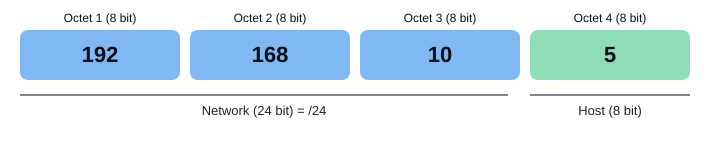

*شکل ۱: آدرس 192.168.10.5/24؛ ۳ Octet اول «شبکه» و آخری «میزبان» است.*

**Mask** هم یک عدد ۳۲ بیتی است: از چپ چند بیت 1 (قسمت شبکه) و بقیه 0 (قسمت میزبان). مثلاً Mask با ۲۴ بیت 1 برابر `255.255.255.0` است. نوشتن «تعداد بیت‌های 1» به شکل `/24` را Prefix Length می‌گویند. پس `192.168.10.5/24` یعنی: ۲۴ بیت اول = شبکه، ۸ بیت آخر = میزبان.

| Prefix | Mask            | تعداد آدرس | Host قابل‌استفاده | اندازه بلوک (Octet آخر) |
|--------|-----------------|------------|------------------|-------------------------|
| /24    | 255.255.255.0   | 256        | 254              | —                       |
| /25    | 255.255.255.128 | 128        | 126              | 128                     |
| /26    | 255.255.255.192 | 64         | 62               | 64                      |
| /27    | 255.255.255.224 | 32         | 30               | 32                      |
| /28    | 255.255.255.240 | 16         | 14               | 16                      |
| /29    | 255.255.255.248 | 8          | 6                | 8                       |
| /30    | 255.255.255.252 | 4          | 2                | 4                       |

**فرمول تعداد آدرس:** هر Subnet به‌اندازه‌ی «۲ به توان تعداد بیت‌های میزبان» آدرس دارد. دو آدرس از آن‌ها رزرو است (اولی آدرس شبکه، آخری Broadcast) و به Host داده نمی‌شود.

``` text
Total addresses = 2 ^ (32 - Prefix)
Usable hosts    = 2 ^ (32 - Prefix) - 2

Example (/26):
  Host bits = 32 - 26 = 6
  Total     = 2 ^ 6   = 64
  Usable    = 64 - 2  = 62
```

### ۴. محاسبه Subnet: روش گام‌به‌گام

برای هر آدرس/Prefix چهار پاسخ می‌خواهیم: **شبکه**، **Broadcast**، **Hostهای قابل‌استفاده (اولی تا آخری)**، **تعداد Host**.

> **روش «اندازه بلوک» (Block Size)**
>
> 1.  Octet «جالب» را پیدا کن: همان Octetی که Mask آن نه 0 است و نه 255.
> 2.  اندازه بلوک را با فرمول زیر حساب کن.
> 3.  عدد Octet آدرس را به نزدیک‌ترین مضرب بلوک (به سمت پایین) گرد کن؛ این می‌شود آدرس شبکه.
> 4.  Broadcast یک عدد کمتر از شبکه بعدی است.
> 5.  Hostها: از «شبکه + 1» تا «Broadcast - 1».

``` text
Block size = 256 - (mask value of the interesting octet)
Network    = largest multiple of Block size that is <= octet value
Broadcast  = (next network) - 1
First host = Network + 1
Last host  = Broadcast - 1
```

#### مثال ۱ (ساده): 192.168.1.10/24

``` text
Mask       = 255.255.255.0   (no interesting octet)
Network    = 192.168.1.0
Broadcast  = 192.168.1.255
Hosts      = 192.168.1.1 - 192.168.1.254
Host count = 2^8 - 2 = 254
```

چون Mask در سه Octet اول 255 است، سه Octet اول بدون تغییر می‌ماند.

#### مثال ۲ (متوسط): 10.10.20.77/26

``` text
Mask         = 255.255.255.192
Interesting  = 4th octet (192)
Block size   = 256 - 192 = 64
Blocks       = 0, 64, 128, 192
77 is between 64 and 127
Network      = 10.10.20.64
Next network = 10.10.20.128
Broadcast    = 10.10.20.127
Hosts        = 10.10.20.65 - 10.10.20.126
Host count   = 2^6 - 2 = 62
```

#### مثال ۳ (سخت): 172.16.45.200/20

``` text
/20 = 8 + 8 + 4 bits
Mask         = 255.255.240.0
Interesting  = 3rd octet (240)
Block size   = 256 - 240 = 16
Blocks       = 0, 16, 32, 48 ...
45 is between 32 and 47
Network      = 172.16.32.0
Next network = 172.16.48.0
Broadcast    = 172.16.47.255
Hosts        = 172.16.32.1 - 172.16.47.254
Host count   = 2^12 - 2 = 4094
```

#### مثال ۴ (معکوس): به ۵۰ Host نیاز دارم؛ Prefix چند؟

``` text
Need          = 50 hosts + 2 reserved = 52
Smallest 2^n >= 52  ->  n = 6  (2^6 = 64)
Host bits     = 6
Prefix        = 32 - 6 = /26
Usable hosts  = 64 - 2 = 62   (enough for 50)
```

همیشه «+2» را فراموش نکن؛ بدون آن جواب اشتباه می‌شود.

### تعداد کل IPهای یک Subnet را با «اندازه بلوک» حساب کنیم

فقط یک سؤال داریم: **یک Subnet روی‌هم چند آدرس دارد؟** فعلاً کاری با آدرس شبکه، Broadcast یا Hostها نداریم. هر Octet ۲۵۶ حالت دارد (از 0 تا 255). پس برای شمردن کل آدرس‌ها دو چیز لازم است: اندازه بلوک، و اینکه «Octet جالب» کجاست.

``` text
Total IPs = Block size x 256 ^ n

Block size = 256 - (mask value of the interesting octet)
n          = number of octets AFTER the interesting octet
```

Octet جالب همان Octetی است که Mask آن نه 0 است و نه 255. هر Octet بعد از آن، کاملاً در بخش میزبان است و ضریب ۲۵۶ می‌آورد.

#### مثال اول: تغییر در Octet چهارم

``` text
192.168.1.0/26
Mask       = 255.255.255.192
Block size = 256 - 192 = 64
n          = 0   (no octet after the 4th)
Total      = 64 x 256^0 = 64
```

#### مثال دوم: تغییر در Octet سوم

``` text
192.168.0.0/22
Mask       = 255.255.252.0
Block size = 256 - 252 = 4
n          = 1   (the 4th octet)
Total      = 4 x 256 = 1024
```

#### مثال سوم: تغییر در Octet دوم

``` text
10.0.0.0/14
Mask       = 255.252.0.0
Block size = 256 - 252 = 4
n          = 2   (the 3rd and 4th octets)
Total      = 4 x 256 x 256 = 262144
```

#### مثال چهارم: تغییر در Octet اول

``` text
0.0.0.0/6
Mask       = 252.0.0.0
Block size = 256 - 252 = 4
n          = 3   (the 2nd, 3rd and 4th octets)
Total      = 4 x 256 x 256 x 256 = 67108864
```

#### جدول خلاصه

| محل تغییر   | اندازه بلوک (نمونه) | محاسبه              | تعداد کل IP |
|-------------|---------------------|---------------------|-------------|
| Octet چهارم | 64                  | 64                  | 64          |
| Octet سوم   | 4                   | 4 × 256             | 1,024       |
| Octet دوم   | 4                   | 4 × 256 × 256       | 262,144     |
| Octet اول   | 4                   | 4 × 256 × 256 × 256 | 67,108,864  |

> **دو نکته‌ی مهم**
>
> ۱) این عدد «کل آدرس‌ها» است؛ برای Host قابل‌استفاده باید ۲ تا کم کنید (شبکه و Broadcast). ۲) اگر Mask دقیقاً روی مرز Octet بود (مثل /24 یا /16 یا /8)، Octet جالب نداریم؛ ساده‌ترین کار این است که اولین Octet صفر را «بلوک ۲۵۶» بگیرید: برای /24 می‌شود ۲۵۶ و برای /16 می‌شود ۲۵۶ × ۲۵۶ = ۶۵۵۳۶.

#### خودآزمایی (آسان تا سخت)

**م1.** سؤال ۱: Mask = 255.255.255.224؛ تعداد کل آدرس؟ *(پاسخ: 2-1-م1 در بخش «پاسخ‌ها» انتهای فصل)*

**م2.** سؤال ۲: Mask = 255.255.248.0؛ تعداد کل آدرس؟ *(پاسخ: 2-1-م2 در بخش «پاسخ‌ها» انتهای فصل)*

**م3.** سؤال ۳: Mask = 255.240.0.0؛ تعداد کل آدرس؟ *(پاسخ: 2-1-م3 در بخش «پاسخ‌ها» انتهای فصل)*

**م4.** سؤال ۴ (بررسی با روش توان ۲): آیا جواب سؤال ۳ با 2 به توان بیت‌های میزبان می‌خواند؟ *(پاسخ: 2-1-م4 در بخش «پاسخ‌ها» انتهای فصل)*

### جدول توان‌های ۲ (برای محاسبه‌ی سریع)

تمام محاسبه‌های Subnetting روی توان‌های ۲ بنا شده‌اند: تعداد آدرس‌ها، اندازه بلوک و تعداد Host. این جدول را چند بار بخوانید تا به‌خاطر بسپارید؛ الگو ساده است: هر ردیف دو برابر ردیف قبلی است.

| توان   | حاصل   |
|--------|--------|
| 2 ^ 0  | 1      |
| 2 ^ 1  | 2      |
| 2 ^ 2  | 4      |
| 2 ^ 3  | 8      |
| 2 ^ 4  | 16     |
| 2 ^ 5  | 32     |
| 2 ^ 6  | 64     |
| 2 ^ 7  | 128    |
| 2 ^ 8  | 256    |
| 2 ^ 9  | 512    |
| 2 ^ 10 | 1,024  |
| 2 ^ 11 | 2,048  |
| 2 ^ 12 | 4,096  |
| 2 ^ 13 | 8,192  |
| 2 ^ 14 | 16,384 |
| 2 ^ 15 | 32,768 |
| 2 ^ 16 | 65,536 |

> **نکته‌ی حفظ‌کردن**
>
> اگر عدد ۲ به توان ۱۰ را (۱,۰۲۴) به یاد داشته باشید، بقیه را می‌توانید از روی آن بسازید: برای هر توان بالاتر دو برابر کنید و برای هر توان پایین‌تر نصف. مثلاً ۲ به توان ۱۲ برابر ۱۰۲۴ × ۴ است، یعنی ۴۰۹۶.

مثال کاربردی: برای /20، بیت‌های میزبان ۱۲ است؛ در جدول ردیف ۲ به توان ۱۲ را نگاه می‌کنیم: ۴,۰۹۶ آدرس.

### جدول مرجع کامل: Prefix، Mask و تعداد IP

این جدول همه‌ی Prefixها را از /32 تا /0 کنار هم می‌گذارد. آن را حفظ نکنید؛ بفهمید و هر وقت لازم شد نگاه کنید. دو الگو را ببینید: با هر یک Prefix کمتر، تعداد آدرس‌ها **دو برابر** می‌شود؛ و ستون «تعداد کل IP» همان ۲ به توان «بیت‌های میزبان» است.

| Prefix | Subnet Mask     | بیت‌های میزبان | تعداد کل IP   |
|--------|-----------------|---------------|---------------|
| /32    | 255.255.255.255 | 0             | 1             |
| /31    | 255.255.255.254 | 1             | 2             |
| /30    | 255.255.255.252 | 2             | 4             |
| /29    | 255.255.255.248 | 3             | 8             |
| /28    | 255.255.255.240 | 4             | 16            |
| /27    | 255.255.255.224 | 5             | 32            |
| /26    | 255.255.255.192 | 6             | 64            |
| /25    | 255.255.255.128 | 7             | 128           |
| /24    | 255.255.255.0   | 8             | 256           |
| /23    | 255.255.254.0   | 9             | 512           |
| /22    | 255.255.252.0   | 10            | 1,024         |
| /21    | 255.255.248.0   | 11            | 2,048         |
| /20    | 255.255.240.0   | 12            | 4,096         |
| /19    | 255.255.224.0   | 13            | 8,192         |
| /18    | 255.255.192.0   | 14            | 16,384        |
| /17    | 255.255.128.0   | 15            | 32,768        |
| /16    | 255.255.0.0     | 16            | 65,536        |
| /15    | 255.254.0.0     | 17            | 131,072       |
| /14    | 255.252.0.0     | 18            | 262,144       |
| /13    | 255.248.0.0     | 19            | 524,288       |
| /12    | 255.240.0.0     | 20            | 1,048,576     |
| /11    | 255.224.0.0     | 21            | 2,097,152     |
| /10    | 255.192.0.0     | 22            | 4,194,304     |
| /9     | 255.128.0.0     | 23            | 8,388,608     |
| /8     | 255.0.0.0       | 24            | 16,777,216    |
| /7     | 254.0.0.0       | 25            | 33,554,432    |
| /6     | 252.0.0.0       | 26            | 67,108,864    |
| /5     | 248.0.0.0       | 27            | 134,217,728   |
| /4     | 240.0.0.0       | 28            | 268,435,456   |
| /3     | 224.0.0.0       | 29            | 536,870,912   |
| /2     | 192.0.0.0       | 30            | 1,073,741,824 |
| /1     | 128.0.0.0       | 31            | 2,147,483,648 |
| /0     | 0.0.0.0         | 32            | 4,294,967,296 |

> **دو حالت خاص**
>
> **/32** فقط یک آدرس است (یک Host مشخص، مثلاً Loopback یا Route برای یک دستگاه). **/31** دو آدرس دارد و طبق استاندارد RFC 3021 برای لینک نقطه‌به‌نقطه بین دو روتر می‌شود از هر دو آدرس استفاده کرد (بدون کسر ۲). برای بقیه‌ی Prefixها، Host قابل‌استفاده برابر «تعداد کل منهای ۲» است.

### کامپیوترها چطور می‌فهمند با هم در یک شبکه‌اند؟

کامپیوتر هیچ «نقشه‌ای» از شبکه ندارد؛ فقط IP و Mask خودش و IP مقصد را می‌داند. با یک عملیات ساده‌ی بیتی به نام AND تصمیم می‌گیرد:

1.  IP را به باینری تبدیل می‌کند.
2.  Mask را به باینری تبدیل می‌کند.
3.  بیت‌به‌بیت AND می‌گیرد؛ نتیجه «آدرس شبکه» (Network) است.
4.  همین کار را برای IP مقصد با Mask خودش انجام می‌دهد.
5.  اگر دو آدرس شبکه برابر بود، «هم‌شبکه» هستند و مستقیم (با ARP) ارتباط می‌گیرند؛ وگرنه بسته را به Gateway می‌دهد.

#### قانون AND (جدول درستی)

``` text
0 AND 0 = 0
0 AND 1 = 0
1 AND 0 = 0
1 AND 1 = 1
```

فقط وقتی هر دو بیت 1 باشند نتیجه 1 است. چون Mask در بخش شبکه همه 1 است، بیت‌های شبکه حفظ می‌شوند؛ و چون در بخش میزبان همه 0 است، بیت‌های میزبان صفر می‌شوند. به همین دلیل نتیجه‌ی AND همیشه «آدرس شبکه» است.

#### مثال ساده: هم‌شبکه

دو کامپیوتر: A = 192.168.1.10/24 و B = 192.168.1.20/24. سه Octet اول Mask برابر 255 (همه 1) است و بدون تغییر می‌ماند؛ فقط Octet آخر را محاسبه می‌کنیم.

``` text
Mask last octet : 0     = 00000000

A last octet    : 10    = 00001010
A AND Mask      :         00000000  = 0
A network       : 192.168.1.0

B last octet    : 20    = 00010100
B AND Mask      :         00000000  = 0
B network       : 192.168.1.0

192.168.1.0 = 192.168.1.0  ->  SAME network
```

#### مثال متوسط: شبیه‌اند ولی هم‌شبکه نیستند

A = 10.10.20.77/26 و B = 10.10.20.130/26. Mask چهارم برابر 192 است.

``` text
Mask last octet : 192   = 11000000

A last octet    : 77    = 01001101
A AND Mask      :         01000000  = 64
A network       : 10.10.20.64

B last octet    : 130   = 10000010
B AND Mask      :         10000000  = 128
B network       : 10.10.20.128

10.10.20.64 != 10.10.20.128  ->  DIFFERENT networks
Result: A sends to its Default Gateway (a router is required)
```

> **نتیجه‌ی کلیدی**
>
> «هم‌شبکه بودن» یعنی آدرس شبکه‌ی دو Host (حاصل IP AND Mask) برابر باشد؛ نه اینکه IPها شبیه هم باشند.

### ۵. Packet Flow: آیا دو Host هم‌شبکه‌اند؟

وقتی Host می‌خواهد بسته بفرستد، با Mask خودش تصمیم می‌گیرد: آدرس مقصد را با Mask AND می‌کند؛ اگر شبکه برابر شبکه خودش بود، مقصد «همین لینک» است و با ARP مستقیم می‌فرستد؛ وگرنه بسته را به Default Gateway می‌دهد.

``` text
Host A: 10.10.20.77/26    network 10.10.20.64   (range 64 .. 127)
Host B: 10.10.20.130/26   network 10.10.20.128  (range 128 .. 191)

A wants to send to B:
  Is B in A's network?   130 is greater than 127  ->  NO
  So A sends the packet to its Default Gateway (the router).
```

نکته جالب: دو آدرس `10.10.20.77` و `10.10.20.130` ظاهراً شبیه‌اند ولی در دو Subnet متفاوت‌اند، و بدون Router با هم حرف نمی‌زنند.

### اگر Default Gateway تنظیم نشده باشد چه می‌شود؟

تصمیم Host همیشه با IP و Mask خودش شروع می‌شود. سپس بسته به نتیجه، یکی از دو مسیر زیر را می‌رود. نکته‌ی مهم این است که **ARP در هر دو مسیر انجام می‌شود**، ولی برای MAC متفاوت.

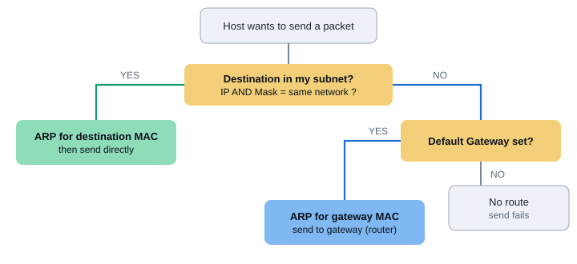

*شکل: درخت تصمیم Host هنگام ارسال بسته؛ در هر دو حالت مسیر درست با ARP کامل می‌شود.*

| حالت                                   | ARP برای چه MAC؟    | فریم به کجا می‌رود؟                          |
|----------------------------------------|---------------------|---------------------------------------------|
| مقصد در Subnet خودم است                | MAC مقصد نهایی      | مستقیم به مقصد                              |
| مقصد در Subnet دیگر است                | MAC Default Gateway | به روتر، و روتر ادامه می‌دهد                 |
| مقصد در Subnet دیگر است و Gateway نیست | —                   | ارتباط برقرار نمی‌شود (جایی برای ارسال نیست) |

پس دو کامپیوتر در دو Subnet متفاوت، بدون Default Gateway (و بدون Route دستی دیگر)، نمی‌توانند با هم ارتباط بگیرند. ARP فقط برای دستگاه‌های «روی همین لینک» جواب می‌دهد؛ هیچ دستگاهی در Subnet دیگر به ARP Request شما پاسخ نمی‌دهد.

> **قاعده‌ی خلاصه**
>
> اگر مقصد همسایه است، با ARP خودش را پیدا می‌کنیم. اگر همسایه نیست، بسته را برای دروازه می‌فرستیم و دروازه تصمیم می‌گیرد.

### ۶. آدرس‌های خاص (باید بشناسید)

| بازه            | نام                            | کاربرد                                                       |
|-----------------|--------------------------------|--------------------------------------------------------------|
| 10.0.0.0/8      | آدرس خصوصی (RFC 1918) - کلاس A | داخل سازمان؛ در اینترنت Route نمی‌شود                         |
| 172.16.0.0/12   | آدرس خصوصی (RFC 1918) - کلاس B | داخل سازمان؛ در اینترنت Route نمی‌شود                         |
| 192.168.0.0/16  | آدرس خصوصی (RFC 1918) - کلاس C | داخل سازمان؛ در اینترنت Route نمی‌شود                         |
| 127.0.0.0/8     | Loopback                       | تست خود دستگاه (`127.0.0.1`)                                 |
| 169.254.0.0/16  | APIPA (Link-Local)             | وقتی Client از DHCP آدرس نگرفت خودش می‌سازد؛ نشانه خرابی DHCP |
| 224.0.0.0/4     | Multicast                      | مثلاً OSPF و HSRP                                             |
| 203.0.113.0/24  | مستندات (TEST-NET-3)           | در Lab ما «اینترنت شبیه‌سازی‌شده» است                          |
| 198.51.100.0/24 | مستندات (TEST-NET-2)           | مثال در مستندات                                              |

> **ارتباط با دوره**
>
> اگر Client شما `169.254.x.x` دارد، یعنی DHCP جواب نداده؛ در عیب‌یابی TS10 می‌بینید.

### ۷. تمرین‌های درجه‌بندی‌شده (قبل از Lab حل کنید)

هرکدام را روی کاغذ حل کنید، بعد جواب را باز کنید.

**ت1.** ۱ (ساده): 192.168.5.130/24 *(پاسخ: 2-1-ت1 در بخش «پاسخ‌ها» انتهای فصل)*

**ت2.** ۲: 10.0.0.9/30 *(پاسخ: 2-1-ت2 در بخش «پاسخ‌ها» انتهای فصل)*

**ت3.** ۳: 192.168.1.100/27 *(پاسخ: 2-1-ت3 در بخش «پاسخ‌ها» انتهای فصل)*

**ت4.** ۴: 192.168.0.200/25 *(پاسخ: 2-1-ت4 در بخش «پاسخ‌ها» انتهای فصل)*

**ت5.** ۵: به ۸ Host نیاز دارم؛ Prefix؟ *(پاسخ: 2-1-ت5 در بخش «پاسخ‌ها» انتهای فصل)*

**ت6.** ۶ (سخت): 172.31.14.9/22 *(پاسخ: 2-1-ت6 در بخش «پاسخ‌ها» انتهای فصل)*

**ت7.** ۷ (سخت): 10.1.200.15/19 *(پاسخ: 2-1-ت7 در بخش «پاسخ‌ها» انتهای فصل)*

**ت8.** ۸: آیا 10.10.20.77/26 و 10.10.20.130/26 هم‌شبکه‌اند؟ *(پاسخ: 2-1-ت8 در بخش «پاسخ‌ها» انتهای فصل)*

### ۸. Lab هدایت‌شده: «Mask چطور تعیین می‌کند چه کسی همسایه است»

در Lab `L00-ImageValidation` می‌دانید `R1` روی `Gi0/0.10` آدرس `10.10.10.1/24` و `SW1` روی `Vlan10` آدرس `10.10.10.2/24` دارد و `ping` کار می‌کند. حالا عمداً Mask را خراب می‌کنیم تا اثرش را ببینید.

#### گام ۱: وضعیت سالم

``` text
R1# show ip interface brief
R1# show ip route connected
R1# ping 10.10.10.2
```

`show ip route connected` باید شبکه `10.10.10.0/24` را به‌عنوان Connected نشان بدهد؛ `ping` موفق.

#### گام ۲: تغییر آدرس سوییچ به یک Host «بالای نصف»

``` text
SW1# configure terminal
SW1(config)# interface vlan 10
SW1(config-if)# ip address 10.10.10.130 255.255.255.0
SW1(config-if)# end
```

#### گام ۳: تنگ‌کردن Mask روی روتر

``` text
R1# configure terminal
R1(config)# interface gi0/0.10
R1(config-subif)# ip address 10.10.10.1 255.255.255.128
R1(config-subif)# end
R1# show ip route connected
R1# ping 10.10.10.130
```

**پیش‌بینی (قبل از اجرا فکر کنید):** با Mask جدید، محدوده‌ی «همین لینک» برای روتر کوچک‌تر شده است:

``` text
R1 new mask = /25
R1 network  = 10.10.10.0 - 10.10.10.127
SW1 address = 10.10.10.130   -> outside this range
Result      : R1 has no connected route to .130 -> ping fails
```

نتیجه‌ی واقعی را بنویسید؛ اگر چیز دیگری دیدید همان را ثبت کنید. سمت سوییچ Mask قبلی (/24) را دارد و فکر می‌کند روتر همسایه است؛ پس ارتباط «نیمه‌کاره» می‌شود.

#### گام ۴: رفع

``` text
R1(config)# interface gi0/0.10
R1(config-subif)# ip address 10.10.10.1 255.255.255.0
R1(config-subif)# end
R1# ping 10.10.10.130
```

بعد از رفع، ping موفق می‌شود. سپس آدرس سوییچ را به `10.10.10.2` برگردانید.

### ۹. Lab مستقل

سه Subnet بسازید: ۴۰ Host، ۱۰ Host و یک لینک دو روتر. از `192.168.50.0/24` با روش اندازه بلوک شروع کنید و برای هرکدام Prefix، شبکه، Broadcast، اولین و آخرین Host را بنویسید. جدول را در فایل `02-design/ip-plan-drill.md` ذخیره کنید.

### ۱۰. عیب‌یابی (TS13: Mask اشتباه، TS14: Gateway اشتباه)

| بخش                | شرح                                                                                                                                              |
|--------------------|--------------------------------------------------------------------------------------------------------------------------------------------------|
| Symptom            | یک Host فقط به بعضی Hostهای همان VLAN می‌رسد                                                                                                      |
| سرنخ اول           | Hostهای «بالای» یک عدد خاص (مثلاً .128 به بالا) جواب نمی‌دهند                                                                                      |
| روش                | ۱) `ipconfig /all` یا `show ip interface brief` ۲) Mask و Gateway را با Subnet مقایسه کن ۳) `ping` هم‌سایه و Gateway ۴) `show ip route connected` |
| علت                | Mask نادرست (مثلاً /25 به‌جای /24) یا Gateway خارج Subnet                                                                                          |
| رفع و Verification | تصحیح Mask/Gateway؛ ping همه Hostها                                                                                                              |

### ۱۱. سؤال‌های مرور (Active Recall، بدون نگاه)

**م5.** آدرس شبکه و Broadcast با چه فرمولی پیدا می‌شود؟ *(پاسخ: 2-1-م5 در بخش «پاسخ‌ها» انتهای فصل)*

**م6.** چرا Host قابل‌استفاده = آدرس‌ها منهای ۲ است؟ *(پاسخ: 2-1-م6 در بخش «پاسخ‌ها» انتهای فصل)*

**م7.** /26 چند Host دارد و بلوکش چند است؟ *(پاسخ: 2-1-م7 در بخش «پاسخ‌ها» انتهای فصل)*

**م8.** Client با 169.254.x.x یعنی چه؟ *(پاسخ: 2-1-م8 در بخش «پاسخ‌ها» انتهای فصل)*

**م9.** دو Host در یک Subnet با چه روشی هم‌شبکه بودنشان را تشخیص می‌دهند؟ *(پاسخ: 2-1-م9 در بخش «پاسخ‌ها» انتهای فصل)*

### English Corner: انگلیسی تخصصی این درس

این جمله‌ها از مستندات و محیط کار واقعی‌اند. بلند بخوانید و ترجمه را بپوشانید.

| English sentence                                                             | ترجمه                                                           |
|------------------------------------------------------------------------------|-----------------------------------------------------------------|
| The subnet mask determines which part of the address identifies the network. | ماسک زیرشبکه مشخص می‌کند کدام بخش آدرس، شبکه را تعیین می‌کند.     |
| The host cannot reach devices outside its subnet without a default gateway.  | بدون Default Gateway، Host به دستگاه‌های خارج از Subnet نمی‌رسد.  |
| A /26 prefix provides 62 usable host addresses.                              | یک Prefix با طول /26 تعداد ۶۲ آدرس قابل‌استفاده برای Host می‌دهد. |
| The client self-assigned a 169.254.x.x address because DHCP failed.          | Client چون DHCP شکست خورد، خودش آدرس 169.254.x.x گرفت.          |

**Q1.** Quick quiz (answer in English): How many usable hosts are in a /27 subnet? *(پاسخ: 2-1-Q1 در بخش «پاسخ‌ها» انتهای فصل)*

### ۱۲. تکلیف و چک‌لیست تسلط

- [ ] ۸ تمرین بخش ۷ را بدون نگاه حل کنم.
- [ ] ده عدد دلخواه را به باینری و برعکس تبدیل کنم.
- [ ] آزمایش Mask (گام ۱ تا ۴) را انجام دهم و نتیجه واقعی `ping` را ثبت کنم.
- [ ] Lab مستقل را در Git (بدون رمز) ذخیره کنم.
- [ ] توضیح بدهم چرا ۲ آدرس رزرو است.

### ۱۳. یادآوری اشتباهات شما

> **یادآوری ۱**
>
> اول `enable` و بعد `configure terminal`؛ و فقط یک‌بار.

> **یادآوری ۲**
>
> دستورهای EXEC (مثل `monitor capture`) در Config خطا می‌دهند؛ خطای «Invalid input» همیشه ناسازگاری Image نیست.

> **یادآوری ۳**
>
> «فرمان پذیرفته شد» ≠ «Feature کار می‌کند»؛ با ترافیک واقعی بسنجید.


#### کارت Lab — درس ۲-۱

| # | فیلد | محتوا |
|---|---|---|
| 1 | عنوان و هدف | دیدن اثر Mask غلط روی ارتباط R1 و SW1 |
| 2 | پیش‌نیاز | درس ۱-B؛ Lab L00 سالم |
| 3 | توپولوژی | R1 Gi0/0.10 ↔ trunk ↔ SW1 Vlan10 |
| 4 | تجهیزات | R1، SW1 |
| 5 | نسخه نرم‌افزار | vIOS-L2 15.2(20200924، Experimental) برای SW؛ vIOS 15.9(3)M9 برای R؛ VPCS (PNetLab)؛ PNetLab 4.2.8 |
| 6 | IP Plan | 10.10.10.1/24 (R1)، 10.10.10.2/24 (SW1) |
| 7 | وضعیت اولیه | ping بین R1 و SW1 موفق |
| 8 | صورت مسئله | Mask را عمداً /25 کنید، نتیجه‌ی ping به 10.10.10.130 را قبل از اجرا پیش‌بینی و بعد ثبت کنید |
| 9 | مراحل هدایت‌شده | همان بخش «Lab هدایت‌شده» همین درس (گام‌به‌گام) |
| 10 | تست عملکرد | `show ip route connected` ؛ `ping 10.10.10.130` |
| 11 | سناریوی خرابی | Mask /25 روی R1 و /24 روی SW1 (نیمه‌کاره) |
| 12 | روش عیب‌یابی | مقایسه‌ی Mask دو سر، `show ip route connected` |
| 13 | نتیجه‌ی مورد انتظار | ping به .130 قبل از رفع شکست می‌خورد؛ بعد از رفع موفق |
| 14 | معیار پذیرش | پیش‌بینی ثبت‌شده با نتیجه‌ی واقعی مقایسه شود؛ رفع کامل |
| 15 | مستندات نهایی | جدول `02-design/ip-plan-drill.md` |
| 16 | Cleanup و بازگردانی | آدرس SW1 را به 10.10.10.2 و Mask R1 را به /24 برگردانید |

> **وضعیت راستی‌آزمایی (خارج از ۱۶ فیلد):** **اجرا نشده (فقط طراحی).** مرحله‌ی Mask غلط اجرا نشده. پیش‌شرط (RoAS + ping R1↔SW1) در Probe ۱-B به‌صورت Tested-OK دیده شده است.

---

<a id="l-2-2"></a>

## درس ۲-۲ — VLSM و طراحی IP Plan

**فصل ۲ - روز ۲ · پیش‌نیاز: درس ۲-۱ · ۶ ساعت**

### این درس درباره چیست و چرا باید یاد بگیریم؟

**چه چیزی یاد می‌گیریم:** چطور یک بلوک آدرس را به Subnetهای هم‌اندازه‌ی نامناسب نبُریم، بلکه برای هر بخش سازمان دقیقاً به اندازه نیازش آدرس بدهیم. این کار را VLSM (مخفف Variable Length Subnet Mask، یعنی «ماسک زیرشبکه با طول متغیر») می‌گویند. بعد، نتیجه را در یک «برنامه‌ی آدرس‌دهی» (IP Plan، مخفف IP Addressing Plan) می‌نویسیم.

**چرا لازم است:** تصور کنید یک ساختمان اداری دارید و می‌خواهید طبقه‌ها را تقسیم کنید. اگر همه‌ی اتاق‌ها را به‌اندازه‌ی بزرگ‌ترین اتاق (سالن اجتماعات) بسازید، فضای زیادی هدر می‌رود. در شبکه هم همین است: لینک بین دو روتر فقط به ۲ آدرس نیاز دارد، ولی اگر یک /24 با ۲۵۴ آدرس به آن بدهید، ۲۵۲ آدرس هدر رفته است.

- **در کار روزانه:** وقتی شعبه‌ی جدید باز می‌شود، باید بدون به‌هم‌ریختن شبکه‌ی فعلی، آدرس تازه بدهید.
- **در امنیت:** هر Subnet یک «مرز» برای فایروال است. Subnetهای درست‌اندازه یعنی قانون‌های دقیق‌تر.
- **در دوره‌ی ما:** پروژه‌ی نهایی (Capstone) یک مرکز و سه شعبه دارد؛ IP Plan آن را همین هفته می‌سازیم.

> **مسیر درس**
>
> مشکل (هدررفت) ← ایده‌ی VLSM ← مثال ساده ← مثال متوسط ← مثال سخت (سازمان واقعی) ← تمرین ← Lab ← عیب‌یابی.

#### اصطلاحات این درس (مخفف ← شکل کامل ← معنی)

| مخفف    | شکل کامل انگلیسی                    | معنی فارسی                                                    |
|---------|-------------------------------------|---------------------------------------------------------------|
| VLSM    | Variable Length Subnet Mask         | ماسک زیرشبکه با طول متغیر؛ هر بخش به اندازه نیازش آدرس می‌گیرد |
| IP Plan | IP Addressing Plan                  | برنامه و سند آدرس‌دهی سازمان                                   |
| VLAN    | Virtual Local Area Network          | شبکه محلی مجازی؛ جداسازی منطقی روی یک سوییچ                   |
| DMZ     | Demilitarized Zone                  | منطقه حائل برای سرورهای در دسترس از بیرون                     |
| Gateway | Default Gateway                     | دروازه پیش‌فرض                                                 |
| DHCP    | Dynamic Host Configuration Protocol | تخصیص خودکار آدرس                                             |
| CIDR    | Classless Inter-Domain Routing      | نمایش آدرس با Prefix بدون کلاس، مثل /26                       |

### ۱. مشکل: تقسیم هم‌اندازه و هدررفت آدرس

فرض کنید بلوک `192.168.10.0/24` (۲۵۶ آدرس) دارید و چهار بخش می‌خواهید: فروش (۱۰۰ کامپیوتر)، فنی (۵۰)، مدیریت (۱۲)، و یک لینک بین دو روتر (۲).

اگر ساده‌لوحانه همه را /26 (۶۲ Host) بسازید، فروش جا نمی‌شود (۱۰۰ \> ۶۲). اگر همه را /25 (۱۲۶ Host) بسازید، فقط ۲ Subnet می‌گیرید و چهار بخش جا نمی‌شود. یعنی با اندازه‌ی ثابت، نه هدر نمی‌دهیم و نه جا می‌شویم. راه‌حل: **اندازه‌ی متغیر**.

### سؤال مهم: در شبکه داخلی برای IP پولی نمی‌دهیم، پس چرا اینقدر مراقب هدررفت هستیم؟

حرف درستی است: آدرس‌های خصوصی (مثل 10.0.0.0/8 یا 192.168.0.0/16) هزینه ندارند و هیچ‌کس برای آن‌ها فاکتور نمی‌فرستد. اما «پول» تنها دلیل VLSM نیست. دلیل‌های اصلی این‌هاست:

| دلیل                   | توضیح                                                                                                                   |
|------------------------|-------------------------------------------------------------------------------------------------------------------------|
| ۱. بلوک شما محدود است  | معمولاً از یک بلوک مشخص (مثلاً یک /24 یا /22) استفاده می‌کنید. اگر هر لینک دو روتر یک /24 کامل بگیرد، بلوک زود تمام می‌شود. |
| ۲. رشد آینده           | شعبه‌ی جدید و VLAN جدید می‌آید. اگر فضا را هدر داده باشید، مجبور می‌شوید همه‌چیز را عوض کنید.                               |
| ۳. مدیریت و مستندسازی  | Subnetهای درست‌اندازه و منظم، IP Plan را خوانا و عیب‌یابی را سریع می‌کند.                                                  |
| ۴. خلاصه‌سازی مسیرها    | وقتی آدرس‌ها پشت‌سرهم و منظم باشند، می‌شود چند Route را در یک Route خلاصه کرد (جدول Route کوچک‌تر).                         |
| ۵. جلوگیری از هم‌پوشانی | در ادغام شرکت‌ها یا اتصال VPN بین دو سایت، بازه‌ها نباید هم‌پوشانی داشته باشند؛ مصرف بی‌حساب بازه این خطر را بالا می‌برد.    |
| ۶. امنیت و Broadcast   | Subnet خیلی بزرگ یعنی Broadcast Domain بزرگ و Policy فایروال درشت و نامحدود.                                            |

> **یک نکته‌ی صادقانه**
>
> اگر بلوک خیلی بزرگی مثل 10.0.0.0/8 دارید، کمبود آدرس معمولاً مشکل اصلی نیست. آن‌جا دلیل‌های ۳ تا ۶ (نظم، خلاصه‌سازی، هم‌پوشانی و امنیت) مهم‌ترند. VLSM در بلوک‌های کوچک‌تر و در لینک‌های بین روترها اهمیت بیشتری دارد.

#### VLSM کجا چقدر مهم است؟

| محیط                 | اهمیت VLSM                               |
|----------------------|------------------------------------------|
| شبکه‌ی خانگی کوچک     | کم                                       |
| شبکه‌ی شرکت کوچک      | متوسط                                    |
| سازمان بزرگ          | بسیار زیاد                               |
| ISP و شبکه‌های گسترده | بسیار زیاد (IPv4 عمومی محدود و گران است) |
| لینک بین روترها      | بسیار مهم (فقط ۲ آدرس لازم است)          |

#### مثال: ۳۰۰ کامپیوتر؛ یک /23 یا سه /24؟

``` text
Option 1: one /23
  Mask          = 255.255.254.0
  Total         = 2 ^ 9 = 512
  Usable        = 512 - 2 = 510
  Spare         = 510 - 300 = 210
  Broadcast domains = 1  (all 300 PCs together)

Option 2: three /24
  Usable each   = 254   (total 762)
  Broadcast domains = 3  (separated)
  Needs a router or L3 switch between them
```

از نظر ظرفیت، هر دو گزینه کافی است. انتخاب نهایی به طراحی بستگی دارد: اگر واحدهای سازمان باید از هم جدا باشند (امنیت، کاهش Broadcast، Policy جدا)، سه Subnet بهتر است؛ ولی برای ارتباط بینشان به دستگاه لایه ۳ نیاز دارید (روتر یا سوییچ لایه ۳). اگر همه یک گروه یکسان‌اند و نیازی به جداسازی نیست، یک /23 ساده‌تر است.

### ۲. ایده‌ی VLSM به زبان ساده

VLSM یعنی «Subnet Mask با طول متغیر» (Variable Length Subnet Mask). مثل برش پیتزا برای مهمان‌ها: به کسی که گرسنه‌تر است برش بزرگ‌تر می‌دهید و به بقیه کوچک‌تر. فقط یک قانون هست: برش‌ها نباید روی هم بیفتند.

> **سه قانون طلایی VLSM**
>
> ۱) **همیشه از بزرگ‌ترین نیاز شروع کن.** ۲) هر Subnet باید روی مرز مضرب اندازه‌ی خودش شروع شود (مثلاً یک /26 باید روی ۰، ۶۴، ۱۲۸ یا ۱۹۲ شروع شود). ۳) هیچ دو Subnet نباید هم‌پوشانی داشته باشند.

**مراحل کار برای هر بخش:** (۱) نیاز را بشمار و ۲ آدرس رزرو (شبکه و Broadcast) اضافه کن. (۲) کوچک‌ترین توان ۲ که کافی باشد را پیدا کن. (۳) Prefix را از آن بساز. (۴) از اولین آدرس آزاد شروع به تخصیص کن. (۵) آدرس بعدی آزاد را یادداشت کن.

### ۳. مثال ساده (دو بخش)

بلوک `10.0.0.0/24` را داریم. بخش A به ۱۰۰ Host و بخش B به ۲۰ Host نیاز دارد. اول بزرگ‌ترین (A):

``` text
A: need = 100 + 2 = 102
   2^7 = 128 >= 102  ->  Prefix = /25
   Network   = 10.0.0.0/25
   Hosts     = 10.0.0.1 - 10.0.0.126
   Broadcast = 10.0.0.127
   Next free = 10.0.0.128
```

بعد B از اولین آدرس آزاد شروع می‌شود:

``` text
B: need = 20 + 2 = 22
   2^5 = 32 >= 22   ->  Prefix = /27
   Network   = 10.0.0.128/27
   Hosts     = 10.0.0.129 - 10.0.0.158
   Broadcast = 10.0.0.159
   Next free = 10.0.0.160  (up to 10.0.0.255 stays free for growth)
```

باقی‌مانده بلوک (۱۶۰ تا ۲۵۵) برای رشد آینده خالی می‌ماند و هدررفت نیست.

### ۴. مثال متوسط (چهار بخش)


*شکل ۲: نوار آدرس VLSM؛ بخش بزرگ‌تر اول و بدون هم‌پوشانی.*

بلوک `192.168.10.0/24`؛ همان چهار بخش بخش ۱: فروش ۱۰۰، فنی ۵۰، مدیریت ۱۲، لینک روتر ۲.

| بخش       | نیاز+۲ | اندازه | Prefix | شبکه           | Hostها      | Broadcast |
|-----------|--------|--------|--------|----------------|-------------|-----------|
| فروش      | 102    | 128    | /25    | 192.168.10.0   | .1 – .126   | .127      |
| فنی       | 52     | 64     | /26    | 192.168.10.128 | .129 – .190 | .191      |
| مدیریت    | 14     | 16     | /28    | 192.168.10.192 | .193 – .206 | .207      |
| لینک روتر | 4      | 4      | /30    | 192.168.10.208 | .209 – .210 | .211      |

دقت کنید هر شروع، دقیقاً بعد از Broadcast قبلی است (۱۲۷ ← ۱۲۸، ۱۹۱ ← ۱۹۲، ۲۰۷ ← ۲۰۸). آدرس‌های `.212` تا `.255` هنوز آزادند (۴۴ آدرس).

**نکته:** اگر ترتیب را برعکس بگیرید (اول لینک /30 را در `.0` بگذارید)، بعداً /25 روی مرز ۱۲۸ می‌افتد و دیگر فروش در یک تکه جا نمی‌شود. برای همین «بزرگ‌ترین اول».

### پیش‌نیاز مثال بعدی: بلوک 10.20.0.0/22 یعنی چه؟

مثال سخت پایین با این جمله شروع می‌شود: «سازمانی بلوک `10.20.0.0/22` دارد.» اول آن را از پایه باز می‌کنیم.

#### گام ۱: معنی /22

از ۳۲ بیت آدرس، ۲۲ بیت برای «شبکه» است و ۱۰ بیت باقی‌مانده برای «میزبان». هر بیت میزبان دو حالت دارد؛ پس تعداد آدرس‌ها این‌طور حساب می‌شود:

``` text
Host bits       = 32 - 22 = 10
Total addresses = 2 ^ 10 = 1024
```

#### گام ۲: چرا آخرین آدرس 10.20.3.255 است؟

اول /22 را به Subnet Mask تبدیل می‌کنیم:

``` text
/22  = 11111111.11111111.11111100.00000000
Mask = 255.255.252.0
```

Octet سوم «جالب» است (چون 252 نه 0 است و نه 255). اندازه بلوک آن:

``` text
Block size = 256 - 252 = 4     (in the 3rd octet)
```

یعنی شبکه‌های /22 در Octet سوم هر ۴ عدد یک‌بار شروع می‌شوند:

| شماره شبکه | آدرس شروع  |
|------------|------------|
| شبکه ۱     | 10.20.0.0  |
| شبکه ۲     | 10.20.4.0  |
| شبکه ۳     | 10.20.8.0  |
| شبکه ۴     | 10.20.12.0 |

پس شبکه‌ی اول ما از `10.20.0.0` شروع می‌شود و درست قبل از شبکه‌ی بعدی (`10.20.4.0`) تمام می‌شود:

``` text
Network   = 10.20.0.0
Next net  = 10.20.4.0
Broadcast = 10.20.4.0 - 1 = 10.20.3.255
Range     = 10.20.0.0 - 10.20.3.255
```

#### گام ۳: چهار «تکه»ی داخل بلوک

Octet سوم در این بلوک چهار مقدار می‌گیرد: 0، 1، 2 و 3. هر مقدار یک تکه‌ی ۲۵۶تایی است:

``` text
10.20.0.0 - 10.20.0.255    256 addresses
10.20.1.0 - 10.20.1.255    256 addresses
10.20.2.0 - 10.20.2.255    256 addresses
10.20.3.0 - 10.20.3.255    256 addresses
Total = 4 x 256 = 1024
```

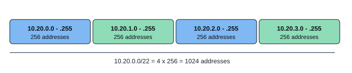

*شکل: بلوک /22 چهار تکه‌ی ۲۵۶تایی (چهار /24 پشت‌سرهم) است.*

> **نکته‌ی مهم**
>
> این چهار تکه فعلاً فقط «چهار قسمت از یک بلوک بزرگ» هستند، نه الزاماً چهار Subnet نهایی. در VLSM ما همین ۱۰۲۴ آدرس را به Subnetهایی با اندازه‌های مختلف (مثلاً /23، /25، /26، /27 و /30) تقسیم می‌کنیم؛ همان کاری که در مثال سخت پایین می‌بینید.

**سؤال خودآزمایی: در یک /22، هر تکه‌ی «Octet سوم» چند آدرس دارد؟**

``` text
Each value of the 3rd octet = 256 addresses (the last octet has 8 host bits: 2 ^ 8 = 256)
Answer: 256
```

### ۵. مثال سخت (سازمان واقعی: مرکز و سه شعبه)

سازمانی با بلوک `10.20.0.0/22` (۱۰۲۴ آدرس: `10.20.0.0` تا `10.20.3.255`). نیازها:

| بخش                   | Host |
|-----------------------|------|
| مرکز: کاربران         | 300  |
| مرکز: سرورها          | 60   |
| مرکز: مدیریت تجهیزات  | 25   |
| شعبه ۱: کاربران       | 100  |
| شعبه ۲: کاربران       | 50   |
| شعبه ۳: کاربران       | 20   |
| سه لینک روتر (هرکدام) | 2    |

**گام ۱ - اندازه هر بخش** (هر بخش یک سطر؛ مرتب از بزرگ به کوچک):

``` text
Center users    : 300 + 2 = 302 -> 512 -> /23
Branch 1        : 100 + 2 = 102 -> 128 -> /25
Center servers  :  60 + 2 =  62 ->  64 -> /26
Branch 2        :  50 + 2 =  52 ->  64 -> /26
Center mgmt     :  25 + 2 =  27 ->  32 -> /27
Branch 3        :  20 + 2 =  22 ->  32 -> /27
3 links         :   2 + 2 =   4 ->   4 -> /30 (each)
```

**گام ۲ - آیا بلوک کافی است؟**

``` text
Total needed = 512 + 128 + 64 + 64 + 32 + 32 + (3 x 4)
             = 844
Available    = 1024  (a /22)
844 <= 1024  ->  OK
```

**گام ۳ - تخصیص پشت‌سرهم:**

| بخش          | Prefix | شبکه        | Broadcast   |
|--------------|--------|-------------|-------------|
| مرکز-کاربران | /23    | 10.20.0.0   | 10.20.1.255 |
| شعبه ۱       | /25    | 10.20.2.0   | 10.20.2.127 |
| مرکز-سرورها  | /26    | 10.20.2.128 | 10.20.2.191 |
| شعبه ۲       | /26    | 10.20.2.192 | 10.20.2.255 |
| مرکز-مدیریت  | /27    | 10.20.3.0   | 10.20.3.31  |
| شعبه ۳       | /27    | 10.20.3.32  | 10.20.3.63  |
| لینک ۱       | /30    | 10.20.3.64  | 10.20.3.67  |
| لینک ۲       | /30    | 10.20.3.68  | 10.20.3.71  |
| لینک ۳       | /30    | 10.20.3.72  | 10.20.3.75  |

**گام ۴ - بررسی:** هر شروع باید دقیقاً یک عدد بعد از Broadcast قبلی باشد.

``` text
Last used address = 10.20.3.75
Free space        = 10.20.3.76 - 10.20.3.255  (180 addresses, for growth)
Overlap check     : every start = previous broadcast + 1  ->  no overlap
```

### ۶. IP Plan: سند زنده‌ی شبکه

جدول بالا هنوز «محاسبه» است. IP Plan سندی است که تیم نگه می‌دارد و این ستون‌ها را دارد: نام بخش، VLAN، شبکه/Prefix، Gateway، بازه‌ی DHCP، آدرس‌های ثابت، مالک، توضیح. قاعده‌ی تجربی: **Gateway را همیشه اولین Host (.1) بگذارید** و سرورها/تجهیزات را از انتهای بازه یا بازه‌ی ثابت جدا کنید، تا همه بدانند «.1 یعنی Gateway».

نمونه برای Lab دوره (در Capstone استفاده می‌شود؛ همین هفته در `02-design/ip-plan.md` ثبتش کنید):

| VLAN | نام     | شبکه          | Gateway    |
|------|---------|---------------|------------|
| 10   | مدیریت  | 10.10.10.0/24 | 10.10.10.1 |
| 20   | کاربران | 10.10.20.0/24 | 10.10.20.1 |
| 30   | سرورها  | 10.10.30.0/24 | 10.10.30.1 |

### ۷. تمرین‌های درجه‌بندی‌شده

**ت1.** ۱ (ساده): از 192.168.1.0/24 دو Subnet بساز: ۱۲۰ Host و ۱۰ Host *(پاسخ: 2-2-ت1 در بخش «پاسخ‌ها» انتهای فصل)*

**ت2.** ۲ (ساده): لینک بین دو روتر از 10.1.1.0/24 *(پاسخ: 2-2-ت2 در بخش «پاسخ‌ها» انتهای فصل)*

**ت3.** ۳ (متوسط): از 172.16.0.0/24: ۶۰، ۳۰، ۱۰ Host *(پاسخ: 2-2-ت3 در بخش «پاسخ‌ها» انتهای فصل)*

**ت4.** ۴ (متوسط): چرا نباید اول Subnet کوچک را بگذاریم؟ *(پاسخ: 2-2-ت4 در بخش «پاسخ‌ها» انتهای فصل)*

**ت5.** ۵ (سخت): از 10.5.0.0/23: ۲۰۰ Host، ۷۰ Host، ۳۰ Host، دو لینک *(پاسخ: 2-2-ت5 در بخش «پاسخ‌ها» انتهای فصل)*

**ت6.** ۶ (سخت): آیا 192.168.1.64/26 و 192.168.1.100/27 هم‌پوشانی دارند؟ *(پاسخ: 2-2-ت6 در بخش «پاسخ‌ها» انتهای فصل)*

### ۸. Lab هدایت‌شده: اجرای IP Plan روی روتر

برای دیدن اینکه روتر Subnetها را «می‌شناسد»، روی `R1` چند Loopback به‌عنوان Subnet مجازی می‌سازیم.

#### گام ۱: ساخت سه Subnet از مثال متوسط

``` text
R1# configure terminal
R1(config)# interface loopback 1
R1(config-if)# ip address 192.168.10.1 255.255.255.128
R1(config-if)# interface loopback 2
R1(config-if)# ip address 192.168.10.129 255.255.255.192
R1(config-if)# interface loopback 3
R1(config-if)# ip address 192.168.10.193 255.255.255.240
R1(config-if)# end
```

#### گام ۲: بررسی

``` text
R1# show ip interface brief
R1# show ip route connected
```

باید سه Route از نوع `C` ببینید: `192.168.10.0/25`، `192.168.10.128/26`، `192.168.10.192/28`. دقت کنید روتر خودش «آدرس شبکه» را از Mask محاسبه کرده است؛ همان‌طور که شما محاسبه کردید.

#### گام ۳: ایجاد عمدی هم‌پوشانی

``` text
R1(config)# interface loopback 4
R1(config-if)# ip address 192.168.10.100 255.255.255.192
```

پیش‌بینی: IOS معمولاً خطای `% 192.168.10.64 overlaps with Loopback1` می‌دهد و دستور را نمی‌پذیرد (نتیجه‌ی واقعی را ثبت کنید). همین است که از هم‌پوشانی در یک روتر جلوگیری می‌کند.

#### گام ۴: پاک‌سازی

``` text
R1(config)# no interface loopback 1
R1(config)# no interface loopback 2
R1(config)# no interface loopback 3
R1(config)# no interface loopback 4
R1(config)# end
```

### ۹. Lab مستقل

برای Capstone یک بلوک `10.50.0.0/22` انتخاب کنید و برای مرکز (کاربران ۱۵۰، سرورها ۴۰، مدیریت ۲۰، DMZ ۱۰) و سه شعبه (هرکدام ۳۰ کاربر) به‌علاوه ۳ لینک، IP Plan کامل بسازید. خروجی: `02-design/ip-plan.md` با ستون‌های گفته‌شده. بدون رمز.

### ۱۰. عیب‌یابی

|         |                                                           |
|---------|-----------------------------------------------------------|
| Symptom | بعد از اضافه‌کردن Subnet جدید، بخشی از شبکه ناگهان قطع شد  |
| سرنخ    | دو Subnet هم‌پوشان؛ روتر برای یک آدرس دو مسیر دارد         |
| روش     | `show ip route`، مقایسه‌ی Prefixها، رسم نوار آدرس روی کاغذ |
| رفع     | تغییر یکی از Subnetها به بازه‌ی آزاد و به‌روزرسانی IP Plan  |
| پیشگیری | هر آدرس جدید را اول در IP Plan ثبت کن، بعد روی دستگاه بزن |

### ۱۱. سؤال‌های مرور

**م1.** VLSM چیست و چرا به آن نیاز داریم؟ *(پاسخ: 2-2-م1 در بخش «پاسخ‌ها» انتهای فصل)*

**م2.** چرا از بزرگ‌ترین نیاز شروع می‌کنیم؟ *(پاسخ: 2-2-م2 در بخش «پاسخ‌ها» انتهای فصل)*

**م3.** بهترین Prefix برای لینک بین دو روتر چیست؟ *(پاسخ: 2-2-م3 در بخش «پاسخ‌ها» انتهای فصل)*

### English Corner: انگلیسی تخصصی این درس

این جمله‌ها از مستندات و محیط کار واقعی‌اند. بلند بخوانید و ترجمه را بپوشانید.

| English sentence                                                        | ترجمه                                                      |
|-------------------------------------------------------------------------|------------------------------------------------------------|
| VLSM lets us allocate address space according to actual need.           | VLSM اجازه می‌دهد فضای آدرس را مطابق نیاز واقعی تخصیص دهیم. |
| Always start with the largest subnet to avoid fragmentation.            | همیشه از بزرگ‌ترین Subnet شروع کنید تا فضا تکه‌تکه نشود.     |
| The two subnets overlap, so the router rejected the second address.     | دو Subnet هم‌پوشانی دارند، پس روتر آدرس دوم را رد کرد.      |
| Document every allocation in the IP plan before configuring the device. | قبل از تنظیم دستگاه، هر تخصیص را در IP Plan مستند کنید.    |

**Q1.** Quick quiz (answer in English): Why do we sort requirements from largest to smallest in VLSM? *(پاسخ: 2-2-Q1 در بخش «پاسخ‌ها» انتهای فصل)*

### ۱۲. تکلیف و چک‌لیست تسلط

- [ ] ۶ تمرین بخش ۷ را حل کنم.
- [ ] Lab هدایت‌شده را اجرا و خروجی `show ip route connected` را ذخیره کنم.
- [ ] IP Plan Capstone را بنویسم و بدون هم‌پوشانی بودنش را وارسی کنم.
- [ ] بتوانم بدون نگاه VLSM را برای ۴ بخش انجام دهم.

### ۱۳. یادآوری اشتباهات شما

> **یادآوری**
>
> «+۲» (شبکه و Broadcast) را در هر محاسبه فراموش نکنید؛ و قبل از اجرا، پیش‌بینی کنید و بعد نتیجه‌ی واقعی را مقایسه کنید.


#### کارت Lab — درس ۲-۲

| # | فیلد | محتوا |
|---|---|---|
| 1 | عنوان و هدف | اجرای VLSM روی روتر با Loopback و دیدن Route های Connected |
| 2 | پیش‌نیاز | درس ۲-۱ |
| 3 | توپولوژی | R1 با Loopback 1 تا 4 |
| 4 | تجهیزات | R1 |
| 5 | نسخه نرم‌افزار | vIOS-L2 15.2(20200924، Experimental) برای SW؛ vIOS 15.9(3)M9 برای R؛ VPCS (PNetLab)؛ PNetLab 4.2.8 |
| 6 | IP Plan | 192.168.10.1/25، 192.168.10.129/26، 192.168.10.193/28 |
| 7 | وضعیت اولیه | R1 بدون Loopback |
| 8 | صورت مسئله | سه Subnet از مثال متوسط را بسازید و هم‌پوشانی را عمداً ایجاد کنید |
| 9 | مراحل هدایت‌شده | همان بخش «Lab هدایت‌شده» همین درس (گام‌به‌گام) |
| 10 | تست عملکرد | `show ip route connected` سه Route C |
| 11 | سناریوی خرابی | Loopback 4 هم‌پوشان |
| 12 | روش عیب‌یابی | محاسبه‌ی دستی شبکه‌ی هر Interface |
| 13 | نتیجه‌ی مورد انتظار | سه Route C؛ پیام overlaps برای Loopback 4 |
| 14 | معیار پذیرش | هم‌پوشانی دیده و ثبت شود |
| 15 | مستندات نهایی | `02-design/ip-plan.md` |
| 16 | Cleanup و بازگردانی | حذف Loopbackها (`no interface loopback N`) |

> **وضعیت راستی‌آزمایی (خارج از ۱۶ فیلد):** **اجرا نشده (فقط طراحی).** اجرا نشده؛ پیام «overlaps» برای Loopback هم‌پوشان پیش‌بینی است، نه مشاهده‌شده.

---

<a id="l-2-3"></a>

## درس ۲-۳ — IPv6 از پایه

**فصل ۲ - روز ۳ · پیش‌نیاز: درس ۲-۱ و ۲-۲ · ۶ ساعت**

### این درس درباره چیست و چرا باید یاد بگیریم؟

**چه چیزی یاد می‌گیریم:** نسل جدید آدرس‌دهی اینترنت یعنی IPv6: شکل آدرس، قوانین کوتاه‌نویسی، انواع آدرس، و اینکه دستگاه‌ها چطور بدون DHCP هم آدرس می‌گیرند.

**چرا لازم است:** آدرس‌های IPv4 حدود ۴.۳ میلیارد تا هستند و از سال‌ها پیش تمام شده‌اند. برای همین مدتی است که شبکه‌ها با ترفندهایی مثل NAT سرپا مانده‌اند. IPv6 با ۱۲۸ بیت آن‌قدر آدرس دارد که می‌شود به هر ذره‌ی شن روی زمین چند آدرس داد.

- **در کار روزانه:** بسیاری از ISPها، سرویس‌های ابری و Windows Server 2022 به‌طور پیش‌فرض IPv6 فعال دارند. اگر آن را نشناسید، یک پورت باز IPv6 در فایروال را نمی‌بینید و این یک حفره‌ی امنیتی می‌شود.
- **در امنیت:** مهاجم می‌تواند از مسیر IPv6 که فراموش کرده‌اید ببندید وارد شود. Blue Team باید هر دو پروتکل را ببیند.
- **در FortiGate:** Policyهای IPv6 جداگانه‌اند؛ در هفته‌های بعد از آن‌ها استفاده می‌کنیم.

> **مسیر درس**
>
> چرا IPv6 ← ساختار و کوتاه‌نویسی ← انواع آدرس ← کشف همسایه و SLAAC ← مثال ساده/متوسط/سخت ← تمرین ← Lab ← عیب‌یابی.

#### اصطلاحات این درس (مخفف ← شکل کامل ← معنی)

| مخفف       | شکل کامل انگلیسی                           | معنی فارسی                            |
|------------|--------------------------------------------|---------------------------------------|
| IPv6       | Internet Protocol version 6                | نسخه ۶ آدرس‌دهی (۱۲۸ بیتی)             |
| Hex        | Hexadecimal                                | شانزده‌شانزدهی؛ ارقام 0-9 و a-f        |
| GUA        | Global Unicast Address                     | آدرس عمومی قابل مسیریابی در اینترنت   |
| ULA        | Unique Local Address                       | آدرس محلی یکتا؛ معادل آدرس خصوصی IPv4 |
| Link-Local | Link-Local Address                         | آدرس محدود به یک لینک (fe80::)        |
| EUI-64     | Extended Unique Identifier 64-bit          | ساخت Interface ID ۶۴ بیتی از MAC      |
| SLAAC      | Stateless Address Auto-Configuration       | آدرس‌دهی خودکار بدون سرور DHCP         |
| NDP        | Neighbor Discovery Protocol                | پروتکل کشف همسایه؛ جایگزین ARP        |
| RA         | Router Advertisement                       | اعلان روتر؛ اعلام Prefix              |
| RS         | Router Solicitation                        | درخواست Host از روتر                  |
| NS         | Neighbor Solicitation                      | درخواست MAC همسایه                    |
| NA         | Neighbor Advertisement                     | پاسخ MAC همسایه                       |
| ICMPv6     | Internet Control Message Protocol for IPv6 | پیام‌های کنترلی IPv6؛ زیربنای NDP      |
| MAC        | Media Access Control address               | آدرس فیزیکی کارت شبکه                 |

### ۱. ساختار آدرس IPv6

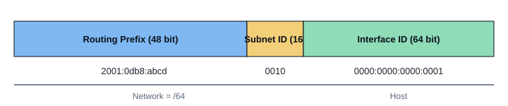

*شکل ۳: ساختار آدرس IPv6؛ ۶۴ بیت اول شبکه (Prefix + Subnet) و ۶۴ بیت آخر دستگاه.*

آدرس IPv6 یک عدد ۱۲۸ بیتی است. آن را به ۸ گروه ۱۶ بیتی تقسیم می‌کنیم و هر گروه را با ۴ رقم شانزده‌شانزدهی (Hex: ارقام ۰ تا ۹ و a تا f) می‌نویسیم، با دونقطه بین گروه‌ها:

``` text
2001:0db8:0010:0010:0000:0000:0000:0001
```

هر رقم Hex معادل ۴ بیت است. پس حساب کل بیت‌ها این‌طور می‌شود:

``` text
1 hex digit = 4 bits      (f = 1111 , a = 1010)
1 group     = 4 digits = 16 bits
8 groups    = 8 x 16   = 128 bits
```

مثل IPv4، آدرس دو بخش دارد: **Prefix** (شبکه) و **Interface ID** (دستگاه). در بیشتر شبکه‌ها Prefix برابر `/64` است: ۶۴ بیت اول شبکه و ۶۴ بیت آخر دستگاه. در IPv6 به‌جای «Subnet Mask» همیشه Prefix می‌نویسیم.

### ۲. دو قانون کوتاه‌نویسی

**قانون ۱: صفرهای ابتدای هر گروه را حذف کن.** مثال: `0db8` ← `db8` و `0010` ← `10` و `0000` ← `0`.

**قانون ۲: یک (فقط یک) رشته‌ی متوالی از گروه‌های تماماً صفر را با `::` جایگزین کن.**

``` text
Full   : 2001:0db8:0010:0010:0000:0000:0000:0001
Rule 1 : 2001:db8:10:10:0:0:0:1
Rule 2 : 2001:db8:10:10::1
```

> **چرا فقط یک بار ::؟**
>
> اگر دو بار بنویسید، معلوم نیست هرکدام چند گروه صفر را نشان می‌دهند. پس `2001::5::1` غلط است. اگر دو رشته‌ی صفر داشتید، `::` را روی **بلندترین** رشته بگذارید.

### ۳. مثال‌های کوتاه‌نویسی (ساده تا سخت)

#### مثال ساده

``` text
Full  : fe80:0000:0000:0000:0000:0000:0000:0001
Step 1: fe80:0:0:0:0:0:0:1
Step 2: fe80::1
```

#### مثال متوسط (دو رشته صفر)

``` text
Full  : 2001:0db8:0000:0000:0001:0000:0000:0005
Step 1: 2001:db8:0:0:1:0:0:5
Step 2: two zero-runs of equal length -> shorten the FIRST one
Result: 2001:db8::1:0:0:5
```

#### مثال سخت (برعکس: باز کردن)

``` text
Short  : 2001:db8:a::1:2
Groups written = 5  (2001, db8, a, 1, 2)
Missing groups = 8 - 5 = 3   (the :: is 3 zero groups)
Full   : 2001:0db8:000a:0000:0000:0000:0001:0002
```

### ۴. انواع آدرس IPv6

| نوع                | Prefix                   | کاربرد                                  | معادل در IPv4                  |
|--------------------|--------------------------|-----------------------------------------|--------------------------------|
| Global Unicast     | 2000::/3                 | آدرس قابل Route در اینترنت              | آدرس عمومی                     |
| Unique Local (ULA) | fc00::/7 (عملاً fd00::/8) | داخل سازمان                             | RFC 1918                       |
| Link-Local         | fe80::/10                | فقط روی یک لینک؛ هر Interface حتماً دارد | APIPA (ولی همیشه فعال و ضروری) |
| Multicast          | ff00::/8                 | ارسال به گروهی از دستگاه‌ها              | 224.0.0.0/4                    |
| Loopback           | ::1/128                  | خود دستگاه                              | 127.0.0.1                      |
| مستندات            | 2001:db8::/32            | در آموزش و Lab                          | TEST-NET                       |

**نکته‌ی مهم:** IPv6 **Broadcast ندارد**. کارهایی که Broadcast می‌کرد (مثل ARP) با Multicast انجام می‌شود. آدرس‌های ff02::1 (همه‌ی گره‌ها) و ff02::2 (همه‌ی روترها) را بشناسید.

### ۵. دستگاه‌ها چطور آدرس می‌گیرند؟

#### ۵-۱. Link-Local خودکار

همین که Interface بالا بیاید، دستگاه خودش یک آدرس `fe80::` می‌سازد. نیازی به DHCP و تنظیم دستی ندارد. تمام ارتباط‌های همسایگی (و Next-Hop روتینگ) با همین آدرس انجام می‌شود.

#### ۵-۲. EUI-64: ساخت Interface ID از MAC

MAC آدرس ۴۸ بیتی است؛ ۶۴ بیت لازم داریم. روش: وسط MAC عدد `fffe` را بگذار و بیت هفتم بایت اول را وارونه کن. مثال: MAC = `aabb.cc00.0100`:

``` text
MAC:            aa bb cc 00 01 00
Step 1 (insert fffe) : aa bb cc ff fe 00 01 00
Step 2 (flip U/L bit) : first byte aa XOR 02 = a8
Interface ID:   a8bb:ccff:fe00:0100
```

پس آدرس Link-Local می‌شود `fe80::a8bb:ccff:fe00:100`. (فقط ایده را بدانید: MAC در آدرس «نشت» می‌کند و برای حریم خصوصی، سیستم‌عامل‌های جدید به‌جای EUI-64 مقدار تصادفی می‌سازند.)

#### ۵-۳. SLAAC و کشف همسایه (NDP)

روتر هر چند ثانیه (یا به درخواست) پیام Router Advertisement (RA) می‌فرستد که می‌گوید «Prefix این لینک 2001:db8:10:10::/64 است». Host خودش Interface ID می‌سازد و آدرس می‌شود. به این روش SLAAC می‌گویند: بدون DHCP.

| پیام NDP                    | معادل       | کار                                   |
|-----------------------------|-------------|---------------------------------------|
| Router Solicitation (RS)    | —           | Host: «روتر هست؟»                     |
| Router Advertisement (RA)   | DHCP قسمتی  | روتر: Prefix و Gateway را اعلام می‌کند |
| Neighbor Solicitation (NS)  | ARP Request | «MAC فلان IPv6 چیست؟» (با Multicast)  |
| Neighbor Advertisement (NA) | ARP Reply   | پاسخ با MAC                           |

NDP از ICMPv6 استفاده می‌کند؛ بنابراین **نباید ICMPv6 را در فایروال کاملاً ببندید** وگرنه IPv6 کار نمی‌کند (اشتباه رایج).

### ۶. مثال کاربردی: Prefix و Subnet در IPv6

سازمان بلوک `2001:db8:abcd::/48` دارد. با ۱۶ بیت باقیمانده تا /64 می‌توانیم ۶۵۵۳۶ Subnet /64 بسازیم. محاسبه‌ی Host ندارد! هر VLAN را یک /64 می‌دهیم: `2001:db8:abcd:`**`10`**`::/64` برای VLAN10، `2001:db8:abcd:`**`20`**`::/64` برای VLAN20 و غیره. گروه چهارم را همان شماره‌ی VLAN بگذارید تا خوانا باشد.

مقایسه: در IPv4 باید هر بار محاسبه‌ی VLSM کنیم. در IPv6 همه /64 هستند و زندگی ساده است.

### ۷. تمرین‌ها

**ت1.** ۱. (ساده) کوتاه کن: 2001:0db8:0000:0000:0000:0000:0000:0001 *(پاسخ: 2-3-ت1 در بخش «پاسخ‌ها» انتهای فصل)*

**ت2.** ۲. (ساده) این چه نوع آدرسی است: fe80::1 ؟ fd12:3456::5 ؟ ff02::1 ؟ 2001:db8::5 ؟ *(پاسخ: 2-3-ت2 در بخش «پاسخ‌ها» انتهای فصل)*

**ت3.** ۳. (متوسط) باز کن: 2001:db8:0:1::5 *(پاسخ: 2-3-ت3 در بخش «پاسخ‌ها» انتهای فصل)*

**ت4.** ۴. (متوسط) آیا 2001:db8::1 و 2001:db8:0:0:1::1 در یک /64 هستند؟ *(پاسخ: 2-3-ت4 در بخش «پاسخ‌ها» انتهای فصل)*

**ت5.** ۵. (سخت) چرا نمی‌توان 2001::1::2 نوشت؟ *(پاسخ: 2-3-ت5 در بخش «پاسخ‌ها» انتهای فصل)*

**ت6.** ۶. (سخت) از 2001:db8:abcd::/48 برای ۴ VLAN (۱۰، ۲۰، ۳۰، ۹۹) Prefix بساز. *(پاسخ: 2-3-ت6 در بخش «پاسخ‌ها» انتهای فصل)*

### ۸. Lab هدایت‌شده: IPv6 بین R1 و SW1

شرط: در Lab `L00` هنوز VLAN10 روی R1 (`Gi0/0.10`) و SW1 (`Vlan10`) سالم است.

#### گام ۱: فعال‌کردن IPv6 روی روتر

``` text
R1# configure terminal
R1(config)# ipv6 unicast-routing
R1(config)# interface gi0/0.10
R1(config-subif)# ipv6 address 2001:db8:10:10::1/64
R1(config-subif)# end
R1# show ipv6 interface brief
```

باید دو آدرس ببینید: Link-Local (`FE80::...`) و آدرسی که دادید. فرمان `ipv6 unicast-routing` روتر را از «Host» به «روتر IPv6» تبدیل می‌کند و RA می‌فرستد.

#### گام ۲: سمت سوییچ

``` text
SW1# configure terminal
SW1(config)# interface vlan 10
SW1(config-if)# ipv6 address 2001:db8:10:10::2/64
SW1(config-if)# end
SW1# show ipv6 interface brief
```

در سوییچ‌های L2 ممکن است IPv6 فقط در CLI دیده شود. اگر دستور رد شد یا ping نشد، دقیقاً همان را ثبت کنید؛ این همان درس «پذیرفته‌شدن ≠ کارکردن» است.

#### گام ۳: Ping و NDP

``` text
R1# ping 2001:db8:10:10::2
R1# show ipv6 neighbors
R1# ping FE80::<LL-SW1>%GigabitEthernet0/0.10
```

در Ping با Link-Local باید Interface خروجی را مشخص کنید (چون fe80:: روی هر Interface تکراری است). جدول `show ipv6 neighbors` معادل `show ip arp` است.

#### گام ۴: دیدن RA

``` text
R1# show ipv6 interface gi0/0.10
```

در خروجی دنبال خط «ND advertised reachable time» و «Hosts use stateless autoconfig» بگردید؛ یعنی روتر Prefix را برای SLAAC اعلام می‌کند.

### ۹. Lab مستقل

برای VLANهای ۱۰ و ۲۰ و ۳۰ Capstone یک Prefix مثل `2001:db8:abcd::/48` انتخاب و در `02-design/ipv6-plan.md` بنویسید. روی R1 هر زیرواسط را یک /64 بدهید و `show ipv6 route connected` را ثبت کنید.

### ۱۰. عیب‌یابی

|         |                                                                                                                                    |
|---------|------------------------------------------------------------------------------------------------------------------------------------|
| Symptom | Ping IPv6 جواب نمی‌دهد ولی IPv4 کار می‌کند                                                                                           |
| سرنخ‌ها  | ۱) `ipv6 unicast-routing` فعال است؟ ؛ ۲) Prefix دو طرف یکی است؟ ؛ ۳) ACL یا فایروال ICMPv6 را بسته؟ ؛ ۴) فقط Link-Local کار می‌کند؟ |
| رفع     | تصحیح Prefix یا اجازه‌ی ICMPv6                                                                                                      |

### ۱۱. سؤال‌های مرور

**م1.** چرا IPv6 Broadcast ندارد؟ *(پاسخ: 2-3-م1 در بخش «پاسخ‌ها» انتهای فصل)*

**م2.** NS/NA معادل چه چیزی در IPv4 است؟ *(پاسخ: 2-3-م2 در بخش «پاسخ‌ها» انتهای فصل)*

**م3.** چرا ICMPv6 را نباید بست؟ *(پاسخ: 2-3-م3 در بخش «پاسخ‌ها» انتهای فصل)*

**م4.** /64 برای یک VLAN یعنی چه؟ *(پاسخ: 2-3-م4 در بخش «پاسخ‌ها» انتهای فصل)*

### English Corner: انگلیسی تخصصی این درس

این جمله‌ها از مستندات و محیط کار واقعی‌اند. بلند بخوانید و ترجمه را بپوشانید.

| English sentence                                                         | ترجمه                                                            |
|--------------------------------------------------------------------------|------------------------------------------------------------------|
| IPv6 has no broadcast; it uses multicast instead.                        | IPv6 Broadcast ندارد؛ به‌جای آن از Multicast استفاده می‌کند.       |
| Every IPv6 interface automatically gets a link-local address.            | هر Interface در IPv6 به‌طور خودکار یک Link-Local می‌گیرد.          |
| Hosts build their own address from the router advertisement using SLAAC. | Hostها با SLAAC از روی Router Advertisement آدرس خود را می‌سازند. |
| Do not block ICMPv6, or neighbor discovery will break.                   | ICMPv6 را نبندید، وگرنه Neighbor Discovery از کار می‌افتد.        |

**Q1.** Quick quiz (answer in English): Which IPv6 messages replace ARP? *(پاسخ: 2-3-Q1 در بخش «پاسخ‌ها» انتهای فصل)*

### ۱۲. تکلیف و چک‌لیست تسلط

- [ ] ۶ تمرین را حل کنم.
- [ ] Lab IPv6 را انجام و نتیجه‌ی واقعی (موفق/ناموفق) را ثبت کنم.
- [ ] IPv6 Plan را بنویسم.
- [ ] قوانین کوتاه‌نویسی را بدون نگاه بگویم.

### ۱۳. یادآوری اشتباهات شما

> **یادآوری**
>
> خروجی قبل از اجرا را پیش‌بینی کنید؛ و «Invalid input» همیشه به معنای ناسازگاری Image نیست.


#### کارت Lab — درس ۲-۳

| # | فیلد | محتوا |
|---|---|---|
| 1 | عنوان و هدف | برقراری IPv6 بین R1 و SW1 |
| 2 | پیش‌نیاز | درس ۲-۲ |
| 3 | توپولوژی | R1 Gi0/0.10 ↔ SW1 Vlan10 |
| 4 | تجهیزات | R1، SW1 |
| 5 | نسخه نرم‌افزار | vIOS-L2 15.2(20200924، Experimental) برای SW؛ vIOS 15.9(3)M9 برای R؛ VPCS (PNetLab)؛ PNetLab 4.2.8 |
| 6 | IP Plan | 2001:db8:10:10::1/64 و ::2/64 |
| 7 | وضعیت اولیه | IPv4 سالم |
| 8 | صورت مسئله | IPv6 بدهید، ping بزنید و جدول همسایه را ببینید |
| 9 | مراحل هدایت‌شده | همان بخش «Lab هدایت‌شده» همین درس (گام‌به‌گام) |
| 10 | تست عملکرد | `ping 2001:db8:10:10::2` ؛ `show ipv6 neighbors` |
| 11 | سناریوی خرابی | `ipv6 unicast-routing` فراموش شود |
| 12 | روش عیب‌یابی | `show ipv6 interface brief` و مقایسه‌ی Prefix |
| 13 | نتیجه‌ی مورد انتظار | ping موفق و دو ورودی همسایه |
| 14 | معیار پذیرش | ثبت نتیجه‌ی واقعی (موفق/ناموفق) از سوییچ |
| 15 | مستندات نهایی | `02-design/ipv6-plan.md` |
| 16 | Cleanup و بازگردانی | حذف آدرس‌های IPv6 |

> **وضعیت راستی‌آزمایی (خارج از ۱۶ فیلد):** **اجرا نشده (فقط طراحی).** اجرا نشده؛ IPv6 در Probe فقط CLI-Accepted بود؛ روی سوییچ ممکن است کار نکند.

---

<a id="l-2-4"></a>

## درس ۲-۴ — CLI سیسکو، مدیریت و بکاپ Config

**فصل ۲ - روز ۴ · پیش‌نیاز: فصل ۱ · ۶ ساعت**

### این درس درباره چیست و چرا باید یاد بگیریم؟

**چه چیزی یاد می‌گیریم:** کار حرفه‌ای با خط فرمان سیسکو (CLI): حالت‌ها، کمک‌گیری، تفاوت پیکربندی در حال اجرا و ذخیره‌شده، و مهم‌تر از همه **پشتیبان‌گیری و بازگشت (Rollback)**.

**چرا لازم است:** در دنیای واقعی بزرگ‌ترین ترس هر مدیر شبکه این است: «یک دستور زدم و ارتباط همه قطع شد، حالا چه کنم؟». کسی که بکاپ و Rollback بلد است، با آرامش کار می‌کند؛ کسی که بلد نیست، ساعت‌ها در قطعی می‌ماند.

- **در کار روزانه:** قبل از هر تغییر، نسخه‌ی فعلی را ذخیره می‌کنید و بعد از تغییر اگر خراب شد، در چند ثانیه برمی‌گردید.
- **در امنیت:** پیکربندی بکاپ‌شده سند حسابرسی است؛ می‌توانید ثابت کنید «چه چیزی، کی تغییر کرد».
- **در دوره:** Capstone مرحله‌ی «CHG (درخواست تغییر)» دارد که بدون Rollback پذیرفته نمی‌شود.

> **مسیر درس**
>
> حالت‌های CLI ← کمک‌گیری و میان‌بُرها ← Running و Startup ← بکاپ و Rollback ← مثال ساده/متوسط/سخت ← Lab ← عیب‌یابی.

#### اصطلاحات این درس (مخفف ← شکل کامل ← معنی)

| مخفف     | شکل کامل انگلیسی               | معنی فارسی                                          |
|----------|--------------------------------|-----------------------------------------------------|
| CLI      | Command Line Interface         | محیط خط فرمان                                       |
| EXEC     | Executive mode                 | حالت اجرایی دستورها                                 |
| NVRAM    | Non-Volatile RAM               | حافظه‌ای که با خاموشی پاک نمی‌شود؛ محل startup-config |
| RAM      | Random Access Memory           | حافظه موقت؛ محل running-config                      |
| TFTP     | Trivial File Transfer Protocol | انتقال فایل ساده و بدون رمزگذاری                    |
| SCP      | Secure Copy Protocol           | انتقال فایل امن روی SSH                             |
| DNS      | Domain Name System             | سیستم نام دامنه                                     |
| CHG      | Change Request                 | درخواست تغییر رسمی                                  |
| Rollback | Rollback                       | بازگشت به وضعیت سالم قبلی                           |
| MOTD     | Message Of The Day             | پیام نمایشی هنگام ورود                              |

### ۱. حالت‌های CLI (چهار اتاق یک ساختمان)

CLI سیسکو مثل ساختمانی با چند اتاق است که هرکدام اجازه‌ی کار متفاوتی دارد:

| حالت                  | Prompt           | چه کاری می‌شود کرد           | ورود/خروج                                          |
|-----------------------|------------------|-----------------------------|----------------------------------------------------|
| User EXEC             | `R1>`            | مشاهده‌ی محدود، ping         | ورود: `enable`                                     |
| Privileged EXEC       | `R1#`            | همه‌ی show، کپی فایل، reload | خروج: `disable`                                    |
| Global Config         | `R1(config)#`    | تغییر تنظیمات کل دستگاه     | ورود: `configure terminal` ؛ خروج: `end` یا `exit` |
| Interface/Line Config | `R1(config-if)#` | تنظیم یک Interface یا Line  | ورود: `interface ...`                              |

> **قاعده‌ی طلایی**
>
> دستورهای `show`، `ping`، `copy`، `monitor capture` و `reload` در EXEC هستند. دستورهای تنظیمی در Config. اگر در Config دستور show بزنید، با `do` جلو آن می‌توانید اجرا کنید: `do show ip route`.

### ۲. کمک‌گیری و میان‌بُرها (سرعت یک مهندس)

- `?` بعد از هر کلمه: گزینه‌های ممکن. مثال: `show ip ?`
- `Tab`: کامل‌کردن. `sh run` هم کافی است (مخفف یکتا).
- `show running-config | section interface`: فیلتر خروجی. `| include` و `| begin` هم داریم.
- فلش بالا: دستور قبلی. `Ctrl+A` ابتدای خط و `Ctrl+E` انتهای خط. `Ctrl+Shift+6` قطع دستور گیرکرده.

مثال: به‌جای خواندن ۲۰۰ خط config فقط این را بزنید:

``` text
R1# show running-config | section interface Gi0/0
R1# show ip interface brief | include up
```

### ۳. تنظیمات پایه‌ی یک دستگاه حرفه‌ای

``` text
R1(config)# hostname R1
R1(config)# no ip domain-lookup
R1(config)# service timestamps log datetime msec
R1(config)# line console 0
R1(config-line)# logging synchronous
R1(config-line)# exec-timeout 10 0
R1(config-line)# exit
R1(config)# banner motd # Authorized access only #
R1(config)# enable secret <PASSWORD>
R1(config)# end
```

خط‌به‌خط:

- `no ip domain-lookup`: جلوی «Translating…» را می‌گیرد (اشتباهی که قبلاً دیدید).
- `logging synchronous`: پیام‌های Log وسط تایپ شما نمی‌پرند.
- `exec-timeout 10 0`: بعد از ۱۰ دقیقه بی‌کاری Session بسته می‌شود (امنیت).
- `enable secret`: رمز ورود به Privileged با Hash قوی. **هرگز** `enable password` (متن ساده) نه. رمز واقعی را در Git نگذارید؛ اینجا فقط جانگهدار است.

### ۴. Running-config و Startup-config

دو نسخه از تنظیمات در دستگاه هست:

- **running-config**: در RAM، همین الان فعال است؛ با خاموش‌شدن می‌پرد.
- **startup-config**: در NVRAM، در بوت بعدی بارگذاری می‌شود.

تشبیه: running مثل «متنی که در Word تایپ کرده‌اید و ذخیره نکرده‌اید»؛ startup همان فایل ذخیره‌شده است.

``` text
R1# show running-config
R1# show startup-config
R1# copy running-config startup-config      (or: write memory)
R1# show archive                              (if supported)
```

اشتباه رایج: بعد از تغییر ذخیره نمی‌کنید و بعد از Reload همه‌چیز می‌پرد. جلوگیری: عادت کنید هر تغییر موفق ← `copy run start`.

### ۵. بکاپ و Rollback (قلب درس)

#### ۵-۱. بکاپ محلی روی Flash

``` text
R1# copy running-config flash:R1-before-change.cfg
R1# dir flash:
```

#### ۵-۲. بکاپ روی سرور (TFTP/SCP)

``` text
R1# copy running-config tftp://10.10.10.50/R1-2026-11-07.cfg
```

برای سرور بکاپ از یک VM لینوکسی استفاده می‌کنیم (در درس‌های بعد، با SCP امن). نام فایل = نام دستگاه + تاریخ. فایل‌های بکاپ **رمزِ هش‌شده** دارند ولی باز هم در جای امن (خارج از Git) نگه‌دارید.

#### ۵-۳. Rollback با Configure Replace

اگر Image شما قابلیت Archive دارد، می‌توانید کل تنظیمات را با یک فایل بکاپ جایگزین کنید (فقط تفاوت‌ها اعمال می‌شود):

``` text
R1# configure replace flash:R1-before-change.cfg list
R1# configure replace flash:R1-before-change.cfg force
```

گزینه‌ی `list` فقط تفاوت‌ها را نشان می‌دهد (Dry-run). اگر دستور در Image شما نبود، روش جایگزین: `copy flash:R1-before-change.cfg startup-config` و سپس `reload`.

#### ۵-۴. «Reload in»: شبکه‌ی ایمنی

``` text
R1# reload in 10
... risky change ...
R1# reload cancel        (if it worked)
```

مثل ماشین‌هایی که ده دقیقه بعد خودشان خاموش می‌شوند. اگر تغییر ارتباط شما را قطع کرد، دستگاه بعد از ۱۰ دقیقه به startup-config قبلی بر می‌گردد. این تکنیک نجات‌بخش است؛ مخصوصاً در تغییرات راه دور.

### ۶. مثال‌ها (ساده تا سخت)

**ساده**

اسم دستگاه را عوض کنید و ذخیره کنید: `hostname R1-HQ` ← `end` ← `copy run start` ← `show startup-config | include hostname`.

**متوسط**

قبل از تغییر IP یک Interface، بکاپ به Flash بگیرید؛ آدرس را تغییر دهید؛ ping کنید؛ اگر قطع شد با `configure replace` برگردید.

**سخت**

تغییر راه دور: با `reload in 5` شبکه‌ی ایمنی بگذارید؛ Mask یک Subinterface را تغییر دهید؛ اگر ارتباط قطع شد، ۵ دقیقه صبر می‌کنید و دستگاه با startup قبلی بالا می‌آید؛ اگر موفق بود `reload cancel` و `copy run start`.

### ۷. تمرین‌ها

**ت1.** ۱. Prompt زیر در کدام حالت است؟ R1(config-if)# *(پاسخ: 2-4-ت1 در بخش «پاسخ‌ها» انتهای فصل)*

**ت2.** ۲. تفاوت running و startup چیست؟ *(پاسخ: 2-4-ت2 در بخش «پاسخ‌ها» انتهای فصل)*

**ت3.** ۳. چطور در Config دستور show ip route را اجرا کنیم؟ *(پاسخ: 2-4-ت3 در بخش «پاسخ‌ها» انتهای فصل)*

**ت4.** ۴. چرا enable secret بهتر از enable password است؟ *(پاسخ: 2-4-ت4 در بخش «پاسخ‌ها» انتهای فصل)*

**ت5.** ۵. فایده‌ی reload in چیست؟ *(پاسخ: 2-4-ت5 در بخش «پاسخ‌ها» انتهای فصل)*

### ۸. Lab هدایت‌شده: تغییر، خراب‌کردن و Rollback

#### گام ۱: تنظیمات پایه (بخش ۳) را روی R1 و SW1 بزنید و ذخیره کنید

#### گام ۲: بکاپ

``` text
R1# copy running-config flash:R1-good.cfg
R1# copy running-config startup-config
R1# dir flash:
```

#### گام ۳: خراب‌کردن عمدی

``` text
R1(config)# interface gi0/0.10
R1(config-subif)# ip address 10.10.99.1 255.255.255.0
R1(config-subif)# end
R1# ping 10.10.10.2
```

پیش‌بینی: ping شکست می‌خورد چون Subnet عوض شد.

#### گام ۴: Rollback

``` text
R1# configure replace flash:R1-good.cfg force
R1# ping 10.10.10.2
```

اگر `configure replace` در Image شما پشتیبانی نشد (ثبت کنید)، با `copy flash:R1-good.cfg running-config` ادغام کنید و Interface را دستی اصلاح نمایید.

#### گام ۵: تمرین reload in

``` text
R1# reload in 5
(make a harmless change)
R1# reload cancel
```

### ۹. Lab مستقل

یک Runbook یک‌صفحه‌ای `03-ops/change-and-rollback.md` بنویسید: چک‌لیست قبل/حین/بعد تغییر، دستورهای بکاپ، Rollback، و Verification. بدون رمز.

### ۱۰. عیب‌یابی

|           |                                                  |
|-----------|--------------------------------------------------|
| Symptom   | بعد از Reload تنظیمات پرید                       |
| علت       | ذخیره نشده بود (فقط running)                     |
| رفع       | بازسازی از بکاپ؛ از این به بعد `copy run start`  |
| Symptom 2 | Rollback خطا می‌دهد                               |
| علت       | فایل بکاپ ناقص یا Archive پشتیبانی نمی‌شود        |
| رفع       | روش جایگزین: `copy file startup-config` + reload |

### ۱۱. سؤال‌های مرور

**م1.** سه حالت اصلی CLI؟ *(پاسخ: 2-4-م1 در بخش «پاسخ‌ها» انتهای فصل)*

**م2.** چرا بکاپ قبل از تغییر؟ *(پاسخ: 2-4-م2 در بخش «پاسخ‌ها» انتهای فصل)*

### English Corner: انگلیسی تخصصی این درس

این جمله‌ها از مستندات و محیط کار واقعی‌اند. بلند بخوانید و ترجمه را بپوشانید.

| English sentence                                                                     | ترجمه                                                                            |
|--------------------------------------------------------------------------------------|----------------------------------------------------------------------------------|
| Save the running configuration to NVRAM, or the changes will be lost after a reload. | running-config را در NVRAM ذخیره کنید، وگرنه بعد از Reload تغییرها از بین می‌رود. |
| Take a backup before every change so you can roll back quickly.                      | قبل از هر تغییر بکاپ بگیرید تا سریع Rollback کنید.                               |
| Use reload in 10 as a safety net during remote changes.                              | در تغییرهای راه دور از reload in 10 به‌عنوان شبکه‌ی ایمنی استفاده کنید.            |
| The enable secret is stored as a hash, unlike a plain-text enable password.          | enable secret به‌صورت Hash ذخیره می‌شود، برخلاف enable password متن ساده.          |

**Q1.** Quick quiz (answer in English): What is the difference between running-config and startup-config? *(پاسخ: 2-4-Q1 در بخش «پاسخ‌ها» انتهای فصل)*

### ۱۲. تکلیف و چک‌لیست تسلط

- [ ] تنظیمات پایه را روی همه‌ی دستگاه‌ها بزنم.
- [ ] بکاپ و Rollback را عملی انجام دهم و نتیجه را ثبت کنم.
- [ ] Runbook تغییر را بنویسم.

### ۱۳. یادآوری اشتباهات شما

> **یادآوری**
>
> دستور EXEC را در Config نزنید؛ کلمه‌ی ناشناخته نزنید (DNS Lookup)؛ بعد از هر تغییر موفق ذخیره کنید.


#### کارت Lab — درس ۲-۴

| # | فیلد | محتوا |
|---|---|---|
| 1 | عنوان و هدف | بکاپ، خراب‌کردن عمدی و Rollback |
| 2 | پیش‌نیاز | درس ۲-۳ |
| 3 | توپولوژی | R1 ↔ SW1 |
| 4 | تجهیزات | R1، SW1 |
| 5 | نسخه نرم‌افزار | vIOS-L2 15.2(20200924، Experimental) برای SW؛ vIOS 15.9(3)M9 برای R؛ VPCS (PNetLab)؛ PNetLab 4.2.8 |
| 6 | IP Plan | 10.10.10.0/24 |
| 7 | وضعیت اولیه | تنظیمات پایه ذخیره‌شده |
| 8 | صورت مسئله | قبل از تغییر بکاپ بگیرید، IP را خراب و با `configure replace` برگردانید |
| 9 | مراحل هدایت‌شده | همان بخش «Lab هدایت‌شده» همین درس (گام‌به‌گام) |
| 10 | تست عملکرد | ping پس از Rollback |
| 11 | سناریوی خرابی | تغییر IP Sub-interface |
| 12 | روش عیب‌یابی | مقایسه‌ی running با بکاپ |
| 13 | نتیجه‌ی مورد انتظار | ping بعد از Rollback موفق |
| 14 | معیار پذیرش | نتیجه‌ی `configure replace` (یا جایگزین) ثبت شود |
| 15 | مستندات نهایی | `03-ops/change-and-rollback.md` |
| 16 | Cleanup و بازگردانی | حذف فایل‌های بکاپ؛ `reload cancel` |

> **وضعیت راستی‌آزمایی (خارج از ۱۶ فیلد):** **اجرا نشده (فقط طراحی).** اجرا نشده؛ `configure replace`، `archive` و `flash:` روی vIOS-L2 در Probe نبوده‌اند (Untested).

---

<a id="l-2-5"></a>

## درس ۲-۵ — مدیریت امن با SSH

**فصل ۲ - روز ۵ · پیش‌نیاز: درس ۲-۴ · ۶ ساعت**

### این درس درباره چیست و چرا باید یاد بگیریم؟

**چه چیزی یاد می‌گیریم:** مدیریت امن دستگاه‌ها از راه دور با SSH، جایگزین قدیمی و ناامن Telnet. یاد می‌گیریم SSH چطور کار می‌کند، چطور روی روتر و سوییچ فعالش کنیم و چطور دسترسی را فقط به سیستم‌های مجاز محدود کنیم.

**چرا لازم است:** Telnet همه‌چیز (از جمله رمز) را به‌صورت متن ساده می‌فرستد. هر کسی در مسیر با Wireshark می‌تواند رمز ادمین را بخواند. SSH همین ارتباط را رمزگذاری می‌کند. در هر ممیزی امنیتی، فعال‌بودن Telnet یک «یافته‌ی جدی» است.

- **در کار روزانه:** ۹۹٪ مدیریت از راه دور با SSH انجام می‌شود.
- **در امنیت:** رمزگذاری، احراز هویت با کاربر و محدودیت مبدأ، سه لایه‌ی اولیه‌ی ایمنی مدیریت هستند.
- **در FortiGate:** همین مفاهیم برای مدیریت فایروال (فقط HTTPS و SSH از Subnet مدیریت) به‌کار می‌رود.

> **مسیر درس**
>
> چرا Telnet ناامن است ← SSH چطور کار می‌کند ← پیکربندی گام‌به‌گام ← محدودکردن دسترسی ← مثال ساده/متوسط/سخت ← Lab ← عیب‌یابی.

#### اصطلاحات این درس (مخفف ← شکل کامل ← معنی)

| مخفف          | شکل کامل انگلیسی            | معنی فارسی                               |
|---------------|-----------------------------|------------------------------------------|
| SSH           | Secure Shell                | پوسته امن؛ مدیریت رمزگذاری‌شده از راه دور |
| Telnet        | Teletype Network            | مدیریت از راه دور بدون رمزگذاری          |
| RSA           | Rivest-Shamir-Adleman       | الگوریتم کلید عمومی                      |
| VTY           | Virtual Teletype            | خطوط مجازی ورود از راه دور               |
| ACL           | Access Control List         | فهرست کنترل دسترسی                       |
| FQDN          | Fully Qualified Domain Name | نام کامل دامنه، مثل r1.lab.local         |
| MITM          | Man-In-The-Middle           | حمله مرد میانی                           |
| Wildcard Mask | Wildcard Mask               | معکوس Mask؛ بیت 0 یعنی باید یکسان باشد   |
| Fingerprint   | Host Key Fingerprint        | اثرانگشت کلید سرور برای تأیید هویت       |

### ۱. Telnet در برابر SSH

| ویژگی             | Telnet           | SSH             |
|-------------------|------------------|-----------------|
| رمزگذاری          | ندارد (متن ساده) | دارد            |
| پورت              | TCP 23           | TCP 22          |
| احراز هویت دستگاه | ندارد            | دارد (Host Key) |
| استفاده‌ی امروزی   | ممنوع            | استاندارد       |

مثال ملموس: Telnet مثل فریاد زدن رمز کارت بانکی وسط بازار است؛ SSH مثل گفتن آن در یک اتاق قفل‌شده.

### ۲. SSH چطور کار می‌کند؟ (ساده)

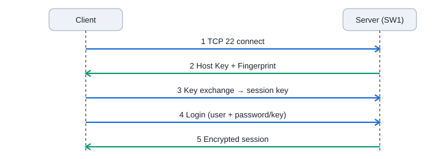

*شکل ۵: مراحل برقراری SSH؛ مرحله ۲ همان جایی است که «Host key changed» نشان می‌دهد.*

1.  **اتصال:** Client به پورت ۲۲ سرور وصل می‌شود.
2.  **هویت سرور:** سرور Host Key خود را نشان می‌دهد. Client اولین بار از شما می‌پرسد «اعتماد دارید؟» و اثرانگشت (Fingerprint) را ذخیره می‌کند. دفعه‌های بعد اگر عوض شد، هشدار می‌دهد (احتمال حمله‌ی Man-in-the-Middle).
3.  **کلید جلسه:** دو طرف با یک الگوریتم تبادل کلید (مثل Diffie-Hellman) یک کلید مشترک می‌سازند که هیچ‌کس در مسیر نمی‌داند.
4.  **احراز هویت کاربر:** رمز یا کلید عمومی.
5.  **ارتباط رمزشده** شروع می‌شود.

> **یادآوری از فصل ۱**
>
> هشدار «Host key changed» در برنامه‌ی SSH را قبلاً دیدید. آن‌جا هویت را با `ssh-keyscan` از یک مسیر مستقل تأیید کردیم. این دقیقاً همین مکانیزم است.

### ۳. پیکربندی SSH روی روتر/سوییچ (گام‌به‌گام)

``` text
R1(config)# hostname R1
R1(config)# ip domain-name lab.local
R1(config)# crypto key generate rsa modulus 2048
R1(config)# ip ssh version 2
R1(config)# username admin privilege 15 secret <PASSWORD>
R1(config)# line vty 0 4
R1(config-line)# login local
R1(config-line)# transport input ssh
R1(config-line)# exec-timeout 10 0
R1(config-line)# end
```

چرا هرکدام؟

- `hostname` و `ip domain-name`: بدون این دو، کلید RSA ساخته نمی‌شود (خطای رایج: «Please define a hostname other than Router»).
- `crypto key generate rsa modulus 2048`: ساخت جفت‌کلید. ۱۰۲۴ ضعیف است؛ حداقل ۲۰۴۸.
- `ip ssh version 2`: نسخه‌ی ۱ آسیب‌پذیر است.
- `username ... secret`: کاربر محلی با Hash. رمز واقعی را در Git نگذارید.
- `login local`: ورود با نام‌کاربری و رمز (نه فقط رمز Line).
- `transport input ssh`: Telnet را می‌بندد.

بررسی:

``` text
R1# show ip ssh
R1# show ssh
R1# show crypto key mypubkey rsa
```

در `show ip ssh` باید «SSH Enabled - version 2.0» ببینید.

### ۴. محدودکردن دسترسی (امنیت لایه‌ای)

فقط Subnet مدیریت (VLAN10) اجازه‌ی SSH داشته باشد:

``` text
R1(config)# ip access-list standard MGMT-ONLY
R1(config-std-nacl)# permit 10.10.10.0 0.0.0.255
R1(config-std-nacl)# deny any log
R1(config-std-nacl)# exit
R1(config)# line vty 0 4
R1(config-line)# access-class MGMT-ONLY in
R1(config-line)# end
```

`0.0.0.255` یک Wildcard Mask است؛ یعنی معکوسِ Subnet Mask. بیت 0 یعنی «باید مطابقت داشته باشد» و بیت 1 یعنی «مهم نیست».

``` text
Subnet mask   : 255.255.255.0
Wildcard mask : 0.0.0.255     (= 255.255.255.255 - 255.255.255.0)
```

`access-class` فقط ترافیک ورودی به VTY (دسترسی مدیریتی) را فیلتر می‌کند، نه ترافیک عبوری.

تنظیمات تکمیلی مفید: `ip ssh time-out 60` و `ip ssh authentication-retries 3`.

> **هشدار: قفل‌شدن از دستگاه**
>
> قبل از `access-class`، مطمئن شوید آدرس خودتان در ACL مجاز است؛ وگرنه خودتان بیرون می‌مانید. از `reload in 5` (درس قبل) به‌عنوان شبکه‌ی ایمنی استفاده کنید.

### ۵. مثال‌ها

**ساده**

از R1 به SW1 وصل شوید: `ssh -l admin 10.10.10.2`؛ اگر پرسید «Are you sure», بله.

**متوسط**

Telnet را غیرفعال کنید (`transport input ssh`) و ثابت کنید با `telnet 10.10.10.2` از R1 رد می‌شود (Connection refused).

**سخت**

ACL را طوری بنویسید که فقط ۲ آدرس مشخص (۱۰.۱۰.۱۰.۵۰ و ۱۰.۱۰.۱۰.۶۰) اجازه داشته باشند؛ و تست کنید از آدرس دیگر رد می‌شود. نکته: مبدأ تست را از Loopback روتر با `ssh -l admin -source-interface loopback0 ...` عوض کنید.

### ۶. تمرین‌ها

**ت1.** ۱. چرا Telnet ناامن است؟ *(پاسخ: 2-5-ت1 در بخش «پاسخ‌ها» انتهای فصل)*

**ت2.** ۲. چرا ip domain-name لازم است؟ *(پاسخ: 2-5-ت2 در بخش «پاسخ‌ها» انتهای فصل)*

**ت3.** ۳. Wildcard Mask برای 10.10.10.0/24؟ *(پاسخ: 2-5-ت3 در بخش «پاسخ‌ها» انتهای فصل)*

**ت4.** ۴. Wildcard Mask برای یک میزبان 10.10.10.50؟ *(پاسخ: 2-5-ت4 در بخش «پاسخ‌ها» انتهای فصل)*

**ت5.** ۵. Wildcard Mask برای 10.10.8.0/22؟ *(پاسخ: 2-5-ت5 در بخش «پاسخ‌ها» انتهای فصل)*

### ۷. Lab هدایت‌شده

#### گام ۱: SSH روی SW1

``` text
SW1(config)# ip domain-name lab.local
SW1(config)# crypto key generate rsa modulus 2048
SW1(config)# ip ssh version 2
SW1(config)# username admin privilege 15 secret <PASSWORD>
SW1(config)# line vty 0 4
SW1(config-line)# login local
SW1(config-line)# transport input ssh
SW1(config-line)# end
SW1# show ip ssh
```

#### گام ۲: اتصال از R1

``` text
R1# ssh -l admin 10.10.10.2
```

اگر خطای «no matching key exchange method» دیدید، Image قدیمی است؛ موقتاً در Lab با `ssh -o KexAlgorithms=...` (روی کلاینت) یا فعال‌کردن الگوریتم روی سرور حل می‌شود. در Lab مهم است بدانید چرا. در تولید، Image را به‌روز کنید.

#### گام ۳: بستن Telnet و تست

``` text
R1# telnet 10.10.10.2
```

باید رد شود (refused).

#### گام ۴: ACL مدیریت (با شبکه‌ی ایمنی)

``` text
SW1# reload in 5
SW1(config)# ip access-list standard MGMT-ONLY
SW1(config-std-nacl)# permit 10.10.10.0 0.0.0.255
SW1(config-std-nacl)# deny any log
SW1(config)# line vty 0 4
SW1(config-line)# access-class MGMT-ONLY in
(test SSH again; if OK:)
SW1# reload cancel
```

### ۸. Lab مستقل

برای هر ۳ دستگاه Lab یک «استاندارد مدیریت امن» بنویسید (`03-ops/secure-mgmt-standard.md`): SSH v2، RSA 2048، Telnet بسته، ACL مدیریت، Timeout. و روی هر دستگاه با یک چک‌لیست بسنجید.

### ۹. عیب‌یابی

|           |                                                                                                                                                                                                 |
|-----------|-------------------------------------------------------------------------------------------------------------------------------------------------------------------------------------------------|
| Symptom   | SSH وصل نمی‌شود                                                                                                                                                                                  |
| چک‌لیست    | ۱) `show ip ssh` فعال است؟ ؛ ۲) `transport input ssh` تنظیم است؟ ؛ ۳) نام‌کاربری وجود دارد؟ ؛ ۴) ACL مبدأ را بسته؟ ؛ ۵) مسیر و Gateway درست است؟ ؛ ۶) ping جواب می‌دهد؟ ؛ ۷) الگوریتم‌ها سازگارند؟ |
| Symptom 2 | کلید ساخته نمی‌شود                                                                                                                                                                               |
| رفع       | hostname و domain-name را بزنید.                                                                                                                                                                |

### ۱۰. سؤال‌های مرور

**م1.** Host Key برای چیست؟ *(پاسخ: 2-5-م1 در بخش «پاسخ‌ها» انتهای فصل)*

**م2.** access-class روی VTY چه فیلتر می‌کند؟ *(پاسخ: 2-5-م2 در بخش «پاسخ‌ها» انتهای فصل)*

### English Corner: انگلیسی تخصصی این درس

این جمله‌ها از مستندات و محیط کار واقعی‌اند. بلند بخوانید و ترجمه را بپوشانید.

| English sentence                                                                      | ترجمه                                                                      |
|---------------------------------------------------------------------------------------|----------------------------------------------------------------------------|
| Telnet sends credentials in clear text; SSH encrypts the whole session.               | Telnet اعتبارنامه‌ها را متن ساده می‌فرستد؛ SSH کل Session را رمزگذاری می‌کند. |
| Generate a 2048-bit RSA key pair before enabling SSH version 2.                       | قبل از فعال‌کردن SSH نسخه ۲، یک جفت‌کلید RSA ۲۰۴۸ بیتی بسازید.               |
| Restrict VTY access to the management subnet with an access class.                    | دسترسی VTY را با access-class به Subnet مدیریت محدود کنید.                 |
| The host key changed, so the client warned about a possible man-in-the-middle attack. | Host Key تغییر کرد، پس Client درباره‌ی احتمال حمله‌ی مرد میانی هشدار داد.    |

**Q1.** Quick quiz (answer in English): Why is Telnet considered insecure? *(پاسخ: 2-5-Q1 در بخش «پاسخ‌ها» انتهای فصل)*

### ۱۱. تکلیف و چک‌لیست تسلط

- [ ] SSH روی هر ۳ دستگاه فعال و تست شده.
- [ ] Telnet بسته شده و ثابت شده.
- [ ] ACL مدیریت با شبکه‌ی ایمنی تست شده.
- [ ] هیچ رمزی در Git نیست.

### ۱۲. یادآوری اشتباهات شما

> **یادآوری**
>
> قبل از تغییر راه دور، بکاپ و `reload in` بگذارید؛ خروجی را پیش‌بینی کنید؛ رمز در ریپو نریزید.


#### کارت Lab — درس ۲-۵

| # | فیلد | محتوا |
|---|---|---|
| 1 | عنوان و هدف | SSH امن و بستن Telnet |
| 2 | پیش‌نیاز | درس ۲-۴ |
| 3 | توپولوژی | R1 → SW1 (SSH) |
| 4 | تجهیزات | R1، SW1 |
| 5 | نسخه نرم‌افزار | vIOS-L2 15.2(20200924، Experimental) برای SW؛ vIOS 15.9(3)M9 برای R؛ VPCS (PNetLab)؛ PNetLab 4.2.8 |
| 6 | IP Plan | 10.10.10.1 و .2 |
| 7 | وضعیت اولیه | SSH فعال نیست |
| 8 | صورت مسئله | SSHv2، RSA 2048، Telnet بسته، ACL مدیریت با `reload in` |
| 9 | مراحل هدایت‌شده | همان بخش «Lab هدایت‌شده» همین درس (گام‌به‌گام) |
| 10 | تست عملکرد | `ssh -l admin 10.10.10.2` ؛ `telnet` رد شود |
| 11 | سناریوی خرابی | نبود `ip domain-name` یا ACL که خودتان را بیرون بگذارد |
| 12 | روش عیب‌یابی | `show ip ssh` ؛ `show running-config \| section line vty` |
| 13 | نتیجه‌ی مورد انتظار | SSH v2.0 فعال؛ Telnet refused |
| 14 | معیار پذیرش | Telnet واقعاً رد شود |
| 15 | مستندات نهایی | `03-ops/secure-mgmt-standard.md` (بدون رمز) |
| 16 | Cleanup و بازگردانی | برداشتن ACL تست؛ `reload cancel` |

> **وضعیت راستی‌آزمایی (خارج از ۱۶ فیلد):** **جزئی.** تولید کلید RSA و فعال‌شدن SSH دیده شده (`%SSH-5-ENABLED`)؛ ورود SSH، ACL مدیریت و رد Telnet اجرا نشده.

---

<a id="l-2-6"></a>

## درس ۲-۶ — Wireshark، ARP/ICMP و Gate G1

**فصل ۲ - روز ۶ · پیش‌نیاز: درس‌های ۲-۱ تا ۲-۵ · ۶ ساعت**

### این درس درباره چیست و چرا باید یاد بگیریم؟

**چه چیزی یاد می‌گیریم:** دیدن بسته‌ها روی سیم با Wireshark و فهمیدن ARP و ICMP. در پایان، آزمون عملی هفته (Gate G1) را می‌دهیم.

**چرا لازم است:** تا اینجا فقط «نتیجه» را دیدیم (ping موفق/ناموفق). Wireshark به شما «چشم» می‌دهد تا ببینید واقعاً چه اتفاقی افتاد. مثل پزشکی که به‌جای حدس‌زدن، عکس رادیولوژی می‌گیرد.

- **در کار روزانه:** وقتی «شبکه کند است» یا «اتصال قطع می‌شود»، فقط Capture می‌تواند ثابت کند مشکل از کجاست.
- **در امنیت:** تشخیص ARP Spoofing، اسکن پورت و ترافیک مشکوک.
- **در دوره:** از هفته‌های بعد، همه‌ی عیب‌یابی‌ها با Capture اثبات می‌شود.

> **مسیر درس**
>
> مفهوم فریم و بسته ← ARP ← ICMP ← گرفتن Capture ← فیلترها ← مثال ساده/متوسط/سخت ← Lab ← Gate G1.

#### اصطلاحات این درس (مخفف ← شکل کامل ← معنی)

| مخفف     | شکل کامل انگلیسی                  | معنی فارسی                            |
|----------|-----------------------------------|---------------------------------------|
| ARP      | Address Resolution Protocol       | تبدیل IP به MAC                       |
| ICMP     | Internet Control Message Protocol | پیام‌های کنترلی/تشخیصی مثل ping        |
| TTL      | Time To Live                      | عمر بسته؛ با هر روتر یک واحد کم می‌شود |
| MAC      | Media Access Control address      | آدرس فیزیکی کارت شبکه                 |
| BPF      | Berkeley Packet Filter            | سینتکس فیلتر هنگام Capture            |
| pcap     | Packet Capture                    | فایل ضبط بسته‌ها                       |
| MITM     | Man-In-The-Middle                 | حمله مرد میانی                        |
| Spoofing | Spoofing                          | جعل هویت (آدرس) در شبکه               |
| G1       | Gate 1                            | نقطه کنترل کیفیت پایان فصل ۲         |

### ۱. فریم، بسته و لایه‌ها (ساده)

مثل نامه‌ای که داخل پاکت و آن داخل یک بسته‌ی پستی است. داده را لایه‌به‌لایه می‌پیچند:

``` text
[ Ethernet: dst MAC | src MAC ]   Layer 2 (frame)
   [ IP: src IP | dst IP ]          Layer 3 (packet)
      [ ICMP or TCP/UDP ]           Layer 4 and above
         [ data ]
```

سوییچ با **MAC** تصمیم می‌گیرد (فریم)، روتر با **IP** (بسته). این تفاوت را همیشه به یاد داشته باشید.

### ۲. ARP: «این IP مال کیست؟»

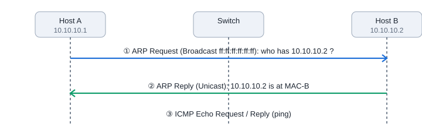

*شکل ۴: ping اول چرا کندتر است؟ چون اول ARP انجام می‌شود.*

Host فقط IP مقصد را می‌داند ولی فریم به MAC نیاز دارد. ARP این نگاشت را پیدا می‌کند:

1.  **ARP Request** (Broadcast به `ff:ff:ff:ff:ff:ff`): «چه کسی 10.10.10.2 را دارد؟ به 10.10.10.1 بگو.»
2.  همه‌ی دستگاه‌های VLAN دریافت می‌کنند؛ فقط صاحب IP جواب می‌دهد.
3.  **ARP Reply** (Unicast): «10.10.10.2 در MAC فلان است.»
4.  جواب در ARP Cache ذخیره می‌شود (چند دقیقه).

به همین دلیل اولین ping همیشه کندتر است یا گاهی یک بسته از دست می‌رود (`.!!!!`): اول باید ARP انجام شود.

مشاهده روی روتر: `show ip arp`

### ۳. ICMP: ابزار تشخیص

| Type | معنی                    | کجا می‌بینیم                              |
|------|-------------------------|------------------------------------------|
| 8    | Echo Request            | ping رفت                                 |
| 0    | Echo Reply              | ping برگشت                               |
| 3    | Destination Unreachable | مسیر/پورت وجود ندارد (`U` در ping سیسکو) |
| 11   | Time Exceeded           | TTL تمام شد (traceroute)                 |

**TTL:** هر روتر آن را ۱ کم می‌کند؛ اگر صفر شد بسته دور ریخته می‌شود تا در حلقه نماند. Windows معمولاً ۱۲۸ و لینوکس ۶۴ می‌فرستد؛ از روی TTL دریافتی می‌توان حدس زد بسته چند روتر رد شده.

### ۴. گرفتن Capture در PNetLab

- روی لینک بین دو دستگاه کلیک راست کنید (یا روی Interface) و **Capture** را بزنید؛ Wireshark روی سیستم شما باز می‌شود (PNetLab از مسیر وب و پروتکل مخصوص این کار را می‌کند).
- جایگزین روی خود IOS (در حالت EXEC، نه Config):

``` text
R1# monitor capture CAP1 interface gi0/0 both
R1# monitor capture CAP1 match any
R1# monitor capture CAP1 start
... ping ...
R1# monitor capture CAP1 stop
R1# show monitor capture CAP1 buffer brief
```

اگر دستور روی Image شما فقط «پذیرفته می‌شود ولی بسته‌ای نمی‌گیرد» (در Probe فصل ۱ دیدیم)، از Capture لینک PNetLab استفاده کنید. باز هم: پذیرفته‌شدن ≠ کارکردن.

### ۵. فیلترهای Wireshark (مهم‌ترین مهارت)

| فیلتر                           | معنی                     |
|---------------------------------|--------------------------|
| `arp`                           | فقط ARP                  |
| `icmp`                          | فقط ping                 |
| `ip.addr == 10.10.10.2`         | هر بسته‌ی مربوط به این IP |
| `eth.addr == aa:bb:cc:00:01:00` | بر اساس MAC              |
| `icmp.type == 8`                | فقط Echo Request         |
| `arp or icmp`                   | ترکیب با or/and          |
| `!arp`                          | همه به‌جز ARP             |

> **دو نوع فیلتر**
>
> **Capture Filter** (قبل از شروع، سبک‌تر، سینتکس BPF مثل `host 10.10.10.2`) و **Display Filter** (بعد از گرفتن، قدرتمندتر؛ جدول بالا).

### ۶. مثال‌ها

**ساده: ping اول**

Capture را شروع کنید، `clear arp` بزنید، `ping 10.10.10.2`. با فیلتر `arp or icmp` ببینید: اول ARP Request (Broadcast) و ARP Reply، بعد ۵ جفت Echo Request/Reply.

**متوسط: ping بیرون از Subnet**

از R1 به آدرسی در Subnet دیگر بزنید و ببینید MAC مقصد فریم، MAC Gateway است، نه MAC مقصد نهایی (ولی IP مقصد همان مقصد نهایی است). این مهم‌ترین نکته‌ی روتینگ است.

**سخت: عیب‌یابی با Capture**

Mask یک طرف را عمداً اشتباه کنید (درس ۲-۱) و Capture بگیرید: خواهید دید ARP Requestهای بدون جواب یا Echo Requestهای بدون Reply. یعنی مشکل در لایه ۲/۳ همان‌جاست و نه در برنامه.

### ۷. تمرین‌ها

**ت1.** ۱. ARP Request به چه MAC مقصدی فرستاده می‌شود؟ *(پاسخ: 2-6-ت1 در بخش «پاسخ‌ها» انتهای فصل)*

**ت2.** ۲. چرا اولین ping گاهی یک بسته از دست می‌دهد؟ *(پاسخ: 2-6-ت2 در بخش «پاسخ‌ها» انتهای فصل)*

**ت3.** ۳. در ping به مقصد بیرون از Subnet، MAC مقصد چیست؟ *(پاسخ: 2-6-ت3 در بخش «پاسخ‌ها» انتهای فصل)*

**ت4.** ۴. فیلتر برای دیدن فقط ping از 10.10.10.1؟ *(پاسخ: 2-6-ت4 در بخش «پاسخ‌ها» انتهای فصل)*

**ت5.** ۵. TTL=127 در جواب یعنی چه؟ *(پاسخ: 2-6-ت5 در بخش «پاسخ‌ها» انتهای فصل)*

### ۸. Lab هدایت‌شده

1.  در PNetLab روی لینک R1-SW1 Capture شروع کنید.
2.  روی R1: `clear arp` سپس `ping 10.10.10.2`.
3.  فیلتر `arp or icmp`: فریم‌ها را مشخص کنید و MAC/IPها را در جدولی یادداشت کنید.
4.  زمان بین ARP Request و Reply را بخوانید.
5.  Capture را به نام `pcap/ping-first.pcapng` ذخیره کنید (فایل را در Git نگذارید؛ ممکن است اطلاعات داشته باشد، فقط جدول خلاصه را بنویسید).

### ۹. Lab مستقل

یک سناریو: Gateway اشتباه روی یک Host (مثلاً `10.10.10.254` به‌جای `.1`). Capture بگیرید و در گزارش یک‌صفحه‌ای (`03-ops/ts14-gateway-wrong.md`) بنویسید: علامت چیست، چه بسته‌ای دیدید، چطور رفع کردید.

### ۱۰. Gate G1: آزمون عملی پایان فصل ۲

موارد زیر را بدون نگاه به درس انجام دهید و برای هر مورد یک «مدرک» (خروجی دستور) داشته باشید:

| \#  | وظیفه                                              | مدرک                                      |
|-----|----------------------------------------------------|-------------------------------------------|
| ۱   | Subnet کردن: ۴ مثال تصادفی (شبکه/Broadcast/Hostها) | جدول جواب‌ها                               |
| ۲   | VLSM برای ۴ بخش و ثبت در IP Plan                   | `02-design/ip-plan.md`                    |
| ۳   | IPv6: Prefix به VLANها، ping و جدول همسایه         | `show ipv6 neighbors`                     |
| ۴   | تنظیمات پایه + بکاپ + Rollback موفق                | خروجی `dir flash:` و ping بعد از Rollback |
| ۵   | SSH v2، Telnet بسته، ACL مدیریت                    | `show ip ssh` و تست رد Telnet             |
| ۶   | Capture ARP+ICMP و توضیح هر فریم                   | جدول MAC/IP                               |
| ۷   | رفع یک خرابی (Mask یا Gateway) با Capture          | گزارش یک‌صفحه‌ای                            |

**معیار قبولی:** حداقل ۶ از ۷ مورد با مدرک. هر مورد ناقص، بازبینی می‌شود و در «مرور اشتباهات» ثبت می‌گردد. وقتی تمام شد بگویید «G1 انجام شد» تا بررسی کنیم و فصل ۳ را شروع کنیم.

### ۱۱. سؤال‌های مرور

**م1.** تفاوت تصمیم سوییچ و روتر؟ *(پاسخ: 2-6-م1 در بخش «پاسخ‌ها» انتهای فصل)*

**م2.** ARP چرا Broadcast است؟ *(پاسخ: 2-6-م2 در بخش «پاسخ‌ها» انتهای فصل)*

**م3.** Echo Request و Reply چه Typeهایی هستند؟ *(پاسخ: 2-6-م3 در بخش «پاسخ‌ها» انتهای فصل)*

### English Corner: انگلیسی تخصصی این درس

این جمله‌ها از مستندات و محیط کار واقعی‌اند. بلند بخوانید و ترجمه را بپوشانید.

| English sentence                                                                     | ترجمه                                                                |
|--------------------------------------------------------------------------------------|----------------------------------------------------------------------|
| The first ping is slower because the host must resolve the MAC address with ARP.     | اولین ping کندتر است چون Host باید MAC را با ARP پیدا کند.           |
| Apply a display filter to isolate ICMP echo requests.                                | یک Display Filter بزنید تا فقط Echo Requestهای ICMP را جدا کنید.     |
| The destination MAC is the gateway's, while the destination IP stays the final host. | MAC مقصد، مال Gateway است در حالی که IP مقصد همان Host نهایی می‌ماند. |
| A packet is dropped when its TTL reaches zero.                                       | وقتی TTL به صفر برسد بسته دور ریخته می‌شود.                           |

**Q1.** Quick quiz (answer in English): Which Ethernet destination address does an ARP request use? *(پاسخ: 2-6-Q1 در بخش «پاسخ‌ها» انتهای فصل)*

### ۱۲. تکلیف و چک‌لیست تسلط

- [ ] Capture ping را انجام و توضیح دهم.
- [ ] ۵ فیلتر Wireshark را بدون نگاه بنویسم.
- [ ] Gate G1 را کامل کنم.

### ۱۳. یادآوری اشتباهات شما

> **یادآوری**
>
> دستور `monitor capture` در EXEC است؛ پذیرفته‌شدن دستور ≠ کار کردن آن؛ و فایل Capture را در Git نگذارید.


#### کارت Lab — درس ۲-۶ (Gate G1)

| # | فیلد | محتوا |
|---|---|---|
| 1 | عنوان و هدف | مشاهده‌ی ARP و ICMP با Wireshark و آزمون G1 |
| 2 | پیش‌نیاز | درس‌های ۲-۱ تا ۲-۵ |
| 3 | توپولوژی | Capture روی لینک R1-SW1 |
| 4 | تجهیزات | R1، SW1، Wireshark |
| 5 | نسخه نرم‌افزار | vIOS-L2 15.2(20200924، Experimental) برای SW؛ vIOS 15.9(3)M9 برای R؛ VPCS (PNetLab)؛ PNetLab 4.2.8 |
| 6 | IP Plan | 10.10.10.0/24 |
| 7 | وضعیت اولیه | ARP Cache خالی (`clear arp`) |
| 8 | صورت مسئله | ARP و ICMP را ببینید و MAC/IP هر فریم را جدول کنید؛ G1 را کامل کنید |
| 9 | مراحل هدایت‌شده | همان بخش «Lab هدایت‌شده» همین درس (گام‌به‌گام) |
| 10 | تست عملکرد | فیلتر `arp or icmp` |
| 11 | سناریوی خرابی | Gateway اشتباه روی یک Host |
| 12 | روش عیب‌یابی | Capture: ARP بدون پاسخ/ Echo بدون Reply |
| 13 | نتیجه‌ی مورد انتظار | ARP Request Broadcast و Reply Unicast؛ Echo Request/Reply |
| 14 | معیار پذیرش | جدول MAC/IP؛ G1 ≥ ۶ از ۷ |
| 15 | مستندات نهایی | جدول Capture؛ گزارش `03-ops/ts14-gateway-wrong.md` (فایل pcap در Git نباشد) |
| 16 | Cleanup و بازگردانی | `clear arp`؛ حذف فایل‌های Capture |

> **وضعیت راستی‌آزمایی (خارج از ۱۶ فیلد):** **اجرا نشده (فقط طراحی).** اجرا نشده؛ `monitor capture` فقط CLI-Accepted؛ Capture از PNetLab آزمایش نشده.

---

<a id="ans-2"></a>

## پاسخ‌های فصل 2

> ابتدا بدون نگاه حل کنید. هر پاسخ با شناسه‌ی «درس-نوع+شماره» مشخص است (ت = تمرین، م = سؤال مرور، Q = Quick quiz انگلیسی).

**2-1-م1** — سؤال ۱: Mask = 255.255.255.224؛ تعداد کل آدرس؟

``` text
Block size = 256 - 224 = 32
n = 0
Total = 32
```

**2-1-م2** — سؤال ۲: Mask = 255.255.248.0؛ تعداد کل آدرس؟

``` text
Block size = 256 - 248 = 8
n = 1
Total = 8 x 256 = 2048
```

**2-1-م3** — سؤال ۳: Mask = 255.240.0.0؛ تعداد کل آدرس؟

``` text
Block size = 256 - 240 = 16
n = 2
Total = 16 x 256 x 256 = 1048576
```

**2-1-م4** — سؤال ۴ (بررسی با روش توان ۲): آیا جواب سؤال ۳ با 2 به توان بیت‌های میزبان می‌خواند؟

``` text
Mask 255.240.0.0 = /12
Host bits = 32 - 12 = 20
Total = 2 ^ 20 = 1048576   (same answer)
```

**2-1-ت1** — ۱ (ساده): 192.168.5.130/24

``` text
Network   = 192.168.5.0
Broadcast = 192.168.5.255
Hosts     = 254
```

**2-1-ت2** — ۲: 10.0.0.9/30

``` text
Block size = 256 - 252 = 4
9 is between 8 and 11
Network   = 10.0.0.8
Broadcast = 10.0.0.11
Hosts     = 10.0.0.9 - 10.0.0.10   (router-to-router link)
```

**2-1-ت3** — ۳: 192.168.1.100/27

``` text
Block size = 256 - 224 = 32
100 is between 96 and 127
Network   = 192.168.1.96
Broadcast = 192.168.1.127
Hosts     = 192.168.1.97 - 192.168.1.126  (30 hosts)
```

**2-1-ت4** — ۴: 192.168.0.200/25

``` text
Block size = 256 - 128 = 128
200 is in block 128..255
Network   = 192.168.0.128
Broadcast = 192.168.0.255
Hosts     = 126
```

**2-1-ت5** — ۵: به ۸ Host نیاز دارم؛ Prefix؟

``` text
Need   = 8 + 2 = 10
2^4 = 16 >= 10   (2^3 = 8 is not enough)
Prefix = 32 - 4 = /28   (14 usable hosts)
```

**2-1-ت6** — ۶ (سخت): 172.31.14.9/22

``` text
Mask       = 255.255.252.0
Block size = 256 - 252 = 4   (3rd octet)
14 is between 12 and 15
Network    = 172.31.12.0
Broadcast  = 172.31.15.255
Host count = 2^10 - 2 = 1022
```

**2-1-ت7** — ۷ (سخت): 10.1.200.15/19

``` text
Mask       = 255.255.224.0
Block size = 256 - 224 = 32   (3rd octet)
200 is in block 192..223
Network    = 10.1.192.0
Broadcast  = 10.1.223.255
Host count = 2^13 - 2 = 8190
```

**2-1-ت8** — ۸: آیا 10.10.20.77/26 و 10.10.20.130/26 هم‌شبکه‌اند؟

``` text
10.10.20.77  -> network 10.10.20.64   (64..127)
10.10.20.130 -> network 10.10.20.128  (128..191)
Different networks -> traffic must pass through a router
```

**2-1-م5** — آدرس شبکه و Broadcast با چه فرمولی پیدا می‌شود؟

شبکه: آدرس AND Mask (یا گرد به پایین به مضرب بلوک). Broadcast: شبکه بعدی منهای ۱.

**2-1-م6** — چرا Host قابل‌استفاده = آدرس‌ها منهای ۲ است؟

یکی آدرس شبکه و یکی Broadcast است و به Host داده نمی‌شود.

**2-1-م7** — /26 چند Host دارد و بلوکش چند است؟

62 Host؛ بلوک 64.

**2-1-م8** — Client با 169.254.x.x یعنی چه؟

DHCP جواب نداده؛ Client خودش آدرس Link-Local ساخته.

**2-1-م9** — دو Host در یک Subnet با چه روشی هم‌شبکه بودنشان را تشخیص می‌دهند؟

آدرس مقصد را با Mask خود AND می‌کنند و با شبکه خودشان مقایسه می‌کنند.

**2-1-Q1** — Quick quiz (answer in English): How many usable hosts are in a /27 subnet?

30 (2^5 - 2).

**2-2-ت1** — ۱ (ساده): از 192.168.1.0/24 دو Subnet بساز: ۱۲۰ Host و ۱۰ Host

``` text
120 + 2 = 122 -> 128 -> /25
  192.168.1.0/25     hosts .1 - .126
10 + 2 = 12 -> 16 -> /28
  192.168.1.128/28   hosts .129 - .142
```

**2-2-ت2** — ۲ (ساده): لینک بین دو روتر از 10.1.1.0/24

``` text
Prefix    = /30
Network   = 10.1.1.0/30
Hosts     = 10.1.1.1 - 10.1.1.2
Broadcast = 10.1.1.3
```

**2-2-ت3** — ۳ (متوسط): از 172.16.0.0/24: ۶۰، ۳۰، ۱۰ Host

``` text
60 + 2 = 62 -> 64 -> /26
  172.16.0.0/26    hosts .1 - .62
30 + 2 = 32 -> /27
  172.16.0.64/27   hosts .65 - .94
10 + 2 = 12 -> 16 -> /28
  172.16.0.96/28   hosts .97 - .110
```

**2-2-ت4** — ۴ (متوسط): چرا نباید اول Subnet کوچک را بگذاریم؟

Subnet بزرگ باید روی مرز مضرب اندازه‌ی خودش شروع شود. اگر کوچک‌ها اول بیایند، «سوراخ‌هایی» می‌ماند که بزرگ‌ترها در آن جا نمی‌شوند.

**2-2-ت5** — ۵ (سخت): از 10.5.0.0/23: ۲۰۰ Host، ۷۰ Host، ۳۰ Host، دو لینک

``` text
200 + 2 = 202 -> 256 -> /24
  10.5.0.0/24
70 + 2 = 72 -> 128 -> /25
  10.5.1.0/25      hosts .1 - .126
30 + 2 = 32 -> /27
  10.5.1.128/27
Link 1 -> 10.5.1.160/30
Link 2 -> 10.5.1.164/30
Next free = 10.5.1.168
```

**2-2-ت6** — ۶ (سخت): آیا 192.168.1.64/26 و 192.168.1.100/27 هم‌پوشانی دارند؟

``` text
192.168.1.64/26   covers .64  - .127
192.168.1.100/27  covers .96  - .127   (network .96)
The second range is inside the first -> OVERLAP (design error)
```

**2-2-م1** — VLSM چیست و چرا به آن نیاز داریم؟

تقسیم بلوک به Subnetهایی با اندازه‌های مختلف، تا هدررفت آدرس نداشته باشیم.

**2-2-م2** — چرا از بزرگ‌ترین نیاز شروع می‌کنیم؟

برای اینکه هر Subnet روی مرز درست بیفتد و سوراخ ایجاد نشود.

**2-2-م3** — بهترین Prefix برای لینک بین دو روتر چیست؟

/30 (دو Host). (در IPv6 یا لینک‌های ویژه /31 هم استفاده می‌شود.)

**2-2-Q1** — Quick quiz (answer in English): Why do we sort requirements from largest to smallest in VLSM?

So each block aligns on its boundary and no gaps or overlaps appear.

**2-3-ت1** — ۱. (ساده) کوتاه کن: 2001:0db8:0000:0000:0000:0000:0000:0001

`2001:db8::1`

**2-3-ت2** — ۲. (ساده) این چه نوع آدرسی است: fe80::1 ؟ fd12:3456::5 ؟ ff02::1 ؟ 2001:db8::5 ؟

Link-Local؛ ULA؛ Multicast (همه‌ی گره‌ها)؛ مستندات/Global.

**2-3-ت3** — ۳. (متوسط) باز کن: 2001:db8:0:1::5

`2001:0db8:0000:0001:0000:0000:0000:0005`

**2-3-ت4** — ۴. (متوسط) آیا 2001:db8::1 و 2001:db8:0:0:1::1 در یک /64 هستند؟

``` text
A = 2001:0db8:0000:0000:0000:0000:0000:0001
B = 2001:0db8:0000:0000:0001:0000:0000:0001
First 64 bits of A = 2001:0db8:0000:0000
First 64 bits of B = 2001:0db8:0000:0000
Equal -> same /64
```

**2-3-ت5** — ۵. (سخت) چرا نمی‌توان 2001::1::2 نوشت؟

دو بار :: ابهام می‌سازد؛ نمی‌دانیم هر کدام چند گروه صفر هستند.

**2-3-ت6** — ۶. (سخت) از 2001:db8:abcd::/48 برای ۴ VLAN (۱۰، ۲۰، ۳۰، ۹۹) Prefix بساز.

2001:db8:abcd:10::/64، 2001:db8:abcd:20::/64، 2001:db8:abcd:30::/64، 2001:db8:abcd:99::/64.

**2-3-م1** — چرا IPv6 Broadcast ندارد؟

با Multicast جایگزین شده تا فقط دستگاه‌های مربوطه پردازش کنند.

**2-3-م2** — NS/NA معادل چه چیزی در IPv4 است؟

ARP Request/Reply.

**2-3-م3** — چرا ICMPv6 را نباید بست؟

NDP و SLAAC به آن وابسته‌اند.

**2-3-م4** — /64 برای یک VLAN یعنی چه؟

۶۴ بیت شبکه و ۶۴ بیت دستگاه؛ استاندارد SLAAC.

**2-3-Q1** — Quick quiz (answer in English): Which IPv6 messages replace ARP?

Neighbor Solicitation and Neighbor Advertisement (NDP).

**2-4-ت1** — ۱. Prompt زیر در کدام حالت است؟ R1(config-if)#

Interface Config (زیرمجموعه‌ی Global Config).

**2-4-ت2** — ۲. تفاوت running و startup چیست؟

running در RAM و فعال؛ startup در NVRAM و برای بوت بعدی.

**2-4-ت3** — ۳. چطور در Config دستور show ip route را اجرا کنیم؟

`do show ip route`

**2-4-ت4** — ۴. چرا enable secret بهتر از enable password است؟

secret با Hash قوی ذخیره می‌شود؛ password متن ساده یا Type 7 (ضعیف و قابل برگشت) است.

**2-4-ت5** — ۵. فایده‌ی reload in چیست؟

اگر تغییر باعث قطع شد، دستگاه خودش به تنظیمات ذخیره‌شده‌ی قبلی بر می‌گردد.

**2-4-م1** — سه حالت اصلی CLI؟

User EXEC، Privileged EXEC، Config (و زیرحالت‌ها).

**2-4-م2** — چرا بکاپ قبل از تغییر؟

برای بازگشت سریع در صورت خرابی.

**2-4-Q1** — Quick quiz (answer in English): What is the difference between running-config and startup-config?

Running-config is active in RAM; startup-config is saved in NVRAM and loaded at boot.

**2-5-ت1** — ۱. چرا Telnet ناامن است؟

رمز و دستورها را بدون رمزگذاری می‌فرستد.

**2-5-ت2** — ۲. چرا ip domain-name لازم است؟

برای ساخت کلید RSA، نام کامل (FQDN) لازم است.

**2-5-ت3** — ۳. Wildcard Mask برای 10.10.10.0/24؟

`0.0.0.255`

**2-5-ت4** — ۴. Wildcard Mask برای یک میزبان 10.10.10.50؟

`0.0.0.0` یا ساده‌تر `host 10.10.10.50`.

**2-5-ت5** — ۵. Wildcard Mask برای 10.10.8.0/22؟

`0.0.3.255`

**2-5-م1** — Host Key برای چیست؟

اثبات هویت سرور و جلوگیری از حمله‌ی Man-in-the-Middle.

**2-5-م2** — access-class روی VTY چه فیلتر می‌کند؟

فقط ارتباط‌های مدیریتی ورودی به دستگاه را.

**2-5-Q1** — Quick quiz (answer in English): Why is Telnet considered insecure?

It transmits usernames and passwords unencrypted, so anyone on the path can read them.

**2-6-ت1** — ۱. ARP Request به چه MAC مقصدی فرستاده می‌شود؟

Broadcast: ff:ff:ff:ff:ff:ff

**2-6-ت2** — ۲. چرا اولین ping گاهی یک بسته از دست می‌دهد؟

چون ARP هنوز حل نشده؛ بسته‌ی اول صبر می‌کند یا تایم‌اوت می‌شود.

**2-6-ت3** — ۳. در ping به مقصد بیرون از Subnet، MAC مقصد چیست؟

MAC Default Gateway.

**2-6-ت4** — ۴. فیلتر برای دیدن فقط ping از 10.10.10.1؟

`icmp and ip.src == 10.10.10.1`

**2-6-ت5** — ۵. TTL=127 در جواب یعنی چه؟

احتمالاً مبدأ Windows (۱۲۸) بوده و از یک روتر عبور کرده.

**2-6-م1** — تفاوت تصمیم سوییچ و روتر؟

سوییچ با MAC (لایه ۲)، روتر با IP (لایه ۳).

**2-6-م2** — ARP چرا Broadcast است؟

چون MAC مقصد را نمی‌دانیم؛ همه را می‌پرسیم.

**2-6-م3** — Echo Request و Reply چه Typeهایی هستند؟

۸ و ۰.

**2-6-Q1** — Quick quiz (answer in English): Which Ethernet destination address does an ARP request use?

The broadcast address ff:ff:ff:ff:ff:ff.

<a id="mist-2"></a>


### پاسخ‌های درس افزوده‌ی 2-0 (فصل 2)

**2-0-ت1** — Application، Presentation، Session، Transport، Network، Data Link، Physical.

**2-0-ت2** — L2: Frame؛ L3: Packet؛ L4: Segment (TCP) یا Datagram (UDP).

**2-0-ت3** — هدر L2 (MAC)؛ IP و بالاتر بدون NAT ثابت می‌ماند و TTL یکی کم می‌شود.

**2-0-ت4** — L1/L2 سالم (ping OK)؛ L3 OK؛ مشکل L4/L7: پورت 80 بسته/Policy/سرویس؛ آزمون با telnet/nc/curl.

**2-0-Q1** — The data link layer (layer 2), using MAC addresses.

## اشتباهات و پرسش‌های ثبت‌شده‌ی فصل 2 (برای مرور)

- **نکته‌ی طراحی: شعبه با ۳۰ کاربر در /27 (Capstone IP Plan)** (پرسش، W2)
  /27 دقیقاً ۳۰ Host می‌دهد ولی Gateway هم یک آدرس مصرف می‌کند؛ پس برای ۳۰ کاربر حاشیه‌ی رشد نیست. بهتر است /26 (۶۲ Host) بگیریم. جدول بازنگری‌شده در 02-design/ip-plan.md است. قاعده: نیاز واقعی = کاربران + Gateway + حاشیه‌ی رشد.
- **بلوک 10.20.0.0/22 یعنی چه و عدد بلوک ۴ از کجا آمد؟** (پرسش، W2)
  /22 یعنی ۱۰ بیت میزبان و ۱۰۲۴ آدرس. Mask برابر 255.255.252.0 است و اندازه بلوک Octet سوم برابر ۲۵۶ منهای ۲۵۲ یعنی ۴ است؛ پس شبکه‌ها در Octet سوم هر ۴ عدد شروع می‌شوند و بلوک اول تا 10.20.3.255 می‌رود. شرح کامل در درس ۲-۲.
- **اشتباه Claude: فرمول و مراحل عددی داخل جمله‌ی فارسی** (اشتباه، W2)
  ترکیب فارسی، عدد و انگلیسی در متن راست‌به‌چپ ترتیب را به‌هم می‌ریزد. از این به بعد فرمول و محاسبه در بلوک مستقل چپ‌به‌راست و مراحل در فهرست شماره‌دار می‌آید.
- **اشتباه Claude: درس خیلی کوتاه و بدون مقدمه** (اشتباه، W2)
  هر درس باید با «چه چیزی و چرا» شروع شود، بعد توضیح ساده، مثال ساده/متوسط/سخت، تمرین و Lab. این قانون در CLAUDE.md ثبت شد.
- **نظم جدول‌ها و فهرست‌ها** (پرسش، W2)
  هر مورد از یک فهرست (مثلاً انواع IP خصوصی) در یک سطر جدا می‌آید و متن فارسی/انگلیسی در جدول درست نمایش داده می‌شود.

---

<a id="ch3"></a>

# فصل 3 — Switching I: MAC، VLAN، Trunk، Router-on-a-Stick و SVI

**مدت:** ۳۶ ساعت = ۶ روز × ۶ ساعت (هر درس یک روز؛ روز ۶ شامل آزمون کوچک) | **پیش‌نیاز:** فصل ۲.
**اهداف:**
1. رفتار سوییچ: Learning، Flooding، Forwarding، Aging.
2. VLAN/Access Port و VLAN Matrix.
3. Trunk 802.1Q، Native و Allowed (خطای `add`).
4. Inter-VLAN با Router-on-a-Stick و SVI (و تفاوت‌شان).
5. عیب‌یابی لایه‌ای (TS01 تا TS05).
**معیار تسلط فصل:** مسیر فریم را بدون نگاه توضیح دهید؛ VLAN Matrix بسازید؛ Trunk امن تنظیم کنید؛ دو روش Inter-VLAN را مقایسه و پیاده کنید؛ ≥ ۴ از ۵ TS با RCA.
**اشتباهات رایج:** `allowed vlan` بدون `add`؛ دو Gateway برای یک VLAN؛ فراموشی `ip routing`؛ فراموشی بکاپ قبل از تغییر Trunk.

**درس‌های فصل:**
- [درس ۳-۱ — سوییچ و جدول MAC](#l-3-1)
- [درس ۳-۲ — VLAN و Access Port](#l-3-2)
- [درس ۳-۳ — Trunk و 802.1Q](#l-3-3)
- [درس ۳-۴ — Router-on-a-Stick](#l-3-4)
- [درس ۳-۵ — SVI و سوییچ لایه ۳](#l-3-5)
- [درس ۳-۶ — عیب‌یابی و آزمون هفته](#l-3-6)

---

<a id="l-3-1"></a>

## درس ۳-۱ — سوییچ و جدول MAC

**فصل ۳ - روز ۱ · پیش‌نیاز: فصل ۲ · ۶ ساعت**

### این درس درباره چیست و چرا باید یاد بگیریم؟

**چه چیزی یاد می‌گیریم:** سوییچ چطور تصمیم می‌گیرد فریم را از کدام پورت بفرستد؛ یعنی جدول MAC Address Table (که به آن CAM Table هم می‌گویند)، و چهار رفتار اصلی سوییچ: یاد‌گرفتن، پخش‌کردن، ارسال هدفمند و پاک‌کردن.

**چرا لازم است:** تمام ایده‌ی VLAN، Trunk و STP که در دو هفته‌ی آینده می‌خوانید، روی همین جدول بنا شده است. کسی که نداند سوییچ چطور فکر می‌کند، مشکلاتی مثل «ترافیک روی پورت‌های بی‌ربط دیده می‌شود» یا «MAC بین دو پورت پرش می‌کند» را نمی‌فهمد.

- **در کار روزانه:** پیدا کردن اینکه یک کامپیوتر به کدام پورت وصل است (`show mac address-table`) روزانه‌ترین کار یک ادمین شبکه است.
- **در امنیت:** حمله‌های MAC Flooding و MAC Spoofing همین جدول را هدف می‌گیرند؛ فهمیدنش پایه‌ی Port Security (فصل ۴) است.
- **در عیب‌یابی:** «Unknown Unicast Flooding» یکی از دلایل کندی شبکه است و فقط با فهم CAM قابل تشخیص است.

> **مسیر درس**
>
> سوییچ در برابر هاب ← چهار رفتار سوییچ ← مثال ساده/متوسط/سخت ← دستورها ← تمرین ← Lab ← عیب‌یابی ← English Corner.

#### اصطلاحات این درس (مخفف ← شکل کامل ← معنی)

| مخفف      | شکل کامل انگلیسی                   | معنی فارسی                                     |
|-----------|------------------------------------|------------------------------------------------|
| MAC       | Media Access Control address       | آدرس ۴۸ بیتی فیزیکی کارت شبکه                  |
| CAM       | Content Addressable Memory         | حافظه‌ی سریع جدول MAC سوییچ                     |
| Frame     | Ethernet Frame                     | بسته‌ی لایه ۲                                   |
| Unicast   | Unicast                            | ارسال به یک مقصد مشخص                          |
| Broadcast | Broadcast                          | ارسال به همه (ff:ff:ff:ff:ff:ff)               |
| Flooding  | Flooding                           | ارسال فریم از همه‌ی پورت‌ها به‌جز پورت ورودی      |
| Aging     | MAC Aging Time                     | زمان فراموشی ردیف بی‌استفاده (پیش‌فرض ۳۰۰ ثانیه) |
| OUI       | Organizationally Unique Identifier | ۳ بایت اول MAC؛ شناسه‌ی سازنده                  |
| VPCS      | Virtual PC Simulator               | کامپیوتر ساده‌ی PNetLab برای تست                |

### ۱. هاب در برابر سوییچ (یک مثال روزمره)

فرض کنید در یک سالن، یک نفر می‌خواهد با شخصی در آن صحبت کند. **هاب (Hub)** مثل داد زدن وسط سالن است: همه می‌شنوند، حتی کسانی که ربطی ندارند. **سوییچ (Switch)** مثل منشی‌ای است که اول یاد می‌گیرد هر شخص کجا نشسته و بعد پیام را فقط به همان میز می‌برد.

هاب‌ها امروز منسوخ‌اند. سوییچ این کار را با یک جدول انجام می‌دهد: «هر MAC پشت کدام پورت است؟»

### ۲. چهار رفتار سوییچ

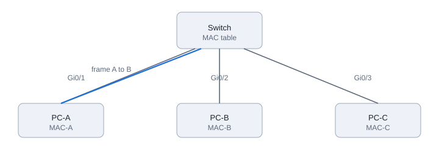

*شکل ۱: سوییچ و سه کامپیوتر؛ هر کامپیوتر به یک پورت وصل است.*

1.  **Learning (یادگیری):** هر فریمی که وارد می‌شود، سوییچ به MAC مبدأ آن نگاه می‌کند و در جدول می‌نویسد «این MAC پشت این پورت است».
2.  **Flooding (پخش):** اگر MAC مقصد در جدول نبود (یا Broadcast بود)، فریم از همه‌ی پورت‌ها به‌جز پورت ورودی فرستاده می‌شود.
3.  **Forwarding (ارسال هدفمند):** اگر MAC مقصد در جدول بود، فریم فقط از همان پورت می‌رود.
4.  **Aging (فراموشی):** ردیفی که ۳۰۰ ثانیه فریم جدیدی از آن نیامد، پاک می‌شود تا جدول پر و کهنه نشود.

> **یک قاعده‌ی مهم**
>
> سوییچ فقط MAC **مبدأ** را یاد می‌گیرد، هرگز MAC مقصد را. و Broadcast هیچ‌وقت مبدأ نیست؛ پس هرگز در جدول نمی‌آید.

### ۳. مثال ساده: اولین ارتباط A با B

جدول سوییچ در ابتدا خالی است. A (پورت Gi0/1) به B (پورت Gi0/2) فریم می‌فرستد:

``` text
Step 1: frame arrives on Gi0/1, src = MAC-A, dst = MAC-B
Step 2: learn  -> table: MAC-A = Gi0/1
Step 3: MAC-B is unknown -> FLOOD to Gi0/2 and Gi0/3
Step 4: B answers: src = MAC-B, dst = MAC-A  (arrives on Gi0/2)
Step 5: learn  -> table: MAC-B = Gi0/2
Step 6: MAC-A is known -> FORWARD only to Gi0/1
```

نتیجه: PC-C فقط فریم اول را می‌بیند. از پیام دوم به بعد، ارتباط A و B خصوصی می‌شود.

### ۴. مثال متوسط: ARP و Broadcast

در عمل، قبل از ping باید ARP انجام شود (درس ۲-۶). ARP Request یک Broadcast است:

``` text
ARP Request : dst = ff:ff:ff:ff:ff:ff  -> always flooded to all ports
ARP Reply   : dst = MAC-A (unicast)     -> forwarded only to Gi0/1
Then ping   : unicast both directions   -> no flooding anymore
```

یعنی هر ارتباط تازه با یک موج Flooding شروع می‌شود و بعد آرام می‌گیرد.

### ۵. مثال سخت: چند MAC پشت یک پورت و پرش MAC

سناریو ۱: پورت Gi0/3 به یک سوییچ دیگر وصل است. پشت آن ۲۰ کامپیوتر هست. نتیجه:

``` text
show mac address-table dynamic
  VLAN  Mac Address       Type     Ports
  1     aaaa.0000.0001    DYNAMIC  Gi0/3
  1     aaaa.0000.0002    DYNAMIC  Gi0/3
  ... 20 MACs on the same port (normal on an uplink)
```

سناریو ۲ (خطرناک): اگر یک MAC یک ثانیه از پورت Gi0/1 و ثانیه‌ی بعد از Gi0/2 بیاید، سوییچ پیام `%SW_MATM-4-MACFLAP_NOTIF` می‌دهد. این تقریباً همیشه نشانه‌ی **Loop** (حلقه) در شبکه است. در فصل ۴ (STP) می‌فهمید چرا و چطور جلویش را بگیریم.

### ۶. دستورهای کلیدی (خط‌به‌خط)

``` text
SW1# show mac address-table
SW1# show mac address-table dynamic
SW1# show mac address-table address aaaa.0000.0001
SW1# show mac address-table interface gi0/1
SW1# show mac address-table aging-time
SW1# clear mac address-table dynamic
```

- `dynamic`: فقط ردیف‌هایی که سوییچ خودش یاد گرفته (در برابر `static` که دستی نوشته می‌شود).
- `address` و `interface`: جستجو برای یک MAC یا یک پورت، مثل «پیدا کردن کامپیوتر گم‌شده».
- `clear ... dynamic`: جدول را پاک می‌کند (در Lab برای دیدن دوباره‌ی یادگیری). در شبکه‌ی واقعی با احتیاط، چون Flooding موقت ایجاد می‌کند.

### ۷. تمرین‌ها

**ت1.** ۱ (ساده): سوییچ کدام MAC را یاد می‌گیرد: مبدأ یا مقصد؟ *(پاسخ: 3-1-ت1 در بخش «پاسخ‌ها» انتهای فصل)*

**ت2.** ۲ (ساده): فریم با مقصد ff:ff:ff:ff:ff:ff چطور پخش می‌شود؟ *(پاسخ: 3-1-ت2 در بخش «پاسخ‌ها» انتهای فصل)*

**ت3.** ۳ (متوسط): جدول خالی است. A (Gi0/1) به B (Gi0/2) و بعد B به A می‌فرستد. چند Flood رخ می‌دهد؟ *(پاسخ: 3-1-ت3 در بخش «پاسخ‌ها» انتهای فصل)*

**ت4.** ۴ (متوسط): چرا ردیف یک MAC بعد از ۵ دقیقه ناپدید می‌شود؟ *(پاسخ: 3-1-ت4 در بخش «پاسخ‌ها» انتهای فصل)*

**ت5.** ۵ (سخت): MACFLAP روی MAC-X بین Gi0/1 و Gi0/2؛ محتمل‌ترین علت؟ *(پاسخ: 3-1-ت5 در بخش «پاسخ‌ها» انتهای فصل)*

### ۸. Lab هدایت‌شده: دیدن یادگیری و Flooding

توپولوژی: سوییچ `SW1` با سه کامپیوتر ساده‌ی VPCS در PNetLab. اگر ندارید، از منوی Add Object سه گره‌ی VPCS (`PC1` تا `PC3`) بسازید و به پورت‌های `Gi0/1` تا `Gi0/3` وصل کنید. همه در VLAN 1 (پیش‌فرض) هستند.

#### گام ۱: آدرس‌دهی VPCS

``` text
PC1> ip 10.10.1.11/24
PC2> ip 10.10.1.12/24
PC3> ip 10.10.1.13/24
```

#### گام ۲: جدول خالی

``` text
SW1# clear mac address-table dynamic
SW1# show mac address-table dynamic
```

#### گام ۳: ایجاد ترافیک و دیدن یادگیری

``` text
PC1> ping 10.10.1.12
SW1# show mac address-table dynamic
```

باید MAC دو VPCS را روی پورت‌های درست ببینید. MAC هر VPCS را با `show ip` روی خودش می‌بینید.

#### گام ۴: دیدن Flooding با Capture

1.  روی لینک PC3 به SW1 کلیک راست و Capture را شروع کنید.
2.  روی SW1: `clear mac address-table dynamic`.
3.  روی PC1: `ping 10.10.1.12`.
4.  در Wireshark فیلتر `arp or icmp`: ARP Request را می‌بینید (چون Broadcast است) ولی Echo Request بین PC1 و PC2 را **نباید** ببینید.

پیش‌بینی کنید و بعد با واقعیت مقایسه کنید. اگر Echo را روی PC3 دیدید، یعنی سوییچ هنوز MAC را یاد نگرفته بود.

#### گام ۵: Aging

``` text
SW1# show mac address-table aging-time
SW1(config)# mac address-table aging-time 60
```

یک دقیقه ترافیک نفرستید و دوباره `show mac address-table dynamic` را بزنید. بعد زمان را به 300 برگردانید.

### ۹. Lab مستقل

MAC یک VPCS را از روی جدول به پورتش ربط دهید، بدون نگاه به توپولوژی. بعد کابل PC2 را به پورت دیگر منتقل کنید و ثبت کنید چه مدت طول می‌کشد جدول درست شود. گزارش را در `03-ops/l2-cam-notes.md` بنویسید.

### ۱۰. عیب‌یابی

|           |                                                                          |
|-----------|--------------------------------------------------------------------------|
| Symptom   | ترافیک یک ارتباط روی پورت‌های بی‌ربط دیده می‌شود                            |
| علت محتمل | MAC مقصد در جدول نیست (Unknown Unicast Flooding) یا Aging خیلی کوتاه است |
| روش       | show mac address-table address ، Capture روی پورت سوم                    |
| Symptom 2 | پیام MACFLAP                                                             |
| علت       | Loop یا MAC تکراری                                                       |
| رفع       | پیدا کردن و قطع Loop (فصل ۴: STP)                                       |

### ۱۱. سؤال‌های مرور

**م1.** سوییچ چه چیزی را یاد می‌گیرد و از کجا؟ *(پاسخ: 3-1-م1 در بخش «پاسخ‌ها» انتهای فصل)*

**م2.** چرا Broadcast هیچ‌وقت در جدول MAC دیده نمی‌شود؟ *(پاسخ: 3-1-م2 در بخش «پاسخ‌ها» انتهای فصل)*

**م3.** Flooding یعنی چه؟ *(پاسخ: 3-1-م3 در بخش «پاسخ‌ها» انتهای فصل)*

### English Corner: انگلیسی تخصصی این درس

این جمله‌ها از مستندات و محیط کار واقعی‌اند. بلند بخوانید و ترجمه را بپوشانید.

| English sentence                                                          | ترجمه                                                               |
|---------------------------------------------------------------------------|---------------------------------------------------------------------|
| The switch learns the source MAC address of every incoming frame.         | سوییچ MAC مبدأ هر فریم ورودی را یاد می‌گیرد.                         |
| Unknown unicast frames are flooded out all ports except the ingress port. | فریم‌های Unicast ناشناخته از همه‌ی پورت‌ها به‌جز پورت ورودی پخش می‌شوند. |
| A MAC flap usually indicates a layer-2 loop.                              | MAC Flap معمولاً نشانه‌ی Loop در لایه ۲ است.                          |
| Entries age out after 300 seconds of inactivity.                          | ردیف‌ها بعد از ۳۰۰ ثانیه بی‌فعالیتی حذف می‌شوند.                       |

**Q1.** Quick quiz (answer in English): What does a switch do when the destination MAC is not in its table? *(پاسخ: 3-1-Q1 در بخش «پاسخ‌ها» انتهای فصل)*

### ۱۲. تکلیف و چک‌لیست تسلط

- [ ] ۵ تمرین را بدون نگاه حل کنم.
- [ ] Lab را انجام دهم و Flooding را با Capture ببینم.
- [ ] چهار رفتار سوییچ را بدون نگاه توضیح دهم.

### ۱۳. یادآوری اشتباهات شما

> **یادآوری**
>
> پیش‌بینی را قبل از اجرا بنویسید؛ دستور EXEC را در Config نزنید؛ فرمول و محاسبه را در بلوک مستقل بنویسید.


#### کارت Lab — درس ۳-۱

| # | فیلد | محتوا |
|---|---|---|
| 1 | عنوان و هدف | دیدن Learning/Flooding/Forwarding/Aging |
| 2 | پیش‌نیاز | فصل ۲ |
| 3 | توپولوژی | SW1 با PC1..PC3 (VPCS) روی Gi0/1..Gi0/3 |
| 4 | تجهیزات | SW1، ۳ VPCS |
| 5 | نسخه نرم‌افزار | vIOS-L2 15.2(20200924، Experimental) برای SW؛ vIOS 15.9(3)M9 برای R؛ VPCS (PNetLab)؛ PNetLab 4.2.8 |
| 6 | IP Plan | 10.10.1.11-13/24 (VLAN 1) |
| 7 | وضعیت اولیه | جدول MAC خالی (`clear mac address-table dynamic`) |
| 8 | صورت مسئله | ثابت کنید سوییچ MAC مبدأ را یاد می‌گیرد و Unknown Unicast پخش می‌شود |
| 9 | مراحل هدایت‌شده | همان بخش «Lab هدایت‌شده» همین درس (گام‌به‌گام) |
| 10 | تست عملکرد | `show mac address-table dynamic` ؛ Capture روی PC3 |
| 11 | سناریوی خرابی | Aging کوتاه (`mac address-table aging-time 60`) |
| 12 | روش عیب‌یابی | Capture روی پورت سوم |
| 13 | نتیجه‌ی مورد انتظار | MAC دو PC روی پورت درست؛ Echo بین PC1 و PC2 روی PC3 دیده نشود |
| 14 | معیار پذیرش | پیش‌بینی با نتیجه تطبیق داده شود |
| 15 | مستندات نهایی | `03-ops/l2-cam-notes.md` |
| 16 | Cleanup و بازگردانی | Aging را 300 کنید |

> **وضعیت راستی‌آزمایی (خارج از ۱۶ فیلد):** **اجرا نشده (فقط طراحی).** اجرا نشده؛ رفتار CAM/Flooding روی vIOS-L2 با VPCS دیده نشده.

---

<a id="l-3-2"></a>

## درس ۳-۲ — VLAN و Access Port

**فصل ۳ - روز ۲ · پیش‌نیاز: درس ۳-۱ · ۶ ساعت**

### این درس درباره چیست و چرا باید یاد بگیریم؟

**چه چیزی یاد می‌گیریم:** چطور یک سوییچ فیزیکی را به چند «شبکه‌ی مجازی جدا» یعنی VLAN تقسیم کنیم، پورت‌ها را به VLANها اختصاص دهیم (Access Port) و جدولی منظم به نام VLAN Matrix بسازیم.

**چرا لازم است:** بدون VLAN، همه‌ی دستگاه‌های سازمان در یک Broadcast Domain هستند: ترافیک حسابداری، دوربین‌ها و مهمان‌ها با هم قاطی می‌شود و یک کامپیوتر آلوده می‌تواند همه را ببیند. VLAN جداسازی را بدون خرید سوییچ جدا ممکن می‌کند.

- **در کار روزانه:** هر بار که کارمند جدید یا پرینتر جدید وصل می‌شود، باید پورتش را به VLAN درست ببرید.
- **در امنیت:** VLAN اولین لایه‌ی «Segmentation» است؛ در FortiGate بین VLANها Policy می‌نویسید.
- **در Capstone:** VLAN10 مدیریت، VLAN20 کاربران و VLAN30 سرورها همین هفته ساخته می‌شوند.

> **مسیر درس**
>
> Broadcast Domain ← VLAN چیست ← Access Port ← VLAN Matrix ← مثال ساده/متوسط/سخت ← دستورها ← تمرین ← Lab ← عیب‌یابی.

#### اصطلاحات این درس (مخفف ← شکل کامل ← معنی)

| مخفف             | شکل کامل انگلیسی                    | معنی فارسی                                     |
|------------------|-------------------------------------|------------------------------------------------|
| VLAN             | Virtual Local Area Network          | شبکه محلی مجازی؛ جداسازی منطقی در لایه ۲       |
| Broadcast Domain | Broadcast Domain                    | محدوده‌ای که Broadcast در آن می‌رسد              |
| Access Port      | Access Port                         | پورتی که فقط به یک VLAN تعلق دارد و Tag نمی‌زند |
| Native           | Native VLAN                         | VLAN بدون Tag روی Trunk (درس بعد)              |
| VLAN ID          | VLAN Identifier                     | شماره‌ی VLAN (۱ تا ۴۰۹۴)                        |
| SVI              | Switch Virtual Interface            | Interface مجازی L3 برای یک VLAN                |
| DHCP             | Dynamic Host Configuration Protocol | تخصیص خودکار آدرس                              |

### ۱. مشکل: یک Broadcast Domain بزرگ

یک ساختمان اداری را در نظر بگیرید که همه‌ی طبقه‌ها یک راه‌پله‌ی مشترک و بدون در دارند. هر صدایی که در یک طبقه بلند شود، همه‌ی ساختمان می‌شنوند. Broadcast در شبکه همین است: هر بار که یک دستگاه ARP یا DHCP می‌فرستد، همه‌ی دستگاه‌های سوییچ آن را دریافت می‌کنند.

هرچه دستگاه‌ها بیشتر شوند، Broadcast بیشتر و شبکه کندتر می‌شود؛ و از نظر امنیت، همه همسایه‌ی هم هستند.

### ۲. VLAN: در گذاشتن بین طبقه‌ها

VLAN سوییچ را به چند «سوییچ مجازی» تقسیم می‌کند. هر پورت عضو یک VLAN است و فریم‌ها فقط بین پورت‌های همان VLAN رد می‌شوند. دستگاه‌های VLAN متفاوت نه Broadcast یکدیگر را می‌بینند و نه بدون روتر با هم صحبت می‌کنند.

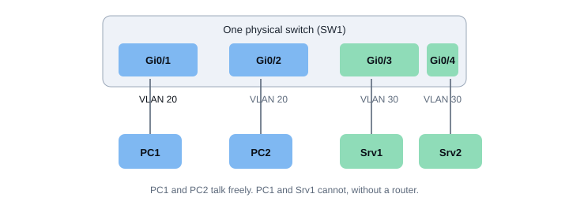

*شکل ۱: یک سوییچ فیزیکی، دو VLAN مجزا.*

#### قوانین VLAN

- VLAN با شماره شناخته می‌شود: ۱ تا ۴۰۹۴ (جزئیات در درس بعد).
- VLAN 1 پیش‌فرض است و بهتر است برای کاربران استفاده نشود.
- هر VLAN معمولاً یک Subnet IP جدا دارد: VLAN20 همان 10.10.20.0/24 در IP Plan ماست.
- Access Port فقط عضو یک VLAN است و دستگاه انتهایی (PC، پرینتر) به آن وصل می‌شود.

### ۳. VLAN Matrix: سند طراحی

قبل از تایپ هر دستور، یک جدول بسازید. ستون‌ها: شماره، نام، Subnet، Gateway، پورت‌ها. این جدول مرجع شماست:

| VLAN | Name    | Subnet        | Gateway    | Access Ports     |
|------|---------|---------------|------------|------------------|
| 10   | MGMT    | 10.10.10.0/24 | 10.10.10.1 | (مدیریت تجهیزات) |
| 20   | USERS   | 10.10.20.0/24 | 10.10.20.1 | Gi0/1, Gi0/2     |
| 30   | SERVERS | 10.10.30.0/24 | 10.10.30.1 | Gi0/3            |

### ۴. دستورها (خط‌به‌خط)

``` text
SW1(config)# vlan 20
SW1(config-vlan)# name USERS
SW1(config-vlan)# exit
SW1(config)# interface gi0/1
SW1(config-if)# switchport mode access
SW1(config-if)# switchport access vlan 20
SW1(config-if)# exit
```

- `vlan 20` + `name`: VLAN را می‌سازد و نام می‌دهد (نام فقط برای خوانایی است).
- `switchport mode access`: پورت را صریحاً Access می‌کند (نه خودکار).
- `switchport access vlan 20`: پورت را عضو VLAN 20 می‌کند. اگر VLAN وجود نداشته باشد، IOS آن را خودکار می‌سازد (خطای رایج: VLAN بدون نام).
- برای چند پورت: `interface range gi0/1 - 2`.

``` text
SW1# show vlan brief
SW1# show interfaces gi0/1 switchport
SW1# show running-config interface gi0/1
```

### ۵. مثال ساده: دو کامپیوتر در یک VLAN

``` text
PC1> ip 10.10.20.11/24 10.10.20.1
PC2> ip 10.10.20.12/24 10.10.20.1
PC1> ping 10.10.20.12     -> success (same VLAN 20)
```

### ۶. مثال متوسط: دو VLAN، بدون روتر

``` text
Srv1 (VLAN 30): 10.10.30.11/24
PC1  (VLAN 20): ping 10.10.30.11   -> FAILS
```

دلیل: دو Broadcast Domain جدا هستند و بدون Gateway (روتر یا SVI) بسته نمی‌تواند رد شود. در درس‌های ۳-۴ و ۳-۵ این مشکل را حل می‌کنیم.

### ۷. مثال سخت: پورت در VLAN اشتباه (TS03)

کاربری شکایت دارد «اینترنت ندارم». IP او 10.10.20.50/24 است ولی ping به Gateway جواب نمی‌دهد. روش عیب‌یابی:

1.  پورت او را پیدا کن: `show mac address-table address <MAC>`.
2.  VLAN آن پورت را ببین: `show vlan brief`.
3.  مقایسه کن: Subnet کامپیوتر با VLAN پورت یکی است؟
4.  اگر نه، پورت را به VLAN درست ببر و دوباره تست کن.

``` text
Symptom   : IP 10.10.20.x but port is in VLAN 30
Evidence  : show vlan brief -> Gi0/5 in VLAN 30
Fix       : switchport access vlan 20
Verify    : ping gateway success
```

### ۸. تمرین‌ها

**ت1.** ۱ (ساده): چرا VLAN باعث کاهش Broadcast می‌شود؟ *(پاسخ: 3-2-ت1 در بخش «پاسخ‌ها» انتهای فصل)*

**ت2.** ۲ (ساده): دو کامپیوتر در VLAN های 20 و 30 بدون روتر ping می‌کنند؛ نتیجه؟ *(پاسخ: 3-2-ت2 در بخش «پاسخ‌ها» انتهای فصل)*

**ت3.** ۳ (متوسط): دستورهای لازم برای ساختن VLAN 40 با نام GUEST و قراردادن Gi0/6 در آن *(پاسخ: 3-2-ت3 در بخش «پاسخ‌ها» انتهای فصل)*

**ت4.** ۴ (متوسط): خروجی show vlan brief چه چیزی نشان می‌دهد؟ *(پاسخ: 3-2-ت4 در بخش «پاسخ‌ها» انتهای فصل)*

**ت5.** ۵ (سخت): کاربر در VLAN 20 است ولی به Gateway نمی‌رسد؛ سه علت محتمل *(پاسخ: 3-2-ت5 در بخش «پاسخ‌ها» انتهای فصل)*

### ۹. Lab هدایت‌شده

#### گام ۱: ساخت VLANها (طبق VLAN Matrix)

``` text
SW1(config)# vlan 20
SW1(config-vlan)# name USERS
SW1(config-vlan)# vlan 30
SW1(config-vlan)# name SERVERS
SW1(config-vlan)# exit
```

#### گام ۲: اختصاص پورت‌ها

``` text
SW1(config)# interface range gi0/1 - 2
SW1(config-if-range)# switchport mode access
SW1(config-if-range)# switchport access vlan 20
SW1(config-if-range)# exit
SW1(config)# interface gi0/3
SW1(config-if)# switchport mode access
SW1(config-if)# switchport access vlan 30
SW1(config-if)# end
SW1# show vlan brief
```

#### گام ۳: تست

``` text
PC1> ip 10.10.20.11/24 10.10.20.1
PC2> ip 10.10.20.12/24 10.10.20.1
PC3> ip 10.10.30.11/24 10.10.30.1
PC1> ping 10.10.20.12     (expect: success)
PC1> ping 10.10.30.11     (expect: fail)
```

#### گام ۴: خراب‌کردن عمدی و رفع

``` text
SW1(config)# interface gi0/2
SW1(config-if)# switchport access vlan 30
(PC1 ping PC2 now fails)
SW1(config-if)# switchport access vlan 20
(ping works again)
```

#### گام ۵: ذخیره

``` text
SW1# copy running-config startup-config
```

### ۱۰. Lab مستقل

VLAN Matrix مفصل Capstone (مرکز) را با ۵ VLAN بنویسید و فایل `02-design/vlan-matrix.md` را بسازید: شماره، نام، Subnet، Gateway، پورت‌ها، توضیح.

### ۱۱. عیب‌یابی

|         |                                                                                                        |
|---------|--------------------------------------------------------------------------------------------------------|
| Symptom | PC به Gateway نمی‌رسد                                                                                   |
| چک‌لیست  | ۱) پورت در VLAN درست است؟ ؛ ۲) VLAN وجود دارد؟ ؛ ۳) پورت UP است؟ (TS01) ؛ ۴) IP/Mask/Gateway درست است؟ |
| ابزار   | show vlan brief ، show interfaces status                                                               |

### ۱۲. سؤال‌های مرور

**م1.** VLAN چه فایده‌ای دارد؟ *(پاسخ: 3-2-م1 در بخش «پاسخ‌ها» انتهای فصل)*

**م2.** Access Port چیست؟ *(پاسخ: 3-2-م2 در بخش «پاسخ‌ها» انتهای فصل)*

### English Corner: انگلیسی تخصصی این درس

این جمله‌ها از مستندات و محیط کار واقعی‌اند. بلند بخوانید و ترجمه را بپوشانید.

| English sentence                                       | ترجمه                                                    |
|--------------------------------------------------------|----------------------------------------------------------|
| A VLAN is a logical broadcast domain on a switch.      | VLAN یک Broadcast Domain منطقی روی سوییچ است.            |
| Assign the port to VLAN 20 as an access port.          | پورت را به‌عنوان Access Port به VLAN 20 اختصاص بدهید.     |
| Hosts in different VLANs need a router to communicate. | Hostها در VLANهای متفاوت برای ارتباط به روتر نیاز دارند. |
| Verify the VLAN membership with show vlan brief.       | عضویت VLAN را با show vlan brief بررسی کنید.             |

**Q1.** Quick quiz (answer in English): Why do hosts in different VLANs need a router? *(پاسخ: 3-2-Q1 در بخش «پاسخ‌ها» انتهای فصل)*

### ۱۳. تکلیف و چک‌لیست تسلط

- [ ] VLAN Matrix را کامل بنویسم.
- [ ] Lab را اجرا کنم و ping موفق و ناموفق را ثبت کنم.
- [ ] TS03 را عمداً بسازم و رفع کنم.

### ۱۴. یادآوری اشتباهات شما

> **یادآوری**
>
> «پذیرفته شدن دستور ≠ کار کردن»؛ همیشه با ping و show تأیید کنید. بعد از هر تغییر موفق ذخیره کنید.


#### کارت Lab — درس ۳-۲

| # | فیلد | محتوا |
|---|---|---|
| 1 | عنوان و هدف | ساخت VLAN و Access Port طبق VLAN Matrix |
| 2 | پیش‌نیاز | درس ۳-۱ |
| 3 | توپولوژی | SW1 با PC1..PC3 (VLAN 20/30) |
| 4 | تجهیزات | SW1، ۳ VPCS |
| 5 | نسخه نرم‌افزار | vIOS-L2 15.2(20200924، Experimental) برای SW؛ vIOS 15.9(3)M9 برای R؛ VPCS (PNetLab)؛ PNetLab 4.2.8 |
| 6 | IP Plan | VLAN20 10.10.20.0/24؛ VLAN30 10.10.30.0/24 |
| 7 | وضعیت اولیه | VLAN فقط 1 |
| 8 | صورت مسئله | VLAN 20 و 30 بسازید؛ ping داخل VLAN موفق و بین VLAN شکست |
| 9 | مراحل هدایت‌شده | همان بخش «Lab هدایت‌شده» همین درس (گام‌به‌گام) |
| 10 | تست عملکرد | `show vlan brief` ؛ ping |
| 11 | سناریوی خرابی | پورت PC2 در VLAN اشتباه |
| 12 | روش عیب‌یابی | مقایسه‌ی Subnet کامپیوتر با VLAN پورت |
| 13 | نتیجه‌ی مورد انتظار | ping هم‌VLAN موفق؛ بین‌VLAN شکست |
| 14 | معیار پذیرش | VLAN Matrix |
| 15 | مستندات نهایی | `02-design/vlan-matrix.md` |
| 16 | Cleanup و بازگردانی | حذف VLANها؛ پورت‌ها به VLAN 1 |

> **وضعیت راستی‌آزمایی (خارج از ۱۶ فیلد):** **جزئی.** ساخت/نام‌گذاری VLAN و `show vlan brief` Tested-OK؛ Access Port + VPCS و ping بین VLAN اجرا نشده.

---

<a id="l-3-3"></a>

## درس ۳-۳ — Trunk و 802.1Q

**فصل ۳ - روز ۳ · پیش‌نیاز: درس ۳-۲ · ۶ ساعت**

### این درس درباره چیست و چرا باید یاد بگیریم؟

**چه چیزی یاد می‌گیریم:** چطور چند VLAN را روی «یک کابل» بین دو سوییچ (یا سوییچ و روتر) عبور بدهیم. این کار با Trunk و استاندارد 802.1Q انجام می‌شود که به هر فریم یک برچسب (Tag) اضافه می‌کند.

**چرا لازم است:** بدون Trunk باید برای هر VLAN یک کابل جدا بین سوییچ‌ها بکشید. Trunk همه را در یک کابل جا می‌دهد؛ ولی یک اشتباه کوچک در آن (مثلاً پاک‌کردن لیست VLANهای مجاز) می‌تواند کل شعبه را قطع کند.

- **در کار روزانه:** تقریباً هر لینک بین سوییچ‌ها و بین سوییچ و فایروال Trunk است.
- **در امنیت:** Trunk نادرست راه حمله‌ی VLAN Hopping است؛ باید Native و Allowed را سفت کنید.
- **در FortiGate:** پورت فایروال که به سوییچ وصل می‌شود، همین Trunk را می‌بیند (VLAN Interface).

> **مسیر درس**
>
> مشکل: یک کابل برای هر VLAN ← Tag 802.1Q ← Native VLAN ← Allowed List ← مثال ساده/متوسط/سخت ← دستورها ← تمرین ← Lab ← عیب‌یابی.

#### اصطلاحات این درس (مخفف ← شکل کامل ← معنی)

| مخفف        | شکل کامل انگلیسی          | معنی فارسی                             |
|-------------|---------------------------|----------------------------------------|
| Trunk       | Trunk Port                | پورتی که چند VLAN را با Tag عبور می‌دهد |
| 802.1Q      | IEEE 802.1Q               | استاندارد Tag کردن VLAN در فریم اترنت  |
| Tag         | VLAN Tag                  | ۴ بایت اضافه به فریم؛ شامل VLAN ID     |
| TPID        | Tag Protocol Identifier   | مقدار 0x8100؛ نشان‌دهنده‌ی وجود Tag      |
| VID         | VLAN Identifier           | ۱۲ بیت شماره VLAN                      |
| PCP         | Priority Code Point       | ۳ بیت اولویت (QoS)                     |
| DTP         | Dynamic Trunking Protocol | پروتکل سیسکو برای مذاکره خودکار Trunk  |
| Native VLAN | Native VLAN               | VLANی که روی Trunk بدون Tag می‌رود      |

### ۱. مشکل: یک کابل برای هر VLAN؟

فرض کنید دو سوییچ در دو طبقه دارید و ۵ VLAN. بدون Trunk باید ۵ کابل بکشید. تصور کنید یک اتوبوس بین دو شهر. به‌جای ۵ ماشین جدا برای ۵ شرکت، یک اتوبوس مسافران همه‌ی شرکت‌ها را می‌برد؛ فقط باید روی هر مسافر یک برچسب بزنید تا در مقصد معلوم باشد مال کدام شرکت است.

### ۲. Tag 802.1Q چیست؟

سوییچ هنگام ورود فریم به Trunk، یک برچسب ۴ بایتی بین MAC مبدأ و نوع فریم می‌گذارد. سوییچ آن‌طرف، برچسب را می‌خواند و فریم را فقط در همان VLAN پخش می‌کند.

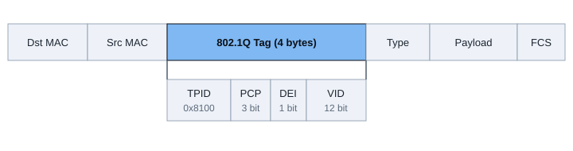

*شکل ۱: فریم اترنت با Tag ۴ بایتی 802.1Q؛ ۱۲ بیت آن شماره‌ی VLAN است.*

چون VID دوازده بیت است، تعداد VLANها محدود می‌شود:

``` text
VID bits         = 12
Total values     = 2 ^ 12 = 4096   (0 .. 4095)
Reserved         = 0 and 4095
Usable VLAN IDs  = 4096 - 2 = 4094   (1 .. 4094)
```

### ۳. Native VLAN: ترافیک بدون برچسب

یک VLAN روی Trunk بدون Tag می‌رود؛ به آن **Native VLAN** می‌گویند (پیش‌فرض VLAN 1). اگر دو سر Trunk Native متفاوت داشته باشند، ترافیک VLANها قاطی می‌شود و CDP پیام `Native VLAN mismatch` می‌دهد. همین امر راهی برای VLAN Hopping است.

> **توصیه‌ی امنیتی**
>
> Native را روی یک VLAN بدون استفاده (مثلاً 999) بگذارید و دو سر لینک یکی باشد.

### ۴. Allowed VLAN List: چه VLANهایی اجازه‌ی عبور دارند

پیش‌فرض Trunk همه‌ی VLANها (1 تا 4094) را عبور می‌دهد. بهتر است فقط VLANهای لازم مجاز باشند. اینجا یک اشتباه بسیار رایج هست:

``` text
switchport trunk allowed vlan 20,30        (REPLACES the whole list!)
switchport trunk allowed vlan add 40        (ADDS 40 to the existing list)
switchport trunk allowed vlan remove 30     (REMOVES 30 only)
```

> **هشدار (TS05: Human Error)**
>
> اگر برای افزودن VLAN جدید فقط بنویسید `allowed vlan 40` (بدون کلمه‌ی add)، کل لیست قبلی پاک می‌شود و فقط VLAN 40 می‌ماند. باقی VLANها بلافاصله قطع می‌شوند. همیشه از `add` استفاده کنید و قبلش `show interfaces trunk` را ببینید.

### ۵. دستورها (خط‌به‌خط)

``` text
SW1(config)# interface gi0/0
SW1(config-if)# switchport trunk encapsulation dot1q
SW1(config-if)# switchport mode trunk
SW1(config-if)# switchport trunk native vlan 999
SW1(config-if)# switchport trunk allowed vlan 10,20,30
SW1(config-if)# switchport nonegotiate
SW1(config-if)# end
```

- `trunk encapsulation dot1q`: روی بعضی سوییچ‌ها لازم است (اگر خطا داد، سوییچ فقط dot1q را پشتیبانی می‌کند و نیازی نیست).
- `mode trunk`: پورت را صریحاً Trunk می‌کند.
- `native vlan 999`: VLAN بدون Tag.
- `allowed vlan`: فهرست مجاز (اینجا برای اولین بار از فرم کامل استفاده شده).
- `nonegotiate`: DTP را خاموش می‌کند تا مذاکره‌ی ناخواسته رخ ندهد.

``` text
SW1# show interfaces trunk
SW1# show interfaces gi0/0 switchport
```

خروجی `show interfaces trunk` چهار بخش دارد: Mode و Status، Vlans allowed، Vlans allowed and active، و Vlans in spanning tree forwarding state. اگر VLANی در بخش اول هست ولی در دوم نیست، یعنی هنوز روی سوییچ ساخته نشده.

### ۶. مثال ساده: Trunk بین SW1 و SW2

``` text
SW1(config)# interface gi0/1
SW1(config-if)# switchport trunk encapsulation dot1q
SW1(config-if)# switchport mode trunk
(same on SW2)
SW1# show interfaces trunk       -> Gi0/1 trunking, allowed 1-4094
```

### ۷. مثال متوسط: دو سوییچ، دو VLAN

``` text
SW1: PC1 (VLAN 20) on Gi0/2        SW2: PC4 (VLAN 20) on Gi0/2
Trunk Gi0/1 between SW1 and SW2 carries VLAN 20 and 30
PC1 ping PC4 (same VLAN 20) -> success through the trunk
```

شرط: هر دو سوییچ باید VLAN 20 را داشته باشند و در لیست مجاز Trunk باشد.

### ۸. مثال سخت: عیب‌یابی TS04 و TS05

``` text
TS04 symptom : VLAN 30 hosts lost connectivity across the trunk
Evidence     : show interfaces trunk -> VLAN 30 missing from "allowed"
Fix          : switchport trunk allowed vlan add 30

TS05 cause   : someone typed "allowed vlan 40" (without add)
Result       : only VLAN 40 remains, 10/20/30 down
Prevention   : always use "add", always review show interfaces trunk
               before and after, keep a backup (lesson 2-4)
```

### ۹. تمرین‌ها

**ت1.** ۱ (ساده): چند بیت از Tag مخصوص VLAN ID است و چند VLAN قابل‌استفاده داریم؟ *(پاسخ: 3-3-ت1 در بخش «پاسخ‌ها» انتهای فصل)*

**ت2.** ۲ (ساده): تفاوت allowed vlan 40 با allowed vlan add 40؟ *(پاسخ: 3-3-ت2 در بخش «پاسخ‌ها» انتهای فصل)*

**ت3.** ۳ (متوسط): Native Mismatch چه عارضه‌ای دارد؟ *(پاسخ: 3-3-ت3 در بخش «پاسخ‌ها» انتهای فصل)*

**ت4.** ۴ (متوسط): چرا nonegotiate را می‌زنیم؟ *(پاسخ: 3-3-ت4 در بخش «پاسخ‌ها» انتهای فصل)*

**ت5.** ۵ (سخت): روی Trunk هستید و VLAN 30 در show interfaces trunk در ستون allowed نیست؛ ۳ دستور رفع *(پاسخ: 3-3-ت5 در بخش «پاسخ‌ها» انتهای فصل)*

### ۱۰. Lab هدایت‌شده

توپولوژی: `SW1` و `SW2` (گره دوم vIOSL2) با کابل بین `Gi0/1` هر دو. PC1 روی SW1 و PC4 روی SW2 هر دو در VLAN 20.

#### گام ۱: بکاپ

``` text
SW1# copy running-config flash:SW1-before-trunk.cfg
SW2# copy running-config flash:SW2-before-trunk.cfg
```

#### گام ۲: VLANها روی هر دو سوییچ

``` text
SW2(config)# vlan 20
SW2(config-vlan)# name USERS
SW2(config-vlan)# vlan 30
SW2(config-vlan)# name SERVERS
```

#### گام ۳: Trunk روی هر دو سر

``` text
SWx(config)# interface gi0/1
SWx(config-if)# switchport trunk encapsulation dot1q
SWx(config-if)# switchport mode trunk
SWx(config-if)# switchport trunk native vlan 999
SWx(config-if)# switchport trunk allowed vlan 20,30
SWx(config-if)# switchport nonegotiate
SWx# show interfaces trunk
```

#### گام ۴: تست

``` text
PC1> ip 10.10.20.11/24 10.10.20.1
PC4> ip 10.10.20.14/24 10.10.20.1
PC1> ping 10.10.20.14      (expect: success)
```

#### گام ۵: Capture و دیدن Tag

روی لینک بین SW1 و SW2 Capture بگیرید. فریم‌ها را باز کنید: در Wireshark باید «802.1Q Virtual LAN، ID: 20» ببینید. روی لینک PC1 همان فریم **بدون** Tag است (چون Access Port است).

#### گام ۶: ایجاد عمدی TS05 و رفع

``` text
SW1(config-if)# switchport trunk allowed vlan 30     (WRONG, replaces list)
PC1 ping PC4 -> fails
SW1(config-if)# switchport trunk allowed vlan add 20
PC1 ping PC4 -> works
```

### ۱۱. Lab مستقل

یک Runbook کوتاه `03-ops/trunk-change.md` بنویسید: «قبل از هر تغییر Trunk چه چیزی بررسی/بکاپ شود و چطور برگردیم». از `reload in` هم استفاده کنید.

### ۱۲. عیب‌یابی

|         |                                                                                                                          |
|---------|--------------------------------------------------------------------------------------------------------------------------|
| Symptom | یک VLAN از Trunk رد نمی‌شود                                                                                               |
| چک‌لیست  | ۱) VLAN در Allowed هست؟ ؛ ۲) VLAN روی هر دو سوییچ ساخته شده؟ ؛ ۳) Native دو سر یکی است؟ ؛ ۴) Trunk در حالت trunking است؟ |
| ابزار   | show interfaces trunk ، show vlan brief ، show cdp neighbors                                                             |

### ۱۳. سؤال‌های مرور

**م1.** Trunk چه کاری می‌کند؟ *(پاسخ: 3-3-م1 در بخش «پاسخ‌ها» انتهای فصل)*

**م2.** Native VLAN چیست؟ *(پاسخ: 3-3-م2 در بخش «پاسخ‌ها» انتهای فصل)*

### English Corner: انگلیسی تخصصی این درس

این جمله‌ها از مستندات و محیط کار واقعی‌اند. بلند بخوانید و ترجمه را بپوشانید.

| English sentence                                                   | ترجمه                                                         |
|--------------------------------------------------------------------|---------------------------------------------------------------|
| The trunk carries traffic for multiple VLANs using 802.1Q tagging. | Trunk ترافیک چند VLAN را با Tag 802.1Q عبور می‌دهد.            |
| A native VLAN mismatch can lead to VLAN hopping.                   | عدم تطابق Native VLAN می‌تواند به VLAN Hopping منجر شود.       |
| Use the add keyword to avoid overwriting the allowed VLAN list.    | از کلمه‌ی add استفاده کنید تا لیست VLANهای مجاز بازنویسی نشود. |
| Disable DTP with switchport nonegotiate.                           | DTP را با switchport nonegotiate خاموش کنید.                  |

**Q1.** Quick quiz (answer in English): Why is "switchport trunk allowed vlan 40" dangerous on a live trunk? *(پاسخ: 3-3-Q1 در بخش «پاسخ‌ها» انتهای فصل)*

### ۱۴. تکلیف و چک‌لیست تسلط

- [ ] Trunk را راه بیندازم و Tag را در Capture ببینم.
- [ ] TS04 و TS05 را بسازم و رفع کنم.
- [ ] جدول allowed/native هر لینک را در IP Plan ثبت کنم.

### ۱۵. یادآوری اشتباهات شما

> **یادآوری**
>
> قبل از تغییر Trunk بکاپ بگیرید؛ بعد از تغییر show را ببینید؛ فرمول‌ها و مراحل را در بلوک مستقل بنویسید.


#### کارت Lab — درس ۳-۳

| # | فیلد | محتوا |
|---|---|---|
| 1 | عنوان و هدف | Trunk 802.1Q با Native و Allowed و دیدن Tag |
| 2 | پیش‌نیاز | درس ۳-۲ |
| 3 | توپولوژی | SW1 Gi0/1 ↔ SW2 Gi0/1 |
| 4 | تجهیزات | SW1، SW2، PC1، PC4 |
| 5 | نسخه نرم‌افزار | vIOS-L2 15.2(20200924، Experimental) برای SW؛ vIOS 15.9(3)M9 برای R؛ VPCS (PNetLab)؛ PNetLab 4.2.8 |
| 6 | IP Plan | VLAN 20 و 30؛ 10.10.20.0/24 |
| 7 | وضعیت اولیه | VLANها روی هر دو ساخته شده |
| 8 | صورت مسئله | Trunk بسازید و خطای فراموشی `add` را ایجاد و رفع کنید |
| 9 | مراحل هدایت‌شده | همان بخش «Lab هدایت‌شده» همین درس (گام‌به‌گام) |
| 10 | تست عملکرد | `show interfaces trunk` ؛ Capture Tag 802.1Q |
| 11 | سناریوی خرابی | `allowed vlan 30` بدون add |
| 12 | روش عیب‌یابی | `show interfaces trunk` قبل/بعد |
| 13 | نتیجه‌ی مورد انتظار | VLAN 20 از Trunk رد شود؛ Tag در Capture |
| 14 | معیار پذیرش | بعد از رفع ping PC1↔PC4 موفق |
| 15 | مستندات نهایی | `03-ops/trunk-change.md` |
| 16 | Cleanup و بازگردانی | Allowed را به 20,30 و Native 999 برگردانید |

> **وضعیت راستی‌آزمایی (خارج از ۱۶ فیلد):** **جزئی.** Trunk 802.1Q روی یک سوییچ Tested-OK؛ Trunk بین دو سوییچ، Tag در Capture و `allowed vlan` اجرا نشده.

---

<a id="l-3-4"></a>

## درس ۳-۴ — Router-on-a-Stick

**فصل ۳ - روز ۴ · پیش‌نیاز: درس ۳-۳ · ۶ ساعت**

### این درس درباره چیست و چرا باید یاد بگیریم؟

**چه چیزی یاد می‌گیریم:** چطور VLANهای مختلف را به هم وصل کنیم. روش اول: یک روتر با یک کابل Trunk و چند Sub-interface؛ معروف به Router-on-a-Stick (RoAS).

**چرا لازم است:** همان‌طور که دیدید دو VLAN بدون روتر با هم صحبت نمی‌کنند. این درس کلید فهم «Inter-VLAN Routing» است و همین مفهوم در FortiGate با VLAN Interface تکرار می‌شود. کسی که RoAS را بفهمد، Gateway در FortiGate را هم می‌فهمد.

- **در کار روزانه:** شعبه‌های کوچک بدون سوییچ لایه ۳ از همین روش استفاده می‌کنند.
- **در امنیت:** وقتی ترافیک بین VLANها از روتر یا فایروال می‌گذرد، می‌شود ACL یا Policy گذاشت.
- **در Capstone:** فایروال FortiGate همین نقش را برای همه‌ی VLANها دارد.

> **مسیر درس**
>
> مشکل: ارتباط بین VLANها ← ایده‌ی Sub-interface ← مسیر بسته (Packet Flow) ← دستورها ← مثال ساده/متوسط/سخت ← تمرین ← Lab ← عیب‌یابی.

#### اصطلاحات این درس (مخفف ← شکل کامل ← معنی)

| مخفف                | شکل کامل انگلیسی          | معنی فارسی                                |
|---------------------|---------------------------|-------------------------------------------|
| RoAS                | Router on a Stick         | روتر با یک لینک Trunk و چند Sub-interface |
| Sub-interface       | Sub-interface             | Interface منطقی روی یک Interface فیزیکی   |
| Inter-VLAN          | Inter-VLAN Routing        | مسیریابی بین VLANها                       |
| Gateway             | Default Gateway           | دروازه‌ی پیش‌فرض هر VLAN                    |
| encapsulation dot1Q | IEEE 802.1Q encapsulation | دستور اتصال Sub-interface به یک VLAN      |
| L3                  | Layer 3                   | لایه شبکه (IP)                            |

### ۱. مشکل

PC1 در VLAN 20 و Srv1 در VLAN 30. هر کدام Subnet خودش را دارد؛ دو شبکه‌ی جدا که بدون «پل» به هم نمی‌رسند. این پل یک **روتر** است: وقتی PC1 بخواهد به Srv1 بفرستد، بسته را به Gateway خودش می‌دهد و روتر آن را به VLAN 30 می‌فرستد.

ساده‌ترین راه: برای هر VLAN یک پورت فیزیکی روتر. ولی روتر پورت زیادی ندارد. راه‌حل هوشمندانه: یک پورت و یک Trunk؛ و روی روتر برای هر VLAN یک «Interface مجازی» می‌سازیم.

### ۲. ایده‌ی Router-on-a-Stick

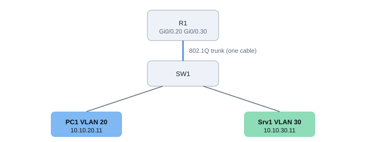

*شکل ۱: یک کابل Trunk بین روتر و سوییچ؛ روتر برای هر VLAN یک Sub-interface دارد.*

Sub-interface مثل چند میز در یک ساختمان است: یک در (کابل فیزیکی) دارد ولی هر میز برای یک شرکت (VLAN) کار می‌کند. هر Sub-interface یک آدرس IP دارد که همان Gateway آن VLAN است.

### ۳. مسیر بسته (Packet Flow)

PC1 (10.10.20.11، VLAN 20) به Srv1 (10.10.30.11، VLAN 30) ping می‌زند:

1.  PC1 می‌بیند Srv1 در Subnet دیگری است و بسته را به Gateway (10.10.20.1) می‌دهد؛ پس MAC مقصد فریم، MAC روتر است.
2.  سوییچ فریم را با Tag VLAN 20 روی Trunk به روتر می‌فرستد.
3.  روتر روی Gi0/0.20 دریافت می‌کند، جدول Route را می‌بیند (Connected: 10.10.30.0/24 روی Gi0/0.30).
4.  روتر فریم جدید با MAC مقصد Srv1 می‌سازد و با Tag VLAN 30 از همان کابل برمی‌گرداند.
5.  سوییچ Tag را برمی‌دارد و فریم را فقط به پورت Srv1 می‌دهد.

``` text
IP src/dst stay the same : 10.10.20.11 -> 10.10.30.11
MAC dst changes          : router MAC (hop 1) -> Srv1 MAC (hop 2)
VLAN tag changes         : 20 (in) -> 30 (out)
TTL                      : decreased by 1 at the router
```

> **نکته‌ی مهم**
>
> IP مبدأ و مقصد تغییر نمی‌کنند، ولی MAC و Tag در هر Hop عوض می‌شوند. این همان نکته‌ی «Routing» است که در Capture (درس ۲-۶) دیدید.

### ۴. دستورها (خط‌به‌خط)

``` text
SW1(config)# interface gi0/0
SW1(config-if)# switchport trunk encapsulation dot1q
SW1(config-if)# switchport mode trunk
SW1(config-if)# switchport trunk allowed vlan 10,20,30

R1(config)# interface gi0/0
R1(config-if)# no shutdown
R1(config-if)# no ip address
R1(config-if)# interface gi0/0.20
R1(config-subif)# encapsulation dot1Q 20
R1(config-subif)# ip address 10.10.20.1 255.255.255.0
R1(config-subif)# interface gi0/0.30
R1(config-subif)# encapsulation dot1Q 30
R1(config-subif)# ip address 10.10.30.1 255.255.255.0
R1(config-subif)# end
```

- Interface فیزیکی بدون IP و روشن (`no shutdown`) می‌ماند؛ فقط Sub-interfaceها آدرس دارند.
- `encapsulation dot1Q 20`: این Sub-interface فقط فریم‌های Tag 20 را می‌گیرد/می‌فرستد. شماره‌ی Sub-interface (.20) فقط یک نام است؛ ولی عرف این است که با VLAN یکی باشد.
- اگر Native VLAN داشتید، `encapsulation dot1Q 10 native`.

``` text
R1# show ip interface brief
R1# show ip route connected
R1# show interfaces gi0/0.20
R1# ping 10.10.30.11
```

### ۵. مثال ساده: ping به Gateway

``` text
PC1> ping 10.10.20.1     -> success (R1 Gi0/0.20)
```

### ۶. مثال متوسط: ping بین دو VLAN

``` text
PC1> ping 10.10.30.11    -> success through R1
PC1> trace 10.10.30.11   -> hop 1 = 10.10.20.1 (router), hop 2 = 10.10.30.11
```

### ۷. مثال سخت: عیب‌یابی

|            |                                                                                                                                                                                                   |
|------------|---------------------------------------------------------------------------------------------------------------------------------------------------------------------------------------------------|
| Symptom    | PC1 به Gateway می‌رسد ولی به VLAN 30 نه                                                                                                                                                            |
| چک‌لیست     | ۱) Sub-interface .30 بالا است؟ ؛ ۲) `encapsulation dot1Q 30` درست است؟ ؛ ۳) VLAN 30 در Allowed ترانک است؟ ؛ ۴) Srv1 Gateway 10.10.30.1 دارد؟ ؛ ۵) `show ip route connected` هر دو Subnet را دارد؟ |
| علت متداول | Encapsulation اشتباه (مثلاً 3 به‌جای 30) یا فراموشی VLAN در Trunk (TS04)                                                                                                                            |

### ۸. تمرین‌ها

**ت1.** ۱ (ساده): چرا فقط یک کابل فیزیکی کافی است؟ *(پاسخ: 3-4-ت1 در بخش «پاسخ‌ها» انتهای فصل)*

**ت2.** ۲ (ساده): کدام آدرس IP روی Gi0/0.20 می‌نشیند؟ *(پاسخ: 3-4-ت2 در بخش «پاسخ‌ها» انتهای فصل)*

**ت3.** ۳ (متوسط): در مسیر PC1 به Srv1 کدام فیلدها عوض می‌شوند و کدام نه؟ *(پاسخ: 3-4-ت3 در بخش «پاسخ‌ها» انتهای فصل)*

**ت4.** ۴ (متوسط): اگر encapsulation dot1Q 3 به‌جای 30 بزنیم چه می‌شود؟ *(پاسخ: 3-4-ت4 در بخش «پاسخ‌ها» انتهای فصل)*

**ت5.** ۵ (سخت): نقطه‌ضعف RoAS چیست؟ *(پاسخ: 3-4-ت5 در بخش «پاسخ‌ها» انتهای فصل)*

### ۹. Lab هدایت‌شده

توپولوژی درس ۳-۲ را ادامه می‌دهیم: `R1` به `SW1` (Gi0/0 ↔ Gi0/0). VLAN 20 و 30 روی SW1 دارید.

#### گام ۱: بکاپ و Trunk

``` text
SW1# copy running-config flash:SW1-before-roas.cfg
SW1(config)# interface gi0/0
SW1(config-if)# switchport trunk encapsulation dot1q
SW1(config-if)# switchport mode trunk
SW1(config-if)# switchport trunk allowed vlan 10,20,30
```

#### گام ۲: Sub-interface روی R1

دستورهای بخش ۴ را بزنید (VLAN 10 همان Sub-interface قبلی L00 است و دست نمی‌خورد).

#### گام ۳: تست

``` text
PC1> ip 10.10.20.11/24 10.10.20.1
PC3> ip 10.10.30.11/24 10.10.30.1
PC1> ping 10.10.30.11    (expect: success)
R1# show ip route connected
```

#### گام ۴: Capture روی لینک R1-SW1

1.  PC1 ping به PC3 بزند.
2.  در Wireshark فریم‌ها را ببینید: Echo Request با VLAN 20 و MAC مقصد R1، و بعد همان بسته با VLAN 30 و MAC مقصد PC3.
3.  جدول تغییرات (IP/MAC/Tag/TTL) را بنویسید.

#### گام ۵: خراب‌کردن عمدی

``` text
R1(config)# interface gi0/0.30
R1(config-subif)# encapsulation dot1Q 3
PC1 ping PC3 -> fails
R1(config-subif)# encapsulation dot1Q 30
PC1 ping PC3 -> works
```

### ۱۰. Lab مستقل

یک VLAN جدید (مثلاً 40 GUEST) اضافه کنید: VLAN روی SW1، لیست Trunk (با `add`!)، Sub-interface روی R1، تست. مراحل را در `03-ops/add-vlan-runbook.md` بنویسید.

### ۱۱. سؤال‌های مرور

**م1.** Sub-interface چیست؟ *(پاسخ: 3-4-م1 در بخش «پاسخ‌ها» انتهای فصل)*

**م2.** چرا Interface فیزیکی IP ندارد؟ *(پاسخ: 3-4-م2 در بخش «پاسخ‌ها» انتهای فصل)*

### English Corner: انگلیسی تخصصی این درس

این جمله‌ها از مستندات و محیط کار واقعی‌اند. بلند بخوانید و ترجمه را بپوشانید.

| English sentence                                                                | ترجمه                                                                    |
|---------------------------------------------------------------------------------|--------------------------------------------------------------------------|
| The router uses sub-interfaces to route between VLANs over a single trunk link. | روتر با Sub-interfaceها از طریق یک لینک Trunk بین VLANها مسیریابی می‌کند. |
| Each sub-interface is the default gateway for its VLAN.                         | هر Sub-interface Gateway پیش‌فرض VLAN خودش است.                           |
| The VLAN tag changes at the router, but the IP addresses stay the same.         | Tag در روتر عوض می‌شود ولی آدرس‌های IP ثابت می‌مانند.                       |
| A wrong encapsulation ID breaks routing for that VLAN.                          | شناسه‌ی Encapsulation اشتباه، مسیریابی آن VLAN را خراب می‌کند.             |

**Q1.** Quick quiz (answer in English): What is the main drawback of router-on-a-stick? *(پاسخ: 3-4-Q1 در بخش «پاسخ‌ها» انتهای فصل)*

### ۱۲. تکلیف و چک‌لیست تسلط

- [ ] RoAS را راه بیندازم و ping بین VLANها را بگیرم.
- [ ] جدول تغییرات IP/MAC/Tag را از Capture بنویسم.
- [ ] یک VLAN جدید را با Runbook اضافه کنم.

### ۱۳. یادآوری اشتباهات شما

> **یادآوری**
>
> پیش‌بینی قبل از اجرا؛ بکاپ قبل از تغییر Trunk؛ خروجی واقعی را ثبت کنید.


#### کارت Lab — درس ۳-۴

| # | فیلد | محتوا |
|---|---|---|
| 1 | عنوان و هدف | Inter-VLAN با Router-on-a-Stick |
| 2 | پیش‌نیاز | درس ۳-۳ |
| 3 | توپولوژی | R1 Gi0/0 ↔ SW1 Gi0/0 (trunk) |
| 4 | تجهیزات | R1، SW1، ۲ VPCS |
| 5 | نسخه نرم‌افزار | vIOS-L2 15.2(20200924، Experimental) برای SW؛ vIOS 15.9(3)M9 برای R؛ VPCS (PNetLab)؛ PNetLab 4.2.8 |
| 6 | IP Plan | Gateway 10.10.20.1 و 10.10.30.1 |
| 7 | وضعیت اولیه | VLAN 20/30 روی SW1 |
| 8 | صورت مسئله | ping بین VLAN 20 و 30 از طریق R1 و تحلیل تغییر MAC/Tag |
| 9 | مراحل هدایت‌شده | همان بخش «Lab هدایت‌شده» همین درس (گام‌به‌گام) |
| 10 | تست عملکرد | `ping` ؛ `show ip route connected` ؛ Capture |
| 11 | سناریوی خرابی | `encapsulation dot1Q 3` به‌جای 30 |
| 12 | روش عیب‌یابی | مقایسه‌ی Encapsulation و Tag |
| 13 | نتیجه‌ی مورد انتظار | ping موفق؛ جدول IP/MAC/Tag/TTL |
| 14 | معیار پذیرش | تغییر Tag/MAC در Capture ثبت شود |
| 15 | مستندات نهایی | `03-ops/add-vlan-runbook.md` |
| 16 | Cleanup و بازگردانی | Shutdown زیرواسط‌ها |

> **وضعیت راستی‌آزمایی (خارج از ۱۶ فیلد):** **جزئی.** Router-on-a-Stick با SVI و ping ۱۰۰٪ Tested-OK (Probe)؛ ارتباط بین دو VLAN با VPCS اجرا نشده.

---

<a id="l-3-5"></a>

## درس ۳-۵ — SVI و سوییچ لایه ۳

**فصل ۳ - روز ۵ · پیش‌نیاز: درس ۳-۴ · ۶ ساعت**

### این درس درباره چیست و چرا باید یاد بگیریم؟

**چه چیزی یاد می‌گیریم:** روش دوم Inter-VLAN: سوییچ لایه ۳ با Interfaceهای مجازی به نام SVI. شرط بالا آمدن SVI، تفاوت با RoAS، و اینکه در Capstone ما چرا SVI فقط برای مدیریت استفاده می‌شود.

**چرا لازم است:** در شبکه‌های واقعی سازمانی، مسیریابی بین VLANها اغلب روی خود سوییچ انجام می‌شود، چون سریع‌تر است و به یک کابل واحد وابسته نیست. همچنین «SVI Down/Down» (TS09) از شایع‌ترین دلایل «Gateway جواب نمی‌دهد» است.

- **در کار روزانه:** هر سوییچ هسته (Core) در سازمان‌ها SVI دارد.
- **در امنیت:** Gateway روی سوییچ یعنی ACL می‌تواند روی SVI اعمال شود.
- **در Capstone:** Gateway همه‌ی VLANها فایروال است؛ SVI فقط برای مدیریت (VLAN10). «Lab A» (Gateway روی سوییچ هسته) جدا و جایگزین است.

> **مسیر درس**
>
> SVI چیست ← شرط Up بودن ← مقایسه با RoAS ← دستورها ← مثال ساده/متوسط/سخت ← تمرین ← Lab ← عیب‌یابی.

#### اصطلاحات این درس (مخفف ← شکل کامل ← معنی)

| مخفف       | شکل کامل انگلیسی                | معنی فارسی                                |
|------------|---------------------------------|-------------------------------------------|
| SVI        | Switch Virtual Interface        | Interface مجازی L3 برای یک VLAN روی سوییچ |
| L3 Switch  | Layer 3 Switch                  | سوییچی که مسیریابی IP هم انجام می‌دهد      |
| ip routing | ip routing                      | دستور فعال‌کردن مسیریابی روی سوییچ         |
| Up/Up      | Line protocol up / Interface up | وضعیت سالم Interface                      |
| Core       | Core Layer                      | هسته‌ی شبکه                                |
| ACL        | Access Control List             | فهرست کنترل دسترسی                        |

### ۱. SVI چیست؟

در RoAS روتر بیرون از سوییچ بود. در SVI، خود سوییچ یک «پای مجازی» داخل هر VLAN دارد؛ مثل اینکه یک نفر مستقیم داخل هر اتاق نشسته باشد. هر SVI یک آدرس IP دارد که Gateway آن VLAN است، و سوییچ با `ip routing` بین SVIها مسیریابی می‌کند.

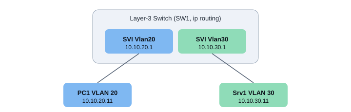

*شکل ۱: Gateway داخل خود سوییچ؛ ترافیک بین VLANها هیچ‌وقت سوییچ را ترک نمی‌کند.*

### ۲. شرط Up شدن SVI (مهم‌ترین نکته)

SVI فقط وقتی `up/up` می‌شود که همه‌ی شرط‌های زیر برقرار باشند:

1.  VLAN روی سوییچ ساخته شده باشد (`show vlan brief`).
2.  حداقل یک پورت در آن VLAN فعال باشد (Access Port بالا، یا Trunk که VLAN را عبور می‌دهد).
3.  SVI با `no shutdown` روشن شده باشد.

> **TS09: SVI Down/Down**
>
> اگر VLAN 30 هیچ پورت فعالی ندارد، `Vlan30` در حالت down/down می‌ماند و Gateway آن VLAN کار نمی‌کند، حتی اگر آدرس درست باشد. اول پورت را بالا بیاورید.

### ۳. مقایسه‌ی RoAS و SVI

| معیار       | Router-on-a-Stick        | SVI (L3 Switch) |
|-------------|--------------------------|-----------------|
| محل Gateway | روتر بیرونی              | خود سوییچ       |
| تعداد کابل  | یک Trunk                 | بدون کابل اضافه |
| سرعت        | محدود به لینک و CPU روتر | سخت‌افزاری، سریع |
| گلوگاه      | دارد (یک لینک)           | ندارد           |
| مناسب برای  | شعبه‌ی کوچک               | هسته‌ی سازمان    |

### ۴. دستورها (خط‌به‌خط)

``` text
SW1(config)# ip routing
SW1(config)# interface vlan 20
SW1(config-if)# ip address 10.10.20.1 255.255.255.0
SW1(config-if)# no shutdown
SW1(config-if)# interface vlan 30
SW1(config-if)# ip address 10.10.30.1 255.255.255.0
SW1(config-if)# no shutdown
SW1(config-if)# end
SW1# show ip interface brief
SW1# show ip route connected
```

- `ip routing`: سوییچ را از «فقط لایه ۲» به «مسیریاب» تبدیل می‌کند. بدون آن SVI آدرس دارد ولی بین VLANها Route نمی‌کند.
- `interface vlan 20`: SVI همان VLAN را می‌سازد (VLAN باید از قبل موجود باشد).
- `no shutdown`: SVI به‌طور پیش‌فرض خاموش است در بعضی نسخه‌ها؛ حتماً بزنید.

### ۵. مثال ساده: ping به SVI

``` text
PC1> ping 10.10.20.1    -> success (SVI Vlan20)
```

### ۶. مثال متوسط: ping بین VLAN

``` text
PC1> ping 10.10.30.11   -> success (routed inside SW1)
SW1# show ip route connected  -> 10.10.20.0/24 via Vlan20, 10.10.30.0/24 via Vlan30
```

### ۷. مثال سخت: TS09 و دو Gateway همزمان

``` text
Symptom   : Vlan30 shows down/down
Check     : show vlan brief          -> VLAN 30 has no active port
            show ip interface brief  -> Vlan30 down/down
Fix       : bring up Gi0/3 (the server port) or allow VLAN 30 on the trunk
Verify    : Vlan30 up/up, ping works

Conflict  : R1 Gi0/0.30 AND SW1 Vlan30 both = 10.10.30.1
Result    : duplicate IP, intermittent failures
Rule      : exactly one gateway per VLAN (shut down the other)
```

### ۸. تمرین‌ها

**ت1.** ۱ (ساده): ip routing برای چیست؟ *(پاسخ: 3-5-ت1 در بخش «پاسخ‌ها» انتهای فصل)*

**ت2.** ۲ (ساده): سه شرط Up شدن SVI *(پاسخ: 3-5-ت2 در بخش «پاسخ‌ها» انتهای فصل)*

**ت3.** ۳ (متوسط): VLAN 40 ساخته‌ایم و SVI دارد ولی down/down است؛ علت؟ *(پاسخ: 3-5-ت3 در بخش «پاسخ‌ها» انتهای فصل)*

**ت4.** ۴ (متوسط): چرا دو Gateway برای یک VLAN مشکل می‌سازد؟ *(پاسخ: 3-5-ت4 در بخش «پاسخ‌ها» انتهای فصل)*

**ت5.** ۵ (سخت): کدام روش برای ۱۰ گیگ ترافیک بین VLANها بهتر است و چرا؟ *(پاسخ: 3-5-ت5 در بخش «پاسخ‌ها» انتهای فصل)*

### ۹. Lab هدایت‌شده (Lab A: Gateway روی سوییچ)

#### گام ۱: خاموش‌کردن Gateway روتر برای VLAN 20 و 30

``` text
R1(config)# interface gi0/0.20
R1(config-subif)# shutdown
R1(config-subif)# interface gi0/0.30
R1(config-subif)# shutdown
```

#### گام ۲: SVIها روی SW1

دستورهای بخش ۴ را اجرا کنید و `show ip interface brief` را بگیرید؛ دو SVI باید up/up باشند.

#### گام ۳: تست

``` text
PC1> ping 10.10.20.1
PC1> ping 10.10.30.11    (routed inside SW1)
```

#### گام ۴: دیدن TS09

``` text
SW1(config)# interface gi0/3
SW1(config-if)# shutdown
SW1# show ip interface brief      -> Vlan30 down/down
SW1(config)# interface gi0/3
SW1(config-if)# no shutdown       -> Vlan30 up/up
```

#### گام ۵: برگشت به Capstone

برای Capstone اصلی (Gateway = فایروال) SVIهای 20 و 30 را `shutdown` کنید یا حذف کنید و فقط SVI مدیریت (VLAN10) بماند. تنظیمات را با `copy run start` ذخیره کنید.

### ۱۰. Lab مستقل

جدول مقایسه‌ی RoAS و SVI را از نتایج Lab خودتان (سرعت ping، Capture، تعداد Hop در trace) بسازید و در `03-ops/roas-vs-svi.md` ذخیره کنید.

### ۱۱. عیب‌یابی

|         |                                                                                                                                              |
|---------|----------------------------------------------------------------------------------------------------------------------------------------------|
| Symptom | Gateway جواب نمی‌دهد                                                                                                                          |
| چک‌لیست  | ۱) `ip routing` فعال است؟ ؛ ۲) SVI up/up است؟ ؛ ۳) VLAN پورت فعال دارد؟ ؛ ۴) Gateway تکراری روی روتر نیست؟ ؛ ۵) PC آدرس و Gateway درست دارد؟ |

### ۱۲. سؤال‌های مرور

**م1.** SVI چیست؟ *(پاسخ: 3-5-م1 در بخش «پاسخ‌ها» انتهای فصل)*

**م2.** چرا SVI down/down می‌شود؟ *(پاسخ: 3-5-م2 در بخش «پاسخ‌ها» انتهای فصل)*

### English Corner: انگلیسی تخصصی این درس

این جمله‌ها از مستندات و محیط کار واقعی‌اند. بلند بخوانید و ترجمه را بپوشانید.

| English sentence                                                  | ترجمه                                                        |
|-------------------------------------------------------------------|--------------------------------------------------------------|
| An SVI is the layer-3 gateway for a VLAN on a multilayer switch.  | SVI گیت‌وی لایه ۳ یک VLAN روی سوییچ چندلایه است.              |
| The SVI stays down until at least one port in the VLAN is active. | SVI تا وقتی دست‌کم یک پورت فعال در VLAN نباشد down می‌ماند.    |
| Enable ip routing to route between VLANs on the switch.           | برای مسیریابی بین VLANها روی سوییچ، ip routing را فعال کنید. |
| Never configure two gateways for the same VLAN.                   | هرگز دو Gateway برای یک VLAN تنظیم نکنید.                    |

**Q1.** Quick quiz (answer in English): When does an SVI come up? *(پاسخ: 3-5-Q1 در بخش «پاسخ‌ها» انتهای فصل)*

### ۱۳. تکلیف و چک‌لیست تسلط

- [ ] SVI را بالا بیاورم و ping بین VLANها بگیرم.
- [ ] TS09 را بسازم و رفع کنم.
- [ ] پیکربندی را به حالت Capstone اصلی برگردانم.

### ۱۴. یادآوری اشتباهات شما

> **یادآوری**
>
> دو Gateway هم‌زمان ممنوع؛ بکاپ قبل از تغییر؛ پذیرفته‌شدن دستور ≠ کار کردن.


#### کارت Lab — درس ۳-۵ (Lab A مقدماتی)

| # | فیلد | محتوا |
|---|---|---|
| 1 | عنوان و هدف | Gateway روی SVI و شرط Up |
| 2 | پیش‌نیاز | درس ۳-۴ |
| 3 | توپولوژی | SW1 با SVI 20/30 |
| 4 | تجهیزات | SW1، ۲ VPCS |
| 5 | نسخه نرم‌افزار | vIOS-L2 15.2(20200924، Experimental) برای SW؛ vIOS 15.9(3)M9 برای R؛ VPCS (PNetLab)؛ PNetLab 4.2.8 |
| 6 | IP Plan | 10.10.20.1/24 و 10.10.30.1/24 |
| 7 | وضعیت اولیه | Sub-interfaceهای R1 shutdown |
| 8 | صورت مسئله | `ip routing`، SVI و ping بین VLAN؛ ایجاد SVI Down/Down |
| 9 | مراحل هدایت‌شده | همان بخش «Lab هدایت‌شده» همین درس (گام‌به‌گام) |
| 10 | تست عملکرد | `show ip interface brief` ؛ ping |
| 11 | سناریوی خرابی | shutdown پورت‌های VLAN 30 (TS09) |
| 12 | روش عیب‌یابی | `show vlan brief` و پورت فعال VLAN |
| 13 | نتیجه‌ی مورد انتظار | Vlan up/up؛ ping موفق |
| 14 | معیار پذیرش | TS09 ساخته و رفع شود |
| 15 | مستندات نهایی | `03-ops/roas-vs-svi.md` |
| 16 | Cleanup و بازگردانی | برگشت به معماری اصلی (Gateway روی FortiGate): SVI 20/30 shutdown |

> **وضعیت راستی‌آزمایی (خارج از ۱۶ فیلد):** **جزئی.** `ip routing` و SVI up/up Tested-OK؛ سناریوی TS09 و ping بین VLAN اجرا نشده.

---

<a id="l-3-6"></a>

## درس ۳-۶ — عیب‌یابی و آزمون هفته

**فصل ۳ - روز ۶ · پیش‌نیاز: درس‌های ۳-۱ تا ۳-۵ · ۶ ساعت**

### این درس درباره چیست و چرا باید یاد بگیریم؟

**چه چیزی یاد می‌گیریم:** روش سیستماتیک عیب‌یابی شبکه (از لایه ۱ به بالا)، پنج سناریوی خرابی TS01 تا TS05، و آزمون عملی کوچک پایان هفته‌ی ۳.

**چرا لازم است:** ادمین خوب کسی نیست که همه‌چیز را حفظ است، کسی است که با روش، خرابی را سریع پیدا می‌کند. اگر «حدس» بزنید، ساعت‌ها هدر می‌دهید؛ اگر «لایه‌به‌لایه» بروید، اغلب در چند دقیقه علت را پیدا می‌کنید.

- **در کار روزانه:** ۸۰٪ تماس‌های پشتیبانی شبکه از لایه ۱ و ۲ است: کابل، پورت، VLAN.
- **در امنیت:** روش سیستماتیک جلوی «تغییر عجولانه» را می‌گیرد که خودش سبب خرابی جدید می‌شود.
- **در مصاحبه:** «چطور عیب‌یابی می‌کنید؟» سؤال ثابت هر مصاحبه است.

> **مسیر درس**
>
> روش لایه‌به‌لایه ← پنج سناریوی TS ← مثال ساده/متوسط/سخت ← تمرین ← Lab عیب‌یابی ← آزمون کوچک.

#### اصطلاحات این درس (مخفف ← شکل کامل ← معنی)

| مخفف        | شکل کامل انگلیسی         | معنی فارسی                                 |
|-------------|--------------------------|--------------------------------------------|
| TS          | Troubleshooting Scenario | سناریوی عیب‌یابی شماره‌دار دوره              |
| RCA         | Root Cause Analysis      | تحلیل علت ریشه‌ای                           |
| Duplex      | Duplex mode              | Half یا Full؛ حالت ارسال/دریافت همزمان     |
| Err-disable | Error-disabled           | پورتی که سوییچ آن را به‌خاطر خطا خاموش کرده |
| CDP         | Cisco Discovery Protocol | کشف همسایه‌های سیسکو                        |
| L1/L2/L3    | Layer 1/2/3              | فیزیکی / پیوند داده / شبکه                 |

### ۱. روش سیستماتیک: از پایین به بالا

مثل بررسی خرابی یک ماشین: اول ببین بنزین دارد (لایه ۱)، بعد استارت می‌خورد (لایه ۲)، بعد جاده را بلد است (لایه ۳). از پایین شروع کنید چون اگر کابل قطع باشد، بقیه‌ی چیزها بی‌معنی است.

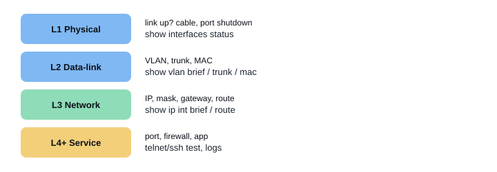

*شکل ۱: نردبان عیب‌یابی؛ از لایه ۱ شروع کنید و فقط وقتی لایه پایین سالم بود بالاتر بروید.*

#### چارچوب پنج‌مرحله‌ای

1.  **Symptom:** دقیقاً چه چیزی خراب است و برای چه کسی؟ (علامت، نه حدس)
2.  **Scope:** چند نفر؟ یک VLAN؟ همه؟
3.  **Hypothesis:** از پایین‌ترین لایه، یک فرضیه بساز.
4.  **Test:** با یک دستور show آن را بسنج.
5.  **Fix and Verify:** رفع، تأیید، ثبت در گزارش (RCA).

### ۲. پنج سناریوی این هفته

#### TS01: Interface Shutdown (ساده)

``` text
Symptom  : PC on Gi0/1 has no link
Evidence : show interfaces status -> Gi0/1 disabled / administratively down
Fix      : interface gi0/1 / no shutdown
Verify   : link up, ping works
```

#### TS02: Duplex/Speed Mismatch (مفهومی)

``` text
Symptom  : link is up but very slow, many CRC/late collisions
Cause    : one side half-duplex, the other full-duplex
Check    : show interfaces gi0/1 -> duplex, speed, errors
Fix      : set both sides to auto (or both manually identical)
```

در شبیه‌ساز، تنظیم Duplex ممکن است اثر واقعی نداشته باشد؛ این سناریو را مفهومی بدانید و در تجهیز واقعی تمرین کنید.

#### TS03: VLAN اشتباه روی Access Port

``` text
Symptom  : PC cannot reach its gateway
Evidence : show vlan brief -> port is in the wrong VLAN
Fix      : switchport access vlan 20
```

#### TS04: Allowed VLAN حذف‌شده روی Trunk

``` text
Symptom  : one VLAN lost across the trunk
Evidence : show interfaces trunk -> VLAN missing in "allowed"
Fix      : switchport trunk allowed vlan add 30
```

#### TS05: Human Error — جایگزینی Allowed List

``` text
Cause    : "allowed vlan 40" typed without "add"
Impact   : all VLANs except 40 are down on the trunk
Fix      : restore from backup or re-add: allowed vlan 10,20,30,40
Lesson   : always "add"; backup + review show before and after
```

### ۳. مثال ساده/متوسط/سخت

#### ساده

کاربر می‌گوید «شبکه قطع است». اول `show interfaces status`: اگر پورت `disabled` است، TS01.

#### متوسط

کاربر به سرور نمی‌رسد ولی به Gateway می‌رسد. لایه ۱ و ۲ سالم است؛ پس `show ip route` و Gateway سرور را ببینید (لایه ۳).

#### سخت

«فقط VLAN 30 از شعبه قطع است، بقیه خوب». نردبان: لینک Trunk up است (L1)، VLAN 30 در allowed نیست (L2) ⇒ TS04. در RCA: چه کسی/کی/چرا تغییر داد؟ چطور جلوگیری شود؟

### ۴. تمرین‌ها

**ت1.** ۱ (ساده): اولین لایه‌ای که چک می‌کنیم چیست؟ *(پاسخ: 3-6-ت1 در بخش «پاسخ‌ها» انتهای فصل)*

**ت2.** ۲ (ساده): پنج مرحله‌ی چارچوب عیب‌یابی را بنویس *(پاسخ: 3-6-ت2 در بخش «پاسخ‌ها» انتهای فصل)*

**ت3.** ۳ (متوسط): «ping به Gateway OK ولی به اینترنت نه»؛ کدام لایه؟ *(پاسخ: 3-6-ت3 در بخش «پاسخ‌ها» انتهای فصل)*

**ت4.** ۴ (سخت): یک Trunk بعد از «allowed vlan 40» همه را قطع کرد؛ سه اقدام بعدی *(پاسخ: 3-6-ت4 در بخش «پاسخ‌ها» انتهای فصل)*

### ۵. Lab هدایت‌شده: همه‌ی TSها را بسازید و رفع کنید

برای هر سناریو: (۱) بکاپ، (۲) خراب‌کردن عمدی، (۳) نوشتن Symptom و Evidence، (۴) رفع، (۵) Verify.

1.  TS01: `shutdown` روی پورت PC1 و رفع.
2.  TS03: بردن پورت PC2 به VLAN اشتباه و رفع.
3.  TS04: `allowed vlan remove 30` روی Trunk و رفع با `add 30`.
4.  TS05: `allowed vlan 40` (بدون add)، سپس برگرداندن از بکاپ.
5.  TS09: `shutdown` پورت سرور و دیدن SVI down/down.

### ۶. آزمون کوچک پایان هفته‌ی ۳ (بدون نگاه به درس)

| \#  | وظیفه                                | مدرک                      |
|-----|--------------------------------------|---------------------------|
| ۱   | MAC یک PC را به پورتش ربط بده        | show mac address-table    |
| ۲   | VLAN Matrix با ۳ VLAN و تنظیم پورت‌ها | show vlan brief           |
| ۳   | Trunk با Native 999 و Allowed        | show interfaces trunk     |
| ۴   | Inter-VLAN با RoAS یا SVI            | ping بین VLANها + Capture |
| ۵   | ۳ سناریو از TS01 تا TS05 با RCA      | گزارش یک‌صفحه‌ای            |

معیار قبولی: حداقل ۴ از ۵ مورد با مدرک. وقتی تمام شد بگویید «فصل ۳ انجام شد».

(آزمون رسمی Gate G2 در پایان فصل ۴ بعد از STP و EtherChannel است.)

### ۷. سؤال‌های مرور

**م1.** چرا از لایه ۱ شروع می‌کنیم؟ *(پاسخ: 3-6-م1 در بخش «پاسخ‌ها» انتهای فصل)*

**م2.** تفاوت TS04 و TS05؟ *(پاسخ: 3-6-م2 در بخش «پاسخ‌ها» انتهای فصل)*

### English Corner: انگلیسی تخصصی این درس

این جمله‌ها از مستندات و محیط کار واقعی‌اند. بلند بخوانید و ترجمه را بپوشانید.

| English sentence                                               | ترجمه                                                                    |
|----------------------------------------------------------------|--------------------------------------------------------------------------|
| Always start troubleshooting at layer 1 and work your way up.  | عیب‌یابی را همیشه از لایه ۱ شروع کنید و بالا بروید.                       |
| The interface is administratively down.                        | Interface به‌صورت مدیریتی خاموش است.                                      |
| Document the root cause and the fix in the RCA.                | علت ریشه‌ای و راه‌حل را در RCA مستند کنید.                                 |
| A typo in the allowed VLAN list can take down the whole trunk. | یک اشتباه تایپی در لیست VLANهای مجاز می‌تواند کل Trunk را از کار بیندازد. |

**Q1.** Quick quiz (answer in English): What are the five steps of the troubleshooting framework? *(پاسخ: 3-6-Q1 در بخش «پاسخ‌ها» انتهای فصل)*

### ۸. تکلیف و چک‌لیست تسلط

- [ ] پنج TS را ساخته و رفع کنم و گزارش RCA بنویسم.
- [ ] آزمون کوچک را کامل کنم.
- [ ] پیکربندی پایانی را ذخیره و بکاپ بگیرم.

### ۹. یادآوری اشتباهات شما

> **یادآوری**
>
> حدس نزنید؛ لایه‌به‌لایه بروید. بکاپ قبل از تغییر. هر نتیجه‌ی واقعی را ثبت کنید.


#### کارت Lab — درس ۳-۶

| # | فیلد | محتوا |
|---|---|---|
| 1 | عنوان و هدف | عیب‌یابی TS01..TS05 و آزمون کوچک |
| 2 | پیش‌نیاز | درس‌های ۳-۱ تا ۳-۵ |
| 3 | توپولوژی | همان توپولوژی درس‌های قبل |
| 4 | تجهیزات | SW1، SW2، R1، VPCS |
| 5 | نسخه نرم‌افزار | vIOS-L2 15.2(20200924، Experimental) برای SW؛ vIOS 15.9(3)M9 برای R؛ VPCS (PNetLab)؛ PNetLab 4.2.8 |
| 6 | IP Plan | طبق درس‌های قبل |
| 7 | وضعیت اولیه | بکاپ تنظیمات سالم |
| 8 | صورت مسئله | هر TS را بسازید، Symptom/Evidence/Fix/Verify/RCA بنویسید |
| 9 | مراحل هدایت‌شده | همان بخش «Lab هدایت‌شده» همین درس (گام‌به‌گام) |
| 10 | تست عملکرد | ping، show vlan/trunk، show ip route |
| 11 | سناریوی خرابی | پنج TS (shutdown، VLAN اشتباه، allowed حذف‌شده، allowed بدون add، SVI down) |
| 12 | روش عیب‌یابی | لایه‌ای L1→L3 |
| 13 | نتیجه‌ی مورد انتظار | هر TS با RCA رفع |
| 14 | معیار پذیرش | حداقل ۴ از ۵ مورد با مدرک |
| 15 | مستندات نهایی | `03-ops/rca-w3.md` |
| 16 | Cleanup و بازگردانی | بازگردانی از بکاپ سالم |

> **وضعیت راستی‌آزمایی (خارج از ۱۶ فیلد):** **اجرا نشده (فقط طراحی).** اجرا نشده؛ TS01 تا TS05 هنوز روی Image ساخته نشده‌اند.

---

<a id="ans-3"></a>

## پاسخ‌های فصل 3

> ابتدا بدون نگاه حل کنید. هر پاسخ با شناسه‌ی «درس-نوع+شماره» مشخص است (ت = تمرین، م = سؤال مرور، Q = Quick quiz انگلیسی).

**3-1-ت1** — ۱ (ساده): سوییچ کدام MAC را یاد می‌گیرد: مبدأ یا مقصد؟

``` text
Source MAC only.
Destination MAC is only looked up, never learned.
```

**3-1-ت2** — ۲ (ساده): فریم با مقصد ff:ff:ff:ff:ff:ff چطور پخش می‌شود؟

``` text
Flooded out of all ports except the ingress port.
```

**3-1-ت3** — ۳ (متوسط): جدول خالی است. A (Gi0/1) به B (Gi0/2) و بعد B به A می‌فرستد. چند Flood رخ می‌دهد؟

``` text
1 flood  (A -> B: B unknown)
0 floods (B -> A: A already learned)
```

**3-1-ت4** — ۴ (متوسط): چرا ردیف یک MAC بعد از ۵ دقیقه ناپدید می‌شود؟

``` text
Aging time = 300 s. No frames from that MAC refresh the entry.
```

**3-1-ت5** — ۵ (سخت): MACFLAP روی MAC-X بین Gi0/1 و Gi0/2؛ محتمل‌ترین علت؟

``` text
A layer-2 loop (or a duplicated MAC).
First action: find the loop and cut it, not clear the table.
```

**3-1-م1** — سوییچ چه چیزی را یاد می‌گیرد و از کجا؟

MAC مبدأ فریم و پورتی که فریم از آن وارد شد.

**3-1-م2** — چرا Broadcast هیچ‌وقت در جدول MAC دیده نمی‌شود؟

چون Broadcast فقط مقصد است، نه مبدأ.

**3-1-م3** — Flooding یعنی چه؟

ارسال فریم از همه‌ی پورت‌ها به‌جز پورت ورودی.

**3-1-Q1** — Quick quiz (answer in English): What does a switch do when the destination MAC is not in its table?

It floods the frame out of all ports except the one it arrived on.

**3-2-ت1** — ۱ (ساده): چرا VLAN باعث کاهش Broadcast می‌شود؟

``` text
Each VLAN is a separate broadcast domain.
Broadcasts stay inside their VLAN.
```

**3-2-ت2** — ۲ (ساده): دو کامپیوتر در VLAN های 20 و 30 بدون روتر ping می‌کنند؛ نتیجه؟

``` text
Fails: different broadcast domains, no gateway.
```

**3-2-ت3** — ۳ (متوسط): دستورهای لازم برای ساختن VLAN 40 با نام GUEST و قراردادن Gi0/6 در آن

``` text
vlan 40
 name GUEST
interface gi0/6
 switchport mode access
 switchport access vlan 40
```

**3-2-ت4** — ۴ (متوسط): خروجی show vlan brief چه چیزی نشان می‌دهد؟

``` text
VLAN ID, Name, Status and the access ports of each VLAN.
```

**3-2-ت5** — ۵ (سخت): کاربر در VLAN 20 است ولی به Gateway نمی‌رسد؛ سه علت محتمل

``` text
1) Port is in the wrong VLAN
2) VLAN does not exist or is shut down
3) Wrong IP/mask/gateway on the PC
```

**3-2-م1** — VLAN چه فایده‌ای دارد؟

جداسازی Broadcast Domain و امنیت بیشتر.

**3-2-م2** — Access Port چیست؟

پورتی که فقط عضو یک VLAN است و دستگاه انتهایی به آن وصل می‌شود.

**3-2-Q1** — Quick quiz (answer in English): Why do hosts in different VLANs need a router?

Because each VLAN is a separate broadcast domain (separate subnet), so traffic must be routed between them.

**3-3-ت1** — ۱ (ساده): چند بیت از Tag مخصوص VLAN ID است و چند VLAN قابل‌استفاده داریم؟

``` text
12 bits -> 4096 values -> minus 2 reserved -> 4094 usable IDs (1..4094)
```

**3-3-ت2** — ۲ (ساده): تفاوت allowed vlan 40 با allowed vlan add 40؟

``` text
Without add: replaces the list.
With add: appends VLAN 40 to the existing list.
```

**3-3-ت3** — ۳ (متوسط): Native Mismatch چه عارضه‌ای دارد؟

``` text
CDP warning and traffic of the native VLAN leaks into another VLAN (VLAN hopping risk).
```

**3-3-ت4** — ۴ (متوسط): چرا nonegotiate را می‌زنیم؟

``` text
It disables DTP negotiation so the port cannot become a trunk unexpectedly.
```

**3-3-ت5** — ۵ (سخت): روی Trunk هستید و VLAN 30 در show interfaces trunk در ستون allowed نیست؛ ۳ دستور رفع

``` text
show interfaces trunk
switchport trunk allowed vlan add 30
show interfaces trunk   (verify)
```

**3-3-م1** — Trunk چه کاری می‌کند؟

چند VLAN را با Tag روی یک لینک عبور می‌دهد.

**3-3-م2** — Native VLAN چیست؟

VLANی که روی Trunk بدون Tag می‌رود.

**3-3-Q1** — Quick quiz (answer in English): Why is "switchport trunk allowed vlan 40" dangerous on a live trunk?

It replaces the entire allowed list, so all other VLANs lose connectivity.

**3-4-ت1** — ۱ (ساده): چرا فقط یک کابل فیزیکی کافی است؟

``` text
The trunk carries all VLANs tagged; the router splits them into logical sub-interfaces.
```

**3-4-ت2** — ۲ (ساده): کدام آدرس IP روی Gi0/0.20 می‌نشیند؟

``` text
The default gateway of VLAN 20, e.g. 10.10.20.1/24 (first host of the subnet).
```

**3-4-ت3** — ۳ (متوسط): در مسیر PC1 به Srv1 کدام فیلدها عوض می‌شوند و کدام نه؟

``` text
Unchanged: source IP, destination IP
Changed: destination MAC, source MAC, VLAN tag, TTL (-1)
```

**3-4-ت4** — ۴ (متوسط): اگر encapsulation dot1Q 3 به‌جای 30 بزنیم چه می‌شود؟

``` text
R1 expects tag 3, but the switch sends tag 30 -> frames ignored -> VLAN 30 hosts cannot reach the gateway.
```

**3-4-ت5** — ۵ (سخت): نقطه‌ضعف RoAS چیست؟

``` text
All inter-VLAN traffic crosses the single link both ways (bandwidth bottleneck) and the router is a single point of failure.
```

**3-4-م1** — Sub-interface چیست؟

Interface منطقی روی یک Interface فیزیکی که به یک VLAN وصل است.

**3-4-م2** — چرا Interface فیزیکی IP ندارد؟

چون فقط Trunk را حمل می‌کند؛ آدرس‌ها روی Sub-interfaceها هستند.

**3-4-Q1** — Quick quiz (answer in English): What is the main drawback of router-on-a-stick?

All inter-VLAN traffic shares one link, creating a bandwidth bottleneck and a single point of failure.

**3-5-ت1** — ۱ (ساده): ip routing برای چیست؟

``` text
It enables layer-3 routing on the switch so it can route between SVIs.
```

**3-5-ت2** — ۲ (ساده): سه شرط Up شدن SVI

``` text
1) VLAN exists
2) at least one active port in the VLAN
3) SVI is not shut down
```

**3-5-ت3** — ۳ (متوسط): VLAN 40 ساخته‌ایم و SVI دارد ولی down/down است؛ علت؟

``` text
No active (up) port in VLAN 40 and it is not allowed on a trunk to an up port.
```

**3-5-ت4** — ۴ (متوسط): چرا دو Gateway برای یک VLAN مشکل می‌سازد؟

``` text
Duplicate IP/MAC confusion: hosts get inconsistent replies; traffic flaps.
```

**3-5-ت5** — ۵ (سخت): کدام روش برای ۱۰ گیگ ترافیک بین VLANها بهتر است و چرا؟

``` text
SVI on a layer-3 switch: hardware routing, no single-link bottleneck.
```

**3-5-م1** — SVI چیست؟

Interface مجازی لایه ۳ برای یک VLAN روی سوییچ.

**3-5-م2** — چرا SVI down/down می‌شود؟

چون VLAN پورت فعالی ندارد یا ساخته نشده یا SVI خاموش است.

**3-5-Q1** — Quick quiz (answer in English): When does an SVI come up?

When the VLAN exists, at least one port in the VLAN is up, and the SVI is not shut down.

**3-6-ت1** — ۱ (ساده): اولین لایه‌ای که چک می‌کنیم چیست؟

``` text
Layer 1 (physical): cable, link, shutdown.
```

**3-6-ت2** — ۲ (ساده): پنج مرحله‌ی چارچوب عیب‌یابی را بنویس

``` text
Symptom, Scope, Hypothesis, Test, Fix and Verify.
```

**3-6-ت3** — ۳ (متوسط): «ping به Gateway OK ولی به اینترنت نه»؛ کدام لایه؟

``` text
Layer 3 or above: routing/default route/NAT/firewall (L1 and L2 are fine).
```

**3-6-ت4** — ۴ (سخت): یک Trunk بعد از «allowed vlan 40» همه را قطع کرد؛ سه اقدام بعدی

``` text
1) restore from backup
2) allowed vlan add 10,20,30
3) verify with show interfaces trunk and ping, then write the RCA
```

**3-6-م1** — چرا از لایه ۱ شروع می‌کنیم؟

چون لایه‌های بالاتر به آن وابسته‌اند.

**3-6-م2** — تفاوت TS04 و TS05؟

TS04 حذف یک VLAN از لیست است؛ TS05 جایگزینی کل لیست به‌خاطر اشتباه انسانی (فراموشی add).

**3-6-Q1** — Quick quiz (answer in English): What are the five steps of the troubleshooting framework?

Symptom, Scope, Hypothesis, Test, Fix and Verify.

---

<a id="end1"></a>

# پایان بخش ۱ (فصل‌های ۱ تا ۳)

## ۱) خلاصه‌ی مهارت‌های کسب‌شده
- **زیرساخت/روش:** لایه‌های Lab، ایزولاسیون، Snapshot در برابر Backup، تغییر ایمن، Image Validation با شاهد.
- **IP:** باینری، Prefix/Mask، Subnetting، AND، VLSM، IP Plan؛ IPv6 (نمایش، انواع، NDP/SLAAC).
- **CLI و مدیریت:** حالت‌ها، بکاپ/Rollback، SSH امن، ACL مدیریت.
- **تحلیل بسته:** ARP/ICMP با Wireshark.
- **Switching:** CAM، VLAN، Trunk/802.1Q، RoAS، SVI، عیب‌یابی لایه‌ای.

## ۲) آزمون پایان سه فصل (۲۰ سؤال؛ پاسخ را پایین‌تر ببینید)
**س1** (مفهومی) — فرق Discovery و Change را در دو جمله بگویید و یک مثال بزنید.

**س2** (مفهومی) — چرا vSwitch بدون Uplink ایزولاسیون واقعی می‌دهد؟

**س3** (محاسبه) — 10.10.20.77/26: شبکه، Broadcast، Hostها و تعداد Host؟

**س4** (محاسبه) — به ۵۰ Host نیاز داریم؛ کوچک‌ترین Prefix؟

**س5** (محاسبه) — تعداد کل IP در 172.16.0.0/20 و Mask آن؟

**س6** (تحلیل) — 10.10.20.77/26 و 10.10.20.130/26 هم‌شبکه‌اند؟ چرا؟

**س7** (طراحی) — برای ۴ بخش (۱۰۰، ۵۰، ۱۲، لینک ۲) از 192.168.10.0/24 VLSM بسازید.

**س8** (IPv6) — `2001:0db8:0000:0000:0001:0000:0000:0005` را کوتاه کنید.

**س9** (IPv6) — چرا ICMPv6 را نباید کامل بست؟

**س10** (CLI) — تفاوت running-config و startup-config و دستور ذخیره؟

**س11** (CLI) — چرا قبل از تغییر راه دور `reload in 5` می‌گذاریم؟

**س12** (امنیت) — سه کنترل لازم برای SSH امن؟

**س13** (Wireshark) — ARP Request به چه MAC مقصدی فرستاده می‌شود و چرا؟

**س14** (سوییچ) — سوییچ MAC مبدأ را یاد می‌گیرد یا مقصد؟

**س15** (VLAN) — چرا دو Host در VLANهای مختلف بدون Gateway ارتباط نمی‌گیرند؟

**س16** (Trunk) — تفاوت `allowed vlan 40` و `allowed vlan add 40` و خطر اولی؟

**س17** (Inter-VLAN) — نقطه‌ضعف Router-on-a-Stick نسبت به SVI؟

**س18** (عیب‌یابی) — SVI `Vlan30` down/down است؛ سه شرط Up بودن و اقدام؟

**س19** (سناریو) — کاربر VLAN 20 به Gateway نمی‌رسد؛ پنج بررسی به ترتیب؟

**س20** (طراحی) — چرا مثال «شعبه با ۳۰ کاربر در /27» طراحی خوبی نیست؟


## ۳) پاسخ آزمون
- **س1:** Discovery فقط می‌خواند و وضع موجود (As-Is) را ثبت می‌کند؛ Change چیزی را تغییر می‌دهد و Backup/Rollback/تأیید می‌خواهد. مثال: `esxcli ... list` در برابر حذف یک Port Group.
- **س2:** چون هیچ مسیر فیزیکی به شبکه‌ی واقعی ندارد؛ ترافیک فقط بین VMهای متصل به همان vSwitch می‌ماند.
- **س3:** Block=64؛ شبکه 10.10.20.64؛ Broadcast 10.10.20.127؛ Hostها .65 تا .126؛ 62 Host.
- **س4:** ۵۰+۲=۵۲ ← ۶۴ ← /26 (۶۲ Host).
- **س5:** Mask 255.255.240.0؛ 2^12 = 4096 آدرس (۴۰۹۴ Host).
- **س6:** خیر؛ شبکه‌ها 10.10.20.64 و 10.10.20.128 هستند؛ ارتباط از Gateway می‌گذرد.
- **س7:** فروش /25 (.0)، فنی /26 (.128)، مدیریت /28 (.192)، لینک /30 (.208)؛ بزرگ‌ترین اول، بدون هم‌پوشانی.
- **س8:** `2001:db8::1:0:0:5` (:: روی اولین رشته‌ی صفر).
- **س9:** NDP/SLAAC به آن وابسته‌اند.
- **س10:** running در RAM و فعال؛ startup در NVRAM برای بوت بعدی؛ `copy running-config startup-config`.
- **س11:** اگر تغییر دسترسی را قطع کرد، دستگاه خودش به تنظیمات ذخیره‌شده برمی‌گردد.
- **س12:** SSH v2 با RSA ≥ 2048، Telnet بسته (`transport input ssh`)، ACL مدیریت روی VTY (+ کاربر محلی).
- **س13:** ff:ff:ff:ff:ff:ff (Broadcast)؛ چون MAC مقصد را نمی‌دانیم.
- **س14:** مبدأ؛ مقصد فقط جستجو می‌شود.
- **س15:** دو Broadcast Domain/Subnet جدا؛ مسیر بین آن‌ها لایه ۳ می‌خواهد.
- **س16:** اولی کل لیست را جایگزین می‌کند و بقیه‌ی VLANها قطع می‌شوند؛ دومی فقط اضافه می‌کند.
- **س17:** همه‌ی ترافیک بین VLANها از یک لینک Trunk می‌گذرد؛ گلوگاه و نقطه‌ی شکست واحد.
- **س18:** VLAN ساخته‌شده؛ حداقل یک پورت فعال در VLAN؛ SVI بدون shutdown. اقدام: پورت سرور را بالا بیاورید.
- **س19:** پورت UP؛ پورت در VLAN درست؛ VLAN وجود دارد؛ VLAN در Trunk مجاز؛ IP/Mask/Gateway کلاینت.
- **س20:** /27 دقیقاً ۳۰ Host می‌دهد ولی Gateway هم یک آدرس می‌گیرد؛ حاشیه‌ی رشد ندارد؛ /26 بهتر است.

## ۴) معیارهای تسلط (برای رفتن به بخش ۲)
| مهارت | سطح لازم | شاهد |
|---|---|---|
| Subnetting/VLSM | بدون ابزار، L3 | ۸ تمرین فصل ۲ + IP Plan مستقل |
| IPv6 پایه | L2 | کوتاه‌نویسی، انواع آدرس |
| CLI، بکاپ و Rollback، SSH | L3 | Lab Card ۲-۴ و ۲-۵ |
| Wireshark ARP/ICMP | L3 | Lab Card ۲-۶ (G1 ≥ ۶ از ۷) |
| VLAN/Trunk/Inter-VLAN | L3 | VLAN Matrix، Lab Card ۳-۲ تا ۳-۵ |
| عیب‌یابی لایه‌ای | L3 | ≥ ۴ از ۵ TS با RCA (۳-۶) |
| توضیح «چرا» (Route/VLAN/Gateway) | الزامی | پاسخ آزمون س۱۴ تا س۱۹ را با کلمات خودتان بنویسید |

## ۵) مشکلات و موارد باقی‌مانده (صریح)
1. **نتیجه‌ی واقعی Lab روی Image شما ثبت‌نشده** برای: CAM/VLAN/Trunk/SVI روی vIOS-L2 (طبق Probe: VLAN و Trunk و PVST Tested-OK؛ اما Violation Port-Security، DHCP Snooping، ACL و QoS فقط CLI-Accepted). از شما می‌خواهیم خروجی واقعی را بیاورید.
2. درس‌های ۱-A و ۱-B **قالب ۱۲ بخشی** را کامل ندارند (Runbook عملیاتی‌اند)؛ برای ممیزی: آیا بازنویسی لازم است؟
3. «مثال سازمانی» در همه‌ی درس‌ها صریح و جدا نیست؛ در درس‌های ۲-۲ و ۳-۵ موجود است و بقیه «مثال سخت» دارند.
4. ستون «کاربرد واقعی» در جدول اصطلاحات فقط در درس ۱-۰ هست.
5. شکل‌ها SVG هستند (در Markdown فقط از طریق فایل جدا دیده می‌شوند). اگر ChatGPT شکل را نمی‌خواند، متن زیر هر شکل کافی است.
6. اسکریپت‌های `phase0a/*.sh` در این فایل بازنویسی نشده‌اند (منبع: `phase0a/`).
7. Linux Image در PNetLab و Wireshark کلاینت: نسخه‌ها ثبت نشده است.

## ۶) پیش‌نیازهای بخش ۲ (فصل‌های ۴ تا ۶)
تسلط بر VLAN/Trunk/SVI؛ Lab سه‌روتری و سه‌سوییچی (RAM کافی: هر Node حدود 1 GB)؛ بکاپ سالم از SW1/SW2/R1؛ تأیید اینکه PVST/Rapid-PVST روی Image کار می‌کند (Probe).

## ۷) فهرست فایل‌های Lab و منابع مرتبط
| فایل | محتوا |
|---|---|
| `02-design/ip-plan-drill.md` | پاسخ Lab مستقل ۲-۱ (بررسی‌شده) |
| `02-design/ip-plan.md` | IP Plan Capstone (دو نسخه) |
| `phase0a/lab_inventory.md` ، `pnetlab_inventory.md` ، `cisco_feature_probe.md` | Inventory و Probe |
| `phase0a/FortiGate_Backup_Restore_Runbook.md` ، `fortigate_eval_tracker.md` | راهنمای بکاپ FortiGate و ردیاب لایسنس |
| `course/figures/ch*.svg` | شکل‌های این بخش |
| `course/Enterprise_Network_Course_Lessons.html` | منبع HTML (فصل‌های ۱–۸) |
| `course/Part01_MANIFEST.md` | فهرست دقیق وابستگی‌ها و فایل‌های هنوز ناموجود |
| Labهای ۳ فصل | «کارت Lab» انتهای هر درس |

## ۸) وضعیت دوره (برای ادامه)
| مورد | مقدار |
|---|---|
| آخرین فصل تکمیل‌شده | ۳ |
| آخرین درس تکمیل‌شده | ۳-۶ |
| مهارت‌های تأییدشده | هنوز ممیزی/آزمون واقعی انجام نشده |
| موضوعات نیازمند مرور | Subnetting بدون ابزار؛ خطای `allowed vlan` بدون add؛ مود CLI |
| موضوعات باقی‌مانده | فصل‌های ۴ تا ۳۲ |
| فصل بعدی | ۴ (Switching II) در بخش ۲ |
| فایل‌های تولیدشده | `Course_Part_01_Chapters_01-03.md` ، `Enterprise_Network_Security_Course_Master_Blueprint_v3.0.md` ، `course/figures/*.svg` |
| اصلاحات انجام‌شده | افزودن درس ۱-۰؛ جابه‌جایی پاسخ‌ها به انتهای فصل؛ کارت Lab؛ اهداف/معیار تسلط؛ آزمون بخش |


## ۹) ماتریس انطباق با قالب ۱۲ بخشی و استثناها
**راهنما:** ✔ کامل | ◐ جزئی | ✖ ندارد. بخش‌ها: ۱ معرفی، ۲ پیش‌نیاز، ۳ مفهوم، ۴ مثال ساده، ۵ مثال سازمانی، ۶ تصویر/توپولوژی، ۷ پیکربندی با توضیح (چه/چرا/خروجی/راستی‌آزمایی/بازگشت)، ۸ تست، ۹ عیب‌یابی، ۱۰ تمرین مستقل (پاسخ جدا)، ۱۱ مرور و معیار تسلط، ۱۲ واژگان.

| درس | ۱ | ۲ | ۳ | ۴ | ۵ | ۶ | ۷ | ۸ | ۹ | ۱۰ | ۱۱ | ۱۲ |
|---|---|---|---|---|---|---|---|---|---|---|---|---|
| 1-0 | ✔ | ✔ | ✔ | ✔ | ✔ | ◐ | ✔ | ✔ | ✔ | ✔ | ✔ | ✔ |
| 1-A | ✔ | ◐ | ◐ | ✖ | ◐ | ◐ | ◐ | ◐ | ✔ | ◐ | ◐ | ✖ |
| 1-B | ✔ | ◐ | ◐ | ✖ | ✖ | ✖ | ◐ | ◐ | ✔ | ◐ | ✔ | ✖ |
| 2-1 | ✔ | ✔ | ✔ | ✔ | ◐ | ✔ | ◐ | ✔ | ✔ | ✔ | ✔ | ◐ |
| 2-2 | ✔ | ✔ | ✔ | ✔ | ✔ | ✔ | ◐ | ◐ | ✔ | ✔ | ✔ | ◐ |
| 2-3 | ✔ | ✔ | ✔ | ✔ | ◐ | ✔ | ◐ | ◐ | ✔ | ✔ | ✔ | ◐ |
| 2-4 | ✔ | ✔ | ✔ | ✔ | ◐ | ✖ | ✔ | ✔ | ✔ | ✔ | ✔ | ◐ |
| 2-5 | ✔ | ✔ | ✔ | ✔ | ◐ | ✔ | ✔ | ✔ | ✔ | ✔ | ✔ | ◐ |
| 2-6 | ✔ | ✔ | ✔ | ✔ | ◐ | ✔ | ◐ | ✔ | ✔ | ✔ | ✔ | ◐ |
| 3-1 | ✔ | ✔ | ✔ | ✔ | ◐ | ✔ | ◐ | ✔ | ✔ | ✔ | ✔ | ◐ |
| 3-2 | ✔ | ✔ | ✔ | ✔ | ✔ | ✔ | ◐ | ✔ | ✔ | ✔ | ✔ | ◐ |
| 3-3 | ✔ | ✔ | ✔ | ✔ | ◐ | ✔ | ✔ | ✔ | ✔ | ✔ | ✔ | ◐ |
| 3-4 | ✔ | ✔ | ✔ | ✔ | ◐ | ✔ | ◐ | ✔ | ✔ | ✔ | ✔ | ◐ |
| 3-5 | ✔ | ✔ | ✔ | ✔ | ◐ | ✔ | ✔ | ✔ | ✔ | ✔ | ✔ | ◐ |
| 3-6 | ✔ | ✔ | ✔ | ✔ | ◐ | ✔ | ◐ | ◐ | ✔ | ✔ | ✔ | ◐ |

**استثناهای رسمی از قالب ۱۲ بخشی (دو درس):**
| درس | چه چیزی کم است | دلیل | برنامه |
|---|---|---|---|
| 1-A | مثال ساده، مثال سازمانی صریح، واژگان | Runbook عملیاتی «فقط‌خواندنی» برای محیط **خاص** شماست؛ مفاهیم آن در درس ۱-۰ آمده است | حفظ؛ درس ۱-۰ نقش مفهومی را دارد |
| 1-B | مثال ساده/سازمانی، شکل، واژگان | Runbook ساخت Lab و Probe؛ بیشتر ثبت شواهد است تا آموزش مفهوم | حفظ؛ در صورت نظر ممیز، بازنویسی با قالب کامل |
**انحراف‌های جزئی (در درس‌های ۲-۱ تا ۳-۶):** (الف) «مثال سازمانی» جدا و صریح همه‌جا نیست (✔ فقط ۲-۲ و ۳-۲)؛ (ب) ستون «کاربرد واقعی» در جدول واژگان نیست (فقط ۱-۰)؛ (ج) «خروجی مورد انتظار + بازگشت» برای هر دستور یکنواخت نیست؛ (د) درس ۲-۴ شکل ندارد. این‌ها **استثنا نیستند؛ بدهی اصلاحی‌اند** و بعد از ممیزی (در صورت تأیید) رفع می‌شوند.

## ۱۰) گزارش اصلاحات نسخه ۱٫۱ (پس از بازبینی کاربر)
| # | درخواست | اقدام | وضعیت |
|---|---|---|---|
| ۱ | تناقض زمان فصل ۱ | مدت فصل ۱ = ۳۶ ساعت: ۱-۰ (۶h) + ۱-A (۱۲h) + ۱-B (**۱۸h**، نه ۱۲) = ۳۶؛ روز هر درس در سرآیند و متای درس‌ها اصلاح شد | انجام شد |
| ۲ | وضعیت Labها | جدول «وضعیت راستی‌آزمایی» + یک خط وضعیت در هر کارت Lab؛ ۲ اجراشده، ۶ جزئی، ۷ اجرا نشده | انجام شد |
| ۳ | لینک‌ها/SVG/وابستگی‌ها | بررسی با `tools/check_part.py`؛ فهرست دقیق وابستگی در `course/Part01_MANIFEST.md`؛ بسته‌ی ZIP حسابرسی | انجام شد |
| ۴ | استثناهای قالب | بند ۹ همین فایل | انجام شد |
| ۵ | زمان‌بندی در Blueprint | Blueprint v3.0 §۴٫۲ (۳۶ ساعت هر فصل، قالب روز، روز آزمون) | انجام شد |
| ۶ | تأیید آمادگی | بند ۱۱ | انجام شد |
اصلاح اصطلاح: «هفته N» در متن فصل‌های ۱–۳ به «فصل N» تغییر کرد (هر فصل = یک هفته).

## ۱۱) تأیید آمادگی برای ممیزی
فصل‌های ۱ تا ۳ از نظر **ساختار و محتوا** برای ممیزی آماده‌اند. محدودیت‌ها که ممیز باید بداند: (۱) فقط ۲ از ۱۵ Lab اجراشده با شاهد است؛ بقیه پیش‌بینی‌اند؛ (۲) دو درس استثنا و چند انحراف جزئی (بند ۹)؛ (۳) شکل‌ها SVG جدا هستند (لینک در `course/figures/`)؛ (۴) نسخه‌ی کلاینت Wireshark و Image لینوکس ثبت نشده است.

**توقف برای ممیزی:** تدریس فصل ۴ تا دریافت نتیجه‌ی ممیزی شما شروع نمی‌شود.


---

# Enterprise Network & Security Engineering — دوره‌ی تخصصی Cisco و Enterprise Firewall
## بخش ۲ از ۱۱ — فصل‌های ۴ تا ۶

| مورد | مقدار |
|---|---|
| نام دوره | Enterprise Network & Security Engineering (Cisco + FortiGate) |
| شماره بخش | ۲ از ۱۱ |
| فصل‌های این فایل | ۴ ، ۵ ، ۶ |
| تاریخ تولید | ۲۰۲۶-۱۱-۲۶ |
| نسخه Blueprint | v3.0 (+ بازبینی ۱٫۱) |
| نسخه‌های نرم‌افزار | Cisco vIOS-L2 15.2(20200924، Experimental) ؛ Cisco vIOS 15.9(3)M9 ؛ VPCS ؛ PNetLab 4.2.8 ؛ ESXi 8.0U2 |
| وضعیت تکمیل | **فصل‌های ۴–۶ آماده‌ی ممیزی (محتوا از درس‌های موجود تبدیل شد).** Labها عمدتاً اجرا نشده‌اند (جدول وضعیت). |

> **قوانین خواندن:** تمرین‌ها و پرسش‌های مرور بدون پاسخ‌اند؛ پاسخ در «پاسخ‌های فصل». «اجرا نشده» یعنی خروجی‌ها **پیش‌نیاز/پیش‌بینی** هستند. «CLI-Accepted» ≠ «کار می‌کند». رمزها نمونه‌اند.

### وضعیت راستی‌آزمایی Labهای این بخش
خلاصه: جزئی: 7, اجرا نشده (فقط طراحی): 11.

| Lab | وضعیت |
|---|---|
| 4-1 | جزئی |
| 4-2 | جزئی |
| 4-3 | جزئی |
| 4-4 | جزئی |
| 4-5 | اجرا نشده (فقط طراحی) |
| 4-6 | اجرا نشده (فقط طراحی) |
| 5-1 | اجرا نشده (فقط طراحی) |
| 5-2 | اجرا نشده (فقط طراحی) |
| 5-3 | جزئی |
| 5-4 | اجرا نشده (فقط طراحی) |
| 5-5 | اجرا نشده (فقط طراحی) |
| 5-6 | اجرا نشده (فقط طراحی) |
| 6-1 | اجرا نشده (فقط طراحی) |
| 6-2 | اجرا نشده (فقط طراحی) |
| 6-3 | اجرا نشده (فقط طراحی) |
| 6-4 | جزئی |
| 6-5 | جزئی |
| 6-6 | اجرا نشده (فقط طراحی) |

---

<a id="ch4"></a>

> **نسخه‌ی اصلاح‌شده (v3.4؛ شامل دسته B):** این فایل نسخه‌ی توسعه‌یافته‌ی `course/Course_Part_02_Chapters_04-06.md` است؛ فایل اصلی حفظ شده است. درس‌های افزوده: ۵-۰ و ۵-۷ (فصل ۵). پاسخ‌های آن‌ها در «پاسخ‌های فصل» همان فصل است.

# فصل 4 — Switching II: STP، EtherChannel و امنیت L2

**مدت:** ۳۶ ساعت | **پیش‌نیاز:** فصل ۳.
**اهداف:** STP/RSTP، Root، PortFast/BPDU Guard، EtherChannel/LACP، Port-Security، DHCP Snooping/DAI، طراحی سه‌لایه؛ **Gate G2**.
**معیار تسلط:** Root عمدی؛ جلوگیری از Loop؛ Channel بدون Mismatch؛ ≥ ۶ از ۷ مورد G2.
**اشتباهات رایج:** Root روی سوییچ دسترسی؛ PortFast روی لینک سوییچ؛ Mismatch در Channel؛ `maximum` کم.

**درس‌های فصل:**
- [درس 4-1 — حلقه در لایه ۲ و STP](#l-4-1)
- [درس 4-2 — Rapid-PVST، Root، PortFast و BPDU Guard](#l-4-2)
- [درس 4-3 — EtherChannel و LACP](#l-4-3)
- [درس 4-4 — Port Security](#l-4-4)
- [درس 4-5 — DHCP، Snooping و DAI](#l-4-5)
- [درس 4-6 — طراحی سه‌لایه و آزمون G2](#l-4-6)

---

<a id="l-4-1"></a>

## درس 4-1 — حلقه در لایه ۲ و STP

**فصل ۴ - روز ۱ · پیش‌نیاز: فصل ۳ · ۶ ساعت**

### این درس درباره چیست و چرا باید یاد بگیریم؟

**چه چیزی یاد می‌گیریم:** چرا یک «حلقه» (Loop) در لایه ۲ شبکه را در چند ثانیه از کار می‌اندازد، و پروتکل STP چطور با «بستن» بعضی پورت‌ها جلوی آن را می‌گیرد.

**چرا لازم است:** در لایه ۲ بسته‌ها TTL ندارند. اگر دو سوییچ با دو کابل به هم وصل شوند، یک Broadcast تا ابد بین آن‌ها می‌چرخد و هر دور بیشتر می‌شود (طوفان Broadcast). بدون STP، یک کابل اضافه که اشتباهاً وصل شود کل شعبه را قطع می‌کند.

- **در کار روزانه:** هر شبکه‌ی سازمانی لینک‌های اضافه (Redundant) دارد و باید بدون Loop باشد.
- **در امنیت:** مهاجم می‌تواند با BPDU جعلی خود را Root کند و ترافیک را از خودش عبور دهد.
- **در عیب‌یابی:** پیام MACFLAP و CPU ۱۰۰٪ سوییچ نشانه‌ی کلاسیک Loop است.

> **مسیر درس**
>
> مشکل Loop ← ایده‌ی STP ← BPDU و Root Bridge ← نقش و حالت پورت‌ها ← مثال ساده/متوسط/سخت ← Lab ← عیب‌یابی.

#### اصطلاحات این درس (مخفف ← شکل کامل ← معنی)

| مخفف            | شکل کامل انگلیسی          | معنی فارسی                                      |
|-----------------|---------------------------|-------------------------------------------------|
| STP             | Spanning Tree Protocol    | پروتکل درخت پوشا؛ جلوگیری از Loop در لایه ۲     |
| BPDU            | Bridge Protocol Data Unit | پیام کنترلی که سوییچ‌ها برای STP رد و بدل می‌کنند |
| Root Bridge     | Root Bridge               | سوییچ مرجع (ریشه‌ی درخت)                         |
| Bridge ID       | Bridge Identifier         | اولویت + MAC؛ کوچک‌تر برنده است                  |
| Root Port       | Root Port                 | پورتی که بهترین مسیر به Root را دارد            |
| Designated Port | Designated Port           | پورت فعال روی هر Segment که به Root نزدیک‌تر است |
| Blocking        | Blocking state            | پورت بسته برای جلوگیری از Loop                  |
| Path Cost       | Path Cost                 | هزینه‌ی مسیر بر اساس سرعت لینک                   |
| Storm           | Broadcast Storm           | طوفان Broadcast ناشی از Loop                    |

### ۱. مشکل: لینک اضافه یعنی Loop

برای اینکه با خراب‌شدن یک کابل شبکه قطع نشود، بین سوییچ‌ها لینک اضافه (Redundancy) می‌کشیم. اما در اترنت، فریم Broadcast از همه‌ی پورت‌ها به‌جز ورودی پخش می‌شود. اگر مسیر حلقه‌ای وجود داشته باشد، فریم بارها و بارها می‌چرخد.

مثال روزمره: یک چهارراه با خیابان‌های دایره‌ای که ماشین‌ها هیچ‌وقت خارج نمی‌شوند و هر دقیقه ماشین‌های بیشتری وارد می‌شود؛ خیلی زود کل شهر قفل می‌شود.

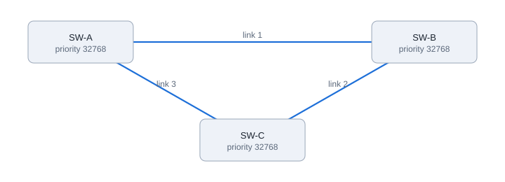

*شکل ۱: سه سوییچ با سه لینک؛ مثلثی که اگر STP نباشد Loop می‌سازد.*

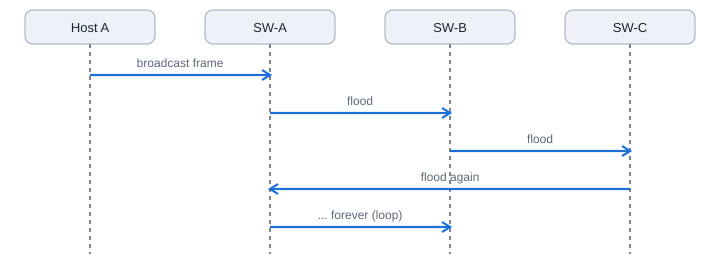

*شکل ۲: یک Broadcast بین سوییچ‌ها می‌چرخد و هیچ‌وقت تمام نمی‌شود.*

#### سه عارضه‌ی Loop

1.  **Broadcast Storm:** ترافیک تکراری پهنای باند را کامل مصرف می‌کند.
2.  **MAC Table Instability:** یک MAC مدام بین دو پورت پرش می‌کند (MACFLAP).
3.  **CPU بالا:** سوییچ مجبور است همین فریم‌ها را پردازش کند و دیگر جواب نمی‌دهد.

### ۲. ایده‌ی STP: یک درخت، بدون حلقه

STP از روی گراف شبکه یک «درخت» می‌سازد: یک ریشه (Root) انتخاب می‌کند و برای هر سوییچ فقط یک مسیر فعال به ریشه نگه می‌دارد. لینک‌های اضافه به‌صورت Blocking در حالت آماده‌باش می‌مانند و اگر لینک اصلی خراب شد، فعال می‌شوند.

#### مراحل کار STP (سه تصمیم)

1.  **انتخاب Root Bridge:** سوییچی با کوچک‌ترین Bridge ID برنده است.
2.  **انتخاب Root Port:** هر سوییچ غیر Root، پورتی را انتخاب می‌کند که کمترین هزینه تا Root را دارد.
3.  **انتخاب Designated Port:** روی هر Segment، پورتی که به Root نزدیک‌تر است فعال می‌ماند؛ پورت‌های باقی‌مانده Blocking می‌شوند.

#### Bridge ID چیست؟

Bridge ID از دو بخش ساخته می‌شود: اولویت (Priority) و MAC سوییچ. اولویت پیش‌فرض ۳۲۷۶۸ است. در PVST+ برای هر VLAN یک نمونه از STP اجرا می‌شود و شماره‌ی VLAN به اولویت اضافه می‌شود:

``` text
Bridge ID = Priority + VLAN ID + MAC address
Example (VLAN 10): 32768 + 10 = 32778 , MAC 0001.aaaa.0001
Lowest Bridge ID wins the Root election
```

اگر اولویت‌ها برابر بود، MAC کوچک‌تر برنده است. چون MAC معمولاً به سن سوییچ بستگی دارد، سوییچ «قدیمی‌ترین» ممکن است Root شود؛ همین یک اشتباه رایج طراحی است. باید Root را عمداً انتخاب کنیم (درس ۴-۲).

#### هزینه‌ی مسیر (Path Cost)

سوییچ‌ها هزینه‌ی مسیر تا Root را با جمع‌کردن هزینه‌ی لینک‌ها حساب می‌کنند. لینک سریع‌تر هزینه‌ی کمتر دارد:

| سرعت لینک | هزینه (روش کوتاه، Short) | هزینه (روش بلند، Long) |
|-----------|--------------------------|------------------------|
| 10 Mbps   | 100                      | 2,000,000              |
| 100 Mbps  | 19                       | 200,000                |
| 1 Gbps    | 4                        | 20,000                 |
| 10 Gbps   | 2                        | 2,000                  |

#### حالت‌ها و نقش پورت‌ها

| STP کلاسیک (802.1D) | کار پورت                                    |
|---------------------|---------------------------------------------|
| Blocking            | فریم داده نمی‌فرستد، فقط BPDU می‌شنود         |
| Listening           | BPDU می‌شنود و پردازش می‌کند، MAC یاد نمی‌گیرد |
| Learning            | MAC یاد می‌گیرد، هنوز داده نمی‌فرستد          |
| Forwarding          | کار عادی                                    |
| Disabled            | خاموش                                       |

در STP کلاسیک، تا Forwarding شدن یک پورت ۳۰ تا ۵۰ ثانیه طول می‌کشد. این تأخیر در شبکه‌ی امروز قابل‌قبول نیست؛ پس از RSTP استفاده می‌کنیم (درس بعد).

``` text
Blocking (20 s max age) -> Listening (15 s) -> Learning (15 s) -> Forwarding
Worst-case convergence = 20 + 15 + 15 = 50 seconds
```

### ۳. مثال ساده: دو سوییچ، دو لینک

SW-A و SW-B با دو کابل به هم وصل‌اند. هر دو با اولویت ۳۲۷۶۸. MAC سوییچ A کوچک‌تر است.

``` text
Election: priority equal (32768) -> lower MAC wins
Root Bridge = SW-A
On SW-B: both uplinks lead to Root with the same cost
  -> choose the lower port ID (Gi0/1) as Root Port
  -> Gi0/2 becomes Blocking (Alternate)
```

### ۴. مثال متوسط: سه سوییچ، مثلث

``` text
Bridge IDs: SW-A 32769.0001.aaaa.0001 (VLAN1)
            SW-B 32769.0001.aaaa.0002
            SW-C 32769.0001.aaaa.0003
Root Bridge = SW-A (lowest MAC)

SW-B -> Root: direct link, cost 4 (1G)          -> Root Port = link A-B
SW-C -> Root: direct link, cost 4 (1G)          -> Root Port = link A-C
Segment B-C: both sides cost 4 to Root; tie -> lower Bridge ID
  SW-B has lower ID than SW-C -> SW-B port is Designated (Forwarding)
  SW-C port on B-C is Alternate (Blocking)
```

نتیجه: فقط پورت SW-C سمت لینک B-C بسته می‌شود؛ مثلث به یک درخت (A در ریشه، B و C فرزند) تبدیل شد.

### ۵. مثال سخت: چرا Root اشتباه خطرناک است؟

در یک شعبه، یک سوییچ قدیمی دسترسی در انتهای شبکه، چون MAC کوچک دارد، Root می‌شود. حالا همه‌ی ترافیک بین سرورها و کاربران از لینک ۱۰۰ مگابیتی آن سوییچ عبور می‌کند.

``` text
Symptom  : network slow, traffic path goes through an old access switch
Check    : show spanning-tree vlan 10  -> "This bridge is the root" on the wrong switch
Cause    : default priority + lowest MAC
Fix      : set core switch priority lower (e.g. 4096) or "root primary"
```

### ۶. دستورهای مشاهده

``` text
SW1# show spanning-tree
SW1# show spanning-tree vlan 10
SW1# show spanning-tree summary
SW1# show spanning-tree root
SW1# show spanning-tree interface gi0/1 detail
```

- `show spanning-tree vlan 10`: Root، Bridge ID خودش، نقش هر پورت (Root/Desg/Altn) و حالت آن.
- `show spanning-tree root`: خلاصه‌ی Root هر VLAN.
- `show spanning-tree summary`: حالت STP و تعداد پورت‌ها به‌تفکیک.

### تمرین‌ها

**ت1.** ۱ (ساده): چرا Loop در لایه ۲ خطرناک‌تر از لایه ۳ است؟ *(پاسخ: 4-1-ت1 در بخش «پاسخ‌ها» انتهای فصل)*

**ت2.** ۲ (ساده): Root Bridge را چطور انتخاب می‌کنند؟ *(پاسخ: 4-1-ت2 در بخش «پاسخ‌ها» انتهای فصل)*

**ت3.** ۳ (متوسط): دو سوییچ با اولویت 32768 و 4096؛ کدام Root است؟ *(پاسخ: 4-1-ت3 در بخش «پاسخ‌ها» انتهای فصل)*

**ت4.** ۴ (متوسط): هزینه‌ی مسیر سه لینک ۱ گیگ پشت‌سرهم تا Root با روش Short؟ *(پاسخ: 4-1-ت4 در بخش «پاسخ‌ها» انتهای فصل)*

**ت5.** ۵ (سخت): در مثلث A (Root)، B، C با لینک‌های 1G، اگر لینک A-C خراب شود، SW-C از کدام مسیر Root را می‌بیند و هزینه چقدر است؟ *(پاسخ: 4-1-ت5 در بخش «پاسخ‌ها» انتهای فصل)*

### Lab هدایت‌شده

توپولوژی: سه سوییچ vIOSL2 به نام‌های `SW1`، `SW2` و `SW3` که مثلث می‌سازند (SW1-SW2، SW2-SW3، SW1-SW3). همه‌ی لینک‌ها Trunk هستند. اگر SW3 ندارید، یک گره‌ی سوم از همان Image اضافه کنید. **هشدار:** قبل از وصل‌کردن لینک سوم، STP باید فعال باشد؛ در Lab ما STP پیش‌فرض روشن است ولی همین را با `show spanning-tree summary` تأیید کنید.

#### گام ۱: بکاپ و حالت STP

``` text
SW1# copy running-config flash:SW1-before-stp.cfg
SW1# show spanning-tree summary
```

#### گام ۲: دیدن Root

``` text
SW1# show spanning-tree vlan 1
SW2# show spanning-tree vlan 1
SW3# show spanning-tree vlan 1
```

در سه خروجی، Bridge ID و Root را مقایسه کنید. روی کدام سوییچ نوشته «This bridge is the root»؟ پیش‌بینی کنید چه سوییچی است و بعد بسنجید.

#### گام ۳: پیدا کردن پورت Blocking

``` text
SWx# show spanning-tree vlan 1 | include Altn|Desg|Root
```

یک پورت Altn (Alternate) باید در مثلث پیدا کنید. آن را یادداشت کنید و نقش همه‌ی پورت‌ها را در یک جدول بنویسید.

#### گام ۴: شکستن لینک و دیدن Failover

``` text
SW2(config)# interface gi0/1
SW2(config-if)# shutdown
SW3# show spanning-tree vlan 1
```

پورت Alternate چقدر زود Forwarding شد؟ (در Rapid-PVST کمتر از چند ثانیه؛ در PVST کلاسیک ۳۰ تا ۵۰ ثانیه.) بعد پورت را `no shutdown` کنید.

### Lab مستقل

جدول «Bridge ID هر سوییچ، Root، نقش پورت‌ها» را برای VLAN 1 بسازید و در `03-ops/stp-baseline.md` ذخیره کنید. بدون رمز.

### عیب‌یابی

|         |                                                                                                                                  |
|---------|----------------------------------------------------------------------------------------------------------------------------------|
| Symptom | شبکه ناگهان بسیار کند شد و LEDهای لینک‌ها مدام چشمک می‌زنند                                                                        |
| سرنخ    | CPU بالا، پیام MACFLAP، ترافیک Broadcast زیاد                                                                                    |
| چک‌لیست  | ۱) show spanning-tree summary ؛ ۲) آیا کابل جدیدی وصل شده؟ ؛ ۳) آیا STP روی همه‌ی سوییچ‌ها فعال است؟ ؛ ۴) پورت Blocking وجود دارد؟ |
| رفع     | کابل اضافه را جدا کنید، STP را فعال کنید، سپس علت را مستند کنید                                                                  |

### سؤال‌های مرور

**م1.** چرا لایه ۲ به STP نیاز دارد؟ *(پاسخ: 4-1-م1 در بخش «پاسخ‌ها» انتهای فصل)*

**م2.** Root Bridge چه کسی است؟ *(پاسخ: 4-1-م2 در بخش «پاسخ‌ها» انتهای فصل)*

**م3.** Root Port و Designated Port چه فرقی دارند؟ *(پاسخ: 4-1-م3 در بخش «پاسخ‌ها» انتهای فصل)*

### English Corner: انگلیسی تخصصی این درس

این جمله‌ها از مستندات و محیط کار واقعی‌اند. بلند بخوانید و ترجمه را بپوشانید.

| English sentence                                              | ترجمه                                                 |
|---------------------------------------------------------------|-------------------------------------------------------|
| STP prevents layer-2 loops by blocking redundant links.       | STP با بستن لینک‌های اضافه جلوی Loop لایه ۲ را می‌گیرد. |
| The switch with the lowest bridge ID becomes the root bridge. | سوییچ با کوچک‌ترین Bridge ID Root می‌شود.               |
| A blocked port still receives BPDUs.                          | پورت Blocking هنوز BPDU دریافت می‌کند.                 |
| A broadcast storm can bring down the entire network.          | طوفان Broadcast می‌تواند کل شبکه را از کار بیندازد.    |

**Q1.** Quick quiz (answer in English): What does STP do with a redundant link? *(پاسخ: 4-1-Q1 در بخش «پاسخ‌ها» انتهای فصل)*

### تکلیف و چک‌لیست تسلط

- [ ] سه عارضه‌ی Loop را بگویم.
- [ ] Root را برای مثلث به‌دست آورم و نقش پورت‌ها را بنویسم.
- [ ] Lab را انجام دهم و Failover را ثبت کنم.

### یادآوری اشتباهات شما

> **یادآوری**
>
> پیش‌بینی قبل از اجرا؛ بکاپ قبل از تغییر؛ پذیرفته‌شدن دستور ≠ کار کردن؛ فرمول‌ها در بلوک مستقل.


#### کارت Lab — حلقه در لایه ۲ و STP

| # | فیلد | محتوا |
|---|---|---|
| 1 | عنوان و هدف | دیدن Root و نقش پورت‌ها در مثلث سه‌سوییچی |
| 2 | پیش‌نیاز | فصل 3 |
| 3 | توپولوژی | SW1-SW2-SW3 مثلث (Trunk) |
| 4 | تجهیزات | ۳ سوییچ vIOS-L2 |
| 5 | نسخه نرم‌افزار | vIOS-L2 15.2(20200924، Experimental) برای SW؛ vIOS 15.9(3)M9 برای R؛ VPCS؛ PNetLab 4.2.8 |
| 6 | IP Plan | VLAN 1 |
| 7 | وضعیت اولیه | PVST پیش‌فرض |
| 8 | صورت مسئله | Root/Port Role را بنویسید و Failover را ببینید |
| 9 | مراحل هدایت‌شده | همان بخش «Lab هدایت‌شده» همین درس |
| 10 | تست عملکرد | `show spanning-tree vlan 1` (Root، Altn) |
| 11 | سناریوی خرابی | Loop بدون STP (آموزشی) |
| 12 | روش عیب‌یابی | لایه‌ای/با شواهد (بخش عیب‌یابی همین درس) |
| 13 | نتیجه‌ی مورد انتظار | Root مشخص؛ یک پورت Altn |
| 14 | معیار پذیرش | جدول Role صحیح |
| 15 | مستندات نهایی | `03-ops/stp-baseline.md` |
| 16 | Cleanup و بازگردانی | `no shutdown` لینک‌ها |

> **وضعیت راستی‌آزمایی (خارج از ۱۶ فیلد):** **جزئی.** `show spanning-tree summary` در Probe Tested-OK (PVST)؛ Failover و مثلث اجرا نشده.

---

<a id="l-4-2"></a>

## درس 4-2 — Rapid-PVST، Root، PortFast و BPDU Guard

**فصل ۴ - روز ۲ · پیش‌نیاز: درس ۴-۱ · ۶ ساعت**

### این درس درباره چیست و چرا باید یاد بگیریم؟

**چه چیزی یاد می‌گیریم:** نسخه‌ی سریع STP یعنی RSTP و پیاده‌سازی سیسکو Rapid-PVST+؛ انتخاب عمدی Root؛ و محافظ‌های PortFast و BPDU Guard و Root Guard.

**چرا لازم است:** STP کلاسیک تا ۵۰ ثانیه همگرا می‌شود و Root را به‌صورت تصادفی انتخاب می‌کند. در شبکه‌ی واقعی باید همگرایی چند ثانیه‌ای و Root از پیش‌تعیین‌شده داشته باشیم، و باید جلوی اتصال سوییچ یا BPDU ناخواسته به پورت کاربر را بگیریم.

- **در کار روزانه:** تقریباً همه‌ی سوییچ‌های سازمانی Rapid-PVST اجرا می‌کنند.
- **در امنیت:** BPDU Guard جلوی اتصال سوییچ جعلی (Rogue) را می‌گیرد؛ Root Guard جلوی Root شدن سوییچ ناخواسته را.
- **در عیب‌یابی:** پورت err-disabled بعد از وصل‌کردن یک سوییچ، کار BPDU Guard است.

> **مسیر درس**
>
> RSTP چه فرقی دارد ← تنظیم Root ← PortFast ← BPDU Guard و Root Guard ← مثال ساده/متوسط/سخت ← Lab ← عیب‌یابی.

#### اصطلاحات این درس (مخفف ← شکل کامل ← معنی)

| مخفف        | شکل کامل انگلیسی                      | معنی فارسی                                        |
|-------------|---------------------------------------|---------------------------------------------------|
| RSTP        | Rapid Spanning Tree Protocol (802.1w) | نسخه‌ی سریع STP                                    |
| PVST+       | Per-VLAN Spanning Tree Plus           | یک STP جدا برای هر VLAN (سیسکو)                   |
| Rapid-PVST+ | Rapid Per-VLAN Spanning Tree Plus     | RSTP به‌صورت Per-VLAN                              |
| PortFast    | PortFast                              | پورت لبه‌ای که فوراً Forwarding می‌شود               |
| BPDU Guard  | BPDU Guard                            | پورت را با دریافت BPDU خاموش می‌کند                |
| Root Guard  | Root Guard                            | جلوی Root شدن سوییچ ناخواسته از یک پورت را می‌گیرد |
| Alternate   | Alternate Port                        | پورت جایگزین سریع برای Root Port                  |
| Edge Port   | Edge Port                             | پورتی که به دستگاه انتهایی وصل است                |

### ۱. RSTP چه چیزی را سریع کرد؟

RSTP همان ایده‌ی STP است ولی به‌جای انتظار با تایمرها، سوییچ‌ها با هم «مذاکره» می‌کنند (Proposal/Agreement). حالت‌ها هم ساده‌تر شده‌اند:

| STP کلاسیک | RSTP       |
|------------|------------|
| Blocking   | Discarding |
| Listening  | Discarding |
| Learning   | Learning   |
| Forwarding | Forwarding |

نقش‌ها هم یک نقش جدید دارند:

| نقش             | معنی                                     |
|-----------------|------------------------------------------|
| Root Port       | بهترین مسیر به Root                      |
| Designated Port | پورت فعال هر Segment                     |
| Alternate Port  | پشتیبان Root Port (همگرایی در حد ثانیه)  |
| Backup Port     | پشتیبان Designated Port روی همان Segment |

``` text
STP  : 30-50 seconds to converge
RSTP : usually 1-2 seconds (link failure with alternate port)
```

### ۲. فعال‌کردن Rapid-PVST+

``` text
SW1(config)# spanning-tree mode rapid-pvst
SW1# show spanning-tree summary
```

در خروجی باید بنویسد `Switch is in rapid-pvst mode`. این دستور باید روی همه‌ی سوییچ‌ها یکسان زده شود؛ ترکیب حالت‌ها سازگار است ولی همگرایی سریع از دست می‌رود.

### ۳. تعیین عمدی Root

دو روش داریم. روش اول Macro است و خودش اولویت را کم می‌کند؛ روش دوم دستی است و دقیق‌تر:

``` text
SW1(config)# spanning-tree vlan 1,10,20,30 root primary
SW2(config)# spanning-tree vlan 1,10,20,30 root secondary

! manual equivalent:
SW1(config)# spanning-tree vlan 10 priority 4096
SW2(config)# spanning-tree vlan 10 priority 8192
```

- `root primary`: اولویت را به اندازه‌ای کم می‌کند که Root شود (معمولاً 24576 یا کمتر).
- `root secondary`: اولویت 28672 برای نقش Root پشتیبان.
- اولویت باید مضرب 4096 باشد (چون ۱۲ بیت دیگر برای شماره‌ی VLAN رزرو است).

``` text
Priority values allowed: 0, 4096, 8192, ... 61440 (multiples of 4096)
Default priority : 32768
Bridge priority in BPDU = Priority + VLAN ID  (e.g. 4096 + 10 = 4106)
```

> **قانون طراحی**
>
> Root را همیشه روی سوییچ هسته (Core / Distribution) بگذارید و Root پشتیبان را روی هم‌ترازش. هرگز نگذارید یک سوییچ دسترسی Root شود.

### ۴. PortFast: پورت کاربر را سریع بالا بیاور

پورتی که به کامپیوتر یا پرینتر وصل است نمی‌تواند Loop بسازد. پس نیازی نیست منتظر مراحل STP بماند. PortFast آن را فوراً Forwarding می‌کند:

``` text
SW1(config)# interface range gi0/1 - 4
SW1(config-if-range)# switchport mode access
SW1(config-if-range)# spanning-tree portfast

! or enable globally for all access ports:
SW1(config)# spanning-tree portfast default
```

> **هشدار**
>
> PortFast فقط روی پورت‌های دستگاه انتهایی. روی لینک بین سوییچ‌ها خطرناک است، چون ممکن است Loop بسازد. برای همین حتماً با BPDU Guard همراه می‌شود.

### ۵. BPDU Guard: اگر BPDU آمد، پورت را خاموش کن

پورت کاربر هرگز نباید BPDU دریافت کند. اگر دریافت کرد، یعنی کسی سوییچ وصل کرده. BPDU Guard پورت را به حالت err-disabled می‌برد:

``` text
SW1(config)# interface gi0/1
SW1(config-if)# spanning-tree bpduguard enable

! global default for PortFast ports:
SW1(config)# spanning-tree portfast bpduguard default

! recovery (optional, careful):
SW1(config)# errdisable recovery cause bpduguard
SW1(config)# errdisable recovery interval 300
```

``` text
SW1# show interfaces status err-disabled
SW1# show spanning-tree summary
SW1# show spanning-tree interface gi0/1 detail
```

بعد از رفع علت، پورت را دستی روشن کنید: `shutdown` سپس `no shutdown`. اگر `errdisable recovery` تنظیم شده باشد، بعد از ۳۰۰ ثانیه خودکار برمی‌گردد (ولی اگر علت هنوز هست، دوباره خاموش می‌شود).

### ۶. Root Guard: جلوی Root ناخواسته

روی پورت‌هایی که به سمت سوییچ‌های «مشتری» یا بیرون از کنترل شما می‌روند، اگر BPDU بهتر (ادعای Root) رسید، پورت وارد حالت `root-inconsistent` می‌شود و ترافیک را نمی‌پذیرد:

``` text
SW1(config)# interface gi0/10
SW1(config-if)# spanning-tree guard root
SW1# show spanning-tree inconsistentports
```

| ابزار      | روی کدام پورت                 | عکس‌العمل                       |
|------------|-------------------------------|--------------------------------|
| PortFast   | پورت دستگاه انتهایی           | فوراً Forwarding                |
| BPDU Guard | پورت دستگاه انتهایی           | err-disabled با دریافت BPDU    |
| Root Guard | پورت به سمت خارج از کنترل شما | root-inconsistent با BPDU برتر |

### ۷. مثال ساده/متوسط/سخت

#### ساده

``` text
Task  : make SW1 the root for VLAN 10
Cmd   : spanning-tree vlan 10 root primary
Verify: show spanning-tree vlan 10  -> "This bridge is the root"
```

#### متوسط

کاربری یک سوییچ کوچک خانگی را به پورت دیوار وصل می‌کند. بدون BPDU Guard ممکن است Loop بسازد یا Root شود؛ با BPDU Guard پورت خاموش می‌شود:

``` text
Log: %SPANTREE-2-BLOCK_BPDUGUARD: Received BPDU on port Gi0/3 with BPDU Guard enabled
Show: show interfaces status err-disabled -> Gi0/3 err-disabled bpduguard
```

#### سخت

در شبکه‌ی ۳ سوییچی، Root را روی SW1 و Root پشتیبان را روی SW2 بگذارید، روی پورت‌های دسترسی SW3 PortFast و BPDU Guard فعال کنید، روی پورت اتصال به شبکه‌ی خارجی Root Guard؛ سپس نشان دهید با قطع SW1 همگرایی کمتر از چند ثانیه است.

### تمرین‌ها

**ت1.** ۱ (ساده): چرا RSTP سریع‌تر است؟ *(پاسخ: 4-2-ت1 در بخش «پاسخ‌ها» انتهای فصل)*

**ت2.** ۲ (ساده): اولویت‌های مجاز؟ *(پاسخ: 4-2-ت2 در بخش «پاسخ‌ها» انتهای فصل)*

**ت3.** ۳ (متوسط): PortFast بدون BPDU Guard چه خطری دارد؟ *(پاسخ: 4-2-ت3 در بخش «پاسخ‌ها» انتهای فصل)*

**ت4.** ۴ (متوسط): پورت err-disabled شد؛ مراحل رفع؟ *(پاسخ: 4-2-ت4 در بخش «پاسخ‌ها» انتهای فصل)*

**ت5.** ۵ (سخت): Root Guard را روی کدام پورت‌ها می‌گذاریم و چرا؟ *(پاسخ: 4-2-ت5 در بخش «پاسخ‌ها» انتهای فصل)*

### Lab هدایت‌شده

همان مثلث SW1-SW2-SW3 از درس قبل. SW1 باید Root باشد.

#### گام ۱: Rapid-PVST روی هر سه

``` text
SWx(config)# spanning-tree mode rapid-pvst
SWx# show spanning-tree summary
```

#### گام ۲: Root و Root پشتیبان

``` text
SW1(config)# spanning-tree vlan 1 root primary
SW2(config)# spanning-tree vlan 1 root secondary
SW3# show spanning-tree root
```

#### گام ۳: PortFast و BPDU Guard روی پورت PC

``` text
SW3(config)# interface gi0/3
SW3(config-if)# switchport mode access
SW3(config-if)# spanning-tree portfast
SW3(config-if)# spanning-tree bpduguard enable
```

#### گام ۴: ایجاد عمدی تخلف

به پورت Gi0/3 به‌جای PC، یک سوییچ (SW4) وصل کنید. باید پیام BPDU Guard را ببینید:

``` text
SW3# show interfaces status err-disabled
SW3# show logging | include BPDUGUARD
```

اگر شبیه‌ساز BPDU Guard را اجرا نکرد (طبق Probe فقط پذیرفته شده بود)، دقیقاً همان را ثبت کنید و در Lab واقعی تکرار کنید.

#### گام ۵: رفع

``` text
SW3(config)# interface gi0/3
SW3(config-if)# shutdown
SW3(config-if)# no shutdown
```

### Lab مستقل

یک چک‌لیست «Hardening لایه ۲» یک‌صفحه‌ای بنویسید (Rapid-PVST، Root/Secondary، PortFast، BPDU Guard، Root Guard) در `03-ops/l2-hardening.md`.

### عیب‌یابی

|            |                                                              |
|------------|--------------------------------------------------------------|
| Symptom    | پورت کاربر خاموش شده و کاربر قطع است                         |
| سرنخ       | show interfaces status -\> err-disabled                      |
| علت متداول | BPDU Guard: سوییچ یا دستگاهی که BPDU می‌فرستد به پورت وصل شده |
| رفع        | دستگاه را جدا کنید و پورت را بالا بیاورید؛ علت را مستند کنید |

### سؤال‌های مرور

**م1.** PortFast برای چه پورتی؟ *(پاسخ: 4-2-م1 در بخش «پاسخ‌ها» انتهای فصل)*

**م2.** تفاوت BPDU Guard و Root Guard؟ *(پاسخ: 4-2-م2 در بخش «پاسخ‌ها» انتهای فصل)*

**م3.** چرا Root را دستی تعیین می‌کنیم؟ *(پاسخ: 4-2-م3 در بخش «پاسخ‌ها» انتهای فصل)*

### English Corner: انگلیسی تخصصی این درس

این جمله‌ها از مستندات و محیط کار واقعی‌اند. بلند بخوانید و ترجمه را بپوشانید.

| English sentence                                                           | ترجمه                                                                             |
|----------------------------------------------------------------------------|-----------------------------------------------------------------------------------|
| Enable PortFast on access ports to skip the listening and learning states. | PortFast را روی پورت‌های Access فعال کنید تا حالت‌های Listening و Learning رد شوند. |
| BPDU Guard puts the port in err-disabled state when a BPDU is received.    | BPDU Guard با دریافت BPDU پورت را به حالت err-disabled می‌برد.                     |
| Set the core switch as the root bridge for all VLANs.                      | سوییچ هسته را Root همه‌ی VLANها کنید.                                              |
| Root Guard prevents an unauthorized switch from becoming root.             | Root Guard جلوی Root شدن سوییچ غیرمجاز را می‌گیرد.                                 |

**Q1.** Quick quiz (answer in English): When should you not enable PortFast? *(پاسخ: 4-2-Q1 در بخش «پاسخ‌ها» انتهای فصل)*

### تکلیف و چک‌لیست تسلط

- [ ] Rapid-PVST و Root را تنظیم و تأیید کنم.
- [ ] BPDU Guard را بسازم، تخلف را ببینم و رفع کنم.
- [ ] چک‌لیست Hardening L2 را بنویسم.

### یادآوری اشتباهات شما

> **یادآوری**
>
> پیش‌بینی قبل از اجرا؛ بکاپ قبل از تغییر؛ پذیرفته‌شدن دستور ≠ کار کردن؛ فرمول‌ها در بلوک مستقل.


#### کارت Lab — Rapid-PVST، Root، PortFast و BPDU Guard

| # | فیلد | محتوا |
|---|---|---|
| 1 | عنوان و هدف | Rapid-PVST، Root، PortFast، BPDU Guard |
| 2 | پیش‌نیاز | درس 4-1 |
| 3 | توپولوژی | مثلث + PC |
| 4 | تجهیزات | ۳ سوییچ + VPCS |
| 5 | نسخه نرم‌افزار | vIOS-L2 15.2(20200924، Experimental) برای SW؛ vIOS 15.9(3)M9 برای R؛ VPCS؛ PNetLab 4.2.8 |
| 6 | IP Plan | PVST |
| 7 | وضعیت اولیه | Rapid-PVST |
| 8 | صورت مسئله | Root/Secondary و محافظت پورت |
| 9 | مراحل هدایت‌شده | همان بخش «Lab هدایت‌شده» همین درس |
| 10 | تست عملکرد | `show spanning-tree summary` |
| 11 | سناریوی خرابی | سوییچ جعلی به پورت BPDU Guard |
| 12 | روش عیب‌یابی | لایه‌ای/با شواهد (بخش عیب‌یابی همین درس) |
| 13 | نتیجه‌ی مورد انتظار | Rapid-PVST؛ پورت err-disabled با BPDU |
| 14 | معیار پذیرش | تخلف دیده/ثبت شود |
| 15 | مستندات نهایی | `03-ops/l2-hardening.md` |
| 16 | Cleanup و بازگردانی | shutdown/no shutdown پورت |

> **وضعیت راستی‌آزمایی (خارج از ۱۶ فیلد):** **جزئی.** Rapid-PVST در Config دیده شد؛ PortFast/BPDU Guard فقط CLI-Accepted؛ اجرای واقعی Guard آزمایش نشده.

---

<a id="l-4-3"></a>

## درس 4-3 — EtherChannel و LACP

**فصل ۴ - روز ۳ · پیش‌نیاز: درس ۴-۲ · ۶ ساعت**

### این درس درباره چیست و چرا باید یاد بگیریم؟

**چه چیزی یاد می‌گیریم:** چطور چند کابل فیزیکی بین دو سوییچ را به‌صورت یک لینک منطقی (EtherChannel) در بیاوریم، با پروتکل LACP؛ و چرا دو سر لینک باید تنظیمات یکسان داشته باشند.

**چرا لازم است:** اگر بین دو سوییچ دو کابل بکشید، STP یکی را می‌بندد و نیمی از پهنای باند هدر می‌رود. EtherChannel دو (تا هشت) کابل را یکی می‌کند: پهنای باند جمع می‌شود و با قطع یک کابل ارتباط قطع نمی‌شود.

- **در کار روزانه:** لینک بین سوییچ‌های Core و Distribution تقریباً همیشه EtherChannel است.
- **در امنیت:** EtherChannel نادرست باعث Loop یا قطع ناگهانی می‌شود؛ کنترل Mismatch ضروری است.
- **در FortiGate:** همین مفهوم با «Aggregate Interface» در فایروال تکرار می‌شود.

> **مسیر درس**
>
> مشکل لینک‌های موازی ← Port-Channel ← LACP در برابر PAgP ← Load Balancing ← مثال ساده/متوسط/سخت ← Lab ← عیب‌یابی.

#### اصطلاحات این درس (مخفف ← شکل کامل ← معنی)

| مخفف         | شکل کامل انگلیسی                            | معنی فارسی                             |
|--------------|---------------------------------------------|----------------------------------------|
| EtherChannel | EtherChannel                                | تجمیع چند لینک فیزیکی در یک لینک منطقی |
| Port-Channel | Port-Channel                                | Interface منطقی حاصل از تجمیع          |
| LACP         | Link Aggregation Control Protocol (802.3ad) | پروتکل استاندارد مذاکره‌ی تجمیع         |
| PAgP         | Port Aggregation Protocol                   | پروتکل اختصاصی سیسکو برای تجمیع        |
| Active       | LACP Active                                 | پورت فعالانه مذاکره را شروع می‌کند      |
| Passive      | LACP Passive                                | پورت فقط منتظر مذاکره می‌ماند           |
| Hash         | Load-balancing hash                         | الگوریتم انتخاب لینک برای هر جریان     |

### ۱. مشکل: دو کابل، یک کابل کار می‌کند

دو سوییچ را با دو کابل ۱ گیگ وصل می‌کنیم تا هم پهنای باند بیشتر داشته باشیم و هم تحمل خطا. اما STP دو لینک موازی را «Loop» می‌داند و یکی را Block می‌کند. نتیجه: فقط ۱ گیگ، نه ۲ گیگ.

مثال روزمره: دو باند موازی در یک جاده که یکی را بسته‌اند چون فکر می‌کنند دور می‌زند. EtherChannel به STP می‌گوید این دو باند «یک جاده‌ی دوبانده» هستند.

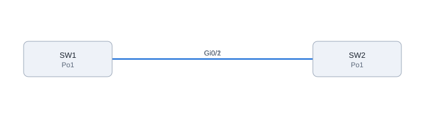

*شکل ۱: دو لینک فیزیکی که STP آن‌ها را یک لینک منطقی (Po1) می‌بیند.*

### ۲. EtherChannel چطور کار می‌کند؟

- چند پورت فیزیکی عضو یک **Port-Channel** می‌شوند.
- STP و Trunk فقط Port-Channel را می‌بینند، نه پورت‌های عضو.
- توزیع ترافیک به‌صورت Hash است: هر جریان (مثلاً یک جفت IP) یک لینک را می‌گیرد؛ پس یک جریان تنها از یک لینک می‌رود و ۱ گیگ می‌ماند، ولی چند جریان روی لینک‌ها پخش می‌شود.
- اگر یک لینک قطع شود، ترافیک به لینک‌های دیگر منتقل می‌شود.

> **نکته‌ی مهم**
>
> EtherChannel سرعت یک ارتباط تکی را بیشتر نمی‌کند؛ ظرفیت کل را بالا می‌برد و تحمل خطا می‌دهد.

### ۳. LACP یا PAgP یا ثابت؟

| حالت   | پروتکل                                  | Modeهای مجاز     |
|--------|-----------------------------------------|------------------|
| LACP   | استاندارد 802.3ad، با تجهیزات هر سازنده | active / passive |
| PAgP   | اختصاصی سیسکو                           | desirable / auto |
| Static | بدون مذاکره (خطرناک)                    | on               |

| ترکیب دو سر       | نتیجه                        |
|-------------------|------------------------------|
| active — active   | Channel تشکیل می‌شود          |
| active — passive  | Channel تشکیل می‌شود          |
| passive — passive | تشکیل نمی‌شود (هر دو منتظرند) |
| on — active       | تشکیل نمی‌شود (Mismatch)      |
| LACP — PAgP       | تشکیل نمی‌شود                 |

توصیه: همیشه LACP با `active` در هر دو سر.

### ۴. شرط‌های یکسان بودن پورت‌ها

همه‌ی پورت‌های عضو باید این‌ها را یکسان داشته باشند، وگرنه Channel بالا نمی‌آید یا Suspend می‌شود:

- سرعت و Duplex
- حالت Trunk/Access و VLANهای مجاز و Native
- VLAN دسترسی (برای Access)
- تنظیمات STP پورت

### ۵. دستورها (خط‌به‌خط)

``` text
SW1(config)# interface range gi0/1 - 2
SW1(config-if-range)# switchport trunk encapsulation dot1q
SW1(config-if-range)# switchport mode trunk
SW1(config-if-range)# channel-group 1 mode active
SW1(config-if-range)# exit
SW1(config)# interface port-channel 1
SW1(config-if)# switchport trunk allowed vlan 10,20,30
SW1(config-if)# switchport trunk native vlan 999
```

- `channel-group 1 mode active`: پورت را عضو Port-Channel شماره‌ی ۱ می‌کند و LACP را فعال.
- تنظیمات Trunk را هم روی Port-Channel بزنید (نه فقط پورت‌ها)، تا تغییرات یکجا اعمال شود.

``` text
SW1# show etherchannel summary
SW1# show etherchannel port-channel
SW1# show interfaces port-channel 1
SW1# show lacp neighbor
SW1# show etherchannel load-balance
```

در `show etherchannel summary` حروف داخل پرانتز مهم‌اند:

| علامت | معنی                         |
|-------|------------------------------|
| P     | پورت در Bundle است (سالم)    |
| I     | پورت مستقل (Stand-alone) است |
| D     | Down                         |
| s     | Suspended (Mismatch)         |
| SU    | Port-channel: L2 و In-use    |
| SD    | Port-channel: L2 و Down      |

### ۶. مثال‌ها

#### ساده

``` text
Po1(SU)  Gi0/1(P)  Gi0/2(P)
Meaning: Layer-2 port-channel in use, both members bundled
```

#### متوسط: Mismatch

``` text
Po1(SD)  Gi0/1(s)  Gi0/2(D)
Cause: native VLAN or allowed VLAN list differs on the two ports/sides
Fix  : make all member ports identical, then shutdown/no shutdown the ports
```

#### سخت: توزیع ترافیک (Load Balancing)

سوییچ با Hash روی مبدأ و مقصد MAC یا IP، لینک را انتخاب می‌کند. اگر فقط یک سرور به یک کلاینت ترافیک بفرستد، همیشه یک لینک پر می‌شود. راه‌حل: Hash بر اساس IP و پورت (در تجهیزات پشتیبان) یا افزایش تنوع جریان‌ها.

``` text
SW1(config)# port-channel load-balance src-dst-ip
SW1# show etherchannel load-balance
```

> **صادقانه درباره‌ی Lab**
>
> در شبیه‌ساز vIOSL2 موتور LACP روشن است ولی در Probe اولیه دیدیم Po1 بدون همتای واقعی در حالت `SD` می‌ماند (پیام «LACP currently not enabled on remote port»). پس Lab را با دو سوییچ شبیه‌سازی‌شده انجام دهید و اگر Bundle تشکیل نشد، ثبت کنید؛ این بخش در Lab واقعی (سخت‌افزار) کاملاً تمرین می‌شود.

### تمرین‌ها

**ت1.** ۱ (ساده): چرا EtherChannel لازم است؟ *(پاسخ: 4-3-ت1 در بخش «پاسخ‌ها» انتهای فصل)*

**ت2.** ۲ (ساده): LACP با کدام Modeها؟ *(پاسخ: 4-3-ت2 در بخش «پاسخ‌ها» انتهای فصل)*

**ت3.** ۳ (متوسط): کدام ترکیب Channel نمی‌سازد؟ *(پاسخ: 4-3-ت3 در بخش «پاسخ‌ها» انتهای فصل)*

**ت4.** ۴ (متوسط): تفسیر Po1(SD) Gi0/1(D) Gi0/2(D) *(پاسخ: 4-3-ت4 در بخش «پاسخ‌ها» انتهای فصل)*

**ت5.** ۵ (سخت): چرا ۲ لینک ۱G برای یک انتقال فایل تکی ۲G سرعت نمی‌دهد؟ *(پاسخ: 4-3-ت5 در بخش «پاسخ‌ها» انتهای فصل)*

### Lab هدایت‌شده

توپولوژی: SW1 و SW2 با دو کابل: `Gi0/1` و `Gi0/2` هر سمت. VLANها از درس ۳-۲.

#### گام ۱: بکاپ و تنظیم هر دو سر

``` text
SWx# copy running-config flash:SWx-before-ec.cfg
SWx(config)# interface range gi0/1 - 2
SWx(config-if-range)# switchport trunk encapsulation dot1q
SWx(config-if-range)# switchport mode trunk
SWx(config-if-range)# channel-group 1 mode active
```

#### گام ۲: بررسی

``` text
SWx# show etherchannel summary
SWx# show interfaces trunk
SWx# show spanning-tree vlan 1
```

در STP باید فقط Po1 را ببینید (نه Gi0/1 و Gi0/2 جداگانه).

#### گام ۳: خراب‌کردن عمدی (Mismatch)

``` text
SW2(config)# interface gi0/2
SW2(config-if)# switchport trunk native vlan 5
SW2# show etherchannel summary
```

وضعیت پورت را ببینید و سپس رفع کنید (Native را مثل بقیه کنید و پورت را `shutdown` / `no shutdown`).

#### گام ۴: تحمل خطا

``` text
SW1(config)# interface gi0/1
SW1(config-if)# shutdown
PC1> ping 10.10.20.14 -t   (should keep working over Gi0/2)
```

### Lab مستقل

در `03-ops/etherchannel-runbook.md` چک‌لیست «قبل از ساخت Channel» (یکسان‌بودن سرعت/VLAN/Native/Allowed) را بنویسید.

### عیب‌یابی

|         |                                                                                                                                 |
|---------|---------------------------------------------------------------------------------------------------------------------------------|
| Symptom | Port-channel بالا نمی‌آید (SD) یا پورت‌ها s هستند                                                                                 |
| چک‌لیست  | ۱) Modeها سازگارند؟ ؛ ۲) Native/Allowed/Trunk دو سر یکی است؟ ؛ ۳) سرعت/Duplex یکی است؟ ؛ ۴) کابل‌ها به همان پورت‌های درست وصل‌اند؟ |
| ابزار   | show etherchannel summary ، show lacp neighbor                                                                                  |
| رفع     | یکسان‌سازی پیکربندی، سپس shutdown و no shutdown پورت‌ها                                                                           |

### سؤال‌های مرور

**م1.** EtherChannel چه مشکلی را حل می‌کند؟ *(پاسخ: 4-3-م1 در بخش «پاسخ‌ها» انتهای فصل)*

**م2.** چرا LACP را ترجیح می‌دهیم؟ *(پاسخ: 4-3-م2 در بخش «پاسخ‌ها» انتهای فصل)*

### English Corner: انگلیسی تخصصی این درس

این جمله‌ها از مستندات و محیط کار واقعی‌اند. بلند بخوانید و ترجمه را بپوشانید.

| English sentence                                          | ترجمه                                                    |
|-----------------------------------------------------------|----------------------------------------------------------|
| Bundle the physical ports into a port-channel using LACP. | پورت‌های فیزیکی را با LACP در یک Port-Channel تجمیع کنید. |
| All member ports must have identical settings.            | همه‌ی پورت‌های عضو باید تنظیمات یکسان داشته باشند.         |
| Traffic is distributed across links using a hash.         | ترافیک با Hash بین لینک‌ها توزیع می‌شود.                   |
| The port-channel stays up if one member link fails.       | با قطع یک لینک عضو، Port-Channel بالا می‌ماند.            |

**Q1.** Quick quiz (answer in English): Why does a single file transfer not use the full bundled bandwidth? *(پاسخ: 4-3-Q1 در بخش «پاسخ‌ها» انتهای فصل)*

### تکلیف و چک‌لیست تسلط

- [ ] Channel را بسازم و در STP یک لینک ببینم.
- [ ] Mismatch را بسازم و رفع کنم.
- [ ] نتیجه‌ی واقعی Lab (SU یا SD) را ثبت کنم.

### یادآوری اشتباهات شما

> **یادآوری**
>
> پیش‌بینی قبل از اجرا؛ بکاپ قبل از تغییر؛ پذیرفته‌شدن دستور ≠ کار کردن؛ فرمول‌ها در بلوک مستقل.


#### کارت Lab — EtherChannel و LACP

| # | فیلد | محتوا |
|---|---|---|
| 1 | عنوان و هدف | EtherChannel (LACP) و عیب‌یابی Mismatch |
| 2 | پیش‌نیاز | درس 4-2 |
| 3 | توپولوژی | SW1 ⇄ SW2 (دو لینک) |
| 4 | تجهیزات | ۲ سوییچ |
| 5 | نسخه نرم‌افزار | vIOS-L2 15.2(20200924، Experimental) برای SW؛ vIOS 15.9(3)M9 برای R؛ VPCS؛ PNetLab 4.2.8 |
| 6 | IP Plan | Trunk تک‌لینک |
| 7 | وضعیت اولیه | Port-channel 1 |
| 8 | صورت مسئله | Bundle و تحمل خطا |
| 9 | مراحل هدایت‌شده | همان بخش «Lab هدایت‌شده» همین درس |
| 10 | تست عملکرد | `show etherchannel summary` |
| 11 | سناریوی خرابی | Native نامتقارن |
| 12 | روش عیب‌یابی | لایه‌ای/با شواهد (بخش عیب‌یابی همین درس) |
| 13 | نتیجه‌ی مورد انتظار | Po1(SU)؛ با قطع یک لینک ارتباط ادامه |
| 14 | معیار پذیرش | نتیجه‌ی واقعی (SU یا SD) ثبت شود |
| 15 | مستندات نهایی | `03-ops/etherchannel-runbook.md` |
| 16 | Cleanup و بازگردانی | حذف channel-group |

> **وضعیت راستی‌آزمایی (خارج از ۱۶ فیلد):** **جزئی.** LACP engine فعال (Po1(SD) تا همتای دوم)؛ Bundle کامل آزمایش نشده.

---

<a id="l-4-4"></a>

## درس 4-4 — Port Security

**فصل ۴ - روز ۴ · پیش‌نیاز: درس ۴-۳ · ۶ ساعت**

### این درس درباره چیست و چرا باید یاد بگیریم؟

**چه چیزی یاد می‌گیریم:** چطور هر پورت دسترسی را به تعداد مشخصی از MACهای مجاز محدود کنیم (Port Security)، سه نوع واکنش (Violation) و بازیابی از err-disabled.

**چرا لازم است:** هر کسی با یک کابل و لپ‌تاپ می‌تواند به پورت خالی وصل شود. Port Security جلوی دستگاه‌های ناشناس را می‌گیرد و حمله‌ی پر‌کردن جدول MAC (MAC Flooding) را بی‌اثر می‌کند.

- **در کار روزانه:** برای پورت‌های میز کار و پرینتر در اکثر سازمان‌ها استفاده می‌شود.
- **در امنیت:** لایه‌ی اول کنترل دسترسی فیزیکی و جلوگیری از MAC Flooding.
- **در عیب‌یابی:** پورتی که ناگهان err-disabled شد، اغلب Violation است.

> **مسیر درس**
>
> تهدید ← Port Security ← انواع Violation ← Sticky MAC ← مثال ساده/متوسط/سخت ← Lab ← عیب‌یابی.

#### اصطلاحات این درس (مخفف ← شکل کامل ← معنی)

| مخفف          | شکل کامل انگلیسی    | معنی فارسی                             |
|---------------|---------------------|----------------------------------------|
| Port Security | Port Security       | محدودکردن MACهای مجاز روی پورت         |
| Violation     | Security Violation  | تخلف: MAC غیرمجاز یا بیش از حد         |
| Sticky        | Sticky MAC          | یادگیری و ذخیره‌ی خودکار MAC مجاز       |
| Shutdown      | Violation shutdown  | پورت را err-disabled می‌کند             |
| Restrict      | Violation restrict  | فریم غیرمجاز را دور می‌ریزد و لاگ می‌دهد |
| Protect       | Violation protect   | فریم غیرمجاز را بی‌صدا دور می‌ریزد       |
| MAC Flooding  | MAC Flooding attack | پرکردن جدول MAC با MACهای جعلی         |

### ۱. تهدید: «کسی کابل را به پورت خالی زد»

سوییچ پورت‌های متعددی دارد و معمولاً بعضی از آن‌ها در دیوار سالن آزاد هستند. مهمان یا مهاجم لپ‌تاپ را وصل می‌کند و به شبکه می‌رسد. تهدید دوم: مهاجم هزاران MAC جعلی می‌فرستد تا جدول MAC پر شود و سوییچ شروع به Flooding کند؛ آنگاه ترافیک را می‌شنود.

### ۲. ایده‌ی Port Security

روی هر پورت می‌گوییم: «فقط N تا MAC مجاز است، و آن‌ها این‌ها هستند». اگر MAC دیگری آمد، واکنش تعریف‌شده اجرا می‌شود. سه چیز باید تعیین کنیم:

1.  **حداکثر MAC** (Maximum): معمولاً ۱ برای کامپیوتر، ۲ برای کامپیوتر+IP Phone.
2.  **MACهای مجاز:** دستی (static)، یا یادگیری خودکار (sticky).
3.  **واکنش (Violation):** shutdown، restrict یا protect.

| Violation         | فریم غیرمجاز | پورت         | لاگ/شمارنده |
|-------------------|--------------|--------------|-------------|
| shutdown (پیش‌فرض) | دور ریخته    | err-disabled | بله         |
| restrict          | دور ریخته    | فعال می‌ماند  | بله         |
| protect           | دور ریخته    | فعال می‌ماند  | خیر         |

### ۳. دستورها (خط‌به‌خط)

``` text
SW1(config)# interface gi0/1
SW1(config-if)# switchport mode access
SW1(config-if)# switchport access vlan 20
SW1(config-if)# switchport port-security
SW1(config-if)# switchport port-security maximum 2
SW1(config-if)# switchport port-security violation restrict
SW1(config-if)# switchport port-security mac-address sticky
SW1(config-if)# switchport port-security aging time 10
SW1(config-if)# switchport port-security aging type inactivity
```

- `switchport port-security`: قابلیت را روشن می‌کند (فقط روی پورت Access/Trunk ثابت، نه Dynamic).
- `maximum 2`: حداکثر دو MAC.
- `violation restrict`: واکنش (پیش‌فرض shutdown).
- `mac-address sticky`: MACهای یادگرفته‌شده به running-config اضافه می‌شوند (با `copy run start` دائمی می‌شوند).
- `aging`: بعد از ۱۰ دقیقه بی‌فعالیتی، MAC ثابت‌نشده حذف می‌شود.

``` text
SW1# show port-security
SW1# show port-security interface gi0/1
SW1# show port-security address
SW1# show interfaces status err-disabled
```

مهم‌ترین خطوط `show port-security interface`:

| فیلد                     | معنی                                      |
|--------------------------|-------------------------------------------|
| Port Status              | Secure-up / Secure-down / Secure-shutdown |
| Violation Mode           | نوع واکنش                                 |
| Maximum MAC Addresses    | سقف                                       |
| Total MAC Addresses      | تعداد فعلی                                |
| Last Source Address      | آخرین MAC متخلف                           |
| Security Violation Count | تعداد تخلف‌ها                              |

### ۴. مثال‌ها

#### ساده: یک کامپیوتر، یک MAC

``` text
maximum 1 , sticky
PC1 connects -> its MAC is learned and stored
Another laptop plugged in -> violation
```

#### متوسط: Violation shutdown

``` text
Log: %PM-4-ERR_DISABLE: psecure-violation error detected on Gi0/1, putting Gi0/1 in err-disable state
show port-security interface gi0/1 -> Port Status: Secure-shutdown
```

رفع: دستگاه غیرمجاز را جدا کنید، سپس `shutdown` و `no shutdown`. یا برای رفع خودکار: `errdisable recovery cause psecure-violation`.

#### سخت: IP Phone و کامپیوتر

در میز کار، IP Phone به پورت وصل است و کامپیوتر پشت آن. پس دو MAC لازم است (یا Voice VLAN). maximum را ۳ بگذارید تا یک MAC برای Phone، یکی برای PC و یکی حاشیه برای تعویض دستگاه باشد.

``` text
Rule of thumb: maximum = number of expected devices + 1 spare
Too low -> user complaints; too high -> weaker protection
```

> **صادقانه درباره‌ی Lab**
>
> در Probe اولیه، دستور Port Security در vIOSL2 «پذیرفته» شد، ولی ممکن است تخلف واقعاً شناسایی نشود (شبیه‌ساز). برای هر گام، نتیجه‌ی واقعی را ثبت کنید. اگر کار نکرد، مفهوم را با خروجی نمونه یاد بگیرید و در تجهیز واقعی تمرین کنید.

### تمرین‌ها

**ت1.** ۱ (ساده): سه نوع Violation؟ *(پاسخ: 4-4-ت1 در بخش «پاسخ‌ها» انتهای فصل)*

**ت2.** ۲ (ساده): sticky یعنی چه؟ *(پاسخ: 4-4-ت2 در بخش «پاسخ‌ها» انتهای فصل)*

**ت3.** ۳ (متوسط): چرا بعد از reload ممکن است sticky پاک شود؟ *(پاسخ: 4-4-ت3 در بخش «پاسخ‌ها» انتهای فصل)*

**ت4.** ۴ (متوسط): پورت err-disabled شد؛ مراحل؟ *(پاسخ: 4-4-ت4 در بخش «پاسخ‌ها» انتهای فصل)*

**ت5.** ۵ (سخت): maximum را برای پورت Phone+PC چند می‌گذاریم و چرا؟ *(پاسخ: 4-4-ت5 در بخش «پاسخ‌ها» انتهای فصل)*

### Lab هدایت‌شده

#### گام ۱: فعال‌سازی روی پورت PC1

``` text
SW1(config)# interface gi0/1
SW1(config-if)# switchport mode access
SW1(config-if)# switchport access vlan 20
SW1(config-if)# switchport port-security
SW1(config-if)# switchport port-security maximum 1
SW1(config-if)# switchport port-security violation shutdown
SW1(config-if)# switchport port-security mac-address sticky
```

#### گام ۲: بررسی

``` text
PC1> ping 10.10.20.1
SW1# show port-security interface gi0/1
SW1# show running-config interface gi0/1
```

باید MAC یادگرفته‌شده را به‌صورت `sticky` در پیکربندی ببینید.

#### گام ۳: تخلف عمدی

PC1 را جدا کنید و PC2 (MAC متفاوت) را به همان پورت وصل کنید. نتیجه را با `show interfaces status err-disabled` و `show logging` بررسی کنید.

#### گام ۴: رفع

``` text
SW1(config)# interface gi0/1
SW1(config-if)# shutdown
SW1(config-if)# no shutdown
SW1# clear port-security sticky interface gi0/1
```

### Lab مستقل

استاندارد Port Security (حداکثر، Violation، Sticky، Recovery) را برای پورت‌های کاربر، پرینتر و Phone در `03-ops/port-security-standard.md` بنویسید.

### عیب‌یابی

|         |                                                                                                        |
|---------|--------------------------------------------------------------------------------------------------------|
| Symptom | کاربر مجاز قطع شد                                                                                      |
| چک‌لیست  | ۱) پورت err-disabled است؟ ؛ ۲) MAC جدیدی دیده شده؟ ؛ ۳) Maximum کم است؟ ؛ ۴) Sticky قدیمی تغییر نکرده؟ |
| ابزار   | show port-security interface ، show logging                                                            |
| رفع     | پاک‌کردن MAC قدیمی، تنظیم maximum، و بالا آوردن پورت                                                    |

### سؤال‌های مرور

**م1.** Port Security چه چیزی را کنترل می‌کند؟ *(پاسخ: 4-4-م1 در بخش «پاسخ‌ها» انتهای فصل)*

**م2.** تفاوت restrict و shutdown؟ *(پاسخ: 4-4-م2 در بخش «پاسخ‌ها» انتهای فصل)*

### English Corner: انگلیسی تخصصی این درس

این جمله‌ها از مستندات و محیط کار واقعی‌اند. بلند بخوانید و ترجمه را بپوشانید.

| English sentence                                                            | ترجمه                                                           |
|-----------------------------------------------------------------------------|-----------------------------------------------------------------|
| Port security limits the number of MAC addresses allowed on an access port. | Port Security تعداد MACهای مجاز روی پورت Access را محدود می‌کند. |
| Sticky MAC addresses are saved to the running configuration.                | MACهای Sticky در running-config ذخیره می‌شوند.                   |
| The port goes into the err-disabled state on a violation.                   | در صورت تخلف، پورت به حالت err-disabled می‌رود.                  |
| Always allow one spare MAC for device replacement.                          | همیشه یک MAC اضافه برای تعویض دستگاه در نظر بگیرید.             |

**Q1.** Quick quiz (answer in English): What is the default violation mode? *(پاسخ: 4-4-Q1 در بخش «پاسخ‌ها» انتهای فصل)*

### تکلیف و چک‌لیست تسلط

- [ ] Port Security را فعال و تخلف را تست کنم.
- [ ] نتیجه‌ی واقعی Lab را ثبت کنم.
- [ ] استاندارد را بنویسم.

### یادآوری اشتباهات شما

> **یادآوری**
>
> پیش‌بینی قبل از اجرا؛ بکاپ قبل از تغییر؛ پذیرفته‌شدن دستور ≠ کار کردن؛ فرمول‌ها در بلوک مستقل.


#### کارت Lab — Port Security

| # | فیلد | محتوا |
|---|---|---|
| 1 | عنوان و هدف | Port Security (maximum/sticky/violation) |
| 2 | پیش‌نیاز | درس 4-3 |
| 3 | توپولوژی | SW1 + PC1..PC3 |
| 4 | تجهیزات | SW1 + ۳ VPCS |
| 5 | نسخه نرم‌افزار | vIOS-L2 15.2(20200924، Experimental) برای SW؛ vIOS 15.9(3)M9 برای R؛ VPCS؛ PNetLab 4.2.8 |
| 6 | IP Plan | Access VLAN 20 |
| 7 | وضعیت اولیه | max 2/3 sticky |
| 8 | صورت مسئله | تخلف عمدی و بازیابی |
| 9 | مراحل هدایت‌شده | همان بخش «Lab هدایت‌شده» همین درس |
| 10 | تست عملکرد | `show port-security interface` |
| 11 | سناریوی خرابی | MAC سوم |
| 12 | روش عیب‌یابی | لایه‌ای/با شواهد (بخش عیب‌یابی همین درس) |
| 13 | نتیجه‌ی مورد انتظار | err-disabled؛ بازیابی |
| 14 | معیار پذیرش | Violation واقعی دیده یا محدودیت ثبت |
| 15 | مستندات نهایی | `03-ops/port-security-standard.md` |
| 16 | Cleanup و بازگردانی | shutdown/no shutdown |

> **وضعیت راستی‌آزمایی (خارج از ۱۶ فیلد):** **جزئی.** پیکربندی Port-Security Tested-OK (Max=2/Restrict)؛ اجرای Violation آزمایش نشده.

---

<a id="l-4-5"></a>

## درس 4-5 — DHCP، Snooping و DAI

**فصل ۴ - روز ۵ · پیش‌نیاز: درس ۴-۴ · ۶ ساعت**

### این درس درباره چیست و چرا باید یاد بگیریم؟

**چه چیزی یاد می‌گیریم:** چطور کلاینت از DHCP آدرس می‌گیرد (چهار مرحله‌ی DORA)، و دو سپر امنیتی لایه ۲ یعنی DHCP Snooping و DAI چطور جلوی سرور جعلی و جعل ARP را می‌گیرند.

**چرا لازم است:** اگر کسی یک مودم یا روتر خانگی را به شبکه وصل کند و DHCP Server جعلی راه بیندازد، کلاینت‌ها Gateway و DNS اشتباه می‌گیرند و ترافیک از مسیر مهاجم می‌گذرد (حمله‌ی Man-in-the-Middle). این یکی از رایج‌ترین حمله‌های داخلی است.

- **در کار روزانه:** «کاربر IP نمی‌گیرد» یا «IP اشتباه گرفته» مشکل روزانه‌ی پشتیبانی است.
- **در امنیت:** Snooping و DAI دو لایه‌ی استاندارد Hardening هستند.
- **در Capstone:** Windows Server DHCP همین هفته در W4 مطرح می‌شود؛ سوییچ باید فقط پورت آن را Trusted کند.

> **مسیر درس**
>
> DORA ← حمله‌ی DHCP جعلی ← DHCP Snooping ← DAI ← مثال ساده/متوسط/سخت ← Lab ← عیب‌یابی.

#### اصطلاحات این درس (مخفف ← شکل کامل ← معنی)

| مخفف         | شکل کامل انگلیسی                    | معنی فارسی                             |
|--------------|-------------------------------------|----------------------------------------|
| DHCP         | Dynamic Host Configuration Protocol | تخصیص خودکار IP، Mask، Gateway و DNS   |
| DORA         | Discover Offer Request Acknowledge  | چهار پیام DHCP                         |
| Rogue DHCP   | Rogue DHCP server                   | سرور DHCP جعلی                         |
| Snooping     | DHCP Snooping                       | تحلیل پیام‌های DHCP و جداکردن پورت مجاز |
| Trusted      | Trusted port                        | پورتی که اجازه‌ی عبور OFFER/ACK دارد    |
| Binding      | DHCP Snooping Binding table         | جدول MAC-IP-VLAN-Port                  |
| DAI          | Dynamic ARP Inspection              | بازرسی ARP بر اساس جدول Binding        |
| ARP Spoofing | ARP Spoofing                        | جعل پاسخ ARP برای شنود                 |

### ۱. DHCP چطور کار می‌کند؟ (DORA)

کلاینت تازه‌وارد IP ندارد و نمی‌داند سرور کجاست؛ پس فریاد می‌زند (Broadcast) و سرور جواب می‌دهد. چهار پیام داریم:

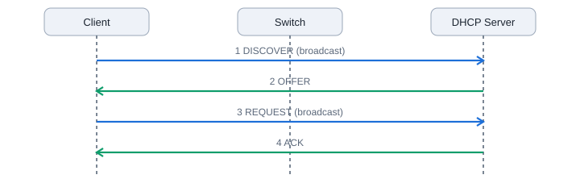

*شکل ۱: چهار مرحله‌ی DORA بین کلاینت و سرور.*

| مرحله | پیام        | نوع               | محتوا                            |
|-------|-------------|-------------------|----------------------------------|
| D     | Discover    | Broadcast         | کلاینت: «سرور DHCP هست؟»         |
| O     | Offer       | Unicast/Broadcast | سرور: «این IP را پیشنهاد می‌کنم»  |
| R     | Request     | Broadcast         | کلاینت: «همین IP را می‌خواهم»     |
| A     | Acknowledge | Unicast/Broadcast | سرور: «تأیید؛ مدت Lease این است» |

در پاسخ، سرور IP، Mask، Gateway، DNS و زمان اجاره (Lease) را می‌دهد. اگر هیچ پاسخی نرسد، کلاینت Windows خودش آدرس `169.254.x.x` می‌سازد (درس ۲-۱).

### ۲. تهدید: DHCP جعلی

چون Discover یک Broadcast است، هر سرور DHCP در شبکه می‌تواند جواب دهد؛ و کلاینت معمولاً اولین پاسخ را می‌پذیرد. مهاجم با یک سرور جعلی، Gateway را آدرس خودش می‌گذارد و همه‌ی ترافیک را می‌بیند.

### ۳. DHCP Snooping: فقط پورت مجاز OFFER بدهد

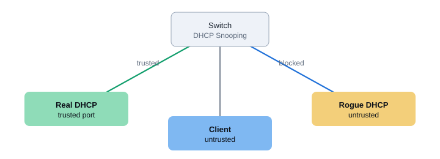

*شکل ۲: پورت سرور واقعی Trusted است؛ OFFER از پورت Untrusted مسدود می‌شود.*

سوییچ هر پورت را «Trusted» یا «Untrusted» می‌داند. پیام‌های سرور (Offer/ACK) فقط از پورت Trusted عبور می‌کنند. پورت کاربر Untrusted است؛ اگر DHCP Server روی آن دیده شود، مسدود می‌شود. سوییچ همچنین جدول Binding می‌سازد (MAC، IP، VLAN، پورت).

``` text
SW1(config)# ip dhcp snooping
SW1(config)# ip dhcp snooping vlan 20,30
SW1(config)# no ip dhcp snooping information option
SW1(config)# interface gi0/10
SW1(config-if)# ip dhcp snooping trust
SW1(config-if)# exit
SW1(config)# interface range gi0/1 - 4
SW1(config-if-range)# ip dhcp snooping limit rate 15
```

- `ip dhcp snooping` و `vlan`: قابلیت را عمومی و برای VLANهای مشخص فعال می‌کند.
- `trust`: فقط روی پورت به سمت DHCP Server (یا Uplink به سمت آن) و Trunkهای بین سوییچ‌ها.
- `limit rate`: سقف تعداد بسته‌ی DHCP در ثانیه برای جلوگیری از حمله‌ی Starvation.
- `no ... information option`: جلوگیری از Option 82 در بعضی سناریوها (مشکل رایج وقتی سرور Option 82 را قبول نمی‌کند).

``` text
SW1# show ip dhcp snooping
SW1# show ip dhcp snooping binding
SW1# show ip dhcp snooping statistics
```

### ۴. DAI: جعل ARP را متوقف کن

در ARP Spoofing مهاجم پاسخ ARP جعلی می‌فرستد: «IP Gateway مال MAC من است». DAI هر ARP را با جدول Binding مقایسه می‌کند؛ اگر IP و MAC با هم نخواند، بسته را می‌اندازد.

``` text
SW1(config)# ip arp inspection vlan 20,30
SW1(config)# interface gi0/10
SW1(config-if)# ip arp inspection trust
SW1# show ip arp inspection
SW1# show ip arp inspection statistics
```

> **شرط DAI**
>
> DAI به جدول Binding وابسته است؛ پس Snooping باید فعال باشد. برای دستگاه‌هایی با IP ثابت (سرور، پرینتر) باید ورودی دستی در Binding یا ARP ACL بنویسید، وگرنه DAI ترافیکشان را می‌اندازد.

### ۵. مثال‌ها

#### ساده

``` text
Client sends DISCOVER on Gi0/1 (untrusted)
Real server replies via Gi0/10 (trusted) -> OFFER passes
Binding: MAC aaaa.0000.0005  IP 10.10.20.50  VLAN 20  Gi0/1
```

#### متوسط: سرور جعلی

``` text
Rogue router on Gi0/3 (untrusted) sends OFFER
Switch drops it  -> client only hears the real server
Log: %DHCP_SNOOPING-5-DHCP_SNOOPING_UNTRUSTED_PORT
```

#### سخت: چرا بعد از فعال‌کردن Snooping هیچ‌کس IP نمی‌گیرد؟

``` text
Cause 1: the port to the DHCP server is NOT trusted -> OFFERs dropped
Cause 2: trunk between switches not trusted
Cause 3: Option 82 inserted and the server rejects it
Fix    : trust server/uplink ports; no ip dhcp snooping information option
```

> **صادقانه درباره‌ی Lab**
>
> طبق Probe اولیه، در vIOSL2 دستورهای DHCP Snooping و DAI فقط «پذیرفته» می‌شوند و ممکن است واقعاً بسته‌ها را بلوک نکنند. در Lab ما، Windows Server DHCP یک VM در ESXi است که در Capstone اصلی کامل می‌شود. اینجا نتیجه‌ی واقعی هر گام را ثبت کنید؛ و مفهوم و دستورها را کامل بدانید.

### تمرین‌ها

**ت1.** ۱ (ساده): نام چهار پیام DORA؟ *(پاسخ: 4-5-ت1 در بخش «پاسخ‌ها» انتهای فصل)*

**ت2.** ۲ (ساده): کدام پورت‌ها Trusted می‌شوند؟ *(پاسخ: 4-5-ت2 در بخش «پاسخ‌ها» انتهای فصل)*

**ت3.** ۳ (متوسط): DAI به چه چیزی وابسته است؟ *(پاسخ: 4-5-ت3 در بخش «پاسخ‌ها» انتهای فصل)*

**ت4.** ۴ (متوسط): کلاینت 169.254.x.x گرفته؛ دو علت محتمل؟ *(پاسخ: 4-5-ت4 در بخش «پاسخ‌ها» انتهای فصل)*

**ت5.** ۵ (سخت): چرا سرور با IP ثابت بعد از DAI قطع می‌شود؟ *(پاسخ: 4-5-ت5 در بخش «پاسخ‌ها» انتهای فصل)*

### Lab هدایت‌شده

سرور DHCP: یا یک VM ویندوزی/لینوکسی که بعداً می‌سازیم، یا موقتاً یک روتر با DHCP Pool. در این Lab، روی R1 یک Pool تست می‌سازیم.

#### گام ۱: DHCP موقت روی R1

``` text
R1(config)# ip dhcp excluded-address 10.10.20.1 10.10.20.10
R1(config)# ip dhcp pool USERS20
R1(dhcp-config)# network 10.10.20.0 255.255.255.0
R1(dhcp-config)# default-router 10.10.20.1
R1(dhcp-config)# dns-server 10.10.10.53
R1(dhcp-config)# lease 0 8
```

#### گام ۲: کلاینت VPCS آدرس بگیرد

``` text
PC1> ip dhcp
PC1> show ip
```

#### گام ۳: Snooping

``` text
SW1(config)# ip dhcp snooping
SW1(config)# ip dhcp snooping vlan 20
SW1(config)# interface gi0/0
SW1(config-if)# ip dhcp snooping trust
SW1# show ip dhcp snooping binding
```

#### گام ۴: DAI

``` text
SW1(config)# ip arp inspection vlan 20
SW1(config)# interface gi0/0
SW1(config-if)# ip arp inspection trust
```

نتیجه‌ی هر گام را ثبت کنید؛ اگر Binding ساخته نشد، همین را به‌عنوان محدودیت شبیه‌ساز ثبت کنید.

### Lab مستقل

یک «تحلیل خطر DHCP» یک‌صفحه‌ای بنویسید: ۳ تهدید، ۳ کنترل (Snooping، DAI، Port Security)، و ۳ دستور Verification در `03-ops/dhcp-l2-security.md`.

### عیب‌یابی

|         |                                                                                                                                                                  |
|---------|------------------------------------------------------------------------------------------------------------------------------------------------------------------|
| Symptom | بعد از Snooping کلاینت‌ها IP نمی‌گیرند                                                                                                                             |
| چک‌لیست  | ۱) پورت سرور Trusted است؟ ؛ ۲) Trunkهای بین سوییچ‌ها Trusted هستند؟ ؛ ۳) VLAN درست در لیست Snooping است؟ ؛ ۴) Option 82 مشکل می‌سازد؟ ؛ ۵) Rate Limit خیلی کم است؟ |
| ابزار   | show ip dhcp snooping ، show ip dhcp snooping binding                                                                                                            |
| رفع     | Trust صحیح و حذف Option 82                                                                                                                                       |

### سؤال‌های مرور

**م1.** DHCP Snooping چه مشکلی را حل می‌کند؟ *(پاسخ: 4-5-م1 در بخش «پاسخ‌ها» انتهای فصل)*

**م2.** DAI چطور کار می‌کند؟ *(پاسخ: 4-5-م2 در بخش «پاسخ‌ها» انتهای فصل)*

### English Corner: انگلیسی تخصصی این درس

این جمله‌ها از مستندات و محیط کار واقعی‌اند. بلند بخوانید و ترجمه را بپوشانید.

| English sentence                                                        | ترجمه                                                                |
|-------------------------------------------------------------------------|----------------------------------------------------------------------|
| Enable DHCP snooping on the access VLANs and trust only the uplink.     | DHCP Snooping را روی VLANهای Access فعال و فقط Uplink را Trust کنید. |
| A rogue DHCP server can redirect clients to a malicious gateway.        | سرور DHCP جعلی می‌تواند کلاینت‌ها را به Gateway مخرب هدایت کند.        |
| Dynamic ARP inspection validates ARP packets against the binding table. | DAI بسته‌های ARP را با جدول Binding اعتبارسنجی می‌کند.                 |
| The client fell back to an APIPA address.                               | کلاینت به آدرس APIPA برگشت.                                          |

**Q1.** Quick quiz (answer in English): Why must the trunk between switches be trusted for DHCP snooping? *(پاسخ: 4-5-Q1 در بخش «پاسخ‌ها» انتهای فصل)*

### تکلیف و چک‌لیست تسلط

- [ ] DORA را بدون نگاه توضیح دهم.
- [ ] Snooping و DAI را بنویسم و نتیجه‌ی واقعی را ثبت کنم.
- [ ] تحلیل خطر را بنویسم.

### یادآوری اشتباهات شما

> **یادآوری**
>
> پیش‌بینی قبل از اجرا؛ بکاپ قبل از تغییر؛ پذیرفته‌شدن دستور ≠ کار کردن؛ فرمول‌ها در بلوک مستقل.


#### کارت Lab — DHCP، Snooping و DAI

| # | فیلد | محتوا |
|---|---|---|
| 1 | عنوان و هدف | DHCP DORA، Snooping و DAI |
| 2 | پیش‌نیاز | درس 4-4 |
| 3 | توپولوژی | SW1 + DHCP (R1) + PC |
| 4 | تجهیزات | R1،SW1،VPCS |
| 5 | نسخه نرم‌افزار | vIOS-L2 15.2(20200924، Experimental) برای SW؛ vIOS 15.9(3)M9 برای R؛ VPCS؛ PNetLab 4.2.8 |
| 6 | IP Plan | VLAN 20 |
| 7 | وضعیت اولیه | Pool 10.10.20.0/24 |
| 8 | صورت مسئله | Binding و Trusted |
| 9 | مراحل هدایت‌شده | همان بخش «Lab هدایت‌شده» همین درس |
| 10 | تست عملکرد | `show ip dhcp snooping binding` |
| 11 | سناریوی خرابی | DHCP جعلی |
| 12 | روش عیب‌یابی | لایه‌ای/با شواهد (بخش عیب‌یابی همین درس) |
| 13 | نتیجه‌ی مورد انتظار | Binding ساخته شود؛ سرور جعلی بسته |
| 14 | معیار پذیرش | نتیجه‌ی واقعی ثبت |
| 15 | مستندات نهایی | `03-ops/dhcp-l2-security.md` |
| 16 | Cleanup و بازگردانی | no ip dhcp snooping |

> **وضعیت راستی‌آزمایی (خارج از ۱۶ فیلد):** **اجرا نشده (فقط طراحی).** DHCP Snooping/DAI در Probe فقط CLI-Accepted.

---

<a id="l-4-6"></a>

## درس 4-6 — طراحی سه‌لایه و آزمون G2

**فصل ۴ - روز ۶ · پیش‌نیاز: درس‌های ۴-۱ تا ۴-۵ · ۶ ساعت**

### این درس درباره چیست و چرا باید یاد بگیریم؟

**چه چیزی یاد می‌گیریم:** چطور شبکه‌ی سازمانی را در سه لایه (Access، Distribution، Core) طراحی می‌کنیم، چه زمانی «Collapsed Core» کافی است، عیب‌یابی خرابی‌های فصل ۴ (TS06 تا TS08)، و آزمون عملی Gate G2.

**چرا لازم است:** طراحی بد یعنی گسترش‌ناپذیری و عیب‌یابی سخت. طراحی لایه‌ای (Hierarchical) برای هر سازمان استانداردی است که جواب سؤال «این سوییچ را کجا بگذارم؟» را می‌دهد؛ و Gate G2 تضمین می‌کند Switching را عملی یاد گرفته‌اید.

- **در کار روزانه:** هر ساختمان یا شعبه با یکی از دو الگوی ۳لایه یا Collapsed Core طراحی می‌شود.
- **در امنیت:** لایه‌بندی یعنی نقاط کنترل مشخص (Policy روی Distribution/Core).
- **در Capstone:** شعبه‌ی کوچک Collapsed Core و مرکز ۳لایه‌ی ساده دارد.

> **مسیر درس**
>
> سه لایه ← Collapsed Core ← طراحی برای Capstone ← عیب‌یابی TS06-TS08 ← Lab ← Gate G2.

#### اصطلاحات این درس (مخفف ← شکل کامل ← معنی)

| مخفف           | شکل کامل انگلیسی   | معنی فارسی                                 |
|----------------|--------------------|--------------------------------------------|
| Access         | Access layer       | لایه‌ی اتصال کاربران و دستگاه‌ها             |
| Distribution   | Distribution layer | تجمیع Accessها، Policy و مسیریابی بین VLAN |
| Core           | Core layer         | هسته‌ی سریع شبکه                            |
| Collapsed Core | Collapsed Core     | ادغام Distribution و Core در یک لایه       |
| HLD            | High-Level Design  | طراحی سطح بالا                             |
| G2             | Gate 2             | آزمون عملی پایان فصل ۴                    |

### ۱. چرا سه لایه؟

شهری را تصور کنید که هر خانه مستقیماً به همه‌ی خانه‌ها خیابان دارد؛ ۱۰۰ خانه یعنی ۴۹۵۰ خیابان! لایه‌بندی مثل «کوچه، خیابان، بزرگراه» است: هر لایه کار مشخصی دارد و تعداد اتصال‌ها کم می‌ماند.

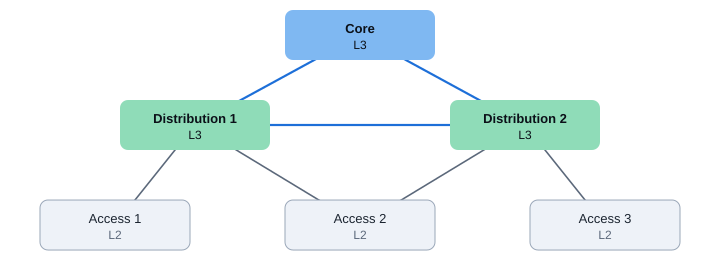

*شکل ۱: شبکه‌ی سه‌لایه؛ هر Access به دو Distribution وصل است (Redundancy).*

| لایه         | کار                                              | دستگاه نمونه  | ویژگی                    |
|--------------|--------------------------------------------------|---------------|--------------------------|
| Access       | اتصال کاربران، PortFast، Port Security، Snooping | سوییچ L2      | تعداد پورت زیاد، ساده    |
| Distribution | تجمیع، Gateway VLANها، ACL/Policy                | سوییچ L3      | Redundancy، EtherChannel |
| Core         | انتقال سریع بین Distributionها                   | سوییچ/روتر L3 | فقط سرعت و پایداری       |

### ۲. Collapsed Core: وقتی دو لایه کافی است

در شعبه‌ی کوچک، Distribution و Core را یکی می‌کنیم (دو سوییچ L3 که هم Gateway‌اند و هم هسته). این ارزان‌تر است و برای ۵۰ تا ۲۰۰ کاربر کافی.

| معیار   | سه‌لایه                  | Collapsed Core |
|---------|-------------------------|----------------|
| اندازه  | سازمان بزرگ/چند ساختمان | شعبه‌ی کوچک     |
| هزینه   | بیشتر                   | کمتر           |
| پیچیدگی | بیشتر                   | کمتر           |
| گسترش   | آسان‌تر                  | محدودتر        |

> **در Capstone ما**
>
> مرکز: Core/Distribution ساده روی یک جفت سوییچ؛ شعبه‌ها: Collapsed Core. Gateway اصلی همه‌ی VLANها FortiGate است و سوییچ‌ها L2 هستند (طبق تصمیم معماری).

### ۳. سه خرابی این هفته (TS06 تا TS08)

#### TS06: Root اشتباه

``` text
Symptom : slow network, traffic path goes through an old switch
Evidence: show spanning-tree -> wrong bridge is root
Fix     : spanning-tree vlan X root primary on the core switch
Verify  : show spanning-tree root
```

#### TS07: پورت err-disabled با BPDU Guard یا Port Security

``` text
Symptom : user port down, link light on
Evidence: show interfaces status err-disabled
Fix     : remove cause, shutdown / no shutdown
Verify  : port up, user online
```

#### TS08: EtherChannel Mismatch

``` text
Symptom : Po1(SD) or member ports (s)
Evidence: show etherchannel summary, show interfaces trunk
Fix     : make allowed/native/speed identical, bounce the ports
Verify  : Po1(SU), members (P)
```

### ۴. طراحی خودتان: HLD کوتاه

برای یک شعبه با ۱۵۰ کاربر، ۱۰ سرور و ۲۰ دستگاه مدیریتی، یک طراحی Collapsed Core بنویسید: چند سوییچ، چه VLANهایی، کجا Root، چه لینک‌هایی EtherChannel.

``` text
Branch (Collapsed Core)
- 2 x L3 core/distribution switches (EtherChannel between them)
- 3 x access switches, each uplinked to both cores
- VLAN 20 users, 30 servers, 10 management
- STP root: core 1 (secondary: core 2)
- Access: PortFast + BPDU Guard + Port Security + DHCP Snooping
```

### ۵. آزمون عملی Gate G2 (پایان فصل ۴)

بدون نگاه به درس، با مدرک (خروجی دستورها):

| \#  | وظیفه                                               | مدرک                                |
|-----|-----------------------------------------------------|-------------------------------------|
| ۱   | Rapid-PVST و Root/Secondary برای ۳ VLAN             | show spanning-tree root             |
| ۲   | PortFast + BPDU Guard روی پورت‌های کاربر و ساخت تخلف | show interfaces status err-disabled |
| ۳   | EtherChannel با LACP بین دو سوییچ                   | show etherchannel summary           |
| ۴   | Port Security با Sticky و ثبت تخلف                  | show port-security interface        |
| ۵   | DHCP Snooping + DAI (یا ثبت محدودیت شبیه‌ساز)        | show ip dhcp snooping               |
| ۶   | سه عیب TS06 تا TS08 با RCA                          | گزارش یک‌صفحه‌ای                      |
| ۷   | HLD شعبه‌ی Collapsed Core                            | فایل طراحی                          |

**معیار قبولی:** حداقل ۶ از ۷ مورد با مدرک (طبق Blueprint G2). وقتی تمام شد بگویید «G2 انجام شد».

### تمرین‌ها

**ت1.** ۱ (ساده): سه لایه‌ی شبکه؟ *(پاسخ: 4-6-ت1 در بخش «پاسخ‌ها» انتهای فصل)*

**ت2.** ۲ (ساده): Collapsed Core یعنی چه؟ *(پاسخ: 4-6-ت2 در بخش «پاسخ‌ها» انتهای فصل)*

**ت3.** ۳ (متوسط): چرا Access به دو Distribution وصل است؟ *(پاسخ: 4-6-ت3 در بخش «پاسخ‌ها» انتهای فصل)*

**ت4.** ۴ (سخت): در طراحی سه‌لایه، Root STP کجا باشد؟ *(پاسخ: 4-6-ت4 در بخش «پاسخ‌ها» انتهای فصل)*

### Lab هدایت‌شده

این Lab یک «مرور کل فصل ۴» است: روی مثلث SW1-SW2-SW3 همه‌ی تنظیمات را اعمال کنید.

1.  Rapid-PVST و Root/Secondary (درس ۴-۲).
2.  PortFast و BPDU Guard روی پورت کاربر (درس ۴-۲).
3.  EtherChannel بین SW1 و SW2 (درس ۴-۳).
4.  Port Security روی پورت PC (درس ۴-۴).
5.  Snooping و DAI (درس ۴-۵).
6.  پیکربندی را بکاپ و در Git (بدون رمز) ذخیره کنید.

``` text
SWx# show spanning-tree summary
SWx# show etherchannel summary
SWx# show port-security
SWx# show ip dhcp snooping
SWx# copy running-config flash:SWx-w4-final.cfg
```

### Lab مستقل

سه سناریوی TS06 تا TS08 را بسازید و هرکدام را با RCA یک‌صفحه‌ای در `03-ops/rca-w4.md` ثبت کنید.

### عیب‌یابی

|         |                                                                         |
|---------|-------------------------------------------------------------------------|
| Symptom | بعد از تغییرات فصل ۴ شبکه ناپایدار است                                 |
| روش     | لایه‌به‌لایه: لینک و STP و Channel و Port Security و DHCP                 |
| ابزار   | show spanning-tree ، show etherchannel summary ، show interfaces status |
| پیشگیری | تغییر مرحله‌ای با بکاپ و reload in                                       |

### سؤال‌های مرور

**م1.** چرا لایه‌بندی؟ *(پاسخ: 4-6-م1 در بخش «پاسخ‌ها» انتهای فصل)*

**م2.** Collapsed Core کی مناسب است؟ *(پاسخ: 4-6-م2 در بخش «پاسخ‌ها» انتهای فصل)*

### English Corner: انگلیسی تخصصی این درس

این جمله‌ها از مستندات و محیط کار واقعی‌اند. بلند بخوانید و ترجمه را بپوشانید.

| English sentence                                                     | ترجمه                                                      |
|----------------------------------------------------------------------|------------------------------------------------------------|
| A hierarchical design simplifies troubleshooting and scaling.        | طراحی سلسله‌مراتبی عیب‌یابی و مقیاس‌پذیری را ساده می‌کند.      |
| Every access switch has redundant uplinks to the distribution layer. | هر سوییچ Access Uplink پشتیبان به لایه‌ی Distribution دارد. |
| Collapsed core merges the core and distribution layers.              | Collapsed Core لایه‌های Core و Distribution را ادغام می‌کند. |
| Document the design before you configure.                            | پیش از پیکربندی، طراحی را مستند کنید.                      |

**Q1.** Quick quiz (answer in English): Why should the STP root never be an access switch? *(پاسخ: 4-6-Q1 در بخش «پاسخ‌ها» انتهای فصل)*

### تکلیف و چک‌لیست تسلط

- [ ] HLD شعبه را بنویسم.
- [ ] TS06 تا TS08 را با RCA ثبت کنم.
- [ ] Gate G2 را کامل کنم.

### یادآوری اشتباهات شما

> **یادآوری**
>
> پیش‌بینی قبل از اجرا؛ بکاپ قبل از تغییر؛ پذیرفته‌شدن دستور ≠ کار کردن؛ فرمول‌ها در بلوک مستقل.


#### کارت Lab — طراحی سه‌لایه و آزمون G2

| # | فیلد | محتوا |
|---|---|---|
| 1 | عنوان و هدف | طراحی سه‌لایه و TS06..TS08 + G2 |
| 2 | پیش‌نیاز | درس 4-5 |
| 3 | توپولوژی | مثلث + EtherChannel |
| 4 | تجهیزات | ۳ سوییچ + VPCS |
| 5 | نسخه نرم‌افزار | vIOS-L2 15.2(20200924، Experimental) برای SW؛ vIOS 15.9(3)M9 برای R؛ VPCS؛ PNetLab 4.2.8 |
| 6 | IP Plan | Baseline ف۴ |
| 7 | وضعیت اولیه | HLD شعبه |
| 8 | صورت مسئله | سه خرابی با RCA |
| 9 | مراحل هدایت‌شده | همان بخش «Lab هدایت‌شده» همین درس |
| 10 | تست عملکرد | show spanning-tree/etherchannel |
| 11 | سناریوی خرابی | TS06-08 |
| 12 | روش عیب‌یابی | لایه‌ای/با شواهد (بخش عیب‌یابی همین درس) |
| 13 | نتیجه‌ی مورد انتظار | هر خرابی RCA |
| 14 | معیار پذیرش | G2 ≥ ۶ از ۷ |
| 15 | مستندات نهایی | `03-ops/rca-w4.md` |
| 16 | Cleanup و بازگردانی | بازگشت به بکاپ |

> **وضعیت راستی‌آزمایی (خارج از ۱۶ فیلد):** **اجرا نشده (فقط طراحی).** اجرا نشده.

---

<a id="ans-4"></a>

## پاسخ‌های فصل 4

> ابتدا بدون نگاه حل کنید. شناسه: درس-نوع+شماره (ت = تمرین، م = مرور، Q = Quick quiz).

**4-1-ت1** — ۱ (ساده): چرا Loop در لایه ۲ خطرناک‌تر از لایه ۳ است؟

``` text
Layer-2 frames have no TTL, so they never expire.
Layer-3 packets have a TTL and are dropped when it reaches 0.
```

**4-1-ت2** — ۲ (ساده): Root Bridge را چطور انتخاب می‌کنند؟

``` text
Lowest Bridge ID = lowest (Priority + VLAN ID), then lowest MAC address.
```

**4-1-ت3** — ۳ (متوسط): دو سوییچ با اولویت 32768 و 4096؛ کدام Root است؟

``` text
The switch with priority 4096 (lower value wins).
```

**4-1-ت4** — ۴ (متوسط): هزینه‌ی مسیر سه لینک ۱ گیگ پشت‌سرهم تا Root با روش Short؟

``` text
Cost = 4 + 4 + 4 = 12
```

**4-1-ت5** — ۵ (سخت): در مثلث A (Root)، B، C با لینک‌های 1G، اگر لینک A-C خراب شود، SW-C از کدام مسیر Root را می‌بیند و هزینه چقدر است؟

``` text
New path: C -> B -> A
Cost = 4 (C-B) + 4 (B-A) = 8
The previously blocked port on C (towards B) becomes the Root Port.
```

**4-1-م1** — چرا لایه ۲ به STP نیاز دارد؟

چون فریم TTL ندارد و در صورت وجود حلقه تا ابد می‌چرخد.

**4-1-م2** — Root Bridge چه کسی است؟

سوییچی با کوچک‌ترین Bridge ID؛ یعنی کوچک‌ترین اولویت و سپس کوچک‌ترین MAC.

**4-1-م3** — Root Port و Designated Port چه فرقی دارند؟

Root Port پورت غیر Root به سمت Root است؛ Designated Port پورت فعال هر Segment به سمت دورتر از Root.

**4-1-Q1** — Quick quiz (answer in English): What does STP do with a redundant link?

It places one of the ports in a blocking (alternate) state to prevent a loop, and unblocks it if the active link fails.

**4-2-ت1** — ۱ (ساده): چرا RSTP سریع‌تر است؟

``` text
Switches negotiate (proposal/agreement) instead of waiting for timers; alternate ports are ready.
```

**4-2-ت2** — ۲ (ساده): اولویت‌های مجاز؟

``` text
Multiples of 4096 (0, 4096, 8192, ... 61440). Default 32768.
```

**4-2-ت3** — ۳ (متوسط): PortFast بدون BPDU Guard چه خطری دارد؟

``` text
A switch plugged into a PortFast port can create a loop before STP reacts; BPDU Guard shuts the port.
```

**4-2-ت4** — ۴ (متوسط): پورت err-disabled شد؛ مراحل رفع؟

``` text
1) show interfaces status err-disabled
2) remove the cause (rogue switch)
3) shutdown, then no shutdown
4) verify
```

**4-2-ت5** — ۵ (سخت): Root Guard را روی کدام پورت‌ها می‌گذاریم و چرا؟

``` text
On ports that face switches you do not control (customer/edge); a superior BPDU there puts the port in root-inconsistent state so no foreign switch becomes root.
```

**4-2-م1** — PortFast برای چه پورتی؟

فقط پورت دستگاه انتهایی (PC، پرینتر)، نه لینک بین سوییچ‌ها.

**4-2-م2** — تفاوت BPDU Guard و Root Guard؟

BPDU Guard با هر BPDU پورت را خاموش می‌کند؛ Root Guard فقط BPDUهای برتر (ادعای Root) را بلوک می‌کند.

**4-2-م3** — چرا Root را دستی تعیین می‌کنیم؟

تا سوییچ قدیمی یا ضعیف تصادفاً Root نشود و مسیر ترافیک قابل‌پیش‌بینی باشد.

**4-2-Q1** — Quick quiz (answer in English): When should you not enable PortFast?

On trunk or switch-to-switch links, because it can create temporary loops.

**4-3-ت1** — ۱ (ساده): چرا EtherChannel لازم است؟

``` text
Without it STP blocks the parallel link; with it the links are bundled into one logical link.
```

**4-3-ت2** — ۲ (ساده): LACP با کدام Modeها؟

``` text
active and passive
```

**4-3-ت3** — ۳ (متوسط): کدام ترکیب Channel نمی‌سازد؟

``` text
passive-passive, on-active, LACP-PAgP
```

**4-3-ت4** — ۴ (متوسط): تفسیر Po1(SD) Gi0/1(D) Gi0/2(D)

``` text
Port-channel is down; both member ports are down (cable or remote side down).
```

**4-3-ت5** — ۵ (سخت): چرا ۲ لینک ۱G برای یک انتقال فایل تکی ۲G سرعت نمی‌دهد؟

``` text
A single flow is hashed to one member link, so one flow is limited to 1G; many flows spread across links.
```

**4-3-م1** — EtherChannel چه مشکلی را حل می‌کند؟

پهنای باند و تحمل خطا برای لینک‌های موازی که STP آن‌ها را نمی‌بندد.

**4-3-م2** — چرا LACP را ترجیح می‌دهیم؟

استاندارد است و با تجهیزات سازنده‌های مختلف کار می‌کند.

**4-3-Q1** — Quick quiz (answer in English): Why does a single file transfer not use the full bundled bandwidth?

Because one flow is hashed onto a single member link.

**4-4-ت1** — ۱ (ساده): سه نوع Violation؟

``` text
shutdown, restrict, protect
```

**4-4-ت2** — ۲ (ساده): sticky یعنی چه؟

``` text
The switch learns MAC addresses dynamically and stores them in the running-config.
```

**4-4-ت3** — ۳ (متوسط): چرا بعد از reload ممکن است sticky پاک شود؟

``` text
Sticky MACs are only in running-config; without copy running-config startup-config they are lost.
```

**4-4-ت4** — ۴ (متوسط): پورت err-disabled شد؛ مراحل؟

``` text
1) find the offending MAC
2) remove the device
3) shutdown / no shutdown
4) verify
```

**4-4-ت5** — ۵ (سخت): maximum را برای پورت Phone+PC چند می‌گذاریم و چرا؟

``` text
3 (Phone + PC + one spare), to avoid unnecessary lockouts.
```

**4-4-م1** — Port Security چه چیزی را کنترل می‌کند؟

تعداد و هویت MACهای مجاز روی یک پورت.

**4-4-م2** — تفاوت restrict و shutdown؟

restrict فریم را دور می‌ریزد و لاگ می‌دهد ولی پورت فعال می‌ماند؛ shutdown پورت را err-disabled می‌کند.

**4-4-Q1** — Quick quiz (answer in English): What is the default violation mode?

Shutdown: the port goes into err-disabled state.

**4-5-ت1** — ۱ (ساده): نام چهار پیام DORA؟

``` text
Discover, Offer, Request, Acknowledge
```

**4-5-ت2** — ۲ (ساده): کدام پورت‌ها Trusted می‌شوند؟

``` text
Ports toward the legitimate DHCP server and inter-switch trunks. Never user ports.
```

**4-5-ت3** — ۳ (متوسط): DAI به چه چیزی وابسته است؟

``` text
The DHCP Snooping binding table (or static ARP ACL entries).
```

**4-5-ت4** — ۴ (متوسط): کلاینت 169.254.x.x گرفته؛ دو علت محتمل؟

``` text
1) DHCP server unreachable/down
2) Snooping drops the OFFER (server port not trusted)
```

**4-5-ت5** — ۵ (سخت): چرا سرور با IP ثابت بعد از DAI قطع می‌شود؟

``` text
It has no DHCP binding entry; DAI drops its ARP packets. Fix: add a static binding / ARP ACL.
```

**4-5-م1** — DHCP Snooping چه مشکلی را حل می‌کند؟

مسدودکردن سرور DHCP جعلی و ساخت جدول Binding.

**4-5-م2** — DAI چطور کار می‌کند؟

هر ARP را با جدول Binding مقایسه می‌کند و ARP نامعتبر را می‌اندازد.

**4-5-Q1** — Quick quiz (answer in English): Why must the trunk between switches be trusted for DHCP snooping?

Otherwise legitimate DHCP replies arriving over the trunk are dropped.

**4-6-ت1** — ۱ (ساده): سه لایه‌ی شبکه؟

``` text
Access, Distribution, Core
```

**4-6-ت2** — ۲ (ساده): Collapsed Core یعنی چه؟

``` text
Distribution and Core are merged into one layer (two layer-3 switches).
```

**4-6-ت3** — ۳ (متوسط): چرا Access به دو Distribution وصل است؟

``` text
Redundancy: if one uplink or distribution switch fails, the other keeps the access switch online.
```

**4-6-ت4** — ۴ (سخت): در طراحی سه‌لایه، Root STP کجا باشد؟

``` text
On the Distribution/Core switches, never on access switches.
```

**4-6-م1** — چرا لایه‌بندی؟

برای مقیاس‌پذیری و کنترل: هر لایه کار مشخصی دارد.

**4-6-م2** — Collapsed Core کی مناسب است؟

شعبه‌ی کوچک با کاربران کم.

**4-6-Q1** — Quick quiz (answer in English): Why should the STP root never be an access switch?

Because all traffic would flow through a low-capacity edge device instead of the core.

---

<a id="ch5"></a>

# فصل 5 — Routing I: Static، Floating و OSPF

**مدت:** ۳۶ ساعت | **پیش‌نیاز:** فصل ۴.
**اهداف:** Route Table/LPM/AD، Static، Default/Floating/IP SLA، OSPF (مفهوم + پیاده‌سازی)، عیب‌یابی Adjacency.
**معیار تسلط:** پیش‌بینی مسیر بسته؛ مسیر برگشت؛ OSPF سه‌روتری؛ ≥ ۴ از ۵ خطای OSPF.
**اشتباهات رایج:** «Static همیشه برنده است»؛ مسیر برگشت فراموش‌شده؛ Reference-Bandwidth ناهمسان.

**درس‌های فصل:**
- [درس 5-1 — جدول مسیریابی، LPM و AD](#l-5-1)
- [درس 5-2 — Static Route و مسیر برگشت](#l-5-2)
- [درس 5-3 — Default، Floating و IP SLA](#l-5-3)
- [درس 5-4 — مفهوم OSPF](#l-5-4)
- [درس 5-5 — پیاده‌سازی OSPF](#l-5-5)
- [درس 5-6 — عیب‌یابی مسیریابی و آزمون](#l-5-6)

---

<a id="l-5-1"></a>

## درس 5-0 — Control Plane و Data Plane: روتر چگونه یک بسته را واقعاً عبور می‌دهد؟

**فصل ۵ · درس افزوده (پیش‌درس ۵-۱) · پیش‌نیاز: فصل ۲ (ARP، ICMP، TTL) و فصل ۳ (MAC و Switching) · ≈ ۴ ساعت**

> **وضعیت:** محتوای مفهومی با منابع رسمی؛ دستورهای Cisco در Lab «اجرا نشده» و `Unverified` روی vIOS (برخی خروجی‌ها در Image نمونه ممکن است متفاوت باشد).

### ۱) هدف آموزشی

در پایان این درس باید بتوانید:

1. تفاوت **Control Plane**، **Data Plane** و **Management Plane** را با مثال توضیح دهید.
2. بگویید **RIB** و **FIB** چه هستند و چرا دو جدول جدا لازم است.
3. برای یک بسته‌ی واقعی بنویسید روتر چه مراحلی را انجام می‌دهد: دریافت، بررسی، Route Lookup، پیدا کردن MAC بعدی، بازنویسی هدر لایه ۲، کاهش TTL و ارسال.
4. توضیح دهید چرا «Route در جدول هست» با «بسته عبور می‌کند» یکی نیست.
5. با ابزارهای `show ip route`، `show ip cef` و `show adjacency` شواهد جمع کنید.

### ۲) پیش‌نیازها

- ساختار هدر IPv4 (فیلد TTL، آدرس مبدأ/مقصد) و تفاوت فریم لایه ۲ با بسته‌ی لایه ۳ (فصل ۲).
- ARP: چگونه IP به MAC تبدیل می‌شود (فصل ۲).
- Longest Prefix Match و AD در درس ۵-۱ (پس از این درس می‌آید؛ اینجا فقط به «جدول Route» نیاز دارید).

### ۳) مفهوم پایه: چرا این تفکیک به وجود آمد؟

روتر دو وظیفه‌ی کاملاً متفاوت دارد:

- **یادگیری مسیرها:** با دیگر روترها صحبت می‌کند (OSPF Hello، BGP Update)، الگوریتم اجرا می‌کند (SPF، انتخاب بهترین مسیر) و نتیجه را در جدول می‌نویسد. این کار نسبتاً کند و «هوشمند» است.
- **عبور دادن بسته‌ها:** میلیون‌ها بسته در ثانیه باید با کمترین تأخیر رد شوند. برای هر بسته نباید الگوریتم پیچیده اجرا شود؛ فقط یک جست‌وجوی سریع و بازنویسی هدر.

اگر هر دو کار با یک ساختار انجام می‌شد، هر بسته باید منتظر پردازش پروتکل مسیریابی می‌ماند. پس معماری مدرن آن‌ها را جدا می‌کند:

| صفحه (Plane) | وظیفه | مثال |
|---|---|---|
| Management Plane | مدیریت و پایش دستگاه | SSH، SNMP، Syslog، `show` |
| Control Plane | ساخت جدول‌ها و تصمیم‌ها | OSPF، BGP، ARP (پر کردن Cache)، STP |
| Data Plane (Forwarding Plane) | عبور سریع بسته‌های عبوری | Route Lookup، بازنویسی هدر، ACL، NAT |

> **یک تشبیه:** Control Plane مثل اداره‌ی نقشه‌برداری است که نقشه‌ی راه‌ها را می‌کشد و به‌روز می‌کند. Data Plane مثل پلیس راهنمایی است که فقط نقشه‌ی آماده را نگاه می‌کند و هر ماشین را سریع به سمت درست می‌فرستد. اگر پلیس هر بار منتظر نقشه‌کشی بماند، ترافیک قفل می‌شود.

### ۴) توضیح عمیق فنی

#### ۴-۱) RIB و FIB

- **RIB (Routing Information Base):** جدول مسیریابی که با `show ip route` می‌بینید. همه‌ی پروتکل‌ها (Connected، Static، OSPF، BGP) مسیرهای خود را می‌دهند و **بهترین مسیر هر Prefix** (بر اساس AD و Metric) در RIB می‌نشیند. RIB محصول Control Plane است.
- **FIB (Forwarding Information Base):** نسخه‌ی بهینه‌شده‌ی RIB برای جست‌وجوی سریع (در Cisco با **CEF** = Cisco Express Forwarding ساخته می‌شود). FIB ساختار درختی (Trie) است تا Longest Prefix Match سریع انجام شود. FIB محصول RIB است، نه جایگزین آن.
- **Adjacency Table:** برای هر Next-hop اطلاعات لایه ۲ آماده دارد (MAC مقصد بعدی، Interface خروجی). این جدول از ARP پر می‌شود. با آن، روتر هدر لایه ۲ جدید را از قبل آماده دارد.

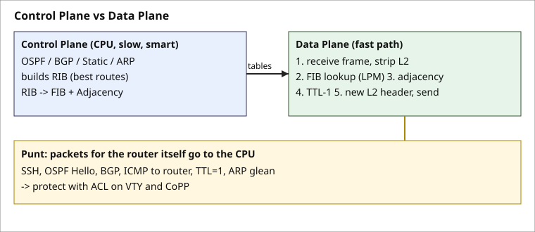

*شکل ۱: Control Plane جدول‌ها را می‌سازد؛ Data Plane فقط از جدول‌های آماده استفاده می‌کند.*

#### ۴-۲) Recursive Lookup (جست‌وجوی بازگشتی)

وقتی یک Static Route فقط Next-hop (نه Interface) دارد:

``` text
ip route 192.168.50.0 255.255.255.0 10.0.12.2
```

روتر باید بداند 10.0.12.2 از کدام Interface قابل‌دسترس است. پس یک جست‌وجوی دوم انجام می‌دهد: «10.0.12.2 در RIB به کدام Interface وصل است؟» جواب (Connected 10.0.12.0/30 روی Gi0/1) را می‌گیرد. این همان Recursive Lookup است. اگر Next-hop از طریق مسیری برسد که خودش به این Route وابسته است، حلقه یا Route ناپایدار می‌شود (نمونه در درس ۵-۳ آمده).

> **نکته‌ی عیب‌یابی:** اگر Next-hop قابل‌دسترس نباشد، Route در RIB **نصب نمی‌شود** (Static Route بدون Interface و بدون Next-hop معتبر نمی‌ماند). پس «Route را نوشتم ولی در جدول نیست» اغلب یعنی Next-hop حل‌نشدنی است.

#### ۴-۳) مراحل عبور یک بسته (Step by step)

برای بسته‌ای که از Client (192.168.1.10) به Server (172.16.5.20) می‌رود و از روتر R1 عبور می‌کند:

``` text
1. Frame arrives on Gi0/0: destination MAC = R1 Gi0/0 MAC  -> accepted
2. FCS check; strip L2 header (de-encapsulate) -> IP packet
3. Validate IP header (version, header checksum, TTL > 1)
4. Inbound features: ACL in, NAT inside->outside (if configured)
5. FIB lookup for 172.16.5.20 (Longest Prefix Match)
   result: next-hop 10.0.12.2, out interface Gi0/1
6. Adjacency lookup: next-hop 10.0.12.2 -> MAC aa:bb:cc:00:00:02
   (if missing: send ARP, packet waits / dropped, "glean" state)
7. TTL = TTL - 1; recompute IP header checksum
8. Outbound features: ACL out, QoS, NAT
9. Build new L2 header: src MAC = R1 Gi0/1, dst MAC = next-hop MAC
10. Transmit on Gi0/1
```

نکته‌های کلیدی این جریان:

- **MAC در هر Hop عوض می‌شود، IP نه** (بدون NAT). روتر هدر لایه ۲ را دور می‌اندازد و هدر جدید می‌سازد.
- **TTL در هر Hop یکی کم می‌شود.** اگر به ۰ برسد، روتر بسته را رها می‌کند و ICMP «Time Exceeded» می‌فرستد. traceroute همین را به کار می‌گیرد.
- **ARP برای Next-hop لازم است، نه برای مقصد نهایی** (اگر مقصد در شبکه‌ی مستقیماً متصل نباشد).
- اگر FIB مسیری نداشته باشد: بسته Drop و ICMP «Destination Unreachable» برمی‌گردد.

#### ۴-۴) مسیر «Punt»: وقتی Data Plane به Control Plane می‌دهد

بعضی بسته‌ها نباید در Data Plane (سریع) پردازش شوند و به CPU (Control Plane) فرستاده می‌شوند. به این **Punt** می‌گویند:

- بسته‌ای که مقصدش خود روتر است (SSH به روتر، OSPF Hello، BGP، ICMP به روتر).
- بسته‌ای با TTL = ۱ که باید ICMP Time Exceeded تولید شود.
- بسته‌ی اول برای مقصدی که ARP ندارد (Glean).
- بسته‌های با Option IP یا Fragmentation خاص.

چرا مهم است؟ CPU ظرفیت محدودی دارد. اگر مهاجم هزاران بسته به خود روتر بفرستد، CPU پر می‌شود و **Control Plane می‌میرد** (OSPF همسایه را از دست می‌دهد). برای همین Control Plane Policing و فهرست‌های محدودکننده وجود دارد (فصل ۸). همین منطق در FortiGate هم هست: ترافیک «Local-in» به CPU می‌رسد (فصل ۱۲).

### ۵) مثال حل‌شده

**شرایط:** R1 دو Interface دارد: Gi0/0 = 192.168.1.1/24 (LAN)، Gi0/1 = 10.0.12.1/30. جدول مسیرها شامل `172.16.5.0/24 via 10.0.12.2`. کلاینت 192.168.1.10 به 172.16.5.20 ping می‌زند. ARP برای 10.0.12.2 هنوز نداریم.

``` text
t0: Client sends frame: dst MAC = R1-Gi0/0, src IP .1.10, dst IP 172.16.5.20, TTL 128
t1: R1 FIB hit: 172.16.5.0/24 -> 10.0.12.2 via Gi0/1; adjacency incomplete
t2: R1 sends ARP "who has 10.0.12.2?" on Gi0/1 (first ping may be dropped)
t3: R2 replies ARP; adjacency complete
t4: second ping: TTL 128 -> 127, new L2 header dst = R2 MAC, forwarded
```

**تحلیل:** این توضیح می‌دهد چرا در Lab اغلب «اولین ping از ۵ ping تایم‌اوت می‌شود (نقطه .!!!!)». ARP هنوز کامل نبوده. این رفتار عادی است، نه خطا.

**مثال سخت (تحلیل خطا):** روتر R1 در جدول خود Route صحیح دارد (`show ip route 172.16.5.20` درست است) ولی ping موفق نمی‌شود. اولین فرضیه‌ها را بر اساس مراحل بالا مرتب کنید:

1. FIB با RIB ناهماهنگ است (نادر؛ `show ip cef 172.16.5.20` را بررسی کنید).
2. Adjacency ناقص است (`show adjacency` → Incomplete؛ ARP پاسخ نمی‌گیرد، مشکل لایه ۲ یا VLAN).
3. ACL خروجی یا ورودی بسته را می‌ریزد.
4. روتر مقصد Route برگشت ندارد (مشکل در جهت برگشت).

### ۶) طراحی و تصمیم‌گیری

| سؤال طراحی | گزینه‌ها | معیار انتخاب |
|---|---|---|
| Static Route با Next-hop یا Interface؟ | Next-hop / Interface / هر دو | روی Ethernet **حتماً Next-hop** (یا هر دو)، چون فقط Interface یعنی ARP برای هر مقصد (Proxy-ARP مصرفی) |
| ارسال Per-destination یا Per-packet؟ | CEF پیش‌فرض Per-destination | Per-packet ترتیب بسته‌ها را به‌هم می‌ریزد؛ به‌ندرت لازم است |
| CPU را چگونه محافظت کنیم؟ | ACL روی VTY، CoPP | هر سرویس مدیریتی فقط از شبکه‌ی مدیریت |

### ۷) پیاده‌سازی و Verification (CLI Cisco)

``` text
R1# show ip route 172.16.5.20
R1# show ip cef 172.16.5.20
R1# show ip cef 172.16.5.20 detail
R1# show adjacency detail
R1# show ip arp
R1# show ip traffic | include ICMP
R1# traceroute 172.16.5.20
```

نکات:

- `show ip cef` باید با `show ip route` هم‌خوان باشد (همان Next-hop و Interface).
- در `show adjacency` وضعیت `incomplete` یعنی MAC بعدی را نداریم.
- `show ip cef exact-route <src> <dst>` (در IOS-XE/IOS؛ `Unverified` روی vIOS) مسیر دقیق یک Flow را نشان می‌دهد.

### ۸) Troubleshooting (مبتنی بر شواهد)

| علامت | بررسی | تفسیر |
|---|---|---|
| Route هست ولی ping نمی‌رود | `show adjacency` | Incomplete = ARP حل نشده |
| فقط اولین ping Timeout است | بسته‌ی اول ARP | رفتار عادی |
| `Destination host unreachable` از R1 | `show ip route` | Route ندارد |
| `TTL expired in transit` | traceroute | حلقه‌ی مسیریابی |
| CPU روتر بالا ولی ترافیک عبوری کم | `show processes cpu sorted`، `show ip traffic` | بسته‌های Punt؛ حمله یا ICMP به روتر |

### ۹) نکات امنیتی

- ترافیک به **خود روتر** (Control/Management Plane) باید جدا کنترل شود، نه فقط ترافیک عبوری.
- ICMP Redirect و IP Source Route را در مرز غیرفعال کنید (`no ip redirects`، `no ip source-route`).
- هرگز SSH/SNMP روی همه‌ی Interfaceها باز نباشد.
- همین مفهوم در FortiGate: `allowaccess` روی Interface و Local-in Policy (فصل ۱۲ و ۱۳).

### ۱۰) جمع‌بندی مفهومی

- Control Plane جدول می‌سازد؛ Data Plane با جدول بسته را عبور می‌دهد.
- RIB بهترین مسیرها؛ FIB نسخه‌ی سریع آن؛ Adjacency اطلاعات L2 بعدی.
- در هر Hop: هدر L2 عوض، TTL یکی کم، IP (بدون NAT) ثابت.
- «Route هست» شرط لازم است، کافی نیست: FIB، Adjacency، ACL و Route برگشت هم لازم‌اند.
- بسته‌ی مقصد روتر به CPU می‌رود (Punt) و آسیب‌پذیر است.

### ۱۱) تمرین و ارزیابی

**ت1.** (ساده) تفاوت RIB و FIB چیست؟ *(پاسخ: 5-0-ت1)*

**ت2.** (ساده) در هر Hop کدام فیلد تغییر می‌کند: MAC مقصد، IP مقصد، TTL؟ *(پاسخ: 5-0-ت2)*

**ت3.** (متوسط) چرا Static Route فقط با Interface خروجی روی Ethernet مناسب نیست؟ *(پاسخ: 5-0-ت3)*

**ت4.** (متوسط) روی R1 مسیر 10.9.9.0/24 via 10.0.0.9 هست ولی 10.0.0.9 در هیچ Connected نیست. Route در جدول دیده می‌شود؟ توضیح دهید. *(پاسخ: 5-0-ت4)*

**ت5.** (سخت) در یک Lab ping از R1 به R3 اولین بار Timeout و بعد موفق است. بر پایه‌ی مراحل بسته توضیح دهید، سپس بگویید چه شواهدی ثابت می‌کند علت ARP است نه Route. *(پاسخ: 5-0-ت5)*

**ت6.** (سخت، طراحی) یک Control Plane Policing ساده را برای محافظت از CPU روتر شرح دهید: چه چیزی را فقط از شبکه‌ی مدیریت می‌پذیرید؟ *(پاسخ: 5-0-ت6)*

**م1.** Punt یعنی چه؟ *(پاسخ: 5-0-م1)*

**م2.** چرا اولین ping معمولاً از دست می‌رود؟ *(پاسخ: 5-0-م2)*

**Q1.** Quick quiz (English): Which plane builds the FIB, and which uses it to forward packets? *(پاسخ: 5-0-Q1)*

### ۱۲) اصطلاحات و English Corner

| مخفف | شکل کامل | معنی |
|---|---|---|
| RIB | Routing Information Base | جدول مسیرهای انتخاب‌شده |
| FIB | Forwarding Information Base | جدول سریع ارسال |
| CEF | Cisco Express Forwarding | ساز و کار ارسال سریع Cisco |
| Punt | Punt to CPU | فرستادن بسته به CPU |
| Glean | Glean adjacency | Adjacency ناقص که ARP لازم دارد |
| CoPP | Control Plane Policing | محدودسازی ترافیک به Control Plane |
| TTL | Time To Live | شمارنده‌ی عمر بسته |

- *The control plane builds the routing table; the data plane forwards packets using it.* ← Control Plane جدول را می‌سازد؛ Data Plane با آن بسته‌ها را ارسال می‌کند.
- *A route in the RIB does not guarantee that packets are forwarded.* ← وجود Route در RIB ارسال را تضمین نمی‌کند.

### ۱۳) منابع

- Cisco: «Cisco Express Forwarding Overview» (IP Switching Configuration Guide، IOS XE).
- RFC 1812 — Requirements for IP Version 4 Routers (فصل ۵: Forwarding).
- RFC 792 — ICMP (Time Exceeded و Destination Unreachable).
- RFC 6192 — Protecting the Router Control Plane.


## درس 5-1 — جدول مسیریابی، LPM و AD

**فصل ۵ - روز ۱ · پیش‌نیاز: فصل ۴ · ۶ ساعت**

### این درس درباره چیست و چرا باید یاد بگیریم؟

**چه چیزی یاد می‌گیریم:** روتر چطور تصمیم می‌گیرد هر بسته را به کدام سمت بفرستد: خواندن Routing Table، معنی کدها، قانون Longest Prefix Match، و دو معیار انتخاب بین مسیرها یعنی Administrative Distance و Metric.

**چرا لازم است:** تمام ارتباط بین شبکه‌ها (و بین VLANها، شعبه‌ها و اینترنت) به جدول مسیریابی بستگی دارد. اگر آن را درست نخوانید، نمی‌توانید بفهمید چرا یک بسته از مسیر غلط رفت یا اصلاً رد نشد. این درس پایه‌ی کل هفته‌های ۵ و ۶ و فایروال است.

- **در کار روزانه:** اولین دستور عیب‌یابی هر ارتباط بین شبکه‌ای `show ip route` است.
- **در امنیت:** Route اشتباه یعنی ترافیک از مسیر ناخواسته (مثلاً دور زدن فایروال) می‌رود.
- **در FortiGate:** Routing Table فایروال دقیقاً همین منطق را دارد (`get router info routing-table all`).

> **مسیر درس**
>
> روتر چیست ← جدول مسیریابی ← کدها ← Longest Prefix Match ← AD و Metric ← مثال ساده/متوسط/سخت ← Lab ← عیب‌یابی.

#### اصطلاحات این درس (مخفف ← شکل کامل ← معنی)

| مخفف                   | شکل کامل انگلیسی        | معنی فارسی                              |
|------------------------|-------------------------|-----------------------------------------|
| Routing Table          | Routing Table           | جدول مسیرهای شناخته‌شده‌ی روتر            |
| Next-hop               | Next-hop                | آدرس روتر بعدی در مسیر                  |
| LPM                    | Longest Prefix Match    | انتخاب Route با طولانی‌ترین Prefix مطابق |
| AD                     | Administrative Distance | اعتبار منبع Route؛ کمتر بهتر است        |
| Metric                 | Metric                  | هزینه‌ی مسیر در یک پروتکل                |
| Connected              | Connected route         | شبکه‌ای که مستقیماً به Interface وصل است  |
| Local                  | Local route             | آدرس خود Interface (/32)                |
| Static                 | Static route            | مسیر دستی                               |
| Gateway of last resort | Gateway of last resort  | مسیر پیش‌فرض                             |

### ۱. روتر چه کاری می‌کند؟

روتر مثل یک اداره‌ی پست است. نامه (بسته) می‌رسد؛ منشی فقط به آدرس مقصد نگاه می‌کند و در دفتر خود می‌بیند «برای این منطقه به کدام اداره بفرستم؟». او کل مسیر را نمی‌داند، فقط «قدم بعدی» (Next-hop) را می‌داند.

> **دو کار روتر**
>
> ۱) یاد گرفتن مسیرها (دستی یا با پروتکل). ۲) ارسال هر بسته بر اساس جدول مسیرها (Forwarding).

### ۲. جدول مسیریابی را بخوانیم

``` text
R1# show ip route
Codes: C - connected, L - local, S - static, O - OSPF

Gateway of last resort is 10.0.12.2 to network 0.0.0.0

S*    0.0.0.0/0 [1/0] via 10.0.12.2
      10.0.0.0/8 is variably subnetted, 4 subnets, 2 masks
C        10.0.12.0/30 is directly connected, GigabitEthernet0/1
L        10.0.12.1/32 is directly connected, GigabitEthernet0/1
O        10.0.23.0/30 [110/2] via 10.0.12.2, 00:05:10, GigabitEthernet0/1
C        192.168.1.0/24 is directly connected, Loopback10
```

هر خط یک Route است. با یک خط نمونه آشنا می‌شویم:

``` text
O   10.0.23.0/30 [110/2] via 10.0.12.2, 00:05:10, GigabitEthernet0/1
|   |            |  |     |          |         |
|   |            |  |     |          |         +-- exit interface
|   |            |  |     |          +-- age of the route
|   |            |  |     +-- next-hop address
|   |            |  +-- metric (OSPF cost)
|   |            +-- administrative distance
|   +-- destination prefix
+-- source code (O = OSPF)
```

| کد  | معنی                            |
|-----|---------------------------------|
| C   | Connected؛ شبکه‌ی مستقیماً وصل‌شده |
| L   | Local؛ آدرس خود Interface (/32) |
| S   | Static؛ دستی                    |
| S\* | Static به‌عنوان مسیر پیش‌فرض      |
| O   | OSPF                            |
| D   | EIGRP                           |
| R   | RIP                             |

### ۳. قانون اول: Longest Prefix Match

اگر چند Route با مقصد جور باشد، آن که Prefix بلندتر دارد (دقیق‌تر است) برنده است. مثل نشانی پستی: «تهران، ولیعصر، پلاک ۱۲» از «تهران» دقیق‌تر است.

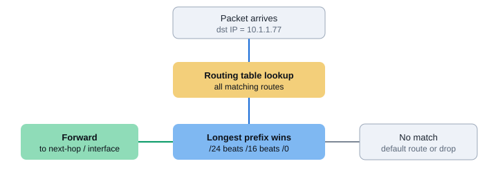

*شکل ۱: مراحل تصمیم روتر برای هر بسته.*

``` text
Routing table:
  10.0.0.0/8      via R-A
  10.1.0.0/16     via R-B
  10.1.1.0/24     via R-C
  0.0.0.0/0       via R-D (default)

Packet to 10.1.1.77:
  matches /0, /8, /16, /24  -> longest = /24  -> via R-C
Packet to 10.1.9.5:
  matches /0, /8, /16       -> longest = /16  -> via R-B
Packet to 8.8.8.8:
  matches /0 only           -> via R-D
```

> **نکته**
>
> اول طول Prefix تعیین می‌کند. فقط وقتی دو Route هم‌طول بودند، AD و Metric وارد می‌شوند.

### ۴. قانون دوم: Administrative Distance و Metric

فرض کنید همان شبکه را دو منبع مختلف (مثلاً Static و OSPF) به روتر معرفی کنند. روتر به منبعی که «معتبرتر» است اعتماد می‌کند. این اعتبار را AD می‌گویند و هرچه کمتر باشد بهتر است:

| منبع          | AD  |
|---------------|-----|
| Connected     | 0   |
| Static        | 1   |
| EIGRP (داخلی) | 90  |
| OSPF          | 110 |
| RIP           | 120 |

Metric هزینه‌ی مسیر **داخل یک پروتکل** است (مثلاً Cost در OSPF). Metricهای پروتکل‌های مختلف قابل مقایسه با هم نیستند؛ برای همین AD وجود دارد.

``` text
Decision order for the same destination:
1) Longest prefix       (most specific wins)
2) Lowest AD             (most trusted source)
3) Lowest metric         (best path inside one protocol)
4) ECMP                  (equal metric -> load share)
```

### ۵. مثال‌ها (ساده تا سخت)

#### ساده: بسته به شبکه‌ی Connected

``` text
Dest 192.168.1.50 -> matches C 192.168.1.0/24
Router ARPs for the host and delivers directly
```

#### متوسط: Static یا OSPF؟

``` text
Both learn 10.0.23.0/30:
  S  10.0.23.0/30 [1/0]   via 10.0.12.2
  O  10.0.23.0/30 [110/2] via 10.0.12.2
Same prefix -> lower AD (1) wins -> Static is installed
```

#### سخت: دو Route با Prefixهای مختلف

``` text
S  10.0.0.0/8   [1/0]   via 10.9.9.9   (static, AD 1)
O  10.0.23.0/30 [110/2] via 10.0.12.2   (OSPF, AD 110)
Packet to 10.0.23.5:
  both match; /30 is longer than /8 -> OSPF route wins
  (AD is NOT compared here; prefix length decides first)
```

این خطای ذهنی بسیار رایج است: «Static همیشه برنده است». نه! اول طول Prefix است.

### ۶. دستورهای مشاهده

``` text
R1# show ip route
R1# show ip route 10.1.1.77
R1# show ip route connected
R1# show ip route static
R1# show ip route ospf
R1# show ip protocols
R1# show ip cef 10.1.1.77
```

- `show ip route 10.1.1.77`: دقیقاً می‌گوید کدام Route برای این مقصد انتخاب می‌شود (بهترین ابزار عیب‌یابی).
- `show ip protocols`: پروتکل‌های مسیریابی فعال و تنظیماتشان.
- `show ip cef ...`: مسیر واقعی Forwarding (CEF).

### تمرین‌ها

**ت1.** ۱ (ساده): L و C چه فرقی دارند؟ *(پاسخ: 5-1-ت1 در بخش «پاسخ‌ها» انتهای فصل)*

**ت2.** ۲ (ساده): AD برای Static و OSPF؟ *(پاسخ: 5-1-ت2 در بخش «پاسخ‌ها» انتهای فصل)*

**ت3.** ۳ (متوسط): بسته به 10.1.1.77؛ Routeهای /8، /16 و /0 موجودند. کدام؟ *(پاسخ: 5-1-ت3 در بخش «پاسخ‌ها» انتهای فصل)*

**ت4.** ۴ (متوسط): آیا Metric یک Route در OSPF با RIP قابل مقایسه است؟ *(پاسخ: 5-1-ت4 در بخش «پاسخ‌ها» انتهای فصل)*

**ت5.** ۵ (سخت): Static 10.0.0.0/8 و OSPF 10.0.23.0/30 هر دو موجود؛ بسته به 10.0.23.5 از کجا می‌رود؟ *(پاسخ: 5-1-ت5 در بخش «پاسخ‌ها» انتهای فصل)*

### Lab هدایت‌شده

توپولوژی این هفته: سه روتر vIOS به نام‌های `R1`، `R2`، `R3` به‌صورت خطی. اتصال‌ها: `R1 Gi0/1 ↔ R2 Gi0/0` و `R2 Gi0/1 ↔ R3 Gi0/0`. اگر RAM روتر زیاد است، می‌توانید vIOS را ۵۱۲ مگابایت کنید (راهنمای CML). برای فعلاً فقط Connected داریم.

#### گام ۱: آدرس‌دهی

``` text
R1(config)# interface gi0/1
R1(config-if)# ip address 10.0.12.1 255.255.255.252
R1(config-if)# no shutdown
R1(config)# interface loopback 10
R1(config-if)# ip address 192.168.1.1 255.255.255.0

R2(config)# interface gi0/0
R2(config-if)# ip address 10.0.12.2 255.255.255.252
R2(config-if)# no shutdown
R2(config)# interface gi0/1
R2(config-if)# ip address 10.0.23.1 255.255.255.252
R2(config-if)# no shutdown

R3(config)# interface gi0/0
R3(config-if)# ip address 10.0.23.2 255.255.255.252
R3(config-if)# no shutdown
R3(config)# interface loopback 30
R3(config-if)# ip address 192.168.3.1 255.255.255.0
```

#### گام ۲: مشاهده

``` text
R1# show ip interface brief
R1# show ip route
R1# ping 10.0.12.2
R1# ping 192.168.3.1
```

پیش‌بینی: ping به همسایه OK، ولی به 192.168.3.1 شکست؛ چون R1 مسیری به آن ندارد. جدول R1 فقط C و L دارد؛ آن را یادداشت کنید.

#### گام ۳: LPM را خودتان بسنجید

از روی جدول بالا، با `show ip route 10.0.23.5` ببینید چه Routeی انتخاب می‌شود (هنوز هیچ؛ در درس بعد Static اضافه می‌کنیم).

### Lab مستقل

جدول مسیریابی هر سه روتر را (فقط C و L) در `03-ops/routing-baseline-w5.md` ذخیره و هر کد را توضیح دهید.

### عیب‌یابی

|         |                                                                                |
|---------|--------------------------------------------------------------------------------|
| Symptom | ping به شبکه‌ی دور شکست می‌خورد                                                  |
| روش     | show ip route \<destination\>؛ اگر «Network not in table» بود، مسیر وجود ندارد |
| چک‌لیست  | ۱) Route هست؟ ؛ ۲) Next-hop قابل‌دسترس است؟ ؛ ۳) مسیر برگشت هم دارد؟            |
| نکته    | برگشت (Return Path) را همیشه چک کنید؛ مسیر یک‌طرفه کار نمی‌کند                   |

### سؤال‌های مرور

**م1.** اولین چیزی که روتر برای انتخاب Route نگاه می‌کند؟ *(پاسخ: 5-1-م1 در بخش «پاسخ‌ها» انتهای فصل)*

**م2.** AD برای چیست؟ *(پاسخ: 5-1-م2 در بخش «پاسخ‌ها» انتهای فصل)*

### English Corner: انگلیسی تخصصی این درس

این جمله‌ها از مستندات و محیط کار واقعی‌اند. بلند بخوانید و ترجمه را بپوشانید.

| English sentence                                                       | ترجمه                                                  |
|------------------------------------------------------------------------|--------------------------------------------------------|
| The router selects the route with the longest matching prefix.         | روتر Route با طولانی‌ترین Prefix مطابق را انتخاب می‌کند. |
| Administrative distance expresses how trustworthy a routing source is. | AD نشان می‌دهد منبع Route چقدر قابل‌اعتماد است.          |
| There is no route to the destination network.                          | مسیری به شبکه‌ی مقصد وجود ندارد.                        |
| Check the return path as well.                                         | مسیر برگشت را هم بررسی کنید.                           |

**Q1.** Quick quiz (answer in English): Which is compared first: administrative distance or prefix length? *(پاسخ: 5-1-Q1 در بخش «پاسخ‌ها» انتهای فصل)*

### تکلیف و چک‌لیست تسلط

- [ ] خط‌به‌خط یک Route را توضیح دهم.
- [ ] LPM را با ۳ مثال حل کنم.
- [ ] Lab را انجام دهم.

### یادآوری اشتباهات شما

> **یادآوری**
>
> پیش‌بینی قبل از اجرا؛ بکاپ قبل از تغییر؛ پذیرفته‌شدن دستور ≠ کار کردن؛ فرمول‌ها در بلوک مستقل.


#### کارت Lab — جدول مسیریابی، LPM و AD

| # | فیلد | محتوا |
|---|---|---|
| 1 | عنوان و هدف | خواندن Route Table و LPM |
| 2 | پیش‌نیاز | فصل 4 |
| 3 | توپولوژی | R1-R2-R3 خطی |
| 4 | تجهیزات | ۳ vIOS |
| 5 | نسخه نرم‌افزار | vIOS-L2 15.2(20200924، Experimental) برای SW؛ vIOS 15.9(3)M9 برای R؛ VPCS؛ PNetLab 4.2.8 |
| 6 | IP Plan | Connected |
| 7 | وضعیت اولیه | Loopbackها |
| 8 | صورت مسئله | LPM و AD را پیش‌بینی کنید |
| 9 | مراحل هدایت‌شده | همان بخش «Lab هدایت‌شده» همین درس |
| 10 | تست عملکرد | `show ip route <dst>` |
| 11 | سناریوی خرابی | Route نبود |
| 12 | روش عیب‌یابی | لایه‌ای/با شواهد (بخش عیب‌یابی همین درس) |
| 13 | نتیجه‌ی مورد انتظار | جدول C/L |
| 14 | معیار پذیرش | پیش‌بینی با واقعیت تطبیق |
| 15 | مستندات نهایی | `03-ops/routing-baseline-w5.md` |
| 16 | Cleanup و بازگردانی | — |

> **وضعیت راستی‌آزمایی (خارج از ۱۶ فیلد):** **اجرا نشده (فقط طراحی).** اجرا نشده.

---

<a id="l-5-2"></a>

## درس 5-2 — Static Route و مسیر برگشت

**فصل ۵ - روز ۲ · پیش‌نیاز: درس ۵-۱ · ۶ ساعت**

### این درس درباره چیست و چرا باید یاد بگیریم؟

**چه چیزی یاد می‌گیریم:** ساخت مسیر دستی (Static Route) با Next-hop، تفاوت Next-hop و Exit-interface، اهمیت مسیر برگشت (Return Path) و خلاصه‌سازی با Static.

**چرا لازم است:** ساده‌ترین و قابل‌پیش‌بینی‌ترین مسیریابی است و در شعبه‌های کوچک و لینک اینترنت هنوز پرکاربرد است. اکثر «شبکه‌ی دور قابل‌دسترس نیست» ها به مسیر برگشت فراموش‌شده برمی‌گردد.

- **در کار روزانه:** Default Route به سمت ISP یا فایروال در ۹۰٪ شعبه‌ها Static است.
- **در امنیت:** Static Route قابل‌پیش‌بینی است و از تزریق مسیر جعلی جلوگیری می‌کند.
- **در FortiGate:** `config router static` دقیقاً همین مفهوم است.

> **مسیر درس**
>
> Static چیست ← Next-hop در برابر Interface ← مسیر برگشت ← خلاصه‌سازی ← مثال ساده/متوسط/سخت ← Lab ← عیب‌یابی.

#### اصطلاحات این درس (مخفف ← شکل کامل ← معنی)

| مخفف           | شکل کامل انگلیسی    | معنی فارسی                           |
|----------------|---------------------|--------------------------------------|
| Static Route   | Static Route        | مسیر دستی                            |
| Next-hop       | Next-hop IP         | آدرس روتر بعدی                       |
| Exit Interface | Exit Interface      | Interface خروجی                      |
| Return Path    | Return Path         | مسیر برگشت بسته                      |
| Recursive      | Recursive lookup    | جستجوی دوباره برای رسیدن به Next-hop |
| Null0          | Null0               | Interface مجازی دورریز               |
| Summary        | Route Summarization | خلاصه‌سازی چند Route در یکی           |

### ۱. Static Route چیست؟

یعنی خودتان به روتر می‌گویید: «برای رسیدن به شبکه X، بسته را به روتر Y بده». مثل اینکه به راننده‌ی تاکسی بگویید «برای رفتن به فرودگاه از این خیابان برو»؛ خودش تصمیم نمی‌گیرد، شما گفته‌اید.

فرمت:

``` text
ip route <destination network> <mask> <next-hop | exit-interface> [AD]

Example:
R1(config)# ip route 192.168.3.0 255.255.255.0 10.0.12.2
```

یعنی «برای شبکه‌ی 192.168.3.0/24، بسته را به 10.0.12.2 بده».

### ۲. Next-hop در برابر Exit-interface

| روش            | مثال                                               | کاربرد                                                   |
|----------------|----------------------------------------------------|----------------------------------------------------------|
| Next-hop       | ip route 192.168.3.0 255.255.255.0 10.0.12.2       | پیشنهاد اصلی؛ روی اترنت امن است                          |
| Exit-interface | ip route 192.168.3.0 255.255.255.0 gi0/1           | فقط لینک نقطه‌به‌نقطه (Serial)؛ روی اترنت ARP برای هر مقصد |
| هر دو          | ip route 192.168.3.0 255.255.255.0 gi0/1 10.0.12.2 | دقیق‌ترین (توصیه برای اترنت)                              |

> **قانون**
>
> روی اترنت فقط Exit-interface ننویسید؛ روتر برای هر مقصد ARP می‌زند و به Proxy-ARP وابسته می‌شود. Next-hop (یا هر دو) بنویسید.

«Recursive»: اگر Next-hop را بنویسید، روتر یک جستجوی دوم می‌کند تا Next-hop را از Connected/Route دیگری پیدا کند. به همین دلیل Next-hop باید حتماً در یک شبکه‌ی Connected یا شناخته‌شده باشد.

### ۳. مسیر برگشت: مهم‌ترین نکته

ارتباط دوطرفه است. اگر فقط R1 مسیر رفت را بداند، ولی R3 راه برگشت به 192.168.1.0/24 را نداند، پاسخ هرگز نمی‌رسد و ping شکست می‌خورد.

``` text
PC (192.168.1.10) -> R1 -> R2 -> R3 -> Server (192.168.3.10)
Forward path : R1 needs route to 192.168.3.0/24, R2 as well
Return path  : R3 needs route to 192.168.1.0/24, R2 as well
If any hop lacks the return route -> ping fails (one-way)
```

### ۴. خلاصه‌سازی با Static و Null0

به‌جای چند Route ریز، یک Route کلی می‌نویسیم. مثال: چهار شبکه‌ی 10.1.0.0/24 تا 10.1.3.0/24 را می‌توان با یک /22 خلاصه کرد:

``` text
10.1.0.0/24, 10.1.1.0/24, 10.1.2.0/24, 10.1.3.0/24
Third octet: 0,1,2,3 -> block size 4 -> /22
Summary = 10.1.0.0/22
```

برای جلوگیری از Loop هنگام خلاصه‌سازی روی مرز، گاهی یک Route به Null0 می‌گذارند تا بسته‌ی بی‌صاحب دور ریخته شود:

``` text
R2(config)# ip route 10.1.0.0 255.255.252.0 null0 200
```

AD برابر 200 است تا Routeهای واقعی (دقیق‌تر یا با AD کمتر) را بلوک نکند.

### ۵. مثال‌ها

#### ساده: یک مسیر

``` text
R1(config)# ip route 192.168.3.0 255.255.255.0 10.0.12.2
R1# show ip route static
S  192.168.3.0/24 [1/0] via 10.0.12.2
```

#### متوسط: مسیر رفت و برگشت

``` text
R1(config)# ip route 192.168.3.0 255.255.255.0 10.0.12.2
R1(config)# ip route 10.0.23.0 255.255.255.252 10.0.12.2
R2(config)# ip route 192.168.3.0 255.255.255.0 10.0.23.2
R2(config)# ip route 192.168.1.0 255.255.255.0 10.0.12.1
R3(config)# ip route 192.168.1.0 255.255.255.0 10.0.23.1
R3(config)# ip route 10.0.12.0 255.255.255.252 10.0.23.1
```

#### سخت: Next-hop غیرقابل‌دسترس

``` text
R1(config)# ip route 192.168.3.0 255.255.255.0 10.9.9.9
R1# show ip route 192.168.3.0
  -> Route is NOT installed: next-hop 10.9.9.9 is not reachable
Fix: use a next-hop inside a connected network (10.0.12.2)
```

### تمرین‌ها

**ت1.** ۱ (ساده): Static برای شبکه‌ی 172.16.5.0/24 با Next-hop 10.0.0.2 *(پاسخ: 5-2-ت1 در بخش «پاسخ‌ها» انتهای فصل)*

**ت2.** ۲ (ساده): چرا روی اترنت Next-hop می‌نویسیم؟ *(پاسخ: 5-2-ت2 در بخش «پاسخ‌ها» انتهای فصل)*

**ت3.** ۳ (متوسط): Summary چهار شبکه‌ی 10.2.4.0/24 تا 10.2.7.0/24؟ *(پاسخ: 5-2-ت3 در بخش «پاسخ‌ها» انتهای فصل)*

**ت4.** ۴ (متوسط): ping یک‌طرفه شکست می‌خورد؛ علت؟ *(پاسخ: 5-2-ت4 در بخش «پاسخ‌ها» انتهای فصل)*

**ت5.** ۵ (سخت): چرا Route به Null0 با AD 200؟ *(پاسخ: 5-2-ت5 در بخش «پاسخ‌ها» انتهای فصل)*

### Lab هدایت‌شده

#### گام ۱: مسیرهای رفت

``` text
R1(config)# ip route 10.0.23.0 255.255.255.252 10.0.12.2
R1(config)# ip route 192.168.3.0 255.255.255.0 10.0.12.2
R3(config)# ip route 10.0.12.0 255.255.255.252 10.0.23.1
R3(config)# ip route 192.168.1.0 255.255.255.0 10.0.23.1
R2(config)# ip route 192.168.1.0 255.255.255.0 10.0.12.1
R2(config)# ip route 192.168.3.0 255.255.255.0 10.0.23.2
```

#### گام ۲: تست

``` text
R1# ping 192.168.3.1 source 192.168.1.1
R1# traceroute 192.168.3.1 source 192.168.1.1
```

با `source` مبدأ را Loopback می‌کنیم تا شبکه‌ی LAN شبیه‌سازی شود.

#### گام ۳: خراب‌کردن عمدی مسیر برگشت

``` text
R3(config)# no ip route 192.168.1.0 255.255.255.0 10.0.23.1
R1# ping 192.168.3.1 source 192.168.1.1   (fails: no return)
R3(config)# ip route 192.168.1.0 255.255.255.0 10.0.23.1
```

Capture روی لینک R2-R3: Echo Request می‌رسد ولی Reply برنمی‌گردد.

### Lab مستقل

یک جدول «Static Route Plan» بنویسید: هر روتر، شبکه‌های مقصد، Next-hop و مسیر برگشت در `02-design/static-plan.md`.

### عیب‌یابی

|         |                                                                                                   |
|---------|---------------------------------------------------------------------------------------------------|
| Symptom | ping به شبکه‌ی دور شکست                                                                            |
| چک‌لیست  | ۱) Route رفت؟ ؛ ۲) Next-hop Connected است؟ ؛ ۳) Route برگشت؟ ؛ ۴) Mask درست؟ ؛ ۵) ACL یا فایروال؟ |
| ابزار   | show ip route \<destination\> ، traceroute ، Capture                                              |
| رفع     | افزودن مسیر گم‌شده                                                                                 |

### سؤال‌های مرور

**م1.** Static Route کی مناسب است؟ *(پاسخ: 5-2-م1 در بخش «پاسخ‌ها» انتهای فصل)*

**م2.** چرا مسیر برگشت مهم است؟ *(پاسخ: 5-2-م2 در بخش «پاسخ‌ها» انتهای فصل)*

### English Corner: انگلیسی تخصصی این درس

این جمله‌ها از مستندات و محیط کار واقعی‌اند. بلند بخوانید و ترجمه را بپوشانید.

| English sentence                                                | ترجمه                                        |
|-----------------------------------------------------------------|----------------------------------------------|
| Configure a static route pointing to the next-hop address.      | یک Static Route به آدرس Next-hop تنظیم کنید. |
| The route is not installed because the next-hop is unreachable. | Route نصب نشده چون Next-hop در دسترس نیست.   |
| Ping fails because there is no return route.                    | ping شکست می‌خورد چون Route برگشت وجود ندارد. |
| Summarize contiguous networks into a single route.              | شبکه‌های متوالی را در یک Route خلاصه کنید.    |

**Q1.** Quick quiz (answer in English): Why do we avoid exit-interface-only static routes on Ethernet? *(پاسخ: 5-2-Q1 در بخش «پاسخ‌ها» انتهای فصل)*

### تکلیف و چک‌لیست تسلط

- [ ] Static رفت و برگشت را بزنم و ping موفق بگیرم.
- [ ] مسیر برگشت را عمداً حذف کنم و Capture ببینم.
- [ ] Summary را بنویسم.

### یادآوری اشتباهات شما

> **یادآوری**
>
> پیش‌بینی قبل از اجرا؛ بکاپ قبل از تغییر؛ پذیرفته‌شدن دستور ≠ کار کردن؛ فرمول‌ها در بلوک مستقل.


#### کارت Lab — Static Route و مسیر برگشت

| # | فیلد | محتوا |
|---|---|---|
| 1 | عنوان و هدف | Static Route با مسیر رفت/برگشت |
| 2 | پیش‌نیاز | درس 5-1 |
| 3 | توپولوژی | R1-R2-R3 |
| 4 | تجهیزات | ۳ vIOS |
| 5 | نسخه نرم‌افزار | vIOS-L2 15.2(20200924، Experimental) برای SW؛ vIOS 15.9(3)M9 برای R؛ VPCS؛ PNetLab 4.2.8 |
| 6 | IP Plan | Connected |
| 7 | وضعیت اولیه | Static + برگشت |
| 8 | صورت مسئله | ping LAN1↔LAN3 |
| 9 | مراحل هدایت‌شده | همان بخش «Lab هدایت‌شده» همین درس |
| 10 | تست عملکرد | `ping ... source` |
| 11 | سناریوی خرابی | حذف مسیر برگشت |
| 12 | روش عیب‌یابی | لایه‌ای/با شواهد (بخش عیب‌یابی همین درس) |
| 13 | نتیجه‌ی مورد انتظار | ping موفق |
| 14 | معیار پذیرش | Return Path اثبات |
| 15 | مستندات نهایی | `02-design/static-plan.md` |
| 16 | Cleanup و بازگردانی | حذف Static |

> **وضعیت راستی‌آزمایی (خارج از ۱۶ فیلد):** **اجرا نشده (فقط طراحی).** اجرا نشده.

---

<a id="l-5-3"></a>

## درس 5-3 — Default، Floating و IP SLA

**فصل ۵ - روز ۳ · پیش‌نیاز: درس ۵-۲ · ۶ ساعت**

### این درس درباره چیست و چرا باید یاد بگیریم؟

**چه چیزی یاد می‌گیریم:** Default Route (0.0.0.0/0)، Route پشتیبان با AD بالا (Floating Static)، و رصد سلامت لینک با IP SLA برای Failover واقعی.

**چرا لازم است:** هر شعبه یک «در خروج» (اینترنت یا فایروال) دارد. اگر لینک اصلی خراب شود، باید ترافیک به لینک پشتیبان برود. Floating Static ساده‌ترین راه است؛ ولی بدون Tracking ممکن است Failover رخ ندهد چون لینک «بالا» است ولی اینترنت قطع.

- **در کار روزانه:** تقریباً هر شعبه Default Route دارد و بعضی یک لینک پشتیبان (4G/ISP دوم).
- **در امنیت:** Default Route تنها راه خروج است؛ اشتباه آن همه‌ی شبکه را ایزوله می‌کند.
- **در FortiGate:** Failover دو ISP با Distance/Priority و Link Monitor همین منطق است.

> **مسیر درس**
>
> Default Route ← Floating Static ← IP SLA و Track ← مثال ساده/متوسط/سخت ← Lab ← عیب‌یابی.

#### اصطلاحات این درس (مخفف ← شکل کامل ← معنی)

| مخفف            | شکل کامل انگلیسی           | معنی فارسی                           |
|-----------------|----------------------------|--------------------------------------|
| Default Route   | Default Route              | مسیر 0.0.0.0/0 برای هر مقصد ناشناخته |
| Floating Static | Floating Static Route      | Route پشتیبان با AD بالاتر           |
| IP SLA          | IP Service Level Agreement | پروب سلامت مسیر با ping              |
| Track           | Object Tracking            | وابستگی Route به وضعیت یک شیء        |
| Failover        | Failover                   | سوییچ خودکار به مسیر پشتیبان         |
| Reachability    | Reachability               | قابل‌دسترس بودن                       |

### ۱. Default Route: «هرجا نمی‌دانی، از اینجا برو»

Default Route همان آدرس ناشناخته در جدول است: مثل تابلوی «بقیه‌ی مسیرها» در بزرگراه. شبکه‌ی /0 همه‌ی آدرس‌ها را می‌پوشاند و چون کوتاه‌ترین Prefix است، فقط وقتی استفاده می‌شود که Route دقیق‌تری نباشد (LPM).

``` text
R1(config)# ip route 0.0.0.0 0.0.0.0 10.0.12.2
R1# show ip route
Gateway of last resort is 10.0.12.2 to network 0.0.0.0
S*   0.0.0.0/0 [1/0] via 10.0.12.2
```

### ۲. Floating Static: پشتیبان که «شناور» است

دو Default Route با دو AD متفاوت می‌نویسیم: اصلی با AD پیش‌فرض (1) و پشتیبان با AD بالاتر (مثلاً 200). روتر فقط Route با AD کمتر را نصب می‌کند؛ اگر آن حذف شد، پشتیبان «بالا می‌آید».

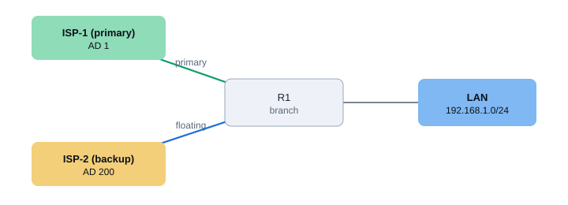

*شکل ۱: لینک اصلی با AD 1 و پشتیبان با AD 200.*

``` text
R1(config)# ip route 0.0.0.0 0.0.0.0 203.0.113.1
R1(config)# ip route 0.0.0.0 0.0.0.0 198.51.100.1 200
R1# show ip route 0.0.0.0
  -> only the AD 1 route is in the table
```

### ۳. مشکل: لینک «بالا» است ولی اینترنت نیست

Route Static تا وقتی Interface خروجی up/up است در جدول می‌ماند؛ حتی اگر Next-hop (ISP) خراب باشد. پس Floating به‌تنهایی Failover واقعی نیست. باید «سلامت واقعی» مسیر را بسنجیم: IP SLA با ping به Next-hop یا یک آدرس دور.

``` text
Interface up/up + ISP dead -> Static route still installed -> no failover
Solution: IP SLA probe + track -> route removed when probe fails
```

### ۴. IP SLA و Track (دستورها خط‌به‌خط)

``` text
R1(config)# ip sla 1
R1(config-ip-sla)# icmp-echo 203.0.113.1 source-interface gi0/1
R1(config-ip-sla-echo)# frequency 5
R1(config-ip-sla-echo)# exit
R1(config)# ip sla schedule 1 life forever start-time now
R1(config)# track 1 ip sla 1 reachability
R1(config)# ip route 0.0.0.0 0.0.0.0 203.0.113.1 track 1
R1(config)# ip route 0.0.0.0 0.0.0.0 198.51.100.1 200
```

- `ip sla 1` + `icmp-echo`: هر ۵ ثانیه ping به Next-hop اول.
- `schedule ... start-time now`: پروب را همین الان و برای همیشه شروع می‌کند.
- `track 1 ip sla 1 reachability`: شیء Track که وضعیت پروب را می‌داند.
- `ip route ... track 1`: این Route فقط وقتی در جدول است که Track بالا باشد.

``` text
R1# show ip sla statistics
R1# show track 1
R1# show ip route 0.0.0.0
```

### ۵. مثال‌ها

#### ساده

``` text
Single ISP: ip route 0.0.0.0 0.0.0.0 <ISP gateway>
```

#### متوسط: Floating

``` text
Primary link fails (interface down)
-> AD 1 route removed
-> AD 200 route installed automatically
```

#### سخت: ISP خراب ولی Interface بالا

``` text
Probe to 203.0.113.1 times out
-> track 1 goes Down
-> primary static removed
-> backup (AD 200) installed
Probe recovers -> primary returns (preempt)
```

> **صادقانه درباره‌ی Lab**
>
> طبق Probe اولیه، IP SLA روی IOS ما کار می‌کند. در Lab، لینک ISP را با قطع کابل (shutdown رو Interface دور) یا حذف Route همسایه شبیه‌سازی کنید و نتیجه‌ی واقعی را ثبت کنید.

### تمرین‌ها

**ت1.** ۱ (ساده): AD پیش‌فرض Static و Floating معمول؟ *(پاسخ: 5-3-ت1 در بخش «پاسخ‌ها» انتهای فصل)*

**ت2.** ۲ (ساده): چرا 0.0.0.0 0.0.0.0 همه‌ی مقاصد را می‌پوشاند؟ *(پاسخ: 5-3-ت2 در بخش «پاسخ‌ها» انتهای فصل)*

**ت3.** ۳ (متوسط): چرا Floating به‌تنهایی کافی نیست؟ *(پاسخ: 5-3-ت3 در بخش «پاسخ‌ها» انتهای فصل)*

**ت4.** ۴ (متوسط): دستور Route وابسته به Track؟ *(پاسخ: 5-3-ت4 در بخش «پاسخ‌ها» انتهای فصل)*

**ت5.** ۵ (سخت): چه چیزی را باید پروب کنیم؟ *(پاسخ: 5-3-ت5 در بخش «پاسخ‌ها» انتهای فصل)*

### Lab هدایت‌شده

روی R1 یک Interface دوم به R2 فرض می‌کنیم (یا Loopback). اگر ندارید، با `Loopback` هم می‌شود مسیر را شبیه‌سازی کرد.

#### گام ۱: Default اصلی و پشتیبان

``` text
R1(config)# ip route 0.0.0.0 0.0.0.0 10.0.12.2
R1(config)# ip route 0.0.0.0 0.0.0.0 10.0.99.2 200
R1# show ip route
```

#### گام ۲: IP SLA و Track

``` text
R1(config)# ip sla 1
R1(config-ip-sla)# icmp-echo 10.0.12.2 source-interface gi0/1
R1(config-ip-sla-echo)# frequency 5
R1(config)# ip sla schedule 1 life forever start-time now
R1(config)# track 1 ip sla 1 reachability
R1(config)# no ip route 0.0.0.0 0.0.0.0 10.0.12.2
R1(config)# ip route 0.0.0.0 0.0.0.0 10.0.12.2 track 1
R1# show track 1
```

#### گام ۳: شبیه‌سازی خرابی

``` text
R2(config)# interface gi0/0
R2(config-if)# shutdown
R1# show track 1
R1# show ip route 0.0.0.0
```

ثبت کنید چند ثانیه طول کشید تا Track پایین بیاید و Route پشتیبان نصب شود، و بعد از `no shutdown` چه شد.

### Lab مستقل

یک Runbook «Failover دو ISP» در `03-ops/dual-isp-failover.md` بنویسید: تنظیم، Verification، و آزمون خرابی.

### عیب‌یابی

|         |                                                                                                                      |
|---------|----------------------------------------------------------------------------------------------------------------------|
| Symptom | Failover رخ نمی‌دهد                                                                                                   |
| چک‌لیست  | ۱) AD پشتیبان بیشتر است؟ ؛ ۲) Track روی Route اصلی است؟ ؛ ۳) پروب به آدرس درست می‌رود؟ ؛ ۴) Interface هنوز up/up است؟ |
| ابزار   | show track ، show ip sla statistics ، show ip route                                                                  |
| رفع     | اصلاح پروب و AD                                                                                                      |

### سؤال‌های مرور

**م1.** Floating Static چیست؟ *(پاسخ: 5-3-م1 در بخش «پاسخ‌ها» انتهای فصل)*

**م2.** IP SLA برای چیست؟ *(پاسخ: 5-3-م2 در بخش «پاسخ‌ها» انتهای فصل)*

### English Corner: انگلیسی تخصصی این درس

این جمله‌ها از مستندات و محیط کار واقعی‌اند. بلند بخوانید و ترجمه را بپوشانید.

| English sentence                                                         | ترجمه                                         |
|--------------------------------------------------------------------------|-----------------------------------------------|
| Configure a floating static route with a higher administrative distance. | Floating Static با AD بالاتر تنظیم کنید.      |
| The track object goes down when the probe fails.                         | وقتی پروب شکست بخورد، شیء Track پایین می‌رود.  |
| The backup route is installed automatically.                             | Route پشتیبان خودکار نصب می‌شود.               |
| Always test failover before production.                                  | Failover را همیشه قبل از Production تست کنید. |

**Q1.** Quick quiz (answer in English): Why can a static route stay in the table even if the ISP is down? *(پاسخ: 5-3-Q1 در بخش «پاسخ‌ها» انتهای فصل)*

### تکلیف و چک‌لیست تسلط

- [ ] Floating و Track را تنظیم کنم.
- [ ] خرابی را شبیه‌سازی و زمان Failover را ثبت کنم.
- [ ] Runbook را بنویسم.

### یادآوری اشتباهات شما

> **یادآوری**
>
> پیش‌بینی قبل از اجرا؛ بکاپ قبل از تغییر؛ پذیرفته‌شدن دستور ≠ کار کردن؛ فرمول‌ها در بلوک مستقل.


#### کارت Lab — Default، Floating و IP SLA

| # | فیلد | محتوا |
|---|---|---|
| 1 | عنوان و هدف | Default، Floating و IP SLA/Track |
| 2 | پیش‌نیاز | درس 5-2 |
| 3 | توپولوژی | R1 + دو مسیر |
| 4 | تجهیزات | ۳ vIOS |
| 5 | نسخه نرم‌افزار | vIOS-L2 15.2(20200924، Experimental) برای SW؛ vIOS 15.9(3)M9 برای R؛ VPCS؛ PNetLab 4.2.8 |
| 6 | IP Plan | Static |
| 7 | وضعیت اولیه | Floating AD 200 |
| 8 | صورت مسئله | Failover با Track |
| 9 | مراحل هدایت‌شده | همان بخش «Lab هدایت‌شده» همین درس |
| 10 | تست عملکرد | `show track` |
| 11 | سناریوی خرابی | ISP خراب ولی لینک up |
| 12 | روش عیب‌یابی | لایه‌ای/با شواهد (بخش عیب‌یابی همین درس) |
| 13 | نتیجه‌ی مورد انتظار | Route پشتیبان نصب |
| 14 | معیار پذیرش | زمان Failover ثبت |
| 15 | مستندات نهایی | `03-ops/dual-isp-failover.md` |
| 16 | Cleanup و بازگردانی | حذف track |

> **وضعیت راستی‌آزمایی (خارج از ۱۶ فیلد):** **جزئی.** IP SLA icmp-echo در Probe Tested-OK؛ Failover کامل و Floating اجرا نشده.

---

<a id="l-5-4"></a>

## درس 5-4 — مفهوم OSPF

**فصل ۵ - روز ۴ · پیش‌نیاز: درس‌های ۵-۱ تا ۵-۳ · ۶ ساعت**

### این درس درباره چیست و چرا باید یاد بگیریم؟

**چه چیزی یاد می‌گیریم:** مفهوم پروتکل مسیریابی پویا OSPF: چرا Static در شبکه‌ی بزرگ جواب نمی‌دهد، چطور روترها همسایه می‌شوند، پایگاه داده‌ی مشترک (LSDB) چیست، و هزینه (Cost) چطور مسیر را انتخاب می‌کند.

**چرا لازم است:** در شبکه‌ای با ۵۰ روتر، نوشتن دستی هزاران Static غیرممکن است و با هر تغییر باید همه را اصلاح کنید. OSPF خودش مسیرها را پیدا می‌کند، با خرابی لینک در چند ثانیه مسیر جایگزین می‌سازد و استاندارد سازمان‌هاست.

- **در کار روزانه:** OSPF رایج‌ترین IGP در سازمان‌هاست.
- **در امنیت:** Adjacency بدون Authentication یعنی هر روتر جعلی می‌تواند مسیر تزریق کند.
- **در FortiGate:** FortiGate هم OSPF می‌فهمد و در Capstone با Cisco هم‌نشین می‌شود.

> **مسیر درس**
>
> چرا مسیریابی پویا ← OSPF چطور کار می‌کند ← حالت‌های همسایگی ← Cost و SPF ← مثال ساده/متوسط/سخت ← Lab ← عیب‌یابی.

#### اصطلاحات این درس (مخفف ← شکل کامل ← معنی)

| مخفف      | شکل کامل انگلیسی               | معنی فارسی                              |
|-----------|--------------------------------|-----------------------------------------|
| OSPF      | Open Shortest Path First       | پروتکل مسیریابی Link-State داخلی        |
| IGP       | Interior Gateway Protocol      | پروتکل مسیریابی داخل یک سازمان          |
| LSA       | Link-State Advertisement       | اعلان وضعیت لینک                        |
| LSDB      | Link-State Database            | پایگاه داده‌ی مشترک همه‌ی روترهای یک Area |
| SPF       | Shortest Path First (Dijkstra) | الگوریتم محاسبه‌ی کوتاه‌ترین مسیر         |
| Router ID | Router Identifier              | شناسه‌ی یکتای روتر (مثل IP)              |
| Adjacency | Adjacency                      | همسایگی کامل بین دو روتر                |
| Area      | OSPF Area                      | ناحیه؛ بخش‌بندی شبکه                     |
| Cost      | OSPF Cost                      | هزینه‌ی لینک بر اساس پهنای باند          |

### ۱. چرا مسیریابی پویا؟

فرض کنید ۱۰ روتر دارید. Static یعنی به هر روتر درباره‌ی هر شبکه بگویید؛ با اضافه‌شدن یک شبکه همه را عوض می‌کنید، و اگر لینکی خراب شود هیچ‌چیز خودکار تغییر نمی‌کند. مسیریابی پویا مثل گوگل‌مپ است: هر روتر وضعیت خودش را اعلام می‌کند و همه با هم نقشه‌ی یکسان می‌سازند.

### ۲. OSPF چطور کار می‌کند؟ (سه مرحله)

1.  **همسایه‌یابی:** روترها با پیام Hello همدیگر را پیدا می‌کنند.
2.  **تبادل نقشه:** هر روتر وضعیت لینک‌های خودش (LSA) را با همه‌ی روترهای Area به اشتراک می‌گذارد؛ نتیجه LSDB یکسان در همه است.
3.  **محاسبه‌ی مسیر:** هر روتر با الگوریتم SPF از روی LSDB کوتاه‌ترین مسیر به هر شبکه را حساب می‌کند.

> **تفاوت با RIP**
>
> OSPF «نقشه‌ی کامل» را دارد (Link-State)، نه فقط «شنیده‌های همسایه» (Distance Vector). برای همین سریع‌تر همگرا می‌شود و حلقه نمی‌سازد.

### ۳. همسایگی: از Down تا Full

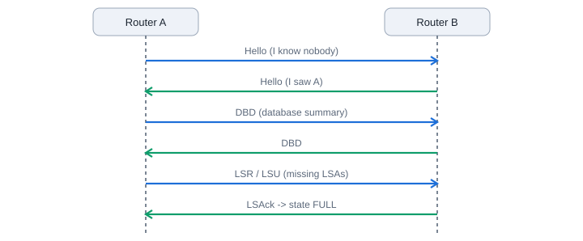

*شکل ۱: ساده‌شده‌ی تبادل پیام‌ها تا رسیدن به حالت Full.*

| حالت     | معنی                                              |
|----------|---------------------------------------------------|
| Down     | Hello نرسیده                                      |
| Init     | Hello دریافت شد ولی همسایه هنوز ما را ندیده       |
| 2-Way    | دوطرفه دیدیم (روی Broadcast: DR/BDR انتخاب می‌شود) |
| ExStart  | انتخاب Master/Slave برای تبادل                    |
| Exchange | تبادل خلاصه‌ی پایگاه داده (DBD)                    |
| Loading  | دریافت LSAهای مفقود                               |
| Full     | پایگاه‌ها یکسان؛ Adjacency کامل                    |

اگر روتری در ExStart یا Exchange گیر کرد، معمولاً MTU یا مشکل پایگاه داده است. اگر در Init می‌ماند، یکی از دو طرف Hello را نمی‌بیند (ACL، Hello/Dead، Subnet).

### ۴. شرط‌های تشکیل Adjacency

برای اینکه دو روتر همسایه شوند، این مقادیر باید یکی باشند:

- هر دو Interface در یک Subnet با Mask یکسان.
- Area یکسان.
- Hello و Dead Interval یکسان (پیش‌فرض اترنت: 10 و 40 ثانیه).
- Authentication یکسان.
- MTU برابر (یا `ip ospf mtu-ignore` در موارد خاص).
- Router ID یکتا.

``` text
Hello interval (Ethernet) = 10 s
Dead interval  (Ethernet) = 4 x Hello = 40 s
(Non-broadcast: Hello 30 s, Dead 120 s)
```

### ۵. Router ID

هر روتر یک شناسه‌ی ۳۲ بیتی شبیه IP دارد. اگر دستی تنظیم نکنید، بزرگ‌ترین IP روی Loopbackها، و در نبود Loopback بزرگ‌ترین IP روی Interfaceهای فعال انتخاب می‌شود. توصیه: همیشه دستی تنظیم کنید تا پایدار و قابل‌پیش‌بینی باشد:

``` text
R1(config)# router ospf 1
R1(config-router)# router-id 1.1.1.1
```

### ۶. Cost: چطور مسیر انتخاب می‌شود؟

هر لینک یک هزینه دارد که از پهنای باند به‌دست می‌آید. هزینه‌ی کل یک مسیر مجموع هزینه‌ی لینک‌های خروجی تا مقصد است و کمترین برنده می‌شود:

``` text
Cost = Reference bandwidth / Interface bandwidth
Default reference bandwidth = 100 Mbps

 10 Mbps  -> 100 / 10   = 10
100 Mbps  -> 100 / 100  = 1
  1 Gbps  -> 100 / 1000 = 0.1 -> rounded up to 1   (problem!)
 10 Gbps  -> also 1
```

> **مشکل شناخته‌شده**
>
> با مرجع ۱۰۰ مگابیت، لینک‌های ۱ و ۱۰ گیگابیت هزینه‌ی یکسان (۱) دارند؛ پس OSPF سریع‌تر را از کندتر تشخیص نمی‌دهد. راه‌حل: مرجع را بالا ببرید و در همه‌ی روترها یکسان کنید: `auto-cost reference-bandwidth 10000` (ده گیگ).

``` text
Reference 10000 Mbps:
  1 Gbps  -> 10000 / 1000  = 10
 10 Gbps  -> 10000 / 10000 = 1
100 Mbps  -> 10000 / 100   = 100
```

### ۷. مثال‌ها

#### ساده: دو روتر

``` text
R1 Gi0/1 10.0.12.1/30  <->  R2 Gi0/0 10.0.12.2/30, area 0
Hello exchanged -> neighbors -> state FULL
Each learns the other LANs automatically
```

#### متوسط: کدام مسیر؟

``` text
Path A: R1 -> R2 -> R3     cost 10 + 10 = 20
Path B: R1 -> R3 direct     cost 30
SPF picks Path A (20 < 30)
```

#### سخت: چرا Adjacency نمی‌شود؟

``` text
R1: ip ospf hello-interval 5   (dead 20)
R2: default (hello 10, dead 40)
Result: neighbors never reach 2-Way; hello/dead mismatch
Fix: make both sides identical
```

### تمرین‌ها

**ت1.** ۱ (ساده): سه مرحله‌ی کار OSPF؟ *(پاسخ: 5-4-ت1 در بخش «پاسخ‌ها» انتهای فصل)*

**ت2.** ۲ (ساده): Hello/Dead پیش‌فرض اترنت؟ *(پاسخ: 5-4-ت2 در بخش «پاسخ‌ها» انتهای فصل)*

**ت3.** ۳ (متوسط): Cost لینک 1 Gbps با Reference 100 Mbps؟ *(پاسخ: 5-4-ت3 در بخش «پاسخ‌ها» انتهای فصل)*

**ت4.** ۴ (متوسط): Cost لینک 100 Mbps با Reference 10000؟ *(پاسخ: 5-4-ت4 در بخش «پاسخ‌ها» انتهای فصل)*

**ت5.** ۵ (سخت): دو روتر در Init مانده‌اند؛ علت‌های محتمل؟ *(پاسخ: 5-4-ت5 در بخش «پاسخ‌ها» انتهای فصل)*

### Lab هدایت‌شده

در این درس فقط مشاهده‌ی مفهوم؛ پیکربندی کامل در درس بعد. ولی Router ID را می‌توانیم از الان برنامه‌ریزی کنیم:

| روتر | Router ID | Loopback               |
|------|-----------|------------------------|
| R1   | 1.1.1.1   | Loopback0 = 1.1.1.1/32 |
| R2   | 2.2.2.2   | Loopback0 = 2.2.2.2/32 |
| R3   | 3.3.3.3   | Loopback0 = 3.3.3.3/32 |

#### گام: ساخت Loopback0 روی هر روتر

``` text
R1(config)# interface loopback 0
R1(config-if)# ip address 1.1.1.1 255.255.255.255
R2(config)# interface loopback 0
R2(config-if)# ip address 2.2.2.2 255.255.255.255
R3(config)# interface loopback 0
R3(config-if)# ip address 3.3.3.3 255.255.255.255
```

سپس با Static قبلی، دسترسی به این Loopbackها را برقرار کنید (یا صبر کنید تا OSPF در درس بعد انجامش دهد).

### Lab مستقل

ترسیم دستی LSDB یک مثلث سه‌روتری روی کاغذ: هر روتر چه LSAهایی می‌سازد؟ و جدول Cost هر لینک را با Reference 10000 بنویسید.

### عیب‌یابی

|         |                                                                                                                           |
|---------|---------------------------------------------------------------------------------------------------------------------------|
| Symptom | دو روتر همسایه نمی‌شوند                                                                                                    |
| چک‌لیست  | ۱) Subnet و Mask یکی؟ ؛ ۲) Area یکی؟ ؛ ۳) Hello/Dead یکی؟ ؛ ۴) Authentication؟ ؛ ۵) MTU؟ ؛ ۶) Router ID تکراری؟ ؛ ۷) ACL؟ |
| ابزار   | show ip ospf neighbor ، show ip ospf interface ، debug ip ospf adj (با احتیاط)                                            |
| رفع     | یکسان‌سازی پارامتر ناسازگار                                                                                                |

### سؤال‌های مرور

**م1.** OSPF چه نوع پروتکلی است؟ *(پاسخ: 5-4-م1 در بخش «پاسخ‌ها» انتهای فصل)*

**م2.** Hello و Dead چیست؟ *(پاسخ: 5-4-م2 در بخش «پاسخ‌ها» انتهای فصل)*

### English Corner: انگلیسی تخصصی این درس

این جمله‌ها از مستندات و محیط کار واقعی‌اند. بلند بخوانید و ترجمه را بپوشانید.

| English sentence                                                                | ترجمه                                                           |
|---------------------------------------------------------------------------------|-----------------------------------------------------------------|
| OSPF routers exchange link-state advertisements to build an identical database. | روترهای OSPF با تبادل LSA پایگاه داده‌ی یکسان می‌سازند.           |
| Neighbors must agree on area, hello and dead timers.                            | همسایه‌ها باید روی Area و تایمرهای Hello/Dead توافق داشته باشند. |
| The lowest total cost path is selected.                                         | مسیر با کمترین هزینه‌ی کل انتخاب می‌شود.                          |
| Set the router ID manually for stability.                                       | Router ID را برای پایداری دستی تنظیم کنید.                      |

**Q1.** Quick quiz (answer in English): What are the three steps of OSPF operation? *(پاسخ: 5-4-Q1 در بخش «پاسخ‌ها» انتهای فصل)*

### تکلیف و چک‌لیست تسلط

- [ ] وضعیت‌های همسایگی را بدون نگاه بگویم.
- [ ] Cost را با دو Reference حساب کنم.
- [ ] Loopbackها را بسازم.

### یادآوری اشتباهات شما

> **یادآوری**
>
> پیش‌بینی قبل از اجرا؛ بکاپ قبل از تغییر؛ پذیرفته‌شدن دستور ≠ کار کردن؛ فرمول‌ها در بلوک مستقل.


#### کارت Lab — مفهوم OSPF

| # | فیلد | محتوا |
|---|---|---|
| 1 | عنوان و هدف | برنامه‌ریزی OSPF (Router-ID، Loopback) |
| 2 | پیش‌نیاز | درس 5-3 |
| 3 | توپولوژی | R1-R2-R3 |
| 4 | تجهیزات | ۳ vIOS |
| 5 | نسخه نرم‌افزار | vIOS-L2 15.2(20200924، Experimental) برای SW؛ vIOS 15.9(3)M9 برای R؛ VPCS؛ PNetLab 4.2.8 |
| 6 | IP Plan | Static |
| 7 | وضعیت اولیه | Loopback0 |
| 8 | صورت مسئله | Cost روی کاغذ |
| 9 | مراحل هدایت‌شده | همان بخش «Lab هدایت‌شده» همین درس |
| 10 | تست عملکرد | `show ip interface brief` |
| 11 | سناریوی خرابی | — |
| 12 | روش عیب‌یابی | لایه‌ای/با شواهد (بخش عیب‌یابی همین درس) |
| 13 | نتیجه‌ی مورد انتظار | Loopbackها بالا |
| 14 | معیار پذیرش | جدول Cost |
| 15 | مستندات نهایی | — |
| 16 | Cleanup و بازگردانی | حذف Loopback |

> **وضعیت راستی‌آزمایی (خارج از ۱۶ فیلد):** **اجرا نشده (فقط طراحی).** اجرا نشده.

---

<a id="l-5-5"></a>

## درس 5-5 — پیاده‌سازی OSPF

**فصل ۵ - روز ۵ · پیش‌نیاز: درس ۵-۴ · ۶ ساعت**

### این درس درباره چیست و چرا باید یاد بگیریم؟

**چه چیزی یاد می‌گیریم:** پیاده‌سازی OSPF تک‌ناحیه‌ای روی سه روتر: router ospf، معرفی شبکه‌ها، passive-interface، پخش Default Route، تنظیم Cost و بررسی با دستورهای show.

**چرا لازم است:** تا اینجا مفهوم را فهمیدید؛ حالا باید بتوانید یک شبکه‌ی چندروتری را در کمتر از ده دقیقه با OSPF بالا بیاورید و درستی‌اش را اثبات کنید. این مهارت در مصاحبه و کار روزانه مستقیماً سنجیده می‌شود.

- **در کار روزانه:** تنظیم OSPF برای شبکه‌ی جدید و عیب‌یابی همسایگی.
- **در امنیت:** Passive-interface جلوی ارسال Hello به سمت کاربران را می‌گیرد.
- **در Capstone:** Lab A (Cisco L3 Core) و ارتباط با FortiGate از همین مبانی استفاده می‌کند.

> **مسیر درس**
>
> طراحی ← دستورها خط‌به‌خط ← passive-interface ← default-information ← مثال ساده/متوسط/سخت ← Lab ← عیب‌یابی.

#### اصطلاحات این درس (مخفف ← شکل کامل ← معنی)

| مخفف                          | شکل کامل انگلیسی              | معنی فارسی                                         |
|-------------------------------|-------------------------------|----------------------------------------------------|
| network                       | OSPF network statement        | Interfaceها را با Wildcard به OSPF معرفی می‌کند     |
| Wildcard                      | Wildcard mask                 | معکوس Mask                                         |
| passive-interface             | Passive interface             | Interface که Hello نمی‌فرستد ولی شبکه‌اش اعلام می‌شود |
| default-information originate | Default information originate | پخش Default Route                                  |
| reference-bandwidth           | Auto-cost reference bandwidth | پهنای مرجع برای Cost                               |
| E2                            | OSPF External Type 2          | Route خارجی با Cost ثابت                           |

### ۱. طراحی Lab

``` text
R1 --10.0.12.0/30-- R2 --10.0.23.0/30-- R3
R1 LAN: 192.168.1.0/24 (Loopback10)
R3 LAN: 192.168.3.0/24 (Loopback30)
Router IDs: 1.1.1.1 , 2.2.2.2 , 3.3.3.3
All in area 0
```

اول Static درس قبل را حذف کنید تا نتیجه‌ی OSPF را درست ببینید.

``` text
R1(config)# no ip route 192.168.3.0 255.255.255.0 10.0.12.2
R1(config)# no ip route 10.0.23.0 255.255.255.252 10.0.12.2
(similarly remove statics on R2 and R3)
```

### ۲. دستورها (خط‌به‌خط)

``` text
R1(config)# router ospf 1
R1(config-router)# router-id 1.1.1.1
R1(config-router)# auto-cost reference-bandwidth 10000
R1(config-router)# network 10.0.12.0 0.0.0.3 area 0
R1(config-router)# network 192.168.1.0 0.0.0.255 area 0
R1(config-router)# passive-interface loopback 10
R1(config-router)# end
```

- `router ospf 1`: شماره‌ی Process فقط محلی است و لازم نیست با همسایه یکی باشد.
- `network ... area 0`: هر Interface که آدرسش در این بازه بیفتد در OSPF شرکت می‌کند. از Wildcard استفاده می‌شود: برای /30 برابر 0.0.0.3 و برای /24 برابر 0.0.0.255.
- `passive-interface`: روی Interface مربوط به LAN کاربران؛ شبکه‌اش اعلام می‌شود ولی Hello نمی‌رود (کاربر نمی‌تواند همسایه جعلی بسازد).
- `reference-bandwidth 10000`: باید در همه‌ی روترها یکسان باشد.

``` text
Wildcard = 255.255.255.255 - Mask
/30: 255.255.255.255 - 255.255.255.252 = 0.0.0.3
/24: 255.255.255.255 - 255.255.255.0   = 0.0.0.255
```

روش جایگزین (مدرن): فعال‌سازی روی خود Interface بدون `network`:

``` text
R1(config)# interface gi0/1
R1(config-if)# ip ospf 1 area 0
R1(config)# interface loopback 10
R1(config-if)# ip ospf 1 area 0
```

### ۳. Verification (چهار دستور اصلی)

``` text
R1# show ip ospf neighbor
R1# show ip ospf interface brief
R1# show ip route ospf
R1# show ip protocols
```

نمونه‌ی خروجی سالم:

``` text
R1# show ip ospf neighbor
Neighbor ID   Pri  State     Dead Time  Address     Interface
2.2.2.2         1  FULL/BDR  00:00:35   10.0.12.2   Gi0/1

R1# show ip route ospf
O   10.0.23.0/30 [110/20] via 10.0.12.2, Gi0/1
O   192.168.3.0/24 [110/21] via 10.0.12.2, Gi0/1
```

خوانش: State باید `FULL` باشد. مقدار Cost به‌صورت زیر حساب می‌شود (با Reference 10000 و لینک 1 گیگ):

``` text
Reference 10000, each 1G link = 10, Loopback = 1
R1 -> 10.0.23.0/30 : 10 (R1-R2) + 10 (R2-R3)        = 20
R1 -> 192.168.3.0/24: 10 + 10 + 1 (Loopback30)        = 21
```

### ۴. پخش Default Route

R1 به اینترنت (یا فایروال) وصل است و Default دارد. می‌خواهیم R2 و R3 هم بدانند:

``` text
R1(config)# ip route 0.0.0.0 0.0.0.0 203.0.113.1
R1(config)# router ospf 1
R1(config-router)# default-information originate
```

در R2 و R3 مسیر `O*E2 0.0.0.0/0` می‌بینید؛ E2 یعنی Route خارجی با Cost ثابت. اگر Default روی R1 نباشد، دستور بی‌اثر است (مگر با `always`).

### ۵. مثال‌ها

#### ساده

``` text
R1 and R2: both "network 10.0.12.0 0.0.0.3 area 0"
show ip ospf neighbor -> FULL
```

#### متوسط: ping سراسری

``` text
R1# ping 192.168.3.1 source 192.168.1.1
R3# ping 192.168.1.1 source 192.168.3.1
Both succeed through OSPF-learned routes
```

#### سخت: تغییر Cost برای هدایت مسیر

``` text
R2(config)# interface gi0/1
R2(config-if)# ip ospf cost 500
R1# show ip route 192.168.3.0   -> cost increases accordingly
Used to steer traffic to a preferred path
```

### تمرین‌ها

**ت1.** ۱ (ساده): Wildcard برای /27؟ *(پاسخ: 5-5-ت1 در بخش «پاسخ‌ها» انتهای فصل)*

**ت2.** ۲ (ساده): چرا Loopback را passive می‌کنیم؟ *(پاسخ: 5-5-ت2 در بخش «پاسخ‌ها» انتهای فصل)*

**ت3.** ۳ (متوسط): Cost 21 در R1 برای شبکه‌ی R3 را توضیح بده *(پاسخ: 5-5-ت3 در بخش «پاسخ‌ها» انتهای فصل)*

**ت4.** ۴ (متوسط): state ExStart گیر کرده؛ علت؟ *(پاسخ: 5-5-ت4 در بخش «پاسخ‌ها» انتهای فصل)*

**ت5.** ۵ (سخت): default-information originate بدون Default روی روتر چه می‌شود؟ *(پاسخ: 5-5-ت5 در بخش «پاسخ‌ها» انتهای فصل)*

### Lab هدایت‌شده

#### گام ۱: بکاپ و حذف Static

``` text
Rx# copy running-config flash:Rx-before-ospf.cfg
```

#### گام ۲: OSPF روی هر سه

``` text
R2(config)# router ospf 1
R2(config-router)# router-id 2.2.2.2
R2(config-router)# auto-cost reference-bandwidth 10000
R2(config-router)# network 10.0.12.0 0.0.0.3 area 0
R2(config-router)# network 10.0.23.0 0.0.0.3 area 0

R3(config)# router ospf 1
R3(config-router)# router-id 3.3.3.3
R3(config-router)# auto-cost reference-bandwidth 10000
R3(config-router)# network 10.0.23.0 0.0.0.3 area 0
R3(config-router)# network 192.168.3.0 0.0.0.255 area 0
R3(config-router)# passive-interface loopback 30
```

#### گام ۳: بررسی

``` text
Rx# show ip ospf neighbor
Rx# show ip route ospf
R1# ping 192.168.3.1 source 192.168.1.1
```

#### گام ۴: Capture Hello

روی لینک R1-R2 Capture بگیرید و فیلتر `ospf` بزنید. بسته‌های Hello را ببینید: هر ۱۰ ثانیه، به مقصد Multicast `224.0.0.5` (همه‌ی روترهای OSPF).

#### گام ۵: Failover

``` text
R2(config)# interface gi0/1
R2(config-if)# shutdown
R1# show ip route ospf   (route to R3 LAN disappears)
R2(config-if)# no shutdown
```

### Lab مستقل

یک «OSPF As-Built» در `03-ops/ospf-as-built.md` بنویسید: Router IDها، شبکه‌ها، Cost، خروجی show ip ospf neighbor و جدول Route.

### عیب‌یابی

|         |                                                                                                                                                   |
|---------|---------------------------------------------------------------------------------------------------------------------------------------------------|
| Symptom | Neighbor نیست یا Route نیامده                                                                                                                     |
| چک‌لیست  | ۱) network statement شامل Interface هست؟ ؛ ۲) Area یکی؟ ؛ ۳) passive-interface اشتباهی روی لینک؟ ؛ ۴) Hello/Dead؟ ؛ ۵) Reference bandwidth یکسان؟ |
| ابزار   | show ip ospf interface ، show ip protocols                                                                                                        |
| رفع     | اصلاح network یا حذف passive از لینک اتصال                                                                                                        |

### سؤال‌های مرور

**م1.** network statement چه می‌کند؟ *(پاسخ: 5-5-م1 در بخش «پاسخ‌ها» انتهای فصل)*

**م2.** passive-interface چه فایده‌ای دارد؟ *(پاسخ: 5-5-م2 در بخش «پاسخ‌ها» انتهای فصل)*

### English Corner: انگلیسی تخصصی این درس

این جمله‌ها از مستندات و محیط کار واقعی‌اند. بلند بخوانید و ترجمه را بپوشانید.

| English sentence                                                     | ترجمه                                                       |
|----------------------------------------------------------------------|-------------------------------------------------------------|
| Advertise the networks with the network command and a wildcard mask. | شبکه‌ها را با دستور network و Wildcard Mask اعلام کنید.      |
| Make user-facing interfaces passive.                                 | Interfaceهای سمت کاربر را Passive کنید.                     |
| The neighbor reached the FULL state.                                 | همسایه به حالت FULL رسید.                                   |
| The default route is injected into OSPF as an external type 2 route. | Default Route به‌صورت Route خارجی نوع ۲ در OSPF تزریق می‌شود. |

**Q1.** Quick quiz (answer in English): Which command verifies that neighbors reached FULL? *(پاسخ: 5-5-Q1 در بخش «پاسخ‌ها» انتهای فصل)*

### تکلیف و چک‌لیست تسلط

- [ ] OSPF را روی سه روتر بالا بیاورم و FULL ببینم.
- [ ] Hello را در Capture ببینم.
- [ ] OSPF As-Built را بنویسم.

### یادآوری اشتباهات شما

> **یادآوری**
>
> پیش‌بینی قبل از اجرا؛ بکاپ قبل از تغییر؛ پذیرفته‌شدن دستور ≠ کار کردن؛ فرمول‌ها در بلوک مستقل.


#### کارت Lab — پیاده‌سازی OSPF

| # | فیلد | محتوا |
|---|---|---|
| 1 | عنوان و هدف | OSPF تک‌ناحیه‌ای |
| 2 | پیش‌نیاز | درس 5-4 |
| 3 | توپولوژی | R1-R2-R3 |
| 4 | تجهیزات | ۳ vIOS |
| 5 | نسخه نرم‌افزار | vIOS-L2 15.2(20200924، Experimental) برای SW؛ vIOS 15.9(3)M9 برای R؛ VPCS؛ PNetLab 4.2.8 |
| 6 | IP Plan | Static حذف |
| 7 | وضعیت اولیه | OSPF area 0 |
| 8 | صورت مسئله | FULL و ping |
| 9 | مراحل هدایت‌شده | همان بخش «Lab هدایت‌شده» همین درس |
| 10 | تست عملکرد | `show ip ospf neighbor` |
| 11 | سناریوی خرابی | Hello/Area mismatch |
| 12 | روش عیب‌یابی | لایه‌ای/با شواهد (بخش عیب‌یابی همین درس) |
| 13 | نتیجه‌ی مورد انتظار | FULL؛ Route O |
| 14 | معیار پذیرش | OSPF As-Built |
| 15 | مستندات نهایی | `03-ops/ospf-as-built.md` |
| 16 | Cleanup و بازگردانی | حذف OSPF |

> **وضعیت راستی‌آزمایی (خارج از ۱۶ فیلد):** **اجرا نشده (فقط طراحی).** OSPF در Probe فقط CLI-Accepted.

---

<a id="l-5-6"></a>

## درس 5-6 — عیب‌یابی مسیریابی و آزمون

**فصل ۵ - روز ۶ · پیش‌نیاز: درس‌های ۵-۱ تا ۵-۵ · ۶ ساعت**

### این درس درباره چیست و چرا باید یاد بگیریم؟

**چه چیزی یاد می‌گیریم:** روش عیب‌یابی مسیریابی و پنج دلیل رایج تشکیل‌نشدن همسایگی OSPF؛ و آزمون کوچک پایان هفته‌ی ۵.

**چرا لازم است:** «شبکه‌ی دور در دسترس نیست» پرتکرارترین شکایت است و علتش یکی از چند مورد محدود است. اگر روش داشته باشید، ریشه را در چند دقیقه پیدا می‌کنید.

- **در کار روزانه:** عیب‌یابی مسیریابی مهارت پایه‌ی هر ادمین شبکه است.
- **در امنیت:** اشتباه مسیر یعنی ترافیک از مسیر ناخواسته یا نامشخص می‌رود.
- **در مصاحبه:** سناریوی «دو روتر همسایه نمی‌شوند» سؤال تکراری مصاحبه‌هاست.

> **مسیر درس**
>
> روش ۵ مرحله‌ای ← پنج خرابی OSPF ← مثال‌ها ← Lab عیب‌یابی ← آزمون کوچک.

#### اصطلاحات این درس (مخفف ← شکل کامل ← معنی)

| مخفف       | شکل کامل انگلیسی          | معنی فارسی                     |
|------------|---------------------------|--------------------------------|
| TS         | Troubleshooting Scenario  | سناریوی عیب‌یابی                |
| MTU        | Maximum Transmission Unit | بزرگ‌ترین اندازه‌ی بسته روی لینک |
| Mismatch   | Mismatch                  | عدم تطابق پارامتر دو طرف       |
| Asymmetric | Asymmetric routing        | مسیر رفت و برگشت متفاوت        |
| RCA        | Root Cause Analysis       | علت ریشه‌ای                     |
| Traceroute | traceroute                | نمایش مسیر Hop به Hop          |

### ۱. روش سیستماتیک مسیریابی

1.  **Symptom:** از کجا به کجا نمی‌رسد؟ (مبدأ و مقصد دقیق)
2.  **ping و traceroute:** تا کدام Hop می‌رسد؟
3.  **Route رفت:** `show ip route <مقصد>` روی هر روتر مسیر.
4.  **Route برگشت:** همان کار از سمت مقصد.
5.  **پروتکل:** همسایگی OSPF (`show ip ospf neighbor`) و فیلتر/ACL.

مهم‌ترین قاعده: Hop به Hop بروید و هر روتر را بررسی کنید؛ حدس ممنوع.

### ۲. پنج دلیل رایج Adjacency نشدن OSPF

#### ۱: Hello/Dead Mismatch

``` text
Symptom : neighbor stuck / flapping
Evidence: show ip ospf interface -> Hello 5 vs 10
Fix     : set the same hello/dead on both ends
```

#### ۲: Area Mismatch

``` text
Symptom : no neighbor; log "Mismatched area"
Evidence: show ip ospf interface -> Area 0 vs Area 1
Fix     : use the same area
```

#### ۳: Subnet/Mask Mismatch

``` text
Symptom : no neighbor
Evidence: 10.0.12.1/30 vs 10.0.12.2/29 (different masks)
Fix     : same subnet and mask
```

#### ۴: Authentication Mismatch

``` text
Symptom : neighbor does not form; log auth failure
Evidence: show ip ospf interface -> auth type/key differs
Fix     : same auth mode and key
```

#### ۵: MTU Mismatch

``` text
Symptom : stuck in ExStart/Exchange
Evidence: show interfaces -> MTU 1500 vs 1400
Fix     : same MTU (or ip ospf mtu-ignore as a temporary workaround)
```

### ۳. مسیر برگشت و مسیر نامتقارن

اگر رفت از R2 و برگشت از R3 باشد (Asymmetric)، فایروال‌ها و NAT اغلب ارتباط را قطع می‌کنند چون Stateful هستند. همیشه مسیر رفت و برگشت را جدا بررسی کنید.

### ۴. آزمون کوچک پایان هفته‌ی ۵ (بدون نگاه به درس)

| \#  | وظیفه                            | مدرک                          |
|-----|----------------------------------|-------------------------------|
| ۱   | LPM را برای ۳ بسته حل کنید       | جدول جواب                     |
| ۲   | Static رفت و برگشت بین دو LAN    | ping موفق                     |
| ۳   | Default + Floating + Track       | show track                    |
| ۴   | OSPF سه‌روتری و ping سراسری       | show ip ospf neighbor / route |
| ۵   | سه عیب OSPF را بسازید و رفع کنید | گزارش RCA                     |

معیار: حداقل ۴ از ۵ مورد. وقتی تمام شد بگویید «فصل ۵ انجام شد».

### تمرین‌ها

**ت1.** ۱ (ساده): اولین ابزار عیب‌یابی مسیریابی؟ *(پاسخ: 5-6-ت1 در بخش «پاسخ‌ها» انتهای فصل)*

**ت2.** ۲ (ساده): پنج دلیل Adjacency نشدن؟ *(پاسخ: 5-6-ت2 در بخش «پاسخ‌ها» انتهای فصل)*

**ت3.** ۳ (متوسط): در ExStart گیر کرده؛ اول چه چیزی را بررسی می‌کنی؟ *(پاسخ: 5-6-ت3 در بخش «پاسخ‌ها» انتهای فصل)*

**ت4.** ۴ (سخت): ping از A به B شکست می‌خورد ولی traceroute تا Hop آخر پیش می‌رود؛ حدس؟ *(پاسخ: 5-6-ت4 در بخش «پاسخ‌ها» انتهای فصل)*

### Lab هدایت‌شده

روی OSPF سه‌روتری، هر پنج خرابی را به ترتیب بسازید و رفع کنید:

1.  Hello: `ip ospf hello-interval 3` روی یک سمت.
2.  Area: network statement با area 1 روی یک سمت.
3.  Mask: Mask متفاوت روی Interface یک سمت.
4.  Authentication: `ip ospf authentication message-digest` فقط یک سمت.
5.  MTU: `ip mtu 1400` روی یک سمت.

``` text
Rx# show ip ospf neighbor
Rx# show ip ospf interface gi0/1
Rx# debug ip ospf adj   (use briefly; then: undebug all)
```

برای هر مورد Symptom، Evidence، Fix و Verify را یادداشت کنید. در شبیه‌ساز اگر رفتار با واقعیت فرق داشت، همان را ثبت کنید.

### Lab مستقل

گزارش RCA پنج‌گانه را در `03-ops/rca-ospf.md` بنویسید.

### عیب‌یابی

|         |                                                           |
|---------|-----------------------------------------------------------|
| Symptom | ارتباط به شبکه‌ی دور نیست                                  |
| روش     | Hop به Hop: Route رفت، Route برگشت، همسایگی، ACL          |
| ابزار   | ping ، traceroute ، show ip route ، show ip ospf neighbor |
| پیشگیری | مستندسازی As-Built و بکاپ قبل از تغییر                    |

### سؤال‌های مرور

**م1.** قدم اول عیب‌یابی مسیریابی؟ *(پاسخ: 5-6-م1 در بخش «پاسخ‌ها» انتهای فصل)*

**م2.** MTU Mismatch چه علامتی دارد؟ *(پاسخ: 5-6-م2 در بخش «پاسخ‌ها» انتهای فصل)*

### English Corner: انگلیسی تخصصی این درس

این جمله‌ها از مستندات و محیط کار واقعی‌اند. بلند بخوانید و ترجمه را بپوشانید.

| English sentence                                          | ترجمه                                                  |
|-----------------------------------------------------------|--------------------------------------------------------|
| Verify the route in both directions.                      | Route را در هر دو جهت بررسی کنید.                      |
| The adjacency is stuck in ExStart due to an MTU mismatch. | Adjacency به‌خاطر MTU Mismatch در ExStart گیر کرده است. |
| Use traceroute to find where the path breaks.             | با traceroute نقطه‌ی قطع مسیر را پیدا کنید.             |
| Document the root cause and the fix.                      | علت ریشه‌ای و راه‌حل را مستند کنید.                      |

**Q1.** Quick quiz (answer in English): A neighbor is stuck in ExStart. What is the most likely cause? *(پاسخ: 5-6-Q1 در بخش «پاسخ‌ها» انتهای فصل)*

### تکلیف و چک‌لیست تسلط

- [ ] پنج عیب OSPF را بسازم و رفع کنم.
- [ ] آزمون کوچک را کامل کنم.
- [ ] RCA را بنویسم.

### یادآوری اشتباهات شما

> **یادآوری**
>
> پیش‌بینی قبل از اجرا؛ بکاپ قبل از تغییر؛ پذیرفته‌شدن دستور ≠ کار کردن؛ فرمول‌ها در بلوک مستقل.


#### کارت Lab — عیب‌یابی مسیریابی و آزمون

| # | فیلد | محتوا |
|---|---|---|
| 1 | عنوان و هدف | عیب‌یابی مسیریابی و ۵ خطای OSPF |
| 2 | پیش‌نیاز | درس 5-5 |
| 3 | توپولوژی | R1-R2-R3 |
| 4 | تجهیزات | ۳ vIOS |
| 5 | نسخه نرم‌افزار | vIOS-L2 15.2(20200924، Experimental) برای SW؛ vIOS 15.9(3)M9 برای R؛ VPCS؛ PNetLab 4.2.8 |
| 6 | IP Plan | OSPF سالم |
| 7 | وضعیت اولیه | پنج خرابی |
| 8 | صورت مسئله | هر خرابی RCA |
| 9 | مراحل هدایت‌شده | همان بخش «Lab هدایت‌شده» همین درس |
| 10 | تست عملکرد | show ip ospf … |
| 11 | سناریوی خرابی | Hello/Area/Mask/Auth/MTU |
| 12 | روش عیب‌یابی | لایه‌ای/با شواهد (بخش عیب‌یابی همین درس) |
| 13 | نتیجه‌ی مورد انتظار | رفع هر پنج |
| 14 | معیار پذیرش | ≥ ۴ از ۵ |
| 15 | مستندات نهایی | `03-ops/rca-ospf.md` |
| 16 | Cleanup و بازگردانی | بازگشت Baseline |

> **وضعیت راستی‌آزمایی (خارج از ۱۶ فیلد):** **اجرا نشده (فقط طراحی).** اجرا نشده.

---

<a id="ans-5"></a>

## درس 5-7 — Convergence: وقتی لینک می‌میرد شبکه چه می‌کند؟

**فصل ۵ · درس افزوده (پس از ۵-۶) · پیش‌نیاز: درس‌های ۵-۱ تا ۵-۵ · ≈ ۶ ساعت**

> **وضعیت:** تحلیل مفهومی با منبع؛ اعداد زمان‌بندی نمونه‌اند و در Lab با vIOS «اجرا نشده» و `Unverified` هستند.

### ۱) هدف آموزشی

دانشجو در پایان می‌تواند:

1. مراحل چهارگانه‌ی Convergence را نام ببرد و برای هر مرحله زمان تقریبی بدهد.
2. زمان Detection در OSPF را با Hello/Dead و با BFD مقایسه و محاسبه کند.
3. توضیح دهد چرا سوئیچ لایه ۲ میانی «خرابی را پنهان می‌کند».
4. تأثیر Static Floating، IP SLA، Fast Hello و BFD را بسنجد و میان آن‌ها انتخاب کند.
5. پیامد قطع شدن را روی Session فایروال و کاربر توضیح دهد.

### ۲) پیش‌نیازها

OSPF (درس ۵-۴ و ۵-۵)، Floating Static و IP SLA (۵-۳)، Neighbor States، LSDB/SPF.

### ۳) مفهوم پایه: Convergence چیست و چرا مهم است؟

**Convergence (همگرایی)** یعنی بعد از یک تغییر (خرابی لینک، افتادن روتر، افزودن مسیر) همه‌ی روترها دوباره به یک تصویر هماهنگ و درست از شبکه برسند. تا آن لحظه، بعضی روترها هنوز بسته‌ها را به سمت مسیر خراب می‌فرستند (**Black Hole**) یا بسته‌ها بین دو روتر ناهماهنگ رفت‌وبرگشت می‌کنند (**Micro-loop**).

چرا برای ما مهم است؟

- در شبکه‌ی سازمانی، ۳۰ ثانیه قطعی یعنی Sessionهای TCP تایم‌اوت می‌شوند، تماس VoIP قطع می‌شود، و در فایروال Sessionهای Stateful باید دوباره ساخته شوند.
- Convergence کند یعنی «افزونگی (Redundancy) داریم ولی عملاً بی‌فایده است».
- تمام Failover در HA، SD-WAN و VPN (فصل‌های ۱۸ تا ۲۲) همین منطق «تشخیص + تصمیم + جایگزینی» را دارند.

### ۴) توضیح عمیق فنی

#### ۴-۱) چهار مرحله‌ی Convergence

``` text
Total convergence time =
    T_detect + T_propagate + T_compute + T_install
```

| مرحله | کار | عامل زمان |
|---|---|---|
| Detect | روتر می‌فهمد همسایه/لینک خراب است | Dead Timer، قطع Carrier، BFD |
| Propagate | خبر تغییر به بقیه می‌رسد | OSPF: Flooding LSA؛ BGP: Update + MRAI |
| Compute | جدول مجدد محاسبه می‌شود | OSPF: SPF (با Throttle) |
| Install | RIB و FIB به‌روز می‌شود | سرعت CPU/سخت‌افزار |

در شبکه‌های کوچک Lab، سه مرحله‌ی آخر معمولاً چند ده میلی‌ثانیه‌اند؛ **Detect بیشترین سهم را دارد**. پس بهینه‌سازی از Detect شروع می‌شود.

#### ۴-۲) Detection در OSPF

پیش‌فرض OSPF روی Ethernet (Broadcast/Point-to-Point): Hello = 10 ثانیه، Dead = 40 ثانیه (۴ برابر Hello).

``` text
Detect time (worst case) = Dead interval
OSPF default: Dead = 40 s
```

یعنی اگر لینک «بی‌صدا» خراب شود (بسته‌ها فقط گم شوند)، تا ۴۰ ثانیه همسایه Up می‌ماند و ترافیک به سمت مسیر خراب می‌رود.

**دو حالت مهم:**

- **قطع مستقیم لینک (Carrier Loss):** کابل مستقیم بین دو روتر قطع شود. Interface فوراً Down می‌شود و OSPF در چند ده میلی‌ثانیه همسایه را می‌بندد؛ بدون انتظار Dead.
- **قطع غیرمستقیم:** بین دو روتر یک **سوئیچ لایه ۲** است. قطع لینک سوئیچ تا آن طرف روتر، Interface روتر را Down نمی‌کند (چون پورتش به سوئیچ هنوز Up است). این‌جا **فقط Dead Timer** خرابی را کشف می‌کند. این یکی از رایج‌ترین دلایل «Failover ما ۴۰ ثانیه طول می‌کشد».

#### ۴-۳) سه راه کوتاه‌کردن Detect

| روش | سازوکار | حداقل زمان معمول | هزینه/ریسک |
|---|---|---|---|
| Fast Hello | Hello 1 s، Dead 3–4 s (`ip ospf hello-interval` / `dead-interval`) | چند ثانیه | بار CPU و ریسک Flap با لینک ناپایدار |
| Sub-second Hello | `ip ospf dead-interval minimal hello-multiplier N` | کمتر از ۱ ثانیه | CPU بالاتر |
| BFD | پروتکل سبک جداگانه برای تشخیص خرابی (RFC 5880) | چند ده تا چند صد میلی‌ثانیه | نیاز به پشتیبانی دو سر؛ روی سخت‌افزار بهتر |

BFD = Bidirectional Forwarding Detection. OSPF/BGP از BFD می‌خواهند «اگر BFD قطع شد فوراً همسایه را ببند». مزیت: یک مکانیزم برای همه‌ی پروتکل‌ها، سبک‌تر از Hello سریع.

``` text
BFD detect time = interval x multiplier
Example: 300 ms x 3 = 900 ms
```

#### ۴-۴) Compute: SPF Throttle

اگر لینکی مدام قطع/وصل شود (Flap)، SPF پشت‌سرهم اجرا می‌شود و CPU پر می‌شود. پس OSPF محدودکننده دارد: `timers throttle spf <start> <hold> <max-wait>` (میلی‌ثانیه). اولین SPF سریع، بعدی‌ها با تأخیر فزاینده. تنظیم بیش از حد کند، Convergence را کند می‌کند؛ بیش از حد سریع، شبکه را ناپایدار.

#### ۴-۵) Black Hole و Micro-loop

- **Black Hole:** مسیر خراب هنوز در جدول است و بسته‌ها در آن ناپدید می‌شوند. زمانش = تا پایان Detect.
- **Micro-loop:** در مرحله‌ی گذار، R1 به R2 و R2 به R1 مسیر می‌دهد چون به‌روزرسانی‌ها هم‌زمان نرسیده‌اند. TTL این حلقه را در نهایت می‌کشد. در شبکه‌های حساس راه‌حل‌های پیشرفته (LFA) وجود دارد که خارج از این دوره است.

#### ۴-۶) Floating Static و IP SLA (مرور و پیوند)

- Floating Static با AD بیشتر مسیر پشتیبان می‌دهد، ولی اگر Detect نباشد (لینک Up ولی ISP قطع)، Route اصلی در جدول می‌ماند. **IP SLA + Track** این «قطع پنهان» را کشف می‌کند (درس ۵-۳).
- زمان Failover = (تعداد شکست لازم × فاصله‌ی Probe) + زمان Track.

``` text
IP SLA detect time ~= frequency x consecutive failures
Example: 5 s x 3 = 15 s
```

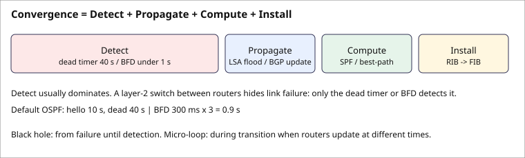

*شکل: چهار مرحله‌ی Convergence؛ Detect معمولاً غالب است.*

### ۵) مثال حل‌شده

**شرایط:** R1—SW—R2 (سوئیچ لایه ۲ بین آن‌ها)، OSPF Area 0، Hello 10/Dead 40. پورت سوئیچ سمت R2 کابلش کشیده می‌شود. R1 همچنان Up می‌بیند.

``` text
t=0 s     cable on SW->R2 pulled; R1 Gi0/0 still up (link to SW is up)
t=0..40 s R1 keeps sending packets to R2 via the dead path (black hole)
t=40 s    Dead timer expires on R1: neighbor Down
t=40.05   SPF recalculated; backup route (via R3) installed
t=40.1    traffic flows via backup path
Outage ~= 40 s
```

**راه‌حل‌ها و مقایسه:**

| راه‌حل | زمان قطعی تقریبی | یادداشت |
|---|---|---|
| پیش‌فرض | ~40 s | بدون هزینه |
| Fast Hello 1/4 | ~4 s | بار Hello 10 برابر |
| BFD 300×3 | ~1 s | نیاز به پشتیبانی دو سر |
| لینک مستقیم بدون سوئیچ | ~0.1 s (Carrier) | تغییر طراحی |

**مثال سخت:** در شبکه‌ی دو فایروال (فصل ۱۵)، Active/Standby با OSPF و لینک از طریق سوئیچ‌های L2 وصل است. تیم می‌گوید «Failover ما ۴۰ ثانیه است». با اعداد بالا بگویید دقیقاً چه چیزی مقصر است و دو راه اصلاح با ریسک هر کدام.

### ۶) طراحی و تصمیم‌گیری

| نیاز | پیشنهاد | دلیل |
|---|---|---|
| لینک بین روتر و فایروال از سوئیچ می‌گذرد | BFD یا Fast Hello | Carrier Loss دیده نمی‌شود |
| لینک WAN/ISP | IP SLA/Track یا BFD (اگر ISP پشتیبانی کند) | Up بودن Interface کافی نیست |
| شبکه‌ی پرنوسان (لینک ناپایدار) | زمان‌های محافظه‌کارانه + Dampening | جلوگیری از Flap |
| VoIP/Real-time | زیر ۱ ثانیه (BFD) | حساسیت Jitter |

اصل طراحی: **سریع‌ترین Convergence همیشه بهترین نیست؛ سریع‌ترین ممکنِ پایدار بهترین است.**

### ۷) پیاده‌سازی (CLI Cisco، نمونه)

``` text
R1(config)# interface GigabitEthernet0/0
R1(config-if)# ip ospf hello-interval 1
R1(config-if)# ip ospf dead-interval 4

! BFD (example, requires support on both ends and platform)
R1(config-if)# bfd interval 300 min_rx 300 multiplier 3
R1(config)# router ospf 1
R1(config-router)# bfd all-interfaces

R1# show ip ospf interface GigabitEthernet0/0
R1# show bfd neighbors
R1# show ip ospf neighbor
```

> **هشدار:** Hello/Dead باید در دو سر یکی باشد؛ در غیر این صورت همسایگی برقرار نمی‌شود. روی vIOS پشتیبانی BFD `Unverified` است.

### ۸) Troubleshooting

| علامت | شاهد | علت محتمل |
|---|---|---|
| Failover ~40 ثانیه | `show ip ospf neighbor` Dead Time | Detect فقط با Dead Timer |
| همسایگی Flap می‌شود | `%OSPF-5-ADJCHG` مکرر | زمان‌ها خیلی تهاجمی/لینک ناپایدار |
| Route پشتیبان نصب نمی‌شود | `show ip route`، `show ip ospf database` | AD/Cost/LSDB ناقص |
| بعد از Failover بعضی Sessionها نمی‌آیند | Session Table فایروال | State قبلی/NAT (فصل ۱۳، ۲۲) |

### ۹) نکات امنیتی

- BFD و Hello سریع را روی لینک‌های غیرقابل‌اعتماد با Authentication محافظت کنید (OSPF Authentication، بخش‌های فصل ۸).
- Timerهای تهاجمی می‌توانند در حمله‌ی DoS روی لینک، شبکه را ناپایدار کنند.
- Failover بی‌شواهد می‌تواند ترافیک را از مسیر «بازرسی‌نشده» (دور از فایروال) عبور دهد؛ پس مسیر پشتیبان هم باید از Policy امنیتی عبور کند.

### ۱۰) جمع‌بندی مفهومی

- Convergence = Detect + Propagate + Compute + Install؛ Detect معمولاً غالب است.
- پیش‌فرض OSPF: Dead 40 s؛ سوئیچ L2 میانی خرابی لینک را پنهان می‌کند.
- BFD و Fast Hello زمان Detect را کم می‌کنند، با هزینه‌ی پایداری.
- Floating Static بدون Track قطع پنهان ISP را نمی‌بیند.
- Convergence را باید در Lab اندازه گرفت (با ping پیوسته و timestamp)، نه حدس زد.

### ۱۱) تمرین و ارزیابی

**ت1.** (ساده) چهار مرحله‌ی Convergence را نام ببرید. *(پاسخ: 5-7-ت1)*

**ت2.** (ساده) Dead interval پیش‌فرض OSPF روی Ethernet چند ثانیه است؟ *(پاسخ: 5-7-ت2)*

**ت3.** (متوسط) BFD با interval 200 ms و multiplier 4 چه زمان Detect دارد؟ *(پاسخ: 5-7-ت3)*

**ت4.** (متوسط) چرا قطع کابل بین سوئیچ و روتر، Interface روتر مقابل را Down نمی‌کند؟ *(پاسخ: 5-7-ت4)*

**ت5.** (سخت) یک IP SLA با frequency 10 ثانیه و آستانه‌ی ۳ شکست متوالی دارید. بدترین زمان Detect را حساب کنید و بگویید برای VoIP قابل‌قبول است؟ *(پاسخ: 5-7-ت5)*

**ت6.** (سخت، طراحی) برای دو فایروال Active/Standby که با دو سوئیچ به روترها وصل‌اند، سه گزینه‌ی کاهش زمان Failover را با مزایا و ریسک مقایسه کنید. *(پاسخ: 5-7-ت6)*

**م1.** Black Hole چیست؟ *(پاسخ: 5-7-م1)*

**م2.** چرا Timer تهاجمی ممکن است شبکه را بی‌ثبات کند؟ *(پاسخ: 5-7-م2)*

**Q1.** Quick quiz (English): Which convergence phase usually dominates, and why? *(پاسخ: 5-7-Q1)*

### ۱۲) اصطلاحات و English Corner

| مخفف | شکل کامل | معنی |
|---|---|---|
| BFD | Bidirectional Forwarding Detection | تشخیص سریع خرابی مسیر |
| SPF | Shortest Path First | الگوریتم محاسبه‌ی مسیر |
| LSA | Link-State Advertisement | بسته‌ی اعلام وضعیت لینک |
| MRAI | Minimum Route Advertisement Interval | حداقل فاصله‌ی ارسال تغییر مسیر در BGP |
| Flap | Route/Link flap | قطع/وصل مکرر |
| Micro-loop | Micro-loop | حلقه‌ی کوتاه‌مدت هنگام همگرایی |

- *Convergence is complete when all routers have a consistent view of the topology.* ← وقتی همه‌ی روترها تصویر یکسانی از توپولوژی داشته باشند، Convergence کامل است.
- *Detection time dominates failover when a switch masks link failures.* ← وقتی سوئیچ خرابی لینک را پنهان کند، زمان تشخیص بر Failover غالب می‌شود.

### ۱۳) منابع

- RFC 2328 — OSPF Version 2 (Hello/Dead، SPF).
- RFC 5880 — Bidirectional Forwarding Detection (BFD).
- Cisco: «OSPF Support for Fast Hello Packets» و «Bidirectional Forwarding Detection» (IOS XE Configuration Guides).


## پاسخ‌های فصل 5

> ابتدا بدون نگاه حل کنید. شناسه: درس-نوع+شماره (ت = تمرین، م = مرور، Q = Quick quiz).

**5-1-ت1** — ۱ (ساده): L و C چه فرقی دارند؟

``` text
C = the connected network (prefix); L = the local router address on it (/32).
```

**5-1-ت2** — ۲ (ساده): AD برای Static و OSPF؟

``` text
Static 1, OSPF 110
```

**5-1-ت3** — ۳ (متوسط): بسته به 10.1.1.77؛ Routeهای /8، /16 و /0 موجودند. کدام؟

``` text
/16 (longest matching prefix among those that match).
```

**5-1-ت4** — ۴ (متوسط): آیا Metric یک Route در OSPF با RIP قابل مقایسه است؟

``` text
No. Different protocols use different metrics; AD decides between sources.
```

**5-1-ت5** — ۵ (سخت): Static 10.0.0.0/8 و OSPF 10.0.23.0/30 هر دو موجود؛ بسته به 10.0.23.5 از کجا می‌رود؟

``` text
Via the OSPF route: /30 is the longest prefix. AD is only used for identical prefixes.
```

**5-1-م1** — اولین چیزی که روتر برای انتخاب Route نگاه می‌کند؟

طول Prefix (Longest Prefix Match).

**5-1-م2** — AD برای چیست؟

انتخاب بین منابع مختلف Route برای یک Prefix یکسان.

**5-1-Q1** — Quick quiz (answer in English): Which is compared first: administrative distance or prefix length?

Prefix length (longest match) is compared first; AD only breaks ties between equal prefixes.

**5-2-ت1** — ۱ (ساده): Static برای شبکه‌ی 172.16.5.0/24 با Next-hop 10.0.0.2

``` text
ip route 172.16.5.0 255.255.255.0 10.0.0.2
```

**5-2-ت2** — ۲ (ساده): چرا روی اترنت Next-hop می‌نویسیم؟

``` text
Interface-only routes make the router ARP for every destination; next-hop is deterministic.
```

**5-2-ت3** — ۳ (متوسط): Summary چهار شبکه‌ی 10.2.4.0/24 تا 10.2.7.0/24؟

``` text
Third octet 4..7 -> block 4 -> 10.2.4.0/22
```

**5-2-ت4** — ۴ (متوسط): ping یک‌طرفه شکست می‌خورد؛ علت؟

``` text
Missing return route on one of the hops.
```

**5-2-ت5** — ۵ (سخت): چرا Route به Null0 با AD 200؟

``` text
To drop unmatched traffic inside a summary without overriding real (more specific or lower AD) routes.
```

**5-2-م1** — Static Route کی مناسب است؟

شبکه‌ی کوچک یا لینک‌های ثابت مثل Default به ISP.

**5-2-م2** — چرا مسیر برگشت مهم است؟

ارتباط دوطرفه است؛ بدون Route برگشت پاسخ نمی‌رسد.

**5-2-Q1** — Quick quiz (answer in English): Why do we avoid exit-interface-only static routes on Ethernet?

The router must ARP for every destination, relying on proxy ARP.

**5-3-ت1** — ۱ (ساده): AD پیش‌فرض Static و Floating معمول؟

``` text
Static default AD = 1; floating backup typically 200 (any value higher than the primary).
```

**5-3-ت2** — ۲ (ساده): چرا 0.0.0.0 0.0.0.0 همه‌ی مقاصد را می‌پوشاند؟

``` text
Prefix length 0 matches every address; it is only used when nothing longer matches.
```

**5-3-ت3** — ۳ (متوسط): چرا Floating به‌تنهایی کافی نیست؟

``` text
The static route stays installed while the interface is up, even if the ISP is dead.
```

**5-3-ت4** — ۴ (متوسط): دستور Route وابسته به Track؟

``` text
ip route 0.0.0.0 0.0.0.0 203.0.113.1 track 1
```

**5-3-ت5** — ۵ (سخت): چه چیزی را باید پروب کنیم؟

``` text
The next-hop and ideally something beyond it (a reliable remote address) to detect upstream failure.
```

**5-3-م1** — Floating Static چیست؟

Route پشتیبان با AD بالاتر که فقط با حذف Route اصلی فعال می‌شود.

**5-3-م2** — IP SLA برای چیست؟

سنجش سلامت واقعی مسیر تا Failover درست انجام شود.

**5-3-Q1** — Quick quiz (answer in English): Why can a static route stay in the table even if the ISP is down?

Because it depends on the local interface state, not on end-to-end reachability.

**5-4-ت1** — ۱ (ساده): سه مرحله‌ی کار OSPF؟

``` text
1) discover neighbors 2) exchange LSAs to build the same LSDB 3) run SPF to compute best paths
```

**5-4-ت2** — ۲ (ساده): Hello/Dead پیش‌فرض اترنت؟

``` text
10 s / 40 s
```

**5-4-ت3** — ۳ (متوسط): Cost لینک 1 Gbps با Reference 100 Mbps؟

``` text
100 / 1000 = 0.1 -> rounded up to 1
```

**5-4-ت4** — ۴ (متوسط): Cost لینک 100 Mbps با Reference 10000؟

``` text
10000 / 100 = 100
```

**5-4-ت5** — ۵ (سخت): دو روتر در Init مانده‌اند؛ علت‌های محتمل؟

``` text
Hello not received on one side: ACL blocking, hello/dead mismatch, subnet/mask mismatch, wrong interface in OSPF.
```

**5-4-م1** — OSPF چه نوع پروتکلی است؟

Link-State؛ هر روتر نقشه‌ی کامل Area را دارد.

**5-4-م2** — Hello و Dead چیست؟

Hello برای معرفی دوره‌ای؛ Dead زمان انتظار قبل از اعلام قطع همسایه.

**5-4-Q1** — Quick quiz (answer in English): What are the three steps of OSPF operation?

Form neighbor adjacencies, exchange LSAs to build the LSDB, and run SPF to calculate best paths.

**5-5-ت1** — ۱ (ساده): Wildcard برای /27؟

``` text
255.255.255.255 - 255.255.255.224 = 0.0.0.31
```

**5-5-ت2** — ۲ (ساده): چرا Loopback را passive می‌کنیم؟

``` text
It does not need to form neighbors but its network must be advertised.
```

**5-5-ت3** — ۳ (متوسط): Cost 21 در R1 برای شبکه‌ی R3 را توضیح بده

``` text
Two links of 10 each (R1-R2, R2-R3) plus 1 for the Loopback = 21.
```

**5-5-ت4** — ۴ (متوسط): state ExStart گیر کرده؛ علت؟

``` text
Typically an MTU mismatch (or duplicate router ID).
```

**5-5-ت5** — ۵ (سخت): default-information originate بدون Default روی روتر چه می‌شود؟

``` text
Nothing is advertised unless "always" is used; the router needs its own default route.
```

**5-5-م1** — network statement چه می‌کند؟

Interfaceهایی که آدرسشان در بازه است را وارد OSPF می‌کند.

**5-5-م2** — passive-interface چه فایده‌ای دارد؟

Hello نمی‌فرستد؛ امنیت و کاهش ترافیک، ولی شبکه همچنان اعلام می‌شود.

**5-5-Q1** — Quick quiz (answer in English): Which command verifies that neighbors reached FULL?

show ip ospf neighbor

**5-6-ت1** — ۱ (ساده): اولین ابزار عیب‌یابی مسیریابی؟

``` text
show ip route <destination> and ping/traceroute.
```

**5-6-ت2** — ۲ (ساده): پنج دلیل Adjacency نشدن؟

``` text
Hello/Dead, Area, Subnet/Mask, Authentication, MTU.
```

**5-6-ت3** — ۳ (متوسط): در ExStart گیر کرده؛ اول چه چیزی را بررسی می‌کنی؟

``` text
MTU mismatch between the two interfaces.
```

**5-6-ت4** — ۴ (سخت): ping از A به B شکست می‌خورد ولی traceroute تا Hop آخر پیش می‌رود؛ حدس؟

``` text
Return path issue at the destination or an ACL/firewall on the destination side.
```

**5-6-م1** — قدم اول عیب‌یابی مسیریابی؟

تعیین مبدأ و مقصد دقیق و بررسی Route رفت و برگشت.

**5-6-م2** — MTU Mismatch چه علامتی دارد؟

همسایه در ExStart/Exchange می‌ماند.

**5-6-Q1** — Quick quiz (answer in English): A neighbor is stuck in ExStart. What is the most likely cause?

An MTU mismatch between the two interfaces.

---

<a id="ch6"></a>


### پاسخ‌های درس‌های افزوده‌ی فصل 5 (۵-۰ و ۵-۷)

**5-0-ت1** — RIB جدول مسیرهای انتخاب‌شده‌ی Control Plane است؛ FIB نسخه‌ی بهینه‌ی آن برای جست‌وجوی سریع در Data Plane. RIB را پروتکل‌ها می‌سازند و FIB از RIB ساخته می‌شود.

**5-0-ت2** — MAC مقصد تغییر می‌کند (هدر L2 دوباره ساخته می‌شود) و TTL یکی کم می‌شود. IP مقصد بدون NAT ثابت می‌ماند.

**5-0-ت3** — با فقط Interface خروجی روی Ethernet، روتر برای هر مقصد جداگانه ARP می‌فرستد و به Proxy ARP طرف مقابل وابسته می‌شود؛ جدول ARP بزرگ و شکننده می‌شود. Next-hop (یا هر دو) درست‌تر است.

**5-0-ت4** — خیر، نصب نمی‌شود. Next-hop 10.0.0.9 قابل Recursive Lookup نیست (در هیچ Connected یا مسیر دیگر نیست)، پس Route معتبر نیست و در RIB دیده نمی‌شود (در پیکربندی هست، در جدول نه).

**5-0-ت5** — بسته‌ی اول چون Adjacency ناقص است ARP می‌فرستد و Drop می‌شود؛ پس از پاسخ ARP، بسته‌های بعدی ارسال می‌شوند. شاهد: `show ip route` Route درست را نشان می‌دهد؛ `show adjacency` قبلاً Incomplete و بعداً کامل است؛ `show ip arp` ورودی بعد از ping اول ساخته می‌شود.

**5-0-ت6** — CoPP/محدودسازی: SSH/SNMP/NTP فقط از شبکه‌ی مدیریت (ACL روی VTY و Class برای ترافیک مدیریتی)، پروتکل‌های مسیریابی فقط از همسایه‌های شناخته‌شده، ICMP به روتر نرخ‌محدود؛ بقیه‌ی ترافیک Punt محدود یا رد شود. هدف: CPU با ترافیک مهاجم اشباع نشود و Control Plane زنده بماند.

**5-0-م1** — Punt یعنی بسته‌ای که باید در CPU (Control Plane) پردازش شود، نه در مسیر سریع؛ مثل ترافیک مقصد‌ روتر یا TTL=1.

**5-0-م2** — چون ARP برای Next-hop هنوز حل نشده؛ بسته‌ی اول معمولاً Drop می‌شود و ARP می‌رود.

**5-0-Q1** — The control plane builds the RIB and FIB; the data plane uses the FIB (and adjacency table) to forward packets.

**5-7-ت1** — Detect، Propagate، Compute (SPF)، Install (RIB/FIB).

**5-7-ت2** — 40 ثانیه (Hello 10 ثانیه، Dead چهار برابر آن).

**5-7-ت3** — 200 ms × 4 = 800 ms.

**5-7-ت4** — چون لینک روتر به سوئیچ هنوز برقرار است؛ Carrier روتر قطع نشده. فقط Dead Timer یا BFD خرابی را می‌فهمد.

**5-7-ت5** — بدترین حالت حدود 10 × 3 = 30 ثانیه (به‌علاوه‌ی تا یک فاصله‌ی Probe برای شروع). برای VoIP قابل‌قبول نیست؛ BFD یا Probe سریع‌تر لازم است.

**5-7-ت6** — (۱) Fast Hello/Dead: ساده، بار CPU و ریسک Flap. (۲) BFD: Detect زیر یک ثانیه، نیاز به پشتیبانی دو سر و پیکربندی بیشتر. (۳) حذف سوئیچ میانی/Link-state tracking: Carrier Loss فوری، ولی تغییر طراحی. انتخاب بر پایه‌ی پشتیبانی پلتفرم و تحمل Flap.

**5-7-م1** — دوره‌ای که مسیر خراب هنوز در جدول است و بسته‌ها در آن ناپدید می‌شوند.

**5-7-م2** — چون خرابی‌های کوتاه (Jitter لینک) را «قطع» می‌گیرند و Flap و محاسبات پیاپی SPF رخ می‌دهد.

**5-7-Q1** — Detection usually dominates, because dead timers or probes take seconds while propagation, SPF and installation take milliseconds.


# فصل 6 — Routing II: OSPF پیشرفته، IPv6 و FHRP (Lab A)

**مدت:** ۳۶ ساعت | **پیش‌نیاز:** فصل ۵.
**اهداف:** DR/BDR، OSPF چندناحیه‌ای، OSPFv3، HSRP، Lab A کامل؛ **Gate G3**.
**معیار تسلط:** Failover با Track؛ ABR و خلاصه‌سازی؛ As-Built Lab A.
**اشتباهات رایج:** دو Gateway برای یک VLAN؛ Preempt خاموش؛ Track فراموش‌شده.

**درس‌های فصل:**
- [درس 6-1 — DR/BDR، Network Type و Cost](#l-6-1)
- [درس 6-2 — OSPF چندناحیه‌ای](#l-6-2)
- [درس 6-3 — OSPFv3 و IPv6](#l-6-3)
- [درس 6-4 — HSRP و FHRP](#l-6-4)
- [درس 6-5 — پیاده‌سازی Lab A](#l-6-5)
- [درس 6-6 — عیب‌یابی و آزمون G3](#l-6-6)

---

<a id="l-6-1"></a>

## درس 6-1 — DR/BDR، Network Type و Cost

**فصل ۶ - روز ۱ · پیش‌نیاز: فصل ۵ · ۶ ساعت**

### این درس درباره چیست و چرا باید یاد بگیریم؟

**چه چیزی یاد می‌گیریم:** رفتار OSPF روی لینک‌های اشتراکی (اترنت): انتخاب DR و BDR، انواع شبکه (Network Type)، تنظیم Cost و سرعت شناسایی قطع (Timer، BFD به‌صورت مفهومی).

**چرا لازم است:** روی یک سوییچ با ۱۰ روتر، اگر همه با همه همسایه شوند ۴۵ همسایگی داریم. DR این را به ۱۰ ساده می‌کند. ولی اگر ندانید DR چیست، نمی‌توانید بفهمید چرا «همسایه‌ها در 2-Way مانده‌اند» که کاملاً عادی است.

- **در کار روزانه:** وقتی در show ip ospf neighbor حالت 2WAY/DROTHER می‌بینید، باید بدانید خطا نیست.
- **در امنیت:** Priority مناسب جلوی DR شدن روتر ناخواسته را می‌گیرد.
- **در Capstone:** لینک‌های نقطه‌به‌نقطه را point-to-point می‌کنیم تا DR لازم نشود.

> **مسیر درس**
>
> مشکل ← DR/BDR ← انتخاب ← Network Type ← Cost و Timer ← مثال ساده/متوسط/سخت ← Lab ← عیب‌یابی.

#### اصطلاحات این درس (مخفف ← شکل کامل ← معنی)

| مخفف         | شکل کامل انگلیسی                   | معنی فارسی                            |
|--------------|------------------------------------|---------------------------------------|
| DR           | Designated Router                  | روتر هماهنگ‌کننده‌ی یک Segment          |
| BDR          | Backup Designated Router           | DR پشتیبان                            |
| DROther      | DROther                            | روتر غیر DR/BDR                       |
| Priority     | OSPF Priority                      | اولویت انتخاب DR (پیش‌فرض ۱)           |
| Network Type | OSPF Network Type                  | نوع لینک: broadcast یا point-to-point |
| 224.0.0.5    | AllSPFRouters                      | Multicast همه‌ی روترهای OSPF           |
| 224.0.0.6    | AllDRouters                        | Multicast ویژه‌ی DR/BDR                |
| BFD          | Bidirectional Forwarding Detection | شناسایی سریع قطع لینک                 |

### ۱. مشکل: همه با همه

فرض کنید ۵ روتر روی یک سوییچ هستند. اگر هر روتر با هر روتر دیگر «همسایه‌ی کامل» (Full) شود، تعداد Adjacency می‌شود:

``` text
n routers, full mesh adjacencies = n x (n - 1) / 2
n = 5  -> 5 x 4 / 2   = 10
n = 10 -> 10 x 9 / 2  = 45
```

و هر تغییر، همه را درگیر می‌کند. راه‌حل: یک «سخنگو» انتخاب کنیم.

### ۲. DR و BDR

روی هر شبکه‌ی Broadcast (مثل اترنت) OSPF یک **DR** و یک **BDR** انتخاب می‌کند. هر روتر فقط با DR و BDR به حالت Full می‌رسد؛ با بقیه‌ی روترها (DROther) فقط تا 2-Way می‌ماند و این کاملاً طبیعی است.

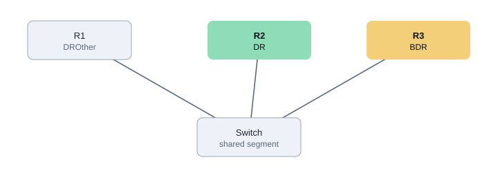

*شکل ۱: روی Segment مشترک، R2 DR و R3 BDR است؛ R1 فقط با این دو Full می‌شود.*

| رابطه             | حالت         |
|-------------------|--------------|
| DROther ↔ DROther | 2-Way (عادی) |
| DROther ↔ DR      | Full         |
| DROther ↔ BDR     | Full         |
| DR ↔ BDR          | Full         |

#### انتخاب DR

1.  بالاترین Priority (پیش‌فرض ۱؛ ۰ یعنی هرگز DR نشو).
2.  اگر برابر بود، بالاترین Router ID.

> **نکته‌ی مهم**
>
> انتخاب DR «غیرقابل‌پس‌گرفتن» است (Non-preemptive): اگر روتری با Priority بالاتر بعد از انتخاب وارد شود، DR فعلی کنار نمی‌رود، تا زمانی که OSPF Process دوباره راه بیفتد.

``` text
R2(config)# interface gi0/0
R2(config-if)# ip ospf priority 100
R1(config)# interface gi0/0
R1(config-if)# ip ospf priority 0      ! never become DR
R1# clear ip ospf process               ! re-run the election (careful)
```

### ۳. Network Type

روی لینک نقطه‌به‌نقطه (فقط دو روتر)، DR بی‌معنی است. با تغییر نوع به point-to-point، DR انتخاب نمی‌شود و همگرایی هم سریع‌تر است:

| نوع               | DR؟ | Hello/Dead | کاربرد               |
|-------------------|-----|------------|----------------------|
| broadcast (اترنت) | بله | 10/40      | پیش‌فرض اترنت         |
| point-to-point    | خیر | 10/40      | لینک دو روتر (توصیه) |
| non-broadcast     | بله | 30/120     | Frame Relay قدیمی    |

``` text
R1(config)# interface gi0/1
R1(config-if)# ip ospf network point-to-point
R2(config)# interface gi0/0
R2(config-if)# ip ospf network point-to-point   ! both ends the same
```

اگر یک سر broadcast و سر دیگر point-to-point باشد، همسایگی بالا می‌آید ولی Routeها نامعتبر می‌شود (مشکل رایج). همیشه دو سر را هم‌نوع کنید.

### ۴. تنظیم Cost برای هدایت ترافیک

``` text
R1(config)# interface gi0/1
R1(config-if)# ip ospf cost 50
Cost = Reference / bandwidth, or any manual value 1..65535
SPF picks the path with the lowest TOTAL cost
```

مثال: دو مسیر به یک مقصد داریم؛ لینک ۱ گیگی (Cost 10) و لینک پشتیبان ۱۰۰ مگی (Cost 100). روتر مسیر ۱ گیگ را انتخاب می‌کند. اگر بخواهید پشتیبان نباشد، با Cost دستی مسیر را عوض کنید.

### ۵. سرعت شناسایی قطع

با تایمر پیش‌فرض (Dead = 40 ثانیه)، قطع یک همسایه تا ۴۰ ثانیه دیر شناخته می‌شود. دو راه: کاهش Hello/Dead (تا ۱ ثانیه با `fast-hello`) یا BFD که در میلی‌ثانیه تشخیص می‌دهد. BFD فقط مفهومی و Unverified در Lab ماست.

``` text
R1(config-if)# ip ospf hello-interval 1
R1(config-if)# ip ospf dead-interval 4
(both ends must match; too aggressive timers cause flapping)
```

### ۶. مثال‌ها

#### ساده

``` text
show ip ospf neighbor
3.3.3.3  1  FULL/BDR   ...
2.2.2.2  1  FULL/DR    ...
```

#### متوسط: چرا 2WAY/DROTHER؟

``` text
R1 neighbor R4: state 2WAY/DROTHER
Both are DROthers -> normal, not an error
```

#### سخت: DR اشتباه

``` text
Old switch router became DR (highest router ID)
Fix: set priority 100 on the core router, priority 0 on edge routers,
     then clear ip ospf process (maintenance window)
```

### تمرین‌ها

**ت1.** ۱ (ساده): چند Adjacency برای ۶ روتر در Full Mesh؟ *(پاسخ: 6-1-ت1 در بخش «پاسخ‌ها» انتهای فصل)*

**ت2.** ۲ (ساده): DROther با DROther چه حالتی؟ *(پاسخ: 6-1-ت2 در بخش «پاسخ‌ها» انتهای فصل)*

**ت3.** ۳ (متوسط): انتخاب DR بر چه اساسی؟ *(پاسخ: 6-1-ت3 در بخش «پاسخ‌ها» انتهای فصل)*

**ت4.** ۴ (متوسط): چه زمانی point-to-point؟ *(پاسخ: 6-1-ت4 در بخش «پاسخ‌ها» انتهای فصل)*

**ت5.** ۵ (سخت): چرا بعد از تغییر Priority، DR عوض نشد؟ *(پاسخ: 6-1-ت5 در بخش «پاسخ‌ها» انتهای فصل)*

### Lab هدایت‌شده

سه روتر روی یک سوییچ (SW1) در یک Segment مشترک: R1، R2، R3 با Gi0/0 به SW1 وصل‌اند، شبکه‌ی 10.10.100.0/24 (آدرس‌ها .1 .2 .3).

#### گام ۱: OSPF روی Segment مشترک

``` text
Rx(config)# router ospf 1
Rx(config-router)# network 10.10.100.0 0.0.0.255 area 0
Rx# show ip ospf neighbor
```

DR و BDR را بخوانید (Router ID بالاتر DR می‌شود). نتیجه را یادداشت کنید.

#### گام ۲: تغییر Priority

``` text
R1(config)# interface gi0/0
R1(config-if)# ip ospf priority 100
R1# clear ip ospf process
```

دوباره show ip ospf neighbor: آیا R1 DR شد؟

#### گام ۳: point-to-point روی لینک دو روتر

یک لینک مستقیم R1-R2 با `ip ospf network point-to-point` در هر دو سر؛ مشاهده کنید حالت FULL/- بدون DR است.

### Lab مستقل

جدول «DR/BDR/DROther هر Segment» و Priorityها را در `03-ops/ospf-dr-plan.md` بنویسید.

### عیب‌یابی

|         |                                                                            |
|---------|----------------------------------------------------------------------------|
| Symptom | همسایه‌ها 2WAY مانده‌اند                                                     |
| تحلیل   | اگر هر دو DROther هستند، طبیعی است                                         |
| چک‌لیست  | ۱) DR/BDR موجود است؟ ؛ ۲) Priority دو طرف؟ ؛ ۳) نوع شبکه دو سر هم‌خوان است؟ |
| رفع     | تنظیم Priority یا point-to-point                                           |

### سؤال‌های مرور

**م1.** DR چرا لازم است؟ *(پاسخ: 6-1-م1 در بخش «پاسخ‌ها» انتهای فصل)*

**م2.** Network Type چه تأثیری دارد؟ *(پاسخ: 6-1-م2 در بخش «پاسخ‌ها» انتهای فصل)*

### English Corner: انگلیسی تخصصی این درس

این جمله‌ها از مستندات و محیط کار واقعی‌اند. بلند بخوانید و ترجمه را بپوشانید.

| English sentence                                                    | ترجمه                                                 |
|---------------------------------------------------------------------|-------------------------------------------------------|
| The DR reduces the number of adjacencies on a multi-access segment. | DR تعداد Adjacency را در Segment چندمسیره کم می‌کند.   |
| DROther routers stay in 2-Way with each other.                      | روترهای DROther با هم در 2-Way می‌مانند.               |
| Set the network type to point-to-point on two-router links.         | روی لینک دو روتر، نوع شبکه را point-to-point بگذارید. |
| DR election is non-preemptive.                                      | انتخاب DR غیرقابل‌پس‌گیری (Non-preemptive) است.         |

**Q1.** Quick quiz (answer in English): Why is 2-Way between two DROthers normal? *(پاسخ: 6-1-Q1 در بخش «پاسخ‌ها» انتهای فصل)*

### تکلیف و چک‌لیست تسلط

- [ ] DR/BDR را در Lab ببینم و تغییر دهم.
- [ ] point-to-point را تست کنم.
- [ ] جدول Priority را بنویسم.

### یادآوری اشتباهات شما

> **یادآوری**
>
> پیش‌بینی قبل از اجرا؛ بکاپ قبل از تغییر؛ پذیرفته‌شدن دستور ≠ کار کردن؛ فرمول‌ها در بلوک مستقل.


#### کارت Lab — DR/BDR، Network Type و Cost

| # | فیلد | محتوا |
|---|---|---|
| 1 | عنوان و هدف | DR/BDR و Network Type |
| 2 | پیش‌نیاز | فصل 5 |
| 3 | توپولوژی | ۳ روتر + سوییچ |
| 4 | تجهیزات | R1-R3 + SW1 |
| 5 | نسخه نرم‌افزار | vIOS-L2 15.2(20200924، Experimental) برای SW؛ vIOS 15.9(3)M9 برای R؛ VPCS؛ PNetLab 4.2.8 |
| 6 | IP Plan | OSPF area 0 |
| 7 | وضعیت اولیه | Segment مشترک |
| 8 | صورت مسئله | Priority و p2p |
| 9 | مراحل هدایت‌شده | همان بخش «Lab هدایت‌شده» همین درس |
| 10 | تست عملکرد | `show ip ospf neighbor` |
| 11 | سناریوی خرابی | DROther 2WAY |
| 12 | روش عیب‌یابی | لایه‌ای/با شواهد (بخش عیب‌یابی همین درس) |
| 13 | نتیجه‌ی مورد انتظار | DR/BDR تعیین |
| 14 | معیار پذیرش | ثبت نقش‌ها |
| 15 | مستندات نهایی | `03-ops/ospf-dr-plan.md` |
| 16 | Cleanup و بازگردانی | — |

> **وضعیت راستی‌آزمایی (خارج از ۱۶ فیلد):** **اجرا نشده (فقط طراحی).** اجرا نشده.

---

<a id="l-6-2"></a>

## درس 6-2 — OSPF چندناحیه‌ای

**فصل ۶ - روز ۲ · پیش‌نیاز: درس ۶-۱ · ۶ ساعت**

### این درس درباره چیست و چرا باید یاد بگیریم؟

**چه چیزی یاد می‌گیریم:** چرا OSPF را به چند ناحیه (Area) تقسیم می‌کنیم، نقش ABR و ASBR، انواع LSA به‌صورت خلاصه، خلاصه‌سازی بین ناحیه‌ها و انواع Stub Area.

**چرا لازم است:** در شبکه‌ی بزرگ، یک Area واحد یعنی هر تغییر کوچک در یک شعبه همه‌ی روترها را وادار به اجرای SPF می‌کند و جداول بزرگ می‌شوند. Areaها این تغییرات را محلی نگه می‌دارند و پایداری و مقیاس را بالا می‌برند.

- **در کار روزانه:** سازمان‌های چندشعبه‌ای از Area برای هر شعبه یا هر منطقه استفاده می‌کنند.
- **در امنیت:** Area مرز دسترسی نیز هست؛ می‌توان Routeهای ناخواسته را جلوی ورود به Area گرفت.
- **در Capstone:** Lab A می‌تواند ۲ Area (مرکز و شعبه) داشته باشد.

> **مسیر درس**
>
> چرا Area ← قانون Area 0 ← ABR/ASBR ← LSAها ← خلاصه‌سازی ← Stub ← Lab ← عیب‌یابی.

#### اصطلاحات این درس (مخفف ← شکل کامل ← معنی)

| مخفف     | شکل کامل انگلیسی                  | معنی فارسی                                       |
|----------|-----------------------------------|--------------------------------------------------|
| Area     | OSPF Area                         | ناحیه‌ی OSPF                                      |
| Backbone | Backbone Area 0                   | ناحیه‌ی مرکزی که همه‌ی Areaها باید به آن وصل باشند |
| ABR      | Area Border Router                | روتر مرزی بین دو Area                            |
| ASBR     | Autonomous System Boundary Router | روتر مرز با دنیای خارج OSPF                      |
| LSA      | Link-State Advertisement          | اعلان وضعیت لینک                                 |
| Stub     | Stub Area                         | ناحیه‌ای که Routeهای خارجی را نمی‌گیرد             |
| Summary  | Inter-area summary                | خلاصه‌سازی در ABR                                 |

### ۱. چرا Area؟

یک شهر بزرگ را به محله تقسیم می‌کنند؛ هر محله نقشه‌ی دقیق خودش را دارد و برای بقیه‌ی شهر فقط «خلاصه» می‌داند. OSPF هم همین‌طور: داخل هر Area نقشه‌ی کامل، و بین Areaها فقط خلاصه.

- تغییر لینک در یک Area فقط همان Area را به SPF می‌اندازد.
- جدول LSDB کوچک‌تر می‌شود.
- امکان خلاصه‌سازی مسیرها.

### ۲. قانون مهم: همه‌ی Areaها به Area 0 وصل

ترافیک بین دو Area معمولی باید از Area 0 (Backbone) بگذرد. Area 0 مثل بزرگراه مرکزی است و همه‌ی محله‌ها به آن راه دارند.

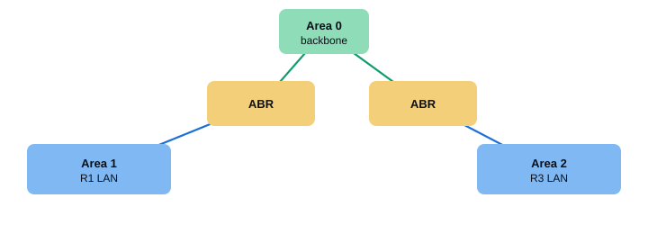

*شکل ۱: Area 1 و Area 2 از طریق ABRها به Area 0 وصل‌اند.*

### ۳. ABR و ASBR

| نقش             | تعریف                                                         | کار                              |
|-----------------|---------------------------------------------------------------|----------------------------------|
| Internal Router | همه‌ی Interfaceها در یک Area                                   | فقط LSDB همان Area               |
| ABR             | Interfaceها در دو Area یا بیشتر (یکی Area 0)                  | خلاصه و جابه‌جایی مسیر بین Areaها |
| ASBR            | Route را از پروتکل/منبع دیگر وارد OSPF می‌کند (Static، BGP...) | تزریق Route خارجی                |

``` text
R2(config)# router ospf 1
R2(config-router)# network 10.0.12.0 0.0.0.3 area 1
R2(config-router)# network 10.0.23.0 0.0.0.3 area 0
-> R2 has interfaces in area 1 and area 0 = ABR
```

### ۴. LSAها (به‌صورت خلاصه)

| نوع | نام          | کجا پخش می‌شود    | محتوا                           |
|-----|--------------|------------------|---------------------------------|
| 1   | Router LSA   | داخل Area        | لینک‌های یک روتر                 |
| 2   | Network LSA  | داخل Area        | Segment و روترهایش (توسط DR)    |
| 3   | Summary LSA  | بین Areaها (ABR) | Routeهای یک Area برای Area دیگر |
| 4   | ASBR Summary | بین Areaها       | مسیر رسیدن به ASBR              |
| 5   | External LSA | کل Domain        | Route خارجی (از ASBR)           |

در جدول مسیریابی: `O` یعنی Intra-area، `O IA` یعنی Inter-area (از LSA نوع ۳)، `O E1/E2` یعنی Route خارجی.

### ۵. خلاصه‌سازی در ABR

ABR می‌تواند چند شبکه‌ی ریز یک Area را به یک خلاصه تبدیل کند:

``` text
Area 1 networks: 10.1.0.0/24, 10.1.1.0/24, 10.1.2.0/24, 10.1.3.0/24
Summary: 10.1.0.0/22
```

``` text
R2(config)# router ospf 1
R2(config-router)# area 1 range 10.1.0.0 255.255.252.0
```

اثر: بقیه‌ی Areaها فقط یک Route (10.1.0.0/22) می‌بینند؛ تغییر یک شبکه‌ی ریز دیگر در سراسر شبکه پخش نمی‌شود.

### ۶. Stub Area

شعبه‌ای که فقط یک راه خروج دارد، نیازی ندارد همه‌ی Routeهای خارجی را بداند؛ کافی است یک Default Route از ABR بگیرد:

| نوع            | Routeهای خارجی (LSA 5)       | Default از ABR |
|----------------|------------------------------|----------------|
| Stub           | بلوک                         | بله            |
| Totally Stubby | بلوک (و Inter-area هم)       | بله            |
| NSSA           | Routeهای خارجی محلی با LSA 7 | اختیاری        |

``` text
! on all routers of the area:
R3(config-router)# area 2 stub
! totally stubby (only on the ABR add "no-summary"):
R2(config-router)# area 2 stub no-summary
```

> **قانون**
>
> همه‌ی روترهای یک Area باید نوع Stub یکسان داشته باشند (flag در Hello)، وگرنه همسایه نمی‌شوند.

### ۷. مثال‌ها

#### ساده: دو Area

``` text
R1 (area 1) -- R2 (ABR) -- R3 (area 0)
R3 shows: O IA 192.168.1.0/24 via R2
```

#### متوسط: چرا نمی‌شود Area 1 را مستقیم به Area 2 وصل کرد؟

همه‌ی Areaها باید به Area 0 وصل باشند؛ بین Areaهای غیر صفر Routeها مستقیماً رد نمی‌شود (باید از ABR و Area 0 بگذرد). اگر Area 2 فقط به Area 1 وصل باشد، مسیرها به Area 2 نمی‌رسد؛ برای رفع، Virtual Link (مفهومی) یا طراحی مجدد.

#### سخت: طراحی

سازمان با مرکز و ۳ شعبه: Area 0 = مرکز، هر شعبه یک Area (۱ تا ۳)، ABR روی روتر مرز شعبه. خلاصه‌ی هر شعبه یک /22.

### تمرین‌ها

**ت1.** ۱ (ساده): ABR چیست؟ *(پاسخ: 6-2-ت1 در بخش «پاسخ‌ها» انتهای فصل)*

**ت2.** ۲ (ساده): O IA یعنی؟ *(پاسخ: 6-2-ت2 در بخش «پاسخ‌ها» انتهای فصل)*

**ت3.** ۳ (متوسط): خلاصه‌ی 10.1.4.0/24 تا 10.1.7.0/24؟ *(پاسخ: 6-2-ت3 در بخش «پاسخ‌ها» انتهای فصل)*

**ت4.** ۴ (متوسط): چرا Stub باید روی همه‌ی روترهای Area باشد؟ *(پاسخ: 6-2-ت4 در بخش «پاسخ‌ها» انتهای فصل)*

**ت5.** ۵ (سخت): مزیت Totally Stubby؟ *(پاسخ: 6-2-ت5 در بخش «پاسخ‌ها» انتهای فصل)*

### Lab هدایت‌شده

سه روتر خطی R1—R2—R3 مثل فصل ۵. حالا R1 را در Area 1 و R3 را در Area 0 می‌گذاریم و R2 ABR می‌شود.

#### گام ۱: Areaها

``` text
R1(config)# router ospf 1
R1(config-router)# network 10.0.12.0 0.0.0.3 area 1
R1(config-router)# network 192.168.1.0 0.0.0.255 area 1

R2(config)# router ospf 1
R2(config-router)# network 10.0.12.0 0.0.0.3 area 1
R2(config-router)# network 10.0.23.0 0.0.0.3 area 0

R3(config)# router ospf 1
R3(config-router)# network 10.0.23.0 0.0.0.3 area 0
R3(config-router)# network 192.168.3.0 0.0.0.255 area 0
```

#### گام ۲: مشاهده

``` text
R3# show ip route ospf        (O IA for area 1 networks)
R2# show ip ospf database
R2# show ip ospf
```

#### گام ۳: خلاصه‌سازی

``` text
R2(config)# router ospf 1
R2(config-router)# area 1 range 192.168.0.0 255.255.252.0
R3# show ip route ospf
```

#### گام ۴: Stub

Area 1 را stub کنید (روی R1 و R2) و ببینید Default از ABR می‌آید.

### Lab مستقل

یک «OSPF Area Design» برای Capstone (مرکز + ۳ شعبه) بنویسید: Areaها، ABRها، خلاصه‌ها در `02-design/ospf-areas.md`.

### عیب‌یابی

|         |                                                                                    |
|---------|------------------------------------------------------------------------------------|
| Symptom | Route به یک Area دیگر نمی‌رسد                                                       |
| چک‌لیست  | ۱) Area 0 متصل است؟ ؛ ۲) ABR درست است؟ ؛ ۳) Stub یکسان است؟ ؛ ۴) خلاصه‌سازی نادرست؟ |
| ابزار   | show ip ospf ، show ip ospf database                                               |
| رفع     | اصلاح Area/Stub یا خلاصه‌سازی                                                       |

### سؤال‌های مرور

**م1.** چرا به Area 0 همه وصل‌اند؟ *(پاسخ: 6-2-م1 در بخش «پاسخ‌ها» انتهای فصل)*

**م2.** ASBR چه می‌کند؟ *(پاسخ: 6-2-م2 در بخش «پاسخ‌ها» انتهای فصل)*

### English Corner: انگلیسی تخصصی این درس

این جمله‌ها از مستندات و محیط کار واقعی‌اند. بلند بخوانید و ترجمه را بپوشانید.

| English sentence                                                         | ترجمه                                                 |
|--------------------------------------------------------------------------|-------------------------------------------------------|
| Segmenting the network into areas limits the scope of SPF recalculation. | تقسیم شبکه به Area دامنه‌ی محاسبه‌ی SPF را محدود می‌کند. |
| Every area must connect to the backbone area.                            | هر Area باید به Backbone وصل باشد.                    |
| The ABR summarizes routes between areas.                                 | ABR بین Areaها خلاصه‌سازی می‌کند.                       |
| A stub area receives a default route instead of external routes.         | Stub Area به‌جای Routeهای خارجی Default می‌گیرد.        |

**Q1.** Quick quiz (answer in English): What does an ABR do? *(پاسخ: 6-2-Q1 در بخش «پاسخ‌ها» انتهای فصل)*

### تکلیف و چک‌لیست تسلط

- [ ] دو Area بسازم و O IA ببینم.
- [ ] خلاصه‌سازی را تست کنم.
- [ ] طراحی Area Capstone را بنویسم.

### یادآوری اشتباهات شما

> **یادآوری**
>
> پیش‌بینی قبل از اجرا؛ بکاپ قبل از تغییر؛ پذیرفته‌شدن دستور ≠ کار کردن؛ فرمول‌ها در بلوک مستقل.


#### کارت Lab — OSPF چندناحیه‌ای

| # | فیلد | محتوا |
|---|---|---|
| 1 | عنوان و هدف | OSPF چندناحیه‌ای و خلاصه‌سازی |
| 2 | پیش‌نیاز | درس 6-1 |
| 3 | توپولوژی | R1-R2(ABR)-R3 |
| 4 | تجهیزات | ۳ vIOS |
| 5 | نسخه نرم‌افزار | vIOS-L2 15.2(20200924، Experimental) برای SW؛ vIOS 15.9(3)M9 برای R؛ VPCS؛ PNetLab 4.2.8 |
| 6 | IP Plan | Area 0 |
| 7 | وضعیت اولیه | Area 1 |
| 8 | صورت مسئله | O IA و Summary |
| 9 | مراحل هدایت‌شده | همان بخش «Lab هدایت‌شده» همین درس |
| 10 | تست عملکرد | `show ip route ospf` |
| 11 | سناریوی خرابی | Area mismatch |
| 12 | روش عیب‌یابی | لایه‌ای/با شواهد (بخش عیب‌یابی همین درس) |
| 13 | نتیجه‌ی مورد انتظار | O IA دیده شود |
| 14 | معیار پذیرش | طراحی Area |
| 15 | مستندات نهایی | `02-design/ospf-areas.md` |
| 16 | Cleanup و بازگردانی | حذف area |

> **وضعیت راستی‌آزمایی (خارج از ۱۶ فیلد):** **اجرا نشده (فقط طراحی).** اجرا نشده.

---

<a id="l-6-3"></a>

## درس 6-3 — OSPFv3 و IPv6

**فصل ۶ - روز ۳ · پیش‌نیاز: درس‌های ۲-۳ و ۶-۲ · ۶ ساعت**

### این درس درباره چیست و چرا باید یاد بگیریم؟

**چه چیزی یاد می‌گیریم:** مسیریابی IPv6 با OSPFv3: تفاوت با OSPFv2، فعال‌سازی روی Interface، Router ID، و استفاده از آدرس Link-Local برای Next-hop.

**چرا لازم است:** شبکه‌های امروز Dual-Stack هستند. اگر IPv6 را فقط «روشن» کنید ولی مسیریابی‌اش را ندانید، ارتباط بین VLANها و شعبه‌ها در IPv6 کار نمی‌کند و ترافیک از مسیر غیرکنترل‌شده می‌رود.

- **در کار روزانه:** سازمان‌های جدید IPv6 را همراه IPv4 اجرا می‌کنند.
- **در امنیت:** فراموش‌کردن IPv6 یک سطح حمله‌ی بدون پایش ایجاد می‌کند.
- **در Capstone:** Dual-Stack در بخشی از Lab و Policy فایروال بررسی می‌شود.

> **مسیر درس**
>
> تفاوت v2 و v3 ← فعال‌سازی ← Router ID ← Link-Local Next-hop ← مثال ساده/متوسط/سخت ← Lab ← عیب‌یابی.

#### اصطلاحات این درس (مخفف ← شکل کامل ← معنی)

| مخفف                 | شکل کامل انگلیسی     | معنی فارسی                           |
|----------------------|----------------------|--------------------------------------|
| OSPFv3               | OSPF version 3       | OSPF برای IPv6 (و Address Family)    |
| Link-Local           | Link-Local address   | آدرس fe80:: روی هر Interface         |
| Dual-Stack           | Dual-Stack           | اجرای هم‌زمان IPv4 و IPv6             |
| Address Family       | Address Family       | OSPFv3 با پشتیبانی IPv4 و IPv6       |
| ipv6 unicast-routing | ipv6 unicast-routing | فعال‌سازی مسیریابی IPv6 روی روتر      |
| Next-hop             | Next-hop             | روتر بعدی؛ در IPv6 معمولاً Link-Local |

### ۱. OSPFv3 چه فرقی دارد؟

ایده‌ی OSPF همان است (Area، LSDB، SPF). تفاوت‌ها:

| موضوع          | OSPFv2 (IPv4)    | OSPFv3 (IPv6)                        |
|----------------|------------------|--------------------------------------|
| آدرس           | IPv4             | IPv6 (و با Address Family هر دو)     |
| فعال‌سازی       | دستور network    | روی خود Interface (ipv6 ospf)        |
| Router ID      | از IPv4 Loopback | همچنان ۳۲ بیتی و باید دستی تنظیم شود |
| Next-hop       | IP همسایه        | Link-Local همسایه (fe80::)           |
| Authentication | بخشی از پروتکل   | با IPsec (یا Authentication Trailer) |
| Multicast      | 224.0.0.5/6      | ff02::5 / ff02::6                    |

> **نکته‌ی مهم**
>
> OSPFv3 حتی در شبکه‌ی «فقط IPv6» به یک Router ID ۳۲ بیتی (شکل IPv4) نیاز دارد. اگر روتر هیچ آدرس IPv4 نداشته باشد، باید دستی بدهید وگرنه فرایند بالا نمی‌آید.

### ۲. دستورها (خط‌به‌خط)

ابتدا مسیریابی IPv6 را روشن کنید (درس ۲-۳). بعد روی روتر:

``` text
R1(config)# ipv6 unicast-routing
R1(config)# ipv6 router ospf 1
R1(config-rtr)# router-id 1.1.1.1
R1(config-rtr)# exit
R1(config)# interface gi0/1
R1(config-if)# ipv6 address 2001:db8:12::1/64
R1(config-if)# ipv6 ospf 1 area 0
R1(config)# interface loopback 10
R1(config-if)# ipv6 address 2001:db8:1::1/64
R1(config-if)# ipv6 ospf 1 area 0
```

- `ipv6 router ospf 1`: Process (مثل v2، فقط محلی).
- `ipv6 ospf 1 area 0`: روی هر Interface (جایگزین network).
- آدرس Link-Local خودکار ساخته می‌شود و OSPFv3 با آن همسایه می‌شود.

``` text
R1# show ipv6 ospf neighbor
R1# show ipv6 route ospf
R1# show ipv6 ospf interface brief
```

### ۳. Next-hop با Link-Local

در جدول IPv6 Route، Next-hop آدرس Link-Local همسایه است (مثلاً FE80::2). چون Link-Local فقط روی همان لینک معنی دارد، Interface خروجی هم نوشته می‌شود:

``` text
O   2001:db8:3::/64 [110/20]
     via FE80::2, GigabitEthernet0/1
```

در Staticهای IPv6 هم اگر Next-hop را Link-Local بنویسید، باید Interface هم بدهید: `ipv6 route ... FE80::2 gi0/1`.

### ۴. مثال‌ها

#### ساده

``` text
Two routers, one /64 link, both: ipv6 ospf 1 area 0
show ipv6 ospf neighbor -> FULL
```

#### متوسط: ping IPv6 سراسری

``` text
R1# ping 2001:db8:3::1 source loopback10
```

#### سخت: چرا همسایه بالا نمی‌آید؟

``` text
Cause 1: ipv6 unicast-routing not enabled
Cause 2: no router-id and no IPv4 address -> process cannot start
Cause 3: different area or mismatched hello/dead
Cause 4: ACL blocking ff02::5 / OSPFv3 (protocol 89)
```

> **صادقانه درباره‌ی Lab**
>
> روی روتر vIOS، IPv6 و OSPFv3 تحت IOS واقعی اجرا می‌شود و باید کار کند. اگر روی SW (vIOSL2) IPv6 کامل نبود، همان محدودیت قبلی شبیه‌ساز است؛ نتیجه را ثبت کنید.

### تمرین‌ها

**ت1.** ۱ (ساده): OSPFv3 چطور فعال می‌شود؟ *(پاسخ: 6-3-ت1 در بخش «پاسخ‌ها» انتهای فصل)*

**ت2.** ۲ (ساده): Next-hop در IPv6 چه آدرسی است؟ *(پاسخ: 6-3-ت2 در بخش «پاسخ‌ها» انتهای فصل)*

**ت3.** ۳ (متوسط): چرا Router ID لازم است؟ *(پاسخ: 6-3-ت3 در بخش «پاسخ‌ها» انتهای فصل)*

**ت4.** ۴ (سخت): چرا Static IPv6 با Next-hop Link-Local به Interface هم نیاز دارد؟ *(پاسخ: 6-3-ت4 در بخش «پاسخ‌ها» انتهای فصل)*

### Lab هدایت‌شده

#### گام ۱: روی مثلث R1-R2-R3 (فصل ۵)

``` text
Rx(config)# ipv6 unicast-routing
Rx(config)# ipv6 router ospf 1
Rx(config-rtr)# router-id x.x.x.x
```

#### گام ۲: آدرس‌دهی و فعال‌سازی

برای لینک‌ها از 2001:db8:12::/64 و 2001:db8:23::/64 و برای LAN از 2001:db8:1::/64 و 2001:db8:3::/64 استفاده کنید؛ روی هر Interface `ipv6 ospf 1 area 0`.

#### گام ۳: بررسی

``` text
Rx# show ipv6 ospf neighbor
R1# show ipv6 route ospf
R1# ping 2001:db8:3::1 source loopback10
```

### Lab مستقل

یک «Dual-Stack Plan» (IPv4 و IPv6 هر VLAN و هر لینک) در `02-design/dual-stack-plan.md` بنویسید.

### عیب‌یابی

|         |                                                                                                          |
|---------|----------------------------------------------------------------------------------------------------------|
| Symptom | همسایگی OSPFv3 بالا نمی‌آید یا ping IPv6 شکست می‌خورد                                                      |
| چک‌لیست  | ۱) ipv6 unicast-routing؟ ؛ ۲) Router ID؟ ؛ ۳) ipv6 ospf روی Interface؟ ؛ ۴) Link-Local OK است؟ ؛ ۵) ACL؟ |
| ابزار   | show ipv6 ospf neighbor ، show ipv6 interface brief                                                      |
| رفع     | اصلاح مورد ناقص                                                                                          |

### سؤال‌های مرور

**م1.** تفاوت اصلی فعال‌سازی v2 و v3؟ *(پاسخ: 6-3-م1 در بخش «پاسخ‌ها» انتهای فصل)*

**م2.** چرا Router ID دستی؟ *(پاسخ: 6-3-م2 در بخش «پاسخ‌ها» انتهای فصل)*

### English Corner: انگلیسی تخصصی این درس

این جمله‌ها از مستندات و محیط کار واقعی‌اند. بلند بخوانید و ترجمه را بپوشانید.

| English sentence                                    | ترجمه                                                 |
|-----------------------------------------------------|-------------------------------------------------------|
| Enable IPv6 routing before configuring OSPFv3.      | پیش از OSPFv3 مسیریابی IPv6 را فعال کنید.             |
| OSPFv3 uses link-local addresses to form neighbors. | OSPFv3 با آدرس Link-Local همسایه می‌شود.               |
| Run dual-stack to support both IPv4 and IPv6.       | Dual-Stack را اجرا کنید تا هر دو پروتکل پشتیبانی شود. |
| Configure the router ID manually.                   | Router ID را دستی تنظیم کنید.                         |

**Q1.** Quick quiz (answer in English): Why does OSPFv3 still need an IPv4-style router ID? *(پاسخ: 6-3-Q1 در بخش «پاسخ‌ها» انتهای فصل)*

### تکلیف و چک‌لیست تسلط

- [ ] OSPFv3 را بالا بیاورم.
- [ ] Next-hop Link-Local را در Route ببینم.
- [ ] Dual-Stack Plan را بنویسم.

### یادآوری اشتباهات شما

> **یادآوری**
>
> پیش‌بینی قبل از اجرا؛ بکاپ قبل از تغییر؛ پذیرفته‌شدن دستور ≠ کار کردن؛ فرمول‌ها در بلوک مستقل.


#### کارت Lab — OSPFv3 و IPv6

| # | فیلد | محتوا |
|---|---|---|
| 1 | عنوان و هدف | OSPFv3 / IPv6 Routing |
| 2 | پیش‌نیاز | درس 6-2 |
| 3 | توپولوژی | R1-R2-R3 |
| 4 | تجهیزات | ۳ vIOS |
| 5 | نسخه نرم‌افزار | vIOS-L2 15.2(20200924، Experimental) برای SW؛ vIOS 15.9(3)M9 برای R؛ VPCS؛ PNetLab 4.2.8 |
| 6 | IP Plan | IPv4 سالم |
| 7 | وضعیت اولیه | 2001:db8::/48 |
| 8 | صورت مسئله | همسایگی v3 |
| 9 | مراحل هدایت‌شده | همان بخش «Lab هدایت‌شده» همین درس |
| 10 | تست عملکرد | `show ipv6 ospf neighbor` |
| 11 | سناریوی خرابی | بدون router-id |
| 12 | روش عیب‌یابی | لایه‌ای/با شواهد (بخش عیب‌یابی همین درس) |
| 13 | نتیجه‌ی مورد انتظار | FULL |
| 14 | معیار پذیرش | Dual-Stack Plan |
| 15 | مستندات نهایی | `02-design/dual-stack-plan.md` |
| 16 | Cleanup و بازگردانی | — |

> **وضعیت راستی‌آزمایی (خارج از ۱۶ فیلد):** **اجرا نشده (فقط طراحی).** IPv6 فقط CLI-Accepted.

---

<a id="l-6-4"></a>

## درس 6-4 — HSRP و FHRP

**فصل ۶ - روز ۴ · پیش‌نیاز: درس ۳-۵ · ۶ ساعت**

### این درس درباره چیست و چرا باید یاد بگیریم؟

**چه چیزی یاد می‌گیریم:** چطور برای Default Gateway هر VLAN «پشتیبان» بگذاریم: پروتکل HSRP (و مقایسه با VRRP و GLBP)، آدرس مجازی، Priority، Preempt و Tracking.

**چرا لازم است:** Gateway نقطه‌ی شکست واحد (SPOF) است: اگر آن سوییچ یا روتر خاموش شود، تمام کاربران VLAN از شبکه بیرون می‌مانند حتی اگر روتر دوم سالم باشد، چون روی کلاینت‌ها فقط یک Gateway تنظیم شده است. FHRP این مشکل را حل می‌کند.

- **در کار روزانه:** تقریباً همه‌ی Coreهای سازمانی HSRP یا VRRP دارند.
- **در امنیت:** Authentication HSRP جلوی تصاحب نقش Active توسط دستگاه جعلی را می‌گیرد.
- **در Capstone:** Lab A-HA از HSRP برای Gateway دوگانه استفاده می‌کند.

> **مسیر درس**
>
> مشکل Gateway واحد ← ایده‌ی آدرس مجازی ← انتخاب Active ← Preempt و Track ← مثال ساده/متوسط/سخت ← Lab ← عیب‌یابی.

#### اصطلاحات این درس (مخفف ← شکل کامل ← معنی)

| مخفف       | شکل کامل انگلیسی                   | معنی فارسی                                  |
|------------|------------------------------------|---------------------------------------------|
| FHRP       | First Hop Redundancy Protocol      | خانواده‌ی پروتکل‌های پشتیبان Gateway          |
| HSRP       | Hot Standby Router Protocol        | پروتکل سیسکو برای Gateway پشتیبان           |
| VRRP       | Virtual Router Redundancy Protocol | نسخه‌ی استاندارد                             |
| GLBP       | Gateway Load Balancing Protocol    | نسخه‌ی سیسکو با تقسیم بار                    |
| Virtual IP | Virtual IP (VIP)                   | آدرس مشترک که کلاینت به‌عنوان Gateway می‌گیرد |
| Active     | Active router                      | روتری که ترافیک را عبور می‌دهد               |
| Standby    | Standby router                     | روتر آماده‌باش                               |
| Preempt    | Preempt                            | پس‌گرفتن نقش Active توسط روتر قوی‌تر          |
| SPOF       | Single Point Of Failure            | نقطه‌ی شکست واحد                             |

### ۱. مشکل: یک Gateway یعنی یک نقطه‌ی شکست

کلاینت‌ها فقط یک Default Gateway دارند. اگر دو Core بگذارید ولی کلاینت‌ها به Core-1 اشاره کنند، با خاموشی Core-1 همه قطع می‌شوند، حتی با وجود Core-2.

مثال روزمره: یک شرکت که فقط یک شماره‌ی تلفن دارد و اگر منشی نباشد کسی جواب نمی‌دهد. راه‌حل: یک «شماره‌ی مشترک» که هر کدام از دو منشی حاضر باشند پاسخ می‌دهند.

### ۲. ایده‌ی HSRP

دو (یا چند) روتر یک «روتر مجازی» می‌سازند با یک آدرس IP مجازی (VIP) و یک MAC مجازی. کلاینت‌ها VIP را به‌عنوان Gateway می‌گیرند. فقط یکی از روترها «Active» است و جواب ARP و ترافیک را می‌دهد. دیگری «Standby» است و Hello می‌شنود؛ اگر Active ساکت شد، فوراً Active می‌شود.

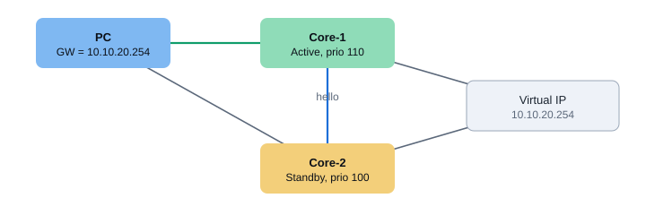

*شکل ۱: کلاینت VIP را Gateway می‌داند؛ Core-1 Active است و Core-2 در آماده‌باش.*

| موضوع       | HSRP v1        | HSRP v2        |
|-------------|----------------|----------------|
| Multicast   | 224.0.0.2      | 224.0.0.102    |
| Virtual MAC | 0000.0c07.acXX | 0000.0c9f.fXXX |
| تعداد Group | 0 تا 255       | 0 تا 4095      |
| IPv6        | ندارد          | دارد           |

XX یا XXX شماره‌ی Group به‌صورت Hex است. Hello پیش‌فرض ۳ ثانیه و Hold ۱۰ ثانیه است.

``` text
Default hello = 3 s, hold = 10 s -> failover up to ~10 s
Tuned (hello 1, hold 3) -> failover ~3 s
```

### ۳. انتخاب Active

1.  بالاترین Priority (پیش‌فرض ۱۰۰).
2.  اگر برابر بود، بالاترین IP روی Interface.

> **نکته‌ی مهم**
>
> پیش‌فرض Preempt خاموش است. اگر Core-1 (Priority بالاتر) خراب شود و بعد برگردد، نقش Active را پس نمی‌گیرد مگر اینکه `preempt` بزنید. معمولاً در طراحی می‌خواهیم Core اصلی دوباره Active شود، پس Preempt را روشن می‌کنیم.

### ۴. دستورها (خط‌به‌خط)

``` text
Core-1(config)# interface vlan 20
Core-1(config-if)# ip address 10.10.20.2 255.255.255.0
Core-1(config-if)# standby version 2
Core-1(config-if)# standby 20 ip 10.10.20.254
Core-1(config-if)# standby 20 priority 110
Core-1(config-if)# standby 20 preempt
Core-1(config-if)# standby 20 authentication md5 key-string <KEY>

Core-2(config)# interface vlan 20
Core-2(config-if)# ip address 10.10.20.3 255.255.255.0
Core-2(config-if)# standby version 2
Core-2(config-if)# standby 20 ip 10.10.20.254
Core-2(config-if)# standby 20 priority 100
Core-2(config-if)# standby 20 preempt
```

- هر Core آدرس واقعی خودش (.2 و .3) و یک VIP مشترک (.254) دارد.
- شماره‌ی Group (اینجا 20) هم‌شماره‌ی VLAN انتخاب می‌شود تا خوانا باشد.
- کلاینت‌ها Gateway را **.254** می‌گیرند، نه .2 یا .3.
- کلید Authentication را در ریپو نگذارید؛ اینجا فقط جانگهدار است.

``` text
Core-1# show standby brief
Core-1# show standby vlan 20
Core-1# show standby
```

``` text
Interface   Grp  Pri P State   Active    Standby    Virtual IP
Vl20         20  110 P Active  local     10.10.20.3 10.10.20.254
```

### ۵. Tracking: وقتی لینک بالادست خراب شد

اگر Core-1 Active است ولی لینک اصلی‌اش به بیرون خراب شود، همچنان Active می‌ماند و ترافیک را «سیاه‌چاله» می‌کند. با Track، Priority را در صورت خرابی لینک کم می‌کنیم تا Core-2 بگیرد:

``` text
Core-1(config)# track 10 interface gi0/3 line-protocol
Core-1(config)# interface vlan 20
Core-1(config-if)# standby 20 track 10 decrement 20
Effect: priority 110 - 20 = 90 < 100 -> Core-2 becomes Active (needs preempt on Core-2)
```

### ۶. VRRP و GLBP

| پروتکل | تعریف              | ویژگی                                  |
|--------|--------------------|----------------------------------------|
| HSRP   | سیسکو              | یک Active؛ رایج در Cisco               |
| VRRP   | استاندارد RFC 5798 | چند سازنده؛ مشابه HSRP (Master/Backup) |
| GLBP   | سیسکو              | چند Forwarder؛ تقسیم بار بین Gatewayها |

FortiGate از VRRP و FGCP (HA اختصاصی) پشتیبانی می‌کند. مفهوم همین است.

### ۷. مثال‌ها

#### ساده

``` text
Two cores, VIP .254, Core-1 priority 110 -> Active
PC gateway = .254 , ping works
```

#### متوسط: Failover

``` text
Core-1 shut down -> Core-2 becomes Active after hold time
PC keeps pinging with only a few lost packets
```

#### سخت: Failover بدون Track

``` text
Core-1 uplink fails but Core-1 stays Active (its VLAN interface is up)
Traffic is black-holed
Fix: track the uplink and decrement priority, or use routing protocol awareness
```

> **صادقانه درباره‌ی Lab**
>
> طبق Probe، «HSRP state» روی vIOSL2 تست شد و کار می‌کند. Failover واقعی (Virtual MAC) را با Capture بررسی کنید و اگر شبیه‌ساز رفتار متفاوتی داشت ثبت کنید.

### تمرین‌ها

**ت1.** ۱ (ساده): VIP چیست؟ *(پاسخ: 6-4-ت1 در بخش «پاسخ‌ها» انتهای فصل)*

**ت2.** ۲ (ساده): Active چطور انتخاب می‌شود؟ *(پاسخ: 6-4-ت2 در بخش «پاسخ‌ها» انتهای فصل)*

**ت3.** ۳ (متوسط): چرا Preempt؟ *(پاسخ: 6-4-ت3 در بخش «پاسخ‌ها» انتهای فصل)*

**ت4.** ۴ (متوسط): Failover پیش‌فرض چند ثانیه؟ *(پاسخ: 6-4-ت4 در بخش «پاسخ‌ها» انتهای فصل)*

**ت5.** ۵ (سخت): نقش Track چیست؟ *(پاسخ: 6-4-ت5 در بخش «پاسخ‌ها» انتهای فصل)*

### Lab هدایت‌شده

دو سوییچ L3: `Core-1` و `Core-2` (vIOSL2 با `ip routing`)، یک سوییچ دسترسی `Acc-1` که به هر دو Trunk است، و PC1 در VLAN 20.

#### گام ۱: SVI روی هر دو Core

``` text
Core-x(config)# ip routing
Core-x(config)# vlan 20
Core-1(config)# interface vlan 20
Core-1(config-if)# ip address 10.10.20.2 255.255.255.0
Core-1(config-if)# no shutdown
Core-2(config)# interface vlan 20
Core-2(config-if)# ip address 10.10.20.3 255.255.255.0
Core-2(config-if)# no shutdown
```

#### گام ۲: HSRP

``` text
Core-1(config-if)# standby version 2
Core-1(config-if)# standby 20 ip 10.10.20.254
Core-1(config-if)# standby 20 priority 110
Core-1(config-if)# standby 20 preempt
Core-2(config-if)# standby version 2
Core-2(config-if)# standby 20 ip 10.10.20.254
Core-2(config-if)# standby 20 preempt
Core-x# show standby brief
```

#### گام ۳: تست

``` text
PC1> ip 10.10.20.11/24 10.10.20.254
PC1> ping 10.10.20.254 -t
```

#### گام ۴: Failover

``` text
Core-1(config)# interface vlan 20
Core-1(config-if)# shutdown
Core-2# show standby brief
Core-1(config-if)# no shutdown   (preempt: Core-1 returns)
```

تعداد پکت گم‌شده و زمان Failover را ثبت کنید.

### Lab مستقل

یک «HSRP Plan» (Groupها، VIPها، Priorityها، Track) برای ۳ VLAN در `02-design/hsrp-plan.md` بنویسید.

### عیب‌یابی

|         |                                                                                                                              |
|---------|------------------------------------------------------------------------------------------------------------------------------|
| Symptom | Failover نمی‌شود یا هر دو Active هستند                                                                                        |
| چک‌لیست  | ۱) VIP و Group دو سر یکی؟ ؛ ۲) Version یکسان؟ ؛ ۳) Authentication مشابه؟ ؛ ۴) ارتباط L2 بین Coreها OK؟ ؛ ۵) Preempt/Priority |
| ابزار   | show standby brief ، show standby                                                                                            |
| نکته    | «دو Active» یعنی Hello به هم نمی‌رسد (قطع L2)                                                                                 |

### سؤال‌های مرور

**م1.** HSRP چه مشکلی را حل می‌کند؟ *(پاسخ: 6-4-م1 در بخش «پاسخ‌ها» انتهای فصل)*

**م2.** تفاوت HSRP و VRRP؟ *(پاسخ: 6-4-م2 در بخش «پاسخ‌ها» انتهای فصل)*

### English Corner: انگلیسی تخصصی این درس

این جمله‌ها از مستندات و محیط کار واقعی‌اند. بلند بخوانید و ترجمه را بپوشانید.

| English sentence                                               | ترجمه                                                     |
|----------------------------------------------------------------|-----------------------------------------------------------|
| HSRP provides a virtual gateway address shared by two routers. | HSRP یک آدرس Gateway مجازی بین دو روتر ارائه می‌کند.       |
| The router with the highest priority becomes active.           | روتر با بالاترین Priority Active می‌شود.                   |
| Enable preempt so the primary router regains the active role.  | Preempt را روشن کنید تا روتر اصلی نقش Active را پس بگیرد. |
| Track the uplink to trigger failover when it goes down.        | برای فعال‌شدن Failover هنگام قطع Uplink آن را Track کنید.  |

**Q1.** Quick quiz (answer in English): What happens to clients if the active HSRP router fails? *(پاسخ: 6-4-Q1 در بخش «پاسخ‌ها» انتهای فصل)*

### تکلیف و چک‌لیست تسلط

- [ ] HSRP را بسازم و Failover را ثبت کنم.
- [ ] Track را توضیح دهم.
- [ ] HSRP Plan را بنویسم.

### یادآوری اشتباهات شما

> **یادآوری**
>
> پیش‌بینی قبل از اجرا؛ بکاپ قبل از تغییر؛ پذیرفته‌شدن دستور ≠ کار کردن؛ فرمول‌ها در بلوک مستقل.


#### کارت Lab — HSRP و FHRP

| # | فیلد | محتوا |
|---|---|---|
| 1 | عنوان و هدف | HSRP: Active/Standby و Track |
| 2 | پیش‌نیاز | درس 6-3 |
| 3 | توپولوژی | Core-1/Core-2 + Acc |
| 4 | تجهیزات | ۳ سوییچ L3/L2 |
| 5 | نسخه نرم‌افزار | vIOS-L2 15.2(20200924، Experimental) برای SW؛ vIOS 15.9(3)M9 برای R؛ VPCS؛ PNetLab 4.2.8 |
| 6 | IP Plan | VLAN 20 |
| 7 | وضعیت اولیه | VIP .254 |
| 8 | صورت مسئله | Failover |
| 9 | مراحل هدایت‌شده | همان بخش «Lab هدایت‌شده» همین درس |
| 10 | تست عملکرد | `show standby brief` |
| 11 | سناریوی خرابی | Preempt خاموش |
| 12 | روش عیب‌یابی | لایه‌ای/با شواهد (بخش عیب‌یابی همین درس) |
| 13 | نتیجه‌ی مورد انتظار | Failover؛ بازگشت |
| 14 | معیار پذیرش | زمان Failover |
| 15 | مستندات نهایی | `02-design/hsrp-plan.md` |
| 16 | Cleanup و بازگردانی | — |

> **وضعیت راستی‌آزمایی (خارج از ۱۶ فیلد):** **جزئی.** HSRP State Tested-OK (Active)؛ Failover با روتر دوم آزمایش نشده.

---

<a id="l-6-5"></a>

## درس 6-5 — پیاده‌سازی Lab A

**فصل ۶ - روز ۵ · پیش‌نیاز: درس‌های ۶-۱ تا ۶-۴ · ۶ ساعت**

### این درس درباره چیست و چرا باید یاد بگیریم؟

**چه چیزی یاد می‌گیریم:** پیاده‌سازی کامل Lab A: Gateway روی Core با SVI و HSRP، OSPF به سمت Edge (که بعداً FortiGate می‌شود)، و تأیید مسیر رفت و برگشت.

**چرا لازم است:** این Lab تمام مباحث فصل ۳ تا ۶ را در یک طراحی واقعی کنار هم می‌گذارد: VLAN، Trunk، STP، EtherChannel، SVI، HSRP و OSPF. اگر این Lab را درست بسازید، یعنی شبکه‌ی Campus سیسکو را فهمیده‌اید. (یادآوری: Capstone اصلی ما الگوی B است؛ Lab A جدا و مکمل است.)

- **در کار روزانه:** این همان چیدمان معمول Campus سازمانی است.
- **در امنیت:** Return Path و Gateway مشخص، پایه‌ی هر Policy است.
- **در FortiGate:** در W9/W10 همین Lab با FGT به‌جای EDGE-R1 کامل می‌شود.

> **مسیر درس**
>
> طراحی ← جدول آدرس ← پیاده‌سازی مرحله‌ای ← Verification Matrix ← تست Failover ← عیب‌یابی.

#### اصطلاحات این درس (مخفف ← شکل کامل ← معنی)

| مخفف        | شکل کامل انگلیسی              | معنی فارسی                    |
|-------------|-------------------------------|-------------------------------|
| Lab A       | Lab A (Cisco L3 Core Gateway) | Gateway روی Core سیسکو        |
| Perimeter   | Perimeter firewall            | فایروال لبه‌ی شبکه             |
| Transit     | Transit link                  | لینک نقطه‌به‌نقطه به فایروال    |
| Return Path | Return Path                   | مسیر برگشت                    |
| As-Built    | As-Built documentation        | مستند وضعیت نهایی             |
| ECMP        | Equal-Cost Multi-Path         | تقسیم بار بین مسیرهای هم‌هزینه |

### ۱. طراحی

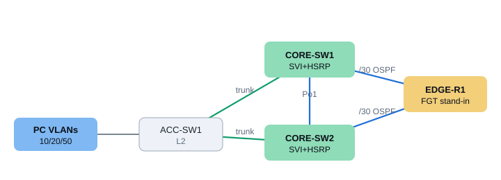

*شکل ۱: Lab A؛ VLANها روی Core (SVI + HSRP) و OSPF با Edge.*

``` text
VLAN 10 MGMT   10.10.10.0/24   VIP .254   Core-1 .2  Core-2 .3
VLAN 20 USERS  10.10.20.0/24   VIP .254   Core-1 .2  Core-2 .3
VLAN 50 GUEST  10.10.50.0/24   VIP .254   Core-1 .2  Core-2 .3

Core-1 <-> EDGE-R1 : 10.0.1.0/30   (.1 .2)
Core-2 <-> EDGE-R1 : 10.0.2.0/30   (.1 .2)
Core-1 <-> Core-2  : EtherChannel Po1 (trunk)
OSPF area 0 on Cores and Edge
EDGE-R1 loopback 0 = 8.8.8.8/32 (stand-in for "internet")
```

> **قاعده**
>
> هر VLAN دقیقاً یک Gateway دارد: VIP روی Core. هرگز دو Gateway همزمان (مثل SVI و Sub-interface روی R1).

### ۲. گام‌های پیاده‌سازی

#### گام ۱: VLAN و Trunk

``` text
! on Core-1, Core-2, ACC-SW1
vlan 10
 name MGMT
vlan 20
 name USERS
vlan 50
 name GUEST
! trunks: ACC <-> Core-1, ACC <-> Core-2, Core-1 <-> Core-2
interface gi0/x
 switchport trunk encapsulation dot1q
 switchport mode trunk
 switchport trunk allowed vlan 10,20,50
 switchport trunk native vlan 999
```

#### گام ۲: STP

``` text
Core-1(config)# spanning-tree mode rapid-pvst
Core-1(config)# spanning-tree vlan 10,20,50 root primary
Core-2(config)# spanning-tree vlan 10,20,50 root secondary
ACC-SW1(config)# interface range gi0/1 - 3
ACC-SW1(config-if-range)# spanning-tree portfast
ACC-SW1(config-if-range)# spanning-tree bpduguard enable
```

#### گام ۳: SVI و HSRP

``` text
Core-1(config)# ip routing
Core-1(config)# interface vlan 20
Core-1(config-if)# ip address 10.10.20.2 255.255.255.0
Core-1(config-if)# standby version 2
Core-1(config-if)# standby 20 ip 10.10.20.254
Core-1(config-if)# standby 20 priority 110
Core-1(config-if)# standby 20 preempt
! repeat for VLAN 10 and 50; Core-2 uses .3 and default priority
```

#### گام ۴: لینک‌های Routed به Edge

``` text
Core-1(config)# interface gi0/3
Core-1(config-if)# no switchport
Core-1(config-if)# ip address 10.0.1.1 255.255.255.252
Core-2(config)# interface gi0/3
Core-2(config-if)# no switchport
Core-2(config-if)# ip address 10.0.2.1 255.255.255.252
EDGE-R1(config)# interface gi0/0
EDGE-R1(config-if)# ip address 10.0.1.2 255.255.255.252
EDGE-R1(config)# interface gi0/1
EDGE-R1(config-if)# ip address 10.0.2.2 255.255.255.252
EDGE-R1(config)# interface loopback 0
EDGE-R1(config-if)# ip address 8.8.8.8 255.255.255.255
```

#### گام ۵: OSPF

``` text
Core-1(config)# router ospf 1
Core-1(config-router)# router-id 11.11.11.11
Core-1(config-router)# network 10.0.1.0 0.0.0.3 area 0
Core-1(config-router)# network 10.10.10.0 0.0.0.255 area 0
Core-1(config-router)# network 10.10.20.0 0.0.0.255 area 0
Core-1(config-router)# network 10.10.50.0 0.0.0.255 area 0
Core-1(config-router)# passive-interface default
Core-1(config-router)# no passive-interface gi0/3
! Core-2 same with its own link and router-id 12.12.12.12
EDGE-R1(config)# router ospf 1
EDGE-R1(config-router)# router-id 1.1.1.1
EDGE-R1(config-router)# network 10.0.1.0 0.0.0.3 area 0
EDGE-R1(config-router)# network 10.0.2.0 0.0.0.3 area 0
EDGE-R1(config-router)# network 8.8.8.8 0.0.0.0 area 0
EDGE-R1(config-router)# default-information originate always
```

OSPF Default از Edge می‌آید و Coreها خودشان Default را یاد می‌گیرند. EDGE-R1 باید مسیر برگشت به سه VLAN را از OSPF یاد بگیرد (Return Path).

### ۳. Verification Matrix

| تست         | دستور                                    | انتظار                                      |
|-------------|------------------------------------------|---------------------------------------------|
| VLAN/Trunk  | show interfaces trunk                    | VLAN 10,20,50 allowed                       |
| Root        | show spanning-tree root                  | Core-1 root                                 |
| HSRP        | show standby brief                       | Core-1 Active هر سه VLAN                    |
| OSPF        | show ip ospf neighbor                    | FULL با Edge و (اگر طراحی کردید) بین Coreها |
| Route       | show ip route ospf                       | Default و Routeهای VLAN روی Edge            |
| End-to-end  | PC ping 8.8.8.8                          | موفق                                        |
| Return Path | EDGE-R1# ping 10.10.20.11 source 8.8.8.8 | موفق                                        |

### ۴. آزمون Failover

۳ آزمایش، هرکدام را ثبت کنید:

1.  Core-1 را خاموش کنید: HSRP به Core-2 می‌رود؛ ping پایدار می‌ماند.
2.  لینک Core-1 به Edge را قطع کنید: OSPF مسیر را از Core-2 می‌گیرد.
3.  لینک ACC به Core-1 را قطع کنید: Rapid-PVST به مسیر جایگزین می‌رود.

``` text
Measure: lost packets and seconds to recover for each test.
Typical: HSRP ~10 s (tunable), OSPF dead 40 s (tunable), RSTP ~1-2 s
```

> **Asymmetric Routing**
>
> چون دو Core و دو لینک به Edge داریم، ممکن است رفت از Core-1 و برگشت از Core-2 باشد. در Lab ساده بی‌اثر است، ولی وقتی FortiGate Stateful بیاید (W9/W10) باید مسیرها را متقارن کنید؛ ریسکی که در طراحی نوشته‌ایم.

> **صادقانه درباره‌ی Lab**
>
> چند قابلیت (EtherChannel و برخی امنیت‌های L2) روی vIOSL2 ممکن است فقط پذیرفته شوند. اگر Po1 بالا نیامد، یک لینک عادی Trunk بگذارید و محدودیت را ثبت کنید. SVI، HSRP و OSPF روی این Imageها طبق Probe و درس‌های قبل قابل‌اجراست.

### تمرین‌ها

**ت1.** ۱ (ساده): Gateway هر VLAN در Lab A کدام آدرس است؟ *(پاسخ: 6-5-ت1 در بخش «پاسخ‌ها» انتهای فصل)*

**ت2.** ۲ (ساده): چرا لینک Core به Edge Routed است؟ *(پاسخ: 6-5-ت2 در بخش «پاسخ‌ها» انتهای فصل)*

**ت3.** ۳ (متوسط): Return Path برای 8.8.8.8 به VLAN 20 چطور ساخته می‌شود؟ *(پاسخ: 6-5-ت3 در بخش «پاسخ‌ها» انتهای فصل)*

**ت4.** ۴ (سخت): چه خطری در Dual Core + Dual Link برای فایروال Stateful هست؟ *(پاسخ: 6-5-ت4 در بخش «پاسخ‌ها» انتهای فصل)*

### Lab هدایت‌شده

همه‌ی گام‌های بخش ۲ را اجرا کنید، بعد ماتریس Verification و سه آزمون Failover. از هر مرحله بکاپ بگیرید:

``` text
Rx# copy running-config flash:Rx-labA-final.cfg
```

خروجی‌ها (بدون رمز) را در `03-ops/labA-as-built.md` ذخیره کنید.

### Lab مستقل

نمودار Packet Flow برای «PC به 8.8.8.8» و «8.8.8.8 به PC» را روی کاغذ بکشید و با Capture صحت را تأیید کنید.

### عیب‌یابی

|         |                                                                                                     |
|---------|-----------------------------------------------------------------------------------------------------|
| Symptom | PC به 8.8.8.8 نمی‌رسد                                                                                |
| روش     | از PC شروع کنید: Gateway ← Core Active ← OSPF ← Edge ← برگشت                                        |
| چک‌لیست  | ۱) VIP؟ ؛ ۲) Default روی Core؟ ؛ ۳) Edge مسیر برگشت دارد؟ ؛ ۴) HSRP Active درست؟ ؛ ۵) Trunk/Allowed |
| ابزار   | show standby brief ، show ip route ، traceroute                                                     |

### سؤال‌های مرور

**م1.** چرا Lab A و Capstone جدا هستند؟ *(پاسخ: 6-5-م1 در بخش «پاسخ‌ها» انتهای فصل)*

**م2.** Return Path چیست؟ *(پاسخ: 6-5-م2 در بخش «پاسخ‌ها» انتهای فصل)*

### English Corner: انگلیسی تخصصی این درس

این جمله‌ها از مستندات و محیط کار واقعی‌اند. بلند بخوانید و ترجمه را بپوشانید.

| English sentence                                            | ترجمه                                                      |
|-------------------------------------------------------------|------------------------------------------------------------|
| The core switches act as the default gateway for all VLANs. | سوییچ‌های Core Gateway پیش‌فرض همه‌ی VLANها هستند.            |
| OSPF advertises the VLAN subnets to the edge router.        | OSPF زیرشبکه‌های VLAN را به روتر Edge اعلام می‌کند.          |
| Verify the return path from the edge router.                | مسیر برگشت را از روتر Edge تأیید کنید.                     |
| Asymmetric routing can break stateful firewalls.            | مسیریابی نامتقارن می‌تواند فایروال‌های Stateful را مختل کند. |

**Q1.** Quick quiz (answer in English): Why must there be exactly one gateway per VLAN? *(پاسخ: 6-5-Q1 در بخش «پاسخ‌ها» انتهای فصل)*

### تکلیف و چک‌لیست تسلط

- [ ] Lab A را کامل بسازم.
- [ ] ماتریس Verification را پر کنم.
- [ ] سه Failover را ثبت کنم و As-Built را بنویسم.

### یادآوری اشتباهات شما

> **یادآوری**
>
> پیش‌بینی قبل از اجرا؛ بکاپ قبل از تغییر؛ پذیرفته‌شدن دستور ≠ کار کردن؛ فرمول‌ها در بلوک مستقل.


#### کارت Lab — پیاده‌سازی Lab A

| # | فیلد | محتوا |
|---|---|---|
| 1 | عنوان و هدف | Lab A: Core با SVI+HSRP+OSPF |
| 2 | پیش‌نیاز | درس 6-4 |
| 3 | توپولوژی | Acc-Core1/2-Edge |
| 4 | تجهیزات | ۴ سوییچ + Edge |
| 5 | نسخه نرم‌افزار | vIOS-L2 15.2(20200924، Experimental) برای SW؛ vIOS 15.9(3)M9 برای R؛ VPCS؛ PNetLab 4.2.8 |
| 6 | IP Plan | VLAN 10/20/50 |
| 7 | وضعیت اولیه | VIP .254 |
| 8 | صورت مسئله | ping 8.8.8.8 و Failover |
| 9 | مراحل هدایت‌شده | همان بخش «Lab هدایت‌شده» همین درس |
| 10 | تست عملکرد | ماتریس Verification |
| 11 | سناریوی خرابی | Route برگشت حذف |
| 12 | روش عیب‌یابی | لایه‌ای/با شواهد (بخش عیب‌یابی همین درس) |
| 13 | نتیجه‌ی مورد انتظار | Failover سه‌گانه |
| 14 | معیار پذیرش | As-Built |
| 15 | مستندات نهایی | `03-ops/labA-as-built.md` |
| 16 | Cleanup و بازگردانی | بازگشت Baseline |

> **وضعیت راستی‌آزمایی (خارج از ۱۶ فیلد):** **جزئی.** SVI/HSRP state Tested-OK؛ EtherChannel/OSPF و Failover کامل اجرا نشده.

---

<a id="l-6-6"></a>

## درس 6-6 — عیب‌یابی و آزمون G3

**فصل ۶ - روز ۶ · پیش‌نیاز: درس‌های ۶-۱ تا ۶-۵ · ۶ ساعت**

### این درس درباره چیست و چرا باید یاد بگیریم؟

**چه چیزی یاد می‌گیریم:** عیب‌یابی سناریوهای Routing و FHRP (TS15 تا TS18 و TS09) با روش Hop به Hop، و آزمون عملی Gate G3.

**چرا لازم است:** بعد از ساخت Lab A، مهارت اصلی «پیدا کردن خرابی» است. G3 تضمین می‌کند Routing و HSRP را عملی و با مدرک اثبات می‌کنید.

- **در کار روزانه:** سناریوی «بعضی VLANها قطع‌اند» همین الگو را دارد.
- **در امنیت:** RCA مکتوب مستندات حسابرسی است.
- **در مصاحبه:** سناریو و گزارش RCA سؤال تکراری هستند.

> **مسیر درس**
>
> روش Hop به Hop ← پنج خرابی ← Lab عیب‌یابی ← Gate G3.

#### اصطلاحات این درس (مخفف ← شکل کامل ← معنی)

| مخفف       | شکل کامل انگلیسی         | معنی فارسی              |
|------------|--------------------------|-------------------------|
| TS         | Troubleshooting Scenario | سناریوی عیب‌یابی         |
| RCA        | Root Cause Analysis      | تحلیل علت ریشه‌ای        |
| Black hole | Black hole               | سیاه‌چاله؛ ترافیک بی‌پاسخ |
| Flap       | Flapping                 | قطع و وصل مکرر          |
| G3         | Gate 3                   | آزمون عملی پایان فصل ۶ |
| As-Built   | As-Built                 | مستند وضعیت نهایی       |

### ۱. روش Hop به Hop

1.  مبدأ و مقصد دقیق را مشخص کنید.
2.  از مبدأ به Gateway: HSRP و VLAN.
3.  Gateway تا Edge: OSPF و Route.
4.  Edge تا مقصد.
5.  مسیر برگشت را جدا بررسی کنید.

در هر Hop یک سؤال: «این روتر Route دارد؟ بسته را به کجا می‌دهد؟ برگشت چطور؟»

### ۲. پنج سناریو

#### TS15: Route برگشت نبود

``` text
Symptom : PC reaches the Edge hop but not 8.8.8.8 replies
Evidence: EDGE-R1 has no route to 10.10.20.0/24 (not advertised)
Fix     : add network statement or static route on Edge
Verify  : ping from Edge to the VLAN IP works
```

#### TS16: OSPF Adjacency (Hello/MTU/Area)

``` text
Symptom : no neighbor between Core and Edge
Evidence: show ip ospf interface -> hello/area mismatch
Fix     : align the parameters
```

#### TS17: دو Gateway (HSRP) یا Preempt خاموش

``` text
Symptom : after recovery, old core does not become Active again
Cause   : preempt not enabled
Fix     : standby <grp> preempt
```

#### TS18: Track فراموش‌شده (Black hole)

``` text
Symptom : Core-1 is Active but its uplink is down -> traffic lost
Fix     : track the uplink and decrement priority
```

#### TS09: SVI Down/Down

``` text
Symptom : Vlan interface down/down -> gateway unreachable
Cause   : VLAN has no active port
Fix     : bring a port up in the VLAN / allow it on a trunk
```

### ۳. آزمون Gate G3 (پایان فصل ۶)

با مدرک و بدون نگاه به درس:

| \#  | وظیفه                                 | مدرک                            |
|-----|---------------------------------------|---------------------------------|
| ۱   | OSPF سه روتر (تک Area) + DR/BDR توضیح | show ip ospf neighbor           |
| ۲   | دو Area با ABR و خلاصه‌سازی            | show ip route (O IA)            |
| ۳   | OSPFv3 دو روتر (Dual-Stack)           | show ipv6 ospf neighbor         |
| ۴   | HSRP + Preempt + Track و Failover     | show standby brief + اندازه‌گیری |
| ۵   | Lab A کامل (ping تا 8.8.8.8 و برگشت)  | As-Built                        |
| ۶   | سه TS با RCA از TS15 تا TS18/TS09     | گزارش                           |
| ۷   | Packet Flow رفت و برگشت Lab A         | نمودار + Capture                |

**معیار قبولی:** حداقل ۶ از ۷ مورد با مدرک. وقتی تمام شد بگویید «G3 انجام شد».

### تمرین‌ها

**ت1.** ۱ (ساده): اولین قدم عیب‌یابی؟ *(پاسخ: 6-6-ت1 در بخش «پاسخ‌ها» انتهای فصل)*

**ت2.** ۲ (ساده): Black hole یعنی چه؟ *(پاسخ: 6-6-ت2 در بخش «پاسخ‌ها» انتهای فصل)*

**ت3.** ۳ (متوسط): HSRP Active است ولی Uplink قطع؛ راه‌حل؟ *(پاسخ: 6-6-ت3 در بخش «پاسخ‌ها» انتهای فصل)*

**ت4.** ۴ (سخت): چرا مسیر نامتقارن با فایروال Stateful مشکل می‌سازد؟ *(پاسخ: 6-6-ت4 در بخش «پاسخ‌ها» انتهای فصل)*

### Lab هدایت‌شده

در Lab A پنج خرابی را به ترتیب بسازید و رفع کنید؛ برای هر مورد Symptom، Evidence، Fix، Verify و RCA بنویسید.

1.  Route برگشت را از Edge حذف کنید.
2.  Hello interval یک سمت OSPF را تغییر دهید.
3.  Preempt را از Core-1 حذف کنید و Failover/Failback را ببینید.
4.  لینک Uplink را قطع کنید بدون Track.
5.  همه‌ی پورت‌های یک VLAN را shutdown کنید و SVI را ببینید.

### Lab مستقل

گزارش RCA پنج‌گانه را در `03-ops/rca-w6.md` بنویسید و Gate G3 را کامل کنید.

### عیب‌یابی

|         |                                                            |
|---------|------------------------------------------------------------|
| Symptom | بعد از تغییر، بخشی از شبکه قطع شد                          |
| روش     | Hop به Hop + مقایسه با As-Built                            |
| ابزار   | show standby brief ، show ip ospf neighbor ، show ip route |
| پیشگیری | بکاپ، تغییر مرحله‌ای و reload in                            |

### سؤال‌های مرور

**م1.** چرا Hop به Hop؟ *(پاسخ: 6-6-م1 در بخش «پاسخ‌ها» انتهای فصل)*

**م2.** چرا As-Built لازم است؟ *(پاسخ: 6-6-م2 در بخش «پاسخ‌ها» انتهای فصل)*

### English Corner: انگلیسی تخصصی این درس

این جمله‌ها از مستندات و محیط کار واقعی‌اند. بلند بخوانید و ترجمه را بپوشانید.

| English sentence                                                   | ترجمه                                             |
|--------------------------------------------------------------------|---------------------------------------------------|
| Troubleshoot hop by hop, starting from the source.                 | عیب‌یابی را Hop به Hop و از مبدأ شروع کنید.        |
| The standby router did not take over because preempt was disabled. | Standby چون Preempt خاموش بود نقش را نگرفت.       |
| Document each failure as an RCA.                                   | هر خرابی را به‌صورت RCA مستند کنید.                |
| Gate three covers routing and gateway redundancy.                  | Gate سوم Routing و پشتیبان Gateway را پوشش می‌دهد. |

**Q1.** Quick quiz (answer in English): What is the first thing to define when troubleshooting a connectivity issue? *(پاسخ: 6-6-Q1 در بخش «پاسخ‌ها» انتهای فصل)*

### تکلیف و چک‌لیست تسلط

- [ ] پنج TS را با RCA ثبت کنم.
- [ ] Gate G3 را کامل کنم.
- [ ] As-Built را به‌روز کنم.

### یادآوری اشتباهات شما

> **یادآوری**
>
> پیش‌بینی قبل از اجرا؛ بکاپ قبل از تغییر؛ پذیرفته‌شدن دستور ≠ کار کردن؛ فرمول‌ها در بلوک مستقل.


#### کارت Lab — عیب‌یابی و آزمون G3

| # | فیلد | محتوا |
|---|---|---|
| 1 | عنوان و هدف | عیب‌یابی Routing/FHRP و G3 |
| 2 | پیش‌نیاز | درس 6-5 |
| 3 | توپولوژی | Lab A |
| 4 | تجهیزات | Lab A |
| 5 | نسخه نرم‌افزار | vIOS-L2 15.2(20200924، Experimental) برای SW؛ vIOS 15.9(3)M9 برای R؛ VPCS؛ PNetLab 4.2.8 |
| 6 | IP Plan | Baseline |
| 7 | وضعیت اولیه | پنج خرابی |
| 8 | صورت مسئله | RCA |
| 9 | مراحل هدایت‌شده | همان بخش «Lab هدایت‌شده» همین درس |
| 10 | تست عملکرد | show standby/ospf |
| 11 | سناریوی خرابی | TS15-18،TS09 |
| 12 | روش عیب‌یابی | لایه‌ای/با شواهد (بخش عیب‌یابی همین درس) |
| 13 | نتیجه‌ی مورد انتظار | رفع |
| 14 | معیار پذیرش | G3 ≥ ۶ از ۷ |
| 15 | مستندات نهایی | `03-ops/rca-w6.md` |
| 16 | Cleanup و بازگردانی | — |

> **وضعیت راستی‌آزمایی (خارج از ۱۶ فیلد):** **اجرا نشده (فقط طراحی).** اجرا نشده.

---

<a id="ans-6"></a>

## پاسخ‌های فصل 6

> ابتدا بدون نگاه حل کنید. شناسه: درس-نوع+شماره (ت = تمرین، م = مرور، Q = Quick quiz).

**6-1-ت1** — ۱ (ساده): چند Adjacency برای ۶ روتر در Full Mesh؟

``` text
6 x 5 / 2 = 15
```

**6-1-ت2** — ۲ (ساده): DROther با DROther چه حالتی؟

``` text
2-Way (normal)
```

**6-1-ت3** — ۳ (متوسط): انتخاب DR بر چه اساسی؟

``` text
Highest priority, then highest router ID.
```

**6-1-ت4** — ۴ (متوسط): چه زمانی point-to-point؟

``` text
On links with exactly two routers; avoids DR election and speeds convergence.
```

**6-1-ت5** — ۵ (سخت): چرا بعد از تغییر Priority، DR عوض نشد؟

``` text
DR election is non-preemptive; the OSPF process must be cleared.
```

**6-1-م1** — DR چرا لازم است؟

تعداد Adjacency را در Segment مشترک کم می‌کند.

**6-1-م2** — Network Type چه تأثیری دارد؟

انتخاب DR، تایمرها و رفتار همسایگی را تعیین می‌کند.

**6-1-Q1** — Quick quiz (answer in English): Why is 2-Way between two DROthers normal?

Only DR and BDR form full adjacencies with everyone; DROthers exchange LSAs via the DR.

**6-2-ت1** — ۱ (ساده): ABR چیست؟

``` text
A router with interfaces in two or more areas, one of which is area 0.
```

**6-2-ت2** — ۲ (ساده): O IA یعنی؟

``` text
An inter-area route (from a type 3 LSA).
```

**6-2-ت3** — ۳ (متوسط): خلاصه‌ی 10.1.4.0/24 تا 10.1.7.0/24؟

``` text
Third octet 4..7 -> block 4 -> 10.1.4.0/22
```

**6-2-ت4** — ۴ (متوسط): چرا Stub باید روی همه‌ی روترهای Area باشد؟

``` text
The stub flag is carried in Hellos; a mismatch prevents adjacency.
```

**6-2-ت5** — ۵ (سخت): مزیت Totally Stubby؟

``` text
Routers in the area keep only intra-area routes plus one default route, minimizing tables.
```

**6-2-م1** — چرا به Area 0 همه وصل‌اند؟

ترافیک بین Areaها از Backbone عبور می‌کند.

**6-2-م2** — ASBR چه می‌کند؟

Route خارجی را وارد OSPF می‌کند.

**6-2-Q1** — Quick quiz (answer in English): What does an ABR do?

It connects areas to the backbone and exchanges (summarized) routes between them.

**6-3-ت1** — ۱ (ساده): OSPFv3 چطور فعال می‌شود؟

``` text
ipv6 unicast-routing, ipv6 router ospf N, and "ipv6 ospf N area A" on each interface.
```

**6-3-ت2** — ۲ (ساده): Next-hop در IPv6 چه آدرسی است؟

``` text
The neighbor link-local address (fe80::).
```

**6-3-ت3** — ۳ (متوسط): چرا Router ID لازم است؟

``` text
OSPFv3 uses a 32-bit router ID; without any IPv4 address it must be set manually.
```

**6-3-ت4** — ۴ (سخت): چرا Static IPv6 با Next-hop Link-Local به Interface هم نیاز دارد؟

``` text
Link-local addresses are only unique per link, so the exit interface is required.
```

**6-3-م1** — تفاوت اصلی فعال‌سازی v2 و v3؟

v3 روی Interface فعال می‌شود، نه با network.

**6-3-م2** — چرا Router ID دستی؟

چون ممکن است روتر IPv4 نداشته باشد.

**6-3-Q1** — Quick quiz (answer in English): Why does OSPFv3 still need an IPv4-style router ID?

Router IDs are 32-bit values in both versions, independent of the address family.

**6-4-ت1** — ۱ (ساده): VIP چیست؟

``` text
A shared virtual IP address used as the clients' default gateway.
```

**6-4-ت2** — ۲ (ساده): Active چطور انتخاب می‌شود؟

``` text
Highest priority, then highest IP address.
```

**6-4-ت3** — ۳ (متوسط): چرا Preempt؟

``` text
So the higher-priority router regains the Active role after it recovers.
```

**6-4-ت4** — ۴ (متوسط): Failover پیش‌فرض چند ثانیه؟

``` text
About 10 s (hold time) with hello 3 / hold 10.
```

**6-4-ت5** — ۵ (سخت): نقش Track چیست؟

``` text
Lower the priority when an uplink fails so the standby takes over; otherwise traffic black-holes.
```

**6-4-م1** — HSRP چه مشکلی را حل می‌کند؟

وجود Gateway واحد به‌عنوان SPOF.

**6-4-م2** — تفاوت HSRP و VRRP؟

HSRP اختصاصی سیسکو؛ VRRP استاندارد.

**6-4-Q1** — Quick quiz (answer in English): What happens to clients if the active HSRP router fails?

The standby router becomes active and answers for the same virtual IP and MAC, so clients keep their gateway.

**6-5-ت1** — ۱ (ساده): Gateway هر VLAN در Lab A کدام آدرس است؟

``` text
The HSRP virtual IP (10.10.x.254).
```

**6-5-ت2** — ۲ (ساده): چرا لینک Core به Edge Routed است؟

``` text
To avoid layer-2 loops and use routing (OSPF) with ECMP between the two cores.
```

**6-5-ت3** — ۳ (متوسط): Return Path برای 8.8.8.8 به VLAN 20 چطور ساخته می‌شود؟

``` text
OSPF advertises the VLAN subnets from the cores to EDGE-R1.
```

**6-5-ت4** — ۴ (سخت): چه خطری در Dual Core + Dual Link برای فایروال Stateful هست؟

``` text
Asymmetric routing: forward and return paths differ, and the stateful firewall drops the unmatched return.
```

**6-5-م1** — چرا Lab A و Capstone جدا هستند؟

Lab A Gateway روی Cisco است؛ Capstone Gateway روی FortiGate تا Policy و Log در یک نقطه باشد.

**6-5-م2** — Return Path چیست؟

مسیر برگشت پاسخ؛ بدون آن ارتباط دوطرفه نمی‌شود.

**6-5-Q1** — Quick quiz (answer in English): Why must there be exactly one gateway per VLAN?

Two gateways cause duplicate IPs/MACs and inconsistent forwarding.

**6-6-ت1** — ۱ (ساده): اولین قدم عیب‌یابی؟

``` text
Define the exact source and destination, then check hop by hop.
```

**6-6-ت2** — ۲ (ساده): Black hole یعنی چه؟

``` text
Traffic is accepted by a device but silently dropped/has no valid path.
```

**6-6-ت3** — ۳ (متوسط): HSRP Active است ولی Uplink قطع؛ راه‌حل؟

``` text
Track the uplink and decrement priority.
```

**6-6-ت4** — ۴ (سخت): چرا مسیر نامتقارن با فایروال Stateful مشکل می‌سازد؟

``` text
The firewall sees only one direction of a flow, no state entry exists, and drops the other direction.
```

**6-6-م1** — چرا Hop به Hop؟

تا نقطه‌ی دقیق خرابی بدون حدس پیدا شود.

**6-6-م2** — چرا As-Built لازم است؟

مرجع مقایسه برای عیب‌یابی و Rollback.

**6-6-Q1** — Quick quiz (answer in English): What is the first thing to define when troubleshooting a connectivity issue?

The exact source and destination of the failing traffic.

---

<a id="end2"></a>

# پایان بخش ۲ (فصل‌های ۴ تا ۶)

## ۱) خلاصه‌ی مهارت‌های کسب‌شده
- STP/RSTP و Root عمدی؛ PortFast/BPDU Guard؛ EtherChannel/LACP؛ Port-Security؛ DHCP Snooping/DAI؛ طراحی سه‌لایه.
- Route Table، LPM، AD؛ Static/Floating/IP SLA؛ OSPF تک‌ و چندناحیه‌ای؛ OSPFv3؛ HSRP؛ Lab A.

## ۲) آزمون پایان سه فصل
**س1** — Root Bridge چگونه انتخاب می‌شود و Bridge ID در PVST برای VLAN 10 با اولویت 32768 چیست؟

**س2** — PortFast بدون BPDU Guard چه خطری دارد؟

**س3** — کدام ترکیب Mode در LACP Channel نمی‌سازد؟

**س4** — سه نوع Violation در Port-Security و تفاوت shutdown/restrict؟

**س5** — DAI به چه چیزی وابسته است؟

**س6** — بسته به 10.1.1.77 و Routeهای /8 و /16 و /24 و /0؛ کدام؟

**س7** — Static (AD 1) برای 10.0.0.0/8 و OSPF برای 10.0.23.0/30؛ بسته به 10.0.23.5 کجا می‌رود؟

**س8** — پنج شرط Adjacency در OSPF؟

**س9** — Cost لینک 1 Gbps با Reference 10000 Mbps؟

**س10** — DR چگونه انتخاب می‌شود و غیرقابل‌پس‌گیری یعنی چه؟

**س11** — چرا HSRP به Preempt و Track نیاز دارد؟

**س12** — چرا Lab A دو Gateway برای یک VLAN را ممنوع می‌کند؟


## ۳) پاسخ آزمون
- **س1:** کوچک‌ترین Bridge ID؛ 32768+10 = 32778 و بعد MAC.
- **س2:** سوییچ متصل به پورت می‌تواند قبل از واکنش STP حلقه بسازد.
- **س3:** passive-passive، on-active، LACP-PAgP.
- **س4:** shutdown/restrict/protect؛ shutdown پورت را err-disabled می‌کند؛ restrict فریم را می‌اندازد و لاگ می‌دهد.
- **س5:** جدول Binding (DHCP Snooping) یا ARP ACL.
- **س6:** /24 (طولانی‌ترین Prefix).
- **س7:** OSPF؛ اول طول Prefix است نه AD.
- **س8:** Subnet/Mask، Area، Hello/Dead، Authentication، MTU (و Router-ID یکتا).
- **س9:** 10000/1000 = 10.
- **س10:** بالاترین Priority سپس Router-ID؛ با ورود روتر قوی‌تر DR عوض نمی‌شود مگر Process ریست شود.
- **س11:** Preempt: بازگشت Active؛ Track: کاهش Priority با خرابی Uplink.
- **س12:** IP/MAC تکراری و Forwarding ناسازگار.

## ۴) معیارهای تسلط
| مهارت | سطح | شاهد |
|---|---|---|
| STP/L2 امن | L3 | G2 (≥ ۶ از ۷) |
| Static/OSPF | L3-L4 | آزمون کوچک ف۵ |
| HSRP/Lab A | L3 | G3 |

## ۵) مشکلات و موارد باقی‌مانده (صریح)
1. اغلب Labها اجرا نشده‌اند؛ DHCP Snooping/DAI/PortFast/OSPF فقط CLI-Accepted. 2. درس‌ها از HTML تبدیل شدند و بدهی «مثال سازمانی/کاربرد واقعی واژگان» را دارند. 3. EtherChannel LACP نیازمند سوییچ دوم است.

## ۶) پیش‌نیازهای بخش بعد
Lab A و سوییچ‌ها؛ OSPF؛ آماده‌بودن Image CSR/IOSv برای BGP؛ تأیید Rapid-PVST/OSPF روی Image.

## ۷) فهرست Lab و منابع مرتبط
`phase0a/cisco_feature_probe.md` ، کارت‌های Lab همین فایل ، `02-design/*.md`

## ۸) وضعیت دوره
| مورد | مقدار |
|---|---|
| آخرین فصل تکمیل‌شده | ۶ |
| آخرین درس تکمیل‌شده | ۶-۶ |
| مهارت‌های تأییدشده | **هیچ‌کدام هنوز آزمون عملی واقعی نشده‌اند** (ممیزی/اجرای شما لازم است) |
| موضوعات نیازمند مرور | طبق «معیارهای تسلط» |
| فصل بعدی | ۷ |
| فایل تولیدشده | `course/Course_Part_02_Chapters_04-06.md` |


---

# Enterprise Network & Security Engineering — دوره‌ی تخصصی Cisco و Enterprise Firewall
## بخش ۳ از ۱۱ — فصل‌های ۷ تا ۹

| مورد | مقدار |
|---|---|
| نام دوره | Enterprise Network & Security Engineering (Cisco + FortiGate) |
| شماره بخش | ۳ از ۱۱ |
| فصل‌های این فایل | ۷ ، ۸ ، ۹ |
| تاریخ تولید | ۲۰۲۶-۱۱-۲۶ |
| نسخه Blueprint | v3.0 (+ بازبینی ۱٫۱) |
| نسخه‌های نرم‌افزار | Cisco vIOS-L2 15.2(20200924، Experimental) ؛ Cisco vIOS 15.9(3)M9 ؛ VPCS ؛ PNetLab 4.2.8 ؛ ESXi 8.0U2 |
| وضعیت تکمیل | **فصل‌های ۷–۹: ۷ و ۸ از درس‌های موجود تبدیل شد؛ فصل ۹ (BGP) جدید.** Labها عمدتاً اجرا نشده‌اند. |

> **قوانین خواندن:** تمرین‌ها و پرسش‌های مرور بدون پاسخ‌اند؛ پاسخ در «پاسخ‌های فصل». «اجرا نشده» یعنی خروجی‌ها **پیش‌نیاز/پیش‌بینی** هستند. «CLI-Accepted» ≠ «کار می‌کند». رمزها نمونه‌اند.

### وضعیت راستی‌آزمایی Labهای این بخش
خلاصه: اجرا نشده (فقط طراحی): 17, جزئی: 1.

| Lab | وضعیت |
|---|---|
| 7-1 | اجرا نشده (فقط طراحی) |
| 7-2 | اجرا نشده (فقط طراحی) |
| 7-3 | اجرا نشده (فقط طراحی) |
| 7-4 | اجرا نشده (فقط طراحی) |
| 7-5 | جزئی |
| 7-6 | اجرا نشده (فقط طراحی) |
| 8-1 | اجرا نشده (فقط طراحی) |
| 8-2 | اجرا نشده (فقط طراحی) |
| 8-3 | اجرا نشده (فقط طراحی) |
| 8-4 | اجرا نشده (فقط طراحی) |
| 8-5 | اجرا نشده (فقط طراحی) |
| 8-6 | اجرا نشده (فقط طراحی) |
| 9-1 | اجرا نشده (فقط طراحی) |
| 9-2 | اجرا نشده (فقط طراحی) |
| 9-3 | اجرا نشده (فقط طراحی) |
| 9-4 | اجرا نشده (فقط طراحی) |
| 9-5 | اجرا نشده (فقط طراحی) |
| 9-6 | اجرا نشده (فقط طراحی) |

---

<a id="ch7"></a>

> **نسخه‌ی اصلاح‌شده (v3.4؛ شامل دسته B):** این فایل نسخه‌ی توسعه‌یافته‌ی `course/Course_Part_03_Chapters_07-09.md` است؛ فایل اصلی حفظ شده است. درس‌های افزوده: ۹-۰ و ۹-۷ (فصل ۹). پاسخ‌های آن‌ها در «پاسخ‌های فصل» همان فصل است.

# فصل 7 — IP Services: DHCP، DNS، NTP، NAT، ACL، Syslog و QoS

**مدت:** ۳۶ ساعت | **پیش‌نیاز:** فصل ۶.
**اهداف:** DHCP/Relay، DNS/NTP، NAT/PAT، ACL، Syslog/SNMP، QoS، Service Matrix.
**معیار تسلط:** Relay و Scope؛ NAT قابل‌اثبات؛ ACL با ترتیب درست؛ لاگ با ساعت درست.
**اشتباهات رایج:** فراموشی helper-address؛ ACL بدون permit؛ SNMP v2c در تولید.

**درس‌های فصل:**
- [درس 7-1 — DHCP و Relay](#l-7-1)
- [درس 7-2 — DNS و NTP](#l-7-2)
- [درس 7-3 — NAT و PAT](#l-7-3)
- [درس 7-4 — ACL](#l-7-4)
- [درس 7-5 — Syslog و SNMP](#l-7-5)
- [درس 7-6 — QoS و Service Matrix](#l-7-6)

---

<a id="l-7-1"></a>

## درس 7-1 — DHCP و Relay

**فصل ۷ - روز ۱ · پیش‌نیاز: درس ۴-۵ · ۶ ساعت**

### این درس درباره چیست و چرا باید یاد بگیریم؟

**چه چیزی یاد می‌گیریم:** راه‌اندازی DHCP Server روی روتر/سوییچ سیسکو، رزرو آدرس، و DHCP Relay (ip helper-address) برای زمانی که سرور در VLAN دیگری است.

**چرا لازم است:** هیچ سازمانی آدرس‌ها را دستی روی صدها کامپیوتر نمی‌زند. DHCP این کار را خودکار می‌کند؛ ولی چون Discover یک Broadcast است و Broadcast از VLAN خارج نمی‌شود، بدون Relay هر VLAN باید سرور جدا داشته باشد. فراموش‌کردن Relay از رایج‌ترین خطاهاست.

- **در کار روزانه:** «کاربر آدرس نمی‌گیرد» پرتکرارترین تیکت است.
- **در امنیت:** Reservation و Snooping از آدرس‌های غیرمجاز جلوگیری می‌کنند.
- **در Capstone:** Windows Server DHCP مرکز برای همه‌ی VLANها Relay می‌شود.

> **مسیر درس**
>
> DHCP Pool ← آدرس‌های مستثنا ← Lease و Reservation ← Relay ← مثال ساده/متوسط/سخت ← Lab ← عیب‌یابی.

#### اصطلاحات این درس (مخفف ← شکل کامل ← معنی)

| مخفف        | شکل کامل انگلیسی                    | معنی فارسی                              |
|-------------|-------------------------------------|-----------------------------------------|
| DHCP        | Dynamic Host Configuration Protocol | تخصیص خودکار IP                         |
| Pool        | DHCP Pool                           | محدوده‌ی آدرس قابل‌واگذاری                |
| Lease       | Lease time                          | مدت اجاره‌ی آدرس                         |
| Reservation | DHCP Reservation                    | اختصاص آدرس ثابت به یک MAC              |
| Relay       | DHCP Relay Agent                    | انتقال Discover به سرور در VLAN دیگر    |
| giaddr      | Gateway IP address                  | آدرس Interface Relay داخل پیام          |
| Scope       | DHCP Scope                          | معادل Pool در Windows Server            |
| Option      | DHCP Option                         | اطلاعات اضافه مثل DNS (۶) و Gateway (۳) |

### ۱. DHCP روی روتر یا سوییچ

یک Pool تعریف می‌کنیم: بازه‌ی آدرس، Gateway، DNS و مدت اجاره. آدرس‌های ثابت (Gateway، سرورها، پرینترها) را «مستثنا» می‌کنیم تا به کسی داده نشود.

``` text
R1(config)# ip dhcp excluded-address 10.10.20.1 10.10.20.20
R1(config)# ip dhcp pool USERS20
R1(dhcp-config)# network 10.10.20.0 255.255.255.0
R1(dhcp-config)# default-router 10.10.20.1
R1(dhcp-config)# dns-server 10.10.10.53
R1(dhcp-config)# domain-name lab.local
R1(dhcp-config)# lease 0 8 0
```

- `excluded-address`: بازه‌ی .1 تا .20 هرگز داده نمی‌شود.
- `lease 0 8 0`: روز، ساعت، دقیقه؛ یعنی ۸ ساعت. برای Wi-Fi مهمان کوتاه‌تر، برای کاربران ثابت بلندتر.
- `dns-server` و `default-router`: Optionهای ۶ و ۳ که به کلاینت می‌رسند.

### ۲. Reservation: آدرس ثابت برای یک دستگاه

پرینتر باید همیشه یک IP داشته باشد ولی تنظیم دستی روی آن ممکن نیست. با MAC آن یک رزرو می‌سازیم:

``` text
R1(config)# ip dhcp pool PRINTER1
R1(dhcp-config)# host 10.10.20.50 255.255.255.0
R1(dhcp-config)# client-identifier 01aa.bbcc.0001.00
R1(dhcp-config)# default-router 10.10.20.1
```

نکته: `client-identifier` با 01 شروع می‌شود (نوع Ethernet) و بعد MAC می‌آید.

### ۳. مشکل: سرور در VLAN دیگر

DHCP Server معمولاً در VLAN سرورهاست، نه در VLAN کاربران. Discover یک Broadcast است و Router/Core آن را عبور نمی‌دهد. **DHCP Relay** روی Interface Gateway کاربران، Broadcast را می‌گیرد و به‌صورت Unicast به سرور می‌فرستد:

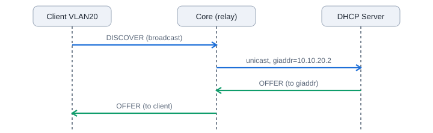

*شکل ۱: Relay، Discover را Unicast می‌کند و آدرس Interface خودش را در giaddr می‌گذارد تا سرور Pool درست را انتخاب کند.*

``` text
Core(config)# interface vlan 20
Core(config-if)# ip helper-address 10.10.30.10
! 10.10.30.10 = DHCP server in VLAN 30
```

سرور با **giaddr** می‌فهمد Discover از کدام Subnet آمده و Pool مربوط (VLAN 20) را به کلاینت می‌دهد. پس سرور باید Scope برای هر Subnet داشته باشد.

> **هشدار**
>
> `ip helper-address` علاوه بر DHCP، ۸ سرویس UDP دیگر را هم Forward می‌کند (TFTP، DNS، NetBIOS، TACACS و ...). در Hardening با `no ip forward-protocol udp ...` محدودشان می‌کنیم.

### ۴. دستورهای مشاهده

``` text
R1# show ip dhcp pool
R1# show ip dhcp binding
R1# show ip dhcp conflict
R1# show ip dhcp server statistics
R1# debug ip dhcp server events   (briefly)
```

- `binding`: کدام MAC چه IP گرفته و تا کی.
- `conflict`: آدرسی که قبل از واگذاری Ping داده شد و کسی جواب داد (تداخل).
- `pool`: تعداد آدرس‌های مصرف‌شده و باقی‌مانده.

### ۵. مثال‌ها

#### ساده

``` text
PC1> ip dhcp
DDORA IP 10.10.20.21/24 GW 10.10.20.1
```

#### متوسط: Relay

``` text
Server in VLAN 30, clients in VLAN 20
ip helper-address on Vlan20 -> clients get 10.10.20.x from the right scope
```

#### سخت: Pool تمام شد

``` text
Symptom : new clients get 169.254.x.x
Check   : show ip dhcp pool -> 0 free addresses
Cause   : lease too long + many short-lived devices (e.g. guest Wi-Fi)
Fix     : shorten the lease, enlarge the pool, clear stale bindings
```

### تمرین‌ها

**ت1.** ۱ (ساده): چرا آدرس Gateway را exclude می‌کنیم؟ *(پاسخ: 7-1-ت1 در بخش «پاسخ‌ها» انتهای فصل)*

**ت2.** ۲ (ساده): DHCP Relay چه می‌کند؟ *(پاسخ: 7-1-ت2 در بخش «پاسخ‌ها» انتهای فصل)*

**ت3.** ۳ (متوسط): giaddr برای چیست؟ *(پاسخ: 7-1-ت3 در بخش «پاسخ‌ها» انتهای فصل)*

**ت4.** ۴ (متوسط): ۲۵۴ آدرس، ۲۰ مستثنا؛ حداکثر کلاینت؟ *(پاسخ: 7-1-ت4 در بخش «پاسخ‌ها» انتهای فصل)*

**ت5.** ۵ (سخت): کاربران VLAN 20 آدرس نمی‌گیرند ولی VLAN 10 می‌گیرد؛ علت محتمل؟ *(پاسخ: 7-1-ت5 در بخش «پاسخ‌ها» انتهای فصل)*

### Lab هدایت‌شده

#### گام ۱: DHCP روی Core

``` text
Core(config)# ip dhcp excluded-address 10.10.20.1 10.10.20.20
Core(config)# ip dhcp pool USERS20
Core(dhcp-config)# network 10.10.20.0 255.255.255.0
Core(dhcp-config)# default-router 10.10.20.254
Core(dhcp-config)# dns-server 10.10.10.53
```

#### گام ۲: تست با VPCS

``` text
PC1> ip dhcp
PC1> show ip
Core# show ip dhcp binding
```

#### گام ۳: Relay

DHCP Pool را روی یک روتر دیگر (مثلاً R-SRV در VLAN 30) بسازید و روی `interface vlan 20` دستور helper-address بزنید؛ از VPCS دوباره آدرس بگیرید و Capture را ببینید: Discover Broadcast روی لینک PC، Unicast روی لینک سرور.

#### گام ۴: Reservation

یک رزرو برای MAC یکی از VPCSها بسازید و تأیید کنید همیشه همان IP را می‌گیرد.

### Lab مستقل

جدول «Scope Plan» (VLAN، Subnet، بازه، Excluded، Lease، DNS، Reservationها) را در `02-design/dhcp-plan.md` بنویسید.

### عیب‌یابی

|         |                                                                                                                                  |
|---------|----------------------------------------------------------------------------------------------------------------------------------|
| Symptom | کلاینت 169.254.x.x می‌گیرد                                                                                                        |
| چک‌لیست  | ۱) Relay تنظیم است؟ ؛ ۲) Scope برای آن Subnet هست؟ ؛ ۳) Pool پر نشده؟ ؛ ۴) Snooping/ACL جلوی Offer را نمی‌گیرد؟ ؛ ۵) مسیر به سرور |
| ابزار   | show ip dhcp binding ، show ip dhcp pool ، Capture                                                                               |
| رفع     | افزودن Relay یا Scope                                                                                                            |

### سؤال‌های مرور

**م1.** DHCP Relay کی لازم است؟ *(پاسخ: 7-1-م1 در بخش «پاسخ‌ها» انتهای فصل)*

**م2.** Reservation چیست؟ *(پاسخ: 7-1-م2 در بخش «پاسخ‌ها» انتهای فصل)*

### English Corner: انگلیسی تخصصی این درس

این جمله‌ها از مستندات و محیط کار واقعی‌اند. بلند بخوانید و ترجمه را بپوشانید.

| English sentence                                     | ترجمه                                                 |
|------------------------------------------------------|-------------------------------------------------------|
| Exclude the static addresses from the DHCP pool.     | آدرس‌های ثابت را از Pool DHCP مستثنا کنید.             |
| The relay agent forwards the broadcast as a unicast. | Relay Agent، Broadcast را به‌صورت Unicast ارسال می‌کند. |
| The client received an APIPA address.                | کلاینت آدرس APIPA گرفت.                               |
| Create a reservation for the printer.                | برای پرینتر یک Reservation بسازید.                    |

**Q1.** Quick quiz (answer in English): Why does a DHCP request not cross a router by default? *(پاسخ: 7-1-Q1 در بخش «پاسخ‌ها» انتهای فصل)*

### تکلیف و چک‌لیست تسلط

- [ ] DHCP و Reservation را بسازم.
- [ ] Relay را تست و Capture را تحلیل کنم.
- [ ] Scope Plan را بنویسم.

### یادآوری اشتباهات شما

> **یادآوری**
>
> پیش‌بینی قبل از اجرا؛ بکاپ قبل از تغییر؛ پذیرفته‌شدن دستور ≠ کار کردن؛ فرمول‌ها در بلوک مستقل.


#### کارت Lab — DHCP و Relay

| # | فیلد | محتوا |
|---|---|---|
| 1 | عنوان و هدف | DHCP Server و Relay |
| 2 | پیش‌نیاز | فصل 6 |
| 3 | توپولوژی | Core + R-SRV |
| 4 | تجهیزات | Core، روتر |
| 5 | نسخه نرم‌افزار | vIOS-L2 15.2(20200924، Experimental) برای SW؛ vIOS 15.9(3)M9 برای R؛ VPCS؛ PNetLab 4.2.8 |
| 6 | IP Plan | VLAN 20/30 |
| 7 | وضعیت اولیه | Pool/Relay |
| 8 | صورت مسئله | IP از VLAN دیگر |
| 9 | مراحل هدایت‌شده | همان بخش «Lab هدایت‌شده» همین درس |
| 10 | تست عملکرد | `show ip dhcp binding` |
| 11 | سناریوی خرابی | بدون helper |
| 12 | روش عیب‌یابی | لایه‌ای/با شواهد (بخش عیب‌یابی همین درس) |
| 13 | نتیجه‌ی مورد انتظار | Lease |
| 14 | معیار پذیرش | Scope Plan |
| 15 | مستندات نهایی | `02-design/dhcp-plan.md` |
| 16 | Cleanup و بازگردانی | — |

> **وضعیت راستی‌آزمایی (خارج از ۱۶ فیلد):** **اجرا نشده (فقط طراحی).** DHCP pool فقط CLI-Accepted.

---

<a id="l-7-2"></a>

## درس 7-2 — DNS و NTP

**فصل ۷ - روز ۲ · پیش‌نیاز: درس ۷-۱ · ۶ ساعت**

### این درس درباره چیست و چرا باید یاد بگیریم؟

**چه چیزی یاد می‌گیریم:** دو سرویس پایه که همه‌چیز به آن‌ها وابسته است: DNS (تبدیل نام به IP) و NTP (هماهنگی ساعت). چطور کار می‌کنند، چطور روی سیسکو تنظیم و بررسی می‌شوند، و چرا خرابی‌شان شبکه را «عجیب» می‌کند.

**چرا لازم است:** بیشتر شکایت‌های «اینترنت قطع است» در واقع «DNS خراب است». و Logها، Certificateها، Kerberos و Active Directory بدون ساعت درست بی‌معنی یا خراب می‌شوند؛ اختلاف بیش از ۵ دقیقه، ورود به دامنه را ناممکن می‌کند.

- **در کار روزانه:** ping به IP جواب می‌دهد ولی به نام نه؟ DNS است.
- **در امنیت:** Log با ساعت اشتباه برای تحلیل حادثه بی‌ارزش است.
- **در Capstone:** DNS و NTP مرکز روی Windows Server است و همه‌ی تجهیزات به آن اشاره می‌کنند.

> **مسیر درس**
>
> DNS چطور کار می‌کند ← رکوردها ← تنظیم روی سیسکو ← NTP و Stratum ← مثال ساده/متوسط/سخت ← Lab ← عیب‌یابی.

#### اصطلاحات این درس (مخفف ← شکل کامل ← معنی)

| مخفف     | شکل کامل انگلیسی            | معنی فارسی                                 |
|----------|-----------------------------|--------------------------------------------|
| DNS      | Domain Name System          | سیستم نام دامنه                            |
| Resolver | DNS Resolver                | سرویس‌دهنده‌ای که پرس‌وجوی کلاینت را حل می‌کند |
| A        | A record                    | نام به IPv4                                |
| AAAA     | AAAA record                 | نام به IPv6                                |
| PTR      | Pointer record              | IP به نام                                  |
| CNAME    | Canonical Name              | نام مستعار                                 |
| NTP      | Network Time Protocol       | پروتکل هماهنگی ساعت                        |
| Stratum  | Stratum                     | فاصله از منبع زمان دقیق                    |
| UTC      | Coordinated Universal Time  | زمان هماهنگ جهانی                          |
| FQDN     | Fully Qualified Domain Name | نام کامل دامنه                             |

### ۱. DNS چطور کار می‌کند؟

دفترچه‌ی تلفن را تصور کنید: شما نام «example.com» را می‌دانید و DNS «شماره» (IP) آن را می‌دهد. کلاینت از سرور DNS خودش می‌پرسد؛ اگر سرور پاسخ را نداشت، از سرورهای بالاتر می‌پرسد و در پایان جواب را می‌گیرد و برای مدتی نگه می‌دارد (Cache).

``` text
Client -> local DNS server : www.example.com ?
Local DNS -> root / TLD / authoritative servers (if not cached)
Local DNS -> client : 203.0.113.10   (cached for TTL seconds)
```

| رکورد | کار                 | مثال                             |
|-------|---------------------|----------------------------------|
| A     | نام به IPv4         | srv1.lab.local = 10.10.30.10     |
| AAAA  | نام به IPv6         | srv1.lab.local = 2001:db8:30::10 |
| PTR   | IP به نام (Reverse) | 10.10.30.10 = srv1.lab.local     |
| CNAME | نام مستعار          | www = srv1                       |
| MX    | سرور ایمیل          | mail.lab.local                   |
| NS    | سرور DNS یک Zone    | dns1.lab.local                   |

### ۲. تنظیم DNS روی سیسکو

``` text
R1(config)# ip domain-name lab.local
R1(config)# ip name-server 10.10.10.53
R1(config)# ip domain lookup
R1# ping srv1
R1# nslookup srv1  (not on all images)
```

> **یادآوری از دوره**
>
> در درس ۲-۴ گفتیم `no ip domain-lookup` برای جلوگیری از «Translating...». اگر DNS واقعی دارید و می‌خواهید روی دستگاه از نام استفاده کنید، `ip domain lookup` و `ip name-server` را بزنید.

روی کلاینت Windows: `nslookup srv1.lab.local` و `ipconfig /flushdns`.

### ۳. NTP: همه‌ی ساعت‌ها یکی

ساعت کامپیوترها کم‌کم از هم فاصله می‌گیرد (Drift). NTP آن‌ها را با یک منبع دقیق هماهنگ می‌کند. سلسله‌مراتب Stratum: منبع اتمی/GPS ‏Stratum 0، سروری که مستقیم به آن وصل است Stratum 1، و هر مرحله پایین‌تر یک عدد بیشتر.

``` text
Stratum 0 : atomic clock / GPS
Stratum 1 : server directly attached
Stratum 2 : synchronizes from stratum 1
...
Stratum 16 : unsynchronized (invalid)
```

#### تنظیم NTP روی سیسکو

``` text
R1(config)# clock timezone IRST 3 30
R1(config)# ntp server 10.10.10.53
R1(config)# ntp server 192.168.88.1 prefer
R1(config)# service timestamps log datetime msec localtime
R1(config)# service timestamps debug datetime msec localtime
R1# show ntp status
R1# show ntp associations
R1# show clock detail
```

- `clock timezone IRST 3 30`: ایران +۳:۳۰ (UTC). منطقه‌ی زمانی را در نظر بگیرید.
- `ntp server ... prefer`: منبع ترجیحی. چند منبع برای تحمل خطا.
- `show ntp status`: باید `Clock is synchronized` باشد.

``` text
R1# show ntp associations
  address        ref clock   st  when  poll reach  delay  offset
*~10.10.10.53   .GPS.       2   18    64   377    1.2   0.3

* = synchronized   ~ = configured   reach 377 = all last 8 polls succeeded
```

در Lab ما ESXi از MikroTik (192.168.88.1) NTP می‌گیرد؛ همان منبع می‌تواند ریشه‌ی Stratum کل Lab باشد.

### ۴. مثال‌ها

#### ساده

``` text
ping 10.10.30.10 works but ping srv1 fails
-> DNS problem (name resolution), not connectivity
```

#### متوسط: ساعت اشتباه

``` text
Syslog entries from R1 show 2000-01-01 and from SW1 2026-11-08
-> logs cannot be correlated; configure NTP on all devices
```

#### سخت: Kerberos و Windows

اگر ساعت یک کلاینت بیش از ۵ دقیقه با Domain Controller اختلاف داشته باشد، ورود به دامنه یا دسترسی به فایل‌سرور شکست می‌خورد، با پیام‌های مبهم احراز هویت. همیشه اول ساعت را بررسی کنید.

### تمرین‌ها

**ت1.** ۱ (ساده): A و PTR چه فرقی دارند؟ *(پاسخ: 7-2-ت1 در بخش «پاسخ‌ها» انتهای فصل)*

**ت2.** ۲ (ساده): Stratum 16 یعنی؟ *(پاسخ: 7-2-ت2 در بخش «پاسخ‌ها» انتهای فصل)*

**ت3.** ۳ (متوسط): ping به IP می‌رسد ولی به نام نه؛ علت؟ *(پاسخ: 7-2-ت3 در بخش «پاسخ‌ها» انتهای فصل)*

**ت4.** ۴ (متوسط): ساعت Windows 6 دقیقه عقب است؛ اثر؟ *(پاسخ: 7-2-ت4 در بخش «پاسخ‌ها» انتهای فصل)*

**ت5.** ۵ (سخت): reach 0 در show ntp associations یعنی؟ *(پاسخ: 7-2-ت5 در بخش «پاسخ‌ها» انتهای فصل)*

### Lab هدایت‌شده

#### گام ۱: NTP روی روترها

``` text
R1(config)# clock timezone IRST 3 30
R1(config)# ntp server 192.168.88.1
R1# show ntp status
R1# show ntp associations
```

اگر IP مسیر نداشت، در Lab ایزوله NTP محلی را روی یک روتر (`ntp master 3`) بسازید و بقیه را به آن وصل کنید:

``` text
R1(config)# ntp master 3
R2(config)# ntp server 10.0.12.1
R2# show ntp status
```

#### گام ۲: DNS

در PNetLab یک VM سبک (مثلاً لینوکس) به‌عنوان DNS بسازید یا فعلاً روی سیسکو یک نگاشت محلی بنویسید:

``` text
R1(config)# ip host srv1 10.10.30.10
R1# ping srv1
```

#### گام ۳: Syslog با ساعت درست

``` text
R1(config)# service timestamps log datetime msec localtime
R1# show logging | include %
```

### Lab مستقل

«Service Dependency Map» بنویسید: چه تجهیزی به DNS/NTP کدام سرور اشاره می‌کند؛ در `02-design/dns-ntp-map.md`.

### عیب‌یابی

|         |                                                                                                         |
|---------|---------------------------------------------------------------------------------------------------------|
| Symptom | IP کار می‌کند، نام نه (یا ساعت اشتباه)                                                                   |
| چک‌لیست  | ۱) DNS Server درست روی کلاینت؟ ؛ ۲) رکورد A هست؟ ؛ ۳) NTP reach؟ ؛ ۴) Timezone؟ ؛ ۵) فایروال UDP 53/123 |
| ابزار   | nslookup ، show ntp associations ، show clock detail                                                    |
| رفع     | اصلاح DNS/NTP                                                                                           |

### سؤال‌های مرور

**م1.** DNS چه می‌کند؟ *(پاسخ: 7-2-م1 در بخش «پاسخ‌ها» انتهای فصل)*

**م2.** چرا NTP برای امنیت مهم است؟ *(پاسخ: 7-2-م2 در بخش «پاسخ‌ها» انتهای فصل)*

### English Corner: انگلیسی تخصصی این درس

این جمله‌ها از مستندات و محیط کار واقعی‌اند. بلند بخوانید و ترجمه را بپوشانید.

| English sentence                                       | ترجمه                                                |
|--------------------------------------------------------|------------------------------------------------------|
| The device synchronizes its clock with the NTP server. | دستگاه ساعتش را با سرور NTP هماهنگ می‌کند.            |
| DNS resolves hostnames to IP addresses.                | DNS نام میزبان را به IP تبدیل می‌کند.                 |
| A time skew of more than five minutes breaks Kerberos. | اختلاف ساعت بیش از پنج دقیقه Kerberos را خراب می‌کند. |
| Flush the DNS cache on the client.                     | Cache DNS کلاینت را پاک کنید.                        |

**Q1.** Quick quiz (answer in English): Why do all devices need the same NTP source? *(پاسخ: 7-2-Q1 در بخش «پاسخ‌ها» انتهای فصل)*

### تکلیف و چک‌لیست تسلط

- [ ] NTP را بالا بیاورم و Synchronized ببینم.
- [ ] فرق خرابی DNS و اتصال را توضیح دهم.
- [ ] Dependency Map را بنویسم.

### یادآوری اشتباهات شما

> **یادآوری**
>
> پیش‌بینی قبل از اجرا؛ بکاپ قبل از تغییر؛ پذیرفته‌شدن دستور ≠ کار کردن؛ فرمول‌ها در بلوک مستقل.


#### کارت Lab — DNS و NTP

| # | فیلد | محتوا |
|---|---|---|
| 1 | عنوان و هدف | DNS و NTP |
| 2 | پیش‌نیاز | درس 7-1 |
| 3 | توپولوژی | R1,R2 + سرور |
| 4 | تجهیزات | R1،R2 |
| 5 | نسخه نرم‌افزار | vIOS-L2 15.2(20200924، Experimental) برای SW؛ vIOS 15.9(3)M9 برای R؛ VPCS؛ PNetLab 4.2.8 |
| 6 | IP Plan | — |
| 7 | وضعیت اولیه | ntp/ip host |
| 8 | صورت مسئله | Sync |
| 9 | مراحل هدایت‌شده | همان بخش «Lab هدایت‌شده» همین درس |
| 10 | تست عملکرد | `show ntp status` |
| 11 | سناریوی خرابی | reach 0 |
| 12 | روش عیب‌یابی | لایه‌ای/با شواهد (بخش عیب‌یابی همین درس) |
| 13 | نتیجه‌ی مورد انتظار | Synchronized |
| 14 | معیار پذیرش | Dependency Map |
| 15 | مستندات نهایی | `02-design/dns-ntp-map.md` |
| 16 | Cleanup و بازگردانی | — |

> **وضعیت راستی‌آزمایی (خارج از ۱۶ فیلد):** **اجرا نشده (فقط طراحی).** NTP فقط CLI-Accepted (Sync آزمایش نشده).

---

<a id="l-7-3"></a>

## درس 7-3 — NAT و PAT

**فصل ۷ - روز ۳ · پیش‌نیاز: درس‌های ۲-۱ و ۷-۱ · ۶ ساعت**

### این درس درباره چیست و چرا باید یاد بگیریم؟

**چه چیزی یاد می‌گیریم:** NAT و PAT: چطور آدرس‌های خصوصی با یک (یا چند) آدرس عمومی به اینترنت می‌روند؛ انواع Static، Dynamic و Overload؛ Inside/Outside؛ و جدول Translation.

**چرا لازم است:** آدرس‌های خصوصی (10.x، 192.168.x) در اینترنت Route نمی‌شوند. NAT مبدأ بسته را در لبه عوض می‌کند تا پاسخ برگردد. هر شبکه‌ی داخلی که به اینترنت وصل است NAT دارد؛ و خرابی آن (مثلاً NAT دوگانه) مبهم‌ترین مشکلات را می‌سازد.

- **در کار روزانه:** تقریباً همه‌ی اینترنت‌ها PAT هستند.
- **در امنیت:** NAT امنیت نیست؛ فقط پنهان‌سازی آدرس است. محافظ اصلی Policy فایروال است.
- **در FortiGate:** Policy NAT، IP Pool و VIP همین مفاهیم را در فایروال دارند (W10).

> **مسیر درس**
>
> چرا NAT ← Inside/Outside ← Static ← Dynamic ← PAT/Overload ← مثال ساده/متوسط/سخت ← Lab ← عیب‌یابی.

#### اصطلاحات این درس (مخفف ← شکل کامل ← معنی)

| مخفف          | شکل کامل انگلیسی            | معنی فارسی                      |
|---------------|-----------------------------|---------------------------------|
| NAT           | Network Address Translation | ترجمه‌ی آدرس                     |
| PAT           | Port Address Translation    | ترجمه‌ی آدرس و پورت (Overload)   |
| Inside Local  | Inside Local                | آدرس داخلی قبل از ترجمه         |
| Inside Global | Inside Global               | آدرس عمومی بعد از ترجمه         |
| Overload      | NAT Overload                | چند آدرس داخلی با یک آدرس عمومی |
| VIP           | Virtual IP                  | Port Forward در فایروال (DNAT)  |
| DNAT          | Destination NAT             | تغییر آدرس مقصد                 |
| SNAT          | Source NAT                  | تغییر آدرس مبدأ                 |

### ۱. NAT چرا و چطور؟

فرض کنید یک ساختمان اداری یک شماره‌ی تلفن بیرونی دارد و داخل داخلی‌ها (۱۰۱، ۱۰۲...). وقتی کارمند ۱۰۲ تماس می‌گیرد، گیرنده شماره‌ی بیرونی را می‌بیند؛ منشی (NAT) می‌داند پاسخ را به کدام داخلی بدهد. NAT هم همین جدول را نگه می‌دارد.

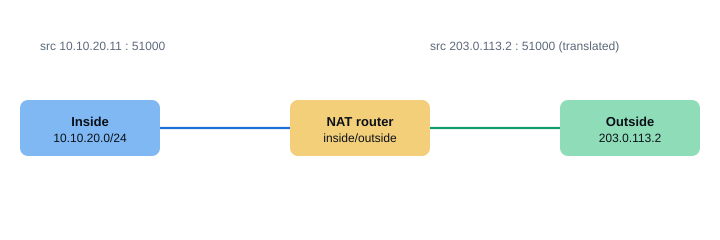

*شکل ۱: NAT مبدأ بسته را از آدرس داخلی به آدرس عمومی تبدیل می‌کند و در جدول نگه می‌دارد.*

| اصطلاح         | معنی                                   | مثال        |
|----------------|----------------------------------------|-------------|
| Inside Local   | آدرس داخلی (قبل از ترجمه)              | 10.10.20.11 |
| Inside Global  | آدرس داخلی از دید بیرون (بعد از ترجمه) | 203.0.113.2 |
| Outside Global | آدرس مقصد در اینترنت                   | 8.8.8.8     |

### ۲. سه نوع NAT

| نوع            | نگاشت                                   | کاربرد                         |
|----------------|-----------------------------------------|--------------------------------|
| Static NAT     | یک به یک ثابت                           | انتشار سرور (مثلاً وب) به بیرون |
| Dynamic NAT    | داخلی به Pool از چند آدرس عمومی         | نادر؛ وقتی چند IP عمومی داریم  |
| PAT / Overload | چند داخلی به یک IP عمومی با پورت متفاوت | اینترنت عادی                   |

PAT چطور؟ برای هر ارتباط، علاوه بر آدرس، شماره‌ی پورت مبدأ هم عوض می‌شود تا ارتباط‌ها از هم جدا بمانند:

``` text
10.10.20.11:51000 -> 203.0.113.2:51000
10.10.20.12:51000 -> 203.0.113.2:51001   (port changed to stay unique)
```

### ۳. دستورها (خط‌به‌خط)

#### PAT (Overload) با ACL

``` text
R1(config)# access-list 10 permit 10.10.20.0 0.0.0.255
R1(config)# interface gi0/0
R1(config-if)# ip nat inside
R1(config)# interface gi0/1
R1(config-if)# ip nat outside
R1(config)# ip nat inside source list 10 interface gi0/1 overload
```

- `ip nat inside / outside`: هر Interface را نقش می‌دهد؛ بدون این‌ها NAT کار نمی‌کند.
- `access-list 10`: مشخص می‌کند کدام ترافیک ترجمه شود (چه کسی «داخل» است).
- `overload`: PAT. `interface gi0/1`: از IP همان Interface خروجی استفاده شود.

#### Static NAT (انتشار سرور)

``` text
R1(config)# ip nat inside source static 10.10.30.10 203.0.113.10
! port forward only HTTPS:
R1(config)# ip nat inside source static tcp 10.10.30.10 443 203.0.113.10 443
```

#### مشاهده

``` text
R1# show ip nat translations
R1# show ip nat statistics
R1# clear ip nat translation *
R1# debug ip nat   (briefly)
```

``` text
Pro Inside global        Inside local        Outside local    Outside global
icmp 203.0.113.2:1       10.10.20.11:1       8.8.8.8:1        8.8.8.8:1
tcp  203.0.113.2:51000   10.10.20.12:51000   93.184.216.34:443 93.184.216.34:443
```

### ۴. مثال‌ها

#### ساده

``` text
PC (10.10.20.11) pings 8.8.8.8
show ip nat translations shows the entry with inside global 203.0.113.2
```

#### متوسط: Static برای سرور

``` text
Outside client -> 203.0.113.10:443
Router translates the destination to 10.10.30.10:443 (inbound)
Return traffic is translated back automatically
```

#### سخت: چرا NAT کار نمی‌کند؟

``` text
Cause 1: ip nat inside/outside missing or on the wrong interface
Cause 2: ACL does not match the inside subnet
Cause 3: missing default route to the ISP
Cause 4: double NAT (router and firewall both translate)
Check : show ip nat translations (empty?) , show ip nat statistics (misses)
```

### تمرین‌ها

**ت1.** ۱ (ساده): PAT چه چیزی را علاوه بر IP تغییر می‌دهد؟ *(پاسخ: 7-3-ت1 در بخش «پاسخ‌ها» انتهای فصل)*

**ت2.** ۲ (ساده): Inside Global چیست؟ *(پاسخ: 7-3-ت2 در بخش «پاسخ‌ها» انتهای فصل)*

**ت3.** ۳ (متوسط): دو دستور لازم برای NAT روی یک Interface؟ *(پاسخ: 7-3-ت3 در بخش «پاسخ‌ها» انتهای فصل)*

**ت4.** ۴ (متوسط): چرا NAT امنیت نیست؟ *(پاسخ: 7-3-ت4 در بخش «پاسخ‌ها» انتهای فصل)*

**ت5.** ۵ (سخت): NAT دوگانه (Double NAT) چه مشکلی می‌سازد؟ *(پاسخ: 7-3-ت5 در بخش «پاسخ‌ها» انتهای فصل)*

### Lab هدایت‌شده

روتر EDGE-R1 با Inside = لینک به Core و Outside = Loopback شبیه اینترنت (یا یک روتر دیگر).

#### گام ۱: PAT

``` text
EDGE-R1(config)# access-list 10 permit 10.10.0.0 0.0.255.255
EDGE-R1(config)# interface gi0/0
EDGE-R1(config-if)# ip nat inside
EDGE-R1(config)# interface gi0/2
EDGE-R1(config-if)# ip address 203.0.113.2 255.255.255.0
EDGE-R1(config-if)# ip nat outside
EDGE-R1(config)# ip nat inside source list 10 interface gi0/2 overload
```

#### گام ۲: تست

``` text
PC1> ping 203.0.113.1
EDGE-R1# show ip nat translations
EDGE-R1# show ip nat statistics
```

طبق Probe اولیه، دستور NAT در vIOSL2 «پذیرفته» می‌شود؛ روی روتر vIOS (IOS واقعی) باید کار کند. نتیجه‌ی واقعی را ثبت کنید.

#### گام ۳: Static NAT

یک سرور Inside را با Static منتشر کنید و از «بیرون» تست کنید.

#### گام ۴: قبل/بعد Capture

روی لینک Inside و Outside Capture بگیرید و آدرس مبدأ را مقایسه کنید.

### Lab مستقل

جدول «NAT Matrix» (Inside Local، Inside Global، نوع، سرویس) و تصویر Packet Flow قبل/بعد NAT را در `02-design/nat-matrix.md` بنویسید.

### عیب‌یابی

|         |                                                                                                                  |
|---------|------------------------------------------------------------------------------------------------------------------|
| Symptom | اینترنت ندارم؛ ping داخلی OK                                                                                     |
| چک‌لیست  | ۱) show ip nat translations خالی؟ ؛ ۲) inside/outside درست؟ ؛ ۳) ACL مطابق؟ ؛ ۴) Default route؟ ؛ ۵) Double NAT؟ |
| ابزار   | show ip nat statistics ، debug ip nat                                                                            |
| رفع     | اصلاح نقش Interface یا ACL                                                                                       |

### سؤال‌های مرور

**م1.** PAT چطور چند کاربر را با یک IP می‌برد؟ *(پاسخ: 7-3-م1 در بخش «پاسخ‌ها» انتهای فصل)*

**م2.** Static NAT برای چیست؟ *(پاسخ: 7-3-م2 در بخش «پاسخ‌ها» انتهای فصل)*

### English Corner: انگلیسی تخصصی این درس

این جمله‌ها از مستندات و محیط کار واقعی‌اند. بلند بخوانید و ترجمه را بپوشانید.

| English sentence                                                          | ترجمه                                                                 |
|---------------------------------------------------------------------------|-----------------------------------------------------------------------|
| Configure NAT overload on the outside interface.                          | NAT Overload را روی Interface خارجی تنظیم کنید.                       |
| The translation table shows the inside local and inside global addresses. | جدول Translation، آدرس‌های Inside Local و Inside Global را نشان می‌دهد. |
| NAT is not a security feature.                                            | NAT ویژگی امنیتی نیست.                                                |
| Double NAT breaks inbound port forwarding.                                | Double NAT ارسال پورت ورودی را خراب می‌کند.                            |

**Q1.** Quick quiz (answer in English): What does PAT add to the translation to keep sessions unique? *(پاسخ: 7-3-Q1 در بخش «پاسخ‌ها» انتهای فصل)*

### تکلیف و چک‌لیست تسلط

- [ ] PAT را بسازم و Translation را ببینم.
- [ ] Static NAT را تست کنم.
- [ ] NAT Matrix را بنویسم.

### یادآوری اشتباهات شما

> **یادآوری**
>
> پیش‌بینی قبل از اجرا؛ بکاپ قبل از تغییر؛ پذیرفته‌شدن دستور ≠ کار کردن؛ فرمول‌ها در بلوک مستقل.


#### کارت Lab — NAT و PAT

| # | فیلد | محتوا |
|---|---|---|
| 1 | عنوان و هدف | NAT/PAT |
| 2 | پیش‌نیاز | درس 7-2 |
| 3 | توپولوژی | Edge |
| 4 | تجهیزات | EDGE-R1 |
| 5 | نسخه نرم‌افزار | vIOS-L2 15.2(20200924، Experimental) برای SW؛ vIOS 15.9(3)M9 برای R؛ VPCS؛ PNetLab 4.2.8 |
| 6 | IP Plan | Inside/Outside |
| 7 | وضعیت اولیه | overload |
| 8 | صورت مسئله | Translation |
| 9 | مراحل هدایت‌شده | همان بخش «Lab هدایت‌شده» همین درس |
| 10 | تست عملکرد | `show ip nat translations` |
| 11 | سناریوی خرابی | inside/outside غلط |
| 12 | روش عیب‌یابی | لایه‌ای/با شواهد (بخش عیب‌یابی همین درس) |
| 13 | نتیجه‌ی مورد انتظار | Translation |
| 14 | معیار پذیرش | NAT Matrix |
| 15 | مستندات نهایی | `02-design/nat-matrix.md` |
| 16 | Cleanup و بازگردانی | — |

> **وضعیت راستی‌آزمایی (خارج از ۱۶ فیلد):** **اجرا نشده (فقط طراحی).** NAT فقط CLI-Accepted.

---

<a id="l-7-4"></a>

## درس 7-4 — ACL

**فصل ۷ - روز ۴ · پیش‌نیاز: درس‌های ۲-۵ و ۶-۵ · ۶ ساعت**

### این درس درباره چیست و چرا باید یاد بگیریم؟

**چه چیزی یاد می‌گیریم:** فهرست کنترل دسترسی (ACL): انواع Standard و Extended، قاعده‌ی «اولین تطابق» و Implicit Deny، جای درست گذاشتن ACL، و نوشتن Policy بین VLANها.

**چرا لازم است:** ACL اولین ابزار کنترل ترافیک روی سیسکوست و پایه‌ی فهم Policy فایروال است. ترتیب اشتباه یک قاعده یا فراموشی Implicit Deny می‌تواند کل شبکه را قطع کند یا درِ امنیت را باز بگذارد.

- **در کار روزانه:** جداکردن مهمان از شبکه‌ی داخلی و محدودکردن مدیریت (SSH).
- **در امنیت:** ACL، Least Privilege را در لایه‌ی شبکه پیاده می‌کند.
- **در FortiGate:** Policy فایروال همان منطق Top-Down و First Match را دارد (با Stateful بودن).

> **مسیر درس**
>
> ACL چیست ← First Match و Implicit Deny ← Standard در برابر Extended ← جای ACL ← مثال ساده/متوسط/سخت ← Lab ← عیب‌یابی.

#### اصطلاحات این درس (مخفف ← شکل کامل ← معنی)

| مخفف          | شکل کامل انگلیسی     | معنی فارسی                 |
|---------------|----------------------|----------------------------|
| ACL           | Access Control List  | فهرست قوانین permit/deny   |
| Standard      | Standard ACL         | فقط آدرس مبدأ              |
| Extended      | Extended ACL         | مبدأ، مقصد، پروتکل، پورت   |
| Implicit Deny | Implicit Deny        | انکار ضمنی در پایان هر ACL |
| Wildcard      | Wildcard mask        | معکوس Mask                 |
| ACE           | Access Control Entry | یک خط ACL                  |
| Stateless     | Stateless            | بدون حافظه‌ی وضعیت ارتباط   |
| established   | TCP established      | بسته‌های بعد از برقراری TCP |

### ۱. ACL چیست؟

ACL فهرستی از قوانین است. هر قانون می‌گوید: «اگر بسته با این مشخصات بود، اجازه بده (permit) یا ببند (deny)». مثل لیست مهمانان در ورودی یک سالن؛ نگهبان از بالای لیست شروع می‌کند و هر نامی را پیدا کرد همان‌جا تصمیم می‌گیرد.

> **دو قانون اصلی**
>
> ۱) **اولین تطابق** (First Match): از بالا به پایین؛ به محض اولین قانونی که جور شد، بقیه خوانده نمی‌شود. ۲) **Implicit Deny**: در انتهای هر ACL یک `deny any` نامرئی هست؛ پس هر چه صریحاً permit نشده، بسته می‌شود.

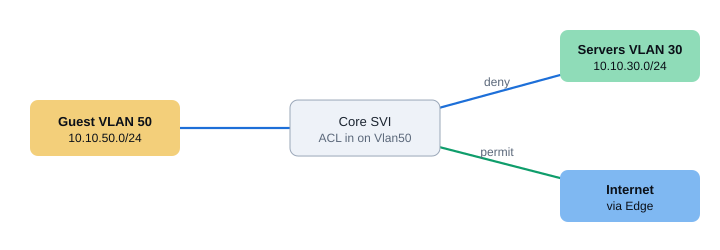

*شکل ۱: ACL روی ورودی SVI مهمان: دسترسی به سرورها بسته و اینترنت باز است.*

### ۲. Standard در برابر Extended

| معیار   | Standard             | Extended                 |
|---------|----------------------|--------------------------|
| شماره   | 1-99 و 1300-1999     | 100-199 و 2000-2699      |
| معیار   | فقط IP مبدأ          | مبدأ، مقصد، پروتکل، پورت |
| جای نصب | نزدیک مقصد           | نزدیک مبدأ               |
| کاربرد  | فیلتر ساده (مثل VTY) | Policy دقیق بین VLANها   |

چرا Standard نزدیک مقصد؟ چون فقط مبدأ را می‌شناسد؛ اگر نزدیک مبدأ بگذارید، ترافیک آن مبدأ به همه‌ی مقصدها بسته می‌شود. Extended را نزدیک مبدأ می‌گذارند تا ترافیک ناخواسته زودتر از شبکه خارج شود.

### ۳. دستورها (خط‌به‌خط)

روش Named که قابل‌ویرایش و خواناست:

``` text
Core(config)# ip access-list extended GUEST-IN
Core(config-ext-nacl)# remark block guests from internal networks
Core(config-ext-nacl)# deny ip 10.10.50.0 0.0.0.255 10.10.0.0 0.0.255.255
Core(config-ext-nacl)# permit udp 10.10.50.0 0.0.0.255 any eq 53
Core(config-ext-nacl)# permit tcp 10.10.50.0 0.0.0.255 any eq 80
Core(config-ext-nacl)# permit tcp 10.10.50.0 0.0.0.255 any eq 443
Core(config-ext-nacl)# deny ip any any log
Core(config-ext-nacl)# exit
Core(config)# interface vlan 50
Core(config-if)# ip access-group GUEST-IN in
```

- `remark`: توضیح خط‌به‌خط (حتماً بنویسید).
- اول `deny` برای شبکه‌ی داخلی (10.10.0.0/16)؛ بعد permitهای لازم (DNS، وب).
- `log`: برای دیدن Hit در Log (روی خطوط deny مفید است).
- `ip access-group NAME in`: ACL را روی ورودی Interface اعمال می‌کند.

``` text
Core# show access-lists
Core# show ip interface vlan 50 | include access list
Core# show running-config | section ip access-list
```

``` text
Extended IP access list GUEST-IN
    10 deny ip 10.10.50.0 0.0.0.255 10.10.0.0 0.0.255.255 (12 matches)
    20 permit udp 10.10.50.0 0.0.0.255 any eq domain (45 matches)
    30 permit tcp 10.10.50.0 0.0.0.255 any eq www
    40 permit tcp 10.10.50.0 0.0.0.255 any eq 443
    50 deny ip any any log (3 matches)
```

### ۴. نکته‌های حرفه‌ای

- **ترتیب مهم است:** اگر permit کلی را بالای deny بگذارید، deny هرگز اجرا نمی‌شود.
- **ACL فقط ترافیک عبوری را فیلتر می‌کند،** نه ترافیکی که خود روتر می‌سازد.
- **Stateless است:** برگشت ترافیک باید صراحتاً مجاز شود (مثلاً `established` برای TCP)؛ فایروال Stateful این را خودکار می‌کند.
- **جهت (in/out) را درست انتخاب کنید:** in = ورودی به Interface از بیرون؛ out = خروجی.
- **قبل از اعمال،** مطمئن شوید قانون مدیریت (SSH) شما را قطع نمی‌کند.

``` text
Return traffic example (TCP, stateless ACL):
  permit tcp any 10.10.20.0 0.0.0.255 established
matches only packets with ACK/RST bits set (replies), not new connections
```

### ۵. مثال‌ها

#### ساده: SSH فقط از مدیریت (Standard)

``` text
Core(config)# ip access-list standard MGMT-ONLY
Core(config-std-nacl)# permit 10.10.10.0 0.0.0.255
Core(config)# line vty 0 4
Core(config-line)# access-class MGMT-ONLY in
```

#### متوسط: کاربران فقط HTTPS و DNS به سرور

``` text
ip access-list extended USERS-TO-SRV
 permit tcp 10.10.20.0 0.0.0.255 host 10.10.30.10 eq 443
 permit udp 10.10.20.0 0.0.0.255 host 10.10.30.53 eq 53
 deny ip 10.10.20.0 0.0.0.255 10.10.30.0 0.0.0.255 log
 permit ip any any
```

#### سخت: چرا Ping کار می‌کند ولی HTTPS نه؟

``` text
Cause 1: ACL has permit icmp above, no permit for tcp 443
Cause 2: ACL applied in the wrong direction or on the wrong interface
Cause 3: implicit deny (no permit for the traffic)
Cause 4: return path ACL blocks the replies (stateless)
Check : show access-lists (hit counters), show ip interface ... | include access
```

### تمرین‌ها

**ت1.** ۱ (ساده): Implicit Deny چیست؟ *(پاسخ: 7-4-ت1 در بخش «پاسخ‌ها» انتهای فصل)*

**ت2.** ۲ (ساده): Extended را کجا می‌گذاریم؟ *(پاسخ: 7-4-ت2 در بخش «پاسخ‌ها» انتهای فصل)*

**ت3.** ۳ (متوسط): Wildcard برای 10.10.20.0/24؟ *(پاسخ: 7-4-ت3 در بخش «پاسخ‌ها» انتهای فصل)*

**ت4.** ۴ (متوسط): چرا ترتیب مهم است؟ *(پاسخ: 7-4-ت4 در بخش «پاسخ‌ها» انتهای فصل)*

**ت5.** ۵ (سخت): ACL روی VLAN مهمان هر چیزی را می‌بندد؛ چه چیزی فراموش شده؟ *(پاسخ: 7-4-ت5 در بخش «پاسخ‌ها» انتهای فصل)*

### Lab هدایت‌شده

روی Core از Lab A (یا هر روتر با دو VLAN):

#### گام ۱: Baseline

``` text
PC-guest> ping 10.10.30.10   (before ACL: success)
```

#### گام ۲: ACL و اعمال

ACL بخش ۳ را بسازید و روی `interface vlan 50` اعمال کنید (in). قبل از آن بکاپ بگیرید.

#### گام ۳: Verify

``` text
PC-guest> ping 10.10.30.10   (expect: fail)
PC-guest> ping 8.8.8.8        (expect: success via edge)
Core# show access-lists       (hit counters rise)
```

طبق Probe، ACL روی vIOSL2 «پذیرفته» می‌شود و ممکن است عملاً اعمال نشود؛ روی روتر vIOS (L3) تست کنید و نتیجه‌ی واقعی را ثبت کنید.

#### گام ۴: خراب‌کردن عمدی ترتیب

یک `permit ip any any` بالای deny بگذارید و ببینید deny بی‌اثر می‌شود؛ سپس با شماره‌ی خط ترتیب را اصلاح کنید.

### Lab مستقل

یک «Policy Matrix» (مبدأ VLAN، مقصد VLAN، سرویس، اجازه/انکار) برای ۳ VLAN در `02-design/policy-matrix.md` بنویسید.

### عیب‌یابی

|         |                                                                                                         |
|---------|---------------------------------------------------------------------------------------------------------|
| Symptom | ترافیک مجاز بسته شده یا ترافیک ممنوع رد می‌شود                                                           |
| چک‌لیست  | ۱) ACL روی کدام Interface و جهت؟ ؛ ۲) ترتیب خطوط؟ ؛ ۳) Hit Count؟ ؛ ۴) Implicit Deny؟ ؛ ۵) برگشت ترافیک |
| ابزار   | show access-lists ، show ip interface                                                                   |
| رفع     | اصلاح ترتیب یا افزودن permit                                                                            |

### سؤال‌های مرور

**م1.** اولین تطابق یعنی چه؟ *(پاسخ: 7-4-م1 در بخش «پاسخ‌ها» انتهای فصل)*

**م2.** تفاوت Stateless و Stateful؟ *(پاسخ: 7-4-م2 در بخش «پاسخ‌ها» انتهای فصل)*

### English Corner: انگلیسی تخصصی این درس

این جمله‌ها از مستندات و محیط کار واقعی‌اند. بلند بخوانید و ترجمه را بپوشانید.

| English sentence                                                     | ترجمه                                                          |
|----------------------------------------------------------------------|----------------------------------------------------------------|
| Apply the ACL inbound on the VLAN interface.                         | ACL را روی ورودی Interface مربوط به VLAN اعمال کنید.           |
| Rules are evaluated top-down, first match wins.                      | قوانین از بالا به پایین ارزیابی می‌شوند؛ اولین تطابق برنده است. |
| Add a remark to document the purpose of each entry.                  | برای مستندسازی هدف هر خط یک remark بگذارید.                    |
| The implicit deny drops everything that is not explicitly permitted. | Implicit Deny هر چه صریحاً مجاز نشده را می‌اندازد.               |

**Q1.** Quick quiz (answer in English): Where should a standard ACL be placed and why? *(پاسخ: 7-4-Q1 در بخش «پاسخ‌ها» انتهای فصل)*

### تکلیف و چک‌لیست تسلط

- [ ] ACL را بسازم و Hit Count ببینم.
- [ ] ترتیب اشتباه را بسازم و رفع کنم.
- [ ] Policy Matrix را بنویسم.

### یادآوری اشتباهات شما

> **یادآوری**
>
> پیش‌بینی قبل از اجرا؛ بکاپ قبل از تغییر؛ پذیرفته‌شدن دستور ≠ کار کردن؛ فرمول‌ها در بلوک مستقل.


#### کارت Lab — ACL

| # | فیلد | محتوا |
|---|---|---|
| 1 | عنوان و هدف | ACL استاندارد/Extended |
| 2 | پیش‌نیاز | درس 7-3 |
| 3 | توپولوژی | Core |
| 4 | تجهیزات | Core |
| 5 | نسخه نرم‌افزار | vIOS-L2 15.2(20200924، Experimental) برای SW؛ vIOS 15.9(3)M9 برای R؛ VPCS؛ PNetLab 4.2.8 |
| 6 | IP Plan | VLAN 50 |
| 7 | وضعیت اولیه | GUEST-IN |
| 8 | صورت مسئله | Hit Count |
| 9 | مراحل هدایت‌شده | همان بخش «Lab هدایت‌شده» همین درس |
| 10 | تست عملکرد | `show access-lists` |
| 11 | سناریوی خرابی | ترتیب غلط |
| 12 | روش عیب‌یابی | لایه‌ای/با شواهد (بخش عیب‌یابی همین درس) |
| 13 | نتیجه‌ی مورد انتظار | deny مهمان→سرور |
| 14 | معیار پذیرش | Policy Matrix |
| 15 | مستندات نهایی | `02-design/policy-matrix.md` |
| 16 | Cleanup و بازگردانی | — |

> **وضعیت راستی‌آزمایی (خارج از ۱۶ فیلد):** **اجرا نشده (فقط طراحی).** ACL فقط CLI-Accepted.

---

<a id="l-7-5"></a>

## درس 7-5 — Syslog و SNMP

**فصل ۷ - روز ۵ · پیش‌نیاز: درس ۷-۲ · ۶ ساعت**

### این درس درباره چیست و چرا باید یاد بگیریم؟

**چه چیزی یاد می‌گیریم:** پایش دستگاه‌ها: ارسال Log به سرور مرکزی با Syslog (سطح‌های ۰ تا ۷)، تنظیم سرور rsyslog، و پرس‌وجوی وضعیت با SNMP (v2c فقط در Lab و v3 امن).

**چرا لازم است:** وقتی شبکه خراب شد، اولین سؤال این است: «چه چیزی تغییر کرد؟». Log مرکزی با ساعت درست جواب می‌دهد. SNMP هم داده‌ی عددی (CPU، ترافیک، Interface) برای مانیتورینگ و هشدار می‌دهد. بدون این دو، مدیریت شبکه کور است.

- **در کار روزانه:** هر Interface که قطع/وصل می‌شود در Log دیده می‌شود.
- **در امنیت:** Log مرکزی پایه‌ی SIEM و تحلیل حادثه است؛ Community لو رفته یعنی نفوذ.
- **در Capstone:** Zabbix و rsyslog در Phase مانیتورینگ همین داده‌ها را می‌گیرند.

> **مسیر درس**
>
> Syslog و سطح‌ها ← سرور rsyslog ← SNMP v2c و v3 ← امنیت ← مثال ساده/متوسط/سخت ← Lab ← عیب‌یابی.

#### اصطلاحات این درس (مخفف ← شکل کامل ← معنی)

| مخفف      | شکل کامل انگلیسی                          | معنی فارسی               |
|-----------|-------------------------------------------|--------------------------|
| Syslog    | System Logging Protocol                   | ارسال پیام Log به سرور   |
| Severity  | Syslog severity                           | سطح اهمیت ۰ تا ۷         |
| rsyslog   | rsyslog                                   | سرور Syslog در لینوکس    |
| SNMP      | Simple Network Management Protocol        | پروتکل پایش و مدیریت     |
| MIB       | Management Information Base               | پایگاه اشیاء قابل‌پایش    |
| OID       | Object Identifier                         | شناسه‌ی هر شیء            |
| Community | SNMP Community                            | رمز ساده‌ی v2c (متن ساده) |
| Trap      | SNMP Trap                                 | اعلان غیرهم‌زمان دستگاه   |
| SIEM      | Security Information and Event Management | تحلیل متمرکز Log         |

### ۱. Syslog: دفتر ثبت وقایع

دستگاه هر رویداد مهم را به‌صورت یک خط پیام می‌نویسد: لینک بالا رفت، کاربر وارد شد، ACL بسته را رد کرد. هر پیام یک سطح اهمیت (Severity) دارد:

| سطح | نام           | معنی                |
|-----|---------------|---------------------|
| 0   | Emergency     | سیستم از کار افتاده |
| 1   | Alert         | نیاز به اقدام فوری  |
| 2   | Critical      | وضعیت بحرانی        |
| 3   | Error         | خطا                 |
| 4   | Warning       | هشدار               |
| 5   | Notice        | رویداد معمولی مهم   |
| 6   | Informational | اطلاعات             |
| 7   | Debug         | اشکال‌زدایی          |

قاعده: عدد کمتر یعنی مهم‌تر. اگر روی «سطح ۶» تنظیم کنید، سطح‌های ۰ تا ۶ ارسال می‌شود.

### ۲. تنظیم سیسکو برای ارسال Log

``` text
R1(config)# service timestamps log datetime msec localtime
R1(config)# logging host 10.10.10.60
R1(config)# logging trap informational
R1(config)# logging source-interface loopback 0
R1(config)# logging buffered 16384
R1(config)# logging console warnings
R1# show logging
```

- `logging host`: آدرس سرور rsyslog (UDP 514).
- `logging trap informational`: سطح ارسال (تا ۶).
- `source-interface loopback 0`: همه‌ی Logها با آدرس ثابت دستگاه می‌آیند.
- `buffered`: نگه‌داری در حافظه‌ی خود دستگاه (برای وقتی سرور نیست).

> **ساعت!**
>
> بدون NTP (درس ۷-۲)، Log بی‌ارزش است. اول NTP، بعد Syslog.

### ۳. سرور rsyslog (لینوکس)

روی VM مانیتورینگ (`MON`) rsyslog را برای دریافت UDP 514 فعال می‌کنیم و Log هر دستگاه را در فایل جدا می‌نویسیم:

``` text
# /etc/rsyslog.d/10-network.conf
module(load="imudp")
input(type="imudp" port="514")

template(name="PerHost" type="string"
  string="/var/log/network/%HOSTNAME%.log")
if ($fromhost-ip startswith "10.10.") then {
  action(type="omfile" dynaFile="PerHost")
  stop
}
```

``` text
sudo mkdir -p /var/log/network
sudo systemctl restart rsyslog
sudo ss -ulnp | grep 514
sudo tail -f /var/log/network/R1.log
```

این دستورها را شما روی VM اجرا می‌کنید؛ من فقط فرمان می‌دهم. VM هنوز ساخته نشده؛ در Phase مانیتورینگ ساخته می‌شود، اینجا مفهوم و پیکربندی را بشناسید.

### ۴. SNMP: سؤال‌وجواب با دستگاه

سرور مانیتورینگ هر چند ثانیه از دستگاه می‌پرسد (Poll): «CPU چند درصد؟ ترافیک Interface؟». هر مقدار با یک OID مشخص می‌شود. دستگاه می‌تواند خودش هم رویداد اعلام کند (Trap).

| نسخه | احراز هویت           | رمزگذاری       | توصیه   |
|------|----------------------|----------------|---------|
| v1   | Community (متن ساده) | ندارد          | ممنوع   |
| v2c  | Community (متن ساده) | ندارد          | فقط Lab |
| v3   | نام‌کاربری + SHA      | AES (authPriv) | تولید   |

#### v2c فقط برای Lab

``` text
R1(config)# ip access-list standard SNMP-MGR
R1(config-std-nacl)# permit host 10.10.10.60
R1(config)# snmp-server community <LAB-COMMUNITY> RO SNMP-MGR
R1(config)# snmp-server location LAB-HQ
R1(config)# snmp-server contact netadmin@lab.local
```

#### v3 امن

``` text
R1(config)# snmp-server group MON-GRP v3 priv
R1(config)# snmp-server user monitor MON-GRP v3 auth sha <AUTH-PASS> priv aes 128 <PRIV-PASS>
R1(config)# snmp-server host 10.10.10.60 version 3 priv monitor
R1(config)# snmp-server enable traps
```

> **نکته‌ی امنیتی**
>
> رمزها و Communityها را در ریپو و اسناد ننویسید؛ جانگهدار بگذارید و مقدار واقعی را در مدیریت رمز نگه دارید. Community پیش‌فرض (public/private) ممنوع است. دسترسی SNMP را با ACL به آدرس سرور مانیتورینگ محدود کنید. سینتکس v3 روی Image شما باید تأیید شود (Unverified).

``` text
R1# show snmp
R1# show snmp user
R1# show snmp host
! from the monitoring VM (Linux):
snmpwalk -v2c -c <LAB-COMMUNITY> 10.0.12.1 1.3.6.1.2.1.1.1.0
```

### ۵. مثال‌ها

#### ساده

``` text
Interface flaps -> log line on the server:
Nov  8 10:12:01 R1 %LINK-3-UPDOWN: Interface GigabitEthernet0/1, changed state to down
```

#### متوسط: تحلیل رویداد

``` text
10:12:01 %LINK-3-UPDOWN gi0/1 down
10:12:02 %OSPF-5-ADJCHG neighbor 2.2.2.2 Full -> Down
10:12:32 %LINK-3-UPDOWN gi0/1 up
10:12:40 %OSPF-5-ADJCHG neighbor 2.2.2.2 Down -> Full
Conclusion: a 31 s link outage caused an OSPF flap
```

#### سخت: چرا Log نمی‌رسد؟

``` text
Cause 1: no route to the log server
Cause 2: ACL/firewall blocks UDP 514
Cause 3: wrong logging trap level
Cause 4: server not listening (ss -ulnp)
Cause 5: wrong time makes entries look missing
```

### تمرین‌ها

**ت1.** ۱ (ساده): سطح Syslog برای «خطا»؟ *(پاسخ: 7-5-ت1 در بخش «پاسخ‌ها» انتهای فصل)*

**ت2.** ۲ (ساده): چرا v2c خطرناک است؟ *(پاسخ: 7-5-ت2 در بخش «پاسخ‌ها» انتهای فصل)*

**ت3.** ۳ (متوسط): logging trap warnings چه سطح‌هایی را می‌فرستد؟ *(پاسخ: 7-5-ت3 در بخش «پاسخ‌ها» انتهای فصل)*

**ت4.** ۴ (متوسط): چرا source-interface loopback؟ *(پاسخ: 7-5-ت4 در بخش «پاسخ‌ها» انتهای فصل)*

**ت5.** ۵ (سخت): Poll در برابر Trap؟ *(پاسخ: 7-5-ت5 در بخش «پاسخ‌ها» انتهای فصل)*

### Lab هدایت‌شده

#### گام ۱: Syslog روی روتر

``` text
R1(config)# service timestamps log datetime msec localtime
R1(config)# logging buffered 16384
R1(config)# logging host 10.10.10.60
R1(config)# logging trap informational
R1# show logging
```

#### گام ۲: تولید رویداد

``` text
R1(config)# interface loopback 99
R1(config-if)# shutdown
R1(config-if)# no shutdown
R1# show logging | include LINEPROTO
```

اگر سرور rsyslog ندارید، فقط `show logging` (Buffer) را بررسی کنید؛ بعداً سرور را می‌سازیم.

#### گام ۳: SNMP (فقط ساخت و Verify)

``` text
R1# show snmp
R1# show snmp community
```

طبق Probe، SNMP روی vIOSL2 فقط «پذیرفته» بود؛ روی روتر نتیجه را ثبت کنید.

### Lab مستقل

یک «Monitoring Matrix» بنویسید: هر دستگاه، ارسال Syslog (سطح)، SNMP (نسخه/ACL)، منبع NTP، در `02-design/monitoring-matrix.md`.

### عیب‌یابی

|         |                                                                                      |
|---------|--------------------------------------------------------------------------------------|
| Symptom | Log روی سرور نمی‌رسد                                                                  |
| چک‌لیست  | ۱) logging host درست؟ ؛ ۲) مسیر و ACL؟ ؛ ۳) سطح trap؟ ؛ ۴) سرور گوش می‌دهد؟ ؛ ۵) ساعت |
| ابزار   | show logging ، tcpdump روی سرور                                                      |
| رفع     | اصلاح مسیر یا سطح                                                                    |

### سؤال‌های مرور

**م1.** Syslog چیست؟ *(پاسخ: 7-5-م1 در بخش «پاسخ‌ها» انتهای فصل)*

**م2.** چرا SNMPv3؟ *(پاسخ: 7-5-م2 در بخش «پاسخ‌ها» انتهای فصل)*

### English Corner: انگلیسی تخصصی این درس

این جمله‌ها از مستندات و محیط کار واقعی‌اند. بلند بخوانید و ترجمه را بپوشانید.

| English sentence                                             | ترجمه                                               |
|--------------------------------------------------------------|-----------------------------------------------------|
| Send logs to a central syslog server for correlation.        | Logها را برای همبستگی به سرور Syslog مرکزی بفرستید. |
| SNMPv3 provides authentication and encryption.               | SNMPv3 احراز هویت و رمزگذاری دارد.                  |
| Never use the default community strings.                     | هرگز از Community پیش‌فرض استفاده نکنید.             |
| Make sure the clocks are synchronized before analyzing logs. | قبل از تحلیل Log مطمئن شوید ساعت‌ها هماهنگ‌اند.       |

**Q1.** Quick quiz (answer in English): What does a lower syslog severity number mean? *(پاسخ: 7-5-Q1 در بخش «پاسخ‌ها» انتهای فصل)*

### تکلیف و چک‌لیست تسلط

- [ ] Syslog را تنظیم و رویداد تولید کنم.
- [ ] تفاوت v2c و v3 را بگویم.
- [ ] Monitoring Matrix را بنویسم.

### یادآوری اشتباهات شما

> **یادآوری**
>
> پیش‌بینی قبل از اجرا؛ بکاپ قبل از تغییر؛ پذیرفته‌شدن دستور ≠ کار کردن؛ فرمول‌ها در بلوک مستقل.


#### کارت Lab — Syslog و SNMP

| # | فیلد | محتوا |
|---|---|---|
| 1 | عنوان و هدف | Syslog و SNMP |
| 2 | پیش‌نیاز | درس 7-4 |
| 3 | توپولوژی | R1 + MON |
| 4 | تجهیزات | R1 |
| 5 | نسخه نرم‌افزار | vIOS-L2 15.2(20200924، Experimental) برای SW؛ vIOS 15.9(3)M9 برای R؛ VPCS؛ PNetLab 4.2.8 |
| 6 | IP Plan | — |
| 7 | وضعیت اولیه | logging host |
| 8 | صورت مسئله | لاگ |
| 9 | مراحل هدایت‌شده | همان بخش «Lab هدایت‌شده» همین درس |
| 10 | تست عملکرد | `show logging` |
| 11 | سناریوی خرابی | سطح غلط |
| 12 | روش عیب‌یابی | لایه‌ای/با شواهد (بخش عیب‌یابی همین درس) |
| 13 | نتیجه‌ی مورد انتظار | لاگ رویداد |
| 14 | معیار پذیرش | Monitoring Matrix |
| 15 | مستندات نهایی | `02-design/monitoring-matrix.md` |
| 16 | Cleanup و بازگردانی | — |

> **وضعیت راستی‌آزمایی (خارج از ۱۶ فیلد):** **جزئی.** شروع Syslog Tested-OK؛ دریافت در سرور و SNMP آزمایش نشده.

---

<a id="l-7-6"></a>

## درس 7-6 — QoS و Service Matrix

**فصل ۷ - روز ۶ · پیش‌نیاز: درس‌های ۷-۱ تا ۷-۵ · ۶ ساعت**

### این درس درباره چیست و چرا باید یاد بگیریم؟

**چه چیزی یاد می‌گیریم:** مفهوم کیفیت سرویس (QoS): دسته‌بندی، علامت‌گذاری (DSCP)، صف‌بندی و محدودسازی؛ و جمع‌بندی هفته با «Service Matrix» و آزمون کوچک.

**چرا لازم است:** وقتی پهنای باند کم است، صدا و تصویر زنده (VoIP) باید جلوتر از دانلود فایل بروند وگرنه قطع‌وصل می‌شوند. QoS تعیین می‌کند چه ترافیکی اولویت دارد. حتی اگر روزانه استفاده نکنید، باید مفهومش را بدانید.

- **در کار روزانه:** تماس صوتی/ویدیویی و پشتیبان‌گیری هم‌زمان؛ QoS راه‌حل است.
- **در امنیت:** محدودسازی ترافیک مشکوک و جلوگیری از اشباع لینک.
- **در FortiGate:** Traffic Shaper همین مفاهیم را دارد.

> **مسیر درس**
>
> مشکل رقابت ترافیک ← چهار ابزار QoS ← DSCP ← مثال ساده/متوسط/سخت ← Lab ← Service Matrix ← آزمون.

#### اصطلاحات این درس (مخفف ← شکل کامل ← معنی)

| مخفف       | شکل کامل انگلیسی                   | معنی فارسی                       |
|------------|------------------------------------|----------------------------------|
| QoS        | Quality of Service                 | کیفیت سرویس؛ اولویت‌دهی ترافیک    |
| DSCP       | Differentiated Services Code Point | علامت ۶ بیتی اولویت در IP        |
| EF         | Expedited Forwarding (DSCP 46)     | اولویت بالا برای صدا             |
| AF         | Assured Forwarding                 | کلاس‌های تضمین‌شده                 |
| Policing   | Policing                           | قطع/کاهش ترافیک اضافی            |
| Shaping    | Shaping                            | کند کردن و صف‌کردن برای رعایت نرخ |
| Queuing    | Queuing                            | صف‌بندی بر اساس کلاس              |
| Class-map  | Class-map                          | تعریف کلاس ترافیک                |
| Policy-map | Policy-map                         | تعریف رفتار هر کلاس              |

### ۱. مشکل: رقابت روی یک لینک

جاده‌ای را تصور کنید که آمبولانس و کامیون باری هر دو در آن گرفتار ترافیک‌اند. آمبولانس (صدا) باید جلو برود؛ کامیون (دانلود) می‌تواند صبر کند. QoS همان «لاین ویژه» است.

### ۲. چهار ابزار QoS

| ابزار            | کار                                                 |
|------------------|-----------------------------------------------------|
| Classification   | تشخیص نوع ترافیک (با ACL یا DSCP)                   |
| Marking          | علامت‌گذاری اولویت (DSCP/CoS)                        |
| Queuing          | صف‌بندی؛ ترافیک مهم زودتر خارج می‌شود                 |
| Policing/Shaping | محدودکردن نرخ؛ Policing قطع می‌کند، Shaping صف می‌کند |

#### DSCP چیست؟

یک فیلد ۶ بیتی در هدر IP که اولویت را نشان می‌دهد؛ ۶ بیت یعنی ۶۴ مقدار:

``` text
DSCP bits = 6 -> 2 ^ 6 = 64 values (0 .. 63)
```

| کلاس         | DSCP | کاربرد              |
|--------------|------|---------------------|
| EF           | 46   | صدا (VoIP)          |
| AF41         | 34   | ویدیو               |
| AF31         | 26   | داده‌ی مهم           |
| BE (Default) | 0    | ترافیک عادی         |
| CS1          | 8    | کم‌اهمیت (Scavenger) |

### ۳. دستورها (MQC)

سیسکو QoS را با «Modular QoS CLI» می‌سازد: سه قدم Class-map، Policy-map، Service-policy:

``` text
R1(config)# ip access-list extended VOICE
R1(config-ext-nacl)# permit udp any any range 16384 32767
R1(config-ext-nacl)# exit
R1(config)# class-map match-any VOICE-CLASS
R1(config-cmap)# match access-group name VOICE
R1(config-cmap)# exit
R1(config)# policy-map WAN-OUT
R1(config-pmap)# class VOICE-CLASS
R1(config-pmap-c)# priority percent 20
R1(config-pmap-c)# set dscp ef
R1(config-pmap)# class class-default
R1(config-pmap-c)# fair-queue
R1(config-pmap-c)# exit
R1(config)# interface gi0/1
R1(config-if)# service-policy output WAN-OUT
```

- `priority percent 20`: ۲۰٪ پهنای باند برای صدا با اولویت مطلق (صف LLQ).
- `set dscp ef`: علامت‌گذاری EF.
- `class-default`: بقیه‌ی ترافیک.
- `service-policy output`: روی Interface خروجی اعمال می‌شود (QoS معمولاً روی خروجی صف می‌سازد).

``` text
R1# show policy-map interface gi0/1
R1# show class-map
R1# show policy-map
```

> **صادقانه**
>
> QoS در شبیه‌ساز vIOS ممکن است فقط پیکربندی را بپذیرد بدون صف‌بندی واقعی. هدف این درس فهم مفهوم و دستورهاست؛ نتیجه‌ی واقعی Lab را ثبت کنید.

### ۴. Service Matrix: جمع‌بندی فصل ۷

یک جدول که برای هر سرویس مشخص می‌کند «چه کسی، کجا، با چه تنظیمی»:

| سرویس  | سرور/دستگاه      | Client        | تنظیم کلیدی            | Verification             |
|--------|------------------|---------------|------------------------|--------------------------|
| DHCP   | Core/Windows     | همه‌ی VLANها   | Scope + helper-address | show ip dhcp binding     |
| DNS    | Windows          | همه           | ip name-server         | nslookup                 |
| NTP    | MikroTik/Windows | همه تجهیزات   | ntp server             | show ntp status          |
| NAT    | Edge/FGT         | VLANهای کاربر | overload               | show ip nat translations |
| ACL    | Core/FGT         | VLAN مهمان    | access-group           | show access-lists        |
| Syslog | MON VM           | همه تجهیزات   | logging host           | tail log                 |
| SNMP   | MON VM           | همه تجهیزات   | v3 + ACL               | snmpwalk                 |

### ۵. آزمون کوچک پایان هفته‌ی ۷ (بدون نگاه به درس)

| \#  | وظیفه                          | مدرک                     |
|-----|--------------------------------|--------------------------|
| ۱   | DHCP + Relay برای VLAN دیگر    | show ip dhcp binding     |
| ۲   | NTP روی همه‌ی تجهیزات           | show ntp status          |
| ۳   | PAT و Static NAT               | show ip nat translations |
| ۴   | ACL برای مهمان (Policy Matrix) | show access-lists        |
| ۵   | Syslog + مفهوم SNMPv3          | show logging             |
| ۶   | Service Matrix کامل            | فایل طراحی               |

معیار: حداقل ۵ از ۶ مورد. وقتی تمام شد بگویید «فصل ۷ انجام شد».

### تمرین‌ها

**ت1.** ۱ (ساده): DSCP چند بیت و چند مقدار؟ *(پاسخ: 7-6-ت1 در بخش «پاسخ‌ها» انتهای فصل)*

**ت2.** ۲ (ساده): فرق Policing و Shaping؟ *(پاسخ: 7-6-ت2 در بخش «پاسخ‌ها» انتهای فصل)*

**ت3.** ۳ (متوسط): سه قدم MQC؟ *(پاسخ: 7-6-ت3 در بخش «پاسخ‌ها» انتهای فصل)*

**ت4.** ۴ (متوسط): DSCP صدا؟ *(پاسخ: 7-6-ت4 در بخش «پاسخ‌ها» انتهای فصل)*

**ت5.** ۵ (سخت): چرا QoS را معمولاً روی خروجی اعمال می‌کنیم؟ *(پاسخ: 7-6-ت5 در بخش «پاسخ‌ها» انتهای فصل)*

### Lab هدایت‌شده

#### گام ۱: ساخت MQC

Class-map و Policy-map بخش ۳ را بسازید.

#### گام ۲: Verify

``` text
R1# show policy-map interface gi0/1
R1# show class-map
```

#### گام ۳: تولید ترافیک

ping با اندازه‌ی بزرگ و ترافیک ساده تولید کنید و شمارنده‌ی کلاس را ببینید؛ اگر شمارنده بالا نرفت، همان را به‌عنوان محدودیت شبیه‌ساز ثبت کنید.

### Lab مستقل

Service Matrix فصل ۷ را در `02-design/service-matrix.md` بنویسید و آزمون کوچک را کامل کنید.

### عیب‌یابی

|         |                                                                                               |
|---------|-----------------------------------------------------------------------------------------------|
| Symptom | صدا قطع‌وصل می‌شود                                                                              |
| چک‌لیست  | ۱) لینک اشباع است؟ ؛ ۲) کلاس صدا مطابق؟ ؛ ۳) policy روی Interface خروجی؟ ؛ ۴) DSCP حفظ می‌شود؟ |
| ابزار   | show policy-map interface                                                                     |
| رفع     | افزودن کلاس اولویت                                                                            |

### سؤال‌های مرور

**م1.** QoS برای چیست؟ *(پاسخ: 7-6-م1 در بخش «پاسخ‌ها» انتهای فصل)*

**م2.** DSCP چه می‌کند؟ *(پاسخ: 7-6-م2 در بخش «پاسخ‌ها» انتهای فصل)*

### English Corner: انگلیسی تخصصی این درس

این جمله‌ها از مستندات و محیط کار واقعی‌اند. بلند بخوانید و ترجمه را بپوشانید.

| English sentence                                        | ترجمه                                                         |
|---------------------------------------------------------|---------------------------------------------------------------|
| Classify the voice traffic and give it strict priority. | ترافیک صدا را دسته‌بندی کنید و اولویت مطلق بدهید.              |
| Apply the service policy in the outbound direction.     | Service Policy را روی جهت خروجی اعمال کنید.                   |
| Shaping buffers excess traffic while policing drops it. | Shaping ترافیک اضافه را بافر می‌کند، Policing آن را حذف می‌کند. |
| QoS only matters when the link is congested.            | QoS فقط هنگام ازدحام لینک اهمیت دارد.                         |

**Q1.** Quick quiz (answer in English): When does QoS actually make a difference? *(پاسخ: 7-6-Q1 در بخش «پاسخ‌ها» انتهای فصل)*

### تکلیف و چک‌لیست تسلط

- [ ] MQC را بسازم و Verify کنم.
- [ ] Service Matrix را بنویسم.
- [ ] آزمون کوچک را کامل کنم.

### یادآوری اشتباهات شما

> **یادآوری**
>
> پیش‌بینی قبل از اجرا؛ بکاپ قبل از تغییر؛ پذیرفته‌شدن دستور ≠ کار کردن؛ فرمول‌ها در بلوک مستقل.


#### کارت Lab — QoS و Service Matrix

| # | فیلد | محتوا |
|---|---|---|
| 1 | عنوان و هدف | QoS مقدماتی و Service Matrix |
| 2 | پیش‌نیاز | درس 7-5 |
| 3 | توپولوژی | R1 |
| 4 | تجهیزات | R1 |
| 5 | نسخه نرم‌افزار | vIOS-L2 15.2(20200924، Experimental) برای SW؛ vIOS 15.9(3)M9 برای R؛ VPCS؛ PNetLab 4.2.8 |
| 6 | IP Plan | — |
| 7 | وضعیت اولیه | MQC |
| 8 | صورت مسئله | شمارنده کلاس |
| 9 | مراحل هدایت‌شده | همان بخش «Lab هدایت‌شده» همین درس |
| 10 | تست عملکرد | `show policy-map interface` |
| 11 | سناریوی خرابی | Interface ورودی |
| 12 | روش عیب‌یابی | لایه‌ای/با شواهد (بخش عیب‌یابی همین درس) |
| 13 | نتیجه‌ی مورد انتظار | شمارنده |
| 14 | معیار پذیرش | Service Matrix |
| 15 | مستندات نهایی | `02-design/service-matrix.md` |
| 16 | Cleanup و بازگردانی | — |

> **وضعیت راستی‌آزمایی (خارج از ۱۶ فیلد):** **اجرا نشده (فقط طراحی).** QoS اجرا نشده.

---

<a id="ans-7"></a>

## پاسخ‌های فصل 7

> ابتدا بدون نگاه حل کنید. شناسه: درس-نوع+شماره (ت = تمرین، م = مرور، Q = Quick quiz).

**7-1-ت1** — ۱ (ساده): چرا آدرس Gateway را exclude می‌کنیم؟

``` text
So the DHCP server never hands out the gateway address to a client.
```

**7-1-ت2** — ۲ (ساده): DHCP Relay چه می‌کند؟

``` text
It converts the client broadcast into a unicast to a DHCP server on another subnet.
```

**7-1-ت3** — ۳ (متوسط): giaddr برای چیست؟

``` text
It tells the server which subnet the request came from, so it picks the right scope.
```

**7-1-ت4** — ۴ (متوسط): ۲۵۴ آدرس، ۲۰ مستثنا؛ حداکثر کلاینت؟

``` text
254 - 20 = 234
```

**7-1-ت5** — ۵ (سخت): کاربران VLAN 20 آدرس نمی‌گیرند ولی VLAN 10 می‌گیرد؛ علت محتمل؟

``` text
Missing ip helper-address on Vlan20 (or no scope for that subnet on the server).
```

**7-1-م1** — DHCP Relay کی لازم است؟

وقتی سرور DHCP در Subnet دیگری است.

**7-1-م2** — Reservation چیست؟

اختصاص آدرس ثابت به یک MAC در Pool.

**7-1-Q1** — Quick quiz (answer in English): Why does a DHCP request not cross a router by default?

Because it is a broadcast and routers do not forward broadcasts.

**7-2-ت1** — ۱ (ساده): A و PTR چه فرقی دارند؟

``` text
A maps a name to an IP; PTR maps an IP back to a name (reverse lookup).
```

**7-2-ت2** — ۲ (ساده): Stratum 16 یعنی؟

``` text
The device is not synchronized (invalid time source).
```

**7-2-ت3** — ۳ (متوسط): ping به IP می‌رسد ولی به نام نه؛ علت؟

``` text
DNS resolution failure (no/wrong DNS server, missing record).
```

**7-2-ت4** — ۴ (متوسط): ساعت Windows 6 دقیقه عقب است؛ اثر؟

``` text
Kerberos authentication to the domain fails (allowed skew is about 5 minutes).
```

**7-2-ت5** — ۵ (سخت): reach 0 در show ntp associations یعنی؟

``` text
None of the recent polls succeeded: server unreachable or filtered.
```

**7-2-م1** — DNS چه می‌کند؟

نام را به IP تبدیل می‌کند.

**7-2-م2** — چرا NTP برای امنیت مهم است؟

تحلیل Log و احراز هویت به ساعت صحیح وابسته است.

**7-2-Q1** — Quick quiz (answer in English): Why do all devices need the same NTP source?

So timestamps in logs and certificates are consistent and events can be correlated.

**7-3-ت1** — ۱ (ساده): PAT چه چیزی را علاوه بر IP تغییر می‌دهد؟

``` text
The source port, so many hosts can share one public IP.
```

**7-3-ت2** — ۲ (ساده): Inside Global چیست؟

``` text
The inside host's address as seen from outside after translation.
```

**7-3-ت3** — ۳ (متوسط): دو دستور لازم برای NAT روی یک Interface؟

``` text
ip nat inside on the LAN interface and ip nat outside on the WAN interface.
```

**7-3-ت4** — ۴ (متوسط): چرا NAT امنیت نیست؟

``` text
It only hides addresses; it does not filter traffic. A firewall policy provides the protection.
```

**7-3-ت5** — ۵ (سخت): NAT دوگانه (Double NAT) چه مشکلی می‌سازد؟

``` text
Translations at two devices break inbound port forwards and complicate troubleshooting.
```

**7-3-م1** — PAT چطور چند کاربر را با یک IP می‌برد؟

با تغییر پورت مبدأ برای هر ارتباط.

**7-3-م2** — Static NAT برای چیست؟

انتشار یک سرور داخلی با آدرس ثابت به بیرون.

**7-3-Q1** — Quick quiz (answer in English): What does PAT add to the translation to keep sessions unique?

The source port number.

**7-4-ت1** — ۱ (ساده): Implicit Deny چیست؟

``` text
An invisible "deny any" at the end of every ACL.
```

**7-4-ت2** — ۲ (ساده): Extended را کجا می‌گذاریم؟

``` text
Close to the source of the traffic.
```

**7-4-ت3** — ۳ (متوسط): Wildcard برای 10.10.20.0/24؟

``` text
0.0.0.255
```

**7-4-ت4** — ۴ (متوسط): چرا ترتیب مهم است؟

``` text
Evaluation stops at the first match; a broad permit above a deny makes the deny unreachable.
```

**7-4-ت5** — ۵ (سخت): ACL روی VLAN مهمان هر چیزی را می‌بندد؛ چه چیزی فراموش شده؟

``` text
A permit for DNS (udp/53) and required web ports, because of the implicit deny.
```

**7-4-م1** — اولین تطابق یعنی چه؟

بررسی از بالا به پایین و توقف در اولین قانون مطابق.

**7-4-م2** — تفاوت Stateless و Stateful؟

Stateless هر بسته را مستقل بررسی می‌کند؛ Stateful وضعیت ارتباط را نگه می‌دارد.

**7-4-Q1** — Quick quiz (answer in English): Where should a standard ACL be placed and why?

Close to the destination, because it matches only the source address.

**7-5-ت1** — ۱ (ساده): سطح Syslog برای «خطا»؟

``` text
3 (Error)
```

**7-5-ت2** — ۲ (ساده): چرا v2c خطرناک است؟

``` text
The community string is sent in clear text and there is no encryption.
```

**7-5-ت3** — ۳ (متوسط): logging trap warnings چه سطح‌هایی را می‌فرستد؟

``` text
Levels 0 to 4 (emergencies to warnings).
```

**7-5-ت4** — ۴ (متوسط): چرا source-interface loopback؟

``` text
The log source address stays stable even if a physical interface fails.
```

**7-5-ت5** — ۵ (سخت): Poll در برابر Trap؟

``` text
Poll: the server asks periodically. Trap: the device sends an event on its own.
```

**7-5-م1** — Syslog چیست؟

ارسال پیام رویدادها به سرور مرکزی.

**7-5-م2** — چرا SNMPv3؟

احراز هویت و رمزگذاری دارد، برخلاف v2c.

**7-5-Q1** — Quick quiz (answer in English): What does a lower syslog severity number mean?

A more severe event (0 = emergency, 7 = debug).

**7-6-ت1** — ۱ (ساده): DSCP چند بیت و چند مقدار؟

``` text
6 bits, 64 values.
```

**7-6-ت2** — ۲ (ساده): فرق Policing و Shaping؟

``` text
Policing drops/marks excess traffic; shaping buffers and delays it to smooth the rate.
```

**7-6-ت3** — ۳ (متوسط): سه قدم MQC؟

``` text
class-map, policy-map, service-policy
```

**7-6-ت4** — ۴ (متوسط): DSCP صدا؟

``` text
EF (46).
```

**7-6-ت5** — ۵ (سخت): چرا QoS را معمولاً روی خروجی اعمال می‌کنیم؟

``` text
Congestion (queues) forms when sending out a slower/limited interface, so queuing is applied on egress.
```

**7-6-م1** — QoS برای چیست؟

اولویت‌دهی ترافیک حساس هنگام کمبود پهنای باند.

**7-6-م2** — DSCP چه می‌کند؟

اولویت ترافیک را در هدر IP علامت می‌زند.

**7-6-Q1** — Quick quiz (answer in English): When does QoS actually make a difference?

Only when there is congestion on a link.

---

<a id="ch8"></a>

# فصل 8 — Hardening، AAA، Automation و As-Built (CP1)

**مدت:** ۳۶ ساعت | **پیش‌نیاز:** فصل ۷.
**اهداف:** Hardening، AAA، JSON/YAML/REST، Netmiko، Ansible، Git، As-Built؛ **CP1**.
**معیار تسلط:** Baseline امن؛ بکاپ خودکار read-only؛ As-Built کامل.
**اشتباهات رایج:** قفل‌شدن با AAA؛ رمز در Git؛ اجرای خودکار بدون `--check`.

**درس‌های فصل:**
- [درس 8-1 — Hardening تجهیزات](#l-8-1)
- [درس 8-2 — AAA و سطح‌های دسترسی](#l-8-2)
- [درس 8-3 — JSON، YAML و REST](#l-8-3)
- [درس 8-4 — Python و Netmiko](#l-8-4)
- [درس 8-5 — Ansible](#l-8-5)
- [درس 8-6 — Git، As-Built و CP1](#l-8-6)

---

<a id="l-8-1"></a>

## درس 8-1 — Hardening تجهیزات

**فصل ۸ - روز ۱ · پیش‌نیاز: درس‌های ۲-۵، ۴-۲ و ۷-۴ · ۶ ساعت**

### این درس درباره چیست و چرا باید یاد بگیریم؟

**چه چیزی یاد می‌گیریم:** سخت‌سازی (Hardening) تجهیزات سیسکو: بستن سرویس‌های غیرضروری، محافظت از سه صفحه‌ی دستگاه (مدیریت، کنترل، داده)، و تهیه‌ی یک چک‌لیست استاندارد قابل‌اجرا روی همه‌ی دستگاه‌ها.

**چرا لازم است:** تجهیز شبکه‌ی «روشن‌شده و کار می‌کند» با تنظیمات پیش‌فرض آسیب‌پذیر است: سرویس‌های اضافه، رمزهای ضعیف، Telnet و پورت‌های باز. بیشتر نفوذها از پیکربندی ضعیف است، نه ضعف الگوریتم. Hardening ارزان‌ترین کنترل امنیتی است.

- **در کار روزانه:** هر دستگاه جدید قبل از ورود به Production باید طبق چک‌لیست سخت‌سازی شود.
- **در امنیت:** کاهش سطح حمله (Attack Surface).
- **در Capstone:** CP1 (نقطه‌ی بازبینی ۱) بر اساس همین استاندارد ارزیابی می‌شود.

> **مسیر درس**
>
> سه صفحه‌ی دستگاه ← چک‌لیست مدیریت ← کنترل ← داده ← مثال ساده/متوسط/سخت ← Lab ← عیب‌یابی.

#### اصطلاحات این درس (مخفف ← شکل کامل ← معنی)

| مخفف             | شکل کامل انگلیسی              | معنی فارسی                |
|------------------|-------------------------------|---------------------------|
| Hardening        | Device hardening              | سخت‌سازی؛ کاهش سطح حمله    |
| Attack Surface   | Attack Surface                | مجموع نقاط قابل‌حمله       |
| Management Plane | Management Plane              | مدیریت دستگاه (SSH، SNMP) |
| Control Plane    | Control Plane                 | پروتکل‌های مسیریابی/STP    |
| Data Plane       | Data Plane                    | ترافیک کاربران            |
| CDP              | Cisco Discovery Protocol      | کشف همسایه (اطلاعات‌افشا)  |
| LLDP             | Link Layer Discovery Protocol | نسخه‌ی استاندارد CDP       |
| CoPP             | Control Plane Policing        | محدودسازی ترافیک به CPU   |

### ۱. سه صفحه‌ی هر دستگاه

یک تجهیز شبکه سه «لایه‌ی کار» دارد؛ هر کدام راه حمله‌ی خودش را دارد:

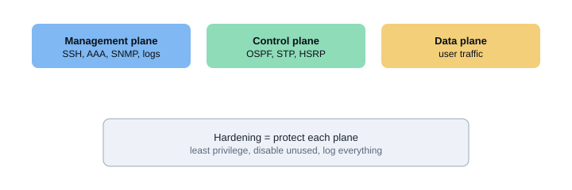

*شکل ۱: سه صفحه‌ی دستگاه و هدف Hardening.*

| صفحه       | کار                   | خطر                      | کنترل                           |
|------------|-----------------------|--------------------------|---------------------------------|
| Management | ورود ادمین، SNMP، Log | دسترسی غیرمجاز           | SSH، ACL، AAA، رمز قوی          |
| Control    | OSPF، STP، HSRP       | تزریق مسیر/Root جعلی     | Authentication، BPDU/Root Guard |
| Data       | ترافیک کاربران        | اسکن، Spoofing، Flooding | ACL، Port Security، Snooping    |

### ۲. چک‌لیست Management Plane

``` text
! 1. strong local credentials, hashed
enable secret <SECRET>
username admin privilege 15 secret <PASSWORD>
service password-encryption
no enable password

! 2. SSH only, version 2, key >= 2048
ip domain-name lab.local
crypto key generate rsa modulus 2048
ip ssh version 2
ip ssh time-out 60
ip ssh authentication-retries 3
line vty 0 4
 transport input ssh
 login local
 exec-timeout 10 0
 access-class MGMT-ONLY in
line console 0
 exec-timeout 10 0
 logging synchronous

! 3. brute-force protection
login block-for 120 attempts 5 within 60
login on-failure log
login on-success log

! 4. banners
banner login # Authorized access only #

! 5. turn off unneeded management
no ip http server
no ip http secure-server
no service pad
no service finger
no ip bootp server
```

- `service password-encryption`: رمزهای Type 7 را مخفی می‌کند ولی ضعیف است؛ رمز واقعی را فقط با `secret` بگذارید.
- `login block-for`: بعد از ۵ تلاش ناموفق در ۶۰ ثانیه، ۱۲۰ ثانیه ورود بسته می‌شود.
- `no ip http server`: وب‌مدیریت بدون نیاز را می‌بندد.

> **هشدار**
>
> رمز واقعی را در ریپو نگذارید (جانگهدار). و قبل از اعمال ACL/تغییر VTY از راه دور، `reload in 5` بگذارید تا قفل نشوید (درس ۲-۴).

### ۳. چک‌لیست Control Plane

``` text
! Layer 2
spanning-tree mode rapid-pvst
spanning-tree portfast bpduguard default
spanning-tree guard root     (on edge facing ports)

! Neighbor discovery: only where needed
no cdp run                   (or: no cdp enable on user-facing ports)
lldp run                     (only on trusted links)

! Routing: passive interfaces and authentication
router ospf 1
 passive-interface default
 no passive-interface gi0/1
interface gi0/1
 ip ospf authentication message-digest
 ip ospf message-digest-key 1 md5 <OSPF-KEY>
```

CDP/LLDP اطلاعات دستگاه (نام، IP، Image) را برای هر همسایه می‌گوید. روی پورت‌های کاربر باید خاموش باشد، چون مهاجم اطلاعات ارزشمند می‌گیرد.

### ۴. چک‌لیست Data Plane

``` text
! unused access ports: shut down and park in an unused VLAN
interface range gi0/10 - 24
 switchport mode access
 switchport access vlan 999
 shutdown

! disable negotiation, avoid VLAN hopping
interface range gi0/1 - 24
 switchport nonegotiate

! trunks: explicit native + allowed
interface gi0/0
 switchport trunk native vlan 999
 switchport trunk allowed vlan 10,20,50

! anti-spoofing basics
no ip source-route
no ip proxy-arp     (on user-facing interfaces)
no ip redirects
no ip unreachables  (on untrusted interfaces)
```

«VLAN 999 بدون استفاده» جای پارک پورت‌های خالی است؛ حتی اگر کسی کابل بزند، به شبکه‌ی خالی می‌رسد.

### ۵. مثال‌ها

#### ساده: بستن وب‌مدیریت

``` text
Core# show ip http server status
HTTP server status: Enabled
Core(config)# no ip http server
```

#### متوسط: پورت‌های خالی

``` text
Before: 18 unused ports, all in VLAN 1, no shutdown (open door)
After : shutdown + VLAN 999 for all unused ports
```

#### سخت: کنترل خودکار

``` text
Compare each device against the golden baseline:
  show running-config | include http|telnet|cdp|snmp
Any deviation = finding; record it and fix with a CHG.
```

> **صادقانه**
>
> بعضی دستورها (مثل `login block-for` یا `service-policy`) روی Imageهای شبیه‌ساز ممکن است محدود باشند. نتیجه‌ی واقعی را ثبت کنید و در تجهیز واقعی تکرار کنید.

### تمرین‌ها

**ت1.** ۱ (ساده): سه صفحه‌ی دستگاه؟ *(پاسخ: 8-1-ت1 در بخش «پاسخ‌ها» انتهای فصل)*

**ت2.** ۲ (ساده): چرا no ip http server؟ *(پاسخ: 8-1-ت2 در بخش «پاسخ‌ها» انتهای فصل)*

**ت3.** ۳ (متوسط): چرا پورت‌های خالی shutdown و VLAN 999؟ *(پاسخ: 8-1-ت3 در بخش «پاسخ‌ها» انتهای فصل)*

**ت4.** ۴ (متوسط): چرا CDP روی پورت کاربر خاموش؟ *(پاسخ: 8-1-ت4 در بخش «پاسخ‌ها» انتهای فصل)*

**ت5.** ۵ (سخت): قبل از Hardening VTY از راه دور چه شبکه‌ی ایمنی می‌گذاریم؟ *(پاسخ: 8-1-ت5 در بخش «پاسخ‌ها» انتهای فصل)*

### Lab هدایت‌شده

یک دستگاه (مثلاً Core-1) را با چک‌لیست سخت‌سازی کنید، مرحله‌ای و با بکاپ:

#### گام ۱: بکاپ و Baseline

``` text
Core-1# copy running-config flash:Core1-before-hardening.cfg
Core-1# show running-config | include http|telnet|cdp|snmp|password
```

#### گام ۲: Management Plane

بخش ۲ را اعمال کنید (با `reload in 5`).

#### گام ۳: Control/Data Plane

بخش‌های ۳ و ۴ را اعمال و `reload cancel` کنید.

#### گام ۴: بازبینی

``` text
Core-1# show running-config | include http|telnet|cdp|password
Core-1# show ip ssh
Core-1# show login
```

### Lab مستقل

«Hardening Baseline» (چک‌لیست ≥ ۲۰ بند با Verification) را در `03-ops/hardening-baseline.md` بنویسید.

### عیب‌یابی

|         |                                                                                                               |
|---------|---------------------------------------------------------------------------------------------------------------|
| Symptom | بعد از Hardening دسترسی SSH قطع شد                                                                            |
| چک‌لیست  | ۱) ACL VTY شامل آدرس شما؟ ؛ ۲) transport input ssh؟ ؛ ۳) کلید RSA و نام‌کاربری؟ ؛ ۴) login block-for فعال شده؟ |
| رفع     | از Console وارد شوید و اصلاح کنید یا reload in منتظر بماند                                                    |
| پیشگیری | بکاپ + reload in                                                                                              |

### سؤال‌های مرور

**م1.** Hardening چیست؟ *(پاسخ: 8-1-م1 در بخش «پاسخ‌ها» انتهای فصل)*

**م2.** چرا Management Plane مهم‌ترین است؟ *(پاسخ: 8-1-م2 در بخش «پاسخ‌ها» انتهای فصل)*

### English Corner: انگلیسی تخصصی این درس

این جمله‌ها از مستندات و محیط کار واقعی‌اند. بلند بخوانید و ترجمه را بپوشانید.

| English sentence                                       | ترجمه                                                       |
|--------------------------------------------------------|-------------------------------------------------------------|
| Disable all unused services and ports.                 | همه‌ی سرویس‌ها و پورت‌های بلااستفاده را غیرفعال کنید.          |
| Restrict management access to a dedicated subnet.      | دسترسی مدیریتی را به یک Subnet اختصاصی محدود کنید.          |
| Use secret instead of password for stored credentials. | برای رمزهای ذخیره‌شده به‌جای password از secret استفاده کنید. |
| Compare every device against a hardening baseline.     | هر دستگاه را با Baseline سخت‌سازی مقایسه کنید.               |

**Q1.** Quick quiz (answer in English): Why is "enable secret" preferred over "enable password"? *(پاسخ: 8-1-Q1 در بخش «پاسخ‌ها» انتهای فصل)*

### تکلیف و چک‌لیست تسلط

- [ ] Hardening را روی یک دستگاه اجرا و Verify کنم.
- [ ] Baseline را بنویسم.
- [ ] بکاپ قبل/بعد را نگه دارم.

### یادآوری اشتباهات شما

> **یادآوری**
>
> پیش‌بینی قبل از اجرا؛ بکاپ قبل از تغییر؛ پذیرفته‌شدن دستور ≠ کار کردن؛ فرمول‌ها در بلوک مستقل.


#### کارت Lab — Hardening تجهیزات

| # | فیلد | محتوا |
|---|---|---|
| 1 | عنوان و هدف | Hardening سه صفحه‌ی دستگاه |
| 2 | پیش‌نیاز | فصل 7 |
| 3 | توپولوژی | Core-1 |
| 4 | تجهیزات | Core-1 |
| 5 | نسخه نرم‌افزار | vIOS-L2 15.2(20200924، Experimental) برای SW؛ vIOS 15.9(3)M9 برای R؛ VPCS؛ PNetLab 4.2.8 |
| 6 | IP Plan | Baseline |
| 7 | وضعیت اولیه | چک‌لیست |
| 8 | صورت مسئله | Verify |
| 9 | مراحل هدایت‌شده | همان بخش «Lab هدایت‌شده» همین درس |
| 10 | تست عملکرد | `show running-config \| include http\|telnet` |
| 11 | سناریوی خرابی | قفل شدن از VTY |
| 12 | روش عیب‌یابی | لایه‌ای/با شواهد (بخش عیب‌یابی همین درس) |
| 13 | نتیجه‌ی مورد انتظار | بدون http/telnet |
| 14 | معیار پذیرش | Baseline Hardening |
| 15 | مستندات نهایی | `03-ops/hardening-baseline.md` |
| 16 | Cleanup و بازگردانی | reload cancel |

> **وضعیت راستی‌آزمایی (خارج از ۱۶ فیلد):** **اجرا نشده (فقط طراحی).** اجرا نشده.

---

<a id="l-8-2"></a>

## درس 8-2 — AAA و سطح‌های دسترسی

**فصل ۸ - روز ۲ · پیش‌نیاز: درس ۸-۱ · ۶ ساعت**

### این درس درباره چیست و چرا باید یاد بگیریم؟

**چه چیزی یاد می‌گیریم:** کنترل «چه کسی، چه کاری، چه زمانی» روی دستگاه: AAA (احراز هویت، مجوز، حسابداری)، سطح‌های دسترسی (Privilege Level)، و مفهوم TACACS+ و RADIUS.

**چرا لازم است:** اگر همه‌ی ادمین‌ها یک رمز مشترک بدانند، نمی‌توانید بگویید «چه کسی این تغییر را داد». AAA هر ادمین را جدا می‌شناسد، دسترسی را به نیاز او محدود می‌کند (Least Privilege) و ثبت می‌کند چه دستوری زد.

- **در کار روزانه:** کارمند کمک‌حال فقط show می‌بیند؛ ارشد تنظیم می‌کند.
- **در امنیت:** مسئولیت‌پذیری (Accountability) و اصل Least Privilege.
- **در Capstone:** Admin FortiGate هم با Profile و Trusted Host همین منطق را دارد.

> **مسیر درس**
>
> سه A ← Local AAA ← Privilege Level ← TACACS+ و RADIUS ← مثال ساده/متوسط/سخت ← Lab ← عیب‌یابی.

#### اصطلاحات این درس (مخفف ← شکل کامل ← معنی)

| مخفف      | شکل کامل انگلیسی                                      | معنی فارسی                              |
|-----------|-------------------------------------------------------|-----------------------------------------|
| AAA       | Authentication, Authorization, Accounting             | احراز هویت، مجوز، حسابداری              |
| TACACS+   | Terminal Access Controller Access-Control System Plus | پروتکل AAA سیسکو برای مدیریت دستگاه     |
| RADIUS    | Remote Authentication Dial-In User Service            | پروتکل AAA برای دسترسی شبکه             |
| Privilege | Privilege level                                       | سطح دسترسی 0 تا 15                      |
| RBAC      | Role-Based Access Control                             | دسترسی بر اساس نقش                      |
| Fallback  | Fallback                                              | روش جایگزین وقتی سرور AAA در دسترس نیست |

### ۱. سه A

| حرف            | معنی       | سؤال                     |
|----------------|------------|--------------------------|
| Authentication | احراز هویت | تو کیستی؟                |
| Authorization  | مجوز       | چه کاری مجازی انجام دهی؟ |
| Accounting     | حسابداری   | چه کاری انجام دادی؟      |

مثال: ورود به ساختمان: کارت (هویت)، دسترسی فقط به طبقه‌ی خودت (مجوز)، و دفتر ورود و خروج (ثبت).

### ۲. Local AAA (بدون سرور)

``` text
R1(config)# username netadmin privilege 15 secret <PASSWORD1>
R1(config)# username helpdesk privilege 5 secret <PASSWORD2>
R1(config)# aaa new-model
R1(config)# aaa authentication login default local
R1(config)# aaa authorization exec default local
R1(config)# aaa accounting exec default start-stop group tacacs+
R1(config)# line vty 0 4
R1(config-line)# login authentication default
```

> **هشدار قفل‌شدن**
>
> `aaa new-model` رفتار ورود را عوض می‌کند. قبل از آن حتماً یک کاربر محلی بسازید، با `reload in 5` کار کنید، و همیشه یک روش Fallback (Local) بگذارید.

### ۳. سطح‌های دسترسی (Privilege Level)

| سطح        | معنی                              |
|------------|-----------------------------------|
| 0          | دستورهای حداقلی (logout، exit...) |
| 1          | User EXEC (مشاهده‌ی محدود)         |
| 5 (سفارشی) | مثلاً show و ping برای کمک‌حال      |
| 15         | دسترسی کامل (Privileged EXEC)     |

``` text
R1(config)# privilege exec level 5 show running-config
R1(config)# privilege exec level 5 show ip interface brief
R1(config)# privilege exec level 5 ping
R1(config)# privilege exec level 5 traceroute
```

کاربر helpdesk با سطح ۵ فقط دستورهایی که به سطح ۵ داده‌اید را می‌بیند. راه امن‌تر و مدرن‌تر: Role-Based CLI (Parser View).

### ۴. TACACS+ و RADIUS

به‌جای ساختن کاربر روی ۵۰ دستگاه، یک سرور مرکزی کاربران را نگه می‌دارد؛ دستگاه از سرور می‌پرسد.

| ویژگی                              | TACACS+       | RADIUS             |
|------------------------------------|---------------|--------------------|
| سازنده                             | سیسکو         | استاندارد          |
| پورت                               | TCP 49        | UDP 1812/1813      |
| رمزگذاری                           | کل بسته       | فقط رمز            |
| مجوز دستور (Command Authorization) | بله، دقیق     | محدود              |
| کاربرد معمول                       | مدیریت دستگاه | VPN، Wi-Fi، 802.1X |

``` text
R1(config)# tacacs server TAC1
R1(config-server-tacacs)# address ipv4 10.10.10.70
R1(config-server-tacacs)# key <TACACS-KEY>
R1(config)# aaa group server tacacs+ TAC-GRP
R1(config-sg-tacacs+)# server name TAC1
R1(config)# aaa authentication login default group TAC-GRP local
R1(config)# aaa authorization exec default group TAC-GRP local
```

ترتیب در انتها یعنی: اول سرور، اگر در دسترس نبود Local (Fallback). این دستورها نیاز به سرور واقعی دارند؛ در Lab فقط ساخت و مفهوم را می‌بینیم و بعداً در FortiGate با RADIUS/LDAP کار می‌کنیم.

### ۵. مثال‌ها

#### ساده

``` text
Two users: netadmin (priv 15) and helpdesk (priv 5)
helpdesk logs in via SSH and can only run show and ping
```

#### متوسط: ثبت فعالیت

``` text
Accounting on: every exec session and command is logged to the AAA server
Audit question "who changed the ACL at 14:05?" is answerable
```

#### سخت: سرور AAA از کار افتاد

``` text
Config: group TAC-GRP local
TAC server down  -> login falls back to the local user (still works)
Without "local" -> everyone is locked out (only console recovery)
```

### تمرین‌ها

**ت1.** ۱ (ساده): سه A؟ *(پاسخ: 8-2-ت1 در بخش «پاسخ‌ها» انتهای فصل)*

**ت2.** ۲ (ساده): TACACS+ چه پورتی؟ *(پاسخ: 8-2-ت2 در بخش «پاسخ‌ها» انتهای فصل)*

**ت3.** ۳ (متوسط): چرا Local را Fallback می‌گذاریم؟ *(پاسخ: 8-2-ت3 در بخش «پاسخ‌ها» انتهای فصل)*

**ت4.** ۴ (متوسط): Privilege 15 یعنی؟ *(پاسخ: 8-2-ت4 در بخش «پاسخ‌ها» انتهای فصل)*

**ت5.** ۵ (سخت): TACACS+ در برابر RADIUS برای مدیریت دستگاه؟ *(پاسخ: 8-2-ت5 در بخش «پاسخ‌ها» انتهای فصل)*

### Lab هدایت‌شده

#### گام ۱: بکاپ و شبکه‌ی ایمنی

``` text
R1# copy running-config flash:R1-before-aaa.cfg
R1# reload in 10
```

#### گام ۲: کاربران و AAA محلی

بخش ۲ را اجرا کنید.

#### گام ۳: تست

از R2 با `ssh -l helpdesk` وارد شوید و ببینید فقط دستورهای سطح ۵ کار می‌کنند. با netadmin وارد شوید و تنظیم بزنید.

#### گام ۴: برداشتن reload

``` text
R1# reload cancel
R1# copy running-config startup-config
```

### Lab مستقل

یک «Access Matrix» (نقش‌ها، سطح، دستورها، دستگاه‌ها) در `03-ops/access-matrix.md` بنویسید.

### عیب‌یابی

|         |                                                                                                    |
|---------|----------------------------------------------------------------------------------------------------|
| Symptom | بعد از aaa new-model هیچ‌کس وارد نمی‌شود                                                             |
| چک‌لیست  | ۱) کاربر محلی وجود دارد؟ ؛ ۲) login authentication روی VTY؟ ؛ ۳) Fallback؟ ؛ ۴) سرور AAA در دسترس؟ |
| رفع     | Console + اصلاح؛ یا انتظار برای reload in                                                          |
| پیشگیری | همیشه شبکه‌ی ایمنی                                                                                  |

### سؤال‌های مرور

**م1.** Authorization چیست؟ *(پاسخ: 8-2-م1 در بخش «پاسخ‌ها» انتهای فصل)*

**م2.** چرا Accounting؟ *(پاسخ: 8-2-م2 در بخش «پاسخ‌ها» انتهای فصل)*

### English Corner: انگلیسی تخصصی این درس

این جمله‌ها از مستندات و محیط کار واقعی‌اند. بلند بخوانید و ترجمه را بپوشانید.

| English sentence                                                 | ترجمه                                                       |
|------------------------------------------------------------------|-------------------------------------------------------------|
| AAA controls who can log in, what they can do and what they did. | AAA تعیین می‌کند چه کسی وارد شود، چه کاری کند و چه کرده است. |
| Configure a local fallback in case the AAA server is down.       | برای زمانی که سرور AAA قطع است Fallback محلی بگذارید.       |
| Apply least privilege to each role.                              | برای هر نقش اصل حداقل دسترسی را رعایت کنید.                 |
| TACACS+ encrypts the entire payload.                             | TACACS+ کل بار بسته را رمز می‌کند.                           |

**Q1.** Quick quiz (answer in English): What happens if you configure AAA with no local fallback and the server is down? *(پاسخ: 8-2-Q1 در بخش «پاسخ‌ها» انتهای فصل)*

### تکلیف و چک‌لیست تسلط

- [ ] AAA محلی را با دو سطح بسازم.
- [ ] Fallback را توضیح دهم.
- [ ] Access Matrix را بنویسم.

### یادآوری اشتباهات شما

> **یادآوری**
>
> پیش‌بینی قبل از اجرا؛ بکاپ قبل از تغییر؛ پذیرفته‌شدن دستور ≠ کار کردن؛ فرمول‌ها در بلوک مستقل.


#### کارت Lab — AAA و سطح‌های دسترسی

| # | فیلد | محتوا |
|---|---|---|
| 1 | عنوان و هدف | AAA محلی و Privilege |
| 2 | پیش‌نیاز | درس 8-1 |
| 3 | توپولوژی | R1 |
| 4 | تجهیزات | R1،R2 |
| 5 | نسخه نرم‌افزار | vIOS-L2 15.2(20200924، Experimental) برای SW؛ vIOS 15.9(3)M9 برای R؛ VPCS؛ PNetLab 4.2.8 |
| 6 | IP Plan | — |
| 7 | وضعیت اولیه | دو کاربر |
| 8 | صورت مسئله | ورود helpdesk |
| 9 | مراحل هدایت‌شده | همان بخش «Lab هدایت‌شده» همین درس |
| 10 | تست عملکرد | `show privilege` |
| 11 | سناریوی خرابی | بدون fallback |
| 12 | روش عیب‌یابی | لایه‌ای/با شواهد (بخش عیب‌یابی همین درس) |
| 13 | نتیجه‌ی مورد انتظار | دسترسی سطحی |
| 14 | معیار پذیرش | Access Matrix |
| 15 | مستندات نهایی | `03-ops/access-matrix.md` |
| 16 | Cleanup و بازگردانی | reload cancel |

> **وضعیت راستی‌آزمایی (خارج از ۱۶ فیلد):** **اجرا نشده (فقط طراحی).** اجرا نشده.

---

<a id="l-8-3"></a>

## درس 8-3 — JSON، YAML و REST

**فصل ۸ - روز ۳ · پیش‌نیاز: فصل ۷ · ۶ ساعت**

### این درس درباره چیست و چرا باید یاد بگیریم؟

**چه چیزی یاد می‌گیریم:** زبان مشترک اتوماسیون: JSON و YAML، مفهوم REST API (متدها و کدهای وضعیت)، و ابزار curl؛ همراه با تمرین خواندن داده‌ی ساختاریافته.

**چرا لازم است:** دستگاه‌ها و سرویس‌های امروزی (FortiGate، Zabbix، Ansible، ابزارهای ابری) همه با API و JSON صحبت می‌کنند. اگر نتوانید JSON بخوانید و یک درخواست API بفرستید، از بخش بزرگی از کار مدرن بیرون می‌مانید.

- **در کار روزانه:** API فایروال برای گرفتن لیست Policy یا اضافه‌کردن Object.
- **در امنیت:** اتوماسیون ایمن (Token، Least Privilege) و جلوگیری از افشای رمز.
- **در FortiGate:** REST API فایروال با Token (W9 به بعد).

> **مسیر درس**
>
> داده ساختاریافته ← JSON ← YAML ← REST ← curl ← مثال ساده/متوسط/سخت ← Lab ← عیب‌یابی.

#### اصطلاحات این درس (مخفف ← شکل کامل ← معنی)

| مخفف     | شکل کامل انگلیسی                  | معنی فارسی                     |
|----------|-----------------------------------|--------------------------------|
| JSON     | JavaScript Object Notation        | قالب داده‌ی کلید-مقدار          |
| YAML     | YAML Ain't Markup Language        | قالب خوانای انسان برای تنظیمات |
| API      | Application Programming Interface | رابط برنامه‌نویسی               |
| REST     | Representational State Transfer   | سبک API مبتنی بر HTTP          |
| HTTP     | HyperText Transfer Protocol       | پروتکل وب                      |
| Token    | API token                         | کلید دسترسی به API             |
| Endpoint | API endpoint                      | آدرس یک منبع API               |
| jq       | jq                                | ابزار خط فرمان برای JSON       |

### ۱. چرا داده «ساختاریافته»؟

خروجی `show ip interface brief` برای انسان خوانا و برای برنامه دشوار است؛ باید ستون‌ها را جدا کرد و هر نسخه فرق می‌کند. اگر دستگاه همین اطلاعات را به‌صورت «کلید و مقدار» بدهد، برنامه مستقیم می‌خواند.

### ۲. JSON

JSON از دو ساختار ساخته می‌شود: شیء (Object) داخل آکولاد و آرایه (Array) داخل کروشه. مقدارها: رشته، عدد، true/false، null:

``` text
{
  "hostname": "R1",
  "interfaces": [
    { "name": "Gi0/0", "ip": "10.0.12.1", "status": "up" },
    { "name": "Gi0/1", "ip": null,        "status": "down" }
  ],
  "ospf_enabled": true,
  "uptime_days": 42
}
```

خواندن: `hostname` کلید است و `"R1"` مقدار. `interfaces` آرایه‌ای از دو شیء است. قواعد: کلیدها با دابل‌کوتیشن، بین عناصر ویرگول، بدون ویرگول آخر.

``` text
Path examples:
  hostname            -> "R1"
  interfaces[0].ip    -> "10.0.12.1"
  interfaces[1].status-> "down"
```

### ۳. YAML

همان داده، بدون آکولاد، با تورفتگی (فاصله‌ها، نه Tab):

``` text
hostname: R1
interfaces:
  - name: Gi0/0
    ip: 10.0.12.1
    status: up
  - name: Gi0/1
    ip: null
    status: down
ospf_enabled: true
uptime_days: 42
```

> **قانون YAML**
>
> تورفتگی معنی دارد. دو فاصله برای هر سطح؛ هرگز Tab. یک فاصله‌ی اضافه ساختار را خراب می‌کند. Ansible با YAML کار می‌کند.

### ۴. REST API و HTTP

REST یعنی هر «منبع» (مثلاً یک Interface) یک آدرس (URL) دارد و با متدهای HTTP روی آن کار می‌کنیم:

| متد    | کار           | مثال             |
|--------|---------------|------------------|
| GET    | خواندن        | لیست Interfaceها |
| POST   | ساختن         | Object جدید      |
| PUT    | جایگزینی کامل | به‌روزرسانی کامل  |
| PATCH  | تغییر جزئی    | یک فیلد          |
| DELETE | حذف           | حذف Object       |

| کد وضعیت | معنی            |
|----------|-----------------|
| 200      | موفق            |
| 201      | ساخته شد        |
| 400      | درخواست نامعتبر |
| 401      | احراز هویت نشده |
| 403      | دسترسی ممنوع    |
| 404      | یافت نشد        |
| 500      | خطای سرور       |

### ۵. curl و jq

ابزار خط فرمان برای ارسال درخواست HTTP. در Lab ما، سرویس API لوکال و Token نمونه استفاده می‌شود (بدون رمز واقعی):

``` text
# GET request with a token header (token comes from an environment variable)
curl -s -H "Authorization: Bearer $LAB_TOKEN" https://10.10.10.80/api/v2/monitor/system/status

# pretty print and pick a field with jq
curl -s -H "Authorization: Bearer $LAB_TOKEN" https://10.10.10.80/api/v2/monitor/system/status | jq ".results.hostname"

# POST a JSON body
curl -s -X POST -H "Content-Type: application/json" -d "{\"name\":\"web1\"}" https://10.10.10.80/api/v2/cmdb/firewall/address
```

> **امنیت**
>
> Token را در دستور یا فایل ذخیره‌شده در Git ننویسید؛ از متغیر محیطی یا مدیر رمز استفاده کنید. `-k` (نادیده‌گرفتن Certificate) فقط در Lab و با علم به خطر.

### ۶. مثال‌ها

#### ساده: خواندن JSON

``` text
From the JSON above: what is the IP of Gi0/0?  -> 10.0.12.1
```

#### متوسط: تبدیل به YAML

همان شیء Gi0/1 را به YAML بنویسید (بخش ۳).

#### سخت: خطای 401

``` text
curl returns HTTP 401
Causes: missing/expired token, wrong header name, wrong scheme (Bearer vs api_key),
        token tied to a different source IP (trusted host)
Do not retry blindly: fix auth first
```

### تمرین‌ها

**ت1.** ۱ (ساده): تفاوت Object و Array؟ *(پاسخ: 8-3-ت1 در بخش «پاسخ‌ها» انتهای فصل)*

**ت2.** ۲ (ساده): GET چه می‌کند؟ *(پاسخ: 8-3-ت2 در بخش «پاسخ‌ها» انتهای فصل)*

**ت3.** ۳ (متوسط): کد 403 یعنی؟ *(پاسخ: 8-3-ت3 در بخش «پاسخ‌ها» انتهای فصل)*

**ت4.** ۴ (متوسط): چرا YAML با Tab خراب می‌شود؟ *(پاسخ: 8-3-ت4 در بخش «پاسخ‌ها» انتهای فصل)*

**ت5.** ۵ (سخت): چرا Token در Git ممنوع؟ *(پاسخ: 8-3-ت5 در بخش «پاسخ‌ها» انتهای فصل)*

### Lab هدایت‌شده

این Lab روی لپ‌تاپ/VM شماست و به تجهیزات دست نمی‌زند.

#### گام ۱: فایل JSON بسازید

با یک ویرایشگر، JSON بخش ۲ را در `interfaces.json` ذخیره کنید.

#### گام ۲: خواندن با jq

``` text
jq ".hostname" interfaces.json
jq ".interfaces[].name" interfaces.json
jq ".interfaces[] | select(.status==\"down\")" interfaces.json
```

#### گام ۳: تبدیل به YAML

همان داده را دستی به YAML بنویسید و با یک ابزار آنلاین/محلی اعتبارسنجی کنید.

#### گام ۴: درخواست API آزمایشی

اگر API لوکال ندارید، با یک سرویس عمومی تست (مثلاً یک API نمونه) یک GET بزنید و کد وضعیت را بخوانید؛ بعداً با FortiGate تکرار می‌کنیم.

### Lab مستقل

سه خروجی show را (دستی) به JSON ساختاریافته تبدیل کنید و در `04-automation/data-samples/` ذخیره کنید.

### عیب‌یابی

|         |                                                         |
|---------|---------------------------------------------------------|
| Symptom | JSON خطای Parse می‌دهد                                   |
| چک‌لیست  | ۱) دابل‌کوتیشن؟ ؛ ۲) ویرگول آخر؟ ؛ ۳) آکولاد/کروشه بسته؟ |
| ابزار   | jq ، validator                                          |
| رفع     | اصلاح دستور نگارشی                                      |

### سؤال‌های مرور

**م1.** REST چیست؟ *(پاسخ: 8-3-م1 در بخش «پاسخ‌ها» انتهای فصل)*

**م2.** چرا YAML برای Ansible؟ *(پاسخ: 8-3-م2 در بخش «پاسخ‌ها» انتهای فصل)*

### English Corner: انگلیسی تخصصی این درس

این جمله‌ها از مستندات و محیط کار واقعی‌اند. بلند بخوانید و ترجمه را بپوشانید.

| English sentence                                             | ترجمه                                           |
|--------------------------------------------------------------|-------------------------------------------------|
| The API returns the data in JSON format.                     | API داده را به قالب JSON برمی‌گرداند.            |
| Send a GET request with the authorization header.            | یک درخواست GET با هدر Authorization بفرستید.    |
| The server responded with HTTP 401, so the token is invalid. | سرور HTTP 401 داد، پس Token نامعتبر است.        |
| Keep tokens in environment variables, not in the repository. | Tokenها را در متغیر محیطی نگه دارید نه در ریپو. |

**Q1.** Quick quiz (answer in English): What is the difference between PUT and PATCH? *(پاسخ: 8-3-Q1 در بخش «پاسخ‌ها» انتهای فصل)*

### تکلیف و چک‌لیست تسلط

- [ ] JSON را بخوانم و بنویسم.
- [ ] YAML را بنویسم.
- [ ] curl/jq را تمرین کنم.

### یادآوری اشتباهات شما

> **یادآوری**
>
> پیش‌بینی قبل از اجرا؛ بکاپ قبل از تغییر؛ پذیرفته‌شدن دستور ≠ کار کردن؛ فرمول‌ها در بلوک مستقل.


#### کارت Lab — JSON، YAML و REST

| # | فیلد | محتوا |
|---|---|---|
| 1 | عنوان و هدف | JSON/YAML/REST |
| 2 | پیش‌نیاز | درس 8-2 |
| 3 | توپولوژی | PC |
| 4 | تجهیزات | PC شما |
| 5 | نسخه نرم‌افزار | vIOS-L2 15.2(20200924، Experimental) برای SW؛ vIOS 15.9(3)M9 برای R؛ VPCS؛ PNetLab 4.2.8 |
| 6 | IP Plan | — |
| 7 | وضعیت اولیه | نمونه فایل |
| 8 | صورت مسئله | jq |
| 9 | مراحل هدایت‌شده | همان بخش «Lab هدایت‌شده» همین درس |
| 10 | تست عملکرد | `jq` |
| 11 | سناریوی خرابی | Parse error |
| 12 | روش عیب‌یابی | لایه‌ای/با شواهد (بخش عیب‌یابی همین درس) |
| 13 | نتیجه‌ی مورد انتظار | خواندن مقدار |
| 14 | معیار پذیرش | نمونه‌ها |
| 15 | مستندات نهایی | `04-automation/data-samples/` |
| 16 | Cleanup و بازگردانی | — |

> **وضعیت راستی‌آزمایی (خارج از ۱۶ فیلد):** **اجرا نشده (فقط طراحی).** روی PC شما؛ اجرا نشده.

---

<a id="l-8-4"></a>

## درس 8-4 — Python و Netmiko

**فصل ۸ - روز ۴ · پیش‌نیاز: درس‌های ۸-۱ و ۸-۳ · ۶ ساعت**

### این درس درباره چیست و چرا باید یاد بگیریم؟

**چه چیزی یاد می‌گیریم:** نوشتن یک اسکریپت Python با کتابخانه‌ی Netmiko که به چند دستگاه با SSH وصل شود، فقط دستورهای مشاهده (`show`) اجرا کند و پیکربندی را بکاپ بگیرد؛ بدون ذخیره‌ی رمز در کد.

**چرا لازم است:** گرفتن بکاپ از ۵۰ سوییچ به‌صورت دستی ساعت‌ها طول می‌کشد و فراموش می‌شود. یک اسکریپت ساده همین کار را در دقیقه‌ها و هر شب انجام می‌دهد و یک «تاریخچه‌ی تغییرات» می‌سازد. این اولین قدم عملی اتوماسیون است و ریسکش (چون فقط read است) پایین است.

- **در کار روزانه:** بکاپ شبانه و گزارش Inventory.
- **در امنیت:** اسکریپت اشتباه می‌تواند همه‌ی دستگاه‌ها را همزمان خراب کند؛ برای همین فقط read-only و تست روی یک دستگاه.
- **در Capstone:** بکاپ خودکار Config همه‌ی تجهیزات در Git.

> **مسیر درس**
>
> چرا Netmiko ← محیط امن ← اسکریپت قدم‌به‌قدم ← خطاها ← مثال ساده/متوسط/سخت ← Lab ← عیب‌یابی.

#### اصطلاحات این درس (مخفف ← شکل کامل ← معنی)

| مخفف                 | شکل کامل انگلیسی           | معنی فارسی                                |
|----------------------|----------------------------|-------------------------------------------|
| Python               | Python                     | زبان برنامه‌نویسی                          |
| Netmiko              | Netmiko                    | کتابخانه‌ی Python برای SSH به تجهیزات شبکه |
| venv                 | Python virtual environment | محیط جدا برای بسته‌ها                      |
| Idempotent           | Idempotent                 | اجرای چندباره = نتیجه‌ی یکسان              |
| Read-only            | Read-only                  | فقط خواندن؛ بدون تغییر                    |
| Inventory            | Device inventory           | فهرست دستگاه‌ها                            |
| Environment variable | Environment variable       | متغیر محیطی برای نگه‌داری رمز              |

### ۱. ایده

Netmiko یک «کاربر خودکار» است: با SSH وارد دستگاه می‌شود، دستور می‌زند و خروجی را برمی‌گرداند.

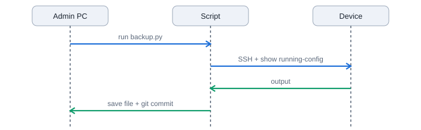

*شکل ۱: اسکریپت با SSH به دستگاه وصل می‌شود، show می‌زند و خروجی را ذخیره می‌کند.*

### ۲. آماده‌سازی محیط (روی PC/VM شما)

این دستورها را شما روی دستگاه خودتان اجرا می‌کنید (من فقط فرمان می‌دهم و به شبکه‌ی شما متصل نمی‌شوم):

``` text
python3 -m venv netauto
source netauto/bin/activate          # Windows: netauto\Scripts\activate
pip install netmiko
pip freeze > requirements.txt
```

رمز را در متغیر محیطی می‌گذاریم، نه در کد:

``` text
export NET_USER=netadmin
export NET_PASS='<your-password>'
# Windows PowerShell:  $env:NET_USER="netadmin"; $env:NET_PASS="<your-password>"
```

### ۳. Inventory

فایل `inventory.yaml` فقط آدرس‌ها و نوع دستگاه را دارد؛ رمز ندارد:

``` text
devices:
  - name: CORE-SW1
    host: 10.10.10.2
    device_type: cisco_ios
  - name: CORE-SW2
    host: 10.10.10.3
    device_type: cisco_ios
  - name: EDGE-R1
    host: 10.10.10.1
    device_type: cisco_ios
```

### ۴. اسکریپت (Read-only)

``` text
import os, sys, datetime, pathlib
import yaml
from netmiko import ConnectHandler
from netmiko.exceptions import NetmikoTimeoutException, NetmikoAuthenticationException

USER = os.environ.get("NET_USER")
PASS = os.environ.get("NET_PASS")
if not USER or not PASS:
    sys.exit("Set NET_USER and NET_PASS first")

# read-only: only show commands are allowed
ALLOWED = ("show ",)
COMMANDS = ["show running-config", "show version", "show ip interface brief"]
for c in COMMANDS:
    assert c.startswith(ALLOWED), "only show commands are allowed"

out_dir = pathlib.Path("backups")
out_dir.mkdir(exist_ok=True)
stamp = datetime.date.today().isoformat()

with open("inventory.yaml") as f:
    inventory = yaml.safe_load(f)["devices"]

for dev in inventory:
    params = {"device_type": dev["device_type"], "host": dev["host"],
              "username": USER, "password": PASS, "timeout": 20}
    try:
        with ConnectHandler(**params) as conn:
            for cmd in COMMANDS:
                text = conn.send_command(cmd)
                name = cmd.replace(" ", "_")
                (out_dir / f"{dev['name']}_{name}_{stamp}.txt").write_text(text)
        print(f"OK   {dev['name']}")
    except NetmikoTimeoutException:
        print(f"FAIL {dev['name']}: timeout")
    except NetmikoAuthenticationException:
        print(f"FAIL {dev['name']}: authentication")
    except Exception as e:
        print(f"FAIL {dev['name']}: {e}")
```

توضیح بخش‌ها:

- رمز از متغیر محیطی خوانده می‌شود، نه از کد.
- `ALLOWED`: اسکریپت فقط اجازه‌ی show دارد؛ اگر دستور دیگری اضافه شود برنامه می‌ایستد.
- `try/except`: خرابی یک دستگاه بقیه را متوقف نمی‌کند.
- فایل خروجی هر دستگاه و تاریخ دارد؛ در Git نگه‌داری می‌شود (درس ۸-۶).

### ۵. قبل از اجرا: چک‌لیست ایمنی

1.  اول روی **یک** دستگاه تست کنید.
2.  فقط دستورهای show.
3.  رمز در متغیر محیطی؛ فایل خروجی هم ممکن است Hash رمز داشته باشد؛ خروجی را در Git عمومی نگذارید.
4.  حد تعداد اتصال همزمان؛ در Lab ما یکی‌یکی.
5.  لاگ اجرا را نگه دارید.

### ۶. مثال‌ها

#### ساده: یک دستگاه

``` text
Inventory has 1 device -> script prints "OK CORE-SW1" and one file per command
```

#### متوسط: خطای SSH

``` text
FAIL CORE-SW2: timeout
Check: ping, SSH enabled, VTY ACL allows the automation host, route
```

#### سخت: تغییرات امن

وقتی بخواهید پیکربندی هم بزنید (`send_config_set`)، اول `--check` یا Dry-run، تغییر روی یک دستگاه، تأیید، بعد بقیه؛ و بکاپ قبل از تغییر. اتوماسیون خطا را سریع‌تر و گسترده‌تر پخش می‌کند.

> **دسترسی در PNetLab**
>
> گره‌های PNetLab به‌طور پیش‌فرض از بیرون SSH ندارند. یا مدیریت را به Lab وصل می‌کنید (VLAN10 مدیریت با آدرس قابل‌دسترس از VM اتوماسیون)، یا از `cisco_ios_telnet` روی پورت Console PNetLab استفاده می‌کنید. این تصمیم را قبل از اجرا با هم می‌گیریم؛ من به تجهیزات شما وصل نمی‌شوم.

### تمرین‌ها

**ت1.** ۱ (ساده): چرا رمز در متغیر محیطی؟ *(پاسخ: 8-4-ت1 در بخش «پاسخ‌ها» انتهای فصل)*

**ت2.** ۲ (ساده): read-only یعنی چه؟ *(پاسخ: 8-4-ت2 در بخش «پاسخ‌ها» انتهای فصل)*

**ت3.** ۳ (متوسط): چرا try/except؟ *(پاسخ: 8-4-ت3 در بخش «پاسخ‌ها» انتهای فصل)*

**ت4.** ۴ (متوسط): چرا اول روی یک دستگاه؟ *(پاسخ: 8-4-ت4 در بخش «پاسخ‌ها» انتهای فصل)*

**ت5.** ۵ (سخت): چه چیزی در خروجی show running-config حساس است؟ *(پاسخ: 8-4-ت5 در بخش «پاسخ‌ها» انتهای فصل)*

### Lab هدایت‌شده

این Lab روی PC/VM شماست؛ هر گام را خودتان اجرا و نتیجه را گزارش می‌کنید:

1.  محیط و بسته‌ها را بسازید (بخش ۲).
2.  `inventory.yaml` را با یک دستگاه بسازید.
3.  اسکریپت را اجرا کنید و فایل خروجی را ببینید.
4.  یک دستگاه را عمداً با آدرس اشتباه بگذارید و خطا را ببینید.
5.  سپس با ۳ دستگاه اجرا کنید.

### Lab مستقل

اسکریپت را به «گزارش Inventory» (hostname، Version، Interfaceهای down) گسترش دهید؛ بدون هیچ تغییر روی دستگاه. در `04-automation/backup.py` (بدون رمز) ذخیره کنید.

### عیب‌یابی

|         |                                                                        |
|---------|------------------------------------------------------------------------|
| Symptom | اسکریپت به دستگاه وصل نمی‌شود                                           |
| چک‌لیست  | ۱) ping؟ ؛ ۲) SSH روشن؟ ؛ ۳) ACL VTY؟ ؛ ۴) رمز/کاربر؟ ؛ ۵) device_type |
| ابزار   | ssh دستی ، debug Netmiko با session_log                                |
| رفع     | اصلاح اتصال                                                            |

### سؤال‌های مرور

**م1.** Netmiko چه می‌کند؟ *(پاسخ: 8-4-م1 در بخش «پاسخ‌ها» انتهای فصل)*

**م2.** چرا Read-only برای شروع؟ *(پاسخ: 8-4-م2 در بخش «پاسخ‌ها» انتهای فصل)*

### English Corner: انگلیسی تخصصی این درس

این جمله‌ها از مستندات و محیط کار واقعی‌اند. بلند بخوانید و ترجمه را بپوشانید.

| English sentence                                                    | ترجمه                                                     |
|---------------------------------------------------------------------|-----------------------------------------------------------|
| The script connects over SSH and saves the running configuration.   | اسکریپت با SSH وصل می‌شود و running-config را ذخیره می‌کند. |
| Store credentials in environment variables.                         | اعتبارنامه‌ها را در متغیر محیطی نگه دارید.                 |
| Test on a single device before running against the whole inventory. | قبل از اجرا روی کل Inventory روی یک دستگاه تست کنید.      |
| Handle exceptions so one failure does not stop the run.             | خطاها را مدیریت کنید تا یک شکست اجرا را متوقف نکند.       |

**Q1.** Quick quiz (answer in English): Why is a read-only script a safe first step in network automation? *(پاسخ: 8-4-Q1 در بخش «پاسخ‌ها» انتهای فصل)*

### تکلیف و چک‌لیست تسلط

- [ ] اسکریپت را روی یک دستگاه اجرا کنم.
- [ ] هیچ رمزی در کد یا ریپو نباشد.
- [ ] خروجی بکاپ را ذخیره کنم.

### یادآوری اشتباهات شما

> **یادآوری**
>
> پیش‌بینی قبل از اجرا؛ بکاپ قبل از تغییر؛ پذیرفته‌شدن دستور ≠ کار کردن؛ فرمول‌ها در بلوک مستقل.


#### کارت Lab — Python و Netmiko

| # | فیلد | محتوا |
|---|---|---|
| 1 | عنوان و هدف | Python/Netmiko بکاپ read-only |
| 2 | پیش‌نیاز | درس 8-3 |
| 3 | توپولوژی | PC + SW |
| 4 | تجهیزات | PC،SW |
| 5 | نسخه نرم‌افزار | vIOS-L2 15.2(20200924، Experimental) برای SW؛ vIOS 15.9(3)M9 برای R؛ VPCS؛ PNetLab 4.2.8 |
| 6 | IP Plan | SSH فعال |
| 7 | وضعیت اولیه | inventory.yaml |
| 8 | صورت مسئله | بکاپ |
| 9 | مراحل هدایت‌شده | همان بخش «Lab هدایت‌شده» همین درس |
| 10 | تست عملکرد | اجرای اسکریپت |
| 11 | سناریوی خرابی | timeout |
| 12 | روش عیب‌یابی | لایه‌ای/با شواهد (بخش عیب‌یابی همین درس) |
| 13 | نتیجه‌ی مورد انتظار | فایل بکاپ |
| 14 | معیار پذیرش | backup.py |
| 15 | مستندات نهایی | `04-automation/backup.py` |
| 16 | Cleanup و بازگردانی | — |

> **وضعیت راستی‌آزمایی (خارج از ۱۶ فیلد):** **اجرا نشده (فقط طراحی).** اجرا نشده؛ مسیر SSH به Node بررسی نشده.

---

<a id="l-8-5"></a>

## درس 8-5 — Ansible

**فصل ۸ - روز ۵ · پیش‌نیاز: درس‌های ۸-۳ و ۸-۴ · ۶ ساعت**

### این درس درباره چیست و چرا باید یاد بگیریم؟

**چه چیزی یاد می‌گیریم:** ابزار Ansible برای مدیریت پیکربندی چند دستگاه: Inventory، Playbook، ماژول‌های `ios_command` و `ios_config`، مفهوم Idempotency، و حالت‌های امن `--check` و `--diff`.

**چرا لازم است:** Python به شما آزادی کامل می‌دهد ولی همه‌چیز را خودتان باید بنویسید. Ansible تنظیمات را «توصیفی» می‌کند: بگویید «این Banner و این NTP روی همه‌ی ۵ دستگاه باشد»، و خودش فقط تفاوت‌ها را اعمال می‌کند. نتیجه یکنواختی تنظیمات و سرعت است.

- **در کار روزانه:** استقرار استاندارد (Banner، NTP، Syslog) روی ده‌ها دستگاه.
- **در امنیت:** Playbook = سند قابل‌بازبینی و Rollback؛ Vault برای رمزها.
- **در Capstone:** اعمال Baseline سخت‌سازی روی همه‌ی تجهیزات Cisco.

> **مسیر درس**
>
> چرا Ansible ← Inventory ← Playbook ← Idempotency ← Check/Diff ← مثال ساده/متوسط/سخت ← Lab ← عیب‌یابی.

#### اصطلاحات این درس (مخفف ← شکل کامل ← معنی)

| مخفف        | شکل کامل انگلیسی | معنی فارسی                 |
|-------------|------------------|----------------------------|
| Ansible     | Ansible          | ابزار اتوماسیون بدون Agent |
| Playbook    | Playbook         | فایل YAML مراحل کار        |
| Module      | Ansible module   | واحد عمل مثل ios_config    |
| Inventory   | Inventory        | فهرست دستگاه‌ها و گروه‌ها    |
| Idempotency | Idempotency      | اجرای مکرر، نتیجه‌ی یکسان   |
| Vault       | Ansible Vault    | رمزگذاری فایل‌های حساس      |
| Check mode  | --check          | اجرای آزمایشی بدون تغییر   |
| Diff        | --diff           | نمایش تفاوت                |

### ۱. تفاوت اسکریپت و Ansible

| موضوع      | اسکریپت Python             | Ansible                            |
|------------|----------------------------|------------------------------------|
| سبک        | دستوری: «این کارها را بکن» | توصیفی: «وضعیت باید این باشد»      |
| اجرای مکرر | ممکن است دوباره اعمال شود  | فقط تفاوت اعمال می‌شود (Idempotent) |
| تنظیم      | کد                         | YAML                               |
| یادگیری    | نیاز به برنامه‌نویسی        | ساده‌تر برای ادمین                  |

### ۲. نصب و Inventory

``` text
python3 -m venv ansenv && source ansenv/bin/activate
pip install ansible ansible-pylibssh
ansible-galaxy collection install cisco.ios
ansible --version
```

``` text
# inventory.ini
[cisco]
CORE-SW1 ansible_host=10.10.10.2
CORE-SW2 ansible_host=10.10.10.3
EDGE-R1  ansible_host=10.10.10.1

[cisco:vars]
ansible_network_os=cisco.ios.ios
ansible_connection=ansible.netcommon.network_cli
ansible_user={{ lookup('env','NET_USER') }}
ansible_password={{ lookup('env','NET_PASS') }}
```

رمز دوباره از متغیر محیطی می‌آید؛ در فایل ننویسید.

### ۳. Playbook اول: فقط خواندن

``` text
# show_version.yml
- name: Collect version
  hosts: cisco
  gather_facts: false
  tasks:
    - name: Run show version
      cisco.ios.ios_command:
        commands:
          - show version
      register: out

    - name: Print first lines
      ansible.builtin.debug:
        msg: "{{ out.stdout_lines[0][:3] }}"
```

``` text
ansible-playbook -i inventory.ini show_version.yml
```

### ۴. Playbook تنظیم: Banner و NTP

``` text
# baseline.yml
- name: Apply baseline
  hosts: cisco
  gather_facts: false
  tasks:
    - name: Set login banner
      cisco.ios.ios_banner:
        banner: login
        text: "Authorized access only"
        state: present

    - name: Set NTP and syslog
      cisco.ios.ios_config:
        lines:
          - ntp server 10.10.10.53
          - logging host 10.10.10.60
          - service timestamps log datetime msec localtime
```

#### اجرای امن (سه قدم)

1.  **Check:** `ansible-playbook baseline.yml --check --diff --limit CORE-SW1` فقط نشان می‌دهد چه تغییر می‌کند.
2.  **یک دستگاه:** بدون `--check` ولی با `--limit CORE-SW1`.
3.  **همه:** بعد از تأیید، بدون `--limit`.

> **Idempotency**
>
> اگر Banner و NTP قبلاً تنظیم شده باشند، اجرای دوباره `changed=0` می‌دهد. این یعنی Playbook «حالت مطلوب» را می‌گوید، نه «کار».

``` text
PLAY RECAP
CORE-SW1 : ok=2 changed=1 unreachable=0 failed=0   (first run)
CORE-SW1 : ok=2 changed=0 unreachable=0 failed=0   (second run: idempotent)
```

### ۵. Vault: رمز امن

اگر مجبور شدید رمز در فایل بگذارید، با Vault رمزگذاری کنید:

``` text
ansible-vault create secrets.yml
ansible-playbook -i inventory.ini baseline.yml --ask-vault-pass
```

فایل Vault هم نباید به‌همراه کلیدش در Git عمومی برود.

### ۶. مثال‌ها

#### ساده

``` text
ios_command: show version on all hosts -> read-only, safe
```

#### متوسط: همگن‌سازی

``` text
Baseline applied to 5 devices -> all have the same NTP/syslog/banner
Second run -> changed=0
```

#### سخت: تغییر خطرناک

``` text
Wrong ios_config line (e.g. removing the VTY ACL) pushed to ALL devices at once
-> everyone loses SSH
Prevention: --check/--diff first, --limit to one device, backup before, reload in on critical changes
```

> **صادقانه**
>
> اجرای Ansible روی IOS شبیه‌ساز ممکن است به‌خاطر نسخه‌ی SSH یا الگوریتم‌ها خطا بدهد. اگر شد، خطا را ثبت کنید؛ این هم بخشی از یادگیری است.

### تمرین‌ها

**ت1.** ۱ (ساده): Idempotency چیست؟ *(پاسخ: 8-5-ت1 در بخش «پاسخ‌ها» انتهای فصل)*

**ت2.** ۲ (ساده): --check چه می‌کند؟ *(پاسخ: 8-5-ت2 در بخش «پاسخ‌ها» انتهای فصل)*

**ت3.** ۳ (متوسط): چرا --limit؟ *(پاسخ: 8-5-ت3 در بخش «پاسخ‌ها» انتهای فصل)*

**ت4.** ۴ (متوسط): رمز را کجا نگه می‌داریم؟ *(پاسخ: 8-5-ت4 در بخش «پاسخ‌ها» انتهای فصل)*

**ت5.** ۵ (سخت): تفاوت ios_command و ios_config؟ *(پاسخ: 8-5-ت5 در بخش «پاسخ‌ها» انتهای فصل)*

### Lab هدایت‌شده

روی PC/VM شما:

1.  Inventory با ۲ دستگاه بسازید.
2.  Playbook `show_version.yml` را اجرا کنید.
3.  `baseline.yml` را با `--check --diff --limit` اجرا کنید.
4.  روی یک دستگاه اعمال و سپس روی همه.
5.  دوباره اجرا کنید و `changed=0` را تأیید کنید.

### Lab مستقل

یک Playbook «hardening-lite» (Banner، no ip http server، NTP، Syslog) در `04-automation/baseline.yml` بنویسید؛ بدون رمز.

### عیب‌یابی

|         |                                                                                                 |
|---------|-------------------------------------------------------------------------------------------------|
| Symptom | Playbook خطای اتصال می‌دهد                                                                       |
| چک‌لیست  | ۱) network_cli و network_os؟ ؛ ۲) collection نصب است؟ ؛ ۳) SSH کار می‌کند؟ ؛ ۴) رمز/متغیر محیطی؟ |
| ابزار   | ansible -m ping ، -vvv                                                                          |
| رفع     | اصلاح Inventory یا اتصال                                                                        |

### سؤال‌های مرور

**م1.** Ansible در چه چیزی بهتر از اسکریپت است؟ *(پاسخ: 8-5-م1 در بخش «پاسخ‌ها» انتهای فصل)*

**م2.** --diff چه نشان می‌دهد؟ *(پاسخ: 8-5-م2 در بخش «پاسخ‌ها» انتهای فصل)*

### English Corner: انگلیسی تخصصی این درس

این جمله‌ها از مستندات و محیط کار واقعی‌اند. بلند بخوانید و ترجمه را بپوشانید.

| English sentence                                              | ترجمه                                                     |
|---------------------------------------------------------------|-----------------------------------------------------------|
| Run the playbook in check mode before applying changes.       | قبل از اعمال تغییرات Playbook را در Check Mode اجرا کنید. |
| The task is idempotent, so the second run reports no changes. | Task Idempotent است، پس اجرای دوم تغییری گزارش نمی‌کند.    |
| Limit the run to a single host first.                         | ابتدا اجرا را به یک میزبان محدود کنید.                    |
| Encrypt secrets with Ansible Vault.                           | رمزها را با Ansible Vault رمز کنید.                       |

**Q1.** Quick quiz (answer in English): What does changed=0 on a second run tell you? *(پاسخ: 8-5-Q1 در بخش «پاسخ‌ها» انتهای فصل)*

### تکلیف و چک‌لیست تسلط

- [ ] Playbook را با Check/Diff اجرا کنم.
- [ ] Idempotency را ببینم.
- [ ] هیچ رمزی در Git نباشد.

### یادآوری اشتباهات شما

> **یادآوری**
>
> پیش‌بینی قبل از اجرا؛ بکاپ قبل از تغییر؛ پذیرفته‌شدن دستور ≠ کار کردن؛ فرمول‌ها در بلوک مستقل.


#### کارت Lab — Ansible

| # | فیلد | محتوا |
|---|---|---|
| 1 | عنوان و هدف | Ansible Baseline |
| 2 | پیش‌نیاز | درس 8-4 |
| 3 | توپولوژی | PC + SW |
| 4 | تجهیزات | PC،SW |
| 5 | نسخه نرم‌افزار | vIOS-L2 15.2(20200924، Experimental) برای SW؛ vIOS 15.9(3)M9 برای R؛ VPCS؛ PNetLab 4.2.8 |
| 6 | IP Plan | SSH فعال |
| 7 | وضعیت اولیه | baseline.yml |
| 8 | صورت مسئله | changed=0 دوم |
| 9 | مراحل هدایت‌شده | همان بخش «Lab هدایت‌شده» همین درس |
| 10 | تست عملکرد | `ansible-playbook --check` |
| 11 | سناریوی خرابی | خطای اتصال |
| 12 | روش عیب‌یابی | لایه‌ای/با شواهد (بخش عیب‌یابی همین درس) |
| 13 | نتیجه‌ی مورد انتظار | Idempotent |
| 14 | معیار پذیرش | Playbook |
| 15 | مستندات نهایی | `04-automation/baseline.yml` |
| 16 | Cleanup و بازگردانی | — |

> **وضعیت راستی‌آزمایی (خارج از ۱۶ فیلد):** **اجرا نشده (فقط طراحی).** اجرا نشده.

---

<a id="l-8-6"></a>

## درس 8-6 — Git، As-Built و CP1

**فصل ۸ - روز ۶ · پیش‌نیاز: درس‌های ۸-۴ و ۸-۵ · ۶ ساعت**

### این درس درباره چیست و چرا باید یاد بگیریم؟

**چه چیزی یاد می‌گیریم:** نسخه‌بندی پیکربندی‌ها با Git (commit، diff، branch)، جلوگیری از ورود رمز به ریپو، مقایسه‌ی روش دستی و خودکار، و تکمیل مستند Cisco Campus As-Built برای نقطه‌ی بازبینی CP1.

**چرا لازم است:** وقتی شبکه خراب شد، سؤال اول «چه چیزی تغییر کرد؟» است. Git هر تغییر را با زمان و دلیل نگه می‌دارد و با `git diff` تفاوت را نشان می‌دهد. As-Built هم تصویر دقیق شبکه‌ی ساخته‌شده است و بدون آن هیچ‌چیز قابل‌نگه‌داری نیست.

- **در کار روزانه:** تاریخچه‌ی Config و بازگشت به نسخه‌ی قبل.
- **در امنیت:** جلوگیری از افشای رمز در Git و ثبت تغییرات برای حسابرسی.
- **در Capstone:** CP1 پایان فاز Cisco و آغاز FortiGate است.

> **مسیر درس**
>
> Git چیست ← دستورها ← فایل‌های حساس ← مقایسه‌ی دستی و خودکار ← As-Built ← CP1 ← عیب‌یابی.

#### اصطلاحات این درس (مخفف ← شکل کامل ← معنی)

| مخفف            | شکل کامل انگلیسی       | معنی فارسی                    |
|-----------------|------------------------|-------------------------------|
| Git             | Git                    | سیستم کنترل نسخه              |
| Commit          | Commit                 | ثبت یک نسخه با پیام           |
| Diff            | Diff                   | تفاوت دو نسخه                 |
| Branch          | Branch                 | شاخه‌ی موازی کار               |
| Remote          | Remote repository      | ریپوی راه دور                 |
| .gitignore      | .gitignore             | فهرست فایل‌هایی که ثبت نمی‌شوند |
| As-Built        | As-Built documentation | مستند وضعیت نهایی             |
| CP1             | Checkpoint 1           | نقطه‌ی بازبینی پایان فاز Cisco |
| Secret scanning | Secret scanning        | جست‌وجوی رمز در ریپو           |

### ۱. Git به زبان ساده

Git مثل «Ctrl+Z با حافظه‌ی نامحدود» است: هر بار که چیزی را مهم می‌دانید، یک «عکس» (commit) می‌گیرید با یک پیام؛ بعداً هر عکس را می‌بینید و تفاوت‌ها را مقایسه می‌کنید.

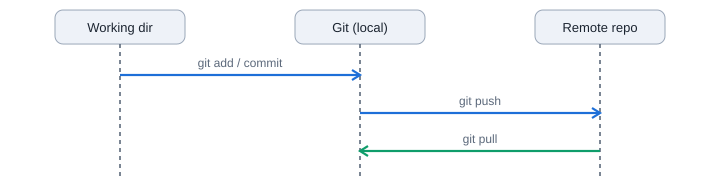

*شکل ۱: جریان کار Git؛ تغییر ← commit محلی ← push به ریپو.*

### ۲. دستورهای اصلی

``` text
git init                                   # create a repository
git status                                 # what changed?
git add configs/CORE-SW1.cfg               # stage a file
git commit -m "CORE-SW1: add NTP and syslog (CHG-0012)"
git log --oneline                          # history
git diff                                   # unstaged changes
git diff HEAD~1 HEAD -- configs/CORE-SW1.cfg   # compare two versions
git checkout -b feature/hardening          # new branch
git restore configs/CORE-SW1.cfg           # undo local changes to a file
```

- پیام commit باید بگوید «چه کسی/چرا» (شماره‌ی CHG).
- `git diff` بعد از هر بکاپ: اگر تفاوتی هست، یعنی کسی تغییر داده؛ بدون تفاوت = شبکه تغییر نکرده.

### ۳. رمز در Git: خط قرمز

``` text
# .gitignore
backups/*.raw
*.vault
secrets*.yml
.env
*.pcap
*.pcapng
```

قبل از commit فایل‌های Config را از رمزها پاک‌سازی (Sanitize) کنید:

``` text
# redact secrets from a config before committing
sed -E -e "s/(secret [0-9] ).*/\1<REDACTED>/" \
       -e "s/(password [0-9] ).*/\1<REDACTED>/" \
       -e "s/(snmp-server community ).*/\1<REDACTED>/" \
       CORE-SW1.raw > configs/CORE-SW1.cfg
```

> **اگر رمز اشتباهی commit شد**
>
> ۱) فوراً رمز را عوض کنید (فرض کنید لو رفته). ۲) تاریخچه را پاک‌سازی کنید (فقط با راهنمایی؛ حذف از commit‌های قبلی ساده نیست). ۳) Secret Scanning را فعال کنید. هرگز فقط «پاک‌کردن فایل در commit بعدی» را کافی ندانید.

### ۴. دستی در برابر خودکار: قضاوت مستدل

| معیار            | دستی               | خودکار                     |
|------------------|--------------------|----------------------------|
| سرعت (۵۰ دستگاه) | ساعت‌ها             | دقیقه‌ها                    |
| خطای تایپی       | محتمل              | کم                         |
| یکنواختی         | کم                 | زیاد                       |
| ریسک خطای گسترده | محدود به یک دستگاه | همه‌ی دستگاه‌ها همزمان       |
| ردپا/Audit       | دستی               | Playbook + Git             |
| یادگیری          | کم                 | نیاز به مهارت              |
| مناسب برای       | تغییر یک‌باره/خاص   | تغییرات تکراری و استاندارد |

نتیجه: اتوماسیون ابزار است، نه جایگزین قضاوت. تغییر پرریسک را با Check، یک دستگاه، سپس همه و همیشه با بکاپ انجام دهید.

### ۵. Cisco Campus As-Built (محصول CP1)

مستند نهایی بخش Cisco باید این‌ها را داشته باشد:

| بخش              | محتوا                                      | منبع                         |
|------------------|--------------------------------------------|------------------------------|
| ۱. توپولوژی      | نمودار فیزیکی و منطقی                      | Lab A و PNetLab              |
| ۲. IP Plan       | VLAN، Subnet، Gateway                      | 02-design/ip-plan.md         |
| ۳. VLAN Matrix   | VLAN، پورت‌ها                               | 02-design/vlan-matrix.md     |
| ۴. L2            | STP، EtherChannel، Port Security، Snooping | تنظیمات و show               |
| ۵. L3            | OSPF، HSRP، Default                        | As-Built Lab A               |
| ۶. سرویس‌ها       | DHCP، DNS، NTP، NAT، ACL، Syslog، SNMP     | Service Matrix               |
| ۷. Hardening     | Baseline و نتیجه‌ی بازبینی                  | 03-ops/hardening-baseline.md |
| ۸. Runbookها     | Change/Rollback و TSها                     | 03-ops                       |
| ۹. Config Backup | نسخه‌های Git (Sanitize‌شده)                  | Git                          |
| ۱۰. محدودیت‌ها    | موارد Unverified و نتیجه‌ی واقعی Lab        | یادداشت Lab                  |

### ۶. نقطه‌ی بازبینی CP1

CP1 پایان فاز Cisco (فصل ۱ تا ۸) است. چک‌لیست قبولی:

| \#  | معیار                               | مدرک                  |
|-----|-------------------------------------|-----------------------|
| ۱   | IP Plan و VLAN Matrix کامل          | فایل‌های طراحی         |
| ۲   | Lab A کامل و Failover تست‌شده        | As-Built + نتیجه‌ی تست |
| ۳   | Hardening Baseline روی همه‌ی تجهیزات | گزارش مقایسه          |
| ۴   | Service Matrix و سرویس‌ها            | فایل Matrix           |
| ۵   | بکاپ Git (بدون رمز)                 | git log               |
| ۶   | Gate G1، G2، G3 گذرانده             | سوابق                 |
| ۷   | لیست درس‌آموخته‌ها و اشتباهات         | صفحه‌ی مرور            |

**معیار قبولی:** هر ۷ مورد. با پایان CP1 و تأیید شما، فاز FortiGate (فصل ۹ به بعد) شروع می‌شود. تا آن زمان FortiGate را بوت نمی‌کنیم تا ساعت Evaluation مصرف نشود.

### ۷. مثال‌ها

#### ساده

``` text
git add backups/CORE-SW1.cfg && git commit -m "baseline backup"
```

#### متوسط: پیدا کردن تغییر

``` text
git diff HEAD~1 HEAD -- backups/CORE-SW1.cfg
+ no ip http server        (someone hardened the device)
```

#### سخت: رمز لو رفته

``` text
A SNMP community appeared in a committed config
Action: rotate the community immediately, sanitize history, enable secret scanning, add sanitize step before commit
```

### تمرین‌ها

**ت1.** ۱ (ساده): commit چیست؟ *(پاسخ: 8-6-ت1 در بخش «پاسخ‌ها» انتهای فصل)*

**ت2.** ۲ (ساده): git diff چه می‌کند؟ *(پاسخ: 8-6-ت2 در بخش «پاسخ‌ها» انتهای فصل)*

**ت3.** ۳ (متوسط): چرا رمز را بعد از commit اشتباهی باید عوض کنیم؟ *(پاسخ: 8-6-ت3 در بخش «پاسخ‌ها» انتهای فصل)*

**ت4.** ۴ (متوسط): دستی یا خودکار برای ۵۰ دستگاه؟ *(پاسخ: 8-6-ت4 در بخش «پاسخ‌ها» انتهای فصل)*

**ت5.** ۵ (سخت): CP1 چه چیزی را می‌سنجد؟ *(پاسخ: 8-6-ت5 در بخش «پاسخ‌ها» انتهای فصل)*

### Lab هدایت‌شده

روی PC/VM شما:

1.  یک ریپوی جدید برای Config بسازید (`git init`).
2.  بکاپ‌های فصل ۸-۴ را با اسکریپت Sanitize کنید و commit کنید.
3.  یک تغییر کوچک روی یک دستگاه بدهید، دوباره بکاپ بگیرید و `git diff` را ببینید.
4.  `.gitignore` را بسازید و تأیید کنید فایل‌های حساس commit نمی‌شوند.
5.  As-Built را بنویسید و چک‌لیست CP1 را پر کنید.

### Lab مستقل

مستند «Cisco Campus As-Built» (۱۰ بخش) را در `03-ops/campus-as-built.md` کامل کنید. این محصول CP1 است.

### عیب‌یابی

|         |                                                                             |
|---------|-----------------------------------------------------------------------------|
| Symptom | git push رد می‌شود یا رمز در ریپو است                                        |
| چک‌لیست  | ۱) .gitignore؟ ؛ ۲) Sanitize انجام شده؟ ؛ ۳) Secret scan؟ ؛ ۴) Remote درست؟ |
| ابزار   | git status ، git log ، grep برای الگوهای رمز                                |
| رفع     | عوض‌کردن رمز و پاک‌سازی                                                       |

### سؤال‌های مرور

**م1.** Git برای Config چه فایده‌ای دارد؟ *(پاسخ: 8-6-م1 در بخش «پاسخ‌ها» انتهای فصل)*

**م2.** CP1 چیست؟ *(پاسخ: 8-6-م2 در بخش «پاسخ‌ها» انتهای فصل)*

### English Corner: انگلیسی تخصصی این درس

این جمله‌ها از مستندات و محیط کار واقعی‌اند. بلند بخوانید و ترجمه را بپوشانید.

| English sentence                                                      | ترجمه                                                          |
|-----------------------------------------------------------------------|----------------------------------------------------------------|
| Commit every configuration change with a meaningful message.          | هر تغییر پیکربندی را با پیام معنادار commit کنید.              |
| Use git diff to see what changed between two backups.                 | با git diff ببینید بین دو بکاپ چه تغییر کرده است.              |
| Never commit passwords or API tokens.                                 | هرگز رمز یا Token را commit نکنید.                             |
| The as-built document describes the network as it was actually built. | مستند As-Built شبکه را همان‌طور که واقعاً ساخته شده توصیف می‌کند. |

**Q1.** Quick quiz (answer in English): What should you do if a secret was committed to the repository? *(پاسخ: 8-6-Q1 در بخش «پاسخ‌ها» انتهای فصل)*

### تکلیف و چک‌لیست تسلط

- [ ] ریپوی Config را بسازم و diff ببینم.
- [ ] As-Built را کامل کنم.
- [ ] چک‌لیست CP1 را پر کنم.

### یادآوری اشتباهات شما

> **یادآوری**
>
> پیش‌بینی قبل از اجرا؛ بکاپ قبل از تغییر؛ پذیرفته‌شدن دستور ≠ کار کردن؛ فرمول‌ها در بلوک مستقل.


#### کارت Lab — Git، As-Built و CP1

| # | فیلد | محتوا |
|---|---|---|
| 1 | عنوان و هدف | Git/As-Built/CP1 |
| 2 | پیش‌نیاز | درس 8-5 |
| 3 | توپولوژی | PC |
| 4 | تجهیزات | PC |
| 5 | نسخه نرم‌افزار | vIOS-L2 15.2(20200924، Experimental) برای SW؛ vIOS 15.9(3)M9 برای R؛ VPCS؛ PNetLab 4.2.8 |
| 6 | IP Plan | — |
| 7 | وضعیت اولیه | Repo Config |
| 8 | صورت مسئله | git diff |
| 9 | مراحل هدایت‌شده | همان بخش «Lab هدایت‌شده» همین درس |
| 10 | تست عملکرد | `git log` |
| 11 | سناریوی خرابی | رمز در commit |
| 12 | روش عیب‌یابی | لایه‌ای/با شواهد (بخش عیب‌یابی همین درس) |
| 13 | نتیجه‌ی مورد انتظار | As-Built کامل |
| 14 | معیار پذیرش | چک‌لیست CP1 |
| 15 | مستندات نهایی | `03-ops/campus-as-built.md` |
| 16 | Cleanup و بازگردانی | — |

> **وضعیت راستی‌آزمایی (خارج از ۱۶ فیلد):** **اجرا نشده (فقط طراحی).** اجرا نشده.

---

<a id="ans-8"></a>

## پاسخ‌های فصل 8

> ابتدا بدون نگاه حل کنید. شناسه: درس-نوع+شماره (ت = تمرین، م = مرور، Q = Quick quiz).

**8-1-ت1** — ۱ (ساده): سه صفحه‌ی دستگاه؟

``` text
Management, control and data plane.
```

**8-1-ت2** — ۲ (ساده): چرا no ip http server؟

``` text
To close an unnecessary management service and reduce the attack surface.
```

**8-1-ت3** — ۳ (متوسط): چرا پورت‌های خالی shutdown و VLAN 999؟

``` text
So that a rogue device plugged into an unused port gets no access.
```

**8-1-ت4** — ۴ (متوسط): چرا CDP روی پورت کاربر خاموش؟

``` text
It leaks device information (name, IP, software) to any host.
```

**8-1-ت5** — ۵ (سخت): قبل از Hardening VTY از راه دور چه شبکه‌ی ایمنی می‌گذاریم؟

``` text
Backup the config and use "reload in 5" so a mistake does not lock you out.
```

**8-1-م1** — Hardening چیست؟

کاهش سطح حمله با بستن سرویس‌های اضافه و تنظیم امن.

**8-1-م2** — چرا Management Plane مهم‌ترین است؟

کنترل کامل دستگاه را می‌دهد.

**8-1-Q1** — Quick quiz (answer in English): Why is "enable secret" preferred over "enable password"?

Secret is stored as a strong hash; password is clear text or weak Type 7.

**8-2-ت1** — ۱ (ساده): سه A؟

``` text
Authentication, Authorization, Accounting.
```

**8-2-ت2** — ۲ (ساده): TACACS+ چه پورتی؟

``` text
TCP 49
```

**8-2-ت3** — ۳ (متوسط): چرا Local را Fallback می‌گذاریم؟

``` text
If the AAA server is unreachable you can still log in with a local account.
```

**8-2-ت4** — ۴ (متوسط): Privilege 15 یعنی؟

``` text
Full administrative access.
```

**8-2-ت5** — ۵ (سخت): TACACS+ در برابر RADIUS برای مدیریت دستگاه؟

``` text
TACACS+ encrypts the whole packet and supports granular command authorization.
```

**8-2-م1** — Authorization چیست؟

تعیین اینکه کاربر چه کارهایی مجاز است.

**8-2-م2** — چرا Accounting؟

ثبت اینکه چه کسی چه کرده؛ برای مسئولیت‌پذیری.

**8-2-Q1** — Quick quiz (answer in English): What happens if you configure AAA with no local fallback and the server is down?

Everyone is locked out of the device, except via console recovery.

**8-3-ت1** — ۱ (ساده): تفاوت Object و Array؟

``` text
Object = key/value pairs in { }; Array = ordered list in [ ].
```

**8-3-ت2** — ۲ (ساده): GET چه می‌کند؟

``` text
Reads a resource without changing it.
```

**8-3-ت3** — ۳ (متوسط): کد 403 یعنی؟

``` text
Forbidden: authenticated but not allowed.
```

**8-3-ت4** — ۴ (متوسط): چرا YAML با Tab خراب می‌شود؟

``` text
Indentation defines structure and tabs are not allowed.
```

**8-3-ت5** — ۵ (سخت): چرا Token در Git ممنوع؟

``` text
Anyone with repo access could use it; it must come from a secret store or environment variable.
```

**8-3-م1** — REST چیست؟

API مبتنی بر HTTP که هر منبع یک URL دارد.

**8-3-م2** — چرا YAML برای Ansible؟

خوانا و برای تنظیمات مناسب است.

**8-3-Q1** — Quick quiz (answer in English): What is the difference between PUT and PATCH?

PUT replaces the whole resource; PATCH modifies part of it.

**8-4-ت1** — ۱ (ساده): چرا رمز در متغیر محیطی؟

``` text
So the password never ends up in the source code or in Git.
```

**8-4-ت2** — ۲ (ساده): read-only یعنی چه؟

``` text
The script only runs show commands and never changes the device.
```

**8-4-ت3** — ۳ (متوسط): چرا try/except؟

``` text
So a failing device does not stop the run for the remaining devices.
```

**8-4-ت4** — ۴ (متوسط): چرا اول روی یک دستگاه؟

``` text
To limit the blast radius of a mistake.
```

**8-4-ت5** — ۵ (سخت): چه چیزی در خروجی show running-config حساس است؟

``` text
Password hashes, SNMP communities, keys; do not publish the files.
```

**8-4-م1** — Netmiko چه می‌کند؟

با SSH به تجهیز شبکه وصل شده و دستور اجرا می‌کند.

**8-4-م2** — چرا Read-only برای شروع؟

ریسک کم و قابل‌بازگشت.

**8-4-Q1** — Quick quiz (answer in English): Why is a read-only script a safe first step in network automation?

It cannot change any device, so a bug cannot cause an outage.

**8-5-ت1** — ۱ (ساده): Idempotency چیست؟

``` text
Running the same playbook again changes nothing if the desired state is already in place.
```

**8-5-ت2** — ۲ (ساده): --check چه می‌کند؟

``` text
A dry run: shows what would change without changing anything.
```

**8-5-ت3** — ۳ (متوسط): چرا --limit؟

``` text
To run on a single device first and limit the blast radius.
```

**8-5-ت4** — ۴ (متوسط): رمز را کجا نگه می‌داریم؟

``` text
Environment variables or Ansible Vault, never plain text in Git.
```

**8-5-ت5** — ۵ (سخت): تفاوت ios_command و ios_config؟

``` text
ios_command runs exec/show commands; ios_config pushes configuration lines.
```

**8-5-م1** — Ansible در چه چیزی بهتر از اسکریپت است؟

تنظیم توصیفی و Idempotent برای چند دستگاه.

**8-5-م2** — --diff چه نشان می‌دهد؟

تفاوت پیکربندی قبل و بعد.

**8-5-Q1** — Quick quiz (answer in English): What does changed=0 on a second run tell you?

The device already matches the desired state; the playbook is idempotent.

**8-6-ت1** — ۱ (ساده): commit چیست؟

``` text
A recorded snapshot of the files with a message.
```

**8-6-ت2** — ۲ (ساده): git diff چه می‌کند؟

``` text
Shows the differences between versions.
```

**8-6-ت3** — ۳ (متوسط): چرا رمز را بعد از commit اشتباهی باید عوض کنیم؟

``` text
Anyone with repository access (or history) could have already read it.
```

**8-6-ت4** — ۴ (متوسط): دستی یا خودکار برای ۵۰ دستگاه؟

``` text
Automated for repeated standard changes, with check mode and a single-device pilot.
```

**8-6-ت5** — ۵ (سخت): CP1 چه چیزی را می‌سنجد؟

``` text
Completeness of the Cisco campus design: documents, Lab A, hardening, services, backup and gates.
```

**8-6-م1** — Git برای Config چه فایده‌ای دارد؟

تاریخچه، Diff و Rollback.

**8-6-م2** — CP1 چیست؟

نقطه‌ی بازبینی پایان فاز Cisco قبل از FortiGate.

**8-6-Q1** — Quick quiz (answer in English): What should you do if a secret was committed to the repository?

Rotate the secret immediately, clean the history and enable secret scanning.

---

<a id="ch9"></a>

# فصل 9 — BGP عملی و Route Filtering

**مدت:** ۳۶ ساعت (۶ روز × ۶ ساعت) | **پیش‌نیاز:** فصل ۶ (OSPF)، فصل ۷ (ACL/NAT).
**اهداف:** ۱) مفهوم BGP و تفاوت eBGP/iBGP. ۲) برپایی Peering و اعلام شبکه. ۳) iBGP با Loopback و `next-hop-self`. ۴) کنترل مسیر با Local Preference، AS-Path Prepend و MED. ۵) فیلتر مسیر با Prefix-List و Route-Map. ۶) عیب‌یابی BGP.
**چرا برای فایروال؟** FortiGate در شبکه‌ی دو ISP و Hub-and-Spoke BGP صحبت می‌کند؛ بدون فهم BGP نمی‌توان مسیر برگشت و Failover را تحلیل کرد. **عمق:** نه CCNP؛ فقط آنچه فایروال لازم دارد.
**معیار تسلط فصل:** برپایی eBGP/iBGP بدون راهنما؛ توضیح انتخاب بهترین مسیر؛ ساخت یک فیلتر؛ پیدا کردن علت «Peer در Active/Idle».
**اشتباهات رایج:** فراموشی `next-hop-self` در iBGP؛ `network` بدون Route دقیق در جدول؛ نبود مسیر TCP 179 بین Peerها؛ Route-Map بدون `permit` پایانی.

**درس‌های فصل:**
- [درس 9-1 — مفهوم BGP: AS، eBGP/iBGP و حالت‌های Peer](#l-9-1)
- [درس 9-2 — eBGP عملی: Peering و اعلام شبکه](#l-9-2)
- [درس 9-3 — iBGP: Loopback Peering و next-hop-self](#l-9-3)
- [درس 9-4 — انتخاب بهترین مسیر: Weight، Local-Pref، AS-Path، MED](#l-9-4)
- [درس 9-5 — Route Filtering: Prefix-List، Route-Map و Community](#l-9-5)
- [درس 9-6 — عیب‌یابی BGP و آزمون کوچک فصل](#l-9-6)

---

<a id="l-9-1"></a>

## درس 9-0 — چرا BGP؟ مسیریابی میان سازمان‌ها و اینترنت از پایه

**فصل ۹ · درس افزوده (پیش‌درس ۹-۱) · پیش‌نیاز: فصل ۵ و ۶ (Routing، OSPF)، درس ۵-۷ · ≈ ۴ ساعت**

> **وضعیت:** مفهومی و مبتنی بر RFC 4271 و مستند Cisco؛ Labها «اجرا نشده».

### ۱) هدف آموزشی

در پایان می‌توانید:

1. توضیح دهید چرا IGPهایی مثل OSPF برای اینترنت مناسب نیستند و BGP چه مشکلی را حل می‌کند.
2. **Autonomous System (AS)** را تعریف کنید و AS خصوصی/عمومی را بشناسید.
3. بگویید BGP یک پروتکل **Path Vector** است و از این ویژگی چه نتیجه‌ای می‌گیریم (جلوگیری از Loop، اعمال Policy).
4. تفاوت eBGP و iBGP را در رفتار، AD و Loop Prevention بگویید.
5. بگویید BGP به‌جای «کوتاه‌ترین مسیر» «**Policy**» را مبنای انتخاب می‌گیرد و پیامد آن را در طراحی با ISP و فایروال توضیح دهید.

### ۲) پیش‌نیازها

OSPF و Link-State (فصل ۵ و ۶)، Administrative Distance، Redistribution مقدماتی (فصل ۱۰ در ادامه)، TCP (فصل ۲).

### ۳) مفهوم پایه: چرا IGP کافی نیست؟

OSPF فرض می‌کند همه‌ی روترها زیر یک مدیریت‌اند و از همه‌ی لینک‌ها اطلاع کامل دارند (LSDB). این فرض در اینترنت غلط است:

- **مقیاس:** اینترنت صدها هزار Prefix دارد؛ Flooding LSA در این مقیاس غیرممکن است.
- **اعتماد:** هر سازمان قوانین و منافع خود را دارد؛ نمی‌خواهیم توپولوژی داخلی‌مان را به رقیب نشان دهیم.
- **سیاست:** سازمان می‌خواهد بگوید «ترافیک را از ISP-A بفرست، چون ارزان‌تر است» (نه صرفاً «کوتاه‌ترین»).

BGP برای همین ساخته شد: مسیریابی میان **سیستم‌های خودمختار**، با کنترل Policy و مقیاس‌پذیری بالا.

> **تشبیه:** OSPF مثل نقشه‌ی راه داخل یک شهر است که همه‌ی خیابان‌ها را می‌دانید. BGP مثل «توافق‌نامه‌ی گمرکی بین کشورها» است: هر کشور فقط می‌گوید «از طریق من به این مقصدها می‌رسید» و بقیه‌ی جزئیات داخلی را نمی‌گوید.

### ۴) توضیح عمیق فنی

#### ۴-۱) AS و ASN

**AS (Autonomous System)** مجموعه‌ای از شبکه‌ها و روترها زیر یک سیاست مسیریابی واحد است. هر AS یک شماره دارد (ASN):

| محدوده | نوع | کاربرد |
|---|---|---|
| 1 تا 64495 (تقریباً) | عمومی (۲ بایتی) | اینترنت |
| 64512 تا 65534 | خصوصی (۲ بایتی) | Lab و داخلی؛ **در دوره از این‌ها استفاده می‌کنیم** |
| ۴ بایتی (تا ~4.29 میلیارد) | عمومی/خصوصی | RFC 6793 |

(جزئیات دقیق رزرو ASN را از IANA بررسی کنید؛ این جدول تقریبی است و `Unverified` تا تطبیق با ثبت IANA.)

#### ۴-۲) Path Vector

BGP برای هر Prefix **فهرست ASهای عبوری (AS_PATH)** را حمل می‌کند:

``` text
Prefix 203.0.113.0/24  AS_PATH = 65002 65003 65004
```

نتیجه:

- **جلوگیری از Loop:** اگر روتری ASN خودش را در AS_PATH ببیند، آن Update را رد می‌کند. بنابراین BGP بدون LSDB و بدون الگوریتم SPF هم حلقه نمی‌سازد (در سطح AS).
- **انتخاب با Policy:** می‌توان روی AS_PATH فیلتر یا طول مسیر را به‌عنوان معیار گذاشت.
- **Metric عددی ندارد:** BGP «Metric» واحدی مثل Cost ندارد؛ مجموعه‌ای از **Attribute**ها (Weight، Local-Pref، AS_PATH، Origin، MED ...) است که الگوریتم انتخاب بهترین مسیر آن‌ها را به ترتیب می‌سنجد (درس ۹-۴ و ۹-۷).

#### ۴-۳) Session و TCP

BGP با **TCP پورت 179** بین دو Neighbor (Peer) برقرار می‌شود؛ پس پایداری و Reachability لایه ۳ پیش‌شرط است. دو Peer باید آدرس یکدیگر را صریحاً تنظیم کنند (BGP Neighbor را کشف نمی‌کند؛ برخلاف OSPF Hello Multicast). پیام‌ها: **OPEN، KEEPALIVE، UPDATE، NOTIFICATION** (RFC 4271).

- OPEN: ASN، Hold Time، BGP Identifier (Router-ID) و قابلیت‌ها.
- KEEPALIVE: زنده بودن.
- UPDATE: اعلام یا پس‌گرفتن Prefix و Attributeها.
- NOTIFICATION: خطا و بستن Session.

زمان‌های پیش‌فرض Cisco: Keepalive 60 s و Hold 180 s (RFC پیشنهاد 30 و 90 دارد؛ Hold نهایی میان دو Peer کوچک‌تر دو مقدار می‌شود). پس Detect پیش‌فرض خرابی BGP تا ۱۸۰ ثانیه است؛ با BFD یا Timer کوتاه‌تر کم می‌شود (مرتبط با درس ۵-۷).

#### ۴-۴) eBGP و iBGP

| ویژگی | eBGP | iBGP |
|---|---|---|
| Peer | AS متفاوت | AS یکسان |
| AD پیش‌فرض Cisco | 20 | 200 |
| TTL پیش‌فرض Session | 1 (مستقیم‌ متصل) | 255 |
| افزودن ASN به AS_PATH | بله، هنگام خروج | خیر |
| Next-hop | تغییر به آدرس خود روتر | **بدون تغییر** (باید `next-hop-self` بگذاریم، درس ۹-۳) |
| قانون Loop | رد Update با ASN خودی | **Split Horizon iBGP**: مسیر یادگرفته‌شده از iBGP Peer به iBGP Peer دیگر داده نمی‌شود |

قانون iBGP Split Horizon دلیل لزوم **Full Mesh** در iBGP یا استفاده از **Route Reflector/Confederation** است (مقیاس).

> **چرا iBGP لازم است؟** تا مسیرهایی که از ISP یاد گرفته‌ایم به همه‌ی روترهای مرزی AS خودمان برسد و همه یک تصمیم یکسان بگیرند، بدون این‌که BGP را به IGP تبدیل (Redistribute) کنیم (فصل ۱۰ خطرات آن را می‌گوید).

#### ۴-۵) BGP و IGP: تقسیم کار

- **IGP (OSPF):** Reachability داخل AS (Loopbackها، لینک‌ها).
- **BGP:** مسیرهای خارجی و Policy.
- BGP برای رسیدن به Next-hop از IGP کمک می‌گیرد (Recursive Lookup؛ درس ۵-۰). اگر IGP Next-hop را نداشته باشد، مسیر BGP «Inaccessible» و غیرقابل‌استفاده است.

### ۵) مثال حل‌شده

**سازمان ما: AS 65010** با دو ISP: ISP-A (AS 65100) و ISP-B (AS 65200). هر دو مسیر پیش‌فرض و Prefixهای اینترنتی می‌دهند. می‌خواهیم ترافیک خروجی از A برود و B پشتیبان باشد.

``` text
Our AS 65010 ---- eBGP ---- ISP-A (AS 65100)  (preferred)
              \--- eBGP ---- ISP-B (AS 65200)  (backup)
```

- چرا BGP؟ چون هر دو ISP به یک Prefix می‌رسند و تصمیم «کدام ISP» Policy است، نه Metric.
- با OSPF نمی‌توان از ISP پیش‌فرض مسیر انتخابی ساخت و AS_PATH/Policy را حمل کرد.
- ما Local-Preference بالاتری برای مسیرهای ISP-A می‌گذاریم (درس ۹-۴).

**مثال سخت (تحلیل):** Prefix 198.51.100.0/24 از ISP-A با AS_PATH `65100 65300` و از ISP-B با AS_PATH `65200` می‌رسد. بدون هیچ Policy کدام انتخاب می‌شود؟ جواب: AS_PATH کوتاه‌تر (ISP-B) برنده است؛ مگر Weight/Local-Pref بالاتری برای A تنظیم کنیم، چون آن‌ها پیش از AS_PATH سنجیده می‌شوند (درس ۹-۷).

### ۶) طراحی و تصمیم‌گیری

| سؤال | گزینه | معیار |
|---|---|---|
| آیا اصلاً BGP لازم است؟ | بله / فقط Static Default | بیش از یک ISP، نیاز به Policy، یا اتصال به AS دیگر؛ برای تک‌ISP معمولاً Default Static کافی است |
| eBGP یا Static برای شعب؟ | هر دو ممکن | تعداد شعب و نیاز به Failover خودکار |
| iBGP Full Mesh یا RR؟ | Full Mesh / Route Reflector | تعداد روتر؛ بالای ~۵–۶ روتر RR |
| ASN خصوصی؟ | در Lab بله؛ در تولید معمولاً ASN خود یا ASN خصوصی ISP | سیاست ISP |

### ۷) پیاده‌سازی مقدماتی و Verification

پیکربندی کامل در درس ۹-۲ می‌آید. در این‌جا فقط شواهد را بشناسید:

``` text
R1# show ip bgp summary
R1# show ip bgp neighbors 10.0.12.2
R1# show ip bgp
R1# show ip route bgp
```

- `show ip bgp summary`: وضعیت Neighbor و تعداد Prefix دریافتی (State/PfxRcd).
- وضعیت‌های Session: Idle → Connect → Active → OpenSent → OpenConfirm → **Established** (درس ۹-۱).

### ۸) Troubleshooting اولیه

| علامت | شاهد | علت محتمل |
|---|---|---|
| Session بالا نمی‌آید (Active/Idle) | `show ip bgp summary`، ping Neighbor | Reachability، ASN/آدرس Neighbor اشتباه، ACL TCP 179 |
| Established ولی Prefix نمی‌آید | `show ip bgp neighbors ... received-routes`/PfxRcd | Policy/Filter، `network` نادرست |
| Route در BGP هست ولی در RIB نه | `show ip bgp` | Next-hop غیرقابل‌دسترس یا AD/مسیر بهتر از منبع دیگر |

### ۹) نکات امنیتی

- BGP پروتکلی با اعتماد ضمنی است؛ اعلان نادرست (Route Leak/Hijack) می‌تواند ترافیک را منحرف کند. در مرز با ISP **همیشه Prefix-List ورودی/خروجی** بگذارید (درس ۹-۵ و ۹-۷).
- Session را با TTL Security/Authentication محافظت کنید (درس ۹-۷).
- ISP نباید Prefix خصوصی یا Bogon از ما بپذیرد و ما هم نباید بپذیریم (RFC 7454).

### ۱۰) جمع‌بندی مفهومی

- BGP برای مقیاس و Policy میان ASها ساخته شد؛ OSPF برای داخل AS.
- BGP Path Vector است؛ AS_PATH هم Loop را می‌گیرد و هم ابزار Policy است.
- Metric یگانه ندارد؛ مجموعه‌ی Attributeها به ترتیب سنجیده می‌شوند.
- Session روی TCP/179 و با Neighbor دستی است؛ iBGP Split Horizon دارد.
- BGP به IGP برای Next-hop وابسته است.

### ۱۱) تمرین و ارزیابی

**ت1.** (ساده) AS چیست؟ *(پاسخ: 9-0-ت1)*

**ت2.** (ساده) BGP روی کدام پروتکل و پورت کار می‌کند؟ *(پاسخ: 9-0-ت2)*

**ت3.** (متوسط) AD پیش‌فرض eBGP و iBGP در Cisco چند است و چرا فرق دارد؟ *(پاسخ: 9-0-ت3)*

**ت4.** (متوسط) چرا Loop در BGP با AS_PATH کشف می‌شود؟ *(پاسخ: 9-0-ت4)*

**ت5.** (سخت) سازمان دو ISP دارد. چه زمانی Static Default کافی است و چه زمانی BGP لازم است؟ سه معیار بدهید. *(پاسخ: 9-0-ت5)*

**ت6.** (سخت، طراحی) برای ۸ روتر مرزی AS چرا Full Mesh iBGP مشکل‌ساز است؟ تعداد Sessionها را حساب کنید و راه‌حل را بگویید. *(پاسخ: 9-0-ت6)*

**م1.** چهار پیام BGP را نام ببرید. *(پاسخ: 9-0-م1)*

**م2.** چرا BGP بدون IGP کار کامل نمی‌کند؟ *(پاسخ: 9-0-م2)*

**Q1.** Quick quiz (English): Why is BGP called a path vector protocol? *(پاسخ: 9-0-Q1)*

### ۱۲) اصطلاحات و English Corner

| مخفف | شکل کامل | معنی |
|---|---|---|
| AS | Autonomous System | سیستم خودمختار |
| ASN | AS Number | شماره‌ی AS |
| eBGP | External BGP | BGP میان ASهای مختلف |
| iBGP | Internal BGP | BGP داخل یک AS |
| RR | Route Reflector | بازتاب‌دهنده‌ی مسیر |
| Path Vector | Path vector protocol | پروتکل مبتنی بر فهرست مسیر |

- *BGP selects routes by policy, not only by shortest path.* ← BGP مسیر را بر اساس Policy انتخاب می‌کند، نه فقط کوتاه‌ترین.
- *An AS_PATH containing my own ASN means a loop.* ← وجود ASN خودم در AS_PATH یعنی حلقه.

### ۱۳) منابع

- RFC 4271 — A Border Gateway Protocol 4 (BGP-4).
- RFC 6793 — BGP Support for Four-Octet AS Numbers.
- RFC 7454 (BCP 194) — BGP Operations and Security.
- Cisco: [Select BGP Best-path Algorithm](https://www.cisco.com/c/en/us/support/docs/ip/border-gateway-protocol-bgp/13753-25.html).


## درس 9-1 — مفهوم BGP: AS، eBGP/iBGP و حالت‌های Peer

**فصل 9 - روز 1 · پیش‌نیاز: فصل ۶ · ۶ ساعت**

### ۱) معرفی درس

BGP پروتکل مسیریابی «بین سازمان‌ها» است. ISPها و شعبه‌ها با آن مسیر رد و بدل می‌کنند. بدون آن نمی‌توانید دو ISP یا Hub-and-Spoke بزرگ را درست طراحی کنید. در شبکه‌ی سازمانی در لبه‌ی اینترنت و بین Hub و شعب استفاده می‌شود.

### ۲) پیش‌نیازها

مفهوم OSPF، Route Table و AD/Metric (فصل ۵ و ۶).

### ۳) توضیح مفهومی

- **AS (Autonomous System):** مجموعه‌ی شبکه‌هایی با یک سیاست مسیریابی؛ با عدد ASN شناخته می‌شود (۱۶ تا ۶۴۵۱۱ عمومی؛ ۶۴۵۱۲ تا ۶۵۵۳۴ خصوصی).
- **eBGP** بین دو AS متفاوت؛ **iBGP** داخل یک AS.
- روی **TCP 179** کار می‌کند؛ Peer باید دستی تعریف شود (کشف خودکار ندارد).
- حالت‌های Peer: Idle ← Connect ← Active ← OpenSent ← OpenConfirm ← **Established**. فقط Established یعنی سالم.
- BGP «Path Vector» است: هر مسیر فهرست ASهای عبوری (AS-Path) را دارد و با آن حلقه شناسایی می‌شود.
- AD پیش‌فرض: eBGP = 20، iBGP = 200.

### ۴) مثال ساده

دو روتر R1 (AS 65001) و ISP (AS 65000) با یک لینک /30 هم‌دیگر را Peer می‌کنند و ISP مسیر پیش‌فرض می‌دهد.

### ۵) مثال سازمانی

شعبه‌ها ASN خصوصی ۶۵۰۱۰ تا ۶۵۰۱۲ و مرکز ۶۵۰۰۰ دارند؛ مرکز با هر شعبه eBGP برقرار می‌کند و مسیر شبکه‌ی داخلی هر شعبه را یاد می‌گیرد.

### ۶) تصویر و توپولوژی

```text
AS65001 R1 ----eBGP (TCP 179)---- ISP AS65000
 10.0.1.1/30                  10.0.1.2/30
```

### ۷) پیکربندی (CLI)

```text
show ip bgp summary
show ip bgp neighbors 10.0.1.2
show ip bgp
```

**توضیح دستورها (چه / چرا / خروجی / راستی‌آزمایی / بازگشت):**

- `show ip bgp summary`: ستون State/PfxRcd؛ عدد (تعداد مسیر دریافتی) یعنی Established؛ کلمه (Idle/Active) یعنی مشکل.
- `show ip bgp neighbors`: دلیل آخرین Reset و تایمرها.
- `show ip bgp`: جدول BGP (غیر از Route Table).
- بازگشت: ندارد (فقط مشاهده).

### ۸) تست عملکرد

- `show ip bgp summary` را ببینید؛ Peer را با ping تا TCP 179 بررسی کنید (Telnet به 179 از روی روتر).

### ۹) عیب‌یابی

| بخش | شرح |
|---|---|
| Symptom | Peer در حالت Active می‌ماند |
| شواهد/دستور | `show ip bgp summary`: Active؛ `ping 10.0.1.2` موفق نیست یا ACL پورت 179 را می‌بندد |
| علت | مسیر/ACL/Neighbor IP یا ASN اشتباه |
| رفع | اصلاح آدرس/ASN؛ باز کردن TCP 179؛ بررسی `update-source` |

### ۱۰) تمرین مستقل

> پاسخ‌ها در بخش «پاسخ‌های فصل» انتهای فصل است؛ اول خودتان حل کنید.

**ت1.** eBGP و iBGP چه تفاوتی دارند و AD هر کدام چند است؟ *(پاسخ: 9-1-ت1)*

**ت2.** چرا Peer در Active می‌ماند؟ *(پاسخ: 9-1-ت2)*

**ت3.** پورت BGP؟ *(پاسخ: 9-1-ت3)*

### ۱۱) مرور و ارزیابی

**م1.** چرا BGP برای فایروال مهم است؟ *(پاسخ: 9-1-م1)*

**م2.** سناریو: State = Idle (Admin)؛ چه می‌کنید؟ *(پاسخ: 9-1-م2)*

**معیار تسلط:** توضیح Established و دلایل Active/Idle؛ تشخیص eBGP/iBGP از روی ASN.

**اشتباهات رایج:** تصور اینکه BGP خودش همسایه را پیدا می‌کند؛ نخواندن State.

### ۱۲) واژگان و English Corner

| واژه | شکل کامل | معنی | کاربرد واقعی |
|---|---|---|---|
| BGP | Border Gateway Protocol | پروتکل مسیریابی بین AS | لبه‌ی اینترنت و Hub-Spoke |
| ASN | Autonomous System Number | شماره‌ی AS | شناسایی سازمان/ISP |
| AS-Path | AS Path attribute | فهرست ASهای عبوری | جلوگیری از حلقه و انتخاب مسیر |
| Established | BGP Established state | Peer سالم | مشاهده در summary |

| English sentence | ترجمه |
|---|---|
| BGP runs over TCP port 179. | BGP روی TCP پورت ۱۷۹ اجرا می‌شود. |
| The neighbor is stuck in the Active state. | همسایه در حالت Active گیر کرده است. |

#### کارت Lab — درس 9-1

| # | فیلد | محتوا |
|---|---|---|
| 1 | عنوان و هدف | مشاهده‌ی Peer BGP و خواندن State |
| 2 | پیش‌نیاز | فصل ۶ |
| 3 | توپولوژی | R1 ↔ ISP (/30) |
| 4 | تجهیزات | R1، ISP (دو vIOS) |
| 5 | نسخه نرم‌افزار | vIOS-L2 15.2(20200924، Experimental)؛ vIOS 15.9(3)M9؛ CSR1000v 17.03.02 (IOS-XE)؛ VPCS؛ PNetLab 4.2.8 |
| 6 | IP Plan | 10.0.1.0/30 |
| 7 | وضعیت اولیه | ISP با BGP پیکربندی‌شده (از قبل) |
| 8 | صورت مسئله | State را بخوانید؛ یک خطا (ASN غلط) بسازید |
| 9 | مراحل هدایت‌شده | بخش‌های ۷ و ۸ همین درس (گام‌به‌گام) |
| 10 | تست عملکرد | `show ip bgp summary` |
| 11 | سناریوی خرابی | Peer در حالت Active می‌ماند |
| 12 | روش عیب‌یابی | بخش ۹ همین درس (لایه‌ای/با شواهد) |
| 13 | نتیجه‌ی مورد انتظار | Established و یک Prefix |
| 14 | معیار پذیرش | Established ثبت و علت Active توضیح داده شود |
| 15 | مستندات نهایی | `03-ops/bgp-notes.md` |
| 16 | Cleanup و بازگردانی | برگرداندن ASN |

> **وضعیت راستی‌آزمایی (خارج از ۱۶ فیلد):** **اجرا نشده (فقط طراحی).** روی Image شما اجرا نشده؛ خروجی‌ها پیش‌بینی هستند.

---

<a id="l-9-2"></a>

## درس 9-2 — eBGP عملی: Peering و اعلام شبکه

**فصل 9 - روز 2 · پیش‌نیاز: درس ۹-۱ · ۶ ساعت**

### ۱) معرفی درس

اولین Peering واقعی: R1 شبکه‌ی داخلی‌اش را به ISP اعلام می‌کند و Default می‌گیرد. در شبکه‌ی سازمانی این همان ارتباط لبه‌ی شما با ISP است.

### ۲) پیش‌نیازها

درس ۹-۱.

### ۳) توضیح مفهومی

- `router bgp <ASN>` + `neighbor <IP> remote-as <ASN>` برای تعریف Peer.
- `network <prefix> mask <mask>` فقط وقتی اعلام می‌کند که **همان Prefix دقیقاً در Route Table** باشد (Connected/Static).
- برای اعلام Default به همسایه: `neighbor ... default-originate` (روی ISP).
- `soft reconfiguration`/`clear ip bgp * soft` برای اعمال سیاست بدون قطع Session.
- فیلتر پیش‌فرض ورودی/خروجی ندارد؛ در دنیای واقعی همیشه Prefix-List می‌گذاریم.

### ۴) مثال ساده

R1 شبکه‌ی 192.168.1.0/24 را اعلام و ISP مسیر پیش‌فرض می‌دهد.

### ۵) مثال سازمانی

شعبه فقط Prefix خودش را اعلام می‌کند و فقط Default/Prefixهای مرکز را می‌پذیرد (فیلتر).

### ۶) تصویر و توپولوژی

```text
R1 (AS65001) 192.168.1.0/24 --- 10.0.1.0/30 --- ISP (AS65000) 0.0.0.0/0
```

### ۷) پیکربندی (CLI)

```text
! R1
router bgp 65001
 bgp router-id 1.1.1.1
 neighbor 10.0.1.2 remote-as 65000
 network 192.168.1.0 mask 255.255.255.0
!
ip route 192.168.1.0 255.255.255.0 Null0
! ISP
router bgp 65000
 neighbor 10.0.1.1 remote-as 65001
 neighbor 10.0.1.1 default-originate
```

**توضیح دستورها (چه / چرا / خروجی / راستی‌آزمایی / بازگشت):**

- `bgp router-id`: شناسه‌ی پایدار؛ بدون آن بزرگ‌ترین IP انتخاب می‌شود.
- `network ... mask`: اعلام Prefix؛ Route Null0 برای ساخت Prefix پایدار.
- `default-originate` روی ISP: Default را فقط به این همسایه می‌دهد.
- راستی‌آزمایی: `show ip route bgp` در R1 باید `B* 0.0.0.0/0` نشان دهد.
- بازگشت: `no network ...` / `no neighbor ...`.

### ۸) تست عملکرد

- `show ip bgp` روی ISP: Prefix 192.168.1.0/24 با AS-Path 65001.
- `ping 8.8.8.8 source 192.168.1.1` (اگر ISP Loopback دارد).

### ۹) عیب‌یابی

| بخش | شرح |
|---|---|
| Symptom | R1 Prefix را اعلام نمی‌کند |
| شواهد/دستور | `show ip bgp` روی ISP: Prefix نیست؛ `show ip route 192.168.1.0` روی R1: نیست |
| علت | Prefix دقیق در Route Table نیست |
| رفع | ساخت Route (Null0 یا Connected) مطابق Mask |

### ۱۰) تمرین مستقل

> پاسخ‌ها در بخش «پاسخ‌های فصل» انتهای فصل است؛ اول خودتان حل کنید.

**ت1.** چرا `network` بدون Route کار نمی‌کند؟ *(پاسخ: 9-2-ت1)*

**ت2.** دستور اعلام Default؟ *(پاسخ: 9-2-ت2)*

**ت3.** Router-ID چه فایده‌ای دارد؟ *(پاسخ: 9-2-ت3)*

### ۱۱) مرور و ارزیابی

**م1.** چرا همیشه Prefix-List روی eBGP می‌گذاریم؟ *(پاسخ: 9-2-م1)*

**م2.** سناریو: ISP مسیر نمی‌بیند؛ دو بررسی؟ *(پاسخ: 9-2-م2)*

**معیار تسلط:** برپایی eBGP بدون راهنما و تأیید با دو دستور show.

**اشتباهات رایج:** فراموشی Route Null0؛ Mask اشتباه در network.

### ۱۲) واژگان و English Corner

| واژه | شکل کامل | معنی | کاربرد واقعی |
|---|---|---|---|
| default-originate | BGP default-originate | ارسال Default به همسایه | ISP به مشتری |
| Null0 | Null0 interface | دورریز؛ Route ثابت برای Prefix | پایدارسازی network |
| Soft reset | Soft reconfiguration | اعمال سیاست بدون قطع | عیب‌یابی بدون قطع |

| English sentence | ترجمه |
|---|---|
| Advertise only the prefixes you own. | فقط Prefixهایی را اعلام کنید که مالک آن‌ها هستید. |
| Apply a prefix-list on every eBGP session. | روی هر Session eBGP یک Prefix-List بگذارید. |

#### کارت Lab — درس 9-2

| # | فیلد | محتوا |
|---|---|---|
| 1 | عنوان و هدف | eBGP بین R1 و ISP |
| 2 | پیش‌نیاز | درس ۹-۱ |
| 3 | توپولوژی | R1 ↔ ISP |
| 4 | تجهیزات | R1، ISP |
| 5 | نسخه نرم‌افزار | vIOS-L2 15.2(20200924، Experimental)؛ vIOS 15.9(3)M9؛ CSR1000v 17.03.02 (IOS-XE)؛ VPCS؛ PNetLab 4.2.8 |
| 6 | IP Plan | 10.0.1.0/30؛ 192.168.1.0/24 |
| 7 | وضعیت اولیه | Interfaceها بالا |
| 8 | صورت مسئله | R1 شبکه را اعلام و Default بگیرد |
| 9 | مراحل هدایت‌شده | بخش‌های ۷ و ۸ همین درس (گام‌به‌گام) |
| 10 | تست عملکرد | `show ip bgp`، `show ip route bgp` |
| 11 | سناریوی خرابی | R1 Prefix را اعلام نمی‌کند |
| 12 | روش عیب‌یابی | بخش ۹ همین درس (لایه‌ای/با شواهد) |
| 13 | نتیجه‌ی مورد انتظار | Prefix در ISP؛ Default در R1 |
| 14 | معیار پذیرش | پیش‌بینی با نتیجه تطبیق داده شود |
| 15 | مستندات نهایی | `03-ops/ebgp-asbuilt.md` |
| 16 | Cleanup و بازگردانی | حذف BGP |

> **وضعیت راستی‌آزمایی (خارج از ۱۶ فیلد):** **اجرا نشده (فقط طراحی).** روی Image شما اجرا نشده؛ خروجی‌ها پیش‌بینی هستند.

---

<a id="l-9-3"></a>

## درس 9-3 — iBGP: Loopback Peering و next-hop-self

**فصل 9 - روز 3 · پیش‌نیاز: درس ۹-۲ · ۶ ساعت**

### ۱) معرفی درس

وقتی چند روتر داخل یک AS داریم (مثلاً دو Edge)، باید مسیرهای BGP را بین‌شان پخش کنیم. بدون `next-hop-self` Next-hop به IP ISP می‌ماند و داخلی‌ها آن را نمی‌بینند.

### ۲) پیش‌نیازها

درس ۹-۲؛ OSPF برای دسترسی به Loopbackها.

### ۳) توضیح مفهومی

- iBGP بین روترهای یک AS؛ مسیر یاد‌گرفته‌شده از iBGP **دوباره به iBGP‌Peer دیگر داده نمی‌شود** (قانون split-horizon)؛ پس Full-mesh یا Route-Reflector لازم است.
- Peering با **Loopback** پایدارتر است (`update-source Loopback0`).
- OSPF/IGP باید Loopbackها را قابل‌دسترس کند.
- `next-hop-self` روی Edge: Next-hop را به IP خود Edge تغییر می‌دهد.
- AD ۲۰۰ برای iBGP؛ IGP قبل از آن انتخاب می‌شود.

### ۴) مثال ساده

دو Edge (E1، E2) در AS 65001، هر دو با ISP eBGP؛ با هم iBGP.

### ۵) مثال سازمانی

دو فایروال Edge در یک AS؛ Peering iBGP با Loopback و `next-hop-self` تا مسیر Failover کامل شود.

### ۶) تصویر و توپولوژی

```text
ISP --eBGP-- E1 ==iBGP (lo0)== E2 --eBGP-- ISP2
          (AS65001 with internal OSPF)
```

### ۷) پیکربندی (CLI)

```text
router bgp 65001
 neighbor 2.2.2.2 remote-as 65001
 neighbor 2.2.2.2 update-source Loopback0
 neighbor 2.2.2.2 next-hop-self
! reachability via IGP
router ospf 1
 network 1.1.1.1 0.0.0.0 area 0
```

**توضیح دستورها (چه / چرا / خروجی / راستی‌آزمایی / بازگشت):**

- `remote-as` برابر ASN خودتان = iBGP.
- `update-source Loopback0`: Session از Loopback شروع شود (در Link-failure زنده می‌ماند).
- `next-hop-self`: Next-hop را روی Peer iBGP خود Edge می‌کند.
- راستی‌آزمایی: `show ip bgp 0.0.0.0` روی E2: Next-hop = IP E1.
- بازگشت: `no neighbor ...`.

### ۸) تست عملکرد

- `show ip bgp summary` Established؛ `show ip route` Next-hop قابل‌دسترس.

### ۹) عیب‌یابی

| بخش | شرح |
|---|---|
| Symptom | iBGP مسیر دارد ولی Route Table ندارد |
| شواهد/دستور | `show ip bgp`: مسیر هست؛ `show ip route <prefix>`: نیست یا Inaccessible |
| علت | Next-hop خارجی از دید داخلی ناشناخته (next-hop-self نیست) |
| رفع | `neighbor ... next-hop-self` یا اعلام لینک خارجی در IGP |

### ۱۰) تمرین مستقل

> پاسخ‌ها در بخش «پاسخ‌های فصل» انتهای فصل است؛ اول خودتان حل کنید.

**ت1.** چرا iBGP Full-mesh می‌خواهد؟ *(پاسخ: 9-3-ت1)*

**ت2.** چرا Loopback Peering؟ *(پاسخ: 9-3-ت2)*

**ت3.** next-hop-self چه می‌کند؟ *(پاسخ: 9-3-ت3)*

### ۱۱) مرور و ارزیابی

**م1.** چرا مسیر iBGP در Route Table نصب نمی‌شود؟ *(پاسخ: 9-3-م1)*

**م2.** سناریو: Session iBGP Idle است؛ سه بررسی؟ *(پاسخ: 9-3-م2)*

**معیار تسلط:** برپایی iBGP با Loopback و توضیح علت next-hop-self.

**اشتباهات رایج:** فراموشی IGP برای Loopback؛ فراموشی next-hop-self.

### ۱۲) واژگان و English Corner

| واژه | شکل کامل | معنی | کاربرد واقعی |
|---|---|---|---|
| iBGP | Internal BGP | BGP داخل یک AS | دو Edge |
| Full-mesh | BGP full mesh | Peer بین همه‌ی روترهای iBGP | طراحی iBGP |
| Route Reflector | Route Reflector | کاهش نیاز به Full-mesh | شبکه‌های بزرگ |

| English sentence | ترجمه |
|---|---|
| An iBGP route is not re-advertised to another iBGP peer. | مسیر iBGP به Peer iBGP دیگر بازپخش نمی‌شود. |
| Peer from loopback interfaces for resilience. | برای تحمل خطا از Loopback Peer کنید. |

#### کارت Lab — درس 9-3

| # | فیلد | محتوا |
|---|---|---|
| 1 | عنوان و هدف | iBGP بین دو Edge |
| 2 | پیش‌نیاز | درس ۹-۲ |
| 3 | توپولوژی | E1 ↔ E2 |
| 4 | تجهیزات | E1،E2،ISP،ISP2 |
| 5 | نسخه نرم‌افزار | vIOS-L2 15.2(20200924، Experimental)؛ vIOS 15.9(3)M9؛ CSR1000v 17.03.02 (IOS-XE)؛ VPCS؛ PNetLab 4.2.8 |
| 6 | IP Plan | Loopback 1.1.1.1 و 2.2.2.2 |
| 7 | وضعیت اولیه | OSPF بالا |
| 8 | صورت مسئله | iBGP با next-hop-self |
| 9 | مراحل هدایت‌شده | بخش‌های ۷ و ۸ همین درس (گام‌به‌گام) |
| 10 | تست عملکرد | `show ip bgp summary` |
| 11 | سناریوی خرابی | iBGP مسیر دارد ولی Route Table ندارد |
| 12 | روش عیب‌یابی | بخش ۹ همین درس (لایه‌ای/با شواهد) |
| 13 | نتیجه‌ی مورد انتظار | Established؛ Next-hop درست |
| 14 | معیار پذیرش | Next-hop قابل‌دسترس در هر دو |
| 15 | مستندات نهایی | `03-ops/ibgp-asbuilt.md` |
| 16 | Cleanup و بازگردانی | حذف iBGP |

> **وضعیت راستی‌آزمایی (خارج از ۱۶ فیلد):** **اجرا نشده (فقط طراحی).** روی Image شما اجرا نشده؛ خروجی‌ها پیش‌بینی هستند.

---

<a id="l-9-4"></a>

## درس 9-4 — انتخاب بهترین مسیر: Weight، Local-Pref، AS-Path، MED

**فصل 9 - روز 4 · پیش‌نیاز: درس ۹-۳ · ۶ ساعت**

### ۱) معرفی درس

وقتی چند مسیر به یک مقصد دارید، BGP با ترتیب مشخصی انتخاب می‌کند. اگر ترتیب را ندانید، نمی‌توانید ترافیک را به ISP دلخواه هدایت کنید.

### ۲) پیش‌نیازها

درس ۹-۳.

### ۳) توضیح مفهومی

- ترتیب (ساده‌شده، بالاتر مهم‌تر): **Weight** (فقط Cisco، محلی) ← **Local Preference** (بالاتر بهتر، داخل AS) ← مسیرهای محلی ← **AS-Path** (کوتاه‌تر بهتر) ← Origin ← **MED** (کمتر بهتر، بین AS همسایه) ← eBGP بر iBGP ← IGP metric تا Next-hop ← Router-ID.
- **Local-Pref** برای انتخاب ISP خروجی؛ **AS-Path Prepend** برای تأثیر روی ترافیک ورودی؛ **MED** برای پیشنهاد به همسایه.
- تغییر سیاست با `route-map` و `set local-preference` / `set as-path prepend` / `set metric`.
- بعد از تغییر سیاست: `clear ip bgp * soft in|out`.

### ۴) مثال ساده

ISP1 مسیر اصلی (Local-Pref 200) و ISP2 پشتیبان (Local-Pref 100).

### ۵) مثال سازمانی

سازمان دو ISP دارد؛ خروجی از ISP1 است؛ برای ورودی با Prepend کاری می‌کند ISP2 کمتر انتخاب شود.

### ۶) تصویر و توپولوژی

```text
E1--ISP1  (LP 200)
E1==iBGP==E2--ISP2  (LP 100)
Outbound uses ISP1; ISP2 is backup
```

### ۷) پیکربندی (CLI)

```text
route-map PREFER-ISP1 permit 10
 set local-preference 200
router bgp 65001
 neighbor 10.0.1.2 route-map PREFER-ISP1 in
!
route-map PREPEND-ISP2 permit 10
 set as-path prepend 65001 65001
router bgp 65001
 neighbor 10.0.2.2 route-map PREPEND-ISP2 out
```

**توضیح دستورها (چه / چرا / خروجی / راستی‌آزمایی / بازگشت):**

- `set local-preference 200` روی مسیرهای ورودی از ISP1: همه‌ی روترهای AS آن را ترجیح می‌دهند.
- `set as-path prepend`: AS-Path را طولانی می‌کند تا ورودی از این ISP کمتر شود.
- راستی‌آزمایی: `show ip bgp` ستون LocPrf و Path؛ `show ip bgp <prefix>` «best».
- بازگشت: حذف route-map از neighbor و `clear ip bgp * soft`.

### ۸) تست عملکرد

- `show ip bgp 8.8.8.0` Best با LocPrf 200.

### ۹) عیب‌یابی

| بخش | شرح |
|---|---|
| Symptom | ترافیک از ISP پشتیبان خارج می‌شود |
| شواهد/دستور | `show ip bgp`: LocPrf برابر یا کمتر؛ route-map اعمال‌نشده (بدون soft clear) |
| علت | Policy روی neighbor نیست یا clear نشد |
| رفع | اعمال route-map `in` و `clear ip bgp * soft in` |

### ۱۰) تمرین مستقل

> پاسخ‌ها در بخش «پاسخ‌های فصل» انتهای فصل است؛ اول خودتان حل کنید.

**ت1.** کدام صفت برای انتخاب ISP خروجی است؟ *(پاسخ: 9-4-ت1)*

**ت2.** Prepend برای چیست؟ *(پاسخ: 9-4-ت2)*

**ت3.** کمتر بهتر کدام است: LocPrf یا MED؟ *(پاسخ: 9-4-ت3)*

### ۱۱) مرور و ارزیابی

**م1.** چرا LocPrf روی Weight ترجیح دارد در طراحی؟ *(پاسخ: 9-4-م1)*

**م2.** سناریو: بعد از route-map تغییری نیست؛ چرا؟ *(پاسخ: 9-4-م2)*

**معیار تسلط:** توضیح ترتیب انتخاب و اعمال LocPrf/Prepend با route-map.

**اشتباهات رایج:** اشتباه جهت in/out؛ فراموشی soft clear.

### ۱۲) واژگان و English Corner

| واژه | شکل کامل | معنی | کاربرد واقعی |
|---|---|---|---|
| Local Preference | BGP Local Preference | اولویت مسیر داخل AS | انتخاب ISP خروجی |
| MED | Multi-Exit Discriminator | پیشنهاد مسیر به همسایه | ورودی |
| Prepend | AS-Path prepend | طولانی‌کردن AS-Path | کاهش ورودی از یک ISP |

| English sentence | ترجمه |
|---|---|
| Set the local preference to prefer the primary ISP. | Local Preference را برای ترجیح ISP اصلی تنظیم کنید. |
| Reset the session softly after applying a policy. | بعد از اعمال سیاست Session را «نرم» ریست کنید. |

#### کارت Lab — درس 9-4

| # | فیلد | محتوا |
|---|---|---|
| 1 | عنوان و هدف | ترجیح ISP1 با Local-Pref |
| 2 | پیش‌نیاز | درس ۹-۳ |
| 3 | توپولوژی | E1/E2 + ISP1/ISP2 |
| 4 | تجهیزات | E1،E2،ISP1،ISP2 |
| 5 | نسخه نرم‌افزار | vIOS-L2 15.2(20200924، Experimental)؛ vIOS 15.9(3)M9؛ CSR1000v 17.03.02 (IOS-XE)؛ VPCS؛ PNetLab 4.2.8 |
| 6 | IP Plan | 10.0.1.0/30 و 10.0.2.0/30 |
| 7 | وضعیت اولیه | eBGP به هر دو |
| 8 | صورت مسئله | LocPrf 200 روی ISP1 |
| 9 | مراحل هدایت‌شده | بخش‌های ۷ و ۸ همین درس (گام‌به‌گام) |
| 10 | تست عملکرد | `show ip bgp` |
| 11 | سناریوی خرابی | ترافیک از ISP پشتیبان خارج می‌شود |
| 12 | روش عیب‌یابی | بخش ۹ همین درس (لایه‌ای/با شواهد) |
| 13 | نتیجه‌ی مورد انتظار | Best از ISP1 |
| 14 | معیار پذیرش | Best مطابق سیاست |
| 15 | مستندات نهایی | `03-ops/bgp-policy.md` |
| 16 | Cleanup و بازگردانی | حذف route-map |

> **وضعیت راستی‌آزمایی (خارج از ۱۶ فیلد):** **اجرا نشده (فقط طراحی).** روی Image شما اجرا نشده؛ خروجی‌ها پیش‌بینی هستند.

---

<a id="l-9-5"></a>

## درس 9-5 — Route Filtering: Prefix-List، Route-Map و Community

**فصل 9 - روز 5 · پیش‌نیاز: درس ۹-۴ · ۶ ساعت**

### ۱) معرفی درس

فیلتر مسیر جلوی اعلام/پذیرش مسیر ناخواسته را می‌گیرد. اشتباه در BGP می‌تواند مسیر کل اینترنت را خراب کند؛ پس فیلتر الزامی است.

### ۲) پیش‌نیازها

درس ۹-۳.

### ۳) توضیح مفهومی

- **Prefix-List:** فهرست Prefixها با `ge/le`؛ سریع‌تر و خواناتر از ACL.
- **Route-Map:** شرط (`match`) + عمل (`set`)؛ ترتیب `permit/deny` و **Implicit deny**.
- اعمال: `neighbor X prefix-list NAME in|out` یا `route-map`.
- **Community:** برچسب مسیر برای سیاست (مثل `no-export`).
- قانون: به ISP فقط Prefix خودتان؛ از ISP فقط Default و آنچه لازم است.

### ۴) مثال ساده

فقط 192.168.1.0/24 به ISP داده شود.

### ۵) مثال سازمانی

سازمان از ISP فقط Default می‌پذیرد و به ISP فقط Prefix عمومی خودش می‌دهد؛ هر چیز دیگر Drop.

### ۶) تصویر و توپولوژی

```text
R1 --(out: only 192.168.1.0/24)--> ISP
R1 <--(in: only 0.0.0.0/0)----- ISP
```

### ۷) پیکربندی (CLI)

```text
ip prefix-list OUT-ONLY seq 5 permit 192.168.1.0/24
ip prefix-list IN-DEFAULT seq 5 permit 0.0.0.0/0
router bgp 65001
 neighbor 10.0.1.2 prefix-list OUT-ONLY out
 neighbor 10.0.1.2 prefix-list IN-DEFAULT in
```

**توضیح دستورها (چه / چرا / خروجی / راستی‌آزمایی / بازگشت):**

- هر Prefix-List در پایان Implicit deny دارد.
- `permit 0.0.0.0/0` فقط Default را می‌پذیرد (`le` را بدون نیاز نگذارید).
- راستی‌آزمایی: `show ip bgp neighbors X advertised-routes` و `received-routes` (نیاز soft-reconfig).
- بازگشت: حذف prefix-list از neighbor.

### ۸) تست عملکرد

- `show ip prefix-list`؛ مسیر ناخواسته نباید در `show ip bgp` ISP دیده شود.

### ۹) عیب‌یابی

| بخش | شرح |
|---|---|
| Symptom | مسیر مجاز هم دریافت نمی‌شود |
| شواهد/دستور | `show ip prefix-list`: ردیف permit نیست؛ `show ip bgp neighbors ... received-routes` |
| علت | Implicit deny یا Prefix اشتباه |
| رفع | افزودن ردیف permit درست |

### ۱۰) تمرین مستقل

> پاسخ‌ها در بخش «پاسخ‌های فصل» انتهای فصل است؛ اول خودتان حل کنید.

**ت1.** چرا Implicit deny مهم است؟ *(پاسخ: 9-5-ت1)*

**ت2.** نشت مسیر چیست؟ *(پاسخ: 9-5-ت2)*

**ت3.** Community no-export؟ *(پاسخ: 9-5-ت3)*

### ۱۱) مرور و ارزیابی

**م1.** چرا هر eBGP باید فیلتر داشته باشد؟ *(پاسخ: 9-5-م1)*

**م2.** سناریو: Default از ISP نمی‌آید؛ علت محتمل؟ *(پاسخ: 9-5-م2)*

**معیار تسلط:** نوشتن Prefix-List ورودی/خروجی و راستی‌آزمایی.

**اشتباهات رایج:** فراموشی ردیف permit؛ جهت in/out اشتباه.

### ۱۲) واژگان و English Corner

| واژه | شکل کامل | معنی | کاربرد واقعی |
|---|---|---|---|
| Prefix-List | IP Prefix-List | فیلتر Prefix | کنترل BGP |
| Community | BGP Community | برچسب مسیر | سیاست‌ها |
| Route leak | Route leak | نشت مسیر ناخواسته | حادثه‌ی اینترنت |

| English sentence | ترجمه |
|---|---|
| Filter inbound and outbound prefixes. | Prefixهای ورودی و خروجی را فیلتر کنید. |
| An implicit deny exists at the end of every prefix list. | در پایان هر Prefix-List یک deny ضمنی هست. |

#### کارت Lab — درس 9-5

| # | فیلد | محتوا |
|---|---|---|
| 1 | عنوان و هدف | فیلتر Prefix روی eBGP |
| 2 | پیش‌نیاز | درس ۹-۴ |
| 3 | توپولوژی | R1 ↔ ISP |
| 4 | تجهیزات | R1،ISP |
| 5 | نسخه نرم‌افزار | vIOS-L2 15.2(20200924، Experimental)؛ vIOS 15.9(3)M9؛ CSR1000v 17.03.02 (IOS-XE)؛ VPCS؛ PNetLab 4.2.8 |
| 6 | IP Plan | 192.168.1.0/24 |
| 7 | وضعیت اولیه | eBGP Established |
| 8 | صورت مسئله | فقط Prefix خود را اعلام و فقط Default را بپذیرید |
| 9 | مراحل هدایت‌شده | بخش‌های ۷ و ۸ همین درس (گام‌به‌گام) |
| 10 | تست عملکرد | `show ip bgp neighbors ... advertised-routes` |
| 11 | سناریوی خرابی | مسیر مجاز هم دریافت نمی‌شود |
| 12 | روش عیب‌یابی | بخش ۹ همین درس (لایه‌ای/با شواهد) |
| 13 | نتیجه‌ی مورد انتظار | فقط Prefix مجاز |
| 14 | معیار پذیرش | عدم نشت Prefix |
| 15 | مستندات نهایی | `03-ops/bgp-filter.md` |
| 16 | Cleanup و بازگردانی | حذف prefix-list |

> **وضعیت راستی‌آزمایی (خارج از ۱۶ فیلد):** **اجرا نشده (فقط طراحی).** روی Image شما اجرا نشده؛ خروجی‌ها پیش‌بینی هستند.

---

<a id="l-9-6"></a>

## درس 9-6 — عیب‌یابی BGP و آزمون کوچک فصل

**فصل 9 - روز 6 · پیش‌نیاز: درس‌های ۹-۱ تا ۹-۴ · ۶ ساعت**

### ۱) معرفی درس

عیب‌یابی منظم BGP (State، TCP، Policy) و جمع‌بندی فصل. این روش در FortiGate هم تکرار می‌شود.

### ۲) پیش‌نیازها

درس‌های ۹-۱ تا ۹-۴.

### ۳) توضیح مفهومی

- **گام‌ها:** State Peer ← TCP 179/مسیر ← ASN/IP ← Policy (filter/route-map) ← جدول BGP ← Route Table.
- دلایل رایج: ASN غلط؛ Neighbor IP غلط؛ ACL؛ `update-source`؛ next-hop؛ فیلتر؛ network بدون Route.
- ابزار: `show ip bgp summary/neighbors`، `debug ip bgp` (کوتاه).

### ۴) مثال ساده

Peer در Active: مسیر TCP قطع است.

### ۵) مثال سازمانی

Failover ISP کار نمی‌کند: LocPrf اشتباه.

### ۶) تصویر و توپولوژی

```text
Symptom -> State -> TCP -> Policy -> Table -> Route
```

### ۷) پیکربندی (CLI)

```text
show ip bgp summary
show ip bgp neighbors 10.0.1.2 | include BGP state|Last reset
show ip bgp neighbors 10.0.1.2 advertised-routes
show ip route bgp
```

**توضیح دستورها (چه / چرا / خروجی / راستی‌آزمایی / بازگشت):**

- هر دستور یک لایه از روش را می‌سنجد؛ `Last reset` دلیل قطع را می‌گوید.
- `debug` را کوتاه و با `undebug all` ببندید.

### ۸) تست عملکرد

- ۵ خطای عمدی بسازید و رفع کنید: ASN، Neighbor IP، ACL 179، فیلتر Prefix، next-hop.

### ۹) عیب‌یابی

| بخش | شرح |
|---|---|
| Symptom | Peer Established ولی مسیر در Route Table نیست |
| شواهد/دستور | `show ip bgp`: مسیر دارد ولی `*` best ندارد یا Next-hop Inaccessible |
| علت | Next-hop ناشناخته یا AD/IGP بهتر |
| رفع | next-hop-self/Route برای Next-hop |

### ۱۰) تمرین مستقل

> پاسخ‌ها در بخش «پاسخ‌های فصل» انتهای فصل است؛ اول خودتان حل کنید.

**ت1.** ترتیب عیب‌یابی BGP؟ *(پاسخ: 9-6-ت1)*

**ت2.** Last reset چه می‌دهد؟ *(پاسخ: 9-6-ت2)*

**ت3.** چه زمانی debug مجاز است؟ *(پاسخ: 9-6-ت3)*

### ۱۱) مرور و ارزیابی

**م1.** چرا مسیر BGP در Route Table نیست؟ *(پاسخ: 9-6-م1)*

**م2.** سناریو: بعد از تغییر Policy Failover نمی‌شود؛ چه بررسی؟ *(پاسخ: 9-6-م2)*

**معیار تسلط:** رفع ۵ خرابی BGP با RCA و آزمون کوچک (≥ ۴ از ۵).

**اشتباهات رایج:** Debug طولانی روی دستگاه Production.

### ۱۲) واژگان و English Corner

| واژه | شکل کامل | معنی | کاربرد واقعی |
|---|---|---|---|
| RCA | Root Cause Analysis | تحلیل علت ریشه‌ای | گزارش خرابی |
| Last reset | BGP last reset | دلیل قطع | عیب‌یابی |

| English sentence | ترجمه |
|---|---|
| Use show commands to prove the root cause. | با دستورهای show علت ریشه‌ای را ثابت کنید. |
| Keep debug short and disable it afterwards. | Debug را کوتاه نگه دارید و بعد خاموش کنید. |

#### کارت Lab — درس 9-6

| # | فیلد | محتوا |
|---|---|---|
| 1 | عنوان و هدف | ۵ خرابی BGP |
| 2 | پیش‌نیاز | درس‌های ۹-۱ تا ۹-۴ |
| 3 | توپولوژی | R1 ↔ ISP ↔ E2 |
| 4 | تجهیزات | R1،E2،ISP |
| 5 | نسخه نرم‌افزار | vIOS-L2 15.2(20200924، Experimental)؛ vIOS 15.9(3)M9؛ CSR1000v 17.03.02 (IOS-XE)؛ VPCS؛ PNetLab 4.2.8 |
| 6 | IP Plan | طبق درس‌های قبل |
| 7 | وضعیت اولیه | Baseline BGP |
| 8 | صورت مسئله | پنج خرابی را بسازید و رفع کنید |
| 9 | مراحل هدایت‌شده | بخش‌های ۷ و ۸ همین درس (گام‌به‌گام) |
| 10 | تست عملکرد | show ip bgp * |
| 11 | سناریوی خرابی | Peer Established ولی مسیر در Route Table نیست |
| 12 | روش عیب‌یابی | بخش ۹ همین درس (لایه‌ای/با شواهد) |
| 13 | نتیجه‌ی مورد انتظار | هر خرابی RCA |
| 14 | معیار پذیرش | حداقل ۴ از ۵ |
| 15 | مستندات نهایی | `03-ops/rca-bgp.md` |
| 16 | Cleanup و بازگردانی | بازگشت به Baseline |

> **وضعیت راستی‌آزمایی (خارج از ۱۶ فیلد):** **اجرا نشده (فقط طراحی).** روی Image شما اجرا نشده؛ خروجی‌ها پیش‌بینی هستند.

---

<a id="ans-9"></a>

## درس 9-7 — انتخاب بهترین مسیر BGP (کامل)، پایداری و امنیت Session

**فصل ۹ · درس افزوده (تکمیل ۹-۴ و ۹-۵) · پیش‌نیاز: درس‌های ۹-۰ تا ۹-۵ · ≈ ۷ ساعت**

> **وضعیت:** ترتیب انتخاب مسیر از مستند رسمی Cisco ([لینک](https://www.cisco.com/c/en/us/support/docs/ip/border-gateway-protocol-bgp/13753-25.html)) و RFC 4271؛ ترتیب Tie-breakerهای انتهایی بسته به پلتفرم/نسخه فرق دارد؛ Labها «اجرا نشده».

### ۱) هدف آموزشی

دانشجو در پایان می‌تواند:

1. ترتیب سنجش Attributeها در الگوریتم انتخاب بهترین مسیر Cisco را به‌درستی بنویسد.
2. برای دو یا سه مسیر نمونه گام‌به‌گام برنده را تعیین و دلیل را توضیح دهد.
3. تفاوت اثر Weight، Local-Pref، AS-Path Prepend و MED را بداند و ابزار مناسب هر هدف (ورودی/خروجی ترافیک) را انتخاب کند.
4. پایداری Session (Timer، BFD، Graceful Restart) و Convergence BGP را توضیح دهد.
5. اقدام‌های امنیتی پایه‌ی BGP را پیاده و بسنجد: Prefix-List، Max-Prefix، TTL Security، Authentication.

### ۲) پیش‌نیازها

درس‌های ۹-۰ (Path Vector)، ۹-۴ (Attributeها)، ۹-۵ (Prefix-List و Route-Map)، ۵-۷ (Convergence).

### ۳) مفهوم پایه: چرا ترتیب مهم است؟

BGP چند مسیر برای یک Prefix دریافت می‌کند ولی فقط **یکی** را بهترین می‌داند و در RIB می‌گذارد (و به Peerها اعلام می‌کند). انتخاب با مقایسه‌ی پشت‌سرهم Attributeها انجام می‌شود: **اگر یک مرحله برنده را مشخص کند، مراحل بعد اصلاً سنجیده نمی‌شوند.** پس «Weight 0 و AS_PATH کوتاه‌تر» هرگز بر «Local-Pref بالاتر» غلبه نمی‌کند. اشتباه در ترتیب = اشتباه در پیش‌بینی مسیر = قطعی یا مسیر نامطلوب.

### ۴) توضیح عمیق فنی

#### ۴-۱) ترتیب مراحل (Cisco IOS، خلاصه‌ی مستند رسمی)

``` text
Order (highest priority first), Cisco IOS:
1. Weight           : highest wins (Cisco-specific, local to the router)
2. Local Preference : highest wins (default 100; shared inside the AS)
3. Locally originated (network/aggregate/redistribute) preferred
4. AS_PATH length   : shortest wins
5. Origin           : IGP < EGP < Incomplete (lowest wins)
6. MED              : lowest wins (compared only between paths from the same neighbor AS by default)
7. Prefer eBGP over iBGP
8. Lowest IGP metric to the next hop
9. Oldest path / lowest Router-ID / shortest cluster list / lowest neighbor address (tie-breakers)
```

نکات دقیق:

- **پیش از این مراحل**، مسیری که Next-hop آن غیرقابل‌دسترس است حذف می‌شود (در IOS-XR صراحتاً ذکر شده؛ در IOS هم Next-hop نامعتبر مسیر را «Inaccessible» می‌کند).
- Weight فقط روی همان روتر معنا دارد و به Peerها اعلام نمی‌شود.
- Local-Pref در کل AS (iBGP) پخش می‌شود و برای **انتخاب خروجی ترافیک** است.
- MED به‌صورت پیش‌فرض فقط بین مسیرهای یک AS همسایه مقایسه می‌شود. اگر برای چند AS مقایسه کنیم باید `bgp always-compare-med` را آگاهانه فعال کنیم (ریسک ناسازگاری).
- Tie-breakerهای انتهایی بسته به پلتفرم/نسخه کمی متفاوت است؛ فهرست بالا برای مرحله‌های ۷ به بعد «خلاصه» است. برای دقت در تولید به مستند همان نسخه رجوع کنید (`Unverified` برای vIOS/CSR).

#### ۴-۲) کدام Attribute برای چه هدفی؟

| هدف | کنترل ورودی یا خروجی؟ | ابزار | محدوده |
|---|---|---|---|
| ترجیح یک ISP برای **خروج** ترافیک | خروجی | Local-Pref (یا Weight روی یک روتر) | کل AS |
| ترجیح یک لینک برای **ورود** ترافیک از اینترنت | ورودی | AS-Path Prepend (برای ISPها)، MED (برای یک ISP مشخص)، Community (اگر ISP بپذیرد) | غیرقطعی؛ تصمیم نهایی با ISP است |
| فقط یک روتر مرزی | محلی | Weight | همان روتر |

> **نکته‌ی بسیار مهم:** ما فقط روی **ترافیک خروجی** کنترل کامل داریم. برای ترافیک ورودی فقط «نشانه می‌دهیم» (Prepend/MED) و ISP تصمیم می‌گیرد. این یکی از اشتباهات رایج طراحی است.

#### ۴-۳) مثال محاسبه‌ی گام‌به‌گام

مسیرها به Prefix 198.51.100.0/24:

``` text
Path A: via ISP-A, Weight 0,   LocalPref 100, AS_PATH 65100 65300 (2 hops), Origin IGP, MED 50
Path B: via ISP-B, Weight 0,   LocalPref 200, AS_PATH 65200 65301 65302 (3 hops), Origin IGP, MED 10
```

مراحل: Weight هر دو 0 ← تساوی. Local-Pref: B (200) از A (100) بزرگ‌تر ← **B برنده**؛ AS_PATH و MED سنجیده نمی‌شوند.

اگر هر دو Local-Pref 100 بودند: AS_PATH کوتاه‌تر ← **A برنده**. اگر AS_PATH هم برابر بود: Origin، سپس MED (در صورت یکسان‌بودن AS همسایه).

#### ۴-۴) AS-Path Prepend و MED در عمل

- **Prepend:** ASN خودمان را چند بار در AS_PATH Outbound تکرار می‌کنیم تا مسیر «بلندتر و بدتر» به نظر برسد (برای کاهش جذب ترافیک ورودی از یک ISP).
- **MED:** پیشنهاد به همسایه‌ی AS دیگر که «از کدام لینک وارد شو». کمتر بهتر. دوطرفه نیست؛ همسایه ممکن است نادیده بگیرد.

#### ۴-۵) پایداری Session و Convergence BGP

| عامل | رفتار پیش‌فرض | نکته |
|---|---|---|
| Keepalive/Hold | 60 / 180 s (Cisco) | Detect خرابی تا ۱۸۰ ثانیه؛ با `neighbor timers` یا BFD کم می‌شود |
| BFD | اختیاری | زیر ثانیه؛ نیاز دو سر |
| MRAI | eBGP ~30 s، iBGP ~5 s (پیش‌فرض‌های متداول؛ `Unverified` روی vIOS) | فاصله‌ی ارسال به‌روزرسانی؛ Convergence را کند می‌کند |
| Graceful Restart | اختیاری | حفظ ارسال هنگام ریستارت Control Plane؛ ریسک نگه‌داشتن مسیر کهنه |
| Soft Reconfiguration / Route Refresh | — | اعمال Policy جدید بدون ریست Session |

``` text
BGP failure detect (default) <= Hold time = 180 s
BGP failure detect with BFD 300 ms x 3 ~= 0.9 s
```

تغییر Policy: بعد از تغییر Route-map/Prefix-List باید `clear ip bgp <neighbor> soft in|out` (یا Route Refresh) بزنید؛ ریست کامل Session (`clear ip bgp *`) در تولید ممنوع است مگر با Change.

#### ۴-۶) امنیت BGP (RFC 7454)

``` text
Router(config-router)# neighbor 203.0.113.1 password <BGP-MD5-LAB>
Router(config-router)# neighbor 203.0.113.1 ttl-security hops 1
Router(config-router)# neighbor 203.0.113.1 maximum-prefix 1000 80 warning-only
Router(config-router)# neighbor 203.0.113.1 prefix-list FROM-ISP in
Router(config-router)# neighbor 203.0.113.1 prefix-list TO-ISP out
```

- **Prefix-List ورودی:** رد Bogon (آدرس‌های خصوصی RFC 1918، Loopback، Link-local، Multicast و ...)، رد Default اگر نخواستیم، رد Prefixهای خودمان از بیرون.
- **Prefix-List خروجی:** فقط Prefixهای متعلق به خودمان؛ جلوگیری از Route Leak (عبوردادن مسیر ISP-A به ISP-B و تبدیل ما به Transit ناخواسته).
- **Max-Prefix:** اگر Peer ناگهان تعداد غیرعادی Prefix فرستاد، هشدار یا قطع Session (محافظت از حافظه و جدول).
- **TTL Security (GTSM):** Session eBGP مستقیم؛ Session با TTL برابر 255 فرستاده می‌شود و بسته‌ای که TTL آن کمتر از 255 منهای تعداد Hop مجاز باشد رد می‌شود؛ پس جعل از راه دور (چند Hop آن‌طرف‌تر) ممکن نیست.
- **Authentication:** MD5 (قدیمی) یا TCP-AO (جدیدتر) در صورت پشتیبانی.
- **RPKI/ROA:** اعتبارسنجی مبدأ Prefix (مفهومی؛ فراتر از Lab).

> **توجه:** رمزها در مثال‌ها فرضی‌اند و در ریپو ذخیره نمی‌شوند.

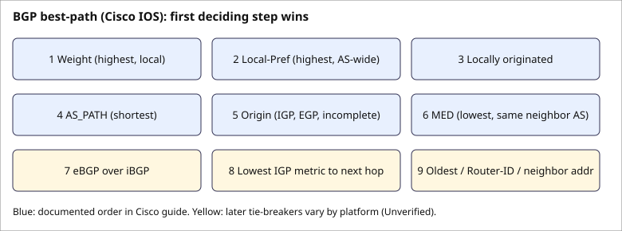

*شکل: ترتیب انتخاب بهترین مسیر BGP؛ اولین مرحله‌ی تعیین‌کننده برنده است.*

### ۵) مثال حل‌شده (سناریوی Route Leak)

سازمان ما (AS 65010) به ISP-A و ISP-B وصل است. بدون Prefix-List خروجی، همه‌ی مسیرهایی که از ISP-A یاد می‌گیریم به ISP-B هم اعلام می‌شود (به‌شرطی که پیش‌فرض‌های BGP و Policy آن را بدهند).

``` text
ISP-A routes -> our router -> advertised to ISP-B   (we become a transit AS)
Result: ISP-B may send transit traffic through our small links -> congestion/outage
```

**اصلاح:** Prefix-List خروجی فقط Prefixهای خودمان (مثلاً 203.0.113.0/24) را اجازه می‌دهد.

**مثال سخت:** پس از اعمال Local-Pref 200 برای ISP-A، ترافیک خروجی به A می‌رود ولی ترافیک ورودی مشتریان هنوز از B می‌آید. توضیح دهید چرا و راه‌حل (Prepend + هماهنگی با ISP).

### ۶) طراحی و تصمیم‌گیری

| سؤال | تصمیم پیشنهادی |
|---|---|
| ISP اصلی/پشتیبان خروجی | Local-Pref (نه Weight) تا همه‌ی روترهای AS یکسان تصمیم بگیرند |
| ورود ترافیک | Prepend + MED + (در صورت پشتیبانی) Community؛ انتظار کنترل کامل نداشته باشید |
| محافظت Session | TTL Security + Authentication + Max-Prefix |
| Filter | همیشه Prefix-List ورودی/خروجی در مرز ISP |
| تغییر Policy | Soft reconfiguration، نه ریست کامل |

### ۷) پیاده‌سازی (CLI Cisco، نمونه)

``` text
ip prefix-list MY-PFX seq 5 permit 203.0.113.0/24
ip prefix-list BOGONS seq 5 deny 10.0.0.0/8 le 32
ip prefix-list BOGONS seq 10 deny 172.16.0.0/12 le 32
ip prefix-list BOGONS seq 15 deny 192.168.0.0/16 le 32
ip prefix-list BOGONS seq 20 deny 0.0.0.0/0
ip prefix-list BOGONS seq 25 permit 0.0.0.0/0 le 24

route-map SET-LP-A permit 10
 set local-preference 200

router bgp 65010
 neighbor 192.0.2.1 remote-as 65100
 neighbor 192.0.2.1 route-map SET-LP-A in
 neighbor 192.0.2.1 prefix-list BOGONS in
 neighbor 192.0.2.1 prefix-list MY-PFX out
 neighbor 192.0.2.1 maximum-prefix 1000 80 warning-only
```

Verification:

``` text
R1# show ip bgp 198.51.100.0/24
R1# show ip bgp neighbors 192.0.2.1 advertised-routes
R1# show ip bgp neighbors 192.0.2.1 received-routes
R1# show ip bgp summary
R1# clear ip bgp 192.0.2.1 soft in
```

(`received-routes` نیاز به `soft-reconfiguration inbound` دارد؛ `Unverified` روی vIOS.)

### ۸) Troubleshooting

| علامت | شاهد | علت محتمل |
|---|---|---|
| مسیر غیرمنتظره انتخاب شد | `show ip bgp <prefix>` با Best | Attribute بالاتر در ترتیب |
| Prefix نمی‌آید | `received-routes`، Prefix-List | Filter ورودی/Bogon |
| ISP-B ترافیک ناخواسته می‌فرستد | `advertised-routes` | نبودن Prefix-List خروجی |
| Session ناپایدار | Log، Hold، `show ip bgp neighbors` | Timer، لینک، Max-prefix |
| Route نصب نشد | Next-hop در RIB | Next-hop غیرقابل‌دسترس |

### ۹) نکات امنیتی

- BGP Hijack و Route Leak سابقه‌ی واقعی در حوادث بزرگ اینترنت دارند؛ فیلتر ورودی/خروجی حداقل دفاع است.
- Max-Prefix در برابر «سرریز Table» یا اشتباه ISP محافظت می‌کند.
- TTL Security و Authentication Session را در برابر جعل TCP/RST محافظت می‌کنند.
- در Lab ایزوله بدون اینترنت حمله‌ی واقعی تست نمی‌شود؛ فقط رفتار با Peer مجاز.

### ۱۰) جمع‌بندی مفهومی

- ترتیب: Weight → Local-Pref → Local → AS_PATH → Origin → MED → eBGP/iBGP → IGP metric → Tie-break.
- اولین مرحله‌ی تعیین‌کننده برنده است؛ مراحل بعدی سنجیده نمی‌شوند.
- خروجی را با Local-Pref کنترل می‌کنیم؛ ورودی را فقط می‌توانیم تحت تأثیر قرار دهیم.
- Hold پیش‌فرض ۱۸۰ ثانیه است؛ با BFD سریع‌تر.
- امنیت: Prefix-List ورودی/خروجی، Max-Prefix، TTL Security، Authentication.

### ۱۱) تمرین و ارزیابی

**ت1.** (ساده) پنج مرحله‌ی اول انتخاب مسیر Cisco را به ترتیب بنویسید. *(پاسخ: 9-7-ت1)*

**ت2.** (ساده) Weight در کجا معتبر است؟ *(پاسخ: 9-7-ت2)*

**ت3.** (متوسط) دو مسیر: A (LP 150، AS_PATH طول 3) و B (LP 100، AS_PATH طول 1). کدام انتخاب می‌شود؟ چرا؟ *(پاسخ: 9-7-ت3)*

**ت4.** (متوسط) چرا برای کنترل خروج ترافیک Local-Pref بهتر از Weight است؟ *(پاسخ: 9-7-ت4)*

**ت5.** (سخت) دو مسیر با LP، Weight و AS_PATH برابر؛ A: Origin IGP، B: Origin Incomplete، MED A=100 و B=10. کدام برنده است؟ *(پاسخ: 9-7-ت5)*

**ت6.** (سخت، طراحی) سازمان می‌خواهد ترافیک ورودی را از ISP-A بگیرد و B پشتیبان باشد. چه ابزارهایی دارد و محدودیت چیست؟ *(پاسخ: 9-7-ت6)*

**ت7.** (سخت، امنیت) پنج خط محافظ Session eBGP با ISP را فهرست کنید و دلیل هر کدام. *(پاسخ: 9-7-ت7)*

**م1.** Max-Prefix برای چیست؟ *(پاسخ: 9-7-م1)*

**م2.** Soft reset چرا بهتر از ریست کامل است؟ *(پاسخ: 9-7-م2)*

**Q1.** Quick quiz (English): Which attribute is evaluated first on Cisco routers, and is it advertised to peers? *(پاسخ: 9-7-Q1)*

### ۱۲) اصطلاحات و English Corner

| مخفف | شکل کامل | معنی |
|---|---|---|
| LP | Local Preference | اولویت محلی (در کل AS) |
| MED | Multi-Exit Discriminator | نشانه‌ی ترجیح ورود برای همسایه |
| MRAI | Minimum Route Advertisement Interval | حداقل فاصله‌ی ارسال تغییر |
| GTSM | Generalized TTL Security Mechanism | حفاظت TTL Session |
| RPKI | Resource Public Key Infrastructure | اعتبارسنجی مالکیت Prefix |
| ROA | Route Origin Authorization | مجوز مبدأ مسیر |

- *Local preference influences outbound traffic; AS-path prepending only influences inbound traffic.* ← Local-Pref خروج را تحت تأثیر می‌گذارد؛ Prepend فقط ورود.
- *Always filter prefixes on eBGP sessions.* ← در Sessionهای eBGP همیشه Prefix را فیلتر کنید.

### ۱۳) منابع

- Cisco: [Select BGP Best-path Algorithm](https://www.cisco.com/c/en/us/support/docs/ip/border-gateway-protocol-bgp/13753-25.html).
- RFC 4271 — BGP-4 (§9.1: Decision Process).
- RFC 7454 (BCP 194) — BGP Operations and Security (Max-prefix، TTL Security، فیلتر Prefix).
- RFC 5880 — BFD.


## پاسخ‌های فصل 9

> ابتدا بدون نگاه حل کنید. شناسه: درس-نوع+شماره (ت = تمرین، م = مرور).

**9-1-ت1** — eBGP و iBGP چه تفاوتی دارند و AD هر کدام چند است؟

eBGP بین دو AS (AD 20)؛ iBGP داخل یک AS (AD 200).

**9-1-ت2** — چرا Peer در Active می‌ماند؟

Peer اتصال TCP را نمی‌تواند برقرار کند: مسیر، ACL، IP/ASN اشتباه.

**9-1-ت3** — پورت BGP؟

TCP 179

**9-1-م1** — چرا BGP برای فایروال مهم است؟

FortiGate در لبه‌ی دو ISP و Hub-and-Spoke با BGP مسیر می‌گیرد/می‌دهد.

**9-1-م2** — سناریو: State = Idle (Admin)؛ چه می‌کنید؟

Neighbor shutdown شده؛ `no neighbor ... shutdown` و بررسی Config.

**9-2-ت1** — چرا `network` بدون Route کار نمی‌کند؟

BGP فقط Prefixی را اعلام می‌کند که دقیقاً در Route Table موجود باشد.

**9-2-ت2** — دستور اعلام Default؟

`neighbor X default-originate`

**9-2-ت3** — Router-ID چه فایده‌ای دارد؟

شناسه‌ی پایدار Peer؛ جلوگیری از تغییر ناخواسته.

**9-2-م1** — چرا همیشه Prefix-List روی eBGP می‌گذاریم؟

تا Prefix ناخواسته اعلام/پذیرفته نشود (نشت مسیر).

**9-2-م2** — سناریو: ISP مسیر نمی‌بیند؛ دو بررسی؟

Route دقیق در جدول R1 و `show ip bgp neighbors ... advertised-routes`.

**9-3-ت1** — چرا iBGP Full-mesh می‌خواهد؟

مسیر iBGP به Peer iBGP دیگر بازپخش نمی‌شود.

**9-3-ت2** — چرا Loopback Peering؟

با خرابی یک لینک، Session از مسیر دیگر زنده می‌ماند.

**9-3-ت3** — next-hop-self چه می‌کند؟

Next-hop را به IP همان روتر تغییر می‌دهد.

**9-3-م1** — چرا مسیر iBGP در Route Table نصب نمی‌شود؟

Next-hop قابل‌دسترس نیست.

**9-3-م2** — سناریو: Session iBGP Idle است؛ سه بررسی؟

IGP Loopback، `update-source`، ASN/IP Neighbor.

**9-4-ت1** — کدام صفت برای انتخاب ISP خروجی است؟

Local Preference

**9-4-ت2** — Prepend برای چیست؟

تأثیر بر مسیر ورودی با طولانی‌کردن AS-Path

**9-4-ت3** — کمتر بهتر کدام است: LocPrf یا MED؟

MED؛ LocPrf بالاتر بهتر.

**9-4-م1** — چرا LocPrf روی Weight ترجیح دارد در طراحی؟

Weight محلی است و بین روترها پخش نمی‌شود؛ LocPrf در AS پخش می‌شود.

**9-4-م2** — سناریو: بعد از route-map تغییری نیست؛ چرا؟

soft reset انجام نشده.

**9-5-ت1** — چرا Implicit deny مهم است؟

هر چه permit نشده Drop می‌شود.

**9-5-ت2** — نشت مسیر چیست؟

اعلام ناخواسته‌ی Prefix دیگران؛ فیلتر جلویش را می‌گیرد.

**9-5-ت3** — Community no-export؟

مسیر خارج از AS بازپخش نشود.

**9-5-م1** — چرا هر eBGP باید فیلتر داشته باشد؟

تا اشتباه داخلی به اینترنت نرسد.

**9-5-م2** — سناریو: Default از ISP نمی‌آید؛ علت محتمل؟

Prefix-List ورودی Default را مجاز نکرده یا ISP default-originate ندارد.

**9-6-ت1** — ترتیب عیب‌یابی BGP؟

State، TCP، ASN/IP، Policy، جدول BGP، Route Table.

**9-6-ت2** — Last reset چه می‌دهد؟

دلیل آخرین قطع Session.

**9-6-ت3** — چه زمانی debug مجاز است؟

کوتاه، با احتیاط، و `undebug all` بعد از آن.

**9-6-م1** — چرا مسیر BGP در Route Table نیست؟

Next-hop ناقابل‌دسترس یا مسیر بهتر IGP.

**9-6-م2** — سناریو: بعد از تغییر Policy Failover نمی‌شود؛ چه بررسی؟

soft clear و `show ip bgp` برای Best.


---

<a id="end3"></a>


### پاسخ‌های درس‌های افزوده‌ی فصل 9 (۹-۰ و ۹-۷)

**9-0-ت1** — AS مجموعه‌ای از شبکه‌ها و روترها زیر یک مدیریت و سیاست مسیریابی واحد است که با یک ASN شناخته می‌شود.

**9-0-ت2** — TCP پورت 179.

**9-0-ت3** — eBGP = 20 و iBGP = 200. مسیر خارجی (eBGP) معتبرتر از مسیری است که از داخل AS یاد گرفته‌ایم؛ و iBGP نباید جلوی IGP را بگیرد.

**9-0-ت4** — هر AS هنگام عبور ASN خود را به AS_PATH اضافه می‌کند. اگر روتری ASN خودش را در AS_PATH ببیند، یعنی مسیر قبلاً از AS او گذشته و Update را رد می‌کند.

**9-0-ت5** — Static Default کافی است وقتی یک ISP، نیاز به Policy نیست و Failover خودکار لازم نیست. BGP لازم است وقتی: بیش از یک ISP با Policy انتخاب مسیر، نیاز به اعلام Prefix خودمان به اینترنت، یا اتصال به ASهای دیگر/شعب با Failover خودکار.

**9-0-ت6** — تعداد Sessionها n(n−1)/2 = 8×7/2 = 28. با رشد n به‌صورت درجه‌ی دو زیاد می‌شود؛ راه‌حل: Route Reflector (هر Client فقط با RR) یا Confederation.

**9-0-م1** — OPEN، KEEPALIVE، UPDATE، NOTIFICATION.

**9-0-م2** — چون BGP برای رسیدن به Next-hop (Recursive Lookup) به Reachability داخلی از IGP یا Static نیاز دارد؛ بدون آن مسیر BGP غیرقابل‌استفاده است.

**9-0-Q1** — Because each route carries the list of ASes it has passed through (the AS_PATH), which is used for loop prevention and policy.

**9-7-ت1** — Weight، Local Preference، مسیرهای Locally originated، AS_PATH کوتاه‌تر، Origin (IGP < EGP < Incomplete).

**9-7-ت2** — فقط روی همان روتر؛ به Peerها اعلام نمی‌شود.

**9-7-ت3** — A برنده است. Local-Pref قبل از AS_PATH سنجیده می‌شود (150 > 100) و مرحله‌ی AS_PATH اصلاً بررسی نمی‌شود.

**9-7-ت4** — Local-Pref در کل AS (iBGP) پخش می‌شود و همه‌ی روترهای AS یکسان تصمیم می‌گیرند؛ Weight فقط محلی است و ناسازگاری ایجاد می‌کند.

**9-7-ت5** — Weight/LP/AS_PATH برابرند؛ مرحله‌ی Origin: IGP (A) از Incomplete (B) بهتر است؛ پس A برنده می‌شود و MED سنجیده نمی‌شود (MED بعد از Origin می‌آید).

**9-7-ت6** — ابزارها: AS-Path Prepend روی B، MED، و Community (اگر ISP بپذیرد). محدودیت: ورودی را ISPها و دیگر ASها تعیین می‌کنند؛ ما فقط «پیشنهاد» می‌دهیم و کنترل کامل نداریم.

**9-7-ت7** — (۱) Prefix-List ورودی: رد Bogon و Prefixهای نامعتبر. (۲) Prefix-List خروجی: فقط Prefixهای خودمان تا Route Leak نشود. (۳) Max-Prefix: محافظت از حافظه/جدول. (۴) TTL Security (GTSM): جلوگیری از جعل از راه دور. (۵) Authentication (MD5/TCP-AO): جلوگیری از تزریق به Session.

**9-7-م1** — محدود کردن تعداد Prefix دریافتی از یک Peer؛ هشدار یا قطع Session هنگام تعداد غیرعادی.

**9-7-م2** — بدون قطع Session و بدون قطع ترافیک، Policy جدید اعمال می‌شود؛ ریست کامل همه‌ی مسیرها را موقتاً از بین می‌برد.

**9-7-Q1** — Weight is evaluated first; it is Cisco-specific, local to the router and is not advertised to peers.


# پایان بخش ۳ (فصل‌های ۷ تا ۹)

## ۱) خلاصه‌ی مهارت‌های کسب‌شده
- DHCP/Relay، DNS/NTP، NAT/PAT، ACL، Syslog/SNMP، QoS؛ Hardening، AAA، JSON/YAML/REST، Netmiko، Ansible، Git، As-Built.
- BGP: eBGP/iBGP، انتخاب مسیر، فیلتر، عیب‌یابی.

## ۲) آزمون پایان سه فصل
**س1** — giaddr در DHCP Relay چیست؟

**س2** — Stratum 16 یعنی چه؟

**س3** — PAT چه چیزی را علاوه بر IP تغییر می‌دهد؟

**س4** — Implicit deny در ACL؟

**س5** — Syslog severity 3 و 6؟

**س6** — چرا SNMPv3؟

**س7** — سه کنترل Management Plane در Hardening؟

**س8** — چرا AAA Fallback محلی؟

**س9** — Idempotency در Ansible؟

**س10** — حالت سالم Peer BGP؟

**س11** — Local-Pref در برابر MED؟

**س12** — چرا Prefix-List روی eBGP؟


## ۳) پاسخ آزمون
- **س1:** آدرس Interface Relay؛ سرور از آن Scope را تشخیص می‌دهد.
- **س2:** ناهمگام (نامعتبر).
- **س3:** پورت مبدأ.
- **س4:** deny any نامرئی در پایان؛ هر چه permit نشده بسته می‌شود.
- **س5:** Error و Informational.
- **س6:** احراز هویت و رمزگذاری دارد؛ v2c متن ساده است.
- **س7:** SSH v2/ACL VTY/AAA یا secret؛ بستن http/telnet.
- **س8:** اگر سرور AAA قطع شد قفل نشویم.
- **س9:** اجرای دوباره بدون تغییر اگر حالت مطلوب برقرار است.
- **س10:** Established.
- **س11:** LocPrf داخل AS و بالاتر بهتر؛ MED برای همسایه و کمتر بهتر.
- **س12:** جلوگیری از نشت/پذیرش مسیر ناخواسته.

## ۴) معیارهای تسلط
| مهارت | سطح | شاهد |
|---|---|---|
| IP Services | L3 | Service Matrix |
| Hardening/Automation | L2-L3 | CP1 As-Built |
| BGP پایه | L3 | رفع ۵ خرابی |

## ۵) مشکلات و موارد باقی‌مانده (صریح)
1. Labهای ۷ و ۸ اجرا نشده. 2. فصل ۹ جدید و بدون تجربه‌ی Image (BGP روی vIOS باید کار کند ولی آزمایش نشده). 3. SNMPv3/AAA/TACACS سینتکس `Unverified`.

## ۶) پیش‌نیازهای بخش بعد
BGP عملی روی دو vIOS؛ آماده‌بودن Image دوم برای ISP-Sim.

## ۷) فهرست Lab و منابع مرتبط
کارت‌های Lab همین فایل ، `03-ops/*.md` (خروجی دانشجو)

## ۸) وضعیت دوره
| مورد | مقدار |
|---|---|
| آخرین فصل تکمیل‌شده | ۹ |
| آخرین درس تکمیل‌شده | ۹-۶ |
| مهارت‌های تأییدشده | **هیچ‌کدام هنوز آزمون عملی واقعی نشده‌اند** (ممیزی/اجرای شما لازم است) |
| موضوعات نیازمند مرور | طبق «معیارهای تسلط» |
| فصل بعدی | ۱۰ |
| فایل تولیدشده | `course/Course_Part_03_Chapters_07-09.md` |


---

# Enterprise Network & Security Engineering — دوره‌ی تخصصی Cisco و Enterprise Firewall
## بخش ۴ از ۱۱ — فصل‌های ۱۰ تا ۱۲

| مورد | مقدار |
|---|---|
| نام دوره | Enterprise Network & Security Engineering (Cisco + FortiGate) |
| شماره بخش | ۴ از ۱۱ |
| فصل‌های این فایل | ۱۰ ، ۱۱ ، ۱۲ |
| تاریخ تولید | ۲۰۲۶-۱۱-۲۶ |
| نسخه Blueprint | v3.0 (+ بازبینی ۱٫۱) |
| نسخه‌های نرم‌افزار | FortiOS 7.0.3 (اسمی؛ بوت‌نشده؛ تأیید با `get system status`) ؛ Cisco vIOS-L2 15.2(20200924، Experimental) ؛ Cisco vIOS 15.9(3)M9 ؛ VPCS ؛ PNetLab 4.2.8 ؛ ESXi 8.0U2 ؛ CSR1000v 17.03.02 (IOS-XE؛ آزمایش‌نشده) |
| وضعیت تکمیل | **فصل‌های ۱۰–۱۲ تولید شد؛ مبانی تا Baseline FortiGate.** همه‌ی Labها «اجرا نشده»؛ FortiGate هنوز بوت نشده. محتوای FortiGate از مستند عمومی FortiOS 7.0 و دانش مؤلف است و باید در بوت اول تطبیق داده شود. |

> **قوانین خواندن:** تمرین‌ها و پرسش‌های مرور بدون پاسخ‌اند؛ پاسخ در «پاسخ‌های فصل». «اجرا نشده» یعنی خروجی‌ها **پیش‌نیاز/پیش‌بینی** هستند. «CLI-Accepted» ≠ «کار می‌کند». رمزها نمونه‌اند.

### وضعیت راستی‌آزمایی Labهای این بخش
خلاصه: اجرا نشده (فقط طراحی): 20.

| Lab | وضعیت |
|---|---|
| 10-1 | اجرا نشده (فقط طراحی) |
| 10-2 | اجرا نشده (فقط طراحی) |
| 10-3 | اجرا نشده (فقط طراحی) |
| 10-4 | اجرا نشده (فقط طراحی) |
| 10-5 | اجرا نشده (فقط طراحی) |
| 10-6 | اجرا نشده (فقط طراحی) |
| 10-7 | اجرا نشده (فقط طراحی) |
| 11-1 | اجرا نشده (فقط طراحی) |
| 11-2 | اجرا نشده (فقط طراحی) |
| 11-3 | اجرا نشده (فقط طراحی) |
| 11-4 | اجرا نشده (فقط طراحی) |
| 11-5 | اجرا نشده (فقط طراحی) |
| 11-6 | اجرا نشده (فقط طراحی) |
| 12-1 | اجرا نشده (فقط طراحی) |
| 12-2 | اجرا نشده (فقط طراحی) |
| 12-3 | اجرا نشده (فقط طراحی) |
| 12-4 | اجرا نشده (فقط طراحی) |
| 12-5 | اجرا نشده (فقط طراحی) |
| 12-6 | اجرا نشده (فقط طراحی) |
| 12-7 | اجرا نشده (فقط طراحی) |

---

<a id="ch10"></a>

> **نسخه‌ی اصلاح‌شده (v3.1، دسته B):** این فایل نسخه‌ی توسعه‌یافته‌ی `course/Course_Part_04_Chapters_10-12.md` است؛ فایل اصلی حفظ شده است. درس‌های افزوده: ۱۰-۸ و ۱۰-۹ (فصل ۱۰). پاسخ‌های آن‌ها در «پاسخ‌های فصل» همان فصل است.

> **نسخه‌ی اصلاح‌شده (v3.4):** نسخه‌ی توسعه‌یافته‌ی فایل اصلی؛ درس‌های افزوده: ۱۰-۸، ۱۰-۹، ۱۱-۰، ۱۱-۷، ۱۲-۰، ۱۲-۸، ۱۲-۹ (دسته‌های B و A). فایل اصلی در `course/` حفظ شده است. پاسخ‌های درس‌های افزوده در «پاسخ‌های فصل» همان فصل است.

# فصل 10 — Redistribution، ECMP، PBR، VRF-lite و Asymmetric Routing

**مدت:** ۳۶ ساعت | **پیش‌نیاز:** فصل ۹ (BGP)، فصل ۶ (OSPF).
**اهداف:** انتقال مسیر بین پروتکل‌ها بدون حلقه؛ توزیع بار با ECMP؛ هدایت ترافیک با PBR؛ جداسازی جداول مسیریابی با VRF-lite؛ تحلیل و رفع مسیر نامتقارن.
**چرا برای فایروال؟** فایروال Stateful با مسیر نامتقارن خراب می‌شود؛ ECMP/PBR/VRF همان ابزارهایی هستند که باعث نامتقارن‌شدن یا جداسازی می‌شوند.
**معیار تسلط:** Redistribution دوطرفه با Tag و بدون حلقه؛ پیش‌بینی مسیر ECMP؛ PBR با Track؛ VRF مستقل؛ تشخیص Asymmetric با traceroute دوطرفه.
**اشتباهات رایج:** Redistribution بدون `subnets`؛ حلقه‌ی دوطرفه؛ PBR روی Interface اشتباه؛ نشت VRF ناخواسته؛ بررسی مسیر فقط در یک جهت.

**درس‌های فصل:**
- [درس 10-1 — Redistribution: مفهوم و Seed Metric](#l-10-1)
- [درس 10-2 — Redistribution دوطرفه و جلوگیری از حلقه با Tag](#l-10-2)
- [درس 10-3 — ECMP و توزیع بار](#l-10-3)
- [درس 10-4 — Policy-Based Routing (PBR)](#l-10-4)
- [درس 10-5 — VRF-lite: جداسازی جدول مسیریابی](#l-10-5)
- [درس 10-6 — Asymmetric Routing: تحلیل مسیر رفت و برگشت](#l-10-6)
- [درس 10-7 — طراحی مسیر برای چندفایروالی و آزمون کوچک](#l-10-7)

---

<a id="l-10-1"></a>

## درس 10-1 — Redistribution: مفهوم و Seed Metric

**فصل 10 - روز 1 · پیش‌نیاز: فصل ۹، ۶ · ۶ ساعت**

### ۱) معرفی درس

Redistribution مسیرهای یک پروتکل (مثلاً Static یا BGP) را وارد پروتکل دیگر (OSPF) می‌کند. در شبکه‌ی واقعی بین مرکز، شعبه‌ها و ISP لازم است؛ اشتباه آن حلقه‌ی مسیریابی می‌سازد.

### ۲) پیش‌نیازها

OSPF، Static، BGP (فصل‌های ۵، ۶، ۹).

### ۳) توضیح مفهومی

- هر پروتکل Metric خودش را دارد؛ هنگام ورود به پروتکل دیگر باید **Seed Metric** داده شود.
- OSPF: `redistribute <proto> subnets metric <n> metric-type <1|2>`؛ بدون `subnets` فقط Classful وارد می‌شود.
- Routeهای خارجی در OSPF: E2 (Metric ثابت) یا E1 (Metric + هزینه‌ی داخلی).
- AD پروتکل مبدأ در پروتکل مقصد اهمیتی ندارد؛ مسیر با AD مقصد نصب می‌شود (E2 = AD 110).
- Redistribution فقط مسیرهای **در Route Table** را وارد می‌کند.

### ۴) مثال ساده

R2 مسیر Static به شبکه‌ی ISP دارد و آن را داخل OSPF پخش می‌کند.

### ۵) مثال سازمانی

Edge مسیر Default را از BGP می‌گیرد و داخل OSPF برای کل Campus پخش می‌کند.

### ۶) تصویر و توپولوژی

```text
ISP --BGP-- Edge --OSPF-- Core --OSPF-- Access
      redistribute bgp into ospf (default only)
```

### ۷) پیکربندی (CLI)

```text
router ospf 1
 redistribute static subnets metric 20 metric-type 2
!
! verify
show ip ospf database external
show ip route ospf
```

**توضیح دستورها (چه / چرا / خروجی / راستی‌آزمایی / بازگشت):**

- `redistribute static subnets`: Routeهای Static را به‌صورت External وارد می‌کند.
- `metric 20 metric-type 2`: Seed Metric؛ E2 در همه‌ی مقصدها همان 20 می‌ماند.
- راستی‌آزمایی: روی روتر دیگر `O E2` دیده شود.
- بازگشت: `no redistribute static`.

### ۸) تست عملکرد

- `show ip route` روی Core: `O E2 ...`؛ `show ip ospf database external` LSA نوع ۵.

### ۹) عیب‌یابی

| بخش | شرح |
|---|---|
| Symptom | Route وارد OSPF نمی‌شود |
| شواهد/دستور | `show ip route <prefix>` روی ASBR: نیست؛ `redistribute` بدون `subnets` |
| علت | مسیر مبدأ در Route Table نیست یا subnets فراموش شده |
| رفع | اضافه‌کردن `subnets` و بررسی مسیر مبدأ |

### ۱۰) تمرین مستقل

> پاسخ‌ها در بخش «پاسخ‌های فصل» انتهای فصل است؛ اول خودتان حل کنید.

**ت1.** چرا `subnets` لازم است؟ *(پاسخ: 10-1-ت1)*

**ت2.** E1 و E2؟ *(پاسخ: 10-1-ت2)*

**ت3.** چه چیزی redistribute می‌شود؟ *(پاسخ: 10-1-ت3)*

### ۱۱) مرور و ارزیابی

**م1.** چرا Seed Metric لازم است؟ *(پاسخ: 10-1-م1)*

**م2.** سناریو: Route Static در OSPF دیده نمی‌شود؛ دو بررسی؟ *(پاسخ: 10-1-م2)*

**معیار تسلط:** تنظیم و راستی‌آزمایی redistribute با توضیح E1/E2.

**اشتباهات رایج:** فراموشی subnets؛ فرض اینکه Route خودکار می‌آید.

### ۱۲) واژگان و English Corner

| واژه | شکل کامل | معنی | کاربرد واقعی |
|---|---|---|---|
| Redistribution | Route redistribution | انتقال مسیر بین پروتکل‌ها | Edge/ASBR |
| ASBR | Autonomous System Boundary Router | روتر Redistribute‌کننده | لبه‌ی OSPF |
| E2 | OSPF External Type 2 | Metric ثابت | Default از ISP |

| English sentence | ترجمه |
|---|---|
| Redistribute static routes into OSPF with a seed metric. | Routeهای Static را با Seed Metric وارد OSPF کنید. |
| Only routes present in the routing table are redistributed. | فقط مسیرهای موجود در Route Table redistribute می‌شوند. |

#### کارت Lab — درس 10-1

| # | فیلد | محتوا |
|---|---|---|
| 1 | عنوان و هدف | redistribute static به OSPF |
| 2 | پیش‌نیاز | فصل ۹، ۶ |
| 3 | توپولوژی | R1-R2-R3 + Static به ISP |
| 4 | تجهیزات | ۳ vIOS |
| 5 | نسخه نرم‌افزار | vIOS-L2 15.2(20200924، Experimental)؛ vIOS 15.9(3)M9؛ CSR1000v 17.03.02 (IOS-XE)؛ VPCS؛ PNetLab 4.2.8 |
| 6 | IP Plan | 10.0.12.0/30 و ... |
| 7 | وضعیت اولیه | OSPF سالم |
| 8 | صورت مسئله | Static به OSPF |
| 9 | مراحل هدایت‌شده | بخش‌های ۷ و ۸ همین درس (گام‌به‌گام) |
| 10 | تست عملکرد | `show ip route ospf` |
| 11 | سناریوی خرابی | Route وارد OSPF نمی‌شود |
| 12 | روش عیب‌یابی | بخش ۹ همین درس (لایه‌ای/با شواهد) |
| 13 | نتیجه‌ی مورد انتظار | O E2 در R3 |
| 14 | معیار پذیرش | Route E2 دیده شود |
| 15 | مستندات نهایی | `03-ops/redistribution.md` |
| 16 | Cleanup و بازگردانی | حذف redistribute |

> **وضعیت راستی‌آزمایی (خارج از ۱۶ فیلد):** **اجرا نشده (فقط طراحی).** روی Image شما اجرا نشده؛ خروجی‌ها پیش‌بینی هستند.

---

<a id="l-10-2"></a>

## درس 10-2 — Redistribution دوطرفه و جلوگیری از حلقه با Tag

**فصل 10 - روز 2 · پیش‌نیاز: درس ۱۰-۱ · ۶ ساعت**

### ۱) معرفی درس

وقتی دو نقطه‌ی Redistribution بین دو پروتکل داریم، مسیر می‌تواند برگردد و حلقه یا مسیر بد بسازد. Tag + Route-Map راه استاندارد جلوگیری است.

### ۲) پیش‌نیازها

درس ۱۰-۱؛ Route-Map (درس ۹-۴).

### ۳) توضیح مفهومی

- حلقه: مسیر OSPF→BGP و دوباره BGP→OSPF با AD/Metric بدتر.
- راه حل: هنگام ورود **Tag** بزنید و در جهت مقابل مسیرهای Tag‌دار را **deny** کنید.
- `route-map X deny 10 / match tag N` سپس `permit 20`.
- AD را برای مسیرهای ورودی خارجی بالاتر نگه دارید.
- فقط Prefixهای لازم را redistribute کنید (Prefix-List).

### ۴) مثال ساده

دو Edge هر دو بین OSPF و BGP redistribute می‌کنند؛ Tag جلوی بازگشت مسیر را می‌گیرد.

### ۵) مثال سازمانی

مرکز با شعب هم OSPF و هم BGP دارد؛ Tag اطمینان می‌دهد مسیر شعبه دوباره برنگردد.

### ۶) تصویر و توپولوژی

```text
OSPF <--redistribute--> BGP   (E1 and E2 both do it)
 tag 100 set OSPF->BGP ; deny tag 100 BGP->OSPF
```

### ۷) پیکربندی (CLI)

```text
route-map OSPF-TO-BGP permit 10
 set tag 100
route-map BGP-TO-OSPF deny 10
 match tag 100
route-map BGP-TO-OSPF permit 20
!
router bgp 65001
 redistribute ospf 1 route-map OSPF-TO-BGP
router ospf 1
 redistribute bgp 65001 subnets route-map BGP-TO-OSPF
```

**توضیح دستورها (چه / چرا / خروجی / راستی‌آزمایی / بازگشت):**

- Tag 100 هنگام ورود به BGP زده می‌شود.
- در برگشت به OSPF مسیرهای با Tag 100 رد می‌شوند.
- راستی‌آزمایی: `show ip route <prefix>` Tag؛ Next-hop پایدار.
- بازگشت: حذف route-map و redistribute.

### ۸) تست عملکرد

- `show ip bgp <prefix>` Tag؛ نبود نوسان در `show ip route`.

### ۹) عیب‌یابی

| بخش | شرح |
|---|---|
| Symptom | مسیر نوسان می‌کند (Flap) |
| شواهد/دستور | `show ip route` مسیر بین دو پروتکل جابه‌جا می‌شود |
| علت | Redistribution دوطرفه بدون Tag |
| رفع | Tag + deny؛ AD |

### ۱۰) تمرین مستقل

> پاسخ‌ها در بخش «پاسخ‌های فصل» انتهای فصل است؛ اول خودتان حل کنید.

**ت1.** هدف Tag چیست؟ *(پاسخ: 10-2-ت1)*

**ت2.** چرا `permit 20` پایانی؟ *(پاسخ: 10-2-ت2)*

**ت3.** آیا یک نقطه‌ی Redistribution حلقه می‌سازد؟ *(پاسخ: 10-2-ت3)*

### ۱۱) مرور و ارزیابی

**م1.** چرا Route-Map بدون permit پایانی خطرناک است؟ *(پاسخ: 10-2-م1)*

**م2.** سناریو: Flap مسیر؛ اولین اقدام؟ *(پاسخ: 10-2-م2)*

**معیار تسلط:** ساخت Redistribution دوطرفه ایمن با Tag.

**اشتباهات رایج:** Tag فراموش‌شده؛ permit پایانی فراموش‌شده.

### ۱۲) واژگان و English Corner

| واژه | شکل کامل | معنی | کاربرد واقعی |
|---|---|---|---|
| Tag | Route tag | برچسب مسیر | جلوگیری از حلقه |
| Route-Map | Route-map | شرط/عمل روی مسیر | سیاست مسیریابی |
| Flap | Route flap | نوسان مسیر | نشانه‌ی حلقه |

| English sentence | ترجمه |
|---|---|
| Tag the routes at redistribution to prevent routing loops. | مسیرها را هنگام redistribution Tag کنید تا حلقه ایجاد نشود. |
| Deny tagged routes in the reverse direction. | مسیرهای Tag‌دار را در جهت مقابل deny کنید. |

#### کارت Lab — درس 10-2

| # | فیلد | محتوا |
|---|---|---|
| 1 | عنوان و هدف | Redistribution دوطرفه با Tag |
| 2 | پیش‌نیاز | درس ۱۰-۱ |
| 3 | توپولوژی | E1/E2 بین OSPF و BGP |
| 4 | تجهیزات | E1،E2،ISP |
| 5 | نسخه نرم‌افزار | vIOS-L2 15.2(20200924، Experimental)؛ vIOS 15.9(3)M9؛ CSR1000v 17.03.02 (IOS-XE)؛ VPCS؛ PNetLab 4.2.8 |
| 6 | IP Plan | طبق قبل |
| 7 | وضعیت اولیه | OSPF+BGP |
| 8 | صورت مسئله | حلقه را بسازید و با Tag رفع کنید |
| 9 | مراحل هدایت‌شده | بخش‌های ۷ و ۸ همین درس (گام‌به‌گام) |
| 10 | تست عملکرد | `show ip route` |
| 11 | سناریوی خرابی | مسیر نوسان می‌کند (Flap) |
| 12 | روش عیب‌یابی | بخش ۹ همین درس (لایه‌ای/با شواهد) |
| 13 | نتیجه‌ی مورد انتظار | مسیر پایدار |
| 14 | معیار پذیرش | بدون Flap |
| 15 | مستندات نهایی | `03-ops/redistribution-tags.md` |
| 16 | Cleanup و بازگردانی | حذف سیاست‌ها |

> **وضعیت راستی‌آزمایی (خارج از ۱۶ فیلد):** **اجرا نشده (فقط طراحی).** روی Image شما اجرا نشده؛ خروجی‌ها پیش‌بینی هستند.

---

<a id="l-10-3"></a>

## درس 10-3 — ECMP و توزیع بار

**فصل 10 - روز 3 · پیش‌نیاز: درس ۱۰-۱ · ۶ ساعت**

### ۱) معرفی درس

وقتی چند مسیر هم‌هزینه به یک مقصد داریم، ECMP ترافیک را بین آن‌ها پخش می‌کند. FortiGate هم ECMP دارد و رفتار آن روی Session مهم است.

### ۲) پیش‌نیازها

OSPF Cost (فصل ۵).

### ۳) توضیح مفهومی

- **ECMP** در OSPF: تا `maximum-paths` (پیش‌فرض ۴) مسیر هم‌هزینه نصب می‌شود.
- CEF توزیع را **Per-flow** (Hash بر پایه‌ی IP/پورت) انجام می‌دهد، نه Per-packet؛ پس یک Session از یک لینک می‌رود.
- `ip cef load-sharing algorithm` برای تغییر Hash.
- ECMP با Stateful Firewall باید Session را روی یک مسیر نگه دارد وگرنه نامتقارن می‌شود.
- FortiGate: `config system settings / set v4-ecmp-mode source-ip-based` (پیش‌فرض) و حالت‌های دیگر (`weight-based`, `usage-based`, `source-dest-ip-based`) — `Unverified` برای 7.0.3.

### ۴) مثال ساده

دو لینک هم‌هزینه از R1 به R3 دارند؛ هر دو در Route Table.

### ۵) مثال سازمانی

دو ISP/دو مسیر به Hub با ECMP؛ Session هر کاربر روی یک مسیر می‌ماند.

### ۶) تصویر و توپولوژی

```text
R1 ==(cost 10)== R2 ==
   \==(cost 10)== R3 == Server
ECMP: two equal-cost next hops
```

### ۷) پیکربندی (CLI)

```text
router ospf 1
 maximum-paths 4
!
show ip route 192.168.3.0
show ip cef 192.168.3.1 internal
traceroute 192.168.3.1 source 192.168.1.1
```

**توضیح دستورها (چه / چرا / خروجی / راستی‌آزمایی / بازگشت):**

- `maximum-paths`: سقف مسیرهای هم‌هزینه.
- `show ip route`: دو Next-hop برای یک Prefix.
- Per-flow یعنی دو Flow مختلف می‌توانند مسیر متفاوت بگیرند.
- بازگشت: `maximum-paths 1`.

### ۸) تست عملکرد

- دو traceroute با مبدأ مختلف مسیر متفاوت را نشان دهد.

### ۹) عیب‌یابی

| بخش | شرح |
|---|---|
| Symptom | ترافیک یک Flow نامتعادل است |
| شواهد/دستور | `show interfaces` بار یک لینک بیشتر |
| علت | Hash یک Flow را به یک لینک می‌دهد |
| رفع | تنوع Flow یا تغییر الگوریتم؛ انتظار واقع‌بینانه |

### ۱۰) تمرین مستقل

> پاسخ‌ها در بخش «پاسخ‌های فصل» انتهای فصل است؛ اول خودتان حل کنید.

**ت1.** ECMP Per-flow یا Per-packet؟ *(پاسخ: 10-3-ت1)*

**ت2.** چرا Session باید روی یک مسیر بماند؟ *(پاسخ: 10-3-ت2)*

**ت3.** maximum-paths پیش‌فرض؟ *(پاسخ: 10-3-ت3)*

### ۱۱) مرور و ارزیابی

**م1.** چرا یک انتقال فایل از دو لینک سرعت دو برابر نمی‌گیرد؟ *(پاسخ: 10-3-م1)*

**م2.** سناریو: ECMP با فایروال و Drop تصادفی؛ حدس؟ *(پاسخ: 10-3-م2)*

**معیار تسلط:** نمایش ECMP و توضیح Per-flow.

**اشتباهات رایج:** انتظار Per-packet؛ نادیده‌گرفتن اثر روی فایروال.

### ۱۲) واژگان و English Corner

| واژه | شکل کامل | معنی | کاربرد واقعی |
|---|---|---|---|
| ECMP | Equal-Cost Multi-Path | چند مسیر هم‌هزینه | توزیع بار |
| CEF | Cisco Express Forwarding | موتور ارسال سریع | Hash مسیر |
| Per-flow | Per-flow load sharing | توزیع بر پایه‌ی Flow | پایداری Session |

| English sentence | ترجمه |
|---|---|
| Load sharing is done per flow, not per packet. | توزیع بار بر پایه‌ی Flow است نه بسته. |
| Keep both directions of a session on one path. | هر دو جهت Session را روی یک مسیر نگه دارید. |

#### کارت Lab — درس 10-3

| # | فیلد | محتوا |
|---|---|---|
| 1 | عنوان و هدف | دو مسیر ECMP |
| 2 | پیش‌نیاز | درس ۱۰-۱ |
| 3 | توپولوژی | R1-R2/R3-Server |
| 4 | تجهیزات | ۴ vIOS |
| 5 | نسخه نرم‌افزار | vIOS-L2 15.2(20200924، Experimental)؛ vIOS 15.9(3)M9؛ CSR1000v 17.03.02 (IOS-XE)؛ VPCS؛ PNetLab 4.2.8 |
| 6 | IP Plan | جدول لینک‌ها |
| 7 | وضعیت اولیه | OSPF |
| 8 | صورت مسئله | دو Next-hop |
| 9 | مراحل هدایت‌شده | بخش‌های ۷ و ۸ همین درس (گام‌به‌گام) |
| 10 | تست عملکرد | `show ip route` |
| 11 | سناریوی خرابی | ترافیک یک Flow نامتعادل است |
| 12 | روش عیب‌یابی | بخش ۹ همین درس (لایه‌ای/با شواهد) |
| 13 | نتیجه‌ی مورد انتظار | دو مسیر |
| 14 | معیار پذیرش | دو Flow با مسیر مختلف |
| 15 | مستندات نهایی | `03-ops/ecmp.md` |
| 16 | Cleanup و بازگردانی | maximum-paths 1 |

> **وضعیت راستی‌آزمایی (خارج از ۱۶ فیلد):** **اجرا نشده (فقط طراحی).** روی Image شما اجرا نشده؛ خروجی‌ها پیش‌بینی هستند.

---

<a id="l-10-4"></a>

## درس 10-4 — Policy-Based Routing (PBR)

**فصل 10 - روز 4 · پیش‌نیاز: درس ۱۰-۳ · ۶ ساعت**

### ۱) معرفی درس

PBR به‌جای مقصد، بر اساس مبدأ/پروتکل/پورت مسیر را انتخاب می‌کند؛ مثلاً ترافیک یک VLAN از ISP2 برود. در فایروال هم مشابه «Policy Route» وجود دارد.

### ۲) پیش‌نیازها

ACL (فصل ۷)، Route-Map (فصل ۹).

### ۳) توضیح مفهومی

- PBR **قبل** از Route Table روی ترافیک ورودی به Interface اعمال می‌شود.
- ساختار: ACL ترافیک را مشخص می‌کند ← `route-map` با `match ip address` ← `set ip next-hop` ← `ip policy route-map` روی Interface **ورودی**.
- `set ip next-hop verify-availability` با Track برای Failover.
- ترافیک تولیدشده توسط خود روتر: `ip local policy route-map`.
- برگشت: PBR فقط یک جهت را عوض می‌کند؛ جهت دیگر باید همخوان باشد.

### ۴) مثال ساده

کاربران VLAN 20 به ISP2 و بقیه به ISP1 بروند.

### ۵) مثال سازمانی

مدیر ترافیک بک‌آپ شب را از لینک ارزان‌تر می‌فرستد.

### ۶) تصویر و توپولوژی

```text
VLAN20 -> R1 (PBR) -> ISP2
others -> R1 -> ISP1 (default)
```

### ۷) پیکربندی (CLI)

```text
ip access-list extended VLAN20-TRAFFIC
 permit ip 10.10.20.0 0.0.0.255 any
route-map PBR permit 10
 match ip address VLAN20-TRAFFIC
 set ip next-hop 10.0.2.2
interface gi0/0.20
 ip policy route-map PBR
!
show route-map PBR
show ip policy
```

**توضیح دستورها (چه / چرا / خروجی / راستی‌آزمایی / بازگشت):**

- `ip policy route-map` روی Interface ورودی.
- `show route-map` شمارنده‌ی Policy routed packets.
- برگشت: `no ip policy route-map`.
- هشدار: PBR اشتباه می‌تواند مسیر پیش‌فرض را بشکند؛ با `reload in`/Console کار کنید.

### ۸) تست عملکرد

- `traceroute` از VLAN20: Hop اول ISP2؛ از VLAN دیگر ISP1.

### ۹) عیب‌یابی

| بخش | شرح |
|---|---|
| Symptom | PBR اعمال نمی‌شود |
| شواهد/دستور | `show route-map`: شمارنده 0؛ `show ip policy` |
| علت | Interface/ACL اشتباه |
| رفع | اعمال روی Interface ورودی درست؛ اصلاح ACL |

### ۱۰) تمرین مستقل

> پاسخ‌ها در بخش «پاسخ‌های فصل» انتهای فصل است؛ اول خودتان حل کنید.

**ت1.** PBR کجا اعمال می‌شود؟ *(پاسخ: 10-4-ت1)*

**ت2.** PBR چه زمانی اجرا می‌شود؟ *(پاسخ: 10-4-ت2)*

**ت3.** Verify-availability چیست؟ *(پاسخ: 10-4-ت3)*

### ۱۱) مرور و ارزیابی

**م1.** چرا PBR باید با Return Path همخوان باشد؟ *(پاسخ: 10-4-م1)*

**م2.** سناریو: شمارنده PBR صفر است؛ چه بررسی؟ *(پاسخ: 10-4-م2)*

**معیار تسلط:** پیاده‌سازی PBR و اثبات با traceroute.

**اشتباهات رایج:** اعمال روی Interface خروجی؛ فراموشی برگشت.

### ۱۲) واژگان و English Corner

| واژه | شکل کامل | معنی | کاربرد واقعی |
|---|---|---|---|
| PBR | Policy-Based Routing | مسیر بر اساس سیاست | لینک مخصوص |
| Next-hop | Next hop | روتر بعدی | set ip next-hop |
| Verify | Verify availability | بررسی در دسترس بودن | Failover PBR |

| English sentence | ترجمه |
|---|---|
| Apply the policy on the ingress interface. | سیاست را روی Interface ورودی اعمال کنید. |
| PBR is evaluated before the routing table. | PBR قبل از جدول مسیریابی ارزیابی می‌شود. |

#### کارت Lab — درس 10-4

| # | فیلد | محتوا |
|---|---|---|
| 1 | عنوان و هدف | PBR برای VLAN20 |
| 2 | پیش‌نیاز | درس ۱۰-۳ |
| 3 | توپولوژی | R1 + دو ISP |
| 4 | تجهیزات | R1،ISP1،ISP2 |
| 5 | نسخه نرم‌افزار | vIOS-L2 15.2(20200924، Experimental)؛ vIOS 15.9(3)M9؛ CSR1000v 17.03.02 (IOS-XE)؛ VPCS؛ PNetLab 4.2.8 |
| 6 | IP Plan | 10.0.1.0/30 و 10.0.2.0/30 |
| 7 | وضعیت اولیه | Default به ISP1 |
| 8 | صورت مسئله | VLAN20 از ISP2 |
| 9 | مراحل هدایت‌شده | بخش‌های ۷ و ۸ همین درس (گام‌به‌گام) |
| 10 | تست عملکرد | `show route-map` |
| 11 | سناریوی خرابی | PBR اعمال نمی‌شود |
| 12 | روش عیب‌یابی | بخش ۹ همین درس (لایه‌ای/با شواهد) |
| 13 | نتیجه‌ی مورد انتظار | Hop اول ISP2 |
| 14 | معیار پذیرش | traceroute مطابق |
| 15 | مستندات نهایی | `03-ops/pbr.md` |
| 16 | Cleanup و بازگردانی | حذف policy |

> **وضعیت راستی‌آزمایی (خارج از ۱۶ فیلد):** **اجرا نشده (فقط طراحی).** روی Image شما اجرا نشده؛ خروجی‌ها پیش‌بینی هستند.

---

<a id="l-10-5"></a>

## درس 10-5 — VRF-lite: جداسازی جدول مسیریابی

**فصل 10 - روز 5 · پیش‌نیاز: درس ۱۰-۱ · ۶ ساعت**

### ۱) معرفی درس

VRF چند جدول مسیریابی مستقل روی یک دستگاه می‌سازد؛ مثل چند روتر مجازی. برای جداسازی مشتری/بخش و برای درک VDOM/Zone فایروال مفید است.

### ۲) پیش‌نیازها

Route Table و Interface (فصل ۵).

### ۳) توضیح مفهومی

- هر VRF جدول مسیریابی و Interfaceهای خودش را دارد؛ آدرس‌های هم‌پوشان مجازند.
- IOS: `vrf definition NAME` + `address-family ipv4`؛ `vrf forwarding NAME` روی Interface.
- دستورها با VRF: `ping vrf X`، `show ip route vrf X`.
- ارتباط بین VRFها فقط با Leak (مثلاً Static با `global`) و مسیر/فیلتر کنترل‌شده.
- VRF-lite = بدون MPLS؛ جداسازی محلی.

### ۴) مثال ساده

دو VRF (RED، BLUE) روی یک روتر با آدرس هم‌پوشان.

### ۵) مثال سازمانی

مرکز داده: VRF Management جدا از VRF Production.

### ۶) تصویر و توپولوژی

```text
R1: [VRF RED] gi0/1 10.0.0.1/24   [VRF BLUE] gi0/2 10.0.0.1/24
Same IP, separate tables
```

### ۷) پیکربندی (CLI)

```text
vrf definition RED
 address-family ipv4
 exit-address-family
interface gi0/1
 vrf forwarding RED
 ip address 10.0.0.1 255.255.255.0
show ip route vrf RED
ping vrf RED 10.0.0.2
```

**توضیح دستورها (چه / چرا / خروجی / راستی‌آزمایی / بازگشت):**

- `vrf forwarding` قبل از `ip address` (با تغییر VRF آدرس پاک می‌شود).
- `show ip route vrf RED` جدول جدا.
- Leak مثال: `ip route vrf RED 0.0.0.0 0.0.0.0 10.9.9.1 global`.
- بازگشت: `no vrf forwarding`.

### ۸) تست عملکرد

- ping داخل VRF؛ ping بدون VRF شکست.

### ۹) عیب‌یابی

| بخش | شرح |
|---|---|
| Symptom | ping در VRF شکست می‌خورد |
| شواهد/دستور | `ping` بدون vrf؛ `show ip route vrf X` خالی |
| علت | Interface در VRF دیگر/آدرس بعد از vrf forwarding |
| رفع | تنظیم دوباره‌ی آدرس |

### ۱۰) تمرین مستقل

> پاسخ‌ها در بخش «پاسخ‌های فصل» انتهای فصل است؛ اول خودتان حل کنید.

**ت1.** VRF چیست؟ *(پاسخ: 10-5-ت1)*

**ت2.** چرا آدرس هم‌پوشان در دو VRF مجاز است؟ *(پاسخ: 10-5-ت2)*

**ت3.** Leak چیست؟ *(پاسخ: 10-5-ت3)*

### ۱۱) مرور و ارزیابی

**م1.** چرا بعد از `vrf forwarding` آدرس پاک می‌شود؟ *(پاسخ: 10-5-م1)*

**م2.** سناریو: ping Gateway شکست؛ اشتباه رایج؟ *(پاسخ: 10-5-م2)*

**معیار تسلط:** ساخت دو VRF و اثبات جداسازی.

**اشتباهات رایج:** ping بدون vrf؛ ترتیب vrf forwarding/ip address.

### ۱۲) واژگان و English Corner

| واژه | شکل کامل | معنی | کاربرد واقعی |
|---|---|---|---|
| VRF | Virtual Routing and Forwarding | جدول مسیریابی مجازی | جداسازی |
| VRF-lite | VRF-lite | VRF بدون MPLS | Campus/DC |
| Leak | Route leaking | عبور کنترل‌شده بین VRF | سرویس مشترک |

| English sentence | ترجمه |
|---|---|
| Each VRF has its own routing table. | هر VRF جدول مسیریابی خودش را دارد. |
| Overlapping addresses are allowed in different VRFs. | آدرس‌های هم‌پوشان در VRFهای مختلف مجازند. |

#### کارت Lab — درس 10-5

| # | فیلد | محتوا |
|---|---|---|
| 1 | عنوان و هدف | دو VRF با آدرس هم‌پوشان |
| 2 | پیش‌نیاز | درس ۱۰-۱ |
| 3 | توپولوژی | R1 + دو میزبان |
| 4 | تجهیزات | R1،۲ VPCS |
| 5 | نسخه نرم‌افزار | vIOS-L2 15.2(20200924، Experimental)؛ vIOS 15.9(3)M9؛ CSR1000v 17.03.02 (IOS-XE)؛ VPCS؛ PNetLab 4.2.8 |
| 6 | IP Plan | 10.0.0.0/24 در هر دو |
| 7 | وضعیت اولیه | بدون VRF |
| 8 | صورت مسئله | RED/BLUE |
| 9 | مراحل هدایت‌شده | بخش‌های ۷ و ۸ همین درس (گام‌به‌گام) |
| 10 | تست عملکرد | `ping vrf` |
| 11 | سناریوی خرابی | ping در VRF شکست می‌خورد |
| 12 | روش عیب‌یابی | بخش ۹ همین درس (لایه‌ای/با شواهد) |
| 13 | نتیجه‌ی مورد انتظار | جداسازی کامل |
| 14 | معیار پذیرش | ping داخل VRF موفق، بین VRF شکست |
| 15 | مستندات نهایی | `03-ops/vrf.md` |
| 16 | Cleanup و بازگردانی | حذف VRF |

> **وضعیت راستی‌آزمایی (خارج از ۱۶ فیلد):** **اجرا نشده (فقط طراحی).** روی Image شما اجرا نشده؛ خروجی‌ها پیش‌بینی هستند.

---

<a id="l-10-6"></a>

## درس 10-6 — Asymmetric Routing: تحلیل مسیر رفت و برگشت

**فصل 10 - روز 6 · پیش‌نیاز: درس ۱۰-۳، ۱۰-۴ · ۶ ساعت**

### ۱) معرفی درس

مسیر رفت و برگشت بسته می‌تواند متفاوت باشد. روتر مشکلی ندارد ولی فایروال Stateful فقط یک جهت را می‌بیند و برگشت را Drop می‌کند. این یکی از شایع‌ترین خرابی‌های چندفایروالی است.

### ۲) پیش‌نیازها

ECMP، PBR، VRF (درس‌های قبل).

### ۳) توضیح مفهومی

- Asymmetric: Forward از Path A و Return از Path B.
- Stateful Firewall بدون Session مطابق، بسته‌ی برگشت (SYN-ACK) را Drop می‌کند.
- علت‌ها: ECMP، PBR یک‌طرفه، Multi-homing، Redistribution/Metric ناسازگار، دو ISP.
- تشخیص: traceroute از هر دو طرف؛ Capture در هر فایروال؛ جدول Session.
- رفع: متقارن‌سازی مسیر (Metric/PBR)، یا قرار دادن هر Session روی یک مسیر، یا فایروال‌های همگام (HA).

### ۴) مثال ساده

دو مسیر از LAN به سرور؛ رفت از FW1 و برگشت از FW2.

### ۵) مثال سازمانی

Hub با دو ISP؛ پاسخ از ISP دیگر برمی‌گردد و فایروال Drop می‌کند.

### ۶) تصویر و توپولوژی

```text
Client -> FW1 -> Server
Client <- FW2 <- Server   (return differs -> FW1 never sees SYN-ACK)
```

### ۷) پیکربندی (CLI)

```text
traceroute 10.20.0.10 source 192.168.1.1
! from server side
traceroute 192.168.1.1 source 10.20.0.10
show ip route 192.168.1.0
show ip cef 192.168.1.0
```

**توضیح دستورها (چه / چرا / خروجی / راستی‌آزمایی / بازگشت):**

- دو traceroute (هر جهت) مقایسه شود.
- `show ip route` مسیر برگشت روی هر روتر.
- در فایروال: `diagnose sys session list` (فصل‌های بعد) Session ناقص.
- بازگشت: تغییر Metric/PBR را بازگردانید.

### ۸) تست عملکرد

- Hopهای رفت و برگشت را در جدول بنویسید؛ تفاوت را نشان دهید.

### ۹) عیب‌یابی

| بخش | شرح |
|---|---|
| Symptom | ping کار می‌کند ولی TCP نمی‌بندد |
| شواهد/دستور | SYN دیده می‌شود ولی SYN-ACK به فایروال اول نمی‌رسد |
| علت | مسیر برگشت متفاوت |
| رفع | متقارن‌سازی مسیر یا Session روی یک مسیر |

### ۱۰) تمرین مستقل

> پاسخ‌ها در بخش «پاسخ‌های فصل» انتهای فصل است؛ اول خودتان حل کنید.

**ت1.** Asymmetric یعنی چه؟ *(پاسخ: 10-6-ت1)*

**ت2.** چرا Stateful آن را نمی‌پذیرد؟ *(پاسخ: 10-6-ت2)*

**ت3.** دو ابزار تشخیص؟ *(پاسخ: 10-6-ت3)*

### ۱۱) مرور و ارزیابی

**م1.** چرا ping ممکن است کار کند ولی TCP نه؟ *(پاسخ: 10-6-م1)*

**م2.** سناریو: دو ISP و Drop تصادفی؛ چه می‌کنید؟ *(پاسخ: 10-6-م2)*

**معیار تسلط:** تحلیل مسیر دو جهت و پیشنهاد رفع.

**اشتباهات رایج:** بررسی فقط یک جهت.

### ۱۲) واژگان و English Corner

| واژه | شکل کامل | معنی | کاربرد واقعی |
|---|---|---|---|
| Asymmetric | Asymmetric routing | مسیر رفت/برگشت متفاوت | خرابی فایروال |
| Return path | Return path | مسیر برگشت | تحلیل ارتباط |
| Stateful | Stateful inspection | بازرسی با حافظه‌ی Session | Firewall |

| English sentence | ترجمه |
|---|---|
| Check both forward and return paths. | هر دو مسیر رفت و برگشت را بررسی کنید. |
| A stateful firewall drops traffic it has no session for. | فایروال Stateful ترافیکی را که Session ندارد Drop می‌کند. |

#### کارت Lab — درس 10-6

| # | فیلد | محتوا |
|---|---|---|
| 1 | عنوان و هدف | مشاهده و رفع Asymmetric |
| 2 | پیش‌نیاز | درس ۱۰-۳، ۱۰-۴ |
| 3 | توپولوژی | Client-FW1/FW2-Server (روتر) |
| 4 | تجهیزات | ۴ vIOS |
| 5 | نسخه نرم‌افزار | vIOS-L2 15.2(20200924، Experimental)؛ vIOS 15.9(3)M9؛ CSR1000v 17.03.02 (IOS-XE)؛ VPCS؛ PNetLab 4.2.8 |
| 6 | IP Plan | طبق شکل |
| 7 | وضعیت اولیه | Metric مساوی |
| 8 | صورت مسئله | ایجاد نامتقارن و رفع |
| 9 | مراحل هدایت‌شده | بخش‌های ۷ و ۸ همین درس (گام‌به‌گام) |
| 10 | تست عملکرد | traceroute دوطرفه |
| 11 | سناریوی خرابی | ping کار می‌کند ولی TCP نمی‌بندد |
| 12 | روش عیب‌یابی | بخش ۹ همین درس (لایه‌ای/با شواهد) |
| 13 | نتیجه‌ی مورد انتظار | مسیرها متفاوت؛ بعد از رفع یکسان |
| 14 | معیار پذیرش | هر دو جهت از یک مسیر |
| 15 | مستندات نهایی | `03-ops/asymmetric.md` |
| 16 | Cleanup و بازگردانی | بازگشت Metric |

> **وضعیت راستی‌آزمایی (خارج از ۱۶ فیلد):** **اجرا نشده (فقط طراحی).** روی Image شما اجرا نشده؛ خروجی‌ها پیش‌بینی هستند.

---

<a id="l-10-7"></a>

## درس 10-7 — طراحی مسیر برای چندفایروالی و آزمون کوچک

**فصل 10 - روز 7 · پیش‌نیاز: درس ۱۰-۵ · ۶ ساعت**

### ۱) معرفی درس

جمع‌بندی: هنگام قرار دادن چند فایروال در مسیر باید جدول مسیر هر دستگاه و جهت Session را طراحی کنید. این درس مرجع ورود به فصل‌های فایروال است.

### ۲) پیش‌نیازها

درس‌های ۱۰-۱ تا ۱۰-۵.

### ۳) توضیح مفهومی

- برای هر فایروال: «Route رفت»، «Route برگشت»، «NAT» و «Policy» را بنویسید.
- قاعده: **Session باید هر دو جهت را از همان فایروال ببیند.**
- Redistribution کنترل‌شده، Metric/Local-Pref برای تقارن، PBR فقط با Return همخوان.
- مستندسازی: جدول «Packet Walk رفت/برگشت».

### ۴) مثال ساده

دو فایروال سری: Client → FW-A → FW-B → Server با Static متقارن.

### ۵) مثال سازمانی

دو فایروال موازی (HA یا Active-Active) با ECMP: Session sync لازم است.

### ۶) تصویر و توپولوژی

```text
Client -> FW-A -> FW-B -> Server
Packet Walk table: hop, route, policy, NAT
```

### ۷) پیکربندی (CLI)

```text
show ip route 10.20.0.10
traceroute 10.20.0.10 source 192.168.1.1
show ip route 192.168.1.0
```

**توضیح دستورها (چه / چرا / خروجی / راستی‌آزمایی / بازگشت):**

- هر Hop را ثبت و تقارن را بررسی کنید.
- نتیجه: جدول Packet Walk.

### ۸) تست عملکرد

- ۴ سناریو (ECMP، PBR، Redistribution، دو ISP) با تحلیل تقارن و راه‌حل.

### ۹) عیب‌یابی

| بخش | شرح |
|---|---|
| Symptom | بعد از افزودن لینک جدید ارتباط TCP قطع شد |
| شواهد/دستور | مسیر برگشت از لینک جدید |
| علت | Metric لینک جدید بهتر است |
| رفع | تنظیم Metric/Local-Pref |

### ۱۰) تمرین مستقل

> پاسخ‌ها در بخش «پاسخ‌های فصل» انتهای فصل است؛ اول خودتان حل کنید.

**ت1.** قاعده‌ی طلایی چندفایروالی؟ *(پاسخ: 10-7-ت1)*

**ت2.** Packet Walk چیست؟ *(پاسخ: 10-7-ت2)*

**ت3.** چه زمانی Session sync لازم است؟ *(پاسخ: 10-7-ت3)*

### ۱۱) مرور و ارزیابی

**م1.** چرا افزودن لینک جدید خطرناک است؟ *(پاسخ: 10-7-م1)*

**م2.** سناریو: دو فایروال موازی؛ چه باید کرد؟ *(پاسخ: 10-7-م2)*

**معیار تسلط:** ساخت Packet Walk برای یک توپولوژی دو فایروالی و ≥ ۴ از ۵ مورد آزمون.

**اشتباهات رایج:** تحلیل بدون جدول؛ فرض تقارن.

### ۱۲) واژگان و English Corner

| واژه | شکل کامل | معنی | کاربرد واقعی |
|---|---|---|---|
| Packet Walk | Packet walk | دنبال‌کردن بسته Hop به Hop | عیب‌یابی |
| Session sync | Session synchronization | همگام‌سازی Session | HA |

| English sentence | ترجمه |
|---|---|
| Document the packet walk for both directions. | Packet Walk را برای هر دو جهت مستند کنید. |
| Both directions must traverse the same firewall. | هر دو جهت باید از یک فایروال عبور کنند. |

#### کارت Lab — درس 10-7

| # | فیلد | محتوا |
|---|---|---|
| 1 | عنوان و هدف | Packet Walk دو فایروالی |
| 2 | پیش‌نیاز | درس ۱۰-۵ |
| 3 | توپولوژی | Client-FW-A-FW-B-Server |
| 4 | تجهیزات | ۴ vIOS |
| 5 | نسخه نرم‌افزار | vIOS-L2 15.2(20200924، Experimental)؛ vIOS 15.9(3)M9؛ CSR1000v 17.03.02 (IOS-XE)؛ VPCS؛ PNetLab 4.2.8 |
| 6 | IP Plan | جدول آدرس |
| 7 | وضعیت اولیه | Static |
| 8 | صورت مسئله | جدول Packet Walk |
| 9 | مراحل هدایت‌شده | بخش‌های ۷ و ۸ همین درس (گام‌به‌گام) |
| 10 | تست عملکرد | traceroute |
| 11 | سناریوی خرابی | بعد از افزودن لینک جدید ارتباط TCP قطع شد |
| 12 | روش عیب‌یابی | بخش ۹ همین درس (لایه‌ای/با شواهد) |
| 13 | نتیجه‌ی مورد انتظار | جدول کامل |
| 14 | معیار پذیرش | جهت‌ها متقارن |
| 15 | مستندات نهایی | `03-ops/packet-walk.md` |
| 16 | Cleanup و بازگردانی | — |

> **وضعیت راستی‌آزمایی (خارج از ۱۶ فیلد):** **اجرا نشده (فقط طراحی).** روی Image شما اجرا نشده؛ خروجی‌ها پیش‌بینی هستند.

---

<a id="ans-10"></a>

## درس 10-8 — Route Leaking میان VRFها و جدول Global: طراحی کنترل‌شده

**فصل ۱۰ · درس افزوده (تکمیل ۱۰-۵) · پیش‌نیاز: درس‌های ۱۰-۱ تا ۱۰-۵ · ≈ ۶ ساعت**

> **وضعیت:** مفهومی با مثال VRF-lite؛ ویژگی‌های Leaking بسته به پلتفرم فرق دارد (IOS vs IOS-XE vs CSR)؛ Lab «اجرا نشده»؛ برخی دستورها `Unverified` روی vIOS.

### ۱) هدف آموزشی

دانشجو در پایان می‌تواند:

1. توضیح دهد VRF چه چیزی را جدا می‌کند و چرا «جداسازی کامل» گاهی باید به‌طور کنترل‌شده شکسته شود.
2. روش‌های Route Leaking را بشناسد و میان آن‌ها بر اساس نیاز انتخاب کند.
3. خطرهای امنیتی و عملیاتی Leaking را نام ببرد (دور زدن فایروال، Overlap، Asymmetric).
4. برای یک سناریوی واقعی (سرویس مشترک مثل DNS/NTP/فایروال) طرح Leaking بنویسد و آن را آزمایش کند.
5. پیوند VRF با Zone و VDOM در FortiGate را بفهمد (فصل ۲۴).

### ۲) پیش‌نیازها

VRF-lite (۱۰-۵)، Static Route و Recursive Lookup (۵-۰، ۵-۲)، Redistribution (۱۰-۱).

### ۳) مفهوم پایه: چرا VRF و چرا Leak؟

**VRF (Virtual Routing and Forwarding)** یک جدول مسیریابی مستقل است. ترافیک VRF-A نمی‌تواند به شبکه‌های VRF-B برسد، حتی اگر IPها هم‌پوشانی داشته باشند. کاربرد: Multi-tenant، جداسازی Guest از Corporate، سرویس‌دهی به چند مشتری.

اما در عمل **سرویس‌های مشترک** هست: DNS، NTP، Monitoring، Update Server، یا فایروال مشترک در لبه. دو راه داریم:

1. **عبور از بیرون (Firewall/Router خارجی):** ترافیک VRFها از یک فایروال بیرونی می‌گذرد (امن‌تر، قابل‌بازرسی).
2. **Route Leaking:** مسیرهای مشخصی را عمداً میان جداول کپی کنیم.

Leak یعنی در جدول A یک Route برای شبکه‌ای در B قرار دهیم (و برعکس برای برگشت). ابزار: Static Route با اشاره به VRF دیگر، یا (در پلتفرم‌های MPLS) Route-Target Import/Export.

> **قانون طلایی:** Leak همیشه باید **حداقلی** (Prefix مشخص، نه شبکه‌ی کامل)، **دوطرفه** (رفت و برگشت) و **قابل‌کنترل** (ACL/Firewall) باشد.

### ۴) توضیح عمیق فنی

#### ۴-۱) روش‌های Leak

| روش | سازوکار | پلتفرم | مزیت/ریسک |
|---|---|---|---|
| Static با `global` | `ip route vrf A <prefix> <mask> <next-hop> global` | IOS/IOS-XE | ساده؛ Next-hop باید در Global قابل‌دسترس باشد |
| Static به Interface | `ip route vrf A <prefix> <mask> <interface> <next-hop>` | IOS/IOS-XE | ساده؛ دقیق |
| Route-Target Import/Export | `route-target import/export` در تعریف VRF (VRF با MPLS-VPN/Multi-Protocol BGP) | IOS-XE (VRF-aware) | مقیاس‌پذیر؛ نیاز به BGP |
| Inter-VRF فایروال | ترافیک از فایروال بیرونی می‌گذرد | هر | امن‌ترین؛ تأخیر بیشتر |
| VRF-aware ACL | محدود کردن عبور | IOS | تکمیل Leak؛ کافی نیست |

(در Lab فقط VRF-lite + Static تمرین می‌شود؛ Route-Target نیاز به MPLS/BGP دارد و خارج از دامنه است.)

#### ۴-۲) نیاز به مسیر برگشت

Leak یک‌طرفه کار نمی‌کند: بسته به مقصد می‌رسد ولی پاسخ مسیر برگشت ندارد (Asymmetric/Drop). پس همیشه **دو Route** لازم است: A→B و B→A.

#### ۴-۳) پیامدهای Leak

- **دور زدن Policy:** اگر VRF مهمان را به VRF سازمانی Leak کنیم، فایروال میانی دیگر عبور را کنترل نمی‌کند.
- **Overlap:** اگر آدرس‌ها هم‌پوشان باشند، Leak ممکن نیست (یا نیاز به NAT).
- **Route ناخواسته:** Leak یک Prefix بزرگ (مثلاً 10.0.0.0/8) همه‌چیز را باز می‌کند.
- **عیب‌یابی پیچیده‌تر:** Route در جدول دیگری است؛ `show ip route vrf X` را فراموش نکنید.

### ۵) مثال حل‌شده

**شرایط:** دو VRF: CORP و GUEST. سرور DNS در VRF SHARED (10.99.0.53). باید هر دو VRF فقط به DNS و نه به هم برسند.

``` text
ip vrf SHARED
ip vrf CORP
ip vrf GUEST

! Leak DNS server host route into CORP and GUEST
ip route vrf CORP  10.99.0.53 255.255.255.255 10.99.0.1 global
ip route vrf GUEST 10.99.0.53 255.255.255.255 10.99.0.1 global

! Return routes in SHARED
ip route vrf SHARED 10.10.0.0 255.255.0.0 10.10.255.1
ip route vrf SHARED 10.20.0.0 255.255.0.0 10.20.255.1
```

**تحلیل:**

- فقط Host Route (/32) سرور DNS leak شده؛ CORP و GUEST به هم دسترسی ندارند.
- برگشت: SHARED باید Subnet هر VRF را بشناسد؛ برای کنترل بیشتر ACL روی Interface بگذارید.

**آزمون‌ها:**

``` text
R1# show ip route vrf CORP
R1# show ip route vrf SHARED
R1# ping vrf CORP 10.99.0.53 source 10.10.1.1
R1# ping vrf GUEST 10.10.1.1
```

آخرین دستور باید **شکست بخورد** (GUEST نباید CORP را ببیند)؛ شکست = اثبات جداسازی.

**مثال سخت:** مدیر سهواً `ip route vrf GUEST 10.0.0.0 255.0.0.0 ... global` نوشته و Guest به شبکه‌ی داخلی دسترسی پیدا کرده است. سه شاهد برای کشف: `show ip route vrf GUEST` (مسیر بزرگ)، `ping vrf GUEST` به یک Host داخلی (موفق)، و بررسی `show running-config | include ip route vrf`. راه‌حل: حذف Route بزرگ، Leak فقط /32، افزودن ACL.

### ۶) طراحی و تصمیم‌گیری

| سؤال | گزینه | معیار |
|---|---|---|
| Leak یا فایروال؟ | Leak / فایروال | اگر ترافیک نیاز به بازرسی/Log دارد: فایروال |
| چه Prefixی؟ | /32 سرویس | حداقل سطح تماس |
| تکرار یا مرکزی؟ | Leak هر VRF | با تعداد VRF زیاد، فایروال/سرویس مرکزی |
| مستندسازی | جدول Leak (Prefix، جهت، دلیل، مسئول) | الزامی |

در **FortiGate** هم همین منطق به شکل Zone/VDOM است: ترافیک بین Zoneها از Policy می‌گذرد؛ بین VDOMها فقط از Inter-VDOM Link (فصل ۲۴). پس ترجیح طراحی «عبور از فایروال» است، نه Leak مستقیم.

### ۷) پیاده‌سازی و Verification

``` text
R1# show ip vrf
R1# show ip route vrf CORP
R1# show ip route vrf SHARED
R1# show ip cef vrf CORP 10.99.0.53
R1# traceroute vrf CORP 10.99.0.53
R1# show running-config | include ip route vrf
```

بعد از هر Leak، **دو آزمون** انجام دهید: مثبت (دسترسی مجاز موفق) و منفی (دسترسی غیرمجاز شکست).

### ۸) Troubleshooting

| علامت | شاهد | علت محتمل |
|---|---|---|
| Leak کار نمی‌کند | `show ip route vrf X` | Route نصب نشده (Next-hop نامعتبر) |
| ارسال هست، پاسخ نه | `show ip route vrf Y` | مسیر برگشت ندارد |
| دسترسی غیرمنتظره | `show ip route vrf` مسیرهای بزرگ | Leak بیش‌ازحد |
| آدرس هم‌پوشان | traceroute | Overlap؛ NAT یا طراحی دوباره |

### ۹) نکات امنیتی

- هر Leak یک «سوراخ در دیوار» است؛ مستند و بازبینی‌شده باشد.
- Leak به Guest را فقط برای سرویس‌های ضروری (DNS) و با ACL.
- تغییر Leak = Change رسمی با Rollback.
- فایروال بین VRFها گزینه‌ی امن‌تر است (Log و Inspection).

### ۱۰) جمع‌بندی مفهومی

- VRF جدول جداگانه است؛ Leak عمدی و حداقلی آن را می‌شکند.
- Leak باید دوطرفه، /32 (یا کوچک) و مستند باشد.
- هر Leak را با آزمون مثبت و منفی بسنجید.
- برای بازرسی/Log، عبور از فایروال بهتر از Leak است.
- در FortiGate، معادل مفهومی: Zone/VDOM با Policy.

### ۱۱) تمرین و ارزیابی

**ت1.** (ساده) VRF چه چیزی را از هم جدا می‌کند؟ *(پاسخ: 10-8-ت1)*

**ت2.** (ساده) چرا Leak باید دوطرفه باشد؟ *(پاسخ: 10-8-ت2)*

**ت3.** (متوسط) چرا برای DNS مشترک /32 بهتر از /8 است؟ *(پاسخ: 10-8-ت3)*

**ت4.** (متوسط) آزمون منفی در Leak چیست و چرا لازم است؟ *(پاسخ: 10-8-ت4)*

**ت5.** (سخت) دو VRF با آدرس‌های 10.0.0.0/24 هم‌پوشان دارید. Leak ممکن است؟ راه‌حل را شرح دهید. *(پاسخ: 10-8-ت5)*

**ت6.** (سخت، طراحی) برای ۳ VRF (Corp، Guest، Servers) و یک DNS مشترک، جدول Leak و تست‌های مثبت/منفی را بنویسید. *(پاسخ: 10-8-ت6)*

**م1.** تفاوت Leak و عبور از فایروال را بگویید. *(پاسخ: 10-8-م1)*

**Q1.** Quick quiz (English): Why should route leaking be limited to host routes? *(پاسخ: 10-8-Q1)*

### ۱۲) اصطلاحات و English Corner

| مخفف | شکل کامل | معنی |
|---|---|---|
| VRF | Virtual Routing and Forwarding | جدول مسیریابی مجازی مستقل |
| RT | Route Target | برچسب Import/Export در VRF با MPLS |
| Leak | Route leaking | نشت عمدی مسیر بین جداول |
| Multi-tenant | Multi-tenancy | چندمستأجری |

- *Route leaking should be minimal, bidirectional and documented.* ← Leak باید حداقلی، دوطرفه و مستند باشد.
- *Always run a negative test to prove isolation.* ← همیشه آزمون منفی برای اثبات جداسازی انجام دهید.

### ۱۳) منابع

- Cisco: «Configuring VRF-lite» و «Route leaking / Inter-VRF routing» (IOS XE IP Routing Configuration Guides).
- RFC 4364 — BGP/MPLS IP VPNs (مفهوم VRF و Route Target).


## درس 10-9 — ECMP: Hashing، Load Balancing واقعی و خرابی‌های پنهان

**فصل ۱۰ · درس افزوده (تکمیل ۱۰-۳ و ۱۰-۶) · پیش‌نیاز: ۱۰-۳، ۱۰-۶، ۵-۰ · ≈ ۵ ساعت**

> **وضعیت:** مفهومی؛ رفتار Hash در Lab vIOS «اجرا نشده» و `Unverified`.

### ۱) هدف آموزشی

دانشجو در پایان می‌تواند:

1. شرایط تشکیل ECMP را بگوید.
2. توضیح دهد توزیع بار در ECMP بر پایه‌ی **Flow** است، نه بسته‌ی منفرد، و چرا.
3. بفهمد چرا «دو لینک ۱ گیگ» لزوماً ۲ گیگ نمی‌دهد (Polarization، Elephant Flow).
4. اثر ECMP بر Stateful Firewall و Asymmetric Routing را تحلیل کند.
5. روش بررسی مسیر انتخاب‌شده‌ی یک Flow را بداند.

### ۲) پیش‌نیازها

CEF و Forwarding (۵-۰)، Redistribution و AD/Metric (۵-۱، ۱۰-۱)، Asymmetric (۱۰-۶).

### ۳) مفهوم پایه

وقتی برای یک Prefix چند مسیر **با هزینه‌ی برابر** (Equal-Cost) در RIB نصب شود، روتر می‌تواند ترافیک را بین آن‌ها پخش کند. این **ECMP (Equal-Cost Multi-Path)** است. هدف: استفاده از همه‌ی لینک‌ها و پایداری بالاتر.

چرا ساده نیست؟ اگر بسته‌های یک ارتباط TCP بین دو مسیر پخش شوند، ممکن است با تأخیر متفاوت برسند و **ترتیبشان به‌هم بریزد (Reordering)**؛ TCP این را خرابی می‌پندارد و کند می‌شود. پس روتر مسیر را بر پایه‌ی **Hash** انتخاب می‌کند: همه‌ی بسته‌های یک Flow همیشه یک مسیر را دارند.

### ۴) توضیح عمیق فنی

#### ۴-۱) شرط تشکیل ECMP

- Prefix یکسان و **Metric (و AD) برابر**.
- حداکثر تعداد مسیر موازی محدود است (IOS: پیش‌فرض 4، قابل‌تنظیم با `maximum-paths`؛ `Unverified` برای Image).
- BGP برای ECMP علاوه بر برابری Attributeها نیاز به `maximum-paths` دارد (و ملاحظات AS_PATH).
- Static Route: دو Route با همان Prefix و AD برابر ← ECMP.

#### ۴-۲) Hashing

CEF مسیر را بر پایه‌ی Hash فیلدهایی از بسته انتخاب می‌کند؛ پیش‌فرض متداول: **IP مبدأ و مقصد** (Per-destination)، و بسته به پلتفرم می‌تواند پورت لایه ۴ را هم شامل شود (`ip cef load-sharing algorithm universal` یا `include-ports`؛ `Unverified`).

``` text
path_index = hash(src_ip, dst_ip [, src_port, dst_port, protocol]) mod number_of_paths
```

نتیجه‌ها:

- یک Flow همیشه یک مسیر؛ **یک Flow بزرگ (Elephant)** نمی‌تواند از دو لینک استفاده کند (حداکثر سرعت یک لینک).
- اگر فقط دو Host با هم صحبت کنند و Hash فقط IP باشد، همه‌ی ترافیک روی یک لینک می‌رود (**Polarization**).
- Hash روی چند Hop پشت‌سرهم با همان الگوریتم ممکن است یک مسیر را بارها انتخاب کند.

#### ۴-۳) ECMP و Stateful Firewall

دو فایروال موازی (فصل ۲۳) یا فایروال با ECMP: ترافیک رفت از FW1 و برگشت از FW2 ← Asymmetric ← Drop (چون Session فقط در FW1 است). راه‌ها: Hash متقارن (هر دو جهت یک مسیر)، یا Session Sync/Active-Passive، یا Policy Routing برای برگشت (فصل ۱۰-۶ و ۲۳).

#### ۴-۴) ECMP و Failure

اگر یک مسیر قطع شود، Flowهای روی آن باید Rehash شوند؛ بعضی Flowها که روی مسیر سالم بودند هم ممکن است جابه‌جا شوند (بسته به الگوریتم) و Session فایروال را بشکنند. «Consistent hashing» در سخت‌افزارهای جدید این اثر را کم می‌کند (خارج از Lab).

#### ۴-۵) Per-packet (ممنوع در عمل)

`ip load-sharing per-packet` بار را دقیق‌تر پخش می‌کند ولی Reordering ایجاد می‌کند و برای TCP مناسب نیست؛ فقط در موارد خاص.

### ۵) مثال حل‌شده

**شرایط:** R1 به R2 با دو لینک 10.0.12.0/30 و 10.0.13.0/30 و Cost برابر. سه Flow:

``` text
F1: 192.168.1.10 -> 172.16.5.20 (TCP 443)
F2: 192.168.1.11 -> 172.16.5.20 (TCP 443)
F3: 192.168.1.12 -> 172.16.5.20 (TCP 443)
```

با Hash فقط IP: توزیع بسته به مقادیر Hash است (ممکن است F1 و F2 هر دو روی لینک ۱ بیفتند). سه Flow هرگز دقیقاً «۱/۲ و ۱/۲» پخش نمی‌شوند؛ توزیع آماری است و با Flow کم نامتوازن است.

**اندازه‌گیری:** `show interfaces | include rate` روی هر دو لینک؛ `show ip cef exact-route 192.168.1.10 172.16.5.20` مسیر F1 را نشان می‌دهد (`Unverified` روی vIOS).

**مثال سخت:** دو فایروال Active/Active پشت ECMP در لبه. چند Flow دچار Drop است ولی Ping معمولی (ICMP) موفق است. توضیح: ICMP تک‌بسته‌ای ممکن است Hash موافق بگیرد؛ TCP با Session روی FW2 برمی‌گردد و Drop می‌شود. شاهد: `diagnose sys session list` فقط روی FW1 و Drop برگشت روی FW2 (فصل ۱۴).

### ۶) طراحی و تصمیم‌گیری

| سؤال | تصمیم |
|---|---|
| ECMP روی چه لینک‌هایی؟ | لینک‌های بدون Stateful میانی؛ یا با Session Sync/Hash متقارن |
| چند مسیر؟ | کم (۲ تا ۴)؛ بیشتر = پیچیدگی عیب‌یابی |
| Hash بر چه پایه؟ | IP + Port برای تنوع بیشتر (اگر پلتفرم بپذیرد) |
| Elephant Flow | LAG/لینک سریع‌تر یا چند Flow موازی در برنامه |

### ۷) پیاده‌سازی و Verification

``` text
R1(config)# ip route 172.16.5.0 255.255.255.0 10.0.12.2
R1(config)# ip route 172.16.5.0 255.255.255.0 10.0.13.2
R1# show ip route 172.16.5.0
R1# show ip cef 172.16.5.0 detail
R1# show ip cef exact-route 192.168.1.10 172.16.5.20
R1# show interfaces GigabitEthernet0/1 | include rate
```

`show ip route` باید دو Next-hop با ستاره‌ی «traffic share» را نشان دهد.

### ۸) Troubleshooting

| علامت | شاهد | علت محتمل |
|---|---|---|
| فقط یک لینک پر است | `show interfaces rate`، Hash | Polarization/Flow کم |
| پخش نامتوازن | `exact-route` برای چند Flow | آماری بودن Hash |
| TCP کند با ECMP | Retransmission (Wireshark) | Per-packet یا Reordering |
| Drop فقط برای بعضی Flowها | Session Table | Asymmetric با Stateful |
| یک مسیر قطع ولی مشکل ماند | `show ip route`، Probe | Route پایدار/Track ندارد |

### ۹) نکات امنیتی

- ECMP می‌تواند مسیر بازرسی را دور بزند (Flow از مسیر بدون فایروال)؛ همه‌ی مسیرهای موازی باید از Policy یکسان عبور کنند.
- Asymmetric ناشی از ECMP، Logهای فایروال را ناقص می‌کند و تحلیل حادثه را سخت می‌کند.

### ۱۰) جمع‌بندی مفهومی

- ECMP نیاز به Metric/AD برابر دارد.
- توزیع بر پایه‌ی Hash و Flow است، نه بسته.
- یک Flow همیشه یک لینک؛ ۲ لینک لزوماً ۲ برابر سرعت یک Flow نمی‌دهد.
- با Stateful Firewall، Asymmetric خطرناک است.
- همیشه توزیع واقعی را اندازه بگیرید.

### ۱۱) تمرین و ارزیابی

**ت1.** (ساده) شرط ECMP چیست؟ *(پاسخ: 10-9-ت1)*

**ت2.** (ساده) چرا بار بر پایه‌ی Flow است؟ *(پاسخ: 10-9-ت2)*

**ت3.** (متوسط) چرا دو لینک ۱ گیگ برای یک دانلود تک‌Flow ۲ گیگ نمی‌دهند؟ *(پاسخ: 10-9-ت3)*

**ت4.** (متوسط) Polarization یعنی چه؟ *(پاسخ: 10-9-ت4)*

**ت5.** (سخت) ECMP پشت دو فایروال Stateful ایجاد Drop می‌کند. سه راه‌حل را مقایسه کنید. *(پاسخ: 10-9-ت5)*

**ت6.** (سخت) نشان دهید چگونه می‌فهمید یک Flow مشخص از کدام لینک می‌رود. *(پاسخ: 10-9-ت6)*

**م1.** Per-packet load sharing چه ایراد دارد؟ *(پاسخ: 10-9-م1)*

**Q1.** Quick quiz (English): Why does ECMP hash per flow instead of per packet? *(پاسخ: 10-9-Q1)*

### ۱۲) اصطلاحات و English Corner

| مخفف | شکل کامل | معنی |
|---|---|---|
| ECMP | Equal-Cost Multi-Path | چند مسیر هم‌هزینه |
| Hash | Hash function | تابع تبدیل فیلدها به شماره‌ی مسیر |
| Flow | Network flow | رشته‌ی بسته‌های یک ارتباط |
| Elephant flow | Elephant flow | Flow بسیار بزرگ |
| Reordering | Packet reordering | به‌هم‌ریختن ترتیب بسته‌ها |

- *ECMP balances flows, not individual packets.* ← ECMP Flowها را متوازن می‌کند، نه بسته‌ها.
- *A single flow never exceeds the speed of one link.* ← یک Flow هرگز از سرعت یک لینک بیشتر نمی‌شود.

### ۱۳) منابع

- Cisco: «Cisco Express Forwarding — Load Balancing» (IP Switching Configuration Guide).
- RFC 2991 — Multipath Issues in Unicast and Multicast Next-Hop Selection.
- RFC 2992 — Analysis of an Equal-Cost Multi-Path Algorithm.


## پاسخ‌های فصل 10

> ابتدا بدون نگاه حل کنید. شناسه: درس-نوع+شماره (ت = تمرین، م = مرور).

**10-1-ت1** — چرا `subnets` لازم است؟

بدون آن فقط Prefixهای Classful وارد می‌شوند.

**10-1-ت2** — E1 و E2؟

E2 Metric ثابت؛ E1 با افزودن هزینه‌ی داخلی.

**10-1-ت3** — چه چیزی redistribute می‌شود؟

فقط مسیرهای موجود در Route Table.

**10-1-م1** — چرا Seed Metric لازم است؟

Metric پروتکل‌ها قابل‌مقایسه نیستند و مقصد باید مقدار اولیه بداند.

**10-1-م2** — سناریو: Route Static در OSPF دیده نمی‌شود؛ دو بررسی؟

Route مبدأ و subnets.

**10-2-ت1** — هدف Tag چیست؟

علامت‌گذاری مسیر برای جلوگیری از بازگشت.

**10-2-ت2** — چرا `permit 20` پایانی؟

Implicit deny وگرنه همه‌ی مسیرها رد می‌شوند.

**10-2-ت3** — آیا یک نقطه‌ی Redistribution حلقه می‌سازد؟

معمولاً خیر؛ دو نقطه خطرناک‌اند.

**10-2-م1** — چرا Route-Map بدون permit پایانی خطرناک است؟

Implicit deny همه را حذف می‌کند.

**10-2-م2** — سناریو: Flap مسیر؛ اولین اقدام؟

پیدا کردن نقطه‌های Redistribution و اعمال Tag.

**10-3-ت1** — ECMP Per-flow یا Per-packet؟

Per-flow.

**10-3-ت2** — چرا Session باید روی یک مسیر بماند؟

Stateful Firewall باید هر دو جهت را ببیند.

**10-3-ت3** — maximum-paths پیش‌فرض؟

۴

**10-3-م1** — چرا یک انتقال فایل از دو لینک سرعت دو برابر نمی‌گیرد؟

Per-flow؛ یک Flow یک لینک.

**10-3-م2** — سناریو: ECMP با فایروال و Drop تصادفی؛ حدس؟

هر جهت Session از مسیر متفاوت؛ نامتقارن.

**10-4-ت1** — PBR کجا اعمال می‌شود؟

روی Interface ورودی.

**10-4-ت2** — PBR چه زمانی اجرا می‌شود؟

قبل از Route Table.

**10-4-ت3** — Verify-availability چیست؟

Failover با Track.

**10-4-م1** — چرا PBR باید با Return Path همخوان باشد؟

برگشت از مسیر دیگر می‌تواند نامتقارن شود.

**10-4-م2** — سناریو: شمارنده PBR صفر است؛ چه بررسی؟

Interface ورودی و تطابق ACL.

**10-5-ت1** — VRF چیست؟

جدول مسیریابی مستقل.

**10-5-ت2** — چرا آدرس هم‌پوشان در دو VRF مجاز است؟

جدول‌ها جدا هستند.

**10-5-ت3** — Leak چیست؟

اتصال کنترل‌شده بین VRFها.

**10-5-م1** — چرا بعد از `vrf forwarding` آدرس پاک می‌شود؟

Interface به جدول دیگر رفته؛ آدرس قبلی نامعتبر است.

**10-5-م2** — سناریو: ping Gateway شکست؛ اشتباه رایج؟

ping بدون `vrf`.

**10-6-ت1** — Asymmetric یعنی چه؟

رفت و برگشت از مسیرهای متفاوت.

**10-6-ت2** — چرا Stateful آن را نمی‌پذیرد؟

Session فقط یک جهت را دارد.

**10-6-ت3** — دو ابزار تشخیص؟

traceroute دوطرفه و Capture/Session.

**10-6-م1** — چرا ping ممکن است کار کند ولی TCP نه؟

ICMP ممکن است Session جداگانه/قوانین متفاوت داشته باشد؛ TCP Stateful سخت‌گیر است.

**10-6-م2** — سناریو: دو ISP و Drop تصادفی؛ چه می‌کنید؟

مسیر برگشت را بررسی و متقارن کنید.

**10-7-ت1** — قاعده‌ی طلایی چندفایروالی؟

هر دو جهت Session از یک فایروال.

**10-7-ت2** — Packet Walk چیست؟

جدول مسیر و سیاست هر Hop برای رفت و برگشت.

**10-7-ت3** — چه زمانی Session sync لازم است؟

وقتی مسیر ممکن است عوض شود (HA/Active-Active).

**10-7-م1** — چرا افزودن لینک جدید خطرناک است؟

ممکن است مسیر برگشت را عوض کند.

**10-7-م2** — سناریو: دو فایروال موازی؛ چه باید کرد؟

Session sync/HA یا مسیریابی تثبیت‌شده.


---

<a id="ch11"></a>


### پاسخ‌های درس‌های افزوده‌ی فصل 10 (۱۰-۸ و ۱۰-۹)

**10-8-ت1** — جدول‌های مسیریابی (و در نتیجه Reachability لایه ۳) را؛ آدرس‌ها می‌توانند هم‌پوشان باشند.

**10-8-ت2** — چون بسته‌ی پاسخ برای برگشت به مبدأ نیاز به Route دارد؛ Leak یک‌طرفه باعث Drop یا Asymmetric می‌شود.

**10-8-ت3** — /32 فقط همان سرور را باز می‌کند؛ /8 صدها هزار آدرس و سرویس دیگر را هم قابل‌دسترس می‌کند و سطح حمله را بزرگ می‌کند.

**10-8-ت4** — آزمونی که باید شکست بخورد (مثلاً ping از Guest به Corp). اثبات می‌کند جداسازی هنوز برقرار است و Leak فراتر از هدف نیست.

**10-8-ت5** — Leak مستقیم ممکن نیست چون Prefix تکراری است (مسیر مبهم). راه‌حل: NAT (ترجمه‌ی یک طرف)، تغییر Addressing، یا عبور از فایروال/Proxy که NAT و Policy را بر عهده بگیرد.

**10-8-ت6** — Leak فقط DNS (/32) از SHARED به هر سه VRF و Subnet هر VRF برای برگشت در SHARED. تست مثبت: هر VRF به DNS برسد. تست منفی: Guest به Corp و Servers نرسد؛ Corp به Guest نرسد؛ Guest به Servers نرسد.

**10-8-م1** — Leak مسیر را مستقیم باز می‌کند و بازرسی/Log ندارد؛ عبور از فایروال ترافیک را Inspect و Log می‌کند.

**10-8-Q1** — Because a host route opens only the single required service, minimizing exposure and the risk of unintended reachability.

**10-9-ت1** — چند مسیر به یک Prefix با AD و Metric برابر (و پشتیبانی/تنظیم `maximum-paths`).

**10-9-ت2** — برای جلوگیری از Reordering بسته‌ها در یک ارتباط TCP؛ با Hash همه‌ی بسته‌های یک Flow یک مسیر را می‌گیرند.

**10-9-ت3** — چون یک Flow فقط یک لینک را می‌گیرد؛ حداکثر سرعت آن سرعت یک لینک است.

**10-9-ت4** — وقتی Hash یا الگوریتم یکسان در چند Hop پشت‌سرهم یا تنوع کم فیلدها باعث می‌شود ترافیک روی یک مسیر جمع شود.

**10-9-ت5** — (۱) Hash متقارن تا رفت و برگشت از یک فایروال بگذرد: ساده ولی به تجهیزات وابسته است. (۲) Active-Passive یا Session Sync بین فایروال‌ها: مؤثر ولی پیچیده‌تر و گاه Needs-License. (۳) Policy Routing/SNAT برای برگشت از همان فایروال: عملی ولی عیب‌یابی را سخت می‌کند.

**10-9-ت6** — با `show ip cef exact-route <src> <dst>` (در پلتفرم‌هایی که پشتیبانی می‌کنند) یا با مقایسه‌ی شمارنده‌ی ترافیک Interfaceها و Capture روی هر لینک هنگام ایجاد همان Flow.

**10-9-م1** — بسته‌های یک Flow روی مسیرهای مختلف می‌روند و Reordering ایجاد می‌شود؛ TCP کند می‌شود.

**10-9-Q1** — To avoid packet reordering within a connection, which would degrade TCP performance.


# فصل 11 — مبانی فایروال

**مدت:** ۳۶ ساعت | **پیش‌نیاز:** فصل ۷ (ACL/NAT)، فصل ۸، فصل ۱۰ (مسیر نامتقارن).
**اهداف:** Stateless/Stateful؛ Session؛ Zone و Trust Boundary؛ Default Deny و Least Privilege؛ مسیر بسته در فایروال؛ ترافیک عبوری در برابر ترافیک خود فایروال؛ تفاوت Routing، Policy، ACL، NAT؛ Segmentation؛ **Gate G4**.
**چرا اینجا؟** قبل از FortiGate باید «چرا» را بدانید تا هر منو و دستور برایتان معنی داشته باشد.
**معیار تسلط:** پاسخ به ۱۰ پرسش مسیر بسته برای یک ارتباط؛ نوشتن Policy Matrix با Least Privilege؛ توضیح تفاوت ACL/Policy/NAT با مثال.
**اشتباهات رایج:** گمان اینکه NAT امنیت است؛ ترتیب Policy؛ فراموشی Default Deny؛ نادیده‌گرفتن ترافیک خود فایروال.

**درس‌های فصل:**
- [درس 11-1 — فایروال چیست؟ Stateless در برابر Stateful](#l-11-1)
- [درس 11-2 — Zone، Trust Boundary، Default Deny و Least Privilege](#l-11-2)
- [درس 11-3 — مسیر بسته در فایروال و ترافیک عبوری در برابر ترافیک خود فایروال](#l-11-3)
- [درس 11-4 — ACL، Policy و NAT: تفاوت‌ها و ارتباط‌ها](#l-11-4)
- [درس 11-5 — Session، Timeout، MTU/MSS و ریشه‌ی خرابی‌های TCP/UDP](#l-11-5)
- [درس 11-6 — کارگاه طراحی Policy و ۱۰ پرسش مسیر بسته + Gate G4](#l-11-6)

---

<a id="l-11-1"></a>

## درس 11-0 — مدل تهدید، مرز اعتماد و Defense in Depth: قبل از نوشتن اولین Policy

**فصل ۱۱ · درس افزوده (پیش‌درس ۱۱-۱) · پیش‌نیاز: فصل ۲، ۴، ۱۰ · ≈ ۶ ساعت**

> **وضعیت:** مفهومی؛ مستقل از برند؛ مبنای تصمیم‌های فصل‌های ۱۲ تا ۳۲.

### ۱) هدف آموزشی

در پایان می‌توانید:

1. **دارایی (Asset)، تهدید (Threat)، آسیب‌پذیری (Vulnerability)، ریسک (Risk)** و کنترل (Control) را تعریف و تفکیک کنید.
2. یک **مدل تهدید ساده** برای یک شبکه‌ی سازمانی بسازید (چه چیزی را از چه کسی و از چه راهی محافظت می‌کنیم).
3. **مرز اعتماد (Trust Boundary)** را روی نقشه مشخص و برای هر مرز یک کنترل تعیین کنید.
4. **Defense in Depth** را با مثال لایه‌به‌لایه توضیح دهید و بگویید چرا یک فایروال به‌تنهایی کافی نیست.
5. **Least Privilege** را به Policy واقعی تبدیل کنید و تفاوت **Default Deny** و **Default Allow** را بگویید.
6. مسیر **North-South** و **East-West** را تفکیک و کنترل‌های هرکدام را انتخاب کنید.

### ۲) پیش‌نیازها

VLAN و Subnet (فصل ۳ و ۲)، Routing (فصل ۵)، مفهوم NAT و DMZ در حد آشنایی.

### ۳) مفهوم پایه: چرا قبل از Policy باید «فکر کرد»؟

بسیاری از شبکه‌ها فایروال دارند ولی ناامن‌اند، چون Policyها بر پایه‌ی «کار بیفتد» نوشته شده‌اند، نه بر پایه‌ی تحلیل ریسک. نتیجه: `any → any → ALL → accept` که فایروال را به یک روتر گران‌قیمت تبدیل می‌کند.

مهندس امنیت به‌جای سؤال «چطور این پورت را باز کنم؟» می‌پرسد:

1. چه چیزی ارزشمند است؟ (Asset: دیتابیس مشتری، AD، سرور مالی)
2. چه کسی/چه چیزی می‌تواند به آن آسیب بزند؟ (Threat: مهاجم خارجی، کارمند ناراضی، بدافزار)
3. از چه راهی؟ (Attack Path: VPN، ایمیل، سرور وب، حرکت جانبی)
4. کدام کنترل جلوی هر مسیر را می‌گیرد؟ و اگر آن کنترل شکست خورد، کنترل بعدی چیست؟

> **تشبیه:** امنیت یک بانک فقط «در ورودی» نیست: در ورودی، نگهبان، دوربین، درب شیشه‌ای، صندوق‌های جدا، خزانه، و دستور بازرسی. اگر یکی بشکند، بقیه می‌مانند. این Defense in Depth است.

### ۴) توضیح عمیق فنی

#### ۴-۱) واژگان ریسک

| واژه | تعریف | مثال |
|---|---|---|
| Asset | چیزی که ارزش دارد | پایگاه‌داده‌ی مشتریان |
| Threat | عامل بالقوه‌ی آسیب | باج‌افزار، مهاجم خارجی |
| Vulnerability | ضعفی که تهدید از آن استفاده می‌کند | سرور بدون Patch، رمز پیش‌فرض |
| Risk | احتمال × اثر | احتمال بالا × اثر زیاد = ریسک بالا |
| Control | اقدام کاهش ریسک | فایروال، Patch، MFA، Segmentation |

``` text
Risk ~= Likelihood x Impact
```

ریسک صفر وجود ندارد؛ هدف کاهش به سطح قابل‌قبول و مدیریت باقی‌مانده است.

#### ۴-۲) مدل تهدید ساده (چهار سؤال)

یک چارچوب عملی (الهام‌گرفته از STRIDE و مدل‌های ساده): برای هر سیستم بپرسید:

1. **چه چیزی می‌سازیم/محافظت می‌کنیم؟** (نقشه + جریان داده)
2. **چه چیزی می‌تواند خراب شود؟** (Spoofing، Tampering، Information Disclosure، DoS، Elevation)
3. **چه کاری برایش می‌کنیم؟** (کنترل)
4. **آیا کافی است؟** (آزمون/Verification)

STRIDE = Spoofing (جعل هویت)، Tampering (دستکاری)، Repudiation (انکار)، Information disclosure (افشا)، Denial of service (انکار سرویس)، Elevation of privilege (ارتقای دسترسی).

#### ۴-۳) Trust Boundary و Zone

**مرز اعتماد** جایی است که سطح اعتماد تغییر می‌کند: Internet ↔ DMZ، DMZ ↔ LAN، Guest ↔ Corporate، Server ↔ Management. **هر عبور از مرز باید کنترل شود** (Policy + Log). شبکه را به **Zoneها** تقسیم می‌کنیم؛ هر Zone سطح اعتماد مشابه دارد:

| Zone | سطح اعتماد | نمونه |
|---|---|---|
| Internet (Untrust) | صفر | همه‌ی اینترنت |
| DMZ | پایین/متوسط | وب‌سرور عمومی |
| Users | متوسط | PC کارمندان |
| Servers | بالا | اپلیکیشن/DB |
| Management | بسیار بالا | سرورهای مدیریت، OOB |
| Guest | صفر/بسیار پایین | مهمان |

قانون عبور: از اعتماد کمتر به بیشتر **سخت‌تر**؛ از بالاتر به پایین‌تر معمولاً مجاز با Inspection.

#### ۴-۴) Defense in Depth

لایه‌های کنترل (از بیرون به داخل):

``` text
1 Perimeter     : edge firewall, DoS protection, IPS
2 Network       : segmentation (VLAN/Zone), ACL, internal firewall
3 Host          : EDR/antivirus, host firewall, patching
4 Application   : WAF, secure coding, authentication
5 Data          : encryption, backup, DLP
6 Identity      : MFA, least privilege, privileged access management
7 Monitoring    : logs, SIEM, alerting, incident response
```

ایده: **هیچ لایه‌ای را کامل فرض نکن.** اگر مهاجم لایه‌ی ۱ را رد کند، لایه‌ی ۲ حرکت جانبی را محدود می‌کند.

#### ۴-۵) Least Privilege و Default Deny

- **Least Privilege:** هر کاربر/سیستم فقط حداقل دسترسی لازم.
- **Default Deny:** هر چه صریحاً مجاز نشده، رد است؛ برخلاف Default Allow که همه‌چیز مجاز است مگر ممنوع.
- در Policy: Source دقیق (نه all)، Destination دقیق، Service دقیق (نه ALL)، زمان‌بندی در صورت نیاز، Log فعال.

``` text
BAD : srcintf=any dstintf=any src=all dst=all service=ALL action=accept
GOOD: srcintf=users dstintf=servers src=Users-subnet dst=App-1 service=HTTPS action=accept log=all
```

#### ۴-۶) North-South و East-West

- **North-South:** ورود/خروج از سازمان (اینترنت). سنتی‌ترین نقطه‌ی کنترل.
- **East-West:** ترافیک داخلی بین سرورها/کاربران. بیشتر حملات واقعی پس از نفوذ اولیه از همین مسیر **حرکت جانبی (Lateral Movement)** می‌کنند. اگر فقط لبه کنترل شود، مهاجمی که یک PC را بگیرد آزادانه به سرورها می‌رسد.

نتیجه: **Segmentation داخلی** و Policy بین Zoneهای داخلی ضروری است (فصل ۲۴: Data Center).

### ۵) مثال حل‌شده

**سازمان کوچک:** وب‌سرور عمومی (DMZ)، اپلیکیشن و دیتابیس (Servers)، کاربران، Guest، Management.

مدل تهدید:

| Asset | Threat | مسیر حمله | کنترل |
|---|---|---|---|
| DB مشتری | مهاجم پس از نفوذ به وب‌سرور | DMZ → Servers | Policy فقط وب‌سرور→App روی پورت لازم؛ App→DB؛ هیچ مسیر DMZ→DB |
| AD | بدافزار روی PC | Users → DC | فقط پروتکل‌های لازم (Kerberos/LDAP) از Users به DC؛ Log |
| فایروال | مدیر ناشناس | اینترنت → GUI مدیریت | غیرفعال‌سازی `allowaccess` روی WAN، Trusted Host، MFA |
| Guest | کاربر مهمان آلوده | Guest → Users | Zone جدا، فقط اینترنت |

``` text
Users   -> Internet : HTTP/HTTPS/DNS      allow + UTM
Users   -> Servers  : HTTPS to app only   allow + log
Servers -> DB       : TCP 1433 only       allow + log
DMZ     -> Servers  : TCP 8080 to app only
DMZ     -> DB       : none (deny)
Guest   -> Internet : HTTP/HTTPS/DNS only
Guest   -> any internal : deny
any     -> any      : implicit deny + log
```

**مثال سخت:** مدیر شبکه می‌خواهد برای عیب‌یابی «موقتاً» همه‌چیز را باز کند. با مدل تهدید توضیح دهید چرا خطرناک است و روش جایگزین ایمن چیست (Policy موقت با Source دقیق + زمان‌بندی + Log + حذف بعد از اتمام، با Change). 

### ۶) طراحی و تصمیم‌گیری

| تصمیم | گزینه‌ها | معیار |
|---|---|---|
| تعداد Zone | کم (ساده) / زیاد (امن‌تر) | ریسک، پیچیدگی عملیات |
| فایروال یکتا یا چندلایه | تک/دوتایی | ریسک + بودجه؛ برای داده‌ی حساس: دو لایه (فصل ۱۵) |
| Inspection کامل یا انتخابی | UTM همه/انتخابی | Performance (فصل ۱۶) |
| Logging | همه‌ی Deny + Allow مهم | فضا، هزینه |

### ۷) پیاده‌سازی و Verification (مفهومی)

- نقشه‌ی Zoneها و جدول Policy Matrix (Source Zone، Destination Zone، Service، Action) را قبل از پیکربندی بنویسید.
- پس از پیاده‌سازی: **آزمون مثبت** (مجاز موفق) و **آزمون منفی** (غیرمجاز شکست) برای هر خط.
- ابزار: `nmap` از هر Zone، `ping/curl`، و Log فایروال.

### ۸) Troubleshooting (مبتنی بر طراحی)

| علامت | علت محتمل |
|---|---|
| «همه چیز کار می‌کند» ولی ناامن | Policy any-any؛ آزمون منفی انجام نشده |
| سرویس کار نمی‌کند | Service/Port ناقص، یا Zone اشتباه |
| Log حجیم و بی‌فایده | Log همه‌ی Allow بدون هدف |

### ۹) نکات امنیتی

- بزرگ‌ترین اشتباه: تصمیم امنیتی بدون مدل تهدید.
- Policyهای موقت را با تاریخ انقضا بنویسید.
- مرز مدیریتی (Management) را جدا نگه دارید و از اینترنت قابل‌دسترس نکنید.

### ۱۰) جمع‌بندی مفهومی

- Risk = احتمال × اثر؛ کنترل ریسک را کم می‌کند، صفر نمی‌کند.
- مرز اعتماد = جایی که سطح اعتماد عوض می‌شود؛ هر عبور کنترل می‌شود.
- Defense in Depth: چند لایه‌ی مستقل.
- Default Deny و Least Privilege پایه‌ی Policy خوب‌اند.
- East-West را هم کنترل کنید؛ حرکت جانبی واقعی‌ترین مسیر بعد از نفوذ است.

### ۱۱) تمرین و ارزیابی

**ت1.** (ساده) Asset، Threat و Vulnerability را با مثال تعریف کنید. *(پاسخ: 11-0-ت1)*

**ت2.** (ساده) Trust Boundary یعنی چه؟ *(پاسخ: 11-0-ت2)*

**ت3.** (متوسط) چرا Default Deny امن‌تر از Default Allow است؟ *(پاسخ: 11-0-ت3)*

**ت4.** (متوسط) چرا فایروال لبه به‌تنهایی از حرکت جانبی جلوگیری نمی‌کند؟ *(پاسخ: 11-0-ت4)*

**ت5.** (سخت) برای شبکه‌ای با Users، Servers، DMZ، Guest و Management جدول Policy Matrix بنویسید و برای هر سطر یک دلیل ذکر کنید. *(پاسخ: 11-0-ت5)*

**ت6.** (سخت، طراحی) مهاجمی از طریق VPN کاربر آلوده به شبکه نفوذ کرده است. چهار لایه‌ی Defense in Depth که باید او را متوقف کنند نام ببرید. *(پاسخ: 11-0-ت6)*

**م1.** STRIDE سرنام چیست؟ *(پاسخ: 11-0-م1)*

**Q1.** Quick quiz (English): What is lateral movement and which control limits it? *(پاسخ: 11-0-Q1)*

### ۱۲) اصطلاحات و English Corner

| مخفف | شکل کامل | معنی |
|---|---|---|
| STRIDE | Spoofing, Tampering, Repudiation, Information disclosure, DoS, Elevation | مدل دسته‌بندی تهدید |
| DiD | Defense in Depth | دفاع چندلایه |
| NS/EW | North-South / East-West | ترافیک ورود/خروج و ترافیک داخلی |
| LM | Lateral Movement | حرکت جانبی مهاجم |
| MFA | Multi-Factor Authentication | احراز چندعاملی |
| DMZ | Demilitarized Zone | ناحیه‌ی واسط |

- *Never rely on a single control; layer your defenses.* ← هرگز فقط به یک کنترل اتکا نکنید؛ دفاع را لایه‌ای کنید.
- *Segment the network to limit lateral movement.* ← شبکه را بخش‌بندی کنید تا حرکت جانبی محدود شود.

### ۱۳) منابع

- NIST SP 800-30 — Guide for Conducting Risk Assessments.
- NIST SP 800-41 Rev.1 — Guidelines on Firewalls and Firewall Policy.
- Microsoft: STRIDE Threat Modeling.
- MITRE ATT&CK — Lateral Movement (مفهومی).

## درس 11-1 — فایروال چیست؟ Stateless در برابر Stateful

**فصل 11 - روز 1 · پیش‌نیاز: فصل ۷ · ۶ ساعت**

### ۱) معرفی درس

فایروال ترافیک بین بخش‌های شبکه را بر اساس قانون اجازه یا ممنوع می‌کند. فرق Stateless (مثل ACL) و Stateful (فایروال واقعی) مبنای همه‌ی طراحی‌هاست.

### ۲) پیش‌نیازها

ACL و NAT (فصل ۷).

### ۳) توضیح مفهومی

- **Stateless:** هر بسته مستقل بررسی می‌شود (ACL)؛ برگشت را باید جدا مجاز کنید.
- **Stateful:** اتصال را به‌صورت **Session** نگه می‌دارد؛ بسته‌های پاسخ خودکار مجاز می‌شوند.
- Session شامل مبدأ/مقصد/پروتکل/پورت و حالت (State) و Timeout است.
- فقط اولین بسته با Policy بررسی می‌شود؛ بقیه با Session (سرعت بیشتر).
- فایروال نسل جدید (NGFW) علاوه بر L3/L4 لایه‌ی ۷ را هم می‌بیند (App، IPS، SSL).

### ۴) مثال ساده

کامپیوتر ۱۰.۱۰.۲۰.۱۱ به وب ۸.۸.۸.۸ می‌رود؛ پاسخ خودکار مجاز است.

### ۵) مثال سازمانی

سرور وب در DMZ فقط به درخواست‌های کاربران پاسخ می‌دهد؛ کسی نمی‌تواند از بیرون اتصال تازه به داخل بزند.

### ۶) تصویر و توپولوژی

```text
Client --SYN--> [FW: new session] --> Server
Client <--SYN-ACK-- [FW: matches session] <-- Server
```

### ۷) پیکربندی (CLI)

```text
# Linux stateful demo (on a Linux VM acting as a router/firewall)
sudo iptables -A FORWARD -m conntrack --ctstate ESTABLISHED,RELATED -j ACCEPT
sudo iptables -A FORWARD -i eth1 -o eth0 -p tcp --dport 443 -j ACCEPT
sudo iptables -P FORWARD DROP
sudo conntrack -L
```

**توضیح دستورها (چه / چرا / خروجی / راستی‌آزمایی / بازگشت):**

- قانون اول: پاسخ‌های Session موجود مجاز.
- قانون دوم: فقط اتصال جدید به پورت 443 از eth1 به eth0.
- `-P FORWARD DROP`: Default Deny.
- `conntrack -L`: جدول Session.
- بازگشت: `iptables -F FORWARD` و `-P FORWARD ACCEPT`.

### ۸) تست عملکرد

- از Client curl به سرور 443؛ `conntrack -L` ورودی ESTABLISHED نشان دهد.

### ۹) عیب‌یابی

| بخش | شرح |
|---|---|
| Symptom | اتصال برقرار نمی‌شود با اینکه ACL مجاز است |
| شواهد/دستور | قانون ESTABLISHED نیست؛ برگشت Drop می‌شود |
| علت | Stateless بدون قانون برگشت |
| رفع | قانون Stateful یا Policy مناسب |

### ۱۰) تمرین مستقل

> پاسخ‌ها در بخش «پاسخ‌های فصل» انتهای فصل است؛ اول خودتان حل کنید.

**ت1.** Stateless و Stateful چه فرقی دارند؟ *(پاسخ: 11-1-ت1)*

**ت2.** چرا فقط اولین بسته با Policy بررسی می‌شود؟ *(پاسخ: 11-1-ت2)*

**ت3.** Session چه فیلدهایی دارد؟ *(پاسخ: 11-1-ت3)*

### ۱۱) مرور و ارزیابی

**م1.** چرا ACL به‌تنهایی فایروال Stateful نیست؟ *(پاسخ: 11-1-م1)*

**م2.** سناریو: پاسخ‌ها Drop می‌شوند؛ چرا؟ *(پاسخ: 11-1-م2)*

**معیار تسلط:** توضیح Stateful با مثال و جدول Session.

**اشتباهات رایج:** خلط ACL با Firewall؛ فکر اینکه همه‌ی بسته‌ها Policy می‌خورند.

### ۱۲) واژگان و English Corner

| واژه | شکل کامل | معنی | کاربرد واقعی |
|---|---|---|---|
| Stateful | Stateful inspection | بازرسی با Session | Firewall |
| Session | Connection/session entry | ورودی اتصال | Session Table |
| NGFW | Next-Generation Firewall | فایروال با لایه ۷ | FortiGate |

| English sentence | ترجمه |
|---|---|
| A stateful firewall tracks connections in a session table. | فایروال Stateful اتصال‌ها را در جدول Session دنبال می‌کند. |
| Return traffic of an allowed session is permitted automatically. | ترافیک برگشت Session مجاز خودکار مجاز است. |

#### کارت Lab — درس 11-1

| # | فیلد | محتوا |
|---|---|---|
| 1 | عنوان و هدف | مشاهده‌ی Stateful با Linux |
| 2 | پیش‌نیاز | فصل ۷ |
| 3 | توپولوژی | Client - Linux FW - Server |
| 4 | تجهیزات | ۳ Linux |
| 5 | نسخه نرم‌افزار | vIOS-L2 15.2(20200924، Experimental)؛ vIOS 15.9(3)M9؛ CSR1000v 17.03.02 (IOS-XE)؛ VPCS؛ PNetLab 4.2.8 |
| 6 | IP Plan | ۱۰.۱۰.۱/۲۴ و ۱۰.۲۰.۱/۲۴ |
| 7 | وضعیت اولیه | Forward فعال |
| 8 | صورت مسئله | Default Deny + 443 |
| 9 | مراحل هدایت‌شده | بخش‌های ۷ و ۸ همین درس (گام‌به‌گام) |
| 10 | تست عملکرد | `conntrack -L` |
| 11 | سناریوی خرابی | اتصال برقرار نمی‌شود با اینکه ACL مجاز است |
| 12 | روش عیب‌یابی | بخش ۹ همین درس (لایه‌ای/با شواهد) |
| 13 | نتیجه‌ی مورد انتظار | Session ESTABLISHED |
| 14 | معیار پذیرش | فقط 443 رد شود |
| 15 | مستندات نهایی | `03-ops/stateful-demo.md` |
| 16 | Cleanup و بازگردانی | flush iptables |

> **وضعیت راستی‌آزمایی (خارج از ۱۶ فیلد):** **اجرا نشده (فقط طراحی).** روی Image شما اجرا نشده؛ خروجی‌ها پیش‌بینی هستند.

---

<a id="l-11-2"></a>

## درس 11-2 — Zone، Trust Boundary، Default Deny و Least Privilege

**فصل 11 - روز 2 · پیش‌نیاز: درس ۱۱-۱ · ۶ ساعت**

### ۱) معرفی درس

سازمان را به ناحیه‌های اعتماد (Zone) تقسیم می‌کنیم و بین ناحیه‌ها فقط آنچه لازم است مجاز می‌شود. این اساس طراحی Policy است.

### ۲) پیش‌نیازها

درس ۱۱-۱.

### ۳) توضیح مفهومی

- **Zone:** گروهی از Interface/VLAN با سطح اعتماد یکسان (Inside، DMZ، Outside، Mgmt).
- **Trust Boundary:** مرزی که اعتماد در آن عوض می‌شود؛ ترافیک عبوری از آن باید بازرسی شود.
- **Default Deny:** همه چیز ممنوع مگر صریحاً مجاز.
- **Least Privilege:** حداقل دسترسی لازم (مبدأ، مقصد، سرویس، زمان).
- **Segmentation:** جداسازی برای محدودکردن گسترش حمله (Lateral Movement).

### ۴) مثال ساده

کاربران به اینترنت؛ اینترنت به داخل ممنوع.

### ۵) مثال سازمانی

Zoneهای Users، Servers، DMZ، Mgmt؛ هر مسیر یک Policy مشخص.

### ۶) تصویر و توپولوژی

```text
Outside --(deny by default)--> DMZ --(limited)--> Inside
Inside --(allow web/dns)--> Outside
```

### ۷) پیکربندی (CLI)

```text
# Policy Matrix (example)
# SRC zone  DST zone  SERVICE        ACTION
# Users     Outside   HTTP,HTTPS,DNS allow
# Users     Servers   SMB,HTTPS      allow (limited hosts)
# Outside   DMZ       HTTPS          allow (VIP only)
# any       any       any            DENY (implicit)
```

**توضیح دستورها (چه / چرا / خروجی / راستی‌آزمایی / بازگشت):**

- ماتریس: هر خط یک جریان مجاز است.
- خط آخر Default Deny است.
- راستی‌آزمایی: برای هر جریان مجاز یک آزمایش و برای چند جریان ممنوع آزمایش منفی.
- بازگشت: ماتریس نسخه‌دار.

### ۸) تست عملکرد

- برای هر ردیف یک تست مثبت و منفی بنویسید.

### ۹) عیب‌یابی

| بخش | شرح |
|---|---|
| Symptom | کاربر به سرور حساس دسترسی دارد |
| شواهد/دستور | Policy گسترده‌ی «Users→Servers any» |
| علت | تجمیع بی‌دقت |
| رفع | تنگ‌کردن مبدأ/سرویس |

### ۱۰) تمرین مستقل

> پاسخ‌ها در بخش «پاسخ‌های فصل» انتهای فصل است؛ اول خودتان حل کنید.

**ت1.** Zone چیست؟ *(پاسخ: 11-2-ت1)*

**ت2.** Default Deny یعنی چه؟ *(پاسخ: 11-2-ت2)*

**ت3.** Least Privilege؟ *(پاسخ: 11-2-ت3)*

### ۱۱) مرور و ارزیابی

**م1.** چرا Segmentation خطر حمله را کم می‌کند؟ *(پاسخ: 11-2-م1)*

**م2.** سناریو: یک Policy «any any» اضافه شده؛ خطر؟ *(پاسخ: 11-2-م2)*

**معیار تسلط:** ساخت Policy Matrix با Least Privilege.

**اشتباهات رایج:** Policy «any» موقت و فراموش‌شده.

### ۱۲) واژگان و English Corner

| واژه | شکل کامل | معنی | کاربرد واقعی |
|---|---|---|---|
| Zone | Security zone | ناحیه‌ی اعتماد | Policy |
| Trust boundary | Trust boundary | مرز اعتماد | طراحی |
| Least privilege | Least privilege | حداقل دسترسی | Policy |

| English sentence | ترجمه |
|---|---|
| Apply the principle of least privilege to every rule. | اصل حداقل دسترسی را برای هر قانون اعمال کنید. |
| Everything is denied unless explicitly allowed. | همه چیز ممنوع است مگر صریحاً مجاز شود. |

#### کارت Lab — درس 11-2

| # | فیلد | محتوا |
|---|---|---|
| 1 | عنوان و هدف | Policy Matrix برای سازمان نمونه |
| 2 | پیش‌نیاز | درس ۱۱-۱ |
| 3 | توپولوژی | نمودار Zoneها |
| 4 | تجهیزات | کاغذ/Markdown |
| 5 | نسخه نرم‌افزار | vIOS-L2 15.2(20200924، Experimental)؛ vIOS 15.9(3)M9؛ CSR1000v 17.03.02 (IOS-XE)؛ VPCS؛ PNetLab 4.2.8 |
| 6 | IP Plan | VLAN 10/20/30/DMZ |
| 7 | وضعیت اولیه | — |
| 8 | صورت مسئله | ماتریس ≥ ۱۰ جریان |
| 9 | مراحل هدایت‌شده | بخش‌های ۷ و ۸ همین درس (گام‌به‌گام) |
| 10 | تست عملکرد | تست مثبت/منفی |
| 11 | سناریوی خرابی | کاربر به سرور حساس دسترسی دارد |
| 12 | روش عیب‌یابی | بخش ۹ همین درس (لایه‌ای/با شواهد) |
| 13 | نتیجه‌ی مورد انتظار | ماتریس کامل |
| 14 | معیار پذیرش | Default Deny دارد |
| 15 | مستندات نهایی | `02-design/policy-matrix-fw.md` |
| 16 | Cleanup و بازگردانی | — |

> **وضعیت راستی‌آزمایی (خارج از ۱۶ فیلد):** **اجرا نشده (فقط طراحی).** روی Image شما اجرا نشده؛ خروجی‌ها پیش‌بینی هستند.

---

<a id="l-11-3"></a>

## درس 11-3 — مسیر بسته در فایروال و ترافیک عبوری در برابر ترافیک خود فایروال

**فصل 11 - روز 3 · پیش‌نیاز: درس ۱۱-۲ · ۶ ساعت**

### ۱) معرفی درس

برای عیب‌یابی باید بدانید بسته در فایروال چه مراحلی را طی می‌کند: Route، Policy، NAT، Session. و تفاوت ترافیک عبوری با ترافیک مقصد خود فایروال.

### ۲) پیش‌نیازها

درس‌های ۱۱-۱ و ۱۱-۲.

### ۳) توضیح مفهومی

- ترتیب مفهومی (ساده): ورود ← بررسی Session ← **DNAT/VIP** ← **Route** ← **Policy** ← **SNAT** ← خروج.
- ترافیک **عبوری** با Policy؛ ترافیک **به خود فایروال** (SSH/HTTPS مدیریت، Ping) با «Local-in/Allow-access» کنترل می‌شود.
- Routing تعیین می‌کند «از کجا»؛ Policy تعیین می‌کند «اجازه‌ی عبور».
- NAT مبدأ/مقصد را عوض می‌کند؛ نه اجازه می‌دهد نه منع.
- ترتیب دقیق NAT/Policy در FortiOS در فصل ۱۳–۱۴ با Debug Flow ثابت می‌شود.

### ۴) مثال ساده

Client → اینترنت: Route (default)، Policy (allow web)، SNAT.

### ۵) مثال سازمانی

Web در DMZ از اینترنت: VIP (DNAT) ← Policy Outside→DMZ ← Route.

### ۶) تصویر و توپولوژی

```text
IN -> Session? -> DNAT -> Route -> Policy -> SNAT -> OUT
to-firewall traffic: Local policy, not forwarding policy
```

### ۷) پیکربندی (CLI)

```text
# Packet walk template
# 1 ingress interface / zone
# 2 existing session?
# 3 DNAT / VIP?
# 4 route lookup (egress)
# 5 policy match (id)
# 6 SNAT?
# 7 egress and return path
```

**توضیح دستورها (چه / چرا / خروجی / راستی‌آزمایی / بازگشت):**

- برای هر ارتباط قالب را پر کنید.
- برای FortiGate ابزار واقعی: Debug Flow (فصل ۱۴).
- بازگشت: ندارد (تحلیل).

### ۸) تست عملکرد

- ۳ ارتباط را روی کاغذ دنبال کنید.

### ۹) عیب‌یابی

| بخش | شرح |
|---|---|
| Symptom | ارتباط کار نمی‌کند و نمی‌دانید کجا |
| شواهد/دستور | هیچ مرحله‌ای ثبت نشده |
| علت | عیب‌یابی بدون چارچوب |
| رفع | قالب ۷ مرحله‌ای |

### ۱۰) تمرین مستقل

> پاسخ‌ها در بخش «پاسخ‌های فصل» انتهای فصل است؛ اول خودتان حل کنید.

**ت1.** Routing و Policy چه فرقی دارند؟ *(پاسخ: 11-3-ت1)*

**ت2.** کدام ترافیک Local-in است؟ *(پاسخ: 11-3-ت2)*

**ت3.** NAT اجازه می‌دهد؟ *(پاسخ: 11-3-ت3)*

### ۱۱) مرور و ارزیابی

**م1.** چرا ping به فایروال با Policy عبوری کار نمی‌کند؟ *(پاسخ: 11-3-م1)*

**م2.** سناریو: Policy هست ولی ارتباط نیست؛ بررسی؟ *(پاسخ: 11-3-م2)*

**معیار تسلط:** دنبال‌کردن مسیر بسته برای ۳ سناریو با قالب.

**اشتباهات رایج:** خلط Policy عبوری با دسترسی مدیریتی.

### ۱۲) واژگان و English Corner

| واژه | شکل کامل | معنی | کاربرد واقعی |
|---|---|---|---|
| Local-in | Local-in policy | کنترل ترافیک به خود فایروال | Mgmt |
| DNAT | Destination NAT | تغییر مقصد | VIP |
| SNAT | Source NAT | تغییر مبدأ | اینترنت |

| English sentence | ترجمه |
|---|---|
| Management traffic to the firewall is not covered by forwarding policies. | ترافیک مدیریت به فایروال توسط Policyهای عبوری پوشش داده نمی‌شود. |
| Routing decides the path; policy decides the permission. | Routing مسیر را تعیین می‌کند؛ Policy اجازه را. |

#### کارت Lab — درس 11-3

| # | فیلد | محتوا |
|---|---|---|
| 1 | عنوان و هدف | Packet Walk کاغذی |
| 2 | پیش‌نیاز | درس ۱۱-۲ |
| 3 | توپولوژی | ۳ ارتباط نمونه |
| 4 | تجهیزات | کاغذ |
| 5 | نسخه نرم‌افزار | vIOS-L2 15.2(20200924، Experimental)؛ vIOS 15.9(3)M9؛ CSR1000v 17.03.02 (IOS-XE)؛ VPCS؛ PNetLab 4.2.8 |
| 6 | IP Plan | — |
| 7 | وضعیت اولیه | — |
| 8 | صورت مسئله | سه ارتباط |
| 9 | مراحل هدایت‌شده | بخش‌های ۷ و ۸ همین درس (گام‌به‌گام) |
| 10 | تست عملکرد | قالب ۷ مرحله‌ای |
| 11 | سناریوی خرابی | ارتباط کار نمی‌کند و نمی‌دانید کجا |
| 12 | روش عیب‌یابی | بخش ۹ همین درس (لایه‌ای/با شواهد) |
| 13 | نتیجه‌ی مورد انتظار | سه جدول |
| 14 | معیار پذیرش | هر مرحله مستند |
| 15 | مستندات نهایی | `03-ops/packet-walk-paper.md` |
| 16 | Cleanup و بازگردانی | — |

> **وضعیت راستی‌آزمایی (خارج از ۱۶ فیلد):** **اجرا نشده (فقط طراحی).** روی Image شما اجرا نشده؛ خروجی‌ها پیش‌بینی هستند.

---

<a id="l-11-4"></a>

## درس 11-4 — ACL، Policy و NAT: تفاوت‌ها و ارتباط‌ها

**فصل 11 - روز 4 · پیش‌نیاز: درس ۱۱-۳ · ۶ ساعت**

### ۱) معرفی درس

سه مفهوم که اغلب قاطی می‌شوند. این درس مرز آن‌ها را روشن و ارتباط با Routing را بیان می‌کند.

### ۲) پیش‌نیازها

درس ۱۱-۳.

### ۳) توضیح مفهومی

- **ACL (Cisco):** Stateless، روی Interface، Allow/Deny.
- **Policy (فایروال):** Stateful، بین Zone/Interface، با Profile و Log.
- **NAT:** تبدیل آدرس؛ جدا از Policy (ولی در فایروال با Policy مرتبط).
- ارتباط با Routing: Policy بدون Route بی‌فایده است؛ Route بدون Policy ترافیک را Drop می‌کند.
- NAT امنیت نیست؛ فقط پنهان‌سازی/تبدیل.

### ۴) مثال ساده

ACL مهمان را از سرورها جدا می‌کند؛ در فایروال همان یک Policy با Log است.

### ۵) مثال سازمانی

سازمان: ACL روی Core برای East-West ساده؛ Policy فایروال برای North-South و UTM.

### ۶) تصویر و توپولوژی

```text
ACL: stateless | Policy: stateful+profiles | NAT: address translation
```

### ۷) پیکربندی (CLI)

```text
# Compare (cheat table)
# Feature      ACL       Firewall Policy
# State        no        yes
# Layer 7      no        yes (UTM)
# Logging      limited   rich
# Placement    interface zone/interface
```

**توضیح دستورها (چه / چرا / خروجی / راستی‌آزمایی / بازگشت):**

- جدول مقایسه برای انتخاب ابزار.
- در Lab A از ACL و در Lab B از Policy استفاده می‌شود.
- بازگشت: ندارد.

### ۸) تست عملکرد

- ۵ نیازمندی را به ابزار مناسب نگاشت کنید.

### ۹) عیب‌یابی

| بخش | شرح |
|---|---|
| Symptom | ACL اضافی بعد از Policy اجرا نمی‌شود |
| شواهد/دستور | انتظار اجرای ACL روی ترافیک عبوری فایروال |
| علت | خلط ابزار |
| رفع | طراحی واضح: کدام لایه کنترل می‌کند |

### ۱۰) تمرین مستقل

> پاسخ‌ها در بخش «پاسخ‌های فصل» انتهای فصل است؛ اول خودتان حل کنید.

**ت1.** آیا NAT امنیت می‌دهد؟ *(پاسخ: 11-4-ت1)*

**ت2.** Policy بدون Route؟ *(پاسخ: 11-4-ت2)*

**ت3.** ACL در برابر Policy؟ *(پاسخ: 11-4-ت3)*

### ۱۱) مرور و ارزیابی

**م1.** چرا Lab A و B مالک Policy متفاوت دارند؟ *(پاسخ: 11-4-م1)*

**م2.** سناریو: Policy مجاز ولی ارتباط ناموفق؛ علت؟ *(پاسخ: 11-4-م2)*

**معیار تسلط:** جدول مقایسه و ۵ نگاشت نیاز به ابزار.

**اشتباهات رایج:** تکیه بر NAT به‌عنوان امنیت.

### ۱۲) واژگان و English Corner

| واژه | شکل کامل | معنی | کاربرد واقعی |
|---|---|---|---|
| ACL | Access Control List | فیلتر ساده | Cisco |
| Policy | Firewall policy | قانون Stateful | FortiGate |
| NAT | Network Address Translation | تبدیل آدرس | اینترنت |

| English sentence | ترجمه |
|---|---|
| NAT is not a security control. | NAT یک کنترل امنیتی نیست. |
| A policy without a route has no effect. | Policy بدون Route اثری ندارد. |

#### کارت Lab — درس 11-4

| # | فیلد | محتوا |
|---|---|---|
| 1 | عنوان و هدف | نگاشت نیازمندی به ابزار |
| 2 | پیش‌نیاز | درس ۱۱-۳ |
| 3 | توپولوژی | — |
| 4 | تجهیزات | کاغذ |
| 5 | نسخه نرم‌افزار | vIOS-L2 15.2(20200924، Experimental)؛ vIOS 15.9(3)M9؛ CSR1000v 17.03.02 (IOS-XE)؛ VPCS؛ PNetLab 4.2.8 |
| 6 | IP Plan | — |
| 7 | وضعیت اولیه | — |
| 8 | صورت مسئله | ۵ نیاز |
| 9 | مراحل هدایت‌شده | بخش‌های ۷ و ۸ همین درس (گام‌به‌گام) |
| 10 | تست عملکرد | جدول |
| 11 | سناریوی خرابی | ACL اضافی بعد از Policy اجرا نمی‌شود |
| 12 | روش عیب‌یابی | بخش ۹ همین درس (لایه‌ای/با شواهد) |
| 13 | نتیجه‌ی مورد انتظار | نگاشت درست |
| 14 | معیار پذیرش | با دلیل |
| 15 | مستندات نهایی | `03-ops/tool-mapping.md` |
| 16 | Cleanup و بازگردانی | — |

> **وضعیت راستی‌آزمایی (خارج از ۱۶ فیلد):** **اجرا نشده (فقط طراحی).** روی Image شما اجرا نشده؛ خروجی‌ها پیش‌بینی هستند.

---

<a id="l-11-5"></a>

## درس 11-5 — Session، Timeout، MTU/MSS و ریشه‌ی خرابی‌های TCP/UDP

**فصل 11 - روز 5 · پیش‌نیاز: درس ۱۱-۴ · ۶ ساعت**

### ۱) معرفی درس

رفتار Session برای TCP/UDP/ICMP و اثر MTU/MSS و Timeout را بدانید. بسیاری از «ارتباط قطع می‌شود» ریشه‌اش Timeout یا MTU است.

### ۲) پیش‌نیازها

درس ۱۱-۴.

### ۳) توضیح مفهومی

- TCP: Session با SYN ساخته و با FIN/RST بسته می‌شود؛ Timeout طولانی‌تر دارد.
- UDP/ICMP: «شبه‌Session» با Timeout کوتاه.
- MTU: بزرگ‌ترین بسته؛ **MSS** = MTU − 40 (IPv4 TCP).
- مشکل: Tunnel/VPN MTU را کم می‌کند؛ بسته‌ی بزرگ با DF Drop می‌شود.
- نشانه: ping کوچک OK، انتقال بزرگ قفل.

### ۴) مثال ساده

ping با اندازه‌های مختلف نقطه‌ی شکست MTU را نشان می‌دهد.

### ۵) مثال سازمانی

VPN شعبه: کلاینت‌ها صفحه‌ی بزرگ باز نمی‌کنند؛ MSS Clamp راه‌حل است.

### ۶) تصویر و توپولوژی

```text
MTU 1500 - IP 20 - TCP 20 = MSS 1460
VPN overhead lowers MTU (e.g. 1400)
```

### ۷) پیکربندی (CLI)

```text
ping -f -l 1472 10.20.0.10    # Windows: find the largest unfragmented size
ping -M do -s 1472 10.20.0.10  # Linux
# MSS = MTU - 40
```

**توضیح دستورها (چه / چرا / خروجی / راستی‌آزمایی / بازگشت):**

- بزرگ‌ترین `-s` که بدون Fragment رد می‌شود.
- MSS = MTU − 40 (برای TCP/IPv4).
- راستی‌آزمایی: انتقال بزرگ بعد از تنظیم.
- بازگشت: ندارد.

### ۸) تست عملکرد

- ۳ اندازه ping را امتحان و نتیجه را ثبت کنید.

### ۹) عیب‌یابی

| بخش | شرح |
|---|---|
| Symptom | صفحه‌ی کوچک باز می‌شود، بزرگ نه |
| شواهد/دستور | ping 1472 با DF شکست؛ 1372 OK |
| علت | MTU مسیر کوچک‌تر |
| رفع | کاهش MSS/MTU |

### ۱۰) تمرین مستقل

> پاسخ‌ها در بخش «پاسخ‌های فصل» انتهای فصل است؛ اول خودتان حل کنید.

**ت1.** MSS چگونه حساب می‌شود؟ *(پاسخ: 11-5-ت1)*

**ت2.** چرا ICMP Timeout کوتاه است؟ *(پاسخ: 11-5-ت2)*

**ت3.** نشانه‌ی MTU؟ *(پاسخ: 11-5-ت3)*

### ۱۱) مرور و ارزیابی

**م1.** چرا VPN مشکل MTU می‌سازد؟ *(پاسخ: 11-5-م1)*

**م2.** سناریو: SSH کار می‌کند ولی scp قفل؛ علت؟ *(پاسخ: 11-5-م2)*

**معیار تسلط:** پیدا کردن MTU مؤثر و محاسبه‌ی MSS.

**اشتباهات رایج:** فرض MTU = 1500 در Tunnel.

### ۱۲) واژگان و English Corner

| واژه | شکل کامل | معنی | کاربرد واقعی |
|---|---|---|---|
| MTU | Maximum Transmission Unit | بزرگ‌ترین بسته | Tunnel |
| MSS | Maximum Segment Size | بزرگ‌ترین بخش TCP | Clamp |
| DF | Don't Fragment | عدم تکه‌تکه شدن | ping آزمون |

| English sentence | ترجمه |
|---|---|
| The MSS is the MTU minus 40 bytes for IPv4 TCP. | MSS برابر MTU منهای ۴۰ بایت برای TCP/IPv4 است. |
| Large packets with DF set are dropped when the MTU is smaller. | بسته‌های بزرگ با DF وقتی MTU کوچک‌تر است Drop می‌شوند. |

#### کارت Lab — درس 11-5

| # | فیلد | محتوا |
|---|---|---|
| 1 | عنوان و هدف | اندازه‌گیری MTU |
| 2 | پیش‌نیاز | درس ۱۱-۴ |
| 3 | توپولوژی | دو میزبان با Tunnel/MTU کم |
| 4 | تجهیزات | ۲ Linux + روتر |
| 5 | نسخه نرم‌افزار | vIOS-L2 15.2(20200924، Experimental)؛ vIOS 15.9(3)M9؛ CSR1000v 17.03.02 (IOS-XE)؛ VPCS؛ PNetLab 4.2.8 |
| 6 | IP Plan | — |
| 7 | وضعیت اولیه | MTU 1400 روی روتر |
| 8 | صورت مسئله | ping با DF |
| 9 | مراحل هدایت‌شده | بخش‌های ۷ و ۸ همین درس (گام‌به‌گام) |
| 10 | تست عملکرد | ping -M do |
| 11 | سناریوی خرابی | صفحه‌ی کوچک باز می‌شود، بزرگ نه |
| 12 | روش عیب‌یابی | بخش ۹ همین درس (لایه‌ای/با شواهد) |
| 13 | نتیجه‌ی مورد انتظار | MTU مؤثر |
| 14 | معیار پذیرش | محاسبه‌ی MSS |
| 15 | مستندات نهایی | `03-ops/mtu.md` |
| 16 | Cleanup و بازگردانی | برگرداندن MTU |

> **وضعیت راستی‌آزمایی (خارج از ۱۶ فیلد):** **اجرا نشده (فقط طراحی).** روی Image شما اجرا نشده؛ خروجی‌ها پیش‌بینی هستند.

---

<a id="l-11-6"></a>

## درس 11-6 — کارگاه طراحی Policy و ۱۰ پرسش مسیر بسته + Gate G4

**فصل 11 - روز 6 · پیش‌نیاز: درس‌های ۱۱-۱ تا ۱۱-۵ · ۶ ساعت**

### ۱) معرفی درس

جمع‌بندی فصل با طراحی Policy برای یک سازمان و پاسخ به ۱۰ پرسش مسیر بسته. این آزمون ورود به FortiGate است.

### ۲) پیش‌نیازها

درس‌های ۱۱-۱ تا ۱۱-۵.

### ۳) توضیح مفهومی

- ۱۰ پرسش: ورود؟ مبدأ/مقصد؟ Route؟ Policy؟ NAT؟ Session؟ خروج؟ دریافت؟ برگشت؟ نقطه‌ی شکست؟
- Policy Matrix با Least Privilege و Default Deny.
- Packet Walk رفت/برگشت برای ۳ جریان.
- تحلیل ۳ خرابی کاغذی (Route، Policy، NAT).

### ۴) مثال ساده

سازمان کوچک: Users/Servers/DMZ/Outside.

### ۵) مثال سازمانی

سازمان دو‌فایروالی (پیش‌نمایش فصل ۱۵).

### ۶) تصویر و توپولوژی

```text
Users | Servers | DMZ | Outside
matrix + walk + tests
```

### ۷) پیکربندی (CLI)

```text
# G4 deliverables
# 1 policy-matrix.md
# 2 packet-walk-3flows.md
# 3 fault-analysis-3cases.md
```

**توضیح دستورها (چه / چرا / خروجی / راستی‌آزمایی / بازگشت):**

- هر خروجی یک فایل.
- معیار قبولی: ≥ ۴ از ۵ مورد آزمون.

### ۸) تست عملکرد

- آزمون: ۵ مورد (Matrix، ۳ Walk، ۳ تحلیل، ۱۰ پرسش، MTU).

### ۹) عیب‌یابی

| بخش | شرح |
|---|---|
| Symptom | Matrix دارای any-any |
| شواهد/دستور | Default Deny بی‌اثر |
| علت | Policy گسترده |
| رفع | تنگ‌کردن |

### ۱۰) تمرین مستقل

> پاسخ‌ها در بخش «پاسخ‌های فصل» انتهای فصل است؛ اول خودتان حل کنید.

**ت1.** هدف G4؟ *(پاسخ: 11-6-ت1)*

**ت2.** Default Deny چه شکلی دارد؟ *(پاسخ: 11-6-ت2)*

**ت3.** Packet Walk چند مرحله دارد؟ *(پاسخ: 11-6-ت3)*

### ۱۱) مرور و ارزیابی

**م1.** چرا قبل از FortiGate این فصل لازم است؟ *(پاسخ: 11-6-م1)*

**م2.** سناریو: ارتباط نیست؛ اولین سؤال؟ *(پاسخ: 11-6-م2)*

**معیار تسلط:** G4 ≥ ۴ از ۵.

**اشتباهات رایج:** حفظ‌کردن Policy بدون فهم.

### ۱۲) واژگان و English Corner

| واژه | شکل کامل | معنی | کاربرد واقعی |
|---|---|---|---|
| G4 | Gate 4 | آزمون فصل ۱۱ | ورود به FortiGate |
| Walk | Packet walk | مسیر بسته | عیب‌یابی |

| English sentence | ترجمه |
|---|---|
| Define a default deny at the end of the policy list. | در انتهای فهرست Policy یک Default Deny تعریف کنید. |
| Prove each rule with a positive and a negative test. | هر قانون را با تست مثبت و منفی ثابت کنید. |

#### کارت Lab — درس 11-6

| # | فیلد | محتوا |
|---|---|---|
| 1 | عنوان و هدف | آزمون G4 |
| 2 | پیش‌نیاز | درس‌های ۱۱-۱ تا ۱۱-۵ |
| 3 | توپولوژی | کاغذ/Markdown |
| 4 | تجهیزات | — |
| 5 | نسخه نرم‌افزار | vIOS-L2 15.2(20200924، Experimental)؛ vIOS 15.9(3)M9؛ CSR1000v 17.03.02 (IOS-XE)؛ VPCS؛ PNetLab 4.2.8 |
| 6 | IP Plan | — |
| 7 | وضعیت اولیه | — |
| 8 | صورت مسئله | ۵ مورد |
| 9 | مراحل هدایت‌شده | بخش‌های ۷ و ۸ همین درس (گام‌به‌گام) |
| 10 | تست عملکرد | — |
| 11 | سناریوی خرابی | Matrix دارای any-any |
| 12 | روش عیب‌یابی | بخش ۹ همین درس (لایه‌ای/با شواهد) |
| 13 | نتیجه‌ی مورد انتظار | تحویل‌ها |
| 14 | معیار پذیرش | ≥ ۴ از ۵ |
| 15 | مستندات نهایی | `03-ops/g4.md` |
| 16 | Cleanup و بازگردانی | — |

> **وضعیت راستی‌آزمایی (خارج از ۱۶ فیلد):** **اجرا نشده (فقط طراحی).** روی Image شما اجرا نشده؛ خروجی‌ها پیش‌بینی هستند.

---

<a id="ans-11"></a>

## درس 11-7 — Stateful Inspection از درون: State Table، TCP State و Timeout

**فصل ۱۱ · درس افزوده (تکمیل ۱۱-۱) · پیش‌نیاز: ۱۱-۰، ۱۱-۱، فصل ۲ (TCP) · ≈ ۶ ساعت**

> **وضعیت:** مفهومی با مثال Linux conntrack؛ رفتار FortiGate در فصل ۱۲ و ۱۳ ادامه می‌یابد؛ Labها «اجرا نشده».

### ۱) هدف آموزشی

دانشجو در پایان می‌تواند:

1. تفاوت **Stateless (Packet Filter)** و **Stateful** را با مثال بسته‌به‌بسته بگوید.
2. توضیح دهد جدول State (Session/Connection Table) چه چیزی نگه می‌دارد و هنگام ساخت، استفاده و حذف ورودی چه می‌شود.
3. حالت‌های TCP (SYN_SENT، ESTABLISHED، FIN_WAIT، TIME_WAIT، ...) را در جدول State تفسیر کند.
4. رفتار UDP و ICMP (بدون اتصال) را در یک فایروال Stateful توضیح دهد.
5. بداند چرا Timeout، Asymmetric Routing و تغییر Policy بر Session اثر می‌گذارند.
6. محدودیت‌های Stateful (ALG، Fragmentation، Session Exhaustion) را بشناسد.

### ۲) پیش‌نیازها

TCP Three-way Handshake و Flagها (SYN، ACK، FIN، RST)، تفاوت UDP/ICMP، Packet Flow پایه (۵-۰).

### ۳) مفهوم پایه

**Packet Filter (Stateless):** هر بسته را مستقل و بدون حافظه با قوانین مقایسه می‌کند. برای اجازه‌ی «کلاینت به وب»، باید دو قانون بنویسیم: رفت (مقصد پورت 443) و برگشت (مبدأ پورت 443 به هر پورت بالا). قانون برگشت یک سوراخ بزرگ است (هر بسته با مبدأ 443 رد می‌شود، حتی بدون درخواست قبلی).

**Stateful Inspection:** فایروال **ارتباط** را می‌شناسد. وقتی کلاینت اتصال را شروع می‌کند، فایروال یک **Session** ثبت می‌کند. بسته‌ی برگشت فقط اگر **با یک Session موجود مطابقت کند** مجاز است. پس به قانون برگشت نیاز نیست و سوراخ‌ها بسته می‌شوند.

> **تشبیه:** Stateless مثل نگهبانی است که برای هر نامه فقط نشانی را می‌خواند. Stateful مثل منشی‌ای است که دفترچه دارد: «نامه‌ی پاسخ را فقط وقتی تحویل می‌دهم که قبلاً خودمان درخواستش را فرستاده باشیم.»

### ۴) توضیح عمیق فنی

#### ۴-۱) Session چیست؟

یک Session معمولاً با **۵-تایی (5-tuple)** شناسایی می‌شود:

``` text
(src_ip, src_port, dst_ip, dst_port, protocol)
```

به‌علاوه: Interface ورودی/خروجی، Policy مطابق، اطلاعات NAT، Timeout باقی‌مانده، شمارنده‌ی بایت/بسته، و وضعیت TCP. جدول State در RAM است و ظرفیت محدود دارد (**Session Exhaustion** حمله‌ی رایج: سیل SYN).

#### ۴-۲) چرخه‌ی عمر یک Session TCP

``` text
Client           Firewall                 Server
SYN  ---------->  (lookup: no session)
                  policy check: allowed
                  create session [SYN_SENT / half-open, short timeout]
                  SYN  ------------------> 
                  <---------------- SYN/ACK
                  [session -> SYN_RECV / ESTABLISHED]
ACK  ---------->  ACK --------------------> 
data <----> data  (fast path: session lookup only; no policy re-eval)
FIN  ---------->  FIN -------------------->
                  [FIN_WAIT / TIME_WAIT] -> removed after timeout
```

نکات:

- **Policy فقط برای بسته‌ی اول** ارزیابی می‌شود. بسته‌های بعدی با Session مطابقت می‌کنند و Policy دوباره بررسی نمی‌شود. بنابراین تغییر Policy روی Sessionهای موجود فوراً اثر نمی‌گذارد (درس ۱۳-۷).
- بسته‌ای که ACK/ دیتا دارد ولی Session برایش نیست (مثلاً بعد از Timeout یا در مسیر Asymmetric) **Drop** می‌شود، چون «ارتباط ناشناخته» است.
- **Half-open** (فقط SYN دیده شده) Timeout کوتاه دارد تا SYN Flood جدول را پر نکند.
- **Established** Timeout طولانی دارد (مثلاً چند ساعت)؛ برای ارتباط‌های بی‌فعالیت مثل SSH ممکن است Session قبل از قطع ارتباط حذف شود (راه‌حل: Keepalive یا افزایش Timeout).

#### ۴-۳) UDP و ICMP

UDP بدون اتصال است؛ فایروال «شبه‌Session» می‌سازد: بسته‌ی اول ← Session با Timeout کوتاه (مثلاً دقایق)، پاسخ مطابق 5-tuple معکوس مجاز. ICMP Echo/Reply با شناسه‌ی Echo (ID) تطبیق می‌شود. برای Error ICMP (مثل Destination Unreachable) فایروال می‌تواند آن را به Session مرتبط (RELATED) نسبت دهد.

#### ۴-۵) Application Layer Gateway و پروتکل‌های چندکاناله

FTP فعال، SIP و ... پورت‌های دوم را در **محتوای** بسته مذاکره می‌کنند. فایروال باید داخل Payload را بخواند (ALG/Helper/Session Helper) و Session فرعی (**Expected/Related Session**) بسازد. اگر Helper غیرفعال یا اشتباه باشد، اتصال داده‌ی FTP قطع می‌شود. (در FortiGate: Session Helper/ALG؛ فصل ۱۳.)

#### ۴-۶) Timeout و حافظه

``` text
Total sessions ~= connections per second x average session lifetime (seconds)
```

مثال: ۲۰۰۰ اتصال در ثانیه و عمر متوسط ۶۰ ثانیه = ۱۲۰٬۰۰۰ Session هم‌زمان. اگر Timeout را از ۶۰ به ۳۶۰۰ ثانیه ببریم، جدول ۶۰ برابر بزرگ می‌شود.

#### ۴-۷) رفتار در Asymmetric و Failover

- Asymmetric: برگشت از فایروال دیگر ← Session نیست ← Drop (درس ۱۰-۶).
- Failover در HA: بدون **Session Sync/Pickup**، Sessionهای TCP قطع می‌شوند و کاربر باید دوباره وصل شود (فصل ۲۲).

### ۵) مثال حل‌شده (Linux conntrack)

``` text
# Linux router/firewall lab (example)
iptables -A FORWARD -m conntrack --ctstate ESTABLISHED,RELATED -j ACCEPT
iptables -A FORWARD -i lan -o wan -m conntrack --ctstate NEW -j ACCEPT
iptables -P FORWARD DROP

conntrack -L | head
conntrack -L -p tcp --dport 443
```

تحلیل: بسته‌ی NEW از LAN به WAN مجاز است؛ پاسخ‌ها با ESTABLISHED رد می‌شوند. یک بسته‌ی ACK ناخواسته از اینترنت (بدون Session) ردیف NEW/INVALID می‌شود و `DROP` پیش‌فرض آن را می‌ریزد.

**مثال متوسط:** SSH بی‌فعالیت پس از ۱۰ دقیقه قطع می‌شود. علت: Timeout Established کوتاه‌تر از انتظار. راه‌حل‌ها: `ServerAliveInterval` در SSH، یا Timeout بلندتر فقط برای سرویس SSH.

**مثال سخت:** فایروال در برابر SYN Flood: ۵۰٬۰۰۰ SYN/s با IP جعلی. بدون محافظت جدول Half-open پر می‌شود و کاربران واقعی Session نمی‌گیرند. راه‌حل‌ها: SYN Cookies/SYN Proxy، DoS Policy (Threshold)، کاهش Timeout Half-open، و محدودیت نرخ Session به‌ازای Source (فصل ۱۶: DoS).

### ۶) طراحی و تصمیم‌گیری

| سؤال | گزینه | معیار |
|---|---|---|
| Timeout پیش‌فرض یا سفارشی؟ | پیش‌فرض / Per-service | سرویس‌های طولانی (SSH، DB) |
| محافظت SYN Flood | DoS Policy / SYN cookie | حساس بودن سرویس به در دسترس بودن |
| ALG روشن یا خاموش؟ | روشن برای FTP/SIP در صورت نیاز | امنیت در برابر سازگاری |
| ظرفیت Session | محاسبه‌ی CPS × عمر | انتخاب مدل/لایسنس |

### ۷) Verification (Linux و مفهومی)

``` text
conntrack -L
conntrack -C
sysctl net.netfilter.nf_conntrack_max
sysctl net.netfilter.nf_conntrack_tcp_timeout_established
```

- شمارش Session (`conntrack -C`) را با حد (`nf_conntrack_max`) مقایسه کنید.
- در FortiGate معادل: `diagnose sys session list` و `get system performance status` (فصل ۱۳ و ۱۴).

### ۸) Troubleshooting

| علامت | شاهد | علت |
|---|---|---|
| ارتباط طولانی قطع می‌شود | Session حذف بعد از X دقیقه | Timeout |
| SYN می‌رود، SYN/ACK برنمی‌گردد | Capture | Policy/Route/Asymmetric |
| پاسخ‌ها Drop می‌شوند | Log: no session | Asymmetric یا Timeout |
| FTP لیست دایرکتوری نمی‌دهد | Capture | ALG/Helper |
| کاربران جدید Session نمی‌گیرند | جدول پر | Session Exhaustion/حمله |

### ۹) نکات امنیتی

- Stateful بخشی از دفاع است؛ فایروال محتوا را نمی‌فهمد مگر UTM/IPS فعال باشد.
- Timeoutهای بسیار بلند برای همه‌ی سرویس‌ها ریسک Exhaustion دارند.
- Logging باید بسته‌های Drop به‌دلیل «بدون Session» را ثبت کند؛ نشانه‌ی Asymmetric یا اسکن است.

### ۱۰) جمع‌بندی مفهومی

- Stateless بسته را مستقل می‌سنجد؛ Stateful ارتباط را می‌شناسد.
- Policy فقط برای بسته‌ی اول؛ بعد از آن Session Lookup.
- جدول State محدود و هدف DoS است؛ Timeout تعادل کارایی/امنیت است.
- بدون Session، بسته‌ی برگشت Drop می‌شود (Asymmetric، Timeout).
- ALG برای پروتکل‌های چندکاناله لازم است.

### ۱۱) تمرین و ارزیابی

**ت1.** (ساده) تفاوت Stateless و Stateful را بگویید. *(پاسخ: 11-7-ت1)*

**ت2.** (ساده) 5-tuple شامل چه فیلدهایی است؟ *(پاسخ: 11-7-ت2)*

**ت3.** (متوسط) چرا پس از ایجاد Session، Policy برای هر بسته بازبینی نمی‌شود؟ *(پاسخ: 11-7-ت3)*

**ت4.** (متوسط) ۱۵۰۰ اتصال در ثانیه با عمر متوسط ۴۵ ثانیه چند Session هم‌زمان می‌سازد؟ *(پاسخ: 11-7-ت4)*

**ت5.** (سخت) SSH کاربر پس از ۲۰ دقیقه سکوت قطع می‌شود. سه راه‌حل با مزایا/ریسک بدهید. *(پاسخ: 11-7-ت5)*

**ت6.** (سخت، طراحی) برای سرور وب روی اینترنت، محافظت در برابر SYN Flood را از سه لایه (فایروال، سرور، شبکه) شرح دهید. *(پاسخ: 11-7-ت6)*

**م1.** Half-open Session چیست؟ *(پاسخ: 11-7-م1)*

**Q1.** Quick quiz (English): Why are return packets accepted by a stateful firewall without an explicit rule? *(پاسخ: 11-7-Q1)*

### ۱۲) اصطلاحات و English Corner

| مخفف | شکل کامل | معنی |
|---|---|---|
| Stateful | Stateful inspection | بازرسی با حافظه‌ی اتصال |
| 5-tuple | 5-tuple | پنج فیلد شناسایی Session |
| Half-open | Half-open connection | اتصال نیمه‌باز |
| ALG | Application Layer Gateway | دروازه‌ی لایه‌ی کاربرد |
| SYN cookie | SYN cookie | مکانیزم دفاع بدون ذخیره‌ی State |
| conntrack | Connection tracking | ردیابی اتصال در Linux |

- *A stateful firewall matches return traffic against existing sessions.* ← فایروال Stateful ترافیک برگشتی را با Sessionهای موجود تطبیق می‌دهد.
- *Session exhaustion is a common denial-of-service target.* ← پر شدن جدول Session هدف رایج DoS است.

### ۱۳) منابع

- NIST SP 800-41 Rev.1 — Guidelines on Firewalls and Firewall Policy (Stateful Inspection).
- RFC 9293 — Transmission Control Protocol (TCP).
- Linux kernel documentation: nf_conntrack sysctl.

## پاسخ‌های فصل 11

> ابتدا بدون نگاه حل کنید. شناسه: درس-نوع+شماره (ت = تمرین، م = مرور).

**11-1-ت1** — Stateless و Stateful چه فرقی دارند؟

Stateless هر بسته را جدا می‌بیند؛ Stateful Session نگه می‌دارد.

**11-1-ت2** — چرا فقط اولین بسته با Policy بررسی می‌شود؟

بقیه با Session تطبیق می‌شوند.

**11-1-ت3** — Session چه فیلدهایی دارد؟

مبدأ، مقصد، پروتکل، پورت‌ها، State، Timeout.

**11-1-م1** — چرا ACL به‌تنهایی فایروال Stateful نیست؟

حافظه‌ی Session ندارد.

**11-1-م2** — سناریو: پاسخ‌ها Drop می‌شوند؛ چرا؟

قانون برگشت/Session نیست.

**11-2-ت1** — Zone چیست؟

گروه Interface/VLAN با اعتماد یکسان.

**11-2-ت2** — Default Deny یعنی چه؟

هر چه مجاز نشده ممنوع است.

**11-2-ت3** — Least Privilege؟

حداقل دسترسی لازم.

**11-2-م1** — چرا Segmentation خطر حمله را کم می‌کند؟

گسترش جانبی را محدود می‌کند.

**11-2-م2** — سناریو: یک Policy «any any» اضافه شده؛ خطر؟

Default Deny بی‌اثر می‌شود.

**11-3-ت1** — Routing و Policy چه فرقی دارند؟

Route مسیر؛ Policy اجازه.

**11-3-ت2** — کدام ترافیک Local-in است؟

مقصد خود فایروال.

**11-3-ت3** — NAT اجازه می‌دهد؟

خیر؛ فقط آدرس را عوض می‌کند.

**11-3-م1** — چرا ping به فایروال با Policy عبوری کار نمی‌کند؟

مقصد خود فایروال است؛ Local-in/Allow-access.

**11-3-م2** — سناریو: Policy هست ولی ارتباط نیست؛ بررسی؟

Route و Session و NAT.

**11-4-ت1** — آیا NAT امنیت می‌دهد؟

خیر.

**11-4-ت2** — Policy بدون Route؟

بی‌فایده؛ ترافیک مسیر ندارد.

**11-4-ت3** — ACL در برابر Policy؟

Stateless در برابر Stateful.

**11-4-م1** — چرا Lab A و B مالک Policy متفاوت دارند؟

Gateway/Policy جایگاه متفاوت.

**11-4-م2** — سناریو: Policy مجاز ولی ارتباط ناموفق؛ علت؟

Route/NAT/Session.

**11-5-ت1** — MSS چگونه حساب می‌شود؟

MTU − 40 برای TCP/IPv4.

**11-5-ت2** — چرا ICMP Timeout کوتاه است؟

Session کوتاه‌مدت.

**11-5-ت3** — نشانه‌ی MTU؟

بسته‌ی کوچک OK و بزرگ قفل.

**11-5-م1** — چرا VPN مشکل MTU می‌سازد؟

سربار Tunnel MTU مؤثر را کم می‌کند.

**11-5-م2** — سناریو: SSH کار می‌کند ولی scp قفل؛ علت؟

MTU/MSS.

**11-6-ت1** — هدف G4؟

ورود به FortiGate با مبانی.

**11-6-ت2** — Default Deny چه شکلی دارد؟

آخرین خط deny/Implicit deny.

**11-6-ت3** — Packet Walk چند مرحله دارد؟

۷ مرحله‌ی قالب.

**11-6-م1** — چرا قبل از FortiGate این فصل لازم است؟

تا منو/دستور را بفهمیم.

**11-6-م2** — سناریو: ارتباط نیست؛ اولین سؤال؟

ورود؟ مبدأ/مقصد؟


---

<a id="ch12"></a>


### پاسخ‌های درس افزوده‌ی 11-0 (فصل 11)

**11-0-ت1** — Asset ارزش‌دار (DB)؛ Threat عامل آسیب (باج‌افزار)؛ Vulnerability ضعف قابل‌سوءاستفاده (سرور بدون Patch).

**11-0-ت2** — نقطه‌ای که سطح اعتماد عوض می‌شود (مثلاً Internet↔DMZ)؛ هر عبور باید با Policy و Log کنترل شود.

**11-0-ت3** — چون هر چه صریحاً مجاز نشده رد می‌شود؛ خطای فراموشی به باز بودن نمی‌انجامد.

**11-0-ت4** — مهاجمی که یک PC داخلی را بگیرد از مسیر East-West بدون عبور از لبه به سرورها می‌رسد؛ نیاز به Segmentation داخلی.

**11-0-ت5** — نمونه: Users→Internet: HTTP/HTTPS/DNS + UTM؛ Users→Servers: فقط HTTPS به اپ؛ Servers→DB: فقط TCP 1433؛ DMZ→Servers: فقط 8080 به اپ؛ DMZ→DB: ممنوع؛ Guest→Internet فقط وب/DNS؛ Guest→داخل ممنوع؛ Management فقط از شبکه‌ی مدیریت؛ هر چیز دیگر Implicit deny+Log. دلیل هر سطر: Least Privilege و جلوگیری از مسیر حمله.

**11-0-ت6** — Segmentation/Policy حداقلی، IPS/Inspection، MFA و Least Privilege هویتی، EDR روی میزبان، Monitoring/Alert (SIEM).

**11-0-م1** — Spoofing، Tampering، Repudiation، Information disclosure، Denial of service، Elevation of privilege.

**11-0-Q1** — Lateral movement is an attacker moving between internal systems after the first compromise; internal segmentation and least-privilege policies limit it.


### پاسخ‌های درس افزوده‌ی 11-7 (فصل 11)

**11-7-ت1** — Stateless هر بسته را مستقل می‌سنجد؛ Stateful ارتباط را در جدول State می‌شناسد و برگشت را با Session مطابقت می‌دهد.

**11-7-ت2** — IP مبدأ، پورت مبدأ، IP مقصد، پورت مقصد، پروتکل.

**11-7-ت3** — نتیجه‌ی ارزیابی در Session ذخیره می‌شود؛ بسته‌های بعدی با Session مطابقت می‌کنند و بررسی مجدد هزینه‌ی CPU دارد.

**11-7-ت4** — 1500 × 45 = 67,500 Session هم‌زمان (تقریبی).

**11-7-ت5** — (۱) Keepalive در SSH: ساده و بی‌ریسک. (۲) افزایش Timeout فقط برای سرویس SSH: جدول بزرگ‌تر. (۳) Timeout بلند برای همه: ریسک Exhaustion.

**11-7-ت6** — فایروال: DoS Policy/SYN cookie و Rate limit؛ سرور: SYN backlog/cookies؛ شبکه: Upstream scrubbing/ISP و ACL.

**11-7-م1** — اتصال که فقط SYN دیده شده و هنوز Handshake کامل نشده؛ Timeout کوتاه دارد.

**11-7-Q1** — Because the return packet matches an existing session entry created by the outbound packet.

# فصل 12 — FortiGate I: معماری، Interface، Zone، Object، Routing، Admin و Backup (معماری ۱)

**مدت:** ۳۶ ساعت | **پیش‌نیاز:** فصل ۱۱ (G4)، فصل ۸ (CP1).
**اهداف:** اولین بوت و تأیید نسخه؛ Interface/VLAN؛ Zone و Object؛ Static Route/Default؛ Admin/RBAC و سخت‌سازی مدیریت؛ Backup/Restore. **هر کار هم با GUI و هم با CLI** آموزش داده می‌شود.
**هشدار نسخه و آزمایش:** Image `fortinet-7.0.3` **تا کنون بوت نشده**. منوها و دستورها از مستند عمومی FortiOS 7.0 و دانش مؤلف هستند و در بوت اول باید مقایسه شوند. بوت اول فقط با **تأیید صریح شما** و در Lab ایزوله انجام می‌شود (ساعت Evaluation شروع می‌شود؛ طبق `phase0a/fortigate_eval_tracker.md` تاریخ را خودتان ثبت می‌کنید).
**معیار تسلط:** ساخت Baseline کامل (Interface/Zone/Object/Route/Admin) با GUI و CLI؛ اثبات با دستورهای get/show؛ بکاپ و بازیابی موفق.
**اشتباهات رایج:** قفل‌شدن با Trusted Host؛ `allowaccess` روی WAN؛ فراموشی بکاپ قبل از تغییر؛ حذف Interface دارای Policy.

**درس‌های فصل:**
- [درس 12-1 — معماری FortiGate، اولین بوت و تأیید نسخه](#l-12-1)
- [درس 12-2 — Interface، VLAN، Role و Administrative Access](#l-12-2)
- [درس 12-3 — Zone و Objectها: Address، Service، Group و استاندارد نام‌گذاری](#l-12-3)
- [درس 12-4 — Static Route، Default Route و Policy Route](#l-12-4)
- [درس 12-5 — Admin، RBAC و سخت‌سازی مدیریت](#l-12-5)
- [درس 12-6 — Backup/Restore، Firmware و Lifecycle](#l-12-6)
- [درس 12-7 — آزمون پایان فصل ۱۲ و تحلیل خطا (مدیریت قفل‌شده)](#l-12-7)

---

<a id="l-12-1"></a>

## درس 12-0 — Packet Flow در FortiGate: مسیر یک بسته از ورود تا خروج

**فصل ۱۲ · درس افزوده (پیش‌درس ۱۲-۱) · پیش‌نیاز: ۵-۰، ۱۱-۰، ۱۱-۷ · ≈ ۸ ساعت**

> **وضعیت (FortiOS 7.0.3، `Unverified` روی Image):** ترتیب مراحل بر پایه‌ی مستند رسمی «Debugging the packet flow» (Administration Guide 7.0) و مقاله‌های جامعه‌ی Fortinet است؛ جزئیات داخلی نسخه‌ی دقیق باید با `get system status` و Debug واقعی تأیید شود. Lab «اجرا نشده».

### ۱) هدف آموزشی

دانشجو در پایان می‌تواند برای یک بسته‌ی واقعی توضیح دهد:

1. از کدام Interface وارد شده، آیا Session موجودی دارد یا جدید است.
2. اگر VIP/DNAT هست، چه موقع و چگونه آدرس مقصد عوض می‌شود.
3. کدام **Route** انتخاب می‌شود و چرا (Route Lookup).
4. کدام **Policy** مطابق می‌شود و چه ترتیبی دارد (Policy Lookup).
5. چه تغییری روی آدرس‌ها اعمال می‌شود (SNAT/IP Pool).
6. چه **Security Profileهایی** اعمال می‌شوند و Session چگونه ساخته می‌شود.
7. چرا بسته عبور کرد یا Drop شد؛ و با Debug Flow آن را اثبات کند.

### ۲) پیش‌نیازها

مسیر عبور در روتر (۵-۰)، مدل تهدید و Stateful (۱۱-۰، ۱۱-۷)، NAT مقدماتی، مفهوم Zone و Interface.

### ۳) مفهوم پایه: چرا Packet Flow مهم‌ترین موضوع FortiGate است؟

وقتی کاربر می‌گوید «سایت باز نمی‌شود»، علت می‌تواند Route، Policy، NAT، Profile، DNS، MTU یا Session باشد. اگر ترتیب پردازش را ندانید، حدس می‌زنید؛ اگر بدانید، **هر مرحله را جداگانه با شواهد بررسی** و دقیقاً مرحله‌ای که بسته در آن رفتار غیرمنتظره دارد را پیدا می‌کنید. تمام عیب‌یابی در فصل ۱۴ و ۲۸ بر همین مسیر ساخته می‌شود.

> **تشبیه:** FortiGate مثل فرودگاه است: ورود (Interface)، بررسی بلیت قبلی (Session Lookup)، تعیین گیت (Route)، کنترل امنیتی (Policy + Profile)، تغییر مشخصات (NAT)، خروج. اگر مسافری در کنترل امنیتی مانده، به گیت دیگر رسیدن بی‌معنی است.

### ۴) توضیح عمیق فنی

#### ۴-۱) نمای کلی (ترتیب منطقی)


*شکل ۱: ترتیب منطقی: Ingress → Session Lookup → DNAT → Route → Policy → SNAT/Profile → Egress.*

``` text
1. Ingress           : packet arrives on an interface (L2 checks, VLAN)
2. Anti-spoofing     : reverse path check (RPF)
3. Session lookup    : is it an existing session (fast path)?
                       YES -> apply session state (NAT, profile) and forward
                       NO  -> continue (new session)
4. DNAT / VIP        : destination NAT (before routing and policy)
5. Route lookup      : find egress interface and next-hop
6. Policy lookup     : match firewall policy (in order, first match)
7. Security profiles : AV / IPS / Web / App / SSL (if enabled in policy)
8. SNAT              : source NAT (policy NAT or IP pool)
9. Session create    : install session entry (with NAT info)
10. Egress           : ARP/next-hop MAC, send
```

دو نکته‌ی فراتر از جدول:

- **DNAT قبل از Route و Policy** اتفاق می‌افتد؛ بنابراین Policy باید بر اساس آدرس **مقصد بعد از DNAT** (آدرس داخلی) تطبیق شود، نه IP عمومی VIP. در مستند Fortinet و مقاله‌ی Central NAT این ترتیب «ingress → session lookup → DNAT → route → policy → SNAT» آمده است.
- **SNAT بعد از Policy** است؛ Policy مبدأ اصلی (قبل از SNAT) را می‌بیند.

#### ۴-۲) Ingress و Anti-spoofing (RPF)

FortiGate هر بسته‌ی ورودی را با **Reverse Path Forwarding (RPF)** می‌سنجد: آیا بهترین مسیر به آدرس **مبدأ** از همان Interfaceی که بسته آمده می‌گذرد؟ اگر نه، به‌عنوان جعل/Asymmetric Drop می‌شود (Debug: `reverse path check fail, drop`). این یکی از شایع‌ترین دلایل Drop در شبکه‌های نامتقارن یا با Route ناقص است (فصل ۱۰-۶، ۲۳).

#### ۴-۳) Session Lookup (Fast path)

اگر بسته با یک Session موجود (در یکی از جهت‌ها) مطابقت کند، Route و Policy برای آن دوباره بررسی نمی‌شوند (به‌جز موارد خاص مثل تغییر Route و `session-route-check`). نتیجه:

- پاسخ‌های برگشتی بدون Policy عبور می‌کنند (چون Session دارند).
- تغییر Policy یا Route روی **Sessionهای موجود** تا پایان Session یا پاک کردن آن اثر ندارد (درس ۱۳-۷).

#### ۴-۴) Route Lookup

انتخاب Interface خروجی و Next-hop با همان قواعد (LPM، Distance، Priority، Policy Route). در FortiOS: ترتیب بررسی: **Policy Route (PBR)** ← **SD-WAN Rule** ← **Routing Table (RIB/FIB)**. (جزئیات SD-WAN: فصل ۲۱.) **Zone** و Interface خروجی همین‌جا مشخص می‌شود.

> تفاوت مهم: **Routing می‌گوید بسته از کجا برود؛ Policy می‌گوید اجازه‌ی عبور دارد یا نه.** هر دو باید درست باشند؛ Route درست و Policy غایب = Drop؛ Policy درست و Route غلط = Drop یا مسیر اشتباه.

#### ۴-۵) Policy Lookup

بررسی Policyها **از بالا به پایین؛ اولین تطبیق برنده است (First Match)**. فیلدهای تطبیق: Incoming Interface/Zone، Outgoing Interface/Zone، Source (آدرس/کاربر/دستگاه)، Destination، Service، Schedule. اگر هیچ Policy مطابق نباشد، **Implicit Deny** (Policy شناسه‌ی 0) و ثبت `Denied by forward policy check (policy 0)`.

#### ۴-۶) Security Profile Inspection

پس از تطبیق Policy، اگر Profileها وصل باشند (AV، IPS، Web Filter، Application Control، SSL Inspection ...)، بسته/جریان بر اساس **Inspection Mode (Flow یا Proxy)** بازرسی می‌شود. در 7.0 حالت بازرسی در **هر Policy** تنظیم می‌شود (`set inspection-mode flow|proxy`). جزئیات در فصل ۱۶.

#### ۴-۷) NAT و ساخت Session

اگر Policy NAT فعال باشد، آدرس مبدأ به IP خروجی Interface یا IP Pool تغییر می‌کند و در Session ذخیره می‌شود تا بسته‌های بعدی و پاسخ بدون پردازش مجدد ترجمه شوند. پس هر Session دو جهت دارد: Original و Reply.

#### ۴-۸) ترافیک Local-in و Local-out (مرور)

ترافیکی که **مقصدش خود FortiGate** است (Local-in) یا **مبدأش خود FortiGate** است (Local-out) مسیر متفاوتی دارد و Forward Policy بر آن اعمال نمی‌شود؛ درس ۱۲-۸ آن را کامل توضیح می‌دهد.

### ۵) مثال حل‌شده: Debug Flow

**توپولوژی:** LAN (port2، 192.168.10.0/24) و WAN (port1). کلاینت 192.168.10.5 به 8.8.8.8 پورت 443 وصل می‌شود. Policy 10: LAN→WAN با NAT.

``` text
FGT # diagnose debug reset
FGT # diagnose debug flow filter addr 8.8.8.8
FGT # diagnose debug flow filter port 443
FGT # diagnose debug flow show function-name enable
FGT # diagnose debug flow trace start 10
FGT # diagnose debug enable
```

خروجی نمونه‌ی **مفهومی** (ساده‌شده؛ فرمت واقعی در نسخه‌ی شما را با Lab تأیید کنید):

``` text
id=20085 trace_id=1 func=print_pkt_detail msg="vd-root:0 received a packet(proto=6, 192.168.10.5:51200->8.8.8.8:443) from port2. flag [S], seq ..."
id=20085 trace_id=1 func=init_ip_session_common msg="allocate a new session-00004a2b"
id=20085 trace_id=1 func=vf_ip_route_input_common msg="find a route: flag=00000000 gw-203.0.113.1 via port1"
id=20085 trace_id=1 func=fw_forward_handler msg="Allowed by Policy-10: SNAT"
id=20085 trace_id=1 func=__ip_session_run_tuple msg="SNAT 192.168.10.5->203.0.113.10:51200"
```

**تحلیل خط‌به‌خط:**

| خط | معنی | مرحله |
|---|---|---|
| received a packet ... from port2 | ورود، جدید است (flag S) | Ingress |
| allocate a new session | Session موجود نبود | Session lookup |
| find a route ... via port1 | Route انتخاب شد | Route lookup |
| Allowed by Policy-10 | Policy مطابق | Policy lookup |
| SNAT ... | ترجمه‌ی مبدأ | NAT |

``` text
FGT # diagnose debug disable
FGT # diagnose debug flow trace stop
FGT # diagnose debug reset
```

> **هشدار:** Debug Flow را حتماً پس از کار Disable/Reset کنید. در مستند رسمی آمده که برای مشاهده‌ی Packet Flow روی پلتفرم‌های دارای **NP4/NP6** باید Offload غیرفعال شود (`diagnose npu fastpath disable`) و نسخه‌ی 7.0.12 اضافه می‌کند مانیتور Flow برای ترافیک Offloadشده در NP6/NP7 کار نمی‌کند (درس ۱۲-۹). FortiGate-VM معمولاً NP ندارد (`Unverified`).

**مثال متوسط (Drop):**

``` text
... msg="Denied by forward policy check (policy 0)"
```

یعنی هیچ Policy مطابق نبود. علت‌های رایج: Interface/Zone اشتباه، Service نادرست، Source/Destination اشتباه، یا ترتیب Policyها.

**مثال سخت (RPF):**

``` text
... msg="reverse path check fail, drop"
```

یعنی بهترین مسیر به مبدأ از Interface ورودی نمی‌گذرد: Route ناقص/Asymmetric. بررسی: `get router info routing-table details <src-ip>`.

### ۶) طراحی و تصمیم‌گیری

| تصمیم | معیار |
|---|---|
| Policy بر اساس Interface یا Zone | Zone برای سادگی چند Interface؛ Interface برای دقت |
| DNAT با VIP | Policy مقصد = IP داخلی (post-DNAT) |
| Policy NAT یا Central NAT | Central NAT برای سیاست NAT متمرکز؛ توجه به ترتیب |
| Inspection Mode per policy | Flow (سبک‌تر) / Proxy (قابلیت بیشتر) طبق نیاز |

### ۷) پیاده‌سازی: GUI و CLI

**GUI:**

1. Policy & Objects → Firewall Policy: ترتیب Policyها را ببینید (ستون ID، Hit Count).
2. Log & Report → Forward Traffic: فیلتر بر اساس Source/Destination برای دیدن Action و Policy ID.
3. Network → Diagnostics → Packet Capture: Capture با Filter.
4. (در 7.0) Policy → ستون Bytes/Sessions برای Hit.

**CLI:**

``` text
get router info routing-table details 8.8.8.8
get router info routing-table all
diagnose firewall iprope lookup 192.168.10.5 51200 8.8.8.8 443 tcp port2
diagnose sys session filter dst 8.8.8.8
diagnose sys session list
diagnose sniffer packet any "host 8.8.8.8 and port 443" 4 20 l
```

- `iprope lookup`: شبیه‌سازی Policy Lookup (دقت فرمت `Unverified`).
- `session list`: ورودی Session شامل Policy و NAT است.

### ۸) Troubleshooting (یک الگوی ثابت)

1. Ingress: بسته در Sniffer روی Interface ورودی دیده می‌شود؟
2. RPF: خطای reverse path check دارد؟
3. Session: جدید است یا موجود؟
4. Route: Interface خروجی درست است؟
5. Policy: کدام Policy؟ (ID)
6. NAT/Profile: ترجمه و Profile چیست؟
7. Egress: بسته در Interface خروجی دیده می‌شود؟ پاسخ برمی‌گردد؟

اگر بسته در مرحله‌ی N ناپدید شود، علت در همان مرحله است. این «روش تقسیم مسیر» تمام عیب‌یابی بعدی است.

### ۹) نکات امنیتی

- Debug Flow بار CPU دارد و ممکن است اطلاعات حساس نشان دهد؛ با Filter دقیق و زمان کوتاه.
- Policy با Implicit Deny و Log باعث می‌شود تلاش‌های ناموفق دیده شوند؛ Logging Policy 0 را فعال کنید.
- DNAT/VIP بدون Policy دقیق، سرویس داخلی را برای همه باز می‌کند.

### ۱۰) جمع‌بندی مفهومی

- ترتیب: Ingress → RPF → Session → DNAT → Route → Policy → Profile → SNAT → Session → Egress.
- DNAT قبل از Route/Policy؛ SNAT بعد از Policy.
- Session موجود Policy/Route را دور می‌زند.
- Routing و Policy دو تصمیم جدا هستند؛ هر دو لازم‌اند.
- Debug Flow + Session + Routing Table سه شاهد اصلی‌اند.

### ۱۱) تمرین و ارزیابی

**ت1.** (ساده) ترتیب مراحل پردازش یک بسته‌ی جدید را بنویسید. *(پاسخ: 12-0-ت1)*

**ت2.** (ساده) Implicit Deny چه شناسه‌ای دارد و چه Log می‌دهد؟ *(پاسخ: 12-0-ت2)*

**ت3.** (متوسط) VIP پورت 443 را به 10.1.1.10 می‌برد. Policy باید مقصد را چه بگذارد؟ چرا؟ *(پاسخ: 12-0-ت3)*

**ت4.** (متوسط) چرا Route درست و Policy غایب باعث Drop می‌شود؟ *(پاسخ: 12-0-ت4)*

**ت5.** (سخت) بسته‌ای در Sniffer روی port2 دیده می‌شود ولی روی port1 نه. فهرست علت‌ها را به ترتیب بررسی بنویسید. *(پاسخ: 12-0-ت5)*

**ت6.** (سخت، طراحی) Debug Flow نشان می‌دهد `reverse path check fail`. سه علت و روش اثبات هر کدام را بنویسید. *(پاسخ: 12-0-ت6)*

**م1.** SNAT بعد از کدام مرحله است؟ *(پاسخ: 12-0-م1)*

**Q1.** Quick quiz (English): Does a reply packet of an existing session go through policy lookup again? *(پاسخ: 12-0-Q1)*

### ۱۲) اصطلاحات و English Corner

| مخفف | شکل کامل | معنی |
|---|---|---|
| RPF | Reverse Path Forwarding | بررسی مسیر معکوس برای ضد جعل |
| DNAT | Destination NAT | ترجمه‌ی مقصد |
| SNAT | Source NAT | ترجمه‌ی مبدأ |
| VIP | Virtual IP | آدرس مجازی برای DNAT |
| Policy ID 0 | Implicit deny | Policy ضمنی رد |
| Debug flow | Packet flow debug | ردگیری گام‌به‌گام بسته |

- *The firewall policy is evaluated only for the first packet of a session.* ← Policy فقط برای بسته‌ی اول Session ارزیابی می‌شود.
- *Check routing and policy as two separate decisions.* ← Routing و Policy را دو تصمیم جدا بررسی کنید.

### ۱۳) منابع

- Fortinet Docs: [Debugging the packet flow](https://docs.fortinet.com/document/fortigate/7.0.3/administration-guide/54688/debugging-the-packet-flow) (FortiOS 7.0 Administration Guide).
- Fortinet Community: «Central NAT: Packet processing, troubleshooting steps and traffic flow» و «FortiGate Debug Flow Functions» (غیررسمی؛ `Unverified` تا تأیید روی Lab).
- Fortinet Docs: FortiOS 7.0 CLI Reference (`diagnose debug flow`).

## درس 12-1 — معماری FortiGate، اولین بوت و تأیید نسخه

**فصل 12 - روز 1 · پیش‌نیاز: فصل ۱۱ (G4) · ۶ ساعت**

### ۱) معرفی درس

FortiGate فایروال نسل جدید Fortinet با سیستم‌عامل FortiOS است. قبل از هر کار باید نسخه‌ی واقعی Image را بدانیم (چون قابلیت‌ها و دستورها به نسخه وابسته‌اند) و راه‌های دسترسی (Console، GUI، SSH) را بشناسیم.

### ۲) پیش‌نیازها

مبانی فایروال (فصل ۱۱)؛ Lab ایزوله و `vSwitch-FGT`؛ تأیید شما برای بوت اول.

### ۳) توضیح مفهومی

- FortiOS: سیستم‌عامل؛ **FortiGate-VM** نسخه‌ی مجازی (بدون ASIC سخت‌افزاری؛ کارایی پایین‌تر).
- دو حالت بازرسی: **Flow-based** (پیش‌فرض؛ سریع) و **Proxy-based** (ژرف‌تر).
- **VDOM** فایروال مجازی؛ در Lab فقط `root`.
- ورودی‌ها: Console (Telnet از PNetLab)، GUI (HTTPS)، SSH. VM به‌طور معمول روی `port1` آدرس 192.168.1.99/24 می‌گیرد (`Unverified` در 7.0.3).
- ورود اول: کاربر `admin` با رمز خالی؛ سیستم رمز جدید می‌خواهد.
- ویژگی‌های وابسته به لایسنس (UTM/FortiGuard، HA، FortiManager) در Evaluation محدود/نامعلوم است.

### ۴) مثال ساده

بوت FortiGate و دیدن نسخه، سریال و وضعیت لایسنس.

### ۵) مثال سازمانی

سازمان قبل از هر ارتقا یا طراحی نسخه و لایسنس را ثبت می‌کند (Inventory).

### ۶) تصویر و توپولوژی

```text
PC -> [mgmt net] -> FGT port1 (GUI/SSH)
PNetLab console -> FGT console (telnet)
```

### ۷) پیکربندی (GUI و CLI)

> نسخه‌ی هدف: FortiOS 7.0.3 (اسمی؛ از نام Image؛ بوت‌نشده؛ تأیید با `get system status`). دستورها/منوها از مستند عمومی FortiOS 7.0 و دانش مؤلف هستند و **روی Image شما هنوز آزمایش نشده‌اند**؛ در بوت اول مقایسه کنید.

#### روش گرافیکی (GUI)

1. در مرورگر `https://<IP-port1>` را باز کنید (هشدار Certificate را در Lab بپذیرید).
2. با `admin` و رمز خالی وارد و رمز جدید (نمونه: Lab-Only-123) تعیین کنید.
3. Dashboard > Status: ویجت System Information را بخوانید (Firmware، Serial، Uptime).
4. System > Firmware: نسخه‌ی فعلی را ثبت کنید.
5. بالا-راست: `>_` Console CLI را باز کنید و `get system status` را اجرا کنید.

#### روش خط فرمان (CLI)

```text
get system status
get system performance status
get hardware status
show full-configuration | grep -f hostname
```

**توضیح دستورها (چه / چرا / خروجی / راستی‌آزمایی / بازگشت):**

- `get system status`: Version، Build، Serial، License Status، Hostname، Operation Mode.
- `get system performance status`: CPU/Memory/Sessions.
- راستی‌آزمایی: نسخه‌ی چاپ‌شده را با «7.0.3» مقایسه و در Decision Log ثبت کنید.
- بازگشت: ندارد (فقط مشاهده).
- **هرگز** در Production `execute factoryreset` نزنید؛ بخش ۱۲-۶.

#### کارت قابلیت (۱۰ پرسش)

| # | پرسش | پاسخ |
|---|---|---|
| 1 | مفهوم | فایروال نسل جدید با FortiOS |
| 2 | مشکلی که حل می‌کند | کنترل ترافیک و امنیت لایه ۷ |
| 3 | چه زمانی استفاده شود | لبه‌ی شبکه/بین Zoneها |
| 4 | چه زمانی استفاده نشود | وقتی فقط L3 لازم است یا لایسنس/منابع نیست |
| 5 | پیش‌نیازها | Lab ایزوله، Image |
| 6 | وابستگی به Routing/Policy/NAT | به Routing/Policy/NAT برای عبور ترافیک |
| 7 | پیاده‌سازی | Console/GUI/SSH |
| 8 | راستی‌آزمایی | `get system status` |
| 9 | عیب‌یابی | بررسی IP/allowaccess/Route |
| 10 | خطاهای رایج | تکیه بر نسخه‌ی اسمی |

### ۸) تست عملکرد

- `get system status` نسخه و `License Status` را نشان دهد؛ GUI در https://192.168.1.99 باز شود.

### ۹) عیب‌یابی

| بخش | شرح |
|---|---|
| Symptom | GUI باز نمی‌شود |
| شواهد/دستور | Ping از PC ناموفق؛ `get system interface physical` روی کنسول: IP/وضعیت |
| علت | IP/VLAN مدیریت یا allowaccess |
| رفع | تنظیم آدرس port1 و `set allowaccess https ping ssh` |

### ۱۰) تمرین مستقل

> پاسخ‌ها در بخش «پاسخ‌های فصل» انتهای فصل است؛ اول خودتان حل کنید.

**ت1.** چرا اول نسخه را ثبت می‌کنیم؟ *(پاسخ: 12-1-ت1)*

**ت2.** Flow-based و Proxy-based؟ *(پاسخ: 12-1-ت2)*

**ت3.** VDOM چیست؟ *(پاسخ: 12-1-ت3)*

### ۱۱) مرور و ارزیابی

**م1.** چرا FortiGate-VM در Evaluation محدودیت دارد؟ *(پاسخ: 12-1-م1)*

**م2.** سناریو: نسخه‌ی چاپ‌شده با 7.0.3 فرق دارد؛ چه می‌کنید؟ *(پاسخ: 12-1-م2)*

**معیار تسلط:** بوت امن، ثبت نسخه و توضیح ورودی‌های مدیریت.

**اشتباهات رایج:** تکیه بر نسخه‌ی اسمی؛ بوت بدون Snapshot/Backup.

### ۱۲) واژگان و English Corner

| واژه | شکل کامل | معنی | کاربرد واقعی |
|---|---|---|---|
| FortiOS | Fortinet Operating System | سیستم‌عامل FortiGate | همه‌ی دستورها |
| VDOM | Virtual Domain | فایروال مجازی | Multi-tenant |
| Flow-based | Flow-based inspection | بازرسی جریانی | پیش‌فرض |

| English sentence | ترجمه |
|---|---|
| Record the exact firmware version before any change. | قبل از هر تغییر نسخه‌ی دقیق Firmware را ثبت کنید. |
| Flow-based inspection is faster than proxy-based. | بازرسی Flow-based سریع‌تر از Proxy-based است. |

#### کارت Lab — درس 12-1

| # | فیلد | محتوا |
|---|---|---|
| 1 | عنوان و هدف | بوت اول و تأیید نسخه |
| 2 | پیش‌نیاز | فصل ۱۱ (G4) |
| 3 | توپولوژی | FGT با port1 به مدیریت |
| 4 | تجهیزات | FortiGate-VM + PC |
| 5 | نسخه نرم‌افزار | FortiOS 7.0.3 (اسمی؛ از نام Image؛ بوت‌نشده؛ تأیید با `get system status`) |
| 6 | IP Plan | 192.168.1.99/24 (port1، `Unverified`) |
| 7 | وضعیت اولیه | Image دست‌نخورده |
| 8 | صورت مسئله | ثبت نسخه/سریال/لایسنس |
| 9 | مراحل هدایت‌شده | بخش‌های ۷ و ۸ همین درس (گام‌به‌گام) |
| 10 | تست عملکرد | `get system status` |
| 11 | سناریوی خرابی | GUI باز نمی‌شود |
| 12 | روش عیب‌یابی | بخش ۹ همین درس (لایه‌ای/با شواهد) |
| 13 | نتیجه‌ی مورد انتظار | نسخه ثبت‌شده |
| 14 | معیار پذیرش | Snapshot قبل از بوت؛ نسخه در Decision Log |
| 15 | مستندات نهایی | `phase0a/fortigate_eval_tracker.md` به‌روز |
| 16 | Cleanup و بازگردانی | بازگرداندن Snapshot |

> **وضعیت راستی‌آزمایی (خارج از ۱۶ فیلد):** **اجرا نشده (فقط طراحی).** Image FortiGate هنوز بوت نشده؛ دستورها/منوها آزمایش‌نشده‌اند.

---

<a id="l-12-2"></a>

## درس 12-2 — Interface، VLAN، Role و Administrative Access

**فصل 12 - روز 2 · پیش‌نیاز: درس ۱۲-۱ · ۶ ساعت**

### ۱) معرفی درس

هر ارتباط از یک Interface شروع می‌شود. باید Interface فیزیکی، VLAN Sub-interface، Role و دسترسی مدیریتی (allowaccess) را درست تنظیم کنیم. Gateway هر VLAN در معماری اصلی ما روی FortiGate است.

### ۲) پیش‌نیازها

درس ۱۲-۱؛ VLAN/Trunk (فصل ۳).

### ۳) توضیح مفهومی

- `port1…` Interfaceهای فیزیکی؛ VLAN Interface روی یک Interface والد با `vlanid`.
- Gateway هر VLAN = IP همان VLAN Interface (طبق طرح: `.254`).
- **Role** (LAN/WAN/DMZ/Undefined) راهنمای GUI؛ **allowaccess** مشخص می‌کند چه سرویس مدیریتی روی Interface پاسخ دهد (ping/https/ssh…).
- روی WAN فقط حداقل (ترجیحاً هیچ) allowaccess بگذارید.
- Trunk از سوییچ Cisco به یک Interface فیزیکی FortiGate وصل می‌شود؛ VLANهای مجاز و Native باید یکسان باشد.

### ۴) مثال ساده

ساخت VLAN20 با آدرس 192.168.20.254/24 روی port2.

### ۵) مثال سازمانی

چند VLAN (۱۰ مدیریت، ۲۰ کاربران، ۹۰ سرور) روی یک Trunk به سوییچ هسته.

### ۶) تصویر و توپولوژی

```text
Cisco Core --(802.1Q trunk)-- FGT port2
  VLAN20 192.168.20.254/24 ; VLAN90 192.168.90.254/24
```

### ۷) پیکربندی (GUI و CLI)

> نسخه‌ی هدف: FortiOS 7.0.3 (اسمی؛ از نام Image؛ بوت‌نشده؛ تأیید با `get system status`). دستورها/منوها از مستند عمومی FortiOS 7.0 و دانش مؤلف هستند و **روی Image شما هنوز آزمایش نشده‌اند**؛ در بوت اول مقایسه کنید.

#### روش گرافیکی (GUI)

1. Network > Interfaces > Create New > Interface.
2. Name: VLAN20؛ Type: VLAN؛ Interface: port2؛ VLAN ID: 20.
3. Role: LAN؛ Addressing mode: Manual؛ IP/Netmask: 192.168.20.254/255.255.255.0.
4. Administrative Access: فقط PING را تیک بزنید.
5. OK و سپس در لیست Interface وضعیت (Link up) را ببینید.
6. برای port2: Edit و Role را LAN و Alias را TRUNK-CORE بگذارید.

#### روش خط فرمان (CLI)

```text
config system interface
    edit "port2"
        set mode static
        set allowaccess ping
        set alias "TRUNK-CORE"
        set role lan
    next
    edit "VLAN20"
        set vdom "root"
        set interface "port2"
        set vlanid 20
        set ip 192.168.20.254 255.255.255.0
        set allowaccess ping
        set role lan
    next
end
! verify
get system interface physical
show system interface VLAN20
diagnose ip address list
```

**توضیح دستورها (چه / چرا / خروجی / راستی‌آزمایی / بازگشت):**

- `edit "VLAN20"`: نام اینترفیس VLAN؛ `set interface` والد؛ `set vlanid` شماره‌ی 802.1Q.
- `set allowaccess ping`: فقط ping (بدون مدیریت) روی VLAN کاربران.
- `get system interface physical`: وضعیت پورت‌ها (up/down، سرعت).
- بازگشت: `delete "VLAN20"` (اگر Policy/Zone ارجاع ندهد).
- نکته: حذف/تغییر Interface مورد ارجاع Policy خطا می‌دهد.

#### کارت قابلیت (۱۰ پرسش)

| # | پرسش | پاسخ |
|---|---|---|
| 1 | مفهوم | Interface/VLAN با IP و Role |
| 2 | مشکلی که حل می‌کند | ورود ترافیک و Gateway هر VLAN |
| 3 | چه زمانی استفاده شود | هر شبکه‌ای که از FGT عبور می‌کند |
| 4 | چه زمانی استفاده نشود | Gateway روی سوییچ (Lab A) |
| 5 | پیش‌نیازها | Trunk سوییچ و VLAN در Core |
| 6 | وابستگی به Routing/Policy/NAT | Routing/Policy به همین IP وابسته‌اند |
| 7 | پیاده‌سازی | GUI Network>Interfaces یا CLI config system interface |
| 8 | راستی‌آزمایی | get system interface physical؛ ping |
| 9 | عیب‌یابی | VLAN مجاز نیست؛ ID اشتباه |
| 10 | خطاهای رایج | allowaccess روی WAN |

### ۸) تست عملکرد

- از Cisco Core ping 192.168.20.254؛ در FGT `get system arp` MAC کلاینت.

### ۹) عیب‌یابی

| بخش | شرح |
|---|---|
| Symptom | Gateway جواب نمی‌دهد |
| شواهد/دستور | `get system interface physical` پورت down؛ Cisco: Trunk allowed VLAN 20؟ |
| علت | VLAN مجاز نیست یا Native/ID اشتباه |
| رفع | اصلاح Allowed/Native؛ `set vlanid` درست |

### ۱۰) تمرین مستقل

> پاسخ‌ها در بخش «پاسخ‌های فصل» انتهای فصل است؛ اول خودتان حل کنید.

**ت1.** Gateway هر VLAN روی چیست؟ *(پاسخ: 12-2-ت1)*

**ت2.** allowaccess چیست؟ *(پاسخ: 12-2-ت2)*

**ت3.** چرا WAN را سخت‌گیر می‌کنیم؟ *(پاسخ: 12-2-ت3)*

### ۱۱) مرور و ارزیابی

**م1.** چرا VLAN باید در Trunk Cisco مجاز باشد؟ *(پاسخ: 12-2-م1)*

**م2.** سناریو: ping از Core شکست؛ چه می‌بینید؟ *(پاسخ: 12-2-م2)*

**معیار تسلط:** ساخت VLAN Interface با GUI و CLI و اثبات با ping/get system arp.

**اشتباهات رایج:** فعال‌کردن https روی WAN؛ ناهمسانی VLAN ID.

### ۱۲) واژگان و English Corner

| واژه | شکل کامل | معنی | کاربرد واقعی |
|---|---|---|---|
| VLAN Interface | 802.1Q sub-interface | Interface مجازی هر VLAN | Gateway |
| allowaccess | Administrative access | سرویس‌های مدیریتی مجاز | Hardening |
| Role | Interface role | برچسب GUI | LAN/WAN |

| English sentence | ترجمه |
|---|---|
| Set the interface role and restrict administrative access. | Role Interface را تنظیم و دسترسی مدیریتی را محدود کنید. |
| Create a VLAN interface on the trunk port. | روی پورت Trunk یک VLAN Interface بسازید. |

#### کارت Lab — درس 12-2

| # | فیلد | محتوا |
|---|---|---|
| 1 | عنوان و هدف | ساخت VLANهای 20 و 90 روی FGT |
| 2 | پیش‌نیاز | درس ۱۲-۱ |
| 3 | توپولوژی | Core Cisco ↔ FGT port2 |
| 4 | تجهیزات | FGT + 1 سوییچ + VPCS |
| 5 | نسخه نرم‌افزار | FortiOS 7.0.3 (اسمی؛ از نام Image؛ بوت‌نشده؛ تأیید با `get system status`) |
| 6 | IP Plan | 192.168.20.0/24 و 192.168.90.0/24 |
| 7 | وضعیت اولیه | port2 بدون IP |
| 8 | صورت مسئله | دو VLAN Interface |
| 9 | مراحل هدایت‌شده | بخش‌های ۷ و ۸ همین درس (گام‌به‌گام) |
| 10 | تست عملکرد | ping از VPCS |
| 11 | سناریوی خرابی | Gateway جواب نمی‌دهد |
| 12 | روش عیب‌یابی | بخش ۹ همین درس (لایه‌ای/با شواهد) |
| 13 | نتیجه‌ی مورد انتظار | Gateway ‌های .254 |
| 14 | معیار پذیرش | ping Gateway موفق |
| 15 | مستندات نهایی | `02-design/fgt-interfaces.md` |
| 16 | Cleanup و بازگردانی | حذف VLAN Interfaceها |

> **وضعیت راستی‌آزمایی (خارج از ۱۶ فیلد):** **اجرا نشده (فقط طراحی).** Image FortiGate هنوز بوت نشده؛ دستورها/منوها آزمایش‌نشده‌اند.

---

<a id="l-12-3"></a>

## درس 12-3 — Zone و Objectها: Address، Service، Group و استاندارد نام‌گذاری

**فصل 12 - روز 3 · پیش‌نیاز: درس ۱۲-۲ · ۶ ساعت**

### ۱) معرفی درس

Objectها «قطعات سازنده»ی Policy هستند. نام‌گذاری و مدل منظم Object، مدیریت Policy و عیب‌یابی را ساده می‌کند. Zone چند Interface را در یک ناحیه‌ی اعتماد جمع می‌کند.

### ۲) پیش‌نیازها

درس ۱۲-۲؛ Zone/Trust (فصل ۱۱).

### ۳) توضیح مفهومی

- **Zone:** گروه Interface؛ Policy می‌تواند بین Zone ها نوشته شود. `intrazone` ترافیک درون Zone را کنترل می‌کند.
- **Address:** Subnet/Range/FQDN؛ **Address Group**؛ **Service** (پورت‌ها) و Service Group.
- **استاندارد نام:** `NET-<نام>-<VLAN>` ، `HOST-<نام>` ، `SRV-<سرویس>` ، `GRP-…` تا Policy خوانا بماند.
- Object تکراری یا هم‌پوشان باعث خطای تحلیل می‌شود.
- Object را قبل از Policy بسازید.

### ۴) مثال ساده

Address NET-USERS-20 و Zone ZN-USERS شامل VLAN20.

### ۵) مثال سازمانی

سازمان: Zoneهای USERS، SERVERS، DMZ، WAN؛ Objectها با نام استاندارد.

### ۶) تصویر و توپولوژی

```text
ZN-USERS = {VLAN20, VLAN30}
NET-USERS-20 = 192.168.20.0/24
GRP-INTERNAL = NET-USERS-20 + NET-SERVERS-90
```

### ۷) پیکربندی (GUI و CLI)

> نسخه‌ی هدف: FortiOS 7.0.3 (اسمی؛ از نام Image؛ بوت‌نشده؛ تأیید با `get system status`). دستورها/منوها از مستند عمومی FortiOS 7.0 و دانش مؤلف هستند و **روی Image شما هنوز آزمایش نشده‌اند**؛ در بوت اول مقایسه کنید.

#### روش گرافیکی (GUI)

1. Network > Interfaces > Create New > Zone؛ Name: ZN-USERS؛ Interface Members: VLAN20.
2. Policy & Objects > Addresses > Create New > Address: Name NET-USERS-20، Type Subnet، 192.168.20.0/24.
3. Policy & Objects > Addresses > Create New > Address Group: GRP-INTERNAL.
4. Policy & Objects > Services > Create New > Service: TCP-8443 (TCP 8443).
5. هر Object را با «References» (آیکن) بررسی کنید.

#### روش خط فرمان (CLI)

```text
config system zone
    edit "ZN-USERS"
        set interface "VLAN20"
    next
end
config firewall address
    edit "NET-USERS-20"
        set subnet 192.168.20.0 255.255.255.0
    next
end
config firewall addrgrp
    edit "GRP-INTERNAL"
        set member "NET-USERS-20"
    next
end
config firewall service custom
    edit "TCP-8443"
        set tcp-portrange 8443
    next
end
```

**توضیح دستورها (چه / چرا / خروجی / راستی‌آزمایی / بازگشت):**

- Zone فقط Interfaceهای بدون Policy فعلی را می‌پذیرد (اگر خطا داد Policyهای ارجاع‌دهنده را بررسی کنید).
- Address با `set subnet`؛ Group با `set member`.
- Service سفارشی با `set tcp-portrange` (سینتکس `Unverified` در 7.0.3).
- راستی‌آزمایی: `show firewall address` و GUI > Policy & Objects.
- بازگشت: `delete` مورد نظر.

#### کارت قابلیت (۱۰ پرسش)

| # | پرسش | پاسخ |
|---|---|---|
| 1 | مفهوم | Zone/Object برای Policy |
| 2 | مشکلی که حل می‌کند | ساده و خوانا کردن Policy |
| 3 | چه زمانی استفاده شود | همیشه قبل از Policy |
| 4 | چه زمانی استفاده نشود | با Object هم‌پوشان یا نامنظم |
| 5 | پیش‌نیازها | Interfaceها |
| 6 | وابستگی به Routing/Policy/NAT | Policy و Routing به Object ارجاع می‌دهند |
| 7 | پیاده‌سازی | GUI Policy&Objects یا CLI config firewall |
| 8 | راستی‌آزمایی | show firewall address |
| 9 | عیب‌یابی | References؛ حذف نمی‌شود |
| 10 | خطاهای رایج | نام‌گذاری ناهمگون |

### ۸) تست عملکرد

- `show system zone`؛ `show firewall address` ورودی‌ها را نشان دهد.

### ۹) عیب‌یابی

| بخش | شرح |
|---|---|
| Symptom | نمی‌توان Interface را به Zone اضافه کرد |
| شواهد/دستور | پیام «referenced by policy» |
| علت | Interface در Policy استفاده شده |
| رفع | Policyها را به Zone منتقل کنید یا Interface را آزاد کنید |

### ۱۰) تمرین مستقل

> پاسخ‌ها در بخش «پاسخ‌های فصل» انتهای فصل است؛ اول خودتان حل کنید.

**ت1.** Zone چه فایده‌ای دارد؟ *(پاسخ: 12-3-ت1)*

**ت2.** چرا نام‌گذاری استاندارد؟ *(پاسخ: 12-3-ت2)*

**ت3.** intrazone؟ *(پاسخ: 12-3-ت3)*

### ۱۱) مرور و ارزیابی

**م1.** چرا Object هم‌پوشان خطرناک است؟ *(پاسخ: 12-3-م1)*

**م2.** سناریو: Interface در Zone اضافه نمی‌شود؛ چرا؟ *(پاسخ: 12-3-م2)*

**معیار تسلط:** ساخت Zone و Object با GUI/CLI و نام‌گذاری استاندارد.

**اشتباهات رایج:** Object بدون استاندارد؛ تداخل Subnet.

### ۱۲) واژگان و English Corner

| واژه | شکل کامل | معنی | کاربرد واقعی |
|---|---|---|---|
| Zone | Security zone | گروه Interface | Policy |
| Address object | Firewall address | تعریف Subnet/Host | Policy |
| Service | Firewall service | تعریف پورت/پروتکل | Policy |

| English sentence | ترجمه |
|---|---|
| Use a consistent naming standard for all objects. | برای همه‌ی Objectها استاندارد نام‌گذاری ثابت به‌کار ببرید. |
| Zones group interfaces with the same trust level. | Zoneها Interfaceهای هم‌سطح اعتماد را گروه می‌کنند. |

#### کارت Lab — درس 12-3

| # | فیلد | محتوا |
|---|---|---|
| 1 | عنوان و هدف | Zone و Objectهای استاندارد |
| 2 | پیش‌نیاز | درس ۱۲-۲ |
| 3 | توپولوژی | FGT |
| 4 | تجهیزات | FGT |
| 5 | نسخه نرم‌افزار | FortiOS 7.0.3 (اسمی؛ از نام Image؛ بوت‌نشده؛ تأیید با `get system status`) |
| 6 | IP Plan | VLAN20/90 |
| 7 | وضعیت اولیه | Interfaces موجود |
| 8 | صورت مسئله | Zone/Address/Service |
| 9 | مراحل هدایت‌شده | بخش‌های ۷ و ۸ همین درس (گام‌به‌گام) |
| 10 | تست عملکرد | `show firewall address` |
| 11 | سناریوی خرابی | نمی‌توان Interface را به Zone اضافه کرد |
| 12 | روش عیب‌یابی | بخش ۹ همین درس (لایه‌ای/با شواهد) |
| 13 | نتیجه‌ی مورد انتظار | Objectها ساخته |
| 14 | معیار پذیرش | نام‌ها استاندارد |
| 15 | مستندات نهایی | `02-design/fgt-objects.md` |
| 16 | Cleanup و بازگردانی | حذف Objectها |

> **وضعیت راستی‌آزمایی (خارج از ۱۶ فیلد):** **اجرا نشده (فقط طراحی).** Image FortiGate هنوز بوت نشده؛ دستورها/منوها آزمایش‌نشده‌اند.

---

<a id="l-12-4"></a>

## درس 12-4 — Static Route، Default Route و Policy Route

**فصل 12 - روز 4 · پیش‌نیاز: درس ۱۲-۳ · ۶ ساعت**

### ۱) معرفی درس

FortiGate هم مثل روتر باید مسیر داشته باشد. Default به سمت ISP، Static برای شبکه‌های دور و Policy Route برای استثناها. تفاوت Distance و Priority را باید بدانید.

### ۲) پیش‌نیازها

درس‌های ۱۲-۲، ۱۲-۳؛ Routing (فصل‌های ۵ و ۱۰).

### ۳) توضیح مفهومی

- **Static Route**: مقصد، Gateway، Interface خروجی.
- **Distance** (AD) کمتر = بهتر؛ **Priority** برای انتخاب بین مسیرهای هم‌Distance (کمتر بهتر) — با Priority یکسان ECMP.
- **Policy Route:** بر اساس مبدأ/سرویس، قبل از جدول معمولی (مثل PBR).
- جدول مسیر واقعی: `get router info routing-table all` (فقط Active)؛ `show router static` (Config).
- RPF/Asymmetric: مسیر برگشت را حتماً بررسی کنید (فصل ۱۰).

### ۴) مثال ساده

Default 0.0.0.0/0 به Gateway ISP 203.0.113.1 از port1.

### ۵) مثال سازمانی

Static برای شبکه‌ی داخلی پشت Core؛ Default برای اینترنت.

### ۶) تصویر و توپولوژی

```text
FGT port1(WAN) -> ISP 203.0.113.1
FGT VLAN20 -> Core -> 10.20.0.0/16
```

### ۷) پیکربندی (GUI و CLI)

> نسخه‌ی هدف: FortiOS 7.0.3 (اسمی؛ از نام Image؛ بوت‌نشده؛ تأیید با `get system status`). دستورها/منوها از مستند عمومی FortiOS 7.0 و دانش مؤلف هستند و **روی Image شما هنوز آزمایش نشده‌اند**؛ در بوت اول مقایسه کنید.

#### روش گرافیکی (GUI)

1. Network > Static Routes > Create New.
2. Destination: Subnet 0.0.0.0/0.0.0.0؛ Gateway Address: 203.0.113.1؛ Interface: port1؛ Administrative Distance 10؛ Priority 1.
3. Comments: default-to-ISP؛ OK.
4. Monitor > Routing Monitor: ردیف Static را ببینید.
5. Network > Policy Routes (اگر لازم): Incoming Interface/Source/Destination و Gateway.

#### روش خط فرمان (CLI)

```text
config router static
    edit 1
        set dst 0.0.0.0 0.0.0.0
        set gateway 203.0.113.1
        set device "port1"
        set distance 10
        set priority 1
        set comment "default-to-ISP"
    next
    edit 2
        set dst 10.20.0.0 255.255.0.0
        set gateway 192.168.20.1
        set device "VLAN20"
    next
end
! verify
get router info routing-table all
get router info routing-table details 10.20.0.5
show router static
```

**توضیح دستورها (چه / چرا / خروجی / راستی‌آزمایی / بازگشت):**

- `set dst`+`set gateway`+`set device`: مسیر.
- `distance` و `priority`: انتخاب مسیر؛ مقدار کمتر بهتر.
- راستی‌آزمایی: `routing-table all` ردیف `S*` برای Default.
- بازگشت: `delete 1`.
- هشدار: حذف Default از راه دور اتصال را قطع می‌کند.

#### کارت قابلیت (۱۰ پرسش)

| # | پرسش | پاسخ |
|---|---|---|
| 1 | مفهوم | Static/Default/Policy Route |
| 2 | مشکلی که حل می‌کند | هدایت ترافیک به مقصد |
| 3 | چه زمانی استفاده شود | هر FGT نیاز به Default/مسیر دارد |
| 4 | چه زمانی استفاده نشود | وقتی Routing پویا مناسب‌تر است |
| 5 | پیش‌نیازها | Interfaceهای بالا |
| 6 | وابستگی به Routing/Policy/NAT | Policy و NAT بدون Route کار نمی‌کنند |
| 7 | پیاده‌سازی | Network>Static Routes یا config router static |
| 8 | راستی‌آزمایی | get router info routing-table all |
| 9 | عیب‌یابی | Gateway ناقابل‌دسترس |
| 10 | خطاهای رایج | Distance/Priority اشتباه |

### ۸) تست عملکرد

- `execute ping 8.8.8.8` از FGT؛ `execute traceroute`.

### ۹) عیب‌یابی

| بخش | شرح |
|---|---|
| Symptom | Default در جدول نیست |
| شواهد/دستور | `get router info routing-table all`: ردیف S* نیست |
| علت | Interface خروجی down یا Gateway ناقابل‌دسترس |
| رفع | اصلاح Gateway/Interface؛ `set distance` |

### ۱۰) تمرین مستقل

> پاسخ‌ها در بخش «پاسخ‌های فصل» انتهای فصل است؛ اول خودتان حل کنید.

**ت1.** Distance و Priority؟ *(پاسخ: 12-4-ت1)*

**ت2.** کدام دستور جدول واقعی را می‌دهد؟ *(پاسخ: 12-4-ت2)*

**ت3.** Policy Route چه زمانی؟ *(پاسخ: 12-4-ت3)*

### ۱۱) مرور و ارزیابی

**م1.** چرا `show router static` همان جدول مسیر نیست؟ *(پاسخ: 12-4-م1)*

**م2.** سناریو: Default Static هست ولی Down؛ چرا؟ *(پاسخ: 12-4-م2)*

**معیار تسلط:** تنظیم Default/Static با GUI و CLI و اثبات با routing-table و ping.

**اشتباهات رایج:** اشتباه Distance/Priority؛ حذف Default.

### ۱۲) واژگان و English Corner

| واژه | شکل کامل | معنی | کاربرد واقعی |
|---|---|---|---|
| Distance | Administrative distance | اعتبار مسیر | انتخاب مسیر |
| Priority | Route priority | تای‌بریک مسیرهای هم‌Distance | ECMP |
| Policy route | Policy route | مسیر بر اساس سیاست | استثنا |

| English sentence | ترجمه |
|---|---|
| Verify the active routing table, not only the configuration. | جدول مسیر فعال را بررسی کنید، نه فقط Config را. |
| A lower distance wins. | Distance کمتر برنده است. |

#### کارت Lab — درس 12-4

| # | فیلد | محتوا |
|---|---|---|
| 1 | عنوان و هدف | Default و Static |
| 2 | پیش‌نیاز | درس ۱۲-۳ |
| 3 | توپولوژی | FGT + Core + ISP-Sim |
| 4 | تجهیزات | FGT،R-ISP،Core |
| 5 | نسخه نرم‌افزار | FortiOS 7.0.3 (اسمی؛ از نام Image؛ بوت‌نشده؛ تأیید با `get system status`) |
| 6 | IP Plan | 203.0.113.0/30؛ 192.168.20.0/24 |
| 7 | وضعیت اولیه | Interfaces بالا |
| 8 | صورت مسئله | Default + Static |
| 9 | مراحل هدایت‌شده | بخش‌های ۷ و ۸ همین درس (گام‌به‌گام) |
| 10 | تست عملکرد | `execute ping` |
| 11 | سناریوی خرابی | Default در جدول نیست |
| 12 | روش عیب‌یابی | بخش ۹ همین درس (لایه‌ای/با شواهد) |
| 13 | نتیجه‌ی مورد انتظار | S* در جدول |
| 14 | معیار پذیرش | ping 8.8.8.8 از FGT |
| 15 | مستندات نهایی | `02-design/fgt-routing.md` |
| 16 | Cleanup و بازگردانی | حذف مسیرها |

> **وضعیت راستی‌آزمایی (خارج از ۱۶ فیلد):** **اجرا نشده (فقط طراحی).** Image FortiGate هنوز بوت نشده؛ دستورها/منوها آزمایش‌نشده‌اند.

---

<a id="l-12-5"></a>

## درس 12-5 — Admin، RBAC و سخت‌سازی مدیریت

**فصل 12 - روز 5 · پیش‌نیاز: درس ۱۲-۴ · ۶ ساعت**

### ۱) معرفی درس

دسترسی مدیریتی به فایروال حساس‌ترین دسترسی است. با Admin Profile، Trusted Host، Timeout و محدودیت allowaccess آن را امن می‌کنیم. اشتباه می‌تواند خودتان را بیرون بگذارد.

### ۲) پیش‌نیازها

درس‌های ۱۲-۲، ۱۲-۴؛ AAA (فصل ۸).

### ۳) توضیح مفهومی

- **Admin Profile (accprofile):** سطح دسترسی هر گروه (Read-only، Super-admin).
- **Trusted Host:** فقط از آدرس‌های مشخص ورود مجاز است.
- `admintimeout`، قفل بعد از تلاش‌های ناموفق (`admin-lockout-*`)، تغییر پورت/غیرفعال‌سازی HTTP.
- **اصل حداقل دسترسی:** Admin روزمره Super-admin نباشد.
- قبل از Trusted Host بکاپ + راه جایگزین (Console).

### ۴) مثال ساده

کاربر netadmin فقط از 192.168.100.0/24.

### ۵) مثال سازمانی

سازمان: گروه‌های NetAdmin، SecAdmin، ReadOnly؛ ۲FA مفهومی.

### ۶) تصویر و توپولوژی

```text
Admin PC (192.168.100.x) --https/ssh--> FGT mgmt (trusted host only)
```

### ۷) پیکربندی (GUI و CLI)

> نسخه‌ی هدف: FortiOS 7.0.3 (اسمی؛ از نام Image؛ بوت‌نشده؛ تأیید با `get system status`). دستورها/منوها از مستند عمومی FortiOS 7.0 و دانش مؤلف هستند و **روی Image شما هنوز آزمایش نشده‌اند**؛ در بوت اول مقایسه کنید.

#### روش گرافیکی (GUI)

1. System > Admin Profiles > Create New: PROF-READONLY با Read برای Network/Firewall/System/Log.
2. System > Administrators > Create New > Administrator: Username auditor؛ Type Local User؛ Password نمونه؛ Administrator Profile PROF-READONLY.
3. Restrict login to trusted hosts را فعال و 192.168.100.0/24 را وارد کنید.
4. System > Settings: Idle timeout را 10 دقیقه کنید.
5. با کاربر جدید از Subnet مجاز وارد و تغییر را امتحان کنید.

#### روش خط فرمان (CLI)

```text
config system accprofile
    edit "PROF-READONLY"
        set sysgrp read
        set netgrp read
        set fwgrp read
        set loggrp read
    next
end
config system admin
    edit "auditor"
        set accprofile "PROF-READONLY"
        set trusthost1 192.168.100.0 255.255.255.0
        set password <SAMPLE-PASSWORD>
    next
end
config system global
    set admintimeout 10
    set admin-lockout-threshold 3
    set admin-lockout-duration 300
end
```

**توضیح دستورها (چه / چرا / خروجی / راستی‌آزمایی / بازگشت):**

- Profile با گروه‌های مجوز (`sysgrp`, `netgrp`, `fwgrp` ...).
- `trusthost1`: فقط آن Subnet؛ **هشدار:** اشتباه = قفل شدن؛ Console نجات می‌دهد.
- `admintimeout 10`: خروج خودکار بعد از ۱۰ دقیقه.
- راستی‌آزمایی: ورود با `auditor` از Subnet مجاز موفق و از دیگر شبکه‌ها ناموفق.
- بازگشت: `delete "auditor"` و حذف trusthost.

#### کارت قابلیت (۱۰ پرسش)

| # | پرسش | پاسخ |
|---|---|---|
| 1 | مفهوم | Admin/Profile/Trusted Host |
| 2 | مشکلی که حل می‌کند | کنترل دسترسی مدیریت |
| 3 | چه زمانی استفاده شود | همیشه |
| 4 | چه زمانی استفاده نشود | Super-admin روزمره |
| 5 | پیش‌نیازها | Console برای نجات |
| 6 | وابستگی به Routing/Policy/NAT | وابسته به allowaccess Interface |
| 7 | پیاده‌سازی | GUI System>Administrators |
| 8 | راستی‌آزمایی | ورود موفق/ناموفق |
| 9 | عیب‌یابی | Trusted host اشتباه |
| 10 | خطاهای رایج | رمز ضعیف |

### ۸) تست عملکرد

- ورود SSH/GUI با کاربر read-only؛ تلاش تغییر باید رد شود.

### ۹) عیب‌یابی

| بخش | شرح |
|---|---|
| Symptom | بعد از Trusted Host بیرون ماندم |
| شواهد/دستور | ورود از آدرس دیگر رد می‌شود |
| علت | Trusted Host فقط یک Subnet |
| رفع | Console: `config system admin / edit X / unset trusthost1` |

### ۱۰) تمرین مستقل

> پاسخ‌ها در بخش «پاسخ‌های فصل» انتهای فصل است؛ اول خودتان حل کنید.

**ت1.** Trusted Host چیست؟ *(پاسخ: 12-5-ت1)*

**ت2.** چرا Admin روزمره Super-admin نباشد؟ *(پاسخ: 12-5-ت2)*

**ت3.** Profile چه می‌کند؟ *(پاسخ: 12-5-ت3)*

### ۱۱) مرور و ارزیابی

**م1.** چرا قبل از Trusted Host راه جایگزین لازم است؟ *(پاسخ: 12-5-م1)*

**م2.** سناریو: auditor می‌تواند Config تغییر دهد؛ علت؟ *(پاسخ: 12-5-م2)*

**معیار تسلط:** ساخت Admin محدود با GUI/CLI و اثبات عدم دسترسی خارج از Trusted Host.

**اشتباهات رایج:** قفل‌شدن؛ رمز ساده؛ ماندن روی Super-admin.

### ۱۲) واژگان و English Corner

| واژه | شکل کامل | معنی | کاربرد واقعی |
|---|---|---|---|
| Trusted host | Admin trusted host | آدرس مجاز ورود | مدیریت |
| accprofile | Access profile | پروفایل مجوز | RBAC |
| RBAC | Role-Based Access Control | دسترسی بر اساس نقش | Least privilege |

| English sentence | ترجمه |
|---|---|
| Restrict administrator logins to trusted hosts. | ورود ادمین را به Trusted Hostها محدود کنید. |
| Never use a super-admin account for daily work. | هرگز از حساب Super-admin برای کار روزمره استفاده نکنید. |

#### کارت Lab — درس 12-5

| # | فیلد | محتوا |
|---|---|---|
| 1 | عنوان و هدف | Admin محدود |
| 2 | پیش‌نیاز | درس ۱۲-۴ |
| 3 | توپولوژی | FGT + PC |
| 4 | تجهیزات | FGT |
| 5 | نسخه نرم‌افزار | FortiOS 7.0.3 (اسمی؛ از نام Image؛ بوت‌نشده؛ تأیید با `get system status`) |
| 6 | IP Plan | 192.168.100.0/24 |
| 7 | وضعیت اولیه | Admin پیش‌فرض |
| 8 | صورت مسئله | auditor read-only |
| 9 | مراحل هدایت‌شده | بخش‌های ۷ و ۸ همین درس (گام‌به‌گام) |
| 10 | تست عملکرد | ورود |
| 11 | سناریوی خرابی | بعد از Trusted Host بیرون ماندم |
| 12 | روش عیب‌یابی | بخش ۹ همین درس (لایه‌ای/با شواهد) |
| 13 | نتیجه‌ی مورد انتظار | دسترسی محدود |
| 14 | معیار پذیرش | رد تغییر و رد آدرس نامجاز |
| 15 | مستندات نهایی | `03-ops/fgt-admin-standard.md` (بدون رمز) |
| 16 | Cleanup و بازگردانی | حذف کاربر |

> **وضعیت راستی‌آزمایی (خارج از ۱۶ فیلد):** **اجرا نشده (فقط طراحی).** Image FortiGate هنوز بوت نشده؛ دستورها/منوها آزمایش‌نشده‌اند.

---

<a id="l-12-6"></a>

## درس 12-6 — Backup/Restore، Firmware و Lifecycle

**فصل 12 - روز 6 · پیش‌نیاز: درس ۱۲-۴ · ۶ ساعت**

### ۱) معرفی درس

پیش از هر تغییر بکاپ و بعد از آن بازیابی آزموده‌شده. ارتقای Firmware و آسیب‌پذیری‌های نسخه‌ی ۷٫۰ را هم باید بشناسید. راهنمای شما در `phase0a/FortiGate_Backup_Restore_Runbook.md` است.

### ۲) پیش‌نیازها

درس ۱۲-۵.

### ۳) توضیح مفهومی

- **Backup**: GUI (Admin menu > Configuration > Backup) یا CLI `execute backup config ...`.
- **Restore**: `execute restore config ...`؛ بعد از Restore دستگاه Reboot می‌شود.
- Config شامل Hash رمز است؛ فایل را در جای امن و **بیرون Git** نگه دارید.
- نسخه 7.0.3 در بازه‌ی چند CVE شناخته‌شده است (CVE-2022-40684، 2022-42475، 2023-27997) ← فقط Lab ایزوله.
- قبل از ارتقا: Release Notes، Upgrade Path، Backup، Test Plan، Rollback Plan (`Unverified` مسیر دقیق).

### ۴) مثال ساده

بکاپ به TFTP و Restore.

### ۵) مثال سازمانی

سازمان: بکاپ شبانه + بعد از هر Change + نسخه‌ی خارج از سایت.

### ۶) تصویر و توپولوژی

```text
FGT --backup--> TFTP/USB/GUI download
Restore -> reboot -> verify
```

### ۷) پیکربندی (GUI و CLI)

> نسخه‌ی هدف: FortiOS 7.0.3 (اسمی؛ از نام Image؛ بوت‌نشده؛ تأیید با `get system status`). دستورها/منوها از مستند عمومی FortiOS 7.0 و دانش مؤلف هستند و **روی Image شما هنوز آزمایش نشده‌اند**؛ در بوت اول مقایسه کنید.

#### روش گرافیکی (GUI)

1. Admin menu (بالا-راست) > Configuration > Backup؛ Backup to: Local PC.
2. نام فایل را دریافت و در مسیر امن (غیر Git) نگه دارید.
3. Admin menu > Configuration > Restore برای بازیابی (Reboot می‌شود).
4. System > Firmware: نسخه‌ی فعلی؛ **ارتقا را بدون بکاپ نزنید.**
5. System > Config > Revisions (اگر فعال باشد) را بررسی کنید.

#### روش خط فرمان (CLI)

```text
execute backup config tftp FGT-HQ-20261126-1000.conf 192.168.90.11
! restore (WARNING: reboots; test in lab first)
execute restore config tftp FGT-HQ-20261126-1000.conf 192.168.90.11
! compare
show full-configuration | grep -c config
```

**توضیح دستورها (چه / چرا / خروجی / راستی‌آزمایی / بازگشت):**

- `execute backup config tftp <file> <server>`: Config را روی سرور TFTP ذخیره می‌کند.
- نام فایل = دستگاه + تاریخ + ساعت.
- `execute restore config ...`: جایگزین‌کننده؛ **اثر:** Reboot و بازنویسی کامل Config؛ پیش‌نیاز: بکاپ از وضع فعلی.
- راستی‌آزمایی: بعد از Restore `get system status` و بررسی Policyها.
- بازگشت: Restore بکاپ قبلی.

#### کارت قابلیت (۱۰ پرسش)

| # | پرسش | پاسخ |
|---|---|---|
| 1 | مفهوم | Backup/Restore/Firmware |
| 2 | مشکلی که حل می‌کند | برگشت امن |
| 3 | چه زمانی استفاده شود | قبل از هر تغییر و ارتقا |
| 4 | چه زمانی استفاده نشود | Restore بدون بکاپ فعلی |
| 5 | پیش‌نیازها | Backup سالم |
| 6 | وابستگی به Routing/Policy/NAT | Config وابسته به نسخه |
| 7 | پیاده‌سازی | GUI/CLI |
| 8 | راستی‌آزمایی | Restore آزمایشی |
| 9 | عیب‌یابی | Version mismatch |
| 10 | خطاهای رایج | فایل بکاپ در Git |

### ۸) تست عملکرد

- بکاپ بگیرید، یک Object تست بسازید، Restore کنید و ناپدید شدن Object را ثابت کنید.

### ۹) عیب‌یابی

| بخش | شرح |
|---|---|
| Symptom | Restore ناموفق |
| شواهد/دستور | Reboot ولی Config جدید نیست/خطای Version |
| علت | نسخه‌ی فایل بکاپ سازگار نیست |
| رفع | Restore روی همان نسخه؛ مراجعه به Release Notes |

### ۱۰) تمرین مستقل

> پاسخ‌ها در بخش «پاسخ‌های فصل» انتهای فصل است؛ اول خودتان حل کنید.

**ت1.** چرا فایل بکاپ را بیرون از Git می‌گذاریم؟ *(پاسخ: 12-6-ت1)*

**ت2.** Restore چه اثری دارد؟ *(پاسخ: 12-6-ت2)*

**ت3.** چرا نسخه‌ی 7.0.3 فقط در Lab؟ *(پاسخ: 12-6-ت3)*

### ۱۱) مرور و ارزیابی

**م1.** چرا بکاپ آزموده‌نشده بکاپ نیست؟ *(پاسخ: 12-6-م1)*

**م2.** سناریو: بعد از ارتقا مشکل؛ اولین اقدام؟ *(پاسخ: 12-6-م2)*

**معیار تسلط:** بکاپ/Restore موفق و ثبت مراحل؛ Plan ارتقا.

**اشتباهات رایج:** Restore بدون بکاپ از وضع فعلی؛ فایل بکاپ در Git.

### ۱۲) واژگان و English Corner

| واژه | شکل کامل | معنی | کاربرد واقعی |
|---|---|---|---|
| Backup | Configuration backup | ذخیره‌ی Config | Change |
| Firmware | Firmware | نرم‌افزار دستگاه | Lifecycle |
| PSIRT | Product Security Incident Response Team | هشدارهای امنیتی | Patch |

| English sentence | ترجمه |
|---|---|
| Always back up the configuration before an upgrade. | همیشه قبل از ارتقا از Config بکاپ بگیرید. |
| Test the restore procedure regularly. | روش Restore را مرتب آزمایش کنید. |

#### کارت Lab — درس 12-6

| # | فیلد | محتوا |
|---|---|---|
| 1 | عنوان و هدف | بکاپ و Restore |
| 2 | پیش‌نیاز | درس ۱۲-۴ |
| 3 | توپولوژی | FGT + TFTP |
| 4 | تجهیزات | FGT + Linux TFTP |
| 5 | نسخه نرم‌افزار | FortiOS 7.0.3 (اسمی؛ از نام Image؛ بوت‌نشده؛ تأیید با `get system status`) |
| 6 | IP Plan | 192.168.90.11 |
| 7 | وضعیت اولیه | Baseline آماده |
| 8 | صورت مسئله | بکاپ/Restore |
| 9 | مراحل هدایت‌شده | بخش‌های ۷ و ۸ همین درس (گام‌به‌گام) |
| 10 | تست عملکرد | `get system status` |
| 11 | سناریوی خرابی | Restore ناموفق |
| 12 | روش عیب‌یابی | بخش ۹ همین درس (لایه‌ای/با شواهد) |
| 13 | نتیجه‌ی مورد انتظار | Object ناپدید می‌شود |
| 14 | معیار پذیرش | Restore موفق |
| 15 | مستندات نهایی | `03-ops/fgt-backup-log.md` |
| 16 | Cleanup و بازگردانی | — |

> **وضعیت راستی‌آزمایی (خارج از ۱۶ فیلد):** **اجرا نشده (فقط طراحی).** Image FortiGate هنوز بوت نشده؛ دستورها/منوها آزمایش‌نشده‌اند.

---

<a id="l-12-7"></a>

## درس 12-8 — Transit، Local-in و Local-out: سه نوع ترافیک و سه مسیر پردازش

**فصل ۱۲ · درس افزوده (پس از ۱۲-۶) · پیش‌نیاز: ۱۲-۰، ۵-۰ · ≈ ۶ ساعت**

> **وضعیت (FortiOS 7.0.3، `Unverified` روی Image):** دسته‌بندی مفهومی است؛ نام دقیق دستورها با CLI Reference 7.0 تطبیق داده شود. Lab «اجرا نشده».

### ۱) هدف آموزشی

دانشجو در پایان می‌تواند:

1. سه نوع ترافیک **Transit (Forward)**، **Local-in** و **Local-out** را تعریف و برای هرکدام مثال بزند.
2. بگوید هر نوع با کدام ساز و کار کنترل می‌شود (Firewall Policy، `allowaccess`، Local-in Policy، تنظیمات Source-IP سرویس).
3. توضیح دهد چرا «Policy برای ping به فایروال لازم نیست ولی `allowaccess ping` لازم است».
4. مدیریت فایروال را ایمن کند (Trusted Host، Admin Port، Local-in Policy).
5. علت رایج‌ترین خطاها را بیابد: «از فایروال ping می‌زنم ولی کاربران نه»، «GUI از WAN باز نمی‌شود/خیلی باز است».

### ۲) پیش‌نیازها

Packet Flow (۱۲-۰)، Punt و Management Plane (۵-۰)، مدل تهدید (۱۱-۰).

### ۳) مفهوم پایه

بسته‌ها سه سرنوشت دارند:

| نوع | مبدأ → مقصد | مثال |
|---|---|---|
| **Transit / Forward** | از FortiGate عبور می‌کند | کاربر → اینترنت |
| **Local-in** | مقصد = خود FortiGate | SSH/HTTPS به فایروال، OSPF/BGP، IKE، ping به فایروال |
| **Local-out** | مبدأ = خود FortiGate | ping از CLI فایروال، DNS/NTP/FortiGuard، Syslog، ارسال Log، RADIUS، اتصال IPsec خروجی |

برای هر نوع **ساز و کار کنترل متفاوت** است. اشتباه رایج: فکر می‌کنیم «Firewall Policy همه‌چیز را کنترل می‌کند». ولی Policy فقط **Transit** را کنترل می‌کند.

### ۴) توضیح عمیق فنی

#### ۴-۱) Transit

مسیر کامل درس ۱۲-۰: Session، DNAT، Route، Policy، Profile، SNAT. کنترل: `config firewall policy` (و Central NAT/VIP).

#### ۴-۲) Local-in

ترافیک به سرویس‌های خود فایروال می‌رسد: مدیریت (HTTPS/SSH/Telnet/SNMP)، Ping، پروتکل‌های مسیریابی، IKE/IPsec، DHCP Server، DNS Server، FortiGuard Update (پاسخ‌ها) و ...

کنترل‌ها:

1. **`allowaccess` روی Interface:** مشخص می‌کند کدام سرویس‌ها روی آن Interface پاسخ می‌دهند (`ping https ssh snmp fgfm http telnet ...`).
2. **Local-in Policy** (`config firewall local-in-policy`): قوانین دقیق‌تر روی ترافیک ورودی به فایروال (مثلاً فقط مدیریت از یک Subnet).
3. **Trusted Host** برای هر Admin: فقط از IPهای مشخص.
4. **Admin Port/Redirect:** تغییر پورت و اجبار HTTPS.

نتیجه: مدیریت فایروال از اینترنت = ریسک بحرانی (و تاریخچه‌ی CVE روی GUI/SSL VPN). `allowaccess` را روی WAN حداقل کنید.

#### ۴-۳) Local-out

فایروال هم مثل یک Host ترافیک می‌سازد. نکات:

- مسیر خروجی با **Routing Table** (و گاهی تنظیمات **Source-IP**) تعیین می‌شود، نه Firewall Policy.
- Source IP پیش‌فرض = IP Interface خروجی؛ برای سرویس‌هایی مثل Syslog، SNMP Trap، RADIUS و NTP می‌توان `source-ip` تعیین کرد (در بخش تنظیم آن سرویس؛ نام دقیق پارامتر در 7.0 تطبیق شود).
- اگر Route خروجی از VPN بگذرد، ترافیک Local-out باید در Phase 2 Selector هم بگنجد (مشکل رایج: ping از CLI فایروال به شبکه‌ی آن‌طرف VPN کار نمی‌کند چون Source IP ناسازگار است).
- در 7.0 ترافیک Local-out معمولاً **Firewall Policy** نمی‌خواهد ولی Log آن در بخش Local Traffic Log است.

#### ۴-۴) خلاصه‌ی کنترل‌ها

| نوع | کنترل اصلی | Log |
|---|---|---|
| Transit | Firewall Policy | Forward Traffic |
| Local-in | `allowaccess` + Local-in Policy + Trusted Host | Local Traffic |
| Local-out | Routing + `source-ip` سرویس | Local Traffic |

### ۵) مثال حل‌شده

**مسئله:** از CLI فایروال `execute ping 192.168.20.1` (مقصد پشت VPN) جواب نمی‌گیرد ولی کاربران LAN به آن می‌رسند.

``` text
FGT # execute ping-options source 192.168.10.1
FGT # execute ping 192.168.20.1
FGT # get router info routing-table details 192.168.20.1
```

**تحلیل:** Ping از CLI = Local-out؛ Source پیش‌فرض IP Interface خروجی (Tunnel) است که در Selector نیست. با تعیین Source = IP داخلی که در Selector هست، ping موفق می‌شود. نتیجه: شبکه خراب نیست؛ آزمون با Source غلط انجام شده بود.

**مثال متوسط:** GUI فایروال از WAN باز می‌شود. علت: `allowaccess https` روی WAN.

``` text
config system interface
    edit "port1"
        set allowaccess ping
    next
end
config system admin
    edit "admin-lab"
        set trusthost1 192.168.90.0 255.255.255.0
    next
end
```

**مثال سخت:** فقط مدیریت از Subnet مدیریت (192.168.90.0/24) روی HTTPS و SSH مجاز و بقیه رد شود، با Local-in Policy:

``` text
config firewall address
    edit "MGMT-NET"
        set subnet 192.168.90.0 255.255.255.0
    next
end
config firewall local-in-policy
    edit 1
        set intf "port1"
        set srcaddr "MGMT-NET"
        set dstaddr "all"
        set action accept
        set service "HTTPS" "SSH"
        set schedule "always"
    next
    edit 2
        set intf "port1"
        set srcaddr "all"
        set dstaddr "all"
        set action deny
        set service "ALL"
        set schedule "always"
    next
end
```

(نام فیلدها در 7.0 با CLI Reference تطبیق داده شود؛ `Unverified`.)

### ۶) طراحی و تصمیم‌گیری

| سؤال | تصمیم |
|---|---|
| مدیریت از کجا؟ | فقط شبکه‌ی مدیریت/Interface اختصاصی؛ نه WAN |
| چند لایه؟ | `allowaccess` حداقل + Trusted Host + Local-in Policy + MFA |
| Ping به فایروال | روی WAN غیرفعال یا محدود |
| سرویس‌های Local-out | Source-IP مشخص، Route صریح |

### ۷) پیاده‌سازی: GUI و CLI

**GUI:**

1. Network → Interfaces → انتخاب Interface → «Administrative Access»: فقط سرویس‌های لازم.
2. System → Administrators → ویرایش Admin → «Restrict login to trusted hosts».
3. Policy & Objects → Local-in Policy (اگر فعال نیست در Feature Visibility روشن شود).
4. Log & Report → Local Traffic: بررسی ورودی/خروجی.

**CLI:**

``` text
show system interface port1
show firewall local-in-policy
show system admin
diagnose sniffer packet port1 "host 192.168.90.5 and (port 443 or port 22)" 4 20 l
execute ping-options source <ip>
```

### ۸) Troubleshooting

| علامت | علت محتمل | شاهد |
|---|---|---|
| GUI باز نمی‌شود | `allowaccess` نیست/Trusted Host/Local-in deny | Sniffer، Local Traffic Log |
| Ping به فایروال ندارد | `allowaccess ping` غایب | Sniffer: Request بدون Reply |
| ping از CLI به VPN شکست | Source/Selector | `execute ping-options source` |
| NTP/DNS فایروال کار نمی‌کند | Route/Source IP | Sniffer روی Interface خروجی |

### ۹) نکات امنیتی

- مدیریت از اینترنت ممنوع مگر با VPN/Trusted Host/MFA.
- رمز پیش‌فرض و Admin عمومی را تغییر دهید.
- Telnet/HTTP را غیرفعال کنید.
- نسخه‌های 7.0.x دارای CVE روی GUI/SSL VPN هستند؛ در Lab ایزوله کار کنید.

### ۱۰) جمع‌بندی مفهومی

- Policy فقط Transit را کنترل می‌کند.
- Local-in = `allowaccess` + Local-in Policy + Trusted Host.
- Local-out = Routing + Source-IP.
- آزمون از CLI فایروال همیشه شبیه ترافیک کاربران نیست.
- مدیریت را از WAN ببندید.

### ۱۱) تمرین و ارزیابی

**ت1.** (ساده) سه نوع ترافیک را نام ببرید. *(پاسخ: 12-8-ت1)*

**ت2.** (ساده) کدام تنظیم Ping به فایروال را روی یک Interface مجاز می‌کند؟ *(پاسخ: 12-8-ت2)*

**ت3.** (متوسط) چرا Firewall Policy برای SSH به خود فایروال کافی/لازم نیست؟ *(پاسخ: 12-8-ت3)*

**ت4.** (متوسط) ping از CLI به شبکه‌ی پشت VPN شکست می‌خورد؛ چرا؟ *(پاسخ: 12-8-ت4)*

**ت5.** (سخت) مدیریت را فقط از 192.168.90.0/24 مجاز کنید؛ سه لایه‌ی کنترل را بنویسید. *(پاسخ: 12-8-ت5)*

**ت6.** (سخت، طراحی) فایروال Syslog را به سرور 192.168.90.20 می‌فرستد ولی Log نمی‌رسد؛ مراحل بررسی Local-out را مرتب کنید. *(پاسخ: 12-8-ت6)*

**م1.** Trusted Host چیست؟ *(پاسخ: 12-8-م1)*

**Q1.** Quick quiz (English): Which mechanism controls traffic destined to the firewall itself? *(پاسخ: 12-8-Q1)*

### ۱۲) اصطلاحات و English Corner

| مخفف | شکل کامل | معنی |
|---|---|---|
| Local-in | Local-in traffic | ترافیک ورودی به خود فایروال |
| Local-out | Local-out traffic | ترافیک خروجی از خود فایروال |
| Transit | Transit traffic | ترافیک عبوری |
| allowaccess | Administrative access | سرویس‌های مجاز روی Interface |
| Trusted host | Trusted host | IP مجاز برای ورود Admin |

- *Firewall policies do not control traffic destined to the firewall itself.* ← Policyها ترافیک مقصد خود فایروال را کنترل نمی‌کنند.
- *Restrict management access to a dedicated network.* ← دسترسی مدیریتی را به شبکه‌ی اختصاصی محدود کنید.

### ۱۳) منابع

- Fortinet Docs: FortiOS 7.0 Administration Guide — Interface settings (Administrative access)، Local-in policy؛ CLI Reference `config firewall local-in-policy`، `config system interface`.
- Fortinet: «Hardening your FortiOS» (مقاله‌ی رسمی؛ نسخه‌ی 7.0 را بررسی کنید).


## درس 12-9 — Hardware Acceleration (NPU/SPU) و Session Offload: اثر بر عملکرد و عیب‌یابی

**فصل ۱۲ · درس افزوده (پس از ۱۲-۸) · پیش‌نیاز: ۱۲-۰، ۱۱-۷ · ≈ ۴ ساعت**

> **وضعیت:** مفهومی. FortiGate-VM در Lab ما سخت‌افزار NP ندارد؛ بنابراین رفتار Offload در Lab «اجرا نشده» است. دستورها `Unverified`.

### ۱) هدف آموزشی

دانشجو در پایان می‌تواند:

1. توضیح دهد Hardware Acceleration چیست و چه مشکلی را حل می‌کند.
2. تفاوت پردازش **Software (CPU/Kernel)** و **Offload (NPU)** را برای یک Session بگوید.
3. بداند چه ترافیکی Offload می‌شود و چه چیزی مانع آن است (Profile، NAT خاص، ...).
4. بفهمد چرا Debug Flow و Sniffer روی ترافیک Offloadشده کامل نیست و چه کند.
5. اثر Offload را بر Performance، Log و Troubleshooting ارزیابی کند.

### ۲) پیش‌نیازها

Packet Flow (۱۲-۰)، Session (۱۱-۷)، مفهوم CPU و ASIC.

### ۳) مفهوم پایه

پردازش بسته روی CPU عمومی گران است. FortiGateهای سخت‌افزاری دارای **ASIC**های اختصاصی‌اند: **NPU (Network Processor)** برای ارسال سریع و **CP (Content Processor)** برای رمزنگاری/Inspection (نام‌گذاری نسل‌ها: NP4/NP6/NP7 ...؛ نسخه/مدل `Unverified`). **Session Offload** یعنی بعد از ساخت Session توسط CPU (بسته‌ی اول، Policy، NAT)، بسته‌های بعدی همان Session مستقیماً در NPU ارسال می‌شوند و CPU را درگیر نمی‌کنند.

> **تشبیه:** CPU مثل مدیر است که اولین بار قانون را تعیین می‌کند؛ NPU مثل کارمند تندکار که بعد از آن، کار تکراری را بدون مراجعه به مدیر انجام می‌دهد.

### ۴) توضیح عمیق فنی

#### ۴-۱) مسیرها

``` text
Slow path (software): CPU -> full policy/NAT/profile -> forward
Fast path (kernel)  : session lookup in CPU kernel -> forward
NPU offload         : session installed in NPU -> forwarded in hardware
```

#### ۴-۲) چه ترافیکی Offload می‌شود؟

- معمولاً Sessionهای TCP/UDP ساده‌ی ارسالی (Forward) با NAT مجاز.
- **Sessionی که نیاز به Inspection محتوایی دارد** (برخی Profile‌ها، Proxy-based) یا ALG خاص، یا فیچرهای نیازمند CPU **Offload نمی‌شود** یا فقط بخشی از آن.
- ترافیک **Local-in/Local-out** اغلب CPU است.
- IPsec: رمزنگاری می‌تواند در CP/NPU انجام شود (`npu-offload` در Phase1؛ پیش‌فرض enable طبق CLI Reference 7.0).

(شرایط دقیق Offload وابسته به مدل، نسل NPU و نسخه است؛ مرجع رسمی آن مدل را ببینید.)

#### ۴-۳) پیامد برای عیب‌یابی

مستند رسمی «Debugging the packet flow» تأکید می‌کند: برای ردگیری Packet Flow روی پلتفرم‌های دارای **NP4/NP6**، Offload باید غیرفعال شود (`diagnose npu fastpath disable`) و برای NP7 باید Offload در Policy موردنظر غیرفعال شود؛ در غیر این صورت Debug Flow و گاهی Sniffer بسته‌های Offloadشده را نمی‌بینند. پس «بسته در Debug دیده نمی‌شود» همیشه یعنی Drop نیست؛ ممکن است Offloadشده باشد.

#### ۴-۴) پیامد برای Log و Counter

شمارنده‌ها و Log ممکن است برای Sessionهای Offloadشده با تأخیر/دقت متفاوت به‌روز شوند. برای تحلیل دقیق، Session را بررسی کنید (`diagnose sys session list` نشانگر Offload دارد؛ نام فیلد `Unverified`).

#### ۴-۵) Trade-off

| عامل | Offload روشن | Offload خاموش |
|---|---|---|
| Throughput | بالا | پایین |
| CPU | کم | زیاد |
| قابلیت Debug | محدود | کامل |
| Inspection عمیق | برخی ممنوع | کامل |

### ۵) مثال حل‌شده

**مسئله:** مدیر Debug Flow اجرا کرده ولی ترافیک ping ۱۰۰٪ کار می‌کند و در Debug هیچ‌چیز دیده نمی‌شود.

**تحلیل:** احتمال Offload. اقدام (در Lab/Change Window، نه تولید): غیرفعال‌کردن موقت Offload طبق مرجع همان مدل، تکرار تست، و بازگرداندن.

``` text
FGT # diagnose npu fastpath disable
FGT # diagnose debug flow trace start 10
...
FGT # diagnose npu fastpath enable
```

(فقط روی مدل‌هایی که NP4/NP6 دارند؛ روی VM پشتیبانی نمی‌شود/لازم نیست؛ `Unverified`.)

**مثال متوسط:** فعال‌کردن IPS روی Policy باعث افت Throughput از ۲۰ به ۵ گیگابیت می‌شود. دلیل: بخش بازرسی در CPU/CP انجام می‌شود و Offload محدود می‌شود؛ باید Profile را انتخابی کرد (فصل ۱۶).

**مثال سخت:** در مقایسه‌ی دو Policy مشابه یکی Offload می‌شود و دیگری نه. با مقایسه‌ی Profile، Inspection Mode و ALG علت را پیدا کنید؛ سپس تصمیم بگیرید امنیت مهم‌تر است یا Throughput.

### ۶) طراحی و تصمیم‌گیری

| سؤال | معیار |
|---|---|
| Profile را روی همه‌ی ترافیک؟ | فقط جایی که لازم است؛ ترافیک Backup/Data Center ممکن است Offload شود |
| Flow یا Proxy | Flow سبک‌تر؛ Proxy قابلیت بیشتر |
| اندازه‌گیری | Baseline قبل/بعد از فعال‌سازی Profile |
| مدل فایروال | بر اساس Throughput با Inspection فعال (نه عدد Firewall خام Datasheet) |

### ۷) پیاده‌سازی: GUI و CLI

**GUI:** Dashboard → Performance (CPU/Memory/Sessions)؛ Policy & Objects → Firewall Policy → ستون Inspection Mode؛ Log & Report.

**CLI:**

``` text
get system performance status
diagnose sys top 2 20
diagnose sys session list
diagnose npu fastpath status
```

(`diagnose npu ...` فقط مدل‌های دارای NPU؛ `Unverified`.)

### ۸) Troubleshooting

| علامت | علت محتمل | اقدام |
|---|---|---|
| Debug Flow هیچ بسته‌ای نشان نمی‌دهد | Offload | غیرفعال موقت Offload (طبق مدل) |
| Throughput افت کرده | Profile/Proxy | مقایسه‌ی CPU و Profile |
| CPU بالا با ترافیک کم | Inspection سنگین/Local-in | `diagnose sys top` |

### ۹) نکات امنیتی

- خاموش‌کردن Offload در تولید فقط برای زمان کوتاه و با Change.
- Offload به‌معنای «دور زدن امنیت» نیست؛ فقط محل پردازش Sessionهای مجاز است؛ ولی Inspectionهای فعال‌نشده انجام نمی‌شوند.

### ۱۰) جمع‌بندی مفهومی

- Offload بعد از ساخت Session، پردازش را به NPU می‌دهد.
- Inspection عمیق/Proxy Offload را محدود می‌کند.
- Debug/Sniffer روی ترافیک Offloadشده می‌تواند ناقص باشد.
- Performance واقعی با Profile فعال اندازه‌گیری می‌شود.
- در Lab VM این‌ها قابل آزمایش نیستند؛ فقط مفهوم.

### ۱۱) تمرین و ارزیابی

**ت1.** (ساده) NPU چه می‌کند؟ *(پاسخ: 12-9-ت1)*

**ت2.** (ساده) چرا Debug Flow ممکن است ترافیک را نبیند؟ *(پاسخ: 12-9-ت2)*

**ت3.** (متوسط) چرا IPS Throughput را کم می‌کند؟ *(پاسخ: 12-9-ت3)*

**ت4.** (متوسط) چرا عدد Throughput Datasheet برای انتخاب مدل کافی نیست؟ *(پاسخ: 12-9-ت4)*

**ت5.** (سخت) برنامه‌ی تست کنترل‌شده برای مقایسه‌ی Throughput با و بدون Profile بنویسید. *(پاسخ: 12-9-ت5)*

**م1.** Slow path و Fast path چه فرقی دارند؟ *(پاسخ: 12-9-م1)*

**Q1.** Quick quiz (English): Why can offloaded traffic be missing from debug flow output? *(پاسخ: 12-9-Q1)*

### ۱۲) اصطلاحات و English Corner

| مخفف | شکل کامل | معنی |
|---|---|---|
| NPU | Network Processor Unit | پردازنده‌ی شبکه‌ی سخت‌افزاری |
| CP | Content Processor | پردازنده‌ی محتوا/رمز |
| ASIC | Application-Specific Integrated Circuit | مدار مجتمع اختصاصی |
| Offload | Session offload | واگذاری Session به سخت‌افزار |

- *Offloaded sessions bypass the CPU for forwarding.* ← Sessionهای Offloadشده ارسال را بدون CPU انجام می‌دهند.
- *Disable offload only temporarily when debugging.* ← Offload را فقط موقت و برای Debug غیرفعال کنید.

### ۱۳) منابع

- Fortinet Docs: [Debugging the packet flow](https://docs.fortinet.com/document/fortigate/7.0.3/administration-guide/54688/debugging-the-packet-flow) و بخش Hardware acceleration در Administration Guide 7.0 (مدل خود را بررسی کنید).
- Fortinet: FortiGate datasheet مدل مورد استفاده.

## درس 12-7 — آزمون پایان فصل ۱۲ و تحلیل خطا (مدیریت قفل‌شده)

**فصل 12 - روز 7 · پیش‌نیاز: درس‌های ۱۲-۱ تا ۱۲-۵ · ۶ ساعت**

### ۱) معرفی درس

ساخت Baseline کامل FortiGate و عیب‌یابی خطایی که شایع است: قفل‌شدن از GUI. این درس ارزیابی فصل است.

### ۲) پیش‌نیازها

درس‌های ۱۲-۱ تا ۱۲-۵.

### ۳) توضیح مفهومی

- Baseline: Interface/VLAN، Zone/Object، Default/Static، Admin امن، بکاپ.
- سناریوی خرابی: Trusted Host اشتباه، allowaccess بسته، Route Default حذف‌شده.
- روش: Console ← `show` ← اصلاح ← بکاپ.
- مستندسازی As-Built FortiGate (جدول Interface/Zone/Object/Route/Admin).

### ۴) مثال ساده

ساخت Baseline و ثبت As-Built.

### ۵) مثال سازمانی

سازمان: Baseline استاندارد برای هر FortiGate جدید.

### ۶) تصویر و توپولوژی

```text
Baseline: Interfaces + Zones + Objects + Routes + Admin + Backup
```

### ۷) پیکربندی (GUI و CLI)

> نسخه‌ی هدف: FortiOS 7.0.3 (اسمی؛ از نام Image؛ بوت‌نشده؛ تأیید با `get system status`). دستورها/منوها از مستند عمومی FortiOS 7.0 و دانش مؤلف هستند و **روی Image شما هنوز آزمایش نشده‌اند**؛ در بوت اول مقایسه کنید.

#### روش گرافیکی (GUI)

1. Network > Interfaces: همه‌ی Interfaceها را مرور.
2. Policy & Objects > Addresses و Zones را مرور.
3. Network > Static Routes؛ System > Administrators.
4. Admin menu > Configuration > Backup برای نسخه‌ی As-Built.
5. Dashboard > Status برای ثبت نسخه.

#### روش خط فرمان (CLI)

```text
! as-built collection
show system interface
show system zone
show firewall address
show router static
show system admin
get system status
```

**توضیح دستورها (چه / چرا / خروجی / راستی‌آزمایی / بازگشت):**

- خروجی هر دستور در As-Built ثبت می‌شود (بدون رمز/Hash در Git).
- معیار: ≥ ۴ از ۵ مورد آزمون.

#### کارت قابلیت (۱۰ پرسش)

| # | پرسش | پاسخ |
|---|---|---|
| 1 | مفهوم | Baseline |
| 2 | مشکلی که حل می‌کند | پایه‌ی هر پروژه |
| 3 | چه زمانی استفاده شود | همیشه |
| 4 | چه زمانی استفاده نشود | بدون بکاپ |
| 5 | پیش‌نیازها | تکمیل درس‌های قبل |
| 6 | وابستگی به Routing/Policy/NAT | — |
| 7 | پیاده‌سازی | GUI+CLI |
| 8 | راستی‌آزمایی | get/show |
| 9 | عیب‌یابی | بیرون‌ماندن |
| 10 | خطاهای رایج | رمز در فایل |

### ۸) تست عملکرد

- آزمون: ۵ مورد (Interface/VLAN، Zone/Object، Route، Admin، Backup/Restore).

### ۹) عیب‌یابی

| بخش | شرح |
|---|---|
| Symptom | از GUI بیرون ماندم |
| شواهد/دستور | HTTPS رد می‌شود؛ ping OK |
| علت | allowaccess/Trusted host |
| رفع | Console و اصلاح |

### ۱۰) تمرین مستقل

> پاسخ‌ها در بخش «پاسخ‌های فصل» انتهای فصل است؛ اول خودتان حل کنید.

**ت1.** Baseline چیست؟ *(پاسخ: 12-7-ت1)*

**ت2.** As-Built چیست؟ *(پاسخ: 12-7-ت2)*

**ت3.** اولین گام وقتی GUI قفل است؟ *(پاسخ: 12-7-ت3)*

### ۱۱) مرور و ارزیابی

**م1.** چرا As-Built بدون رمز؟ *(پاسخ: 12-7-م1)*

**م2.** سناریو: Default حذف شد؛ چه می‌کنید؟ *(پاسخ: 12-7-م2)*

**معیار تسلط:** Baseline + As-Built + رفع یک قفل مدیریت.

**اشتباهات رایج:** As-Built ناقص؛ رمز در فایل.

### ۱۲) واژگان و English Corner

| واژه | شکل کامل | معنی | کاربرد واقعی |
|---|---|---|---|
| As-Built | As-built documentation | مستند وضعیت نهایی | تحویل |
| Baseline | Configuration baseline | پیکربندی مرجع | استاندارد |

| English sentence | ترجمه |
|---|---|
| Document the final configuration as-built. | پیکربندی نهایی را به‌صورت As-Built مستند کنید. |
| Use the console when remote access is lost. | وقتی دسترسی از راه دور از دست رفت از Console استفاده کنید. |

#### کارت Lab — درس 12-7

| # | فیلد | محتوا |
|---|---|---|
| 1 | عنوان و هدف | Baseline FortiGate (G-FGT1) |
| 2 | پیش‌نیاز | درس‌های ۱۲-۱ تا ۱۲-۵ |
| 3 | توپولوژی | FGT + Core + PC |
| 4 | تجهیزات | FGT |
| 5 | نسخه نرم‌افزار | FortiOS 7.0.3 (اسمی؛ از نام Image؛ بوت‌نشده؛ تأیید با `get system status`) |
| 6 | IP Plan | طبق درس‌های قبل |
| 7 | وضعیت اولیه | FGT تازه |
| 8 | صورت مسئله | Baseline کامل |
| 9 | مراحل هدایت‌شده | بخش‌های ۷ و ۸ همین درس (گام‌به‌گام) |
| 10 | تست عملکرد | show … |
| 11 | سناریوی خرابی | از GUI بیرون ماندم |
| 12 | روش عیب‌یابی | بخش ۹ همین درس (لایه‌ای/با شواهد) |
| 13 | نتیجه‌ی مورد انتظار | As-Built |
| 14 | معیار پذیرش | ≥ ۴ از ۵ |
| 15 | مستندات نهایی | `03-ops/fgt-asbuilt-1.md` |
| 16 | Cleanup و بازگردانی | Snapshot/Restore |

> **وضعیت راستی‌آزمایی (خارج از ۱۶ فیلد):** **اجرا نشده (فقط طراحی).** Image FortiGate هنوز بوت نشده؛ دستورها/منوها آزمایش‌نشده‌اند.

---

<a id="ans-12"></a>

## پاسخ‌های فصل 12

> ابتدا بدون نگاه حل کنید. شناسه: درس-نوع+شماره (ت = تمرین، م = مرور).

**12-1-ت1** — چرا اول نسخه را ثبت می‌کنیم؟

قابلیت‌ها و دستورها به نسخه بستگی دارد؛ ثبت مبنای عیب‌یابی و ارتقاست.

**12-1-ت2** — Flow-based و Proxy-based؟

Flow سریع و بدون بافر کامل؛ Proxy عمیق‌تر و کندتر.

**12-1-ت3** — VDOM چیست؟

فایروال مجازی مستقل داخل یک دستگاه.

**12-1-م1** — چرا FortiGate-VM در Evaluation محدودیت دارد؟

لایسنس/Trial؛ بعضی قابلیت‌ها (UTM، HA) وابسته به Subscription هستند.

**12-1-م2** — سناریو: نسخه‌ی چاپ‌شده با 7.0.3 فرق دارد؛ چه می‌کنید؟

نسخه‌ی واقعی را مبنا قرار دهید و دستورها را با Release Notes همان نسخه تطبیق دهید.

**12-2-ت1** — Gateway هر VLAN روی چیست؟

روی VLAN Interface فایروال (معماری اصلی).

**12-2-ت2** — allowaccess چیست؟

سرویس‌های مدیریتی مجاز روی آن Interface.

**12-2-ت3** — چرا WAN را سخت‌گیر می‌کنیم؟

سطح حمله به اینترنت.

**12-2-م1** — چرا VLAN باید در Trunk Cisco مجاز باشد؟

وگرنه فریم تگ‌دار نمی‌رسد.

**12-2-م2** — سناریو: ping از Core شکست؛ چه می‌بینید؟

Trunk/VLAN مجاز و وضعیت پورت FGT.

**12-3-ت1** — Zone چه فایده‌ای دارد؟

سیاست‌گذاری گروهی بین ناحیه‌های اعتماد.

**12-3-ت2** — چرا نام‌گذاری استاندارد؟

خوانایی Policy و کاهش خطا.

**12-3-ت3** — intrazone؟

کنترل ترافیک بین Interfaceهای داخل یک Zone.

**12-3-م1** — چرا Object هم‌پوشان خطرناک است؟

Match نامنتظر و تحلیل مبهم.

**12-3-م2** — سناریو: Interface در Zone اضافه نمی‌شود؛ چرا؟

Policy به آن ارجاع دارد.

**12-4-ت1** — Distance و Priority؟

Distance بین منابع؛ Priority بین Staticهای هم‌Distance.

**12-4-ت2** — کدام دستور جدول واقعی را می‌دهد؟

get router info routing-table all.

**12-4-ت3** — Policy Route چه زمانی؟

استثنا بر اساس مبدأ/سرویس.

**12-4-م1** — چرا `show router static` همان جدول مسیر نیست؟

Config است؛ جدول واقعی فقط مسیرهای Active را دارد.

**12-4-م2** — سناریو: Default Static هست ولی Down؛ چرا؟

Gateway/Interface ناقابل‌دسترس.

**12-5-ت1** — Trusted Host چیست؟

محدودیت آدرس مبدأ ورود Admin.

**12-5-ت2** — چرا Admin روزمره Super-admin نباشد؟

Least Privilege.

**12-5-ت3** — Profile چه می‌کند؟

سطح دسترسی هر ادمین.

**12-5-م1** — چرا قبل از Trusted Host راه جایگزین لازم است؟

احتمال قفل‌شدن.

**12-5-م2** — سناریو: auditor می‌تواند Config تغییر دهد؛ علت؟

Profile اشتباه/Super-admin.

**12-6-ت1** — چرا فایل بکاپ را بیرون از Git می‌گذاریم؟

Hash رمز و کلیدها در آن است.

**12-6-ت2** — Restore چه اثری دارد؟

بازنویسی کامل Config و Reboot.

**12-6-ت3** — چرا نسخه‌ی 7.0.3 فقط در Lab؟

CVEهای شناخته‌شده.

**12-6-م1** — چرا بکاپ آزموده‌نشده بکاپ نیست؟

ممکن است Restore نشود.

**12-6-م2** — سناریو: بعد از ارتقا مشکل؛ اولین اقدام؟

Rollback به Firmware/Config قبلی طبق Plan.

**12-7-ت1** — Baseline چیست؟

پیکربندی استاندارد اولیه.

**12-7-ت2** — As-Built چیست؟

مستند وضعیت ساخته‌شده.

**12-7-ت3** — اولین گام وقتی GUI قفل است؟

Console.

**12-7-م1** — چرا As-Built بدون رمز؟

امنیت و اشتراک‌پذیری.

**12-7-م2** — سناریو: Default حذف شد؛ چه می‌کنید؟

Console + بازگرداندن Route.


---

<a id="end4"></a>


### پاسخ‌های درس افزوده‌ی 12-0 (فصل 12)

**12-0-ت1** — Ingress، RPF، Session lookup، DNAT، Route lookup، Policy lookup، Profiles، SNAT، ساخت Session، Egress.

**12-0-ت2** — Policy ID 0؛ Log: Denied by forward policy check (policy 0).

**12-0-ت3** — مقصد = IP داخلی (10.1.1.10) چون DNAT قبل از Policy انجام می‌شود (post-DNAT).

**12-0-ت4** — Route فقط مسیر را می‌دهد؛ Policy اجازه‌ی عبور را؛ بدون Policy Implicit deny می‌شود.

**12-0-ت5** — ۱) Debug Flow: Denied policy؟ ۲) RPF؟ ۳) Route به port1 هست؟ ۴) Offload باعث نبودن در Debug؟ ۵) NAT/Profile؟ ۶) لینک/ARP روی port1.

**12-0-ت6** — ۱) Route ناقص به مبدأ؛ ۲) Asymmetric (برگشت از Interface دیگر)؛ ۳) مسیر مبدأ به Interface دیگر اشاره می‌کند. اثبات: get router info routing-table details و Sniffer.

**12-0-م1** — بعد از Policy lookup (و بعد از Route/Profile).

**12-0-Q1** — No; reply packets match the existing session and skip policy lookup.


### پاسخ‌های درس افزوده‌ی 12-8 (فصل 12)

**12-8-ت1** — Transit، Local-in، Local-out.

**12-8-ت2** — allowaccess ping روی Interface.

**12-8-ت3** — Policy فقط Transit را کنترل می‌کند؛ SSH به فایروال Local-in است و با allowaccess/Local-in Policy/Trusted Host کنترل می‌شود.

**12-8-ت4** — Local-out با Source IP پیش‌فرض Interface خروجی (Tunnel) می‌رود که در Selector نیست؛ Source را به IP داخلی تغییر دهید.

**12-8-ت5** — allowaccess فقط روی Interface مدیریتی، Trusted Host برای Admin و Local-in Policy (accept از MGMT-NET، deny بقیه).

**12-8-ت6** — Route به سرور، Source IP، ping از CLI، Sniffer روی Interface خروجی، تنظیم syslog (server/port/status)، ACL سرور.

**12-8-م1** — فهرست IPهایی که Admin اجازه‌ی ورود از آن‌ها را دارد.

**12-8-Q1** — Local-in policies together with the interface administrative-access settings and trusted hosts.


### پاسخ‌های درس افزوده‌ی 12-9 (فصل 12)

**12-9-ت1** — Sessionهای ساخته‌شده را در سخت‌افزار ارسال می‌کند و CPU را سبک می‌کند.

**12-9-ت2** — چون ترافیک Offloadشده از مسیر CPU/Kernel نمی‌گذرد و Debug آن را نمی‌بیند.

**12-9-ت3** — بازرسی محتوا در CPU/CP انجام می‌شود و Offload را محدود می‌کند.

**12-9-ت4** — Datasheet معمولاً Firewall خام بدون UTM است؛ با Profile فعال Throughput کم می‌شود.

**12-9-ت5** — Baseline بدون Profile (iperf)، فعال‌کردن یک Profile، تکرار با همان بار و تعداد Session، ثبت CPU/Throughput/Latency، مقایسه.

**12-9-م1** — Slow path در CPU با بررسی کامل؛ Fast path Session موجود را سریع می‌فرستد (و NPU در سخت‌افزار).

**12-9-Q1** — Because offloaded packets are forwarded in hardware and never reach the CPU path that debug flow monitors.

# پایان بخش ۴ (فصل‌های ۱۰ تا ۱۲)

## ۱) خلاصه‌ی مهارت‌های کسب‌شده
- Redistribution با Tag، ECMP، PBR، VRF-lite، تحلیل Asymmetric.
- مبانی فایروال: Stateful، Zone، Default Deny، مسیر بسته، MTU/MSS.
- FortiGate: بوت و نسخه، Interface/VLAN، Zone/Object، Routing، Admin، Backup (GUI و CLI).

## ۲) آزمون پایان سه فصل
**س1** — چرا Redistribution دوطرفه Tag می‌خواهد؟

**س2** — ECMP Per-flow یا Per-packet و اثر آن بر فایروال؟

**س3** — PBR کجا اعمال می‌شود و قبل/بعد از Route Table؟

**س4** — VRF چه می‌کند؟

**س5** — Asymmetric چرا Stateful را خراب می‌کند؟

**س6** — Stateless در برابر Stateful؟

**س7** — Local-in چیست؟

**س8** — MSS چگونه محاسبه می‌شود؟

**س9** — چرا نسخه‌ی Image را قبل از طراحی ثبت می‌کنیم؟

**س10** — Distance در برابر Priority در Static FortiGate؟

**س11** — Trusted Host چه خطری دارد؟

**س12** — چرا بکاپ Config را در Git نمی‌گذاریم؟


## ۳) پاسخ آزمون
- **س1:** جلوگیری از بازگشت مسیر و حلقه/Flap.
- **س2:** Per-flow؛ Session باید روی یک مسیر بماند.
- **س3:** Interface ورودی؛ قبل از Route Table.
- **س4:** جدول مسیریابی مستقل.
- **س5:** Session فقط یک جهت را می‌بیند.
- **س6:** Stateless هر بسته جدا؛ Stateful Session نگه می‌دارد.
- **س7:** ترافیک به خود فایروال.
- **س8:** MTU − 40.
- **س9:** قابلیت/دستور وابسته به نسخه است.
- **س10:** Distance بین منابع؛ Priority تای‌بریک.
- **س11:** قفل‌شدن از مدیریت.
- **س12:** Hash رمز/کلید دارد.

## ۴) معیارهای تسلط
| مهارت | سطح | شاهد |
|---|---|---|
| کنترل مسیر | L3 | Walk + Tag |
| مبانی فایروال | L3 | G4 |
| Baseline FGT | L3 | As-Built (GUI+CLI) |

## ۵) مشکلات و موارد باقی‌مانده (صریح)
1. FortiGate هنوز بوت نشده؛ همه‌ی دستورها/منوها آزمایش‌نشده. 2. VRF-lite/PBR/BGP روی vIOS آزمایش‌نشده. 3. عمق درس‌های فصل ۱۰–۱۲ کمتر از فصل‌های ۱–۸ است (فشرده‌تر).

## ۶) پیش‌نیازهای بخش بعد
بوت اول FortiGate با تأیید شما؛ Snapshot؛ تأیید `get system status`؛ ثبت تاریخ Evaluation.

## ۷) فهرست Lab و منابع مرتبط
`phase0a/FortiGate_Backup_Restore_Runbook.md` ، `phase0a/fortigate_eval_tracker.md` ، کارت‌های Lab همین فایل

## ۸) وضعیت دوره
| مورد | مقدار |
|---|---|
| آخرین فصل تکمیل‌شده | ۱۲ |
| آخرین درس تکمیل‌شده | ۱۲-۶ |
| مهارت‌های تأییدشده | **هیچ‌کدام هنوز آزمون عملی واقعی نشده‌اند** (ممیزی/اجرای شما لازم است) |
| موضوعات نیازمند مرور | طبق «معیارهای تسلط» |
| فصل بعدی | ۱۳ |
| فایل تولیدشده | `course/Course_Part_04_Chapters_10-12.md` |


---

# Enterprise Network & Security Engineering — دوره‌ی تخصصی Cisco و Enterprise Firewall
## بخش ۵ از ۱۱ — فصل‌های ۱۳ تا ۱۵

| مورد | مقدار |
|---|---|
| نام دوره | Enterprise Network & Security Engineering (Cisco + FortiGate) |
| شماره بخش | ۵ از ۱۱ |
| فصل‌های این فایل | ۱۳ ، ۱۴ ، ۱۵ |
| تاریخ تولید | ۲۰۲۶-۱۱-۲۶ |
| نسخه Blueprint | v3.0 (+ بازبینی ۱٫۱) |
| نسخه‌های نرم‌افزار | FortiOS 7.0.3 (اسمی؛ بوت‌نشده؛ تأیید با `get system status`) ؛ Cisco vIOS-L2 15.2(20200924، Experimental) ؛ Cisco vIOS 15.9(3)M9 ؛ VPCS ؛ PNetLab 4.2.8 ؛ ESXi 8.0U2 ؛ CSR1000v 17.03.02 (IOS-XE؛ آزمایش‌نشده) |
| وضعیت تکمیل | **فصل‌های ۱۳–۱۵ تولید شد؛ Policy/NAT، ابزارهای عیب‌یابی، معماری دوفایروالی.** Labها «اجرا نشده»؛ دستورها آزمایش‌نشده. |

> **قوانین خواندن:** تمرین‌ها و پرسش‌های مرور بدون پاسخ‌اند؛ پاسخ در «پاسخ‌های فصل». «اجرا نشده» یعنی خروجی‌ها **پیش‌نیاز/پیش‌بینی** هستند. «CLI-Accepted» ≠ «کار می‌کند». رمزها نمونه‌اند.

### وضعیت راستی‌آزمایی Labهای این بخش
خلاصه: اجرا نشده (فقط طراحی): 18.

| Lab | وضعیت |
|---|---|
| 13-1 | اجرا نشده (فقط طراحی) |
| 13-2 | اجرا نشده (فقط طراحی) |
| 13-3 | اجرا نشده (فقط طراحی) |
| 13-4 | اجرا نشده (فقط طراحی) |
| 13-5 | اجرا نشده (فقط طراحی) |
| 13-6 | اجرا نشده (فقط طراحی) |
| 14-1 | اجرا نشده (فقط طراحی) |
| 14-2 | اجرا نشده (فقط طراحی) |
| 14-3 | اجرا نشده (فقط طراحی) |
| 14-4 | اجرا نشده (فقط طراحی) |
| 14-5 | اجرا نشده (فقط طراحی) |
| 14-6 | اجرا نشده (فقط طراحی) |
| 15-1 | اجرا نشده (فقط طراحی) |
| 15-2 | اجرا نشده (فقط طراحی) |
| 15-3 | اجرا نشده (فقط طراحی) |
| 15-4 | اجرا نشده (فقط طراحی) |
| 15-5 | اجرا نشده (فقط طراحی) |
| 15-6 | اجرا نشده (فقط طراحی) |

---

<a id="ch13"></a>

> **نسخه‌ی اصلاح‌شده (v3.4):** نسخه‌ی توسعه‌یافته‌ی فایل اصلی؛ درس‌های افزوده: ۱۳-۷، ۱۴-۷ (دسته A). فایل اصلی در `course/` حفظ شده است. پاسخ‌های درس‌های افزوده در «پاسخ‌های فصل» همان فصل است.

# فصل 13 — FortiGate II: Policy، Session، NAT، VIP، IP Pool و Central NAT (تک‌فایروالی کامل)

**مدت:** ۳۶ ساعت | **پیش‌نیاز:** فصل ۱۲ (Baseline)، فصل ۱۱ (G4).
**اهداف:** Firewall Policy (اجزا، ترتیب، Log)؛ NAT (Policy NAT، IP Pool، Central NAT)؛ VIP/Port-forward و Hairpin؛ Session Table؛ مدیریت Policy (Shadow، تداخل Object، Hit Count)؛ سناریوهای خرابی؛ **Gate G5**. هر موضوع با GUI و CLI.
**نسخه:** FortiOS 7.0.3 اسمی؛ همه‌ی دستورها آزمایش‌نشده روی Image شما (در بوت اول مقایسه شوند).
**معیار تسلط:** سناریوی تک‌فایروالی (اینترنت، VIP، Policy محدود) کامل و با Packet Walk اثبات؛ پیدا کردن Policy اشتباه، NAT اشتباه و Shadow با شواهد.
**اشتباهات رایج:** ترتیب Policy؛ `set nat enable` فراموش‌شده؛ VIP بدون Policy؛ Policy «all/all»؛ Log خاموش.

**درس‌های فصل:**
- [درس 13-1 — اجزای Firewall Policy، ترتیب و Log](#l-13-1)
- [درس 13-2 — NAT: Policy NAT، IP Pool و Central NAT](#l-13-2)
- [درس 13-3 — VIP، Port-Forward و Hairpin NAT](#l-13-3)
- [درس 13-4 — Session Table، Timeout و ابزارهای Session](#l-13-4)
- [درس 13-5 — مدیریت Policy: Shadow، تداخل Object، Hit Count و Schedule](#l-13-5)
- [درس 13-6 — سناریوهای خرابی (Policy/NAT/Route) و آزمون G5](#l-13-6)

---

<a id="l-13-1"></a>

## درس 13-1 — اجزای Firewall Policy، ترتیب و Log

**فصل 13 - روز 1 · پیش‌نیاز: فصل ۱۲ · ۶ ساعت**

### ۱) معرفی درس

Firewall Policy قلب FortiGate است: چه کسی، به کجا، با چه سرویس و چه عملی. قاعده‌ی «اولین تطابق» و Default Deny را باید با Log اثبات کنید.

### ۲) پیش‌نیازها

Zone/Object/Route (فصل ۱۲).

### ۳) توضیح مفهومی

- اجزا: Incoming/Outgoing Interface، Source، Destination، Schedule، Service، Action، NAT، Security Profiles، Log.
- **First Match:** از بالا؛ اولین Policy مطابق اعمال می‌شود؛ Implicit Deny در پایان.
- `logtraffic all` برای Session کامل؛ Log ضمنی Deny با `fwpolicy-implicit-log` (`Unverified`).
- نام و Comment برای هر Policy الزامی (قابل‌خواندن).
- Policy بدون Route بی‌اثر است؛ مسیر را اول تأیید کنید.

### ۴) مثال ساده

کاربران VLAN20 به اینترنت فقط HTTP/HTTPS/DNS.

### ۵) مثال سازمانی

سازمان: Policy جدا برای کاربران، سرورها و مدیریت؛ ترتیب از خاص به عام.

### ۶) تصویر و توپولوژی

```text
USERS(ZN-USERS) --(HTTP,HTTPS,DNS; NAT)--> WAN(port1)
```

### ۷) پیکربندی (GUI و CLI)

> نسخه‌ی هدف: FortiOS 7.0.3 (اسمی؛ از نام Image؛ بوت‌نشده؛ تأیید با `get system status`). دستورها/منوها از مستند عمومی FortiOS 7.0 و دانش مؤلف هستند و **روی Image شما هنوز آزمایش نشده‌اند**؛ در بوت اول مقایسه کنید.

#### روش گرافیکی (GUI)

1. Policy & Objects > Firewall Policy > Create New.
2. Name Users-to-Internet؛ Incoming ZN-USERS؛ Outgoing port1؛ Source NET-USERS-20؛ Destination all.
3. Schedule always؛ Service HTTP/HTTPS/DNS؛ Action ACCEPT؛ NAT enable.
4. Log Allowed Traffic: All Sessions؛ OK.
5. Log & Report > Forward Traffic: ترافیک را ببینید.

#### روش خط فرمان (CLI)

```text
config firewall policy
    edit 10
        set name "Users-to-Internet"
        set srcintf "ZN-USERS"
        set dstintf "port1"
        set srcaddr "NET-USERS-20"
        set dstaddr "all"
        set action accept
        set schedule "always"
        set service "HTTP" "HTTPS" "DNS"
        set logtraffic all
        set nat enable
        set comment "users web access"
    next
end
show firewall policy 10
```

**توضیح دستورها (چه / چرا / خروجی / راستی‌آزمایی / بازگشت):**

- `srcintf/dstintf` می‌توانند Zone باشند.
- `set nat enable`: SNAT با IP Interface خروجی.
- `set logtraffic all`: همه‌ی Sessionها لاگ شوند.
- راستی‌آزمایی: ترافیک تست و Log در Log & Report > Forward Traffic.
- بازگشت: `delete 10`.

#### کارت قابلیت (۱۰ پرسش)

| # | پرسش | پاسخ |
|---|---|---|
| 1 | مفهوم | قانون عبور Stateful |
| 2 | مشکلی که حل می‌کند | کنترل جریان بین Zoneها |
| 3 | چه زمانی استفاده شود | هر ارتباط عبوری |
| 4 | چه زمانی استفاده نشود | ترافیک خود فایروال (Local-in) |
| 5 | پیش‌نیازها | Zone/Object/Route |
| 6 | وابستگی به Routing/Policy/NAT | Route و NAT |
| 7 | پیاده‌سازی | GUI/CLI |
| 8 | راستی‌آزمایی | Log/Session |
| 9 | عیب‌یابی | Policy بالاتر/ترتیب |
| 10 | خطاهای رایج | all/all |

### ۸) تست عملکرد

- از VPCS ping/Browser؛ Log را ببینید.

### ۹) عیب‌یابی

| بخش | شرح |
|---|---|
| Symptom | ترافیک مجاز Block می‌شود |
| شواهد/دستور | Log: Denied (policy 0) |
| علت | Policy بالاتر مطابق است یا Policy نیست |
| رفع | تغییر ترتیب `move` |

### ۱۰) تمرین مستقل

> پاسخ‌ها در بخش «پاسخ‌های فصل» انتهای فصل است؛ اول خودتان حل کنید.

**ت1.** First Match یعنی چه؟ *(پاسخ: 13-1-ت1)*

**ت2.** Implicit deny؟ *(پاسخ: 13-1-ت2)*

**ت3.** چرا Log؟ *(پاسخ: 13-1-ت3)*

### ۱۱) مرور و ارزیابی

**م1.** چرا Policy «all/all» خطرناک است؟ *(پاسخ: 13-1-م1)*

**م2.** سناریو: Policy هست ولی ترافیک نمی‌رود؛ دو بررسی؟ *(پاسخ: 13-1-م2)*

**معیار تسلط:** ساخت Policy با GUI/CLI و اثبات با Log.

**اشتباهات رایج:** ترتیب غلط؛ Log خاموش.

### ۱۲) واژگان و English Corner

| واژه | شکل کامل | معنی | کاربرد واقعی |
|---|---|---|---|
| Firewall policy | Firewall policy | قانون عبور | FGT |
| Implicit deny | Implicit deny | انکار ضمنی | پایان |
| Schedule | Policy schedule | زمان اعمال | Policy |

| English sentence | ترجمه |
|---|---|
| Rules are evaluated top-down; the first match wins. | قوانین از بالا به پایین ارزیابی می‌شوند؛ اولین تطابق برنده است. |
| Enable logging for every policy you need to troubleshoot. | برای هر Policy که عیب‌یابی می‌کنید Log را روشن کنید. |

#### کارت Lab — درس 13-1

| # | فیلد | محتوا |
|---|---|---|
| 1 | عنوان و هدف | Policy کاربران به اینترنت |
| 2 | پیش‌نیاز | فصل ۱۲ |
| 3 | توپولوژی | FGT + VPCS + ISP-Sim |
| 4 | تجهیزات | FGT |
| 5 | نسخه نرم‌افزار | FortiOS 7.0.3 (اسمی؛ از نام Image؛ بوت‌نشده؛ تأیید با `get system status`) |
| 6 | IP Plan | 192.168.20.0/24 |
| 7 | وضعیت اولیه | Baseline |
| 8 | صورت مسئله | Policy ایجاد و تست |
| 9 | مراحل هدایت‌شده | بخش‌های ۷ و ۸ همین درس (گام‌به‌گام) |
| 10 | تست عملکرد | Log |
| 11 | سناریوی خرابی | ترافیک مجاز Block می‌شود |
| 12 | روش عیب‌یابی | بخش ۹ همین درس (لایه‌ای/با شواهد) |
| 13 | نتیجه‌ی مورد انتظار | Session مجاز |
| 14 | معیار پذیرش | تطابق Log |
| 15 | مستندات نهایی | `02-design/fgt-policy-v1.md` |
| 16 | Cleanup و بازگردانی | حذف Policy |

> **وضعیت راستی‌آزمایی (خارج از ۱۶ فیلد):** **اجرا نشده (فقط طراحی).** Image FortiGate هنوز بوت نشده؛ دستورها/منوها آزمایش‌نشده‌اند.

---

<a id="l-13-2"></a>

## درس 13-2 — NAT: Policy NAT، IP Pool و Central NAT

**فصل 13 - روز 2 · پیش‌نیاز: درس ۱۳-۱ · ۶ ساعت**

### ۱) معرفی درس

برای خروج به اینترنت باید آدرس عوض شود. FortiGate چند روش دارد: NAT در خود Policy، IP Pool و Central NAT (جدول جدا). باید انتخاب درست و دلیلش را بدانید.

### ۲) پیش‌نیازها

درس ۱۳-۱.

### ۳) توضیح مفهومی

- **Policy NAT:** `set nat enable` با IP خروجی؛ ساده.
- **IP Pool:** آدرس‌های عمومی مشخص؛ انواع `overload`، `one-to-one`، `fixed-port-range`، `port-block-allocation`.
- **Central NAT:** `config system settings / set central-nat enable` و `central-snat-map`؛ NAT جدا از Policy (برای سازمان‌های بزرگ). فعال‌کردن آن رفتار Policyها را عوض می‌کند (`Unverified` برای 7.0.3).
- NAT اجازه‌ی عبور نمی‌دهد؛ Policy لازم است.
- ترتیب Central SNAT مثل Policy First Match.

### ۴) مثال ساده

Policy NAT با IP Interface خروجی.

### ۵) مثال سازمانی

سازمانی: IP Pool برای دو IP عمومی؛ Central NAT برای سیاست یکپارچه.

### ۶) تصویر و توپولوژی

```text
LAN -> [Policy (accept)] -> [SNAT: pool 203.0.113.10] -> ISP
```

### ۷) پیکربندی (GUI و CLI)

> نسخه‌ی هدف: FortiOS 7.0.3 (اسمی؛ از نام Image؛ بوت‌نشده؛ تأیید با `get system status`). دستورها/منوها از مستند عمومی FortiOS 7.0 و دانش مؤلف هستند و **روی Image شما هنوز آزمایش نشده‌اند**؛ در بوت اول مقایسه کنید.

#### روش گرافیکی (GUI)

1. Policy & Objects > IP Pools > Create New: Name POOL-OUT؛ Type Overload؛ External IP Range 203.0.113.10-203.0.113.10.
2. Policy مربوطه > Edit: NAT را فعال و Use Dynamic IP Pool را انتخاب کنید.
3. Central NAT (اختیاری): System > Settings > Central NAT فعال؛ Policy & Objects > Central SNAT.
4. Network > Packet Capture روی port1 با فیلتر `icmp`.
5. Dashboard > FortiView Sessions برای Session.

#### روش خط فرمان (CLI)

```text
config firewall ippool
    edit "POOL-OUT"
        set type overload
        set startip 203.0.113.10
        set endip 203.0.113.10
    next
end
config firewall policy
    edit 10
        set nat enable
        set ippool enable
        set poolname "POOL-OUT"
    next
end
```

**توضیح دستورها (چه / چرا / خروجی / راستی‌آزمایی / بازگشت):**

- `type overload`: PAT با پورت.
- `ippool enable`+`poolname`: استفاده از Pool.
- راستی‌آزمایی: `diagnose sys session list` (nat-ip) یا Log (NAT IP).
- بازگشت: `set ippool disable`.
- Central NAT را فقط با Plan تغییر بدهید (اثر کلی).

### ۸) تست عملکرد

- Capture روی WAN: Source = آدرس Pool.

### ۹) عیب‌یابی

| بخش | شرح |
|---|---|
| Symptom | ارتباط ISP با IP Pool نمی‌رود |
| شواهد/دستور | Capture: Source داخلی یا IP دیگر |
| علت | Policy بدون NAT یا Pool |
| رفع | تنظیم nat/ippool |

### ۱۰) تمرین مستقل

> پاسخ‌ها در بخش «پاسخ‌های فصل» انتهای فصل است؛ اول خودتان حل کنید.

**ت1.** Policy NAT و Central NAT؟ *(پاسخ: 13-2-ت1)*

**ت2.** انواع IP Pool؟ *(پاسخ: 13-2-ت2)*

**ت3.** NAT اجازه می‌دهد؟ *(پاسخ: 13-2-ت3)*

### ۱۱) مرور و ارزیابی

**م1.** چرا Central NAT را با احتیاط فعال می‌کنیم؟ *(پاسخ: 13-2-م1)*

**م2.** سناریو: NAT کار نمی‌کند؛ چه بررسی؟ *(پاسخ: 13-2-م2)*

**معیار تسلط:** تنظیم NAT و اثبات با Capture/Session.

**اشتباهات رایج:** فراموشی nat؛ فعال‌کردن Central NAT بی‌برنامه.

### ۱۲) واژگان و English Corner

| واژه | شکل کامل | معنی | کاربرد واقعی |
|---|---|---|---|
| IP Pool | Firewall IP pool | مجموعه IP برای NAT | SNAT |
| Central NAT | Central SNAT | NAT متمرکز | سازمانی |
| PBA | Port block allocation | تخصیص بلوک پورت | Log NAT |

| English sentence | ترجمه |
|---|---|
| NAT does not grant permission; the policy does. | NAT اجازه نمی‌دهد؛ Policy می‌دهد. |
| Use an IP pool to control the translated address. | برای کنترل آدرس ترجمه‌شده از IP Pool استفاده کنید. |

#### کارت Lab — درس 13-2

| # | فیلد | محتوا |
|---|---|---|
| 1 | عنوان و هدف | NAT با IP Pool |
| 2 | پیش‌نیاز | درس ۱۳-۱ |
| 3 | توپولوژی | FGT + ISP-Sim |
| 4 | تجهیزات | FGT |
| 5 | نسخه نرم‌افزار | FortiOS 7.0.3 (اسمی؛ از نام Image؛ بوت‌نشده؛ تأیید با `get system status`) |
| 6 | IP Plan | 203.0.113.10 |
| 7 | وضعیت اولیه | Policy v1 |
| 8 | صورت مسئله | Pool overload |
| 9 | مراحل هدایت‌شده | بخش‌های ۷ و ۸ همین درس (گام‌به‌گام) |
| 10 | تست عملکرد | Capture WAN |
| 11 | سناریوی خرابی | ارتباط ISP با IP Pool نمی‌رود |
| 12 | روش عیب‌یابی | بخش ۹ همین درس (لایه‌ای/با شواهد) |
| 13 | نتیجه‌ی مورد انتظار | Source=Pool |
| 14 | معیار پذیرش | Source مطابق |
| 15 | مستندات نهایی | `02-design/fgt-nat.md` |
| 16 | Cleanup و بازگردانی | حذف Pool |

> **وضعیت راستی‌آزمایی (خارج از ۱۶ فیلد):** **اجرا نشده (فقط طراحی).** Image FortiGate هنوز بوت نشده؛ دستورها/منوها آزمایش‌نشده‌اند.

---

<a id="l-13-3"></a>

## درس 13-3 — VIP، Port-Forward و Hairpin NAT

**فصل 13 - روز 3 · پیش‌نیاز: درس ۱۳-۲ · ۶ ساعت**

### ۱) معرفی درس

برای انتشار سرور داخلی به اینترنت از VIP (DNAT) و یک Policy استفاده می‌کنیم. دسترسی کاربران داخلی به همان VIP (Hairpin) مشکلات ویژه‌ای دارد.

### ۲) پیش‌نیازها

درس‌های ۱۳-۱، ۱۳-۲.

### ۳) توضیح مفهومی

- **VIP:** نگاشت `extip:extport` به `mappedip:mappedport`.
- Policy جداگانه با `dstaddr = <VIP>` لازم است (srcintf=WAN).
- Port-forward: فقط پورت لازم؛ Static VIP (بدون پورت) کل IP را نگاشت می‌کند و خطرناک‌تر است.
- **Hairpin:** کاربران داخلی به IP عمومی سرور داخلی می‌روند؛ نیاز به Policy و NAT صحیح برای جلوگیری از مسیر نامتقارن.
- VIP می‌تواند Return/ARP مرتبط روی Interface ایجاد کند.

### ۴) مثال ساده

VIP-WEB: 203.0.113.20:443 → 192.168.50.10:443.

### ۵) مثال سازمانی

سازمان: VIP برای وب و Mail؛ Policy با Profile امنیتی.

### ۶) تصویر و توپولوژی

```text
Internet -> 203.0.113.20:443 -> [FGT VIP DNAT] -> 192.168.50.10:443 (DMZ)
```

### ۷) پیکربندی (GUI و CLI)

> نسخه‌ی هدف: FortiOS 7.0.3 (اسمی؛ از نام Image؛ بوت‌نشده؛ تأیید با `get system status`). دستورها/منوها از مستند عمومی FortiOS 7.0 و دانش مؤلف هستند و **روی Image شما هنوز آزمایش نشده‌اند**؛ در بوت اول مقایسه کنید.

#### روش گرافیکی (GUI)

1. Policy & Objects > Virtual IPs > Create New > Virtual IP.
2. Name VIP-WEB-HTTPS؛ Interface port1؛ External IP 203.0.113.20؛ Mapped IP 192.168.50.10.
3. Port Forwarding را فعال: TCP؛ External 443؛ Mapped 443.
4. Firewall Policy > Create New: Incoming port1؛ Outgoing DMZ؛ Destination VIP-WEB-HTTPS؛ Service HTTPS؛ NAT غیرفعال.
5. تست از Client بیرونی و Log را ببینید.

#### روش خط فرمان (CLI)

```text
config firewall vip
    edit "VIP-WEB-HTTPS"
        set extintf "port1"
        set extip 203.0.113.20
        set mappedip "192.168.50.10"
        set portforward enable
        set protocol tcp
        set extport 443
        set mappedport 443
    next
end
config firewall policy
    edit 20
        set name "WAN-to-WEB"
        set srcintf "port1"
        set dstintf "DMZ"
        set srcaddr "all"
        set dstaddr "VIP-WEB-HTTPS"
        set action accept
        set schedule "always"
        set service "HTTPS"
        set logtraffic all
    next
end
```

**توضیح دستورها (چه / چرا / خروجی / راستی‌آزمایی / بازگشت):**

- VIP تنها نگاشت است؛ Policy اجازه‌ی عبور.
- `dstaddr` Policy = نام VIP (نه IP داخلی).
- راستی‌آزمایی: از Client «اینترنت» `curl -k https://203.0.113.20`.
- بازگشت: حذف Policy و VIP.
- هشدار: VIP بدون محدودیت Source همه را اجازه می‌دهد.

#### کارت قابلیت (۱۰ پرسش)

| # | پرسش | پاسخ |
|---|---|---|
| 1 | مفهوم | VIP/DNAT |
| 2 | مشکلی که حل می‌کند | انتشار سرور |
| 3 | چه زمانی استفاده شود | انتشار سرویس |
| 4 | چه زمانی استفاده نشود | همه‌ی پورت‌ها (Static) |
| 5 | پیش‌نیازها | Policy و Route به DMZ |
| 6 | وابستگی به Routing/Policy/NAT | Policy با dstaddr=VIP |
| 7 | پیاده‌سازی | GUI/CLI |
| 8 | راستی‌آزمایی | curl/Log |
| 9 | عیب‌یابی | نبود Policy |
| 10 | خطاهای رایج | Static VIP |

### ۸) تست عملکرد

- curl از Outside؛ Log: WAN-to-WEB.

### ۹) عیب‌یابی

| بخش | شرح |
|---|---|
| Symptom | VIP تعریف شده ولی دسترسی نیست |
| شواهد/دستور | Log نیست؛ Debug Flow: «Denied by forward policy check» |
| علت | Policy برای VIP نیست |
| رفع | ساخت Policy با dstaddr=VIP |

### ۱۰) تمرین مستقل

> پاسخ‌ها در بخش «پاسخ‌های فصل» انتهای فصل است؛ اول خودتان حل کنید.

**ت1.** VIP چیست؟ *(پاسخ: 13-3-ت1)*

**ت2.** چرا Policy هم لازم است؟ *(پاسخ: 13-3-ت2)*

**ت3.** Hairpin چیست؟ *(پاسخ: 13-3-ت3)*

### ۱۱) مرور و ارزیابی

**م1.** چرا Static VIP بدون پورت خطرناک است؟ *(پاسخ: 13-3-م1)*

**م2.** سناریو: از داخل به IP عمومی نمی‌رسم؛ علت؟ *(پاسخ: 13-3-م2)*

**معیار تسلط:** انتشار یک سرور با VIP و Policy و اثبات با Log/Session.

**اشتباهات رایج:** VIP بدون Policy؛ Static VIP.

### ۱۲) واژگان و English Corner

| واژه | شکل کامل | معنی | کاربرد واقعی |
|---|---|---|---|
| VIP | Virtual IP | DNAT | انتشار سرور |
| DNAT | Destination NAT | تغییر مقصد | VIP |
| Hairpin | Hairpin NAT | دسترسی داخلی به VIP | LAN |

| English sentence | ترجمه |
|---|---|
| Create a policy that uses the VIP as the destination. | Policyی بسازید که VIP مقصد آن باشد. |
| Prefer port forwarding over a static one-to-one VIP. | Port-forward را بر VIP یک‌به‌یک ترجیح دهید. |

#### کارت Lab — درس 13-3

| # | فیلد | محتوا |
|---|---|---|
| 1 | عنوان و هدف | انتشار وب با VIP |
| 2 | پیش‌نیاز | درس ۱۳-۲ |
| 3 | توپولوژی | Internet-Sim - FGT - DMZ Web |
| 4 | تجهیزات | FGT + Linux Web + Client |
| 5 | نسخه نرم‌افزار | FortiOS 7.0.3 (اسمی؛ از نام Image؛ بوت‌نشده؛ تأیید با `get system status`) |
| 6 | IP Plan | 203.0.113.20؛ 192.168.50.10 |
| 7 | وضعیت اولیه | Policy v1 |
| 8 | صورت مسئله | VIP+Policy |
| 9 | مراحل هدایت‌شده | بخش‌های ۷ و ۸ همین درس (گام‌به‌گام) |
| 10 | تست عملکرد | curl |
| 11 | سناریوی خرابی | VIP تعریف شده ولی دسترسی نیست |
| 12 | روش عیب‌یابی | بخش ۹ همین درس (لایه‌ای/با شواهد) |
| 13 | نتیجه‌ی مورد انتظار | صفحه‌ی وب |
| 14 | معیار پذیرش | Log WAN-to-WEB |
| 15 | مستندات نهایی | `02-design/fgt-vip.md` |
| 16 | Cleanup و بازگردانی | حذف VIP/Policy |

> **وضعیت راستی‌آزمایی (خارج از ۱۶ فیلد):** **اجرا نشده (فقط طراحی).** Image FortiGate هنوز بوت نشده؛ دستورها/منوها آزمایش‌نشده‌اند.

---

<a id="l-13-4"></a>

## درس 13-4 — Session Table، Timeout و ابزارهای Session

**فصل 13 - روز 4 · پیش‌نیاز: درس ۱۳-۳ · ۶ ساعت**

### ۱) معرفی درس

Session Table نشان می‌دهد فایروال چه ارتباط‌هایی را می‌شناسد. خواندن آن بهترین راه دیدن «چه Policy/NAT اعمال شد» است.

### ۲) پیش‌نیازها

درس‌های ۱۳-۱ تا ۱۳-۳.

### ۳) توضیح مفهومی

- Session: پروتکل، مبدأ/مقصد، `policy_id`، NAT، Timeout، State.
- فیلتر قبل از list: `diagnose sys session filter ...` (بدون فیلتر خروجی بسیار بزرگ).
- `diagnose sys session list`، `session stat`، `session clear` (با احتیاط).
- Timeout قابل‌تنظیم (`config system session-ttl`) و رفتار TCP/UDP/ICMP.
- Session کثیف: بعد از تغییر Policy/Route گاهی باید Session پاک شود.

### ۴) مثال ساده

یک ping/HTTPS و دیدن ورودی در Session Table.

### ۵) مثال سازمانی

تحلیل «چرا بعد از تغییر Route هنوز مسیر قدیمی؟» Session قدیمی.

### ۶) تصویر و توپولوژی

```text
client -> FGT -> server
session: policy_id=10 nat to 203.0.113.2
```

### ۷) پیکربندی (GUI و CLI)

> نسخه‌ی هدف: FortiOS 7.0.3 (اسمی؛ از نام Image؛ بوت‌نشده؛ تأیید با `get system status`). دستورها/منوها از مستند عمومی FortiOS 7.0 و دانش مؤلف هستند و **روی Image شما هنوز آزمایش نشده‌اند**؛ در بوت اول مقایسه کنید.

#### روش گرافیکی (GUI)

1. Dashboard > FortiView Sessions: Sessionهای فعال.
2. روی ردیف کلیک و Policy را ببینید.
3. System > Settings: Session TTL (نسبت به نسخه).
4. Monitor (Network) برای وضعیت Interface.
5. از Console `diagnose sys session list` را با فیلتر امتحان کنید.

#### روش خط فرمان (CLI)

```text
diagnose sys session filter clear
diagnose sys session filter src 192.168.20.11
diagnose sys session filter dport 443
diagnose sys session list
diagnose sys session stat
! WARNING: clear impacts users
diagnose sys session clear
```

**توضیح دستورها (چه / چرا / خروجی / راستی‌آزمایی / بازگشت):**

- filter قبل از list مصرف CPU/خروجی را کنترل می‌کند.
- در خروجی `policy_id=` و `hook=post dir=org act=snat` را بخوانید.
- `session clear` فقط با فیلتر یا در Maintenance.
- راستی‌آزمایی: ورودی Session برای ارتباط تست.
- بازگشت: ندارد.

### ۸) تست عملکرد

- ارتباط تست بزنید و Session مربوطه را پیدا کنید.

### ۹) عیب‌یابی

| بخش | شرح |
|---|---|
| Symptom | بعد از تغییر Policy رفتار قدیمی است |
| شواهد/دستور | Session قدیمی با policy_id قبلی |
| علت | Session موجود |
| رفع | پاک‌کردن Sessionهای مرتبط |

### ۱۰) تمرین مستقل

> پاسخ‌ها در بخش «پاسخ‌های فصل» انتهای فصل است؛ اول خودتان حل کنید.

**ت1.** چرا filter قبل از list؟ *(پاسخ: 13-4-ت1)*

**ت2.** policy_id چیست؟ *(پاسخ: 13-4-ت2)*

**ت3.** چه زمانی clear؟ *(پاسخ: 13-4-ت3)*

### ۱۱) مرور و ارزیابی

**م1.** چرا Session تازه از تغییر Policy تأثیر نمی‌گیرد؟ *(پاسخ: 13-4-م1)*

**م2.** سناریو: پس از Route جدید هنوز مسیر قدیمی؛ اقدام؟ *(پاسخ: 13-4-م2)*

**معیار تسلط:** خواندن Session و تفسیر NAT/Policy.

**اشتباهات رایج:** `session clear` بدون فیلتر.

### ۱۲) واژگان و English Corner

| واژه | شکل کامل | معنی | کاربرد واقعی |
|---|---|---|---|
| Session table | Session table | جدول اتصال‌ها | عیب‌یابی |
| TTL | Session TTL | Timeout | Session |
| policy_id | Policy ID | شناسه‌ی Policy | Session |

| English sentence | ترجمه |
|---|---|
| Always apply a session filter before listing sessions. | قبل از فهرست‌کردن Sessionها همیشه فیلتر بزنید. |
| Clearing all sessions disconnects users. | پاک‌کردن همه‌ی Sessionها کاربران را قطع می‌کند. |

#### کارت Lab — درس 13-4

| # | فیلد | محتوا |
|---|---|---|
| 1 | عنوان و هدف | خواندن Session |
| 2 | پیش‌نیاز | درس ۱۳-۳ |
| 3 | توپولوژی | FGT + Client |
| 4 | تجهیزات | FGT |
| 5 | نسخه نرم‌افزار | FortiOS 7.0.3 (اسمی؛ از نام Image؛ بوت‌نشده؛ تأیید با `get system status`) |
| 6 | IP Plan | — |
| 7 | وضعیت اولیه | Policy v1 |
| 8 | صورت مسئله | ارتباط تست |
| 9 | مراحل هدایت‌شده | بخش‌های ۷ و ۸ همین درس (گام‌به‌گام) |
| 10 | تست عملکرد | Session list |
| 11 | سناریوی خرابی | بعد از تغییر Policy رفتار قدیمی است |
| 12 | روش عیب‌یابی | بخش ۹ همین درس (لایه‌ای/با شواهد) |
| 13 | نتیجه‌ی مورد انتظار | policy_id و NAT |
| 14 | معیار پذیرش | تفسیر درست |
| 15 | مستندات نهایی | `03-ops/session-notes.md` |
| 16 | Cleanup و بازگردانی | — |

> **وضعیت راستی‌آزمایی (خارج از ۱۶ فیلد):** **اجرا نشده (فقط طراحی).** Image FortiGate هنوز بوت نشده؛ دستورها/منوها آزمایش‌نشده‌اند.

---

<a id="l-13-5"></a>

## درس 13-5 — مدیریت Policy: Shadow، تداخل Object، Hit Count و Schedule

**فصل 13 - روز 5 · پیش‌نیاز: درس ۱۳-۴ · ۶ ساعت**

### ۱) معرفی درس

با رشد سازمان Policyها زیاد و خطادار می‌شوند. باید Policy سایه (Shadowed)، تداخل Object و Policy بی‌استفاده را پیدا کنید.

### ۲) پیش‌نیازها

درس‌های ۱۳-۱ تا ۱۳-۴.

### ۳) توضیح مفهومی

- **Shadowed:** Policy بالاتر همان ترافیک را می‌گیرد و پایینی هرگز Hit نمی‌شود.
- **Hit Count** و Last Used (GUI) برای پاک‌سازی.
- **تداخل Object:** دو Address هم‌پوشان یا نام مشابه؛ ابهام Match.
- **Schedule:** Policy زمان‌دار؛ «always» پیش‌فرض.
- **Policy Lookup (GUI)** و `diagnose firewall iprope lookup` برای پیدا کردن Policy مطابق.

### ۴) مثال ساده

Policy 5 (all→all) بالاتر از Policy 10؛ Policy 10 هرگز Hit نمی‌شود.

### ۵) مثال سازمانی

سازمان: بازبینی فصلی Policy با Hit Count.

### ۶) تصویر و توپولوژی

```text
Policy 5: any->any ACCEPT (above)
Policy 10: users->web (never hit = shadowed)
```

### ۷) پیکربندی (GUI و CLI)

> نسخه‌ی هدف: FortiOS 7.0.3 (اسمی؛ از نام Image؛ بوت‌نشده؛ تأیید با `get system status`). دستورها/منوها از مستند عمومی FortiOS 7.0 و دانش مؤلف هستند و **روی Image شما هنوز آزمایش نشده‌اند**؛ در بوت اول مقایسه کنید.

#### روش گرافیکی (GUI)

1. Policy & Objects > Firewall Policy: ستون Hit Count/Last Used را فعال کنید.
2. Policy Lookup (بالای لیست): مبدأ/مقصد/پورت را وارد و Policy مطابق را ببینید.
3. روی Policy راست‌کلیک > Move > Before.
4. Policy & Objects > Addresses: ستون Ref و Object تکراری را بررسی کنید.
5. در Filter: Policy بدون Hit را فیلتر کنید.

#### روش خط فرمان (CLI)

```text
diagnose firewall iprope lookup 192.168.20.11 51234 8.8.8.8 443 tcp VLAN20
show firewall policy
config firewall policy
    move 10 before 5
end
```

**توضیح دستورها (چه / چرا / خروجی / راستی‌آزمایی / بازگشت):**

- `iprope lookup`: ورودی (src، sport، dst، dport، proto، iif) ← Policy مطابق.
- `move X before Y`: تغییر ترتیب.
- راستی‌آزمایی: Hit Count Policy 10 بعد از ترافیک افزایش یابد.
- بازگشت: `move` برعکس.
- هشدار: جابه‌جایی ترتیب اثر فوری دارد.

### ۸) تست عملکرد

- ترافیک تست و Hit Count را مقایسه کنید.

### ۹) عیب‌یابی

| بخش | شرح |
|---|---|
| Symptom | Policy جدید اثر ندارد |
| شواهد/دستور | Hit=0؛ iprope lookup Policy بالاتر را نشان می‌دهد |
| علت | Policy سایه |
| رفع | move یا تنگ‌کردن بالاتری |

### ۱۰) تمرین مستقل

> پاسخ‌ها در بخش «پاسخ‌های فصل» انتهای فصل است؛ اول خودتان حل کنید.

**ت1.** Shadowed Policy؟ *(پاسخ: 13-5-ت1)*

**ت2.** Hit Count چه کمک می‌کند؟ *(پاسخ: 13-5-ت2)*

**ت3.** ابزار پیدا کردن Policy مطابق؟ *(پاسخ: 13-5-ت3)*

### ۱۱) مرور و ارزیابی

**م1.** چرا Object هم‌پوشان مشکل می‌سازد؟ *(پاسخ: 13-5-م1)*

**م2.** سناریو: Policy جدید Hit نمی‌شود؛ بررسی؟ *(پاسخ: 13-5-م2)*

**معیار تسلط:** پیدا کردن و رفع یک Policy Shadowed با شواهد.

**اشتباهات رایج:** نادیده‌گرفتن Hit Count.

### ۱۲) واژگان و English Corner

| واژه | شکل کامل | معنی | کاربرد واقعی |
|---|---|---|---|
| Shadowed | Shadowed policy | Policy پوشیده‌شده | بازبینی |
| Hit count | Policy hit count | تعداد Match | پاک‌سازی |
| iprope | IPv4 policy lookup | ابزار تطبیق | عیب‌یابی |

| English sentence | ترجمه |
|---|---|
| Review policies periodically using hit counts. | Policyها را به‌صورت دوره‌ای با Hit Count بازبینی کنید. |
| A shadowed policy never matches. | Policy سایه هرگز مطابق نمی‌شود. |

#### کارت Lab — درس 13-5

| # | فیلد | محتوا |
|---|---|---|
| 1 | عنوان و هدف | کشف Shadow |
| 2 | پیش‌نیاز | درس ۱۳-۴ |
| 3 | توپولوژی | FGT |
| 4 | تجهیزات | FGT |
| 5 | نسخه نرم‌افزار | FortiOS 7.0.3 (اسمی؛ از نام Image؛ بوت‌نشده؛ تأیید با `get system status`) |
| 6 | IP Plan | — |
| 7 | وضعیت اولیه | دو Policy |
| 8 | صورت مسئله | Shadow بسازید |
| 9 | مراحل هدایت‌شده | بخش‌های ۷ و ۸ همین درس (گام‌به‌گام) |
| 10 | تست عملکرد | iprope lookup |
| 11 | سناریوی خرابی | Policy جدید اثر ندارد |
| 12 | روش عیب‌یابی | بخش ۹ همین درس (لایه‌ای/با شواهد) |
| 13 | نتیجه‌ی مورد انتظار | Policy 5 مطابق |
| 14 | معیار پذیرش | رفع با move |
| 15 | مستندات نهایی | `03-ops/policy-review.md` |
| 16 | Cleanup و بازگردانی | بازگشت ترتیب |

> **وضعیت راستی‌آزمایی (خارج از ۱۶ فیلد):** **اجرا نشده (فقط طراحی).** Image FortiGate هنوز بوت نشده؛ دستورها/منوها آزمایش‌نشده‌اند.

---

<a id="l-13-6"></a>

## درس 13-6 — سناریوهای خرابی (Policy/NAT/Route) و آزمون G5

**فصل 13 - روز 6 · پیش‌نیاز: درس‌های ۱۳-۱ تا ۱۳-۵ · ۶ ساعت**

### ۱) معرفی درس

جمع‌بندی: سه خرابی Policy، NAT، Route و Gate G5. هدف تشخیص با شواهد (Log، Session، Route).

### ۲) پیش‌نیازها

درس‌های ۱۳-۱ تا ۱۳-۵.

### ۳) توضیح مفهومی

- خرابی ۱: Policy اشتباه (سرویس/ترتیب).
- خرابی ۲: NAT اشتباه (nat disable یا Pool غلط).
- خرابی ۳: Route اشتباه (Default حذف/Gateway غلط).
- روش: Log ← Session ← Route ← Policy ← NAT.
- Gate G5: ۵ مورد (Policy، NAT، VIP، Session، Shadow).

### ۴) مثال ساده

سه خرابی عمدی و رفع.

### ۵) مثال سازمانی

سازمان: RCA مکتوب بعد از هر خرابی.

### ۶) تصویر و توپولوژی

```text
Symptom -> Log -> Session -> Route -> Policy -> NAT
```

### ۷) پیکربندی (GUI و CLI)

> نسخه‌ی هدف: FortiOS 7.0.3 (اسمی؛ از نام Image؛ بوت‌نشده؛ تأیید با `get system status`). دستورها/منوها از مستند عمومی FortiOS 7.0 و دانش مؤلف هستند و **روی Image شما هنوز آزمایش نشده‌اند**؛ در بوت اول مقایسه کنید.

#### روش گرافیکی (GUI)

1. Log & Report > Forward Traffic فیلتر Source.
2. FortiView Sessions.
3. Monitor > Routing Monitor.
4. Policy Lookup.
5. Dashboard > Security Fabric ندارد؛ Network > Packet Capture در صورت نیاز.

#### روش خط فرمان (CLI)

```text
diagnose sys session filter src 192.168.20.11
diagnose sys session list
get router info routing-table details 8.8.8.8
diagnose firewall iprope lookup 192.168.20.11 51234 8.8.8.8 443 tcp VLAN20
```

**توضیح دستورها (چه / چرا / خروجی / راستی‌آزمایی / بازگشت):**

- هر دستور یک لایه را می‌سنجد.
- معیار: ≥ ۴ از ۵ مورد.
- گزارش RCA برای هر خرابی.

### ۸) تست عملکرد

- پنج مورد با مدرک.

### ۹) عیب‌یابی

| بخش | شرح |
|---|---|
| Symptom | ارتباط اینترنت کاربر قطع شد |
| شواهد/دستور | Log: Denied؛ Session: نیست؛ Route: S* هست |
| علت | Policy تغییر کرده |
| رفع | بازگرداندن Policy از بکاپ |

### ۱۰) تمرین مستقل

> پاسخ‌ها در بخش «پاسخ‌های فصل» انتهای فصل است؛ اول خودتان حل کنید.

**ت1.** ترتیب عیب‌یابی؟ *(پاسخ: 13-6-ت1)*

**ت2.** RCA چیست؟ *(پاسخ: 13-6-ت2)*

**ت3.** G5 چه می‌سنجد؟ *(پاسخ: 13-6-ت3)*

### ۱۱) مرور و ارزیابی

**م1.** چرا از Log شروع می‌کنیم؟ *(پاسخ: 13-6-م1)*

**م2.** سناریو: Policy Allow ولی ارتباط نه؛ بررسی؟ *(پاسخ: 13-6-م2)*

**معیار تسلط:** G5 ≥ ۴ از ۵.

**اشتباهات رایج:** حدس بدون شواهد.

### ۱۲) واژگان و English Corner

| واژه | شکل کامل | معنی | کاربرد واقعی |
|---|---|---|---|
| RCA | Root cause analysis | علت ریشه‌ای | گزارش |
| G5 | Gate 5 | آزمون فصل ۱۳ | — |

| English sentence | ترجمه |
|---|---|
| Prove the root cause with logs and session data. | علت ریشه‌ای را با Log و Session ثابت کنید. |
| Document each fault as an RCA. | هر خرابی را به‌صورت RCA مستند کنید. |

#### کارت Lab — درس 13-6

| # | فیلد | محتوا |
|---|---|---|
| 1 | عنوان و هدف | G5 |
| 2 | پیش‌نیاز | درس‌های ۱۳-۱ تا ۱۳-۵ |
| 3 | توپولوژی | FGT + Client + ISP-Sim + Web |
| 4 | تجهیزات | FGT |
| 5 | نسخه نرم‌افزار | FortiOS 7.0.3 (اسمی؛ از نام Image؛ بوت‌نشده؛ تأیید با `get system status`) |
| 6 | IP Plan | طبق فصل |
| 7 | وضعیت اولیه | Baseline + Policy v1 |
| 8 | صورت مسئله | سه خرابی |
| 9 | مراحل هدایت‌شده | بخش‌های ۷ و ۸ همین درس (گام‌به‌گام) |
| 10 | تست عملکرد | show/diagnose |
| 11 | سناریوی خرابی | ارتباط اینترنت کاربر قطع شد |
| 12 | روش عیب‌یابی | بخش ۹ همین درس (لایه‌ای/با شواهد) |
| 13 | نتیجه‌ی مورد انتظار | RCA |
| 14 | معیار پذیرش | ≥ ۴ از ۵ |
| 15 | مستندات نهایی | `03-ops/rca-fgt-1.md` |
| 16 | Cleanup و بازگردانی | Restore بکاپ |

> **وضعیت راستی‌آزمایی (خارج از ۱۶ فیلد):** **اجرا نشده (فقط طراحی).** Image FortiGate هنوز بوت نشده؛ دستورها/منوها آزمایش‌نشده‌اند.

---

<a id="ans-13"></a>

## درس 13-7 — Session، تغییر Policy/Route و NAT در برابر Routing: چرا «تنظیم را عوض کردم ولی اثر نکرد»؟

**فصل ۱۳ · درس افزوده (تکمیل ۱۳-۶) · پیش‌نیاز: ۱۲-۰، ۱۱-۷، ۱۳-۱ تا ۱۳-۶ · ≈ ۶ ساعت**

> **وضعیت (FortiOS 7.0.3، `Unverified` روی Image):** رفتارها از مستند Fortinet و دانش عملیاتی است؛ نام دقیق پارامترها با CLI Reference 7.0 تطبیق داده شود. Lab «اجرا نشده».

### ۱) هدف آموزشی

دانشجو در پایان می‌تواند:

1. توضیح دهد چرا تغییر Policy/Route روی Sessionهای **موجود** فوراً اثر نمی‌کند.
2. Sessionها را ببیند، فیلتر کند و (با احتیاط) پاک کند.
3. Timeout Session را بشناسد و برای سرویس خاص تنظیم کند.
4. **NAT را از Routing** جدا بفهمد و بگوید هرکدام چه می‌کنند.
5. رفتار Session در مسیرهای نامتقارن و Failover را تحلیل کند.
6. «سناریوی تغییر» را درست اجرا کند: تغییر → Clear Session مرتبط → تست.

### ۲) پیش‌نیازها

Packet Flow (۱۲-۰)، Stateful (۱۱-۷)، Policy/NAT/VIP (۱۳-۱ تا ۱۳-۶).

### ۳) مفهوم پایه

در FortiGate، Policy و Route برای **بسته‌ی اول** Session بررسی می‌شوند؛ نتیجه در Session ذخیره می‌شود. بسته‌های بعدی فقط Session را می‌بینند. پس اگر Session برقرار است و شما Policy را به deny تغییر دهید، آن Session ممکن است تا انقضا یا پاک‌شدن ادامه یابد (بسته به نسخه/تنظیمات Session re-evaluation؛ رفتار دقیق `Unverified`). به همین دلیل:

> **«سرویس را بستم ولی هنوز کار می‌کند»** = Session قدیمی هنوز زنده است.
> **«Route را عوض کردم ولی ترافیک هنوز از مسیر قبلی می‌رود»** = Session روی مسیر قبلی است.

### ۴) توضیح عمیق فنی

#### ۴-۱) کدام تغییرات بر Session موجود اثر می‌گذارند؟

| تغییر | اثر بر Session موجود | اقدام |
|---|---|---|
| Policy جدید/تغییر Action | معمولاً خیر (تا پایان Session) | پاک‌کردن Session مرتبط |
| تغییر Route | ممکن است نه؛ بستگی به `session-route-check`/تنظیمات (`Unverified`) | پاک‌کردن Session یا تنظیم مناسب |
| تغییر Profile (AV/Web) | ممکن است برای Sessionهای جدید | Clear یا انتظار |
| تغییر NAT/IP Pool | Session قدیمی ترجمه‌ی قبلی را حفظ می‌کند | Clear |
| قطع لینک | Session روی لینک مرده می‌ماند تا Timeout | Clear/Health-check (فصل ۲۱) |

#### ۴-۲) مشاهده و فیلتر Session

``` text
diagnose sys session filter clear
diagnose sys session filter src 192.168.10.5
diagnose sys session filter dst 8.8.8.8
diagnose sys session filter dport 443
diagnose sys session list
diagnose sys session clear
```

نکات:

- **همیشه Filter را بگذارید** قبل از `clear`؛ `diagnose sys session clear` بدون Filter **همه‌ی Sessionها** را پاک می‌کند و ارتباط همه‌ی کاربران را قطع می‌کند.
- خروجی `session list` شامل: Protocol، State، Timeout (expire)، Policy ID، NAT (`hook=pre/post` و آدرس‌های ترجمه‌شده)، Interface ورودی/خروجی، شمارنده‌ها.

``` text
session info: proto=6 proto_state=01 duration=45 expire=3555 timeout=3600 ...
orgin->sink: org pre->post, reply pre->post dev=4->3/3->4 gwy=203.0.113.1/192.168.10.5
hook=post dir=org act=snat 192.168.10.5:51200->8.8.8.8:443(203.0.113.10:51200)
hook=pre dir=reply act=dnat 8.8.8.8:443->203.0.113.10:51200(192.168.10.5:51200)
policy_id=10
```

(نمونه‌ی ساده‌شده؛ فرمت واقعی را در Lab بخوانید.)

خواندن: `act=snat` ترجمه‌ی مبدأ؛ `dir=reply` جهت برگشت؛ `policy_id` همان Policy؛ `expire` زمان باقی‌مانده.

#### ۴-۳) Timeout

- Session TCP Established: پیش‌فرض طولانی (مثلاً ۳۶۰۰ ثانیه)؛ Half-open کوتاه.
- UDP/ICMP کوتاه‌تر.
- قابل تنظیم در سطح Global (`config system session-ttl`) یا Per-Policy (`set session-ttl`)؛ نام‌ها `Unverified`.
- Timeout کوتاه ← کاربران بی‌فعالیت قطع؛ Timeout بلند ← جدول Session بزرگ.

#### ۴-۴) NAT در برابر Routing (تکرار هدفمند)

| | Routing | NAT |
|---|---|---|
| وظیفه | انتخاب مسیر/Interface خروجی | تغییر آدرس (و پورت) در هدر |
| چه چیزی را عوض می‌کند | Next-hop/Interface | IP/پورت مبدأ (SNAT) یا مقصد (DNAT) |
| زمان | بعد از DNAT، قبل از Policy | DNAT قبل از Route؛ SNAT بعد از Policy |
| بدون آن چه می‌شود | بسته مسیر ندارد | آدرس خصوصی در اینترنت قابل برگشت نیست |
| خطای رایج | Route ناقص | Policy مقصد قبل از DNAT |

**مثال تمایز:** سرور داخلی 10.1.1.10 با VIP 203.0.113.50 منتشر شده. Routing فقط می‌گوید 10.1.1.10 پشت port3 است؛ NAT (VIP) است که مقصد 203.0.113.50 را به 10.1.1.10 تبدیل می‌کند. اگر Route 10.1.1.0/24 نبود، DNAT انجام می‌شود ولی بسته مسیر ندارد؛ اگر VIP نبود، مسیر هست ولی مقصد (آدرس عمومی) روی فایروال مسیر مناسبی ندارد.

#### ۴-۵) Session و Asymmetric/Failover

- Asymmetric: برگشت از Interface/فایروال دیگر ← Session نیست یا RPF ← Drop.
- HA بدون Session Pickup: Sessionها قطع (درس ۲۲-۰). با Pickup: TCP همگام می‌شود (UDP/ICMP نیاز به تنظیم جدا، طبق مستند 7.x).

### ۵) مثال حل‌شده

**مسئله:** تا ساعت ۱۰ کاربران به یک سایت دسترسی دارند. مدیر Policy deny می‌نویسد ولی کاربر به دانلود ادامه می‌دهد.

``` text
FGT # diagnose sys session filter clear
FGT # diagnose sys session filter src 192.168.10.5
FGT # diagnose sys session filter dst 198.51.100.7
FGT # diagnose sys session list
FGT # diagnose sys session clear
FGT # diagnose sys session filter clear
```

**تحلیل:** Session دانلود قبل از Policy جدید ساخته شده؛ با Clear فقط Sessionهای همان کاربر/مقصد پاک شده و بقیه‌ی کاربران دست نخورده‌اند. پس از Clear، بسته‌ی بعدی دوباره Policy می‌سنجد و deny می‌شود.

**مثال متوسط:** تغییر IP Pool: Session قدیمی هنوز IP قدیمی را دارد. بعد از Clear Sessionهای مرتبط، IP جدید دیده می‌شود.

**مثال سخت (Failover ISP):** پس از قطع WAN1، ترافیک جدید از WAN2 می‌رود ولی دانلودهای قبلی قفل شده‌اند. Session روی WAN1 مانده با SNAT قدیمی. راه‌حل: Clear Sessionهای مرتبط با WAN1 هنگام Failover (در SD-WAN با تنظیمات `Unverified` در فصل ۲۱) و Timeout مناسب.

### ۶) طراحی و تصمیم‌گیری

| تصمیم | معیار |
|---|---|
| Clear کامل یا Filter شده | Filter شده؛ Clear کامل فقط با Change Window |
| Timeout Per-Policy | سرویس‌های طولانی (DB/SSH) |
| بعد از هر تغییر Policy | چک‌لیست: Policy → Session → Test |

### ۷) پیاده‌سازی: GUI و CLI

**GUI:** Dashboard → Add Widget → «Sessions»؛ Log & Report → Forward Traffic؛ در FortiView → Sessions (7.0) امکان مشاهده/Kill Session (نام و محل `Unverified`).

**CLI:**

``` text
diagnose sys session filter clear
diagnose sys session filter dst 198.51.100.7
diagnose sys session list
diagnose sys session clear
get system session-info statistics
```

### ۸) Troubleshooting

| علامت | علت | شاهد |
|---|---|---|
| Policy جدید اثر ندارد | Session قدیمی | `session list` (قبل از تغییر) |
| IP NAT قدیمی باقی است | Session | `hook=post` |
| Failover ترافیک را نبرد | Session قفل | `session list` به WAN قبلی |
| Session زیاد | Timeout بلند/حمله | `get system session-info statistics` |

### ۹) نکات امنیتی

- `diagnose sys session clear` بدون Filter ممنوع در تولید.
- Timeout بسیار بلند + حمله = Exhaustion.
- بعد از Policy deny برای حادثه، Sessionهای فعال مهاجم را حتماً Clear کنید.

### ۱۰) جمع‌بندی مفهومی

- Policy/Route برای بسته‌ی اول؛ تغییر روی Session موجود فوراً نیست.
- قبل از Clear Filter بگذارید.
- NAT آدرس را عوض می‌کند؛ Routing مسیر را.
- Timeout تعادل است.
- همیشه پس از تغییر: Clear مرتبط + تست.

### ۱۱) تمرین و ارزیابی

**ت1.** (ساده) چرا تغییر Policy روی Session موجود فوراً اثر نمی‌کند؟ *(پاسخ: 13-7-ت1)*

**ت2.** (ساده) چرا Filter قبل از Clear لازم است؟ *(پاسخ: 13-7-ت2)*

**ت3.** (متوسط) تفاوت DNAT و Routing را با مثال VIP بگویید. *(پاسخ: 13-7-ت3)*

**ت4.** (متوسط) از `act=snat` در خروجی session چه می‌فهمید؟ *(پاسخ: 13-7-ت4)*

**ت5.** (سخت) پس از Failover ISP بعضی دانلودها قفل‌اند؛ علت و راه‌حل با شواهد. *(پاسخ: 13-7-ت5)*

**ت6.** (سخت، طراحی) چک‌لیست ۵ مرحله‌ای تغییر Policy در تولید بنویسید. *(پاسخ: 13-7-ت6)*

**م1.** Timeout پیش‌فرض TCP Established به چه قابل تنظیم است؟ *(پاسخ: 13-7-م1)*

**Q1.** Quick quiz (English): Why must you apply a filter before clearing sessions? *(پاسخ: 13-7-Q1)*

### ۱۲) اصطلاحات و English Corner

| مخفف | شکل کامل | معنی |
|---|---|---|
| Session TTL | Session time-to-live | عمر Session |
| act=snat | NAT action in session | عمل ترجمه ثبت‌شده |
| Clear | Clear session | حذف Session |
| Pickup | Session pickup | حفظ Session هنگام Failover |

- *Changing a policy does not affect established sessions until they expire or are cleared.* ← تغییر Policy تا پایان یا پاک‌شدن Session روی Sessionهای برقرار اثر ندارد.
- *Never clear all sessions in production without a change window.* ← هرگز در تولید بدون Change Window همه‌ی Sessionها را پاک نکنید.

### ۱۳) منابع

- Fortinet Docs: FortiOS 7.0 Administration Guide — Session table، NAT؛ CLI Reference `diagnose sys session`.
- Fortinet Community: «Troubleshooting Tip: Central NAT Packet processing» (غیررسمی؛ `Unverified`).

## پاسخ‌های فصل 13

> ابتدا بدون نگاه حل کنید. شناسه: درس-نوع+شماره (ت = تمرین، م = مرور).

**13-1-ت1** — First Match یعنی چه؟

اولین Policy مطابق اجرا می‌شود.

**13-1-ت2** — Implicit deny؟

پایان فهرست؛ همه‌ی ترافیک نامجاز Drop.

**13-1-ت3** — چرا Log؟

اثبات و عیب‌یابی.

**13-1-م1** — چرا Policy «all/all» خطرناک است؟

Least Privilege را از بین می‌برد.

**13-1-م2** — سناریو: Policy هست ولی ترافیک نمی‌رود؛ دو بررسی؟

Route و NAT/Session.

**13-2-ت1** — Policy NAT و Central NAT؟

NAT داخل Policy در برابر جدول جدا.

**13-2-ت2** — انواع IP Pool؟

overload، one-to-one، fixed-port-range، port-block-allocation.

**13-2-ت3** — NAT اجازه می‌دهد؟

خیر.

**13-2-م1** — چرا Central NAT را با احتیاط فعال می‌کنیم؟

رفتار NAT همه‌ی Policyها عوض می‌شود.

**13-2-م2** — سناریو: NAT کار نمی‌کند؛ چه بررسی؟

nat در Policy، Pool و Route.

**13-3-ت1** — VIP چیست؟

DNAT: نگاشت IP/پورت خارجی به داخلی.

**13-3-ت2** — چرا Policy هم لازم است؟

VIP فقط نگاشت است.

**13-3-ت3** — Hairpin چیست؟

دسترسی داخلی به IP عمومی سرور داخلی.

**13-3-م1** — چرا Static VIP بدون پورت خطرناک است؟

همه‌ی پورت‌ها نگاشت می‌شوند.

**13-3-م2** — سناریو: از داخل به IP عمومی نمی‌رسم؛ علت؟

Hairpin/Policy/NAT.

**13-4-ت1** — چرا filter قبل از list؟

حجم خروجی/بار CPU.

**13-4-ت2** — policy_id چیست؟

شناسه‌ی Policy که Session را ساخت.

**13-4-ت3** — چه زمانی clear؟

بعد از تغییر مسیر/Policy و با فیلتر.

**13-4-م1** — چرا Session تازه از تغییر Policy تأثیر نمی‌گیرد؟

Session موجود با Policy قبلی مطابق است.

**13-4-م2** — سناریو: پس از Route جدید هنوز مسیر قدیمی؛ اقدام؟

پاک‌کردن Session.

**13-5-ت1** — Shadowed Policy؟

Policy پایینی که هرگز Match نمی‌شود.

**13-5-ت2** — Hit Count چه کمک می‌کند؟

شناسایی Policy بی‌استفاده/سایه.

**13-5-ت3** — ابزار پیدا کردن Policy مطابق؟

iprope lookup / Policy Lookup.

**13-5-م1** — چرا Object هم‌پوشان مشکل می‌سازد؟

ابهام و Policy ناخواسته.

**13-5-م2** — سناریو: Policy جدید Hit نمی‌شود؛ بررسی؟

iprope lookup و ترتیب.

**13-6-ت1** — ترتیب عیب‌یابی؟

Log، Session، Route، Policy، NAT.

**13-6-ت2** — RCA چیست؟

علت ریشه‌ای ثبت‌شده.

**13-6-ت3** — G5 چه می‌سنجد؟

تک‌فایروالی کامل.

**13-6-م1** — چرا از Log شروع می‌کنیم؟

شواهد Deny/Allow را می‌دهد.

**13-6-م2** — سناریو: Policy Allow ولی ارتباط نه؛ بررسی؟

Route و NAT.


---

<a id="ch14"></a>


### پاسخ‌های درس افزوده‌ی 13-7 (فصل 13)

**13-7-ت1** — Policy برای بسته‌ی اول ارزیابی و نتیجه در Session ذخیره می‌شود؛ تغییر بعدی تا انقضا/Clear روی Session موجود اثر ندارد.

**13-7-ت2** — بدون Filter همه‌ی Sessionها پاک و ارتباط همه‌ی کاربران قطع می‌شود.

**13-7-ت3** — Routing مسیر را تعیین می‌کند؛ VIP/DNAT مقصد را به IP داخلی ترجمه می‌کند؛ هر دو لازم‌اند.

**13-7-ت4** — مبدأ بسته ترجمه (SNAT) شده است؛ آدرس ترجمه‌شده در پرانتز دیده می‌شود.

**13-7-ت5** — Session روی WAN قدیمی با SNAT قدیمی مانده؛ شاهد: session list؛ راه‌حل: Clear فیلترشده و تنظیم Failover/Timeout.

**13-7-ت6** — ۱) Backup؛ ۲) تغییر Policy؛ ۳) Clear فیلترشده‌ی Sessionهای مرتبط؛ ۴) آزمون مثبت/منفی؛ ۵) ثبت Evidence و Rollback.

**13-7-م1** — در Global یا Per-Policy با session-ttl (نام دقیق با CLI Reference تطبیق شود).

**13-7-Q1** — Because clearing without a filter removes every session and disconnects all users.

# فصل 14 — ابزارهای عیب‌یابی FortiOS: Sniffer، Debug Flow، Session، Routing، MTU/MSS و Log

**مدت:** ۳۶ ساعت | **پیش‌نیاز:** فصل ۱۳.
**اهداف:** چارچوب ۱۰ پرسش؛ Packet Sniffer؛ Debug Flow؛ Session/Routing/iprope؛ MTU/MSS/DNS/TCP؛ Log Analysis؛ آزمون Packet Walk.
**چرا اینجا؟** عیب‌یابی باید از همین حالا در همه‌ی فصل‌های بعد ابزار شما باشد.
**نسخه:** FortiOS 7.0.3 اسمی (آزمایش‌نشده روی Image).
**معیار تسلط:** با Sniffer و Debug Flow علت موفقیت/شکست یک ارتباط را در ≤ ۱۰ دقیقه با شواهد بگویید.
**اشتباهات رایج:** Sniffer بدون فیلتر؛ فراموشی `diagnose debug disable/reset`؛ Debug روی دستگاه شلوغ؛ نخواندن Route/Policy ID در خروجی.

**درس‌های فصل:**
- [درس 14-1 — چارچوب ۱۰ پرسش عیب‌یابی و مدل ابزارها](#l-14-1)
- [درس 14-2 — Packet Sniffer (CLI و GUI) و Wireshark](#l-14-2)
- [درس 14-3 — Debug Flow: خواندن تصمیم فایروال](#l-14-3)
- [درس 14-4 — Session، Routing و iprope: ابزارهای تکمیلی](#l-14-4)
- [درس 14-5 — MTU/MSS، DNS و مشکلات TCP/UDP](#l-14-5)
- [درس 14-6 — تحلیل Log، Packet Walk و آزمون فصل](#l-14-6)

---

<a id="l-14-1"></a>

## درس 14-1 — چارچوب ۱۰ پرسش عیب‌یابی و مدل ابزارها

**فصل 14 - روز 1 · پیش‌نیاز: فصل ۱۳ · ۶ ساعت**

### ۱) معرفی درس

عیب‌یابی باید روشمند باشد. ده پرسش از ورود تا برگشت، و برای هر پرسش یک ابزار مشخص.

### ۲) پیش‌نیازها

فصل ۱۱ (مسیر بسته)، فصل ۱۳.

### ۳) توضیح مفهومی

- ۱ ورود؟ (Sniffer روی Interface ورودی). ۲ مبدأ/مقصد واقعی؟ (Sniffer/Log). ۳ Route؟ (routing-table/Debug Flow). ۴ Policy؟ (iprope/Debug Flow). ۵ NAT؟ (Session/Debug Flow). ۶ Session؟ (session list). ۷ خروج؟ (Sniffer خروجی). ۸ دریافت مقصد؟ (Capture مقصد). ۹ برگشت؟ (Sniffer دو جهت). ۱۰ نقطه‌ی شکست؟
- ابزارها: Sniffer، Debug Flow، Session، Routing Table، iprope، Log، Wireshark، ابزار Cisco، Windows/Linux (`ping/tracert/curl/ss`).
- قاعده: اول Sniffer (واقعیت روی سیم)، بعد Debug Flow (تصمیم فایروال).

### ۴) مثال ساده

یک ping شکست‌خورده با ۱۰ پرسش.

### ۵) مثال سازمانی

سازمان: چک‌لیست ۱۰ پرسشی برای هر تیکت.

### ۶) تصویر و توپولوژی

```text
Q1 ingress -> Q3 route -> Q4 policy -> Q5 NAT -> Q7 egress -> Q9 return
```

### ۷) پیکربندی (GUI و CLI)

> نسخه‌ی هدف: FortiOS 7.0.3 (اسمی؛ از نام Image؛ بوت‌نشده؛ تأیید با `get system status`). دستورها/منوها از مستند عمومی FortiOS 7.0 و دانش مؤلف هستند و **روی Image شما هنوز آزمایش نشده‌اند**؛ در بوت اول مقایسه کنید.

#### روش گرافیکی (GUI)

1. Log & Report > Forward Traffic: ورودی مربوط را پیدا کنید.
2. Network > Packet Capture: Interface و فیلتر را بدهید.
3. Monitor > Routing Monitor.
4. Policy Lookup.
5. FortiView Sessions.

#### روش خط فرمان (CLI)

```text
# 10-question worksheet
# 1 ingress iface   : ?
# 2 src/dst         : ?
# 3 route chosen    : ?
# 4 policy id       : ?
# 5 NAT applied     : ?
# 6 session created : ?
# 7 egress iface    : ?
# 8 dst received    : ?
# 9 return path     : ?
# 10 failure point  : ?
```

**توضیح دستورها (چه / چرا / خروجی / راستی‌آزمایی / بازگشت):**

- برای هر تیکت جدول را پر کنید.
- هر پاسخ با یک خروجی ابزار ثابت شود.
- بازگشت: ندارد.

### ۸) تست عملکرد

- برای ۲ ارتباط (موفق/ناموفق) جدول را پر کنید.

### ۹) عیب‌یابی

| بخش | شرح |
|---|---|
| Symptom | ارتباط ناموفق ولی نمی‌دانیم کجا |
| شواهد/دستور | جدول ناقص |
| علت | عیب‌یابی بدون چارچوب |
| رفع | پر کردن ۱۰ پرسش |

### ۱۰) تمرین مستقل

> پاسخ‌ها در بخش «پاسخ‌های فصل» انتهای فصل است؛ اول خودتان حل کنید.

**ت1.** اولین ابزار؟ *(پاسخ: 14-1-ت1)*

**ت2.** Sniffer یا Debug Flow؟ *(پاسخ: 14-1-ت2)*

**ت3.** چند پرسش داریم؟ *(پاسخ: 14-1-ت3)*

### ۱۱) مرور و ارزیابی

**م1.** چرا از دو جهت Capture می‌کنیم؟ *(پاسخ: 14-1-م1)*

**م2.** سناریو: پاسخ نمی‌رسد؛ اولین بررسی؟ *(پاسخ: 14-1-م2)*

**معیار تسلط:** پرکردن ۱۰ پرسش برای دو ارتباط.

**اشتباهات رایج:** پرش به Debug بدون Sniffer.

### ۱۲) واژگان و English Corner

| واژه | شکل کامل | معنی | کاربرد واقعی |
|---|---|---|---|
| Sniffer | Packet sniffer | ضبط بسته | عیب‌یابی |
| Debug flow | Debug flow | ردیابی تصمیم‌ها | عیب‌یابی |
| RCA | Root cause analysis | علت ریشه‌ای | گزارش |

| English sentence | ترجمه |
|---|---|
| Start with a packet capture to see what really happens. | با Capture شروع کنید تا آنچه واقعاً رخ می‌دهد را ببینید. |
| Answer the ten questions with evidence. | به ده پرسش با شواهد پاسخ دهید. |

#### کارت Lab — درس 14-1

| # | فیلد | محتوا |
|---|---|---|
| 1 | عنوان و هدف | کارگاه ۱۰ پرسش |
| 2 | پیش‌نیاز | فصل ۱۳ |
| 3 | توپولوژی | FGT + Client + Server |
| 4 | تجهیزات | FGT |
| 5 | نسخه نرم‌افزار | FortiOS 7.0.3 (اسمی؛ از نام Image؛ بوت‌نشده؛ تأیید با `get system status`) |
| 6 | IP Plan | طبق فصل ۱۳ |
| 7 | وضعیت اولیه | Baseline |
| 8 | صورت مسئله | دو ارتباط |
| 9 | مراحل هدایت‌شده | بخش‌های ۷ و ۸ همین درس (گام‌به‌گام) |
| 10 | تست عملکرد | — |
| 11 | سناریوی خرابی | ارتباط ناموفق ولی نمی‌دانیم کجا |
| 12 | روش عیب‌یابی | بخش ۹ همین درس (لایه‌ای/با شواهد) |
| 13 | نتیجه‌ی مورد انتظار | جدول کامل |
| 14 | معیار پذیرش | با شواهد |
| 15 | مستندات نهایی | `03-ops/ten-questions.md` |
| 16 | Cleanup و بازگردانی | — |

> **وضعیت راستی‌آزمایی (خارج از ۱۶ فیلد):** **اجرا نشده (فقط طراحی).** Image FortiGate هنوز بوت نشده؛ دستورها/منوها آزمایش‌نشده‌اند.

---

<a id="l-14-2"></a>

## درس 14-2 — Packet Sniffer (CLI و GUI) و Wireshark

**فصل 14 - روز 2 · پیش‌نیاز: درس ۱۴-۱ · ۶ ساعت**

### ۱) معرفی درس

Sniffer نشان می‌دهد چه بسته‌ای واقعاً وارد/خارج می‌شود. فیلتر درست و ذخیره برای Wireshark مهم است.

### ۲) پیش‌نیازها

درس ۱۴-۱؛ Wireshark (فصل ۲).

### ۳) توضیح مفهومی

- فرمت: `diagnose sniffer packet <interface|any> "<filter>" <verbose> <count> <a|l>`.
- verbose: 1 سرآیند، 4 با نام Interface، 6 با سرآیند اترنت و hex.
- فیلتر BPF مثل Wireshark Capture Filter: `host`, `port`, `icmp`, `and`.
- `any` همه‌ی Interfaceها (نیاز به دقت).
- GUI: Network > Packet Capture با دانلود PCAP برای Wireshark.

### ۴) مثال ساده

ping از Client و دیدن Echo Request/Reply روی دو Interface.

### ۵) مثال سازمانی

تحلیل «بسته می‌رسد ولی پاسخ نه» با دو Sniffer.

### ۶) تصویر و توپولوژی

```text
client -> [port2 in] FGT [port1 out] -> server
```

### ۷) پیکربندی (GUI و CLI)

> نسخه‌ی هدف: FortiOS 7.0.3 (اسمی؛ از نام Image؛ بوت‌نشده؛ تأیید با `get system status`). دستورها/منوها از مستند عمومی FortiOS 7.0 و دانش مؤلف هستند و **روی Image شما هنوز آزمایش نشده‌اند**؛ در بوت اول مقایسه کنید.

#### روش گرافیکی (GUI)

1. Network > Packet Capture > Create New: Interface port1؛ Filter host 8.8.8.8.
2. Start و ترافیک بزنید.
3. Stop > Download برای Wireshark.
4. در Wireshark Display Filter: `ip.addr==8.8.8.8`.
5. برای Interface دوم تکرار کنید.

#### روش خط فرمان (CLI)

```text
diagnose sniffer packet any "host 192.168.20.11 and icmp" 4 20 l
diagnose sniffer packet port1 "host 8.8.8.8 and tcp port 443" 4 30 l
! stop with Ctrl+C
```

**توضیح دستورها (چه / چرا / خروجی / راستی‌آزمایی / بازگشت):**

- `4`: نام Interface را هم نشان می‌دهد.
- `20`: تعداد بسته؛ `l`: زمان محلی.
- راستی‌آزمایی: Echo Request در Interface ورودی و Reply در همان.
- بازگشت: Ctrl+C.
- هشدار: بدون فیلتر در Production خروجی عظیم.

### ۸) تست عملکرد

- دو Sniffer هم‌زمان (ورودی/خروجی).

### ۹) عیب‌یابی

| بخش | شرح |
|---|---|
| Symptom | Reply دیده نمی‌شود |
| شواهد/دستور | Sniffer خروجی: Request هست ولی Reply نه |
| علت | مقصد/برگشت |
| رفع | Capture مقصد؛ Route برگشت |

### ۱۰) تمرین مستقل

> پاسخ‌ها در بخش «پاسخ‌های فصل» انتهای فصل است؛ اول خودتان حل کنید.

**ت1.** verbose 4؟ *(پاسخ: 14-2-ت1)*

**ت2.** فیلتر چه کاری می‌کند؟ *(پاسخ: 14-2-ت2)*

**ت3.** ذخیره برای Wireshark؟ *(پاسخ: 14-2-ت3)*

### ۱۱) مرور و ارزیابی

**م1.** چرا Sniffer روی دو Interface؟ *(پاسخ: 14-2-م1)*

**م2.** سناریو: SYN رد می‌شود ولی SYN-ACK نه؛ حدس؟ *(پاسخ: 14-2-م2)*

**معیار تسلط:** اجرای Sniffer با فیلتر و تفسیر نتایج.

**اشتباهات رایج:** Sniffer بدون فیلتر؛ فراموشی verbose.

### ۱۲) واژگان و English Corner

| واژه | شکل کامل | معنی | کاربرد واقعی |
|---|---|---|---|
| Sniffer | diagnose sniffer | ضبط بسته | CLI |
| BPF | Berkeley Packet Filter | فیلتر Capture | فیلتر |
| PCAP | Packet capture file | فایل Capture | Wireshark |

| English sentence | ترجمه |
|---|---|
| Use a precise capture filter to limit the output. | از فیلتر Capture دقیق برای محدودکردن خروجی استفاده کنید. |
| Capture on both the ingress and egress interfaces. | روی Interface ورودی و خروجی Capture بگیرید. |

#### کارت Lab — درس 14-2

| # | فیلد | محتوا |
|---|---|---|
| 1 | عنوان و هدف | Capture ICMP/TCP |
| 2 | پیش‌نیاز | درس ۱۴-۱ |
| 3 | توپولوژی | FGT + Client + Server |
| 4 | تجهیزات | FGT |
| 5 | نسخه نرم‌افزار | FortiOS 7.0.3 (اسمی؛ از نام Image؛ بوت‌نشده؛ تأیید با `get system status`) |
| 6 | IP Plan | طبق فصل ۱۳ |
| 7 | وضعیت اولیه | Policy v1 |
| 8 | صورت مسئله | ping و curl |
| 9 | مراحل هدایت‌شده | بخش‌های ۷ و ۸ همین درس (گام‌به‌گام) |
| 10 | تست عملکرد | Sniffer |
| 11 | سناریوی خرابی | Reply دیده نمی‌شود |
| 12 | روش عیب‌یابی | بخش ۹ همین درس (لایه‌ای/با شواهد) |
| 13 | نتیجه‌ی مورد انتظار | دو Interface |
| 14 | معیار پذیرش | Request/Reply مشخص |
| 15 | مستندات نهایی | `03-ops/sniffer-notes.md` |
| 16 | Cleanup و بازگردانی | — |

> **وضعیت راستی‌آزمایی (خارج از ۱۶ فیلد):** **اجرا نشده (فقط طراحی).** Image FortiGate هنوز بوت نشده؛ دستورها/منوها آزمایش‌نشده‌اند.

---

<a id="l-14-3"></a>

## درس 14-3 — Debug Flow: خواندن تصمیم فایروال

**فصل 14 - روز 3 · پیش‌نیاز: درس ۱۴-۲ · ۶ ساعت**

### ۱) معرفی درس

Debug Flow مسیر تصمیم‌ها را برای هر بسته نشان می‌دهد: Route، Policy، NAT، Drop. مهم‌ترین ابزار FortiOS.

### ۲) پیش‌نیازها

درس ۱۴-۲.

### ۳) توضیح مفهومی

- ترتیب: `diagnose debug reset` ← `flow filter ...` ← `flow show function-name enable` ← `flow trace start N` ← `diagnose debug enable`.
- خروجی‌های مهم: `received a packet`، `allocate a new session`، `find a route`، `Allowed by Policy-N`/`Denied by forward policy check`، `SNAT`.
- خطاهای معمول: `no session matched`، `reverse path check fail`، `denied by forward policy check`.
- بعد از کار: `diagnose debug disable` و `reset`.
- Debug را با فیلتر و تعداد محدود اجرا کنید.

### ۴) مثال ساده

ping از Client و دیدن Policy/NAT.

### ۵) مثال سازمانی

تشخیص «Denied by forward policy check» به‌جای حدس.

### ۶) تصویر و توپولوژی

```text
packet -> route lookup -> policy check -> NAT -> forward
```

### ۷) پیکربندی (GUI و CLI)

> نسخه‌ی هدف: FortiOS 7.0.3 (اسمی؛ از نام Image؛ بوت‌نشده؛ تأیید با `get system status`). دستورها/منوها از مستند عمومی FortiOS 7.0 و دانش مؤلف هستند و **روی Image شما هنوز آزمایش نشده‌اند**؛ در بوت اول مقایسه کنید.

#### روش گرافیکی (GUI)

1. GUI Debug Flow ندارد؛ از CLI Console (بالا-راست >_) استفاده کنید.
2. Log & Report > Forward Traffic برای مقایسه.
3. Policy Lookup برای تأیید Policy.
4. Network > Packet Capture برای تکمیل.
5. پایان: حتماً `diagnose debug disable`.

#### روش خط فرمان (CLI)

```text
diagnose debug reset
diagnose debug flow filter addr 192.168.20.11
diagnose debug flow filter proto 1
diagnose debug flow show function-name enable
diagnose debug flow trace start 20
diagnose debug enable
! generate traffic, then:
diagnose debug disable
diagnose debug reset
```

**توضیح دستورها (چه / چرا / خروجی / راستی‌آزمایی / بازگشت):**

- `filter addr`: فقط ترافیک آن آدرس.
- `proto 1`: ICMP؛ 6 TCP؛ 17 UDP.
- `trace start 20`: ۲۰ بسته.
- راستی‌آزمایی: «Allowed by Policy-10» و `SNAT`.
- بازگشت: `disable` و `reset`. هشدار: Debug فعال‌مانده CPU را مصرف می‌کند.

### ۸) تست عملکرد

- ping و تفسیر هر خط خروجی.

### ۹) عیب‌یابی

| بخش | شرح |
|---|---|
| Symptom | ارتباط Drop می‌شود |
| شواهد/دستور | «Denied by forward policy check (policy 0)» |
| علت | Policy نیست/ترتیب |
| رفع | ساخت Policy |

### ۱۰) تمرین مستقل

> پاسخ‌ها در بخش «پاسخ‌های فصل» انتهای فصل است؛ اول خودتان حل کنید.

**ت1.** اولین خط Debug Flow؟ *(پاسخ: 14-3-ت1)*

**ت2.** Policy 0 یعنی؟ *(پاسخ: 14-3-ت2)*

**ت3.** چرا reset؟ *(پاسخ: 14-3-ت3)*

### ۱۱) مرور و ارزیابی

**م1.** تفاوت «no route» و «denied by policy»؟ *(پاسخ: 14-3-م1)*

**م2.** سناریو: «reverse path check fail»؛ چرا؟ *(پاسخ: 14-3-م2)*

**معیار تسلط:** خواندن Debug Flow و تعیین علت.

**اشتباهات رایج:** فراموشی disable/reset.

### ۱۲) واژگان و English Corner

| واژه | شکل کامل | معنی | کاربرد واقعی |
|---|---|---|---|
| Debug flow | diagnose debug flow | ردیابی بسته | عیب‌یابی |
| RPF | Reverse path forwarding check | بررسی مسیر برگشت | Drop |
| Policy 0 | Implicit deny | انکار ضمنی | تشخیص |

| English sentence | ترجمه |
|---|---|
| Use debug flow to see which policy and route were selected. | با Debug Flow ببینید کدام Policy و Route انتخاب شده است. |
| Always disable debugging when you finish. | پس از اتمام همیشه Debug را غیرفعال کنید. |

#### کارت Lab — درس 14-3

| # | فیلد | محتوا |
|---|---|---|
| 1 | عنوان و هدف | Debug Flow |
| 2 | پیش‌نیاز | درس ۱۴-۲ |
| 3 | توپولوژی | FGT + Client |
| 4 | تجهیزات | FGT |
| 5 | نسخه نرم‌افزار | FortiOS 7.0.3 (اسمی؛ از نام Image؛ بوت‌نشده؛ تأیید با `get system status`) |
| 6 | IP Plan | طبق فصل ۱۳ |
| 7 | وضعیت اولیه | Policy v1 |
| 8 | صورت مسئله | ping |
| 9 | مراحل هدایت‌شده | بخش‌های ۷ و ۸ همین درس (گام‌به‌گام) |
| 10 | تست عملکرد | debug flow |
| 11 | سناریوی خرابی | ارتباط Drop می‌شود |
| 12 | روش عیب‌یابی | بخش ۹ همین درس (لایه‌ای/با شواهد) |
| 13 | نتیجه‌ی مورد انتظار | Policy-10 + SNAT |
| 14 | معیار پذیرش | تفسیر درست |
| 15 | مستندات نهایی | `03-ops/debug-flow.md` |
| 16 | Cleanup و بازگردانی | disable/reset |

> **وضعیت راستی‌آزمایی (خارج از ۱۶ فیلد):** **اجرا نشده (فقط طراحی).** Image FortiGate هنوز بوت نشده؛ دستورها/منوها آزمایش‌نشده‌اند.

---

<a id="l-14-4"></a>

## درس 14-4 — Session، Routing و iprope: ابزارهای تکمیلی

**فصل 14 - روز 4 · پیش‌نیاز: درس ۱۴-۲ · ۶ ساعت**

### ۱) معرفی درس

ترکیب Session، Routing و iprope تصویر کامل می‌دهد: Route انتخاب‌شده، Policy، NAT.

### ۲) پیش‌نیازها

درس‌های ۱۴-۱ تا ۱۴-۳.

### ۳) توضیح مفهومی

- `get router info routing-table details <ip>`: Route برای مقصد.
- `diagnose ip route list`/`get router info kernel`: جدول کرنل (`Unverified`).
- `diagnose firewall iprope lookup`: Policy.
- `get system arp`: ARP.
- `diagnose sys session list`: NAT و Policy واقعی.

### ۴) مثال ساده

ping از Client؛ هر ابزار یک قطعه از تصویر.

### ۵) مثال سازمانی

تحلیل Session نیمه‌کاره.

### ۶) تصویر و توپولوژی

```text
route + policy + NAT + session = full picture
```

### ۷) پیکربندی (GUI و CLI)

> نسخه‌ی هدف: FortiOS 7.0.3 (اسمی؛ از نام Image؛ بوت‌نشده؛ تأیید با `get system status`). دستورها/منوها از مستند عمومی FortiOS 7.0 و دانش مؤلف هستند و **روی Image شما هنوز آزمایش نشده‌اند**؛ در بوت اول مقایسه کنید.

#### روش گرافیکی (GUI)

1. Monitor > Routing Monitor.
2. Dashboard > FortiView Sessions.
3. Policy Lookup.
4. Network > Interfaces > ARP (در صورت وجود).
5. CLI برای iprope.

#### روش خط فرمان (CLI)

```text
get router info routing-table details 8.8.8.8
get system arp
diagnose firewall iprope lookup 192.168.20.11 51234 8.8.8.8 443 tcp VLAN20
diagnose sys session filter dst 8.8.8.8
diagnose sys session list
```

**توضیح دستورها (چه / چرا / خروجی / راستی‌آزمایی / بازگشت):**

- هر دستور را با نتیجه‌ی Debug Flow مقایسه کنید.
- راستی‌آزمایی: Route/Policy/NAT با Debug Flow یکی باشد.
- بازگشت: ندارد.

### ۸) تست عملکرد

- برای یک ارتباط چهار ابزار را مقایسه کنید.

### ۹) عیب‌یابی

| بخش | شرح |
|---|---|
| Symptom | Policy درست ولی ارتباط نه |
| شواهد/دستور | Session نیمه‌کاره (SYN) |
| علت | مقصد پاسخ نمی‌دهد/برگشت |
| رفع | Capture مقصد |

### ۱۰) تمرین مستقل

> پاسخ‌ها در بخش «پاسخ‌های فصل» انتهای فصل است؛ اول خودتان حل کنید.

**ت1.** ARP چه کمک می‌کند؟ *(پاسخ: 14-4-ت1)*

**ت2.** Session نیمه‌کاره؟ *(پاسخ: 14-4-ت2)*

**ت3.** چرا چند ابزار؟ *(پاسخ: 14-4-ت3)*

### ۱۱) مرور و ارزیابی

**م1.** چرا `get system arp` مفید است؟ *(پاسخ: 14-4-م1)*

**م2.** سناریو: Session SYN_SENT؛ چه می‌کنید؟ *(پاسخ: 14-4-م2)*

**معیار تسلط:** ترکیب ابزارها و ثبت تصویر کامل.

**اشتباهات رایج:** تکیه بر یک ابزار.

### ۱۲) واژگان و English Corner

| واژه | شکل کامل | معنی | کاربرد واقعی |
|---|---|---|---|
| ARP | Address Resolution Protocol | نگاشت IP-MAC | L2 |
| iprope | IPv4 policy lookup | تطبیق Policy | عیب‌یابی |
| Kernel route | Kernel routing table | جدول مسیر کرنل | — |

| English sentence | ترجمه |
|---|---|
| Combine several tools to build the full picture. | برای ساختن تصویر کامل چند ابزار را ترکیب کنید. |
| The session table shows the applied NAT and policy. | جدول Session NAT و Policy اعمال‌شده را نشان می‌دهد. |

#### کارت Lab — درس 14-4

| # | فیلد | محتوا |
|---|---|---|
| 1 | عنوان و هدف | تصویر کامل یک ارتباط |
| 2 | پیش‌نیاز | درس ۱۴-۲ |
| 3 | توپولوژی | FGT + Client + Server |
| 4 | تجهیزات | FGT |
| 5 | نسخه نرم‌افزار | FortiOS 7.0.3 (اسمی؛ از نام Image؛ بوت‌نشده؛ تأیید با `get system status`) |
| 6 | IP Plan | — |
| 7 | وضعیت اولیه | Policy v1 |
| 8 | صورت مسئله | یک ارتباط |
| 9 | مراحل هدایت‌شده | بخش‌های ۷ و ۸ همین درس (گام‌به‌گام) |
| 10 | تست عملکرد | ۴ ابزار |
| 11 | سناریوی خرابی | Policy درست ولی ارتباط نه |
| 12 | روش عیب‌یابی | بخش ۹ همین درس (لایه‌ای/با شواهد) |
| 13 | نتیجه‌ی مورد انتظار | جدول Walk |
| 14 | معیار پذیرش | همخوانی |
| 15 | مستندات نهایی | `03-ops/full-picture.md` |
| 16 | Cleanup و بازگردانی | — |

> **وضعیت راستی‌آزمایی (خارج از ۱۶ فیلد):** **اجرا نشده (فقط طراحی).** Image FortiGate هنوز بوت نشده؛ دستورها/منوها آزمایش‌نشده‌اند.

---

<a id="l-14-5"></a>

## درس 14-5 — MTU/MSS، DNS و مشکلات TCP/UDP

**فصل 14 - روز 5 · پیش‌نیاز: درس ۱۴-۴ · ۶ ساعت**

### ۱) معرفی درس

نشانه‌های «سایت‌های بزرگ باز نمی‌شود» یا «نام حل نمی‌شود» را با ابزار FortiOS ثابت می‌کنیم.

### ۲) پیش‌نیازها

فصل ۱۱ (MTU/MSS)؛ درس ۱۴-۱.

### ۳) توضیح مفهومی

- MSS Clamp در Policy: `set tcp-mss-sender` / `tcp-mss-receiver` (`Unverified` برای 7.0.3).
- MTU Interface: `set mtu-override enable` و `set mtu`.
- DNS: `show system dns`, `execute ping <name>`؛ Policy باید UDP/TCP 53 را اجازه دهد.
- TCP: Sniffer برای SYN/Retransmission؛ UDP: بدون Handshake.
- ICMP «Fragmentation needed» اگر Drop شود MTU Discovery می‌شکند.

### ۴) مثال ساده

ping با اندازه‌ی بزرگ و تنظیم MSS.

### ۵) مثال سازمانی

VPN: MSS Clamp برای حل بسته‌ی بزرگ.

### ۶) تصویر و توپولوژی

```text
big packet + DF -> blocked by smaller MTU
fix: MSS clamp / MTU
```

### ۷) پیکربندی (GUI و CLI)

> نسخه‌ی هدف: FortiOS 7.0.3 (اسمی؛ از نام Image؛ بوت‌نشده؛ تأیید با `get system status`). دستورها/منوها از مستند عمومی FortiOS 7.0 و دانش مؤلف هستند و **روی Image شما هنوز آزمایش نشده‌اند**؛ در بوت اول مقایسه کنید.

#### روش گرافیکی (GUI)

1. Network > Interfaces > port1 > Edit: Override default MTU value را فعال و 1400 را بگذارید.
2. Firewall Policy: ویژگی TCP MSS (در CLI) — GUI محدود است.
3. Network > DNS: سرورها.
4. Log & Report برای DNS Deny.
5. CLI برای tcp-mss-*.

#### روش خط فرمان (CLI)

```text
config system interface
    edit "port1"
        set mtu-override enable
        set mtu 1400
    next
end
config firewall policy
    edit 10
        set tcp-mss-sender 1360
        set tcp-mss-receiver 1360
    next
end
execute ping www.example.com
```

**توضیح دستورها (چه / چرا / خروجی / راستی‌آزمایی / بازگشت):**

- MSS = MTU − 40 (در بلوک مستقل محاسبه کنید: 1400 − 40 = 1360).
- بعد از تغییر، انتقال بزرگ را تست کنید.
- بازگشت: `unset`/مقدار پیش‌فرض.
- هشدار: MTU اشتباه ارتباط را می‌شکند.

### ۸) تست عملکرد

- آزمایش ping با DF و انتقال فایل بزرگ.

### ۹) عیب‌یابی

| بخش | شرح |
|---|---|
| Symptom | صفحه‌ی کوچک باز، بزرگ نه |
| شواهد/دستور | ping با DF ۱۴۷۲ شکست |
| علت | MTU مسیر کم |
| رفع | MSS clamp/MTU |

### ۱۰) تمرین مستقل

> پاسخ‌ها در بخش «پاسخ‌های فصل» انتهای فصل است؛ اول خودتان حل کنید.

**ت1.** MSS چگونه؟ *(پاسخ: 14-5-ت1)*

**ت2.** DNS Policy؟ *(پاسخ: 14-5-ت2)*

**ت3.** نشانه MTU؟ *(پاسخ: 14-5-ت3)*

### ۱۱) مرور و ارزیابی

**م1.** چرا ICMP فرگمنت را نباید Drop کرد؟ *(پاسخ: 14-5-م1)*

**م2.** سناریو: HTTPS باز نمی‌شود ولی ping OK؛ حدس؟ *(پاسخ: 14-5-م2)*

**معیار تسلط:** اثبات و رفع مشکل MTU/MSS و DNS.

**اشتباهات رایج:** تنظیم MSS بدون محاسبه.

### ۱۲) واژگان و English Corner

| واژه | شکل کامل | معنی | کاربرد واقعی |
|---|---|---|---|
| MSS clamp | TCP MSS clamping | تنظیم MSS | VPN |
| PMTUD | Path MTU Discovery | کشف MTU مسیر | ICMP |
| DNS | Domain Name System | حل نام | سرویس |

| English sentence | ترجمه |
|---|---|
| Clamp the TCP MSS on the tunnel. | MSS را روی Tunnel Clamp کنید. |
| Do not block ICMP fragmentation-needed messages. | پیام‌های ICMP «Fragmentation needed» را مسدود نکنید. |

#### کارت Lab — درس 14-5

| # | فیلد | محتوا |
|---|---|---|
| 1 | عنوان و هدف | MTU/MSS |
| 2 | پیش‌نیاز | درس ۱۴-۴ |
| 3 | توپولوژی | FGT + Client + Server |
| 4 | تجهیزات | FGT |
| 5 | نسخه نرم‌افزار | FortiOS 7.0.3 (اسمی؛ از نام Image؛ بوت‌نشده؛ تأیید با `get system status`) |
| 6 | IP Plan | MTU 1400 |
| 7 | وضعیت اولیه | Policy v1 |
| 8 | صورت مسئله | MTU کم |
| 9 | مراحل هدایت‌شده | بخش‌های ۷ و ۸ همین درس (گام‌به‌گام) |
| 10 | تست عملکرد | ping/ curl |
| 11 | سناریوی خرابی | صفحه‌ی کوچک باز، بزرگ نه |
| 12 | روش عیب‌یابی | بخش ۹ همین درس (لایه‌ای/با شواهد) |
| 13 | نتیجه‌ی مورد انتظار | بسته بزرگ رد نمی‌شود/ بعد از MSS رد |
| 14 | معیار پذیرش | انتقال موفق |
| 15 | مستندات نهایی | `03-ops/mtu-mss.md` |
| 16 | Cleanup و بازگردانی | برگشت MTU |

> **وضعیت راستی‌آزمایی (خارج از ۱۶ فیلد):** **اجرا نشده (فقط طراحی).** Image FortiGate هنوز بوت نشده؛ دستورها/منوها آزمایش‌نشده‌اند.

---

<a id="l-14-6"></a>

## درس 14-6 — تحلیل Log، Packet Walk و آزمون فصل

**فصل 14 - روز 6 · پیش‌نیاز: درس‌های ۱۴-۱ تا ۱۴-۵ · ۶ ساعت**

### ۱) معرفی درس

خواندن Log ترافیک و دنبال‌کردن کامل یک ارتباط با Packet Walk. آزمون فصل ارزیابی عملی است.

### ۲) پیش‌نیازها

درس‌های ۱۴-۱ تا ۱۴-۵.

### ۳) توضیح مفهومی

- Log: Forward Traffic فیلدها: srcip, dstip, policyid, action, nat, sentbyte.
- CLI (`Unverified`): `execute log filter category 0` + `execute log filter field srcip X` + `execute log display`.
- Packet Walk: جدول ۱۰ پرسش + خروجی ابزارها.
- آزمون: ۳ ارتباط ناشناخته (موفق/ناموفق) با Walk کامل.

### ۴) مثال ساده

تحلیل یک Log Deny.

### ۵) مثال سازمانی

سازمان: گزارش RCA با Log.

### ۶) تصویر و توپولوژی

```text
Log -> Session -> Route -> Policy -> NAT -> Walk table
```

### ۷) پیکربندی (GUI و CLI)

> نسخه‌ی هدف: FortiOS 7.0.3 (اسمی؛ از نام Image؛ بوت‌نشده؛ تأیید با `get system status`). دستورها/منوها از مستند عمومی FortiOS 7.0 و دانش مؤلف هستند و **روی Image شما هنوز آزمایش نشده‌اند**؛ در بوت اول مقایسه کنید.

#### روش گرافیکی (GUI)

1. Log & Report > Forward Traffic: فیلتر.
2. Add Filter: Source/Policy ID.
3. Download Log.
4. FortiView.
5. Packet Capture.

#### روش خط فرمان (CLI)

```text
execute log filter category 0
execute log filter field srcip 192.168.20.11
execute log display
```

**توضیح دستورها (چه / چرا / خروجی / راستی‌آزمایی / بازگشت):**

- Log باید قبل از تحلیل روشن باشد (`logtraffic all`).
- تحلیل: action/policyid/nat.
- معیار: ≥ ۴ از ۵ مورد.

### ۸) تست عملکرد

- ۳ ارتباط ناشناخته را تحلیل کنید.

### ۹) عیب‌یابی

| بخش | شرح |
|---|---|
| Symptom | Log خالی است |
| شواهد/دستور | Policy بدون logtraffic |
| علت | Log خاموش |
| رفع | روشن‌کردن Log |

### ۱۰) تمرین مستقل

> پاسخ‌ها در بخش «پاسخ‌های فصل» انتهای فصل است؛ اول خودتان حل کنید.

**ت1.** کدام فیلد Policy را نشان می‌دهد؟ *(پاسخ: 14-6-ت1)*

**ت2.** Action deny یعنی؟ *(پاسخ: 14-6-ت2)*

**ت3.** Packet Walk شامل؟ *(پاسخ: 14-6-ت3)*

### ۱۱) مرور و ارزیابی

**م1.** چرا Log اولین قدم است؟ *(پاسخ: 14-6-م1)*

**م2.** سناریو: Log نیست؛ چرا؟ *(پاسخ: 14-6-م2)*

**معیار تسلط:** آزمون ≥ ۴ از ۵ با Packet Walk.

**اشتباهات رایج:** تحلیل بدون Log.

### ۱۲) واژگان و English Corner

| واژه | شکل کامل | معنی | کاربرد واقعی |
|---|---|---|---|
| Forward traffic | Forward traffic log | Log ترافیک عبوری | تحلیل |
| policyid | Policy ID | شناسه‌ی Policy | Log |

| English sentence | ترجمه |
|---|---|
| Analyze the forward traffic logs. | Logهای ترافیک عبوری را تحلیل کنید. |
| Document the packet walk with evidence. | Packet Walk را با شواهد مستند کنید. |

#### کارت Lab — درس 14-6

| # | فیلد | محتوا |
|---|---|---|
| 1 | عنوان و هدف | آزمون فصل ۱۴ |
| 2 | پیش‌نیاز | درس‌های ۱۴-۱ تا ۱۴-۵ |
| 3 | توپولوژی | FGT + Client + Server |
| 4 | تجهیزات | FGT |
| 5 | نسخه نرم‌افزار | FortiOS 7.0.3 (اسمی؛ از نام Image؛ بوت‌نشده؛ تأیید با `get system status`) |
| 6 | IP Plan | طبق فصل |
| 7 | وضعیت اولیه | Policy v1 |
| 8 | صورت مسئله | ۳ ارتباط |
| 9 | مراحل هدایت‌شده | بخش‌های ۷ و ۸ همین درس (گام‌به‌گام) |
| 10 | تست عملکرد | ابزارها |
| 11 | سناریوی خرابی | Log خالی است |
| 12 | روش عیب‌یابی | بخش ۹ همین درس (لایه‌ای/با شواهد) |
| 13 | نتیجه‌ی مورد انتظار | Walk |
| 14 | معیار پذیرش | ≥ ۴ از ۵ |
| 15 | مستندات نهایی | `03-ops/g-fgt2.md` |
| 16 | Cleanup و بازگردانی | — |

> **وضعیت راستی‌آزمایی (خارج از ۱۶ فیلد):** **اجرا نشده (فقط طراحی).** Image FortiGate هنوز بوت نشده؛ دستورها/منوها آزمایش‌نشده‌اند.

---

<a id="ans-14"></a>

## درس 14-7 — روش نظام‌مند عیب‌یابی: از علامت تا علت و رفع (با پرونده‌های واقعی)

**فصل ۱۴ · درس افزوده (تکمیل ۱۴-۶) · پیش‌نیاز: ۱۲-۰، ۱۲-۸، ۱۳-۷، ۵-۰ · ≈ ۸ ساعت**

> **وضعیت:** روش مستقل از برند + دستورهای FortiOS 7.0.3 (`Unverified` روی Image). خروجی‌ها نمونه‌ی آموزشی‌اند.

### ۱) هدف آموزشی

دانشجو در پایان می‌تواند:

1. یک **فرایند عیب‌یابی ثابت** را اجرا کند (علامت، دامنه، فرضیه، شاهد، آزمون، رفع، تأیید، مستندسازی).
2. با «تقسیم مسیر» (Divide and Conquer) مرحله‌ی خرابی را در Packet Flow پیدا کند.
3. ابزارها را به سؤال درست وصل کند: Sniffer، Debug Flow، Session، Routing، ARP، Log، CPU/Memory، Interface Errors، DNS/DHCP/Auth.
4. از شواهد به **علت ریشه‌ای** برسد و دو علت هم‌زمان را از هم جدا کند.
5. پیش از «رفع»، اثر تغییر را پیش‌بینی و پس از آن اندازه‌گیری کند.

### ۲) پیش‌نیازها

Packet Flow (۱۲-۰)، Local-in/out (۱۲-۸)، Session (۱۳-۷)، ابزارهای Linux/Wireshark (فصل ۲، ۲۸).

### ۳) مفهوم پایه

عیب‌یابی ضعیف = «دستورها را حفظ کردن و پشت‌سرهم زدن». عیب‌یابی قوی = **فرضیه‌محور**: هر دستور برای پاسخ به یک سؤال مشخص است. اگر نتیجه فرضیه را رد کرد، فرضیه‌ی بعد.

### ۴) توضیح عمیق فنی

#### ۴-۱) فرایند هشت‌مرحله‌ای

``` text
1. Symptom      : what exactly fails? who? since when? what changed?
2. Scope        : one user / one subnet / everyone? one app / all apps?
3. Hypotheses   : list likely causes by layer (L1..L7, route, policy, NAT, profile, DNS, auth)
4. Evidence     : choose the cheapest test that splits the hypothesis space
5. Test         : run it with a narrow filter; record raw output
6. Root cause   : the change/condition that explains ALL evidence
7. Fix + verify : minimal change; positive and negative test; measure
8. Document     : symptom, evidence, cause, fix, prevention
```

#### ۴-۲) تقسیم مسیر روی Packet Flow

مسیر: کلاینت → سوئیچ → FortiGate Ingress → Route → Policy → NAT/Profile → Egress → ISP/سرور → برگشت. **در نقطه‌ی میانی** آزمون بگذارید:

- بسته در Ingress دیده می‌شود؟ (`diagnose sniffer packet <port> "host X" 4`)
- اگر نه: مشکل قبل از فایروال (کابل، VLAN، ARP، کلاینت).
- اگر بله: Debug Flow (Route/Policy/Drop؟).
- اگر Allowed و Egress دیده می‌شود: مشکل بعد از فایروال یا مسیر برگشت.

#### ۴-۳) نقشه‌ی «سؤال → ابزار»

| سؤال | ابزار |
|---|---|
| بسته به Interface رسید؟ | Sniffer/Packet Capture |
| ARP/Neighbor درست است؟ | `diagnose ip arp list`، `get system arp` |
| Route چیست؟ | `get router info routing-table details <ip>` |
| Policy کدام است؟ | Debug Flow، `diagnose firewall iprope lookup`، Log Forward |
| NAT چه شد؟ | `diagnose sys session list` |
| Session هست؟ | `diagnose sys session filter ...` |
| Interface خطا دارد؟ | `get system interface physical`، `diagnose hardware deviceinfo nic <port>` |
| CPU/Memory؟ | `get system performance status`، `diagnose sys top` |
| DNS؟ | `execute nslookup` (Local-out)، Sniffer روی 53 |
| DHCP؟ | Sniffer روی 67/68، `diagnose ... dhcp` |
| Auth؟ | `diagnose test authserver`، `diagnose debug application fnbamd -1` |
| VPN؟ | `diagnose vpn ike log filter`، `diagnose vpn tunnel list` |
| HA؟ | `get system ha status` |

(نام و فرمت دستورها با CLI Reference 7.0 تطبیق شود؛ `Unverified`.)

#### ۴-۴) خطاهای فکری

- **Confirmation bias:** فقط دنبال شاهد برای فرضیه‌ی اول بودن.
- **Fix-first:** تغییر چند چیز هم‌زمان؛ نمی‌دانید کدام اثر کرد.
- **Symptom ≠ cause:** «Drop شد» علامت است؛ علت Route/Policy/RPF است.
- **Debug طولانی:** Debug بدون Filter CPU را می‌خورد.

#### ۴-۵) مستندسازی RCA

قالب یک‌صفحه‌ای: عنوان، زمان، اثر، Timeline، شواهد (خروجی خام)، علت ریشه‌ای، اقدام فوری، اقدام پیشگیرانه.

### ۵) پرونده‌های حل‌شده

**پرونده ۱: «سایت X باز نمی‌شود»**

علامت: کاربر 192.168.10.5 به www.example.com نمی‌رسد؛ دیگران می‌رسند. دامنه: فقط یک کاربر.

``` text
FGT # diagnose sniffer packet any "host 192.168.10.5 and port 53" 4 10 l
FGT # diagnose debug flow filter addr 192.168.10.5
FGT # diagnose debug flow trace start 20
```

شاهد: کلاینت از DNS داخلی 192.168.10.2 درخواست می‌دهد؛ پاسخ NXDOMAIN. نتیجه: DNS ✓ فایروال بی‌تقصیر؛ سمت DNS Server/Cache. رفع: پاک کردن Cache، بررسی Record.

**پرونده ۲: «VPN بالاست ولی ترافیک نیست»**

شواهد: `diagnose vpn tunnel list` نشان می‌دهد Bytes out زیاد، in صفر. Debug Flow در سایت مقابل: «Denied by forward policy check (policy 0)». علت: Policy سمت مقابل نیست. رفع: Policy دوطرفه (فصل ۱۸).

**پرونده ۳: «کند است»**

شواهد: `get system performance status` CPU 85٪؛ `diagnose sys top` فرایند ipsengine/wad. علت: Profile روی همه‌ی ترافیک. رفع: Profile انتخابی و اندازه‌گیری قبل/بعد (فصل ۱۶). **علت دوم** هم‌زمان: Interface خطا (CRC) روی لینک — شواهد `get system interface physical`. پس «دو علت هم‌زمان» جدا مستند شوند.

**پرونده ۴ (سخت): «فقط وب‌های بزرگ باز نمی‌شود»**

شواهد: ping معمولی OK؛ `ping -f` اندازه‌ی بزرگ شکست؛ Capture: Retransmission دانلودهای بزرگ. علت: MTU/MSS در Tunnel (فصل ۱۸). رفع: `tcp-mss` و MTU Tunnel؛ بازبینی با Capture.

### ۶) طراحی و تصمیم‌گیری

| تصمیم | معیار |
|---|---|
| Debug یا Sniffer اول؟ | Sniffer ارزان‌تر؛ Debug برای Policy/Route/NAT |
| چقدر Capture؟ | Filter باریک، تعداد محدود |
| چه کسی تغییر می‌دهد؟ | Change مجاز، یک تغییر در هر زمان |
| Evidence | خروجی خام، زمان، دستور؛ در تیکت |

### ۷) پیاده‌سازی: GUI و CLI

**GUI:** Log & Report → Forward Traffic / System Events؛ Network → Diagnostics → Packet Capture؛ Dashboard → Performance؛ FortiView.

**CLI:** مطابق جدول ۴-۳؛ مثال الگو:

``` text
diagnose sniffer packet any "host 192.168.10.5" 4 20 l
diagnose debug reset
diagnose debug flow filter addr 192.168.10.5
diagnose debug flow show function-name enable
diagnose debug flow trace start 20
diagnose debug enable
diagnose debug disable
diagnose debug reset
```

### ۸) Troubleshooting خود فرایند

| مشکل | اصلاح |
|---|---|
| Debug بسیار طولانی | Filter + `trace start N` محدود |
| خروجی نامفهوم | اول Sniffer؛ سپس Debug |
| علت مبهم | فرضیه را رد/تأیید کنید؛ دو علت ممکن است |
| بعد از رفع هنوز خراب | Session قدیمی (۱۳-۷) |

### ۹) نکات امنیتی

- Capture/Debug ممکن است داده‌ی حساس (رمز، توکن) ثبت کند؛ فایل را رمز/حذف کنید.
- Debug را همیشه Disable/Reset کنید.
- تغییر موقت (any-any) ممنوع؛ Policy موقت با Source دقیق و زمان.

### ۱۰) جمع‌بندی مفهومی

- عیب‌یابی = فرضیه + شاهد، نه حفظ دستور.
- تقسیم مسیر روی Packet Flow سریع‌ترین راه است.
- یک تغییر در هر زمان؛ شواهد خام ثبت شود.
- علت ریشه‌ای باید همه‌ی شواهد را توضیح دهد.
- پس از رفع: آزمون مثبت/منفی و مستندسازی.

### ۱۱) تمرین و ارزیابی

**ت1.** (ساده) هشت مرحله‌ی عیب‌یابی را بنویسید. *(پاسخ: 14-7-ت1)*

**ت2.** (ساده) کدام ابزار نشان می‌دهد بسته به Interface رسیده؟ *(پاسخ: 14-7-ت2)*

**ت3.** (متوسط) تفاوت «علامت» و «علت» را با مثال بگویید. *(پاسخ: 14-7-ت3)*

**ت4.** (متوسط) چرا یک تغییر در هر زمان؟ *(پاسخ: 14-7-ت4)*

**ت5.** (سخت) کاربری می‌گوید نیمی از سایت‌ها کند است. فرضیه‌ها را به ترتیب بنویسید و برای هرکدام یک شاهد ارزان. *(پاسخ: 14-7-ت5)*

**ت6.** (سخت، طراحی) یک قالب RCA یک‌صفحه‌ای برای پرونده‌ی ۲ بنویسید. *(پاسخ: 14-7-ت6)*

**م1.** Confirmation bias چیست؟ *(پاسخ: 14-7-م1)*

**Q1.** Quick quiz (English): Why start with a sniffer before a debug flow? *(پاسخ: 14-7-Q1)*

### ۱۲) اصطلاحات و English Corner

| مخفف | شکل کامل | معنی |
|---|---|---|
| RCA | Root Cause Analysis | تحلیل علت ریشه‌ای |
| Hypothesis | Hypothesis | فرضیه |
| Evidence | Evidence | شاهد |
| Scope | Scope | دامنه‌ی مشکل |
| MTTR | Mean Time To Repair | میانگین زمان رفع |

- *Change one thing at a time and record the evidence.* ← هر بار یک چیز را تغییر دهید و شاهد را ثبت کنید.
- *The symptom is not the root cause.* ← علامت همان علت ریشه‌ای نیست.

### ۱۳) منابع

- Fortinet Docs: [Debugging the packet flow](https://docs.fortinet.com/document/fortigate/7.0.3/administration-guide/54688/debugging-the-packet-flow)؛ FortiOS 7.0 Administration Guide — Troubleshooting.
- ITIL 4 — Incident and Problem Management (مفهومی).

## پاسخ‌های فصل 14

> ابتدا بدون نگاه حل کنید. شناسه: درس-نوع+شماره (ت = تمرین، م = مرور).

**14-1-ت1** — اولین ابزار؟

Sniffer.

**14-1-ت2** — Sniffer یا Debug Flow؟

Sniffer واقعیت سیم؛ Debug Flow تصمیم فایروال.

**14-1-ت3** — چند پرسش داریم؟

۱۰.

**14-1-م1** — چرا از دو جهت Capture می‌کنیم؟

برای تشخیص مسیر برگشت.

**14-1-م2** — سناریو: پاسخ نمی‌رسد؛ اولین بررسی؟

Sniffer روی Interface خروجی/برگشت.

**14-2-ت1** — verbose 4؟

نمایش نام Interface.

**14-2-ت2** — فیلتر چه کاری می‌کند؟

کاهش خروجی به ترافیک موردنظر.

**14-2-ت3** — ذخیره برای Wireshark؟

GUI Packet Capture > Download.

**14-2-م1** — چرا Sniffer روی دو Interface؟

نشان‌دادن NAT/مسیر.

**14-2-م2** — سناریو: SYN رد می‌شود ولی SYN-ACK نه؛ حدس؟

مسیر برگشت/Policy/مقصد.

**14-3-ت1** — اولین خط Debug Flow؟

received a packet.

**14-3-ت2** — Policy 0 یعنی؟

Implicit deny.

**14-3-ت3** — چرا reset؟

خاموش‌کردن و پاک‌سازی Debug.

**14-3-م1** — تفاوت «no route» و «denied by policy»؟

Route یا Policy مشکل دارد.

**14-3-م2** — سناریو: «reverse path check fail»؛ چرا؟

RPF: مسیر برگشت از Interface دیگر.

**14-4-ت1** — ARP چه کمک می‌کند؟

تأیید L2 مقصد.

**14-4-ت2** — Session نیمه‌کاره؟

فقط SYN دیده شده.

**14-4-ت3** — چرا چند ابزار؟

هر کدام لایه‌ای را می‌بیند.

**14-4-م1** — چرا `get system arp` مفید است؟

نشان می‌دهد Gateway/مقصد L2 دیده شده یا نه.

**14-4-م2** — سناریو: Session SYN_SENT؛ چه می‌کنید؟

Capture مقصد.

**14-5-ت1** — MSS چگونه؟

MTU − 40.

**14-5-ت2** — DNS Policy؟

UDP/TCP 53.

**14-5-ت3** — نشانه MTU؟

بسته کوچک OK، بزرگ قفل.

**14-5-م1** — چرا ICMP فرگمنت را نباید Drop کرد؟

PMTUD می‌شکند.

**14-5-م2** — سناریو: HTTPS باز نمی‌شود ولی ping OK؛ حدس؟

MSS/MTU.

**14-6-ت1** — کدام فیلد Policy را نشان می‌دهد؟

policyid.

**14-6-ت2** — Action deny یعنی؟

ترافیک مسدود شد.

**14-6-ت3** — Packet Walk شامل؟

۱۰ پرسش با شواهد.

**14-6-م1** — چرا Log اولین قدم است؟

سریع‌ترین راه دیدن Allow/Deny.

**14-6-م2** — سناریو: Log نیست؛ چرا؟

logtraffic خاموش.


---

<a id="ch15"></a>


### پاسخ‌های درس افزوده‌ی 14-7 (فصل 14)

**14-7-ت1** — Symptom، Scope، Hypotheses، Evidence، Test، Root cause، Fix+Verify، Document.

**14-7-ت2** — Sniffer/Packet Capture روی Interface ورودی.

**14-7-ت3** — علامت: «Drop شد»؛ علت: RPF/Policy/Route. علامت چیزی است که می‌بینیم؛ علت چیزی که آن را توضیح می‌دهد.

**14-7-ت4** — تا بدانید کدام تغییر اثر کرده و بتوانید Rollback کنید.

**14-7-ت5** — DNS، MTU/MSS، CPU/Profile، لینک (خطا)، ISP، Policy. شاهد: nslookup/Sniffer، ping -f، sys top، خطای Interface، traceroute، Debug Flow.

**14-7-ت6** — عنوان، زمان، اثر، Timeline، شواهد (Bytes out/in، Denied policy)، علت (نبود Policy سمت مقابل)، اقدام فوری (Policy)، پیشگیری (چک‌لیست دوطرفه).

**14-7-م1** — فقط به‌دنبال شاهدی بودن که فرضیه‌ی اول را تأیید کند.

**14-7-Q1** — Because a sniffer is cheaper and tells you whether the packet arrived before you inspect policy and route behavior.

# فصل 15 — دوفایروالی با DMZ (Edge و Internal) — معماری ۲

**مدت:** ۳۶ ساعت | **پیش‌نیاز:** فصل ۱۳، ۱۴.
**اهداف:** طراحی و ساخت دو FortiGate (Edge و Internal) با DMZ (Web) و Zone سرورها (App/DB)؛ Routing بین فایروال‌ها؛ NAT در دو نقطه؛ Packet Walk در هر دو فایروال؛ عیب‌یابی؛ **Gate G6**.
**نسخه:** FortiOS 7.0.3 اسمی؛ آزمایش‌نشده. هر FortiGate به ≥ 2 GB RAM نیاز دارد (طبق Inventory).
**معیار تسلط:** کاربر به اینترنت؛ اینترنت به Web (VIP)؛ Web به App؛ App به DB؛ همه با Packet Walk و Log دو فایروال.
**اشتباهات رایج:** Route برگشت در فایروال دوم؛ NAT مضاعف ناخواسته؛ Policy فقط در یک فایروال؛ ترتیب Policy؛ مسیر نامتقارن.

**درس‌های فصل:**
- [درس 15-1 — طراحی معماری دوفایروالی](#l-15-1)
- [درس 15-2 — ساخت Edge: WAN، DMZ، NAT و VIP](#l-15-2)
- [درس 15-3 — ساخت Internal: Users و Servers و Routing به Edge](#l-15-3)
- [درس 15-4 — DMZ سه‌لایه: Web، App، DB و Policy بین لایه‌ها](#l-15-4)
- [درس 15-5 — Packet Walk دو فایروال و NAT در دو نقطه](#l-15-5)
- [درس 15-6 — خرابی‌ها و آزمون G6](#l-15-6)

---

<a id="l-15-1"></a>

## درس 15-0 — چرا دو فایروال؟ طراحی لبه، DMZ و لایه‌ی داخلی با تحلیل جریان و خرابی

**فصل ۱۵ · درس افزوده (پیش‌درس ۱۵-۱) · پیش‌نیاز: ۱۱-۰، ۱۲-۰، ۱۳-۷ · ≈ ۶ ساعت**

> **وضعیت (FortiOS 7.0.3):** مفهوم و طراحی؛ دستورها `Unverified`؛ Lab «اجرا نشده».

### ۱) هدف آموزشی

1. توضیح دهد چه موقع یک فایروال کافی است و چه موقع دو فایروال (Edge + Internal) توجیه دارد.
2. **DMZ**، Zoneها و مسیر هر نوع ترافیک (Users→Internet، Internet→DMZ، DMZ→Internal) را طراحی کند.
3. **NAT** را در دو فایروال (Double NAT) تحلیل و از مشکل‌هایش پرهیز کند.
4. جریان یک درخواست از اینترنت تا DB را از میان هر دو فایروال با Packet Flow بنویسد.
5. رفتار سیستم را در خرابی هر فایروال تحلیل کند.
6. تفاوت **دو فایروال از دو سازنده** (تنوع) با **دو فایروال هم‌سازنده** را بداند.

### ۲) پیش‌نیازها

مدل تهدید و Defense in Depth (۱۱-۰)، Packet Flow (۱۲-۰)، Session و NAT (۱۳-۷)، Asymmetric (۱۰-۶).

### ۳) مفهوم پایه

DMZ (ناحیه‌ی واسط) جایی است که سرورهای در معرض اینترنت (وب، ایمیل، Reverse Proxy) قرار می‌گیرند تا اگر نفوذ شد، مهاجم مستقیماً در شبکه‌ی داخلی نباشد. با یک فایروال سه‌پایه (Inside، Outside، DMZ) این کار ممکن است. دو فایروال پشت‌سرهم **لایه‌ی کنترل دوم** اضافه می‌کند: لبه (Edge) اینترنت را کنترل می‌کند و فایروال داخلی (Internal) فقط ورودی به شبکه‌ی داخلی را؛ حتی اگر Edge آسیب ببیند (یک Zero-day یا خطای Policy)، Internal جداگانه دفاع می‌کند.

> **تشبیه:** ورودی ساختمان (Edge) و درب اتاق سرور (Internal) دو کنترل مستقل‌اند؛ اگر نگهبان ورودی فریب بخورد، درب اتاق سرور هنوز قفل است.

### ۴) توضیح عمیق فنی

#### ۴-۱) سه الگو

| الگو | توضیح | مزیت | هزینه/ریسک |
|---|---|---|---|
| تک‌فایروال سه‌پایه | Inside، Outside، DMZ روی یک دستگاه | ساده، ارزان | نقطه‌ی شکست/آسیب واحد |
| دوفایروال سری (Sandwich) | Edge ← DMZ ← Internal | Defense in Depth، DMZ بین دو فایروال | پیچیدگی، هزینه، Double NAT |
| دوفایروال با تنوع سازنده | دو برند | کاهش آسیب‌پذیری مشترک | مدیریت دو ابزار، مهارت بیشتر |

#### ۴-۲) توپولوژی Sandwich

``` text
Internet --- [FW-EDGE] --- DMZ switch --- [FW-INT] --- Internal LAN
                              |
                         web / mail / proxy
```

قواعد:

- Edge: Internet→DMZ فقط پورت‌های سرویس (VIP)؛ DMZ→Internet محدود (Update)؛ Users→Internet از Edge یا از مسیر DMZ-proxy (تصمیم طراحی).
- Internal: DMZ→Internal فقط پورت‌های لازم (مثلاً Web→App 8080)؛ **Internal→DMZ مجاز و Internet→Internal مستقیم ممنوع**.
- هیچ مسیر مستقیم Internet→Internal بدون عبور از هر دو.

#### ۴-۳) NAT در دو فایروال

- **Edge:** DNAT (VIP) برای سرویس‌های عمومی؛ SNAT خروجی کاربران.
- **Internal:** ترجیحاً **بدون NAT** (Routing خالص) تا Log اصلی حفظ شود. Double NAT عیب‌یابی را سخت می‌کند و آدرس واقعی کاربر را در لاگ سرور پنهان می‌کند.
- اگر شبکه‌ی داخلی RFC 1918 است و DMZ هم، Edge باید مسیر برگشت به Internal داشته باشد (مسیر Static از طریق Internal) یا Source NAT انجام دهد؛ طراحی روتینگ را روی کاغذ بکشید.

#### ۴-۴) جریان یک درخواست

``` text
1. Client(Internet) -> 203.0.113.50:443            (VIP on EDGE)
2. EDGE: session lookup -> new; DNAT to 10.10.10.20 (DMZ web)
3. EDGE: route to DMZ; policy "WAN->DMZ HTTPS" accept; UTM; session
4. DMZ web -> App 10.20.20.5:8080                  (via FW-INT)
5. INT: policy "DMZ->Servers 8080" accept; session (no NAT)
6. App -> DB 10.20.30.7:1433 (inside Internal, same or another zone)
7. Replies follow the same sessions back (symmetric path)
```

شرط حیاتی: مسیر **برگشت** از همان فایروال‌ها (Stateful).

#### ۴-۵) خرابی

| خرابی | اثر | کاهش ریسک |
|---|---|---|
| Edge از کار بیفتد | اینترنت قطع؛ داخل سالم | HA یا Edge دوم |
| Internal بیفتد | DMZ→Internal قطع؛ اینترنت سالم | HA |
| Policy اشتباه Edge | سرویس‌های DMZ آسیب‌پذیر | Internal هنوز محافظ داخلی است |
| Asymmetric | Drop | طراحی مسیر + Session Sync/Policy Route |
| FW هر دو CVE مشترک | هر دو آسیب‌پذیر | تنوع سازنده/Patch سریع |

#### ۴-۶) سیاست‌های مدیریتی

Management VLAN جدا، Admin روی هر دو فقط از مدیریت، Syslog مرکزی از هر دو، تغییرات هماهنگ (Change مشترک)، Backup هر دو.

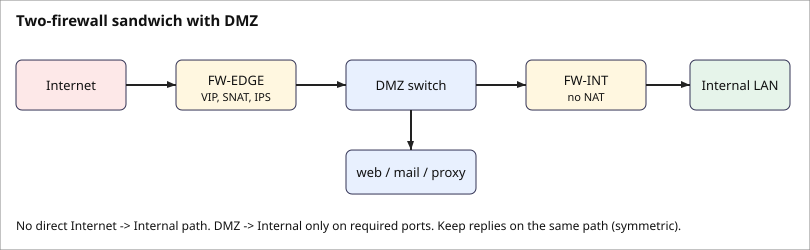

*شکل: دوفایروال با DMZ.*

### ۵) مثال حل‌شده

**نیاز:** وب‌سایت عمومی، API داخلی، DB. طراحی: Edge: VIP 203.0.113.50:443→10.10.10.20 (DMZ). Internal: DMZ→10.20.20.5:8080 (App)؛ App→DB فقط داخل Internal. Policy Matrix:

``` text
EDGE    : WAN  -> DMZ      : VIP web  TCP 443        accept + IPS + log
EDGE    : DMZ  -> WAN      : DNS, updates only        accept + log
EDGE    : INT  -> WAN      : users HTTP/HTTPS/DNS     accept + UTM + NAT
INT     : DMZ  -> SRV      : 10.10.10.20 -> 10.20.20.5 TCP 8080   accept + log
INT     : SRV  -> DMZ      : established only (implicit via session)
INT     : any  -> any      : implicit deny + log
```

**مثال متوسط:** `ping` از Internet به DB داخلی ناکام است؛ Debug Flow روی Edge: «Denied policy 0» ← درست (هیچ Policy). نشان‌دهنده‌ی طراحی سالم است.

**مثال سخت:** پس از Compromise وب‌سرور DMZ، مهاجم سعی می‌کند به DB وصل شود: DMZ→SRV فقط 8080 مجاز است، بقیه deny+log؛ Alert بر پایه‌ی «Denied از DMZ به SRV» می‌تواند نشانه‌ی نفوذ باشد (Detection).

### ۶) طراحی و تصمیم‌گیری

| سؤال | تصمیم |
|---|---|
| دوفایروال یا تک؟ | ریسک بالا/دارایی حساس ← دو؛ سازمان کوچک ← یک با DMZ و UTM |
| NAT | Edge فقط؛ Internal Routing |
| HA | هر دو HA (فصل ۲۲) |
| تنوع سازنده | در صورت بودجه/مهارت |
| Log | مرکزی، با Timestamp همگام (NTP) |

### ۷) پیاده‌سازی و Verification (GUI/CLI)

**GUI:** Policy & Objects → Virtual IPs (VIP)؛ Firewall Policy (WAN→DMZ)؛ Network → Static Routes (DMZ→Internal)؛ Log & Report → Forward Traffic.

**CLI:**

``` text
config firewall vip
    edit "VIP-WEB"
        set extip 203.0.113.50
        set mappedip "10.10.10.20"
        set extintf "wan1"
        set portforward enable
        set extport 443
        set mappedport 443
    next
end
get router info routing-table all
diagnose debug flow filter addr 10.10.10.20
diagnose sys session filter dst 10.10.10.20
```

(نام فیلدها `Unverified`.) **آزمون‌ها:** مثبت: اینترنت→VIP؛ منفی: اینترنت→DB، DMZ→DB، Internal→Internet مستقیم (بدون Policy).

### ۸) Troubleshooting

| علامت | علت |
|---|---|
| VIP از بیرون کار نمی‌کند | Policy مقصد (post-DNAT)، Route، ARP |
| DMZ به Internal نمی‌رسد | Policy Internal، مسیر، NAT اشتباه |
| فقط بعضی ارتباط‌ها Drop | Asymmetric/Session |
| Log مبدأ همه یک IP | Double NAT |

### ۹) نکات امنیتی

- Internal هرگز Internet را به‌طور مستقیم به‌رسمیت نشناسد.
- سرورهای DMZ نباید اعتبار (Credential) شبکه‌ی داخلی داشته باشند.
- تغییرات هر دو فایروال Change یکپارچه.

### ۱۰) جمع‌بندی مفهومی

- DMZ اثر نفوذ را محدود می‌کند؛ دو فایروال لایه‌ی کنترل مستقل است.
- NAT را فقط لبه؛ Internal ترجیحاً Routing.
- مسیر برگشت متقارن؛ Policy در جهت درست.
- طراحی را با «اگر لایه‌ی اول بشکند» ارزیابی کنید.
- مدیریت و Log را متمرکز کنید.

### ۱۱) تمرین و ارزیابی

**ت1.** (ساده) DMZ چیست؟ *(پاسخ: 15-0-ت1)*

**ت2.** (ساده) چرا Internal NAT نمی‌کند؟ *(پاسخ: 15-0-ت2)*

**ت3.** (متوسط) مسیر یک درخواست Internet→App را بنویسید. *(پاسخ: 15-0-ت3)*

**ت4.** (متوسط) Double NAT چه مشکلی در Log دارد؟ *(پاسخ: 15-0-ت4)*

**ت5.** (سخت) پس از Compromise وب‌سرور، کدام سه کنترل جلوی حرکت جانبی را می‌گیرد؟ *(پاسخ: 15-0-ت5)*

**ت6.** (سخت، طراحی) برای سازمانی با بودجه‌ی محدود تصمیم دو فایروال در برابر تک‌فایروال+DMZ را با معیار ریسک بگیرید. *(پاسخ: 15-0-ت6)*

**Q1.** Quick quiz (English): Why avoid NAT on the internal firewall? *(پاسخ: 15-0-Q1)*

### ۱۲) اصطلاحات و English Corner

| مخفف | شکل کامل | معنی |
|---|---|---|
| DMZ | Demilitarized Zone | ناحیه‌ی واسط |
| Edge | Edge firewall | فایروال لبه |
| Sandwich | Firewall sandwich | دو فایروال با DMZ بین آن‌ها |
| VIP | Virtual IP | آدرس مجازی DNAT |

- *Place public servers in a DMZ between two firewalls.* ← سرورهای عمومی را در DMZ بین دو فایروال بگذارید.
- *Preserve original source addresses for logging.* ← آدرس مبدأ اصلی را برای Log حفظ کنید.

### ۱۳) منابع

- NIST SP 800-41 Rev.1 — Guidelines on Firewalls (DMZ designs).
- Fortinet Docs: FortiOS 7.0 Administration Guide — Virtual IPs، Firewall policy.

## درس 15-1 — طراحی معماری دوفایروالی

**فصل 15 - روز 1 · پیش‌نیاز: فصل ۱۳، ۱۴ · ۶ ساعت**

### ۱) معرفی درس

دو فایروال دو لایه‌ی دفاعی می‌دهند: Edge لبه‌ی اینترنت و DMZ؛ Internal شبکه‌ی داخلی. مدل طراحی و IP Plan را اول می‌نویسیم.

### ۲) پیش‌نیازها

فصل‌های ۱۱ تا ۱۴.

### ۳) توضیح مفهومی

- Edge: WAN، DMZ (Web)، Transit به Internal. Internal: Transit، Users، Servers (App/DB).
- قاعده: هیچ ترافیک اینترنتی مستقیم به Servers؛ Web فقط به App؛ App فقط به DB.
- Routing: Edge Default به ISP؛ Edge Static به شبکه‌های داخلی از Transit؛ Internal Default به Edge.
- NAT: SNAT اینترنت در Edge؛ VIP برای Web در Edge؛ Internal معمولاً بدون NAT (مسیردهی).
- هر دو فایروال Policy مستقل دارند؛ Packet Walk باید هر دو را شامل شود.

### ۴) مثال ساده

کاربر داخلی به اینترنت از دو فایروال می‌گذرد.

### ۵) مثال سازمانی

سازمان: Edge مدیریت‌شده توسط تیم امنیت؛ Internal توسط تیم شبکه.

### ۶) تصویر و توپولوژی

```text
ISP -- Edge(port1 203.0.113.2) -- DMZ 192.168.50.0/24 (Web .10)
         |port3 transit 10.255.0.1/30
         Internal(port1 10.255.0.2) -- Users 192.168.20.0/24
                                    -- Servers 192.168.90.0/24 (App .20, DB .30)
```

### ۷) پیکربندی (GUI و CLI)

> نسخه‌ی هدف: FortiOS 7.0.3 (اسمی؛ از نام Image؛ بوت‌نشده؛ تأیید با `get system status`). دستورها/منوها از مستند عمومی FortiOS 7.0 و دانش مؤلف هستند و **روی Image شما هنوز آزمایش نشده‌اند**؛ در بوت اول مقایسه کنید.

#### روش گرافیکی (GUI)

1. Network > Interfaces برای هر FGT: طبق جدول.
2. Policy & Objects > Addresses.
3. Zones.
4. Static Routes.
5. VIP.

#### روش خط فرمان (CLI)

```text
# IP plan (example)
# WAN      203.0.113.0/29  ISP .1  EDGE .2  VIP web .3
# DMZ      192.168.50.0/24 EDGE .254  WEB .10
# TRANSIT  10.255.0.0/30   EDGE .1  INT .2
# USERS    192.168.20.0/24 INT .254
# SERVERS  192.168.90.0/24 INT .254  APP .20  DB .30
```

**توضیح دستورها (چه / چرا / خروجی / راستی‌آزمایی / بازگشت):**

- جدول IP مرجع همه‌ی Labهای فصل است.
- راستی‌آزمایی: هر Subnet هم‌پوشانی ندارد.
- بازگشت: ندارد.

### ۸) تست عملکرد

- جدول را با Subnet Calculator بدون ابزار بررسی کنید.

### ۹) عیب‌یابی

| بخش | شرح |
|---|---|
| Symptom | هم‌پوشانی Subnet |
| شواهد/دستور | Routeهای متناقض |
| علت | طراحی بی‌دقت |
| رفع | اصلاح IP Plan |

### ۱۰) تمرین مستقل

> پاسخ‌ها در بخش «پاسخ‌های فصل» انتهای فصل است؛ اول خودتان حل کنید.

**ت1.** چرا دو فایروال؟ *(پاسخ: 15-1-ت1)*

**ت2.** Web چه چیزی را می‌بیند؟ *(پاسخ: 15-1-ت2)*

**ت3.** NAT کجا؟ *(پاسخ: 15-1-ت3)*

### ۱۱) مرور و ارزیابی

**م1.** چرا Internal NAT نمی‌خواهد؟ *(پاسخ: 15-1-م1)*

**م2.** سناریو: کاربر به اینترنت نمی‌رسد؛ کدام فایروال؟ *(پاسخ: 15-1-م2)*

**معیار تسلط:** IP Plan و Policy Matrix هر دو فایروال.

**اشتباهات رایج:** هم‌پوشانی؛ Policy فقط در یک فایروال.

### ۱۲) واژگان و English Corner

| واژه | شکل کامل | معنی | کاربرد واقعی |
|---|---|---|---|
| Edge firewall | Edge firewall | فایروال لبه | Internet |
| DMZ | Demilitarized zone | ناحیه‌ی حائل | Web |
| Transit | Transit network | لینک بین فایروال‌ها | /30 |

| English sentence | ترجمه |
|---|---|
| Place public services in the DMZ. | سرویس‌های عمومی را در DMZ بگذارید. |
| Each firewall enforces its own policy. | هر فایروال Policy خودش را اعمال می‌کند. |

#### کارت Lab — درس 15-1

| # | فیلد | محتوا |
|---|---|---|
| 1 | عنوان و هدف | طراحی معماری ۲ |
| 2 | پیش‌نیاز | فصل ۱۳، ۱۴ |
| 3 | توپولوژی | — |
| 4 | تجهیزات | کاغذ |
| 5 | نسخه نرم‌افزار | FortiOS 7.0.3 (اسمی؛ از نام Image؛ بوت‌نشده؛ تأیید با `get system status`) |
| 6 | IP Plan | جدول IP |
| 7 | وضعیت اولیه | — |
| 8 | صورت مسئله | Plan + Matrix |
| 9 | مراحل هدایت‌شده | بخش‌های ۷ و ۸ همین درس (گام‌به‌گام) |
| 10 | تست عملکرد | — |
| 11 | سناریوی خرابی | هم‌پوشانی Subnet |
| 12 | روش عیب‌یابی | بخش ۹ همین درس (لایه‌ای/با شواهد) |
| 13 | نتیجه‌ی مورد انتظار | فایل طراحی |
| 14 | معیار پذیرش | کامل |
| 15 | مستندات نهایی | `02-design/arch2.md` |
| 16 | Cleanup و بازگردانی | — |

> **وضعیت راستی‌آزمایی (خارج از ۱۶ فیلد):** **اجرا نشده (فقط طراحی).** Image FortiGate هنوز بوت نشده؛ دستورها/منوها آزمایش‌نشده‌اند.

---

<a id="l-15-2"></a>

## درس 15-2 — ساخت Edge: WAN، DMZ، NAT و VIP

**فصل 15 - روز 2 · پیش‌نیاز: درس ۱۵-۱ · ۶ ساعت**

### ۱) معرفی درس

Edge اینترنت را به DMZ و Internal وصل می‌کند و NAT/VIP را انجام می‌دهد.

### ۲) پیش‌نیازها

درس ۱۵-۱؛ فصل ۱۳.

### ۳) توضیح مفهومی

- Interfaces: port1 WAN، port2 DMZ، port3 Transit.
- Default به ISP؛ Static به Users/Servers از Transit (10.255.0.2).
- Policy: DMZ→WAN (به‌روزرسانی)، WAN→DMZ (VIP Web HTTPS)، Transit→WAN (کاربران با NAT)، DMZ→Transit (محدود به App).
- VIP: 203.0.113.3:443 → 192.168.50.10:443.
- Log همه‌ی Policyها.

### ۴) مثال ساده

اینترنت به Web از VIP.

### ۵) مثال سازمانی

Edge سازمانی با Policy فهرست‌شده.

### ۶) تصویر و توپولوژی

```text
Internet -> VIP -> DMZ Web ; Transit(Users) -> NAT -> Internet
```

### ۷) پیکربندی (GUI و CLI)

> نسخه‌ی هدف: FortiOS 7.0.3 (اسمی؛ از نام Image؛ بوت‌نشده؛ تأیید با `get system status`). دستورها/منوها از مستند عمومی FortiOS 7.0 و دانش مؤلف هستند و **روی Image شما هنوز آزمایش نشده‌اند**؛ در بوت اول مقایسه کنید.

#### روش گرافیکی (GUI)

1. Interfaces: port1/2/3.
2. Static Routes: Default + دو مسیر.
3. Virtual IPs: VIP-WEB.
4. Policy: WAN-to-WEB, USERS-to-WAN, DMZ-to-APP.
5. Log & Report.

#### روش خط فرمان (CLI)

```text
config router static
    edit 1
        set gateway 203.0.113.1
        set device "port1"
    next
    edit 2
        set dst 192.168.20.0 255.255.255.0
        set gateway 10.255.0.2
        set device "port3"
    next
    edit 3
        set dst 192.168.90.0 255.255.255.0
        set gateway 10.255.0.2
        set device "port3"
    next
end
```

**توضیح دستورها (چه / چرا / خروجی / راستی‌آزمایی / بازگشت):**

- Static به داخلی‌ها از Transit.
- VIP و Policy مثل درس ۱۳-۳.
- Policy کاربران: Transit→WAN با NAT.
- راستی‌آزمایی: `get router info routing-table all` و تست‌ها.
- بازگشت: حذف مسیرها/Policy.

### ۸) تست عملکرد

- ping از Edge به Transit و DMZ؛ curl به VIP.

### ۹) عیب‌یابی

| بخش | شرح |
|---|---|
| Symptom | Web از اینترنت نمی‌رسد |
| شواهد/دستور | Debug Flow: denied policy |
| علت | Policy WAN→DMZ نیست |
| رفع | ساخت Policy |

### ۱۰) تمرین مستقل

> پاسخ‌ها در بخش «پاسخ‌های فصل» انتهای فصل است؛ اول خودتان حل کنید.

**ت1.** Edge چه مسئولیتی دارد؟ *(پاسخ: 15-2-ت1)*

**ت2.** Static به داخل چرا؟ *(پاسخ: 15-2-ت2)*

**ت3.** VIP کجا؟ *(پاسخ: 15-2-ت3)*

### ۱۱) مرور و ارزیابی

**م1.** چرا Edge باید Route به Users داشته باشد؟ *(پاسخ: 15-2-م1)*

**م2.** سناریو: Return Path ناقص؛ علامت؟ *(پاسخ: 15-2-م2)*

**معیار تسلط:** ساخت Edge با GUI/CLI و تست.

**اشتباهات رایج:** فراموشی Route برگشت.

### ۱۲) واژگان و English Corner

| واژه | شکل کامل | معنی | کاربرد واقعی |
|---|---|---|---|
| Transit | Transit link | لینک بین فایروال‌ها | — |
| Return path | Return route | مسیر برگشت | Edge |

| English sentence | ترجمه |
|---|---|
| Add static routes for the internal networks on the edge firewall. | برای شبکه‌های داخلی روی فایروال Edge مسیر Static اضافه کنید. |
| Publish the web server using a VIP. | سرور وب را با VIP منتشر کنید. |

#### کارت Lab — درس 15-2

| # | فیلد | محتوا |
|---|---|---|
| 1 | عنوان و هدف | Edge |
| 2 | پیش‌نیاز | درس ۱۵-۱ |
| 3 | توپولوژی | FGT-EDGE + ISP + DMZ Web |
| 4 | تجهیزات | FGT |
| 5 | نسخه نرم‌افزار | FortiOS 7.0.3 (اسمی؛ از نام Image؛ بوت‌نشده؛ تأیید با `get system status`) |
| 6 | IP Plan | طبق جدول |
| 7 | وضعیت اولیه | Baseline |
| 8 | صورت مسئله | Edge کامل |
| 9 | مراحل هدایت‌شده | بخش‌های ۷ و ۸ همین درس (گام‌به‌گام) |
| 10 | تست عملکرد | curl/ping |
| 11 | سناریوی خرابی | Web از اینترنت نمی‌رسد |
| 12 | روش عیب‌یابی | بخش ۹ همین درس (لایه‌ای/با شواهد) |
| 13 | نتیجه‌ی مورد انتظار | دسترسی Web |
| 14 | معیار پذیرش | Log Edge |
| 15 | مستندات نهایی | `02-design/fgt-edge.md` |
| 16 | Cleanup و بازگردانی | Restore |

> **وضعیت راستی‌آزمایی (خارج از ۱۶ فیلد):** **اجرا نشده (فقط طراحی).** Image FortiGate هنوز بوت نشده؛ دستورها/منوها آزمایش‌نشده‌اند.

---

<a id="l-15-3"></a>

## درس 15-3 — ساخت Internal: Users و Servers و Routing به Edge

**فصل 15 - روز 3 · پیش‌نیاز: درس ۱۵-۲ · ۶ ساعت**

### ۱) معرفی درس

Internal ارتباط کاربران و سرورها را کنترل می‌کند. Default آن Edge است.

### ۲) پیش‌نیازها

درس ۱۵-۲.

### ۳) توضیح مفهومی

- Interfaces: port1 Transit، port2 Users، port3 Servers.
- Default به Edge (10.255.0.1).
- Policy: Users→Servers (SMB/HTTPS محدود)، Users→Transit (اینترنت)، Servers→Transit (به‌روزرسانی محدود).
- بدون NAT در Internal.
- Zone و Objectهای استاندارد.

### ۴) مثال ساده

کاربران به اینترنت از Internal→Edge.

### ۵) مثال سازمانی

Internal Policy مجزای امنیت داخلی.

### ۶) تصویر و توپولوژی

```text
Users -> Internal -> (Transit) -> Edge -> Internet
```

### ۷) پیکربندی (GUI و CLI)

> نسخه‌ی هدف: FortiOS 7.0.3 (اسمی؛ از نام Image؛ بوت‌نشده؛ تأیید با `get system status`). دستورها/منوها از مستند عمومی FortiOS 7.0 و دانش مؤلف هستند و **روی Image شما هنوز آزمایش نشده‌اند**؛ در بوت اول مقایسه کنید.

#### روش گرافیکی (GUI)

1. Interfaces/Zones.
2. Static Route Default به 10.255.0.1.
3. Policy.
4. Log.
5. Monitor.

#### روش خط فرمان (CLI)

```text
config router static
    edit 1
        set gateway 10.255.0.1
        set device "port1"
    next
end
config firewall policy
    edit 10
        set name "Users-to-Transit"
        set srcintf "ZN-USERS"
        set dstintf "port1"
        set srcaddr "NET-USERS-20"
        set dstaddr "all"
        set action accept
        set schedule "always"
        set service "HTTP" "HTTPS" "DNS"
        set logtraffic all
    next
end
```

**توضیح دستورها (چه / چرا / خروجی / راستی‌آزمایی / بازگشت):**

- NAT غیرفعال: Edge SNAT می‌کند.
- Policy فقط سرویس‌های لازم.
- راستی‌آزمایی: از Users ping/Browser؛ Log در هر دو فایروال.
- بازگشت: حذف Policy/Route.

### ۸) تست عملکرد

- Users به اینترنت و Servers.

### ۹) عیب‌یابی

| بخش | شرح |
|---|---|
| Symptom | Users اینترنت ندارند |
| شواهد/دستور | Log Internal: Allow؛ Edge: Deny |
| علت | Policy در Edge نیست (Transit→WAN) |
| رفع | ساخت Policy در Edge |

### ۱۰) تمرین مستقل

> پاسخ‌ها در بخش «پاسخ‌های فصل» انتهای فصل است؛ اول خودتان حل کنید.

**ت1.** Default Internal کجاست؟ *(پاسخ: 15-3-ت1)*

**ت2.** NAT Internal؟ *(پاسخ: 15-3-ت2)*

**ت3.** Policy مضاعف؟ *(پاسخ: 15-3-ت3)*

### ۱۱) مرور و ارزیابی

**م1.** چرا هر دو Log را می‌خوانیم؟ *(پاسخ: 15-3-م1)*

**م2.** سناریو: Internal Allow ولی ارتباط نه؛ چه می‌کنید؟ *(پاسخ: 15-3-م2)*

**معیار تسلط:** ساخت Internal و اثبات با Log دو فایروال.

**اشتباهات رایج:** Policy فقط در یک فایروال.

### ۱۲) واژگان و English Corner

| واژه | شکل کامل | معنی | کاربرد واقعی |
|---|---|---|---|
| Internal firewall | Internal firewall | فایروال داخلی | Users/Servers |
| Default route | Default route | مسیر پیش‌فرض | Edge |

| English sentence | ترجمه |
|---|---|
| Check the logs on both firewalls. | Logهای هر دو فایروال را بررسی کنید. |
| Do not NAT twice unless you must. | مگر ناچار نباشید دو بار NAT نکنید. |

#### کارت Lab — درس 15-3

| # | فیلد | محتوا |
|---|---|---|
| 1 | عنوان و هدف | Internal |
| 2 | پیش‌نیاز | درس ۱۵-۲ |
| 3 | توپولوژی | FGT-INT + Users + Servers |
| 4 | تجهیزات | FGT |
| 5 | نسخه نرم‌افزار | FortiOS 7.0.3 (اسمی؛ از نام Image؛ بوت‌نشده؛ تأیید با `get system status`) |
| 6 | IP Plan | طبق جدول |
| 7 | وضعیت اولیه | Edge آماده |
| 8 | صورت مسئله | Internal کامل |
| 9 | مراحل هدایت‌شده | بخش‌های ۷ و ۸ همین درس (گام‌به‌گام) |
| 10 | تست عملکرد | Log |
| 11 | سناریوی خرابی | Users اینترنت ندارند |
| 12 | روش عیب‌یابی | بخش ۹ همین درس (لایه‌ای/با شواهد) |
| 13 | نتیجه‌ی مورد انتظار | اینترنت کاربران |
| 14 | معیار پذیرش | Log دو فایروال |
| 15 | مستندات نهایی | `02-design/fgt-internal.md` |
| 16 | Cleanup و بازگردانی | Restore |

> **وضعیت راستی‌آزمایی (خارج از ۱۶ فیلد):** **اجرا نشده (فقط طراحی).** Image FortiGate هنوز بوت نشده؛ دستورها/منوها آزمایش‌نشده‌اند.

---

<a id="l-15-4"></a>

## درس 15-4 — DMZ سه‌لایه: Web، App، DB و Policy بین لایه‌ها

**فصل 15 - روز 4 · پیش‌نیاز: درس ۱۵-۳ · ۶ ساعت**

### ۱) معرفی درس

Web در DMZ فقط با App حرف می‌زند؛ App فقط با DB. این با Policy در هر دو فایروال تضمین می‌شود.

### ۲) پیش‌نیازها

درس‌های ۱۵-۲، ۱۵-۳.

### ۳) توضیح مفهومی

- Web (DMZ) → App (Servers) پورت 8080 از Edge Transit و Internal.
- App → DB پورت 3306 فقط در Internal.
- Internet → Web فقط 443.
- هیچ مسیر Internet→App/DB.
- تست منفی: Web→DB مسدود.

### ۴) مثال ساده

Web به App.

### ۵) مثال سازمانی

سازمان: Policy هر لایه با Profile امنیتی (فصل ۱۶).

### ۶) تصویر و توپولوژی

```text
Internet -> Web(DMZ) -> App -> DB   (only adjacent layers)
```

### ۷) پیکربندی (GUI و CLI)

> نسخه‌ی هدف: FortiOS 7.0.3 (اسمی؛ از نام Image؛ بوت‌نشده؛ تأیید با `get system status`). دستورها/منوها از مستند عمومی FortiOS 7.0 و دانش مؤلف هستند و **روی Image شما هنوز آزمایش نشده‌اند**؛ در بوت اول مقایسه کنید.

#### روش گرافیکی (GUI)

1. Policy Edge.
2. Policy Internal.
3. Objects.
4. Log.
5. Policy Lookup.

#### روش خط فرمان (CLI)

```text
# Edge: DMZ -> TRANSIT  : WEB -> APP tcp/8080
# Internal: TRANSIT -> SERVERS: WEB -> APP tcp/8080
# Internal: SERVERS -> SERVERS: APP -> DB tcp/3306 (same zone: intrazone or separate zones)
# Negative test: WEB -> DB must be DENIED
```

**توضیح دستورها (چه / چرا / خروجی / راستی‌آزمایی / بازگشت):**

- Policy هر لایه یک ماتریس است.
- Intrazone بین App و DB اگر در یک Zone باشند: بهتر Zone جدا.
- راستی‌آزمایی: تست مثبت/منفی.
- بازگشت: حذف Policy.

### ۸) تست عملکرد

- curl از Web به App؛ تلاش Web→DB.

### ۹) عیب‌یابی

| بخش | شرح |
|---|---|
| Symptom | Web به DB دسترسی دارد |
| شواهد/دستور | Debug Flow: Allowed by Policy |
| علت | Policy گسترده |
| رفع | تنگ‌کردن |

### ۱۰) تمرین مستقل

> پاسخ‌ها در بخش «پاسخ‌های فصل» انتهای فصل است؛ اول خودتان حل کنید.

**ت1.** چرا Web به DB نه؟ *(پاسخ: 15-4-ت1)*

**ت2.** تست منفی؟ *(پاسخ: 15-4-ت2)*

**ت3.** Policy در کدام فایروال؟ *(پاسخ: 15-4-ت3)*

### ۱۱) مرور و ارزیابی

**م1.** چرا Zone جدا برای DB؟ *(پاسخ: 15-4-م1)*

**م2.** سناریو: Web به DB می‌رسد؛ چرا؟ *(پاسخ: 15-4-م2)*

**معیار تسلط:** ساخت سه‌لایه با تست مثبت/منفی.

**اشتباهات رایج:** Policy any بین Servers.

### ۱۲) واژگان و English Corner

| واژه | شکل کامل | معنی | کاربرد واقعی |
|---|---|---|---|
| Three-tier | Three-tier architecture | Web/App/DB | — |
| Intrazone | Intrazone traffic | ترافیک درون Zone | Policy |

| English sentence | ترجمه |
|---|---|
| Allow only adjacent tiers to communicate. | فقط لایه‌های مجاور اجازه‌ی ارتباط دارند. |
| Test the negative cases as well. | موارد منفی را هم تست کنید. |

#### کارت Lab — درس 15-4

| # | فیلد | محتوا |
|---|---|---|
| 1 | عنوان و هدف | سه‌لایه |
| 2 | پیش‌نیاز | درس ۱۵-۳ |
| 3 | توپولوژی | Edge+Internal+Web/App/DB |
| 4 | تجهیزات | ۲ FGT + 3 Linux |
| 5 | نسخه نرم‌افزار | FortiOS 7.0.3 (اسمی؛ از نام Image؛ بوت‌نشده؛ تأیید با `get system status`) |
| 6 | IP Plan | جدول IP |
| 7 | وضعیت اولیه | Edge/Internal |
| 8 | صورت مسئله | Policy لایه‌ها |
| 9 | مراحل هدایت‌شده | بخش‌های ۷ و ۸ همین درس (گام‌به‌گام) |
| 10 | تست عملکرد | curl |
| 11 | سناریوی خرابی | Web به DB دسترسی دارد |
| 12 | روش عیب‌یابی | بخش ۹ همین درس (لایه‌ای/با شواهد) |
| 13 | نتیجه‌ی مورد انتظار | مثبت/منفی |
| 14 | معیار پذیرش | Web→DB رد |
| 15 | مستندات نهایی | `02-design/fgt-3tier.md` |
| 16 | Cleanup و بازگردانی | حذف Policy |

> **وضعیت راستی‌آزمایی (خارج از ۱۶ فیلد):** **اجرا نشده (فقط طراحی).** Image FortiGate هنوز بوت نشده؛ دستورها/منوها آزمایش‌نشده‌اند.

---

<a id="l-15-5"></a>

## درس 15-5 — Packet Walk دو فایروال و NAT در دو نقطه

**فصل 15 - روز 5 · پیش‌نیاز: درس ۱۵-۴ · ۶ ساعت**

### ۱) معرفی درس

برای هر ارتباط باید Walk کامل از Client تا Server در هر دو فایروال بنویسید.

### ۲) پیش‌نیازها

درس ۱۵-۴.

### ۳) توضیح مفهومی

- برای هر جهت: Interface ورودی، Route، Policy، NAT، Interface خروجی در Edge و Internal.
- NAT: فقط Edge (SNAT) و VIP؛ آدرس‌ها در هر Hop تغییر می‌کنند.
- Sniffer در Transit برای دیدن آدرس‌های مقدماتی.
- Debug Flow در هر دو.
- جدول Walk محصول اصلی است.

### ۴) مثال ساده

Users به اینترنت.

### ۵) مثال سازمانی

Internet به Web.

### ۶) تصویر و توپولوژی

```text
Users -> INT -> EDGE -> ISP ; INTERNET -> EDGE(VIP) -> WEB
```

### ۷) پیکربندی (GUI و CLI)

> نسخه‌ی هدف: FortiOS 7.0.3 (اسمی؛ از نام Image؛ بوت‌نشده؛ تأیید با `get system status`). دستورها/منوها از مستند عمومی FortiOS 7.0 و دانش مؤلف هستند و **روی Image شما هنوز آزمایش نشده‌اند**؛ در بوت اول مقایسه کنید.

#### روش گرافیکی (GUI)

1. Packet Capture Transit.
2. Log هر دو.
3. Policy Lookup.
4. FortiView.
5. Routing Monitor.

#### روش خط فرمان (CLI)

```text
# Walk table
# hop  device  in-if  route  policy  NAT  out-if
# 1    INT     port2  default-> p10   none  port1
# 2    EDGE    port3  default-> p31   snat  port1
```

**توضیح دستورها (چه / چرا / خروجی / راستی‌آزمایی / بازگشت):**

- هر ردیف با خروجی ابزار.
- راستی‌آزمایی: Sniffer روی Transit آدرس اصلی کاربر را نشان دهد.
- بازگشت: ندارد.

### ۸) تست عملکرد

- دو Walk کامل.

### ۹) عیب‌یابی

| بخش | شرح |
|---|---|
| Symptom | آدرس مبدأ در Transit NAT شده |
| شواهد/دستور | Sniffer Transit: مبدأ ≠ کاربر |
| علت | NAT در Internal |
| رفع | حذف NAT |

### ۱۰) تمرین مستقل

> پاسخ‌ها در بخش «پاسخ‌های فصل» انتهای فصل است؛ اول خودتان حل کنید.

**ت1.** NAT کجا؟ *(پاسخ: 15-5-ت1)*

**ت2.** Walk چند ردیف؟ *(پاسخ: 15-5-ت2)*

**ت3.** Sniffer Transit چه می‌گوید؟ *(پاسخ: 15-5-ت3)*

### ۱۱) مرور و ارزیابی

**م1.** چرا جدول Walk؟ *(پاسخ: 15-5-م1)*

**م2.** سناریو: NAT مضاعف؛ علامت؟ *(پاسخ: 15-5-م2)*

**معیار تسلط:** دو Walk کامل با شواهد.

**اشتباهات رایج:** Walk ناقص.

### ۱۲) واژگان و English Corner

| واژه | شکل کامل | معنی | کاربرد واقعی |
|---|---|---|---|
| Walk | Packet walk | مسیر بسته | — |
| SNAT | Source NAT | تغییر مبدأ | Edge |

| English sentence | ترجمه |
|---|---|
| Build a packet walk table across both firewalls. | جدول Packet Walk را روی هر دو فایروال بسازید. |
| Check the addresses on the transit link. | آدرس‌ها را روی لینک Transit بررسی کنید. |

#### کارت Lab — درس 15-5

| # | فیلد | محتوا |
|---|---|---|
| 1 | عنوان و هدف | Walk دوفایروالی |
| 2 | پیش‌نیاز | درس ۱۵-۴ |
| 3 | توپولوژی | کل معماری |
| 4 | تجهیزات | ۲ FGT |
| 5 | نسخه نرم‌افزار | FortiOS 7.0.3 (اسمی؛ از نام Image؛ بوت‌نشده؛ تأیید با `get system status`) |
| 6 | IP Plan | جدول IP |
| 7 | وضعیت اولیه | آماده |
| 8 | صورت مسئله | دو Walk |
| 9 | مراحل هدایت‌شده | بخش‌های ۷ و ۸ همین درس (گام‌به‌گام) |
| 10 | تست عملکرد | Sniffer/Debug |
| 11 | سناریوی خرابی | آدرس مبدأ در Transit NAT شده |
| 12 | روش عیب‌یابی | بخش ۹ همین درس (لایه‌ای/با شواهد) |
| 13 | نتیجه‌ی مورد انتظار | جدول |
| 14 | معیار پذیرش | همخوانی |
| 15 | مستندات نهایی | `03-ops/walk-arch2.md` |
| 16 | Cleanup و بازگردانی | — |

> **وضعیت راستی‌آزمایی (خارج از ۱۶ فیلد):** **اجرا نشده (فقط طراحی).** Image FortiGate هنوز بوت نشده؛ دستورها/منوها آزمایش‌نشده‌اند.

---

<a id="l-15-6"></a>

## درس 15-6 — خرابی‌ها و آزمون G6

**فصل 15 - روز 6 · پیش‌نیاز: درس‌های ۱۵-۱ تا ۱۵-۵ · ۶ ساعت**

### ۱) معرفی درس

سه خرابی (Route برگشت، Policy فایروال دوم، NAT مضاعف) و Gate G6.

### ۲) پیش‌نیازها

درس‌های ۱۵-۱ تا ۱۵-۵.

### ۳) توضیح مفهومی

- خرابی A: Route برگشت در Edge حذف.
- خرابی B: Policy Transit→WAN در Edge حذف.
- خرابی C: NAT فعال در Internal.
- روش: ۱۰ پرسش + Log هر دو + Sniffer Transit.
- G6: ۵ مورد (طراحی، Edge، Internal، سه‌لایه، Walk).

### ۴) مثال ساده

رفع خرابی A.

### ۵) مثال سازمانی

RCA برای خرابی B/C.

### ۶) تصویر و توپولوژی

```text
fault A,B,C -> evidence -> fix
```

### ۷) پیکربندی (GUI و CLI)

> نسخه‌ی هدف: FortiOS 7.0.3 (اسمی؛ از نام Image؛ بوت‌نشده؛ تأیید با `get system status`). دستورها/منوها از مستند عمومی FortiOS 7.0 و دانش مؤلف هستند و **روی Image شما هنوز آزمایش نشده‌اند**؛ در بوت اول مقایسه کنید.

#### روش گرافیکی (GUI)

1. Log هر دو.
2. Policy Lookup.
3. Routing Monitor.
4. Packet Capture.
5. Backup/Restore.

#### روش خط فرمان (CLI)

```text
get router info routing-table details 192.168.20.11
diagnose sniffer packet port3 "host 192.168.20.11" 4 20 l
diagnose debug flow filter addr 192.168.20.11
```

**توضیح دستورها (چه / چرا / خروجی / راستی‌آزمایی / بازگشت):**

- علت را با شواهد ثابت کنید.
- معیار: ≥ ۴ از ۵.
- Restore بکاپ بعد از آزمون.

### ۸) تست عملکرد

- سه خرابی با RCA.

### ۹) عیب‌یابی

| بخش | شرح |
|---|---|
| Symptom | Users اینترنت ندارند |
| شواهد/دستور | Log Edge: Denied (Transit→WAN) |
| علت | Policy Edge نیست |
| رفع | ساخت Policy |

### ۱۰) تمرین مستقل

> پاسخ‌ها در بخش «پاسخ‌های فصل» انتهای فصل است؛ اول خودتان حل کنید.

**ت1.** اولین قدم؟ *(پاسخ: 15-6-ت1)*

**ت2.** NAT مضاعف علامت؟ *(پاسخ: 15-6-ت2)*

**ت3.** G6 چه می‌سنجد؟ *(پاسخ: 15-6-ت3)*

### ۱۱) مرور و ارزیابی

**م1.** چرا Log هر دو؟ *(پاسخ: 15-6-م1)*

**م2.** سناریو: TCP نمی‌بندد؛ بررسی؟ *(پاسخ: 15-6-م2)*

**معیار تسلط:** G6 ≥ ۴ از ۵.

**اشتباهات رایج:** حدس بدون شواهد.

### ۱۲) واژگان و English Corner

| واژه | شکل کامل | معنی | کاربرد واقعی |
|---|---|---|---|
| G6 | Gate 6 | آزمون فصل ۱۵ | — |
| RCA | Root cause analysis | علت ریشه‌ای | گزارش |

| English sentence | ترجمه |
|---|---|
| Verify the return route on the edge firewall. | مسیر برگشت را روی فایروال Edge بررسی کنید. |
| Prove the fault with evidence. | خرابی را با شواهد ثابت کنید. |

#### کارت Lab — درس 15-6

| # | فیلد | محتوا |
|---|---|---|
| 1 | عنوان و هدف | G6 |
| 2 | پیش‌نیاز | درس‌های ۱۵-۱ تا ۱۵-۵ |
| 3 | توپولوژی | Arch2 |
| 4 | تجهیزات | ۲ FGT + میزبان‌ها |
| 5 | نسخه نرم‌افزار | FortiOS 7.0.3 (اسمی؛ از نام Image؛ بوت‌نشده؛ تأیید با `get system status`) |
| 6 | IP Plan | جدول IP |
| 7 | وضعیت اولیه | آماده |
| 8 | صورت مسئله | سه خرابی |
| 9 | مراحل هدایت‌شده | بخش‌های ۷ و ۸ همین درس (گام‌به‌گام) |
| 10 | تست عملکرد | Log/Sniffer |
| 11 | سناریوی خرابی | Users اینترنت ندارند |
| 12 | روش عیب‌یابی | بخش ۹ همین درس (لایه‌ای/با شواهد) |
| 13 | نتیجه‌ی مورد انتظار | RCA |
| 14 | معیار پذیرش | ≥ ۴ از ۵ |
| 15 | مستندات نهایی | `03-ops/rca-arch2.md` |
| 16 | Cleanup و بازگردانی | Restore بکاپ |

> **وضعیت راستی‌آزمایی (خارج از ۱۶ فیلد):** **اجرا نشده (فقط طراحی).** Image FortiGate هنوز بوت نشده؛ دستورها/منوها آزمایش‌نشده‌اند.

---

<a id="ans-15"></a>

## پاسخ‌های فصل 15

> ابتدا بدون نگاه حل کنید. شناسه: درس-نوع+شماره (ت = تمرین، م = مرور).

**15-1-ت1** — چرا دو فایروال؟

دو لایه‌ی دفاعی و جداسازی DMZ.

**15-1-ت2** — Web چه چیزی را می‌بیند؟

فقط App.

**15-1-ت3** — NAT کجا؟

Edge.

**15-1-م1** — چرا Internal NAT نمی‌خواهد؟

داخلی از مسیردهی کافی است و رد‌پایی ساده‌تر.

**15-1-م2** — سناریو: کاربر به اینترنت نمی‌رسد؛ کدام فایروال؟

هر دو را با Walk بررسی کنید.

**15-2-ت1** — Edge چه مسئولیتی دارد؟

NAT/VIP و ارتباط با ISP.

**15-2-ت2** — Static به داخل چرا؟

Edge باید بداند داخلی‌ها کجا هستند.

**15-2-ت3** — VIP کجا؟

Edge.

**15-2-م1** — چرا Edge باید Route به Users داشته باشد؟

برای برگشت ترافیک.

**15-2-م2** — سناریو: Return Path ناقص؛ علامت؟

TCP برقرار نمی‌شود.

**15-3-ت1** — Default Internal کجاست؟

Edge.

**15-3-ت2** — NAT Internal؟

معمولاً ندارد.

**15-3-ت3** — Policy مضاعف؟

هر دو فایروال لازم است.

**15-3-م1** — چرا هر دو Log را می‌خوانیم؟

Allow در یکی و Deny در دیگری شایع است.

**15-3-م2** — سناریو: Internal Allow ولی ارتباط نه؛ چه می‌کنید؟

Log Edge.

**15-4-ت1** — چرا Web به DB نه؟

کاهش سطح حمله.

**15-4-ت2** — تست منفی؟

تلاش برای ارتباط ممنوع.

**15-4-ت3** — Policy در کدام فایروال؟

هر دو.

**15-4-م1** — چرا Zone جدا برای DB؟

کنترل Policy دقیق‌تر.

**15-4-م2** — سناریو: Web به DB می‌رسد؛ چرا؟

Policy گسترده/Intrazone.

**15-5-ت1** — NAT کجا؟

Edge.

**15-5-ت2** — Walk چند ردیف؟

هر Hop یک ردیف.

**15-5-ت3** — Sniffer Transit چه می‌گوید؟

آدرس واقعی قبل از SNAT.

**15-5-م1** — چرا جدول Walk؟

تحلیل و مستند.

**15-5-م2** — سناریو: NAT مضاعف؛ علامت؟

آدرس مبدأ در Transit تغییر کرده.

**15-6-ت1** — اولین قدم؟

Log هر دو فایروال.

**15-6-ت2** — NAT مضاعف علامت؟

مبدأ در Transit NAT شده.

**15-6-ت3** — G6 چه می‌سنجد؟

معماری دوفایروالی.

**15-6-م1** — چرا Log هر دو؟

خرابی ممکن در هر کدام.

**15-6-م2** — سناریو: TCP نمی‌بندد؛ بررسی؟

Route برگشت.


---

<a id="end5"></a>


### پاسخ‌های درس افزوده‌ی 15-0 (فصل 15)

**15-0-ت1** — ناحیه‌ی واسط برای سرورهای در معرض اینترنت تا نفوذ به آن‌ها مستقیماً به شبکه‌ی داخلی نرسد.

**15-0-ت2** — برای حفظ آدرس واقعی در Log و جلوگیری از Double NAT و عیب‌یابی سخت؛ Internal فقط Routing می‌کند.

**15-0-ت3** — Client→VIP روی Edge (DNAT به وب DMZ)→Policy WAN→DMZ→وب به App از Internal (Policy DMZ→SRV 8080)→App به DB داخل Internal؛ برگشت از همان Sessionها.

**15-0-ت4** — آدرس مبدأ همه یک IP می‌شود و منبع واقعی در Log سرور پنهان می‌ماند.

**15-0-ت5** — Policy حداقلی DMZ→SRV (فقط 8080)، Deny+Log و Alert روی تلاش‌های ممنوع، Segmentation/Least Privilege و نداشتن اعتبارنامه‌ی داخلی روی DMZ.

**15-0-ت6** — دارایی‌های حساس و بودجه کافی: دو فایروال؛ بودجه کم: تک‌فایروال با DMZ، UTM، HA و Patch دقیق؛ تصمیم با ریسک × اثر.

**15-0-Q1** — To keep the original source address in logs and avoid double-NAT troubleshooting problems.

# پایان بخش ۵ (فصل‌های ۱۳ تا ۱۵)

## ۱) خلاصه‌ی مهارت‌های کسب‌شده
- Policy/NAT/VIP/Session/Shadow؛ Sniffer، Debug Flow، iprope، MTU/MSS؛ معماری دوفایروالی با DMZ و سه‌لایه.

## ۲) آزمون پایان سه فصل
**س1** — First Match و Implicit deny؟

**س2** — Policy NAT در برابر Central NAT؟

**س3** — انواع IP Pool؟

**س4** — VIP چه می‌کند و چرا Policy لازم است؟

**س5** — چرا filter قبل از session list؟

**س6** — Policy 0 در Debug Flow؟

**س7** — Sniffer verbose 4؟

**س8** — دو ابزار شناسایی Policy مطابق؟

**س9** — MSS Clamp برای چیست؟

**س10** — چرا Web به DB نه؟

**س11** — NAT کجا در معماری ۲؟

**س12** — خرابی «Return Route» علامت؟


## ۳) پاسخ آزمون
- **س1:** اولین Policy مطابق؛ Deny ضمنی در پایان.
- **س2:** NAT داخل Policy در برابر جدول جدا.
- **س3:** overload، one-to-one، fixed-port-range، port-block-allocation.
- **س4:** DNAT؛ VIP فقط نگاشت است.
- **س5:** حجم خروجی/CPU.
- **س6:** Implicit deny.
- **س7:** با نام Interface.
- **س8:** iprope lookup و Policy Lookup.
- **س9:** حل بسته‌ی بزرگ در Tunnel/MTU کم.
- **س10:** Least Privilege.
- **س11:** Edge.
- **س12:** TCP برقرار نمی‌شود.

## ۴) معیارهای تسلط
| مهارت | سطح | شاهد |
|---|---|---|
| Policy/NAT | L3-L4 | G5 |
| عیب‌یابی FortiOS | L3 | آزمون فصل ۱۴ |
| معماری ۲ | L3 | G6 |

## ۵) مشکلات و موارد باقی‌مانده (صریح)
1. همه‌ی Labها اجرا نشده. 2. سینتکس `central-snat-map`، `tcp-mss-*`، `execute log filter` و `fwpolicy-implicit-log` در 7.0.3 `Unverified`. 3. VM FortiGate با ≥ 2 GB لازم است؛ دو FGT همزمان فشار RAM.

## ۶) پیش‌نیازهای بخش بعد
Lab معماری ۲ ساخته و Backup؛ لایسنس UTM (Needs-License) بررسی؛ Windows Server AD (فصل ۱۷).

## ۷) فهرست Lab و منابع مرتبط
کارت‌های Lab ، `02-design/arch2.md` (خروجی دانشجو)

## ۸) وضعیت دوره
| مورد | مقدار |
|---|---|
| آخرین فصل تکمیل‌شده | ۱۵ |
| آخرین درس تکمیل‌شده | ۱۵-۶ |
| مهارت‌های تأییدشده | **هیچ‌کدام هنوز آزمون عملی واقعی نشده‌اند** (ممیزی/اجرای شما لازم است) |
| موضوعات نیازمند مرور | طبق «معیارهای تسلط» |
| فصل بعدی | ۱۶ |
| فایل تولیدشده | `course/Course_Part_05_Chapters_13-15.md` |


---

# Enterprise Network & Security Engineering — دوره‌ی تخصصی Cisco و Enterprise Firewall
## بخش ۶ از ۱۱ — فصل‌های ۱۶ تا ۱۸

| مورد | مقدار |
|---|---|
| نام دوره | Enterprise Network & Security Engineering (Cisco + FortiGate) |
| شماره بخش | ۶ از ۱۱ |
| فصل‌های این فایل | ۱۶ ، ۱۷ ، ۱۸ |
| تاریخ تولید | ۲۰۲۶-۱۱-۲۶ |
| نسخه Blueprint | v3.0 (+ بازبینی ۱٫۱) |
| نسخه‌های نرم‌افزار | FortiOS 7.0.3 (اسمی؛ بوت‌نشده؛ تأیید با `get system status`) ؛ Cisco vIOS-L2 15.2(20200924، Experimental) ؛ Cisco vIOS 15.9(3)M9 ؛ VPCS ؛ PNetLab 4.2.8 ؛ ESXi 8.0U2 ؛ CSR1000v 17.03.02 (IOS-XE؛ آزمایش‌نشده) |
| وضعیت تکمیل | **فصل‌های ۱۶–۱۸ تولید شد؛ UTM، Authentication، IPsec S2S.** Labها «اجرا نشده»؛ UTM به لایسنس FortiGuard وابسته (Needs-License)؛ دستورها آزمایش‌نشده. |

> **قوانین خواندن:** تمرین‌ها و پرسش‌های مرور بدون پاسخ‌اند؛ پاسخ در «پاسخ‌های فصل». «اجرا نشده» یعنی خروجی‌ها **پیش‌نیاز/پیش‌بینی** هستند. «CLI-Accepted» ≠ «کار می‌کند». رمزها نمونه‌اند.

### وضعیت راستی‌آزمایی Labهای این بخش
خلاصه: اجرا نشده (فقط طراحی): 18.

| Lab | وضعیت |
|---|---|
| 16-1 | اجرا نشده (فقط طراحی) |
| 16-2 | اجرا نشده (فقط طراحی) |
| 16-3 | اجرا نشده (فقط طراحی) |
| 16-4 | اجرا نشده (فقط طراحی) |
| 16-5 | اجرا نشده (فقط طراحی) |
| 16-6 | اجرا نشده (فقط طراحی) |
| 17-1 | اجرا نشده (فقط طراحی) |
| 17-2 | اجرا نشده (فقط طراحی) |
| 17-3 | اجرا نشده (فقط طراحی) |
| 17-4 | اجرا نشده (فقط طراحی) |
| 17-5 | اجرا نشده (فقط طراحی) |
| 17-6 | اجرا نشده (فقط طراحی) |
| 18-1 | اجرا نشده (فقط طراحی) |
| 18-2 | اجرا نشده (فقط طراحی) |
| 18-3 | اجرا نشده (فقط طراحی) |
| 18-4 | اجرا نشده (فقط طراحی) |
| 18-5 | اجرا نشده (فقط طراحی) |
| 18-6 | اجرا نشده (فقط طراحی) |

---

<a id="ch16"></a>

> **نسخه‌ی اصلاح‌شده (v3.4):** نسخه‌ی توسعه‌یافته‌ی فایل اصلی؛ درس‌های افزوده: ۱۶-۰، ۱۶-۷، ۱۸-۰ (دسته C). فایل اصلی در `course/` حفظ شده است. پاسخ‌های درس‌های افزوده در «پاسخ‌های فصل» همان فصل است.

# فصل 16 — UTM: آنتی‌ویروس، IPS، Application Control، Web Filter و SSL Inspection

**مدت:** ۳۶ ساعت | **پیش‌نیاز:** فصل ۱۳، ۱۴.
**اهداف:** Security Profile و Profile Group؛ AV؛ Web Filter (Static URL به‌جای Category)؛ IPS و DoS؛ Application Control؛ SSL/SSH Inspection؛ اثر Performance و عیب‌یابی.
**هشدار لایسنس (مهم):** AV/IPS/Web Filter/App Control به **FortiGuard Subscription** وابسته‌اند. در Lab ایزوله و Evaluation این وابستگی `Needs-License` و وضعیتش `Unverified` است. هر درس بخش «بدون لایسنس چه می‌توان کرد» دارد (Static URL، Custom IPS، DoS، Port-based). **همه‌ی دستورها آزمایش‌نشده روی Image.**
**معیار تسلط:** Profile ساخته و به Policy وصل؛ اثبات با Log/تست؛ توضیح اثر SSL Inspection بر Performance و Certificate.
**اشتباهات رایج:** فعال‌کردن Deep Inspection بدون نصب CA؛ Profile روی همه‌ی ترافیک؛ نادیده‌گرفتن لایسنس؛ بدون تست.

**درس‌های فصل:**
- [درس 16-1 — Security Profile و لایسنس: نقشه‌ی UTM](#l-16-1)
- [درس 16-2 — Web Filter و DNS Filter (Static و Category)](#l-16-2)
- [درس 16-3 — Antivirus و File Filter](#l-16-3)
- [درس 16-4 — IPS، DoS و Application Control](#l-16-4)
- [درس 16-5 — SSL/SSH Inspection: Certificate و CA](#l-16-5)
- [درس 16-6 — Performance، عیب‌یابی UTM و آزمون فصل](#l-16-6)

---

<a id="l-16-1"></a>

## درس 16-0 — Inspection Mode (Flow در برابر Proxy)، TLS Inspection و زنجیره‌ی اعتماد

**فصل ۱۶ · درس افزوده (پیش‌درس ۱۶-۱) · پیش‌نیاز: ۱۲-۰، ۱۱-۷، مفاهیم TLS و PKI · ≈ ۸ ساعت**

> **وضعیت (FortiOS 7.0.3):** تفاوت Flow/Proxy و پروفایل‌های SSL از مستند رسمی 7.0 تأیید شد ([Inspection modes](https://docs.fortinet.com/document/fortigate/7.0.1/administration-guide/721410/inspection-modes)، [Inspection mode feature comparison](https://docs.fortinet.com/document/fortigate/7.0.0/administration-guide/922096/inspection-mode-feature-comparison)، [SSL & SSH Inspection](https://docs.fortinet.com/document/fortigate/7.0.1/administration-guide/929997/ssl-ssh-inspection)). جزئیات روی Image `Unverified`. Needs-License: سرویس‌های FortiGuard.

### ۱) هدف آموزشی

دانشجو در پایان می‌تواند:

1. تفاوت **Flow-based** و **Proxy-based Inspection** را از نظر سازوکار، قابلیت و Performance بگوید و برای هر سناریو انتخاب کند.
2. توضیح دهد TLS چگونه کار می‌کند و چرا بدون **SSL Inspection** محتوای HTTPS دیده نمی‌شود.
3. **Certificate Inspection** و **Deep Inspection** را از نظر دید، ریسک و پیش‌نیاز مقایسه کند.
4. **زنجیره‌ی اعتماد (Certificate Chain)، CA و Trust Store** را توضیح دهد و بگوید چرا مرورگر به CA فایروال باید اعتماد کند.
5. **SNI** و محدودیت‌های دید روی ترافیک رمزشده (TLS 1.3، ECH، Certificate Pinning) را بشناسد.
6. در سناریوی واقعی Exemption امن بنویسد.

### ۲) پیش‌نیازها

Handshake TLS در سطح مفهومی (Client Hello، Certificate، Key Exchange)، مفهوم کلید عمومی/خصوصی و گواهی (PKI)، Packet Flow (۱۲-۰).

### ۳) مفهوم پایه

بیشتر ترافیک امروز رمزشده است. فایروالی که فقط پورت و IP را ببیند، نمی‌تواند بدافزار داخل HTTPS را کشف کند. **UTM** یعنی بازرسی محتوا؛ و بازرسی محتوا برای ترافیک رمزشده نیاز به **رمزگشایی** دارد. این رمزگشایی یک **حمله‌ی Man-in-the-Middle مجاز** است: فایروال به‌جای سرور، گواهی صادر می‌کند. کاربر فقط وقتی خطا نمی‌بیند که به CA فایروال اعتماد کرده باشد.

### ۴) توضیح عمیق فنی

#### ۴-۱) Flow-based در برابر Proxy-based

طبق مستند Fortinet (7.0):

- **Flow-based:** بسته‌ها را «در جریان» می‌بیند؛ یک Snapshot از محتوا می‌گیرد و با Pattern Matching بررسی می‌کند؛ بسته‌ها بازسازی کامل نمی‌شوند. تأخیر کمتر، Throughput بیشتر (و قابلیت NPU Offload در بعضی حالت‌ها).
- **Proxy-based:** فایروال اتصال کلاینت را ختم و اتصال جدیدی به سرور می‌سازد؛ **محتوا را کامل بازسازی** می‌کند (فایل کامل، پاسخ کامل HTTP). قابلیت بیشتر (مثلاً بعضی گزینه‌های AV/Web Filter/DLP مثل Content Disarm، Quota و ...)، هزینه‌ی CPU/Memory و تأخیر بیشتر.
- در 7.0 حالت بازرسی **در هر Policy** انتخاب می‌شود (`set inspection-mode flow|proxy`)؛ پیش‌فرض Flow است.

| معیار | Flow | Proxy |
|---|---|---|
| سازوکار | بدون بازسازی کامل، Pattern | ختم و بازسازی |
| تأخیر | کمتر | بیشتر |
| CPU/Memory | کمتر | بیشتر |
| قابلیت‌ها | کمتر (جدول مقایسه‌ی Fortinet) | بیشتر |
| پوشش پورت | همه‌ی پورت‌ها در Deep (طبق مستند) | فقط پورت‌های نگاشت‌شده مگر «Inspect all ports» |
| کاربرد | Throughput، ترافیک عمومی | حساسیت بالا، قابلیت خاص |

(برای هر Profile باید جدول «Inspection mode feature comparison» همان نسخه بررسی شود.)

#### ۴-۲) TLS در یک نگاه

``` text
1. ClientHello  : supported versions/ciphers, SNI (server name, plaintext in TLS<=1.2/1.3 default)
2. ServerHello  : chosen cipher
3. Certificate  : server certificate chain
4. Key exchange : (EC)DHE -> session keys
5. Finished     : encrypted application data
```

- **SNI (Server Name Indication):** نام سرور در ClientHello (معمولاً رمزنشده)؛ فایروال بدون رمزگشایی می‌تواند بر اساس SNI فیلتر کند.
- TLS 1.3: گواهی سرور رمز می‌شود؛ بنابراین Certificate Inspection روی TLS 1.3 اطلاعات کمتری دارد (SNI می‌ماند). با **ECH (Encrypted Client Hello)** حتی SNI هم رمز می‌شود (محدودیت آینده/مرورگرهای جدید).

#### ۴-۳) Certificate Inspection

فایروال فقط **اطلاعات گواهی و SNI** را می‌بیند (تا لایه‌ی TLS) و محتوای رمزشده را باز نمی‌کند. توانایی: Web Filter بر اساس Category/FQDN، بلاک گواهی نامعتبر/منقضی. محدودیت: AV/IPS/DLP روی محتوای HTTPS ناممکن.

#### ۴-۴) Deep Inspection (Full SSL Inspection)

فایروال به‌عنوان **Proxy TLS** عمل می‌کند:

``` text
Client <==TLS(session A, cert signed by firewall CA)==> FortiGate <==TLS(session B)==> Server
                       decrypt -> inspect (AV/IPS/Web/DLP) -> re-encrypt
```

- باید **CA فایروال** (یا CA سازمانی) در Trust Store همه‌ی کلاینت‌ها نصب باشد (GPO/MDM)، وگرنه خطای گواهی.
- ریسک: بار CPU، مشکل با برنامه‌های Pin‌شده، مسائل حریم خصوصی/حقوقی، افزایش سطح حمله به خود فایروال (گواهی‌های صادرشده، کلید CA).
- **Exemption:** بانک، سلامت، به‌روزرسانی‌های Pin‌شده، برنامه‌های خاص (Teams/OS update) از Inspection مستثنا شوند (Address/FQDN/Category).
- 7.0 دو Profile آماده دارد: `certificate-inspection` و `deep-inspection` (و `no-inspection`) طبق مستند.

#### ۴-۵) Certificate Chain، CA و Trust

``` text
Root CA (in trust store) -> Intermediate CA -> Server certificate
Browser: verify signature chain up to a trusted root, check name (SAN), validity, revocation (OCSP/CRL)
```

در Deep Inspection فایروال زنجیره‌ی سرور واقعی را **اعتبارسنجی می‌کند** و برای کلاینت گواهی جدید (با همان Subject/SAN) با **CA فایروال** امضا می‌کند. اگر گواهی سرور معتبر نباشد، فایروال باید به کلاینت هشدار بدهد (گواهی «untrusted» جداگانه؛ تنظیم Action برای گواهی نامعتبر مهم است: Allow/Block/Warning). CA فایروال به‌صورت پیش‌فرض Self-signed است؛ بهتر است CA داخلی سازمان (Intermediate) استفاده شود.

#### ۴-۶) محدودیت‌های دید

- **Certificate Pinning:** برنامه‌ای که گواهی خاص را انتظار دارد با گواهی فایروال خطا می‌دهد.
- **TLS 1.3/ECH/QUIC (HTTP/3 روی UDP 443):** QUIC معمولاً قابل Inspection عمیق نیست؛ سیاست معمول: بلاک QUIC تا ترافیک به TCP/TLS برگردد (Application Control).
- **mTLS (Mutual TLS):** گواهی کلاینت؛ Inspection ممکن است آن را بشکند.
- **STARTTLS، SMTPS، IMAPS:** پروتکل‌های دیگر هم Profile جدا دارند.

#### ۴-۷) Detection در برابر Prevention

- **Detection (Monitor):** رویداد را Log می‌کند ولی ترافیک را عبور می‌دهد.
- **Prevention (Block):** ترافیک را مسدود می‌کند.
- روش ایمن استقرار: ابتدا **Monitor** و بررسی False Positive، سپس Block برای موارد با اطمینان بالا.

### ۵) مثال حل‌شده

**نیاز:** Policy Users→Internet با AV و Web Filter و SSL Inspection.

``` text
config firewall policy
    edit 10
        set name "Users-to-Internet"
        set srcintf "port2"
        set dstintf "port1"
        set srcaddr "Users-Net"
        set dstaddr "all"
        set action accept
        set schedule "always"
        set service "HTTP" "HTTPS" "DNS"
        set inspection-mode flow
        set ssl-ssh-profile "certificate-inspection"
        set nat enable
        set logtraffic all
    next
end
```

(نام فیلدها طبق مستند 7.0؛ `Unverified` روی Image.) سپس برای سناریوی بانک: Profile سفارشی Deep با Exemption.

**مثال متوسط:** پس از فعال‌کردن Deep Inspection، برنامه‌ی Updater خطای TLS می‌دهد. علت: Pinning. راه‌حل: Exemption آن FQDN، نه خاموش‌کردن Deep برای همه.

**مثال سخت:** کاربران مرورگر Firefox هنوز هشدار گواهی می‌بینند در حالی‌که Chrome ندارد. تحلیل: Firefox Trust Store جداگانه دارد؛ CA فقط در Windows Store نصب شده است. راه‌حل: Policy Firefox (`security.enterprise_roots.enabled`) یا نصب CA در Firefox (مدیریت متمرکز). ثبت در RCA.

### ۶) طراحی و تصمیم‌گیری

| سؤال | تصمیم |
|---|---|
| Flow یا Proxy؟ | Flow برای عموم؛ Proxy برای نیاز خاص (طبق جدول مقایسه) |
| Deep یا Certificate Inspection؟ | Deep برای Users→Internet؛ Certificate برای سرورها/سلامت |
| CA فایروال یا CA سازمانی؟ | CA سازمانی (Intermediate) با توزیع GPO |
| Exemptionها | بانک، سلامت، Pinned، Update |
| QUIC | بلاک یا Exempt طبق سیاست |
| گواهی نامعتبر | Block/Warning برای Users |

### ۷) پیاده‌سازی: GUI و CLI

**GUI:**

1. Security Profiles → SSL/SSH Inspection → Create New (یا Clone از deep-inspection).
2. Inspection Method: Full SSL Inspection / SSL Certificate Inspection.
3. CA Certificate: انتخاب، و Download/Export CA برای نصب روی کلاینت.
4. Exempt from SSL Inspection: Web Categories، Addresses.
5. Policy & Objects → Firewall Policy → ویرایش Policy → Inspection Mode و SSL Inspection.

**CLI:**

``` text
config firewall ssl-ssh-profile
    edit "SSL-DEEP-LAB"
        config https
            set ports 443
            set status deep-inspection
        end
        set untrusted-caname "Fortinet_CA_Untrusted"
    next
end
get firewall ssl-ssh-profile
```

(`untrusted-caname`، `status` و ... با CLI Reference 7.0 تطبیق شود؛ `Unverified`.)

### ۸) Troubleshooting

| علامت | شاهد | علت |
|---|---|---|
| خطای گواهی در مرورگر | Issuer = CA فایروال | CA روی کلاینت نصب نیست |
| برنامه TLS خطا می‌دهد | Capture: Alert | Pinning |
| سایت HTTPS کند | CPU، `sys top` | Deep روی ترافیک سنگین |
| Block کار نمی‌کند | Log بدون UTM | Profile/SSL Inspection وصل نیست یا Pinned |
| QUIC دور می‌زند | Capture UDP 443 | QUIC Inspect نمی‌شود |

### ۹) نکات امنیتی

- کلید خصوصی CA فایروال حساس‌ترین دارایی این سیستم است؛ دسترسی Admin محدود و Backup رمزشده.
- رمزگشایی داده‌ی کاربران ملاحظات حقوقی و حریم خصوصی دارد؛ سیاست و رضایت لازم.
- گواهی‌های نامعتبر را Block کنید؛ اجازه‌ی «Allow» پیش‌فرض خطرناک است.

### ۱۰) جمع‌بندی مفهومی

- Flow سریع‌تر و محدودتر؛ Proxy کامل‌تر و سنگین‌تر؛ انتخاب Per-Policy.
- Certificate Inspection فقط گواهی/SNI؛ Deep محتوا را می‌بیند ولی نیاز به CA و Exemption دارد.
- TLS 1.3/ECH/QUIC/Pinning دید را کم می‌کنند.
- Monitor قبل از Block.
- کلید CA یک دارایی بحرانی است.

### ۱۱) تمرین و ارزیابی

**ت1.** (ساده) Flow و Proxy چه فرقی دارند؟ *(پاسخ: 16-0-ت1)*

**ت2.** (ساده) SNI چیست؟ *(پاسخ: 16-0-ت2)*

**ت3.** (متوسط) چرا Deep Inspection نیاز به نصب CA روی کلاینت دارد؟ *(پاسخ: 16-0-ت3)*

**ت4.** (متوسط) Certificate Pinning چه مشکلی ایجاد می‌کند؟ راه‌حل؟ *(پاسخ: 16-0-ت4)*

**ت5.** (سخت) برای ۳ گروه (کاربران عادی، سرورها، بانک/سلامت) استراتژی SSL Inspection را طراحی کنید. *(پاسخ: 16-0-ت5)*

**ت6.** (سخت، طراحی) QUIC چه مشکلی برای Inspection دارد و چگونه مدیریت می‌شود؟ *(پاسخ: 16-0-ت6)*

**م1.** Detection و Prevention چه فرقی دارند؟ *(پاسخ: 16-0-م1)*

**Q1.** Quick quiz (English): What can certificate inspection see that deep inspection also sees, and what only deep inspection sees? *(پاسخ: 16-0-Q1)*

### ۱۲) اصطلاحات و English Corner

| مخفف | شکل کامل | معنی |
|---|---|---|
| SNI | Server Name Indication | نام سرور در Hello |
| CA | Certificate Authority | مرجع گواهی |
| PKI | Public Key Infrastructure | زیرساخت کلید عمومی |
| ECH | Encrypted Client Hello | رمزکردن Hello |
| QUIC | QUIC | پروتکل انتقال روی UDP |
| mTLS | Mutual TLS | TLS دوطرفه |
| OCSP | Online Certificate Status Protocol | بررسی ابطال گواهی |

- *Deep inspection decrypts and re-encrypts TLS sessions.* ← Deep Inspection نشست TLS را رمزگشایی و دوباره رمزگذاری می‌کند.
- *Exempt pinned and privacy-sensitive destinations from inspection.* ← مقصدهای Pinned و حساس حریم خصوصی را از Inspection مستثنا کنید.

### ۱۳) منابع

- Fortinet Docs: [Inspection modes](https://docs.fortinet.com/document/fortigate/7.0.1/administration-guide/721410/inspection-modes)، [Inspection mode feature comparison](https://docs.fortinet.com/document/fortigate/7.0.0/administration-guide/922096/inspection-mode-feature-comparison)، [SSL & SSH Inspection](https://docs.fortinet.com/document/fortigate/7.0.1/administration-guide/929997/ssl-ssh-inspection)، [Inspection mode per policy](https://docs.fortinet.com/document/fortigate/7.0.0/administration-guide/366651/inspection-mode-per-policy).
- RFC 8446 — TLS 1.3؛ RFC 6066 (SNI)؛ RFC 5280 (X.509 PKI).

## درس 16-1 — Security Profile و لایسنس: نقشه‌ی UTM

**فصل 16 - روز 1 · پیش‌نیاز: فصل ۱۳ · ۶ ساعت**

### ۱) معرفی درس

Profileهای امنیتی بازرسی لایه‌ی ۷ را روی Policy اضافه می‌کنند. اول باید بدانیم کدام نیاز به Subscription دارد.

### ۲) پیش‌نیازها

فصل ۱۳

### ۳) توضیح مفهومی

- Profileها: AntiVirus، Web Filter، DNS Filter، IPS، Application Control، SSL/SSH Inspection، File Filter.
- Profile به Policy وصل می‌شود (`utm-status enable` در 7.0؛ `Unverified`).
- **Needs-License:** AV/IPS/Web Rating/App DB به FortiGuard وابسته؛ در Lab ایزوله به‌روزرسانی ممکن نیست.
- **بدون لایسنس:** Static URL Filter، Custom IPS، DoS Policy، Port-based App، File Filter ساده.
- ثبت «Feature/License Log» برای هر قابلیت (آزمایش‌شده/Needs-License/Unverified).

### ۴) مثال ساده

یک Profile ساده روی Policy کاربران.

### ۵) مثال سازمانی

سازمان: Profile استاندارد برای هر گروه (کاربران، سرورها، مهمان).

### ۶) تصویر و توپولوژی

```text
Policy -> [Profile: AV/IPS/Web/App/SSL] -> accept/block
```

### ۷) پیکربندی (GUI و CLI)

> نسخه‌ی هدف: FortiOS 7.0.3 (اسمی؛ از نام Image؛ بوت‌نشده؛ تأیید با `get system status`). دستورها/منوها از مستند عمومی FortiOS 7.0 و دانش مؤلف هستند و **روی Image شما هنوز آزمایش نشده‌اند**؛ در بوت اول مقایسه کنید.

#### روش گرافیکی (GUI)

1. Security Profiles > Web Filter > Create New.
2. Policy > Security Profiles: Web Filter را روشن و Profile را انتخاب.
3. System > FortiGuard: وضعیت لایسنس را ببینید.
4. Log & Report > Web Filter.

#### روش خط فرمان (CLI)

```text
config firewall policy
    edit 10
        set utm-status enable
        set ssl-ssh-profile "certificate-inspection"
        set webfilter-profile "WF-STD"
    next
end
get system fortiguard-service status
```

**توضیح دستورها (چه / چرا / خروجی / راستی‌آزمایی / بازگشت):**

- `ssl-ssh-profile`: لازم برای بازرسی HTTPS.
- `get system fortiguard-service status` (`Unverified`) وضعیت لایسنس.
- راستی‌آزمایی: Log با فیلد utm/ action.
- بازگشت: `unset webfilter-profile`.

### ۸) تست عملکرد

- وضعیت FortiGuard را ثبت و Matrix لایسنس را پر کنید.

### ۹) عیب‌یابی

| بخش | شرح |
|---|---|
| Symptom | Profile اثر ندارد |
| شواهد/دستور | Log: بدون utm |
| علت | Profile به Policy وصل نشده |
| رفع | اتصال Profile |

### ۱۰) تمرین مستقل

> پاسخ‌ها در بخش «پاسخ‌های فصل» انتهای فصل است؛ اول خودتان حل کنید.

**ت1.** کدام Profileها Needs-License؟ *(پاسخ: 16-1-ت1)*

**ت2.** بدون لایسنس چه؟ *(پاسخ: 16-1-ت2)*

### ۱۱) مرور و ارزیابی

**م1.** چرا Feature/License Log؟ *(پاسخ: 16-1-م1)*

**م2.** سناریو: AV کار نمی‌کند؛ علت؟ *(پاسخ: 16-1-م2)*

**معیار تسلط:** ساخت Profile، اتصال به Policy، اثبات با Log/تست.

**اشتباهات رایج:** فعال‌کردن بی‌برنامه؛ نادیده‌گرفتن لایسنس.

### ۱۲) واژگان و English Corner

| واژه | شکل کامل | معنی | کاربرد واقعی |
|---|---|---|---|
| Security profile | Security profile | بازرسی لایه ۷ | Policy |
| FortiGuard | FortiGuard Services | سرویس به‌روزرسانی | Subscription |
| Feature log | Feature/License log | ثبت وضعیت قابلیت | طراحی |

| English sentence | ترجمه |
|---|---|
| Many UTM features require a FortiGuard subscription. | بسیاری از قابلیت‌های UTM به اشتراک FortiGuard نیاز دارند. |
| Record what you actually tested. | آنچه واقعاً آزمایش کرده‌اید را ثبت کنید. |

#### کارت Lab — درس 16-1

| # | فیلد | محتوا |
|---|---|---|
| 1 | عنوان و هدف | Matrix لایسنس UTM |
| 2 | پیش‌نیاز | فصل ۱۳ |
| 3 | توپولوژی | FGT |
| 4 | تجهیزات | FGT |
| 5 | نسخه نرم‌افزار | FortiOS 7.0.3 (اسمی؛ از نام Image؛ بوت‌نشده؛ تأیید با `get system status`) |
| 6 | IP Plan | — |
| 7 | وضعیت اولیه | Baseline |
| 8 | صورت مسئله | Matrix لایسنس |
| 9 | مراحل هدایت‌شده | بخش‌های ۷ و ۸ همین درس (گام‌به‌گام) |
| 10 | تست عملکرد | `get system fortiguard-service status` |
| 11 | سناریوی خرابی | Profile اثر ندارد |
| 12 | روش عیب‌یابی | بخش ۹ همین درس (لایه‌ای/با شواهد) |
| 13 | نتیجه‌ی مورد انتظار | جدول |
| 14 | معیار پذیرش | با شواهد |
| 15 | مستندات نهایی | `03-ops/utm-license-log.md` |
| 16 | Cleanup و بازگردانی | — |

> **وضعیت راستی‌آزمایی (خارج از ۱۶ فیلد):** **اجرا نشده (فقط طراحی).** Image FortiGate هنوز بوت نشده؛ دستورها/منوها آزمایش‌نشده‌اند.

---

<a id="l-16-2"></a>

## درس 16-2 — Web Filter و DNS Filter: Static URL، Category، FQDN و عیب‌یابی HTTPS

**فصل ۱۶ · بازنویسی عمیق (جایگزین نسخه‌ی فشرده) · پیش‌نیاز: ۱۶-۰، ۱۶-۱، ۱۲-۰ · ≈ ۶ ساعت**

> **وضعیت (FortiOS 7.0.3):** Static URL Filter بدون لایسنس FortiGuard کار می‌کند؛ Category/Rating **Needs-License**. سینتکس `Unverified` روی Image. Lab «اجرا نشده».

### ۱) هدف آموزشی

دانشجو بتواند:

1. توضیح دهد Web Filter چگونه تصمیم می‌گیرد (Static URL، Category، Safe Search، Quota) و ترتیب ارزیابی چیست.
2. تفاوت **FQDN Filter** (در Policy/Address) با **Web Filter Profile** را بگوید.
3. بداند در HTTPS بدون Deep Inspection چه چیزی دیده می‌شود (SNI) و چه نه (مسیر URL).
4. **DNS Filter** را با Web Filter مقایسه و محدودیت‌اش (DoH) را بشناسد.
5. یک Profile بسازد، به Policy وصل کند و **با آزمون مثبت/منفی و Log** ثابت کند کار می‌کند.

### ۲) پیش‌نیازها

Flow/Proxy و TLS (۱۶-۰)، Packet Flow (۱۲-۰)، Policy (فصل ۱۳).

### ۳) مفهوم پایه

دسترسی وب مهم‌ترین مسیر ورود بدافزار و نشت داده است. Web Filter می‌پرسد: «این مقصد برای این کاربر مجاز است؟». سه منبع تصمیم: (۱) فهرست دستی شما (Static)، (۲) دسته‌بندی FortiGuard (Category؛ لایسنس)، (۳) رفتار (Quota، Safe Search).

### ۴) توضیح عمیق فنی

#### ۴-۱) ترتیب ارزیابی (مفهومی)

``` text
1. Static URL filter entries (first match: allow / block / monitor / exempt)
2. FortiGuard category filter (needs rating service)
3. Other options (safe search, quota, content checks)
```

اگر Static URL «Exempt» بزنید، بقیه‌ی بررسی‌ها برای آن مقصد رد می‌شوند؛ پس Exempt را با احتیاط استفاده کنید.

#### ۴-۲) انواع ورودی Static URL

- `simple`: مطابقت ساده‌ی دامنه/URL.
- `wildcard`: الگوی `*.example.com`.
- `regex`: عبارت منظم (قدرت زیاد، خطای زیاد، CPU بیشتر).
- Action: `allow`, `block`, `monitor`, `exempt`.

#### ۴-۳) HTTPS: چه چیزی دیده می‌شود؟

| حالت | دید | نتیجه |
|---|---|---|
| HTTP | URL کامل | فیلتر کامل |
| HTTPS + Certificate Inspection | دامنه (SNI/گواهی) | فیلتر بر اساس دامنه/Category؛ نه مسیر |
| HTTPS + Deep Inspection | URL کامل پس از رمزگشایی | فیلتر کامل؛ نیاز CA (۱۶-۰) |

مثال: بلاک `example.com/private` فقط با Deep Inspection ممکن است؛ بلاک `example.com` با SNI ممکن است.

#### ۴-۴) DNS Filter

فایروال Query را قبل از اتصال کنترل می‌کند: دامنه‌ی مخرب → NXDOMAIN/Redirect به Block Page. نقاط ضعف: **DoH/DoT** (DNS رمز) و IP مستقیم؛ راه‌حل: Application Control برای DoH + Deep Inspection + فقط DNS داخلی (Policy: DNS فقط به سرور شما).

#### ۴-۵) Block Page و Log

Block Page (Replacement Message) کاربر را مطلع می‌کند. Log: `action=blocked`، `catdesc`/`url`. برای عیب‌یابی، **Log Web Filter** اولین شاهد است.

### ۵) پیاده‌سازی: GUI و CLI

**GUI:**

1. Security Profiles → Web Filter → Create New (Name: WF-STD).
2. FortiGuard Category Based Filter (اگر لایسنس) یا خاموش.
3. Static URL Filter: Enable → Create New: URL `badsite.example`، Type Simple، Action Block.
4. Policy & Objects → Firewall Policy → Users-to-Internet → Security Profiles: Web Filter = WF-STD؛ SSL Inspection = certificate-inspection.
5. Log & Report → Web Filter.

**CLI:**

``` text
config webfilter urlfilter
    edit 1
        set name "URLF-LAB"
        config entries
            edit 1
                set url "badsite.example"
                set type simple
                set action block
            next
        end
    next
end
config webfilter profile
    edit "WF-STD"
        config web
            set urlfilter-table 1
        end
    next
end
config firewall policy
    edit 10
        set utm-status enable
        set webfilter-profile "WF-STD"
        set ssl-ssh-profile "certificate-inspection"
    next
end
```

(سینتکس `Unverified` روی 7.0.3؛ فیلدهای `utm-status` و ساختار `config web` را با CLI Reference تطبیق دهید.)

### ۶) مثال‌ها

**ساده:** بلاک `badsite.example`. کلاینت: `curl -I http://badsite.example` → Block Page؛ `curl -I http://good.example` → OK.

**متوسط:** بلاک فقط `social.example/games` با HTTPS: با Certificate Inspection ممکن نیست؛ دو راه: Deep Inspection با Exemption مناسب، یا بلاک کل دامنه برای ساعات کاری با Schedule.

**سخت (تحلیل خطا):** URL بلاک شده ولی کاربر باز می‌کند. فرضیه‌ها به ترتیب: (۱) Profile به Policy وصل نیست؛ (۲) Policy دیگری بالاتر Match شده؛ (۳) HTTPS و ورودی نیازمند مسیر کامل؛ (۴) QUIC دور می‌زند؛ (۵) DoH/IP مستقیم؛ (۶) Exempt قبلی. شواهد: Debug Flow (Policy ID)، Log Web Filter، Capture (UDP 443).

### ۷) Troubleshooting

| علامت | شاهد | علت |
|---|---|---|
| Block نمی‌شود | Log خالی | Profile وصل نیست/Policy دیگر |
| HTTPS مسیر بلاک نمی‌شود | Log فقط دامنه | Certificate Inspection |
| Block Page خطای گواهی می‌دهد | مرورگر | CA نصب نیست |
| QUIC دور می‌زند | Capture UDP 443 | بلاک QUIC |
| Category کار نمی‌کند | Log: rating error | لایسنس/ارتباط FortiGuard |

### ۸) نکات امنیتی

- Exempt/Allow را محدود و مستند کنید.
- Safe Search و بلاک Proxy/Anonymizer Category (در صورت لایسنس).
- Web Filter جایگزین Patch/EDR نیست.

### ۹) جمع‌بندی

- ترتیب: Static → Category → سایر؛ Exempt همه چیز بعدی را رد می‌کند.
- HTTPS بدون Deep فقط دامنه؛ با Deep مسیر کامل.
- DNS Filter قبل از اتصال؛ ضعف DoH.
- آزمون مثبت/منفی و Log.

### ۱۰) تمرین و ارزیابی

**ت1.** (ساده) Static URL با Category چه فرقی دارد؟ *(پاسخ: 16-2-ت1)*

**ت2.** (ساده) Exempt چه می‌کند؟ *(پاسخ: 16-2-ت2)*

**ت3.** (متوسط) چرا بلاک مسیر در HTTPS نیاز به Deep دارد؟ *(پاسخ: 16-2-ت3)*

**ت4.** (متوسط) DNS Filter چه نقطه‌ضعفی دارد؟ *(پاسخ: 16-2-ت4)*

**ت5.** (سخت) فرضیه‌های «URL بلاک‌شده باز می‌شود» را به ترتیب و با شاهد بنویسید. *(پاسخ: 16-2-ت5)*

**ت6.** (سخت، طراحی) سیاست وب برای ۳ گروه (کارمند، مهمان، سرور) طراحی کنید. *(پاسخ: 16-2-ت6)*

**Q1.** Quick quiz (English): What does an exempt action in a static URL filter do? *(پاسخ: 16-2-Q1)*

### ۱۱) اصطلاحات و English Corner

| مخفف | شکل کامل | معنی |
|---|---|---|
| Static URL | Static URL filter | فیلتر دستی URL |
| FQDN | Fully Qualified Domain Name | نام کامل دامنه |
| DoH | DNS over HTTPS | DNS رمزشده |
| Safe Search | Safe search enforcement | اجبار جست‌وجوی امن |

- *HTTPS without deep inspection reveals only the domain name.* ← HTTPS بدون Deep فقط نام دامنه را نشان می‌دهد.

### ۱۲) Lab

**کارت Lab:** Static URL Filter. **هدف:** بلاک یک دامنه و اثبات با Log. **توپولوژی:** Client → FGT → Web Lab. **وضعیت:** اجرا نشده. **مراحل:** مطابق بخش ۵. **Verification:** مثبت/منفی؛ Log. **Rollback:** حذف Profile از Policy. **Evidence:** `03-ops/webfilter-static.md`.

### ۱۳) منابع

- Fortinet Docs: FortiOS 7.0 Administration Guide — Web filter، DNS filter؛ [Inspection modes](https://docs.fortinet.com/document/fortigate/7.0.1/administration-guide/721410/inspection-modes).

<a id="l-16-3"></a>

## درس 16-3 — Antivirus و File Filter: سازوکار، حالت‌ها و تست امن

**فصل ۱۶ · بازنویسی عمیق · پیش‌نیاز: ۱۶-۰، ۱۶-۲ · ≈ ۶ ساعت**

> **وضعیت (FortiOS 7.0.3):** AV Signature **Needs-License**؛ File Filter بدون لایسنس. گزینه‌های Flow/Proxy از جدول مقایسه‌ی رسمی ([Inspection mode feature comparison](https://docs.fortinet.com/document/fortigate/7.0.0/administration-guide/922096/inspection-mode-feature-comparison)). Lab «اجرا نشده».

### ۱) هدف آموزشی

1. بداند AV چه چیزی را کشف می‌کند (Signature، Heuristic) و چه چیزی را نه (Zero-day، فایل رمزدار، ترافیک رمز بدون Deep).
2. تفاوت AV در Flow و Proxy را بداند و انتخاب کند.
3. **File Filter** را به‌عنوان لایه‌ی مکمل بدون لایسنس طراحی کند.
4. با **فایل EICAR** تست امن انجام دهد و نتیجه‌ی واقعی ثبت کند.
5. FP/FN و اثر Performance را ارزیابی کند.

### ۲) پیش‌نیازها

۱۶-۰ (Flow/Proxy، TLS)، ۱۶-۷ (FP/FN).

### ۳) مفهوم پایه

بدافزار معمولاً به‌صورت فایل از وب/ایمیل/اشتراک می‌رسد. AV فایل را (یا جریان را) با پایگاه Signature می‌سنجد. اما هر امضا از گذشته می‌آید؛ بدافزار جدید یا رمزدار را نمی‌گیرد. پس AV **یک لایه** است، نه راه‌حل کامل.

### ۴) توضیح عمیق فنی

#### ۴-۱) AV چگونه کار می‌کند

- **Flow-based:** بسته‌ها در جریان اسکن می‌شوند؛ سریع؛ بدون بازسازی کامل فایل؛ گزینه‌ها کمتر.
- **Proxy-based:** فایل کامل Buffer می‌شود و پس از اسکن به کاربر می‌رسد؛ دقیق‌تر و گزینه‌های بیشتر (مثلاً محدودیت اندازه‌ی Buffer، Content Disarm بسته به نسخه)؛ تأخیر و مصرف حافظه بیشتر.
- سقف اندازه‌ی فایل: فایل بزرگ‌تر از Threshold اسکن نمی‌شود (Pass یا Block طبق تنظیم) — **این یک نقطه‌ی کور است**.

#### ۴-۲) چه چیزی دیده نمی‌شود

| مورد | علت |
|---|---|
| Zero-day | Signature ندارد (نیاز Sandbox) |
| فایل رمزدار (zip با رمز) | محتوا قابل اسکن نیست |
| HTTPS بدون Deep | محتوا رمز است |
| فایل بزرگ‌تر از سقف | اسکن نمی‌شود |
| پروتکل غیراسکن‌شده | AV روی پروتکل‌های انتخاب‌شده کار می‌کند |

#### ۴-۳) File Filter

کنترل بر اساس **نوع/پسوند** (و Magic bytes در صورت پشتیبانی) و جهت (Upload/Download). مثال: بلاک `exe, scr, js, vbs` از اینترنت؛ بلاک فایل رمزدار. مزیت: بدون لایسنس، سبک؛ ضعف: پسوند جعل‌شدنی، محتوای مخرب در نوع مجاز.

#### ۴-۴) EICAR

فایل متنی استاندارد بی‌خطر که همه‌ی AVها به‌عنوان «ویروس تست» می‌شناسند؛ برای آزمون زنجیره (Policy→Profile→Inspection→Log). **نتیجه‌ی آزمون باید ثبت شود؛ اگر Signature در Lab نیست، «اجرا نشده/ناموفق» بنویسید، نه «کار می‌کند».**

### ۵) پیاده‌سازی: GUI و CLI

**GUI:**

1. Security Profiles → AntiVirus → Create New (AV-STD): Inspected Protocols: HTTP/FTP/SMTP/... ؛ Action Block.
2. Security Profiles → File Filter → Create New (FF-STD): Rule: File types exe/script؛ Direction Incoming؛ Action Block.
3. Policy: AntiVirus = AV-STD؛ File Filter = FF-STD؛ SSL Inspection (مناسب).
4. Log & Report → AntiVirus / Security Events.

**CLI (ساختار؛ `Unverified`):**

``` text
config antivirus profile
    edit "AV-STD"
        set comment "lab"
    next
end
config file-filter profile
    edit "FF-STD"
        config rules
            edit "block-exe"
                set protocol http ftp
                set action block
                set file-type "exe"
            next
        end
    next
end
config firewall policy
    edit 10
        set av-profile "AV-STD"
        set file-filter-profile "FF-STD"
    next
end
```

### ۶) مثال‌ها

**ساده:** دانلود EICAR از وب: Block + Log AV.

**متوسط:** `setup.exe` بلاک می‌شود با File Filter در حالی‌که AV لایسنس ندارد؛ درس: لایه‌ی بدون لایسنس مفید است.

**سخت:** مهاجم zip رمزدار می‌فرستد؛ AV نمی‌بیند؛ File Filter رمزدار را بلاک می‌کند اگر پشتیبانی شود؛ سیاست: بلاک آرشیو رمزدار از منبع ناشناس + آموزش + Sandbox (در صورت لایسنس). **FN را بپذیرید و مستند کنید.**

### ۷) Troubleshooting

| علامت | علت |
|---|---|
| EICAR رد می‌شود | Profile وصل نیست/لایسنس/DB نیست/HTTPS بدون Deep |
| فایل بزرگ اسکن نمی‌شود | سقف اندازه |
| کندی دانلود | Proxy Buffer |
| FP | Signature/استثنا |

### ۸) نکات امنیتی

- EICAR فقط برای تست؛ بدافزار واقعی ممنوع.
- Exception محدود.
- ترکیب با Patch/EDR.

### ۹) جمع‌بندی

- AV Signature؛ Zero-day و رمزدار نه.
- Flow سریع/Proxy دقیق.
- File Filter لایه‌ی بدون لایسنس.
- نتیجه‌ی واقعی ثبت شود.

### ۱۰) تمرین و ارزیابی

**ت1.** (ساده) EICAR چیست؟ *(پاسخ: 16-3-ت1)*

**ت2.** (ساده) AV چه چیزی را نمی‌بیند؟ *(پاسخ: 16-3-ت2)*

**ت3.** (متوسط) تفاوت AV در Flow و Proxy؟ *(پاسخ: 16-3-ت3)*

**ت4.** (متوسط) چرا سقف اندازه‌ی فایل نقطه‌ی کور است؟ *(پاسخ: 16-3-ت4)*

**ت5.** (سخت) سیاست دفاع از zip رمزدار را طراحی کنید. *(پاسخ: 16-3-ت5)*

**Q1.** Quick quiz (English): Why can't antivirus inspect a password-protected archive? *(پاسخ: 16-3-Q1)*

### ۱۱) اصطلاحات و English Corner

| مخفف | شکل کامل | معنی |
|---|---|---|
| AV | Antivirus | ضدویروس |
| Heuristic | Heuristic detection | تشخیص رفتاری/الگویی |
| Sandbox | Sandbox | محیط اجرای ایزوله |
| Magic bytes | File magic bytes | امضای ابتدای فایل |

- *Antivirus is one layer, not a complete defense.* ← ضدویروس یک لایه است، نه دفاع کامل.

### ۱۲) Lab

**کارت Lab:** AV/File Filter. **هدف:** EICAR و بلاک exe. **وضعیت:** اجرا نشده. **Verification:** Log AV/File Filter. **Rollback:** حذف Profile. **Evidence:** `03-ops/av-notes.md` (نتیجه‌ی واقعی).

### ۱۳) منابع

- Fortinet Docs: [Inspection mode feature comparison](https://docs.fortinet.com/document/fortigate/7.0.0/administration-guide/922096/inspection-mode-feature-comparison)؛ EICAR (eicar.org).

<a id="l-16-4"></a>

## درس 16-4 — IPS، DoS Policy و Application Control: سازوکار، تنظیم و FP

**فصل ۱۶ · بازنویسی عمیق · پیش‌نیاز: ۱۶-۰، ۱۶-۷، ۱۱-۷ · ≈ ۷ ساعت**

> **وضعیت (FortiOS 7.0.3):** Signature IPS و DB برنامه **Needs-License**؛ DoS Policy و Custom Signature بدون لایسنس. سینتکس `Unverified`. تست حمله فقط در Lab ایزوله و مجاز. Lab «اجرا نشده».

### ۱) هدف آموزشی

1. IPS (Signature، Severity، Target، Action) و تفاوت **Monitor/Block** را توضیح دهد.
2. **DoS Policy** (Anomaly: SYN Flood، UDP Flood، Port Scan، Session Limit) را به Threshold درست تبدیل کند.
3. **Application Control** را (Category، Application، Action، QUIC/DoH) به کار ببرد.
4. اثر Performance و FP را بسنجد و **Exception دقیق** بنویسد.
5. در Lab با ابزار مجاز تست و نتیجه را ثبت کند.

### ۲) مفهوم پایه

- **IPS:** الگوی اکسپلویت را در ترافیک می‌شناسد (مثل «آنتی‌ویروس برای حمله»).
- **DoS Policy:** حجم/نرخ غیرعادی را می‌گیرد، بدون نیاز به شناخت محتوا.
- **Application Control:** می‌پرسد «این چه برنامه‌ای است؟» حتی روی پورت غیرمعمول.

### ۳) توضیح عمیق فنی

#### ۳-۱) IPS Sensor

Sensor مجموعه‌ای از Filter/Signature است: انتخاب بر اساس **Severity** (Critical تا Info)، **Target** (Server/Client)، **OS**، **Protocol**. Action: `pass`, `monitor`, `block`, `reset`, `quarantine`. اصول: ابتدا Monitor؛ برای سرور مشخص (Target=Server) Signatureهای مرتبط؛ Severity High/Critical Block؛ کم‌اهمیت‌ها Monitor. **Virtual Patching:** Signature آسیب‌پذیری را تا Patch سرور بلاک می‌کند.

#### ۳-۲) DoS Policy

``` text
Threshold examples (tune from baseline, not copied):
tcp_syn_flood   : 2000 pkts/s per source
udp_flood       : 2000 pkts/s
ip_src_session  : 5000 sessions per source
tcp_port_scan   : 1000 pkts/s
```

اعداد را از **Baseline** (۲۷-۰) بسازید؛ Threshold کم = FP برای کاربران واقعی؛ زیاد = ناکارآمد. DoS Policy **قبل از Firewall Policy** (در مسیر سریع Ingress) اعمال می‌شود و ارزان است؛ روی Interface WAN.

#### ۳-۳) Application Control

Signature برنامه‌ها (Teams، Dropbox، BitTorrent، DoH ...). Action: Allow/Monitor/Block/Quarantine. نکات: (۱) **QUIC:** بلاک تا ترافیک به TCP/TLS برگردد و Inspection ممکن شود. (۲) **DoH:** بلاک برنامه‌ی DoH یا Policy DNS فقط به سرور داخلی. (۳) Deep Inspection برای شناسایی دقیق‌تر در HTTPS. (۴) بدون لایسنس: Port-based/Service-based.

#### ۳-۴) Performance

IPS/App بازرسی محتوایی است: CPU↑ و Offload↓ (۱۲-۹). راه: Sensor انتخابی روی Policyهای مهم؛ DoS ارزان‌تر؛ Baseline قبل/بعد.

### ۴) پیاده‌سازی: GUI و CLI

**GUI:** Policy & Objects → DoS Policy → Create New (Incoming: port1؛ Source/Dest: all؛ Service ALL؛ Anomaly: Threshold). Security Profiles → Intrusion Prevention → Create New (Filters: Severity High, Critical؛ Action Block). Security Profiles → Application Control → Create New (Category Proxy/P2P: Block؛ QUIC: Block). Policy: فعال‌سازی هر دو.

**CLI (`Unverified`):**

``` text
config firewall DoS-policy
    edit 1
        set interface "port1"
        set srcaddr "all"
        set dstaddr "all"
        set service "ALL"
        config anomaly
            edit "tcp_syn_flood"
                set status enable
                set threshold 2000
                set action block
            next
        end
    next
end
config ips sensor
    edit "IPS-LAB"
        config entries
            edit 1
                set severity high critical
                set action block
            next
        end
    next
end
config application list
    edit "APP-LAB"
        config entries
            edit 1
                set category 2
                set action block
            next
        end
    next
end
```

### ۵) مثال‌ها

**ساده:** SYN Flood آزمایشی (hping3 در Lab) با 5000 pkt/s؛ DoS Policy Block؛ Log anomaly.

**متوسط:** FP: سامانه‌ی مالی با Signature اشتباه قطع شد؛ Log IPS → Signature ID؛ Exception فقط برای آن Signature و آن سرور؛ تاریخ بازبینی.

**سخت:** CPU ۹۰٪ پس از فعال‌کردن IPS روی همه‌ی ترافیک؛ تحلیل: `diagnose sys top` (ipsengine)، Offload کم. راه: Sensor انتخابی (Target=Server، Severity High+) و Monitor برای بقیه؛ اندازه‌گیری مجدد.

### ۶) Troubleshooting

| علامت | علت |
|---|---|
| DoS اثر ندارد | Interface اشتباه، Threshold بالا |
| FP کاربران | Threshold کم |
| IPS بلاک نمی‌کند | Action=monitor/لایسنس/Profile وصل نیست |
| QUIC دور می‌زند | بلاک نشده |
| CPU زیاد | Sensor گسترده |

### ۷) نکات امنیتی

- آزمون حمله فقط در Lab ایزوله و مجاز.
- IPS جایگزین Patch نیست.
- Exception با تاریخ بازبینی.

### ۸) جمع‌بندی

- IPS بر اساس Signature؛ ابتدا Monitor؛ Virtual Patching.
- DoS Policy با Baseline؛ ارزان و Ingress.
- App Control با QUIC/DoH.
- Performance را اندازه بگیرید.

### ۹) تمرین و ارزیابی

**ت1.** (ساده) IPS و DoS Policy چه فرقی دارند؟ *(پاسخ: 16-4-ت1)*

**ت2.** (ساده) Virtual Patching یعنی چه؟ *(پاسخ: 16-4-ت2)*

**ت3.** (متوسط) Threshold DoS را چگونه تعیین می‌کنید؟ *(پاسخ: 16-4-ت3)*

**ت4.** (متوسط) چرا QUIC بلاک می‌شود؟ *(پاسخ: 16-4-ت4)*

**ت5.** (سخت) پس از IPS، CPU ۹۰٪ شد؛ تحلیل و رفع. *(پاسخ: 16-4-ت5)*

**Q1.** Quick quiz (English): Why start an IPS sensor in monitor mode? *(پاسخ: 16-4-Q1)*

### ۱۰) اصطلاحات و English Corner

| مخفف | شکل کامل | معنی |
|---|---|---|
| IPS | Intrusion Prevention System | جلوگیری از نفوذ |
| DoS | Denial of Service | انکار سرویس |
| Anomaly | Anomaly threshold | آستانه‌ی ناهنجاری |
| Virtual patching | Virtual patching | وصله‌ی مجازی |

- *Tune thresholds from your own baseline.* ← آستانه‌ها را از Baseline خودتان تنظیم کنید.

### ۱۱) Lab

**کارت Lab:** DoS و IPS. **وضعیت:** اجرا نشده. **Verification:** Log anomaly/IPS، `sys top`. **Rollback:** حذف Policy/Profile. **Evidence:** `03-ops/ips-dos.md`.

### ۱۲) منابع

- Fortinet Docs: FortiOS 7.0 Administration Guide — DoS policy، Intrusion prevention، Application control.

<a id="l-16-5"></a>

## درس 16-5 — SSL Inspection عملی: ساخت CA، نصب، Exemption و آزمون

**فصل ۱۶ · بازنویسی عمیق · پیش‌نیاز: ۱۶-۰ (مفاهیم TLS/CA)، ۱۶-۲ · ≈ ۶ ساعت**

> **وضعیت (FortiOS 7.0.3):** پروفایل‌های `certificate-inspection`/`deep-inspection` طبق مستند. سینتکس `Unverified`. Lab «اجرا نشده».

### ۱) هدف آموزشی

1. پروفایل SSL سفارشی (Deep) بسازد، CA را Export و روی کلاینت نصب کند.
2. **Exemption** درست (Category، FQDN، Address) تعریف کند.
3. رفتار گواهی نامعتبر (Block/Allow/Warn) را تنظیم کند.
4. نتیجه را با مرورگر/`openssl s_client`/Capture اثبات کند.
5. مشکلات Pinning، Firefox Trust Store و QUIC را عیب‌یابی کند.

### ۲) پیش‌نیازها

۱۶-۰ (TLS، Chain، Deep vs Certificate).

### ۳) توضیح عمیق فنی

#### ۳-۱) تفاوت CA صادرکننده

فایروال برای هر سایت گواهی جدید با همان Subject/SAN می‌سازد و با **CA فایروال** امضا می‌کند. اگر CA فایروال Self-signed پیش‌فرض باشد، باید روی همه‌ی کلاینت‌ها دستی/GPO نصب شود. بهتر: **Intermediate CA سازمانی** (ADCS) به فایروال بدهید تا زنجیره به Root سازمان برسد و Trust از قبل موجود باشد.

#### ۳-۲) گواهی نامعتبر (Untrusted)

فایروال گواهی سرور مقصد را اعتبارسنجی می‌کند. اگر نامعتبر/منقضی/Self-signed بود، باید به کلاینت **گواهی ناموثق** بدهد (CA جداگانه‌ی Untrusted) تا مرورگر هشدار بدهد؛ نه گواهی معتبر صادر کند. تنظیم Action برای گواهی نامعتبر: Block (امن‌تر برای کاربران عادی) یا Allow/Ignore (خطرناک).

#### ۳-۳) Exemption

- **Category:** Finance/Health (حریم خصوصی).
- **FQDN/Address:** Update سرویس‌های Pinned.
- **Policy جدا:** سرورها با Certificate Inspection.
اصل: Exemption کمترین گستره + مستند + بازبینی.

#### ۳-۴) Trust Storeها

Windows/Chrome/Edge: Store سیستم. **Firefox:** Store مستقل (یا `security.enterprise_roots.enabled`). **Java/Python/curl:** Store/Bundle خودشان (`curl --cacert`، `REQUESTS_CA_BUNDLE`). **موبایل:** MDM. خطای «فقط یک برنامه» معمولاً Trust Store جدا است.

### ۴) پیاده‌سازی: GUI و CLI

**GUI:**

1. Security Profiles → SSL/SSH Inspection → Create New (Deep-Lab): Inspection Method Full SSL Inspection؛ CA Certificate انتخاب؛ Untrusted SSL Certificates: Block؛ Exempt: Web Categories و Addresses.
2. System → Certificates → CA مربوطه → Download (برای نصب).
3. Policy: SSL Inspection = Deep-Lab.
4. Log & Report → Forward Traffic.

**CLI (`Unverified`):**

``` text
config firewall ssl-ssh-profile
    edit "Deep-Lab"
        config https
            set ports 443
            set status deep-inspection
        end
        set untrusted-caname "Fortinet_CA_Untrusted"
        config ssl-exempt
            edit 1
                set type fortiguard-category
                set category 31
            next
        end
    next
end
```

### ۵) مثال‌ها

**ساده:** مرورگر روی `https://example.com`؛ گواهی Issuer = CA فایروال؛ بدون خطا (CA نصب‌شده).

**متوسط:** `openssl s_client -connect example.com:443 -servername example.com | openssl x509 -noout -issuer` در کلاینت: Issuer فایروال؛ مقایسه با خارج از فایروال: Issuer واقعی.

**سخت:** بعد از Deep Inspection، `git` و `pip` در Linux خطای گواهی می‌دهند: Trust Store سیستم و Bundle را به‌روز کنید؛ برای Updaterهای Pinned Exemption بگذارید؛ مستند کنید.

### ۶) Troubleshooting

| علامت | علت |
|---|---|
| خطای گواهی همه‌ی سایت‌ها | CA نصب نیست |
| فقط Firefox | Trust Store جدا |
| بعضی برنامه‌ها | Pinning/Bundle |
| کندی | Deep روی ترافیک سنگین |
| سایت باز نمی‌شود | گواهی مقصد نامعتبر + Block |

### ۷) نکات امنیتی

- کلید خصوصی CA را حفاظت کنید.
- Exemption برای حریم خصوصی/قانون.
- ثبت رضایت/سیاست رمزگشایی.

### ۸) جمع‌بندی

- Deep = CA فایروال + نصب + Exemption.
- گواهی نامعتبر باید به کاربر منتقل شود.
- Trust Storeهای متعدد.
- اثبات با openssl/مرورگر.

### ۹) تمرین و ارزیابی

**ت1.** (ساده) چرا Intermediate CA سازمانی بهتر است؟ *(پاسخ: 16-5-ت1)*

**ت2.** (ساده) کاربر Firefox خطا می‌بیند؛ چرا؟ *(پاسخ: 16-5-ت2)*

**ت3.** (متوسط) گواهی Untrusted چه نقشی دارد؟ *(پاسخ: 16-5-ت3)*

**ت4.** (سخت) با `openssl s_client` اثبات کنید Deep Inspection فعال است. *(پاسخ: 16-5-ت4)*

**ت5.** (سخت، طراحی) برنامه‌ی Exemption برای یک سازمان بنویسید. *(پاسخ: 16-5-ت5)*

**Q1.** Quick quiz (English): How can openssl s_client show that traffic is being inspected? *(پاسخ: 16-5-Q1)*

### ۱۰) اصطلاحات و English Corner

| مخفف | شکل کامل | معنی |
|---|---|---|
| ADCS | Active Directory Certificate Services | سرویس گواهی AD |
| Trust store | Certificate trust store | مخزن CAهای معتبر |
| Exemption | SSL exemption | استثنای Inspection |

- *Verify inspection by comparing the certificate issuer.* ← با مقایسه‌ی Issuer گواهی، Inspection را اثبات کنید.

### ۱۱) Lab

**کارت Lab:** SSL Inspection. **وضعیت:** اجرا نشده. **Verification:** Issuer گواهی، Log. **Rollback:** بازگشت به certificate-inspection. **Evidence:** `03-ops/ssl-inspection.md`.

### ۱۲) منابع

- Fortinet Docs: [SSL & SSH Inspection](https://docs.fortinet.com/document/fortigate/7.0.1/administration-guide/929997/ssl-ssh-inspection)؛ OpenSSL s_client manual.

<a id="l-16-6"></a>

## درس 16-6 — Performance، عیب‌یابی UTM و آزمون فصل

**فصل 16 - روز 6 · پیش‌نیاز: درس ۱۶-۵ · ۶ ساعت**

### ۱) معرفی درس

UTM منابع می‌خورد. باید اثر را بسنجید و خطاهای رایج را پیدا کنید.

### ۲) پیش‌نیازها

درس ۱۶-۵

### ۳) توضیح مفهومی

- شاخص‌ها: CPU، Memory، Session، Throughput (`get system performance status`, `diagnose sys top`).
- Flow vs Proxy و اثر آن.
- کاهش بار: Profile انتخابی، Exempt، IPS سبک.
- عیب‌یابی: Log UTM، Debug Flow، `diagnose test application ...` (`Unverified`).
- آزمون: ۵ مورد.

### ۴) مثال ساده

یک Profile ساده روی Policy کاربران.

### ۵) مثال سازمانی

سازمان: Profile استاندارد برای هر گروه (کاربران، سرورها، مهمان).

### ۶) تصویر و توپولوژی

```text
Policy -> [Profile: AV/IPS/Web/App/SSL] -> accept/block
```

### ۷) پیکربندی (GUI و CLI)

> نسخه‌ی هدف: FortiOS 7.0.3 (اسمی؛ از نام Image؛ بوت‌نشده؛ تأیید با `get system status`). دستورها/منوها از مستند عمومی FortiOS 7.0 و دانش مؤلف هستند و **روی Image شما هنوز آزمایش نشده‌اند**؛ در بوت اول مقایسه کنید.

#### روش گرافیکی (GUI)

1. Monitor > Performance/Dashboard: CPU/Memory.
2. FortiView.
3. Log & Report > Security Events.

#### روش خط فرمان (CLI)

```text
get system performance status
diagnose sys top 2 20
diagnose debug flow filter addr 192.168.20.11
```

**توضیح دستورها (چه / چرا / خروجی / راستی‌آزمایی / بازگشت):**

- `diagnose sys top`: فرایندها (q برای خروج).
- راستی‌آزمایی: CPU قبل/بعد از فعال‌سازی Profile.
- بازگشت: کاهش Profile.

### ۸) تست عملکرد

- اندازه‌گیری CPU قبل/بعد.

### ۹) عیب‌یابی

| بخش | شرح |
|---|---|
| Symptom | CPU بالا بعد از UTM |
| شواهد/دستور | `diagnose sys top`: ipsengine/wad |
| علت | Profile گسترده |
| رفع | Profile انتخابی |

### ۱۰) تمرین مستقل

> پاسخ‌ها در بخش «پاسخ‌های فصل» انتهای فصل است؛ اول خودتان حل کنید.

**ت1.** چرا UTM CPU می‌خورد؟ *(پاسخ: 16-6-ت1)*

**ت2.** Flow/Proxy؟ *(پاسخ: 16-6-ت2)*

### ۱۱) مرور و ارزیابی

**م1.** چرا اندازه‌گیری قبل/بعد؟ *(پاسخ: 16-6-م1)*

**م2.** سناریو: کندی بعد از Deep Inspection؛ چه می‌کنید؟ *(پاسخ: 16-6-م2)*

**معیار تسلط:** ساخت Profile، اتصال به Policy، اثبات با Log/تست.

**اشتباهات رایج:** فعال‌کردن بی‌برنامه؛ نادیده‌گرفتن لایسنس.

### ۱۲) واژگان و English Corner

| واژه | شکل کامل | معنی | کاربرد واقعی |
|---|---|---|---|
| CPU | Central Processing Unit | پردازنده | Performance |
| wad | WAD proxy daemon | فرایند Proxy | CPU |

| English sentence | ترجمه |
|---|---|
| Measure CPU before and after enabling profiles. | CPU را قبل و بعد از فعال‌سازی Profile اندازه بگیرید. |
| Apply profiles selectively. | Profileها را انتخابی اعمال کنید. |

#### کارت Lab — درس 16-6

| # | فیلد | محتوا |
|---|---|---|
| 1 | عنوان و هدف | آزمون فصل ۱۶ |
| 2 | پیش‌نیاز | درس ۱۶-۵ |
| 3 | توپولوژی | FGT + Client |
| 4 | تجهیزات | FGT |
| 5 | نسخه نرم‌افزار | FortiOS 7.0.3 (اسمی؛ از نام Image؛ بوت‌نشده؛ تأیید با `get system status`) |
| 6 | IP Plan | — |
| 7 | وضعیت اولیه | Policy v1 |
| 8 | صورت مسئله | اندازه‌گیری |
| 9 | مراحل هدایت‌شده | بخش‌های ۷ و ۸ همین درس (گام‌به‌گام) |
| 10 | تست عملکرد | sys top |
| 11 | سناریوی خرابی | CPU بالا بعد از UTM |
| 12 | روش عیب‌یابی | بخش ۹ همین درس (لایه‌ای/با شواهد) |
| 13 | نتیجه‌ی مورد انتظار | جدول CPU |
| 14 | معیار پذیرش | ≥ ۴ از ۵ |
| 15 | مستندات نهایی | `03-ops/utm-perf.md` |
| 16 | Cleanup و بازگردانی | — |

> **وضعیت راستی‌آزمایی (خارج از ۱۶ فیلد):** **اجرا نشده (فقط طراحی).** Image FortiGate هنوز بوت نشده؛ دستورها/منوها آزمایش‌نشده‌اند.

---

<a id="ans-16"></a>

## درس 16-7 — کارت قابلیت هر Security Profile: چه می‌بیند، چه نمی‌بیند، هزینه و راستی‌آزمایی

**فصل ۱۶ · درس افزوده (پس از ۱۶-۶) · پیش‌نیاز: ۱۶-۰، ۱۶-۱ تا ۱۶-۶ · ≈ ۶ ساعت**

> **وضعیت (FortiOS 7.0.3):** برای هر قابلیت وابستگی لایسنس و حالت Inspection در جدول مقایسه‌ی رسمی ([Inspection mode feature comparison](https://docs.fortinet.com/document/fortigate/7.0.0/administration-guide/922096/inspection-mode-feature-comparison)) باید تأیید شود؛ ستون «Needs-License» برای Signatureهای FortiGuard است. دستورها `Unverified`. Lab «اجرا نشده».

### ۱) هدف آموزشی

برای هر قابلیت UTM دانشجو بتواند هفت سؤال را پاسخ دهد: چه می‌کند؟ چه چیزی را می‌بیند؟ چه چیزی را نمی‌بیند؟ محدودیت؟ اثر Performance؟ کی استفاده شود؟ چگونه نتیجه‌اش را بسنجیم؟ و **تفاوت Detection و Prevention** و **False Positive/Negative** را در مثال بفهمد.

### ۲) مفاهیم پایه: False Positive و False Negative

| اصطلاح | معنی | مثال | هزینه |
|---|---|---|---|
| True Positive | تهدید واقعی، شناسایی شد | بدافزار بلاک شد | — |
| **False Positive (FP)** | بی‌خطر، به‌اشتباه تهدید گفته شد | سایت قانونی بلاک شد | اختلال کسب‌وکار |
| **False Negative (FN)** | تهدید واقعی، دیده نشد | بدافزار رد شد | نفوذ |
| True Negative | بی‌خطر، درست عبور کرد | — | — |

``` text
Precision = TP / (TP + FP)
Recall    = TP / (TP + FN)
```

هیچ سامانه‌ای FP و FN را هم‌زمان صفر نمی‌کند؛ کاهش یکی معمولاً دیگری را زیاد می‌کند. تصمیم: برای دارایی حساس FN گران‌تر است (سخت‌گیرتر)؛ برای سرویس عمومی FP گران‌تر است (سهل‌گیرتر + Monitor).

### ۳) کارت قابلیت‌ها

#### کارت ۱: Antivirus (AV)

- **چه می‌کند:** فایل/محتوا را با Signature بدافزار می‌سنجد (و در بعضی حالت‌ها Heuristic/Sandbox).
- **می‌بیند:** بدافزار شناخته‌شده در HTTP/FTP/SMTP/...، و با Deep Inspection در HTTPS.
- **نمی‌بیند:** بدافزار ناشناخته (Zero-day) بدون Sandbox، فایل رمزشده با رمز، ترافیک HTTPS بدون Deep Inspection.
- **محدودیت:** وابسته به DB (Needs-License)؛ سقف اندازه‌ی فایل؛ گزینه‌ها در Proxy بیشتر از Flow.
- **Performance:** متوسط تا زیاد (Proxy سنگین‌تر).
- **کاربرد:** دانلود کاربران، ایمیل.
- **راستی‌آزمایی:** فایل تست EICAR (بی‌خطر) و Log AV؛ نتیجه واقعی ثبت شود.

#### کارت ۲: Web Filter

- **می‌کند:** مجاز/ممنوع‌کردن وب بر اساس URL/Category/Static List.
- **می‌بیند:** نام دامنه، Category، URL (HTTP یا HTTPS با Inspection)؛ SNI در HTTPS بدون Deep.
- **نمی‌بیند:** مسیر کامل URL و محتوای HTTPS بدون Deep؛ سایت‌های Rating‌نشده.
- **محدودیت:** Category نیاز FortiGuard Rating (Needs-License)؛ Static URL بدون لایسنس.
- **Performance:** کم تا متوسط.
- **کاربرد:** سیاست استفاده‌ی قابل‌قبول، جلوگیری از سایت‌های مخرب.
- **راستی‌آزمایی:** مرورگر به سایت ممنوع؛ Block Page؛ Log Category.

#### کارت ۳: DNS Filter

- **می‌کند:** پرس‌وجوهای DNS را بر اساس Category/دامنه‌ی مخرب بلاک یا Redirect می‌کند.
- **می‌بیند:** نام دامنه‌ی DNS Query قبل از اتصال (حتی اگر بعداً HTTPS باشد).
- **نمی‌بیند:** DoH/DoT رمزشده (دور می‌زند)، IP مستقیم بدون DNS.
- **محدودیت:** Needs-License برای Category؛ DoH باید با Application Control مدیریت شود.
- **Performance:** کم.
- **کاربرد:** پوشش اولیه‌ی دامنه‌های مخرب/C2.
- **راستی‌آزمایی:** `nslookup` دامنه‌ی تست؛ Log DNS.

#### کارت ۴: Application Control

- **می‌کند:** برنامه‌ها را (حتی روی پورت‌های غیراستاندارد) با Signature شناسایی و کنترل می‌کند.
- **می‌بیند:** برنامه‌ی لایه‌ی کاربرد (Teams، BitTorrent، ...).
- **نمی‌بیند:** برنامه‌های رمزشده بدون Deep Inspection ممکن است با دقت کمتر؛ برنامه‌های ناشناخته.
- **محدودیت:** DB برنامه (Needs-License)؛ QUIC؛ بروزرسانی.
- **Performance:** متوسط.
- **کاربرد:** بلاک P2P/Proxy/Remote Tools؛ مدیریت QUIC.
- **راستی‌آزمایی:** اجرای برنامه‌ی تست و Log Application.

#### کارت ۵: IPS

- **می‌کند:** الگوی حمله/اکسپلویت را در ترافیک با Signature می‌شناسد و Block/Monitor می‌کند.
- **می‌بیند:** حمله‌ی شناخته‌شده علیه سرویس‌ها (CVE).
- **نمی‌بیند:** حمله‌ی ناشناخته (Zero-day) بدون Signature؛ حمله‌ی داخل TLS بدون Deep.
- **محدودیت:** Signature (Needs-License)؛ FP؛ تنظیم Severity/Target.
- **Performance:** زیاد؛ Offload را محدود می‌کند.
- **کاربرد:** محافظت سرور (Virtual Patching)، لبه‌ی اینترنت.
- **راستی‌آزمایی:** تست در Lab ایزوله با ابزار تست مجاز؛ Log IPS.

#### کارت ۶: File Filter

- **می‌کند:** فایل را بر اساس نوع/پسوند/Magic بلاک می‌کند.
- **می‌بیند:** نوع فایل (exe، zip، doc).
- **نمی‌بیند:** محتوای مخرب داخل نوع مجاز.
- **محدودیت:** پسوند قابل‌جعل (بهتر Magic/نوع واقعی)؛ فایل رمزشده.
- **Performance:** کم تا متوسط.
- **کاربرد:** جلوگیری از exe/script از اینترنت.
- **راستی‌آزمایی:** دانلود فایل تست exe.

#### کارت ۷: SSL/SSH Inspection

(درس ۱۶-۰) پیش‌نیاز AV/IPS/Web (محتوا) روی HTTPS؛ Performance زیاد؛ Exemption و CA الزامی.

### ۴) Detection در برابر Prevention (روش استقرار)

``` text
Phase 1  Monitor/Detect  : log only for 2 weeks; collect FP/FN data
Phase 2  Tune            : exceptions, thresholds, exemptions
Phase 3  Prevent/Block   : block high-confidence signatures; keep monitor for others
Phase 4  Review          : monthly FP/FN and performance review
```

### ۵) مثال حل‌شده

**سناریو:** پس از فعال‌کردن IPS، سیستم مالی قطع می‌شود. تحلیل: Signature اشتباه (FP) روی ترافیک سامانه‌ی مالی. اقدام: Log IPS را بررسی (Signature ID)، Exception برای آن Signature **فقط** روی آن سرور/مقصد (نه حذف کل Signature)، ثبت علت و تاریخ بازبینی. اثر امنیتی: ریسک باقی‌مانده مستند.

**مثال سخت (Evasion):** مهاجم بدافزار را در zip رمزدار می‌فرستد. AV نمی‌بیند؛ File Filter «zip» را اگر مجاز کرده باشید رد می‌کند؛ پس سیاست «zip رمزدار» با File Filter + آموزش/Sandbox تکمیل می‌شود. درس: **هر کنترل حفره دارد؛ لایه‌ها را ترکیب کنید.**

### ۶) پیاده‌سازی (GUI/CLI)

**GUI:** Security Profiles → هر Profile → Create New؛ Policy → Security Profiles → فعال‌کردن؛ Log & Report → Security Events.

**CLI (ساختار):**

``` text
config antivirus profile
    edit "AV-LAB"
    next
end
config webfilter profile
    edit "WF-LAB"
    next
end
config ips sensor
    edit "IPS-LAB"
    next
end
config application list
    edit "APP-LAB"
    next
end
config firewall policy
    edit 10
        set av-profile "AV-LAB"
        set webfilter-profile "WF-LAB"
        set ips-sensor "IPS-LAB"
        set application-list "APP-LAB"
        set ssl-ssh-profile "certificate-inspection"
    next
end
```

(نام فیلدها با CLI Reference 7.0 تطبیق شود؛ `Unverified`.)

### ۷) Verification و Performance

``` text
get system performance status
diagnose sys top 2 20
diagnose debug flow filter addr 192.168.10.5
```

**اندازه‌گیری:** CPU/Throughput را قبل و بعد از فعال‌کردن هر Profile در همان بار ثبت و مقایسه کنید.

### ۸) Troubleshooting

| علامت | علت |
|---|---|
| Profile اثر ندارد | به Policy وصل نیست، Inspection Mode، SSL Inspection |
| FP زیاد | Signature/Category، نبود Exception |
| کندی | Profile روی همه‌ی ترافیک، Proxy، Deep |
| Log UTM نیست | `logtraffic`/Log Settings |

### ۹) نکات امنیتی

- Exception را محدود (دامنه، زمان) و مستند کنید.
- UTM جایگزین Patch و Segmentation نیست.
- Profile پیش‌فرض را بدون بازبینی روی همه‌چیز فعال نکنید.

### ۱۰) جمع‌بندی مفهومی

- هر قابلیت ورودی/محدودیت/هزینه‌ی مشخص دارد.
- FP و FN هر دو هزینه دارند؛ بر اساس دارایی تعادل بگذارید.
- Monitor قبل از Block.
- Needs-License را صریح بدانید.
- با Capture/Log/EICAR نتیجه را اثبات کنید.

### ۱۱) تمرین و ارزیابی

**ت1.** (ساده) FP و FN را با مثال تعریف کنید. *(پاسخ: 16-7-ت1)*

**ت2.** (ساده) Web Filter چه چیزی را در HTTPS بدون Deep می‌بیند؟ *(پاسخ: 16-7-ت2)*

**ت3.** (متوسط) چرا DNS Filter در برابر DoH ضعیف است؟ *(پاسخ: 16-7-ت3)*

**ت4.** (متوسط) IPS چرا Offload را محدود می‌کند؟ *(پاسخ: 16-7-ت4)*

**ت5.** (سخت) استقرار فازی یک IPS را با معیار خروج از هر فاز بنویسید. *(پاسخ: 16-7-ت5)*

**ت6.** (سخت، طراحی) برای ۳ دارایی (سرور مالی، کاربران، مهمان) ترکیب Profileها و Detection/Prevention را پیشنهاد دهید. *(پاسخ: 16-7-ت6)*

**Q1.** Quick quiz (English): Why can't a file filter stop malware inside an allowed file type? *(پاسخ: 16-7-Q1)*

### ۱۲) اصطلاحات و English Corner

| مخفف | شکل کامل | معنی |
|---|---|---|
| FP | False Positive | هشدار کاذب |
| FN | False Negative | عدم تشخیص |
| IPS | Intrusion Prevention System | سامانه‌ی جلوگیری از نفوذ |
| EICAR | EICAR test file | فایل تست استاندارد |
| DoH | DNS over HTTPS | DNS رمزشده |
| Zero-day | Zero-day | حمله‌ی بدون Signature |

- *Start in monitor mode, tune, then enforce.* ← با Monitor شروع کنید، تنظیم کنید، سپس اعمال کنید.
- *Every control has blind spots; combine layers.* ← هر کنترل نقطه‌ی کور دارد؛ لایه‌ها را ترکیب کنید.

### ۱۳) منابع

- Fortinet Docs: [Inspection mode feature comparison](https://docs.fortinet.com/document/fortigate/7.0.0/administration-guide/922096/inspection-mode-feature-comparison)، FortiOS 7.0 Administration Guide — Security Profiles.
- EICAR: www.eicar.org (فایل تست).

## پاسخ‌های فصل 16

> ابتدا بدون نگاه حل کنید. شناسه: درس-نوع+شماره (ت = تمرین، م = مرور).

**16-1-ت1** — کدام Profileها Needs-License؟

AV، IPS، Web Rating، App DB.

**16-1-ت2** — بدون لایسنس چه؟

Static URL، Custom IPS، DoS.

**16-1-م1** — چرا Feature/License Log؟

تا ادعای بدون آزمایش نکنیم.

**16-1-م2** — سناریو: AV کار نمی‌کند؛ علت؟

لایسنس/DB.


### پاسخ‌های بازنویسی درس 16-2

**16-2-ت1** — Static دستی و بدون لایسنس؛ Category بر پایه‌ی رتبه‌بندی FortiGuard (Needs-License).

**16-2-ت2** — Exempt مقصد را از بقیه‌ی بررسی‌های Web Filter معاف می‌کند.

**16-2-ت3** — مسیر URL داخل HTTPS رمزشده است؛ فقط با رمزگشایی (Deep) دیده می‌شود.

**16-2-ت4** — DoH/DoT و IP مستقیم دور می‌زنند.

**16-2-ت5** — Profile وصل نیست؛ Policy دیگر بالاتر؛ HTTPS و نیاز مسیر؛ QUIC؛ DoH؛ Exempt. شاهد: Debug Flow، Log، Capture.

**16-2-ت6** — کارمند: Category+Static+Deep با Exemption؛ مهمان: سخت‌گیرانه با Safe Search؛ سرور: فقط FQDN مجاز Update.

**16-2-Q1** — It exempts the matching destination from the remaining web filter checks.


### پاسخ‌های بازنویسی درس 16-3

**16-3-ت1** — فایل تست استاندارد بی‌خطر که ضدویروس‌ها آن را ویروس تست می‌شناسند.

**16-3-ت2** — Zero-day، آرشیو رمزدار، HTTPS بدون Deep و فایل بزرگ‌تر از سقف.

**16-3-ت3** — Flow در جریان و سبک؛ Proxy فایل را کامل بازسازی می‌کند و دقیق‌تر ولی سنگین‌تر است.

**16-3-ت4** — فایل بزرگ‌تر از سقف اسکن نمی‌شود و ممکن است عبور کند.

**16-3-ت5** — File Filter برای آرشیو رمزدار، Sandbox (لایسنس)، محدودسازی منبع، آموزش کاربر و Monitor.

**16-3-Q1** — Because its contents are encrypted and cannot be read by the scanner.


### پاسخ‌های بازنویسی درس 16-4

**16-4-ت1** — IPS بر اساس Signature حمله‌ی شناخته‌شده؛ DoS Policy بر اساس حجم/نرخ غیرعادی.

**16-4-ت2** — بلاک اکسپلویت آسیب‌پذیری تا Patch سرور با Signature IPS.

**16-4-ت3** — از Baseline حجم عادی؛ آستانه کمی بالاتر از پیک عادی و آزمون با ترافیک واقعی.

**16-4-ت4** — QUIC با TLS1.3 روی UDP قابل Inspection عمیق نیست؛ بلاک آن ترافیک را به TCP/TLS برمی‌گرداند.

**16-4-ت5** — `sys top` فرایند ipsengine، Sensor گسترده؛ رفع: Sensor انتخابی (Target=Server، Severity High+)، Monitor برای بقیه و اندازه‌گیری مجدد.

**16-4-Q1** — To measure false positives before blocking and avoid business disruption.


### پاسخ‌های بازنویسی درس 16-5

**16-5-ت1** — Trust از قبل برقرار است و نصب دستی روی کلاینت‌ها کم می‌شود.

**16-5-ت2** — Firefox Trust Store جدا دارد.

**16-5-ت3** — به کلاینت گواهی ناموثق می‌دهد تا گواهی نامعتبر مقصد دیده شود.

**16-5-ت4** — `openssl s_client -connect host:443 -servername host` و مقایسه‌ی Issuer با CA فایروال.

**16-5-ت5** — Exemption برای Finance/Health، Pinned Updaterها، سرورهای داخلی؛ حداقل گستره، مستند و بازبینی دوره‌ای.

**16-5-Q1** — The certificate issuer is the firewall CA instead of the real public CA.

**16-6-ت1** — چرا UTM CPU می‌خورد؟

بازرسی لایه ۷.

**16-6-ت2** — Flow/Proxy؟

Flow سبک‌تر.

**16-6-م1** — چرا اندازه‌گیری قبل/بعد؟

اثر را ثابت می‌کند.

**16-6-م2** — سناریو: کندی بعد از Deep Inspection؛ چه می‌کنید؟

Exempt/Profile انتخابی.


---

<a id="ch17"></a>


### پاسخ‌های درس افزوده‌ی 16-0 (فصل 16)

**16-0-ت1** — Flow: بازرسی در جریان بدون بازسازی کامل؛ سریع‌تر. Proxy: ختم و بازسازی؛ قابلیت بیشتر و هزینه‌ی بیشتر.

**16-0-ت2** — نام سرور در ClientHello (SNI) که معمولاً رمزنشده است و گواهی.

**16-0-ت3** — فایروال برای کلاینت گواهی جایگزین صادر می‌کند؛ مرورگر فقط اگر CA آن را بپذیرد خطا نمی‌دهد.

**16-0-ت4** — برنامه گواهی مشخصی را انتظار دارد؛ با Deep Inspection خطا می‌دهد؛ راه‌حل Exemption.

**16-0-ت5** — کاربران عادی: Deep + Exemption؛ سرورها: Certificate Inspection؛ بانک/سلامت: Exempt.

**16-0-ت6** — QUIC روی UDP 443 با TLS 1.3 قابل Inspection عمیق نیست؛ مدیریت: بلاک QUIC با Application Control تا به TCP/TLS برگردد.

**16-0-م1** — Detection فقط Log می‌کند؛ Prevention ترافیک را مسدود می‌کند.

**16-0-Q1** — Certificate inspection sees the certificate and SNI; deep inspection additionally sees the decrypted payload.


### پاسخ‌های درس افزوده‌ی 16-7 (فصل 16)

**16-7-ت1** — FP: بی‌خطر به‌اشتباه تهدید؛ FN: تهدید واقعی که دیده نشد.

**16-7-ت2** — دامنه/SNI و اطلاعات گواهی.

**16-7-ت3** — DoH درخواست DNS را داخل HTTPS رمز می‌کند و فایروال Query را نمی‌بیند.

**16-7-ت4** — IPS به بازرسی محتوا در CPU/CP نیاز دارد.

**16-7-ت5** — فاز ۱ Monitor (معیار: جمع FP)، فاز ۲ تنظیم (معیار: FP زیر آستانه)، فاز ۳ Block سیگنچرهای با اطمینان بالا، فاز ۴ بازبینی ماهانه.

**16-7-ت6** — سرور مالی: IPS Prevention + SSL Certificate + AV؛ کاربران: Web+AV+App+Deep؛ مهمان: Web Filter+DNS Filter، Prevention سبک.

**16-7-Q1** — Because the file type is allowed and the malicious content is inside that type; the filter only looks at the type.

# فصل 17 — Authentication: AD، LDAP، RADIUS، FSSO و Captive Portal

**مدت:** ۳۶ ساعت | **پیش‌نیاز:** فصل ۱۳، فصل ۷ (DNS/DHCP).
**اهداف:** Active Directory روی Windows Server (VM Lab)؛ LDAP و گروه‌ها؛ RADIUS (NPS)؛ FSSO؛ Captive Portal؛ Policy مبتنی بر هویت؛ عیب‌یابی Auth.
**Windows:** Domain Controller روی Golden Windows Server (`phase0a/Golden_W2025_Runbook.md`)؛ همه‌ی دستورهای Windows را شما اجرا می‌کنید. **رمزها نمونه‌اند.**
**نسخه:** FortiOS 7.0.3 اسمی؛ دستورها آزمایش‌نشده.
**معیار تسلط:** Policy بر اساس گروه AD؛ تست LDAP/RADIUS؛ رفع «Auth شکست» با `diagnose test authserver` و Debug.
**اشتباهات رایج:** DN اشتباه؛ ساعت نامتوازن (Kerberos)؛ پورت 389/636 بسته؛ حساب سرویس با رمز منقضی.

**درس‌های فصل:**
- [درس 17-1 — AD، DNS و DHCP روی Windows Server (آماده‌سازی Lab)](#l-17-1)
- [درس 17-2 — LDAP و Policy بر اساس گروه](#l-17-2)
- [درس 17-3 — RADIUS (NPS) و MFA](#l-17-3)
- [درس 17-4 — FSSO: Single Sign-On](#l-17-4)
- [درس 17-5 — Captive Portal، مهمان و Firewall Authentication](#l-17-5)
- [درس 17-6 — عیب‌یابی Authentication و آزمون فصل](#l-17-6)

---

<a id="l-17-1"></a>

## درس 17-0 — AAA و هویت: LDAP، Kerberos، RADIUS و FSSO از درون

**فصل ۱۷ · درس افزوده (پیش‌درس ۱۷-۱) · پیش‌نیاز: ۱۲-۰، ۱۱-۰، آشنایی با AD · ≈ ۸ ساعت**

> **وضعیت (FortiOS 7.0):** حالت‌های FSSO و محدودیت Polling از مستند رسمی ([FSSO polling connector](https://docs.fortinet.com/document/fortigate/7.0.0/administration-guide/503764/fsso-polling-connector-agent-installation)، [FSSO](https://docs.fortinet.com/document/fortigate/7.0.8/administration-guide/450337)) تأیید شد؛ سینتکس روی Image `Unverified`؛ Lab «اجرا نشده».

### ۱) هدف آموزشی

1. **AAA** (Authentication، Authorization، Accounting) را تعریف و با مثال تفکیک کند.
2. سازوکار **LDAP Bind/Search** و تفاوت **Simple/Regular Bind** را بفهمد.
3. **Kerberos** و **NTLM** را در حد مفهومی (Ticket، KDC، ساعت) و اثر آن‌ها بر FSSO بگوید.
4. **RADIUS** (Access-Request/Accept/Reject، Shared Secret، Attributes) را توضیح دهد.
5. حالت‌های **FSSO** (DC Agent، Collector Agent Polling، FortiGate Polling) را مقایسه و انتخاب کند.
6. **Policy مبتنی بر هویت** را بنویسد و محدودیت‌ها (IP→User) را بشناسد.

### ۲) پیش‌نیازها

DNS و AD (مفهوم)، Packet Flow (۱۲-۰)، مدل تهدید (۱۱-۰).

### ۳) مفهوم پایه

فایروال سنتی «IP» می‌شناسد؛ ولی امنیت واقعی بر پایه‌ی **هویت** است: «گروه Finance به سرور مالی»، نه «192.168.10.5». AAA سه پرسش را جواب می‌دهد: **تو کیستی؟ (Authentication)** **چه کاری می‌توانی بکنی؟ (Authorization)** **چه کردی؟ (Accounting)**.

### ۴) توضیح عمیق فنی

#### ۴-۱) LDAP

LDAP پروتکل پرس‌وجو از Directory است (AD یک Directory است). مراحل Authentication با LDAP:

1. فایروال به سرور LDAP **Bind** می‌کند (با حساب سرویس) تا بتواند جست‌وجو کند.
2. کاربر را با **cnid** (مثلاً `sAMAccountName`) و **DN** پایه جست‌وجو می‌کند و DN کاربر را می‌یابد.
3. با DN کاربر و رمزی که وارد کرده، **Bind دوم** انجام می‌دهد؛ موفقیت = رمز صحیح.
4. گروه‌های کاربر را (برای Authorization) می‌خواند.

نکات: پورت 389 (بدون رمزنگاری)، 636 (LDAPS)، StartTLS؛ حساب سرویس حداقل دسترسی؛ **رمز LDAP بدون رمزنگاری قابل شنود است** پس LDAPS/StartTLS.

#### ۴-۲) Kerberos و NTLM

- **Kerberos:** احراز هویت مبتنی بر Ticket؛ KDC (در DC) Ticket Granting Ticket صادر می‌کند؛ نیاز به ساعت هماهنگ (≤ 5 دقیقه اختلاف) و DNS درست. رویدادهای ورود در Security Log DC (مثلاً 4768/4769) تولید می‌شوند.
- **NTLM:** قدیمی‌تر، چالش–پاسخ؛ ضعیف‌تر و در حال حذف.
- اثر بر FSSO: طبق مستند، **FSSO Polling فقط Kerberos را پشتیبانی می‌کند** (رویدادهای 4768 و 4769)، **NTLM ساپورت نمی‌شود**، و در ورود هم‌زمان کاربران زیاد ممکن است ورودی‌ها از دست برود.

#### ۴-۳) RADIUS

- Client (فایروال) **Access-Request** به سرور (NPS) می‌فرستد با User-Name/Password (رمز با Shared Secret محافظت می‌شود).
- پاسخ: **Access-Accept** (با Attributeها مثل Group/VLAN)، **Access-Reject**، یا **Access-Challenge** (برای MFA/OTP).
- پورت UDP 1812 (Auth) و 1813 (Accounting).
- Shared Secret باید دو سر یکی باشد؛ NPS فقط Clientهای تعریف‌شده را می‌پذیرد.

#### ۴-۴) FSSO (Fortinet Single Sign-On)

هدف: کاربر یک بار به دامنه Login می‌کند؛ FSSO این ورود را به فایروال خبر می‌دهد تا **IP→User/Group** نگاشت شود و Policy بر اساس گروه کار کند، بدون Login دوباره.

| حالت | سازوکار | نکته |
|---|---|---|
| DC Agent + Collector | Agent روی هر DC رویداد را به Collector می‌دهد؛ Collector به FortiGate (TCP 8000؛ UDP 8002 برای DC Agent) | تا ۵ Collector برای Redundancy (مستند) |
| Collector Agent Polling | Collector خودش DCها را Poll می‌کند (نیاز به DC Agent نیست) | نصب روی یک سرور |
| FortiGate Polling (Agentless) | FortiGate مستقیم DC را Poll می‌کند (Security Event Log) و گروه‌ها را از LDAP می‌گیرد | فقط Kerberos 4768/4769؛ NTLM نه؛ ممکن است ورود را از دست بدهد؛ پیش‌نیاز: LDAP server تنظیم‌شده |

نکات مستند: در Polling، چون Security Event Log اطلاعات گروه ندارد، FortiGate با LDAP گروه را می‌پرسد و فقط کاربرانی که در گروه‌های Filter هستند به لیست FSSO می‌روند؛ `polling-frequency` بین 1 تا 30 ثانیه (پیش‌فرض 10).

#### ۴-۵) محدودیت‌های هویت مبتنی بر IP

- **چند کاربر روی یک IP** (Terminal Server، NAT): FSSO فقط یک کاربر را می‌بیند (راه‌حل: Terminal Server Agent).
- **IP عوض می‌شود** (DHCP، VPN): نگاشت باید به‌روز شود؛ Timeout ورود.
- **سرور/Printer بدون Login:** استثنا/Policy IP-based.
- **Spoofing:** اگر مهاجم IP کاربر را جعل کند، هویت اشتباه می‌شود؛ به Anti-spoofing و Segmentation وابسته است.

#### ۴-۶) Policy مبتنی بر هویت

Policy Source = User/Group (FSSO) به‌علاوه‌ی Subnet برای دقت. ترتیب: Policy مبتنی بر هویت وقتی Match می‌شود که نگاشت IP→User موجود باشد؛ در غیر این صورت Policy بعدی (یا Captive Portal) مطابق می‌شود.

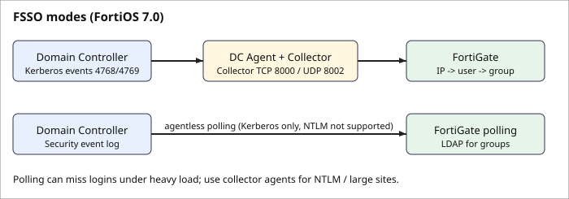

*شکل: حالت‌های FSSO.*

### ۵) مثال حل‌شده

**نیاز:** گروه Finance به سرور مالی، بقیه ممنوع.

``` text
config user ldap
    edit "LDAP-AD"
        set server "192.168.90.40"
        set cnid "sAMAccountName"
        set dn "dc=lab,dc=local"
        set type regular
        set username "CN=svc-fgt,CN=Users,DC=lab,DC=local"
        set password <SERVICE-ACCOUNT-PASSWORD>
        set secure ldaps
        set port 636
    next
end
config user fsso-polling
    edit 1
        set server "192.168.90.40"
        set ldap-server "LDAP-AD"
        set polling-frequency 10
    next
end
config user group
    edit "GRP-FINANCE"
        set group-type fsso-service
        set member "CN=Finance,CN=Users,DC=lab,DC=local"
    next
end
```

(سینتکس نمونه؛ `Unverified`؛ با CLI Reference 7.0 تطبیق شود.) Policy: Source = GRP-FINANCE، Destination = SRV-FIN، Service = HTTPS.

**GUI:** User & Authentication → LDAP Servers؛ Security Fabric → External Connectors → FSSO (Poll Active Directory Server)؛ User & Authentication → User Groups؛ Policy & Objects → Firewall Policy.

**آزمون‌ها:** مثبت: کاربر Finance دسترسی دارد؛ منفی: کاربر دیگر ندارد؛ IP عوض شود؛ Terminal Server.

**مثال متوسط:** کاربر Login کرد ولی Policy مطابق نشد. علت‌ها به ترتیب: نگاشت IP→User نیامده (Polling/Log)، گروه در Filter نیست، DN اشتباه، ساعت ناهماهنگ.

**مثال سخت:** بعضی کاربران پس از ورود با NTLM در Polling دیده نمی‌شوند. علت طبق مستند: Polling فقط Kerberos. راه‌حل: Collector Agent یا اصلاح DNS/SPN تا Kerberos استفاده شود.

### ۶) طراحی و تصمیم‌گیری

| سؤال | تصمیم |
|---|---|
| LDAP یا RADIUS؟ | LDAP برای Directory/گروه؛ RADIUS برای VPN/Wi-Fi/MFA/NPS |
| FSSO کدام حالت؟ | کوچک: Polling؛ بزرگ/NTLM: Collector/DC Agent |
| رمزنگاری | LDAPS/StartTLS |
| Redundancy | چند Collector، چند LDAP |
| Fallback | Captive Portal برای IP بدون Login |

### ۷) Verification

``` text
diagnose test authserver ldap LDAP-AD <user> <password>
diagnose debug authd fsso list
diagnose debug application fnbamd -1
diagnose debug enable
diagnose debug disable
```

### ۸) Troubleshooting

| علامت | علت |
|---|---|
| Bind شکست | DN/رمز/پورت/TLS |
| کاربر یافت نمی‌شود | DN/OU/cnid |
| FSSO کاربر نیست | Kerberos/NTLM، ساعت، Event Log، Group Filter |
| RADIUS Reject | Secret/Client/Policy NPS |
| Policy مطابق نمی‌شود | نگاشت IP→User |

### ۹) نکات امنیتی

- حساب سرویس LDAP read-only؛ رمز قوی؛ ذخیره‌ی رمز در ریپو ممنوع.
- LDAP بدون TLS ممنوع در تولید.
- MFA برای مدیریت و VPN.
- Log ورود ناموفق را مانیتور کنید.

### ۱۰) جمع‌بندی مفهومی

- AAA سه سؤال: کیستی، چه می‌توانی، چه کردی.
- LDAP: Bind سرویس + Search + Bind کاربر.
- Kerberos نیازمند ساعت و DNS؛ Polling فقط Kerberos.
- RADIUS: Request/Accept/Reject با Secret.
- هویت مبتنی بر IP محدودیت دارد؛ طراحی با Fallback.

### ۱۱) تمرین و ارزیابی

**ت1.** (ساده) AAA را تعریف کنید. *(پاسخ: 17-0-ت1)*

**ت2.** (ساده) پورت LDAP و LDAPS؟ *(پاسخ: 17-0-ت2)*

**ت3.** (متوسط) چرا ساعت برای Kerberos مهم است؟ *(پاسخ: 17-0-ت3)*

**ت4.** (متوسط) FSSO Polling چه محدودیتی دارد؟ *(پاسخ: 17-0-ت4)*

**ت5.** (سخت) چند کاربر روی یک Terminal Server دارید؛ چه مشکلی در FSSO پیش می‌آید؟ *(پاسخ: 17-0-ت5)*

**ت6.** (سخت، طراحی) برای ۵۰۰ کاربر ویندوزی و ۵۰ کاربر Mac/Linux راه‌حل هویت را بنویسید. *(پاسخ: 17-0-ت6)*

**Q1.** Quick quiz (English): Why does LDAP authentication use two binds? *(پاسخ: 17-0-Q1)*

### ۱۲) اصطلاحات و English Corner

| مخفف | شکل کامل | معنی |
|---|---|---|
| AAA | Authentication, Authorization, Accounting | هویت، مجوز، حسابرسی |
| LDAP | Lightweight Directory Access Protocol | پروتکل Directory |
| KDC | Key Distribution Center | مرکز توزیع کلید Kerberos |
| FSSO | Fortinet Single Sign-On | ورود یکپارچه |
| NPS | Network Policy Server | سرور RADIUS ویندوز |
| DN | Distinguished Name | نام مسیر در Directory |

- *Use LDAPS or StartTLS to protect directory credentials.* ← برای محافظت از اعتبارنامه‌ها LDAPS/StartTLS بزنید.
- *FSSO maps logons to IP addresses.* ← FSSO ورود را به IP نگاشت می‌کند.

### ۱۳) منابع

- Fortinet Docs: [FSSO polling connector agent installation](https://docs.fortinet.com/document/fortigate/7.0.0/administration-guide/503764/fsso-polling-connector-agent-installation)، [FSSO](https://docs.fortinet.com/document/fortigate/7.0.8/administration-guide/450337)، [config user fsso-polling](https://docs.fortinet.com/document/fortigate/7.0.0/cli-reference/516620/config-user-fsso-polling).
- RFC 4511 (LDAP)، RFC 4120 (Kerberos)، RFC 2865 (RADIUS).

## درس 17-1 — AD، DNS و DHCP روی Windows Server (آماده‌سازی Lab)

**فصل 17 - روز 1 · پیش‌نیاز: فصل ۷ · ۶ ساعت**

### ۱) معرفی درس

FortiGate برای هویت به Directory نیاز دارد. DC را با دامنه‌ی `lab.local` آماده می‌کنیم.

### ۲) پیش‌نیازها

فصل ۷

### ۳) توضیح مفهومی

- DC با DNS؛ کاربران/گروه‌ها (IT، Finance) و حساب سرویس read-only.
- ساعت هماهنگ (NTP) برای Kerberos.
- FortiGate باید DNS/IP DC را بتواند برساند.
- LDAP 389 / LDAPS 636.
- رمزها نمونه، حساب سرویس حداقل دسترسی.

### ۴) مثال ساده

کاربر IT با گروه AD به منابع خاص دسترسی دارد.

### ۵) مثال سازمانی

سازمان: Policy بر اساس گروه (Finance، IT) به‌جای IP.

### ۶) تصویر و توپولوژی

```text
User -> FGT (Auth) -> AD/NPS ; Policy by group
```

### ۷) پیکربندی (GUI و CLI)

> نسخه‌ی هدف: FortiOS 7.0.3 (اسمی؛ از نام Image؛ بوت‌نشده؛ تأیید با `get system status`). دستورها/منوها از مستند عمومی FortiOS 7.0 و دانش مؤلف هستند و **روی Image شما هنوز آزمایش نشده‌اند**؛ در بوت اول مقایسه کنید.

#### روش گرافیکی (GUI)

1. (Windows GUI) Server Manager > Add Roles > AD DS و DNS.
2. Active Directory Users and Computers: گروه IT و کاربر testuser.
3. FortiGate: System > DNS: DC.

#### روش خط فرمان (CLI)

```text
# Windows PowerShell on the lab DC (lab only)
Install-WindowsFeature AD-DS -IncludeManagementTools
Install-ADDSForest -DomainName lab.local -InstallDns
New-ADGroup -Name IT -GroupScope Global
New-ADUser -Name svc-fgt -AccountPassword (Read-Host -AsSecureString) -Enabled $true
```

**توضیح دستورها (چه / چرا / خروجی / راستی‌آزمایی / بازگشت):**

- Forest فقط در Lab؛ پس از ساخت Reboot.
- راستی‌آزمایی: `Get-ADDomain`.
- بازگشت: Snapshot VM.

### ۸) تست عملکرد

- `nslookup lab.local` و `Get-ADUser`.

### ۹) عیب‌یابی

| بخش | شرح |
|---|---|
| Symptom | DC دیده نمی‌شود |
| شواهد/دستور | ping/ nslookup شکست |
| علت | DNS/VLAN |
| رفع | تنظیم DNS/Route |

### ۱۰) تمرین مستقل

> پاسخ‌ها در بخش «پاسخ‌های فصل» انتهای فصل است؛ اول خودتان حل کنید.

**ت1.** چرا DNS روی DC؟ *(پاسخ: 17-1-ت1)*

**ت2.** حساب سرویس؟ *(پاسخ: 17-1-ت2)*

### ۱۱) مرور و ارزیابی

**م1.** چرا ساعت مهم؟ *(پاسخ: 17-1-م1)*

**م2.** سناریو: LDAP وصل نمی‌شود؛ بررسی؟ *(پاسخ: 17-1-م2)*

**معیار تسلط:** تنظیم Auth Server و تست با ابزار تشخیص.

**اشتباهات رایج:** DN/Port/ساعت اشتباه.

### ۱۲) واژگان و English Corner

| واژه | شکل کامل | معنی | کاربرد واقعی |
|---|---|---|---|
| AD | Active Directory | دایرکتوری ویندوز | Auth |
| DC | Domain Controller | سرور دامنه | AD |
| LDAP | Lightweight Directory Access Protocol | پروتکل دایرکتوری | FGT |

| English sentence | ترجمه |
|---|---|
| Use a least-privilege service account for LDAP binds. | برای LDAP Bind از حساب سرویس با حداقل دسترسی استفاده کنید. |
| Synchronize time with NTP. | زمان را با NTP هماهنگ کنید. |

#### کارت Lab — درس 17-1

| # | فیلد | محتوا |
|---|---|---|
| 1 | عنوان و هدف | DC و کاربران |
| 2 | پیش‌نیاز | فصل ۷ |
| 3 | توپولوژی | DC VM + FGT |
| 4 | تجهیزات | Windows DC + FGT |
| 5 | نسخه نرم‌افزار | FortiOS 7.0.3 (اسمی؛ از نام Image؛ بوت‌نشده؛ تأیید با `get system status`) |
| 6 | IP Plan | 192.168.90.40 |
| 7 | وضعیت اولیه | — |
| 8 | صورت مسئله | DC آماده |
| 9 | مراحل هدایت‌شده | بخش‌های ۷ و ۸ همین درس (گام‌به‌گام) |
| 10 | تست عملکرد | nslookup |
| 11 | سناریوی خرابی | DC دیده نمی‌شود |
| 12 | روش عیب‌یابی | بخش ۹ همین درس (لایه‌ای/با شواهد) |
| 13 | نتیجه‌ی مورد انتظار | کاربر/گروه |
| 14 | معیار پذیرش | LDAP قابل‌اتصال |
| 15 | مستندات نهایی | `03-ops/ad-lab.md` |
| 16 | Cleanup و بازگردانی | Snapshot |

> **وضعیت راستی‌آزمایی (خارج از ۱۶ فیلد):** **اجرا نشده (فقط طراحی).** Image FortiGate هنوز بوت نشده؛ دستورها/منوها آزمایش‌نشده‌اند.

---

<a id="l-17-2"></a>

## درس 17-2 — LDAP و Policy بر اساس گروه

**فصل 17 - روز 2 · پیش‌نیاز: درس ۱۷-۱ · ۶ ساعت**

### ۱) معرفی درس

FortiGate را به AD وصل می‌کنیم و Policy را بر اساس گروه می‌نویسیم.

### ۲) پیش‌نیازها

درس ۱۷-۱

### ۳) توضیح مفهومی

- `config user ldap`: server، cnid=sAMAccountName، dn، bind account.
- User Group با `match` گروه AD (DN کامل).
- Policy مبتنی بر هویت نیاز به Authentication فعال (Firewall Auth/Captive/FSSO).
- تست: `diagnose test authserver ldap`.
- Debug: `diagnose debug application fnbamd -1`.

### ۴) مثال ساده

کاربر IT با گروه AD به منابع خاص دسترسی دارد.

### ۵) مثال سازمانی

سازمان: Policy بر اساس گروه (Finance، IT) به‌جای IP.

### ۶) تصویر و توپولوژی

```text
User -> FGT (Auth) -> AD/NPS ; Policy by group
```

### ۷) پیکربندی (GUI و CLI)

> نسخه‌ی هدف: FortiOS 7.0.3 (اسمی؛ از نام Image؛ بوت‌نشده؛ تأیید با `get system status`). دستورها/منوها از مستند عمومی FortiOS 7.0 و دانش مؤلف هستند و **روی Image شما هنوز آزمایش نشده‌اند**؛ در بوت اول مقایسه کنید.

#### روش گرافیکی (GUI)

1. User & Authentication > LDAP Servers > Create New: Name، Server IP، Common Name Identifier sAMAccountName، Distinguished Name.
2. Bind Type Regular؛ Username/Password.
3. Test Connectivity و Test User Credentials.
4. User Groups > Create New: Remote Groups > Add > گروه IT.

#### روش خط فرمان (CLI)

```text
config user ldap
    edit "LDAP-AD"
        set server "192.168.90.40"
        set cnid "sAMAccountName"
        set dn "dc=lab,dc=local"
        set type regular
        set username "CN=svc-fgt,CN=Users,DC=lab,DC=local"
        set password <SERVICE-ACCOUNT-PASSWORD>
    next
end
diagnose test authserver ldap LDAP-AD testuser <PASSWORD>
```

**توضیح دستورها (چه / چرا / خروجی / راستی‌آزمایی / بازگشت):**

- `dn`: ریشه‌ی جستجو.
- `username/password`: حساب Bind.
- تست باید Authentication success بدهد.
- بازگشت: `delete "LDAP-AD"`.

### ۸) تست عملکرد

- Test Connectivity موفق.

### ۹) عیب‌یابی

| بخش | شرح |
|---|---|
| Symptom | Test credentials شکست |
| شواهد/دستور | `diagnose debug application fnbamd -1` |
| علت | DN/رمز/پورت |
| رفع | اصلاح DN/رمز/Firewall |

### ۱۰) تمرین مستقل

> پاسخ‌ها در بخش «پاسخ‌های فصل» انتهای فصل است؛ اول خودتان حل کنید.

**ت1.** cnid؟ *(پاسخ: 17-2-ت1)*

**ت2.** Bind؟ *(پاسخ: 17-2-ت2)*

### ۱۱) مرور و ارزیابی

**م1.** چرا DN دقیق؟ *(پاسخ: 17-2-م1)*

**م2.** سناریو: کاربر یافت نمی‌شود؛ علت؟ *(پاسخ: 17-2-م2)*

**معیار تسلط:** تنظیم Auth Server و تست با ابزار تشخیص.

**اشتباهات رایج:** DN/Port/ساعت اشتباه.

### ۱۲) واژگان و English Corner

| واژه | شکل کامل | معنی | کاربرد واقعی |
|---|---|---|---|
| cnid | Common name identifier | ویژگی ورود | LDAP |
| DN | Distinguished Name | نام مسیر | LDAP |
| Bind | LDAP bind | احراز حساب سرویس | LDAP |

| English sentence | ترجمه |
|---|---|
| Test the LDAP connection before building policies. | قبل از ساخت Policy اتصال LDAP را تست کنید. |
| Use the full DN of the group. | از DN کامل گروه استفاده کنید. |

#### کارت Lab — درس 17-2

| # | فیلد | محتوا |
|---|---|---|
| 1 | عنوان و هدف | LDAP |
| 2 | پیش‌نیاز | درس ۱۷-۱ |
| 3 | توپولوژی | FGT + DC |
| 4 | تجهیزات | FGT + DC |
| 5 | نسخه نرم‌افزار | FortiOS 7.0.3 (اسمی؛ از نام Image؛ بوت‌نشده؛ تأیید با `get system status`) |
| 6 | IP Plan | 192.168.90.40 |
| 7 | وضعیت اولیه | DC آماده |
| 8 | صورت مسئله | LDAP + Group |
| 9 | مراحل هدایت‌شده | بخش‌های ۷ و ۸ همین درس (گام‌به‌گام) |
| 10 | تست عملکرد | diagnose test |
| 11 | سناریوی خرابی | Test credentials شکست |
| 12 | روش عیب‌یابی | بخش ۹ همین درس (لایه‌ای/با شواهد) |
| 13 | نتیجه‌ی مورد انتظار | success |
| 14 | معیار پذیرش | کاربر تأیید |
| 15 | مستندات نهایی | `03-ops/ldap.md` |
| 16 | Cleanup و بازگردانی | حذف LDAP |

> **وضعیت راستی‌آزمایی (خارج از ۱۶ فیلد):** **اجرا نشده (فقط طراحی).** Image FortiGate هنوز بوت نشده؛ دستورها/منوها آزمایش‌نشده‌اند.

---

<a id="l-17-3"></a>

## درس 17-3 — RADIUS (NPS) و MFA

**فصل 17 - روز 3 · پیش‌نیاز: درس ۱۷-۲ · ۶ ساعت**

### ۱) معرفی درس

RADIUS برای Authentication VPN/Wi-Fi/Firewall با NPS ویندوز یا سرور دیگر.

### ۲) پیش‌نیازها

درس ۱۷-۲

### ۳) توضیح مفهومی

- `config user radius`: server، secret.
- NPS: Network Policy/Client (FGT به‌عنوان RADIUS Client).
- پورت‌ها UDP 1812/1813.
- MFA (مفهومی): OTP/Token.
- تست: `diagnose test authserver radius`.

### ۴) مثال ساده

کاربر IT با گروه AD به منابع خاص دسترسی دارد.

### ۵) مثال سازمانی

سازمان: Policy بر اساس گروه (Finance، IT) به‌جای IP.

### ۶) تصویر و توپولوژی

```text
User -> FGT (Auth) -> AD/NPS ; Policy by group
```

### ۷) پیکربندی (GUI و CLI)

> نسخه‌ی هدف: FortiOS 7.0.3 (اسمی؛ از نام Image؛ بوت‌نشده؛ تأیید با `get system status`). دستورها/منوها از مستند عمومی FortiOS 7.0 و دانش مؤلف هستند و **روی Image شما هنوز آزمایش نشده‌اند**؛ در بوت اول مقایسه کنید.

#### روش گرافیکی (GUI)

1. User & Authentication > RADIUS Servers > Create New.
2. Name، Primary Server IP، Secret.
3. Test Connectivity.
4. NPS (Windows): RADIUS Clients > New > IP فایروال و Secret.

#### روش خط فرمان (CLI)

```text
config user radius
    edit "RADIUS-NPS"
        set server "192.168.90.41"
        set secret <RADIUS-SECRET>
    next
end
diagnose test authserver radius RADIUS-NPS pap testuser <PASSWORD>
```

**توضیح دستورها (چه / چرا / خروجی / راستی‌آزمایی / بازگشت):**

- Secret باید در NPS هم یکی باشد.
- `pap`: روش تست.
- بازگشت: `delete`.

### ۸) تست عملکرد

- Test موفق.

### ۹) عیب‌یابی

| بخش | شرح |
|---|---|
| Symptom | Access-Reject |
| شواهد/دستور | NPS Event Log |
| علت | Secret/Policy NPS |
| رفع | تطبیق Secret/Policy |

### ۱۰) تمرین مستقل

> پاسخ‌ها در بخش «پاسخ‌های فصل» انتهای فصل است؛ اول خودتان حل کنید.

**ت1.** پورت RADIUS؟ *(پاسخ: 17-3-ت1)*

**ت2.** Secret؟ *(پاسخ: 17-3-ت2)*

### ۱۱) مرور و ارزیابی

**م1.** چرا RADIUS Client لازم؟ *(پاسخ: 17-3-م1)*

**م2.** سناریو: Reject؛ بررسی؟ *(پاسخ: 17-3-م2)*

**معیار تسلط:** تنظیم Auth Server و تست با ابزار تشخیص.

**اشتباهات رایج:** DN/Port/ساعت اشتباه.

### ۱۲) واژگان و English Corner

| واژه | شکل کامل | معنی | کاربرد واقعی |
|---|---|---|---|
| RADIUS | Remote Authentication Dial-In User Service | پروتکل AAA | VPN/Wi-Fi |
| NPS | Network Policy Server | سرور RADIUS ویندوز | Windows |
| MFA | Multi-Factor Authentication | احراز چندعاملی | VPN |

| English sentence | ترجمه |
|---|---|
| Define the firewall as a RADIUS client on NPS. | فایروال را در NPS به‌عنوان RADIUS Client تعریف کنید. |
| The shared secret must match. | Secret مشترک باید یکی باشد. |

#### کارت Lab — درس 17-3

| # | فیلد | محتوا |
|---|---|---|
| 1 | عنوان و هدف | RADIUS |
| 2 | پیش‌نیاز | درس ۱۷-۲ |
| 3 | توپولوژی | FGT + NPS |
| 4 | تجهیزات | FGT + Windows NPS |
| 5 | نسخه نرم‌افزار | FortiOS 7.0.3 (اسمی؛ از نام Image؛ بوت‌نشده؛ تأیید با `get system status`) |
| 6 | IP Plan | 192.168.90.41 |
| 7 | وضعیت اولیه | DC |
| 8 | صورت مسئله | RADIUS |
| 9 | مراحل هدایت‌شده | بخش‌های ۷ و ۸ همین درس (گام‌به‌گام) |
| 10 | تست عملکرد | diagnose test |
| 11 | سناریوی خرابی | Access-Reject |
| 12 | روش عیب‌یابی | بخش ۹ همین درس (لایه‌ای/با شواهد) |
| 13 | نتیجه‌ی مورد انتظار | success |
| 14 | معیار پذیرش | تأیید |
| 15 | مستندات نهایی | `03-ops/radius.md` |
| 16 | Cleanup و بازگردانی | حذف |

> **وضعیت راستی‌آزمایی (خارج از ۱۶ فیلد):** **اجرا نشده (فقط طراحی).** Image FortiGate هنوز بوت نشده؛ دستورها/منوها آزمایش‌نشده‌اند.

---

<a id="l-17-4"></a>

## درس 17-4 — FSSO: Single Sign-On

**فصل 17 - روز 4 · پیش‌نیاز: درس ۱۷-۳ · ۶ ساعت**

### ۱) معرفی درس

FSSO ورود ویندوزی کاربر را به FortiGate اطلاع می‌دهد تا کاربر دوباره لاگین نکند.

### ۲) پیش‌نیازها

درس ۱۷-۳

### ۳) توضیح مفهومی

- Collector Agent روی DC یا پیمایش مستقیم (DC Agent / Polling).
- FSSO groups در Policy.
- پورت‌ها (TCP 8000 و ...) `Unverified`.
- نیاز به Event Log خواندن از DC.
- مناسب شبکه‌ی ویندوزی.

### ۴) مثال ساده

کاربر IT با گروه AD به منابع خاص دسترسی دارد.

### ۵) مثال سازمانی

سازمان: Policy بر اساس گروه (Finance، IT) به‌جای IP.

### ۶) تصویر و توپولوژی

```text
User -> FGT (Auth) -> AD/NPS ; Policy by group
```

### ۷) پیکربندی (GUI و CLI)

> نسخه‌ی هدف: FortiOS 7.0.3 (اسمی؛ از نام Image؛ بوت‌نشده؛ تأیید با `get system status`). دستورها/منوها از مستند عمومی FortiOS 7.0 و دانش مؤلف هستند و **روی Image شما هنوز آزمایش نشده‌اند**؛ در بوت اول مقایسه کنید.

#### روش گرافیکی (GUI)

1. Security Fabric > External Connectors > Create New > FSSO Agent on Windows AD.
2. Name، Primary FSSO agent، Password.
3. User Groups: FSSO > Members.
4. Policy: Source = گروه FSSO.

#### روش خط فرمان (CLI)

```text
config user fsso
    edit "FSSO-AD"
        set server "192.168.90.40"
        set password <FSSO-PASSWORD>
    next
end
diagnose debug authd fsso list
```

**توضیح دستورها (چه / چرا / خروجی / راستی‌آزمایی / بازگشت):**

- `diagnose debug authd fsso list`: کاربران لاگین‌شده (`Unverified`).
- بازگشت: `delete`.

### ۸) تست عملکرد

- ورود کاربر دامنه‌ای و دیدن در FSSO list.

### ۹) عیب‌یابی

| بخش | شرح |
|---|---|
| Symptom | کاربر شناسایی نمی‌شود |
| شواهد/دستور | `fsso list` خالی |
| علت | Agent/Log/Port |
| رفع | بررسی Agent و ارتباط |

### ۱۰) تمرین مستقل

> پاسخ‌ها در بخش «پاسخ‌های فصل» انتهای فصل است؛ اول خودتان حل کنید.

**ت1.** FSSO چیست؟ *(پاسخ: 17-4-ت1)*

**ت2.** چرا کاربر دوباره لاگین نمی‌کند؟ *(پاسخ: 17-4-ت2)*

### ۱۱) مرور و ارزیابی

**م1.** چرا ساعت مهم؟ *(پاسخ: 17-4-م1)*

**م2.** سناریو: گروه خالی؛ چرا؟ *(پاسخ: 17-4-م2)*

**معیار تسلط:** تنظیم Auth Server و تست با ابزار تشخیص.

**اشتباهات رایج:** DN/Port/ساعت اشتباه.

### ۱۲) واژگان و English Corner

| واژه | شکل کامل | معنی | کاربرد واقعی |
|---|---|---|---|
| FSSO | Fortinet Single Sign-On | ورود یکپارچه | AD |
| Collector | FSSO collector agent | جمع‌آوری ورود | DC |

| English sentence | ترجمه |
|---|---|
| FSSO maps Windows logons to firewall identities. | FSSO ورودهای ویندوز را به هویت‌های فایروال نگاشت می‌کند. |
| Verify the collector can read the domain controller logs. | بررسی کنید Collector می‌تواند Log دامنه را بخواند. |

#### کارت Lab — درس 17-4

| # | فیلد | محتوا |
|---|---|---|
| 1 | عنوان و هدف | FSSO |
| 2 | پیش‌نیاز | درس ۱۷-۳ |
| 3 | توپولوژی | FGT + DC + Client |
| 4 | تجهیزات | FGT + DC |
| 5 | نسخه نرم‌افزار | FortiOS 7.0.3 (اسمی؛ از نام Image؛ بوت‌نشده؛ تأیید با `get system status`) |
| 6 | IP Plan | — |
| 7 | وضعیت اولیه | LDAP آماده |
| 8 | صورت مسئله | FSSO |
| 9 | مراحل هدایت‌شده | بخش‌های ۷ و ۸ همین درس (گام‌به‌گام) |
| 10 | تست عملکرد | fsso list |
| 11 | سناریوی خرابی | کاربر شناسایی نمی‌شود |
| 12 | روش عیب‌یابی | بخش ۹ همین درس (لایه‌ای/با شواهد) |
| 13 | نتیجه‌ی مورد انتظار | کاربر دیده شود |
| 14 | معیار پذیرش | Policy گروهی |
| 15 | مستندات نهایی | `03-ops/fsso.md` |
| 16 | Cleanup و بازگردانی | حذف |

> **وضعیت راستی‌آزمایی (خارج از ۱۶ فیلد):** **اجرا نشده (فقط طراحی).** Image FortiGate هنوز بوت نشده؛ دستورها/منوها آزمایش‌نشده‌اند.

---

<a id="l-17-5"></a>

## درس 17-5 — Captive Portal، مهمان و Firewall Authentication

**فصل 17 - روز 5 · پیش‌نیاز: درس ۱۷-۴ · ۶ ساعت**

### ۱) معرفی درس

برای مهمان/کاربران غیر دامنه‌ای، صفحه‌ی Login قبل از دسترسی.

### ۲) پیش‌نیازها

درس ۱۷-۴

### ۳) توضیح مفهومی

- Interface `security-mode captive-portal` یا Policy با Authentication.
- Groups مجاز.
- HTTPS Redirect و Certificate.
- Timeout و Re-auth.
- Guest: حساب موقت (Local User).

### ۴) مثال ساده

کاربر IT با گروه AD به منابع خاص دسترسی دارد.

### ۵) مثال سازمانی

سازمان: Policy بر اساس گروه (Finance، IT) به‌جای IP.

### ۶) تصویر و توپولوژی

```text
User -> FGT (Auth) -> AD/NPS ; Policy by group
```

### ۷) پیکربندی (GUI و CLI)

> نسخه‌ی هدف: FortiOS 7.0.3 (اسمی؛ از نام Image؛ بوت‌نشده؛ تأیید با `get system status`). دستورها/منوها از مستند عمومی FortiOS 7.0 و دانش مؤلف هستند و **روی Image شما هنوز آزمایش نشده‌اند**؛ در بوت اول مقایسه کنید.

#### روش گرافیکی (GUI)

1. Network > Interfaces > VLAN50 > Security Mode: Captive Portal؛ Authentication Portal: Local؛ Groups.
2. User & Authentication > User Definition > Local User.
3. Policy برای VLAN50.
4. تست مرورگر.

#### روش خط فرمان (CLI)

```text
config system interface
    edit "VLAN50"
        set security-mode captive-portal
        set security-groups "GRP-GUEST"
    next
end
config user local
    edit "guest1"
        set type password
        set passwd <GUEST-PASSWORD>
    next
end
```

**توضیح دستورها (چه / چرا / خروجی / راستی‌آزمایی / بازگشت):**

- `security-mode captive-portal`: Portal روی VLAN.
- Local User موقت.
- راستی‌آزمایی: مرورگر به صفحه‌ی Login هدایت.
- بازگشت: `set security-mode none`.

### ۸) تست عملکرد

- ورود Guest و دسترسی اینترنت.

### ۹) عیب‌یابی

| بخش | شرح |
|---|---|
| Symptom | Portal باز نمی‌شود |
| شواهد/دستور | HTTP/HTTPS؛ Certificate |
| علت | allowaccess/Portal |
| رفع | تنظیم Portal |

### ۱۰) تمرین مستقل

> پاسخ‌ها در بخش «پاسخ‌های فصل» انتهای فصل است؛ اول خودتان حل کنید.

**ت1.** Captive Portal چه کاری می‌کند؟ *(پاسخ: 17-5-ت1)*

**ت2.** Guest حساب چگونه؟ *(پاسخ: 17-5-ت2)*

### ۱۱) مرور و ارزیابی

**م1.** چرا Certificate مهم؟ *(پاسخ: 17-5-م1)*

**م2.** سناریو: Login لوپ؛ علت؟ *(پاسخ: 17-5-م2)*

**معیار تسلط:** تنظیم Auth Server و تست با ابزار تشخیص.

**اشتباهات رایج:** DN/Port/ساعت اشتباه.

### ۱۲) واژگان و English Corner

| واژه | شکل کامل | معنی | کاربرد واقعی |
|---|---|---|---|
| Captive portal | Captive portal | صفحه‌ی Login | Guest |
| Local user | Local user | کاربر محلی | Guest |

| English sentence | ترجمه |
|---|---|
| Use a captive portal for guest access. | برای دسترسی مهمان از Captive Portal استفاده کنید. |
| Time-limit the guest accounts. | حساب‌های مهمان را زمان‌دار کنید. |

#### کارت Lab — درس 17-5

| # | فیلد | محتوا |
|---|---|---|
| 1 | عنوان و هدف | Captive Portal |
| 2 | پیش‌نیاز | درس ۱۷-۴ |
| 3 | توپولوژی | FGT + Guest PC |
| 4 | تجهیزات | FGT + Client |
| 5 | نسخه نرم‌افزار | FortiOS 7.0.3 (اسمی؛ از نام Image؛ بوت‌نشده؛ تأیید با `get system status`) |
| 6 | IP Plan | VLAN50 |
| 7 | وضعیت اولیه | — |
| 8 | صورت مسئله | Portal |
| 9 | مراحل هدایت‌شده | بخش‌های ۷ و ۸ همین درس (گام‌به‌گام) |
| 10 | تست عملکرد | مرورگر |
| 11 | سناریوی خرابی | Portal باز نمی‌شود |
| 12 | روش عیب‌یابی | بخش ۹ همین درس (لایه‌ای/با شواهد) |
| 13 | نتیجه‌ی مورد انتظار | Login |
| 14 | معیار پذیرش | دسترسی |
| 15 | مستندات نهایی | `03-ops/captive.md` |
| 16 | Cleanup و بازگردانی | حذف |

> **وضعیت راستی‌آزمایی (خارج از ۱۶ فیلد):** **اجرا نشده (فقط طراحی).** Image FortiGate هنوز بوت نشده؛ دستورها/منوها آزمایش‌نشده‌اند.

---

<a id="l-17-6"></a>

## درس 17-6 — عیب‌یابی Authentication و آزمون فصل

**فصل 17 - روز 6 · پیش‌نیاز: درس ۱۷-۵ · ۶ ساعت**

### ۱) معرفی درس

عیب‌یابی منظم: ارتباط، DNS، ساعت، DN، رمز، پورت.

### ۲) پیش‌نیازها

درس ۱۷-۵

### ۳) توضیح مفهومی

- چک‌لیست: ping/پورت، DNS، ساعت، DN، حساب سرویس، Secret.
- ابزار: `diagnose test authserver`, `diagnose debug application fnbamd -1`.
- سناریوها: LDAP DN غلط، RADIUS Secret، FSSO Agent.
- آزمون: ۵ مورد.

### ۴) مثال ساده

کاربر IT با گروه AD به منابع خاص دسترسی دارد.

### ۵) مثال سازمانی

سازمان: Policy بر اساس گروه (Finance، IT) به‌جای IP.

### ۶) تصویر و توپولوژی

```text
User -> FGT (Auth) -> AD/NPS ; Policy by group
```

### ۷) پیکربندی (GUI و CLI)

> نسخه‌ی هدف: FortiOS 7.0.3 (اسمی؛ از نام Image؛ بوت‌نشده؛ تأیید با `get system status`). دستورها/منوها از مستند عمومی FortiOS 7.0 و دانش مؤلف هستند و **روی Image شما هنوز آزمایش نشده‌اند**؛ در بوت اول مقایسه کنید.

#### روش گرافیکی (GUI)

1. Log & Report > Events (User).
2. User Monitor.
3. Test در GUI.

#### روش خط فرمان (CLI)

```text
diagnose debug application fnbamd -1
diagnose debug enable
diagnose test authserver ldap LDAP-AD testuser <PASSWORD>
diagnose debug disable
```

**توضیح دستورها (چه / چرا / خروجی / راستی‌آزمایی / بازگشت):**

- خروجی را با شناسه‌ی خطا بخوانید.
- بازگشت: debug disable.

### ۸) تست عملکرد

- سه خطای Auth را رفع کنید.

### ۹) عیب‌یابی

| بخش | شرح |
|---|---|
| Symptom | Auth شکست |
| شواهد/دستور | Debug: bind failed |
| علت | رمز/DN |
| رفع | اصلاح |

### ۱۰) تمرین مستقل

> پاسخ‌ها در بخش «پاسخ‌های فصل» انتهای فصل است؛ اول خودتان حل کنید.

**ت1.** ابزار تست؟ *(پاسخ: 17-6-ت1)*

**ت2.** Debug؟ *(پاسخ: 17-6-ت2)*

### ۱۱) مرور و ارزیابی

**م1.** چرا چک‌لیست؟ *(پاسخ: 17-6-م1)*

**م2.** سناریو: فقط یک کاربر؛ چرا؟ *(پاسخ: 17-6-م2)*

**معیار تسلط:** تنظیم Auth Server و تست با ابزار تشخیص.

**اشتباهات رایج:** DN/Port/ساعت اشتباه.

### ۱۲) واژگان و English Corner

| واژه | شکل کامل | معنی | کاربرد واقعی |
|---|---|---|---|
| fnbamd | FortiGate authentication daemon | فرایند Auth | Debug |

| English sentence | ترجمه |
|---|---|
| Use the test tools before reading debug output. | قبل از Debug از ابزار تست استفاده کنید. |

#### کارت Lab — درس 17-6

| # | فیلد | محتوا |
|---|---|---|
| 1 | عنوان و هدف | آزمون Auth |
| 2 | پیش‌نیاز | درس ۱۷-۵ |
| 3 | توپولوژی | FGT + DC + NPS |
| 4 | تجهیزات | FGT |
| 5 | نسخه نرم‌افزار | FortiOS 7.0.3 (اسمی؛ از نام Image؛ بوت‌نشده؛ تأیید با `get system status`) |
| 6 | IP Plan | — |
| 7 | وضعیت اولیه | Auth آماده |
| 8 | صورت مسئله | سه خطا |
| 9 | مراحل هدایت‌شده | بخش‌های ۷ و ۸ همین درس (گام‌به‌گام) |
| 10 | تست عملکرد | diagnose |
| 11 | سناریوی خرابی | Auth شکست |
| 12 | روش عیب‌یابی | بخش ۹ همین درس (لایه‌ای/با شواهد) |
| 13 | نتیجه‌ی مورد انتظار | RCA |
| 14 | معیار پذیرش | ≥ ۴ از ۵ |
| 15 | مستندات نهایی | `03-ops/rca-auth.md` |
| 16 | Cleanup و بازگردانی | — |

> **وضعیت راستی‌آزمایی (خارج از ۱۶ فیلد):** **اجرا نشده (فقط طراحی).** Image FortiGate هنوز بوت نشده؛ دستورها/منوها آزمایش‌نشده‌اند.

---

<a id="ans-17"></a>

## درس 17-7 — عیب‌یابی Authentication بر اساس شواهد: از Bind تا Policy

**فصل ۱۷ · درس افزوده (پس از ۱۷-۶) · پیش‌نیاز: ۱۷-۰، ۱۴-۷ · ≈ ۴ ساعت**

> **وضعیت:** `Unverified` روی Image؛ فرمت خروجی نمونه است.

### ۱) هدف آموزشی

مشکل Authentication را لایه‌به‌لایه (شبکه، TLS، Bind، Search، Group، نگاشت، Policy) پیدا و رفع کند و برای هر لایه شاهد جمع کند.

### ۲) مفهوم پایه

«Login نمی‌شود» علامت است؛ علت ممکن است در هر نقطه‌ی زنجیره‌ی **کاربر → فایروال → سرور Auth → Directory → گروه → Policy** باشد. با تقسیم مسیر (۱۴-۷) هر حلقه را جدا می‌آزماییم.

### ۳) توضیح عمیق فنی

| لایه | سؤال | آزمون |
|---|---|---|
| شبکه | فایروال به سرور می‌رسد؟ | `execute ping`، Sniffer روی 389/636/1812 |
| DNS/ساعت | نام و زمان درست؟ | `execute nslookup`، NTP |
| TLS | گواهی LDAPS معتبر؟ | Capture، پیام خطای TLS |
| Bind | حساب سرویس درست؟ | `diagnose test authserver ldap` |
| Search | DN/cnid درست؟ | Debug fnbamd |
| گروه | کاربر عضو گروه؟ | AD Users and Computers |
| FSSO | نگاشت IP→User هست؟ | `diagnose debug authd fsso list` |
| Policy | Source گروه درست؟ | Debug Flow (Policy ID) |

#### ۳-۱) خواندن خطاها

- **Invalid credentials (49):** رمز/DN کاربر اشتباه.
- **Can't contact LDAP server:** شبکه/پورت/TLS.
- **No such object (32):** DN پایه اشتباه.
- RADIUS **Access-Reject:** Secret/Policy NPS؛ **بدون پاسخ:** Firewall/Client تعریف نشده.

#### ۳-۲) FSSO

- کاربر Login کرده ولی در لیست نیست: Event Log DC (Kerberos)، Group Filter، ارتباط Collector (TCP 8000)، ساعت.
- کاربر در لیست هست ولی Policy مطابق نمی‌شود: گروه در Policy/Group Mapping، ترتیب Policy.

### ۴) مثال حل‌شده

**پرونده:** کاربر testuser Login نمی‌شود.

``` text
FGT # diagnose test authserver ldap LDAP-AD testuser <PASSWORD>
FGT # diagnose debug application fnbamd -1
FGT # diagnose debug enable
```

شواهد (نمونه): `ldap_bind... error 49` ← رمز یا DN. بررسی: حساب سرویس OK (تست جداگانه)، DN کاربر با `cnid` ناسازگار بود (`userPrincipalName` به‌جای `sAMAccountName`). **رفع:** `cnid` اصلاح. **تأیید:** تست دوباره + Login واقعی + Log. **پیشگیری:** مستندسازی cnid.

``` text
FGT # diagnose debug disable
FGT # diagnose debug reset
```

**مثال سخت:** فقط کاربران یک OU Login می‌شوند. علت: `dn` پایه روی OU محدود. **رفع:** dn پایه‌ی دامنه یا چند Search.

### ۵) GUI و CLI

**GUI:** User & Authentication → LDAP Servers → Test Connectivity / Test User Credentials؛ Monitor → Firewall User Monitor؛ Log & Report → Events → User.

**CLI:** `diagnose test authserver ...`، `diagnose debug authd fsso list`، `diagnose debug application fnbamd -1`.

### ۶) نکات امنیتی

- Debug رمز را آشکار می‌کند؛ فایل Capture را حذف کنید.
- تست با کاربر واقعی در Change.

### ۷) جمع‌بندی

Auth را در ۸ لایه تقسیم کنید؛ شاهد جمع کنید؛ یک تغییر در هر زمان؛ Debug را Disable کنید.

### ۸) تمرین و ارزیابی

**ت1.** (ساده) خطای 49 LDAP یعنی چه؟ *(پاسخ: 17-7-ت1)*

**ت2.** (متوسط) نقشه‌ی «لایه → آزمون» را بنویسید. *(پاسخ: 17-7-ت2)*

**ت3.** (سخت) FSSO کاربر را نشان می‌دهد ولی Policy مطابق نمی‌شود؛ ۴ فرضیه و آزمون. *(پاسخ: 17-7-ت3)*

**Q1.** Quick quiz (English): Which tool checks an LDAP login independently of firewall policies? *(پاسخ: 17-7-Q1)*

### ۹) اصطلاحات و English Corner

| مخفف | شکل کامل | معنی |
|---|---|---|
| fnbamd | FortiGate authentication daemon | فرایند Authentication |
| cnid | Common name identifier | ویژگی نام ورود |
| Bind | LDAP bind | ورود به Directory |

- *Test authentication with the CLI tool before debugging policies.* ← قبل از Policy، Authentication را با ابزار CLI تست کنید.

### ۱۰) منابع

- Fortinet Docs: FortiOS 7.0 Administration Guide — Authentication؛ CLI Reference `diagnose test authserver`.

## پاسخ‌های فصل 17

> ابتدا بدون نگاه حل کنید. شناسه: درس-نوع+شماره (ت = تمرین، م = مرور).

**17-1-ت1** — چرا DNS روی DC؟

AD بدون DNS کار نمی‌کند.

**17-1-ت2** — حساب سرویس؟

حداقل دسترسی read-only.

**17-1-م1** — چرا ساعت مهم؟

Kerberos.

**17-1-م2** — سناریو: LDAP وصل نمی‌شود؛ بررسی؟

پورت و DNS.

**17-2-ت1** — cnid؟

نام ویژگی ورود (sAMAccountName).

**17-2-ت2** — Bind؟

ورود حساب سرویس.

**17-2-م1** — چرا DN دقیق؟

جستجو در مسیر درست.

**17-2-م2** — سناریو: کاربر یافت نمی‌شود؛ علت؟

DN/OU اشتباه.

**17-3-ت1** — پورت RADIUS؟

UDP 1812/1813.

**17-3-ت2** — Secret؟

رمز مشترک Client/Server.

**17-3-م1** — چرا RADIUS Client لازم؟

NPS فقط Clientهای تعریف‌شده را می‌پذیرد.

**17-3-م2** — سناریو: Reject؛ بررسی؟

Event Viewer NPS.

**17-4-ت1** — FSSO چیست؟

انتقال هویت ورود ویندوز به FGT.

**17-4-ت2** — چرا کاربر دوباره لاگین نمی‌کند؟

SSO.

**17-4-م1** — چرا ساعت مهم؟

Kerberos.

**17-4-م2** — سناریو: گروه خالی؛ چرا؟

Collector نمی‌بیند.

**17-5-ت1** — Captive Portal چه کاری می‌کند؟

Login قبل از دسترسی.

**17-5-ت2** — Guest حساب چگونه؟

Local User موقت.

**17-5-م1** — چرا Certificate مهم؟

HTTPS Redirect.

**17-5-م2** — سناریو: Login لوپ؛ علت؟

Certificate/Redirect.

**17-6-ت1** — ابزار تست؟

diagnose test authserver.

**17-6-ت2** — Debug؟

fnbamd.

**17-6-م1** — چرا چک‌لیست؟

ترتیب سریع.

**17-6-م2** — سناریو: فقط یک کاربر؛ چرا؟

گروه/پسورد.


---

<a id="ch18"></a>


### پاسخ‌های درس افزوده‌ی 17-0 (فصل 17)

**17-0-ت1** — Authentication (کیستی)، Authorization (چه می‌توانی)، Accounting (چه کردی).

**17-0-ت2** — LDAP 389؛ LDAPS 636.

**17-0-ت3** — Kerberos به Ticket با Timestamp وابسته است؛ اختلاف زمان زیاد باعث رد Ticket می‌شود.

**17-0-ت4** — فقط Kerberos (4768/4769)؛ NTLM پشتیبانی نمی‌شود؛ در ورود هم‌زمان زیاد ممکن است ورودی از دست برود.

**17-0-ت5** — چند کاربر یک IP دارند و FSSO فقط یک نگاشت IP→User می‌بیند؛ راه‌حل Terminal Server Agent یا Policy IP-based.

**17-0-ت6** — ویندوز: FSSO + LDAP؛ Mac/Linux: Captive Portal/RADIUS یا Policy IP-based؛ MFA برای VPN؛ Fallback و Redundancy.

**17-0-Q1** — The first bind uses a service account to find the user DN; the second bind with the user DN and password verifies the password.


### پاسخ‌های درس افزوده‌ی 17-7 (فصل 17)

**17-7-ت1** — Invalid credentials: رمز یا DN کاربر اشتباه.

**17-7-ت2** — شبکه (ping/Sniffer)، DNS/ساعت، TLS، Bind، Search/DN، گروه، نگاشت FSSO، Policy.

**17-7-ت3** — ۱) نگاشت IP→User منقضی؛ ۲) گروه در Group Filter/Policy نیست؛ ۳) ترتیب Policy؛ ۴) IP عوض شده. آزمون: fsso list، Debug Flow، Log.

**17-7-Q1** — diagnose test authserver (the authentication test command).

# فصل 18 — IPsec Site-to-Site: IKEv2، Phase 1/2، MTU و عیب‌یابی (G7)

**مدت:** ۳۶ ساعت | **پیش‌نیاز:** فصل ۱۳، ۱۴؛ فصل ۵ (Routing).
**اهداف:** مفهوم IPsec (IKE Phase 1/2، SA، Proposal)؛ ساخت Tunnel بین دو FortiGate (و بعداً CSR)؛ Static Route و Policy برای ترافیک Tunnel؛ MTU/MSS؛ عیب‌یابی «Tunnel بالا ولی ترافیک نه».
**نسخه:** FortiOS 7.0.3 اسمی؛ دستورها آزمایش‌نشده. IPsec در Lab بدون لایسنس ممکن است (`Unverified`).
**Gate G7:** Tunnel بالا + ترافیک دوطرفه + سناریوی عیب Phase 2 mismatch.
**اشتباهات رایج:** Proposal ناهمسان؛ Selector نادرست؛ Route/Policy فراموش‌شده؛ NAT-T؛ MTU.

**درس‌های فصل:**
- [درس 18-1 — مفهوم IPsec: IKE، SA و Proposal](#l-18-1)
- [درس 18-2 — ساخت Tunnel بین دو FortiGate (CLI و GUI)](#l-18-2)
- [درس 18-3 — عیب‌یابی IPsec: Phase 1/2 و Debug](#l-18-3)
- [درس 18-4 — MTU/MSS و Fragmentation در Tunnel](#l-18-4)
- [درس 18-5 — Tunnel با Cisco CSR و Dead Peer Detection](#l-18-5)
- [درس 18-6 — Gate G7 و آزمون فصل](#l-18-6)

---

<a id="l-18-1"></a>

## درس 18-0 — IPsec از پایه تا عیب‌یابی لایه‌ای: IKE، SA، PFS، Selector، Rekey و NAT-T

**فصل ۱۸ · درس افزوده (پیش‌درس ۱۸-۱، تکمیل ۱۸-۱ و ۱۸-۲) · پیش‌نیاز: ۵-۰، ۱۲-۰، مفاهیم رمزنگاری · ≈ ۱۰ ساعت**

> **وضعیت (FortiOS 7.0.3):** پیش‌فرض‌ها از CLI Reference 7.0 ([phase1-interface](https://docs.fortinet.com/document/fortigate/7.0.5/cli-reference/371620/config-vpn-ipsec-phase1-interface)، [phase2-interface](https://docs.fortinet.com/document/fortigate/7.0.0/cli-reference/371620/config-vpn-ipsec-phase2-interface)) بررسی شد: `ike-version` پیش‌فرض ۱، DPD پیش‌فرض on-demand و `dpd-retrycount` ۳، `npu-offload` پیش‌فرض enable، Phase 1 keylife پیش‌فرض 86400، Phase 2 PFS پیش‌فرض enable و keylifeseconds پیش‌فرض 43200؛ مستند خود تأکید می‌کند بین نقطه‌نسخه‌ها فرق دارد. Lab «اجرا نشده».

### ۱) هدف آموزشی

دانشجو در پایان می‌تواند:

1. توضیح دهد IPsec چه تضمین‌هایی می‌دهد (محرمانگی، یکپارچگی، احراز هویت، ضد Replay).
2. **IKEv1 و IKEv2**، Phase 1/Phase 2 و **Child SA** را مقایسه کند.
3. الگوریتم‌های رمز (AES/GCM)، یکپارچگی (SHA2)، **Diffie-Hellman** و **PFS** را توضیح دهد و انتخاب کند.
4. **Traffic Selector** را بفهمد و ناسازگاری آن را کشف کند.
5. **Route-based در برابر Policy-based VPN** را مقایسه و انتخاب کند.
6. **NAT-T، DPD، Rekey/Lifetime** و رفتار ناپایداری Tunnel را تحلیل کند.
7. مشکل VPN را **لایه‌به‌لایه** کشف کند: شبکه، IKE، هویت، Proposal، Selector، Routing، Policy، MTU.

### ۲) پیش‌نیازها

مفاهیم کلید متقارن/نامتقارن، هش، تبادل کلید (به‌طور شهودی)؛ Routing (فصل ۵)؛ Packet Flow (۱۲-۰)؛ MTU/MSS (۱۸-۴).

### ۳) مفهوم پایه

اینترنت امن نیست. IPsec یک «لوله‌ی رمزشده» بین دو Gateway می‌سازد تا شبکه‌های خصوصی از میان اینترنت با هم صحبت کنند. IPsec در لایه‌ی ۳ است (برخلاف TLS که لایه‌ی کاربرد/انتقال است) و به همین دلیل برای **هر** ترافیک IP قابل‌استفاده است.

> **تشبیه:** دو دفتر قرار است نامه‌ها را با پیک امن رد و بدل کنند. اول (Phase 1) هویت یکدیگر را در یک اتاق خصوصی تأیید و یک رمز مشترک برای مکالمات مدیریتی می‌سازند. سپس (Phase 2) برای هر دسته‌ی نامه یک پاکت مهر‌ومومشده و قفل مخصوص می‌سازند (کلید داده).

### ۴) توضیح عمیق فنی

#### ۴-۱) تضمین‌های IPsec

| تضمین | سازوکار |
|---|---|
| محرمانگی | رمزنگاری (AES-CBC/GCM) |
| یکپارچگی | HMAC/AEAD (SHA-2، GCM) |
| احراز هویت | PSK یا گواهی/Certificate |
| ضد Replay | شماره‌ی توالی (Sequence Number) |

پروتکل‌ها: **ESP** (رمز + یکپارچگی؛ پروتکل IP 50) و **AH** (فقط یکپارچگی؛ کم‌کاربرد). مدیریت کلید: **IKE** (UDP 500؛ و UDP 4500 با NAT-T).

#### ۴-۲) IKEv1 و IKEv2

| | IKEv1 | IKEv2 |
|---|---|---|
| مراحل | Phase 1 (Main/Aggressive) + Phase 2 (Quick Mode) | IKE_SA_INIT + IKE_AUTH + CREATE_CHILD_SA |
| تعداد پیام | بیشتر (Main: 6 + QM: 3) | کمتر (معمولاً ۴ پیام برای Tunnel) |
| EAP/MOBIKE | محدود | EAP، MOBIKE |
| Traffic Selector | Phase 2 Selector تک‌جفت | Selector چندگانه (Narrowing) |
| پایداری | قدیمی‌تر | مدرن‌تر؛ بهبود NAT-T و DPD |
| پیش‌فرض FortiOS 7.0 | ۱ (طبق CLI Reference) | باید صریحاً `set ike-version 2` |

**Aggressive Mode (IKEv1)** هویت را به‌صورت آشکار می‌فرستد و در برابر حمله‌ی Offline روی PSK ضعیف‌تر است؛ مورد استفاده با Dial-up قدیمی. در طراحی جدید IKEv2 ترجیح داده می‌شود.

#### ۴-۳) IKE SA و Child SA

``` text
Phase 1 / IKE SA : authenticate peers, negotiate IKE proposal, derive keys for IKE channel
Phase 2 / Child SA: negotiate IPsec proposal and traffic selectors, derive keys for ESP data
```

هر Child SA در هر جهت یک **SPI** دارد. Tunnel «بالا» یعنی هر دو SA برقرارند.

#### ۴-۴) الگوریتم‌ها، DH و PFS

- **Encryption:** AES-128/256 (CBC یا GCM)؛ GCM هم رمز و هم یکپارچگی (AEAD).
- **Integrity/PRF:** SHA-256/384/512؛ MD5/SHA-1 منسوخ.
- **DH Group:** تبادل کلید اولیه. گروه‌های کوچک (۱، ۲، ۵) ضعیف‌اند؛ ≥ 14 (2048-bit MODP) یا منحنی‌های بیضوی (19، 20، 21) توصیه می‌شود (راهنمای NIST/RFC؛ دقیق‌ترین گزینه‌ها را از سیاست سازمان بگیرید).
- **PFS (Perfect Forward Secrecy):** در هر Rekey Phase 2 یک تبادل DH تازه انجام می‌شود تا افشای کلید بلندمدت، ترافیک گذشته را باز نکند. طبق CLI Reference 7.0 پیش‌فرض Phase 2 PFS روشن است. هزینه: CPU بیشتر هنگام Rekey؛ **ناسازگاری PFS/DH group بین دو سر یکی از رایج‌ترین دلایل شکست Phase 2** است.

#### ۴-۵) احراز هویت

- **PSK:** ساده؛ باید طولانی/تصادفی؛ مدیریت سخت در مقیاس.
- **Certificate:** مقیاس‌پذیر و امن‌تر؛ نیازمند PKI و CRL/OCSP.
- Peer ID: `peertype`/`peerid` هنگام چند Peer یا Aggressive مهم است.

#### ۴-۶) Traffic Selector و Route-based/Policy-based

**Selector** می‌گوید کدام ترافیک وارد Tunnel شود (Local/Remote Subnet).

- **Policy-based:** Selector همان Policy رمزنگاری است؛ هر جفت Subnet = SA جداگانه؛ ساده برای دو شبکه ولی مقیاس‌پذیر نیست؛ Routing پویا مشکل.
- **Route-based (Interface-based) — توصیه‌ی اصلی FortiOS:** Tunnel یک Interface مجازی است؛ Selector معمولاً `0.0.0.0/0` ↔ `0.0.0.0/0` و **Routing + Firewall Policy** تعیین می‌کنند چه چیزی عبور کند. مناسب Hub-and-Spoke، OSPF/BGP روی Tunnel، SD-WAN.

> **قانون:** در Route-based سه چیز باید هم‌زمان درست باشند: **Route به Tunnel Interface، Policy دوطرفه، Selector سازگار.**

#### ۴-۷) NAT-T

اگر بین دو Peer NAT باشد، ESP (پروتکل 50) عبور نمی‌کند. **NAT-T** ESP را داخل UDP 4500 کپسوله می‌کند. در Phase 1 `nattraversal` (پیش‌فرض enable) و باز بودن UDP 500/4500. علامت: Tunnel بالا ولی ESP ترافیک ندارد.

#### ۴-۸) DPD، Rekey و Lifetime

- **DPD (Dead Peer Detection):** پیام دوره‌ای برای کشف مرگ Peer؛ پیش‌فرض on-demand (طبق CLI 7.0) با `dpd-retrycount` ۳؛ زمان‌های کوتاه Failover سریع می‌دهند ولی با Jitter لینک Flap می‌کنند.
- **Keylife:** Phase 1 پیش‌فرض 86400 s؛ Phase 2 پیش‌فرض 43200 s (طبق CLI Reference 7.0). **Rekey** قبل از انقضا انجام می‌شود تا SA بدون قطع تعویض شود.
- ناسازگاری Lifetime دو سر: معمولاً مشکل نیست (کوچک‌تر برنده می‌شود)، ولی با تجهیزات برخی سازندگان باعث Rekey ناموفق/قطع دوره‌ای می‌شود.

#### ۴-۹) MTU و MSS

سربار ESP/UDP (تقریباً ۵۰ تا ۸۰ بایت بسته به الگوریتم و NAT-T) اندازه‌ی مؤثر بسته را کم می‌کند. علامت: ping کوچک OK، دانلود بزرگ قفل (درس ۱۸-۴). راه‌حل: کاهش MTU Tunnel یا `tcp-mss-sender/receiver`.

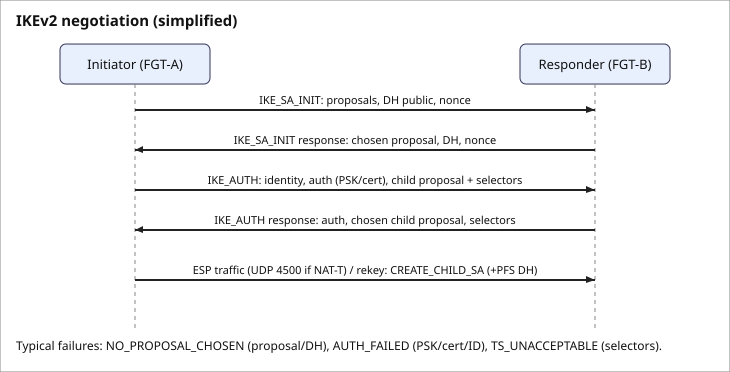

*شکل: مذاکره‌ی IKEv2 و خطاهای رایج.*

### ۵) مثال حل‌شده (Route-based S2S)

``` text
config vpn ipsec phase1-interface
    edit "TO-B"
        set interface "wan1"
        set ike-version 2
        set remote-gw 203.0.113.2
        set peertype any
        set proposal aes256gcm-prfsha256
        set dhgrp 20
        set dpd on-idle
        set dpd-retrycount 3
        set nattraversal enable
        set psksecret <PSK-LAB>
    next
end
config vpn ipsec phase2-interface
    edit "TO-B-P2"
        set phase1name "TO-B"
        set proposal aes256gcm
        set pfs enable
        set dhgrp 20
        set src-subnet 0.0.0.0 0.0.0.0
        set dst-subnet 0.0.0.0 0.0.0.0
    next
end
config router static
    edit 100
        set dst 192.168.20.0 255.255.255.0
        set device "TO-B"
    next
end
```

(مقادیر الگوریتم نمونه‌اند؛ نام دقیق Proposal/`dpd on-idle` با CLI Reference 7.0 و سیاست سازمان تطبیق شود؛ `Unverified`.)

**GUI معادل:** VPN → IPsec Tunnels → Create New → Custom → Network (Remote Gateway، Interface) → Authentication (PSK، IKE Version 2) → Phase 1 Proposal (Encryption/Authentication/DH Group) → Phase 2 Selectors (Local/Remote Address) → Phase 2 Proposal، PFS → OK؛ سپس Network → Static Routes و Policy & Objects → Firewall Policy (دو جهت).

**مثال متوسط (تحلیل):** Phase 1 بالا ولی Phase 2 شکست می‌خورد. اولین فرضیه‌ها: Proposal Phase 2 ناهمسان، PFS/DH ناهمسان، Selector ناهمسان. شاهد: `diagnose debug application ike -1` پیام NO_PROPOSAL_CHOSEN یا TS_UNACCEPTABLE.

**مثال سخت:** Tunnel Up، Bytes out بالا، in صفر. فرضیه‌ها به ترتیب: (۱) Policy سمت مقابل ندارد، (۲) Route برگشت ندارد، (۳) NAT-T/فایروال میانی UDP 4500 را نمی‌دهد (ESP نمی‌رسد)، (۴) Selector نامطابق (ترافیک Drop قبل Encrypt). تفکیک با `diagnose vpn tunnel list` (شمارنده Encrypt/Decrypt)، Sniffer روی WAN (ESP/UDP 4500)، Debug Flow در سمت مقابل.

### ۶) طراحی و تصمیم‌گیری

| سؤال | تصمیم |
|---|---|
| IKEv1 یا IKEv2؟ | IKEv2 مگر سازگاری مانع شود |
| PSK یا Certificate؟ | Certificate برای مقیاس؛ PSK قوی برای Lab/کوچک |
| Route-based یا Policy-based؟ | Route-based (توصیه‌ی FortiOS) |
| Proposal | AES-GCM + SHA2 + DH ≥ 14 یا ECP؛ حذف الگوریتم ضعیف |
| PFS | روشن؛ هزینه‌ی CPU را بسنجید |
| DPD | on-idle/on-demand؛ زمان متوازن |
| MTU/MSS | از ابتدا تنظیم و با Capture تأیید |

### ۷) Verification

``` text
diagnose vpn ike gateway list
diagnose vpn tunnel list
get vpn ipsec tunnel summary
diagnose vpn ike log filter name TO-B
diagnose debug application ike -1
diagnose debug enable
diagnose debug disable
diagnose debug reset
diagnose sniffer packet wan1 "host 203.0.113.2 and (udp port 500 or udp port 4500 or proto 50)" 4 20 l
```

(`diagnose` فرمت دقیق `Unverified`.)

### ۸) Troubleshooting لایه‌ای (جدول تصمیم)

| لایه | آزمون | علامت | رفع |
|---|---|---|---|
| ۱) شبکه | ping/Sniffer روی UDP 500 | بسته‌ی IKE به Peer نمی‌رسد | Route/ACL/NAT |
| ۲) IKE_SA/Phase 1 | Debug IKE | NO_PROPOSAL_CHOSEN، AUTH_FAILED | Proposal، DH، PSK/گواهی، Peer ID |
| ۳) Child SA/Phase 2 | Debug IKE | TS_UNACCEPTABLE، NO_PROPOSAL | Selector، PFS/DH، Proposal |
| ۴) داده | `tunnel list` Encrypt/Decrypt | Out بالا In صفر | Policy مقابل، NAT-T، Route برگشت |
| ۵) Routing | `get router info routing-table details` | مسیر به Tunnel نیست | Static/OSPF/BGP |
| ۶) Policy | Debug Flow | Denied policy 0 | Policy دوطرفه |
| ۷) MTU | ping -f، Capture | بزرگ‌ها قفل | MTU/MSS |
| ۸) پایداری | Log، `ike gateway list` | قطع دوره‌ای | Lifetime/DPD/لینک |

### ۹) نکات امنیتی

- PSK قوی و منحصربه‌فرد برای هر Peer؛ در ریپو ذخیره نکنید.
- الگوریتم‌های منسوخ (DES، MD5، DH1/2) را غیرفعال کنید.
- IKEv1 Aggressive با PSK ضعیف خطرناک است.
- `peertype any` را فقط در Lab/نیاز؛ در تولید Peer ID مشخص.
- لاگ VPN را مانیتور کنید (تلاش‌های ناموفق).

### ۱۰) جمع‌بندی مفهومی

- IPsec = IKE (مدیریت کلید) + ESP (داده)؛ IKE_SA و Child SA.
- IKEv2 مدرن‌تر؛ PFS روشن؛ DH/Proposal دو سر یکی.
- Route-based = Selector باز + Route + Policy.
- NAT-T، DPD، Rekey و MTU علت اصلی ناپایداری‌اند.
- عیب‌یابی لایه‌ای: شبکه → IKE → Selector → Routing → Policy → MTU.

### ۱۱) تمرین و ارزیابی

**ت1.** (ساده) تفاوت Phase 1 و Phase 2 را بگویید. *(پاسخ: 18-0-ت1)*

**ت2.** (ساده) PFS چه کاری می‌کند؟ *(پاسخ: 18-0-ت2)*

**ت3.** (متوسط) چرا Route-based برای Hub-and-Spoke بهتر است؟ *(پاسخ: 18-0-ت3)*

**ت4.** (متوسط) NAT-T چه مشکلی را حل می‌کند و از چه پورتی استفاده می‌کند؟ *(پاسخ: 18-0-ت4)*

**ت5.** (سخت) Tunnel بالا ولی Bytes in صفر است. فرضیه‌ها را به ترتیب و شاهد هرکدام بنویسید. *(پاسخ: 18-0-ت5)*

**ت6.** (سخت، طراحی) Proposal پیشنهادی برای سازمان (Cipher، Hash، DH، PFS، Lifetime، DPD) را با دلیل بنویسید. *(پاسخ: 18-0-ت6)*

**ت7.** (سخت) Phase 2 با TS_UNACCEPTABLE شکست می‌خورد؛ Selectorهای دو طرف را چگونه تطبیق می‌دهید؟ *(پاسخ: 18-0-ت7)*

**م1.** DPD چیست؟ *(پاسخ: 18-0-م1)*

**Q1.** Quick quiz (English): Why is PFS recommended for IPsec? *(پاسخ: 18-0-Q1)*

### ۱۲) اصطلاحات و English Corner

| مخفف | شکل کامل | معنی |
|---|---|---|
| IKE | Internet Key Exchange | تبادل کلید |
| ESP | Encapsulating Security Payload | کپسوله‌سازی امن (IP 50) |
| SA | Security Association | قرارداد امنیتی |
| SPI | Security Parameter Index | شناسه‌ی SA |
| DH | Diffie-Hellman | تبادل کلید |
| PFS | Perfect Forward Secrecy | رازداری رو به جلو |
| DPD | Dead Peer Detection | تشخیص Peer مرده |
| TS | Traffic Selector | انتخاب‌گر ترافیک |
| NAT-T | NAT Traversal | عبور از NAT |
| AEAD | Authenticated Encryption with Associated Data | رمز و یکپارچگی توأم |

- *Phase 2 usually fails because of mismatched proposals or selectors.* ← Phase 2 معمولاً به‌خاطر ناهمسانی Proposal یا Selector شکست می‌خورد.
- *Enable PFS so that a key compromise does not expose past traffic.* ← PFS را فعال کنید تا افشای کلید ترافیک گذشته را باز نکند.

### ۱۳) منابع

- Fortinet Docs: [config vpn ipsec phase1-interface](https://docs.fortinet.com/document/fortigate/7.0.5/cli-reference/371620/config-vpn-ipsec-phase1-interface)، [phase2-interface](https://docs.fortinet.com/document/fortigate/7.0.0/cli-reference/371620/config-vpn-ipsec-phase2-interface)، [Phase 1 configuration](https://docs.fortinet.com/document/fortigate/7.0.2/administration-guide/790613/phase-1-configuration).
- RFC 7296 — IKEv2؛ RFC 4303 — ESP؛ RFC 3947/3948 — NAT-T؛ RFC 3706 — DPD؛ RFC 8247 — Algorithm Requirements for IKEv2.

## درس 18-1 — مفهوم IPsec: IKE، SA و Proposal

**فصل 18 - روز 1 · پیش‌نیاز: فصل ۱۳ · ۶ ساعت**

### ۱) معرفی درس

IPsec ترافیک بین دو سایت را رمز می‌کند. اول مراحل و اصطلاحات را می‌فهمیم.

### ۲) پیش‌نیازها

فصل ۱۳

### ۳) توضیح مفهومی

- IKE Phase 1: ساخت کانال امن مدیریتی (IKE SA).
- Phase 2: ساخت SA ترافیک داده (IPsec SA).
- Proposal: الگوریتم رمز/Hash/DH باید دو طرف یکی باشد.
- IKEv2 جدیدتر و ساده‌تر.
- NAT-T: عبور از NAT (UDP 4500).

### ۴) مثال ساده

دو دفتر با Tunnel رمزشده.

### ۵) مثال سازمانی

سازمان: شعبه به مرکز با IPsec و مسیر پشتیبان.

### ۶) تصویر و توپولوژی

```text
Site-A LAN -> FGT-A ==IPsec== FGT-B -> Site-B LAN
```

### ۷) پیکربندی (GUI و CLI)

> نسخه‌ی هدف: FortiOS 7.0.3 (اسمی؛ از نام Image؛ بوت‌نشده؛ تأیید با `get system status`). دستورها/منوها از مستند عمومی FortiOS 7.0 و دانش مؤلف هستند و **روی Image شما هنوز آزمایش نشده‌اند**؛ در بوت اول مقایسه کنید.

#### روش گرافیکی (GUI)

1. Monitor > IPsec Monitor.
2. VPN > IPsec Wizard (برای مقایسه).

#### روش خط فرمان (CLI)

```text
diagnose vpn ike gateway list
diagnose vpn tunnel list
```

**توضیح دستورها (چه / چرا / خروجی / راستی‌آزمایی / بازگشت):**

- فقط خواندن؛ ایمن.
- راستی‌آزمایی: وضعیت IKE/Tunnel.

### ۸) تست عملکرد

- مراحل IKE را روی کاغذ بکشید.

### ۹) عیب‌یابی

| بخش | شرح |
|---|---|
| Symptom | Phase 1 بالا نمی‌شود |
| شواهد/دستور | Log IKE |
| علت | Proposal/PSK |
| رفع | تطبیق |

### ۱۰) تمرین مستقل

> پاسخ‌ها در بخش «پاسخ‌های فصل» انتهای فصل است؛ اول خودتان حل کنید.

**ت1.** Phase 1 و 2؟ *(پاسخ: 18-1-ت1)*

**ت2.** NAT-T؟ *(پاسخ: 18-1-ت2)*

### ۱۱) مرور و ارزیابی

**م1.** چرا Proposal یکی؟ *(پاسخ: 18-1-م1)*

**م2.** سناریو: فقط Phase 1 بالا؛ علت؟ *(پاسخ: 18-1-م2)*

**معیار تسلط:** ساخت Tunnel، Route/Policy، اثبات با Ping و Diagnose.

**اشتباهات رایج:** Proposal/Selector/Route.

### ۱۲) واژگان و English Corner

| واژه | شکل کامل | معنی | کاربرد واقعی |
|---|---|---|---|
| IPsec | Internet Protocol Security | رمزنگاری IP | VPN |
| IKE | Internet Key Exchange | تبادل کلید | IPsec |
| SA | Security Association | قرارداد امنیتی | IPsec |
| DH | Diffie-Hellman | تبادل کلید | IKE |

| English sentence | ترجمه |
|---|---|
| Phase 1 builds the control channel. | Phase 1 کانال کنترل را می‌سازد. |
| Both ends must agree on proposals. | دو سر باید روی Proposalها توافق کنند. |

#### کارت Lab — درس 18-1

| # | فیلد | محتوا |
|---|---|---|
| 1 | عنوان و هدف | نقشه‌ی IKE |
| 2 | پیش‌نیاز | فصل ۱۳ |
| 3 | توپولوژی | FGT-A + FGT-B |
| 4 | تجهیزات | FGT |
| 5 | نسخه نرم‌افزار | FortiOS 7.0.3 (اسمی؛ از نام Image؛ بوت‌نشده؛ تأیید با `get system status`) |
| 6 | IP Plan | — |
| 7 | وضعیت اولیه | — |
| 8 | صورت مسئله | نمودار IKE |
| 9 | مراحل هدایت‌شده | بخش‌های ۷ و ۸ همین درس (گام‌به‌گام) |
| 10 | تست عملکرد | — |
| 11 | سناریوی خرابی | Phase 1 بالا نمی‌شود |
| 12 | روش عیب‌یابی | بخش ۹ همین درس (لایه‌ای/با شواهد) |
| 13 | نتیجه‌ی مورد انتظار | نمودار |
| 14 | معیار پذیرش | با شواهد |
| 15 | مستندات نهایی | `03-ops/ike-map.md` |
| 16 | Cleanup و بازگردانی | — |

> **وضعیت راستی‌آزمایی (خارج از ۱۶ فیلد):** **اجرا نشده (فقط طراحی).** Image FortiGate هنوز بوت نشده؛ دستورها/منوها آزمایش‌نشده‌اند.

---

<a id="l-18-2"></a>

## درس 18-2 — ساخت Tunnel Site-to-Site بین دو FortiGate: طراحی، GUI، CLI و Verification

**فصل ۱۸ · بازنویسی عمیق · پیش‌نیاز: ۱۸-۰ (IKE، Selector، PFS)، ۱۲-۰، فصل ۵ · ≈ ۷ ساعت**

> **وضعیت (FortiOS 7.0.3):** پیش‌فرض‌ها از CLI Reference 7.0؛ سینتکس `Unverified`؛ PSK نمونه؛ Lab «اجرا نشده».

### ۱) هدف آموزشی

1. برگه‌ی طراحی Tunnel (IP Plan، Proposal، Selector، Route، Policy) را قبل از پیکربندی بنویسد.
2. Tunnel Route-based را با **GUI و CLI** بسازد.
3. سه چیز لازم (Route، Policy، Selector) را جداگانه بسنجد.
4. با `diagnose vpn tunnel list`، Monitor و Ping Verification کند.
5. Rollback و Backup را اجرا کند.

### ۲) برگه‌ی طراحی

``` text
Site A: WAN 203.0.113.1  LAN 192.168.10.0/24   Tunnel if: TO-B
Site B: WAN 203.0.113.2  LAN 192.168.20.0/24   Tunnel if: TO-A
IKE: v2  Proposal: aes256gcm-prfsha256  DH 20  PFS on  DPD on-idle  NAT-T: auto
Phase2 selectors: 0.0.0.0/0 <-> 0.0.0.0/0 (route-based)
Routing: static 192.168.20.0/24 via TO-B (A) and 192.168.10.0/24 via TO-A (B)
Policies: LAN->TO-B accept ; TO-B->LAN accept (both sides)
```

اصل: **دو سر آینه‌ی هم** (Proposal، DH، PFS، Lifetime، PSK، Selector).

### ۳) پیاده‌سازی

**GUI (Site A):**

1. VPN → IPsec Tunnels → Create New → Custom: Name TO-B.
2. Network: Remote Gateway = Static IP 203.0.113.2؛ Interface = wan1؛ NAT Traversal = Enable.
3. Authentication: Method Pre-shared Key؛ IKE Version 2.
4. Phase 1 Proposal: Encryption AES256GCM؛ DH Group 20.
5. Phase 2 Selectors: Local/Remote Address = 0.0.0.0/0؛ Phase 2 Proposal AES256GCM؛ Enable PFS (DH 20).
6. Network → Static Routes → 192.168.20.0/24 → Interface TO-B.
7. Policy & Objects → Firewall Policy: LAN→TO-B و TO-B→LAN (Accept، NAT خاموش).

**CLI (Site A):**

``` text
config vpn ipsec phase1-interface
    edit "TO-B"
        set interface "wan1"
        set ike-version 2
        set remote-gw 203.0.113.2
        set proposal aes256gcm-prfsha256
        set dhgrp 20
        set dpd on-idle
        set nattraversal enable
        set psksecret <PSK-LAB>
    next
end
config vpn ipsec phase2-interface
    edit "TO-B-P2"
        set phase1name "TO-B"
        set proposal aes256gcm
        set pfs enable
        set dhgrp 20
        set src-subnet 0.0.0.0 0.0.0.0
        set dst-subnet 0.0.0.0 0.0.0.0
    next
end
config router static
    edit 100
        set dst 192.168.20.0 255.255.255.0
        set device "TO-B"
    next
end
config firewall policy
    edit 100
        set name "LAN-to-B"
        set srcintf "port2"
        set dstintf "TO-B"
        set srcaddr "all"
        set dstaddr "all"
        set action accept
        set schedule "always"
        set service "ALL"
        set logtraffic all
    next
    edit 101
        set name "B-to-LAN"
        set srcintf "TO-B"
        set dstintf "port2"
        set srcaddr "all"
        set dstaddr "all"
        set action accept
        set schedule "always"
        set service "ALL"
        set logtraffic all
    next
end
```

(در تولید `service ALL` و `all` را محدود کنید؛ اینجا برای Lab اولیه است. سینتکس `Unverified`.) Site B آینه است.

### ۴) Verification (سه سطح)

``` text
get vpn ipsec tunnel summary
diagnose vpn ike gateway list
diagnose vpn tunnel list
execute ping-options source 192.168.10.1
execute ping 192.168.20.1
get router info routing-table details 192.168.20.5
diagnose debug flow filter addr 192.168.20.5
```

- **IKE SA:** Established.
- **Child SA:** Bytes encrypt/decrypt هر دو رشد.
- **داده:** ping کلاینت‌ها؛ Log Policy.

### ۵) مثال‌ها

**ساده:** ping 192.168.10.5 → 192.168.20.5 موفق؛ `tunnel list`: Encrypt/Decrypt افزایش.

**متوسط:** فقط یک‌سو: Bytes out می‌رود، in صفر؛ بررسی Policy B→LAN و Route برگشت در B.

**سخت:** Tunnel پس از ۸ ساعت یک لحظه قطع می‌شود: Rekey؛ بررسی Lifetime دو سر (۱۸-۰)، DPD، PFS Group ناهمسان؛ شاهد: Log VPN.

### ۶) Troubleshooting

| علامت | علت |
|---|---|
| IKE برقرار نمی‌شود | Reachability، Proposal، PSK، ID |
| Phase 2 شکست | Selector/PFS/DH |
| Up ولی ping نه | Route/Policy/NAT-T |
| ping کوچک OK و بزرگ نه | MTU/MSS |

### ۷) نکات امنیتی

- PSK قوی و منحصر؛ در ریپو نیست.
- Policy حداقلی؛ ترافیک Tunnel هم Inspect شود.
- `service ALL` فقط Lab.

### ۸) جمع‌بندی

- برگه‌ی طراحی آینه‌ای.
- Route + Policy + Selector.
- Verification سه‌سطحی.
- Backup قبل از تغییر.

### ۹) تمرین و ارزیابی

**ت1.** (ساده) سه چیز لازم برای ترافیک Tunnel Route-based؟ *(پاسخ: 18-2-ت1)*

**ت2.** (متوسط) چرا Policy دوطرفه لازم است؟ *(پاسخ: 18-2-ت2)*

**ت3.** (متوسط) Verification سه‌سطحی را بنویسید. *(پاسخ: 18-2-ت3)*

**ت4.** (سخت) فقط Bytes out رشد می‌کند؛ فرضیه‌ها و آزمون. *(پاسخ: 18-2-ت4)*

**ت5.** (سخت، طراحی) Policy حداقلی برای دسترسی Site A به یک سرور در Site B. *(پاسخ: 18-2-ت5)*

**Q1.** Quick quiz (English): Which three elements must be correct for route-based VPN traffic to flow? *(پاسخ: 18-2-Q1)*

### ۱۰) اصطلاحات و English Corner

| مخفف | شکل کامل | معنی |
|---|---|---|
| Route-based | Route-based VPN | VPN مبتنی بر Interface و Route |
| Mirror | Mirrored config | پیکربندی آینه‌ای |
| Encrypt/Decrypt counters | SA counters | شمارنده‌ی SA |

- *Both peers must have mirrored proposals and selectors.* ← هر دو Peer باید Proposal و Selector آینه‌ای داشته باشند.

### ۱۱) Lab

**کارت Lab:** Tunnel S2S. **وضعیت:** اجرا نشده. **Verification:** مطابق بخش ۴. **Rollback:** حذف phase2/phase1/Route/Policy. **Evidence:** `03-ops/s2s-a-b.md`.

### ۱۲) منابع

- Fortinet Docs: [config vpn ipsec phase1-interface](https://docs.fortinet.com/document/fortigate/7.0.5/cli-reference/371620/config-vpn-ipsec-phase1-interface)، [phase2-interface](https://docs.fortinet.com/document/fortigate/7.0.0/cli-reference/371620/config-vpn-ipsec-phase2-interface).

<a id="l-18-3"></a>

## درس 18-3 — عیب‌یابی IPsec با Debug IKE: خواندن پیام‌ها و تصمیم‌گیری لایه‌ای

**فصل ۱۸ · بازنویسی عمیق · پیش‌نیاز: ۱۸-۰، ۱۸-۲، ۱۴-۷ · ≈ ۶ ساعت**

> **وضعیت:** فرمت Debug نمونه‌ی آموزشی؛ روی Image `Unverified`؛ Lab «اجرا نشده».

### ۱) هدف آموزشی

1. Debug IKE را با Filter محدود اجرا و ایمن خاتمه دهد.
2. پیام‌های رایج (NO_PROPOSAL_CHOSEN، AUTH_FAILED، TS_UNACCEPTABLE، INVALID_KE_PAYLOAD، timeout) را به علت نگاشت کند.
3. «Up ولی ترافیک نه» را با شمارنده و Debug Flow تفکیک کند.
4. RCA بنویسد.

### ۲) روش

``` text
diagnose vpn ike log filter clear
diagnose vpn ike log filter name TO-B
diagnose debug application ike -1
diagnose debug enable
...trigger negotiation (ping across tunnel or clear SA)...
diagnose debug disable
diagnose debug reset
```

(Filter با نام Tunnel یا IP Peer؛ بدون Filter حجم زیاد و CPU.)

### ۳) نقشه‌ی پیام → علت

| پیام | معنی | علت | رفع |
|---|---|---|---|
| NO_PROPOSAL_CHOSEN | Proposal مشترک نیست | الگوریتم/DH Phase 1 یا Child | تطبیق Proposal |
| AUTH_FAILED | هویت رد شد | PSK، Peer ID، گواهی | PSK/ID |
| TS_UNACCEPTABLE | Selectorها ناسازگار | Subnet/Selector | آینه‌کردن Selector |
| INVALID_KE_PAYLOAD | DH Group متفاوت | DH/PFS | هم‌گروه‌کردن |
| timeout/بدون پاسخ | Peer جواب نمی‌دهد | UDP 500/4500، Route، ACL | Sniffer/Firewall |
| SA بالا، ESP صفر | NAT-T/ESP Block | UDP 4500/IP 50 | باز کردن |

### ۴) مثال‌های حل‌شده

**۱) Phase 1:** `negotiation failure... NO_PROPOSAL_CHOSEN`؛ مقایسه‌ی Proposal دو سر: یک سر AES256-SHA256 CBC، دیگری GCM. **رفع:** هماهنگی. **تأیید:** IKE SA Established.

**۲) Phase 2:** Phase 1 OK، سپس `TS_UNACCEPTABLE`: Site A Selector 192.168.10.0/24↔192.168.20.0/24، Site B 0.0.0.0/0. **رفع:** آینه‌کردن (یا هر دو 0.0.0.0/0 در Route-based).

**۳) داده:** Tunnel Up، ping شکست؛ `tunnel list` Bytes out رشد، in صفر. Sniffer WAN سمت B: ESP/UDP 4500 می‌رسد ولی Debug Flow B «Denied policy 0». **رفع:** Policy B→LAN.

**۴) سخت (دو علت هم‌زمان):** Tunnel بعد از Rekey ناپایدار است و دانلود بزرگ قفل می‌شود. علت ۱: Lifetime/DPD؛ علت ۲: MTU. شواهد جدا: Log VPN برای Rekey؛ `ping -f` برای MTU. رفع هر کدام جداگانه و اندازه‌گیری.

### ۵) GUI

Log & Report → Events → VPN؛ Monitor → IPsec Monitor (Bring Up/Down)؛ VPN → IPsec Tunnels (وضعیت).

### ۶) نکات امنیتی

- Debug IKE ممکن است هویت و اطلاعات حساس نشان دهد؛ فایل را حذف کنید.
- Debug را همیشه Disable/Reset.

### ۷) جمع‌بندی

- Filter + محدودیت زمانی.
- پیام → لایه → علت.
- «Up ولی نه» با Counter + Policy/Route.
- RCA مستند.

### ۸) تمرین و ارزیابی

**ت1.** (ساده) NO_PROPOSAL_CHOSEN یعنی چه؟ *(پاسخ: 18-3-ت1)*

**ت2.** (ساده) چرا Filter در Debug لازم است؟ *(پاسخ: 18-3-ت2)*

**ت3.** (متوسط) TS_UNACCEPTABLE را چگونه رفع می‌کنید؟ *(پاسخ: 18-3-ت3)*

**ت4.** (سخت) Up ولی Bytes in صفر؛ ۴ فرضیه و آزمون. *(پاسخ: 18-3-ت4)*

**ت5.** (سخت) RCA یک‌صفحه‌ای برای مثال ۴ بنویسید. *(پاسخ: 18-3-ت5)*

**Q1.** Quick quiz (English): What does AUTH_FAILED usually indicate? *(پاسخ: 18-3-Q1)*

### ۹) اصطلاحات و English Corner

| مخفف | شکل کامل | معنی |
|---|---|---|
| TS | Traffic Selector | انتخاب‌گر ترافیک |
| KE | Key Exchange payload | بخش تبادل کلید |
| Rekey | SA rekey | تعویض کلید SA |

- *Filter the IKE debug to the peer under investigation.* ← Debug IKE را روی Peer مورد بررسی فیلتر کنید.

### ۱۰) Lab

**کارت Lab:** عیب Proposal/Selector. **وضعیت:** اجرا نشده. **Rollback:** Disable debug. **Evidence:** `03-ops/rca-ike.md`.

### ۱۱) منابع

- Fortinet Docs: FortiOS 7.0 Administration Guide — IPsec VPN troubleshooting؛ RFC 7296 (error notify types).

<a id="l-18-4"></a>

## درس 18-4 — MTU/MSS و Fragmentation در Tunnel

**فصل 18 - روز 4 · پیش‌نیاز: درس ۱۸-۲ · ۶ ساعت**

### ۱) معرفی درس

Tunnel سربار اضافه می‌کند؛ MTU نادرست باعث «کار می‌کند ولی بزرگ‌ها نه» می‌شود.

### ۲) پیش‌نیازها

درس ۱۸-۲

### ۳) توضیح مفهومی

- سربار IPsec ≈ ۵۰–۷۰ بایت (تقریبی).
- PMTUD و DF-bit.
- کاهش MSS: `tcp-mss-sender`/policy.
- ping با اندازه‌ی بزرگ و DF.
- علامت: وب باز می‌شود ولی دانلود بزرگ قفل.

### ۴) مثال ساده

دو دفتر با Tunnel رمزشده.

### ۵) مثال سازمانی

سازمان: شعبه به مرکز با IPsec و مسیر پشتیبان.

### ۶) تصویر و توپولوژی

```text
Site-A LAN -> FGT-A ==IPsec== FGT-B -> Site-B LAN
```

### ۷) پیکربندی (GUI و CLI)

> نسخه‌ی هدف: FortiOS 7.0.3 (اسمی؛ از نام Image؛ بوت‌نشده؛ تأیید با `get system status`). دستورها/منوها از مستند عمومی FortiOS 7.0 و دانش مؤلف هستند و **روی Image شما هنوز آزمایش نشده‌اند**؛ در بوت اول مقایسه کنید.

#### روش گرافیکی (GUI)

1. Network > Interfaces > TO-SITE-B > MTU.
2. Policy: CLI فقط برای MSS.

#### روش خط فرمان (CLI)

```text
config system interface
    edit "TO-SITE-B"
        set mtu-override enable
        set mtu 1400
    next
end
config firewall policy
    edit 20
        set tcp-mss-sender 1360
        set tcp-mss-receiver 1360
    next
end
```

**توضیح دستورها (چه / چرا / خروجی / راستی‌آزمایی / بازگشت):**

- `mtu 1400` نمونه.
- `Unverified` روی Image.
- راستی‌آزمایی: ping -f -l 1372.
- بازگشت: غیرفعال‌کردن override.

### ۸) تست عملکرد

- ping با اندازه‌های مختلف و ثبت نتیجه.

### ۹) عیب‌یابی

| بخش | شرح |
|---|---|
| Symptom | دانلود بزرگ قفل |
| شواهد/دستور | ping -f بزرگ شکست |
| علت | MTU |
| رفع | کاهش MTU/MSS |

### ۱۰) تمرین مستقل

> پاسخ‌ها در بخش «پاسخ‌های فصل» انتهای فصل است؛ اول خودتان حل کنید.

**ت1.** MSS؟ *(پاسخ: 18-4-ت1)*

**ت2.** DF؟ *(پاسخ: 18-4-ت2)*

### ۱۱) مرور و ارزیابی

**م1.** چرا MSS کمک می‌کند؟ *(پاسخ: 18-4-م1)*

**م2.** سناریو: ping کوچک OK بزرگ نه؛ علت؟ *(پاسخ: 18-4-م2)*

**معیار تسلط:** ساخت Tunnel، Route/Policy، اثبات با Ping و Diagnose.

**اشتباهات رایج:** Proposal/Selector/Route.

### ۱۲) واژگان و English Corner

| واژه | شکل کامل | معنی | کاربرد واقعی |
|---|---|---|---|
| MTU | Maximum Transmission Unit | حداکثر اندازه‌ی بسته | Tunnel |
| MSS | Maximum Segment Size | حداکثر قطعه‌ی TCP | Tunnel |
| PMTUD | Path MTU Discovery | کشف MTU مسیر | Tunnel |

| English sentence | ترجمه |
|---|---|
| Lower the MSS to avoid fragmentation. | MSS را برای جلوگیری از Fragmentation کاهش دهید. |

#### کارت Lab — درس 18-4

| # | فیلد | محتوا |
|---|---|---|
| 1 | عنوان و هدف | MTU Tunnel |
| 2 | پیش‌نیاز | درس ۱۸-۲ |
| 3 | توپولوژی | FGT-A + FGT-B |
| 4 | تجهیزات | FGT |
| 5 | نسخه نرم‌افزار | FortiOS 7.0.3 (اسمی؛ از نام Image؛ بوت‌نشده؛ تأیید با `get system status`) |
| 6 | IP Plan | — |
| 7 | وضعیت اولیه | Tunnel |
| 8 | صورت مسئله | MTU آزمایش |
| 9 | مراحل هدایت‌شده | بخش‌های ۷ و ۸ همین درس (گام‌به‌گام) |
| 10 | تست عملکرد | ping -f |
| 11 | سناریوی خرابی | دانلود بزرگ قفل |
| 12 | روش عیب‌یابی | بخش ۹ همین درس (لایه‌ای/با شواهد) |
| 13 | نتیجه‌ی مورد انتظار | جدول اندازه |
| 14 | معیار پذیرش | نتیجه ثبت |
| 15 | مستندات نهایی | `03-ops/mtu.md` |
| 16 | Cleanup و بازگردانی | بازگشت MTU |

> **وضعیت راستی‌آزمایی (خارج از ۱۶ فیلد):** **اجرا نشده (فقط طراحی).** Image FortiGate هنوز بوت نشده؛ دستورها/منوها آزمایش‌نشده‌اند.

---

<a id="l-18-5"></a>

## درس 18-5 — Tunnel با Cisco CSR و Dead Peer Detection

**فصل 18 - روز 5 · پیش‌نیاز: درس ۱۸-۳ · ۶ ساعت**

### ۱) معرفی درس

اتصال FGT به CSR1000v (IOS-XE). مفاهیم Interoperability.

### ۲) پیش‌نیازها

درس ۱۸-۳

### ۳) توضیح مفهومی

- CSR: crypto ikev2/ipsec profile.
- هماهنگی Proposal/DH/Lifetime.
- DPD برای تشخیص قطع.
- Lifetime تفاوت دو سر.
- تأیید با `show crypto ipsec sa` (CSR).

### ۴) مثال ساده

دو دفتر با Tunnel رمزشده.

### ۵) مثال سازمانی

سازمان: شعبه به مرکز با IPsec و مسیر پشتیبان.

### ۶) تصویر و توپولوژی

```text
Site-A LAN -> FGT-A ==IPsec== FGT-B -> Site-B LAN
```

### ۷) پیکربندی (GUI و CLI)

> نسخه‌ی هدف: FortiOS 7.0.3 (اسمی؛ از نام Image؛ بوت‌نشده؛ تأیید با `get system status`). دستورها/منوها از مستند عمومی FortiOS 7.0 و دانش مؤلف هستند و **روی Image شما هنوز آزمایش نشده‌اند**؛ در بوت اول مقایسه کنید.

#### روش گرافیکی (GUI)

1. FortiGate: VPN > IPsec Tunnels با Remote GW = CSR.

#### روش خط فرمان (CLI)

```text
! CSR (IOS-XE) example, lab only
crypto ikev2 keyring KR
 peer FGT
  address 203.0.113.1
  pre-shared-key <PSK-LAB>
crypto ikev2 profile PROF
 match identity remote address 203.0.113.1 255.255.255.255
 authentication local pre-share
 authentication remote pre-share
 keyring local KR
```

**توضیح دستورها (چه / چرا / خروجی / راستی‌آزمایی / بازگشت):**

- CSR آزمایش‌نشده؛ `Unverified`.
- راستی‌آزمایی: show crypto ikev2 sa.
- بازگشت: حذف profile.

### ۸) تست عملکرد

- Tunnel FGT-CSR بالا (اگر قابل‌انجام).

### ۹) عیب‌یابی

| بخش | شرح |
|---|---|
| Symptom | Phase 2 mismatch با CSR |
| شواهد/دستور | show crypto ipsec sa |
| علت | Selector/Transform |
| رفع | تطبیق |

### ۱۰) تمرین مستقل

> پاسخ‌ها در بخش «پاسخ‌های فصل» انتهای فصل است؛ اول خودتان حل کنید.

**ت1.** DPD؟ *(پاسخ: 18-5-ت1)*

**ت2.** چرا Lifetime مهم؟ *(پاسخ: 18-5-ت2)*

### ۱۱) مرور و ارزیابی

**م1.** چرا CSR؟ *(پاسخ: 18-5-م1)*

**م2.** سناریو: Tunnel هر ساعت قطع؛ علت؟ *(پاسخ: 18-5-م2)*

**معیار تسلط:** ساخت Tunnel، Route/Policy، اثبات با Ping و Diagnose.

**اشتباهات رایج:** Proposal/Selector/Route.

### ۱۲) واژگان و English Corner

| واژه | شکل کامل | معنی | کاربرد واقعی |
|---|---|---|---|
| DPD | Dead Peer Detection | تشخیص همتای مرده | IPsec |
| CSR | CSR1000v | روتر مجازی Cisco | Lab |

| English sentence | ترجمه |
|---|---|
| Match lifetimes on both vendors. | Lifetime را روی هر دو سازنده یکسان کنید. |

#### کارت Lab — درس 18-5

| # | فیلد | محتوا |
|---|---|---|
| 1 | عنوان و هدف | FGT-CSR |
| 2 | پیش‌نیاز | درس ۱۸-۳ |
| 3 | توپولوژی | FGT + CSR |
| 4 | تجهیزات | FGT + CSR |
| 5 | نسخه نرم‌افزار | FortiOS 7.0.3 (اسمی؛ از نام Image؛ بوت‌نشده؛ تأیید با `get system status`) |
| 6 | IP Plan | — |
| 7 | وضعیت اولیه | Tunnel |
| 8 | صورت مسئله | Interop |
| 9 | مراحل هدایت‌شده | بخش‌های ۷ و ۸ همین درس (گام‌به‌گام) |
| 10 | تست عملکرد | show |
| 11 | سناریوی خرابی | Phase 2 mismatch با CSR |
| 12 | روش عیب‌یابی | بخش ۹ همین درس (لایه‌ای/با شواهد) |
| 13 | نتیجه‌ی مورد انتظار | Up |
| 14 | معیار پذیرش | ثبت |
| 15 | مستندات نهایی | `03-ops/fgt-csr.md` |
| 16 | Cleanup و بازگردانی | حذف |

> **وضعیت راستی‌آزمایی (خارج از ۱۶ فیلد):** **اجرا نشده (فقط طراحی).** Image FortiGate هنوز بوت نشده؛ دستورها/منوها آزمایش‌نشده‌اند.

---

<a id="l-18-6"></a>

## درس 18-6 — Gate G7 و آزمون فصل

**فصل 18 - روز 6 · پیش‌نیاز: درس ۱۸-۴ · ۶ ساعت**

### ۱) معرفی درس

ارزیابی: Tunnel، Route/Policy، MTU، عیب Phase 2.

### ۲) پیش‌نیازها

درس ۱۸-۴

### ۳) توضیح مفهومی

- G7: Tunnel بالا و ترافیک دوطرفه.
- سناریوی عیب Phase 2 mismatch حل شود.
- Backup پیکربندی.
- RCA یک صفحه.
- آزمون ۵ مورد.

### ۴) مثال ساده

دو دفتر با Tunnel رمزشده.

### ۵) مثال سازمانی

سازمان: شعبه به مرکز با IPsec و مسیر پشتیبان.

### ۶) تصویر و توپولوژی

```text
Site-A LAN -> FGT-A ==IPsec== FGT-B -> Site-B LAN
```

### ۷) پیکربندی (GUI و CLI)

> نسخه‌ی هدف: FortiOS 7.0.3 (اسمی؛ از نام Image؛ بوت‌نشده؛ تأیید با `get system status`). دستورها/منوها از مستند عمومی FortiOS 7.0 و دانش مؤلف هستند و **روی Image شما هنوز آزمایش نشده‌اند**؛ در بوت اول مقایسه کنید.

#### روش گرافیکی (GUI)

1. System > Config > Backup.

#### روش خط فرمان (CLI)

```text
execute backup config tftp fgt-g7.conf 192.168.90.10
```

**توضیح دستورها (چه / چرا / خروجی / راستی‌آزمایی / بازگشت):**

- `execute backup` آزمایش‌نشده؛ مسیر TFTP نمونه.

### ۸) تست عملکرد

- اجرای G7 و ثبت شاهد.

### ۹) عیب‌یابی

| بخش | شرح |
|---|---|
| Symptom | Phase 2 mismatch |
| شواهد/دستور | Debug |
| علت | Selector |
| رفع | اصلاح |

### ۱۰) تمرین مستقل

> پاسخ‌ها در بخش «پاسخ‌های فصل» انتهای فصل است؛ اول خودتان حل کنید.

**ت1.** G7 چیست؟ *(پاسخ: 18-6-ت1)*

**ت2.** Backup؟ *(پاسخ: 18-6-ت2)*

### ۱۱) مرور و ارزیابی

**م1.** چرا RCA؟ *(پاسخ: 18-6-م1)*

**م2.** سناریو: Selector یکطرفه؛ پیامد؟ *(پاسخ: 18-6-م2)*

**معیار تسلط:** ساخت Tunnel، Route/Policy، اثبات با Ping و Diagnose.

**اشتباهات رایج:** Proposal/Selector/Route.

### ۱۲) واژگان و English Corner

| واژه | شکل کامل | معنی | کاربرد واقعی |
|---|---|---|---|
| RCA | Root Cause Analysis | تحلیل ریشه | Ops |

| English sentence | ترجمه |
|---|---|
| Document the root cause and the fix. | علت ریشه‌ای و راه‌حل را مستند کنید. |

#### کارت Lab — درس 18-6

| # | فیلد | محتوا |
|---|---|---|
| 1 | عنوان و هدف | آزمون G7 |
| 2 | پیش‌نیاز | درس ۱۸-۴ |
| 3 | توپولوژی | FGT-A + FGT-B |
| 4 | تجهیزات | FGT |
| 5 | نسخه نرم‌افزار | FortiOS 7.0.3 (اسمی؛ از نام Image؛ بوت‌نشده؛ تأیید با `get system status`) |
| 6 | IP Plan | — |
| 7 | وضعیت اولیه | Tunnel |
| 8 | صورت مسئله | G7 |
| 9 | مراحل هدایت‌شده | بخش‌های ۷ و ۸ همین درس (گام‌به‌گام) |
| 10 | تست عملکرد | ping |
| 11 | سناریوی خرابی | Phase 2 mismatch |
| 12 | روش عیب‌یابی | بخش ۹ همین درس (لایه‌ای/با شواهد) |
| 13 | نتیجه‌ی مورد انتظار | RCA |
| 14 | معیار پذیرش | ≥ ۴ از ۵ |
| 15 | مستندات نهایی | `03-ops/g7.md` |
| 16 | Cleanup و بازگردانی | — |

> **وضعیت راستی‌آزمایی (خارج از ۱۶ فیلد):** **اجرا نشده (فقط طراحی).** Image FortiGate هنوز بوت نشده؛ دستورها/منوها آزمایش‌نشده‌اند.

---

<a id="ans-18"></a>

## پاسخ‌های فصل 18

> ابتدا بدون نگاه حل کنید. شناسه: درس-نوع+شماره (ت = تمرین، م = مرور).

**18-1-ت1** — Phase 1 و 2؟

IKE SA و IPsec SA.

**18-1-ت2** — NAT-T؟

UDP 4500.

**18-1-م1** — چرا Proposal یکی؟

وگرنه مذاکره شکست.

**18-1-م2** — سناریو: فقط Phase 1 بالا؛ علت؟

Selector/Proposal Phase 2.


### پاسخ‌های بازنویسی درس 18-2

**18-2-ت1** — Route به Tunnel، Policy دوطرفه و Selector سازگار.

**18-2-ت2** — چون ترافیک در هر دو جهت باید اجازه داشته باشد و Stateful فقط جهت شروع را به Session می‌گذارد.

**18-2-ت3** — IKE SA Established؛ Child SA با شمارنده‌ی Encrypt/Decrypt؛ ping/Log داده.

**18-2-ت4** — Policy سمت مقابل، Route برگشت، NAT-T/UDP 4500، Selector. شاهد: tunnel list، Sniffer، Debug Flow.

**18-2-ت5** — Source=Subnet/Host مجاز Site A، Destination=سرور خاص، Service=پورت لازم، Log فعال.

**18-2-Q1** — A route to the tunnel interface, policies in both directions, and compatible selectors.


### پاسخ‌های بازنویسی درس 18-3

**18-3-ت1** — هیچ Proposal مشترکی بین دو سر پیدا نشد.

**18-3-ت2** — بدون Filter حجم Debug زیاد و CPU بالا می‌رود و خواندن سخت می‌شود.

**18-3-ت3** — Selectorها را آینه یا در Route-based هر دو را 0.0.0.0/0 کنید.

**18-3-ت4** — Policy مقابل، Route برگشت، NAT-T/ESP، Selector؛ آزمون: Debug Flow سمت مقابل، Sniffer، tunnel list.

**18-3-ت5** — عنوان، Timeline، شواهد (Log Rekey، ping -f)، علت‌ها (Lifetime/DPD و MTU)، اقدام، پیشگیری.

**18-3-Q1** — Authentication failure: wrong PSK, peer ID mismatch or invalid certificate.

**18-4-ت1** — MSS؟

حداکثر قطعه‌ی TCP.

**18-4-ت2** — DF؟

Don't Fragment.

**18-4-م1** — چرا MSS کمک می‌کند؟

Fragmentation را نمی‌خواهد.

**18-4-م2** — سناریو: ping کوچک OK بزرگ نه؛ علت؟

MTU.

**18-5-ت1** — DPD؟

Dead Peer Detection.

**18-5-ت2** — چرا Lifetime مهم؟

عدم تطابق قطع دوره‌ای.

**18-5-م1** — چرا CSR؟

Interop واقعی.

**18-5-م2** — سناریو: Tunnel هر ساعت قطع؛ علت؟

Lifetime ناهمسان.

**18-6-ت1** — G7 چیست؟

Tunnel+ترافیک+عیب.

**18-6-ت2** — Backup؟

execute backup.

**18-6-م1** — چرا RCA؟

یادگیری.

**18-6-م2** — سناریو: Selector یکطرفه؛ پیامد؟

فقط یک جهت.


---

<a id="end6"></a>


### پاسخ‌های درس افزوده‌ی 18-0 (فصل 18)

**18-0-ت1** — Phase 1 کانال کنترل امن (IKE SA)؛ Phase 2 SA داده (Child SA) و Selector.

**18-0-ت2** — با هر Rekey کلید تازه با DH جدید می‌سازد تا افشای کلید قدیمی ترافیک گذشته را باز نکند.

**18-0-ت3** — Selector باز + Routing + Policy؛ Routing پویا و مقیاس‌پذیری راحت.

**18-0-ت4** — عبور از NAT با کپسوله‌کردن ESP در UDP؛ پورت UDP 4500.

**18-0-ت5** — ۱) Policy سمت مقابل؛ ۲) Route برگشت؛ ۳) NAT-T/UDP 4500؛ ۴) Selector. شاهد: tunnel list، Sniffer، Debug Flow سمت مقابل.

**18-0-ت6** — AES-256-GCM، SHA-256، DH 20 یا ≥ 14، PFS روشن، Lifetime حدود 8 تا 24 ساعت، DPD on-idle با retry 3؛ دلیل: امنیت و سازگاری.

**18-0-ت7** — Selectorها آینه‌ی هم باشند؛ در Route-based از 0.0.0.0/0 استفاده یا Subnetهای دقیق هم‌سان؛ بررسی Debug IKE.

**18-0-م1** — پیام دوره‌ای برای تشخیص مرگ Peer و پاک‌کردن SA.

**18-0-Q1** — Because it gives forward secrecy: compromise of a long-term key does not expose past sessions.

# پایان بخش ۶ (فصل‌های ۱۶ تا ۱۸)

## ۱) خلاصه‌ی مهارت‌های کسب‌شده
- Security Profile و SSL Inspection؛ LDAP/RADIUS/FSSO/Captive؛ IPsec S2S با FGT و CSR، MTU/MSS و عیب‌یابی.

## ۲) آزمون پایان سه فصل
**س1** — کدام قابلیت‌های UTM بدون لایسنس کار می‌کنند؟

**س2** — چرا Deep Inspection نیاز به CA دارد؟

**س3** — Static URL در برابر Category؟

**س4** — cnid در LDAP؟

**س5** — پورت RADIUS؟

**س6** — FSSO چه می‌کند؟

**س7** — Phase 1 و 2 چیست؟

**س8** — چرا Tunnel بالا ولی ترافیک نه؟

**س9** — دستور Debug IKE؟

**س10** — MSS چیست؟

**س11** — NAT-T پورت؟

**س12** — چرا Debug را Disable می‌کنیم؟


## ۳) پاسخ آزمون
- **س1:** Static URL، File Filter، DoS Policy، Custom IPS.
- **س2:** تا مرورگر گواهی فایروال را بپذیرد.
- **س3:** Static محلی؛ Category نیاز Rating.
- **س4:** ویژگی ورود (sAMAccountName).
- **س5:** UDP 1812/1813.
- **س6:** هویت ورود ویندوز را به FGT می‌دهد.
- **س7:** IKE SA و IPsec SA.
- **س8:** Route/Policy/Selector.
- **س9:** diagnose debug application ike -1.
- **س10:** حداکثر قطعه‌ی TCP.
- **س11:** UDP 4500.
- **س12:** بار CPU و Log.

## ۴) معیارهای تسلط
| مهارت | سطح | شاهد |
|---|---|---|
| UTM | L2 | آزمون فصل ۱۶ |
| Authentication | L3 | آزمون فصل ۱۷ |
| IPsec S2S | L3 | G7 |

## ۵) مشکلات و موارد باقی‌مانده (صریح)
1. همه‌ی Labها اجرا نشده. 2. UTM به لایسنس وابسته. 3. سینتکس IPsec/CSR/MSS در 7.0.3 `Unverified`. 4. Windows DC/NPS لازم است.

## ۶) پیش‌نیازهای بخش بعد
Tunnel S2S پایدار و Backup؛ آشنایی با OSPF/BGP؛ برنامه‌ی Dual-ISP.

## ۷) فهرست Lab و منابع مرتبط
کارت‌های Lab، `03-ops/*` (خروجی دانشجو)

## ۸) وضعیت دوره
| مورد | مقدار |
|---|---|
| آخرین فصل تکمیل‌شده | ۱۸ |
| آخرین درس تکمیل‌شده | ۱۸-۶ |
| مهارت‌های تأییدشده | **هیچ‌کدام هنوز آزمون عملی واقعی نشده‌اند** (ممیزی/اجرای شما لازم است) |
| موضوعات نیازمند مرور | طبق «معیارهای تسلط» |
| فصل بعدی | ۱۹ |
| فایل تولیدشده | `course/Course_Part_06_Chapters_16-18.md` |


---

# Enterprise Network & Security Engineering — دوره‌ی تخصصی Cisco و Enterprise Firewall
## بخش ۷ از ۱۱ — فصل‌های ۱۹ تا ۲۱

| مورد | مقدار |
|---|---|
| نام دوره | Enterprise Network & Security Engineering (Cisco + FortiGate) |
| شماره بخش | ۷ از ۱۱ |
| فصل‌های این فایل | ۱۹ ، ۲۰ ، ۲۱ |
| تاریخ تولید | ۲۰۲۶-۱۱-۲۶ |
| نسخه Blueprint | v3.0 (+ بازبینی ۱٫۱) |
| نسخه‌های نرم‌افزار | FortiOS 7.0.3 (اسمی؛ بوت‌نشده؛ تأیید با `get system status`) ؛ Cisco vIOS-L2 15.2(20200924، Experimental) ؛ Cisco vIOS 15.9(3)M9 ؛ VPCS ؛ PNetLab 4.2.8 ؛ ESXi 8.0U2 ؛ CSR1000v 17.03.02 (IOS-XE؛ آزمایش‌نشده) |
| وضعیت تکمیل | **فصل‌های ۱۹–۲۱ تولید شد؛ Hub-and-Spoke، Remote Access، Dual-ISP/SD-WAN.** Labها «اجرا نشده»؛ SSL VPN فقط ایزوله به‌دلیل CVE؛ دستورها آزمایش‌نشده. |

> **قوانین خواندن:** تمرین‌ها و پرسش‌های مرور بدون پاسخ‌اند؛ پاسخ در «پاسخ‌های فصل». «اجرا نشده» یعنی خروجی‌ها **پیش‌نیاز/پیش‌بینی** هستند. «CLI-Accepted» ≠ «کار می‌کند». رمزها نمونه‌اند.

### وضعیت راستی‌آزمایی Labهای این بخش
خلاصه: اجرا نشده (فقط طراحی): 16.

| Lab | وضعیت |
|---|---|
| 19-1 | اجرا نشده (فقط طراحی) |
| 19-2 | اجرا نشده (فقط طراحی) |
| 19-3 | اجرا نشده (فقط طراحی) |
| 19-4 | اجرا نشده (فقط طراحی) |
| 19-5 | اجرا نشده (فقط طراحی) |
| 19-6 | اجرا نشده (فقط طراحی) |
| 20-1 | اجرا نشده (فقط طراحی) |
| 20-2 | اجرا نشده (فقط طراحی) |
| 20-3 | اجرا نشده (فقط طراحی) |
| 20-4 | اجرا نشده (فقط طراحی) |
| 20-5 | اجرا نشده (فقط طراحی) |
| 21-1 | اجرا نشده (فقط طراحی) |
| 21-2 | اجرا نشده (فقط طراحی) |
| 21-3 | اجرا نشده (فقط طراحی) |
| 21-4 | اجرا نشده (فقط طراحی) |
| 21-5 | اجرا نشده (فقط طراحی) |

---

<a id="ch19"></a>

> **نسخه‌ی اصلاح‌شده (v3.4):** نسخه‌ی توسعه‌یافته‌ی فایل اصلی؛ درس‌های افزوده: ۲۰-۷، ۲۱-۷ (دسته C). فایل اصلی در `course/` حفظ شده است. پاسخ‌های درس‌های افزوده در «پاسخ‌های فصل» همان فصل است.

# فصل 19 — Hub-and-Spoke، OSPF/BGP روی FortiGate و Local Breakout

**مدت:** ۳۶ ساعت | **پیش‌نیاز:** فصل ۹، ۱۸.
**اهداف:** توپولوژی Hub-and-Spoke با چند Tunnel؛ Routing پویا (OSPF/BGP) روی Tunnel؛ Local Breakout؛ معماری ۴ (چندشعبه). Gate: چهار شعبه از مسیر Hub ارتباط دارند و قطع یک Tunnel بقیه را نمی‌شکند.
**نسخه:** FortiOS 7.0.3 اسمی؛ دستورها آزمایش‌نشده؛ ADVPN در `Unverified`.
**اشتباهات رایج:** Route Overlap؛ فراموشی `net-device`/IP Tunnel؛ Policy بین Spokeها؛ Loop مسیر.

**درس‌های فصل:**
- [درس 19-1 — طراحی Hub-and-Spoke و IP Plan](#l-19-1)
- [درس 19-2 — ساخت Tunnelهای Spoke و OSPF روی Tunnel](#l-19-2)
- [درس 19-3 — BGP روی FortiGate و Failover مسیر](#l-19-3)
- [درس 19-4 — Local Breakout و Policy اینترنت شعبه](#l-19-4)
- [درس 19-5 — ADVPN (مفهومی) و مقیاس‌پذیری](#l-19-5)
- [درس 19-6 — معماری ۴: چندشعبه و آزمون فصل](#l-19-6)

---

<a id="l-19-1"></a>

## درس 19-0 — طراحی Overlay چندشعبه: Hub-and-Spoke، Routing پویا روی Tunnel و ADVPN

**فصل ۱۹ · درس افزوده (پیش‌درس ۱۹-۱) · پیش‌نیاز: ۱۸-۰، ۹-۰، ۹-۷، ۵-۷ · ≈ ۸ ساعت**

> **وضعیت (FortiOS 7.0):** نکات ADVPN/BGP از مستند رسمی ([ADVPN and shortcut paths 7.0.9](https://docs.fortinet.com/document/fortigate/7.0.9/administration-guide/985659/advpn-and-shortcut-paths)، [ADVPN with BGP](https://docs.fortinet.com/document/fortigate/7.0.1/administration-guide/820072/advpn-with-bgp-as-the-routing-protocol)) بررسی شد. سینتکس روی 7.0.3 `Unverified`؛ برخی گزینه‌ها (مثل Shortcut Override) از 7.0.4 آمده‌اند. Lab «اجرا نشده».

### ۱) هدف آموزشی

1. Overlay و Underlay را تفکیک و **توپولوژی‌های Full-mesh، Hub-and-Spoke و ADVPN** را مقایسه کند.
2. **Routing پویا** (BGP/OSPF) روی Tunnel طراحی کند و تفاوت **iBGP/eBGP** و نقش **Route Reflector** را بگوید.
3. IP Plan بدون Overlap، **Tunnel Interface IP** و **net-device** را درست تنظیم کند.
4. ADVPN را (در صورت پشتیبانی نسخه) با Sender/Receiver و Shortcut بفهمد.
5. رفتار شبکه را هنگام خرابی Tunnel/Hub تحلیل (Convergence) و Failover را طراحی کند.
6. **Local Breakout** را در برابر مسیر مرکزی (Backhaul) با معیار امنیت/Performance انتخاب کند.

### ۲) پیش‌نیازها

IPsec (۱۸-۰)، BGP (۹-۰، ۹-۷)، Convergence (۵-۷)، Packet Flow (۱۲-۰)، SD-WAN (۲۱-۷ برای ترکیب).

### ۳) مفهوم پایه

شرکتی با ۲۰ شعبه: Full-mesh یعنی ۱۹۰ Tunnel (n(n−1)/2) که مقیاس‌پذیر نیست. **Hub-and-Spoke:** هر شعبه (Spoke) فقط به مرکز (Hub) Tunnel دارد؛ ترافیک شعبه‌به‌شعبه از Hub می‌گذرد (ساده، مرکزی برای Policy/Inspection، ولی تأخیر و بار روی Hub). **ADVPN:** در Hub-and-Spoke، Spokeها در صورت نیاز **Tunnel مستقیم (Shortcut)** بین هم می‌سازند.

### ۴) توضیح عمیق فنی

#### ۴-۱) مقایسه

| الگو | تعداد Tunnel (n شعبه) | مزیت | عیب |
|---|---|---|---|
| Full-mesh | n(n−1)/2 | کمترین تأخیر | پیچیده/غیرمقیاس‌پذیر |
| Hub-and-Spoke | n (به Hub) | ساده، کنترل مرکزی | Hub گلوگاه/SPOF؛ تأخیر Spoke-to-Spoke |
| ADVPN | n + Shortcutهای پویا | ترکیب مزایا | وابسته به نسخه، پیچیده‌تر |

``` text
Full-mesh tunnels = n(n-1)/2     example: n=20 -> 190
```

#### ۴-۲) Routing روی Tunnel

- **Static** برای شعب کم؛ **OSPF** (point-to-point) یا **BGP** برای مقیاس و Failover.
- **BGP** معمولاً توصیه می‌شود: مقیاس‌پذیر، کنترل Policy. طبق مستند ADVPN: بین Hub و Spokeها **iBGP** استفاده می‌شود؛ Hub می‌تواند **Route Reflector** باشد و Neighbor-group/neighbor-range روی Subnet تونل تعریف کند تا Spokeهای جدید بدون تغییر Hub اضافه شوند.
- IP روی Tunnel: برای Peering BGP (/32 روی Tunnel یا Loopback). Loopback Peering نیاز به Route Static/IKE-installed برای رسیدن به Loopback دارد.
- **Selector** Phase 2: 0.0.0.0/0 تا Routing تصمیم بگیرد (۱۸-۰).

#### ۴-۳) نکات اجرایی

- `net-device`: طبق مستند ADVPN با BGP، روی Hub باید `set net-device disable` (Phase 1) باشد تا یک Interface برای همه‌ی Spokeها و Peering درست کار کند.
- **Route Overlap:** Subnet هر شعبه یکتا (IP Plan فصل ۲).
- **Policy:** Tunnel↔LAN دوطرفه؛ برای Spoke-to-Spoke از Hub: Policy Tunnel→Tunnel روی Hub.
- **Anti-loop:** BGP AS_PATH/Route Reflector؛ OSPF Area.

#### ۴-۴) ADVPN (7.0)

طبق مستند: Hub Phase 1: `set auto-discovery-sender enable`؛ Spoke: `set auto-discovery-receiver enable`. Spoke A→Spoke B: ترافیک اول از Hub؛ Hub به A و B اطلاع می‌دهد (Shortcut)؛ A و B Tunnel مستقیم می‌سازند و Routeها/Next-hop به‌روز می‌شوند. مستند می‌گوید **GUI برخی گزینه‌های ADVPN را ندارد** و فقط CLI. در 7.0.4 «shortcut override» و «tag-match» برای کنترل بهتر نیز آمده است.

#### ۴-۵) Local Breakout در برابر Backhaul

| | Backhaul (همه به Hub) | Local Breakout |
|---|---|---|
| امنیت | Inspection یکپارچه | هر شعبه باید UTM داشته باشد |
| Performance | تأخیر/بار Hub | سریع |
| هزینه | پهنای Hub زیاد | ISP محلی |
| سیاست | یکسان | ممکن است ناهمگون |

معمول: سازمانی ← Tunnel؛ SaaS/اینترنت ← Local Breakout با UTM و SD-WAN (۲۱-۷).

#### ۴-۶) خرابی و Convergence

- قطع Tunnel Spoke–Hub: Hub مسیر را پس از Detect (DPD/BGP Hold/BFD) حذف می‌کند.
- Spoke با دو Hub: Failover بین Hubها (Local-pref/MED).
- Hub fail: Hub دوم + HA؛ زمان Convergence ≈ Detect + BGP.

### ۵) مثال حل‌شده

**نیاز:** 1 Hub (AS 65000) + Spoke1/Spoke2؛ BGP iBGP. Hub: `set auto-discovery-sender enable`، `set net-device disable`؛ Spokeها: `set auto-discovery-receiver enable`.

``` text
# HUB (sketch)
config vpn ipsec phase1-interface
    edit "HUB-TUN"
        set type dynamic
        set auto-discovery-sender enable
        set net-device disable
        set add-route disable
    next
end
config router bgp
    set as 65000
    config neighbor-group
        edit "SPOKES"
            set remote-as 65000
            set route-reflector-client enable
        next
    end
    config neighbor-range
        edit 1
            set prefix 10.255.0.0 255.255.255.0
            set neighbor-group "SPOKES"
        next
    end
end
```

(سینتکس برگرفته از ساختار مستند 7.0.9؛ جزئیات `Unverified` روی 7.0.3.)

**مثال متوسط:** قطع Tunnel Spoke1: `get router info bgp summary` همسایه Idle؛ Route شعبه از جدول حذف؛ شعب دیگر دیگر ترافیک را به Spoke1 نمی‌فرستند.

**مثال سخت:** ترافیک Spoke1→Spoke2 از Hub می‌گذرد و کند است. با ADVPN Shortcut ساخته می‌شود؛ ولی Shortcut ساخته نشد: بررسی: Sender/Receiver، Policy Spoke→Spoke، Route Next-hop. شاهد: `diagnose vpn tunnel list`.

### ۶) طراحی و تصمیم‌گیری

| سؤال | تصمیم |
|---|---|
| تعداد شعب | ≤ ۵: Static/OSPF؛ بیشتر: BGP |
| Hub تکی/دوتایی | دوتایی برای SLA بالا |
| ADVPN | وقتی ترافیک Spoke-to-Spoke زیاد و نسخه پشتیبانی کند |
| Breakout | محلی با UTM برای SaaS |
| Subnet | Summarize و یکتا |

### ۷) GUI و CLI (Verification)

**GUI:** VPN → IPsec Tunnels؛ Network → BGP/OSPF؛ Monitor → IPsec Monitor؛ Routing Monitor. **CLI:**

``` text
get router info bgp summary
get router info routing-table all
diagnose vpn tunnel list
diagnose vpn ike gateway list
```

### ۸) Troubleshooting

| علامت | علت |
|---|---|
| BGP Active | Policy/Route Peer، AS، `net-device` |
| Route نمی‌آید | Filter/RR/Next-hop |
| Spoke-to-Spoke کند | ADVPN فعال نشده/Policy |
| شعبه‌ی جدید وصل نمی‌شود | neighbor-range/Phase 1 dynamic |

### ۹) نکات امنیتی

- Hub هدف حمله است؛ Patch و محدودیت Source.
- Policy Spoke-to-Spoke را حداقلی بنویسید.
- Local Breakout بدون UTM = حفره.

### ۱۰) جمع‌بندی مفهومی

- Full-mesh n(n−1)/2؛ Hub-and-Spoke n؛ ADVPN ترکیب.
- BGP iBGP با RR برای مقیاس.
- IP Plan یکتا؛ Selector باز؛ Policy دوطرفه.
- ADVPN وابسته به نسخه؛ GUI محدود.
- Backhaul در برابر Breakout: امنیت در برابر Performance.

### ۱۱) تمرین و ارزیابی

**ت1.** (ساده) تعداد Tunnel Full-mesh برای ۲۰ شعبه؟ *(پاسخ: 19-0-ت1)*

**ت2.** (ساده) Overlay و Underlay چیست؟ *(پاسخ: 19-0-ت2)*

**ت3.** (متوسط) چرا BGP برای شعب زیاد بهتر از Static؟ *(پاسخ: 19-0-ت3)*

**ت4.** (متوسط) نقش Route Reflector در Hub چیست؟ *(پاسخ: 19-0-ت4)*

**ت5.** (سخت) ADVPN چگونه Spoke-to-Spoke را بهینه می‌کند و چه پیش‌نیازهایی دارد؟ *(پاسخ: 19-0-ت5)*

**ت6.** (سخت، طراحی) برای ۱۰ شعبه با دو Hub، Failover و Breakout را طراحی کنید. *(پاسخ: 19-0-ت6)*

**Q1.** Quick quiz (English): What is the main drawback of pure hub-and-spoke for spoke-to-spoke traffic? *(پاسخ: 19-0-Q1)*

### ۱۲) اصطلاحات و English Corner

| مخفف | شکل کامل | معنی |
|---|---|---|
| ADVPN | Auto-Discovery VPN | Tunnel پویای Spoke-to-Spoke |
| RR | Route Reflector | بازتاب‌دهنده‌ی مسیر |
| Overlay | Overlay network | شبکه‌ی روی ISP |
| Breakout | Local internet breakout | خروج محلی |

- *Use dynamic routing over tunnels for scalability.* ← برای مقیاس‌پذیری از Routing پویا روی Tunnel استفاده کنید.
- *ADVPN builds on-demand shortcuts between spokes.* ← ADVPN بین Spokeها Shortcut سفارشی می‌سازد.

### ۱۳) منابع

- Fortinet Docs: [ADVPN and shortcut paths](https://docs.fortinet.com/document/fortigate/7.0.9/administration-guide/985659/advpn-and-shortcut-paths)، [ADVPN with BGP](https://docs.fortinet.com/document/fortigate/7.0.1/administration-guide/820072/advpn-with-bgp-as-the-routing-protocol)، [Enhanced BGP next hop updates and ADVPN shortcut override 7.0.4](https://docs.fortinet.com/document/fortigate/7.0.0/new-features/245878/enhanced-bgp-next-hop-updates-and-advpn-shortcut-override-7-0-4).

## درس 19-1 — طراحی Hub-and-Spoke و IP Plan

**فصل 19 - روز 1 · پیش‌نیاز: فصل ۱۸ · ۶ ساعت**

### ۱) معرفی درس

قبل از پیکربندی طراحی: چند Tunnel، IP Tunnel و Subnet.

### ۲) پیش‌نیازها

فصل ۱۸

### ۳) توضیح مفهومی

- Hub مرکز؛ Spokeها شعبه.
- هر Tunnel IP نقطه‌به‌نقطه (/30 یا /32).
- Subnet هر شعبه بدون Overlap.
- ترافیک Spoke-to-Spoke از Hub.
- جدول IP Plan.

### ۴) مثال ساده

سه شعبه به یک مرکز.

### ۵) مثال سازمانی

سازمان: چند شعبه با Routing پویا و اینترنت محلی.

### ۶) تصویر و توپولوژی

```text
Spoke1/Spoke2 ==IPsec== Hub (OSPF/BGP)
```

### ۷) پیکربندی (GUI و CLI)

> نسخه‌ی هدف: FortiOS 7.0.3 (اسمی؛ از نام Image؛ بوت‌نشده؛ تأیید با `get system status`). دستورها/منوها از مستند عمومی FortiOS 7.0 و دانش مؤلف هستند و **روی Image شما هنوز آزمایش نشده‌اند**؛ در بوت اول مقایسه کنید.

#### روش گرافیکی (GUI)

1. Network > Interfaces: Tunnelها.

#### روش خط فرمان (CLI)

```text
get router info routing-table all
```

**توضیح دستورها (چه / چرا / خروجی / راستی‌آزمایی / بازگشت):**

- خواندنی؛ ایمن.

### ۸) تست عملکرد

- IP Plan را کامل کنید.

### ۹) عیب‌یابی

| بخش | شرح |
|---|---|
| Symptom | Overlap |
| شواهد/دستور | Routing table |
| علت | Subnet تکراری |
| رفع | تغییر Subnet |

### ۱۰) تمرین مستقل

> پاسخ‌ها در بخش «پاسخ‌های فصل» انتهای فصل است؛ اول خودتان حل کنید.

**ت1.** چرا Overlap بد است؟ *(پاسخ: 19-1-ت1)*

**ت2.** Spoke-to-Spoke؟ *(پاسخ: 19-1-ت2)*

### ۱۱) مرور و ارزیابی

**م1.** چرا IP Plan؟ *(پاسخ: 19-1-م1)*

**م2.** سناریو: دو شعبه 10.1.1.0/24؛ چه می‌کنید؟ *(پاسخ: 19-1-م2)*

**معیار تسلط:** ساخت Hub-and-Spoke و Routing.

**اشتباهات رایج:** Overlap و Policy.

### ۱۲) واژگان و English Corner

| واژه | شکل کامل | معنی | کاربرد واقعی |
|---|---|---|---|
| Hub | Hub site | سایت مرکزی | VPN |
| Spoke | Spoke site | سایت شعبه | VPN |

| English sentence | ترجمه |
|---|---|
| Plan the addressing before building tunnels. | قبل از ساخت Tunnel آدرس‌دهی را برنامه‌ریزی کنید. |

#### کارت Lab — درس 19-1

| # | فیلد | محتوا |
|---|---|---|
| 1 | عنوان و هدف | IP Plan Hub |
| 2 | پیش‌نیاز | فصل ۱۸ |
| 3 | توپولوژی | — |
| 4 | تجهیزات | — |
| 5 | نسخه نرم‌افزار | FortiOS 7.0.3 (اسمی؛ از نام Image؛ بوت‌نشده؛ تأیید با `get system status`) |
| 6 | IP Plan | — |
| 7 | وضعیت اولیه | — |
| 8 | صورت مسئله | جدول |
| 9 | مراحل هدایت‌شده | بخش‌های ۷ و ۸ همین درس (گام‌به‌گام) |
| 10 | تست عملکرد | — |
| 11 | سناریوی خرابی | Overlap |
| 12 | روش عیب‌یابی | بخش ۹ همین درس (لایه‌ای/با شواهد) |
| 13 | نتیجه‌ی مورد انتظار | سند |
| 14 | معیار پذیرش | تأیید |
| 15 | مستندات نهایی | `02-design/hub-spoke-plan.md` |
| 16 | Cleanup و بازگردانی | — |

> **وضعیت راستی‌آزمایی (خارج از ۱۶ فیلد):** **اجرا نشده (فقط طراحی).** Image FortiGate هنوز بوت نشده؛ دستورها/منوها آزمایش‌نشده‌اند.

---

<a id="l-19-2"></a>

## درس 19-2 — ساخت Tunnelهای Spoke و OSPF روی Tunnel

**فصل 19 - روز 2 · پیش‌نیاز: درس ۱۹-۰ · ۶ ساعت**

### ۱) معرفی درس

Tunnel بین Hub و هر Spoke و Routing پویا.

### ۲) پیش‌نیازها

درس ۱۹-۰

### ۳) توضیح مفهومی

- Phase1/2 مانند فصل ۱۸ با Selector 0.0.0.0/0.
- IP روی Tunnel (`config system interface` روی tunnel).
- OSPF روی Tunnel: Network Type point-to-point.
- Policy: Tunnel <-> LAN.
- تأیید: `get router info ospf neighbor`.

### ۴) مثال ساده

سه شعبه به یک مرکز.

### ۵) مثال سازمانی

سازمان: چند شعبه با Routing پویا و اینترنت محلی.

### ۶) تصویر و توپولوژی

```text
Spoke1/Spoke2 ==IPsec== Hub (OSPF/BGP)
```

### ۷) پیکربندی (GUI و CLI)

> نسخه‌ی هدف: FortiOS 7.0.3 (اسمی؛ از نام Image؛ بوت‌نشده؛ تأیید با `get system status`). دستورها/منوها از مستند عمومی FortiOS 7.0 و دانش مؤلف هستند و **روی Image شما هنوز آزمایش نشده‌اند**؛ در بوت اول مقایسه کنید.

#### روش گرافیکی (GUI)

1. Network > OSPF: Area و Networks.
2. Network > Interfaces: IP Tunnel.

#### روش خط فرمان (CLI)

```text
config router ospf
    set router-id 10.255.0.1
    config area
        edit 0.0.0.0
        next
    end
    config network
        edit 1
            set prefix 10.255.1.0 255.255.255.0
        next
    end
    config ospf-interface
        edit "TO-SPOKE1"
            set interface "TO-SPOKE1"
            set network-type point-to-point
        next
    end
end
get router info ospf neighbor
```

**توضیح دستورها (چه / چرا / خروجی / راستی‌آزمایی / بازگشت):**

- `Unverified` روی Image.
- Selector 0.0.0.0/0 برای Routing پویا.

### ۸) تست عملکرد

- Neighbor Full.

### ۹) عیب‌یابی

| بخش | شرح |
|---|---|
| Symptom | Neighbor نمی‌آید |
| شواهد/دستور | `ospf neighbor` خالی |
| علت | Policy/Network Type |
| رفع | اصلاح |

### ۱۰) تمرین مستقل

> پاسخ‌ها در بخش «پاسخ‌های فصل» انتهای فصل است؛ اول خودتان حل کنید.

**ت1.** Selector برای پویا؟ *(پاسخ: 19-2-ت1)*

**ت2.** network-type؟ *(پاسخ: 19-2-ت2)*

### ۱۱) مرور و ارزیابی

**م1.** چرا Policy برای OSPF؟ *(پاسخ: 19-2-م1)*

**م2.** سناریو: Neighbor Init؛ علت؟ *(پاسخ: 19-2-م2)*

**معیار تسلط:** ساخت Hub-and-Spoke و Routing.

**اشتباهات رایج:** Overlap و Policy.

### ۱۲) واژگان و English Corner

| واژه | شکل کامل | معنی | کاربرد واقعی |
|---|---|---|---|
| OSPF | Open Shortest Path First | پروتکل مسیریابی | Routing |

| English sentence | ترجمه |
|---|---|
| Allow OSPF through the tunnel policy. | OSPF را در Policy تونل مجاز کنید. |

#### کارت Lab — درس 19-2

| # | فیلد | محتوا |
|---|---|---|
| 1 | عنوان و هدف | OSPF Tunnel |
| 2 | پیش‌نیاز | درس ۱۹-۰ |
| 3 | توپولوژی | Hub+Spoke1 |
| 4 | تجهیزات | FGT |
| 5 | نسخه نرم‌افزار | FortiOS 7.0.3 (اسمی؛ از نام Image؛ بوت‌نشده؛ تأیید با `get system status`) |
| 6 | IP Plan | — |
| 7 | وضعیت اولیه | Tunnel |
| 8 | صورت مسئله | OSPF |
| 9 | مراحل هدایت‌شده | بخش‌های ۷ و ۸ همین درس (گام‌به‌گام) |
| 10 | تست عملکرد | get ospf |
| 11 | سناریوی خرابی | Neighbor نمی‌آید |
| 12 | روش عیب‌یابی | بخش ۹ همین درس (لایه‌ای/با شواهد) |
| 13 | نتیجه‌ی مورد انتظار | Neighbor Full |
| 14 | معیار پذیرش | ثبت |
| 15 | مستندات نهایی | `03-ops/ospf-tunnel.md` |
| 16 | Cleanup و بازگردانی | حذف |

> **وضعیت راستی‌آزمایی (خارج از ۱۶ فیلد):** **اجرا نشده (فقط طراحی).** Image FortiGate هنوز بوت نشده؛ دستورها/منوها آزمایش‌نشده‌اند.

---

<a id="l-19-3"></a>

## درس 19-3 — BGP روی FortiGate و Failover مسیر

**فصل 19 - روز 3 · پیش‌نیاز: درس ۱۹-۱ · ۶ ساعت**

### ۱) معرفی درس

BGP برای مقیاس و کنترل Policy.

### ۲) پیش‌نیازها

درس ۱۹-۱

### ۳) توضیح مفهومی

- iBGP/eBGP روی Tunnel.
- `config router bgp`: AS، Neighbor، Network.
- Prefer path با `local-pref`/`med`.
- Failover: قطع Tunnel، مسیر پشتیبان.
- تأیید: `get router info bgp summary`.

### ۴) مثال ساده

سه شعبه به یک مرکز.

### ۵) مثال سازمانی

سازمان: چند شعبه با Routing پویا و اینترنت محلی.

### ۶) تصویر و توپولوژی

```text
Spoke1/Spoke2 ==IPsec== Hub (OSPF/BGP)
```

### ۷) پیکربندی (GUI و CLI)

> نسخه‌ی هدف: FortiOS 7.0.3 (اسمی؛ از نام Image؛ بوت‌نشده؛ تأیید با `get system status`). دستورها/منوها از مستند عمومی FortiOS 7.0 و دانش مؤلف هستند و **روی Image شما هنوز آزمایش نشده‌اند**؛ در بوت اول مقایسه کنید.

#### روش گرافیکی (GUI)

1. Network > BGP.

#### روش خط فرمان (CLI)

```text
config router bgp
    set as 65001
    config neighbor
        edit "10.255.1.2"
            set remote-as 65001
        next
    end
    config network
        edit 1
            set prefix 192.168.10.0 255.255.255.0
        next
    end
end
get router info bgp summary
```

**توضیح دستورها (چه / چرا / خروجی / راستی‌آزمایی / بازگشت):**

- AS نمونه خصوصی.
- `Unverified` روی Image.

### ۸) تست عملکرد

- Neighbor Established.

### ۹) عیب‌یابی

| بخش | شرح |
|---|---|
| Symptom | Neighbor Active |
| شواهد/دستور | `bgp summary` |
| علت | Policy/AS |
| رفع | اصلاح |

### ۱۰) تمرین مستقل

> پاسخ‌ها در بخش «پاسخ‌های فصل» انتهای فصل است؛ اول خودتان حل کنید.

**ت1.** iBGP؟ *(پاسخ: 19-3-ت1)*

**ت2.** local-pref؟ *(پاسخ: 19-3-ت2)*

### ۱۱) مرور و ارزیابی

**م1.** چرا BGP؟ *(پاسخ: 19-3-م1)*

**م2.** سناریو: Active؛ بررسی؟ *(پاسخ: 19-3-م2)*

**معیار تسلط:** ساخت Hub-and-Spoke و Routing.

**اشتباهات رایج:** Overlap و Policy.

### ۱۲) واژگان و English Corner

| واژه | شکل کامل | معنی | کاربرد واقعی |
|---|---|---|---|
| BGP | Border Gateway Protocol | مسیریابی بین AS | Routing |
| AS | Autonomous System | سیستم خودمختار | BGP |

| English sentence | ترجمه |
|---|---|
| Verify TCP 179 is reachable. | دسترسی TCP 179 را بررسی کنید. |

#### کارت Lab — درس 19-3

| # | فیلد | محتوا |
|---|---|---|
| 1 | عنوان و هدف | BGP Tunnel |
| 2 | پیش‌نیاز | درس ۱۹-۱ |
| 3 | توپولوژی | Hub+Spoke |
| 4 | تجهیزات | FGT |
| 5 | نسخه نرم‌افزار | FortiOS 7.0.3 (اسمی؛ از نام Image؛ بوت‌نشده؛ تأیید با `get system status`) |
| 6 | IP Plan | — |
| 7 | وضعیت اولیه | Tunnel |
| 8 | صورت مسئله | BGP |
| 9 | مراحل هدایت‌شده | بخش‌های ۷ و ۸ همین درس (گام‌به‌گام) |
| 10 | تست عملکرد | get bgp |
| 11 | سناریوی خرابی | Neighbor Active |
| 12 | روش عیب‌یابی | بخش ۹ همین درس (لایه‌ای/با شواهد) |
| 13 | نتیجه‌ی مورد انتظار | Established |
| 14 | معیار پذیرش | ثبت |
| 15 | مستندات نهایی | `03-ops/bgp-tunnel.md` |
| 16 | Cleanup و بازگردانی | حذف |

> **وضعیت راستی‌آزمایی (خارج از ۱۶ فیلد):** **اجرا نشده (فقط طراحی).** Image FortiGate هنوز بوت نشده؛ دستورها/منوها آزمایش‌نشده‌اند.

---

<a id="l-19-4"></a>

## درس 19-4 — Local Breakout و Policy اینترنت شعبه

**فصل 19 - روز 4 · پیش‌نیاز: درس ۱۹-۲ · ۶ ساعت**

### ۱) معرفی درس

هر شعبه مستقیم به اینترنت (بدون عبور از Hub).

### ۲) پیش‌نیازها

درس ۱۹-۲

### ۳) توضیح مفهومی

- Breakout محلی: Default Route به WAN شعبه.
- Policy LAN->WAN با NAT.
- تفکیک ترافیک سازمانی (Tunnel) و اینترنتی.
- اثر امنیتی: UTM در هر شعبه.
- هزینه/پهنای‌باند.

### ۴) مثال ساده

سه شعبه به یک مرکز.

### ۵) مثال سازمانی

سازمان: چند شعبه با Routing پویا و اینترنت محلی.

### ۶) تصویر و توپولوژی

```text
Spoke1/Spoke2 ==IPsec== Hub (OSPF/BGP)
```

### ۷) پیکربندی (GUI و CLI)

> نسخه‌ی هدف: FortiOS 7.0.3 (اسمی؛ از نام Image؛ بوت‌نشده؛ تأیید با `get system status`). دستورها/منوها از مستند عمومی FortiOS 7.0 و دانش مؤلف هستند و **روی Image شما هنوز آزمایش نشده‌اند**؛ در بوت اول مقایسه کنید.

#### روش گرافیکی (GUI)

1. Network > Static Routes.
2. Policy: LAN->WAN NAT.

#### روش خط فرمان (CLI)

```text
config router static
    edit 1
        set gateway 203.0.113.254
        set device "port1"
    next
end
```

**توضیح دستورها (چه / چرا / خروجی / راستی‌آزمایی / بازگشت):**

- Default Route محلی.
- راستی‌آزمایی: traceroute.

### ۸) تست عملکرد

- اینترنت شعبه محلی.

### ۹) عیب‌یابی

| بخش | شرح |
|---|---|
| Symptom | اینترنت از Hub می‌رود |
| شواهد/دستور | traceroute |
| علت | Default Route اشتباه |
| رفع | اصلاح |

### ۱۰) تمرین مستقل

> پاسخ‌ها در بخش «پاسخ‌های فصل» انتهای فصل است؛ اول خودتان حل کنید.

**ت1.** Breakout چیست؟ *(پاسخ: 19-4-ت1)*

**ت2.** چرا UTM محلی؟ *(پاسخ: 19-4-ت2)*

### ۱۱) مرور و ارزیابی

**م1.** چرا Breakout؟ *(پاسخ: 19-4-م1)*

**م2.** سناریو: اینترنت کند؛ علت؟ *(پاسخ: 19-4-م2)*

**معیار تسلط:** ساخت Hub-and-Spoke و Routing.

**اشتباهات رایج:** Overlap و Policy.

### ۱۲) واژگان و English Corner

| واژه | شکل کامل | معنی | کاربرد واقعی |
|---|---|---|---|
| Breakout | Local internet breakout | خروج محلی | WAN |

| English sentence | ترجمه |
|---|---|
| Use local breakout to reduce latency. | برای کاهش تأخیر از خروج محلی استفاده کنید. |

#### کارت Lab — درس 19-4

| # | فیلد | محتوا |
|---|---|---|
| 1 | عنوان و هدف | Breakout |
| 2 | پیش‌نیاز | درس ۱۹-۲ |
| 3 | توپولوژی | Spoke |
| 4 | تجهیزات | FGT |
| 5 | نسخه نرم‌افزار | FortiOS 7.0.3 (اسمی؛ از نام Image؛ بوت‌نشده؛ تأیید با `get system status`) |
| 6 | IP Plan | — |
| 7 | وضعیت اولیه | Tunnel |
| 8 | صورت مسئله | Breakout |
| 9 | مراحل هدایت‌شده | بخش‌های ۷ و ۸ همین درس (گام‌به‌گام) |
| 10 | تست عملکرد | traceroute |
| 11 | سناریوی خرابی | اینترنت از Hub می‌رود |
| 12 | روش عیب‌یابی | بخش ۹ همین درس (لایه‌ای/با شواهد) |
| 13 | نتیجه‌ی مورد انتظار | محلی |
| 14 | معیار پذیرش | ثبت |
| 15 | مستندات نهایی | `03-ops/breakout.md` |
| 16 | Cleanup و بازگردانی | حذف |

> **وضعیت راستی‌آزمایی (خارج از ۱۶ فیلد):** **اجرا نشده (فقط طراحی).** Image FortiGate هنوز بوت نشده؛ دستورها/منوها آزمایش‌نشده‌اند.

---

<a id="l-19-5"></a>

## درس 19-5 — ADVPN (مفهومی) و مقیاس‌پذیری

**فصل 19 - روز 5 · پیش‌نیاز: درس ۱۹-۳ · ۶ ساعت**

### ۱) معرفی درس

Spoke-to-Spoke مستقیم بدون عبور از Hub: ADVPN.

### ۲) پیش‌نیازها

درس ۱۹-۳

### ۳) توضیح مفهومی

- ADVPN: Tunnel پویا بین Spokeها.
- نیاز BGP/OSPF و تنظیمات `auto-discovery`.
- Needs-Lab: `Unverified`.
- مزیت/ریسک.
- مقایسه با Hub-only.

### ۴) مثال ساده

سه شعبه به یک مرکز.

### ۵) مثال سازمانی

سازمان: چند شعبه با Routing پویا و اینترنت محلی.

### ۶) تصویر و توپولوژی

```text
Spoke1/Spoke2 ==IPsec== Hub (OSPF/BGP)
```

### ۷) پیکربندی (GUI و CLI)

> نسخه‌ی هدف: FortiOS 7.0.3 (اسمی؛ از نام Image؛ بوت‌نشده؛ تأیید با `get system status`). دستورها/منوها از مستند عمومی FortiOS 7.0 و دانش مؤلف هستند و **روی Image شما هنوز آزمایش نشده‌اند**؛ در بوت اول مقایسه کنید.

#### روش گرافیکی (GUI)

1. VPN > IPsec Tunnels > Advanced.

#### روش خط فرمان (CLI)

```text
config vpn ipsec phase1-interface
    edit "HUB"
        set auto-discovery-sender enable
    next
end
```

**توضیح دستورها (چه / چرا / خروجی / راستی‌آزمایی / بازگشت):**

- فقط مفهوم؛ آزمایش‌نشده.

### ۸) تست عملکرد

- مقایسه را بنویسید.

### ۹) عیب‌یابی

| بخش | شرح |
|---|---|
| Symptom | ADVPN کار نمی‌کند |
| شواهد/دستور | Debug |
| علت | تنظیم اشتباه |
| رفع | بازبینی |

### ۱۰) تمرین مستقل

> پاسخ‌ها در بخش «پاسخ‌های فصل» انتهای فصل است؛ اول خودتان حل کنید.

**ت1.** ADVPN؟ *(پاسخ: 19-5-ت1)*

**ت2.** وضعیت؟ *(پاسخ: 19-5-ت2)*

### ۱۱) مرور و ارزیابی

**م1.** چرا ADVPN؟ *(پاسخ: 19-5-م1)*

**م2.** سناریو: Hub-only کافی است؟ *(پاسخ: 19-5-م2)*

**معیار تسلط:** ساخت Hub-and-Spoke و Routing.

**اشتباهات رایج:** Overlap و Policy.

### ۱۲) واژگان و English Corner

| واژه | شکل کامل | معنی | کاربرد واقعی |
|---|---|---|---|
| ADVPN | Auto-Discovery VPN | Tunnel پویا | VPN |

| English sentence | ترجمه |
|---|---|
| ADVPN is not verified in this lab. | ADVPN در این Lab تأیید نشده است. |

#### کارت Lab — درس 19-5

| # | فیلد | محتوا |
|---|---|---|
| 1 | عنوان و هدف | مقایسه ADVPN |
| 2 | پیش‌نیاز | درس ۱۹-۳ |
| 3 | توپولوژی | — |
| 4 | تجهیزات | — |
| 5 | نسخه نرم‌افزار | FortiOS 7.0.3 (اسمی؛ از نام Image؛ بوت‌نشده؛ تأیید با `get system status`) |
| 6 | IP Plan | — |
| 7 | وضعیت اولیه | — |
| 8 | صورت مسئله | سند |
| 9 | مراحل هدایت‌شده | بخش‌های ۷ و ۸ همین درس (گام‌به‌گام) |
| 10 | تست عملکرد | — |
| 11 | سناریوی خرابی | ADVPN کار نمی‌کند |
| 12 | روش عیب‌یابی | بخش ۹ همین درس (لایه‌ای/با شواهد) |
| 13 | نتیجه‌ی مورد انتظار | جدول |
| 14 | معیار پذیرش | تأیید |
| 15 | مستندات نهایی | `02-design/advpn.md` |
| 16 | Cleanup و بازگردانی | — |

> **وضعیت راستی‌آزمایی (خارج از ۱۶ فیلد):** **اجرا نشده (فقط طراحی).** Image FortiGate هنوز بوت نشده؛ دستورها/منوها آزمایش‌نشده‌اند.

---

<a id="l-19-6"></a>

## درس 19-6 — معماری ۴: چندشعبه و آزمون فصل

**فصل 19 - روز 6 · پیش‌نیاز: درس ۱۹-۴ · ۶ ساعت**

### ۱) معرفی درس

ترکیب: چهار شعبه، Routing پویا، Breakout.

### ۲) پیش‌نیازها

درس ۱۹-۴

### ۳) توضیح مفهومی

- چهار شعبه.
- قطع یک Tunnel.
- Routing همگرا.
- RCA.
- آزمون.

### ۴) مثال ساده

سه شعبه به یک مرکز.

### ۵) مثال سازمانی

سازمان: چند شعبه با Routing پویا و اینترنت محلی.

### ۶) تصویر و توپولوژی

```text
Spoke1/Spoke2 ==IPsec== Hub (OSPF/BGP)
```

### ۷) پیکربندی (GUI و CLI)

> نسخه‌ی هدف: FortiOS 7.0.3 (اسمی؛ از نام Image؛ بوت‌نشده؛ تأیید با `get system status`). دستورها/منوها از مستند عمومی FortiOS 7.0 و دانش مؤلف هستند و **روی Image شما هنوز آزمایش نشده‌اند**؛ در بوت اول مقایسه کنید.

#### روش گرافیکی (GUI)

1. Monitor > Routing.

#### روش خط فرمان (CLI)

```text
get router info routing-table all
get router info ospf neighbor
```

**توضیح دستورها (چه / چرا / خروجی / راستی‌آزمایی / بازگشت):**

- خواندنی.

### ۸) تست عملکرد

- قطع Tunnel و ثبت همگرایی.

### ۹) عیب‌یابی

| بخش | شرح |
|---|---|
| Symptom | همگرایی کند |
| شواهد/دستور | Routing table |
| علت | Timers |
| رفع | تنظیم |

### ۱۰) تمرین مستقل

> پاسخ‌ها در بخش «پاسخ‌های فصل» انتهای فصل است؛ اول خودتان حل کنید.

**ت1.** Gate معماری ۴؟ *(پاسخ: 19-6-ت1)*

**ت2.** همگرایی؟ *(پاسخ: 19-6-ت2)*

### ۱۱) مرور و ارزیابی

**م1.** چرا تست قطع؟ *(پاسخ: 19-6-م1)*

**م2.** سناریو: بعد از قطع مسیر نماند؛ علت؟ *(پاسخ: 19-6-م2)*

**معیار تسلط:** ساخت Hub-and-Spoke و Routing.

**اشتباهات رایج:** Overlap و Policy.

### ۱۲) واژگان و English Corner

| واژه | شکل کامل | معنی | کاربرد واقعی |
|---|---|---|---|
| Convergence | Convergence | همگرایی | Routing |

| English sentence | ترجمه |
|---|---|
| Test failover by cutting a tunnel. | Failover را با قطع Tunnel تست کنید. |

#### کارت Lab — درس 19-6

| # | فیلد | محتوا |
|---|---|---|
| 1 | عنوان و هدف | آزمون A4 |
| 2 | پیش‌نیاز | درس ۱۹-۴ |
| 3 | توپولوژی | Hub+Spokes |
| 4 | تجهیزات | FGT |
| 5 | نسخه نرم‌افزار | FortiOS 7.0.3 (اسمی؛ از نام Image؛ بوت‌نشده؛ تأیید با `get system status`) |
| 6 | IP Plan | — |
| 7 | وضعیت اولیه | Tunnel |
| 8 | صورت مسئله | Failover |
| 9 | مراحل هدایت‌شده | بخش‌های ۷ و ۸ همین درس (گام‌به‌گام) |
| 10 | تست عملکرد | ping |
| 11 | سناریوی خرابی | همگرایی کند |
| 12 | روش عیب‌یابی | بخش ۹ همین درس (لایه‌ای/با شواهد) |
| 13 | نتیجه‌ی مورد انتظار | ثبت |
| 14 | معیار پذیرش | ≥ ۴ از ۵ |
| 15 | مستندات نهایی | `03-ops/a4.md` |
| 16 | Cleanup و بازگردانی | — |

> **وضعیت راستی‌آزمایی (خارج از ۱۶ فیلد):** **اجرا نشده (فقط طراحی).** Image FortiGate هنوز بوت نشده؛ دستورها/منوها آزمایش‌نشده‌اند.

---

<a id="ans-19"></a>

## پاسخ‌های فصل 19

> ابتدا بدون نگاه حل کنید. شناسه: درس-نوع+شماره (ت = تمرین، م = مرور).

**19-1-ت1** — چرا Overlap بد است؟

مسیر مبهم.

**19-1-ت2** — Spoke-to-Spoke؟

از Hub.

**19-1-م1** — چرا IP Plan؟

جلوگیری از Overlap.

**19-1-م2** — سناریو: دو شعبه 10.1.1.0/24؛ چه می‌کنید؟

تغییر یا NAT.

**19-2-ت1** — Selector برای پویا؟

0.0.0.0/0.

**19-2-ت2** — network-type؟

point-to-point.

**19-2-م1** — چرا Policy برای OSPF؟

ترافیک Hello باید مجاز باشد.

**19-2-م2** — سناریو: Neighbor Init؛ علت؟

Policy یک‌طرفه.

**19-3-ت1** — iBGP؟

همان AS.

**19-3-ت2** — local-pref؟

ترجیح خروج.

**19-3-م1** — چرا BGP؟

مقیاس و Policy.

**19-3-م2** — سناریو: Active؛ بررسی؟

پورت 179 و AS.

**19-4-ت1** — Breakout چیست؟

خروج محلی.

**19-4-ت2** — چرا UTM محلی؟

کنترل در هر سایت.

**19-4-م1** — چرا Breakout؟

کاهش تأخیر/بار Hub.

**19-4-م2** — سناریو: اینترنت کند؛ علت؟

عبور از Hub.

**19-5-ت1** — ADVPN؟

Spoke-to-Spoke مستقیم.

**19-5-ت2** — وضعیت؟

Unverified.

**19-5-م1** — چرا ADVPN؟

کاهش بار Hub.

**19-5-م2** — سناریو: Hub-only کافی است؟

شعب کم: بله.

**19-6-ت1** — Gate معماری ۴؟

چهار شعبه+Failover.

**19-6-ت2** — همگرایی؟

Re-calc مسیر.

**19-6-م1** — چرا تست قطع؟

اثبات پایداری.

**19-6-م2** — سناریو: بعد از قطع مسیر نماند؛ علت؟

Backup Route.


---

<a id="ch20"></a>


### پاسخ‌های درس افزوده‌ی 19-0 (فصل 19)

**19-0-ت1** — 20×19/2 = 190 Tunnel.

**19-0-ت2** — Overlay شبکه‌ی Tunnel روی ISP؛ Underlay خود ISP و لینک‌های فیزیکی.

**19-0-ت3** — مقیاس‌پذیری، Failover خودکار و کنترل Policy؛ اضافه‌کردن شعبه بدون تغییر دستی همه‌ی مسیرها.

**19-0-ت4** — Hub Route Reflector مسیرهای iBGP را بین Spokeها بازتاب می‌دهد تا Full-mesh لازم نباشد.

**19-0-ت5** — Spoke-to-Spoke ابتدا از Hub؛ Hub به دو Spoke اطلاع می‌دهد و Shortcut مستقیم ساخته می‌شود. پیش‌نیاز: Sender روی Hub، Receiver روی Spoke، Routing/Policy مناسب و پشتیبانی نسخه.

**19-0-ت6** — دو Hub، BGP با Local-pref برای Hub اصلی، Failover خودکار، Breakout محلی با UTM برای SaaS، IP Plan یکتا.

**19-0-Q1** — Higher latency and load on the hub because spoke-to-spoke traffic must pass through it.

# فصل 20 — Remote Access VPN: SSL VPN (ایزوله) و Dial-up IPsec

**مدت:** ۳۶ ساعت | **پیش‌نیاز:** فصل ۱۷، ۱۸.
**اهداف:** دسترسی راه‌دور کاربران؛ SSL VPN Web/Tunnel؛ Dial-up IPsec؛ MFA مفهومی؛ Split Tunnel.
**هشدار امنیتی:** نسخه‌های 7.0.x دارای CVE شناخته‌شده در SSL VPN هستند (مثل CVE-2022-42475، CVE-2023-27997). **فقط در Lab ایزوله، بدون اتصال به اینترنت.** در تولید باید Patch شود. SSL VPN Tunnel ممکن است Needs-License باشد (`Unverified`).
**اشتباهات رایج:** باز گذاشتن SSL VPN روی WAN؛ بدون MFA؛ Split Tunnel بدون کنترل؛ Subnet Overlap با خانه.

**درس‌های فصل:**
- [درس 20-1 — مفاهیم Remote Access و ریسک](#l-20-1)
- [درس 20-2 — SSL VPN: Portal، Tunnel و Policy](#l-20-2)
- [درس 20-3 — Dial-up IPsec و Split Tunnel](#l-20-3)
- [درس 20-4 — MFA، ثبت رویداد و Hardening VPN](#l-20-4)
- [درس 20-5 — عیب‌یابی Remote Access و آزمون فصل](#l-20-5)

---

<a id="l-20-1"></a>

## درس 20-1 — مفاهیم Remote Access و ریسک

**فصل 20 - روز 1 · پیش‌نیاز: فصل ۱۸ · ۶ ساعت**

### ۱) معرفی درس

مقایسه SSL VPN و IPsec Dial-up و ریسک‌ها.

### ۲) پیش‌نیازها

فصل ۱۸

### ۳) توضیح مفهومی

- SSL VPN: Web/Tunnel Mode.
- IPsec Dial-up: با Client.
- ریسک: CVEهای شناخته‌شده؛ Patch.
- MFA ضروری.
- حداقل دسترسی (Least Privilege).

### ۴) مثال ساده

کارمند از خانه وصل می‌شود.

### ۵) مثال سازمانی

سازمان: دسترسی راه‌دور با MFA و حداقل دسترسی.

### ۶) تصویر و توپولوژی

```text
User -> Internet -> FGT SSL-VPN -> LAN
```

### ۷) پیکربندی (GUI و CLI)

> نسخه‌ی هدف: FortiOS 7.0.3 (اسمی؛ از نام Image؛ بوت‌نشده؛ تأیید با `get system status`). دستورها/منوها از مستند عمومی FortiOS 7.0 و دانش مؤلف هستند و **روی Image شما هنوز آزمایش نشده‌اند**؛ در بوت اول مقایسه کنید.

#### روش گرافیکی (GUI)

1. Dashboard > System Information.

#### روش خط فرمان (CLI)

```text
get system status
```

**توضیح دستورها (چه / چرا / خروجی / راستی‌آزمایی / بازگشت):**

- نسخه را ثبت و با Advisory مقایسه کنید.

### ۸) تست عملکرد

- جدول مقایسه SSL VPN و IPsec.

### ۹) عیب‌یابی

| بخش | شرح |
|---|---|
| Symptom | نسخه آسیب‌پذیر |
| شواهد/دستور | get system status |
| علت | نسخه قدیمی |
| رفع | Patch/ایزوله |

### ۱۰) تمرین مستقل

> پاسخ‌ها در بخش «پاسخ‌های فصل» انتهای فصل است؛ اول خودتان حل کنید.

**ت1.** چرا ایزوله؟ *(پاسخ: 20-1-ت1)*

**ت2.** MFA؟ *(پاسخ: 20-1-ت2)*

### ۱۱) مرور و ارزیابی

**م1.** چرا Patch؟ *(پاسخ: 20-1-م1)*

**م2.** سناریو: نسخه 7.0.3 در اینترنت؛ چه می‌کنید؟ *(پاسخ: 20-1-م2)*

**معیار تسلط:** تنظیم و تست VPN.

**اشتباهات رایج:** باز بودن بی‌دلیل.

### ۱۲) واژگان و English Corner

| واژه | شکل کامل | معنی | کاربرد واقعی |
|---|---|---|---|
| CVE | Common Vulnerabilities and Exposures | شناسه‌ی آسیب‌پذیری | امنیت |
| SSL VPN | SSL VPN | VPN مبتنی بر TLS | Remote |

| English sentence | ترجمه |
|---|---|
| Never expose an unpatched SSL VPN. | هرگز SSL VPN بدون Patch را در معرض قرار ندهید. |

#### کارت Lab — درس 20-1

| # | فیلد | محتوا |
|---|---|---|
| 1 | عنوان و هدف | مقایسه |
| 2 | پیش‌نیاز | فصل ۱۸ |
| 3 | توپولوژی | — |
| 4 | تجهیزات | — |
| 5 | نسخه نرم‌افزار | FortiOS 7.0.3 (اسمی؛ از نام Image؛ بوت‌نشده؛ تأیید با `get system status`) |
| 6 | IP Plan | — |
| 7 | وضعیت اولیه | — |
| 8 | صورت مسئله | جدول |
| 9 | مراحل هدایت‌شده | بخش‌های ۷ و ۸ همین درس (گام‌به‌گام) |
| 10 | تست عملکرد | — |
| 11 | سناریوی خرابی | نسخه آسیب‌پذیر |
| 12 | روش عیب‌یابی | بخش ۹ همین درس (لایه‌ای/با شواهد) |
| 13 | نتیجه‌ی مورد انتظار | سند |
| 14 | معیار پذیرش | تأیید |
| 15 | مستندات نهایی | `02-design/remote-compare.md` |
| 16 | Cleanup و بازگردانی | — |

> **وضعیت راستی‌آزمایی (خارج از ۱۶ فیلد):** **اجرا نشده (فقط طراحی).** Image FortiGate هنوز بوت نشده؛ دستورها/منوها آزمایش‌نشده‌اند.

---

<a id="l-20-2"></a>

## درس 20-2 — SSL VPN: Portal، Tunnel و Policy

**فصل 20 - روز 2 · پیش‌نیاز: درس ۲۰-۰ · ۶ ساعت**

### ۱) معرفی درس

پیکربندی SSL VPN در Lab ایزوله.

### ۲) پیش‌نیازها

درس ۲۰-۰

### ۳) توضیح مفهومی

- `config vpn ssl settings`: port، source-interface.
- Portal و Tunnel IP Pool.
- User Group.
- Policy: ssl.root -> LAN.
- تأیید: Monitor SSL-VPN.

### ۴) مثال ساده

کارمند از خانه وصل می‌شود.

### ۵) مثال سازمانی

سازمان: دسترسی راه‌دور با MFA و حداقل دسترسی.

### ۶) تصویر و توپولوژی

```text
User -> Internet -> FGT SSL-VPN -> LAN
```

### ۷) پیکربندی (GUI و CLI)

> نسخه‌ی هدف: FortiOS 7.0.3 (اسمی؛ از نام Image؛ بوت‌نشده؛ تأیید با `get system status`). دستورها/منوها از مستند عمومی FortiOS 7.0 و دانش مؤلف هستند و **روی Image شما هنوز آزمایش نشده‌اند**؛ در بوت اول مقایسه کنید.

#### روش گرافیکی (GUI)

1. VPN > SSL-VPN Settings.
2. VPN > SSL-VPN Portals.
3. Policy: Incoming ssl.root.

#### روش خط فرمان (CLI)

```text
config vpn ssl settings
    set servercert "Fortinet_Factory"
    set tunnel-ip-pools "SSLVPN_TUNNEL_ADDR1"
    set source-interface "port1"
    set default-portal "tunnel-access"
end
```

**توضیح دستورها (چه / چرا / خروجی / راستی‌آزمایی / بازگشت):**

- فقط در Lab؛ `Unverified`.
- Certificate Factory برای Lab.
- راستی‌آزمایی: اتصال FortiClient.

### ۸) تست عملکرد

- اتصال و دسترسی به LAN.

### ۹) عیب‌یابی

| بخش | شرح |
|---|---|
| Symptom | وصل نمی‌شود |
| شواهد/دستور | Log VPN |
| علت | Policy/Port |
| رفع | اصلاح |

### ۱۰) تمرین مستقل

> پاسخ‌ها در بخش «پاسخ‌های فصل» انتهای فصل است؛ اول خودتان حل کنید.

**ت1.** Portal؟ *(پاسخ: 20-2-ت1)*

**ت2.** IP Pool؟ *(پاسخ: 20-2-ت2)*

### ۱۱) مرور و ارزیابی

**م1.** چرا Group؟ *(پاسخ: 20-2-م1)*

**م2.** سناریو: وصل می‌شود ولی LAN نه؛ علت؟ *(پاسخ: 20-2-م2)*

**معیار تسلط:** تنظیم و تست VPN.

**اشتباهات رایج:** باز بودن بی‌دلیل.

### ۱۲) واژگان و English Corner

| واژه | شکل کامل | معنی | کاربرد واقعی |
|---|---|---|---|
| Portal | SSL VPN portal | صفحه/پروفایل | VPN |

| English sentence | ترجمه |
|---|---|
| Restrict SSL VPN with a user group. | SSL VPN را با Group محدود کنید. |

#### کارت Lab — درس 20-2

| # | فیلد | محتوا |
|---|---|---|
| 1 | عنوان و هدف | SSL VPN |
| 2 | پیش‌نیاز | درس ۲۰-۰ |
| 3 | توپولوژی | FGT+Client |
| 4 | تجهیزات | FGT |
| 5 | نسخه نرم‌افزار | FortiOS 7.0.3 (اسمی؛ از نام Image؛ بوت‌نشده؛ تأیید با `get system status`) |
| 6 | IP Plan | — |
| 7 | وضعیت اولیه | Auth |
| 8 | صورت مسئله | SSL VPN |
| 9 | مراحل هدایت‌شده | بخش‌های ۷ و ۸ همین درس (گام‌به‌گام) |
| 10 | تست عملکرد | FortiClient |
| 11 | سناریوی خرابی | وصل نمی‌شود |
| 12 | روش عیب‌یابی | بخش ۹ همین درس (لایه‌ای/با شواهد) |
| 13 | نتیجه‌ی مورد انتظار | Connected |
| 14 | معیار پذیرش | ثبت |
| 15 | مستندات نهایی | `03-ops/sslvpn.md` |
| 16 | Cleanup و بازگردانی | حذف |

> **وضعیت راستی‌آزمایی (خارج از ۱۶ فیلد):** **اجرا نشده (فقط طراحی).** Image FortiGate هنوز بوت نشده؛ دستورها/منوها آزمایش‌نشده‌اند.

---

<a id="l-20-3"></a>

## درس 20-3 — Dial-up IPsec و Split Tunnel

**فصل 20 - روز 3 · پیش‌نیاز: درس ۲۰-۱ · ۶ ساعت**

### ۱) معرفی درس

IPsec Remote Access با Client.

### ۲) پیش‌نیازها

درس ۲۰-۱

### ۳) توضیح مفهومی

- Phase1 Dynamic.
- Mode Config.
- Split Tunnel: فقط ترافیک سازمانی.
- Full Tunnel: همه‌چیز از VPN.
- ریسک Split Tunnel.

### ۴) مثال ساده

کارمند از خانه وصل می‌شود.

### ۵) مثال سازمانی

سازمان: دسترسی راه‌دور با MFA و حداقل دسترسی.

### ۶) تصویر و توپولوژی

```text
User -> Internet -> FGT SSL-VPN -> LAN
```

### ۷) پیکربندی (GUI و CLI)

> نسخه‌ی هدف: FortiOS 7.0.3 (اسمی؛ از نام Image؛ بوت‌نشده؛ تأیید با `get system status`). دستورها/منوها از مستند عمومی FortiOS 7.0 و دانش مؤلف هستند و **روی Image شما هنوز آزمایش نشده‌اند**؛ در بوت اول مقایسه کنید.

#### روش گرافیکی (GUI)

1. VPN > IPsec Wizard > Remote Access.

#### روش خط فرمان (CLI)

```text
config vpn ipsec phase1-interface
    edit "DIALUP"
        set type dynamic
        set mode-cfg enable
    next
end
```

**توضیح دستورها (چه / چرا / خروجی / راستی‌آزمایی / بازگشت):**

- Mode Config `Unverified`.

### ۸) تست عملکرد

- اتصال Client.

### ۹) عیب‌یابی

| بخش | شرح |
|---|---|
| Symptom | Client وصل نمی‌شود |
| شواهد/دستور | Debug IKE |
| علت | PSK/Proposal |
| رفع | اصلاح |

### ۱۰) تمرین مستقل

> پاسخ‌ها در بخش «پاسخ‌های فصل» انتهای فصل است؛ اول خودتان حل کنید.

**ت1.** Dynamic؟ *(پاسخ: 20-3-ت1)*

**ت2.** Split Tunnel؟ *(پاسخ: 20-3-ت2)*

### ۱۱) مرور و ارزیابی

**م1.** چرا Split؟ *(پاسخ: 20-3-م1)*

**م2.** سناریو: امنیت؛ Full Tunnel؟ *(پاسخ: 20-3-م2)*

**معیار تسلط:** تنظیم و تست VPN.

**اشتباهات رایج:** باز بودن بی‌دلیل.

### ۱۲) واژگان و English Corner

| واژه | شکل کامل | معنی | کاربرد واقعی |
|---|---|---|---|
| Split tunnel | Split tunneling | تونل جزئی | VPN |

| English sentence | ترجمه |
|---|---|
| Choose full tunnel for stricter control. | برای کنترل سخت‌تر Full Tunnel را انتخاب کنید. |

#### کارت Lab — درس 20-3

| # | فیلد | محتوا |
|---|---|---|
| 1 | عنوان و هدف | Dial-up |
| 2 | پیش‌نیاز | درس ۲۰-۱ |
| 3 | توپولوژی | FGT+Client |
| 4 | تجهیزات | FGT |
| 5 | نسخه نرم‌افزار | FortiOS 7.0.3 (اسمی؛ از نام Image؛ بوت‌نشده؛ تأیید با `get system status`) |
| 6 | IP Plan | — |
| 7 | وضعیت اولیه | Auth |
| 8 | صورت مسئله | IPsec RA |
| 9 | مراحل هدایت‌شده | بخش‌های ۷ و ۸ همین درس (گام‌به‌گام) |
| 10 | تست عملکرد | Client |
| 11 | سناریوی خرابی | Client وصل نمی‌شود |
| 12 | روش عیب‌یابی | بخش ۹ همین درس (لایه‌ای/با شواهد) |
| 13 | نتیجه‌ی مورد انتظار | Connected |
| 14 | معیار پذیرش | ثبت |
| 15 | مستندات نهایی | `03-ops/dialup.md` |
| 16 | Cleanup و بازگردانی | حذف |

> **وضعیت راستی‌آزمایی (خارج از ۱۶ فیلد):** **اجرا نشده (فقط طراحی).** Image FortiGate هنوز بوت نشده؛ دستورها/منوها آزمایش‌نشده‌اند.

---

<a id="l-20-4"></a>

## درس 20-4 — MFA، ثبت رویداد و Hardening VPN

**فصل 20 - روز 4 · پیش‌نیاز: درس ۲۰-۲ · ۶ ساعت**

### ۱) معرفی درس

لایه‌ی دوم و مانیتورینگ.

### ۲) پیش‌نیازها

درس ۲۰-۲

### ۳) توضیح مفهومی

- MFA با RADIUS/FortiToken (Needs-License).
- Log ورود.
- Lockout.
- محدودکردن Geo/Source.
- Patch.

### ۴) مثال ساده

کارمند از خانه وصل می‌شود.

### ۵) مثال سازمانی

سازمان: دسترسی راه‌دور با MFA و حداقل دسترسی.

### ۶) تصویر و توپولوژی

```text
User -> Internet -> FGT SSL-VPN -> LAN
```

### ۷) پیکربندی (GUI و CLI)

> نسخه‌ی هدف: FortiOS 7.0.3 (اسمی؛ از نام Image؛ بوت‌نشده؛ تأیید با `get system status`). دستورها/منوها از مستند عمومی FortiOS 7.0 و دانش مؤلف هستند و **روی Image شما هنوز آزمایش نشده‌اند**؛ در بوت اول مقایسه کنید.

#### روش گرافیکی (GUI)

1. VPN > SSL-VPN Settings > Restrict Access.

#### روش خط فرمان (CLI)

```text
config vpn ssl settings
    set source-address "TRUSTED-SRC"
end
```

**توضیح دستورها (چه / چرا / خروجی / راستی‌آزمایی / بازگشت):**

- `Unverified`.

### ۸) تست عملکرد

- ثبت Log ورود ناموفق.

### ۹) عیب‌یابی

| بخش | شرح |
|---|---|
| Symptom | ورود مشکوک |
| شواهد/دستور | Log |
| علت | Brute-force |
| رفع | Lockout/Geo |

### ۱۰) تمرین مستقل

> پاسخ‌ها در بخش «پاسخ‌های فصل» انتهای فصل است؛ اول خودتان حل کنید.

**ت1.** Lockout؟ *(پاسخ: 20-4-ت1)*

**ت2.** چرا Log؟ *(پاسخ: 20-4-ت2)*

### ۱۱) مرور و ارزیابی

**م1.** چرا محدود Source؟ *(پاسخ: 20-4-م1)*

**م2.** سناریو: حمله Brute-force؛ چه می‌کنید؟ *(پاسخ: 20-4-م2)*

**معیار تسلط:** تنظیم و تست VPN.

**اشتباهات رایج:** باز بودن بی‌دلیل.

### ۱۲) واژگان و English Corner

| واژه | شکل کامل | معنی | کاربرد واقعی |
|---|---|---|---|
| MFA | Multi-Factor Authentication | احراز چندعاملی | VPN |

| English sentence | ترجمه |
|---|---|
| Always enable MFA for remote access. | MFA را همیشه برای دسترسی راه‌دور فعال کنید. |

#### کارت Lab — درس 20-4

| # | فیلد | محتوا |
|---|---|---|
| 1 | عنوان و هدف | Hardening VPN |
| 2 | پیش‌نیاز | درس ۲۰-۲ |
| 3 | توپولوژی | FGT |
| 4 | تجهیزات | FGT |
| 5 | نسخه نرم‌افزار | FortiOS 7.0.3 (اسمی؛ از نام Image؛ بوت‌نشده؛ تأیید با `get system status`) |
| 6 | IP Plan | — |
| 7 | وضعیت اولیه | SSL VPN |
| 8 | صورت مسئله | Restrict |
| 9 | مراحل هدایت‌شده | بخش‌های ۷ و ۸ همین درس (گام‌به‌گام) |
| 10 | تست عملکرد | Log |
| 11 | سناریوی خرابی | ورود مشکوک |
| 12 | روش عیب‌یابی | بخش ۹ همین درس (لایه‌ای/با شواهد) |
| 13 | نتیجه‌ی مورد انتظار | ثبت |
| 14 | معیار پذیرش | تأیید |
| 15 | مستندات نهایی | `03-ops/vpn-hardening.md` |
| 16 | Cleanup و بازگردانی | حذف |

> **وضعیت راستی‌آزمایی (خارج از ۱۶ فیلد):** **اجرا نشده (فقط طراحی).** Image FortiGate هنوز بوت نشده؛ دستورها/منوها آزمایش‌نشده‌اند.

---

<a id="l-20-5"></a>

## درس 20-5 — عیب‌یابی Remote Access و آزمون فصل

**فصل 20 - روز 5 · پیش‌نیاز: درس ۲۰-۳ · ۶ ساعت**

### ۱) معرفی درس

چک‌لیست: Policy، Route، Certificate، Client.

### ۲) پیش‌نیازها

درس ۲۰-۳

### ۳) توضیح مفهومی

- چک‌لیست.
- Debug SSL VPN.
- Log.
- RCA.
- آزمون.

### ۴) مثال ساده

کارمند از خانه وصل می‌شود.

### ۵) مثال سازمانی

سازمان: دسترسی راه‌دور با MFA و حداقل دسترسی.

### ۶) تصویر و توپولوژی

```text
User -> Internet -> FGT SSL-VPN -> LAN
```

### ۷) پیکربندی (GUI و CLI)

> نسخه‌ی هدف: FortiOS 7.0.3 (اسمی؛ از نام Image؛ بوت‌نشده؛ تأیید با `get system status`). دستورها/منوها از مستند عمومی FortiOS 7.0 و دانش مؤلف هستند و **روی Image شما هنوز آزمایش نشده‌اند**؛ در بوت اول مقایسه کنید.

#### روش گرافیکی (GUI)

1. Monitor > SSL-VPN.

#### روش خط فرمان (CLI)

```text
diagnose debug application sslvpn -1
diagnose debug enable
diagnose debug disable
```

**توضیح دستورها (چه / چرا / خروجی / راستی‌آزمایی / بازگشت):**

- `Unverified`.
- Disable debug.

### ۸) تست عملکرد

- سه عیب را رفع کنید.

### ۹) عیب‌یابی

| بخش | شرح |
|---|---|
| Symptom | Login Loop |
| شواهد/دستور | Debug |
| علت | Certificate/Portal |
| رفع | اصلاح |

### ۱۰) تمرین مستقل

> پاسخ‌ها در بخش «پاسخ‌های فصل» انتهای فصل است؛ اول خودتان حل کنید.

**ت1.** Debug؟ *(پاسخ: 20-5-ت1)*

**ت2.** پایان؟ *(پاسخ: 20-5-ت2)*

### ۱۱) مرور و ارزیابی

**م1.** چرا چک‌لیست؟ *(پاسخ: 20-5-م1)*

**م2.** سناریو: فقط یک کاربر؛ چرا؟ *(پاسخ: 20-5-م2)*

**معیار تسلط:** تنظیم و تست VPN.

**اشتباهات رایج:** باز بودن بی‌دلیل.

### ۱۲) واژگان و English Corner

| واژه | شکل کامل | معنی | کاربرد واقعی |
|---|---|---|---|
| Debug | Debug | اشکال‌زدایی | VPN |

| English sentence | ترجمه |
|---|---|
| Disable debug after use. | پس از استفاده Debug را غیرفعال کنید. |

#### کارت Lab — درس 20-5

| # | فیلد | محتوا |
|---|---|---|
| 1 | عنوان و هدف | آزمون RA |
| 2 | پیش‌نیاز | درس ۲۰-۳ |
| 3 | توپولوژی | FGT+Client |
| 4 | تجهیزات | FGT |
| 5 | نسخه نرم‌افزار | FortiOS 7.0.3 (اسمی؛ از نام Image؛ بوت‌نشده؛ تأیید با `get system status`) |
| 6 | IP Plan | — |
| 7 | وضعیت اولیه | SSL VPN |
| 8 | صورت مسئله | سه عیب |
| 9 | مراحل هدایت‌شده | بخش‌های ۷ و ۸ همین درس (گام‌به‌گام) |
| 10 | تست عملکرد | Debug |
| 11 | سناریوی خرابی | Login Loop |
| 12 | روش عیب‌یابی | بخش ۹ همین درس (لایه‌ای/با شواهد) |
| 13 | نتیجه‌ی مورد انتظار | RCA |
| 14 | معیار پذیرش | ≥ ۴ از ۵ |
| 15 | مستندات نهایی | `03-ops/rca-ra.md` |
| 16 | Cleanup و بازگردانی | — |

> **وضعیت راستی‌آزمایی (خارج از ۱۶ فیلد):** **اجرا نشده (فقط طراحی).** Image FortiGate هنوز بوت نشده؛ دستورها/منوها آزمایش‌نشده‌اند.

---

<a id="ans-20"></a>

## درس 20-7 — SSL VPN در برابر IPsec Remote Access: وضعیت نسخه‌ها، ریسک و مهاجرت

**فصل ۲۰ · درس افزوده (پس از ۲۰-۵) · پیش‌نیاز: ۱۸-۰، ۲۰-۱ تا ۲۰-۵ · ≈ ۵ ساعت**

> **وضعیت نسخه (تأییدشده از مستند رسمی):** در **FortiOS 7.6.3** حالت **SSL VPN Tunnel mode حذف شده** و با IPsec VPN (قابل اجرا روی TCP 443) جایگزین شده است؛ پیش از ارتقا باید تنظیمات تبدیل شود و تنظیمات پشتیبانی‌نشده پس از ارتقا حذف می‌شوند؛ **Web mode** با نام **Agentless VPN** باقی می‌ماند؛ IPsec Portal ندارد ([SSL VPN tunnel mode replaced with IPsec VPN](https://docs.fortinet.com/document/fortigate/7.6.3/fortios-release-notes/173430/ssl-vpn-tunnel-mode-no-longer-supported)، [Migration guide](https://docs.fortinet.com/document/fortigate/7.6.3/administration-guide/155142/ssl-vpn-tunnel-mode-to-ipsec-vpn-migration-new)). نسخه‌ی هدف دوره **7.0.3** است که هنوز SSL VPN Tunnel mode دارد؛ این درس «چرخه‌ی عمر» را برای تصمیم طراحی می‌گوید. Lab «اجرا نشده».

### ۱) هدف آموزشی

1. تفاوت **SSL VPN (Web/Tunnel)** و **IPsec Remote Access (Dial-up)** را از نظر سازوکار، کلاینت، عبور از فایروال و امنیت بگوید.
2. بداند چرا Fortinet مسیر را از SSL VPN Tunnel به IPsec برده و پیامد برای طراحی امروز چیست.
3. ریسک‌های امنیتی SSL VPN (CVEهای شناخته‌شده روی 7.0.x) را در تصمیم دخالت دهد.
4. طرح **مهاجرت** از SSL VPN به IPsec را بنویسد.
5. برای نیازهای مختلف (کلاینت مدیریت‌شده، BYOD، مرورگر) گزینه‌ی مناسب را انتخاب کند.

### ۲) پیش‌نیازها

IPsec (۱۸-۰)، Authentication (فصل ۱۷)، مدل تهدید (۱۱-۰).

### ۳) مفهوم پایه

دسترسی راه‌دور دو نیاز دارد: **هویت قوی** و **کانال امن**. SSL VPN روی TLS (معمولاً TCP 443) کار می‌کند و از اغلب فایروال‌ها عبور می‌کند؛ IPsec سنتی روی UDP 500/4500 و ESP است و گاهی مسدود می‌شود. محبوبیت SSL VPN از «عبور آسان» بود؛ ولی چون به‌صورت **سرویس عمومی روی اینترنت** با کد پیچیده‌ی Web در معرض است، هدف اصلی مهاجمان بوده و آسیب‌پذیری‌های متعدد داشته است.

### ۴) توضیح عمیق فنی

| معیار | SSL VPN Web mode | SSL VPN Tunnel mode | IPsec Dial-up (IKEv2) |
|---|---|---|---|
| کلاینت | مرورگر | FortiClient | FortiClient/کلاینت استاندارد IKEv2 |
| پورت | TCP 443 | TCP 443 | UDP 500/4500؛ در نسخه‌های جدید امکان TCP (طبق مستند 7.6.3) |
| لایه | کاربرد (Proxy) | لایه ۳ روی TLS | لایه ۳ |
| دسترسی | وب‌اپ‌ها/Bookmark | کل شبکه | کل شبکه |
| Portal | دارد | دارد | ندارد |
| وضعیت در 7.6.3 | باقی (Agentless VPN) | **حذف** | ادامه، جایگزین |
| سطح حمله | بالا (سرویس وب) | بالا | کمتر (سطح حمله‌ی IKE) |

نکات:

- هیچ‌یک «کاملاً ایمن» نیستند؛ مدیریت Patch، MFA و محدودسازی Source حیاتی است.
- سرور SSL VPN روی WAN همان Interface مدیریت نیست، ولی روی همان سرویس HTTPS دستگاه ممکن است باشد؛ آسیب‌پذیری‌ها (مانند CVE-2022-42475، CVE-2023-27997 در خطوط 7.0 و قبل/بعد) روی این سطح بوده‌اند (در ریپو: Lab ایزوله).
- مهاجرت به IPsec: Portalها، Realm، و برخی Bookmarkها منتقل نمی‌شوند؛ سناریوهای Web mode باید با Agentless VPN یا ZTNA بازطراحی شوند.

### ۵) مثال حل‌شده (تصمیم طراحی)

**نیاز:** ۲۰۰ کارمند، لپ‌تاپ مدیریت‌شده، MFA، دسترسی به شبکه‌ی داخلی؛ ۱۰ پیمانکار فقط به یک وب‌اپ.

| گروه | راه‌حل | دلیل |
|---|---|---|
| کارمندان | IPsec Dial-up IKEv2 + گواهی/MFA | سطح حمله کمتر، مسیر پشتیبانی‌شده‌ی آینده |
| پیمانکاران | Agentless VPN/ZTNA برای یک اپ | حداقل دسترسی |
| نسخه‌ی 7.0.3 Lab | SSL VPN فقط ایزوله برای آموزش | CVE، بدون اینترنت |

**مثال مهاجرت (چک‌لیست):** (۱) فهرست کاربران/گروه/Portal. (۲) ساخت IPsec Dial-up و آزمون با گروه کوچک. (۳) Split-tunnel و DNS. (۴) MFA. (۵) آموزش کاربران (کلاینت). (۶) نقطه‌ی بازگشت (Backup Config). (۷) خاموش‌کردن SSL VPN. (۸) آزمون منفی (دسترسی از WAN به پورت SSL VPN بسته).

### ۶) پیاده‌سازی: GUI/CLI (مفهوم)

**GUI (7.0.3):** VPN → IPsec Wizard → Remote Access (Dial-up) برای IPsec؛ VPN → SSL-VPN Settings/Portals برای SSL VPN. **CLI:** `config vpn ipsec phase1-interface` با `type dynamic`؛ `config vpn ssl settings` برای SSL VPN (`Unverified`؛ با درس‌های ۲۰-۲/۲۰-۳ و ۱۸-۰ تطبیق دهید).

### ۷) Troubleshooting

| علامت | علت |
|---|---|
| کلاینت وصل نمی‌شود | Policy/Portal/Port، Certificate |
| وصل می‌شود ولی شبکه نه | Policy/Route/Split-tunnel |
| پس از ارتقا SSL VPN کار نمی‌کند | حذف Tunnel mode در 7.6.3؛ نیاز مهاجرت |

### ۸) نکات امنیتی

- سرویس SSL VPN را به Source مجاز محدود و MFA فعال کنید.
- Patch سریع؛ نسخه‌ی 7.0.x قدیمی است.
- ثبت و هشدار ورود ناموفق.

### ۹) جمع‌بندی مفهومی

- SSL VPN Tunnel در 7.6.3 حذف شده؛ Web mode به Agentless VPN تبدیل شده؛ IPsec Portal ندارد.
- IPsec Dial-up سطح حمله‌ی کمتر و مسیر آینده است.
- طراحی را بر اساس چرخه‌ی عمر ویژگی بگذارید، نه فقط سهولت.
- نسخه‌ی Lab 7.0.3 با تولید امروز یکی نیست؛ آموزش را با یادداشت نسخه همراه کنید.

### ۱۰) تمرین و ارزیابی

**ت1.** (ساده) چه چیزی در FortiOS 7.6.3 از SSL VPN حذف شد؟ *(پاسخ: 20-7-ت1)*

**ت2.** (ساده) Agentless VPN چیست؟ *(پاسخ: 20-7-ت2)*

**ت3.** (متوسط) چرا IPsec سطح حمله‌ی کمتری دارد؟ *(پاسخ: 20-7-ت3)*

**ت4.** (سخت) چک‌لیست مهاجرت ۸ مرحله‌ای را با ریسک هر مرحله بنویسید. *(پاسخ: 20-7-ت4)*

**ت5.** (سخت، طراحی) برای ۳ گروه کاربر گزینه‌ی دسترسی راه‌دور را انتخاب و دلیل بنویسید. *(پاسخ: 20-7-ت5)*

**Q1.** Quick quiz (English): Why is the lifecycle status of a feature part of a design decision? *(پاسخ: 20-7-Q1)*

### ۱۱) اصطلاحات و English Corner

| مخفف | شکل کامل | معنی |
|---|---|---|
| Agentless VPN | Agentless VPN (web mode) | دسترسی مرورگری بدون کلاینت |
| ZTNA | Zero Trust Network Access | دسترسی بدون اعتماد پیش‌فرض |
| Split tunnel | Split tunneling | عبور بخشی از ترافیک از VPN |
| CVE | Common Vulnerabilities and Exposures | شناسه‌ی آسیب‌پذیری |

- *SSL VPN tunnel mode is no longer supported from FortiOS 7.6.3.* ← SSL VPN Tunnel mode از FortiOS 7.6.3 به بعد پشتیبانی نمی‌شود.
- *Plan the migration before upgrading.* ← قبل از ارتقا مهاجرت را برنامه‌ریزی کنید.

### ۱۲) منابع

- Fortinet Docs: [SSL VPN tunnel mode replaced with IPsec VPN (7.6.3)](https://docs.fortinet.com/document/fortigate/7.6.3/fortios-release-notes/173430/ssl-vpn-tunnel-mode-no-longer-supported)، [SSL VPN tunnel mode to IPsec VPN migration](https://docs.fortinet.com/document/fortigate/7.6.3/administration-guide/155142/ssl-vpn-tunnel-mode-to-ipsec-vpn-migration-new).
- FortiGuard PSIRT Advisories (CVE-2022-42475، CVE-2023-27997) — مراجعه‌ی مستقیم.

## پاسخ‌های فصل 20

> ابتدا بدون نگاه حل کنید. شناسه: درس-نوع+شماره (ت = تمرین، م = مرور).

**20-1-ت1** — چرا ایزوله؟

CVE.

**20-1-ت2** — MFA؟

لایه‌ی دوم.

**20-1-م1** — چرا Patch؟

رفع CVE.

**20-1-م2** — سناریو: نسخه 7.0.3 در اینترنت؛ چه می‌کنید؟

Patch/ایزوله.

**20-2-ت1** — Portal؟

تعریف دسترسی.

**20-2-ت2** — IP Pool؟

آدرس Client.

**20-2-م1** — چرا Group؟

حداقل دسترسی.

**20-2-م2** — سناریو: وصل می‌شود ولی LAN نه؛ علت؟

Policy/Route.

**20-3-ت1** — Dynamic؟

Peer ناشناس.

**20-3-ت2** — Split Tunnel؟

فقط شبکه‌ی سازمانی.

**20-3-م1** — چرا Split؟

کاهش بار.

**20-3-م2** — سناریو: امنیت؛ Full Tunnel؟

کنترل بیشتر.

**20-4-ت1** — Lockout؟

قفل پس از تلاش‌ها.

**20-4-ت2** — چرا Log؟

کشف حمله.

**20-4-م1** — چرا محدود Source؟

کاهش سطح حمله.

**20-4-م2** — سناریو: حمله Brute-force؛ چه می‌کنید؟

Lockout/MFA.

**20-5-ت1** — Debug؟

sslvpn -1.

**20-5-ت2** — پایان؟

disable.

**20-5-م1** — چرا چک‌لیست؟

سرعت.

**20-5-م2** — سناریو: فقط یک کاربر؛ چرا؟

Group.


---

<a id="ch21"></a>


### پاسخ‌های درس افزوده‌ی 20-7 (فصل 20)

**20-7-ت1** — SSL VPN Tunnel mode حذف شد و با IPsec جایگزین شد.

**20-7-ت2** — نام جدید SSL VPN Web mode (دسترسی مرورگری بدون کلاینت).

**20-7-ت3** — سرویس وب عمومی ندارد؛ سطح حمله‌ی IKE محدودتر است (و CVEهای SSL VPN متعدد بوده).

**20-7-ت4** — ۱) فهرست کاربران؛ ۲) IPsec آزمایشی؛ ۳) Split-tunnel/DNS؛ ۴) MFA؛ ۵) آموزش؛ ۶) Backup؛ ۷) خاموش‌کردن SSL VPN؛ ۸) آزمون منفی. ریسک: قطعی کاربران، ناسازگاری کلاینت.

**20-7-ت5** — کارمندان: IPsec+MFA؛ پیمانکار: Agentless/ZTNA به یک اپ؛ مهمان: بدون VPN.

**20-7-Q1** — Because the support status of a feature determines how long the design stays supported and secure.

# فصل 21 — Dual-ISP و SD-WAN (G8)

**مدت:** ۳۶ ساعت | **پیش‌نیاز:** فصل ۱۳، ۱۹.
**اهداف:** دو ISP؛ Failover با Link Monitor؛ SD-WAN Zone/Member/Rule/Health-check؛ Performance SLA؛ معماری ۳. Gate G8: قطع ISP1 بدون قطع جلسه‌ی مهم؛ SD-WAN Rule با Health-check.
**نسخه:** FortiOS 7.0.3؛ SD-WAN داخلی (`Unverified` روی Image). **اشتباهات رایج:** Route با Distance ناهمسان؛ Health-check بدون Server قابل‌اتکا؛ Policy به‌جای Zone.

**درس‌های فصل:**
- [درس 21-1 — Dual-ISP کلاسیک: Static Route و Link Monitor](#l-21-1)
- [درس 21-2 — SD-WAN: Zone، Member و Health-check](#l-21-2)
- [درس 21-3 — SD-WAN Rule و Performance SLA](#l-21-3)
- [درس 21-4 — Failover، Session و معماری ۳](#l-21-4)
- [درس 21-5 — Gate G8 و آزمون فصل](#l-21-5)

---

<a id="l-21-1"></a>

## درس 21-1 — Dual-ISP کلاسیک: Static Route و Link Monitor

**فصل 21 - روز 1 · پیش‌نیاز: فصل ۱۳ · ۶ ساعت**

### ۱) معرفی درس

قبل از SD-WAN روش ساده: دو Default Route با Distance/Priority.

### ۲) پیش‌نیازها

فصل ۱۳

### ۳) توضیح مفهومی

- Default Route با `distance` و `priority`.
- Link Monitor/ping server.
- Failover خودکار.
- Session قدیمی روی ISP اول می‌ماند.
- NAT هر WAN.

### ۴) مثال ساده

دو اینترنت؛ یکی قطع شود دیگری کار کند.

### ۵) مثال سازمانی

سازمان: SD-WAN با SLA برای VoIP.

### ۶) تصویر و توپولوژی

```text
LAN -> FGT (WAN1 | WAN2)
```

### ۷) پیکربندی (GUI و CLI)

> نسخه‌ی هدف: FortiOS 7.0.3 (اسمی؛ از نام Image؛ بوت‌نشده؛ تأیید با `get system status`). دستورها/منوها از مستند عمومی FortiOS 7.0 و دانش مؤلف هستند و **روی Image شما هنوز آزمایش نشده‌اند**؛ در بوت اول مقایسه کنید.

#### روش گرافیکی (GUI)

1. Network > Static Routes.
2. System > Link Monitor.

#### روش خط فرمان (CLI)

```text
config router static
    edit 1
        set gateway 198.51.100.1
        set device "wan1"
        set distance 10
    next
    edit 2
        set gateway 203.0.113.1
        set device "wan2"
        set distance 20
    next
end
config system link-monitor
    edit "LM-WAN1"
        set srcintf "wan1"
        set server "8.8.8.8"
    next
end
```

**توضیح دستورها (چه / چرا / خروجی / راستی‌آزمایی / بازگشت):**

- `Unverified`.
- Server نمونه؛ در Lab ایزوله ممکن نیست.

### ۸) تست عملکرد

- قطع WAN1 و بررسی Failover.

### ۹) عیب‌یابی

| بخش | شرح |
|---|---|
| Symptom | Failover نمی‌شود |
| شواهد/دستور | `get router info routing-table` |
| علت | Link Monitor/Distance |
| رفع | اصلاح |

### ۱۰) تمرین مستقل

> پاسخ‌ها در بخش «پاسخ‌های فصل» انتهای فصل است؛ اول خودتان حل کنید.

**ت1.** Distance؟ *(پاسخ: 21-1-ت1)*

**ت2.** Link Monitor؟ *(پاسخ: 21-1-ت2)*

### ۱۱) مرور و ارزیابی

**م1.** چرا Link Monitor؟ *(پاسخ: 21-1-م1)*

**م2.** سناریو: ISP قطع ولی Route می‌ماند؛ علت؟ *(پاسخ: 21-1-م2)*

**معیار تسلط:** ساخت Dual-ISP و SD-WAN.

**اشتباهات رایج:** Health-check نادرست.

### ۱۲) واژگان و English Corner

| واژه | شکل کامل | معنی | کاربرد واقعی |
|---|---|---|---|
| ISP | Internet Service Provider | ارائه‌دهنده‌ی اینترنت | WAN |
| Distance | Administrative distance | اولویت مسیر | Routing |

| English sentence | ترجمه |
|---|---|
| Use a link monitor for reliable failover. | برای Failover مطمئن از Link Monitor استفاده کنید. |

#### کارت Lab — درس 21-1

| # | فیلد | محتوا |
|---|---|---|
| 1 | عنوان و هدف | Dual-ISP |
| 2 | پیش‌نیاز | فصل ۱۳ |
| 3 | توپولوژی | FGT |
| 4 | تجهیزات | FGT |
| 5 | نسخه نرم‌افزار | FortiOS 7.0.3 (اسمی؛ از نام Image؛ بوت‌نشده؛ تأیید با `get system status`) |
| 6 | IP Plan | — |
| 7 | وضعیت اولیه | Baseline |
| 8 | صورت مسئله | Failover |
| 9 | مراحل هدایت‌شده | بخش‌های ۷ و ۸ همین درس (گام‌به‌گام) |
| 10 | تست عملکرد | ping |
| 11 | سناریوی خرابی | Failover نمی‌شود |
| 12 | روش عیب‌یابی | بخش ۹ همین درس (لایه‌ای/با شواهد) |
| 13 | نتیجه‌ی مورد انتظار | Failover |
| 14 | معیار پذیرش | ثبت |
| 15 | مستندات نهایی | `03-ops/dual-isp.md` |
| 16 | Cleanup و بازگردانی | حذف |

> **وضعیت راستی‌آزمایی (خارج از ۱۶ فیلد):** **اجرا نشده (فقط طراحی).** Image FortiGate هنوز بوت نشده؛ دستورها/منوها آزمایش‌نشده‌اند.

---

<a id="l-21-2"></a>

## درس 21-2 — ساخت SD-WAN عملی: Zone، Member، Health-check، Route و Policy

**فصل ۲۱ · بازنویسی عمیق · پیش‌نیاز: ۲۱-۷ (مفاهیم)، ۲۱-۱، ۱۲-۰ · ≈ ۶ ساعت**

> **وضعیت (FortiOS 7.0.3):** سینتکس 7.0 (`mode load-balance` برای Maximize Bandwidth)؛ `Unverified` روی Image؛ Lab «اجرا نشده».

### ۱) هدف آموزشی

SD-WAN را از صفر بسازد: انتقال Interface از Policy/Route قدیمی به Zone، تعریف Member، Health-check، Default Route، Policy روی Zone؛ و مهاجرت **بدون قطع** را برنامه‌ریزی کند.

### ۲) پیش‌نیاز مهاجرت (بسیار مهم)

Interface که عضو SD-WAN می‌شود **نباید در Policy/Route/Object دیگری** مرجع باشد؛ پس: (۱) Policyهای قدیمی که به wan1/wan2 اشاره دارند، (۲) Static Routeهای wan1/wan2، (۳) VIP/DHCP روی این Interfaceها را فهرست و به Zone منتقل کنید. Backup بگیرید.

### ۳) مراحل

1. Backup پیکربندی.
2. Network → SD-WAN → Create New Member: wan1 (Gateway)، wan2.
3. Zone: virtual-wan-link.
4. Performance SLA: HC-DNS (ping 8.8.8.8 و ۱.۱.۱.۱)، interval/failtime/recoverytime.
5. Static Route: 0.0.0.0/0 → Interface SD-WAN Zone.
6. Firewall Policy: LAN → SD-WAN Zone (NAT enable).
7. SD-WAN Rule (در ۲۱-۳).

``` text
config system sdwan
    set status enable
    config zone
        edit "virtual-wan-link"
        next
    end
    config members
        edit 1
            set interface "wan1"
            set gateway 198.51.100.1
        next
        edit 2
            set interface "wan2"
            set gateway 203.0.113.1
        next
    end
    config health-check
        edit "HC-DNS"
            set server "8.8.8.8" "1.1.1.1"
            set protocol ping
            set interval 1000
            set failtime 5
            set recoverytime 10
            set members 1 2
        next
    end
end
config router static
    edit 1
        set sdwan-zone "virtual-wan-link"
    next
end
config firewall policy
    edit 10
        set srcintf "port2"
        set dstintf "virtual-wan-link"
        set srcaddr "all"
        set dstaddr "all"
        set action accept
        set schedule "always"
        set service "ALL"
        set nat enable
    next
end
```

(نام فیلد `sdwan-zone` و ساختار `server` چندگانه با CLI Reference 7.0 تطبیق شود؛ `Unverified`.)

### ۴) Verification

``` text
diagnose sys sdwan health-check
diagnose sys sdwan member
get router info routing-table all
diagnose sys session filter dst 8.8.8.8
diagnose sys session list
```

GUI: Network → SD-WAN → Performance SLAs (نمودار Latency/Jitter/Loss).

### ۵) مثال‌ها

**ساده:** هر دو Member Alive؛ ترافیک بین هر دو بر اساس Hash (Implicit rule).

**متوسط:** قطع wan1 (Shutdown در Lab): Health-check پس از ≈ 5 ثانیه Dead؛ ترافیک جدید از wan2؛ Session قدیمی روی wan1 تا Clear می‌ماند (۱۳-۷).

**سخت:** Member همیشه Dead با اینکه اینترنت کار می‌کند: Policy Local-out Probe یا Route Probe؛ Server روی مسیر اشتباه؛ `execute ping-options source` با IP همان WAN؛ شواهد: Sniffer روی wan1: ICMP خارج می‌شود ولی پاسخ نمی‌آید (ISP Block ICMP) → از `protocol dns/http` استفاده کنید.

### ۶) Troubleshooting

| علامت | علت |
|---|---|
| Interface قابل افزودن نیست | هنوز در Policy/Route مرجع دارد |
| ترافیک از Zone نمی‌رود | Default Route روی Zone نیست |
| Member Dead | Probe/Server/Policy |
| Failover بدون اثر | Session قدیمی |

### ۷) نکات امنیتی

- Probe روی Local-out؛ Server مورد اعتماد.
- Policy روی Zone؛ همه‌ی مسیرها Inspect شوند.

### ۸) جمع‌بندی

- پیش‌نیاز: خالی‌کردن مرجع‌های Interface.
- Zone/Member/HC/Route/Policy.
- Verification: HC، Member، Routing، Session.

### ۹) تمرین و ارزیابی

**ت1.** (ساده) چرا Interface قبل از افزودن به SD-WAN باید از Policyها آزاد شود؟ *(پاسخ: 21-2-ت1)*

**ت2.** (متوسط) Default Route در SD-WAN روی چه Interface است؟ *(پاسخ: 21-2-ت2)*

**ت3.** (سخت) Member Dead با اینترنت سالم؛ تحلیل. *(پاسخ: 21-2-ت3)*

**ت4.** (سخت، طراحی) برنامه‌ی مهاجرت بدون قطع از Dual-ISP کلاسیک به SD-WAN. *(پاسخ: 21-2-ت4)*

**Q1.** Quick quiz (English): Where is the default route attached in an SD-WAN design? *(پاسخ: 21-2-Q1)*

### ۱۰) اصطلاحات و English Corner

| مخفف | شکل کامل | معنی |
|---|---|---|
| Member | SD-WAN member | عضو Zone |
| Zone | SD-WAN zone | گروه منطقی لینک‌ها |
| Probe | Health-check probe | بسته‌ی سنجش کیفیت |

- *Remove interface references before adding it to SD-WAN.* ← قبل از افزودن Interface به SD-WAN مرجع‌های آن را بردارید.

### ۱۱) Lab

**کارت Lab:** SD-WAN. **وضعیت:** اجرا نشده. **Rollback:** بازگشت Config. **Evidence:** `03-ops/sdwan.md`.

### ۱۲) منابع

- Fortinet Docs: [SD-WAN](https://docs.fortinet.com/document/fortigate/7.0.1/administration-guide/19246/sd-wan)، [config system sdwan](https://docs.fortinet.com/document/fortigate/7.0.1/cli-reference/94620/config-system-sdwan).

<a id="l-21-3"></a>

## درس 21-3 — SD-WAN Rule و Performance SLA: انتخاب مسیر بر اساس برنامه و کیفیت

**فصل ۲۱ · بازنویسی عمیق · پیش‌نیاز: ۲۱-۲، ۲۱-۷ · ≈ ۶ ساعت**

> **وضعیت (7.0.3):** `mode sla`/`load-balance`/`manual` مطابق مستند 7.0؛ سینتکس `Unverified`؛ Lab «اجرا نشده».

### ۱) هدف آموزشی

1. برای هر نوع ترافیک (VoIP، ERP، Backup) استراتژی و SLA مناسب انتخاب کند.
2. Rule ایجاد و **ترتیب Ruleها** (First Match) را درست بچیند.
3. رفتار Rule در Failover/Failback را پیش‌بینی و آزمایش کند.
4. با Log/`diagnose` اثبات کند ترافیک از کدام Member رفت.

### ۲) توضیح فنی

- Rule شامل **Match** (Source، Destination، Service، Application/Internet Service) و **Strategy** (`mode`) و **priority-members** است.
- ارزیابی **بالا به پایین**؛ اولین Rule مطابق برنده؛ اگر هیچ Rule مطابق نشد → Implicit Rule (Load-balance پیش‌فرض).
- `mode sla`: اولین Member (به ترتیب priority-members) که SLA Health-check را برآورده کند.
- `mode load-balance`: همه‌ی Memberهای دارای SLA، با Hash.
- `mode manual`: Member ثابت.

``` text
Rule order example
1 VOIP  (UDP 5060, RTP)         mode sla         members 1 2   sla HC-DNS latency<80 jitter<20
2 ERP   (dst 10.50.0.0/16)      mode sla         members 2 1
3 BACKUP(service FTP,SFTP)      mode load-balance members 1 2
4 default                       implicit
```

### ۳) پیاده‌سازی

**GUI:** Network → SD-WAN → SD-WAN Rules → Create New: Name، Source/Destination، Internet Service/Application، Strategy (Lowest Cost (SLA)/Best Quality/Maximize Bandwidth/Manual)، Interface preference، Required SLA target.

**CLI (`Unverified`):**

``` text
config system sdwan
    config health-check
        edit "HC-VOIP"
            set server "8.8.8.8"
            set protocol ping
            set interval 500
            set failtime 3
            set recoverytime 20
            set members 1 2
            config sla
                edit 1
                    set latency-threshold 80
                    set jitter-threshold 20
                    set packetloss-threshold 1
                next
            end
        next
    end
    config service
        edit 1
            set name "VOIP"
            set mode sla
            set dst "all"
            set protocol 17
            set start-port 5060
            set end-port 5060
            config sla
                edit "HC-VOIP"
                    set id 1
                next
            end
            set priority-members 1 2
        next
        edit 3
            set name "BACKUP"
            set mode load-balance
            set dst "all"
            set priority-members 1 2
        next
    end
end
```

### ۴) مثال‌ها

**ساده:** VoIP روی wan1 (Latency 30 ms)؛ wan2 رزرو.

**متوسط:** Latency wan1 به 150 ms می‌رسد؛ SLA نقض؛ VoIP به wan2؛ پس از بازگشت Latency (recoverytime ۲۰×۵۰۰ms=۱۰s) به wan1 برمی‌گردد؛ ثبت Log SLA.

**سخت:** Rule اول «all» گذاشته‌اید؛ Ruleهای VOIP/ERP هرگز Match نمی‌شوند. شاهد: `diagnose sys sdwan service`: Hit فقط Rule 1. **رفع:** ترتیب (مشخص‌ترها بالا).

### ۵) Troubleshooting

| علامت | علت |
|---|---|
| Rule Hit ندارد | ترتیب/Match |
| VoIP قطع‌ووصل | آستانه‌ی بدون Hysteresis، recoverytime کم |
| Backup همه‌ی پهنا را می‌خورد | load-balance بدون Shaping |
| Session بعد از Failover قفل | Session قدیمی (۱۳-۷) |

### ۶) نکات امنیتی

- هر مسیر پشتیبان باید Policy/UTM یکسان داشته باشد.
- Internet Service/Application نیاز FortiGuard (Needs-License).

### ۷) جمع‌بندی

- First Match؛ مشخص‌ها بالا.
- SLA برای Real-time؛ load-balance برای حجم.
- اثبات با `diagnose sys sdwan service` و Log.

### ۸) تمرین و ارزیابی

**ت1.** (ساده) ترتیب ارزیابی Ruleها؟ *(پاسخ: 21-3-ت1)*

**ت2.** (متوسط) فرق `mode sla` و `load-balance`؟ *(پاسخ: 21-3-ت2)*

**ت3.** (سخت) چرا Rule VoIP هیچ Hit ندارد؟ *(پاسخ: 21-3-ت3)*

**ت4.** (سخت، طراحی) سه Rule برای VoIP/ERP/Backup با SLA بنویسید. *(پاسخ: 21-3-ت4)*

**Q1.** Quick quiz (English): What happens when no SD-WAN rule matches? *(پاسخ: 21-3-Q1)*

### ۹) اصطلاحات و English Corner

| مخفف | شکل کامل | معنی |
|---|---|---|
| Rule/Service | SD-WAN rule (service) | قانون انتخاب مسیر |
| Implicit rule | Implicit SD-WAN rule | قانون پیش‌فرض |
| Hysteresis | Hysteresis | تأخیر برای جلوگیری از نوسان |

- *Put the most specific rules first.* ← مشخص‌ترین Ruleها را اول بگذارید.

### ۱۰) Lab

**کارت Lab:** SD-WAN Rule. **وضعیت:** اجرا نشده. **Evidence:** `03-ops/sdwan-rule.md`.

### ۱۱) منابع

- Fortinet Docs: [Maximize bandwidth (SLA) strategy](https://docs.fortinet.com/document/fortigate/7.0.1/administration-guide/708464/maximize-bandwidth-sla-strategy)، [config system sdwan](https://docs.fortinet.com/document/fortigate/7.0.1/cli-reference/94620/config-system-sdwan).

<a id="l-21-4"></a>

## درس 21-4 — Failover، Session و معماری ۳

**فصل 21 - روز 4 · پیش‌نیاز: درس ۲۱-۲ · ۶ ساعت**

### ۱) معرفی درس

رفتار Session هنگام Failover.

### ۲) پیش‌نیازها

درس ۲۱-۲

### ۳) توضیح مفهومی

- Session روی ISP قدیمی می‌ماند.
- `diagnose sys session clear` ملایم.
- NAT/IP Pool.
- معماری ۳ (Dual-ISP).
- RCA.

### ۴) مثال ساده

دو اینترنت؛ یکی قطع شود دیگری کار کند.

### ۵) مثال سازمانی

سازمان: SD-WAN با SLA برای VoIP.

### ۶) تصویر و توپولوژی

```text
LAN -> FGT (WAN1 | WAN2)
```

### ۷) پیکربندی (GUI و CLI)

> نسخه‌ی هدف: FortiOS 7.0.3 (اسمی؛ از نام Image؛ بوت‌نشده؛ تأیید با `get system status`). دستورها/منوها از مستند عمومی FortiOS 7.0 و دانش مؤلف هستند و **روی Image شما هنوز آزمایش نشده‌اند**؛ در بوت اول مقایسه کنید.

#### روش گرافیکی (GUI)

1. Dashboard > Sessions.

#### روش خط فرمان (CLI)

```text
diagnose sys session filter dst 8.8.8.8
diagnose sys session list
```

**توضیح دستورها (چه / چرا / خروجی / راستی‌آزمایی / بازگشت):**

- Clear فقط با احتیاط.

### ۸) تست عملکرد

- Failover و ثبت اثر.

### ۹) عیب‌یابی

| بخش | شرح |
|---|---|
| Symptom | Session قدیمی |
| شواهد/دستور | session list |
| علت | Persistent |
| رفع | Clear |

### ۱۰) تمرین مستقل

> پاسخ‌ها در بخش «پاسخ‌های فصل» انتهای فصل است؛ اول خودتان حل کنید.

**ت1.** Session پس از Failover؟ *(پاسخ: 21-4-ت1)*

**ت2.** Clear؟ *(پاسخ: 21-4-ت2)*

### ۱۱) مرور و ارزیابی

**م1.** چرا احتیاط؟ *(پاسخ: 21-4-م1)*

**م2.** سناریو: دانلود قطع؛ علت؟ *(پاسخ: 21-4-م2)*

**معیار تسلط:** ساخت Dual-ISP و SD-WAN.

**اشتباهات رایج:** Health-check نادرست.

### ۱۲) واژگان و English Corner

| واژه | شکل کامل | معنی | کاربرد واقعی |
|---|---|---|---|
| Session | Session | جلسه | NAT |

| English sentence | ترجمه |
|---|---|
| Clear sessions carefully. | Sessionها را با احتیاط پاک کنید. |

#### کارت Lab — درس 21-4

| # | فیلد | محتوا |
|---|---|---|
| 1 | عنوان و هدف | Failover |
| 2 | پیش‌نیاز | درس ۲۱-۲ |
| 3 | توپولوژی | FGT |
| 4 | تجهیزات | FGT |
| 5 | نسخه نرم‌افزار | FortiOS 7.0.3 (اسمی؛ از نام Image؛ بوت‌نشده؛ تأیید با `get system status`) |
| 6 | IP Plan | — |
| 7 | وضعیت اولیه | Dual-ISP |
| 8 | صورت مسئله | Failover |
| 9 | مراحل هدایت‌شده | بخش‌های ۷ و ۸ همین درس (گام‌به‌گام) |
| 10 | تست عملکرد | session |
| 11 | سناریوی خرابی | Session قدیمی |
| 12 | روش عیب‌یابی | بخش ۹ همین درس (لایه‌ای/با شواهد) |
| 13 | نتیجه‌ی مورد انتظار | ثبت |
| 14 | معیار پذیرش | تأیید |
| 15 | مستندات نهایی | `03-ops/failover.md` |
| 16 | Cleanup و بازگردانی | — |

> **وضعیت راستی‌آزمایی (خارج از ۱۶ فیلد):** **اجرا نشده (فقط طراحی).** Image FortiGate هنوز بوت نشده؛ دستورها/منوها آزمایش‌نشده‌اند.

---

<a id="l-21-5"></a>

## درس 21-5 — Gate G8 و آزمون فصل

**فصل 21 - روز 5 · پیش‌نیاز: درس ۲۱-۳ · ۶ ساعت**

### ۱) معرفی درس

ارزیابی Dual-ISP/SD-WAN.

### ۲) پیش‌نیازها

درس ۲۱-۳

### ۳) توضیح مفهومی

- G8: Failover+Rule+SLA.
- Backup.
- RCA.
- Evidence.
- آزمون.

### ۴) مثال ساده

دو اینترنت؛ یکی قطع شود دیگری کار کند.

### ۵) مثال سازمانی

سازمان: SD-WAN با SLA برای VoIP.

### ۶) تصویر و توپولوژی

```text
LAN -> FGT (WAN1 | WAN2)
```

### ۷) پیکربندی (GUI و CLI)

> نسخه‌ی هدف: FortiOS 7.0.3 (اسمی؛ از نام Image؛ بوت‌نشده؛ تأیید با `get system status`). دستورها/منوها از مستند عمومی FortiOS 7.0 و دانش مؤلف هستند و **روی Image شما هنوز آزمایش نشده‌اند**؛ در بوت اول مقایسه کنید.

#### روش گرافیکی (GUI)

1. System > Config > Backup.

#### روش خط فرمان (CLI)

```text
execute backup config tftp fgt-g8.conf 192.168.90.10
```

**توضیح دستورها (چه / چرا / خروجی / راستی‌آزمایی / بازگشت):**

- `Unverified`.

### ۸) تست عملکرد

- اجرای G8.

### ۹) عیب‌یابی

| بخش | شرح |
|---|---|
| Symptom | SLA اشتباه |
| شواهد/دستور | health-check |
| علت | Server |
| رفع | اصلاح |

### ۱۰) تمرین مستقل

> پاسخ‌ها در بخش «پاسخ‌های فصل» انتهای فصل است؛ اول خودتان حل کنید.

**ت1.** G8؟ *(پاسخ: 21-5-ت1)*

**ت2.** Backup؟ *(پاسخ: 21-5-ت2)*

### ۱۱) مرور و ارزیابی

**م1.** چرا شاهد؟ *(پاسخ: 21-5-م1)*

**م2.** سناریو: Health-check Alive ولی کند؛ چه می‌کنید؟ *(پاسخ: 21-5-م2)*

**معیار تسلط:** ساخت Dual-ISP و SD-WAN.

**اشتباهات رایج:** Health-check نادرست.

### ۱۲) واژگان و English Corner

| واژه | شکل کامل | معنی | کاربرد واقعی |
|---|---|---|---|
| G8 | Gate 8 | دروازه‌ی ۸ | دوره |

| English sentence | ترجمه |
|---|---|
| Record evidence for every gate. | برای هر Gate شاهد ثبت کنید. |

#### کارت Lab — درس 21-5

| # | فیلد | محتوا |
|---|---|---|
| 1 | عنوان و هدف | آزمون G8 |
| 2 | پیش‌نیاز | درس ۲۱-۳ |
| 3 | توپولوژی | FGT |
| 4 | تجهیزات | FGT |
| 5 | نسخه نرم‌افزار | FortiOS 7.0.3 (اسمی؛ از نام Image؛ بوت‌نشده؛ تأیید با `get system status`) |
| 6 | IP Plan | — |
| 7 | وضعیت اولیه | SD-WAN |
| 8 | صورت مسئله | G8 |
| 9 | مراحل هدایت‌شده | بخش‌های ۷ و ۸ همین درس (گام‌به‌گام) |
| 10 | تست عملکرد | تست |
| 11 | سناریوی خرابی | SLA اشتباه |
| 12 | روش عیب‌یابی | بخش ۹ همین درس (لایه‌ای/با شواهد) |
| 13 | نتیجه‌ی مورد انتظار | شاهد |
| 14 | معیار پذیرش | ≥ ۴ از ۵ |
| 15 | مستندات نهایی | `03-ops/g8.md` |
| 16 | Cleanup و بازگردانی | — |

> **وضعیت راستی‌آزمایی (خارج از ۱۶ فیلد):** **اجرا نشده (فقط طراحی).** Image FortiGate هنوز بوت نشده؛ دستورها/منوها آزمایش‌نشده‌اند.

---

<a id="ans-21"></a>

## درس 21-7 — SD-WAN از درون: Health-check، SLA، استراتژی‌ها، Failover/Failback و تفاوت با Routing

**فصل ۲۱ · درس افزوده (تکمیل ۲۱-۳) · پیش‌نیاز: ۱۲-۰، ۱۳-۷، ۵-۷ · ≈ ۸ ساعت**

> **وضعیت (FortiOS 7.0.3):** سینتکس و استراتژی‌ها از مستند رسمی 7.0 ([config system sdwan](https://docs.fortinet.com/document/fortigate/7.0.1/cli-reference/94620/config-system-sdwan)، [Link health monitor](https://docs.fortinet.com/document/fortigate/7.0.1/administration-guide/580649/link-health-monitor)، [Maximize bandwidth (SLA)](https://docs.fortinet.com/document/fortigate/7.0.1/administration-guide/708464/maximize-bandwidth-sla-strategy)) بررسی شد. **دقت نسخه:** مستند 7.0 استراتژی «Maximize Bandwidth» را معادل `mode load-balance` می‌داند؛ در نسخه‌های بعد از 7.4.1 این به Lowest Cost (SLA) با `load-balance enable` منتقل شده است؛ پس سینتکس 7.0 را با نسخه‌های جدید مخلوط نکنید. Failback/Preemption به‌صورت مستقل در منابع جست‌وجوشده تأیید نشد (`Unverified`). Lab «اجرا نشده».

### ۱) هدف آموزشی

دانشجو در پایان می‌تواند:

1. توضیح دهد **SD-WAN چه چیزی را به Routing معمولی اضافه می‌کند** و چه چیزی را عوض نمی‌کند.
2. **Zone، Member، Health-check (Performance SLA)، SD-WAN Rule (Service)** را تعریف و ارتباطشان را بگوید.
3. Health-check را درست طراحی کند (Server قابل‌اتکا، Protocol، `interval`، `failtime`، `recoverytime`، آستانه‌های Latency/Jitter/Packet Loss).
4. **استراتژی‌های انتخاب مسیر** (Manual، Best Quality، Lowest Cost (SLA)، Maximize Bandwidth/Load-balance) را انتخاب کند.
5. **Failover و Failback** را تحلیل کند و بگوید با Sessionهای موجود چه می‌شود.
6. تفاوت **تصمیم Routing** با **تصمیم Firewall Policy** را در SD-WAN بیان کند.

### ۲) پیش‌نیازها

Packet Flow (۱۲-۰)، Session (۱۳-۷)، Convergence (۵-۷)، Dual-ISP کلاسیک (۲۱-۱).

### ۳) مفهوم پایه

با دو ISP، Routing ساده فقط «مسیر اصلی/پشتیبان» می‌داند و لینک را تا وقتی Interface Up است سالم فرض می‌کند. اما ISP می‌تواند **Up باشد و خراب** (Latency بالا، Packet Loss، بدون پاسخ). **SD-WAN** کیفیت لینک را اندازه می‌گیرد (Health-check) و مسیر را بر اساس **کیفیت و برنامه** انتخاب می‌کند؛ همه‌ی لینک‌ها (Members) در یک **Zone منطقی** جمع می‌شوند و Policy روی Zone نوشته می‌شود.

### ۴) توضیح عمیق فنی

#### ۴-۱) اجزا

``` text
SD-WAN Zone (virtual-wan-link or custom)
  +- Member 1: wan1 (gateway, cost, priority)
  +- Member 2: wan2
Health-check (performance SLA): probes a server per member -> latency/jitter/loss
SD-WAN Rule (service): match traffic -> choose member by strategy + SLA
Firewall policy: srcintf LAN -> dstintf SD-WAN zone (NOT individual wan ports)
Static route: default route via the SD-WAN interface
```

#### ۴-۲) Health-check

طبق مستند: Performance SLA/Health-check کیفیت لینک را می‌سنجد و می‌تواند مسیرها را حذف کند یا ترافیک را جابه‌جا کند. پارامترهای مهم CLI:

- `server`: هدف Probe (باید قابل‌اتکا، مستقل از ISP؛ مثلاً DNS عمومی یا سرور سازمان).
- `protocol`: ping / tcp-echo / udp-echo / http / dns و ...
- `interval` (میلی‌ثانیه): فاصله‌ی Probe.
- `failtime`: تعداد شکست متوالی برای Dead؛ مستند حداقل ۲ را توصیه می‌کند.
- `recoverytime`: تعداد موفقیت متوالی برای بازگشت به Alive (اثر مستقیم بر **Failback**).
- `sla`: آستانه‌ها (`latency-threshold`، `jitter-threshold`، `packetloss-threshold`).
- اگر یک Member چند Health-check دارد، طبق مستند **همه** باید شکست بخورند تا مسیرهای آن از Load-balancing حذف شود.

``` text
Detect time ~= interval x failtime
Recovery time ~= interval x recoverytime
```

مثال: interval 1000 ms و failtime 5 ← Detect ≈ 5 s؛ recoverytime 10 ← Recovery ≈ 10 s. **ترکیب failtime/recoverytime** تعیین می‌کند شبکه چقدر سریع و چقدر پایدار تغییر کند: failtime بسیار کم = Flap؛ recoverytime کم = بازگشت زودهنگام به لینک ناپایدار.

#### ۴-۳) Rule و استراتژی‌ها (7.0)

| استراتژی (GUI) | `mode` CLI | رفتار |
|---|---|---|
| Manual | `manual` | عضو مشخص، بدون کیفیت |
| Best Quality | `priority`/`quality` (بسته به نسخه) | بهترین کیفیت طبق معیار (latency/jitter/loss/bandwidth) |
| Lowest Cost (SLA) | `sla` | اولین عضو (به ترتیب Priority) که SLA را برآورده کند |
| Maximize Bandwidth (SLA) | `load-balance` | همه‌ی اعضایی که SLA را برآورده می‌کنند، با Hash توزیع می‌شوند |

(نام‌های دقیق CLI/GUI در 7.0.3 با مستند تطبیق شود.) `priority-members` ترتیب اعضا را مشخص و `sla` Rule را به Health-check وصل می‌کند.

#### ۴-۴) Routing در برابر Policy در SD-WAN

- **Routing/SD-WAN Rule** تصمیم می‌گیرد **از کدام Member** بسته خارج شود.
- **Firewall Policy** تصمیم می‌گیرد **مجاز است یا نه** (و Profile/NAT).
- ترتیب (۱۲-۰): Policy Route ← SD-WAN Rule ← Routing Table. اگر Rule مطابق نباشد، Default به Implicit Rule (Load-balancing بر اساس Cost/Hash) می‌افتد.
- Policy باید روی **Zone SD-WAN** نوشته شود؛ اگر روی Interface فیزیکی بنویسید، Failover Policy را از بین می‌برد.

#### ۴-۵) Failover و Failback

- **Failover:** وقتی Health-check Member فعلی را Dead/ناقض SLA کند، Rule عضو بعدی را برمی‌گزیند.
- **Failback:** وقتی Member اصلی دوباره Alive/موفق SLA شد (بعد از `recoverytime`)، ترافیک **جدید** به آن برمی‌گردد.
- **Sessionهای موجود** معمولاً روی مسیر قبلی می‌مانند تا تمام شوند یا Clear شوند (۱۳-۷)؛ NAT/IP عوض می‌شود و ممکن است Sessionها در مقصد (مثلاً بانک با IP ثابت) بشکنند. تنظیمات مرتبط با «کشتن Session هنگام تغییر مسیر» نسخه‌ای است (`Unverified`).
- Failback می‌تواند خود Flap‌زا باشد: با `recoverytime` مناسب و Hold-down طراحی شود.

#### ۴-۶) SD-WAN و IPsec

Tunnelهای IPsec (۱۸-۰) به‌عنوان Member عضو Zone می‌شوند؛ Health-check از طریق Tunnel برای مسیرهای Overlay. ترکیب: Underlay (ISPها) + Overlay (Tunnelها).

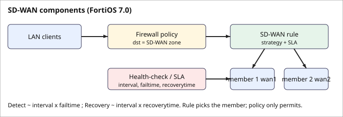

*شکل: اجزای SD-WAN و ارتباط Rule، Policy و Health-check.*

### ۵) مثال حل‌شده

**هدف:** VoIP روی لینک با Latency < 80 ms و Jitter < 20 ms؛ سایر ترافیک Load-balance.

``` text
config system sdwan
    set status enable
    config zone
        edit "virtual-wan-link"
        next
    end
    config members
        edit 1
            set interface "wan1"
            set gateway 198.51.100.1
        next
        edit 2
            set interface "wan2"
            set gateway 203.0.113.1
        next
    end
    config health-check
        edit "HC-DNS"
            set server "8.8.8.8"
            set protocol ping
            set interval 1000
            set failtime 5
            set recoverytime 10
            set members 1 2
            config sla
                edit 1
                    set latency-threshold 80
                    set jitter-threshold 20
                    set packetloss-threshold 2
                next
            end
        next
    end
    config service
        edit 1
            set name "VOIP"
            set mode sla
            set dst "all"
            set internet-service-app-ctrl 0
            config sla
                edit "HC-DNS"
                    set id 1
                next
            end
            set priority-members 1 2
        next
    end
end
```

(`internet-service-app-ctrl` در مثال بالا نمونه‌ی ساختاری است و باید با Application/Internet Service واقعی جایگزین یا حذف شود؛ سینتکس کامل `Unverified`.)

**GUI:** Network → SD-WAN → SD-WAN Zones/Members؛ Network → SD-WAN → Performance SLAs (Health-check)؛ SD-WAN Rules؛ Policy & Objects → Firewall Policy با Outgoing Interface = Zone. Static Route: مقصد 0.0.0.0/0 با Interface = SD-WAN Zone.

**مثال متوسط:** WAN1 Latency 150 ms شد: Health-check SLA را نقض می‌کند و Rule ترافیک VoIP را به WAN2 می‌برد، بقیه Load-balance؛ Log SLA: Latency.

**مثال سخت (Flap):** لینک ناپایدار هر ۳۰ ثانیه از SLA می‌افتد/برمی‌گردد. با failtime 2 و recoverytime 3 مسیر ۲۰ بار در دقیقه عوض می‌شود. راه‌حل: افزایش recoverytime (مثلاً 30)، افزودن Hysteresis در آستانه‌ی SLA (اجازه‌ی نوسان)، یا Manual برای VoIP.

### ۶) طراحی و تصمیم‌گیری

| سؤال | تصمیم |
|---|---|
| Server Health-check | مستقل از ISP، چند Server (قابل‌اتکا) |
| failtime | ≥ 2 (طبق مستند)؛ بالاتر برای لینک نویزی |
| recoverytime | بیشتر از failtime برای جلوگیری از Failback زودهنگام |
| استراتژی | SLA برای Real-time؛ load-balance برای حجم |
| Policy | روی Zone |
| Session | تصمیم درباره‌ی Clear هنگام Failover |

### ۷) Verification

``` text
diagnose sys sdwan health-check
diagnose sys sdwan member
diagnose sys sdwan service
diagnose sys session list
get router info routing-table all
```

(نام زیردستورها `Unverified`.) GUI: Network → SD-WAN → Performance SLAs (نمودار Latency/Jitter/Loss).

### ۸) Troubleshooting

| علامت | شاهد | علت |
|---|---|---|
| Member همیشه Dead | health-check | Server غیرقابل‌دسترس/Policy/Route Probe |
| Rule اثر ندارد | `diagnose sys sdwan service` | Match/Priority؛ Rule بعد از Default |
| Failover انجام شد ولی Session قفل | `session list` | Session قدیمی |
| Flap | Log SLA | failtime/recoverytime/آستانه |
| ترافیک از Interface فیزیکی می‌رود | Policy روی Interface | Policy روی Zone نیست |

### ۹) نکات امنیتی

- Health-check به سرور خارجی = ترافیک Local-out؛ Policy/Source را کنترل کنید.
- مسیر پشتیبان هم باید از Policy و Profile عبور کند.
- Failover می‌تواند ترافیک را از Inspection عبور ندهد اگر Policyها یکسان نباشند.

### ۱۰) جمع‌بندی مفهومی

- SD-WAN = Zone + Member + Health-check + Rule.
- Detect ≈ interval × failtime؛ Failback با recoverytime.
- Rule مسیر را انتخاب می‌کند؛ Policy اجازه می‌دهد؛ هر دو لازم‌اند.
- Sessionهای موجود با Failover تغییر مسیر نمی‌دهند.
- سینتکس 7.0 را با نسخه‌های جدید (۷.۴+) مخلوط نکنید.

### ۱۱) تمرین و ارزیابی

**ت1.** (ساده) Health-check برای چیست؟ *(پاسخ: 21-7-ت1)*

**ت2.** (ساده) Policy را روی کدام Interface می‌نویسیم؟ *(پاسخ: 21-7-ت2)*

**ت3.** (متوسط) Detect و Recovery با interval 500 ms، failtime 4، recoverytime 20 چقدر است؟ *(پاسخ: 21-7-ت3)*

**ت4.** (متوسط) فرق Lowest Cost (SLA) و Maximize Bandwidth؟ *(پاسخ: 21-7-ت4)*

**ت5.** (سخت) Flap لینک ناپایدار را با تنظیمات Health-check کاهش دهید. *(پاسخ: 21-7-ت5)*

**ت6.** (سخت، طراحی) برای VoIP، ERP و Backup استراتژی و SLA جداگانه طراحی کنید. *(پاسخ: 21-7-ت6)*

**م1.** چرا Server Health-check باید مستقل از ISP باشد؟ *(پاسخ: 21-7-م1)*

**Q1.** Quick quiz (English): What does recoverytime control? *(پاسخ: 21-7-Q1)*

### ۱۲) اصطلاحات و English Corner

| مخفف | شکل کامل | معنی |
|---|---|---|
| SD-WAN | Software-Defined WAN | WAN نرم‌افزاری |
| SLA | Service Level Agreement | آستانه‌ی کیفیت |
| Failback | Failback | بازگشت به مسیر اصلی |
| Jitter | Jitter | نوسان تأخیر |
| Overlay/Underlay | Overlay / Underlay | شبکه‌ی روی ISP / خود ISP |

- *Health checks decide when a member is alive and meeting its SLA.* ← Health-check تعیین می‌کند Member زنده است و SLA را رعایت می‌کند.
- *Write firewall policies on the SD-WAN zone, not on member interfaces.* ← Policy را روی Zone بنویسید نه Interface اعضا.

### ۱۳) منابع

- Fortinet Docs: [SD-WAN](https://docs.fortinet.com/document/fortigate/7.0.1/administration-guide/19246/sd-wan)، [Link health monitor](https://docs.fortinet.com/document/fortigate/7.0.1/administration-guide/580649/link-health-monitor)، [Maximize bandwidth (SLA) strategy](https://docs.fortinet.com/document/fortigate/7.0.1/administration-guide/708464/maximize-bandwidth-sla-strategy)، [config system sdwan](https://docs.fortinet.com/document/fortigate/7.0.1/cli-reference/94620/config-system-sdwan).

## پاسخ‌های فصل 21

> ابتدا بدون نگاه حل کنید. شناسه: درس-نوع+شماره (ت = تمرین، م = مرور).

**21-1-ت1** — Distance؟

کوچک‌تر ترجیح.

**21-1-ت2** — Link Monitor؟

تشخیص قطع.

**21-1-م1** — چرا Link Monitor؟

قطع ISP بدون قطع Link.

**21-1-م2** — سناریو: ISP قطع ولی Route می‌ماند؛ علت؟

نبود Monitor.


### پاسخ‌های بازنویسی درس 21-2

**21-2-ت1** — چون Interface عضو SD-WAN نباید مستقیم در Policy/Route/Object مرجع داشته باشد.

**21-2-ت2** — روی Zone SD-WAN.

**21-2-ت3** — Server/Protocol Probe، ICMP توسط ISP بلاک؛ Route/Source Probe؛ شاهد Sniffer؛ رفع: dns/http Probe.

**21-2-ت4** — Backup، فهرست مرجع‌ها، ساخت Zone/Member، انتقال Policy/Route به Zone در Change Window، آزمون و Rollback.

**21-2-Q1** — On the SD-WAN zone interface.


### پاسخ‌های بازنویسی درس 21-3

**21-3-ت1** — بالا به پایین؛ اولین Rule مطابق.

**21-3-ت2** — sla: اولین عضو دارای SLA؛ load-balance: توزیع بین همه‌ی اعضای دارای SLA.

**21-3-ت3** — Rule عمومی بالاتر Match می‌شود؛ ترتیب را اصلاح کنید.

**21-3-ت4** — VoIP: sla با Latency<80/Jitter<20؛ ERP: sla با ترجیح لینک پایدار؛ Backup: load-balance.

**21-3-Q1** — Traffic is handled by the implicit rule, which load-balances across members.

**21-4-ت1** — Session پس از Failover؟

می‌ماند.

**21-4-ت2** — Clear؟

با احتیاط.

**21-4-م1** — چرا احتیاط؟

قطع کاربران.

**21-4-م2** — سناریو: دانلود قطع؛ علت؟

Session.

**21-5-ت1** — G8؟

Failover+Rule.

**21-5-ت2** — Backup؟

execute backup.

**21-5-م1** — چرا شاهد؟

ادعای بدون آزمایش ممنوع.

**21-5-م2** — سناریو: Health-check Alive ولی کند؛ چه می‌کنید؟

SLA Latency.


---

<a id="end7"></a>


### پاسخ‌های درس افزوده‌ی 21-7 (فصل 21)

**21-7-ت1** — سنجش کیفیت لینک (Latency/Jitter/Loss) و تشخیص Dead.

**21-7-ت2** — روی Zone SD-WAN.

**21-7-ت3** — Detect = 500 ms × 4 = 2 s؛ Recovery = 500 ms × 20 = 10 s.

**21-7-ت4** — Lowest Cost (SLA): اولین عضو دارای SLA؛ Maximize Bandwidth: توزیع بین همه‌ی اعضای دارای SLA.

**21-7-ت5** — افزایش recoverytime، افزودن Hysteresis در آستانه‌ها، failtime متناسب، Probe چندگانه، Manual برای ترافیک حساس.

**21-7-ت6** — VoIP: SLA با Latency/Jitter کم؛ ERP: Best Quality؛ Backup: Lowest Cost یا Load-balance با SLA آسان.

**21-7-م1** — تا خرابی ISP با خرابی خود Probe اشتباه گرفته نشود؛ مستقل بودن نتیجه‌ی قابل‌اتکا می‌دهد.

**21-7-Q1** — The number of consecutive successful probes required before a link is considered alive again (failback behavior).

# پایان بخش ۷ (فصل‌های ۱۹ تا ۲۱)

## ۱) خلاصه‌ی مهارت‌های کسب‌شده
- Hub-and-Spoke با OSPF/BGP؛ SSL VPN/Dial-up؛ Dual-ISP، SD-WAN Rule/SLA.

## ۲) آزمون پایان سه فصل
**س1** — چرا Selector 0.0.0.0/0 برای پویا؟

**س2** — network-type OSPF روی Tunnel؟

**س3** — iBGP یا eBGP؟

**س4** — Local Breakout؟

**س5** — ADVPN وضعیت؟

**س6** — چرا SSL VPN ایزوله؟

**س7** — Split Tunnel؟

**س8** — MFA چرا؟

**س9** — Link Monitor؟

**س10** — SD-WAN Zone؟

**س11** — SLA Strategy؟

**س12** — Session پس از Failover؟


## ۳) پاسخ آزمون
- **س1:** تا Routing از Tunnel عبور کند.
- **س2:** point-to-point.
- **س3:** iBGP همان AS؛ eBGP AS متفاوت.
- **س4:** خروج محلی به اینترنت.
- **س5:** Unverified.
- **س6:** CVEهای 7.0.x.
- **س7:** فقط ترافیک سازمانی.
- **س8:** لایه‌ی دوم.
- **س9:** تشخیص قطع ISP.
- **س10:** گروه منطقی Memberها.
- **س11:** انتخاب بر اساس کیفیت.
- **س12:** می‌ماند مگر Clear.

## ۴) معیارهای تسلط
| مهارت | سطح | شاهد |
|---|---|---|
| Hub-and-Spoke | L3 | آزمون فصل ۱۹ |
| Remote Access | L2 | آزمون فصل ۲۰ |
| SD-WAN | L3 | G8 |

## ۵) مشکلات و موارد باقی‌مانده (صریح)
1. Labها اجرا نشده. 2. SD-WAN/ADVPN/sslvpn سینتکس Unverified. 3. SSL VPN فقط ایزوله.

## ۶) پیش‌نیازهای بخش بعد
Dual-ISP پایدار؛ آشنایی با HA؛ لایسنس HA بررسی.

## ۷) فهرست Lab و منابع مرتبط
کارت‌های Lab، `03-ops/*`

## ۸) وضعیت دوره
| مورد | مقدار |
|---|---|
| آخرین فصل تکمیل‌شده | ۲۱ |
| آخرین درس تکمیل‌شده | ۲۱-۶ |
| مهارت‌های تأییدشده | **هیچ‌کدام هنوز آزمون عملی واقعی نشده‌اند** (ممیزی/اجرای شما لازم است) |
| موضوعات نیازمند مرور | طبق «معیارهای تسلط» |
| فصل بعدی | ۲۲ |
| فایل تولیدشده | `course/Course_Part_07_Chapters_19-21.md` |


---

# Enterprise Network & Security Engineering — دوره‌ی تخصصی Cisco و Enterprise Firewall
## بخش ۸ از ۱۱ — فصل‌های ۲۲ تا ۲۴

| مورد | مقدار |
|---|---|
| نام دوره | Enterprise Network & Security Engineering (Cisco + FortiGate) |
| شماره بخش | ۸ از ۱۱ |
| فصل‌های این فایل | ۲۲ ، ۲۳ ، ۲۴ |
| تاریخ تولید | ۲۰۲۶-۱۱-۲۶ |
| نسخه Blueprint | v3.0 (+ بازبینی ۱٫۱) |
| نسخه‌های نرم‌افزار | FortiOS 7.0.3 (اسمی؛ بوت‌نشده؛ تأیید با `get system status`) ؛ Cisco vIOS-L2 15.2(20200924، Experimental) ؛ Cisco vIOS 15.9(3)M9 ؛ VPCS ؛ PNetLab 4.2.8 ؛ ESXi 8.0U2 ؛ CSR1000v 17.03.02 (IOS-XE؛ آزمایش‌نشده) |
| وضعیت تکمیل | **فصل‌های ۲۲–۲۴ تولید شد؛ HA، Multi-Firewall/Asymmetric، Data Center.** Labها «اجرا نشده»؛ HA/VDOM به لایسنس وابسته؛ دستورها آزمایش‌نشده. |

> **قوانین خواندن:** تمرین‌ها و پرسش‌های مرور بدون پاسخ‌اند؛ پاسخ در «پاسخ‌های فصل». «اجرا نشده» یعنی خروجی‌ها **پیش‌نیاز/پیش‌بینی** هستند. «CLI-Accepted» ≠ «کار می‌کند». رمزها نمونه‌اند.

### وضعیت راستی‌آزمایی Labهای این بخش
خلاصه: اجرا نشده (فقط طراحی): 13.

| Lab | وضعیت |
|---|---|
| 22-1 | اجرا نشده (فقط طراحی) |
| 22-2 | اجرا نشده (فقط طراحی) |
| 22-3 | اجرا نشده (فقط طراحی) |
| 22-4 | اجرا نشده (فقط طراحی) |
| 22-5 | اجرا نشده (فقط طراحی) |
| 23-1 | اجرا نشده (فقط طراحی) |
| 23-2 | اجرا نشده (فقط طراحی) |
| 23-3 | اجرا نشده (فقط طراحی) |
| 23-4 | اجرا نشده (فقط طراحی) |
| 24-1 | اجرا نشده (فقط طراحی) |
| 24-2 | اجرا نشده (فقط طراحی) |
| 24-3 | اجرا نشده (فقط طراحی) |
| 24-4 | اجرا نشده (فقط طراحی) |

---

<a id="ch22"></a>

> **نسخه‌ی اصلاح‌شده (v3.4):** نسخه‌ی توسعه‌یافته‌ی فایل اصلی؛ درس‌های افزوده: ۲۲-۰، ۲۴-۰ (دسته C). فایل اصلی در `course/` حفظ شده است. پاسخ‌های درس‌های افزوده در «پاسخ‌های فصل» همان فصل است.

# فصل 22 — High Availability: FGCP، Session Sync و Failover

**مدت:** ۳۶ ساعت | **پیش‌نیاز:** فصل ۱۳، ۲۱.
**اهداف:** مفهوم HA (Active-Passive، Active-Active)؛ FGCP؛ Heartbeat؛ Priority و Override؛ Session Sync؛ Monitor Interface؛ تست Failover.
**هشدار لایسنس:** HA در VM به لایسنس مناسب نیاز دارد (`Needs-License`) و در Evaluation ممکن است محدود باشد؛ همه‌ی دستورها `Unverified`.
**اشتباهات رایج:** Heartbeat روی همان لینک داده؛ Priority/Override نادرست؛ ناهمسانی Firmware؛ نبود Monitor Interface.

**درس‌های فصل:**
- [درس 22-1 — مفاهیم HA و FGCP](#l-22-1)
- [درس 22-2 — پیکربندی HA Active-Passive](#l-22-2)
- [درس 22-3 — تست Failover و Session Sync](#l-22-3)
- [درس 22-4 — عیب‌یابی HA و Upgrade](#l-22-4)
- [درس 22-5 — آزمون فصل ۲۲](#l-22-5)

---

<a id="l-22-1"></a>

## درس 22-0 — HA در FortiGate (FGCP): Election، Heartbeat، Sync، Failover/Failback و Split-brain

**فصل ۲۲ · درس افزوده (پیش‌درس ۲۲-۱) · پیش‌نیاز: ۱۱-۷، ۱۳-۷، ۵-۷ · ≈ ۱۰ ساعت**

> **وضعیت (FortiOS 7.0.3):** مفاهیم FGCP، Split-brain و Session Pickup از مستند رسمی بررسی شد ([FGCP 7.0.3](https://docs.fortinet.com/document/fortigate/7.0.3/administration-guide/62403/fgcp)، [Troubleshoot an HA formation](https://docs.fortinet.com/document/fortigate/7.4.0/administration-guide/946059/troubleshoot-an-ha-formation)، [Session pickup](https://docs.fortinet.com/document/fortigate/7.6.0/administration-guide/955521/session-pickup)). **دقت نسخه:** بعضی ویژگی‌ها مثل `backup-hbdev` در 7.6 معرفی شده و در 7.0.3 نیست. **Needs-License/محدودیت:** HA روی VM به لایسنس مناسب و دو VM با لایسنس معتبر نیاز دارد؛ در Lab Evaluation ممکن است محدود باشد. Lab «اجرا نشده».

### ۱) هدف آموزشی

دانشجو در پایان می‌تواند:

1. تفاوت **Active-Passive** و **Active-Active** را بگوید و بداند چرا Active-Passive رایج‌تر است.
2. توضیح دهد **FGCP** چگونه عضو Primary را انتخاب می‌کند (Election) و چه چیزی هم‌گام می‌شود.
3. **Heartbeat** را درست طراحی کند (اختصاصی، Redundant) و **Split-brain** را تحلیل و پیشگیری کند.
4. **Configuration Sync** و **Session Pickup/Sync** را تفکیک و اثر هرکدام را در Failover بگوید.
5. **Interface Monitoring**، Link Failure و Device Failure را تحلیل کند.
6. **Failover/Failback** و `override` را با پیامدشان بشناسد.
7. محدودیت‌ها و وابستگی‌های نسخه/لایسنس را اعلام کند.

### ۲) پیش‌نیازها

Session/Stateful (۱۱-۷، ۱۳-۷)، Convergence (۵-۷)، Interface/VLAN FortiGate (فصل ۱۲)، ARP/MAC (فصل ۲، ۳).

### ۳) مفهوم پایه

فایروال لبه نقطه‌ی شکست واحد (SPOF) است. **HA** دو (یا بیشتر) دستگاه را در یک **Cluster** قرار می‌دهد تا با خرابی یکی، دیگری ترافیک را ادامه دهد. هدف فقط «یک Cluster ساختن» نیست؛ هدف **پیش‌بینی رفتار سیستم در انواع خرابی** است: خرابی لینک، خرابی دستگاه، قطع Heartbeat، خرابی نیمه‌کاره.

### ۴) توضیح عمیق فنی

#### ۴-۱) FGCP

**FortiGate Clustering Protocol (FGCP)** پروتکل اختصاصی Fortinet برای HA است. اعضا از طریق **Heartbeat** Interfaceها با هم صحبت می‌کنند. طبق مستند، هم‌گام‌سازی روی لینک Heartbeat با TCP/703 و UDP/703 انجام می‌شود. Cluster با **Group Name، Group ID/Password و Mode** هم‌هویت می‌شود.

| Mode | رفتار |
|---|---|
| Active-Passive (a-p) | یک Primary ترافیک می‌برد؛ Secondary آماده است |
| Active-Active (a-a) | Primary بار Inspection (UTM) را بین اعضا پخش می‌کند؛ ترافیک همچنان از Primary ورودی/خروجی می‌شود؛ پیچیده‌تر |

(Active-Active در FGCP «توزیع بار Session/UTM» است، نه ECMP واقعی؛ جزئیات مستند.)

#### ۴-۲) Election (انتخاب Primary)

به‌طور خلاصه (ترتیب دقیق و Age-difference را از مستند همان نسخه بخوانید؛ `Unverified` در جزئیات):

``` text
Default (override disabled):
 1. more monitored interfaces up
 2. longer HA uptime (age)
 3. higher priority
 4. higher serial number
With override enabled: monitored interfaces -> priority -> uptime -> serial
```

نتیجه: با `override disable` عضوی که بیشتر زنده بوده Primary می‌ماند و بعد از بازگشت دستگاه اصلی، **Failback خودکار رخ نمی‌دهد**؛ با `override enable` دستگاه با Priority بالاتر پس از بازگشت Primary می‌شود (Failback) ولی ممکن است باعث قطع کوتاه و Flap شود.

#### ۴-۳) Heartbeat

- Interfaceهای اختصاصی (`hbdev`) با Priority؛ حداقل دو لینک Redundant ترجیحاً مستقیم (Back-to-back).
- ترافیک Heartbeat شامل Hello و Sync (Config، Session). مستند توصیه می‌کند برای کاهش Split-brain: لینک Heartbeat Redundant، مستقیم، و برای سایت‌های دور زمان Lost Interval بیشتر.
- **Heartbeat را روی همان لینک داده/سوئیچ مشترک خراب نگذارید.**

#### ۴-۴) Split-brain

اگر اعضا Heartbeat را از دست بدهند ولی هر دو زنده باشند، **هر دو خود را Primary می‌پندارند**: آدرس IP/MAC تکراری، Sessionهای متناقض، قطعی شدید. طبق مستند علت‌ها: قطع/ناپایداری Heartbeat؛ راه‌های پیشگیری: لینک Back-to-back، Heartbeat Redundant، Lost Interval مناسب. (`backup-hbdev` در 7.6 اضافه شده و در 7.0.3 موجود نیست.) پس از رفع، یک عضو باید دوباره Join شود و Config Sync انجام شود؛ بررسی Config واگرا لازم است.

#### ۴-۵) Sync: Configuration و Session

- **Configuration Sync:** Primary پیکربندی را به Secondary می‌فرستد (به‌جز تنظیمات اختصاصی هر دستگاه مثل Hostname/HA priority). بررسی: `diagnose sys ha checksum cluster`.
- **Session Sync/Pickup:** طبق مستند Session Pickup جدول Session **TCP** را به Secondary هم‌گام می‌کند؛ UDP و ICMP تنظیم جداگانه‌ای دارند و پیش‌نیازشان فعال بودن Pickup TCP است. بدون Pickup، با Failover همه‌ی Sessionها قطع می‌شوند و کلاینت‌ها باید Session بسازند. با Pickup اغلب Sessionهای TCP ادامه می‌یابند. هزینه: پهنای Heartbeat و CPU.
- VPN/IPsec SA و بعضی State‌ها همگام نمی‌شوند یا بسته به نسخه متفاوت‌اند؛ پس از Failover IPsec ممکن است Rekey/Renegotiate کند (`Unverified`).

#### ۴-۶) Monitoring و انواع خرابی

| خرابی | تشخیص | رفتار |
|---|---|---|
| Link failure (Interface مانیتورشده) | Monitor Interface | تعداد Interface سالم کم می‌شود ← Failover |
| Device failure | قطع Heartbeat | Secondary Primary می‌شود |
| Heartbeat failure با دو دستگاه زنده | Split-brain | خطرناک |
| خرابی نرم‌افزار/CPU | Heartbeat/Process | Failover یا Cluster ناپایدار |
| خرابی ISP | Interface Up ولی لینک مرده | HA این را نمی‌بیند؛ نیاز Health-check/SD-WAN (۲۱-۷) |

> **درس مهم:** HA خرابی «فایروال» را پوشش می‌دهد، نه خرابی «سرویس ISP». این‌ها را با SD-WAN/Link Monitor مکمل کنید.

#### ۴-۷) Failover time

Failover معمولاً چند ثانیه (Detect + Election + ARP/MAC Update): بعد از Failover Primary جدید **Gratuitous ARP** می‌فرستد و MAC مجازی Cluster به Primary جدید منتقل می‌شود تا سوئیچ‌ها یاد بگیرند. نتیجه: چند ثانیه قطعی؛ Sessionها فقط با Pickup می‌مانند.

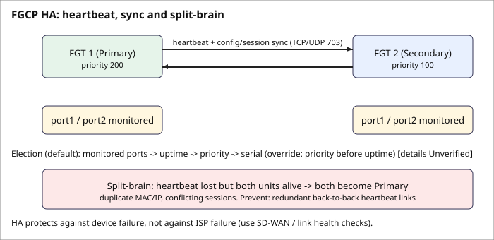

*شکل: HA، Heartbeat، Election و Split-brain.*

### ۵) مثال حل‌شده

**هدف:** Active-Passive با Heartbeat روی port3 و port4، Monitor روی port1 و port2.

``` text
config system ha
    set group-name "FGT-HA-LAB"
    set mode a-p
    set password <HA-PASSWORD>
    set hbdev "port3" 100 "port4" 50
    set monitor "port1" "port2"
    set priority 200
    set session-pickup enable
    set override disable
end
```

دستگاه دوم: همان `group-name/password/mode/hbdev`، `priority 100`.

**GUI:** System → HA → Mode: Active-Passive؛ Device Priority؛ Cluster Settings (Group Name، Password)؛ Heartbeat Interfaces (انتخاب و Priority)؛ Monitor Interfaces؛ Session Pickup.

**Verification:**

``` text
get system ha status
diagnose sys ha status
diagnose sys ha checksum cluster
diagnose sys ha history read
```

(`Unverified`.)

**مثال متوسط:** Failover آزمایشی: `execute ha manage` یا Shutdown Interface مانیتورشده؛ ping پیوسته از کلاینت؛ ثبت تعداد بسته‌های از دست‌رفته و زمان.

**مثال سخت (Split-brain):** کابل Heartbeat کشیده می‌شود و لینک داده‌ها سالم‌اند: دو Primary. شواهد: `get system ha status` در هر دستگاه خود را Primary نشان می‌دهد؛ ARP جدول سوئیچ دو MAC برای یک IP. راه‌حل فوری: اتصال دوباره‌ی Heartbeat و تعیین کدام عضو Primary بماند (ریست دیگری)، سپس بررسی Config Checksum. پیشگیری: Heartbeat Redundant و Back-to-back.

### ۶) طراحی و تصمیم‌گیری

| سؤال | تصمیم |
|---|---|
| a-p یا a-a؟ | a-p (سادگی)؛ a-a برای بار UTM زیاد |
| Heartbeat | ۲ لینک مجزا، مستقیم |
| `override` | خاموش (پایداری)؛ روشن فقط اگر Failback مطلوب و Flap کنترل شود |
| Session Pickup | روشن برای سرویس‌های حساس به قطع؛ هزینه‌اش را بسنجید |
| Monitor Interface | همه‌ی Interfaceهای حیاتی؛ نه Interface مدیریت |
| Firmware | یکسان؛ ارتقا طبق روال |
| لایسنس | هر دو دستگاه لایسنس معتبر |

### ۷) Troubleshooting

| علامت | شاهد | علت |
|---|---|---|
| Cluster Form نمی‌شود | Group/Password/Mode، لینک HB | ناهمسانی |
| Secondary Out-of-sync | `ha checksum cluster` | Config/Firmware |
| Failover بدون دلیل | `ha history` | Monitor/HB flap |
| دو Primary | `ha status` | Split-brain |
| Session قطع می‌شود | Pickup خاموش | فعال‌سازی/محدودیت UDP |
| بعد از Failover VPN قطع | IKE Log | Renegotiate |

### ۸) نکات امنیتی

- HA Password قوی؛ لینک HB را از شبکه‌ی کاربران جدا نگه دارید.
- Heartbeat روی سوئیچ مشترک قابل جعل/اختلال است؛ ترجیحاً مستقیم.
- نسخه‌ی 7.0.3 دارای CVE؛ HA آسیب‌پذیری را حل نمی‌کند.

### ۹) جمع‌بندی مفهومی

- FGCP: Heartbeat + Sync (Config، Session) + Election.
- Election: Monitor ← Age ← Priority ← Serial (با Override: Priority جلوتر).
- Split-brain از قطع HB با دستگاه‌های زنده؛ با HB Redundant/مستقیم پیشگیری می‌شود.
- Session Pickup TCP را حفظ می‌کند؛ UDP/ICMP جدا.
- HA ≠ حفاظت از خرابی ISP.

### ۱۰) تمرین و ارزیابی

**ت1.** (ساده) Active-Passive و Active-Active را مقایسه کنید. *(پاسخ: 22-0-ت1)*

**ت2.** (ساده) Split-brain یعنی چه؟ *(پاسخ: 22-0-ت2)*

**ت3.** (متوسط) با `override disable` پس از بازگشت Primary اصلی چه می‌شود؟ *(پاسخ: 22-0-ت3)*

**ت4.** (متوسط) چرا Heartbeat Redundant لازم است؟ *(پاسخ: 22-0-ت4)*

**ت5.** (سخت) پس از Failover کاربران باید Session TCP را دوباره بسازند؛ علت و راه‌حل؟ *(پاسخ: 22-0-ت5)*

**ت6.** (سخت، طراحی) برای سایت مرکزی با دو ISP و دو FGT، HA و SD-WAN را کنار هم طراحی و نقش هرکدام را بنویسید. *(پاسخ: 22-0-ت6)*

**م1.** `diagnose sys ha checksum cluster` برای چیست؟ *(پاسخ: 22-0-م1)*

**Q1.** Quick quiz (English): What causes a split-brain scenario in an HA cluster? *(پاسخ: 22-0-Q1)*

### ۱۱) اصطلاحات و English Corner

| مخفف | شکل کامل | معنی |
|---|---|---|
| HA | High Availability | دسترس‌پذیری بالا |
| FGCP | FortiGate Clustering Protocol | پروتکل Cluster |
| HB | Heartbeat | نبض Cluster |
| SPOF | Single Point of Failure | نقطه‌ی شکست واحد |
| GARP | Gratuitous ARP | ARP اعلام‌کننده |
| Pickup | Session pickup | حفظ Session |

- *Split-brain happens when cluster members lose heartbeat and each assumes the primary role.* ← Split-brain وقتی رخ می‌دهد که اعضا Heartbeat را از دست بدهند و هر دو نقش Primary را فرض کنند.
- *HA protects against device failure, not against upstream ISP failure.* ← HA از خرابی دستگاه محافظت می‌کند، نه از خرابی ISP بالادست.

### ۱۲) منابع

- Fortinet Docs: [FGCP](https://docs.fortinet.com/document/fortigate/7.0.3/administration-guide/62403/fgcp)، [Troubleshoot an HA formation](https://docs.fortinet.com/document/fortigate/7.4.0/administration-guide/946059/troubleshoot-an-ha-formation)، [Session pickup (7.6)](https://docs.fortinet.com/document/fortigate/7.6.0/administration-guide/955521/session-pickup) (برای مفهوم؛ تفاوت نسخه را بررسی کنید).

## درس 22-1 — مفاهیم HA و FGCP

**فصل 22 - روز 1 · پیش‌نیاز: فصل ۲۱ · ۶ ساعت**

### ۱) معرفی درس

قبل از پیکربندی: Active-Passive در برابر Active-Active و اجزای FGCP.

### ۲) پیش‌نیازها

فصل ۲۱

### ۳) توضیح مفهومی

- Active-Passive: یک دستگاه ترافیک می‌برد.
- Active-Active: بار تقسیم می‌شود (پیچیده‌تر).
- FGCP: پروتکل HA فورتی‌نت.
- Heartbeat: لینک اختصاصی همگام‌سازی.
- Cluster ID و Group Name.

### ۴) مثال ساده

دو دستگاه؛ یکی بمیرد دیگری ادامه دهد.

### ۵) مثال سازمانی

سازمان: HA برای فایروال لبه بدون قطع بلندمدت.

### ۶) تصویر و توپولوژی

```text
FGT-1 (Primary) <-HB-> FGT-2 (Secondary)
```

### ۷) پیکربندی (GUI و CLI)

> نسخه‌ی هدف: FortiOS 7.0.3 (اسمی؛ از نام Image؛ بوت‌نشده؛ تأیید با `get system status`). دستورها/منوها از مستند عمومی FortiOS 7.0 و دانش مؤلف هستند و **روی Image شما هنوز آزمایش نشده‌اند**؛ در بوت اول مقایسه کنید.

#### روش گرافیکی (GUI)

1. System > HA.

#### روش خط فرمان (CLI)

```text
get system ha status
```

**توضیح دستورها (چه / چرا / خروجی / راستی‌آزمایی / بازگشت):**

- خواندنی.

### ۸) تست عملکرد

- نمودار HA را بکشید.

### ۹) عیب‌یابی

| بخش | شرح |
|---|---|
| Symptom | HA بالا نمی‌آید |
| شواهد/دستور | `get system ha status` |
| علت | Group/Password |
| رفع | تطبیق |

### ۱۰) تمرین مستقل

> پاسخ‌ها در بخش «پاسخ‌های فصل» انتهای فصل است؛ اول خودتان حل کنید.

**ت1.** Active-Passive؟ *(پاسخ: 22-1-ت1)*

**ت2.** Heartbeat؟ *(پاسخ: 22-1-ت2)*

### ۱۱) مرور و ارزیابی

**م1.** چرا Heartbeat اختصاصی؟ *(پاسخ: 22-1-م1)*

**م2.** سناریو: Split-brain؛ علت؟ *(پاسخ: 22-1-م2)*

**معیار تسلط:** ساخت HA و تست Failover.

**اشتباهات رایج:** Heartbeat و Override.

### ۱۲) واژگان و English Corner

| واژه | شکل کامل | معنی | کاربرد واقعی |
|---|---|---|---|
| HA | High Availability | دسترس‌پذیری بالا | FGT |
| FGCP | FortiGate Clustering Protocol | پروتکل HA | FGT |

| English sentence | ترجمه |
|---|---|
| Use a dedicated heartbeat link. | از لینک Heartbeat اختصاصی استفاده کنید. |

#### کارت Lab — درس 22-1

| # | فیلد | محتوا |
|---|---|---|
| 1 | عنوان و هدف | نقشه HA |
| 2 | پیش‌نیاز | فصل ۲۱ |
| 3 | توپولوژی | — |
| 4 | تجهیزات | — |
| 5 | نسخه نرم‌افزار | FortiOS 7.0.3 (اسمی؛ از نام Image؛ بوت‌نشده؛ تأیید با `get system status`) |
| 6 | IP Plan | — |
| 7 | وضعیت اولیه | — |
| 8 | صورت مسئله | نمودار |
| 9 | مراحل هدایت‌شده | بخش‌های ۷ و ۸ همین درس (گام‌به‌گام) |
| 10 | تست عملکرد | — |
| 11 | سناریوی خرابی | HA بالا نمی‌آید |
| 12 | روش عیب‌یابی | بخش ۹ همین درس (لایه‌ای/با شواهد) |
| 13 | نتیجه‌ی مورد انتظار | سند |
| 14 | معیار پذیرش | تأیید |
| 15 | مستندات نهایی | `02-design/ha-map.md` |
| 16 | Cleanup و بازگردانی | — |

> **وضعیت راستی‌آزمایی (خارج از ۱۶ فیلد):** **اجرا نشده (فقط طراحی).** Image FortiGate هنوز بوت نشده؛ دستورها/منوها آزمایش‌نشده‌اند.

---

<a id="l-22-2"></a>

## درس 22-2 — پیکربندی HA Active-Passive: برگه‌ی طراحی، GUI، CLI و Verification

**فصل ۲۲ · بازنویسی عمیق · پیش‌نیاز: ۲۲-۰ (FGCP، Election، Heartbeat) · ≈ ۶ ساعت**

> **وضعیت (7.0.3):** Needs-License (دو VM با لایسنس معتبر)؛ سینتکس `Unverified`؛ Lab «اجرا نشده». **هر Boot/تغییر فقط با تأیید کاربر.**

### ۱) هدف آموزشی

Cluster Active-Passive را با برگه‌ی طراحی، Heartbeat Redundant، Monitor Interface و Session Pickup بسازد و Verification/Backup/Rollback را اجرا کند.

### ۲) برگه‌ی طراحی

``` text
Units      : FGT-1 (priority 200), FGT-2 (priority 100); same model, same FortiOS, same license type
Group      : name FGT-HA-LAB, mode a-p, password <HA-PASSWORD>
Heartbeat  : port3 (priority 100), port4 (priority 50) back-to-back, no switch
Monitor    : port1 (WAN), port2 (LAN)
Session    : session-pickup enable (TCP)
Override   : disable (prevent flap)  [decision: failback manual]
Mgmt       : dedicated management interface per unit (reserved mgmt ip)
```

### ۳) مراحل

1. Backup هر دو. بررسی نسخه/Serial.
2. تنظیم HA روی FGT-1 (Primary) سپس FGT-2.
3. اتصال Heartbeat Back-to-back.
4. صبر برای Sync؛ بررسی Checksum.

**GUI:** System → HA → Mode Active-Passive؛ Device Priority؛ Group Name؛ Password؛ Heartbeat Interfaces (port3 100، port4 50)؛ Monitor Interfaces (port1، port2)؛ Session Pickup.

**CLI (`Unverified`):**

``` text
config system ha
    set group-name "FGT-HA-LAB"
    set mode a-p
    set password <HA-PASSWORD>
    set hbdev "port3" 100 "port4" 50
    set monitor "port1" "port2"
    set priority 200
    set session-pickup enable
    set override disable
end
```

FGT-2 همان ولی `priority 100`.

### ۴) Verification

``` text
get system ha status
diagnose sys ha status
diagnose sys ha checksum cluster
diagnose sys ha history read
```

انتظار: دو عضو، Primary/Secondary، Checksum یکسان، Heartbeat هر دو لینک Up.

### ۵) مثال‌ها

**ساده:** `ha status`: FGT-1 Primary؛ Hostname و Serial هر دو.

**متوسط:** Secondary «out of sync»: مقایسه‌ی Firmware/Config؛ `checksum cluster` مغایر؛ علت: نسخه‌ی متفاوت؛ رفع: ارتقای یکسان.

**سخت (Flap):** Cluster بین دو عضو سوئیچ می‌کند: History: Monitor Interface خراب مکرر؛ لینک port2 نوسان؛ شواهد Interface Errors؛ رفع: کابل/Duplex، Hold-down، `override disable`.

### ۶) Troubleshooting

| علامت | علت |
|---|---|
| Cluster تشکیل نمی‌شود | Group/Password/Mode/HB |
| Secondary Sync نمی‌شود | Firmware/Config |
| Flap | Monitor/لینک |
| Split-brain | HB قطع |

### ۷) نکات امنیتی

- Password قوی؛ HB جدا از شبکه‌ی کاربران.
- Reserved Mgmt IP برای دسترسی به هر عضو.

### ۸) جمع‌بندی

- برگه‌ی طراحی؛ Heartbeat Redundant؛ Monitor مناسب.
- Firmware یکسان.
- Verification: status/checksum/history.

### ۹) تمرین و ارزیابی

**ت1.** (ساده) چه چیزی در دو عضو باید یکسان باشد؟ *(پاسخ: 22-2-ت1)*

**ت2.** (متوسط) چرا `override disable`؟ *(پاسخ: 22-2-ت2)*

**ت3.** (سخت) Cluster Flap می‌کند؛ تحلیل. *(پاسخ: 22-2-ت3)*

**Q1.** Quick quiz (English): Which command compares configuration consistency between cluster members? *(پاسخ: 22-2-Q1)*

### ۱۰) اصطلاحات و English Corner

| مخفف | شکل کامل | معنی |
|---|---|---|
| hbdev | Heartbeat device | Interface نبض |
| Reserved mgmt | Reserved management interface | مدیریت جدا برای هر عضو |

- *Use identical firmware on all cluster members.* ← روی همه‌ی اعضا Firmware یکسان استفاده کنید.

### ۱۱) Lab

**کارت Lab:** HA A-P. **وضعیت:** اجرا نشده. **Evidence:** `03-ops/ha-ap.md`.

### ۱۲) منابع

- Fortinet Docs: [FGCP](https://docs.fortinet.com/document/fortigate/7.0.3/administration-guide/62403/fgcp).

<a id="l-22-3"></a>

## درس 22-3 — آزمون Failover/Failback و Session Pickup: طراحی تست، اندازه‌گیری و تحلیل

**فصل ۲۲ · بازنویسی عمیق · پیش‌نیاز: ۲۲-۰، ۲۲-۲ · ≈ ۶ ساعت**

> **وضعیت:** آزمون فقط در Lab با تأیید؛ اعداد نمونه؛ `Unverified`.

### ۱) هدف آموزشی

آزمون Failover را برنامه‌ریزی (سناریو، معیار، اندازه‌گیری) و نتایج را تحلیل کند؛ اثر Session Pickup، VPN و ARP را ببیند.

### ۲) ماتریس آزمون

| # | سناریو | انتظار | اندازه‌گیری |
|---|---|---|---|
| 1 | قطع Primary (Power off) | Failover چند ثانیه | بسته‌های از دست‌رفته |
| 2 | قطع port1 (Monitor) | Failover | زمان |
| 3 | قطع یک Heartbeat | Cluster باقی | بدون Failover |
| 4 | قطع هر دو Heartbeat | Split-brain (آزمون کنترل‌شده) | ثبت رفتار |
| 5 | بازگشت Primary | بدون Failback (override disable) | تأیید |
| 6 | Session TCP طولانی (SSH) | با Pickup ادامه | Session |

### ۳) روش اندازه‌گیری

``` text
# client A (continuous)
ping -i 0.2 192.168.20.5 | ts
# session test
ssh user@192.168.20.5   (keep typing)
# FGT
get system ha status
diagnose sys ha history read
diagnose sys session list
```

``` text
Packet loss time ~= lost packets x ping interval
```

### ۴) مثال حل‌شده

**آزمون ۱:** ۱۵ بسته از دست رفته با فاصله 0.2 s = ≈ ۳ ثانیه قطع. SSH با Pickup ادامه یافت یا قطع شد: اگر قطع شد، Pickup/Hash/Interface Monitor را بررسی. **درس:** قطع ۳ ثانیه با Pickup معمولاً برای TCP قابل‌تحمل است؛ UDP/IPsec ممکن است Renegotiate کند.

**آزمون ۴ (Split-brain):** با قطع هر دو HB: هر دو Primary؛ ARP: دو MAC؛ ping ناپایدار. **اقدام:** وصل HB، ریست یک عضو، بررسی Checksum و Config. **پیشگیری:** HB Redundant/Back-to-back.

**مثال سخت:** پس از Failover VPN دوباره برقرار نمی‌شود: بررسی IKE: Peer SPI قدیمی؛ DPD/Rekey؛ در صورت لزوم `diagnose vpn ike gateway clear` (با احتیاط). ثبت.

### ۵) Troubleshooting

| علامت | علت |
|---|---|
| Failover کند | Heartbeat/Lost interval |
| Session قطع | Pickup خاموش/UDP |
| دو Primary | HB قطع |
| بعد از Failover VPN قطع | Renegotiate |

### ۶) نکات امنیتی

- آزمون Split-brain فقط Lab.
- Change و Rollback.

### ۷) جمع‌بندی

- آزمون Failover = سناریو + معیار + اندازه‌گیری.
- Pickup TCP را حفظ می‌کند.
- Split-brain را عمداً فقط در Lab بیازمایید.

### ۸) تمرین و ارزیابی

**ت1.** (ساده) چگونه زمان قطع را اندازه می‌گیرید؟ *(پاسخ: 22-3-ت1)*

**ت2.** (متوسط) SSH پس از Failover قطع شد؛ چرا؟ *(پاسخ: 22-3-ت2)*

**ت3.** (سخت) ماتریس آزمون ۶ سناریویی را با انتظار بنویسید. *(پاسخ: 22-3-ت3)*

**Q1.** Quick quiz (English): How do you measure failover time with a continuous ping? *(پاسخ: 22-3-Q1)*

### ۹) اصطلاحات و English Corner

| مخفف | شکل کامل | معنی |
|---|---|---|
| Failover | Failover | انتقال به عضو دوم |
| Failback | Failback | بازگشت |
| Hold-down | Hold-down timer | تأخیر پیش از تغییر |

- *Test every failure mode and record the measured downtime.* ← هر حالت خرابی را تست و زمان قطع را ثبت کنید.

### ۱۰) Lab

**کارت Lab:** Failover. **وضعیت:** اجرا نشده. **Evidence:** `03-ops/ha-fail.md`.

### ۱۱) منابع

- Fortinet Docs: [Troubleshoot an HA formation](https://docs.fortinet.com/document/fortigate/7.4.0/administration-guide/946059/troubleshoot-an-ha-formation) (مفهوم؛ نسخه‌ی 7.0 را بررسی کنید).

<a id="l-22-4"></a>

## درس 22-4 — عیب‌یابی HA و Upgrade

**فصل 22 - روز 4 · پیش‌نیاز: درس ۲۲-۲ · ۶ ساعت**

### ۱) معرفی درس

مشکلات رایج و ارتقای Cluster.

### ۲) پیش‌نیازها

درس ۲۲-۲

### ۳) توضیح مفهومی

- Split-brain.
- Config Sync.
- Upgrade یکی‌یکی.
- Backup قبل از Upgrade.
- Log.

### ۴) مثال ساده

دو دستگاه؛ یکی بمیرد دیگری ادامه دهد.

### ۵) مثال سازمانی

سازمان: HA برای فایروال لبه بدون قطع بلندمدت.

### ۶) تصویر و توپولوژی

```text
FGT-1 (Primary) <-HB-> FGT-2 (Secondary)
```

### ۷) پیکربندی (GUI و CLI)

> نسخه‌ی هدف: FortiOS 7.0.3 (اسمی؛ از نام Image؛ بوت‌نشده؛ تأیید با `get system status`). دستورها/منوها از مستند عمومی FortiOS 7.0 و دانش مؤلف هستند و **روی Image شما هنوز آزمایش نشده‌اند**؛ در بوت اول مقایسه کنید.

#### روش گرافیکی (GUI)

1. System > Firmware.

#### روش خط فرمان (CLI)

```text
diagnose sys ha checksum cluster
diagnose sys ha history read
```

**توضیح دستورها (چه / چرا / خروجی / راستی‌آزمایی / بازگشت):**

- `Unverified`.

### ۸) تست عملکرد

- رفع Sync.

### ۹) عیب‌یابی

| بخش | شرح |
|---|---|
| Symptom | Checksum ناهمسان |
| شواهد/دستور | `checksum cluster` |
| علت | Config |
| رفع | Sync |

### ۱۰) تمرین مستقل

> پاسخ‌ها در بخش «پاسخ‌های فصل» انتهای فصل است؛ اول خودتان حل کنید.

**ت1.** Checksum؟ *(پاسخ: 22-4-ت1)*

**ت2.** Upgrade؟ *(پاسخ: 22-4-ت2)*

### ۱۱) مرور و ارزیابی

**م1.** چرا Backup؟ *(پاسخ: 22-4-م1)*

**م2.** سناریو: Upgrade شکست؛ چه می‌کنید؟ *(پاسخ: 22-4-م2)*

**معیار تسلط:** ساخت HA و تست Failover.

**اشتباهات رایج:** Heartbeat و Override.

### ۱۲) واژگان و English Corner

| واژه | شکل کامل | معنی | کاربرد واقعی |
|---|---|---|---|
| Checksum | HA checksum | تطبیق Config | HA |

| English sentence | ترجمه |
|---|---|
| Back up before upgrading. | قبل از ارتقا Backup بگیرید. |

#### کارت Lab — درس 22-4

| # | فیلد | محتوا |
|---|---|---|
| 1 | عنوان و هدف | Upgrade HA |
| 2 | پیش‌نیاز | درس ۲۲-۲ |
| 3 | توپولوژی | FGT-1+FGT-2 |
| 4 | تجهیزات | FGT |
| 5 | نسخه نرم‌افزار | FortiOS 7.0.3 (اسمی؛ از نام Image؛ بوت‌نشده؛ تأیید با `get system status`) |
| 6 | IP Plan | — |
| 7 | وضعیت اولیه | HA |
| 8 | صورت مسئله | Upgrade |
| 9 | مراحل هدایت‌شده | بخش‌های ۷ و ۸ همین درس (گام‌به‌گام) |
| 10 | تست عملکرد | status |
| 11 | سناریوی خرابی | Checksum ناهمسان |
| 12 | روش عیب‌یابی | بخش ۹ همین درس (لایه‌ای/با شواهد) |
| 13 | نتیجه‌ی مورد انتظار | موفق |
| 14 | معیار پذیرش | ثبت |
| 15 | مستندات نهایی | `03-ops/ha-upgrade.md` |
| 16 | Cleanup و بازگردانی | Rollback |

> **وضعیت راستی‌آزمایی (خارج از ۱۶ فیلد):** **اجرا نشده (فقط طراحی).** Image FortiGate هنوز بوت نشده؛ دستورها/منوها آزمایش‌نشده‌اند.

---

<a id="l-22-5"></a>

## درس 22-5 — آزمون فصل ۲۲

**فصل 22 - روز 5 · پیش‌نیاز: درس ۲۲-۳ · ۶ ساعت**

### ۱) معرفی درس

ارزیابی.

### ۲) پیش‌نیازها

درس ۲۲-۳

### ۳) توضیح مفهومی

- HA A-P.
- Failover.
- Sync.
- Backup.
- آزمون.

### ۴) مثال ساده

دو دستگاه؛ یکی بمیرد دیگری ادامه دهد.

### ۵) مثال سازمانی

سازمان: HA برای فایروال لبه بدون قطع بلندمدت.

### ۶) تصویر و توپولوژی

```text
FGT-1 (Primary) <-HB-> FGT-2 (Secondary)
```

### ۷) پیکربندی (GUI و CLI)

> نسخه‌ی هدف: FortiOS 7.0.3 (اسمی؛ از نام Image؛ بوت‌نشده؛ تأیید با `get system status`). دستورها/منوها از مستند عمومی FortiOS 7.0 و دانش مؤلف هستند و **روی Image شما هنوز آزمایش نشده‌اند**؛ در بوت اول مقایسه کنید.

#### روش گرافیکی (GUI)

1. System > HA.

#### روش خط فرمان (CLI)

```text
get system ha status
```

**توضیح دستورها (چه / چرا / خروجی / راستی‌آزمایی / بازگشت):**

- خواندنی.

### ۸) تست عملکرد

- اجرای سناریو.

### ۹) عیب‌یابی

| بخش | شرح |
|---|---|
| Symptom | Failover کند |
| شواهد/دستور | ha status |
| علت | Heartbeat |
| رفع | اصلاح |

### ۱۰) تمرین مستقل

> پاسخ‌ها در بخش «پاسخ‌های فصل» انتهای فصل است؛ اول خودتان حل کنید.

**ت1.** HA چیست؟ *(پاسخ: 22-5-ت1)*

**ت2.** Sync؟ *(پاسخ: 22-5-ت2)*

### ۱۱) مرور و ارزیابی

**م1.** چرا تست؟ *(پاسخ: 22-5-م1)*

**م2.** سناریو: Heartbeat قطع؛ پیامد؟ *(پاسخ: 22-5-م2)*

**معیار تسلط:** ساخت HA و تست Failover.

**اشتباهات رایج:** Heartbeat و Override.

### ۱۲) واژگان و English Corner

| واژه | شکل کامل | معنی | کاربرد واقعی |
|---|---|---|---|
| Heartbeat | HA heartbeat | نبض HA | HA |

| English sentence | ترجمه |
|---|---|
| Always test failover. | همیشه Failover را تست کنید. |

#### کارت Lab — درس 22-5

| # | فیلد | محتوا |
|---|---|---|
| 1 | عنوان و هدف | آزمون HA |
| 2 | پیش‌نیاز | درس ۲۲-۳ |
| 3 | توپولوژی | FGT×2 |
| 4 | تجهیزات | FGT |
| 5 | نسخه نرم‌افزار | FortiOS 7.0.3 (اسمی؛ از نام Image؛ بوت‌نشده؛ تأیید با `get system status`) |
| 6 | IP Plan | — |
| 7 | وضعیت اولیه | HA |
| 8 | صورت مسئله | Failover |
| 9 | مراحل هدایت‌شده | بخش‌های ۷ و ۸ همین درس (گام‌به‌گام) |
| 10 | تست عملکرد | ping |
| 11 | سناریوی خرابی | Failover کند |
| 12 | روش عیب‌یابی | بخش ۹ همین درس (لایه‌ای/با شواهد) |
| 13 | نتیجه‌ی مورد انتظار | ثبت |
| 14 | معیار پذیرش | ≥ ۴ از ۵ |
| 15 | مستندات نهایی | `03-ops/ha-exam.md` |
| 16 | Cleanup و بازگردانی | — |

> **وضعیت راستی‌آزمایی (خارج از ۱۶ فیلد):** **اجرا نشده (فقط طراحی).** Image FortiGate هنوز بوت نشده؛ دستورها/منوها آزمایش‌نشده‌اند.

---

<a id="ans-22"></a>

## پاسخ‌های فصل 22

> ابتدا بدون نگاه حل کنید. شناسه: درس-نوع+شماره (ت = تمرین، م = مرور).

**22-1-ت1** — Active-Passive؟

یک فعال.

**22-1-ت2** — Heartbeat؟

لینک همگام‌سازی.

**22-1-م1** — چرا Heartbeat اختصاصی؟

پایداری.

**22-1-م2** — سناریو: Split-brain؛ علت؟

قطع Heartbeat.


### پاسخ‌های بازنویسی درس 22-2

**22-2-ت1** — مدل، Firmware، نوع لایسنس، Group/Password/Mode و Hbdev سازگار.

**22-2-ت2** — برای جلوگیری از Failback ناخواسته و Flap.

**22-2-ت3** — Monitor Interface نوسان‌دار، لینک/کابل، Hold-down؛ شاهد: ha history و Interface Errors.

**22-2-Q1** — diagnose sys ha checksum cluster.


### پاسخ‌های بازنویسی درس 22-3

**22-3-ت1** — Ping پیوسته با فاصله‌ی مشخص؛ قطع ≈ بسته‌های از دست‌رفته × فاصله.

**22-3-ت2** — Session Pickup خاموش یا ترافیک UDP/IPsec یا تغییر Interface؛ بررسی Pickup.

**22-3-ت3** — قطع Primary، قطع Monitor، قطع یک HB، قطع هر دو HB (Lab)، بازگشت Primary، Session طولانی؛ هر کدام با انتظار و اندازه‌گیری.

**22-3-Q1** — Count lost replies multiplied by the ping interval.

**22-4-ت1** — Checksum؟

تطبیق Config.

**22-4-ت2** — Upgrade؟

Backup اول.

**22-4-م1** — چرا Backup؟

بازگشت.

**22-4-م2** — سناریو: Upgrade شکست؛ چه می‌کنید؟

Rollback.

**22-5-ت1** — HA چیست؟

دو دستگاه.

**22-5-ت2** — Sync؟

Config.

**22-5-م1** — چرا تست؟

اثبات.

**22-5-م2** — سناریو: Heartbeat قطع؛ پیامد؟

Split-brain.


---

<a id="ch23"></a>


### پاسخ‌های درس افزوده‌ی 22-0 (فصل 22)

**22-0-ت1** — Active-Passive: یک دستگاه ترافیک می‌برد؛ Active-Active: بار Inspection بین اعضا پخش می‌شود؛ a-p ساده‌تر.

**22-0-ت2** — قطع Heartbeat با دو دستگاه زنده که هر دو Primary می‌شوند.

**22-0-ت3** — Failback خودکار نمی‌شود؛ عضو فعلی Primary می‌ماند.

**22-0-ت4** — تا خرابی یک لینک باعث Split-brain نشود.

**22-0-ت5** — Session Pickup خاموش است؛ فعال‌کردن آن (TCP) و بررسی محدودیت UDP/ICMP.

**22-0-ت6** — HA از خرابی دستگاه، SD-WAN از خرابی/افت کیفیت ISP؛ هر دو لازم‌اند؛ Heartbeat جدا و Health-check مستقل.

**22-0-م1** — بررسی هم‌خوانی Config بین اعضا.

**22-0-Q1** — Loss of heartbeat between members that are both still running, so each assumes the primary role.

# فصل 23 — Multi-Firewall و Asymmetric Routing (معماری ۵)

**مدت:** ۳۶ ساعت | **پیش‌نیاز:** فصل ۱۰، ۱۵، ۲۲.
**اهداف:** چند فایروال پشت‌سرهم/موازی؛ Asymmetric Routing و اثر آن بر Stateful؛ `asymroute`؛ Policy Routing؛ عیب‌یابی با Sniffer.
**اشتباهات رایج:** فعال‌کردن asymroute بدون درک؛ نادیده‌گرفتن Session؛ Route دوطرفه ناهمسان.

**درس‌های فصل:**
- [درس 23-1 — چرا Asymmetric برای Stateful مشکل است](#l-23-1)
- [درس 23-2 — رفع Asymmetric: Policy Routing و Source NAT](#l-23-2)
- [درس 23-3 — چند فایروال سری و موازی](#l-23-3)
- [درس 23-4 — مانیتورینگ Session و آزمون معماری ۵](#l-23-4)

---

<a id="l-23-1"></a>

## درس 23-0 — Asymmetric Routing در Stateful Firewall: تحلیل بسته‌به‌بسته، RPF و راه‌حل‌ها

**فصل ۲۳ · درس افزوده (پیش‌درس ۲۳-۱) · پیش‌نیاز: ۱۰-۶، ۱۰-۹، ۱۲-۰، ۱۱-۷ · ≈ ۶ ساعت**

> **وضعیت (FortiOS 7.0.3):** رفتار RPF و Session از مستند Packet Flow؛ دستورها `Unverified`؛ Lab «اجرا نشده».

### ۱) هدف آموزشی

1. تعریف دقیق **Asymmetric Routing** و علت‌های پیدایش آن (ISP دوگانه، ECMP، دو فایروال).
2. توضیح بسته‌به‌بسته‌ی علت Drop در فایروال Stateful (نبود Session، RPF، TCP out-of-window).
3. نشانه‌ها در Log و Debug؛ تفکیک از مشکل Policy.
4. راه‌حل‌ها و ریسک هرکدام: طراحی متقارن، Policy Route، SNAT، Session Sync، `asymroute` (بی‌ریسک نیست).
5. طراحی چندفایروال با مسیر متقارن.

### ۲) مفهوم پایه

در مسیر نامتقارن، **رفت** از فایروال A و **برگشت** از فایروال B می‌گذرد. A فقط SYN را دیده؛ B فقط SYN/ACK را. هیچ‌کدام Handshake کامل را ندیده‌اند؛ فایروال Stateful برگشتی را که Session ندارد رد می‌کند.

### ۳) توضیح عمیق فنی

#### ۳-۱) علت‌ها

- **Dual-ISP/ECMP:** مسیر رفت و برگشت بر اساس Hash/BGP متفاوت.
- **دو فایروال موازی** بدون Sync.
- **VPN + Internet:** رفت از Tunnel، برگشت از Internet.
- **Policy Routing/SD-WAN** در یک سر.
- **Route خراب:** Route برگشت به Interface دیگر.

#### ۳-۲) بسته‌به‌بسته

``` text
Client -> FW-A (SYN)            : session created on A
Server -> FW-B (SYN/ACK)        : B has no session -> DROP (or RPF fail)
Client never gets SYN/ACK       : retransmit SYN, timeout
```

دو شکل Drop:

1. **RPF (Reverse Path Check) fail:** بسته‌ی برگشتی از Interfaceای وارد شد که بهترین مسیر به مبدأ آن نیست. Debug Flow: `reverse path check fail, drop`.
2. **No session / Denied policy:** بسته‌ی برگشتی مطابق Policy جدید ارزیابی می‌شود (چون Session نیست) و اگر Policy مجاز نداشته باشد Drop می‌شود؛ یا SYN/ACK بدون SYN را ماشین حالت TCP نمی‌پذیرد.

#### ۳-۳) راه‌حل‌ها

| راه‌حل | چگونه | مزیت | ریسک |
|---|---|---|---|
| طراحی متقارن | Route/Metric برای برگشت از همان مسیر | بهترین | نیاز طراحی |
| Policy Route/SNAT | برگشت را به همان فایروال بکشید | سریع | عیب‌یابی سخت‌تر، Log مبهم |
| Session Sync/HA | Session به فایروال دیگر کپی | حفظ Session | پیچیدگی/لایسنس |
| `asymroute`/غیرفعال‌سازی بررسی‌ها | بسته‌ی بدون Session را عبور می‌دهد | رفع Drop | **امنیت کم**؛ Inspection ناقص؛ فقط موقت |
| Hash متقارن/Anycast | Flow هر دو جهت یک مسیر | مقیاس | وابسته به تجهیزات |

> **اصل:** ابتدا طراحی متقارن؛ سپس Sync؛ آخرین راه غیرفعال‌کردن بررسی.

#### ۳-۴) تشخیص

``` text
diagnose debug flow filter addr <client>
diagnose debug flow trace start 20
diagnose sys session filter src <client>
diagnose sys session list
get router info routing-table details <client>
diagnose sniffer packet any "host <client> and port <p>" 4 20 l
```

سه شاهد: Sniffer SYN فقط در A؛ SYN/ACK فقط در B؛ `session list` فقط در A.

### ۴) مثال حل‌شده

**شرایط:** دو ISP روی یک فایروال، SD-WAN با Load-balance. کاربران گزارش می‌دهند «بعضی اتصال‌ها بعد از Failover قفل می‌شوند». شواهد: Sniffer روی WAN1: SYN؛ روی WAN2: SYN/ACK؛ `session list`: Session با NAT مربوط به WAN1. **تحلیل:** پس از Failover مسیر برگشت پیش از به‌روزشدن Session تغییر کرده؛ پاسخ از Interface دیگری می‌رسد و Session روی Interface قبلی ثبت شده است. **رفع:** Clear فیلترشده‌ی Sessionهای مرتبط (۱۳-۷) و تنظیم Health-check/Timeout (۲۱-۷). **درس:** قبل از نتیجه‌گیری، شواهد را از هر دو Interface و Session جمع کنید.

**مثال متوسط:** دو فایروال موازی با ECMP: Hash رفت و برگشت متفاوت. **رفع:** Hash متقارن یا Active-Passive.

**مثال سخت:** VPN دو‌طرفه: رفت از Tunnel، برگشت از Internet (Route خراب). Debug Flow سمت مقابل: «reverse path check fail». **رفع:** Route برگشت به Tunnel.

### ۵) GUI و CLI

**GUI:** Network → Static Routes/Policy Routes؛ Log & Report → Forward Traffic (Deny)؛ Dashboard → Sessions. **CLI:** مطابق ۳-۴؛ `config router policy`.

### ۶) نکات امنیتی

- غیرفعال‌کردن بررسی‌های RPF/State باعث عبور بسته‌های جعلی می‌شود.
- هر استثنا مستند با تاریخ بازبینی.

### ۷) جمع‌بندی مفهومی

- Asymmetric = رفت و برگشت از دو مسیر؛ Stateful نمی‌پذیرد.
- شواهد: Sniffer در هر دو سمت + Session.
- طراحی متقارن بهترین راه؛ `asymroute` آخرین.
- RPF و Policy دو علت متفاوت Drop‌اند.

### ۸) تمرین و ارزیابی

**ت1.** (ساده) Asymmetric Routing چیست؟ *(پاسخ: 23-0-ت1)*

**ت2.** (ساده) چرا Stateful آن را رد می‌کند؟ *(پاسخ: 23-0-ت2)*

**ت3.** (متوسط) RPF fail چه نشانه‌ای در Debug دارد؟ *(پاسخ: 23-0-ت3)*

**ت4.** (سخت) سه راه‌حل را با ریسک مقایسه کنید. *(پاسخ: 23-0-ت4)*

**ت5.** (سخت، طراحی) دو فایروال موازی با ECMP را متقارن کنید. *(پاسخ: 23-0-ت5)*

**Q1.** Quick quiz (English): Which evidence proves asymmetric routing? *(پاسخ: 23-0-Q1)*

### ۹) اصطلاحات و English Corner

| مخفف | شکل کامل | معنی |
|---|---|---|
| RPF | Reverse Path Forwarding | بررسی مسیر معکوس |
| asymroute | Asymmetric routing allowance | اجازه‌ی مسیر نامتقارن |
| SNAT | Source NAT | تغییر مبدأ |

- *Prefer a symmetric design over disabling stateful checks.* ← طراحی متقارن را به غیرفعال‌کردن بررسی‌ها ترجیح دهید.

### ۱۰) منابع

- Fortinet Docs: [Debugging the packet flow](https://docs.fortinet.com/document/fortigate/7.0.3/administration-guide/54688/debugging-the-packet-flow)؛ FortiOS 7.0 Administration Guide — Asymmetric routing.

## درس 23-1 — چرا Asymmetric برای Stateful مشکل است

**فصل 23 - روز 1 · پیش‌نیاز: فصل ۱۰ · ۶ ساعت**

### ۱) معرفی درس

فایروال Stateful برگشت را بدون ورودی Session می‌ریزد.

### ۲) پیش‌نیازها

فصل ۱۰

### ۳) توضیح مفهومی

- Session روی FW1 ساخته می‌شود.
- برگشت به FW2 می‌رسد و Session ندارد.
- نتیجه: Drop (SYN/ACK).
- علامت: Handshake ناقص.
- Sniffer هر دو سو.

### ۴) مثال ساده

بسته رفت از یک مسیر و برگشت از مسیر دیگر.

### ۵) مثال سازمانی

سازمان: دو فایروال لبه با مسیر نامتقارن.

### ۶) تصویر و توپولوژی

```text
Client -> FW1 -> Server ; Server -> FW2 -> Client
```

### ۷) پیکربندی (GUI و CLI)

> نسخه‌ی هدف: FortiOS 7.0.3 (اسمی؛ از نام Image؛ بوت‌نشده؛ تأیید با `get system status`). دستورها/منوها از مستند عمومی FortiOS 7.0 و دانش مؤلف هستند و **روی Image شما هنوز آزمایش نشده‌اند**؛ در بوت اول مقایسه کنید.

#### روش گرافیکی (GUI)

1. Network > Packet Capture.

#### روش خط فرمان (CLI)

```text
diagnose sniffer packet any "host 192.168.20.10" 4 20 a
```

**توضیح دستورها (چه / چرا / خروجی / راستی‌آزمایی / بازگشت):**

- Sniffer را کوتاه اجرا کنید.
- `Unverified`.

### ۸) تست عملکرد

- مسیر رفت/برگشت را رسم کنید.

### ۹) عیب‌یابی

| بخش | شرح |
|---|---|
| Symptom | SYN بدون ACK |
| شواهد/دستور | sniffer |
| علت | Asymmetric |
| رفع | اصلاح مسیر |

### ۱۰) تمرین مستقل

> پاسخ‌ها در بخش «پاسخ‌های فصل» انتهای فصل است؛ اول خودتان حل کنید.

**ت1.** Stateful؟ *(پاسخ: 23-1-ت1)*

**ت2.** Asymmetric؟ *(پاسخ: 23-1-ت2)*

### ۱۱) مرور و ارزیابی

**م1.** چرا Drop؟ *(پاسخ: 23-1-م1)*

**م2.** سناریو: وب باز نمی‌شود؛ علت؟ *(پاسخ: 23-1-م2)*

**معیار تسلط:** تشخیص و رفع Asymmetric.

**اشتباهات رایج:** Stateful drop.

### ۱۲) واژگان و English Corner

| واژه | شکل کامل | معنی | کاربرد واقعی |
|---|---|---|---|
| Stateful | Stateful inspection | بازرسی حالت‌دار | FW |
| SYN | TCP SYN | شروع اتصال | TCP |

| English sentence | ترجمه |
|---|---|
| Stateful firewalls require symmetric paths. | فایروال Stateful به مسیر متقارن نیاز دارد. |

#### کارت Lab — درس 23-1

| # | فیلد | محتوا |
|---|---|---|
| 1 | عنوان و هدف | تشخیص Asym |
| 2 | پیش‌نیاز | فصل ۱۰ |
| 3 | توپولوژی | FW1+FW2 |
| 4 | تجهیزات | FGT |
| 5 | نسخه نرم‌افزار | FortiOS 7.0.3 (اسمی؛ از نام Image؛ بوت‌نشده؛ تأیید با `get system status`) |
| 6 | IP Plan | — |
| 7 | وضعیت اولیه | Baseline |
| 8 | صورت مسئله | Sniffer |
| 9 | مراحل هدایت‌شده | بخش‌های ۷ و ۸ همین درس (گام‌به‌گام) |
| 10 | تست عملکرد | sniffer |
| 11 | سناریوی خرابی | SYN بدون ACK |
| 12 | روش عیب‌یابی | بخش ۹ همین درس (لایه‌ای/با شواهد) |
| 13 | نتیجه‌ی مورد انتظار | جدول |
| 14 | معیار پذیرش | شاهد |
| 15 | مستندات نهایی | `03-ops/asym.md` |
| 16 | Cleanup و بازگردانی | — |

> **وضعیت راستی‌آزمایی (خارج از ۱۶ فیلد):** **اجرا نشده (فقط طراحی).** Image FortiGate هنوز بوت نشده؛ دستورها/منوها آزمایش‌نشده‌اند.

---

<a id="l-23-2"></a>

## درس 23-2 — رفع Asymmetric: Policy Routing و Source NAT

**فصل 23 - روز 2 · پیش‌نیاز: درس ۲۳-۰ · ۶ ساعت**

### ۱) معرفی درس

راه‌حل‌ها: همسان‌سازی مسیر یا SNAT.

### ۲) پیش‌نیازها

درس ۲۳-۰

### ۳) توضیح مفهومی

- Policy Route برای مسیر برگشت.
- Source NAT تا برگشت به همان فایروال.
- `asymroute` (با احتیاط).
- طراحی بهتر: Route متقارن.
- Session Sync بین فایروال‌ها (HA).

### ۴) مثال ساده

بسته رفت از یک مسیر و برگشت از مسیر دیگر.

### ۵) مثال سازمانی

سازمان: دو فایروال لبه با مسیر نامتقارن.

### ۶) تصویر و توپولوژی

```text
Client -> FW1 -> Server ; Server -> FW2 -> Client
```

### ۷) پیکربندی (GUI و CLI)

> نسخه‌ی هدف: FortiOS 7.0.3 (اسمی؛ از نام Image؛ بوت‌نشده؛ تأیید با `get system status`). دستورها/منوها از مستند عمومی FortiOS 7.0 و دانش مؤلف هستند و **روی Image شما هنوز آزمایش نشده‌اند**؛ در بوت اول مقایسه کنید.

#### روش گرافیکی (GUI)

1. Network > Policy Routes.

#### روش خط فرمان (CLI)

```text
config router policy
    edit 1
        set input-device "port2"
        set src "192.168.20.0/24"
        set output-device "port1"
        set gateway 10.0.0.1
    next
end
```

**توضیح دستورها (چه / چرا / خروجی / راستی‌آزمایی / بازگشت):**

- `Unverified`.
- asymroute امنیت را کم می‌کند.

### ۸) تست عملکرد

- ارتباط بعد از اصلاح.

### ۹) عیب‌یابی

| بخش | شرح |
|---|---|
| Symptom | هنوز Drop |
| شواهد/دستور | sniffer |
| علت | Route ناقص |
| رفع | اصلاح |

### ۱۰) تمرین مستقل

> پاسخ‌ها در بخش «پاسخ‌های فصل» انتهای فصل است؛ اول خودتان حل کنید.

**ت1.** Policy Route؟ *(پاسخ: 23-2-ت1)*

**ت2.** asymroute؟ *(پاسخ: 23-2-ت2)*

### ۱۱) مرور و ارزیابی

**م1.** چرا SNAT؟ *(پاسخ: 23-2-م1)*

**م2.** سناریو: فقط یک سرور؛ راه‌حل؟ *(پاسخ: 23-2-م2)*

**معیار تسلط:** تشخیص و رفع Asymmetric.

**اشتباهات رایج:** Stateful drop.

### ۱۲) واژگان و English Corner

| واژه | شکل کامل | معنی | کاربرد واقعی |
|---|---|---|---|
| SNAT | Source NAT | تغییر مبدأ | NAT |

| English sentence | ترجمه |
|---|---|
| Prefer symmetric design over workarounds. | طراحی متقارن را به راه‌حل‌های موقت ترجیح دهید. |

#### کارت Lab — درس 23-2

| # | فیلد | محتوا |
|---|---|---|
| 1 | عنوان و هدف | رفع Asym |
| 2 | پیش‌نیاز | درس ۲۳-۰ |
| 3 | توپولوژی | FW1+FW2 |
| 4 | تجهیزات | FGT |
| 5 | نسخه نرم‌افزار | FortiOS 7.0.3 (اسمی؛ از نام Image؛ بوت‌نشده؛ تأیید با `get system status`) |
| 6 | IP Plan | — |
| 7 | وضعیت اولیه | Asym |
| 8 | صورت مسئله | Policy Route |
| 9 | مراحل هدایت‌شده | بخش‌های ۷ و ۸ همین درس (گام‌به‌گام) |
| 10 | تست عملکرد | ping |
| 11 | سناریوی خرابی | هنوز Drop |
| 12 | روش عیب‌یابی | بخش ۹ همین درس (لایه‌ای/با شواهد) |
| 13 | نتیجه‌ی مورد انتظار | Reply |
| 14 | معیار پذیرش | ثبت |
| 15 | مستندات نهایی | `03-ops/asym-fix.md` |
| 16 | Cleanup و بازگردانی | حذف |

> **وضعیت راستی‌آزمایی (خارج از ۱۶ فیلد):** **اجرا نشده (فقط طراحی).** Image FortiGate هنوز بوت نشده؛ دستورها/منوها آزمایش‌نشده‌اند.

---

<a id="l-23-3"></a>

## درس 23-3 — چند فایروال سری و موازی

**فصل 23 - روز 3 · پیش‌نیاز: درس ۲۳-۱ · ۶ ساعت**

### ۱) معرفی درس

سری: Defense in Depth؛ موازی: Load/Redundancy.

### ۲) پیش‌نیازها

درس ۲۳-۱

### ۳) توضیح مفهومی

- سری: دو لایه Policy.
- موازی: ECMP/HA.
- Zone و Trust.
- NAT یک‌بار.
- مانیتورینگ.

### ۴) مثال ساده

بسته رفت از یک مسیر و برگشت از مسیر دیگر.

### ۵) مثال سازمانی

سازمان: دو فایروال لبه با مسیر نامتقارن.

### ۶) تصویر و توپولوژی

```text
Client -> FW1 -> Server ; Server -> FW2 -> Client
```

### ۷) پیکربندی (GUI و CLI)

> نسخه‌ی هدف: FortiOS 7.0.3 (اسمی؛ از نام Image؛ بوت‌نشده؛ تأیید با `get system status`). دستورها/منوها از مستند عمومی FortiOS 7.0 و دانش مؤلف هستند و **روی Image شما هنوز آزمایش نشده‌اند**؛ در بوت اول مقایسه کنید.

#### روش گرافیکی (GUI)

1. Monitor > Routing.

#### روش خط فرمان (CLI)

```text
get router info routing-table all
```

**توضیح دستورها (چه / چرا / خروجی / راستی‌آزمایی / بازگشت):**

- خواندنی.

### ۸) تست عملکرد

- طرح سری و موازی.

### ۹) عیب‌یابی

| بخش | شرح |
|---|---|
| Symptom | NAT دوباره |
| شواهد/دستور | session list |
| علت | دو NAT |
| رفع | حذف یکی |

### ۱۰) تمرین مستقل

> پاسخ‌ها در بخش «پاسخ‌های فصل» انتهای فصل است؛ اول خودتان حل کنید.

**ت1.** سری؟ *(پاسخ: 23-3-ت1)*

**ت2.** موازی؟ *(پاسخ: 23-3-ت2)*

### ۱۱) مرور و ارزیابی

**م1.** چرا یک NAT؟ *(پاسخ: 23-3-م1)*

**م2.** سناریو: دو NAT؛ مشکل؟ *(پاسخ: 23-3-م2)*

**معیار تسلط:** تشخیص و رفع Asymmetric.

**اشتباهات رایج:** Stateful drop.

### ۱۲) واژگان و English Corner

| واژه | شکل کامل | معنی | کاربرد واقعی |
|---|---|---|---|
| ECMP | Equal-Cost Multi-Path | مسیر موازی | Routing |

| English sentence | ترجمه |
|---|---|
| Avoid double NAT. | از Double NAT پرهیز کنید. |

#### کارت Lab — درس 23-3

| # | فیلد | محتوا |
|---|---|---|
| 1 | عنوان و هدف | سری/موازی |
| 2 | پیش‌نیاز | درس ۲۳-۱ |
| 3 | توپولوژی | FW1+FW2 |
| 4 | تجهیزات | FGT |
| 5 | نسخه نرم‌افزار | FortiOS 7.0.3 (اسمی؛ از نام Image؛ بوت‌نشده؛ تأیید با `get system status`) |
| 6 | IP Plan | — |
| 7 | وضعیت اولیه | Baseline |
| 8 | صورت مسئله | طرح |
| 9 | مراحل هدایت‌شده | بخش‌های ۷ و ۸ همین درس (گام‌به‌گام) |
| 10 | تست عملکرد | — |
| 11 | سناریوی خرابی | NAT دوباره |
| 12 | روش عیب‌یابی | بخش ۹ همین درس (لایه‌ای/با شواهد) |
| 13 | نتیجه‌ی مورد انتظار | سند |
| 14 | معیار پذیرش | تأیید |
| 15 | مستندات نهایی | `02-design/multi-fw.md` |
| 16 | Cleanup و بازگردانی | — |

> **وضعیت راستی‌آزمایی (خارج از ۱۶ فیلد):** **اجرا نشده (فقط طراحی).** Image FortiGate هنوز بوت نشده؛ دستورها/منوها آزمایش‌نشده‌اند.

---

<a id="l-23-4"></a>

## درس 23-4 — مانیتورینگ Session و آزمون معماری ۵

**فصل 23 - روز 4 · پیش‌نیاز: درس ۲۳-۲ · ۶ ساعت**

### ۱) معرفی درس

ردیابی Session روی چند فایروال.

### ۲) پیش‌نیازها

درس ۲۳-۲

### ۳) توضیح مفهومی

- `diagnose sys session list`.
- Filter.
- Log Forward.
- RCA.
- آزمون.

### ۴) مثال ساده

بسته رفت از یک مسیر و برگشت از مسیر دیگر.

### ۵) مثال سازمانی

سازمان: دو فایروال لبه با مسیر نامتقارن.

### ۶) تصویر و توپولوژی

```text
Client -> FW1 -> Server ; Server -> FW2 -> Client
```

### ۷) پیکربندی (GUI و CLI)

> نسخه‌ی هدف: FortiOS 7.0.3 (اسمی؛ از نام Image؛ بوت‌نشده؛ تأیید با `get system status`). دستورها/منوها از مستند عمومی FortiOS 7.0 و دانش مؤلف هستند و **روی Image شما هنوز آزمایش نشده‌اند**؛ در بوت اول مقایسه کنید.

#### روش گرافیکی (GUI)

1. Dashboard > Sessions.

#### روش خط فرمان (CLI)

```text
diagnose sys session filter src 192.168.10.5
diagnose sys session list
```

**توضیح دستورها (چه / چرا / خروجی / راستی‌آزمایی / بازگشت):**

- `Unverified`.

### ۸) تست عملکرد

- ردیابی Session.

### ۹) عیب‌یابی

| بخش | شرح |
|---|---|
| Symptom | Session نیست |
| شواهد/دستور | session list |
| علت | FW دیگر |
| رفع | بررسی |

### ۱۰) تمرین مستقل

> پاسخ‌ها در بخش «پاسخ‌های فصل» انتهای فصل است؛ اول خودتان حل کنید.

**ت1.** Filter؟ *(پاسخ: 23-4-ت1)*

**ت2.** Log؟ *(پاسخ: 23-4-ت2)*

### ۱۱) مرور و ارزیابی

**م1.** چرا RCA؟ *(پاسخ: 23-4-م1)*

**م2.** سناریو: Session روی FW2؛ چرا؟ *(پاسخ: 23-4-م2)*

**معیار تسلط:** تشخیص و رفع Asymmetric.

**اشتباهات رایج:** Stateful drop.

### ۱۲) واژگان و English Corner

| واژه | شکل کامل | معنی | کاربرد واقعی |
|---|---|---|---|
| RCA | Root Cause Analysis | علت ریشه‌ای | Ops |

| English sentence | ترجمه |
|---|---|
| Trace sessions on both firewalls. | Session را روی هر دو فایروال دنبال کنید. |

#### کارت Lab — درس 23-4

| # | فیلد | محتوا |
|---|---|---|
| 1 | عنوان و هدف | آزمون A5 |
| 2 | پیش‌نیاز | درس ۲۳-۲ |
| 3 | توپولوژی | FW1+FW2 |
| 4 | تجهیزات | FGT |
| 5 | نسخه نرم‌افزار | FortiOS 7.0.3 (اسمی؛ از نام Image؛ بوت‌نشده؛ تأیید با `get system status`) |
| 6 | IP Plan | — |
| 7 | وضعیت اولیه | Asym |
| 8 | صورت مسئله | RCA |
| 9 | مراحل هدایت‌شده | بخش‌های ۷ و ۸ همین درس (گام‌به‌گام) |
| 10 | تست عملکرد | session |
| 11 | سناریوی خرابی | Session نیست |
| 12 | روش عیب‌یابی | بخش ۹ همین درس (لایه‌ای/با شواهد) |
| 13 | نتیجه‌ی مورد انتظار | سند |
| 14 | معیار پذیرش | ≥ ۴ از ۵ |
| 15 | مستندات نهایی | `03-ops/a5.md` |
| 16 | Cleanup و بازگردانی | — |

> **وضعیت راستی‌آزمایی (خارج از ۱۶ فیلد):** **اجرا نشده (فقط طراحی).** Image FortiGate هنوز بوت نشده؛ دستورها/منوها آزمایش‌نشده‌اند.

---

<a id="ans-23"></a>

## پاسخ‌های فصل 23

> ابتدا بدون نگاه حل کنید. شناسه: درس-نوع+شماره (ت = تمرین، م = مرور).

**23-1-ت1** — Stateful؟

Session محور.

**23-1-ت2** — Asymmetric؟

رفت/برگشت متفاوت.

**23-1-م1** — چرا Drop؟

نبود Session.

**23-1-م2** — سناریو: وب باز نمی‌شود؛ علت؟

مسیر نامتقارن.

**23-2-ت1** — Policy Route؟

مسیر مبتنی بر مبدأ.

**23-2-ت2** — asymroute؟

ریسک.

**23-2-م1** — چرا SNAT؟

برگشت به همان FW.

**23-2-م2** — سناریو: فقط یک سرور؛ راه‌حل؟

Policy Route.

**23-3-ت1** — سری؟

دو لایه.

**23-3-ت2** — موازی؟

Redundancy.

**23-3-م1** — چرا یک NAT؟

سادگی.

**23-3-م2** — سناریو: دو NAT؛ مشکل؟

عیب‌یابی سخت.

**23-4-ت1** — Filter؟

محدود Session.

**23-4-ت2** — Log؟

Forward.

**23-4-م1** — چرا RCA؟

یادگیری.

**23-4-م2** — سناریو: Session روی FW2؛ چرا؟

Route.


---

<a id="ch24"></a>


### پاسخ‌های درس افزوده‌ی 23-0 (فصل 23)

**23-0-ت1** — رفت و برگشت یک ارتباط از دو مسیر/دستگاه متفاوت.

**23-0-ت2** — چون برگشتی بدون Session مطابق Handshake نیست (و/یا RPF fail) و رد می‌شود.

**23-0-ت3** — پیام reverse path check fail, drop.

**23-0-ت4** — طراحی متقارن (کم‌ریسک)، Policy Route/SNAT (سریع ولی Log مبهم)، Session Sync/HA (حفظ Session ولی پیچیده)، asymroute (امنیت کم).

**23-0-ت5** — Hash متقارن یا Active-Passive، یا Policy Route برای برگشت از همان فایروال، یا Session Sync.

**23-0-Q1** — Sniffer shows SYN on one firewall and SYN/ACK on another, and the session exists only on the first.

# فصل 24 — معماری Data Center و Segmentation (G9)

**مدت:** ۳۶ ساعت | **پیش‌نیاز:** فصل ۱۵، ۲۲، ۲۳.
**اهداف:** Segmentation Data Center؛ VRF/VDOM (مفهومی)؛ East-West در برابر North-South؛ Micro-segmentation؛ معماری ۷. Gate G9: سه Zone Data Center با Policy حداقلی و تست Isolation.
**نسخه:** VDOM در VM ممکن است محدود به لایسنس باشد (`Needs-License`، `Unverified`).
**اشتباهات رایج:** Policy any-any داخلی؛ ناهمسانی VLAN؛ فراموشی Logging.

**درس‌های فصل:**
- [درس 24-1 — East-West و Segmentation](#l-24-1)
- [درس 24-2 — Policy حداقلی Web/App/DB](#l-24-2)
- [درس 24-3 — VDOM و VRF (مفهومی)](#l-24-3)
- [درس 24-4 — Logging و Gate G9](#l-24-4)

---

<a id="l-24-1"></a>

## درس 24-0 — معماری VDOM: Multi-tenant، Inter-VDOM Link، منابع و جداسازی مدیریتی

**فصل ۲۴ · درس افزوده (پیش‌درس ۲۴-۱) · پیش‌نیاز: ۱۲-۰، ۱۳-۷، ۱۰-۸ · ≈ ۸ ساعت**

> **وضعیت (FortiOS 7.0.x):** مفاهیم Inter-VDOM و منابع از مستند رسمی 7.0 ([Inter-VDOM routing](https://docs.fortinet.com/document/fortigate/7.0.0/administration-guide/335646/inter-vdom-routing)، [Global and per-VDOM resources](https://docs.fortinet.com/document/fortigate/7.0.0/administration-guide/538256/global-and-per-vdom-resources)) بررسی شد. **Needs-License/محدودیت:** تعداد VDOM مجاز وابسته به مدل/لایسنس است؛ روی FortiGate-VM Lab `Unverified`. Lab «اجرا نشده».

### ۱) هدف آموزشی

1. VDOM را تعریف و با Zone و VRF مقایسه کند.
2. **حالت‌ها** (No VDOM، Split-Task، Multi VDOM) و نقش **Management VDOM** را بگوید.
3. **Inter-VDOM Link** را طراحی و Routing/Policy بین VDOMها را بنویسد.
4. **منابع (Global و Per-VDOM)** را کنترل و اثر آن را بگوید.
5. **جداسازی مدیریتی (Administrative Separation)** و Multi-tenant را طراحی کند.
6. محدودیت‌ها (Offload، لایسنس، پیچیدگی) را بشناسد.

### ۲) پیش‌نیازها

Packet Flow (۱۲-۰)، VRF و Leak (۱۰-۸)، Zone/Policy.

### ۳) مفهوم پایه

**VDOM (Virtual Domain)** یک فایروال مجازی مستقل درون یک دستگاه فیزیکی است: Interface، Routing Table، Policy، Object، VPN و Admin مخصوص خود. کاربرد: Multi-tenant (چند مشتری)، جداسازی کامل واحدها، فایروال‌های متعدد با هزینه‌ی کمتر. تفاوت با **Zone**: Zoneها در یک Routing Table و یک مجموعه‌ی Policy هستند؛ VDOM Routing Table و Policy جدا دارد و **ترافیک بین VDOMها فقط از طریق Link عبور می‌کند**.

### ۴) توضیح عمیق فنی

#### ۴-۱) حالت‌ها

- **No VDOM (پیش‌فرض):** یک VDOM به نام `root`.
- **Split-Task VDOM:** یک VDOM مدیریتی جدا از VDOM ترافیکی (در برخی مدل‌ها).
- **Multi VDOM:** چند VDOM؛ یک Global برای تنظیمات سراسری (System، Admin Profile، Log، Firmware)، و هر VDOM تنظیمات خودش.

#### ۴-۲) Inter-VDOM Link

طبق مستند، **VDOM Link** یک جفت Interface مجازی است که دو VDOM را بدون پورت فیزیکی اضافی وصل می‌کند؛ نوع پیش‌فرض ppp و برای IPv6 link-local/OSPFv3 باید `ethernet` شود؛ **VDOM Link از Traffic Offload پشتیبانی نمی‌کند** و برای Offload گزینه‌ی NPU-VDOM-LINK هست (مدل‌های دارای NPU). مثال مستند: یک Link برای هر VDOM بخش به VDOM root (مدیریتی). **Policy باید در هر VDOM جدا تعریف شود** و Route/Object هم.

#### ۴-۳) منابع

طبق مستند: در Split-Task/Multi VDOM می‌توان **Global Resources** و **Per-VDOM Resources** تنظیم کرد؛ اگر تغییر ندهید، محدودیت Per-VDOM **نامحدود** است و یک VDOM می‌تواند همه‌ی منابع دستگاه (Session، Policy، ...) را بخورد؛ Fortinet توصیه می‌کند برای منابع حیاتی سقف بگذارید (GUI: System → Global Resources و System → VDOM → Override Maximum/Guaranteed). این جدا‌سازی منابع شرط Multi-tenant ایمن است.

#### ۴-۴) جداسازی مدیریتی

Admin Profile و Admin به VDOM محدود می‌شوند؛ مدیر مشتری A نباید Config مشتری B را ببیند. Super Admin فقط Global. این بخش از اصل Least Privilege است (۱۱-۰).

#### ۴-۵) VDOM در برابر Zone و VRF

| | Zone | VRF (Cisco) | VDOM |
|---|---|---|---|
| Routing Table | مشترک | جدا | جدا |
| Policy/Object | مشترک | — | جدا |
| Admin جدا | نه | نه | بله |
| منابع جدا | نه | — | بله |
| هزینه/پیچیدگی | کم | متوسط | بالا |

#### ۴-۶) الگوی Management VDOM و Transit

مرکز: VDOM `root` (اینترنت، Management). هر مشتری: VDOM جدا + Inter-VDOM Link به root. NAT/اینترنت در root. Policy در هر VDOM فقط ترافیک خود را می‌سنجد؛ ترافیک بین مشتری‌ها **فقط از root** و با Policy.

### ۵) مثال حل‌شده

``` text
config system global
    set vdom-mode multi-vdom
end
config vdom
    edit CUST-A
    next
    edit CUST-B
    next
end
config global
    config system vdom-link
        edit "A-ROOT"
            set type ethernet
        next
    end
end
config global
    config system interface
        edit "A-ROOT0"
            set vdom "CUST-A"
        next
        edit "A-ROOT1"
            set vdom "root"
        next
    end
end
```

(سینتکس `vdom-link`/`vdom-mode`/نام Interface Link با CLI Reference 7.0 تطبیق شود؛ `Unverified`. فعال‌سازی Multi VDOM در Lab با Backup قبلی.)

**GUI:** System → Settings → Virtual Domains (Enable Multi VDOM)؛ System → VDOM → Create New؛ Network → Interfaces → Create New → VDOM Link؛ Global → System → Global Resources؛ System → Administrators → Admin Profile/VDOM.

**مثال متوسط (Resource Limit):** CUST-B سیل Session می‌فرستد و جدول Session کل دستگاه پر می‌شود. با Per-VDOM Maximum Sessions برای CUST-B، فقط CUST-B متأثر می‌شود.

**مثال سخت (طراحی):** سه مشتری، هر یک Subnet 10.0.0.0/24 هم‌پوشان. VDOM جدا (Routing جدا) اجازه‌ی Overlap می‌دهد؛ NAT در root برای اینترنت. بین مشتری‌ها ارتباط ممنوع؛ سرویس مشترک DNS از root با Policy و NAT مناسب. بحث امنیتی: Leak مستقیم بین VDOMها وجود ندارد مگر Link/Policy.

### ۶) طراحی و تصمیم‌گیری

| سؤال | تصمیم |
|---|---|
| VDOM یا Zone؟ | VDOM وقتی Admin/Routing/Policy جدا و Multi-tenant لازم است؛ Zone برای تقسیم داخلی ساده |
| تعداد VDOM | مطابق لایسنس/مدل؛ ساده نگه دارید |
| منابع | سقف برای منابع حیاتی |
| Offload | VDOM Link معمولاً Offload ندارد؛ Throughput را بسنجید |
| مدیریت | Admin و Profile محدود به VDOM |

### ۷) Troubleshooting

| علامت | علت |
|---|---|
| بین VDOMها ping نمی‌رود | Link/Route/Policy یکی از VDOMها |
| Policy اثر ندارد | در VDOM اشتباه نوشته شده |
| CPU بالا با VDOM Link | بدون Offload |
| یک VDOM همه‌ی منابع را می‌خورد | Limit تنظیم نشده |

### ۸) نکات امنیتی

- VDOM جداسازی نرم‌افزاری است؛ دارای آسیب‌پذیری Global مشترک می‌ماند.
- Admin Profile Super Admin را محدود نگه دارید.
- Logging جدا و ارسال Log هر VDOM.

### ۹) جمع‌بندی مفهومی

- VDOM = فایروال مجازی با Routing/Policy/Admin/منابع جدا.
- ارتباط بین VDOMها فقط از Inter-VDOM Link.
- منابع Per-VDOM پیش‌فرض نامحدودند؛ سقف بگذارید.
- VDOM Link Offload ندارد (مستند 7.0).
- تعداد مجاز VDOM وابسته به مدل/لایسنس است.

### ۱۰) تمرین و ارزیابی

**ت1.** (ساده) VDOM چیست؟ *(پاسخ: 24-0-ت1)*

**ت2.** (ساده) Inter-VDOM Link برای چیست؟ *(پاسخ: 24-0-ت2)*

**ت3.** (متوسط) چرا Per-VDOM Resource Limit لازم است؟ *(پاسخ: 24-0-ت3)*

**ت4.** (متوسط) تفاوت VDOM و Zone؟ *(پاسخ: 24-0-ت4)*

**ت5.** (سخت) طراحی دو مشتری با Subnet هم‌پوشان و اینترنت مشترک. *(پاسخ: 24-0-ت5)*

**ت6.** (سخت، طراحی) جداسازی مدیریتی برای ۳ نقش (Super Admin، Admin مشتری، Auditor) بنویسید. *(پاسخ: 24-0-ت6)*

**Q1.** Quick quiz (English): Why can an unlimited per-VDOM resource setting be dangerous? *(پاسخ: 24-0-Q1)*

### ۱۱) اصطلاحات و English Corner

| مخفف | شکل کامل | معنی |
|---|---|---|
| VDOM | Virtual Domain | فایروال مجازی |
| root | root VDOM | VDOM پیش‌فرض/مدیریتی |
| Multi-tenant | Multi-tenancy | چندمستأجری |
| Global | Global VDOM | تنظیمات سراسری |

- *VDOM links connect virtual domains without physical ports.* ← VDOM Link بدون پورت فیزیکی VDOMها را وصل می‌کند.
- *Set per-VDOM resource limits to prevent one tenant from exhausting the device.* ← سقف منابع بگذارید تا یک مشتری دستگاه را اشباع نکند.

### ۱۲) منابع

- Fortinet Docs: [Inter-VDOM routing](https://docs.fortinet.com/document/fortigate/7.0.0/administration-guide/335646/inter-vdom-routing)، [Global and per-VDOM resources](https://docs.fortinet.com/document/fortigate/7.0.0/administration-guide/538256/global-and-per-vdom-resources).

## درس 24-1 — East-West و Segmentation

**فصل 24 - روز 1 · پیش‌نیاز: فصل ۲۳ · ۶ ساعت**

### ۱) معرفی درس

ترافیک داخلی Data Center را هم باید کنترل کرد.

### ۲) پیش‌نیازها

فصل ۲۳

### ۳) توضیح مفهومی

- North-South: ورود/خروج.
- East-West: بین سرورها.
- Zone: Web/App/DB.
- Policy حداقلی.
- Logging.

### ۴) مثال ساده

اتاق سرور با بخش‌های جدا.

### ۵) مثال سازمانی

سازمان: Web/App/DB جدا با Policy حداقلی.

### ۶) تصویر و توپولوژی

```text
Web -> App -> DB (only required ports)
```

### ۷) پیکربندی (GUI و CLI)

> نسخه‌ی هدف: FortiOS 7.0.3 (اسمی؛ از نام Image؛ بوت‌نشده؛ تأیید با `get system status`). دستورها/منوها از مستند عمومی FortiOS 7.0 و دانش مؤلف هستند و **روی Image شما هنوز آزمایش نشده‌اند**؛ در بوت اول مقایسه کنید.

#### روش گرافیکی (GUI)

1. Network > Interfaces > Zone.

#### روش خط فرمان (CLI)

```text
config system zone
    edit "ZN-DB"
        set interface "vlan30"
    next
end
```

**توضیح دستورها (چه / چرا / خروجی / راستی‌آزمایی / بازگشت):**

- `Unverified`.

### ۸) تست عملکرد

- طرح Zoneها.

### ۹) عیب‌یابی

| بخش | شرح |
|---|---|
| Symptom | DB قابل دسترس از Web |
| شواهد/دستور | policy lookup |
| علت | Policy باز |
| رفع | محدود |

### ۱۰) تمرین مستقل

> پاسخ‌ها در بخش «پاسخ‌های فصل» انتهای فصل است؛ اول خودتان حل کنید.

**ت1.** East-West؟ *(پاسخ: 24-1-ت1)*

**ت2.** Zone؟ *(پاسخ: 24-1-ت2)*

### ۱۱) مرور و ارزیابی

**م1.** چرا East-West؟ *(پاسخ: 24-1-م1)*

**م2.** سناریو: Web به DB مستقیم؛ چه می‌کنید؟ *(پاسخ: 24-1-م2)*

**معیار تسلط:** Segmentation و تست.

**اشتباهات رایج:** any-any.

### ۱۲) واژگان و English Corner

| واژه | شکل کامل | معنی | کاربرد واقعی |
|---|---|---|---|
| East-West | East-West traffic | ترافیک داخلی | DC |

| English sentence | ترجمه |
|---|---|
| Control east-west traffic. | ترافیک East-West را کنترل کنید. |

#### کارت Lab — درس 24-1

| # | فیلد | محتوا |
|---|---|---|
| 1 | عنوان و هدف | طرح Zone |
| 2 | پیش‌نیاز | فصل ۲۳ |
| 3 | توپولوژی | FGT |
| 4 | تجهیزات | FGT |
| 5 | نسخه نرم‌افزار | FortiOS 7.0.3 (اسمی؛ از نام Image؛ بوت‌نشده؛ تأیید با `get system status`) |
| 6 | IP Plan | — |
| 7 | وضعیت اولیه | Baseline |
| 8 | صورت مسئله | Zone |
| 9 | مراحل هدایت‌شده | بخش‌های ۷ و ۸ همین درس (گام‌به‌گام) |
| 10 | تست عملکرد | — |
| 11 | سناریوی خرابی | DB قابل دسترس از Web |
| 12 | روش عیب‌یابی | بخش ۹ همین درس (لایه‌ای/با شواهد) |
| 13 | نتیجه‌ی مورد انتظار | سند |
| 14 | معیار پذیرش | تأیید |
| 15 | مستندات نهایی | `02-design/dc-zones.md` |
| 16 | Cleanup و بازگردانی | — |

> **وضعیت راستی‌آزمایی (خارج از ۱۶ فیلد):** **اجرا نشده (فقط طراحی).** Image FortiGate هنوز بوت نشده؛ دستورها/منوها آزمایش‌نشده‌اند.

---

<a id="l-24-2"></a>

## درس 24-2 — Policy حداقلی Web/App/DB: ماتریس، پیاده‌سازی و آزمون Isolation

**فصل ۲۴ · بازنویسی عمیق · پیش‌نیاز: ۱۱-۰، ۲۴-۱، ۱۲-۰ · ≈ ۶ ساعت**

> **وضعیت (7.0.3):** سینتکس `Unverified`؛ Lab «اجرا نشده».

### ۱) هدف آموزشی

سه لایه‌ی Web/App/DB را با Zone و Policy حداقلی پیاده‌سازی و **Isolation** را با آزمون منفی (nmap) اثبات کند.

### ۲) ماتریس Policy

``` text
Users -> WEB : TCP 443              accept + UTM + log
WEB   -> APP : TCP 8080             accept + log
APP   -> DB  : TCP 1433             accept + log
WEB   -> DB  : none                 deny + log
Users -> DB  : none                 deny + log
DB    -> any : only updates (opt)   restricted
any   -> any : implicit deny + log
```

### ۳) پیاده‌سازی

**GUI:** Network → Interfaces → Zone (ZN-WEB، ZN-APP، ZN-DB)؛ Policy & Objects → Addresses/Services (TCP-8080، TCP-1433)؛ Firewall Policy برای هر ردیف؛ Log همه.

**CLI (`Unverified`):**

``` text
config system zone
    edit "ZN-WEB"
        set interface "vlan10"
    next
    edit "ZN-APP"
        set interface "vlan20"
    next
    edit "ZN-DB"
        set interface "vlan30"
    next
end
config firewall service custom
    edit "TCP-8080"
        set tcp-portrange 8080
    next
    edit "TCP-1433"
        set tcp-portrange 1433
    next
end
config firewall policy
    edit 30
        set name "WEB-to-APP"
        set srcintf "ZN-WEB"
        set dstintf "ZN-APP"
        set srcaddr "WEB-SRV"
        set dstaddr "APP-SRV"
        set action accept
        set schedule "always"
        set service "TCP-8080"
        set logtraffic all
    next
    edit 31
        set name "APP-to-DB"
        set srcintf "ZN-APP"
        set dstintf "ZN-DB"
        set srcaddr "APP-SRV"
        set dstaddr "DB-SRV"
        set action accept
        set schedule "always"
        set service "TCP-1433"
        set logtraffic all
    next
end
```

### ۴) آزمون Isolation (مثبت/منفی)

``` text
# positive
from WEB: nc -zv APP-SRV 8080     -> open
from APP: nc -zv DB-SRV 1433      -> open
# negative
from WEB: nc -zv DB-SRV 1433      -> filtered/timeout
from WEB: nmap -Pn -p 1-1024 DB-SRV -> all filtered
from Users: nc -zv DB-SRV 1433    -> filtered
```

ثبت: Log Deny و Hit Count؛ هر آزمون منفی که «باز» شد = شکست طراحی.

### ۵) مثال‌ها

**ساده:** WEB→APP 8080 موفق؛ WEB→APP 22 رد.

**متوسط:** APP به DB نمی‌رسد: Debug Flow: Denied policy 0 چون Service Object اشتباه (UDP)؛ اصلاح.

**سخت:** پس از Compromise WEB، مهاجم Scan می‌کند: Log Deny WEB→DB و WEB→APP (پورت‌های دیگر) → Alert؛ Containment: Quarantine WEB (۲۹-۰).

### ۶) Troubleshooting

| علامت | علت |
|---|---|
| سرویس کار نمی‌کند | Service/Zone اشتباه |
| دسترسی غیرمجاز | Policy گسترده یا Shadow |
| Log کم | logtraffic |

### ۷) نکات امنیتی

- Default Deny؛ هر Policy Source/Destination مشخص.
- بازبینی Hit Count و حذف Policy بی‌استفاده.

### ۸) جمع‌بندی

- Zone + Policy حداقلی + Log.
- Isolation را با آزمون منفی اثبات کنید.

### ۹) تمرین و ارزیابی

**ت1.** (ساده) چرا WEB→DB ممنوع است؟ *(پاسخ: 24-2-ت1)*

**ت2.** (متوسط) آزمون منفی چیست؟ *(پاسخ: 24-2-ت2)*

**ت3.** (سخت) APP به DB نمی‌رسد؛ مراحل بررسی. *(پاسخ: 24-2-ت3)*

**Q1.** Quick quiz (English): Why must isolation be proven with a negative test? *(پاسخ: 24-2-Q1)*

### ۱۰) اصطلاحات و English Corner

| مخفف | شکل کامل | معنی |
|---|---|---|
| Tier | Application tier | لایه‌ی برنامه |
| Negative test | Negative test | آزمون ممنوعیت |
| Hit count | Policy hit count | تعداد Match |

- *Prove isolation with negative tests.* ← جداسازی را با آزمون منفی اثبات کنید.

### ۱۱) Lab

**کارت Lab:** Policy لایه‌ای. **وضعیت:** اجرا نشده. **Evidence:** `03-ops/dc-policy.md`.

### ۱۲) منابع

- Fortinet Docs: FortiOS 7.0 Administration Guide — Firewall policy، Zones؛ NIST SP 800-41.

<a id="l-24-3"></a>

## درس 24-3 — Lab عملی VDOM: ساخت، Inter-VDOM Link، Policy و محدودیت منابع

**فصل ۲۴ · بازنویسی عمیق · پیش‌نیاز: ۲۴-۰ (معماری)، ۱۲-۰ · ≈ ۶ ساعت**

> **وضعیت (7.0.3):** Needs-License/محدودیت VM (`Unverified`)؛ فعال‌سازی Multi VDOM **فقط پس از Backup و تأیید کاربر**؛ Lab «اجرا نشده».

### ۱) هدف آموزشی

یک Lab دو-VDOM بسازد: فعال‌سازی Multi-VDOM، ساخت VDOM، Link، Route، Policy و Resource Limit؛ و جداسازی را آزمایش کند.

### ۲) طرح

``` text
root     : Internet, management, shared services
CUST-A   : 10.1.0.0/24 (port2)         link A-ROOT
CUST-B   : 10.1.0.0/24 (port3)         link B-ROOT   (overlapping on purpose)
NAT/Internet in root; no direct A<->B path
```

### ۳) مراحل

1. Backup. فعال‌سازی: System → Settings → Virtual Domains → Multi VDOM (CLI: `config system global; set vdom-mode multi-vdom`).
2. System → VDOM → Create New: CUST-A، CUST-B.
3. تخصیص Interface: port2→CUST-A، port3→CUST-B.
4. Inter-VDOM Link: Network → Interfaces → Create New → VDOM Link (A-ROOT، B-ROOT).
5. در هر VDOM: IP Link، Route Default به root، Policy LAN→Link.
6. در root: Route به Subnet هر مشتری، Policy Link→WAN با NAT (جدا برای هر Link).
7. System → Global Resources/VDOM: سقف Session برای CUST-B.

``` text
config global
    config system vdom-link
        edit "A-ROOT"
            set type ethernet
        next
    end
end
config vdom
    edit CUST-A
        config router static
            edit 1
                set gateway 172.31.1.1
                set device "A-ROOT0"
            next
        end
    next
end
```

(ساختار نمونه؛ نام Interface لینک (`A-ROOT0/A-ROOT1`) و سینتکس `Unverified`.)

### ۴) آزمون

- Client-A و Client-B با IP هم‌پوشان هر دو اینترنت دارند (NAT در root).
- Client-A به Client-B نمی‌رسد (آزمون منفی).
- CUST-B سیل Session می‌فرستد؛ فقط CUST-B محدود می‌شود (Resource Limit).
- `diagnose sys session list` در هر VDOM جدا (`config vdom; edit CUST-A`).

### ۵) مثال‌ها

**ساده:** Ping از Client-A به Internet موفق.

**متوسط:** Client-A به اینترنت می‌رود ولی B نه: Policy/Route در root برای Link B ناقص.

**سخت:** هر دو مشتری 10.1.0.0/24؛ در root Route برگشت ابهام دارد. **رفع:** Route به Link خاص هر Subnet از طریق Interface Link (نه فقط Subnet) یا NAT در VDOM مشتری قبل از ورود به root (Source NAT به IP یکتای Link).

### ۶) Troubleshooting

| علامت | علت |
|---|---|
| Policy اثر ندارد | VDOM اشتباه |
| ping بین VDOM | Link/Route/Policy یک سمت |
| منابع بی‌حد | Limit تنظیم نشده |
| دستور CLI کار نمی‌کند | داخل `config vdom` نیست |

### ۷) نکات امنیتی

- Admin هر مشتری محدود به VDOM.
- Super Admin فقط Global.
- Log هر VDOM جدا.

### ۸) جمع‌بندی

- VDOM = Routing/Policy/Admin/منابع جدا.
- Link + Route + Policy هر دو سمت.
- Overlap با NAT/Route دقیق.

### ۹) تمرین و ارزیابی

**ت1.** (ساده) برای ارتباط VDOMها چه لازم است؟ *(پاسخ: 24-3-ت1)*

**ت2.** (متوسط) چرا Overlap مشکل Route برگشت می‌سازد؟ *(پاسخ: 24-3-ت2)*

**ت3.** (سخت) آزمون جداسازی A و B را بنویسید. *(پاسخ: 24-3-ت3)*

**Q1.** Quick quiz (English): Where do CLI commands for a specific VDOM have to be run? *(پاسخ: 24-3-Q1)*

### ۱۰) اصطلاحات و English Corner

| مخفف | شکل کامل | معنی |
|---|---|---|
| VDOM link | Inter-VDOM link | اتصال VDOMها |
| Global | Global scope | تنظیمات سراسری |
| root | root VDOM | VDOM پیش‌فرض |

- *Run VDOM-specific commands inside the VDOM context.* ← دستورهای اختصاصی VDOM را در Context همان VDOM اجرا کنید.

### ۱۱) Lab

**کارت Lab:** VDOM. **وضعیت:** اجرا نشده (Needs-License؛ تأیید کاربر). **Evidence:** `03-ops/vdom-lab.md`.

### ۱۲) منابع

- Fortinet Docs: [Inter-VDOM routing](https://docs.fortinet.com/document/fortigate/7.0.0/administration-guide/335646/inter-vdom-routing)، [Global and per-VDOM resources](https://docs.fortinet.com/document/fortigate/7.0.0/administration-guide/538256/global-and-per-vdom-resources).

<a id="l-24-4"></a>

## درس 24-4 — Logging و Gate G9

**فصل 24 - روز 4 · پیش‌نیاز: درس ۲۴-۲ · ۶ ساعت**

### ۱) معرفی درس

ثبت، تست Isolation و ارزیابی.

### ۲) پیش‌نیازها

درس ۲۴-۲

### ۳) توضیح مفهومی

- Log همه‌ی Deny.
- تست Isolation.
- Backup.
- RCA.
- آزمون G9.

### ۴) مثال ساده

اتاق سرور با بخش‌های جدا.

### ۵) مثال سازمانی

سازمان: Web/App/DB جدا با Policy حداقلی.

### ۶) تصویر و توپولوژی

```text
Web -> App -> DB (only required ports)
```

### ۷) پیکربندی (GUI و CLI)

> نسخه‌ی هدف: FortiOS 7.0.3 (اسمی؛ از نام Image؛ بوت‌نشده؛ تأیید با `get system status`). دستورها/منوها از مستند عمومی FortiOS 7.0 و دانش مؤلف هستند و **روی Image شما هنوز آزمایش نشده‌اند**؛ در بوت اول مقایسه کنید.

#### روش گرافیکی (GUI)

1. Log & Report > Forward Traffic.

#### روش خط فرمان (CLI)

```text
execute backup config tftp fgt-g9.conf 192.168.90.10
```

**توضیح دستورها (چه / چرا / خروجی / راستی‌آزمایی / بازگشت):**

- `Unverified`.

### ۸) تست عملکرد

- اجرای G9.

### ۹) عیب‌یابی

| بخش | شرح |
|---|---|
| Symptom | Isolation شکست |
| شواهد/دستور | تست |
| علت | Policy |
| رفع | اصلاح |

### ۱۰) تمرین مستقل

> پاسخ‌ها در بخش «پاسخ‌های فصل» انتهای فصل است؛ اول خودتان حل کنید.

**ت1.** G9؟ *(پاسخ: 24-4-ت1)*

**ت2.** Backup؟ *(پاسخ: 24-4-ت2)*

### ۱۱) مرور و ارزیابی

**م1.** چرا تست؟ *(پاسخ: 24-4-م1)*

**م2.** سناریو: Web به DB؛ شکست G9؟ *(پاسخ: 24-4-م2)*

**معیار تسلط:** Segmentation و تست.

**اشتباهات رایج:** any-any.

### ۱۲) واژگان و English Corner

| واژه | شکل کامل | معنی | کاربرد واقعی |
|---|---|---|---|
| G9 | Gate 9 | دروازه‌ی ۹ | دوره |

| English sentence | ترجمه |
|---|---|
| Test isolation explicitly. | Isolation را صریحاً تست کنید. |

#### کارت Lab — درس 24-4

| # | فیلد | محتوا |
|---|---|---|
| 1 | عنوان و هدف | آزمون G9 |
| 2 | پیش‌نیاز | درس ۲۴-۲ |
| 3 | توپولوژی | FGT |
| 4 | تجهیزات | FGT |
| 5 | نسخه نرم‌افزار | FortiOS 7.0.3 (اسمی؛ از نام Image؛ بوت‌نشده؛ تأیید با `get system status`) |
| 6 | IP Plan | — |
| 7 | وضعیت اولیه | Zone |
| 8 | صورت مسئله | G9 |
| 9 | مراحل هدایت‌شده | بخش‌های ۷ و ۸ همین درس (گام‌به‌گام) |
| 10 | تست عملکرد | تست |
| 11 | سناریوی خرابی | Isolation شکست |
| 12 | روش عیب‌یابی | بخش ۹ همین درس (لایه‌ای/با شواهد) |
| 13 | نتیجه‌ی مورد انتظار | شاهد |
| 14 | معیار پذیرش | ≥ ۴ از ۵ |
| 15 | مستندات نهایی | `03-ops/g9.md` |
| 16 | Cleanup و بازگردانی | — |

> **وضعیت راستی‌آزمایی (خارج از ۱۶ فیلد):** **اجرا نشده (فقط طراحی).** Image FortiGate هنوز بوت نشده؛ دستورها/منوها آزمایش‌نشده‌اند.

---

<a id="ans-24"></a>

## پاسخ‌های فصل 24

> ابتدا بدون نگاه حل کنید. شناسه: درس-نوع+شماره (ت = تمرین، م = مرور).

**24-1-ت1** — East-West؟

داخلی.

**24-1-ت2** — Zone؟

گروه Interface.

**24-1-م1** — چرا East-West؟

حرکت جانبی مهاجم.

**24-1-م2** — سناریو: Web به DB مستقیم؛ چه می‌کنید؟

Policy حداقلی.


### پاسخ‌های بازنویسی درس 24-2

**24-2-ت1** — Web نباید مستقیم به DB برسد؛ فقط App مجاز است تا حرکت جانبی محدود شود.

**24-2-ت2** — آزمونی که باید شکست بخورد (مثل WEB→DB) تا جداسازی ثابت شود.

**24-2-ت3** — Debug Flow (Policy 0؟)، Service/Zone، Route، Log Deny، Hit Count.

**24-2-Q1** — Because only a failed forbidden connection proves the boundary actually blocks it.


### پاسخ‌های بازنویسی درس 24-3

**24-3-ت1** — Inter-VDOM Link، Route و Policy در هر دو VDOM.

**24-3-ت2** — Subnet یکسان در دو VDOM باعث ابهام Routeهای برگشت در root می‌شود؛ باید Route به Link/NAT یکتا.

**24-3-ت3** — Client-A به Client-B ping/nc باید رد شود؛ Log Deny؛ Session جدا در هر VDOM؛ Resource Limit فقط B را محدود کند.

**24-3-Q1** — Inside the config vdom / edit <name> context of that VDOM.

**24-4-ت1** — G9؟

سه Zone+Isolation.

**24-4-ت2** — Backup؟

execute backup.

**24-4-م1** — چرا تست؟

اثبات.

**24-4-م2** — سناریو: Web به DB؛ شکست G9؟

بله.


---

<a id="end8"></a>


### پاسخ‌های درس افزوده‌ی 24-0 (فصل 24)

**24-0-ت1** — فایروال مجازی مستقل با Routing/Policy/Admin/منابع جدا.

**24-0-ت2** — اتصال دو VDOM بدون پورت فیزیکی.

**24-0-ت3** — تا یک VDOM همه‌ی منابع (Session و ...) را نخورد.

**24-0-ت4** — Zone در یک Routing/Policy مشترک؛ VDOM جدا و با Link ارتباط.

**24-0-ت5** — دو VDOM با Routing جدا (Overlap مجاز)، NAT و اینترنت در root، بدون ارتباط مشتری‌ها، DNS مشترک با Policy.

**24-0-ت6** — Super Admin فقط Global؛ Admin مشتری محدود به VDOM خودش؛ Auditor فقط خواندنی.

**24-0-Q1** — Because one tenant could consume all sessions and resources and disrupt every other VDOM.

# پایان بخش ۸ (فصل‌های ۲۲ تا ۲۴)

## ۱) خلاصه‌ی مهارت‌های کسب‌شده
- HA FGCP و Failover؛ Asymmetric Routing؛ Segmentation Data Center و Policy حداقلی.

## ۲) آزمون پایان سه فصل
**س1** — Active-Passive چیست؟

**س2** — Heartbeat؟

**س3** — Session Pickup؟

**س4** — چرا Override خاموش؟

**س5** — Asymmetric چرا Drop؟

**س6** — Policy Route؟

**س7** — Double NAT؟

**س8** — East-West؟

**س9** — Least privilege؟

**س10** — VDOM؟

**س11** — VRF؟

**س12** — G9؟


## ۳) پاسخ آزمون
- **س1:** یک دستگاه فعال.
- **س2:** لینک همگام‌سازی.
- **س3:** حفظ Session هنگام Failover.
- **س4:** جلوگیری از Flap.
- **س5:** نبود Session.
- **س6:** مسیر مبتنی بر مبدأ.
- **س7:** پرهیز.
- **س8:** ترافیک داخلی.
- **س9:** حداقل دسترسی.
- **س10:** فایروال مجازی؛ لایسنس.
- **س11:** Routing جدا.
- **س12:** سه Zone با Isolation.

## ۴) معیارهای تسلط
| مهارت | سطح | شاهد |
|---|---|---|
| HA | L2 | آزمون فصل ۲۲ |
| Asymmetric | L3 | A5 |
| Segmentation | L3 | G9 |

## ۵) مشکلات و موارد باقی‌مانده (صریح)
1. Labها اجرا نشده. 2. HA/VDOM به لایسنس وابسته. 3. سینتکس Unverified.

## ۶) پیش‌نیازهای بخش بعد
Backup همه‌ی Gateها؛ آشنایی با FortiManager/Analyzer (لایسنس).

## ۷) فهرست Lab و منابع مرتبط
کارت‌های Lab، `03-ops/*`

## ۸) وضعیت دوره
| مورد | مقدار |
|---|---|
| آخرین فصل تکمیل‌شده | ۲۴ |
| آخرین درس تکمیل‌شده | ۲۴-۶ |
| مهارت‌های تأییدشده | **هیچ‌کدام هنوز آزمون عملی واقعی نشده‌اند** (ممیزی/اجرای شما لازم است) |
| موضوعات نیازمند مرور | طبق «معیارهای تسلط» |
| فصل بعدی | ۲۵ |
| فایل تولیدشده | `course/Course_Part_08_Chapters_22-24.md` |


---

# Enterprise Network & Security Engineering — دوره‌ی تخصصی Cisco و Enterprise Firewall
## بخش ۹ از ۱۱ — فصل‌های ۲۵ تا ۲۷

| مورد | مقدار |
|---|---|
| نام دوره | Enterprise Network & Security Engineering (Cisco + FortiGate) |
| شماره بخش | ۹ از ۱۱ |
| فصل‌های این فایل | ۲۵ ، ۲۶ ، ۲۷ |
| تاریخ تولید | ۲۰۲۶-۱۱-۲۶ |
| نسخه Blueprint | v3.0 (+ بازبینی ۱٫۱) |
| نسخه‌های نرم‌افزار | FortiOS 7.0.3 (اسمی؛ بوت‌نشده؛ تأیید با `get system status`) ؛ Cisco vIOS-L2 15.2(20200924، Experimental) ؛ Cisco vIOS 15.9(3)M9 ؛ VPCS ؛ PNetLab 4.2.8 ؛ ESXi 8.0U2 ؛ CSR1000v 17.03.02 (IOS-XE؛ آزمایش‌نشده) |
| وضعیت تکمیل | **فصل‌های ۲۵–۲۷ تولید شد؛ Multi-vendor، FMG/FAZ و جایگزین، Logging/Monitoring/API/Hardening.** Labها «اجرا نشده»؛ FMG/FAZ Needs-License؛ دستورها آزمایش‌نشده. |

> **قوانین خواندن:** تمرین‌ها و پرسش‌های مرور بدون پاسخ‌اند؛ پاسخ در «پاسخ‌های فصل». «اجرا نشده» یعنی خروجی‌ها **پیش‌نیاز/پیش‌بینی** هستند. «CLI-Accepted» ≠ «کار می‌کند». رمزها نمونه‌اند.

### وضعیت راستی‌آزمایی Labهای این بخش
خلاصه: اجرا نشده (فقط طراحی): 13.

| Lab | وضعیت |
|---|---|
| 25-1 | اجرا نشده (فقط طراحی) |
| 25-2 | اجرا نشده (فقط طراحی) |
| 25-3 | اجرا نشده (فقط طراحی) |
| 25-4 | اجرا نشده (فقط طراحی) |
| 26-1 | اجرا نشده (فقط طراحی) |
| 26-2 | اجرا نشده (فقط طراحی) |
| 26-3 | اجرا نشده (فقط طراحی) |
| 26-4 | اجرا نشده (فقط طراحی) |
| 27-1 | اجرا نشده (فقط طراحی) |
| 27-2 | اجرا نشده (فقط طراحی) |
| 27-3 | اجرا نشده (فقط طراحی) |
| 27-4 | اجرا نشده (فقط طراحی) |
| 27-5 | اجرا نشده (فقط طراحی) |

---

<a id="ch25"></a>

> **نسخه v3.4:** این بخش در دسته‌های B/A/C بدون تغییر محتوایی است (فشرده‌تر از فصل‌های توسعه‌یافته؛ در دسته D بازنویسی می‌شود).

# فصل 25 — Multi-Vendor: FortiGate در کنار Cisco CSR (معماری ۶)

**مدت:** ۳۶ ساعت | **پیش‌نیاز:** فصل ۹، ۱۸، ۱۹.
**اهداف:** اتصال FGT و CSR با BGP/OSPF؛ IPsec چندسازنده؛ تفاوت Terminology؛ Troubleshooting مقایسه‌ای.
**نسخه:** CSR1000v 17.03.02 (IOS-XE) و FortiOS 7.0.3 اسمی؛ آزمایش‌نشده.
**اشتباهات رایج:** پیش‌فرض‌های ناهمسان (Timer، MTU، Lifetime)؛ Router-ID؛ اختلاف Passive-interface.

**درس‌های فصل:**
- [درس 25-1 — تفاوت اصطلاحات Cisco و Fortinet](#l-25-1)
- [درس 25-2 — BGP/OSPF بین FGT و CSR](#l-25-2)
- [درس 25-3 — IPsec چندسازنده و عیب‌یابی مقایسه‌ای](#l-25-3)
- [درس 25-4 — معماری ۶ و آزمون](#l-25-4)

---

<a id="l-25-1"></a>

## درس 25-0 — Interoperability چندسازنده: نگاشت مفاهیم، پیش‌فرض‌های ناهمسان و عیب‌یابی

**فصل ۲۵ · درس افزوده (پیش‌درس ۲۵-۱) · پیش‌نیاز: ۱۸-۰، ۵-۷، ۹-۷ · ≈ ۵ ساعت**

> **وضعیت:** CSR1000v 17.03.02 (IOS-XE) و FortiOS 7.0.3؛ دستورهای CSR/FortiGate `Unverified`؛ Lab «اجرا نشده».

### ۱) هدف آموزشی

1. نگاشت اصطلاحات Cisco و Fortinet (Interface، Zone، ACL/Policy، Route-map، VRF/VDOM).
2. شناخت **پیش‌فرض‌های ناهمسان** و آثار آن (Timer، MTU، Lifetime، Authentication).
3. اتصال Cisco–FortiGate با OSPF/BGP و IPsec و عیب‌یابی مقایسه‌ای.
4. نوشتن چک‌لیست Interop.

### ۲) مفهوم پایه

پروتکل‌ها استاندارد (RFC) هستند ولی **پیش‌فرض‌ها و محدودیت‌ها** برند-به-برند فرق دارد؛ بیشتر خرابی Interop از «فرض یکسان بودن پیش‌فرض‌ها» می‌آید.

### ۳) توضیح عمیق فنی

#### ۳-۱) نگاشت مفاهیم

| مفهوم | Cisco IOS-XE | FortiOS |
|---|---|---|
| Interface L3 | `interface Gi0/1` + `ip address` | `config system interface` |
| Zone | (Zone-Based Firewall) | `config system zone` |
| ACL/Policy | ACL | Firewall Policy |
| NAT | `ip nat` | Policy NAT/VIP/IP Pool |
| Route-map | `route-map` | `config router route-map` |
| Prefix-list | `ip prefix-list` | `config router prefix-list` |
| VRF | `vrf` | VDOM/VRF |
| نمایش جدول مسیر | `show ip route` | `get router info routing-table all` |
| نمایش Session | `show ip nat translations` | `diagnose sys session list` |

#### ۳-۲) پیش‌فرض‌های ناهمسان (نمونه)

| مورد | Cisco | FortiOS | اثر |
|---|---|---|---|
| OSPF Hello/Dead | 10/40 (Broadcast/P2P) | قابل‌تنظیم؛ باید یکی باشد | Neighbor نمی‌آید |
| OSPF Network Type | Broadcast روی Ethernet | تنظیم دستی | DR/BDR یا P2P ناسازگار |
| MTU | 1500 | 1500؛ Tunnel کمتر | OSPF Exstart |
| IKEv2 | قابل‌تنظیم | IKEv1 پیش‌فرض در 7.0 (CLI Ref) | عدم توافق |
| PFS | Group تنظیم | PFS پیش‌فرض enable | Phase 2 ناسازگار |
| Lifetime | IKE 24h، IPsec 1h (پیش‌فرض‌های متداول؛ `Unverified`) | 86400/43200 | Rekey ناهمسان |
| BGP Hold | 180 | 180 (متداول؛ `Unverified`) | — |

(جدول بر پایه‌ی پیش‌فرض‌های متداول است؛ هر مقدار را در Lab بخوانید.)

#### ۳-۳) استراتژی Interop

1. هر دو سمت را **صریح** پیکربندی کنید؛ به پیش‌فرض‌ها تکیه نکنید.
2. یک «برگه‌ی پارامتر» مشترک (Proposal، DH، PFS، Timer، MTU، MSS، Auth).
3. تست مرحله‌ای: L3 → Routing → IPsec → Policy.
4. عیب‌یابی با Debug **هر دو سو** هم‌زمان.

### ۴) مثال حل‌شده

**OSPF FGT–CSR:** Neighbor در Exstart می‌ماند. شواهد: `show ip ospf neighbor` (CSR) Exstart؛ `get router info ospf neighbor` (FGT). **علت:** MTU متفاوت (Tunnel/VLAN). **رفع:** MTU یکسان یا `ip ospf mtu-ignore` (CSR؛ با ریسک؛ `Unverified`). **تأیید:** Full.

``` text
! CSR
interface Tunnel0
 ip mtu 1400
 ip ospf network point-to-point
router ospf 1
 network 10.255.0.0 0.0.0.3 area 0
```

``` text
# FortiGate
config router ospf
    config ospf-interface
        edit "TO-CSR"
            set interface "TO-CSR"
            set network-type point-to-point
        next
    end
end
```

**IPsec Interop (مثال سخت):** Phase 1 OK، Phase 2 NO_PROPOSAL_CHOSEN. فرضیه‌ها: PFS/DH Group، Transform، Selector. شاهد: Debug هر دو؛ **رفع:** تطبیق PFS Group و Proposal.

### ۵) GUI و CLI

FortiGate: Network → OSPF/BGP؛ VPN → IPsec Tunnels. CSR: CLI. **Verification:** `show ip ospf neighbor`/`get router info ospf neighbor`؛ `show crypto ikev2 sa`/`diagnose vpn ike gateway list`.

### ۶) نکات امنیتی

- Authentication OSPF/BGP هر دو سمت یکسان.
- از الگوریتم‌های قوی مشترک.

### ۷) جمع‌بندی

- پروتکل یکی؛ پیش‌فرض‌ها فرق دارد.
- پیکربندی صریح + برگه‌ی پارامتر.
- Debug دو سمتی.

### ۸) تمرین و ارزیابی

**ت1.** (ساده) معادل `show ip route` در FortiOS؟ *(پاسخ: 25-0-ت1)*

**ت2.** (متوسط) چرا OSPF در Exstart می‌ماند؟ *(پاسخ: 25-0-ت2)*

**ت3.** (سخت) یک برگه‌ی پارامتر IPsec بین FGT و CSR بنویسید. *(پاسخ: 25-0-ت3)*

**Q1.** Quick quiz (English): Why shouldn't you rely on vendor defaults in multi-vendor links? *(پاسخ: 25-0-Q1)*

### ۹) اصطلاحات و English Corner

| مخفف | شکل کامل | معنی |
|---|---|---|
| Interop | Interoperability | سازگاری |
| Exstart | OSPF ExStart state | مرحله‌ی تبادل DBD |
| mtu-ignore | OSPF MTU ignore | نادیده‌گرفتن MTU |

- *Configure parameters explicitly on both vendors.* ← پارامترها را روی هر دو سازنده صریحاً تنظیم کنید.

### ۱۰) منابع

- Cisco: IOS XE OSPF/IKEv2 Configuration Guides؛ Fortinet Docs: FortiOS 7.0 CLI Reference (`config router ospf`، `phase1-interface`)؛ RFC 2328، RFC 7296.

## درس 25-1 — تفاوت اصطلاحات Cisco و Fortinet

**فصل 25 - روز 1 · پیش‌نیاز: فصل ۲۴ · ۶ ساعت**

### ۱) معرفی درس

جدول معادل‌ها قبل از پیکربندی.

### ۲) پیش‌نیازها

فصل ۲۴

### ۳) توضیح مفهومی

- VLAN Interface در برابر SVI.
- Zone در برابر Security-level.
- Policy در برابر ACL+NAT.
- Route-map در برابر Route-map/Prefix-list.
- Show در برابر get/diagnose.

### ۴) مثال ساده

دو برند باید با هم صحبت کنند.

### ۵) مثال سازمانی

سازمان: لبه Fortinet و هسته Cisco.

### ۶) تصویر و توپولوژی

```text
CSR (core) <-BGP-> FGT (edge)
```

### ۷) پیکربندی (GUI و CLI)

> نسخه‌ی هدف: FortiOS 7.0.3 (اسمی؛ از نام Image؛ بوت‌نشده؛ تأیید با `get system status`). دستورها/منوها از مستند عمومی FortiOS 7.0 و دانش مؤلف هستند و **روی Image شما هنوز آزمایش نشده‌اند**؛ در بوت اول مقایسه کنید.

#### روش گرافیکی (GUI)

1. Network > Static Routes (FGT).

#### روش خط فرمان (CLI)

```text
show ip route
get router info routing-table all
```

**توضیح دستورها (چه / چرا / خروجی / راستی‌آزمایی / بازگشت):**

- خواندنی؛ هر دو.

### ۸) تست عملکرد

- جدول معادل را کامل کنید.

### ۹) عیب‌یابی

| بخش | شرح |
|---|---|
| Symptom | دستور اشتباه |
| شواهد/دستور | خطا |
| علت | Syntax برند |
| رفع | معادل |

### ۱۰) تمرین مستقل

> پاسخ‌ها در بخش «پاسخ‌های فصل» انتهای فصل است؛ اول خودتان حل کنید.

**ت1.** get؟ *(پاسخ: 25-1-ت1)*

**ت2.** ACL؟ *(پاسخ: 25-1-ت2)*

### ۱۱) مرور و ارزیابی

**م1.** چرا جدول؟ *(پاسخ: 25-1-م1)*

**م2.** سناریو: show در FGT؛ چه؟ *(پاسخ: 25-1-م2)*

**معیار تسلط:** اتصال دوبرندی.

**اشتباهات رایج:** پیش‌فرض‌های ناهمسان.

### ۱۲) واژگان و English Corner

| واژه | شکل کامل | معنی | کاربرد واقعی |
|---|---|---|---|
| SVI | Switch Virtual Interface | Interface مجازی | Cisco |

| English sentence | ترجمه |
|---|---|
| Keep a vendor command cheat sheet. | یک برگه‌ی تطبیق دستورها نگه دارید. |

#### کارت Lab — درس 25-1

| # | فیلد | محتوا |
|---|---|---|
| 1 | عنوان و هدف | جدول معادل |
| 2 | پیش‌نیاز | فصل ۲۴ |
| 3 | توپولوژی | CSR+FGT |
| 4 | تجهیزات | — |
| 5 | نسخه نرم‌افزار | FortiOS 7.0.3 (اسمی؛ از نام Image؛ بوت‌نشده؛ تأیید با `get system status`) |
| 6 | IP Plan | — |
| 7 | وضعیت اولیه | — |
| 8 | صورت مسئله | جدول |
| 9 | مراحل هدایت‌شده | بخش‌های ۷ و ۸ همین درس (گام‌به‌گام) |
| 10 | تست عملکرد | — |
| 11 | سناریوی خرابی | دستور اشتباه |
| 12 | روش عیب‌یابی | بخش ۹ همین درس (لایه‌ای/با شواهد) |
| 13 | نتیجه‌ی مورد انتظار | سند |
| 14 | معیار پذیرش | تأیید |
| 15 | مستندات نهایی | `02-design/vendor-map.md` |
| 16 | Cleanup و بازگردانی | — |

> **وضعیت راستی‌آزمایی (خارج از ۱۶ فیلد):** **اجرا نشده (فقط طراحی).** Image FortiGate هنوز بوت نشده؛ دستورها/منوها آزمایش‌نشده‌اند.

---

<a id="l-25-2"></a>

## درس 25-2 — BGP/OSPF بین FGT و CSR

**فصل 25 - روز 2 · پیش‌نیاز: درس ۲۵-۰ · ۶ ساعت**

### ۱) معرفی درس

Routing مشترک.

### ۲) پیش‌نیازها

درس ۲۵-۰

### ۳) توضیح مفهومی

- OSPF: Area/Network Type/Hello.
- BGP: AS/Neighbor.
- Timer و Authentication هماهنگ.
- Route-map.
- Verification دوطرفه.

### ۴) مثال ساده

دو برند باید با هم صحبت کنند.

### ۵) مثال سازمانی

سازمان: لبه Fortinet و هسته Cisco.

### ۶) تصویر و توپولوژی

```text
CSR (core) <-BGP-> FGT (edge)
```

### ۷) پیکربندی (GUI و CLI)

> نسخه‌ی هدف: FortiOS 7.0.3 (اسمی؛ از نام Image؛ بوت‌نشده؛ تأیید با `get system status`). دستورها/منوها از مستند عمومی FortiOS 7.0 و دانش مؤلف هستند و **روی Image شما هنوز آزمایش نشده‌اند**؛ در بوت اول مقایسه کنید.

#### روش گرافیکی (GUI)

1. Network > OSPF (FGT).

#### روش خط فرمان (CLI)

```text
! CSR
router ospf 1
 network 10.0.0.0 0.0.0.255 area 0
! FGT
get router info ospf neighbor
```

**توضیح دستورها (چه / چرا / خروجی / راستی‌آزمایی / بازگشت):**

- `Unverified`.

### ۸) تست عملکرد

- Neighbor Full.

### ۹) عیب‌یابی

| بخش | شرح |
|---|---|
| Symptom | Neighbor Exstart |
| شواهد/دستور | `ospf neighbor` |
| علت | MTU mismatch |
| رفع | MTU یکسان |

### ۱۰) تمرین مستقل

> پاسخ‌ها در بخش «پاسخ‌های فصل» انتهای فصل است؛ اول خودتان حل کنید.

**ت1.** Exstart؟ *(پاسخ: 25-2-ت1)*

**ت2.** Timer؟ *(پاسخ: 25-2-ت2)*

### ۱۱) مرور و ارزیابی

**م1.** چرا MTU؟ *(پاسخ: 25-2-م1)*

**م2.** سناریو: Exstart؛ علت؟ *(پاسخ: 25-2-م2)*

**معیار تسلط:** اتصال دوبرندی.

**اشتباهات رایج:** پیش‌فرض‌های ناهمسان.

### ۱۲) واژگان و English Corner

| واژه | شکل کامل | معنی | کاربرد واقعی |
|---|---|---|---|
| DBD | Database Description | بسته‌ی OSPF | OSPF |

| English sentence | ترجمه |
|---|---|
| Match MTU on both sides. | MTU را دو طرف یکسان کنید. |

#### کارت Lab — درس 25-2

| # | فیلد | محتوا |
|---|---|---|
| 1 | عنوان و هدف | OSPF FGT-CSR |
| 2 | پیش‌نیاز | درس ۲۵-۰ |
| 3 | توپولوژی | FGT+CSR |
| 4 | تجهیزات | FGT+CSR |
| 5 | نسخه نرم‌افزار | FortiOS 7.0.3 (اسمی؛ از نام Image؛ بوت‌نشده؛ تأیید با `get system status`) |
| 6 | IP Plan | — |
| 7 | وضعیت اولیه | Baseline |
| 8 | صورت مسئله | OSPF |
| 9 | مراحل هدایت‌شده | بخش‌های ۷ و ۸ همین درس (گام‌به‌گام) |
| 10 | تست عملکرد | show/get |
| 11 | سناریوی خرابی | Neighbor Exstart |
| 12 | روش عیب‌یابی | بخش ۹ همین درس (لایه‌ای/با شواهد) |
| 13 | نتیجه‌ی مورد انتظار | Full |
| 14 | معیار پذیرش | ثبت |
| 15 | مستندات نهایی | `03-ops/ospf-fgt-csr.md` |
| 16 | Cleanup و بازگردانی | حذف |

> **وضعیت راستی‌آزمایی (خارج از ۱۶ فیلد):** **اجرا نشده (فقط طراحی).** Image FortiGate هنوز بوت نشده؛ دستورها/منوها آزمایش‌نشده‌اند.

---

<a id="l-25-3"></a>

## درس 25-3 — IPsec چندسازنده و عیب‌یابی مقایسه‌ای

**فصل 25 - روز 3 · پیش‌نیاز: درس ۲۵-۱ · ۶ ساعت**

### ۱) معرفی درس

Interop IPsec.

### ۲) پیش‌نیازها

درس ۲۵-۱

### ۳) توضیح مفهومی

- Proposal/DH/Lifetime.
- IKEv2.
- Selector.
- Debug هر دو سو.
- Evidence.

### ۴) مثال ساده

دو برند باید با هم صحبت کنند.

### ۵) مثال سازمانی

سازمان: لبه Fortinet و هسته Cisco.

### ۶) تصویر و توپولوژی

```text
CSR (core) <-BGP-> FGT (edge)
```

### ۷) پیکربندی (GUI و CLI)

> نسخه‌ی هدف: FortiOS 7.0.3 (اسمی؛ از نام Image؛ بوت‌نشده؛ تأیید با `get system status`). دستورها/منوها از مستند عمومی FortiOS 7.0 و دانش مؤلف هستند و **روی Image شما هنوز آزمایش نشده‌اند**؛ در بوت اول مقایسه کنید.

#### روش گرافیکی (GUI)

1. Monitor > IPsec.

#### روش خط فرمان (CLI)

```text
show crypto ikev2 sa
diagnose vpn ike gateway list
```

**توضیح دستورها (چه / چرا / خروجی / راستی‌آزمایی / بازگشت):**

- `Unverified`.

### ۸) تست عملکرد

- Tunnel Up.

### ۹) عیب‌یابی

| بخش | شرح |
|---|---|
| Symptom | Phase 2 شکست |
| شواهد/دستور | Debug |
| علت | Selector |
| رفع | تطبیق |

### ۱۰) تمرین مستقل

> پاسخ‌ها در بخش «پاسخ‌های فصل» انتهای فصل است؛ اول خودتان حل کنید.

**ت1.** Interop؟ *(پاسخ: 25-3-ت1)*

**ت2.** Debug؟ *(پاسخ: 25-3-ت2)*

### ۱۱) مرور و ارزیابی

**م1.** چرا هر دو سو؟ *(پاسخ: 25-3-م1)*

**م2.** سناریو: یک‌طرفه؛ علت؟ *(پاسخ: 25-3-م2)*

**معیار تسلط:** اتصال دوبرندی.

**اشتباهات رایج:** پیش‌فرض‌های ناهمسان.

### ۱۲) واژگان و English Corner

| واژه | شکل کامل | معنی | کاربرد واقعی |
|---|---|---|---|
| Interop | Interoperability | سازگاری | Multi-vendor |

| English sentence | ترجمه |
|---|---|
| Debug both ends together. | هر دو سر را با هم Debug کنید. |

#### کارت Lab — درس 25-3

| # | فیلد | محتوا |
|---|---|---|
| 1 | عنوان و هدف | IPsec FGT-CSR |
| 2 | پیش‌نیاز | درس ۲۵-۱ |
| 3 | توپولوژی | FGT+CSR |
| 4 | تجهیزات | FGT+CSR |
| 5 | نسخه نرم‌افزار | FortiOS 7.0.3 (اسمی؛ از نام Image؛ بوت‌نشده؛ تأیید با `get system status`) |
| 6 | IP Plan | — |
| 7 | وضعیت اولیه | Baseline |
| 8 | صورت مسئله | Tunnel |
| 9 | مراحل هدایت‌شده | بخش‌های ۷ و ۸ همین درس (گام‌به‌گام) |
| 10 | تست عملکرد | show |
| 11 | سناریوی خرابی | Phase 2 شکست |
| 12 | روش عیب‌یابی | بخش ۹ همین درس (لایه‌ای/با شواهد) |
| 13 | نتیجه‌ی مورد انتظار | Up |
| 14 | معیار پذیرش | ثبت |
| 15 | مستندات نهایی | `03-ops/ipsec-mv.md` |
| 16 | Cleanup و بازگردانی | حذف |

> **وضعیت راستی‌آزمایی (خارج از ۱۶ فیلد):** **اجرا نشده (فقط طراحی).** Image FortiGate هنوز بوت نشده؛ دستورها/منوها آزمایش‌نشده‌اند.

---

<a id="l-25-4"></a>

## درس 25-4 — معماری ۶ و آزمون

**فصل 25 - روز 4 · پیش‌نیاز: درس ۲۵-۲ · ۶ ساعت**

### ۱) معرفی درس

ترکیب و ارزیابی.

### ۲) پیش‌نیازها

درس ۲۵-۲

### ۳) توضیح مفهومی

- اتصال کامل.
- Failover.
- RCA.
- Backup.
- آزمون.

### ۴) مثال ساده

دو برند باید با هم صحبت کنند.

### ۵) مثال سازمانی

سازمان: لبه Fortinet و هسته Cisco.

### ۶) تصویر و توپولوژی

```text
CSR (core) <-BGP-> FGT (edge)
```

### ۷) پیکربندی (GUI و CLI)

> نسخه‌ی هدف: FortiOS 7.0.3 (اسمی؛ از نام Image؛ بوت‌نشده؛ تأیید با `get system status`). دستورها/منوها از مستند عمومی FortiOS 7.0 و دانش مؤلف هستند و **روی Image شما هنوز آزمایش نشده‌اند**؛ در بوت اول مقایسه کنید.

#### روش گرافیکی (GUI)

1. Monitor.

#### روش خط فرمان (CLI)

```text
show running-config | section router
get router info routing-table all
```

**توضیح دستورها (چه / چرا / خروجی / راستی‌آزمایی / بازگشت):**

- خواندنی.

### ۸) تست عملکرد

- اجرای A6.

### ۹) عیب‌یابی

| بخش | شرح |
|---|---|
| Symptom | مسیر نامتقارن |
| شواهد/دستور | traceroute |
| علت | Metric |
| رفع | تنظیم |

### ۱۰) تمرین مستقل

> پاسخ‌ها در بخش «پاسخ‌های فصل» انتهای فصل است؛ اول خودتان حل کنید.

**ت1.** A6؟ *(پاسخ: 25-4-ت1)*

**ت2.** Backup؟ *(پاسخ: 25-4-ت2)*

### ۱۱) مرور و ارزیابی

**م1.** چرا RCA؟ *(پاسخ: 25-4-م1)*

**م2.** سناریو: Route نیست؛ علت؟ *(پاسخ: 25-4-م2)*

**معیار تسلط:** اتصال دوبرندی.

**اشتباهات رایج:** پیش‌فرض‌های ناهمسان.

### ۱۲) واژگان و English Corner

| واژه | شکل کامل | معنی | کاربرد واقعی |
|---|---|---|---|
| A6 | Architecture 6 | معماری ۶ | دوره |

| English sentence | ترجمه |
|---|---|
| Back up both vendors. | از هر دو سازنده Backup بگیرید. |

#### کارت Lab — درس 25-4

| # | فیلد | محتوا |
|---|---|---|
| 1 | عنوان و هدف | آزمون A6 |
| 2 | پیش‌نیاز | درس ۲۵-۲ |
| 3 | توپولوژی | FGT+CSR |
| 4 | تجهیزات | FGT+CSR |
| 5 | نسخه نرم‌افزار | FortiOS 7.0.3 (اسمی؛ از نام Image؛ بوت‌نشده؛ تأیید با `get system status`) |
| 6 | IP Plan | — |
| 7 | وضعیت اولیه | Baseline |
| 8 | صورت مسئله | A6 |
| 9 | مراحل هدایت‌شده | بخش‌های ۷ و ۸ همین درس (گام‌به‌گام) |
| 10 | تست عملکرد | ping |
| 11 | سناریوی خرابی | مسیر نامتقارن |
| 12 | روش عیب‌یابی | بخش ۹ همین درس (لایه‌ای/با شواهد) |
| 13 | نتیجه‌ی مورد انتظار | شاهد |
| 14 | معیار پذیرش | ≥ ۴ از ۵ |
| 15 | مستندات نهایی | `03-ops/a6.md` |
| 16 | Cleanup و بازگردانی | — |

> **وضعیت راستی‌آزمایی (خارج از ۱۶ فیلد):** **اجرا نشده (فقط طراحی).** Image FortiGate هنوز بوت نشده؛ دستورها/منوها آزمایش‌نشده‌اند.

---

<a id="ans-25"></a>

## پاسخ‌های فصل 25

> ابتدا بدون نگاه حل کنید. شناسه: درس-نوع+شماره (ت = تمرین، م = مرور).

**25-1-ت1** — get؟

FGT show.

**25-1-ت2** — ACL؟

Policy.

**25-1-م1** — چرا جدول؟

سرعت.

**25-1-م2** — سناریو: show در FGT؛ چه؟

get.

**25-2-ت1** — Exstart؟

اغلب MTU.

**25-2-ت2** — Timer؟

باید یکی.

**25-2-م1** — چرا MTU؟

Mismatch DBD.

**25-2-م2** — سناریو: Exstart؛ علت؟

MTU.

**25-3-ت1** — Interop؟

هماهنگی.

**25-3-ت2** — Debug؟

هر دو سو.

**25-3-م1** — چرا هر دو سو؟

علت آشکار.

**25-3-م2** — سناریو: یک‌طرفه؛ علت؟

Selector.

**25-4-ت1** — A6؟

FGT+CSR.

**25-4-ت2** — Backup؟

هر دو.

**25-4-م1** — چرا RCA؟

یادگیری.

**25-4-م2** — سناریو: Route نیست؛ علت؟

Redistribute.


---

<a id="ch26"></a>


### پاسخ‌های درس افزوده‌ی 25-0 (فصل 25)

**25-0-ت1** — get router info routing-table all.

**25-0-ت2** — اغلب MTU Mismatch بین دو سر.

**25-0-ت3** — IKEv2، AES-256-GCM، SHA-256، DH 20 (یا ≥ 14)، PFS روشن با همان Group، Lifetime یکسان، DPD، MTU/MSS مشترک، Authentication PSK/Cert.

**25-0-Q1** — Because defaults differ between vendors and cause subtle mismatches.

# فصل 26 — FortiManager و FortiAnalyzer (معماری ۹) و جایگزین‌های بدون لایسنس

**مدت:** ۳۶ ساعت | **پیش‌نیاز:** فصل ۲۲، ۲۵.
**هشدار لایسنس:** FortiManager (FMG) و FortiAnalyzer (FAZ) VM به لایسنس/Evaluation نیاز دارند (`Needs-License`). این فصل **مفهوم و طراحی** را آموزش می‌دهد و **جایگزین عملی بدون لایسنس** (rsyslog/Zabbix و Backup خودکار) را در Lab اجرا می‌کند. هیچ ادعای اجرا روی FMG/FAZ نشده است.
**اهداف:** مدیریت مرکزی؛ Policy Package؛ Log مرکزی؛ جایگزین.
**اشتباهات رایج:** انتظار FMG/FAZ رایگان؛ نبود Backup.

**درس‌های فصل:**
- [درس 26-1 — مفهوم FMG/FAZ و لایسنس](#l-26-1)
- [درس 26-2 — Syslog مرکزی (جایگزین FAZ)](#l-26-2)
- [درس 26-3 — Backup خودکار و Config Management](#l-26-3)
- [درس 26-4 — طراحی معماری ۹ و آزمون](#l-26-4)

---

<a id="l-26-1"></a>

## درس 26-0 — مدیریت مرکزی: معماری FortiManager و FortiAnalyzer، ADOM، Policy Package و محدودیت لایسنس

**فصل ۲۶ · درس افزوده (پیش‌درس ۲۶-۱) · پیش‌نیاز: ۱۲-۰، ۱۳-۷، ۲۲-۰ · ≈ ۵ ساعت**

> **وضعیت (FortiManager/FortiAnalyzer 7.0):** مفهوم ADOM، Install Wizard، افزودن FAZ و تداخل Log Forwarding از مستند رسمی بررسی شد ([Device Manager](https://docs.fortinet.com/document/fortimanager/7.0.0/administration-guide/478145/device-manager)، [Add FortiAnalyzer](https://docs.fortinet.com/document/fortimanager/7.0.0/administration-guide/654379/add-fortianalyzer)، [Installing policy packages](https://docs.fortinet.com/document/fortimanager/7.0.7/administration-guide/153046/installing-policy-packages-and-device-settings)). **Needs-License:** FMG/FAZ VM به لایسنس/Evaluation نیاز دارند؛ **هیچ ادعای اجرا روی آن‌ها نشده است.** جزئیات لایسنس VM باید از مستند/فروشنده تأیید شود (`Unverified`). Lab: جایگزین عملی با rsyslog و Backup.

### ۱) هدف آموزشی

1. نقش **FMG** (مدیریت پیکربندی) و **FAZ** (Log/Report) را تفکیک کند.
2. **ADOM، Device Manager، Policy Package، Install** و **Revision** را توضیح دهد.
3. معماری مدیریت مرکزی برای ۱۰ تا ۱۰۰ دستگاه را طراحی و ریسک‌ها را بگوید.
4. **جایگزین بدون لایسنس** (Syslog مرکزی + Git/Backup + Ansible/API) را طراحی کند.
5. RBAC و Audit مدیریت مرکزی را بنویسد.

### ۲) مفهوم پایه

مدیریت ۲۰ فایروال یکی‌یکی = ناهمگونی، خطا، بی‌Audit. **FMG** پیکربندی/Policy را مرکزی نگه می‌دارد و به دستگاه‌ها «نصب» می‌کند؛ **FAZ** Logها را جمع و تحلیل می‌کند. مرکزی‌سازی هم **سطح حمله** و هم **نقطه‌ی شکست** جدید است.

### ۳) توضیح عمیق فنی

#### ۳-۱) اجزا

- **Device Manager:** ثبت دستگاه‌ها و گروه‌ها، وضعیت Sync.
- **ADOM (Administrative Domain):** بخش مجزا برای دستگاه‌ها/مدیران؛ هر ADOM Policy Package و Object خودش را دارد (برای Multi-tenant یا نسخه‌های مختلف).
- **Policy Package:** مجموعه‌ی Policy/Object که به یک یا چند دستگاه **نصب (Install)** می‌شود؛ مستند: Install Wizard → انتخاب Package و مقصد و زمان‌بندی اختیاری.
- **Device Settings:** تنظیمات مختص دستگاه (Interface، Route).
- **Revision History:** نسخه‌ی تنظیمات؛ بازگشت (Revert).

#### ۳-۲) FAZ

- FAZ Logهای FortiGate را جمع می‌کند (Log Forwarding/Fetching).
- طبق مستند: در FMG با ADOM فعال می‌توان یک FAZ به هر ADOM وصل کرد؛ نام ADOM باید در هر دو یکی باشد؛ و **وقتی ویژگی‌های FAZ در FMG فعال است، Log Forwarding/Fetching/Aggregation پشتیبانی نمی‌شود**؛ افزودن FAZ، قابلیت‌های FAZ را خودکار فعال می‌کند و غیرفعال‌شدنی نیست.

#### ۳-۳) ریسک‌های مرکزی‌سازی

| ریسک | کاهش |
|---|---|
| FMG هدف حمله/نقطه‌ی شکست | شبکه‌ی مدیریت جدا، HA، RBAC، MFA |
| Install اشتباه روی همه | Staging/ADOM آزمایشی، Install Preview، Revision |
| Sync نامنظم | بررسی وضعیت Sync، Install زمان‌بندی‌شده |
| لایسنس | برنامه‌ریزی/جایگزین |

#### ۳-۴) جایگزین بدون لایسنس (برای Lab)

``` text
Config backup : execute backup config tftp/sftp (daily) -> Git repo (no secrets)
Logs          : config log syslogd setting -> rsyslog -> (Zabbix/ELK)
Monitoring    : SNMPv3 + Zabbix
Automation    : REST API/Ansible (read-first)
Change record : ticket + diff of configs
```

#### ۳-۵) Syslog (جایگزین FAZ)

طبق CLI Reference 7.0: `config log syslogd setting` گزینه‌های `server`، `port` (پیش‌فرض 514)، `mode` (udp، reliable، legacy-reliable)، `facility`، `source-ip`، `format` (default، csv، cef، rfc5424) و TLS را دارد؛ **حالت reliable** برای Extended Logging لازم است (مستند Log Message Reference).

### ۴) مثال حل‌شده

**نیاز:** Log مرکزی بدون FAZ.

``` text
config log syslogd setting
    set status enable
    set server "192.168.90.20"
    set mode reliable
    set port 514
    set format rfc5424
    set facility local7
end
```

(ممکن است برای TCP/TLS پورت دیگری لازم باشد؛ سینتکس `Unverified`.) سمت rsyslog: Listener TCP، قالب RFC5424، چرخش Log. **آزمون:** تولید رویداد (Login ناموفق) و دیدن آن در سرور؛ بررسی Timestamp و NTP.

**مثال متوسط:** پس از Install Policy Package به ۳ دستگاه، یکی خطا می‌دهد؛ روش: Install Preview، Revision Diff، Rollback، بررسی وابستگی (Interface Mapping).

**مثال سخت (طراحی):** ۴ شعبه + HQ؛ ADOM برای هر واحد؟ تصمیم: ADOM بر اساس نسخه FortiOS یا مستأجر؛ نه صرفاً جغرافیا؛ Policy Package پایه + Override محلی.

### ۵) GUI و CLI

**GUI FMG:** Device Manager → Add Device؛ Policy & Objects → Policy Package → Install. **GUI FGT:** Security Fabric/Central Management. **CLI FGT:**

``` text
config system central-management
    set type fortimanager
    set fmg "192.168.90.30"
end
```

(`Unverified`.)

### ۶) نکات امنیتی

- مدیریت مرکزی فقط از شبکه‌ی مدیریت؛ Admin جدا با MFA.
- Log شامل داده‌ی حساس است؛ رمزنگاری انتقال/ذخیره.
- بدون Audit تغییرات، Change ثبت نمی‌شود.

### ۷) جمع‌بندی

- FMG پیکربندی؛ FAZ Log؛ ADOM جداسازی؛ Policy Package نصب.
- مرکزی‌سازی ریسک جدید ایجاد می‌کند.
- جایگزین بدون لایسنس: Syslog، Git، SNMPv3، API.
- ادعای اجرا بدون دستگاه ممنوع.

### ۸) تمرین و ارزیابی

**ت1.** (ساده) FMG و FAZ چه فرقی دارند؟ *(پاسخ: 26-0-ت1)*

**ت2.** (ساده) ADOM چیست؟ *(پاسخ: 26-0-ت2)*

**ت3.** (متوسط) چرا Install Preview لازم است؟ *(پاسخ: 26-0-ت3)*

**ت4.** (سخت) معماری جایگزین بدون لایسنس را برای ۱۰ فایروال بنویسید. *(پاسخ: 26-0-ت4)*

**Q1.** Quick quiz (English): What is an ADOM used for? *(پاسخ: 26-0-Q1)*

### ۹) اصطلاحات و English Corner

| مخفف | شکل کامل | معنی |
|---|---|---|
| FMG | FortiManager | مدیریت مرکزی |
| FAZ | FortiAnalyzer | تحلیل Log |
| ADOM | Administrative Domain | دامنه‌ی مدیریتی |
| RBAC | Role-Based Access Control | دسترسی نقش‌محور |

- *Preview before installing a policy package.* ← قبل از نصب Policy Package پیش‌نمایش بگیرید.

### ۱۰) منابع

- Fortinet Docs: [Device Manager](https://docs.fortinet.com/document/fortimanager/7.0.0/administration-guide/478145/device-manager)، [Add FortiAnalyzer](https://docs.fortinet.com/document/fortimanager/7.0.0/administration-guide/654379/add-fortianalyzer)، [Installing policy packages](https://docs.fortinet.com/document/fortimanager/7.0.7/administration-guide/153046/installing-policy-packages-and-device-settings)، [config log syslogd setting](https://docs.fortinet.com/document/fortigate/7.0.0/cli-reference/456620/config-log-syslogd-setting).

## درس 26-1 — مفهوم FMG/FAZ و لایسنس

**فصل 26 - روز 1 · پیش‌نیاز: فصل ۲۵ · ۶ ساعت**

### ۱) معرفی درس

نقش هر یک و محدودیت لایسنس.

### ۲) پیش‌نیازها

فصل ۲۵

### ۳) توضیح مفهومی

- FMG: Policy Package و Device Manager.
- FAZ: Log/Report.
- VM License.
- Evaluation محدود.
- طراحی بدون ابزار.

### ۴) مثال ساده

مدیریت ده فایروال از یک نقطه.

### ۵) مثال سازمانی

سازمان: FMG برای Policy و FAZ برای Log.

### ۶) تصویر و توپولوژی

```text
FGT×N -> FMG/FAZ
```

### ۷) پیکربندی (GUI و CLI)

> نسخه‌ی هدف: FortiOS 7.0.3 (اسمی؛ از نام Image؛ بوت‌نشده؛ تأیید با `get system status`). دستورها/منوها از مستند عمومی FortiOS 7.0 و دانش مؤلف هستند و **روی Image شما هنوز آزمایش نشده‌اند**؛ در بوت اول مقایسه کنید.

#### روش گرافیکی (GUI)

1. Security Fabric > Fabric Connectors.

#### روش خط فرمان (CLI)

```text
get system central-management
```

**توضیح دستورها (چه / چرا / خروجی / راستی‌آزمایی / بازگشت):**

- `Unverified`.

### ۸) تست عملکرد

- جدول مقایسه با جایگزین.

### ۹) عیب‌یابی

| بخش | شرح |
|---|---|
| Symptom | FMG در دسترس نیست |
| شواهد/دستور | — |
| علت | لایسنس |
| رفع | جایگزین |

### ۱۰) تمرین مستقل

> پاسخ‌ها در بخش «پاسخ‌های فصل» انتهای فصل است؛ اول خودتان حل کنید.

**ت1.** FMG؟ *(پاسخ: 26-1-ت1)*

**ت2.** FAZ؟ *(پاسخ: 26-1-ت2)*

### ۱۱) مرور و ارزیابی

**م1.** چرا جایگزین؟ *(پاسخ: 26-1-م1)*

**م2.** سناریو: بدون FAZ؛ Log کجا؟ *(پاسخ: 26-1-م2)*

**معیار تسلط:** مفهوم و جایگزین.

**اشتباهات رایج:** لایسنس.

### ۱۲) واژگان و English Corner

| واژه | شکل کامل | معنی | کاربرد واقعی |
|---|---|---|---|
| FMG | FortiManager | مدیریت مرکزی | Fortinet |
| FAZ | FortiAnalyzer | تحلیل Log | Fortinet |

| English sentence | ترجمه |
|---|---|
| Plan a fallback when licenses are missing. | وقتی لایسنس نیست جایگزین برنامه‌ریزی کنید. |

#### کارت Lab — درس 26-1

| # | فیلد | محتوا |
|---|---|---|
| 1 | عنوان و هدف | مقایسه |
| 2 | پیش‌نیاز | فصل ۲۵ |
| 3 | توپولوژی | — |
| 4 | تجهیزات | — |
| 5 | نسخه نرم‌افزار | FortiOS 7.0.3 (اسمی؛ از نام Image؛ بوت‌نشده؛ تأیید با `get system status`) |
| 6 | IP Plan | — |
| 7 | وضعیت اولیه | — |
| 8 | صورت مسئله | جدول |
| 9 | مراحل هدایت‌شده | بخش‌های ۷ و ۸ همین درس (گام‌به‌گام) |
| 10 | تست عملکرد | — |
| 11 | سناریوی خرابی | FMG در دسترس نیست |
| 12 | روش عیب‌یابی | بخش ۹ همین درس (لایه‌ای/با شواهد) |
| 13 | نتیجه‌ی مورد انتظار | سند |
| 14 | معیار پذیرش | تأیید |
| 15 | مستندات نهایی | `02-design/fmg-faz.md` |
| 16 | Cleanup و بازگردانی | — |

> **وضعیت راستی‌آزمایی (خارج از ۱۶ فیلد):** **اجرا نشده (فقط طراحی).** Image FortiGate هنوز بوت نشده؛ دستورها/منوها آزمایش‌نشده‌اند.

---

<a id="l-26-2"></a>

## درس 26-2 — Syslog مرکزی (جایگزین FAZ)

**فصل 26 - روز 2 · پیش‌نیاز: درس ۲۶-۰ · ۶ ساعت**

### ۱) معرفی درس

ارسال Log به rsyslog.

### ۲) پیش‌نیازها

درس ۲۶-۰

### ۳) توضیح مفهومی

- `config log syslogd setting`.
- rsyslog روی Linux.
- فیلتر.
- Retention.
- تأیید دریافت.

### ۴) مثال ساده

مدیریت ده فایروال از یک نقطه.

### ۵) مثال سازمانی

سازمان: FMG برای Policy و FAZ برای Log.

### ۶) تصویر و توپولوژی

```text
FGT×N -> FMG/FAZ
```

### ۷) پیکربندی (GUI و CLI)

> نسخه‌ی هدف: FortiOS 7.0.3 (اسمی؛ از نام Image؛ بوت‌نشده؛ تأیید با `get system status`). دستورها/منوها از مستند عمومی FortiOS 7.0 و دانش مؤلف هستند و **روی Image شما هنوز آزمایش نشده‌اند**؛ در بوت اول مقایسه کنید.

#### روش گرافیکی (GUI)

1. Log & Report > Log Settings > Syslog.

#### روش خط فرمان (CLI)

```text
config log syslogd setting
    set status enable
    set server "192.168.90.20"
    set port 514
end
```

**توضیح دستورها (چه / چرا / خروجی / راستی‌آزمایی / بازگشت):**

- `Unverified`.
- UDP 514.

### ۸) تست عملکرد

- دریافت Log در rsyslog.

### ۹) عیب‌یابی

| بخش | شرح |
|---|---|
| Symptom | Log نمی‌رسد |
| شواهد/دستور | tcpdump |
| علت | Port/Firewall |
| رفع | اصلاح |

### ۱۰) تمرین مستقل

> پاسخ‌ها در بخش «پاسخ‌های فصل» انتهای فصل است؛ اول خودتان حل کنید.

**ت1.** Syslog؟ *(پاسخ: 26-2-ت1)*

**ت2.** Port؟ *(پاسخ: 26-2-ت2)*

### ۱۱) مرور و ارزیابی

**م1.** چرا مرکزی؟ *(پاسخ: 26-2-م1)*

**م2.** سناریو: Log ناقص؛ علت؟ *(پاسخ: 26-2-م2)*

**معیار تسلط:** مفهوم و جایگزین.

**اشتباهات رایج:** لایسنس.

### ۱۲) واژگان و English Corner

| واژه | شکل کامل | معنی | کاربرد واقعی |
|---|---|---|---|
| Syslog | Syslog | پروتکل Log | Linux |

| English sentence | ترجمه |
|---|---|
| Centralize logs for analysis. | برای تحلیل Log را مرکزی کنید. |

#### کارت Lab — درس 26-2

| # | فیلد | محتوا |
|---|---|---|
| 1 | عنوان و هدف | Syslog |
| 2 | پیش‌نیاز | درس ۲۶-۰ |
| 3 | توپولوژی | FGT+Linux |
| 4 | تجهیزات | FGT+Linux |
| 5 | نسخه نرم‌افزار | FortiOS 7.0.3 (اسمی؛ از نام Image؛ بوت‌نشده؛ تأیید با `get system status`) |
| 6 | IP Plan | 192.168.90.20 |
| 7 | وضعیت اولیه | Baseline |
| 8 | صورت مسئله | Syslog |
| 9 | مراحل هدایت‌شده | بخش‌های ۷ و ۸ همین درس (گام‌به‌گام) |
| 10 | تست عملکرد | tail |
| 11 | سناریوی خرابی | Log نمی‌رسد |
| 12 | روش عیب‌یابی | بخش ۹ همین درس (لایه‌ای/با شواهد) |
| 13 | نتیجه‌ی مورد انتظار | Log رسید |
| 14 | معیار پذیرش | ثبت |
| 15 | مستندات نهایی | `03-ops/syslog.md` |
| 16 | Cleanup و بازگردانی | حذف |

> **وضعیت راستی‌آزمایی (خارج از ۱۶ فیلد):** **اجرا نشده (فقط طراحی).** Image FortiGate هنوز بوت نشده؛ دستورها/منوها آزمایش‌نشده‌اند.

---

<a id="l-26-3"></a>

## درس 26-3 — Backup خودکار و Config Management

**فصل 26 - روز 3 · پیش‌نیاز: درس ۲۶-۱ · ۶ ساعت**

### ۱) معرفی درس

جایگزین FMG: Backup/Git.

### ۲) پیش‌نیازها

درس ۲۶-۱

### ۳) توضیح مفهومی

- Backup دوره‌ای (TFTP/SCP).
- Git برای Config.
- مقایسه Diff.
- Rotation.
- بدون Secret در Git.

### ۴) مثال ساده

مدیریت ده فایروال از یک نقطه.

### ۵) مثال سازمانی

سازمان: FMG برای Policy و FAZ برای Log.

### ۶) تصویر و توپولوژی

```text
FGT×N -> FMG/FAZ
```

### ۷) پیکربندی (GUI و CLI)

> نسخه‌ی هدف: FortiOS 7.0.3 (اسمی؛ از نام Image؛ بوت‌نشده؛ تأیید با `get system status`). دستورها/منوها از مستند عمومی FortiOS 7.0 و دانش مؤلف هستند و **روی Image شما هنوز آزمایش نشده‌اند**؛ در بوت اول مقایسه کنید.

#### روش گرافیکی (GUI)

1. System > Config > Backup.

#### روش خط فرمان (CLI)

```text
execute backup config tftp fgt-daily.conf 192.168.90.10
```

**توضیح دستورها (چه / چرا / خروجی / راستی‌آزمایی / بازگشت):**

- `Unverified`.
- Secretها را پاک کنید.

### ۸) تست عملکرد

- Backup شبانه.

### ۹) عیب‌یابی

| بخش | شرح |
|---|---|
| Symptom | Backup ناقص |
| شواهد/دستور | فایل |
| علت | Permission |
| رفع | اصلاح |

### ۱۰) تمرین مستقل

> پاسخ‌ها در بخش «پاسخ‌های فصل» انتهای فصل است؛ اول خودتان حل کنید.

**ت1.** Diff؟ *(پاسخ: 26-3-ت1)*

**ت2.** Secret؟ *(پاسخ: 26-3-ت2)*

### ۱۱) مرور و ارزیابی

**م1.** چرا Git؟ *(پاسخ: 26-3-م1)*

**م2.** سناریو: رمز در Git؛ چه؟ *(پاسخ: 26-3-م2)*

**معیار تسلط:** مفهوم و جایگزین.

**اشتباهات رایج:** لایسنس.

### ۱۲) واژگان و English Corner

| واژه | شکل کامل | معنی | کاربرد واقعی |
|---|---|---|---|
| Diff | Diff | تفاوت | Ops |

| English sentence | ترجمه |
|---|---|
| Never commit secrets. | هرگز Secret را Commit نکنید. |

#### کارت Lab — درس 26-3

| # | فیلد | محتوا |
|---|---|---|
| 1 | عنوان و هدف | Backup |
| 2 | پیش‌نیاز | درس ۲۶-۱ |
| 3 | توپولوژی | FGT+Linux |
| 4 | تجهیزات | FGT+Linux |
| 5 | نسخه نرم‌افزار | FortiOS 7.0.3 (اسمی؛ از نام Image؛ بوت‌نشده؛ تأیید با `get system status`) |
| 6 | IP Plan | — |
| 7 | وضعیت اولیه | Baseline |
| 8 | صورت مسئله | Backup |
| 9 | مراحل هدایت‌شده | بخش‌های ۷ و ۸ همین درس (گام‌به‌گام) |
| 10 | تست عملکرد | diff |
| 11 | سناریوی خرابی | Backup ناقص |
| 12 | روش عیب‌یابی | بخش ۹ همین درس (لایه‌ای/با شواهد) |
| 13 | نتیجه‌ی مورد انتظار | تفاوت |
| 14 | معیار پذیرش | ثبت |
| 15 | مستندات نهایی | `03-ops/backup.md` |
| 16 | Cleanup و بازگردانی | — |

> **وضعیت راستی‌آزمایی (خارج از ۱۶ فیلد):** **اجرا نشده (فقط طراحی).** Image FortiGate هنوز بوت نشده؛ دستورها/منوها آزمایش‌نشده‌اند.

---

<a id="l-26-4"></a>

## درس 26-4 — طراحی معماری ۹ و آزمون

**فصل 26 - روز 4 · پیش‌نیاز: درس ۲۶-۲ · ۶ ساعت**

### ۱) معرفی درس

طراحی مدیریت مرکزی.

### ۲) پیش‌نیازها

درس ۲۶-۲

### ۳) توضیح مفهومی

- طراحی FMG/FAZ.
- جایگزین.
- RBAC.
- Audit.
- آزمون.

### ۴) مثال ساده

مدیریت ده فایروال از یک نقطه.

### ۵) مثال سازمانی

سازمان: FMG برای Policy و FAZ برای Log.

### ۶) تصویر و توپولوژی

```text
FGT×N -> FMG/FAZ
```

### ۷) پیکربندی (GUI و CLI)

> نسخه‌ی هدف: FortiOS 7.0.3 (اسمی؛ از نام Image؛ بوت‌نشده؛ تأیید با `get system status`). دستورها/منوها از مستند عمومی FortiOS 7.0 و دانش مؤلف هستند و **روی Image شما هنوز آزمایش نشده‌اند**؛ در بوت اول مقایسه کنید.

#### روش گرافیکی (GUI)

1. System > Administrators.

#### روش خط فرمان (CLI)

```text
get system admin
```

**توضیح دستورها (چه / چرا / خروجی / راستی‌آزمایی / بازگشت):**

- خواندنی.

### ۸) تست عملکرد

- طرح A9.

### ۹) عیب‌یابی

| بخش | شرح |
|---|---|
| Symptom | دسترسی زیاد |
| شواهد/دستور | admin list |
| علت | Profile |
| رفع | محدود |

### ۱۰) تمرین مستقل

> پاسخ‌ها در بخش «پاسخ‌های فصل» انتهای فصل است؛ اول خودتان حل کنید.

**ت1.** RBAC؟ *(پاسخ: 26-4-ت1)*

**ت2.** Audit؟ *(پاسخ: 26-4-ت2)*

### ۱۱) مرور و ارزیابی

**م1.** چرا RBAC؟ *(پاسخ: 26-4-م1)*

**م2.** سناریو: همه Admin؛ چه؟ *(پاسخ: 26-4-م2)*

**معیار تسلط:** مفهوم و جایگزین.

**اشتباهات رایج:** لایسنس.

### ۱۲) واژگان و English Corner

| واژه | شکل کامل | معنی | کاربرد واقعی |
|---|---|---|---|
| RBAC | Role-Based Access Control | دسترسی نقش‌محور | امنیت |

| English sentence | ترجمه |
|---|---|
| Use role-based access. | از دسترسی نقش‌محور استفاده کنید. |

#### کارت Lab — درس 26-4

| # | فیلد | محتوا |
|---|---|---|
| 1 | عنوان و هدف | آزمون A9 |
| 2 | پیش‌نیاز | درس ۲۶-۲ |
| 3 | توپولوژی | — |
| 4 | تجهیزات | — |
| 5 | نسخه نرم‌افزار | FortiOS 7.0.3 (اسمی؛ از نام Image؛ بوت‌نشده؛ تأیید با `get system status`) |
| 6 | IP Plan | — |
| 7 | وضعیت اولیه | — |
| 8 | صورت مسئله | طراحی |
| 9 | مراحل هدایت‌شده | بخش‌های ۷ و ۸ همین درس (گام‌به‌گام) |
| 10 | تست عملکرد | — |
| 11 | سناریوی خرابی | دسترسی زیاد |
| 12 | روش عیب‌یابی | بخش ۹ همین درس (لایه‌ای/با شواهد) |
| 13 | نتیجه‌ی مورد انتظار | سند |
| 14 | معیار پذیرش | ≥ ۴ از ۵ |
| 15 | مستندات نهایی | `02-design/a9.md` |
| 16 | Cleanup و بازگردانی | — |

> **وضعیت راستی‌آزمایی (خارج از ۱۶ فیلد):** **اجرا نشده (فقط طراحی).** Image FortiGate هنوز بوت نشده؛ دستورها/منوها آزمایش‌نشده‌اند.

---

<a id="ans-26"></a>

## پاسخ‌های فصل 26

> ابتدا بدون نگاه حل کنید. شناسه: درس-نوع+شماره (ت = تمرین، م = مرور).

**26-1-ت1** — FMG؟

مدیریت مرکزی.

**26-1-ت2** — FAZ؟

Log.

**26-1-م1** — چرا جایگزین؟

لایسنس.

**26-1-م2** — سناریو: بدون FAZ؛ Log کجا؟

rsyslog.

**26-2-ت1** — Syslog؟

ارسال Log.

**26-2-ت2** — Port؟

514.

**26-2-م1** — چرا مرکزی؟

تحلیل.

**26-2-م2** — سناریو: Log ناقص؛ علت؟

UDP loss.

**26-3-ت1** — Diff؟

تفاوت Config.

**26-3-ت2** — Secret؟

حذف.

**26-3-م1** — چرا Git؟

تاریخچه.

**26-3-م2** — سناریو: رمز در Git؛ چه؟

حذف و چرخش.

**26-4-ت1** — RBAC؟

نقش.

**26-4-ت2** — Audit؟

ثبت.

**26-4-م1** — چرا RBAC؟

حداقل دسترسی.

**26-4-م2** — سناریو: همه Admin؛ چه؟

Profile.


---

<a id="ch27"></a>


### پاسخ‌های درس افزوده‌ی 26-0 (فصل 26)

**26-0-ت1** — FMG پیکربندی/Policy مرکزی؛ FAZ جمع‌آوری و تحلیل Log.

**26-0-ت2** — دامنه‌ی مدیریتی مجزا برای دستگاه‌ها/مدیران با Policy Package و Object خودش.

**26-0-ت3** — تا تأثیر نصب پیش از اعمال دیده شود و خطای گسترده رخ ندهد.

**26-0-ت4** — Syslog مرکزی (rsyslog)، Backup روزانه به Git/SFTP بدون Secret، SNMPv3 + Zabbix، Ansible/API خواندنی، ثبت Change با Diff.

**26-0-Q1** — To separate devices, administrators and policy sets into administrative domains (for example per tenant or version).

# فصل 27 — Logging، Monitoring، Performance، API، Hardening و Backup (G10)

**مدت:** ۳۶ ساعت | **پیش‌نیاز:** فصل ۱۴، ۲۶.
**اهداف:** Logging؛ SNMP و Zabbix؛ Performance Baseline؛ REST API؛ Hardening؛ Backup/Restore. Gate G10: مانیتورینگ+Log+Hardening+Backup با شاهد.
**اشتباهات رایج:** SNMP v2c باز؛ API Token بی‌محدودیت؛ Admin روی WAN؛ Backup بدون تست Restore.

**درس‌های فصل:**
- [درس 27-1 — Logging و Log Settings](#l-27-1)
- [درس 27-2 — SNMP و مانیتورینگ Zabbix](#l-27-2)
- [درس 27-3 — REST API و Automation](#l-27-3)
- [درس 27-4 — Hardening و Backup/Restore](#l-27-4)
- [درس 27-5 — Gate G10 و آزمون](#l-27-5)

---

<a id="l-27-1"></a>

## درس 27-0 — Logging، Monitoring و Baseline: چه چیزی را، چرا و چگونه ثبت و پایش کنیم

**فصل ۲۷ · درس افزوده (پیش‌درس ۲۷-۱) · پیش‌نیاز: ۱۴-۷، ۲۶-۰ · ≈ ۶ ساعت**

> **وضعیت (FortiOS 7.0):** انواع Log و گزینه‌های Syslog از مستند رسمی ([Sample logs by log type](https://docs.fortinet.com/document/fortigate/7.0.5/administration-guide/986892/sample-logs-by-log-type)، [syslogd setting](https://docs.fortinet.com/document/fortigate/7.0.0/cli-reference/456620/config-log-syslogd-setting)) تأیید شد. SNMPv3 و REST API روی FortiGate در این دور تأیید نشد و `Unverified` است.

### ۱) هدف آموزشی

1. انواع Log (Traffic، Event، UTM) و **سطح ثبت** را بشناسد و بر اساس هدف انتخاب کند.
2. **Baseline** عملکرد (CPU، Memory، Session، Throughput) بسازد و انحراف را تشخیص دهد.
3. معیارهای مانیتورینگ و **آستانه‌ی هشدار** معنادار تعیین کند (نه فقط «روشن/خاموش»).
4. Log را با NTP همگام و در مقصد مرکزی نگه دارد (Retention).
5. از Log به **تحلیل حادثه** برسد.

### ۲) مفهوم پایه

Log بدون هدف = انبار داده؛ Monitoring بدون Baseline = «همه چیز نرمال است» یا «همه چیز بد است» بدون مرجع. سه سؤال: **چه چیزی ثبت شود؟ برای چه تصمیمی؟ چه کسی می‌بیند و چه زمانی؟**

### ۳) توضیح عمیق فنی

#### ۳-۱) انواع Log

| نوع | محتوا | کاربرد |
|---|---|---|
| Traffic (Forward/Local) | Sessionها: Source/Dest/Service/Action/Policy | تحلیل جریان، حادثه |
| Event | Login مدیر، تغییر Config، VPN، HA، System | Audit، تغییر |
| UTM/Security | AV، Web، DNS، App، IPS، DLP | تهدید |

طبق مستند: Log امنیتی نیاز دارد که Policy دارای UTM باشد و `logtraffic` روی `utm` یا `all`. **Policyهای Deny** را هم Log کنید؛ Policy 0 (Implicit deny) با تنظیم جدا قابل Log است (`Unverified`).

#### ۳-۲) سطح Log و هزینه

`logtraffic all` همه‌ی Session‌ها (حجم زیاد)؛ `utm` فقط Sessionهای دارای رویداد UTM. تصمیم: Allow مهم و همه‌ی Deny؛ سرویس‌های پرحجم بی‌اهمیت: خاموش. **حجم Log = Session × اندازه‌ی رکورد.**

#### ۳-۳) Baseline

قبل از مشکل، در یک هفته‌ی عادی اندازه بگیرید و نگه دارید: CPU/Memory میانگین و پیک، تعداد Session، Throughput، Interface Errors، تعداد VPN، حجم Log. «CPU 70٪» بدون Baseline معنی ندارد: برای یک دستگاه عادی و برای دیگری اوج حمله.

#### ۳-۴) آستانه‌ها (نمونه؛ برای محیط خود تنظیم کنید)

| معیار | هشدار | بحرانی | دلیل |
|---|---|---|---|
| CPU | > 70٪ ۵ دقیقه | > 90٪ | ظرفیت |
| Memory | > 80٪ | > 90٪ (Conserve mode) | ظرفیت |
| Session | > 70٪ حد | > 90٪ | Exhaustion |
| Interface Error | رشد مداوم | — | کابل/Duplex |
| HA | عضو Out-of-sync | Failover | دسترس‌پذیری |
| VPN | Tunnel Down | — | وصل نبودن |
| Disk Log | > 80٪ | > 90٪ | از دست رفتن Log |

#### ۳-۵) ابزارها

- **Syslog:** ارسال Log به سرور مرکزی (UDP/TCP/TLS؛ `format rfc5424`/`cef`)؛ حالت reliable ضروری برای Extended Logging.
- **SNMP** (ترجیحاً v3): پایش Interface/CPU/Memory با Zabbix.
- **API/CLI:** جمع‌آوری وضعیت (`get system performance status`، `diagnose sys top`).
- **NTP:** بدون زمان یکسان Log چند دستگاه قابل Correlation نیست.

#### ۳-۶) از Log به حادثه

مثال تحلیل: «Deny زیاد از 198.51.100.7 به پورت‌های متعدد» ← Port Scan. Correlation: همان IP در Log DNS/Web؟ آیا موفق شد؟ اقدام: Block، بازبینی. این پایه‌ی فصل ۲۹ است.

### ۴) مثال حل‌شده

``` text
config firewall policy
    edit 10
        set logtraffic all
    next
end
config log syslogd setting
    set status enable
    set server "192.168.90.20"
    set mode reliable
    set format rfc5424
end
get system performance status
diagnose sys top 2 20
```

(`Unverified`.) **برنامه‌ی Baseline:** هر ۵ دقیقه ۷ روز؛ جدول میانگین/پیک؛ آستانه‌ها = Baseline × ضریب.

**مثال متوسط:** CPU ناگهان 85٪: تقسیم مسیر: Session جدید (حمله؟)، Profile/UTM، Local-in (Scan مدیریتی)، Log. شواهد: `sys top`، `session statistics`، Log Deny.

**مثال سخت:** Log دیسک پر و Log حادثه از دست رفت: راه‌حل: Syslog مرکزی reliable + Retention + هشدار Disk.

### ۵) GUI و CLI

**GUI:** Log & Report → Log Settings؛ Forward Traffic؛ Events؛ Dashboard → Performance؛ FortiView. **CLI:** `get log ...`، `get system performance status`.

### ۶) نکات امنیتی

- Log حاوی IP/User است؛ دسترسی محدود و رمزنگاری انتقال.
- از Log پاک نکردن برای مخفی‌کردن؛ Immutable storage.
- Timestamp دقیق (NTP) برای ارزش قانونی.

### ۷) جمع‌بندی

- ثبت هدفمند؛ Baseline قبل از مشکل؛ آستانه‌ی مبتنی بر Baseline.
- Log مرکزی reliable، NTP هماهنگ.
- Log→Correlation→حادثه.

### ۸) تمرین و ارزیابی

**ت1.** (ساده) سه نوع Log را بگویید. *(پاسخ: 27-0-ت1)*

**ت2.** (متوسط) چرا Baseline لازم است؟ *(پاسخ: 27-0-ت2)*

**ت3.** (سخت) آستانه‌های هشدار برای ۶ معیار با دلیل بنویسید. *(پاسخ: 27-0-ت3)*

**ت4.** (سخت، طراحی) برنامه‌ی Retention برای ۱۸۰ روز Log با حجم ۲ GB/روز. *(پاسخ: 27-0-ت4)*

**Q1.** Quick quiz (English): Why must firewall clocks be synchronized with NTP? *(پاسخ: 27-0-Q1)*

### ۹) اصطلاحات و English Corner

| مخفف | شکل کامل | معنی |
|---|---|---|
| Baseline | Performance baseline | مرجع وضعیت عادی |
| SNMP | Simple Network Management Protocol | پروتکل پایش |
| Retention | Log retention | مدت نگهداری |
| Correlation | Log correlation | همبستگی Log |

- *Establish a baseline before setting alert thresholds.* ← قبل از آستانه‌ها Baseline بسازید.

### ۱۰) منابع

- Fortinet Docs: [Sample logs by log type](https://docs.fortinet.com/document/fortigate/7.0.5/administration-guide/986892/sample-logs-by-log-type)، [config log syslogd setting](https://docs.fortinet.com/document/fortigate/7.0.0/cli-reference/456620/config-log-syslogd-setting)؛ NIST SP 800-92 — Guide to Log Management.

## درس 27-1 — Logging و Log Settings

**فصل 27 - روز 1 · پیش‌نیاز: فصل ۲۶ · ۶ ساعت**

### ۱) معرفی درس

چه چیزی Log شود و کجا.

### ۲) پیش‌نیازها

فصل ۲۶

### ۳) توضیح مفهومی

- Traffic/Event/UTM Log.
- Disk/Memory.
- Syslog.
- Retention.
- Privacy.

### ۴) مثال ساده

کنترل سلامت فایروال.

### ۵) مثال سازمانی

سازمان: مانیتورینگ و Hardening استاندارد.

### ۶) تصویر و توپولوژی

```text
FGT -> SNMP/Syslog -> Zabbix
```

### ۷) پیکربندی (GUI و CLI)

> نسخه‌ی هدف: FortiOS 7.0.3 (اسمی؛ از نام Image؛ بوت‌نشده؛ تأیید با `get system status`). دستورها/منوها از مستند عمومی FortiOS 7.0 و دانش مؤلف هستند و **روی Image شما هنوز آزمایش نشده‌اند**؛ در بوت اول مقایسه کنید.

#### روش گرافیکی (GUI)

1. Log & Report > Log Settings.

#### روش خط فرمان (CLI)

```text
config log setting
    set local-in-allow enable
end
```

**توضیح دستورها (چه / چرا / خروجی / راستی‌آزمایی / بازگشت):**

- `Unverified`.

### ۸) تست عملکرد

- تنظیم Log.

### ۹) عیب‌یابی

| بخش | شرح |
|---|---|
| Symptom | Disk پر |
| شواهد/دستور | get log |
| علت | Retention |
| رفع | تنظیم |

### ۱۰) تمرین مستقل

> پاسخ‌ها در بخش «پاسخ‌های فصل» انتهای فصل است؛ اول خودتان حل کنید.

**ت1.** Traffic Log؟ *(پاسخ: 27-1-ت1)*

**ت2.** Retention؟ *(پاسخ: 27-1-ت2)*

### ۱۱) مرور و ارزیابی

**م1.** چرا Retention؟ *(پاسخ: 27-1-م1)*

**م2.** سناریو: Log قدیمی نیست؛ علت؟ *(پاسخ: 27-1-م2)*

**معیار تسلط:** Monitoring و Hardening.

**اشتباهات رایج:** پیش‌فرض ناامن.

### ۱۲) واژگان و English Corner

| واژه | شکل کامل | معنی | کاربرد واقعی |
|---|---|---|---|
| Log | Log | ثبت | FGT |

| English sentence | ترجمه |
|---|---|
| Set a log retention policy. | سیاست نگهداری Log تعیین کنید. |

#### کارت Lab — درس 27-1

| # | فیلد | محتوا |
|---|---|---|
| 1 | عنوان و هدف | Log |
| 2 | پیش‌نیاز | فصل ۲۶ |
| 3 | توپولوژی | FGT |
| 4 | تجهیزات | FGT |
| 5 | نسخه نرم‌افزار | FortiOS 7.0.3 (اسمی؛ از نام Image؛ بوت‌نشده؛ تأیید با `get system status`) |
| 6 | IP Plan | — |
| 7 | وضعیت اولیه | Baseline |
| 8 | صورت مسئله | Log |
| 9 | مراحل هدایت‌شده | بخش‌های ۷ و ۸ همین درس (گام‌به‌گام) |
| 10 | تست عملکرد | — |
| 11 | سناریوی خرابی | Disk پر |
| 12 | روش عیب‌یابی | بخش ۹ همین درس (لایه‌ای/با شواهد) |
| 13 | نتیجه‌ی مورد انتظار | تنظیم |
| 14 | معیار پذیرش | ثبت |
| 15 | مستندات نهایی | `03-ops/log.md` |
| 16 | Cleanup و بازگردانی | — |

> **وضعیت راستی‌آزمایی (خارج از ۱۶ فیلد):** **اجرا نشده (فقط طراحی).** Image FortiGate هنوز بوت نشده؛ دستورها/منوها آزمایش‌نشده‌اند.

---

<a id="l-27-2"></a>

## درس 27-2 — SNMP و مانیتورینگ Zabbix

**فصل 27 - روز 2 · پیش‌نیاز: درس ۲۷-۰ · ۶ ساعت**

### ۱) معرفی درس

پایش CPU/Memory/Interface.

### ۲) پیش‌نیازها

درس ۲۷-۰

### ۳) توضیح مفهومی

- SNMPv3 ترجیح.
- Community v2c فقط Lab.
- Zabbix Template.
- Trigger.
- Dashboard.

### ۴) مثال ساده

کنترل سلامت فایروال.

### ۵) مثال سازمانی

سازمان: مانیتورینگ و Hardening استاندارد.

### ۶) تصویر و توپولوژی

```text
FGT -> SNMP/Syslog -> Zabbix
```

### ۷) پیکربندی (GUI و CLI)

> نسخه‌ی هدف: FortiOS 7.0.3 (اسمی؛ از نام Image؛ بوت‌نشده؛ تأیید با `get system status`). دستورها/منوها از مستند عمومی FortiOS 7.0 و دانش مؤلف هستند و **روی Image شما هنوز آزمایش نشده‌اند**؛ در بوت اول مقایسه کنید.

#### روش گرافیکی (GUI)

1. System > SNMP.

#### روش خط فرمان (CLI)

```text
config system snmp sysinfo
    set status enable
end
config system snmp user
    edit "mon"
        set security-level auth-priv
    next
end
```

**توضیح دستورها (چه / چرا / خروجی / راستی‌آزمایی / بازگشت):**

- `Unverified`.
- v2c ناامن.

### ۸) تست عملکرد

- Zabbix Host.

### ۹) عیب‌یابی

| بخش | شرح |
|---|---|
| Symptom | SNMP timeout |
| شواهد/دستور | snmpwalk |
| علت | ACL |
| رفع | allowaccess |

### ۱۰) تمرین مستقل

> پاسخ‌ها در بخش «پاسخ‌های فصل» انتهای فصل است؛ اول خودتان حل کنید.

**ت1.** SNMPv3؟ *(پاسخ: 27-2-ت1)*

**ت2.** Template؟ *(پاسخ: 27-2-ت2)*

### ۱۱) مرور و ارزیابی

**م1.** چرا v3؟ *(پاسخ: 27-2-م1)*

**م2.** سناریو: v2c باز؛ چه؟ *(پاسخ: 27-2-م2)*

**معیار تسلط:** Monitoring و Hardening.

**اشتباهات رایج:** پیش‌فرض ناامن.

### ۱۲) واژگان و English Corner

| واژه | شکل کامل | معنی | کاربرد واقعی |
|---|---|---|---|
| SNMP | Simple Network Management Protocol | مانیتورینگ | Ops |

| English sentence | ترجمه |
|---|---|
| Prefer SNMPv3. | SNMPv3 را ترجیح دهید. |

#### کارت Lab — درس 27-2

| # | فیلد | محتوا |
|---|---|---|
| 1 | عنوان و هدف | SNMP |
| 2 | پیش‌نیاز | درس ۲۷-۰ |
| 3 | توپولوژی | FGT+Zabbix |
| 4 | تجهیزات | FGT+Zabbix |
| 5 | نسخه نرم‌افزار | FortiOS 7.0.3 (اسمی؛ از نام Image؛ بوت‌نشده؛ تأیید با `get system status`) |
| 6 | IP Plan | — |
| 7 | وضعیت اولیه | Baseline |
| 8 | صورت مسئله | SNMP |
| 9 | مراحل هدایت‌شده | بخش‌های ۷ و ۸ همین درس (گام‌به‌گام) |
| 10 | تست عملکرد | snmpwalk |
| 11 | سناریوی خرابی | SNMP timeout |
| 12 | روش عیب‌یابی | بخش ۹ همین درس (لایه‌ای/با شواهد) |
| 13 | نتیجه‌ی مورد انتظار | داده |
| 14 | معیار پذیرش | ثبت |
| 15 | مستندات نهایی | `03-ops/snmp.md` |
| 16 | Cleanup و بازگردانی | حذف |

> **وضعیت راستی‌آزمایی (خارج از ۱۶ فیلد):** **اجرا نشده (فقط طراحی).** Image FortiGate هنوز بوت نشده؛ دستورها/منوها آزمایش‌نشده‌اند.

---

<a id="l-27-3"></a>

## درس 27-3 — REST API و Automation

**فصل 27 - روز 3 · پیش‌نیاز: درس ۲۷-۱ · ۶ ساعت**

### ۱) معرفی درس

خودکارسازی با API Token.

### ۲) پیش‌نیازها

درس ۲۷-۱

### ۳) توضیح مفهومی

- API Admin با Token.
- Trusthost.
- GET وضعیت.
- Postman/curl.
- Token را ذخیره نکنید.

### ۴) مثال ساده

کنترل سلامت فایروال.

### ۵) مثال سازمانی

سازمان: مانیتورینگ و Hardening استاندارد.

### ۶) تصویر و توپولوژی

```text
FGT -> SNMP/Syslog -> Zabbix
```

### ۷) پیکربندی (GUI و CLI)

> نسخه‌ی هدف: FortiOS 7.0.3 (اسمی؛ از نام Image؛ بوت‌نشده؛ تأیید با `get system status`). دستورها/منوها از مستند عمومی FortiOS 7.0 و دانش مؤلف هستند و **روی Image شما هنوز آزمایش نشده‌اند**؛ در بوت اول مقایسه کنید.

#### روش گرافیکی (GUI)

1. System > Administrators > REST API Admin.

#### روش خط فرمان (CLI)

```text
curl -k -H "Authorization: Bearer <API-TOKEN>" https://192.168.90.1/api/v2/monitor/system/status
```

**توضیح دستورها (چه / چرا / خروجی / راستی‌آزمایی / بازگشت):**

- Token نمونه؛ `Unverified`.

### ۸) تست عملکرد

- GET وضعیت.

### ۹) عیب‌یابی

| بخش | شرح |
|---|---|
| Symptom | 401 |
| شواهد/دستور | curl |
| علت | Token/Trusthost |
| رفع | اصلاح |

### ۱۰) تمرین مستقل

> پاسخ‌ها در بخش «پاسخ‌های فصل» انتهای فصل است؛ اول خودتان حل کنید.

**ت1.** Token؟ *(پاسخ: 27-3-ت1)*

**ت2.** Trusthost؟ *(پاسخ: 27-3-ت2)*

### ۱۱) مرور و ارزیابی

**م1.** چرا Trusthost؟ *(پاسخ: 27-3-م1)*

**م2.** سناریو: 401؛ علت؟ *(پاسخ: 27-3-م2)*

**معیار تسلط:** Monitoring و Hardening.

**اشتباهات رایج:** پیش‌فرض ناامن.

### ۱۲) واژگان و English Corner

| واژه | شکل کامل | معنی | کاربرد واقعی |
|---|---|---|---|
| API | Application Programming Interface | رابط برنامه‌نویسی | Automation |

| English sentence | ترجمه |
|---|---|
| Restrict API tokens by trusted host. | Token API را با Trusthost محدود کنید. |

#### کارت Lab — درس 27-3

| # | فیلد | محتوا |
|---|---|---|
| 1 | عنوان و هدف | API |
| 2 | پیش‌نیاز | درس ۲۷-۱ |
| 3 | توپولوژی | FGT+Linux |
| 4 | تجهیزات | FGT+Linux |
| 5 | نسخه نرم‌افزار | FortiOS 7.0.3 (اسمی؛ از نام Image؛ بوت‌نشده؛ تأیید با `get system status`) |
| 6 | IP Plan | — |
| 7 | وضعیت اولیه | Baseline |
| 8 | صورت مسئله | API |
| 9 | مراحل هدایت‌شده | بخش‌های ۷ و ۸ همین درس (گام‌به‌گام) |
| 10 | تست عملکرد | curl |
| 11 | سناریوی خرابی | 401 |
| 12 | روش عیب‌یابی | بخش ۹ همین درس (لایه‌ای/با شواهد) |
| 13 | نتیجه‌ی مورد انتظار | JSON |
| 14 | معیار پذیرش | ثبت |
| 15 | مستندات نهایی | `03-ops/api.md` |
| 16 | Cleanup و بازگردانی | حذف |

> **وضعیت راستی‌آزمایی (خارج از ۱۶ فیلد):** **اجرا نشده (فقط طراحی).** Image FortiGate هنوز بوت نشده؛ دستورها/منوها آزمایش‌نشده‌اند.

---

<a id="l-27-4"></a>

## درس 27-4 — Hardening و Backup/Restore

**فصل 27 - روز 4 · پیش‌نیاز: درس ۲۷-۲ · ۶ ساعت**

### ۱) معرفی درس

تنظیمات ایمن و بازیابی.

### ۲) پیش‌نیازها

درس ۲۷-۲

### ۳) توضیح مفهومی

- Admin فقط Mgmt.
- Timeout، Lockout.
- غیرفعال HTTP/Telnet.
- Backup و تست Restore.
- Patch.

### ۴) مثال ساده

کنترل سلامت فایروال.

### ۵) مثال سازمانی

سازمان: مانیتورینگ و Hardening استاندارد.

### ۶) تصویر و توپولوژی

```text
FGT -> SNMP/Syslog -> Zabbix
```

### ۷) پیکربندی (GUI و CLI)

> نسخه‌ی هدف: FortiOS 7.0.3 (اسمی؛ از نام Image؛ بوت‌نشده؛ تأیید با `get system status`). دستورها/منوها از مستند عمومی FortiOS 7.0 و دانش مؤلف هستند و **روی Image شما هنوز آزمایش نشده‌اند**؛ در بوت اول مقایسه کنید.

#### روش گرافیکی (GUI)

1. System > Settings.

#### روش خط فرمان (CLI)

```text
config system global
    set admintimeout 10
    set admin-https-redirect enable
end
execute backup config tftp fgt-g10.conf 192.168.90.10
```

**توضیح دستورها (چه / چرا / خروجی / راستی‌آزمایی / بازگشت):**

- `Unverified`.

### ۸) تست عملکرد

- Backup و Restore آزمایشی.

### ۹) عیب‌یابی

| بخش | شرح |
|---|---|
| Symptom | Restore شکست |
| شواهد/دستور | execute restore |
| علت | نسخه |
| رفع | تطبیق |

### ۱۰) تمرین مستقل

> پاسخ‌ها در بخش «پاسخ‌های فصل» انتهای فصل است؛ اول خودتان حل کنید.

**ت1.** Hardening؟ *(پاسخ: 27-4-ت1)*

**ت2.** Restore؟ *(پاسخ: 27-4-ت2)*

### ۱۱) مرور و ارزیابی

**م1.** چرا تست Restore؟ *(پاسخ: 27-4-م1)*

**م2.** سناریو: Telnet باز؛ چه؟ *(پاسخ: 27-4-م2)*

**معیار تسلط:** Monitoring و Hardening.

**اشتباهات رایج:** پیش‌فرض ناامن.

### ۱۲) واژگان و English Corner

| واژه | شکل کامل | معنی | کاربرد واقعی |
|---|---|---|---|
| Hardening | Hardening | ایمن‌سازی | امنیت |

| English sentence | ترجمه |
|---|---|
| Test your restores. | Restore را تست کنید. |

#### کارت Lab — درس 27-4

| # | فیلد | محتوا |
|---|---|---|
| 1 | عنوان و هدف | Hardening |
| 2 | پیش‌نیاز | درس ۲۷-۲ |
| 3 | توپولوژی | FGT |
| 4 | تجهیزات | FGT |
| 5 | نسخه نرم‌افزار | FortiOS 7.0.3 (اسمی؛ از نام Image؛ بوت‌نشده؛ تأیید با `get system status`) |
| 6 | IP Plan | — |
| 7 | وضعیت اولیه | Baseline |
| 8 | صورت مسئله | Hardening |
| 9 | مراحل هدایت‌شده | بخش‌های ۷ و ۸ همین درس (گام‌به‌گام) |
| 10 | تست عملکرد | — |
| 11 | سناریوی خرابی | Restore شکست |
| 12 | روش عیب‌یابی | بخش ۹ همین درس (لایه‌ای/با شواهد) |
| 13 | نتیجه‌ی مورد انتظار | چک‌لیست |
| 14 | معیار پذیرش | ثبت |
| 15 | مستندات نهایی | `03-ops/hardening.md` |
| 16 | Cleanup و بازگردانی | — |

> **وضعیت راستی‌آزمایی (خارج از ۱۶ فیلد):** **اجرا نشده (فقط طراحی).** Image FortiGate هنوز بوت نشده؛ دستورها/منوها آزمایش‌نشده‌اند.

---

<a id="l-27-5"></a>

## درس 27-5 — Gate G10 و آزمون

**فصل 27 - روز 5 · پیش‌نیاز: درس ۲۷-۳ · ۶ ساعت**

### ۱) معرفی درس

ارزیابی.

### ۲) پیش‌نیازها

درس ۲۷-۳

### ۳) توضیح مفهومی

- مانیتورینگ.
- Log.
- Hardening.
- Backup.
- آزمون.

### ۴) مثال ساده

کنترل سلامت فایروال.

### ۵) مثال سازمانی

سازمان: مانیتورینگ و Hardening استاندارد.

### ۶) تصویر و توپولوژی

```text
FGT -> SNMP/Syslog -> Zabbix
```

### ۷) پیکربندی (GUI و CLI)

> نسخه‌ی هدف: FortiOS 7.0.3 (اسمی؛ از نام Image؛ بوت‌نشده؛ تأیید با `get system status`). دستورها/منوها از مستند عمومی FortiOS 7.0 و دانش مؤلف هستند و **روی Image شما هنوز آزمایش نشده‌اند**؛ در بوت اول مقایسه کنید.

#### روش گرافیکی (GUI)

1. Dashboard.

#### روش خط فرمان (CLI)

```text
get system status
```

**توضیح دستورها (چه / چرا / خروجی / راستی‌آزمایی / بازگشت):**

- خواندنی.

### ۸) تست عملکرد

- اجرای G10.

### ۹) عیب‌یابی

| بخش | شرح |
|---|---|
| Symptom | G10 ناقص |
| شواهد/دستور | چک‌لیست |
| علت | مورد جاافتاده |
| رفع | تکمیل |

### ۱۰) تمرین مستقل

> پاسخ‌ها در بخش «پاسخ‌های فصل» انتهای فصل است؛ اول خودتان حل کنید.

**ت1.** G10؟ *(پاسخ: 27-5-ت1)*

**ت2.** شاهد؟ *(پاسخ: 27-5-ت2)*

### ۱۱) مرور و ارزیابی

**م1.** چرا شاهد؟ *(پاسخ: 27-5-م1)*

**م2.** سناریو: بدون Backup؛ G10؟ *(پاسخ: 27-5-م2)*

**معیار تسلط:** Monitoring و Hardening.

**اشتباهات رایج:** پیش‌فرض ناامن.

### ۱۲) واژگان و English Corner

| واژه | شکل کامل | معنی | کاربرد واقعی |
|---|---|---|---|
| G10 | Gate 10 | دروازه‌ی ۱۰ | دوره |

| English sentence | ترجمه |
|---|---|
| Collect evidence for every gate. | برای هر Gate شاهد جمع کنید. |

#### کارت Lab — درس 27-5

| # | فیلد | محتوا |
|---|---|---|
| 1 | عنوان و هدف | آزمون G10 |
| 2 | پیش‌نیاز | درس ۲۷-۳ |
| 3 | توپولوژی | FGT |
| 4 | تجهیزات | FGT |
| 5 | نسخه نرم‌افزار | FortiOS 7.0.3 (اسمی؛ از نام Image؛ بوت‌نشده؛ تأیید با `get system status`) |
| 6 | IP Plan | — |
| 7 | وضعیت اولیه | Baseline |
| 8 | صورت مسئله | G10 |
| 9 | مراحل هدایت‌شده | بخش‌های ۷ و ۸ همین درس (گام‌به‌گام) |
| 10 | تست عملکرد | تست |
| 11 | سناریوی خرابی | G10 ناقص |
| 12 | روش عیب‌یابی | بخش ۹ همین درس (لایه‌ای/با شواهد) |
| 13 | نتیجه‌ی مورد انتظار | شاهد |
| 14 | معیار پذیرش | ≥ ۴ از ۵ |
| 15 | مستندات نهایی | `03-ops/g10.md` |
| 16 | Cleanup و بازگردانی | — |

> **وضعیت راستی‌آزمایی (خارج از ۱۶ فیلد):** **اجرا نشده (فقط طراحی).** Image FortiGate هنوز بوت نشده؛ دستورها/منوها آزمایش‌نشده‌اند.

---

<a id="ans-27"></a>

## درس 27-7 — Hardening، Backup/Restore و API: امن‌سازی مدیریتی و بازیابی قابل‌اثبات

**فصل ۲۷ · درس افزوده (پس از ۲۷-۵) · پیش‌نیاز: ۱۲-۸، ۲۶-۰، ۲۷-۰ · ≈ ۶ ساعت**

> **وضعیت (FortiOS 7.0.3):** اصول از دانش عملیاتی و Local-in (۱۲-۸)؛ دستورهای `Unverified`؛ **REST API و SNMPv3 در این دور با مستند رسمی تأیید نشد** (به مرجع 7.0 مراجعه شود). Lab «اجرا نشده».

### ۱) هدف آموزشی

1. چک‌لیست Hardening مدیریتی (Admin، Access، سرویس‌ها، زمان‌بندی) را اجرا و دلیل هر مورد را بگوید.
2. **Backup/Restore** را طوری انجام دهد که «بازیابی‌شدنی بودن» اثبات شود.
3. **API/Automation** را با Least Privilege و Trusted Host محدود و ایمن به‌کار بگیرد.
4. تغییرات مدیریتی را Audit و Rollback کند.

### ۲) مفهوم پایه

فایروال لبه با پیش‌فرض‌های «راحت» ایمن نیست. Hardening یعنی کاهش سطح حمله: هر سرویس/حساب/پورت غیرضروری را ببندید و هر چه باقی ماند محافظت و پایش شود. Backup بدون **تست Restore** ادعاست، نه تضمین.

### ۳) توضیح عمیق فنی

#### ۳-۱) چک‌لیست Hardening

| حوزه | اقدام | دلیل |
|---|---|---|
| Admin | تغییر رمز/نام admin پیش‌فرض، حساب شخصی، حذف حساب مشترک | Accountability |
| دسترسی | `allowaccess` حداقل، Trusted Host، Local-in Policy | سطح حمله (۱۲-۸) |
| پروتکل | غیرفعال Telnet/HTTP؛ HTTPS/SSH با TLS/Cipher مناسب | رمزنگاری |
| MFA | برای Admin | سرقت رمز |
| Timeout/Lockout | `admintimeout`، `admin-lockout-*` | Brute-force |
| Profile | Admin Profile حداقلی (Read-only برای Audit) | Least Privilege |
| زمان | NTP امن | Log معتبر |
| Banner/Log | Log تغییر Config و Login | Audit |
| Patch | پیگیری PSIRT؛ نسخه‌ی 7.0.3 قدیمی است | CVE |

#### ۳-۲) Backup

- **چه چیزی:** Config (کامل)، Certificate/Key (جدا و رمزشده)، لیست نسخه/Serial/لایسنس.
- **کجا:** مقصد خارج از دستگاه (SFTP/Git)، رمزنگاری، Retention (روزانه/هفتگی).
- **امنیت:** فایل Config شامل Hash/رمز رمزگذاری‌شده است ولی حساس؛ هرگز در مخزن عمومی؛ پاک‌کردن Secret قبل از Git.
- **تست Restore:** در Lab با همان نسخه و Interface؛ بازیابی و مقایسه `show` پیکربندی؛ ثبت زمان RTO.

#### ۳-۳) API و Automation

اصول: حساب/Token **فقط** با Profile لازم؛ **Trusted Host** (IP مبدأ)؛ Token در Vault/متغیر محیطی؛ شروع با GET (خواندنی)؛ هر POST/PUT با Change؛ Log تماس‌های API. `Unverified`: روش ایجاد Token و مسیرهای `/api/v2/...` در 7.0.3 را با مرجع تأیید کنید.

#### ۳-۴) Audit و Rollback

- هر تغییر: Ticket، Diff Config، تأییدکننده.
- Rollback: Config قبلی + Session (۱۳-۷) + تست مثبت/منفی.
- «تغییر اضطراری» هم ثبت شود.

### ۴) مثال حل‌شده

``` text
config system global
    set admintimeout 10
    set admin-lockout-threshold 3
    set admin-lockout-duration 300
end
config system admin
    edit "mgr-hamed"
        set accprofile "super_admin_readonly"
        set trusthost1 192.168.90.0 255.255.255.0
    next
end
execute backup config sftp fgt-daily.conf 192.168.90.10 backup-user <PASSWORD>
```

(نام فیلدها/سینتکس `Unverified`.) **تست Restore:** Lab FGT هم‌نسخه، `execute restore config ...`، مقایسه Interface/Policy، ثبت RTO.

**مثال متوسط:** Backup با رمز در ریپو Commit شد. اقدام: حذف از تاریخچه، چرخش رمزها، Scan Secret (ابزار)، Prevention (pre-commit).

**مثال سخت:** پس از ارتقا Config ناسازگار؛ Rollback: Backup قبل از ارتقا، Firmware قبلی، تست.

### ۵) GUI و CLI

**GUI:** System → Administrators؛ System → Settings؛ System → Config → Backup/Restore؛ Log & Report → Events. **CLI:** مطابق مثال.

### ۶) نکات امنیتی

- حساب مشترک و رمز ضعیف ممنوع.
- Token API هرگز در Log/ریپو.
- Backup رمزشده.

### ۷) جمع‌بندی

- Hardening = کاهش سطح حمله + Least Privilege + MFA + Patch.
- Backup بدون تست Restore بی‌اعتبار.
- API با Trusted Host و Profile حداقلی.

### ۸) تمرین و ارزیابی

**ت1.** (ساده) چرا Telnet/HTTP غیرفعال شود؟ *(پاسخ: 27-7-ت1)*

**ت2.** (متوسط) تست Restore چگونه انجام می‌شود؟ *(پاسخ: 27-7-ت2)*

**ت3.** (سخت) چک‌لیست ۱۰ مورد Hardening با دلیل. *(پاسخ: 27-7-ت3)*

**ت4.** (سخت، طراحی) Token API برای مانیتورینگ را ایمن طراحی کنید. *(پاسخ: 27-7-ت4)*

**Q1.** Quick quiz (English): Why is an untested backup unreliable? *(پاسخ: 27-7-Q1)*

### ۹) اصطلاحات و English Corner

| مخفف | شکل کامل | معنی |
|---|---|---|
| RTO | Recovery Time Objective | زمان هدف بازیابی |
| Hardening | System hardening | امن‌سازی |
| Trusted host | Trusted host | IP مجاز |

- *Backups must be tested by restoring them.* ← Backupها باید با Restore تست شوند.

### ۱۰) منابع

- Fortinet: «Hardening your FortiOS» (مرجع رسمی؛ نسخه‌ی 7.0 را بررسی کنید)؛ CIS Fortinet FortiGate Benchmark؛ NIST SP 800-53 (CM، AU).

## پاسخ‌های فصل 27

> ابتدا بدون نگاه حل کنید. شناسه: درس-نوع+شماره (ت = تمرین، م = مرور).

**27-1-ت1** — Traffic Log؟

ترافیک.

**27-1-ت2** — Retention؟

نگهداری.

**27-1-م1** — چرا Retention؟

فضا.

**27-1-م2** — سناریو: Log قدیمی نیست؛ علت؟

Rotation.

**27-2-ت1** — SNMPv3؟

امن.

**27-2-ت2** — Template؟

قالب.

**27-2-م1** — چرا v3؟

رمز.

**27-2-م2** — سناریو: v2c باز؛ چه؟

v3/ACL.

**27-3-ت1** — Token؟

کلید.

**27-3-ت2** — Trusthost؟

محدود IP.

**27-3-م1** — چرا Trusthost؟

سطح حمله.

**27-3-م2** — سناریو: 401؛ علت؟

Trusthost.

**27-4-ت1** — Hardening؟

ایمن‌سازی.

**27-4-ت2** — Restore؟

تست.

**27-4-م1** — چرا تست Restore؟

Backup بی‌تست بی‌اعتبار.

**27-4-م2** — سناریو: Telnet باز؛ چه؟

غیرفعال.

**27-5-ت1** — G10؟

مانیتورینگ+Log+Hardening+Backup.

**27-5-ت2** — شاهد؟

لازم.

**27-5-م1** — چرا شاهد؟

اثبات.

**27-5-م2** — سناریو: بدون Backup؛ G10؟

شکست.


---

<a id="end9"></a>


### پاسخ‌های درس افزوده‌ی 27-0 (فصل 27)

**27-0-ت1** — Traffic، Event، UTM/Security.

**27-0-ت2** — تا انحراف را با مرجع عادی تشخیص دهیم و آستانه‌ی معنادار بگذاریم.

**27-0-ت3** — CPU>70٪ هشدار/90٪ بحرانی؛ Memory>80٪/90٪؛ Session>70٪/90٪ حد؛ Interface Error رشد؛ Tunnel/HA Down؛ Disk Log>80٪؛ همه بر پایه‌ی Baseline.

**27-0-ت4** — ۱۸۰ روز × ۲ GB = ۳۶۰ GB؛ + ۲۰٪ حاشیه؛ مرکزی با فشرده‌سازی و چرخش؛ هشدار فضا.

**27-0-Q1** — So events from different devices can be correlated reliably in time.


### پاسخ‌های درس افزوده‌ی 27-7 (فصل 27)

**27-7-ت1** — رمز و داده را بدون رمزنگاری می‌فرستند و قابل شنودند.

**27-7-ت2** — در Lab هم‌نسخه Restore، مقایسه Interface/Policy/Route، اندازه‌گیری RTO و ثبت.

**27-7-ت3** — تغییر admin پیش‌فرض، حساب شخصی، Trusted Host، allowaccess حداقل، غیرفعال Telnet/HTTP، MFA، Timeout/Lockout، Profile حداقلی، NTP، Patch.

**27-7-ت4** — حساب API با Profile Read-only، Trusted Host فقط مانیتورینگ، Token در Vault، چرخش دوره‌ای، Log تماس‌ها.

**27-7-Q1** — Because a backup that was never restored may be corrupt or incomplete, so recovery is not proven.

# پایان بخش ۹ (فصل‌های ۲۵ تا ۲۷)

## ۱) خلاصه‌ی مهارت‌های کسب‌شده
- اتصال FGT-CSR؛ مدیریت مرکزی و جایگزین بدون لایسنس؛ Syslog، SNMP، API، Hardening، Backup.

## ۲) آزمون پایان سه فصل
**س1** — Exstart در OSPF؟

**س2** — معادل show در FGT؟

**س3** — FMG؟

**س4** — FAZ؟

**س5** — جایگزین FAZ؟

**س6** — Backup بدون Secret؟

**س7** — SNMP امن؟

**س8** — Trusthost؟

**س9** — API Token؟

**س10** — Hardening؟

**س11** — Restore تست؟

**س12** — G10؟


## ۳) پاسخ آزمون
- **س1:** اغلب MTU mismatch.
- **س2:** get/diagnose.
- **س3:** مدیریت مرکزی.
- **س4:** Log مرکزی.
- **س5:** rsyslog.
- **س6:** حذف رمز.
- **س7:** v3.
- **س8:** محدودسازی IP.
- **س9:** کلید دسترسی.
- **س10:** ایمن‌سازی.
- **س11:** برای اعتبار Backup.
- **س12:** Monitoring+Log+Hardening+Backup.

## ۴) معیارهای تسلط
| مهارت | سطح | شاهد |
|---|---|---|
| Multi-vendor | L3 | A6 |
| مدیریت مرکزی | L2 | A9 |
| Ops/Hardening | L3 | G10 |

## ۵) مشکلات و موارد باقی‌مانده (صریح)
1. Labها اجرا نشده. 2. FMG/FAZ لایسنس. 3. API/SNMP سینتکس Unverified.

## ۶) پیش‌نیازهای بخش بعد
Backup همه‌ی Gateها؛ Wireshark/Sniffer مسلط.

## ۷) فهرست Lab و منابع مرتبط
کارت‌های Lab، `03-ops/*`

## ۸) وضعیت دوره
| مورد | مقدار |
|---|---|
| آخرین فصل تکمیل‌شده | ۲۷ |
| آخرین درس تکمیل‌شده | ۲۷-۶ |
| مهارت‌های تأییدشده | **هیچ‌کدام هنوز آزمون عملی واقعی نشده‌اند** (ممیزی/اجرای شما لازم است) |
| موضوعات نیازمند مرور | طبق «معیارهای تسلط» |
| فصل بعدی | ۲۸ |
| فایل تولیدشده | `course/Course_Part_09_Chapters_25-27.md` |


---

# Enterprise Network & Security Engineering — دوره‌ی تخصصی Cisco و Enterprise Firewall
## بخش ۱۰ از ۱۱ — فصل‌های ۲۸ تا ۳۰

| مورد | مقدار |
|---|---|
| نام دوره | Enterprise Network & Security Engineering (Cisco + FortiGate) |
| شماره بخش | ۱۰ از ۱۱ |
| فصل‌های این فایل | ۲۸ ، ۲۹ ، ۳۰ |
| تاریخ تولید | ۲۰۲۶-۱۱-۲۶ |
| نسخه Blueprint | v3.0 (+ بازبینی ۱٫۱) |
| نسخه‌های نرم‌افزار | FortiOS 7.0.3 (اسمی؛ بوت‌نشده؛ تأیید با `get system status`) ؛ Cisco vIOS-L2 15.2(20200924، Experimental) ؛ Cisco vIOS 15.9(3)M9 ؛ VPCS ؛ PNetLab 4.2.8 ؛ ESXi 8.0U2 ؛ CSR1000v 17.03.02 (IOS-XE؛ آزمایش‌نشده) |
| وضعیت تکمیل | **فصل‌های ۲۸–۳۰ تولید شد؛ Packet Analysis، Blue Team/Lifecycle، Migration.** Labها «اجرا نشده»؛ دستورها آزمایش‌نشده. |

> **قوانین خواندن:** تمرین‌ها و پرسش‌های مرور بدون پاسخ‌اند؛ پاسخ در «پاسخ‌های فصل». «اجرا نشده» یعنی خروجی‌ها **پیش‌نیاز/پیش‌بینی** هستند. «CLI-Accepted» ≠ «کار می‌کند». رمزها نمونه‌اند.

### وضعیت راستی‌آزمایی Labهای این بخش
خلاصه: اجرا نشده (فقط طراحی): 13.

| Lab | وضعیت |
|---|---|
| 28-1 | اجرا نشده (فقط طراحی) |
| 28-2 | اجرا نشده (فقط طراحی) |
| 28-3 | اجرا نشده (فقط طراحی) |
| 28-4 | اجرا نشده (فقط طراحی) |
| 28-5 | اجرا نشده (فقط طراحی) |
| 29-1 | اجرا نشده (فقط طراحی) |
| 29-2 | اجرا نشده (فقط طراحی) |
| 29-3 | اجرا نشده (فقط طراحی) |
| 29-4 | اجرا نشده (فقط طراحی) |
| 30-1 | اجرا نشده (فقط طراحی) |
| 30-2 | اجرا نشده (فقط طراحی) |
| 30-3 | اجرا نشده (فقط طراحی) |
| 30-4 | اجرا نشده (فقط طراحی) |

---

<a id="ch28"></a>

> **نسخه v3.4:** این بخش در دسته‌های B/A/C بدون تغییر محتوایی است (فشرده‌تر از فصل‌های توسعه‌یافته؛ در دسته D بازنویسی می‌شود).

# فصل 28 — Packet Analysis و بلوک‌های عیب‌یابی

**مدت:** ۳۶ ساعت | **پیش‌نیاز:** فصل ۲، ۱۴.
**اهداف:** تحلیل بسته با Wireshark و Sniffer FortiGate؛ TCP Handshake، Retransmission، DNS، TLS؛ ده‌پرسش عیب‌یابی؛ بلوک‌های TS تکرارپذیر.
**اشتباهات رایج:** Filter بیش‌ازحد باز؛ تحلیل بدون Baseline؛ فراموشی Disable Debug.

**درس‌های فصل:**
- [درس 28-1 — Sniffer و Capture درست](#l-28-1)
- [درس 28-2 — TCP Handshake، Retransmission و DNS](#l-28-2)
- [درس 28-3 — TLS و Certificate در Capture](#l-28-3)
- [درس 28-4 — ده‌پرسش عیب‌یابی و بلوک TS](#l-28-4)
- [درس 28-5 — آزمون فصل ۲۸](#l-28-5)

---

<a id="l-28-1"></a>

## درس 28-0 — تحلیل بسته عمیق: TCP، DNS، TLS و الگوهای خرابی در Wireshark/Sniffer

**فصل ۲۸ · درس افزوده (پیش‌درس ۲۸-۱) · پیش‌نیاز: ۲-۰، ۱۴-۷، ۱۱-۷ · ≈ ۸ ساعت**

> **وضعیت:** خروجی‌ها نمونه‌ی آموزشی‌اند؛ Capture واقعی در Lab «اجرا نشده».

### ۱) هدف آموزشی

1. TCP را از روی بسته تحلیل کند: Handshake، Window، Retransmission، Dup ACK، RST، Zero Window.
2. الگوهای خرابی را تشخیص دهد: Drop، MTU/PMTUD، Asymmetric، Latency، Packet Loss.
3. DNS و TLS را در Capture بخواند (Query/Response، SNI، Alert).
4. Capture را درست بگیرد (نقطه، Filter، حجم) و با Sniffer FortiGate تکمیل کند.
5. از Capture تا RCA بنویسد.

### ۲) مفهوم پایه

بسته‌ها «حقیقت میدانی»اند: لاگ می‌گوید فایروال چه تصمیمی گرفت؛ Capture می‌گوید روی سیم چه گذشت. تحلیل = مقایسه‌ی دو نقطه‌ی Capture (قبل/بعد از دستگاه).

### ۳) توضیح عمیق فنی

#### ۳-۱) نقطه‌ی Capture

``` text
Client --[A]-- FW(in) FW(out) --[B]-- Server
A and B captures: compare which packet disappears and where
```

اگر بسته در A هست و در B نیست: دستگاه میانی (Policy/Route/Drop). اگر هست ولی پاسخ نیست: سرور/مسیر برگشت.

#### ۳-۲) الگوهای TCP

| الگو | معنی | علت‌های رایج |
|---|---|---|
| SYN بدون SYN/ACK | اتصال برقرار نمی‌شود | Policy، Route، پورت بسته، Asymmetric |
| SYN, RST | پورت بسته/رد | سرویس، Firewall |
| Retransmission | بسته‌ی گم‌شده | تلفات، MTU، Congestion |
| Dup ACK ×3 | Fast retransmit | Loss/Reordering |
| Zero Window | گیرنده پر | برنامه کند |
| ICMP Frag Needed | PMTUD | MTU کمتر در مسیر |
| فقط بزرگ‌ها قفل | PMTUD Black hole | ICMP Block/MTU |

``` text
RTT ~= time between SYN and SYN/ACK
Retransmission rate = retransmitted segments / total segments
```

#### ۳-۳) Wireshark: Filterهای مفید

``` text
tcp.analysis.retransmission
tcp.analysis.duplicate_ack
tcp.flags.syn==1 and tcp.flags.ack==0
tcp.analysis.zero_window
icmp.type==3 and icmp.code==4
dns.flags.rcode != 0
tls.alert_message
```

#### ۳-۴) DNS و TLS

- DNS: Query بدون Response (UDP Drop/سرور)، NXDOMAIN (نام)، Response کند (Latency).
- TLS: ClientHello با SNI؛ Alert `bad_certificate`/`unknown_ca` (CA/Pinning)؛ Handshake کند (RTT/CPU Inspection).

#### ۳-۵) Sniffer FortiGate

`diagnose sniffer packet <if> "<filter>" 4 <count> l` (verbose 4: IP+Interface؛ 6: Ethernet هم)؛ خروجی را به فایل و با اسکریپت به PCAP تبدیل کنید (ابزار fgt2eth)؛ روی Offloadشده ممکن است ناقص باشد (۱۲-۹).

### ۴) مثال حل‌شده

**پرونده:** دانلود ۵۰ MB از VPN در ۲٪ می‌ایستد. Capture در دو سر: بسته‌های بزرگ (1500 B) از A می‌روند و در B نمی‌رسند؛ ICMP Frag Needed بازگردانده نمی‌شود (ICMP توسط Firewall میانی Block). **RCA:** PMTUD Black hole. **رفع:** MSS Clamp (`tcp-mss`)، اجازه‌ی ICMP Type 3 Code 4. **تأیید:** Capture: بسته‌های ≤ MSS؛ دانلود کامل.

**مثال متوسط:** SYN→RST: سرور پورت را نمی‌شناسد؛ مقایسه با `telnet`. **مثال سخت:** Retransmission فقط یک جهت: مسیر برگشت تلفات دارد (Interface Error) → `get system interface physical`.

### ۵) GUI و CLI

**GUI:** Network → Diagnostics → Packet Capture؛ **CLI:** `diagnose sniffer packet any "host X and port Y" 6 100 l`.

### ۶) نکات امنیتی

- PCAP داده‌ی حساس دارد: محدود، رمزنگاری، حذف.
- Capture مجاز و مستند.

### ۷) جمع‌بندی

- دو نقطه‌ی Capture بسته‌ی گم‌شده را پیدا می‌کنند.
- الگوهای TCP علت را نشان می‌دهند.
- MTU/ICMP/Asymmetric سه علت شایع.

### ۸) تمرین و ارزیابی

**ت1.** (ساده) SYN بدون SYN/ACK یعنی چه؟ *(پاسخ: 28-0-ت1)*

**ت2.** (متوسط) PMTUD Black hole را توضیح دهید. *(پاسخ: 28-0-ت2)*

**ت3.** (سخت) Capture دو نقطه‌ای را برای یافتن Drop بنویسید. *(پاسخ: 28-0-ت3)*

**Q1.** Quick quiz (English): Which ICMP type and code signal fragmentation needed? *(پاسخ: 28-0-Q1)*

### ۹) اصطلاحات و English Corner

| مخفف | شکل کامل | معنی |
|---|---|---|
| PMTUD | Path MTU Discovery | کشف MTU مسیر |
| RTT | Round-Trip Time | زمان رفت و برگشت |
| PCAP | Packet capture | فایل بسته |
| Dup ACK | Duplicate ACK | ACK تکراری |

- *Capture at two points to locate where packets disappear.* ← در دو نقطه Capture بگیرید تا محل ناپدید شدن بسته‌ها پیدا شود.

### ۱۰) منابع

- Wireshark User's Guide (TCP analysis)؛ RFC 1191 (PMTUD)، RFC 9293 (TCP)، RFC 792 (ICMP).

## درس 28-1 — Sniffer و Capture درست

**فصل 28 - روز 1 · پیش‌نیاز: فصل ۲۷ · ۶ ساعت**

### ۱) معرفی درس

گرفتن بسته در FGT و Wireshark.

### ۲) پیش‌نیازها

فصل ۲۷

### ۳) توضیح مفهومی

- Sniffer verbose 4/6.
- Filter دقیق.
- ذخیره و تحلیل در Wireshark.
- PCAP بدون داده‌ی حساس.
- تعداد محدود.

### ۴) مثال ساده

دیدن بسته‌ها مثل فیلم کند.

### ۵) مثال سازمانی

سازمان: RCA با Capture.

### ۶) تصویر و توپولوژی

```text
Client -> FGT -> Server (capture at each point)
```

### ۷) پیکربندی (GUI و CLI)

> نسخه‌ی هدف: FortiOS 7.0.3 (اسمی؛ از نام Image؛ بوت‌نشده؛ تأیید با `get system status`). دستورها/منوها از مستند عمومی FortiOS 7.0 و دانش مؤلف هستند و **روی Image شما هنوز آزمایش نشده‌اند**؛ در بوت اول مقایسه کنید.

#### روش گرافیکی (GUI)

1. Network > Packet Capture.

#### روش خط فرمان (CLI)

```text
diagnose sniffer packet any "host 192.168.10.5 and port 443" 4 50 l
```

**توضیح دستورها (چه / چرا / خروجی / راستی‌آزمایی / بازگشت):**

- `Unverified`.

### ۸) تست عملکرد

- یک Capture بگیرید.

### ۹) عیب‌یابی

| بخش | شرح |
|---|---|
| Symptom | Capture خالی |
| شواهد/دستور | Filter |
| علت | Interface |
| رفع | اصلاح |

### ۱۰) تمرین مستقل

> پاسخ‌ها در بخش «پاسخ‌های فصل» انتهای فصل است؛ اول خودتان حل کنید.

**ت1.** Verbose؟ *(پاسخ: 28-1-ت1)*

**ت2.** Filter؟ *(پاسخ: 28-1-ت2)*

### ۱۱) مرور و ارزیابی

**م1.** چرا Filter؟ *(پاسخ: 28-1-م1)*

**م2.** سناریو: Capture خالی؛ علت؟ *(پاسخ: 28-1-م2)*

**معیار تسلط:** Capture و تحلیل.

**اشتباهات رایج:** Filter باز.

### ۱۲) واژگان و English Corner

| واژه | شکل کامل | معنی | کاربرد واقعی |
|---|---|---|---|
| PCAP | Packet capture | فایل بسته | Wireshark |

| English sentence | ترجمه |
|---|---|
| Use narrow capture filters. | از Filter باریک استفاده کنید. |

#### کارت Lab — درس 28-1

| # | فیلد | محتوا |
|---|---|---|
| 1 | عنوان و هدف | Capture |
| 2 | پیش‌نیاز | فصل ۲۷ |
| 3 | توپولوژی | FGT+Client |
| 4 | تجهیزات | FGT |
| 5 | نسخه نرم‌افزار | FortiOS 7.0.3 (اسمی؛ از نام Image؛ بوت‌نشده؛ تأیید با `get system status`) |
| 6 | IP Plan | — |
| 7 | وضعیت اولیه | Baseline |
| 8 | صورت مسئله | Capture |
| 9 | مراحل هدایت‌شده | بخش‌های ۷ و ۸ همین درس (گام‌به‌گام) |
| 10 | تست عملکرد | sniffer |
| 11 | سناریوی خرابی | Capture خالی |
| 12 | روش عیب‌یابی | بخش ۹ همین درس (لایه‌ای/با شواهد) |
| 13 | نتیجه‌ی مورد انتظار | فایل |
| 14 | معیار پذیرش | ثبت |
| 15 | مستندات نهایی | `03-ops/capture.md` |
| 16 | Cleanup و بازگردانی | — |

> **وضعیت راستی‌آزمایی (خارج از ۱۶ فیلد):** **اجرا نشده (فقط طراحی).** Image FortiGate هنوز بوت نشده؛ دستورها/منوها آزمایش‌نشده‌اند.

---

<a id="l-28-2"></a>

## درس 28-2 — TCP Handshake، Retransmission و DNS

**فصل 28 - روز 2 · پیش‌نیاز: درس ۲۸-۰ · ۶ ساعت**

### ۱) معرفی درس

نشانه‌های رایج در بسته.

### ۲) پیش‌نیازها

درس ۲۸-۰

### ۳) توضیح مفهومی

- SYN/SYN-ACK/ACK.
- Retransmission=تلفات.
- RST.
- DNS Query/Response.
- Latency.

### ۴) مثال ساده

دیدن بسته‌ها مثل فیلم کند.

### ۵) مثال سازمانی

سازمان: RCA با Capture.

### ۶) تصویر و توپولوژی

```text
Client -> FGT -> Server (capture at each point)
```

### ۷) پیکربندی (GUI و CLI)

> نسخه‌ی هدف: FortiOS 7.0.3 (اسمی؛ از نام Image؛ بوت‌نشده؛ تأیید با `get system status`). دستورها/منوها از مستند عمومی FortiOS 7.0 و دانش مؤلف هستند و **روی Image شما هنوز آزمایش نشده‌اند**؛ در بوت اول مقایسه کنید.

#### روش گرافیکی (GUI)

1. Wireshark: Statistics.

#### روش خط فرمان (CLI)

```text
diagnose sniffer packet any "port 53" 4 20 l
```

**توضیح دستورها (چه / چرا / خروجی / راستی‌آزمایی / بازگشت):**

- `Unverified`.

### ۸) تست عملکرد

- تحلیل Handshake.

### ۹) عیب‌یابی

| بخش | شرح |
|---|---|
| Symptom | SYN بی‌پاسخ |
| شواهد/دستور | capture |
| علت | Drop |
| رفع | Policy |

### ۱۰) تمرین مستقل

> پاسخ‌ها در بخش «پاسخ‌های فصل» انتهای فصل است؛ اول خودتان حل کنید.

**ت1.** RST؟ *(پاسخ: 28-2-ت1)*

**ت2.** Retransmission؟ *(پاسخ: 28-2-ت2)*

### ۱۱) مرور و ارزیابی

**م1.** چرا SYN بی‌پاسخ؟ *(پاسخ: 28-2-م1)*

**م2.** سناریو: RST فوری؛ علت؟ *(پاسخ: 28-2-م2)*

**معیار تسلط:** Capture و تحلیل.

**اشتباهات رایج:** Filter باز.

### ۱۲) واژگان و English Corner

| واژه | شکل کامل | معنی | کاربرد واقعی |
|---|---|---|---|
| RST | TCP Reset | ریست اتصال | TCP |

| English sentence | ترجمه |
|---|---|
| A SYN without a reply suggests a drop. | SYN بی‌پاسخ نشانه‌ی Drop است. |

#### کارت Lab — درس 28-2

| # | فیلد | محتوا |
|---|---|---|
| 1 | عنوان و هدف | TCP |
| 2 | پیش‌نیاز | درس ۲۸-۰ |
| 3 | توپولوژی | FGT+Client |
| 4 | تجهیزات | FGT |
| 5 | نسخه نرم‌افزار | FortiOS 7.0.3 (اسمی؛ از نام Image؛ بوت‌نشده؛ تأیید با `get system status`) |
| 6 | IP Plan | — |
| 7 | وضعیت اولیه | Baseline |
| 8 | صورت مسئله | Handshake |
| 9 | مراحل هدایت‌شده | بخش‌های ۷ و ۸ همین درس (گام‌به‌گام) |
| 10 | تست عملکرد | capture |
| 11 | سناریوی خرابی | SYN بی‌پاسخ |
| 12 | روش عیب‌یابی | بخش ۹ همین درس (لایه‌ای/با شواهد) |
| 13 | نتیجه‌ی مورد انتظار | تحلیل |
| 14 | معیار پذیرش | ثبت |
| 15 | مستندات نهایی | `03-ops/tcp.md` |
| 16 | Cleanup و بازگردانی | — |

> **وضعیت راستی‌آزمایی (خارج از ۱۶ فیلد):** **اجرا نشده (فقط طراحی).** Image FortiGate هنوز بوت نشده؛ دستورها/منوها آزمایش‌نشده‌اند.

---

<a id="l-28-3"></a>

## درس 28-3 — TLS و Certificate در Capture

**فصل 28 - روز 3 · پیش‌نیاز: درس ۲۸-۱ · ۶ ساعت**

### ۱) معرفی درس

Handshake TLS و خطاها.

### ۲) پیش‌نیازها

درس ۲۸-۱

### ۳) توضیح مفهومی

- ClientHello/ServerHello.
- SNI.
- Certificate.
- Alert.
- Inspection اثر.

### ۴) مثال ساده

دیدن بسته‌ها مثل فیلم کند.

### ۵) مثال سازمانی

سازمان: RCA با Capture.

### ۶) تصویر و توپولوژی

```text
Client -> FGT -> Server (capture at each point)
```

### ۷) پیکربندی (GUI و CLI)

> نسخه‌ی هدف: FortiOS 7.0.3 (اسمی؛ از نام Image؛ بوت‌نشده؛ تأیید با `get system status`). دستورها/منوها از مستند عمومی FortiOS 7.0 و دانش مؤلف هستند و **روی Image شما هنوز آزمایش نشده‌اند**؛ در بوت اول مقایسه کنید.

#### روش گرافیکی (GUI)

1. Wireshark: tls filter.

#### روش خط فرمان (CLI)

```text
diagnose sniffer packet any "port 443" 4 20 l
```

**توضیح دستورها (چه / چرا / خروجی / راستی‌آزمایی / بازگشت):**

- `Unverified`.

### ۸) تست عملکرد

- دیدن SNI.

### ۹) عیب‌یابی

| بخش | شرح |
|---|---|
| Symptom | TLS Alert |
| شواهد/دستور | capture |
| علت | Cert |
| رفع | اصلاح |

### ۱۰) تمرین مستقل

> پاسخ‌ها در بخش «پاسخ‌های فصل» انتهای فصل است؛ اول خودتان حل کنید.

**ت1.** SNI؟ *(پاسخ: 28-3-ت1)*

**ت2.** Alert؟ *(پاسخ: 28-3-ت2)*

### ۱۱) مرور و ارزیابی

**م1.** چرا SNI؟ *(پاسخ: 28-3-م1)*

**م2.** سناریو: Alert؛ علت؟ *(پاسخ: 28-3-م2)*

**معیار تسلط:** Capture و تحلیل.

**اشتباهات رایج:** Filter باز.

### ۱۲) واژگان و English Corner

| واژه | شکل کامل | معنی | کاربرد واقعی |
|---|---|---|---|
| TLS | Transport Layer Security | رمزنگاری انتقال | Security |

| English sentence | ترجمه |
|---|---|
| SNI is visible in the ClientHello. | SNI در ClientHello دیده می‌شود. |

#### کارت Lab — درس 28-3

| # | فیلد | محتوا |
|---|---|---|
| 1 | عنوان و هدف | TLS |
| 2 | پیش‌نیاز | درس ۲۸-۱ |
| 3 | توپولوژی | FGT+Client |
| 4 | تجهیزات | FGT |
| 5 | نسخه نرم‌افزار | FortiOS 7.0.3 (اسمی؛ از نام Image؛ بوت‌نشده؛ تأیید با `get system status`) |
| 6 | IP Plan | — |
| 7 | وضعیت اولیه | Baseline |
| 8 | صورت مسئله | TLS |
| 9 | مراحل هدایت‌شده | بخش‌های ۷ و ۸ همین درس (گام‌به‌گام) |
| 10 | تست عملکرد | capture |
| 11 | سناریوی خرابی | TLS Alert |
| 12 | روش عیب‌یابی | بخش ۹ همین درس (لایه‌ای/با شواهد) |
| 13 | نتیجه‌ی مورد انتظار | SNI |
| 14 | معیار پذیرش | ثبت |
| 15 | مستندات نهایی | `03-ops/tls.md` |
| 16 | Cleanup و بازگردانی | — |

> **وضعیت راستی‌آزمایی (خارج از ۱۶ فیلد):** **اجرا نشده (فقط طراحی).** Image FortiGate هنوز بوت نشده؛ دستورها/منوها آزمایش‌نشده‌اند.

---

<a id="l-28-4"></a>

## درس 28-4 — ده‌پرسش عیب‌یابی و بلوک TS

**فصل 28 - روز 4 · پیش‌نیاز: درس ۲۸-۲ · ۶ ساعت**

### ۱) معرفی درس

چارچوب تکرارپذیر.

### ۲) پیش‌نیازها

درس ۲۸-۲

### ۳) توضیح مفهومی

- چه تغییر کرد؟
- کجا؟
- کدام لایه؟
- مسیر؟
- Policy؟
- NAT؟
- Session؟
- Log؟
- Capture؟
- RCA؟

### ۴) مثال ساده

دیدن بسته‌ها مثل فیلم کند.

### ۵) مثال سازمانی

سازمان: RCA با Capture.

### ۶) تصویر و توپولوژی

```text
Client -> FGT -> Server (capture at each point)
```

### ۷) پیکربندی (GUI و CLI)

> نسخه‌ی هدف: FortiOS 7.0.3 (اسمی؛ از نام Image؛ بوت‌نشده؛ تأیید با `get system status`). دستورها/منوها از مستند عمومی FortiOS 7.0 و دانش مؤلف هستند و **روی Image شما هنوز آزمایش نشده‌اند**؛ در بوت اول مقایسه کنید.

#### روش گرافیکی (GUI)

1. Log & Report.

#### روش خط فرمان (CLI)

```text
diagnose debug flow filter addr 192.168.20.11
diagnose debug flow trace start 5
diagnose debug enable
diagnose debug disable
diagnose debug reset
```

**توضیح دستورها (چه / چرا / خروجی / راستی‌آزمایی / بازگشت):**

- `Unverified`.
- Disable debug.

### ۸) تست عملکرد

- حل سه سناریو.

### ۹) عیب‌یابی

| بخش | شرح |
|---|---|
| Symptom | RCA ناقص |
| شواهد/دستور | — |
| علت | سؤال جاافتاده |
| رفع | تکمیل |

### ۱۰) تمرین مستقل

> پاسخ‌ها در بخش «پاسخ‌های فصل» انتهای فصل است؛ اول خودتان حل کنید.

**ت1.** ده‌پرسش؟ *(پاسخ: 28-4-ت1)*

**ت2.** Debug flow؟ *(پاسخ: 28-4-ت2)*

### ۱۱) مرور و ارزیابی

**م1.** چرا چارچوب؟ *(پاسخ: 28-4-م1)*

**م2.** سناریو: بدون Log؛ چه؟ *(پاسخ: 28-4-م2)*

**معیار تسلط:** Capture و تحلیل.

**اشتباهات رایج:** Filter باز.

### ۱۲) واژگان و English Corner

| واژه | شکل کامل | معنی | کاربرد واقعی |
|---|---|---|---|
| TS | Troubleshooting | عیب‌یابی | Ops |

| English sentence | ترجمه |
|---|---|
| Use a repeatable troubleshooting framework. | از چارچوب عیب‌یابی تکرارپذیر استفاده کنید. |

#### کارت Lab — درس 28-4

| # | فیلد | محتوا |
|---|---|---|
| 1 | عنوان و هدف | TS Block |
| 2 | پیش‌نیاز | درس ۲۸-۲ |
| 3 | توپولوژی | FGT |
| 4 | تجهیزات | FGT |
| 5 | نسخه نرم‌افزار | FortiOS 7.0.3 (اسمی؛ از نام Image؛ بوت‌نشده؛ تأیید با `get system status`) |
| 6 | IP Plan | — |
| 7 | وضعیت اولیه | Baseline |
| 8 | صورت مسئله | ده‌پرسش |
| 9 | مراحل هدایت‌شده | بخش‌های ۷ و ۸ همین درس (گام‌به‌گام) |
| 10 | تست عملکرد | debug |
| 11 | سناریوی خرابی | RCA ناقص |
| 12 | روش عیب‌یابی | بخش ۹ همین درس (لایه‌ای/با شواهد) |
| 13 | نتیجه‌ی مورد انتظار | RCA |
| 14 | معیار پذیرش | ثبت |
| 15 | مستندات نهایی | `03-ops/ts.md` |
| 16 | Cleanup و بازگردانی | — |

> **وضعیت راستی‌آزمایی (خارج از ۱۶ فیلد):** **اجرا نشده (فقط طراحی).** Image FortiGate هنوز بوت نشده؛ دستورها/منوها آزمایش‌نشده‌اند.

---

<a id="l-28-5"></a>

## درس 28-5 — آزمون فصل ۲۸

**فصل 28 - روز 5 · پیش‌نیاز: درس ۲۸-۳ · ۶ ساعت**

### ۱) معرفی درس

ارزیابی.

### ۲) پیش‌نیازها

درس ۲۸-۳

### ۳) توضیح مفهومی

- Capture.
- TCP.
- TLS.
- TS.
- آزمون.

### ۴) مثال ساده

دیدن بسته‌ها مثل فیلم کند.

### ۵) مثال سازمانی

سازمان: RCA با Capture.

### ۶) تصویر و توپولوژی

```text
Client -> FGT -> Server (capture at each point)
```

### ۷) پیکربندی (GUI و CLI)

> نسخه‌ی هدف: FortiOS 7.0.3 (اسمی؛ از نام Image؛ بوت‌نشده؛ تأیید با `get system status`). دستورها/منوها از مستند عمومی FortiOS 7.0 و دانش مؤلف هستند و **روی Image شما هنوز آزمایش نشده‌اند**؛ در بوت اول مقایسه کنید.

#### روش گرافیکی (GUI)

1. Packet Capture.

#### روش خط فرمان (CLI)

```text
diagnose sniffer packet any "icmp" 4 10 l
```

**توضیح دستورها (چه / چرا / خروجی / راستی‌آزمایی / بازگشت):**

- `Unverified`.

### ۸) تست عملکرد

- حل آزمون.

### ۹) عیب‌یابی

| بخش | شرح |
|---|---|
| Symptom | تحلیل غلط |
| شواهد/دستور | — |
| علت | — |
| رفع | — |

### ۱۰) تمرین مستقل

> پاسخ‌ها در بخش «پاسخ‌های فصل» انتهای فصل است؛ اول خودتان حل کنید.

**ت1.** Capture؟ *(پاسخ: 28-5-ت1)*

**ت2.** RCA؟ *(پاسخ: 28-5-ت2)*

### ۱۱) مرور و ارزیابی

**م1.** چرا شاهد؟ *(پاسخ: 28-5-م1)*

**م2.** سناریو: بدون Capture؛ چه؟ *(پاسخ: 28-5-م2)*

**معیار تسلط:** Capture و تحلیل.

**اشتباهات رایج:** Filter باز.

### ۱۲) واژگان و English Corner

| واژه | شکل کامل | معنی | کاربرد واقعی |
|---|---|---|---|
| RCA | Root Cause Analysis | علت ریشه‌ای | Ops |

| English sentence | ترجمه |
|---|---|
| Always attach evidence. | همیشه شاهد پیوست کنید. |

#### کارت Lab — درس 28-5

| # | فیلد | محتوا |
|---|---|---|
| 1 | عنوان و هدف | آزمون TS |
| 2 | پیش‌نیاز | درس ۲۸-۳ |
| 3 | توپولوژی | FGT |
| 4 | تجهیزات | FGT |
| 5 | نسخه نرم‌افزار | FortiOS 7.0.3 (اسمی؛ از نام Image؛ بوت‌نشده؛ تأیید با `get system status`) |
| 6 | IP Plan | — |
| 7 | وضعیت اولیه | Baseline |
| 8 | صورت مسئله | آزمون |
| 9 | مراحل هدایت‌شده | بخش‌های ۷ و ۸ همین درس (گام‌به‌گام) |
| 10 | تست عملکرد | capture |
| 11 | سناریوی خرابی | تحلیل غلط |
| 12 | روش عیب‌یابی | بخش ۹ همین درس (لایه‌ای/با شواهد) |
| 13 | نتیجه‌ی مورد انتظار | سند |
| 14 | معیار پذیرش | ≥ ۴ از ۵ |
| 15 | مستندات نهایی | `03-ops/ts-exam.md` |
| 16 | Cleanup و بازگردانی | — |

> **وضعیت راستی‌آزمایی (خارج از ۱۶ فیلد):** **اجرا نشده (فقط طراحی).** Image FortiGate هنوز بوت نشده؛ دستورها/منوها آزمایش‌نشده‌اند.

---

<a id="ans-28"></a>

## پاسخ‌های فصل 28

> ابتدا بدون نگاه حل کنید. شناسه: درس-نوع+شماره (ت = تمرین، م = مرور).

**28-1-ت1** — Verbose؟

سطح جزئیات.

**28-1-ت2** — Filter؟

محدودسازی.

**28-1-م1** — چرا Filter؟

حجم.

**28-1-م2** — سناریو: Capture خالی؛ علت؟

Interface.

**28-2-ت1** — RST؟

ریست.

**28-2-ت2** — Retransmission؟

تلفات.

**28-2-م1** — چرا SYN بی‌پاسخ؟

Drop.

**28-2-م2** — سناریو: RST فوری؛ علت؟

پورت بسته.

**28-3-ت1** — SNI؟

نام سرور.

**28-3-ت2** — Alert؟

خطا.

**28-3-م1** — چرا SNI؟

فیلتر.

**28-3-م2** — سناریو: Alert؛ علت؟

Cert.

**28-4-ت1** — ده‌پرسش؟

چارچوب.

**28-4-ت2** — Debug flow؟

مسیر بسته.

**28-4-م1** — چرا چارچوب؟

تکرارپذیری.

**28-4-م2** — سناریو: بدون Log؛ چه؟

Capture.

**28-5-ت1** — Capture؟

بسته.

**28-5-ت2** — RCA؟

ریشه.

**28-5-م1** — چرا شاهد؟

اثبات.

**28-5-م2** — سناریو: بدون Capture؛ چه؟

Log.


---

<a id="ch29"></a>


### پاسخ‌های درس افزوده‌ی 28-0 (فصل 28)

**28-0-ت1** — درخواست اتصال بی‌پاسخ: Drop/Policy/Route/پورت بسته یا Asymmetric.

**28-0-ت2** — بسته‌های بزرگ در مسیر با MTU کمتر نمی‌رسند و ICMP Frag Needed Block می‌شود؛ فرستنده اندازه را کم نمی‌کند و ارتباط قفل می‌شود.

**28-0-ت3** — Capture هم‌زمان قبل و بعد از دستگاه با Filter یکسان؛ مقایسه‌ی بسته‌ها؛ محل ناپدیدشدن همان نقطه‌ی مشکل است.

**28-0-Q1** — ICMP type 3 code 4.

# فصل 29 — Blue Team، Lifecycle و Vulnerability Management

**مدت:** ۳۶ ساعت | **پیش‌نیاز:** فصل ۲۷، ۲۸.
**اهداف:** تشخیص و پاسخ (Detection/Response)؛ Lifecycle دستگاه؛ Patch و Vulnerability؛ Threat Hunting ساده؛ Incident Report.
**هشدار:** فقط روی Lab ایزوله و مجاز. هیچ حمله‌ی واقعی بیرون از Lab.
**اشتباهات رایج:** Patch بدون Backup؛ Log ناقص؛ نبود Playbook.

**درس‌های فصل:**
- [درس 29-1 — Detection: Log و IOC ساده](#l-29-1)
- [درس 29-2 — Response و Playbook](#l-29-2)
- [درس 29-3 — Lifecycle، Patch و Vulnerability](#l-29-3)
- [درس 29-4 — Incident Report و آزمون](#l-29-4)

---

<a id="l-29-1"></a>

## درس 29-0 — Blue Team: Detection، Triage و چرخه‌ی پاسخ به حادثه (IR)

**فصل ۲۹ · درس افزوده (پیش‌درس ۲۹-۱) · پیش‌نیاز: ۲۷-۰، ۲۸-۰، ۱۱-۰ · ≈ ۶ ساعت**

> **وضعیت:** مفهومی؛ فقط روی Lab ایزوله و مجاز؛ هیچ حمله‌ی واقعی خارج از Lab.

### ۱) هدف آموزشی

1. چرخه‌ی **IR** (آماده‌سازی، تشخیص/تحلیل، مهار، ریشه‌کنی، بازیابی، درس‌آموخته) را اجرا کند.
2. از Log نشانه‌ی نفوذ (**IOC**) و الگوی رفتار (**TTP**) را تشخیص دهد.
3. **Triage** (اولویت‌بندی) و ثبت شواهد را انجام دهد.
4. Playbook برای سناریوهای رایج بنویسد.
5. تفاوت Detection و Prevention را در عمل بداند.

### ۲) مفهوم پایه

مهاجم باید فقط یک بار موفق شود؛ مدافع باید همیشه ببیند. Blue Team با **دید** (Log)، **هشدار**، **پاسخ** و **یادگیری** ریسک را مدیریت می‌کند. چارچوب مرجع: NIST SP 800-61 (چرخه‌ی IR) و MITRE ATT&CK (زبان مشترک TTP).

### ۳) توضیح عمیق فنی

#### ۳-۱) چرخه‌ی IR

``` text
1 Preparation        : tools, logs, playbooks, contacts, backups
2 Detection/Analysis : alerts, triage, scoping
3 Containment        : short-term (block) and long-term (isolate)
4 Eradication        : remove cause (malware, account, vulnerability)
5 Recovery           : restore, monitor
6 Lessons learned    : report, improve controls
```

#### ۳-۲) IOC و TTP

- **IOC:** IP/Domain/Hash/URL مخرب (قابل مسدودسازی ولی زودگذر).
- **TTP (Tactics, Techniques, Procedures):** رفتار (Scan، Brute-force، Lateral movement، Exfiltration) پایدارتر و ارزشمندتر.

مثال Detection از Firewall:

| الگو | داده | معنی |
|---|---|---|
| یک IP با Deny روی ده‌ها پورت | Traffic Log | Port Scan |
| Login ناموفق مکرر به VPN/Admin | Event Log | Brute-force |
| حجم بالای خروجی به یک IP ناشناس | Traffic Log (Bytes) | Exfiltration |
| DNS به دامنه‌ی نویزی/جدید | DNS Log | DGA/C2 |
| سرور DMZ به Internal (ممنوع) Deny | Traffic Log | حرکت جانبی |

#### ۳-۴) Triage

Severity = اثر × احتمال؛ پرسش‌ها: دارایی کدام است؟ موفق بود؟ داده خارج شد؟ مسیر گسترش؟ (**Scoping**).

#### ۳-۵) مهار با Firewall

Block IP (Address + Deny Policy بالای Policyها)، Quarantine، قطع VPN User، Clear Session (۱۳-۷). **قبل از مهار شواهد را ذخیره کنید** (Log، Capture).

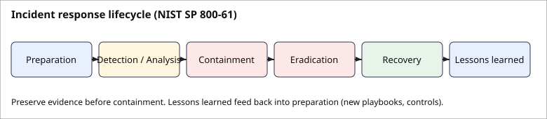

*شکل: چرخه‌ی پاسخ به حادثه.*

### ۴) مثال حل‌شده

**سناریو:** Alert: ۴۰۰ Deny از 198.51.100.7 در ۲ دقیقه به پورت‌های 22,3389,445. **Triage:** Scan؛ موفق؟ Log Allow از همان IP؟ خیر. **مهار:** Address `BLOCK-IP` + Policy Deny بالا؛ Clear Session. **تحلیل:** منبع اینترنت؛ پورت‌های Management بسته‌اند. **درس:** Local-in WAN بسته (۱۲-۸).

``` text
config firewall address
    edit "BLOCK-198.51.100.7"
        set subnet 198.51.100.7 255.255.255.255
    next
end
```

(`Unverified`.)

**مثال سخت (Lateral movement):** PC کاربر Compromise شده و سعی می‌کند به DC SMB بزند؛ Segmentation Deny+Log؛ Alert؛ جداسازی PC؛ بازبینی اعتبارنامه‌ها؛ RCA.

### ۵) GUI و CLI

**GUI:** Log & Report؛ FortiView؛ Policy & Objects → Addresses. **CLI:** `execute log filter ...`، `diagnose sys session ...`.

### ۶) نکات امنیتی

- مهار بدون Evidence = از دست رفتن مدرک.
- ارتباط مستند و محدود؛ Change اضطراری ثبت.
- پس از حادثه Policyها و Patch بازبینی.

### ۷) جمع‌بندی

- IR شش فاز؛ Detection از TTP مهم‌تر از IOC.
- Triage و Scoping قبل از مهار.
- Evidence را حفظ کنید؛ درس‌آموخته را اعمال کنید.

### ۸) تمرین و ارزیابی

**ت1.** (ساده) شش فاز IR را بنویسید. *(پاسخ: 29-0-ت1)*

**ت2.** (متوسط) IOC و TTP چه فرقی دارند؟ *(پاسخ: 29-0-ت2)*

**ت3.** (سخت) Playbook Port Scan را بنویسید. *(پاسخ: 29-0-ت3)*

**ت4.** (سخت، طراحی) از Log فایروال سه Detection بسازید. *(پاسخ: 29-0-ت4)*

**Q1.** Quick quiz (English): Why preserve evidence before containment? *(پاسخ: 29-0-Q1)*

### ۹) اصطلاحات و English Corner

| مخفف | شکل کامل | معنی |
|---|---|---|
| IR | Incident Response | پاسخ به حادثه |
| IOC | Indicator of Compromise | نشانه‌ی نفوذ |
| TTP | Tactics, Techniques, Procedures | رفتار مهاجم |
| SOC | Security Operations Center | مرکز عملیات امنیت |

- *Contain first, but preserve the evidence.* ← مهار کنید ولی شواهد را حفظ کنید.

### ۱۰) منابع

- NIST SP 800-61 Rev.2 — Computer Security Incident Handling Guide؛ MITRE ATT&CK.

## درس 29-1 — Detection: Log و IOC ساده

**فصل 29 - روز 1 · پیش‌نیاز: فصل ۲۸ · ۶ ساعت**

### ۱) معرفی درس

چگونه حمله را ببینیم.

### ۲) پیش‌نیازها

فصل ۲۸

### ۳) توضیح مفهومی

- Log Deny زیاد.
- Port Scan.
- Login ناموفق.
- IOC ساده.
- Baseline.

### ۴) مثال ساده

نگهبان شبکه باید ببیند و پاسخ دهد.

### ۵) مثال سازمانی

سازمان: SOC کوچک با Log و Playbook.

### ۶) تصویر و توپولوژی

```text
FGT/Log -> Detection -> Response
```

### ۷) پیکربندی (GUI و CLI)

> نسخه‌ی هدف: FortiOS 7.0.3 (اسمی؛ از نام Image؛ بوت‌نشده؛ تأیید با `get system status`). دستورها/منوها از مستند عمومی FortiOS 7.0 و دانش مؤلف هستند و **روی Image شما هنوز آزمایش نشده‌اند**؛ در بوت اول مقایسه کنید.

#### روش گرافیکی (GUI)

1. Log & Report > Forward Traffic.

#### روش خط فرمان (CLI)

```text
execute log filter category 0
execute log display
```

**توضیح دستورها (چه / چرا / خروجی / راستی‌آزمایی / بازگشت):**

- `Unverified`.

### ۸) تست عملکرد

- شناسایی Scan.

### ۹) عیب‌یابی

| بخش | شرح |
|---|---|
| Symptom | Alert کاذب |
| شواهد/دستور | Log |
| علت | Threshold |
| رفع | تنظیم |

### ۱۰) تمرین مستقل

> پاسخ‌ها در بخش «پاسخ‌های فصل» انتهای فصل است؛ اول خودتان حل کنید.

**ت1.** IOC؟ *(پاسخ: 29-1-ت1)*

**ت2.** Baseline؟ *(پاسخ: 29-1-ت2)*

### ۱۱) مرور و ارزیابی

**م1.** چرا Baseline؟ *(پاسخ: 29-1-م1)*

**م2.** سناریو: Scan؛ چه؟ *(پاسخ: 29-1-م2)*

**معیار تسلط:** Detection و Patch.

**اشتباهات رایج:** بدون Playbook.

### ۱۲) واژگان و English Corner

| واژه | شکل کامل | معنی | کاربرد واقعی |
|---|---|---|---|
| IOC | Indicator of Compromise | نشانه‌ی نفوذ | SOC |

| English sentence | ترجمه |
|---|---|
| Know your baseline. | وضعیت عادی را بشناسید. |

#### کارت Lab — درس 29-1

| # | فیلد | محتوا |
|---|---|---|
| 1 | عنوان و هدف | Detection |
| 2 | پیش‌نیاز | فصل ۲۸ |
| 3 | توپولوژی | FGT+Attacker-Lab |
| 4 | تجهیزات | FGT |
| 5 | نسخه نرم‌افزار | FortiOS 7.0.3 (اسمی؛ از نام Image؛ بوت‌نشده؛ تأیید با `get system status`) |
| 6 | IP Plan | — |
| 7 | وضعیت اولیه | Baseline |
| 8 | صورت مسئله | Scan |
| 9 | مراحل هدایت‌شده | بخش‌های ۷ و ۸ همین درس (گام‌به‌گام) |
| 10 | تست عملکرد | nmap |
| 11 | سناریوی خرابی | Alert کاذب |
| 12 | روش عیب‌یابی | بخش ۹ همین درس (لایه‌ای/با شواهد) |
| 13 | نتیجه‌ی مورد انتظار | Log |
| 14 | معیار پذیرش | ثبت |
| 15 | مستندات نهایی | `03-ops/detect.md` |
| 16 | Cleanup و بازگردانی | — |

> **وضعیت راستی‌آزمایی (خارج از ۱۶ فیلد):** **اجرا نشده (فقط طراحی).** Image FortiGate هنوز بوت نشده؛ دستورها/منوها آزمایش‌نشده‌اند.

---

<a id="l-29-2"></a>

## درس 29-2 — Response و Playbook

**فصل 29 - روز 2 · پیش‌نیاز: درس ۲۹-۰ · ۶ ساعت**

### ۱) معرفی درس

پاسخ گام‌به‌گام.

### ۲) پیش‌نیازها

درس ۲۹-۰

### ۳) توضیح مفهومی

- Contain.
- Eradicate.
- Recover.
- Lessons.
- Playbook.

### ۴) مثال ساده

نگهبان شبکه باید ببیند و پاسخ دهد.

### ۵) مثال سازمانی

سازمان: SOC کوچک با Log و Playbook.

### ۶) تصویر و توپولوژی

```text
FGT/Log -> Detection -> Response
```

### ۷) پیکربندی (GUI و CLI)

> نسخه‌ی هدف: FortiOS 7.0.3 (اسمی؛ از نام Image؛ بوت‌نشده؛ تأیید با `get system status`). دستورها/منوها از مستند عمومی FortiOS 7.0 و دانش مؤلف هستند و **روی Image شما هنوز آزمایش نشده‌اند**؛ در بوت اول مقایسه کنید.

#### روش گرافیکی (GUI)

1. Policy & Objects > Addresses.

#### روش خط فرمان (CLI)

```text
config firewall address
    edit "BLOCK-IP"
        set subnet 198.51.100.50 255.255.255.255
    next
end
```

**توضیح دستورها (چه / چرا / خروجی / راستی‌آزمایی / بازگشت):**

- `Unverified`.

### ۸) تست عملکرد

- Block IP.

### ۹) عیب‌یابی

| بخش | شرح |
|---|---|
| Symptom | Block کار نمی‌کند |
| شواهد/دستور | Policy |
| علت | ترتیب |
| رفع | اصلاح |

### ۱۰) تمرین مستقل

> پاسخ‌ها در بخش «پاسخ‌های فصل» انتهای فصل است؛ اول خودتان حل کنید.

**ت1.** Contain؟ *(پاسخ: 29-2-ت1)*

**ت2.** Playbook؟ *(پاسخ: 29-2-ت2)*

### ۱۱) مرور و ارزیابی

**م1.** چرا Playbook؟ *(پاسخ: 29-2-م1)*

**م2.** سناریو: IP مشکوک؛ چه؟ *(پاسخ: 29-2-م2)*

**معیار تسلط:** Detection و Patch.

**اشتباهات رایج:** بدون Playbook.

### ۱۲) واژگان و English Corner

| واژه | شکل کامل | معنی | کاربرد واقعی |
|---|---|---|---|
| Playbook | Incident playbook | دستورالعمل پاسخ | SOC |

| English sentence | ترجمه |
|---|---|
| Write a playbook before incidents. | قبل از حادثه Playbook بنویسید. |

#### کارت Lab — درس 29-2

| # | فیلد | محتوا |
|---|---|---|
| 1 | عنوان و هدف | Response |
| 2 | پیش‌نیاز | درس ۲۹-۰ |
| 3 | توپولوژی | FGT |
| 4 | تجهیزات | FGT |
| 5 | نسخه نرم‌افزار | FortiOS 7.0.3 (اسمی؛ از نام Image؛ بوت‌نشده؛ تأیید با `get system status`) |
| 6 | IP Plan | — |
| 7 | وضعیت اولیه | Detect |
| 8 | صورت مسئله | Block |
| 9 | مراحل هدایت‌شده | بخش‌های ۷ و ۸ همین درس (گام‌به‌گام) |
| 10 | تست عملکرد | ping |
| 11 | سناریوی خرابی | Block کار نمی‌کند |
| 12 | روش عیب‌یابی | بخش ۹ همین درس (لایه‌ای/با شواهد) |
| 13 | نتیجه‌ی مورد انتظار | Drop |
| 14 | معیار پذیرش | ثبت |
| 15 | مستندات نهایی | `03-ops/response.md` |
| 16 | Cleanup و بازگردانی | حذف |

> **وضعیت راستی‌آزمایی (خارج از ۱۶ فیلد):** **اجرا نشده (فقط طراحی).** Image FortiGate هنوز بوت نشده؛ دستورها/منوها آزمایش‌نشده‌اند.

---

<a id="l-29-3"></a>

## درس 29-3 — Lifecycle، Patch و Vulnerability

**فصل 29 - روز 3 · پیش‌نیاز: درس ۲۹-۱ · ۶ ساعت**

### ۱) معرفی درس

مدیریت چرخه‌ی عمر.

### ۲) پیش‌نیازها

درس ۲۹-۱

### ۳) توضیح مفهومی

- End-of-Life.
- Patch.
- Advisory.
- CVE رایج (7.0.x).
- Backup/Rollback.

### ۴) مثال ساده

نگهبان شبکه باید ببیند و پاسخ دهد.

### ۵) مثال سازمانی

سازمان: SOC کوچک با Log و Playbook.

### ۶) تصویر و توپولوژی

```text
FGT/Log -> Detection -> Response
```

### ۷) پیکربندی (GUI و CLI)

> نسخه‌ی هدف: FortiOS 7.0.3 (اسمی؛ از نام Image؛ بوت‌نشده؛ تأیید با `get system status`). دستورها/منوها از مستند عمومی FortiOS 7.0 و دانش مؤلف هستند و **روی Image شما هنوز آزمایش نشده‌اند**؛ در بوت اول مقایسه کنید.

#### روش گرافیکی (GUI)

1. System > Firmware.

#### روش خط فرمان (CLI)

```text
get system status
execute backup config tftp pre-patch.conf 192.168.90.10
```

**توضیح دستورها (چه / چرا / خروجی / راستی‌آزمایی / بازگشت):**

- `Unverified`.

### ۸) تست عملکرد

- برنامه‌ی Patch.

### ۹) عیب‌یابی

| بخش | شرح |
|---|---|
| Symptom | Patch شکست |
| شواهد/دستور | Backup |
| علت | — |
| رفع | Rollback |

### ۱۰) تمرین مستقل

> پاسخ‌ها در بخش «پاسخ‌های فصل» انتهای فصل است؛ اول خودتان حل کنید.

**ت1.** EoL؟ *(پاسخ: 29-3-ت1)*

**ت2.** Rollback؟ *(پاسخ: 29-3-ت2)*

### ۱۱) مرور و ارزیابی

**م1.** چرا Backup؟ *(پاسخ: 29-3-م1)*

**م2.** سناریو: 7.0.3 EoL؛ چه؟ *(پاسخ: 29-3-م2)*

**معیار تسلط:** Detection و Patch.

**اشتباهات رایج:** بدون Playbook.

### ۱۲) واژگان و English Corner

| واژه | شکل کامل | معنی | کاربرد واقعی |
|---|---|---|---|
| EoL | End of Life | پایان عمر | Lifecycle |

| English sentence | ترجمه |
|---|---|
| Track end-of-life dates. | تاریخ پایان عمر را پیگیری کنید. |

#### کارت Lab — درس 29-3

| # | فیلد | محتوا |
|---|---|---|
| 1 | عنوان و هدف | Patch |
| 2 | پیش‌نیاز | درس ۲۹-۱ |
| 3 | توپولوژی | FGT |
| 4 | تجهیزات | FGT |
| 5 | نسخه نرم‌افزار | FortiOS 7.0.3 (اسمی؛ از نام Image؛ بوت‌نشده؛ تأیید با `get system status`) |
| 6 | IP Plan | — |
| 7 | وضعیت اولیه | Baseline |
| 8 | صورت مسئله | Patch |
| 9 | مراحل هدایت‌شده | بخش‌های ۷ و ۸ همین درس (گام‌به‌گام) |
| 10 | تست عملکرد | status |
| 11 | سناریوی خرابی | Patch شکست |
| 12 | روش عیب‌یابی | بخش ۹ همین درس (لایه‌ای/با شواهد) |
| 13 | نتیجه‌ی مورد انتظار | نسخه |
| 14 | معیار پذیرش | ثبت |
| 15 | مستندات نهایی | `03-ops/patch.md` |
| 16 | Cleanup و بازگردانی | Rollback |

> **وضعیت راستی‌آزمایی (خارج از ۱۶ فیلد):** **اجرا نشده (فقط طراحی).** Image FortiGate هنوز بوت نشده؛ دستورها/منوها آزمایش‌نشده‌اند.

---

<a id="l-29-4"></a>

## درس 29-4 — Incident Report و آزمون

**فصل 29 - روز 4 · پیش‌نیاز: درس ۲۹-۲ · ۶ ساعت**

### ۱) معرفی درس

گزارش حادثه.

### ۲) پیش‌نیازها

درس ۲۹-۲

### ۳) توضیح مفهومی

- Timeline.
- Impact.
- RCA.
- Action.
- آزمون.

### ۴) مثال ساده

نگهبان شبکه باید ببیند و پاسخ دهد.

### ۵) مثال سازمانی

سازمان: SOC کوچک با Log و Playbook.

### ۶) تصویر و توپولوژی

```text
FGT/Log -> Detection -> Response
```

### ۷) پیکربندی (GUI و CLI)

> نسخه‌ی هدف: FortiOS 7.0.3 (اسمی؛ از نام Image؛ بوت‌نشده؛ تأیید با `get system status`). دستورها/منوها از مستند عمومی FortiOS 7.0 و دانش مؤلف هستند و **روی Image شما هنوز آزمایش نشده‌اند**؛ در بوت اول مقایسه کنید.

#### روش گرافیکی (GUI)

1. Log & Report.

#### روش خط فرمان (CLI)

```text
get system status
```

**توضیح دستورها (چه / چرا / خروجی / راستی‌آزمایی / بازگشت):**

- خواندنی.

### ۸) تست عملکرد

- گزارش یک‌صفحه‌ای.

### ۹) عیب‌یابی

| بخش | شرح |
|---|---|
| Symptom | گزارش ناقص |
| شواهد/دستور | — |
| علت | — |
| رفع | تکمیل |

### ۱۰) تمرین مستقل

> پاسخ‌ها در بخش «پاسخ‌های فصل» انتهای فصل است؛ اول خودتان حل کنید.

**ت1.** Timeline؟ *(پاسخ: 29-4-ت1)*

**ت2.** Impact؟ *(پاسخ: 29-4-ت2)*

### ۱۱) مرور و ارزیابی

**م1.** چرا گزارش؟ *(پاسخ: 29-4-م1)*

**م2.** سناریو: بدون Timeline؛ مشکل؟ *(پاسخ: 29-4-م2)*

**معیار تسلط:** Detection و Patch.

**اشتباهات رایج:** بدون Playbook.

### ۱۲) واژگان و English Corner

| واژه | شکل کامل | معنی | کاربرد واقعی |
|---|---|---|---|
| Timeline | Incident timeline | خط زمان | SOC |

| English sentence | ترجمه |
|---|---|
| Write a blameless incident report. | گزارش حادثه را بدون سرزنش بنویسید. |

#### کارت Lab — درس 29-4

| # | فیلد | محتوا |
|---|---|---|
| 1 | عنوان و هدف | گزارش |
| 2 | پیش‌نیاز | درس ۲۹-۲ |
| 3 | توپولوژی | — |
| 4 | تجهیزات | — |
| 5 | نسخه نرم‌افزار | FortiOS 7.0.3 (اسمی؛ از نام Image؛ بوت‌نشده؛ تأیید با `get system status`) |
| 6 | IP Plan | — |
| 7 | وضعیت اولیه | — |
| 8 | صورت مسئله | گزارش |
| 9 | مراحل هدایت‌شده | بخش‌های ۷ و ۸ همین درس (گام‌به‌گام) |
| 10 | تست عملکرد | — |
| 11 | سناریوی خرابی | گزارش ناقص |
| 12 | روش عیب‌یابی | بخش ۹ همین درس (لایه‌ای/با شواهد) |
| 13 | نتیجه‌ی مورد انتظار | سند |
| 14 | معیار پذیرش | ≥ ۴ از ۵ |
| 15 | مستندات نهایی | `03-ops/incident.md` |
| 16 | Cleanup و بازگردانی | — |

> **وضعیت راستی‌آزمایی (خارج از ۱۶ فیلد):** **اجرا نشده (فقط طراحی).** Image FortiGate هنوز بوت نشده؛ دستورها/منوها آزمایش‌نشده‌اند.

---

<a id="ans-29"></a>

## پاسخ‌های فصل 29

> ابتدا بدون نگاه حل کنید. شناسه: درس-نوع+شماره (ت = تمرین، م = مرور).

**29-1-ت1** — IOC؟

نشانه‌ی نفوذ.

**29-1-ت2** — Baseline؟

وضعیت عادی.

**29-1-م1** — چرا Baseline؟

تشخیص انحراف.

**29-1-م2** — سناریو: Scan؛ چه؟

Block+Log.

**29-2-ت1** — Contain؟

مهار.

**29-2-ت2** — Playbook؟

دستورالعمل.

**29-2-م1** — چرا Playbook؟

سرعت.

**29-2-م2** — سناریو: IP مشکوک؛ چه؟

Block.

**29-3-ت1** — EoL؟

پایان پشتیبانی.

**29-3-ت2** — Rollback؟

بازگشت.

**29-3-م1** — چرا Backup؟

بازگشت.

**29-3-م2** — سناریو: 7.0.3 EoL؛ چه؟

ارتقا.

**29-4-ت1** — Timeline؟

زمان‌بندی.

**29-4-ت2** — Impact؟

اثر.

**29-4-م1** — چرا گزارش؟

یادگیری.

**29-4-م2** — سناریو: بدون Timeline؛ مشکل؟

RCA ناقص.


---

<a id="ch30"></a>


### پاسخ‌های درس افزوده‌ی 29-0 (فصل 29)

**29-0-ت1** — Preparation، Detection/Analysis، Containment، Eradication، Recovery، Lessons learned.

**29-0-ت2** — IOC نشانه‌ی مشخص و زودگذر (IP/Hash)؛ TTP رفتار و روش مهاجم و پایدارتر.

**29-0-ت3** — تشخیص Scan از Deny زیاد، بررسی Allow موفق، Block IP، Clear Session، بررسی Local-in، ثبت Evidence، PIR.

**29-0-ت4** — ۱) Deny چندپورتی از یک IP؛ ۲) Login ناموفق مکرر؛ ۳) حجم خروجی غیرعادی به IP ناشناس.

**29-0-Q1** — Because containment actions can alter or erase logs and sessions that are needed for analysis.

# فصل 30 — Migration: از Cisco ASA/Router به FortiGate (معماری ۸، G11)

**مدت:** ۳۶ ساعت | **پیش‌نیاز:** فصل ۱۳، ۲۷.
**اهداف:** برنامه‌ریزی مهاجرت؛ Inventory و Mapping Policy؛ Cutover و Rollback؛ تست پیش و پس. Gate G11: Plan کامل با Rollback و Evidence.
**هشدار:** Migration در تولید فقط با Change Window و تأیید؛ اینجا فقط Lab.
**اشتباهات رایج:** کپی بی‌فکر Rule؛ نبود Rollback؛ فراموشی NAT/Route.

**درس‌های فصل:**
- [درس 30-1 — Inventory و Mapping](#l-30-1)
- [درس 30-2 — Plan، Cutover و Rollback](#l-30-2)
- [درس 30-3 — تست پیش/پس و Evidence](#l-30-3)
- [درس 30-4 — Gate G11 و آزمون](#l-30-4)

---

<a id="l-30-1"></a>

## درس 30-0 — روش‌شناسی Migration: Inventory، نگاشت Policy، Cutover و Rollback

**فصل ۳۰ · درس افزوده (پیش‌درس ۳۰-۱) · پیش‌نیاز: ۱۳-۷، ۲۷-۷، ۲۵-۰ · ≈ ۶ ساعت**

> **وضعیت:** روش مستقل از برند؛ نگاشت قوانین ASA→FortiGate مفهومی و `Unverified`؛ فقط Lab.

### ۱) هدف آموزشی

1. مهاجرت را به‌صورت پروژه (Discovery، Design، Build، Test، Cutover، Stabilize) برنامه‌ریزی کند.
2. **Inventory** کامل و **Rule Hygiene** (حذف قوانین مرده/تکراری با Hit Count) انجام دهد.
3. نگاشت **Object، NAT، Route، VPN، Policy** را بنویسد و تفاوت مدل (ACL→Policy، NAT-order) را بفهمد.
4. **Cutover** با Rollback قابل‌اثبات طراحی کند.
5. آزمون پیش/پس و Evidence ثبت کند.

### ۲) مفهوم پایه

مهاجرت = تغییر پرخطر روی دستگاه حیاتی. «کپی کردن Rule» خطرناک است چون مدل پردازش فرق دارد (ترتیب NAT/ACL، Interface Security-level در برابر Zone، Implicit deny). موفقیت = **برابری رفتاری** (نه برابری متن Config) + **بازگشت امن**.

### ۳) توضیح عمیق فنی

#### ۳-۱) فازها

``` text
1 Discovery : inventory interfaces, routes, NAT, ACLs, VPNs, users, logs
2 Design    : target architecture, zone mapping, IP plan, rule cleanup
3 Build     : configure target in parallel (no traffic)
4 Test      : lab/pre-prod, positive & negative tests
5 Cutover   : change window, switch traffic, monitor
6 Stabilize : post-checks, hypercare, decommission after N days
```

#### ۳-۲) Rule Hygiene

با Hit Count و Log ۹۰ روزه: Ruleهای صفر-Hit، تکراری، Shadow، و Any-Any را شناسایی. هر Rule: صاحب، دلیل، تاریخ. **قبل از مهاجرت پاکسازی** کنید تا قوانین بد به سیستم جدید منتقل نشوند.

#### ۳-۳) نگاشت مفاهیم (مثال ASA→FortiGate؛ `Unverified`)

| ASA | FortiGate |
|---|---|
| nameif/security-level | Interface/Zone + Policy |
| access-list + access-group | Firewall Policy |
| object network/group | Address/Address Group |
| NAT (auto/twice) | Policy NAT/VIP/IP Pool/Central NAT |
| route | Static Route |
| crypto map | IPsec Phase1/2 (Route-based) |
| inspect (MPF) | Session Helper/Profile |

نکته: ASA به‌طور پیش‌فرض بین Interfaceهای با Security-level بالاتر→پایین‌تر اجازه می‌دهد؛ FortiGate Implicit deny؛ پس رفتار «بدون Rule» متفاوت است.

#### ۳-۴) Cutover

- **Change Window**، تیم، Rollback Trigger (مثلاً «۳۰ دقیقه بدون سرویس X»)، تماس.
- مراحل: Backup دو سو؛ جابه‌جایی Gateway/Route یا آدرس؛ ARP/Session؛ آزمون سرویس‌های حیاتی؛ مانیتورینگ.
- **Rollback:** بازگرداندن مسیر/کابل؛ Config قبلی؛ آزمون.

#### ۳-۵) Test Matrix

| سرویس | مبدأ | مقصد | انتظار | قبل | بعد |
|---|---|---|---|---|---|
| وب | Users | Internet | OK | ✓ | ✓ |
| ERP | Users | SRV | OK | ✓ | ✓ |
| ممنوع | Guest | SRV | Block | ✓ | ✓ |

### ۴) مثال حل‌شده

**پروژه:** جایگزینی ASA با FGT. Discovery: ۲۴۰ Rule، ۱۱۰ با Hit=0؛ پاکسازی ← ۱۱۰ Policy. Build موازی در Lab. Cutover: شب جمعه ۲۲:۰۰؛ Trigger Rollback ۳۰ دقیقه. شواهد: Test Matrix قبل/بعد. یک سرویس (FTP) خراب: Helper/Session ALG؛ رفع. Hypercare ۷ روز؛ Decommission ۳۰ روز.

**مثال سخت:** پس از Cutover فقط یک اپ کار نمی‌کند؛ ASA «twice NAT» ترتیب خاصی داشت؛ در FGT Policy NAT ناقص. **رفع:** VIP/IP Pool مناسب، Debug Flow.

### ۵) GUI و CLI

**GUI:** Policy & Objects؛ Log & Report. **CLI:** `diagnose firewall iprope lookup ...`، `diagnose debug flow ...`؛ Backup: `execute backup config ...`.

### ۶) نکات امنیتی

- Rule «موقت» هنگام مهاجمت را حذف کنید.
- Secretهای Config قدیمی منتقل نشوند.
- دستگاه قدیمی پس از Decommission پاک‌سازی امن.

### ۷) جمع‌بندی

- Inventory + Hygiene قبل از ساخت؛ برابری رفتاری هدف.
- Cutover بدون Rollback مجاز نیست.
- Test Matrix و Evidence.

### ۸) تمرین و ارزیابی

**ت1.** (ساده) فازهای Migration را بنویسید. *(پاسخ: 30-0-ت1)*

**ت2.** (متوسط) چرا Rule Hygiene قبل از مهاجرت؟ *(پاسخ: 30-0-ت2)*

**ت3.** (سخت) Rollback Trigger و روش آن را طراحی کنید. *(پاسخ: 30-0-ت3)*

**ت4.** (سخت، طراحی) Test Matrix برای ۱۰ سرویس بنویسید. *(پاسخ: 30-0-ت4)*

**Q1.** Quick quiz (English): Why aim for behavioral equivalence rather than copying rules? *(پاسخ: 30-0-Q1)*

### ۹) اصطلاحات و English Corner

| مخفف | شکل کامل | معنی |
|---|---|---|
| Cutover | Cutover | سوئیچ نهایی |
| Hypercare | Hypercare | پایش ویژه پس از تغییر |
| Shadow rule | Shadowed rule | Rule پنهان‌شده |
| Hit count | Hit count | تعداد استفاده |

- *Clean up rules before migrating them.* ← قبل از مهاجرت قوانین را پاکسازی کنید.

### ۱۰) منابع

- NIST SP 800-41 Rev.1؛ ITIL 4 (Change Enablement)؛ Fortinet FortiConverter (مرجع رسمی؛ لایسنس/نسخه را بررسی کنید).

## درس 30-1 — Inventory و Mapping

**فصل 30 - روز 1 · پیش‌نیاز: فصل ۲۹ · ۶ ساعت**

### ۱) معرفی درس

ثبت وضعیت فعلی و نگاشت.

### ۲) پیش‌نیازها

فصل ۲۹

### ۳) توضیح مفهومی

- Interface، Route، NAT، Policy.
- Object Mapping.
- حذف Ruleهای مرده.
- Hit Count.
- سند.

### ۴) مثال ساده

جابجایی خانه با لیست.

### ۵) مثال سازمانی

سازمان: جایگزینی فایروال قدیمی.

### ۶) تصویر و توپولوژی

```text
Old FW -> New FGT (Cutover)
```

### ۷) پیکربندی (GUI و CLI)

> نسخه‌ی هدف: FortiOS 7.0.3 (اسمی؛ از نام Image؛ بوت‌نشده؛ تأیید با `get system status`). دستورها/منوها از مستند عمومی FortiOS 7.0 و دانش مؤلف هستند و **روی Image شما هنوز آزمایش نشده‌اند**؛ در بوت اول مقایسه کنید.

#### روش گرافیکی (GUI)

1. Policy & Objects.

#### روش خط فرمان (CLI)

```text
show running-config
get system interface
```

**توضیح دستورها (چه / چرا / خروجی / راستی‌آزمایی / بازگشت):**

- خواندنی.

### ۸) تست عملکرد

- Inventory.

### ۹) عیب‌یابی

| بخش | شرح |
|---|---|
| Symptom | Rule جاافتاده |
| شواهد/دستور | diff |
| علت | Mapping |
| رفع | تکمیل |

### ۱۰) تمرین مستقل

> پاسخ‌ها در بخش «پاسخ‌های فصل» انتهای فصل است؛ اول خودتان حل کنید.

**ت1.** Mapping؟ *(پاسخ: 30-1-ت1)*

**ت2.** Hit count؟ *(پاسخ: 30-1-ت2)*

### ۱۱) مرور و ارزیابی

**م1.** چرا حذف Rule مرده؟ *(پاسخ: 30-1-م1)*

**م2.** سناریو: Rule ناشناخته؛ چه؟ *(پاسخ: 30-1-م2)*

**معیار تسلط:** Plan مهاجرت.

**اشتباهات رایج:** بدون Rollback.

### ۱۲) واژگان و English Corner

| واژه | شکل کامل | معنی | کاربرد واقعی |
|---|---|---|---|
| Hit count | Hit count | تعداد استفاده | FW |

| English sentence | ترجمه |
|---|---|
| Remove dead rules before migrating. | قبل از مهاجرت Ruleهای مرده را حذف کنید. |

#### کارت Lab — درس 30-1

| # | فیلد | محتوا |
|---|---|---|
| 1 | عنوان و هدف | Inventory |
| 2 | پیش‌نیاز | فصل ۲۹ |
| 3 | توپولوژی | Old+FGT |
| 4 | تجهیزات | — |
| 5 | نسخه نرم‌افزار | FortiOS 7.0.3 (اسمی؛ از نام Image؛ بوت‌نشده؛ تأیید با `get system status`) |
| 6 | IP Plan | — |
| 7 | وضعیت اولیه | — |
| 8 | صورت مسئله | Inventory |
| 9 | مراحل هدایت‌شده | بخش‌های ۷ و ۸ همین درس (گام‌به‌گام) |
| 10 | تست عملکرد | — |
| 11 | سناریوی خرابی | Rule جاافتاده |
| 12 | روش عیب‌یابی | بخش ۹ همین درس (لایه‌ای/با شواهد) |
| 13 | نتیجه‌ی مورد انتظار | سند |
| 14 | معیار پذیرش | تأیید |
| 15 | مستندات نهایی | `02-design/mig-inventory.md` |
| 16 | Cleanup و بازگردانی | — |

> **وضعیت راستی‌آزمایی (خارج از ۱۶ فیلد):** **اجرا نشده (فقط طراحی).** Image FortiGate هنوز بوت نشده؛ دستورها/منوها آزمایش‌نشده‌اند.

---

<a id="l-30-2"></a>

## درس 30-2 — Plan، Cutover و Rollback

**فصل 30 - روز 2 · پیش‌نیاز: درس ۳۰-۰ · ۶ ساعت**

### ۱) معرفی درس

برنامه‌ی تغییر ده‌مرحله‌ای.

### ۲) پیش‌نیازها

درس ۳۰-۰

### ۳) توضیح مفهومی

- Change Window.
- Pre-check.
- Cutover.
- Post-check.
- Rollback.

### ۴) مثال ساده

جابجایی خانه با لیست.

### ۵) مثال سازمانی

سازمان: جایگزینی فایروال قدیمی.

### ۶) تصویر و توپولوژی

```text
Old FW -> New FGT (Cutover)
```

### ۷) پیکربندی (GUI و CLI)

> نسخه‌ی هدف: FortiOS 7.0.3 (اسمی؛ از نام Image؛ بوت‌نشده؛ تأیید با `get system status`). دستورها/منوها از مستند عمومی FortiOS 7.0 و دانش مؤلف هستند و **روی Image شما هنوز آزمایش نشده‌اند**؛ در بوت اول مقایسه کنید.

#### روش گرافیکی (GUI)

1. System > Config.

#### روش خط فرمان (CLI)

```text
execute backup config tftp pre-cutover.conf 192.168.90.10
```

**توضیح دستورها (چه / چرا / خروجی / راستی‌آزمایی / بازگشت):**

- `Unverified`.

### ۸) تست عملکرد

- Plan.

### ۹) عیب‌یابی

| بخش | شرح |
|---|---|
| Symptom | Cutover شکست |
| شواهد/دستور | Post-check |
| علت | — |
| رفع | Rollback |

### ۱۰) تمرین مستقل

> پاسخ‌ها در بخش «پاسخ‌های فصل» انتهای فصل است؛ اول خودتان حل کنید.

**ت1.** Rollback؟ *(پاسخ: 30-2-ت1)*

**ت2.** Pre-check؟ *(پاسخ: 30-2-ت2)*

### ۱۱) مرور و ارزیابی

**م1.** چرا Rollback؟ *(پاسخ: 30-2-م1)*

**م2.** سناریو: بعد از Cutover قطع؛ چه؟ *(پاسخ: 30-2-م2)*

**معیار تسلط:** Plan مهاجرت.

**اشتباهات رایج:** بدون Rollback.

### ۱۲) واژگان و English Corner

| واژه | شکل کامل | معنی | کاربرد واقعی |
|---|---|---|---|
| Cutover | Cutover | سوئیچ نهایی | Migration |

| English sentence | ترجمه |
|---|---|
| Always have a rollback plan. | همیشه Rollback Plan داشته باشید. |

#### کارت Lab — درس 30-2

| # | فیلد | محتوا |
|---|---|---|
| 1 | عنوان و هدف | Plan |
| 2 | پیش‌نیاز | درس ۳۰-۰ |
| 3 | توپولوژی | Old+FGT |
| 4 | تجهیزات | — |
| 5 | نسخه نرم‌افزار | FortiOS 7.0.3 (اسمی؛ از نام Image؛ بوت‌نشده؛ تأیید با `get system status`) |
| 6 | IP Plan | — |
| 7 | وضعیت اولیه | — |
| 8 | صورت مسئله | Plan |
| 9 | مراحل هدایت‌شده | بخش‌های ۷ و ۸ همین درس (گام‌به‌گام) |
| 10 | تست عملکرد | — |
| 11 | سناریوی خرابی | Cutover شکست |
| 12 | روش عیب‌یابی | بخش ۹ همین درس (لایه‌ای/با شواهد) |
| 13 | نتیجه‌ی مورد انتظار | سند |
| 14 | معیار پذیرش | تأیید |
| 15 | مستندات نهایی | `02-design/mig-plan.md` |
| 16 | Cleanup و بازگردانی | — |

> **وضعیت راستی‌آزمایی (خارج از ۱۶ فیلد):** **اجرا نشده (فقط طراحی).** Image FortiGate هنوز بوت نشده؛ دستورها/منوها آزمایش‌نشده‌اند.

---

<a id="l-30-3"></a>

## درس 30-3 — تست پیش/پس و Evidence

**فصل 30 - روز 3 · پیش‌نیاز: درس ۳۰-۱ · ۶ ساعت**

### ۱) معرفی درس

اثبات صحت.

### ۲) پیش‌نیازها

درس ۳۰-۱

### ۳) توضیح مفهومی

- Test Matrix.
- ping/traceroute/app.
- مقایسه Session.
- Evidence.
- RCA.

### ۴) مثال ساده

جابجایی خانه با لیست.

### ۵) مثال سازمانی

سازمان: جایگزینی فایروال قدیمی.

### ۶) تصویر و توپولوژی

```text
Old FW -> New FGT (Cutover)
```

### ۷) پیکربندی (GUI و CLI)

> نسخه‌ی هدف: FortiOS 7.0.3 (اسمی؛ از نام Image؛ بوت‌نشده؛ تأیید با `get system status`). دستورها/منوها از مستند عمومی FortiOS 7.0 و دانش مؤلف هستند و **روی Image شما هنوز آزمایش نشده‌اند**؛ در بوت اول مقایسه کنید.

#### روش گرافیکی (GUI)

1. Dashboard.

#### روش خط فرمان (CLI)

```text
diagnose sys session list
```

**توضیح دستورها (چه / چرا / خروجی / راستی‌آزمایی / بازگشت):**

- `Unverified`.

### ۸) تست عملکرد

- Test Matrix.

### ۹) عیب‌یابی

| بخش | شرح |
|---|---|
| Symptom | تفاوت رفتار |
| شواهد/دستور | Matrix |
| علت | NAT |
| رفع | اصلاح |

### ۱۰) تمرین مستقل

> پاسخ‌ها در بخش «پاسخ‌های فصل» انتهای فصل است؛ اول خودتان حل کنید.

**ت1.** Matrix؟ *(پاسخ: 30-3-ت1)*

**ت2.** Evidence؟ *(پاسخ: 30-3-ت2)*

### ۱۱) مرور و ارزیابی

**م1.** چرا Matrix؟ *(پاسخ: 30-3-م1)*

**م2.** سناریو: یک اپ کار نمی‌کند؛ چه؟ *(پاسخ: 30-3-م2)*

**معیار تسلط:** Plan مهاجرت.

**اشتباهات رایج:** بدون Rollback.

### ۱۲) واژگان و English Corner

| واژه | شکل کامل | معنی | کاربرد واقعی |
|---|---|---|---|
| Matrix | Test matrix | جدول تست | Ops |

| English sentence | ترجمه |
|---|---|
| Compare before and after. | قبل و بعد را مقایسه کنید. |

#### کارت Lab — درس 30-3

| # | فیلد | محتوا |
|---|---|---|
| 1 | عنوان و هدف | Test Matrix |
| 2 | پیش‌نیاز | درس ۳۰-۱ |
| 3 | توپولوژی | Old+FGT |
| 4 | تجهیزات | FGT |
| 5 | نسخه نرم‌افزار | FortiOS 7.0.3 (اسمی؛ از نام Image؛ بوت‌نشده؛ تأیید با `get system status`) |
| 6 | IP Plan | — |
| 7 | وضعیت اولیه | Baseline |
| 8 | صورت مسئله | Matrix |
| 9 | مراحل هدایت‌شده | بخش‌های ۷ و ۸ همین درس (گام‌به‌گام) |
| 10 | تست عملکرد | ping |
| 11 | سناریوی خرابی | تفاوت رفتار |
| 12 | روش عیب‌یابی | بخش ۹ همین درس (لایه‌ای/با شواهد) |
| 13 | نتیجه‌ی مورد انتظار | جدول |
| 14 | معیار پذیرش | ثبت |
| 15 | مستندات نهایی | `03-ops/mig-test.md` |
| 16 | Cleanup و بازگردانی | — |

> **وضعیت راستی‌آزمایی (خارج از ۱۶ فیلد):** **اجرا نشده (فقط طراحی).** Image FortiGate هنوز بوت نشده؛ دستورها/منوها آزمایش‌نشده‌اند.

---

<a id="l-30-4"></a>

## درس 30-4 — Gate G11 و آزمون

**فصل 30 - روز 4 · پیش‌نیاز: درس ۳۰-۲ · ۶ ساعت**

### ۱) معرفی درس

ارزیابی.

### ۲) پیش‌نیازها

درس ۳۰-۲

### ۳) توضیح مفهومی

- Plan.
- Rollback.
- Evidence.
- RCA.
- آزمون.

### ۴) مثال ساده

جابجایی خانه با لیست.

### ۵) مثال سازمانی

سازمان: جایگزینی فایروال قدیمی.

### ۶) تصویر و توپولوژی

```text
Old FW -> New FGT (Cutover)
```

### ۷) پیکربندی (GUI و CLI)

> نسخه‌ی هدف: FortiOS 7.0.3 (اسمی؛ از نام Image؛ بوت‌نشده؛ تأیید با `get system status`). دستورها/منوها از مستند عمومی FortiOS 7.0 و دانش مؤلف هستند و **روی Image شما هنوز آزمایش نشده‌اند**؛ در بوت اول مقایسه کنید.

#### روش گرافیکی (GUI)

1. Dashboard.

#### روش خط فرمان (CLI)

```text
get system status
```

**توضیح دستورها (چه / چرا / خروجی / راستی‌آزمایی / بازگشت):**

- خواندنی.

### ۸) تست عملکرد

- اجرای G11.

### ۹) عیب‌یابی

| بخش | شرح |
|---|---|
| Symptom | G11 ناقص |
| شواهد/دستور | — |
| علت | Rollback ندارد |
| رفع | تکمیل |

### ۱۰) تمرین مستقل

> پاسخ‌ها در بخش «پاسخ‌های فصل» انتهای فصل است؛ اول خودتان حل کنید.

**ت1.** G11؟ *(پاسخ: 30-4-ت1)*

**ت2.** Rollback؟ *(پاسخ: 30-4-ت2)*

### ۱۱) مرور و ارزیابی

**م1.** چرا شاهد؟ *(پاسخ: 30-4-م1)*

**م2.** سناریو: بدون Rollback؛ G11؟ *(پاسخ: 30-4-م2)*

**معیار تسلط:** Plan مهاجرت.

**اشتباهات رایج:** بدون Rollback.

### ۱۲) واژگان و English Corner

| واژه | شکل کامل | معنی | کاربرد واقعی |
|---|---|---|---|
| G11 | Gate 11 | دروازه‌ی ۱۱ | دوره |

| English sentence | ترجمه |
|---|---|
| A plan without rollback is incomplete. | Plan بدون Rollback ناقص است. |

#### کارت Lab — درس 30-4

| # | فیلد | محتوا |
|---|---|---|
| 1 | عنوان و هدف | آزمون G11 |
| 2 | پیش‌نیاز | درس ۳۰-۲ |
| 3 | توپولوژی | — |
| 4 | تجهیزات | — |
| 5 | نسخه نرم‌افزار | FortiOS 7.0.3 (اسمی؛ از نام Image؛ بوت‌نشده؛ تأیید با `get system status`) |
| 6 | IP Plan | — |
| 7 | وضعیت اولیه | — |
| 8 | صورت مسئله | G11 |
| 9 | مراحل هدایت‌شده | بخش‌های ۷ و ۸ همین درس (گام‌به‌گام) |
| 10 | تست عملکرد | — |
| 11 | سناریوی خرابی | G11 ناقص |
| 12 | روش عیب‌یابی | بخش ۹ همین درس (لایه‌ای/با شواهد) |
| 13 | نتیجه‌ی مورد انتظار | شاهد |
| 14 | معیار پذیرش | ≥ ۴ از ۵ |
| 15 | مستندات نهایی | `03-ops/g11.md` |
| 16 | Cleanup و بازگردانی | — |

> **وضعیت راستی‌آزمایی (خارج از ۱۶ فیلد):** **اجرا نشده (فقط طراحی).** Image FortiGate هنوز بوت نشده؛ دستورها/منوها آزمایش‌نشده‌اند.

---

<a id="ans-30"></a>

## پاسخ‌های فصل 30

> ابتدا بدون نگاه حل کنید. شناسه: درس-نوع+شماره (ت = تمرین، م = مرور).

**30-1-ت1** — Mapping؟

نگاشت.

**30-1-ت2** — Hit count؟

استفاده.

**30-1-م1** — چرا حذف Rule مرده؟

سادگی.

**30-1-م2** — سناریو: Rule ناشناخته؛ چه؟

Hit count.

**30-2-ت1** — Rollback؟

بازگشت.

**30-2-ت2** — Pre-check؟

پیش‌تست.

**30-2-م1** — چرا Rollback؟

ایمنی.

**30-2-م2** — سناریو: بعد از Cutover قطع؛ چه؟

Rollback.

**30-3-ت1** — Matrix؟

جدول تست.

**30-3-ت2** — Evidence؟

شاهد.

**30-3-م1** — چرا Matrix؟

کامل.

**30-3-م2** — سناریو: یک اپ کار نمی‌کند؛ چه؟

NAT/Policy.

**30-4-ت1** — G11؟

Plan+Rollback+Evidence.

**30-4-ت2** — Rollback؟

لازم.

**30-4-م1** — چرا شاهد؟

اثبات.

**30-4-م2** — سناریو: بدون Rollback؛ G11؟

شکست.


---

<a id="end10"></a>


### پاسخ‌های درس افزوده‌ی 30-0 (فصل 30)

**30-0-ت1** — Discovery، Design، Build، Test، Cutover، Stabilize.

**30-0-ت2** — تا قوانین مرده/تکراری/Any-Any منتقل نشوند و پیچیدگی/ریسک کم شود.

**30-0-ت3** — Trigger: ۳۰ دقیقه بدون سرویس حیاتی؛ روش: بازگرداندن Gateway/کابل و Config قبلی و آزمون.

**30-0-ت4** — جدول سرویس/مبدأ/مقصد/انتظار/قبل/بعد برای ۱۰ سرویس شامل آزمون منفی.

**30-0-Q1** — Because the processing models differ, and the goal is the same behavior, not the same text.

# پایان بخش ۱۰ (فصل‌های ۲۸ تا ۳۰)

## ۱) خلاصه‌ی مهارت‌های کسب‌شده
- Capture و تحلیل؛ Detection/Response؛ Patch/Lifecycle؛ برنامه‌ی Migration با Rollback.

## ۲) آزمون پایان سه فصل
**س1** — Sniffer verbose؟

**س2** — RST؟

**س3** — SNI؟

**س4** — ده‌پرسش؟

**س5** — IOC؟

**س6** — Playbook؟

**س7** — EoL؟

**س8** — Rollback؟

**س9** — Hit count؟

**س10** — Cutover؟

**س11** — Test Matrix؟

**س12** — G11؟


## ۳) پاسخ آزمون
- **س1:** سطح جزئیات.
- **س2:** ریست اتصال.
- **س3:** نام سرور در TLS.
- **س4:** چارچوب عیب‌یابی.
- **س5:** نشانه‌ی نفوذ.
- **س6:** دستورالعمل پاسخ.
- **س7:** پایان عمر.
- **س8:** بازگشت.
- **س9:** تعداد استفاده Rule.
- **س10:** سوئیچ نهایی.
- **س11:** جدول تست.
- **س12:** Plan+Rollback+Evidence.

## ۴) معیارهای تسلط
| مهارت | سطح | شاهد |
|---|---|---|
| Packet Analysis | L3 | آزمون فصل ۲۸ |
| Blue Team | L2 | فصل ۲۹ |
| Migration | L3 | G11 |

## ۵) مشکلات و موارد باقی‌مانده (صریح)
1. Labها اجرا نشده. 2. سینتکس Unverified. 3. هیچ حمله‌ی واقعی بیرون از Lab.

## ۶) پیش‌نیازهای بخش بعد
تمام Gateها (G1–G11) با شاهد؛ Backup.

## ۷) فهرست Lab و منابع مرتبط
کارت‌های Lab، `03-ops/*`

## ۸) وضعیت دوره
| مورد | مقدار |
|---|---|
| آخرین فصل تکمیل‌شده | ۳۰ |
| آخرین درس تکمیل‌شده | ۳۰-۶ |
| مهارت‌های تأییدشده | **هیچ‌کدام هنوز آزمون عملی واقعی نشده‌اند** (ممیزی/اجرای شما لازم است) |
| موضوعات نیازمند مرور | طبق «معیارهای تسلط» |
| فصل بعدی | ۳۱ |
| فایل تولیدشده | `course/Course_Part_10_Chapters_28-30.md` |


---

# Enterprise Network & Security Engineering — دوره‌ی تخصصی Cisco و Enterprise Firewall
## بخش ۱۱ از ۱۱ — فصل‌های ۳۱ تا ۳۲

| مورد | مقدار |
|---|---|
| نام دوره | Enterprise Network & Security Engineering (Cisco + FortiGate) |
| شماره بخش | ۱۱ از ۱۱ |
| فصل‌های این فایل | ۳۱ ، ۳۲ |
| تاریخ تولید | ۲۰۲۶-۱۱-۲۶ |
| نسخه Blueprint | v3.0 (+ بازبینی ۱٫۱) |
| نسخه‌های نرم‌افزار | FortiOS 7.0.3 (اسمی؛ بوت‌نشده؛ تأیید با `get system status`) ؛ Cisco vIOS-L2 15.2(20200924، Experimental) ؛ Cisco vIOS 15.9(3)M9 ؛ VPCS ؛ PNetLab 4.2.8 ؛ ESXi 8.0U2 ؛ CSR1000v 17.03.02 (IOS-XE؛ آزمایش‌نشده) |
| وضعیت تکمیل | **فصل‌های ۳۱–۳۲ تولید شد؛ Capstone I تا IV.** پروژه‌ها «اجرا نشده»؛ دستورها آزمایش‌نشده؛ آزمون نهایی بدون شاهد معتبر نیست. |

> **قوانین خواندن:** تمرین‌ها و پرسش‌های مرور بدون پاسخ‌اند؛ پاسخ در «پاسخ‌های فصل». «اجرا نشده» یعنی خروجی‌ها **پیش‌نیاز/پیش‌بینی** هستند. «CLI-Accepted» ≠ «کار می‌کند». رمزها نمونه‌اند.

### وضعیت راستی‌آزمایی Labهای این بخش
خلاصه: اجرا نشده (فقط طراحی): 12.

| Lab | وضعیت |
|---|---|
| 31-1 | اجرا نشده (فقط طراحی) |
| 31-2 | اجرا نشده (فقط طراحی) |
| 31-3 | اجرا نشده (فقط طراحی) |
| 31-4 | اجرا نشده (فقط طراحی) |
| 31-5 | اجرا نشده (فقط طراحی) |
| 31-6 | اجرا نشده (فقط طراحی) |
| 32-1 | اجرا نشده (فقط طراحی) |
| 32-2 | اجرا نشده (فقط طراحی) |
| 32-3 | اجرا نشده (فقط طراحی) |
| 32-4 | اجرا نشده (فقط طراحی) |
| 32-5 | اجرا نشده (فقط طراحی) |
| 32-6 | اجرا نشده (فقط طراحی) |

---

<a id="ch31"></a>

> **نسخه v3.4:** این بخش در دسته‌های B/A/C بدون تغییر محتوایی است (فشرده‌تر از فصل‌های توسعه‌یافته؛ در دسته D بازنویسی می‌شود).

# فصل 31 — Capstone I و II: طراحی و پیاده‌سازی شبکه‌ی سازمانی

**مدت:** ۳۶ ساعت | **پیش‌نیاز:** Gateهای G1 تا G11.
**ماهیت:** پروژه‌ی جامع؛ نه درس جدید. دانشجو طراحی، پیاده‌سازی، تست و مستندسازی می‌کند.
**Capstone I:** طراحی کامل (IP Plan، VLAN، Routing، Firewall، VPN) و سند طراحی.
**Capstone II:** پیاده‌سازی در Lab و Evidence.
**هشدار صداقت:** هر بخش بدون شاهد واقعی «اجرا نشده» ثبت شود؛ ادعای تأییدنشده ممنوع.
**اشتباهات رایج:** طراحی بدون نیازمندی؛ نبود Rollback؛ مستندسازی پس از اتمام.

**درس‌های فصل:**
- [درس 31-1 — نیازمندی‌ها و سند طراحی (HLD)](#l-31-1)
- [درس 31-2 — طراحی تفصیلی (LLD)](#l-31-2)
- [درس 31-3 — پیاده‌سازی مرحله‌ای (Build)](#l-31-3)
- [درس 31-4 — تست و Evidence](#l-31-4)
- [درس 31-5 — Runbook و تحویل](#l-31-5)
- [درس 31-6 — ارزیابی Capstone I و II](#l-31-6)

---

<a id="l-31-1"></a>

## درس 31-0 — Capstone: روش طراحی، معیار پذیرش و ارزیابی قابل‌اندازه‌گیری

**فصل ۳۱ · درس افزوده (پیش‌درس ۳۱-۱) · پیش‌نیاز: همه‌ی Gateها · ≈ ۴ ساعت**

> **وضعیت:** قالب ارزیابی؛ بدون شاهد واقعی «اجرا نشده».

### ۱) هدف آموزشی

دانشجو بتواند پروژه‌ی جامع را از **نیازمندی** تا **تحویل** با معیار پذیرش قابل‌اندازه‌گیری، ریسک‌ها و Evidence انجام دهد و کار خود را با **Rubric** ارزیابی کند.

### ۲) مفهوم پایه

Capstone یادگیری جدید نیست؛ **اثبات تسلط** است. مهندس را با «چه ساختی» نمی‌سنجند، با «ثابت کن کار می‌کند، امن است، قابل‌عیب‌یابی است و می‌شود تحویل داد».

### ۳) توضیح عمیق فنی

#### ۳-۱) نیازمندی‌ها

- عملکردی: سرویس‌ها، کاربران، مکان‌ها.
- غیرعملکردی: دسترس‌پذیری (RTO/RPO)، Performance، امنیت، انطباق.
- محدودیت‌ها: بودجه، لایسنس، زمان، تجهیزات Lab.

``` text
Availability % = (uptime / total time) x 100
Allowed downtime per year (99.9%) = 8.76 hours
```

#### ۳-۲) معیار پذیرش (SMART)

هر نیاز → معیار قابل‌آزمایش: «کاربر Finance فقط به SRV-FIN:443 دسترسی دارد؛ آزمون مثبت/منفی؛ Evidence = Log + Capture».

#### ۳-۳) ماتریس ردیابی

``` text
Requirement -> Design element -> Config object -> Test case -> Evidence
```

#### ۳-۴) Rubric ارزیابی (۱۰۰ امتیاز)

| معیار | وزن | سطح عالی |
|---|---|---|
| طراحی و IP Plan | 15 | بدون Overlap، توضیح تصمیم‌ها |
| Routing/Segmentation | 15 | Failover و Zone درست |
| Policy/Security | 20 | Least Privilege، UTM مناسب |
| VPN/SD-WAN/HA | 15 | رفتار خرابی اثبات‌شده |
| Troubleshooting | 15 | RCA با شواهد |
| مستندسازی/Runbook | 10 | تکرارپذیر |
| صداقت (Unverified/اجرا نشده) | 10 | هیچ ادعای بدون شاهد |

#### ۳-۵) ریسک و سناریوهای خرابی

برای هر جزء: «اگر خراب شود؟» (ISP، فایروال، Tunnel، DC، DNS). تست حداقل ۳ خرابی با Evidence.

### ۴) مثال حل‌شده

**نیاز:** شعبه‌ی جدید با دسترسی به ERP؛ 99.9٪. معیار: Tunnel + Failover < 30 s؛ ERP فقط 443؛ Guest ایزوله. ماتریس: Req-3 (Failover) → Dual-ISP SD-WAN → config sdwan → Test: قطع WAN1 → Evidence: ping + Log SLA. نمره‌دهی: Rubric.

**مثال سخت:** طراحی تضاد دارد: Backhaul (UTM مرکزی) در برابر Breakout (Latency). تصمیم با ADR (Architecture Decision Record): گزینه‌ها، معیار، انتخاب، ریسک.

### ۵) GUI و CLI

برای هر آزمون، هر دو مسیر (GUI و CLI) مستند؛ Evidence با خروجی خام.

### ۶) نکات امنیتی

- Secret در تحویل پاک شود.
- هر استثنای امنیتی با تاریخ بازبینی.

### ۷) جمع‌بندی

- نیاز → معیار → ماتریس ردیابی → آزمون → Evidence.
- Rubric شفاف؛ صداقت بخشی از نمره.

### ۸) تمرین و ارزیابی

**ت1.** (ساده) 99.9٪ چقدر Downtime سالانه می‌دهد؟ *(پاسخ: 31-0-ت1)*

**ت2.** (متوسط) ماتریس ردیابی چیست؟ *(پاسخ: 31-0-ت2)*

**ت3.** (سخت) برای ۵ نیاز، معیار پذیرش و Evidence بنویسید. *(پاسخ: 31-0-ت3)*

**Q1.** Quick quiz (English): What is an acceptance criterion? *(پاسخ: 31-0-Q1)*

### ۹) اصطلاحات و English Corner

| مخفف | شکل کامل | معنی |
|---|---|---|
| ADR | Architecture Decision Record | ثبت تصمیم معماری |
| RTO/RPO | Recovery Time/Point Objective | هدف زمان/نقطه‌ی بازیابی |
| Rubric | Rubric | ماتریس ارزیابی |

- *Every requirement needs a testable acceptance criterion.* ← هر نیاز معیار پذیرش قابل‌آزمایش می‌خواهد.

### ۱۰) منابع

- ISO/IEC/IEEE 29148 (Requirements)؛ Google SRE Book (SLO/Availability)؛ ADR (M. Nygard).

## درس 31-1 — نیازمندی‌ها و سند طراحی (HLD)

**فصل 31 - روز 1 · پیش‌نیاز: فصل ۳۰ · ۶ ساعت**

### ۱) معرفی درس

طراحی بدون نیازمندی شکست می‌خورد.

### ۲) پیش‌نیازها

فصل ۳۰

### ۳) توضیح مفهومی

- جمع‌آوری نیازمندی.
- HLD.
- IP Plan.
- ریسک.
- Acceptance Criteria.

### ۴) مثال ساده

خانه‌ی نمونه از نقشه تا ساخت.

### ۵) مثال سازمانی

سازمان: پروژه‌ی کامل با تحویل مستند.

### ۶) تصویر و توپولوژی

```text
Requirements -> Design -> Build -> Test -> Doc
```

### ۷) پیکربندی (GUI و CLI)

> نسخه‌ی هدف: FortiOS 7.0.3 (اسمی؛ از نام Image؛ بوت‌نشده؛ تأیید با `get system status`). دستورها/منوها از مستند عمومی FortiOS 7.0 و دانش مؤلف هستند و **روی Image شما هنوز آزمایش نشده‌اند**؛ در بوت اول مقایسه کنید.

#### روش گرافیکی (GUI)

1. Dashboard.

#### روش خط فرمان (CLI)

```text
get system status
```

**توضیح دستورها (چه / چرا / خروجی / راستی‌آزمایی / بازگشت):**

- خواندنی.

### ۸) تست عملکرد

- HLD یک‌صفحه‌ای.

### ۹) عیب‌یابی

| بخش | شرح |
|---|---|
| Symptom | نیاز مبهم |
| شواهد/دستور | — |
| علت | — |
| رفع | شفاف‌سازی |

### ۱۰) تمرین مستقل

> پاسخ‌ها در بخش «پاسخ‌های فصل» انتهای فصل است؛ اول خودتان حل کنید.

**ت1.** HLD؟ *(پاسخ: 31-1-ت1)*

**ت2.** Acceptance؟ *(پاسخ: 31-1-ت2)*

### ۱۱) مرور و ارزیابی

**م1.** چرا معیار پذیرش؟ *(پاسخ: 31-1-م1)*

**م2.** سناریو: نیاز مبهم؛ چه؟ *(پاسخ: 31-1-م2)*

**معیار تسلط:** طراحی و پیاده‌سازی.

**اشتباهات رایج:** نبود Evidence.

### ۱۲) واژگان و English Corner

| واژه | شکل کامل | معنی | کاربرد واقعی |
|---|---|---|---|
| HLD | High-Level Design | طراحی سطح بالا | Design |

| English sentence | ترجمه |
|---|---|
| Define acceptance criteria first. | ابتدا معیار پذیرش را تعریف کنید. |

#### کارت Lab — درس 31-1

| # | فیلد | محتوا |
|---|---|---|
| 1 | عنوان و هدف | HLD |
| 2 | پیش‌نیاز | فصل ۳۰ |
| 3 | توپولوژی | — |
| 4 | تجهیزات | — |
| 5 | نسخه نرم‌افزار | FortiOS 7.0.3 (اسمی؛ از نام Image؛ بوت‌نشده؛ تأیید با `get system status`) |
| 6 | IP Plan | — |
| 7 | وضعیت اولیه | — |
| 8 | صورت مسئله | HLD |
| 9 | مراحل هدایت‌شده | بخش‌های ۷ و ۸ همین درس (گام‌به‌گام) |
| 10 | تست عملکرد | — |
| 11 | سناریوی خرابی | نیاز مبهم |
| 12 | روش عیب‌یابی | بخش ۹ همین درس (لایه‌ای/با شواهد) |
| 13 | نتیجه‌ی مورد انتظار | سند |
| 14 | معیار پذیرش | تأیید |
| 15 | مستندات نهایی | `02-design/capstone-hld.md` |
| 16 | Cleanup و بازگردانی | — |

> **وضعیت راستی‌آزمایی (خارج از ۱۶ فیلد):** **اجرا نشده (فقط طراحی).** Image FortiGate هنوز بوت نشده؛ دستورها/منوها آزمایش‌نشده‌اند.

---

<a id="l-31-2"></a>

## درس 31-2 — طراحی تفصیلی (LLD)

**فصل 31 - روز 2 · پیش‌نیاز: درس ۳۱-۰ · ۶ ساعت**

### ۱) معرفی درس

جزئیات: Interface، Route، Policy.

### ۲) پیش‌نیازها

درس ۳۱-۰

### ۳) توضیح مفهومی

- LLD.
- جدول Interface.
- جدول Route.
- جدول Policy.
- Test Plan.

### ۴) مثال ساده

خانه‌ی نمونه از نقشه تا ساخت.

### ۵) مثال سازمانی

سازمان: پروژه‌ی کامل با تحویل مستند.

### ۶) تصویر و توپولوژی

```text
Requirements -> Design -> Build -> Test -> Doc
```

### ۷) پیکربندی (GUI و CLI)

> نسخه‌ی هدف: FortiOS 7.0.3 (اسمی؛ از نام Image؛ بوت‌نشده؛ تأیید با `get system status`). دستورها/منوها از مستند عمومی FortiOS 7.0 و دانش مؤلف هستند و **روی Image شما هنوز آزمایش نشده‌اند**؛ در بوت اول مقایسه کنید.

#### روش گرافیکی (GUI)

1. Network.

#### روش خط فرمان (CLI)

```text
get router info routing-table all
```

**توضیح دستورها (چه / چرا / خروجی / راستی‌آزمایی / بازگشت):**

- خواندنی.

### ۸) تست عملکرد

- LLD.

### ۹) عیب‌یابی

| بخش | شرح |
|---|---|
| Symptom | جزئیات ناقص |
| شواهد/دستور | — |
| علت | — |
| رفع | تکمیل |

### ۱۰) تمرین مستقل

> پاسخ‌ها در بخش «پاسخ‌های فصل» انتهای فصل است؛ اول خودتان حل کنید.

**ت1.** LLD؟ *(پاسخ: 31-2-ت1)*

**ت2.** Test Plan؟ *(پاسخ: 31-2-ت2)*

### ۱۱) مرور و ارزیابی

**م1.** چرا Test Plan؟ *(پاسخ: 31-2-م1)*

**م2.** سناریو: LLD ناقص؛ چه؟ *(پاسخ: 31-2-م2)*

**معیار تسلط:** طراحی و پیاده‌سازی.

**اشتباهات رایج:** نبود Evidence.

### ۱۲) واژگان و English Corner

| واژه | شکل کامل | معنی | کاربرد واقعی |
|---|---|---|---|
| LLD | Low-Level Design | طراحی تفصیلی | Design |

| English sentence | ترجمه |
|---|---|
| Write the test plan with the design. | Test Plan را همراه طراحی بنویسید. |

#### کارت Lab — درس 31-2

| # | فیلد | محتوا |
|---|---|---|
| 1 | عنوان و هدف | LLD |
| 2 | پیش‌نیاز | درس ۳۱-۰ |
| 3 | توپولوژی | — |
| 4 | تجهیزات | — |
| 5 | نسخه نرم‌افزار | FortiOS 7.0.3 (اسمی؛ از نام Image؛ بوت‌نشده؛ تأیید با `get system status`) |
| 6 | IP Plan | — |
| 7 | وضعیت اولیه | — |
| 8 | صورت مسئله | LLD |
| 9 | مراحل هدایت‌شده | بخش‌های ۷ و ۸ همین درس (گام‌به‌گام) |
| 10 | تست عملکرد | — |
| 11 | سناریوی خرابی | جزئیات ناقص |
| 12 | روش عیب‌یابی | بخش ۹ همین درس (لایه‌ای/با شواهد) |
| 13 | نتیجه‌ی مورد انتظار | سند |
| 14 | معیار پذیرش | تأیید |
| 15 | مستندات نهایی | `02-design/capstone-lld.md` |
| 16 | Cleanup و بازگردانی | — |

> **وضعیت راستی‌آزمایی (خارج از ۱۶ فیلد):** **اجرا نشده (فقط طراحی).** Image FortiGate هنوز بوت نشده؛ دستورها/منوها آزمایش‌نشده‌اند.

---

<a id="l-31-3"></a>

## درس 31-3 — پیاده‌سازی مرحله‌ای (Build)

**فصل 31 - روز 3 · پیش‌نیاز: درس ۳۱-۱ · ۶ ساعت**

### ۱) معرفی درس

ساخت مرحله به مرحله با Checkpoint.

### ۲) پیش‌نیازها

درس ۳۱-۱

### ۳) توضیح مفهومی

- Layer 2/3.
- Firewall.
- VPN.
- Monitoring.
- Backup هر مرحله.

### ۴) مثال ساده

خانه‌ی نمونه از نقشه تا ساخت.

### ۵) مثال سازمانی

سازمان: پروژه‌ی کامل با تحویل مستند.

### ۶) تصویر و توپولوژی

```text
Requirements -> Design -> Build -> Test -> Doc
```

### ۷) پیکربندی (GUI و CLI)

> نسخه‌ی هدف: FortiOS 7.0.3 (اسمی؛ از نام Image؛ بوت‌نشده؛ تأیید با `get system status`). دستورها/منوها از مستند عمومی FortiOS 7.0 و دانش مؤلف هستند و **روی Image شما هنوز آزمایش نشده‌اند**؛ در بوت اول مقایسه کنید.

#### روش گرافیکی (GUI)

1. System > Config.

#### روش خط فرمان (CLI)

```text
execute backup config tftp cap-stage.conf 192.168.90.10
```

**توضیح دستورها (چه / چرا / خروجی / راستی‌آزمایی / بازگشت):**

- `Unverified`.

### ۸) تست عملکرد

- Build مرحله‌ای.

### ۹) عیب‌یابی

| بخش | شرح |
|---|---|
| Symptom | مرحله شکست |
| شواهد/دستور | Checkpoint |
| علت | — |
| رفع | Rollback |

### ۱۰) تمرین مستقل

> پاسخ‌ها در بخش «پاسخ‌های فصل» انتهای فصل است؛ اول خودتان حل کنید.

**ت1.** Checkpoint؟ *(پاسخ: 31-3-ت1)*

**ت2.** Backup؟ *(پاسخ: 31-3-ت2)*

### ۱۱) مرور و ارزیابی

**م1.** چرا مرحله‌ای؟ *(پاسخ: 31-3-م1)*

**م2.** سناریو: مرحله ۳ خراب؛ چه؟ *(پاسخ: 31-3-م2)*

**معیار تسلط:** طراحی و پیاده‌سازی.

**اشتباهات رایج:** نبود Evidence.

### ۱۲) واژگان و English Corner

| واژه | شکل کامل | معنی | کاربرد واقعی |
|---|---|---|---|
| Checkpoint | Checkpoint | نقطه‌ی بازگشت | Ops |

| English sentence | ترجمه |
|---|---|
| Build in stages with backups. | مرحله‌ای و با Backup بسازید. |

#### کارت Lab — درس 31-3

| # | فیلد | محتوا |
|---|---|---|
| 1 | عنوان و هدف | Build |
| 2 | پیش‌نیاز | درس ۳۱-۱ |
| 3 | توپولوژی | Lab |
| 4 | تجهیزات | Lab |
| 5 | نسخه نرم‌افزار | FortiOS 7.0.3 (اسمی؛ از نام Image؛ بوت‌نشده؛ تأیید با `get system status`) |
| 6 | IP Plan | — |
| 7 | وضعیت اولیه | Design |
| 8 | صورت مسئله | Build |
| 9 | مراحل هدایت‌شده | بخش‌های ۷ و ۸ همین درس (گام‌به‌گام) |
| 10 | تست عملکرد | تست |
| 11 | سناریوی خرابی | مرحله شکست |
| 12 | روش عیب‌یابی | بخش ۹ همین درس (لایه‌ای/با شواهد) |
| 13 | نتیجه‌ی مورد انتظار | Evidence |
| 14 | معیار پذیرش | ثبت |
| 15 | مستندات نهایی | `03-ops/capstone-build.md` |
| 16 | Cleanup و بازگردانی | Rollback |

> **وضعیت راستی‌آزمایی (خارج از ۱۶ فیلد):** **اجرا نشده (فقط طراحی).** Image FortiGate هنوز بوت نشده؛ دستورها/منوها آزمایش‌نشده‌اند.

---

<a id="l-31-4"></a>

## درس 31-4 — تست و Evidence

**فصل 31 - روز 4 · پیش‌نیاز: درس ۳۱-۲ · ۶ ساعت**

### ۱) معرفی درس

هر ادعا با شاهد.

### ۲) پیش‌نیازها

درس ۳۱-۲

### ۳) توضیح مفهومی

- Test Matrix.
- Capture.
- Log.
- Screenshots.
- Evidence Index.

### ۴) مثال ساده

خانه‌ی نمونه از نقشه تا ساخت.

### ۵) مثال سازمانی

سازمان: پروژه‌ی کامل با تحویل مستند.

### ۶) تصویر و توپولوژی

```text
Requirements -> Design -> Build -> Test -> Doc
```

### ۷) پیکربندی (GUI و CLI)

> نسخه‌ی هدف: FortiOS 7.0.3 (اسمی؛ از نام Image؛ بوت‌نشده؛ تأیید با `get system status`). دستورها/منوها از مستند عمومی FortiOS 7.0 و دانش مؤلف هستند و **روی Image شما هنوز آزمایش نشده‌اند**؛ در بوت اول مقایسه کنید.

#### روش گرافیکی (GUI)

1. Log & Report.

#### روش خط فرمان (CLI)

```text
diagnose sys session list
```

**توضیح دستورها (چه / چرا / خروجی / راستی‌آزمایی / بازگشت):**

- `Unverified`.

### ۸) تست عملکرد

- Evidence Index.

### ۹) عیب‌یابی

| بخش | شرح |
|---|---|
| Symptom | بدون شاهد |
| شواهد/دستور | — |
| علت | — |
| رفع | ثبت |

### ۱۰) تمرین مستقل

> پاسخ‌ها در بخش «پاسخ‌های فصل» انتهای فصل است؛ اول خودتان حل کنید.

**ت1.** Evidence؟ *(پاسخ: 31-4-ت1)*

**ت2.** Index؟ *(پاسخ: 31-4-ت2)*

### ۱۱) مرور و ارزیابی

**م1.** چرا شاهد؟ *(پاسخ: 31-4-م1)*

**م2.** سناریو: بدون شاهد؛ وضعیت؟ *(پاسخ: 31-4-م2)*

**معیار تسلط:** طراحی و پیاده‌سازی.

**اشتباهات رایج:** نبود Evidence.

### ۱۲) واژگان و English Corner

| واژه | شکل کامل | معنی | کاربرد واقعی |
|---|---|---|---|
| Evidence | Evidence | شاهد | Audit |

| English sentence | ترجمه |
|---|---|
| No evidence means not verified. | بدون شاهد یعنی تأیید نشده. |

#### کارت Lab — درس 31-4

| # | فیلد | محتوا |
|---|---|---|
| 1 | عنوان و هدف | Evidence |
| 2 | پیش‌نیاز | درس ۳۱-۲ |
| 3 | توپولوژی | Lab |
| 4 | تجهیزات | Lab |
| 5 | نسخه نرم‌افزار | FortiOS 7.0.3 (اسمی؛ از نام Image؛ بوت‌نشده؛ تأیید با `get system status`) |
| 6 | IP Plan | — |
| 7 | وضعیت اولیه | Build |
| 8 | صورت مسئله | Evidence |
| 9 | مراحل هدایت‌شده | بخش‌های ۷ و ۸ همین درس (گام‌به‌گام) |
| 10 | تست عملکرد | — |
| 11 | سناریوی خرابی | بدون شاهد |
| 12 | روش عیب‌یابی | بخش ۹ همین درس (لایه‌ای/با شواهد) |
| 13 | نتیجه‌ی مورد انتظار | فهرست |
| 14 | معیار پذیرش | ثبت |
| 15 | مستندات نهایی | `03-ops/capstone-evidence.md` |
| 16 | Cleanup و بازگردانی | — |

> **وضعیت راستی‌آزمایی (خارج از ۱۶ فیلد):** **اجرا نشده (فقط طراحی).** Image FortiGate هنوز بوت نشده؛ دستورها/منوها آزمایش‌نشده‌اند.

---

<a id="l-31-5"></a>

## درس 31-5 — Runbook و تحویل

**فصل 31 - روز 5 · پیش‌نیاز: درس ۳۱-۳ · ۶ ساعت**

### ۱) معرفی درس

مستند عملیاتی.

### ۲) پیش‌نیازها

درس ۳۱-۳

### ۳) توضیح مفهومی

- Runbook.
- Backup/Restore.
- Monitoring.
- Contacts.
- تحویل.

### ۴) مثال ساده

خانه‌ی نمونه از نقشه تا ساخت.

### ۵) مثال سازمانی

سازمان: پروژه‌ی کامل با تحویل مستند.

### ۶) تصویر و توپولوژی

```text
Requirements -> Design -> Build -> Test -> Doc
```

### ۷) پیکربندی (GUI و CLI)

> نسخه‌ی هدف: FortiOS 7.0.3 (اسمی؛ از نام Image؛ بوت‌نشده؛ تأیید با `get system status`). دستورها/منوها از مستند عمومی FortiOS 7.0 و دانش مؤلف هستند و **روی Image شما هنوز آزمایش نشده‌اند**؛ در بوت اول مقایسه کنید.

#### روش گرافیکی (GUI)

1. Dashboard.

#### روش خط فرمان (CLI)

```text
get system status
```

**توضیح دستورها (چه / چرا / خروجی / راستی‌آزمایی / بازگشت):**

- خواندنی.

### ۸) تست عملکرد

- Runbook.

### ۹) عیب‌یابی

| بخش | شرح |
|---|---|
| Symptom | Runbook ناقص |
| شواهد/دستور | — |
| علت | — |
| رفع | تکمیل |

### ۱۰) تمرین مستقل

> پاسخ‌ها در بخش «پاسخ‌های فصل» انتهای فصل است؛ اول خودتان حل کنید.

**ت1.** Runbook؟ *(پاسخ: 31-5-ت1)*

**ت2.** تحویل؟ *(پاسخ: 31-5-ت2)*

### ۱۱) مرور و ارزیابی

**م1.** چرا Runbook؟ *(پاسخ: 31-5-م1)*

**م2.** سناریو: بدون Runbook؛ مشکل؟ *(پاسخ: 31-5-م2)*

**معیار تسلط:** طراحی و پیاده‌سازی.

**اشتباهات رایج:** نبود Evidence.

### ۱۲) واژگان و English Corner

| واژه | شکل کامل | معنی | کاربرد واقعی |
|---|---|---|---|
| Runbook | Runbook | دستور عملیاتی | Ops |

| English sentence | ترجمه |
|---|---|
| Hand over a runbook. | Runbook را تحویل دهید. |

#### کارت Lab — درس 31-5

| # | فیلد | محتوا |
|---|---|---|
| 1 | عنوان و هدف | Runbook |
| 2 | پیش‌نیاز | درس ۳۱-۳ |
| 3 | توپولوژی | — |
| 4 | تجهیزات | — |
| 5 | نسخه نرم‌افزار | FortiOS 7.0.3 (اسمی؛ از نام Image؛ بوت‌نشده؛ تأیید با `get system status`) |
| 6 | IP Plan | — |
| 7 | وضعیت اولیه | — |
| 8 | صورت مسئله | Runbook |
| 9 | مراحل هدایت‌شده | بخش‌های ۷ و ۸ همین درس (گام‌به‌گام) |
| 10 | تست عملکرد | — |
| 11 | سناریوی خرابی | Runbook ناقص |
| 12 | روش عیب‌یابی | بخش ۹ همین درس (لایه‌ای/با شواهد) |
| 13 | نتیجه‌ی مورد انتظار | سند |
| 14 | معیار پذیرش | تأیید |
| 15 | مستندات نهایی | `03-ops/capstone-runbook.md` |
| 16 | Cleanup و بازگردانی | — |

> **وضعیت راستی‌آزمایی (خارج از ۱۶ فیلد):** **اجرا نشده (فقط طراحی).** Image FortiGate هنوز بوت نشده؛ دستورها/منوها آزمایش‌نشده‌اند.

---

<a id="l-31-6"></a>

## درس 31-6 — ارزیابی Capstone I و II

**فصل 31 - روز 6 · پیش‌نیاز: درس ۳۱-۴ · ۶ ساعت**

### ۱) معرفی درس

ارزیابی نهایی بخش اول.

### ۲) پیش‌نیازها

درس ۳۱-۴

### ۳) توضیح مفهومی

- HLD/LLD.
- Build.
- Evidence.
- Runbook.
- آزمون.

### ۴) مثال ساده

خانه‌ی نمونه از نقشه تا ساخت.

### ۵) مثال سازمانی

سازمان: پروژه‌ی کامل با تحویل مستند.

### ۶) تصویر و توپولوژی

```text
Requirements -> Design -> Build -> Test -> Doc
```

### ۷) پیکربندی (GUI و CLI)

> نسخه‌ی هدف: FortiOS 7.0.3 (اسمی؛ از نام Image؛ بوت‌نشده؛ تأیید با `get system status`). دستورها/منوها از مستند عمومی FortiOS 7.0 و دانش مؤلف هستند و **روی Image شما هنوز آزمایش نشده‌اند**؛ در بوت اول مقایسه کنید.

#### روش گرافیکی (GUI)

1. Dashboard.

#### روش خط فرمان (CLI)

```text
get system status
```

**توضیح دستورها (چه / چرا / خروجی / راستی‌آزمایی / بازگشت):**

- خواندنی.

### ۸) تست عملکرد

- ارائه.

### ۹) عیب‌یابی

| بخش | شرح |
|---|---|
| Symptom | ضعف مستندات |
| شواهد/دستور | — |
| علت | — |
| رفع | تکمیل |

### ۱۰) تمرین مستقل

> پاسخ‌ها در بخش «پاسخ‌های فصل» انتهای فصل است؛ اول خودتان حل کنید.

**ت1.** معیار؟ *(پاسخ: 31-6-ت1)*

**ت2.** ارائه؟ *(پاسخ: 31-6-ت2)*

### ۱۱) مرور و ارزیابی

**م1.** چرا ارائه؟ *(پاسخ: 31-6-م1)*

**م2.** سناریو: بدون شاهد؛ نمره؟ *(پاسخ: 31-6-م2)*

**معیار تسلط:** طراحی و پیاده‌سازی.

**اشتباهات رایج:** نبود Evidence.

### ۱۲) واژگان و English Corner

| واژه | شکل کامل | معنی | کاربرد واقعی |
|---|---|---|---|
| Capstone | Capstone project | پروژه‌ی پایانی | دوره |

| English sentence | ترجمه |
|---|---|
| Present your design and evidence. | طراحی و شواهد را ارائه دهید. |

#### کارت Lab — درس 31-6

| # | فیلد | محتوا |
|---|---|---|
| 1 | عنوان و هدف | ارزیابی |
| 2 | پیش‌نیاز | درس ۳۱-۴ |
| 3 | توپولوژی | Lab |
| 4 | تجهیزات | Lab |
| 5 | نسخه نرم‌افزار | FortiOS 7.0.3 (اسمی؛ از نام Image؛ بوت‌نشده؛ تأیید با `get system status`) |
| 6 | IP Plan | — |
| 7 | وضعیت اولیه | Build |
| 8 | صورت مسئله | ارائه |
| 9 | مراحل هدایت‌شده | بخش‌های ۷ و ۸ همین درس (گام‌به‌گام) |
| 10 | تست عملکرد | — |
| 11 | سناریوی خرابی | ضعف مستندات |
| 12 | روش عیب‌یابی | بخش ۹ همین درس (لایه‌ای/با شواهد) |
| 13 | نتیجه‌ی مورد انتظار | سند |
| 14 | معیار پذیرش | ≥ ۴ از ۵ |
| 15 | مستندات نهایی | `03-ops/capstone-eval.md` |
| 16 | Cleanup و بازگردانی | — |

> **وضعیت راستی‌آزمایی (خارج از ۱۶ فیلد):** **اجرا نشده (فقط طراحی).** Image FortiGate هنوز بوت نشده؛ دستورها/منوها آزمایش‌نشده‌اند.

---

<a id="ans-31"></a>

## پاسخ‌های فصل 31

> ابتدا بدون نگاه حل کنید. شناسه: درس-نوع+شماره (ت = تمرین، م = مرور).

**31-1-ت1** — HLD؟

طراحی سطح بالا.

**31-1-ت2** — Acceptance؟

معیار پذیرش.

**31-1-م1** — چرا معیار پذیرش؟

پایان روشن.

**31-1-م2** — سناریو: نیاز مبهم؛ چه؟

سؤال.

**31-2-ت1** — LLD؟

طراحی تفصیلی.

**31-2-ت2** — Test Plan؟

برنامه‌ی تست.

**31-2-م1** — چرا Test Plan؟

اثبات.

**31-2-م2** — سناریو: LLD ناقص؛ چه؟

تکمیل.

**31-3-ت1** — Checkpoint؟

نقطه‌ی بازگشت.

**31-3-ت2** — Backup؟

هر مرحله.

**31-3-م1** — چرا مرحله‌ای؟

ریسک کم.

**31-3-م2** — سناریو: مرحله ۳ خراب؛ چه؟

Rollback.

**31-4-ت1** — Evidence؟

شاهد.

**31-4-ت2** — Index؟

فهرست.

**31-4-م1** — چرا شاهد؟

اثبات.

**31-4-م2** — سناریو: بدون شاهد؛ وضعیت؟

اجرا نشده.

**31-5-ت1** — Runbook؟

دستور عملیاتی.

**31-5-ت2** — تحویل؟

پایان.

**31-5-م1** — چرا Runbook؟

عملیات.

**31-5-م2** — سناریو: بدون Runbook؛ مشکل؟

وابستگی فردی.

**31-6-ت1** — معیار؟

کامل+شاهد.

**31-6-ت2** — ارائه؟

خلاصه.

**31-6-م1** — چرا ارائه؟

ارتباط.

**31-6-م2** — سناریو: بدون شاهد؛ نمره؟

کم.


---

<a id="ch32"></a>


### پاسخ‌های درس افزوده‌ی 31-0 (فصل 31)

**31-0-ت1** — ۸٫۷۶ ساعت در سال.

**31-0-ت2** — جدولی که هر نیاز را به عنصر طراحی، Config، آزمون و Evidence وصل می‌کند.

**31-0-ت3** — مثال: Finance→SRV-FIN:443 (Evidence: Log+Capture)؛ Guest ایزوله (nmap)؛ Failover<30s (ping+Log SLA)؛ Backup (Restore)؛ MFA (Login test).

**31-0-Q1** — A testable condition that must be met for a requirement to be considered satisfied.

# فصل 32 — Capstone III و IV: عملیات، حادثه و ارزیابی نهایی

**مدت:** ۳۶ ساعت | **پیش‌نیاز:** Capstone I و II.
**Capstone III:** عملیات: مانیتورینگ، Change، Incident (شبیه‌سازی).
**Capstone IV:** Migration/ارتقا و ارزیابی نهایی دوره.
**هشدار صداقت:** حوادث فقط در Lab شبیه‌سازی شوند؛ نتایج بدون شاهد «اجرا نشده».
**اشتباهات رایج:** Change بدون Rollback؛ RCA سطحی؛ ادعای تسلط بدون شاهد.

**درس‌های فصل:**
- [درس 32-1 — عملیات روزانه و Change](#l-32-1)
- [درس 32-2 — شبیه‌سازی حادثه و RCA](#l-32-2)
- [درس 32-3 — Migration/ارتقا (کاربرد G11)](#l-32-3)
- [درس 32-4 — ارزیابی نهایی و Portfolio](#l-32-4)
- [درس 32-5 — Roadmap یادگیری بعدی](#l-32-5)
- [درس 32-6 — آزمون نهایی دوره](#l-32-6)

---

<a id="l-32-1"></a>

## درس 32-0 — عملیات واقعی: Change Management، ITIL و شبیه‌سازی حادثه (Capstone III/IV)

**فصل ۳۲ · درس افزوده (پیش‌درس ۳۲-۱) · پیش‌نیاز: ۲۹-۰، ۳۰-۰، ۳۱-۰ · ≈ ۴ ساعت**

> **وضعیت:** قالب عملیات؛ حادثه فقط در Lab شبیه‌سازی؛ نتیجه بدون شاهد «اجرا نشده».

### ۱) هدف آموزشی

1. فرایند **Change** (Standard/Normal/Emergency) و ۱۰ مرحله‌ی تغییر را اجرا کند.
2. **Incident، Problem، Change، Release** را در چرخه‌ی ITIL تفکیک کند.
3. حادثه‌ی شبیه‌سازی‌شده را از Detection تا Post-Incident Review (PIR) بدون سرزنش اجرا کند.
4. معیارهای عملیاتی (MTTD، MTTR، Change Failure Rate) را اندازه بگیرد.
5. Runbook و Handover بنویسد.

### ۲) مفهوم پایه

بیشتر قطعی‌ها از **تغییر** می‌آیند، نه سخت‌افزار. عملیات حرفه‌ای = تغییر کنترل‌شده + پاسخ سریع + یادگیری. ITIL زبان مشترک است؛ هدف اجرای سبک و موثر است نه بروکراسی.

### ۳) توضیح عمیق فنی

#### ۳-۱) انواع Change

| نوع | مثال | تأیید |
|---|---|---|
| Standard | افزودن Address Object تأییدشده | از پیش تأیید |
| Normal | Policy جدید، تغییر Route | CAB/مدیر + Window |
| Emergency | رفع قطعی/حمله | سریع + ثبت بعدی |

#### ۳-۲) ده مرحله‌ی تغییر

``` text
1 Request   2 Risk/Impact   3 Plan (steps, tests, rollback)   4 Approve
5 Schedule  6 Pre-checks+Backup   7 Implement   8 Post-checks (positive/negative)
9 Close + evidence   10 Review (PIR if failed)
```

#### ۳-۳) Incident در برابر Problem

- **Incident:** اختلال فعلی؛ هدف بازگرداندن سرویس سریع.
- **Problem:** ریشه‌ی تکرارشونده؛ هدف حذف علت (RCA).
- Incident Priority = Impact × Urgency.

#### ۳-۴) معیارها

``` text
MTTD = mean time to detect
MTTR = mean time to restore
Change failure rate = failed changes / total changes
```

#### ۳-۵) PIR (بدون سرزنش)

Timeline، اثر، علت‌های مؤثر (فرایند/ابزار/انسان)، چه خوب بود، چه بد، اقدام (Owner، تاریخ). تمرکز بر سیستم، نه فرد.

#### ۳-۶) Runbook/Handover

برای هر سرویس: وضعیت سالم، Verificationها، خطاهای رایج، Rollback، تماس، Escalation.

### ۴) مثال حل‌شده

**Change:** افزودن Policy برای سرور جدید. Plan: Backup، Policy با Source دقیق، Log، Window، Rollback = حذف Policy؛ Pre-check: Route/DNS؛ Post-check: مثبت (443 OK) و منفی (22 Block)؛ Evidence: Log+Capture؛ Close.

**Incident (Lab):** تزریق عیب: Policy اشتباه Deny. Detection: Alert کاربران؛ Triage: Sev2؛ Debug Flow: Denied policy؛ رفع: Rollback؛ MTTR=۱۸ دقیقه؛ PIR: نبود Post-check منفی؛ اقدام: چک‌لیست Post-check.

**مثال سخت:** Emergency Change هنگام حمله: Block IP بدون CAB؛ ثبت بعدی ظرف ۲۴ ساعت؛ بازبینی؛ PIR.

### ۵) GUI و CLI

GUI/CLI برای Evidence؛ Ticketing؛ Config diff (`show full-configuration` و Diff).

### ۶) نکات امنیتی

- Emergency Change سوءاستفاده نشود؛ بازبینی اجباری.
- Secret در Ticket/Runbook ذخیره نشود.

### ۷) جمع‌بندی

- تغییر کنترل‌شده، ۱۰ مرحله، Rollback.
- Incident بازگرداندن؛ Problem ریشه‌کنی.
- معیارها و PIR بدون سرزنش.

### ۸) تمرین و ارزیابی

**ت1.** (ساده) Incident و Problem چه فرقی دارند؟ *(پاسخ: 32-0-ت1)*

**ت2.** (متوسط) ۱۰ مرحله‌ی تغییر را بنویسید. *(پاسخ: 32-0-ت2)*

**ت3.** (سخت) PIR برای حادثه‌ی نمونه بنویسید. *(پاسخ: 32-0-ت3)*

**Q1.** Quick quiz (English): Why is a blameless post-incident review recommended? *(پاسخ: 32-0-Q1)*

### ۹) اصطلاحات و English Corner

| مخفف | شکل کامل | معنی |
|---|---|---|
| CAB | Change Advisory Board | هیئت تأیید تغییر |
| MTTR | Mean Time To Restore | میانگین زمان بازیابی |
| PIR | Post-Incident Review | بازبینی پس از حادثه |
| ITIL | IT Infrastructure Library | چارچوب مدیریت خدمات IT |

- *A blameless review focuses on process, not individuals.* ← بازبینی بدون سرزنش روی فرایند تمرکز می‌کند نه افراد.

### ۱۰) منابع

- ITIL 4 Foundation؛ Google SRE Book (Postmortem Culture)؛ NIST SP 800-61.

## درس 32-1 — عملیات روزانه و Change

**فصل 32 - روز 1 · پیش‌نیاز: فصل ۳۱ · ۶ ساعت**

### ۱) معرفی درس

چرخه‌ی Change ده‌مرحله‌ای.

### ۲) پیش‌نیازها

فصل ۳۱

### ۳) توضیح مفهومی

- Request.
- Risk.
- Plan.
- Approve.
- Implement.

### ۴) مثال ساده

یک ماه عملیات واقعی.

### ۵) مثال سازمانی

سازمان: عملیات روزانه و حادثه.

### ۶) تصویر و توپولوژی

```text
Ops -> Incident -> RCA -> Improve
```

### ۷) پیکربندی (GUI و CLI)

> نسخه‌ی هدف: FortiOS 7.0.3 (اسمی؛ از نام Image؛ بوت‌نشده؛ تأیید با `get system status`). دستورها/منوها از مستند عمومی FortiOS 7.0 و دانش مؤلف هستند و **روی Image شما هنوز آزمایش نشده‌اند**؛ در بوت اول مقایسه کنید.

#### روش گرافیکی (GUI)

1. Dashboard.

#### روش خط فرمان (CLI)

```text
get system status
```

**توضیح دستورها (چه / چرا / خروجی / راستی‌آزمایی / بازگشت):**

- خواندنی.

### ۸) تست عملکرد

- Change یک‌نمونه.

### ۹) عیب‌یابی

| بخش | شرح |
|---|---|
| Symptom | Change بدون Plan |
| شواهد/دستور | — |
| علت | — |
| رفع | Plan |

### ۱۰) تمرین مستقل

> پاسخ‌ها در بخش «پاسخ‌های فصل» انتهای فصل است؛ اول خودتان حل کنید.

**ت1.** Change؟ *(پاسخ: 32-1-ت1)*

**ت2.** Rollback؟ *(پاسخ: 32-1-ت2)*

### ۱۱) مرور و ارزیابی

**م1.** چرا Plan؟ *(پاسخ: 32-1-م1)*

**م2.** سناریو: Change اضطراری؛ چه؟ *(پاسخ: 32-1-م2)*

**معیار تسلط:** عملیات و ارزیابی.

**اشتباهات رایج:** RCA سطحی.

### ۱۲) واژگان و English Corner

| واژه | شکل کامل | معنی | کاربرد واقعی |
|---|---|---|---|
| CHG | Change request | درخواست تغییر | ITIL |

| English sentence | ترجمه |
|---|---|
| Plan every change with rollback. | هر Change را با Rollback برنامه‌ریزی کنید. |

#### کارت Lab — درس 32-1

| # | فیلد | محتوا |
|---|---|---|
| 1 | عنوان و هدف | Change |
| 2 | پیش‌نیاز | فصل ۳۱ |
| 3 | توپولوژی | Lab |
| 4 | تجهیزات | Lab |
| 5 | نسخه نرم‌افزار | FortiOS 7.0.3 (اسمی؛ از نام Image؛ بوت‌نشده؛ تأیید با `get system status`) |
| 6 | IP Plan | — |
| 7 | وضعیت اولیه | Baseline |
| 8 | صورت مسئله | Change |
| 9 | مراحل هدایت‌شده | بخش‌های ۷ و ۸ همین درس (گام‌به‌گام) |
| 10 | تست عملکرد | — |
| 11 | سناریوی خرابی | Change بدون Plan |
| 12 | روش عیب‌یابی | بخش ۹ همین درس (لایه‌ای/با شواهد) |
| 13 | نتیجه‌ی مورد انتظار | سند |
| 14 | معیار پذیرش | تأیید |
| 15 | مستندات نهایی | `03-ops/chg-01.md` |
| 16 | Cleanup و بازگردانی | Rollback |

> **وضعیت راستی‌آزمایی (خارج از ۱۶ فیلد):** **اجرا نشده (فقط طراحی).** Image FortiGate هنوز بوت نشده؛ دستورها/منوها آزمایش‌نشده‌اند.

---

<a id="l-32-2"></a>

## درس 32-2 — شبیه‌سازی حادثه و RCA

**فصل 32 - روز 2 · پیش‌نیاز: درس ۳۲-۰ · ۶ ساعت**

### ۱) معرفی درس

حادثه‌ی کنترل‌شده در Lab.

### ۲) پیش‌نیازها

درس ۳۲-۰

### ۳) توضیح مفهومی

- Inject عیب.
- Detect.
- Respond.
- RCA.
- Improve.

### ۴) مثال ساده

یک ماه عملیات واقعی.

### ۵) مثال سازمانی

سازمان: عملیات روزانه و حادثه.

### ۶) تصویر و توپولوژی

```text
Ops -> Incident -> RCA -> Improve
```

### ۷) پیکربندی (GUI و CLI)

> نسخه‌ی هدف: FortiOS 7.0.3 (اسمی؛ از نام Image؛ بوت‌نشده؛ تأیید با `get system status`). دستورها/منوها از مستند عمومی FortiOS 7.0 و دانش مؤلف هستند و **روی Image شما هنوز آزمایش نشده‌اند**؛ در بوت اول مقایسه کنید.

#### روش گرافیکی (GUI)

1. Log & Report.

#### روش خط فرمان (CLI)

```text
diagnose debug flow filter addr 192.168.20.11
diagnose debug disable
```

**توضیح دستورها (چه / چرا / خروجی / راستی‌آزمایی / بازگشت):**

- `Unverified`.

### ۸) تست عملکرد

- RCA کامل.

### ۹) عیب‌یابی

| بخش | شرح |
|---|---|
| Symptom | RCA سطحی |
| شواهد/دستور | — |
| علت | — |
| رفع | عمق |

### ۱۰) تمرین مستقل

> پاسخ‌ها در بخش «پاسخ‌های فصل» انتهای فصل است؛ اول خودتان حل کنید.

**ت1.** RCA؟ *(پاسخ: 32-2-ت1)*

**ت2.** Improve؟ *(پاسخ: 32-2-ت2)*

### ۱۱) مرور و ارزیابی

**م1.** چرا Improve؟ *(پاسخ: 32-2-م1)*

**م2.** سناریو: حادثه تکراری؛ چه؟ *(پاسخ: 32-2-م2)*

**معیار تسلط:** عملیات و ارزیابی.

**اشتباهات رایج:** RCA سطحی.

### ۱۲) واژگان و English Corner

| واژه | شکل کامل | معنی | کاربرد واقعی |
|---|---|---|---|
| Incident | Incident | حادثه | SOC |

| English sentence | ترجمه |
|---|---|
| Learn from every incident. | از هر حادثه بیاموزید. |

#### کارت Lab — درس 32-2

| # | فیلد | محتوا |
|---|---|---|
| 1 | عنوان و هدف | Incident |
| 2 | پیش‌نیاز | درس ۳۲-۰ |
| 3 | توپولوژی | Lab |
| 4 | تجهیزات | Lab |
| 5 | نسخه نرم‌افزار | FortiOS 7.0.3 (اسمی؛ از نام Image؛ بوت‌نشده؛ تأیید با `get system status`) |
| 6 | IP Plan | — |
| 7 | وضعیت اولیه | Baseline |
| 8 | صورت مسئله | Incident |
| 9 | مراحل هدایت‌شده | بخش‌های ۷ و ۸ همین درس (گام‌به‌گام) |
| 10 | تست عملکرد | — |
| 11 | سناریوی خرابی | RCA سطحی |
| 12 | روش عیب‌یابی | بخش ۹ همین درس (لایه‌ای/با شواهد) |
| 13 | نتیجه‌ی مورد انتظار | RCA |
| 14 | معیار پذیرش | ثبت |
| 15 | مستندات نهایی | `03-ops/incident-lab.md` |
| 16 | Cleanup و بازگردانی | — |

> **وضعیت راستی‌آزمایی (خارج از ۱۶ فیلد):** **اجرا نشده (فقط طراحی).** Image FortiGate هنوز بوت نشده؛ دستورها/منوها آزمایش‌نشده‌اند.

---

<a id="l-32-3"></a>

## درس 32-3 — Migration/ارتقا (کاربرد G11)

**فصل 32 - روز 3 · پیش‌نیاز: درس ۳۲-۱ · ۶ ساعت**

### ۱) معرفی درس

اجرای Plan مهاجرت در Lab.

### ۲) پیش‌نیازها

درس ۳۲-۱

### ۳) توضیح مفهومی

- Plan.
- Backup.
- Cutover.
- Post-check.
- Rollback.

### ۴) مثال ساده

یک ماه عملیات واقعی.

### ۵) مثال سازمانی

سازمان: عملیات روزانه و حادثه.

### ۶) تصویر و توپولوژی

```text
Ops -> Incident -> RCA -> Improve
```

### ۷) پیکربندی (GUI و CLI)

> نسخه‌ی هدف: FortiOS 7.0.3 (اسمی؛ از نام Image؛ بوت‌نشده؛ تأیید با `get system status`). دستورها/منوها از مستند عمومی FortiOS 7.0 و دانش مؤلف هستند و **روی Image شما هنوز آزمایش نشده‌اند**؛ در بوت اول مقایسه کنید.

#### روش گرافیکی (GUI)

1. System > Config.

#### روش خط فرمان (CLI)

```text
execute backup config tftp cap-final.conf 192.168.90.10
```

**توضیح دستورها (چه / چرا / خروجی / راستی‌آزمایی / بازگشت):**

- `Unverified`.

### ۸) تست عملکرد

- Cutover Lab.

### ۹) عیب‌یابی

| بخش | شرح |
|---|---|
| Symptom | Post-check شکست |
| شواهد/دستور | — |
| علت | — |
| رفع | Rollback |

### ۱۰) تمرین مستقل

> پاسخ‌ها در بخش «پاسخ‌های فصل» انتهای فصل است؛ اول خودتان حل کنید.

**ت1.** Cutover؟ *(پاسخ: 32-3-ت1)*

**ت2.** Post-check؟ *(پاسخ: 32-3-ت2)*

### ۱۱) مرور و ارزیابی

**م1.** چرا Post-check؟ *(پاسخ: 32-3-م1)*

**م2.** سناریو: شکست؛ چه؟ *(پاسخ: 32-3-م2)*

**معیار تسلط:** عملیات و ارزیابی.

**اشتباهات رایج:** RCA سطحی.

### ۱۲) واژگان و English Corner

| واژه | شکل کامل | معنی | کاربرد واقعی |
|---|---|---|---|
| Post-check | Post-change check | تست پس از تغییر | Ops |

| English sentence | ترجمه |
|---|---|
| Verify after every change. | پس از هر Change بررسی کنید. |

#### کارت Lab — درس 32-3

| # | فیلد | محتوا |
|---|---|---|
| 1 | عنوان و هدف | Cutover |
| 2 | پیش‌نیاز | درس ۳۲-۱ |
| 3 | توپولوژی | Lab |
| 4 | تجهیزات | Lab |
| 5 | نسخه نرم‌افزار | FortiOS 7.0.3 (اسمی؛ از نام Image؛ بوت‌نشده؛ تأیید با `get system status`) |
| 6 | IP Plan | — |
| 7 | وضعیت اولیه | Plan |
| 8 | صورت مسئله | Cutover |
| 9 | مراحل هدایت‌شده | بخش‌های ۷ و ۸ همین درس (گام‌به‌گام) |
| 10 | تست عملکرد | تست |
| 11 | سناریوی خرابی | Post-check شکست |
| 12 | روش عیب‌یابی | بخش ۹ همین درس (لایه‌ای/با شواهد) |
| 13 | نتیجه‌ی مورد انتظار | Evidence |
| 14 | معیار پذیرش | ثبت |
| 15 | مستندات نهایی | `03-ops/cutover-lab.md` |
| 16 | Cleanup و بازگردانی | Rollback |

> **وضعیت راستی‌آزمایی (خارج از ۱۶ فیلد):** **اجرا نشده (فقط طراحی).** Image FortiGate هنوز بوت نشده؛ دستورها/منوها آزمایش‌نشده‌اند.

---

<a id="l-32-4"></a>

## درس 32-4 — ارزیابی نهایی و Portfolio

**فصل 32 - روز 4 · پیش‌نیاز: درس ۳۲-۲ · ۶ ساعت**

### ۱) معرفی درس

جمع‌بندی دوره.

### ۲) پیش‌نیازها

درس ۳۲-۲

### ۳) توضیح مفهومی

- Portfolio.
- Evidence.
- Gap Analysis.
- Roadmap.
- آزمون.

### ۴) مثال ساده

یک ماه عملیات واقعی.

### ۵) مثال سازمانی

سازمان: عملیات روزانه و حادثه.

### ۶) تصویر و توپولوژی

```text
Ops -> Incident -> RCA -> Improve
```

### ۷) پیکربندی (GUI و CLI)

> نسخه‌ی هدف: FortiOS 7.0.3 (اسمی؛ از نام Image؛ بوت‌نشده؛ تأیید با `get system status`). دستورها/منوها از مستند عمومی FortiOS 7.0 و دانش مؤلف هستند و **روی Image شما هنوز آزمایش نشده‌اند**؛ در بوت اول مقایسه کنید.

#### روش گرافیکی (GUI)

1. Dashboard.

#### روش خط فرمان (CLI)

```text
get system status
```

**توضیح دستورها (چه / چرا / خروجی / راستی‌آزمایی / بازگشت):**

- خواندنی.

### ۸) تست عملکرد

- Portfolio.

### ۹) عیب‌یابی

| بخش | شرح |
|---|---|
| Symptom | Gap بزرگ |
| شواهد/دستور | — |
| علت | — |
| رفع | Roadmap |

### ۱۰) تمرین مستقل

> پاسخ‌ها در بخش «پاسخ‌های فصل» انتهای فصل است؛ اول خودتان حل کنید.

**ت1.** Portfolio؟ *(پاسخ: 32-4-ت1)*

**ت2.** Gap؟ *(پاسخ: 32-4-ت2)*

### ۱۱) مرور و ارزیابی

**م1.** چرا Gap Analysis؟ *(پاسخ: 32-4-م1)*

**م2.** سناریو: شاهد کم؛ چه؟ *(پاسخ: 32-4-م2)*

**معیار تسلط:** عملیات و ارزیابی.

**اشتباهات رایج:** RCA سطحی.

### ۱۲) واژگان و English Corner

| واژه | شکل کامل | معنی | کاربرد واقعی |
|---|---|---|---|
| Portfolio | Portfolio | نمونه‌کارها | Career |

| English sentence | ترجمه |
|---|---|
| Build a portfolio with evidence. | نمونه‌کارها را با شاهد بسازید. |

#### کارت Lab — درس 32-4

| # | فیلد | محتوا |
|---|---|---|
| 1 | عنوان و هدف | Portfolio |
| 2 | پیش‌نیاز | درس ۳۲-۲ |
| 3 | توپولوژی | — |
| 4 | تجهیزات | — |
| 5 | نسخه نرم‌افزار | FortiOS 7.0.3 (اسمی؛ از نام Image؛ بوت‌نشده؛ تأیید با `get system status`) |
| 6 | IP Plan | — |
| 7 | وضعیت اولیه | — |
| 8 | صورت مسئله | Portfolio |
| 9 | مراحل هدایت‌شده | بخش‌های ۷ و ۸ همین درس (گام‌به‌گام) |
| 10 | تست عملکرد | — |
| 11 | سناریوی خرابی | Gap بزرگ |
| 12 | روش عیب‌یابی | بخش ۹ همین درس (لایه‌ای/با شواهد) |
| 13 | نتیجه‌ی مورد انتظار | سند |
| 14 | معیار پذیرش | تأیید |
| 15 | مستندات نهایی | `03-ops/portfolio.md` |
| 16 | Cleanup و بازگردانی | — |

> **وضعیت راستی‌آزمایی (خارج از ۱۶ فیلد):** **اجرا نشده (فقط طراحی).** Image FortiGate هنوز بوت نشده؛ دستورها/منوها آزمایش‌نشده‌اند.

---

<a id="l-32-5"></a>

## درس 32-5 — Roadmap یادگیری بعدی

**فصل 32 - روز 5 · پیش‌نیاز: درس ۳۲-۳ · ۶ ساعت**

### ۱) معرفی درس

مسیر ادامه.

### ۲) پیش‌نیازها

درس ۳۲-۳

### ۳) توضیح مفهومی

- Certification.
- Lab بیشتر.
- Automation.
- Cloud.
- Security.

### ۴) مثال ساده

یک ماه عملیات واقعی.

### ۵) مثال سازمانی

سازمان: عملیات روزانه و حادثه.

### ۶) تصویر و توپولوژی

```text
Ops -> Incident -> RCA -> Improve
```

### ۷) پیکربندی (GUI و CLI)

> نسخه‌ی هدف: FortiOS 7.0.3 (اسمی؛ از نام Image؛ بوت‌نشده؛ تأیید با `get system status`). دستورها/منوها از مستند عمومی FortiOS 7.0 و دانش مؤلف هستند و **روی Image شما هنوز آزمایش نشده‌اند**؛ در بوت اول مقایسه کنید.

#### روش گرافیکی (GUI)

1. Dashboard.

#### روش خط فرمان (CLI)

```text
get system status
```

**توضیح دستورها (چه / چرا / خروجی / راستی‌آزمایی / بازگشت):**

- خواندنی.

### ۸) تست عملکرد

- Roadmap.

### ۹) عیب‌یابی

| بخش | شرح |
|---|---|
| Symptom | مسیر مبهم |
| شواهد/دستور | — |
| علت | — |
| رفع | برنامه |

### ۱۰) تمرین مستقل

> پاسخ‌ها در بخش «پاسخ‌های فصل» انتهای فصل است؛ اول خودتان حل کنید.

**ت1.** Roadmap؟ *(پاسخ: 32-5-ت1)*

**ت2.** Cert؟ *(پاسخ: 32-5-ت2)*

### ۱۱) مرور و ارزیابی

**م1.** چرا Roadmap؟ *(پاسخ: 32-5-م1)*

**م2.** سناریو: وقت کم؛ چه؟ *(پاسخ: 32-5-م2)*

**معیار تسلط:** عملیات و ارزیابی.

**اشتباهات رایج:** RCA سطحی.

### ۱۲) واژگان و English Corner

| واژه | شکل کامل | معنی | کاربرد واقعی |
|---|---|---|---|
| Roadmap | Learning roadmap | نقشه‌ی راه | Career |

| English sentence | ترجمه |
|---|---|
| Plan your next learning steps. | گام‌های یادگیری بعدی را برنامه‌ریزی کنید. |

#### کارت Lab — درس 32-5

| # | فیلد | محتوا |
|---|---|---|
| 1 | عنوان و هدف | Roadmap |
| 2 | پیش‌نیاز | درس ۳۲-۳ |
| 3 | توپولوژی | — |
| 4 | تجهیزات | — |
| 5 | نسخه نرم‌افزار | FortiOS 7.0.3 (اسمی؛ از نام Image؛ بوت‌نشده؛ تأیید با `get system status`) |
| 6 | IP Plan | — |
| 7 | وضعیت اولیه | — |
| 8 | صورت مسئله | Roadmap |
| 9 | مراحل هدایت‌شده | بخش‌های ۷ و ۸ همین درس (گام‌به‌گام) |
| 10 | تست عملکرد | — |
| 11 | سناریوی خرابی | مسیر مبهم |
| 12 | روش عیب‌یابی | بخش ۹ همین درس (لایه‌ای/با شواهد) |
| 13 | نتیجه‌ی مورد انتظار | سند |
| 14 | معیار پذیرش | تأیید |
| 15 | مستندات نهایی | `03-ops/roadmap.md` |
| 16 | Cleanup و بازگردانی | — |

> **وضعیت راستی‌آزمایی (خارج از ۱۶ فیلد):** **اجرا نشده (فقط طراحی).** Image FortiGate هنوز بوت نشده؛ دستورها/منوها آزمایش‌نشده‌اند.

---

<a id="l-32-6"></a>

## درس 32-6 — آزمون نهایی دوره

**فصل 32 - روز 6 · پیش‌نیاز: درس ۳۲-۴ · ۶ ساعت**

### ۱) معرفی درس

آزمون جامع.

### ۲) پیش‌نیازها

درس ۳۲-۴

### ۳) توضیح مفهومی

- مرور G1–G11.
- Evidence.
- RCA.
- طراحی.
- آزمون.

### ۴) مثال ساده

یک ماه عملیات واقعی.

### ۵) مثال سازمانی

سازمان: عملیات روزانه و حادثه.

### ۶) تصویر و توپولوژی

```text
Ops -> Incident -> RCA -> Improve
```

### ۷) پیکربندی (GUI و CLI)

> نسخه‌ی هدف: FortiOS 7.0.3 (اسمی؛ از نام Image؛ بوت‌نشده؛ تأیید با `get system status`). دستورها/منوها از مستند عمومی FortiOS 7.0 و دانش مؤلف هستند و **روی Image شما هنوز آزمایش نشده‌اند**؛ در بوت اول مقایسه کنید.

#### روش گرافیکی (GUI)

1. Dashboard.

#### روش خط فرمان (CLI)

```text
get system status
```

**توضیح دستورها (چه / چرا / خروجی / راستی‌آزمایی / بازگشت):**

- خواندنی.

### ۸) تست عملکرد

- آزمون نهایی.

### ۹) عیب‌یابی

| بخش | شرح |
|---|---|
| Symptom | ضعف |
| شواهد/دستور | — |
| علت | — |
| رفع | مرور |

### ۱۰) تمرین مستقل

> پاسخ‌ها در بخش «پاسخ‌های فصل» انتهای فصل است؛ اول خودتان حل کنید.

**ت1.** آزمون؟ *(پاسخ: 32-6-ت1)*

**ت2.** Gate؟ *(پاسخ: 32-6-ت2)*

### ۱۱) مرور و ارزیابی

**م1.** چرا مرور؟ *(پاسخ: 32-6-م1)*

**م2.** سناریو: Gate ناقص؛ چه؟ *(پاسخ: 32-6-م2)*

**معیار تسلط:** عملیات و ارزیابی.

**اشتباهات رایج:** RCA سطحی.

### ۱۲) واژگان و English Corner

| واژه | شکل کامل | معنی | کاربرد واقعی |
|---|---|---|---|
| Final | Final exam | آزمون نهایی | دوره |

| English sentence | ترجمه |
|---|---|
| Review all gates before the final exam. | قبل از آزمون نهایی همه‌ی Gateها را مرور کنید. |

#### کارت Lab — درس 32-6

| # | فیلد | محتوا |
|---|---|---|
| 1 | عنوان و هدف | آزمون نهایی |
| 2 | پیش‌نیاز | درس ۳۲-۴ |
| 3 | توپولوژی | Lab |
| 4 | تجهیزات | Lab |
| 5 | نسخه نرم‌افزار | FortiOS 7.0.3 (اسمی؛ از نام Image؛ بوت‌نشده؛ تأیید با `get system status`) |
| 6 | IP Plan | — |
| 7 | وضعیت اولیه | All |
| 8 | صورت مسئله | Final |
| 9 | مراحل هدایت‌شده | بخش‌های ۷ و ۸ همین درس (گام‌به‌گام) |
| 10 | تست عملکرد | — |
| 11 | سناریوی خرابی | ضعف |
| 12 | روش عیب‌یابی | بخش ۹ همین درس (لایه‌ای/با شواهد) |
| 13 | نتیجه‌ی مورد انتظار | سند |
| 14 | معیار پذیرش | ≥ ۴ از ۵ |
| 15 | مستندات نهایی | `03-ops/final.md` |
| 16 | Cleanup و بازگردانی | — |

> **وضعیت راستی‌آزمایی (خارج از ۱۶ فیلد):** **اجرا نشده (فقط طراحی).** Image FortiGate هنوز بوت نشده؛ دستورها/منوها آزمایش‌نشده‌اند.

---

<a id="ans-32"></a>

## پاسخ‌های فصل 32

> ابتدا بدون نگاه حل کنید. شناسه: درس-نوع+شماره (ت = تمرین، م = مرور).

**32-1-ت1** — Change؟

تغییر کنترل‌شده.

**32-1-ت2** — Rollback؟

لازم.

**32-1-م1** — چرا Plan؟

ایمنی.

**32-1-م2** — سناریو: Change اضطراری؛ چه؟

ثبت بعدی.

**32-2-ت1** — RCA؟

ریشه.

**32-2-ت2** — Improve؟

بهبود.

**32-2-م1** — چرا Improve؟

تکرار نشود.

**32-2-م2** — سناریو: حادثه تکراری؛ چه؟

اصلاح فرایند.

**32-3-ت1** — Cutover؟

سوئیچ.

**32-3-ت2** — Post-check؟

تست پس.

**32-3-م1** — چرا Post-check؟

اثبات.

**32-3-م2** — سناریو: شکست؛ چه؟

Rollback.

**32-4-ت1** — Portfolio؟

نمونه‌کارها.

**32-4-ت2** — Gap؟

شکاف.

**32-4-م1** — چرا Gap Analysis؟

برنامه‌ی بعد.

**32-4-م2** — سناریو: شاهد کم؛ چه؟

Lab بیشتر.

**32-5-ت1** — Roadmap؟

نقشه‌ی راه.

**32-5-ت2** — Cert؟

گواهینامه.

**32-5-م1** — چرا Roadmap؟

تمرکز.

**32-5-م2** — سناریو: وقت کم؛ چه؟

اولویت.

**32-6-ت1** — آزمون؟

جامع.

**32-6-ت2** — Gate؟

11.

**32-6-م1** — چرا مرور؟

تثبیت.

**32-6-م2** — سناریو: Gate ناقص؛ چه؟

تکمیل.


---

<a id="end11"></a>


### پاسخ‌های درس افزوده‌ی 32-0 (فصل 32)

**32-0-ت1** — Incident بازگرداندن سرویس؛ Problem حذف علت ریشه‌ای تکرارشونده.

**32-0-ت2** — Request، Risk، Plan، Approve، Schedule، Pre-check+Backup، Implement، Post-check، Close، Review.

**32-0-ت3** — Timeline، اثر، علت (نبود Post-check منفی)، چه خوب/بد، اقدام با Owner و تاریخ.

**32-0-Q1** — Because it exposes process weaknesses without people hiding information.

# پایان بخش ۱۱ (فصل‌های ۳۱ تا ۳۲)

## ۱) خلاصه‌ی مهارت‌های کسب‌شده
- طراحی HLD/LLD، Build مرحله‌ای، Evidence، Runbook، Change/Incident، Migration، Portfolio.

## ۲) آزمون پایان سه فصل
**س1** — HLD؟

**س2** — LLD؟

**س3** — Acceptance Criteria؟

**س4** — Checkpoint؟

**س5** — Evidence؟

**س6** — Runbook؟

**س7** — Change؟

**س8** — RCA؟

**س9** — Post-check؟

**س10** — Cutover؟

**س11** — Portfolio؟

**س12** — Gap Analysis؟


## ۳) پاسخ آزمون
- **س1:** طراحی سطح بالا.
- **س2:** طراحی تفصیلی.
- **س3:** معیار پذیرش.
- **س4:** نقطه‌ی بازگشت.
- **س5:** شاهد.
- **س6:** دستور عملیاتی.
- **س7:** تغییر کنترل‌شده.
- **س8:** علت ریشه‌ای.
- **س9:** تست پس از تغییر.
- **س10:** سوئیچ نهایی.
- **س11:** نمونه‌کارها.
- **س12:** تحلیل شکاف.

## ۴) معیارهای تسلط
| مهارت | سطح | شاهد |
|---|---|---|
| طراحی | L3 | Capstone I |
| عملیات | L3 | Capstone III |
| ارزیابی نهایی | L3 | آزمون نهایی |

## ۵) مشکلات و موارد باقی‌مانده (صریح)
1. تمام Labها و Capstoneها اجرا نشده. 2. FortiGate بوت‌نشده؛ دستورها Unverified. 3. عمق فصل‌های ۱۰ تا ۳۲ کمتر از فصل‌های ۱ تا ۸ است.

## ۶) پیش‌نیازهای بخش بعد
ممیزی کل دوره؛ سپس تکمیل Phase 0B/FortiGate Boot با تأیید کاربر.

## ۷) فهرست Lab و منابع مرتبط
کارت‌های Lab، `03-ops/*` و `02-design/*` (خروجی دانشجو)

## ۸) وضعیت دوره
| مورد | مقدار |
|---|---|
| آخرین فصل تکمیل‌شده | ۳۲ |
| آخرین درس تکمیل‌شده | ۳۲-۶ |
| مهارت‌های تأییدشده | **هیچ‌کدام هنوز آزمون عملی واقعی نشده‌اند** (ممیزی/اجرای شما لازم است) |
| موضوعات نیازمند مرور | طبق «معیارهای تسلط» |
| فصل بعدی | — |
| فایل تولیدشده | `course/Course_Part_11_Chapters_31-32.md` |


---

