# دوره‌ی کامل Enterprise Network & Security — نسخه‌ی ترکیبی v3.9 (فصل ۱ تا ۳۲)

> ترکیب ۱۱ فایل بخش. وضعیت صادقانه: `Final_Change_Report_v3.9.md`؛ بررسی منابع رسمی: `Docs_Verification_Report_v3.9.md`.


---

# Enterprise Network & Security Engineering — دوره‌ی تخصصی Cisco و Enterprise Firewall
## بخش ۱ از ۱۱ — فصل‌های ۱ تا ۳

| مورد | مقدار |
|---|---|
| نام دوره | Enterprise Network & Security Engineering (Cisco + FortiGate) |
| شماره بخش | ۱ از ۱۱ |
| فصل‌های این فایل | ۱ (زیرساخت Lab) ، ۲ (IP، CLI، SSH، Wireshark) ، ۳ (Switching I) |
| تاریخ تولید | ۲۰۲۶-۱۱-۲۵ (نسخه‌ی فایل ۱٫۱، پس از بازبینی کاربر) |
| نسخه Blueprint | v3.0 (`Enterprise_Network_Security_Course_Master_Blueprint_v3.0.md`) |
| نسخه‌های نرم‌افزار | ESXi 8.0U2 ؛ PNetLab 4.2.8 ؛ Cisco vIOS-L2 15.2(20200924، Experimental) ؛ Cisco vIOS 15.9(3)M9 ؛ VPCS (PNetLab) ؛ Wireshark (نسخه‌ی کلاینت شما: ثبت‌نشده) ؛ FortiOS در این بخش استفاده نمی‌شود |
| وضعیت تکمیل | **فصل‌های ۱–۳ آماده‌ی ممیزی (محتوا کامل).** ولی از ۱۵ Lab فقط ۲ مورد با شاهد اجراشده‌اند، ۶ جزئی و ۷ اجرا نشده‌اند (جدول «وضعیت راستی‌آزمایی»). محتوای درس‌های ۱-A تا ۳-۶ از فایل HTML موجود تبدیل شد؛ درس ۱-۰، اهداف/معیار تسلط فصل‌ها، «کارت Lab» ۱۶‌فیلدی، پاسخ‌های انتهای فصل و آزمون پایان بخش جدید است. نتیجه‌ی واقعی Labها روی Image شما هنوز ثبت نشده (بند «موارد باقی‌مانده») |

> **توجه حریم خصوصی:** این فایل آدرس‌های داخلی Lab (192.168.88.x) را دارد؛ رمز و Credential ندارد. قبل از اشتراک خارجی، در صورت نیاز آدرس‌ها را جایگزین کنید.

### چگونه این فایل را بخوانیم
- هر درس: مقدمه و «چرا»، جدول اصطلاحات، مفهوم ساده، مثال ساده/متوسط/سخت، تمرین، Lab، عیب‌یابی، مرور، English Corner، چک‌لیست.
- **تمرین‌ها و پرسش‌های مرور بدون پاسخ‌اند؛ پاسخ در بخش «پاسخ‌های فصل» انتهای هر فصل** (ابتدا خودتان حل کنید).
- شکل‌ها: فایل SVG در `course/figures/` (لینک تصویر داخل متن). هر شکل زیر خودش عنوان متنی دارد.
- قوانین نگارش: فرمول و محاسبه فقط در بلوک مستقل چپ‌به‌راست؛ داخل بلوک کد حرف فارسی نیست؛ رمزها نمونه‌اند.


### وضعیت راستی‌آزمایی Labها (مهم؛ هیچ Labی بدون نتیجه‌ی واقعی «تأییدشده» اعلام نمی‌شود)
**تعریف:** «اجراشده با شاهد» = خروجی واقعی در `phase0a/` ثبت شده؛ «جزئی» = فقط بخشی از Lab در Probe شاهد دارد؛ «اجرا نشده» = دستورها و خروجی‌های مورد انتظار **پیش‌بینی** هستند، نه مشاهده‌شده. «CLI-Accepted» یعنی دستور پذیرفته شد، نه اینکه Feature کار کند.

| Lab | وضعیت | توضیح |
|---|---|---|
| 1-0 | اجراشده با شاهد | خروجی‌های `esxcli`/`ip`/`bridge` توسط شما در Phase 0A/0B اجرا و در `phase0a/Phase0A_Report.md` و `pnetlab_inventory.md` ثبت شده است. |
| 1-A | اجراشده با شاهد | اجراشده توسط شما؛ شواهد: `phase0a/Phase0A_Report.md`، `lab_inventory.md`. |
| 1-B | جزئی | Probe اجراشده؛ شواهد: `phase0a/cisco_feature_probe.md`. فقط بخشی Tested-OK است (VLAN، Trunk، PVST، RoAS، SVI، `ip default-gateway`، SSH-key)؛ DHCP Snooping، DAI، SPAN، PortFast/BPDU Guard، ACL، NTP، SNMP، IPv6، OSPF، NAT، EPC فقط CLI-Accepted. |
| 2-1 | اجرا نشده (فقط طراحی) | مرحله‌ی Mask غلط اجرا نشده. پیش‌شرط (RoAS + ping R1↔SW1) در Probe ۱-B به‌صورت Tested-OK دیده شده است. |
| 2-2 | اجرا نشده (فقط طراحی) | اجرا نشده؛ پیام «overlaps» برای Loopback هم‌پوشان پیش‌بینی است، نه مشاهده‌شده. |
| 2-3 | اجرا نشده (فقط طراحی) | اجرا نشده؛ IPv6 در Probe فقط CLI-Accepted بود؛ روی سوییچ ممکن است کار نکند. |
| 2-4 | اجرا نشده (فقط طراحی) | اجرا نشده؛ `configure replace`، `archive` و `flash:` روی vIOS-L2 در Probe نبوده‌اند (Untested). |
| 2-5 | جزئی | تولید کلید RSA و فعال‌شدن SSH دیده شده (`%SSH-5-ENABLED`)؛ ورود SSH، ACL مدیریت و رد Telnet اجرا نشده. |
| 2-6 | اجرا نشده (فقط طراحی) | اجرا نشده؛ `monitor capture` فقط CLI-Accepted؛ Capture از PNetLab آزمایش نشده. |
| 3-1 | اجرا نشده (فقط طراحی) | اجرا نشده؛ رفتار CAM/Flooding روی vIOS-L2 با VPCS دیده نشده. |
| 3-2 | جزئی | ساخت/نام‌گذاری VLAN و `show vlan brief` Tested-OK؛ Access Port + VPCS و ping بین VLAN اجرا نشده. |
| 3-3 | جزئی | Trunk 802.1Q روی یک سوییچ Tested-OK؛ Trunk بین دو سوییچ، Tag در Capture و `allowed vlan` اجرا نشده. |
| 3-4 | جزئی | Router-on-a-Stick با SVI و ping ۱۰۰٪ Tested-OK (Probe)؛ ارتباط بین دو VLAN با VPCS اجرا نشده. |
| 3-5 | جزئی | `ip routing` و SVI up/up Tested-OK؛ سناریوی TS09 و ping بین VLAN اجرا نشده. |
| 3-6 | اجرا نشده (فقط طراحی) | اجرا نشده؛ TS01 تا TS05 هنوز روی Image ساخته نشده‌اند. |

### فهرست
- [فصل ۱ — زیرساخت Lab، کشف وضع موجود و تغییر ایمن](#ch1)
  - [درس ۱-۰](#l-1-0) ، [درس ۱-A](#l-1-A) ، [درس ۱-B](#l-1-B) ، [پاسخ‌های فصل ۱](#ans-1) ، [اشتباهات ثبت‌شده](#mist-1)
- [فصل ۲ — IP، VLSM، IPv6، CLI، SSH و Wireshark](#ch2)
  - [۲-۱](#l-2-1) ، [۲-۲](#l-2-2) ، [۲-۳](#l-2-3) ، [۲-۴](#l-2-4) ، [۲-۵](#l-2-5) ، [۲-۶](#l-2-6) ، [پاسخ‌های فصل ۲](#ans-2) ، [اشتباهات ثبت‌شده](#mist-2)
- [فصل ۳ — Switching I](#ch3)
  - [۳-۱](#l-3-1) ، [۳-۲](#l-3-2) ، [۳-۳](#l-3-3) ، [۳-۴](#l-3-4) ، [۳-۵](#l-3-5) ، [۳-۶](#l-3-6) ، [پاسخ‌های فصل ۳](#ans-3)
- [پایان بخش ۱: خلاصه مهارت‌ها، آزمون، معیار تسلط، موارد باقی‌مانده](#end1)

---
<a id="ch1"></a>

> **نسخه‌ی اصلاح‌شده (v3.9):** نسخه‌ی توسعه‌یافته‌ی فایل اصلی؛ درس‌های افزوده: ۲-۰ (فصل ۲). فایل اصلی در `course/` حفظ شده است. پاسخ‌های درس‌های افزوده در «پاسخ‌های فصل» همان فصل است.

# فصل 1 — زیرساخت Lab، کشف وضع موجود و تغییر ایمن

**مدت:** ۳۶ ساعت = ۶ روز × ۶ ساعت (طبق Blueprint v3.0 §۴٫۲): درس ۱-۰ = روز ۱ (۶ ساعت)؛ درس ۱-A = روز ۲ و ۳ (۱۲ ساعت)؛ درس ۱-B = روز ۴ تا ۶ (۱۸ ساعت). جمع: ۶ + ۱۲ + ۱۸ = ۳۶ ساعت. | **پیش‌نیاز:** هیچ.
**اهداف:**
1. تفاوت Discovery (فقط‌خواندنی) و Change را توضیح دهید.
2. لایه‌های Lab (ESXi، vSwitch، PNetLab، Node) و مسیر مدیریت/ایزوله را بکشید.
3. قبل از هر تغییر: Backup، Rollback Plan، تأیید.
4. سه حالت CLI Cisco را بشناسید و «Image Validation» را با شاهد انجام دهید.
**معیار تسلط فصل:** نقشه‌ی As-Is بدون نگاه؛ ایزولاسیون با شاهد؛ فرق Snapshot/Backup؛ تشخیص مود CLI؛ ثبت وضعیت Feature با سه برچسب (Tested-OK/CLI-Accepted/Untested).
**اشتباهات رایج:** باور اینکه «فرمان پذیرفته‌شد = Feature کار می‌کند»؛ Save با Port Group خالی؛ فرض `eth0 = Adapter 1`.

**درس‌های فصل:**
- [درس ۱-۰ — مفاهیم پایه‌ی Lab برای ادمین مایکروسافت](#l-1-0)
- [درس ۱-A — کشف زیرساخت (Phase 0A، فقط مشاهده)](#l-1-A)
- [درس ۱-B — Lab ایزوله و Image Validation (Phase 0B)](#l-1-B)

---

<a id="l-1-0"></a>

## درس ۱-۰ — مفاهیم پایه‌ی Lab برای ادمین مایکروسافت

**فصل ۱ - روز ۱ (۱ روز) · ۶ ساعت** (۲ ساعت مطالعه + ۴ ساعت تمرین). **پیش‌نیاز:** آشنایی با Hyper-V/VMware و Windows Server.

#### ۱) معرفی درس
**موضوع:** تمام دوره در یک «آزمایشگاه مجازی» اجرا می‌شود. این درس توضیح می‌دهد آزمایشگاه از چه لایه‌هایی ساخته شده و چرا طوری ساخته شده که هیچ خطایی به شبکه‌ی واقعی نشت نکند.
**چرا مهم است:** اگر ندانید لایه‌ها چه هستند، با اولین خطا (مثلاً «PNetLab وب ندارد») نمی‌دانید مشکل از کجاست.
**چه مشکلی را حل می‌کند:** جلوگیری از آزمایش خطرناک روی شبکه‌ی واقعی و فهم مسیر ترافیک.
**در کدام بخش شبکه:** پایه‌ی همه‌ی Labها (Cisco، FortiGate، Windows/Linux).

#### ۲) پیش‌نیازها
دانستن VM، Virtual Switch در Hyper-V و مفهوم VLAN در حد آشنایی. اگر نمی‌دانید VLAN چیست، نگران نباشید؛ در فصل ۳ از صفر می‌آید.

#### ۳) توضیح مفهومی (با معادل مایکروسافتی)
| مفهوم در Lab | معادل در دنیای شما | کار |
|---|---|---|
| ESXi | Hyper-V Host | سرور فیزیکی که VMها روی آن اجرا می‌شوند |
| VM | VM در Hyper-V | یک سرور مجازی (مثلاً PNetLab، Windows Server) |
| vSwitch (Standard Switch) | Hyper-V Virtual Switch | سوییچ مجازی داخل ESXi |
| Port Group | شبیه «Network/VLAN ID تنظیم‌شده روی Virtual Switch Port» | گروه تنظیمات یک شبکه‌ی مجازی (VLAN، Security) |
| Uplink (vmnic) | External Network Adapter | کارت فیزیکی که vSwitch را به شبکه‌ی واقعی وصل می‌کند |
| PNetLab | یک برنامه‌ی شبیه‌ساز روی یک VM | اجرای دستگاه‌های شبکه (Cisco، FortiGate) به‌صورت Node |
| Node | VM کوچک داخل PNetLab | یک سوییچ/روتر/فایروال مجازی |
| Nested Virtualization | Hyper-V داخل Hyper-V | VM در VM؛ لازم است چون PNetLab خودش VM است و Nodeها را اجرا می‌کند |

**قانون ایزولاسیون:** یک vSwitch **بدون Uplink** به شبکه‌ی واقعی راه ندارد. بنابراین هر چیزی که روی آن باشد (در Lab ما: `vSwitch-FGT`) فقط داخل Lab می‌ماند.

**VLAN 4095 در ESXi:** مقدار ویژه‌ای است به معنی «همه‌ی VLANها را بدون برداشتن Tag عبور بده» (Trunk کامل). چون سوییچ‌ها و فایروال داخل PNetLab خودشان VLAN می‌سازند، ESXi فقط باید یک «لوله‌ی شفاف» بدهد.

#### ۴) مثال ساده
یک Windows Server با دو VM: VM-A و VM-B روی یک vSwitch **بدون Uplink**. این دو به هم ping می‌زنند ولی هیچ‌کدام به اینترنت نمی‌رسند؛ چون راهی به بیرون نیست. همین الگو در Lab ما برای PNetLab و FortiGate است.

#### ۵) مثال سازمانی
شبکه‌ی آزمایشی یک سازمان: فایروال جدید (FortiGate) قبل از جایگزینی فایروال قدیمی روی یک شبکه‌ی ایزوله (کپی VLANهای واقعی) تست می‌شود. اگر Lab به اینترنت/شبکه‌ی واقعی وصل بود و تست «Block All» اجرا می‌شد، کار سازمان متوقف می‌شد. ایزولاسیون یعنی «اشتباه فقط داخل Lab اتفاق می‌افتد».

#### ۶) تصویر/توپولوژی (ASCII)
```text
 [Your PC] --WireGuard--> [MikroTik]  --LAN 192.168.88.0/24-->
        +-------------------------------------------------------------+
        | ESXi (host)                                                 |
        |   vSwitch0 --(Uplink vmnic0)--> real network (management)    |
        |        |-- VM Network ---> [VM: PNetLab] eth1 (mgmt)             |
        |   vSwitch-FGT (NO uplink = isolated)                          |
        |        |-- PG-FGT-TRUNK (VLAN 4095) -> [VM: PNetLab] eth0     |
        |                         |                                   |
        |                [Nodes: Cisco / FortiGate inside PNetLab]      |
        +-------------------------------------------------------------+
```
مسیر مدیریت: PC ← WireGuard ← MikroTik ← vSwitch0 ← PNetLab. مسیر ترافیک Lab: فقط داخل PNetLab و `vSwitch-FGT`.

#### ۷) پیکربندی/مشاهده (فقط خواندنی؛ شما اجرا می‌کنید)
هر دستور: **چه / چرا / خروجی مورد انتظار / راستی‌آزمایی / بازگشت**.
```text
esxcli network vswitch standard list
```
- **چه:** فهرست vSwitchها و Uplinkهایشان. **چرا:** ثابت کنیم `vSwitch-FGT` Uplink ندارد. **خروجی:** برای `vSwitch-FGT` فیلد Uplinks خالی. **بازگشت:** ندارد (فقط مشاهده).
```text
esxcli network vswitch standard portgroup list
```
- **چه:** Port Groupها و VLAN هرکدام. **خروجی مورد انتظار:** `PG-FGT-TRUNK` با VLAN ID 4095. **بازگشت:** ندارد.
```text
ip -br addr        # on PNetLab
```
- **چه:** وضعیت کارت‌ها و IPها. **خروجی:** `pnet0` با آدرس مدیریت و وضعیت UP.
```text
bridge link
```
- **چه:** کدام کارت به کدام Bridge وصل است. **خروجی:** مدیریت روی `pnet0` و کارت ایزوله روی `pnet1`.
**تغییر ایمن (الگو):** وضع موجود ← Backup/Snapshot ← Rollback Plan ← تغییر ← بررسی ← مستند.

#### ۸) تست
از PC شما ping به آدرس مدیریت PNetLab موفق باشد؛ از داخل یک Node PNetLab هیچ ping به شبکه‌ی واقعی (۱۹۲٫۱۶۸٫۸۸٫x) نباید جواب بدهد (ایزولاسیون).

#### ۹) عیب‌یابی (یک خرابی واقعی)
**Symptom:** از PC شما PNetLab وب ندارد. **روش لایه‌ای:** لینک کارت (UP؟) ← Bridge (کارت درست؟) ← IP/Gateway ← پورت ۸۰/۴۴۳/۲۲. **علت واقعی در محیط شما:** کارت VM به Port Group حذف‌شده وصل بود. **رفع:** اتصال Adapter مدیریتی به `VM Network` و تطبیق با MAC. (جزئیات در درس ۱-A.)

#### ۱۰) تمرین مستقل
۱. نقشه‌ی بالا را بدون نگاه بکشید. ۲. بگویید در کدام نقطه اگر Uplink به `vSwitch-FGT` اضافه شود، ایزولاسیون از بین می‌رود و چه خطری دارد. ۳. فرق Snapshot و Backup را بنویسید. ۴. چرا RAM Nodeهای داخل PNetLab به RAM ESXi اضافه نمی‌شود؟ (پاسخ‌ها در بخش «پاسخ‌های فصل ۱»)

#### ۱۱) مرور و ارزیابی
**مفهومی:** معادل Hyper-V برای Port Group و Uplink چیست؟ **سناریو:** مدیر می‌خواهد Lab را «موقتاً» به اینترنت وصل کند؛ چه خطری دارد و راه امن چیست؟ **عملی:** خروجی `esxcli ...vswitch... list` را بخوانید و ایزولاسیون را اثبات کنید.
**معیار تسلط:** بدون نگاه، سه لایه‌ی Lab، مسیر مدیریت و مسیر ایزوله را بکشید و دلیل ایزولاسیون را بگویید.
**اشتباهات رایج:** (۱) فرض اینکه `eth0 = Adapter 1` (مرجع، MAC است). (۲) نوشتن چند دستور پشت‌سرهم بدون Enter (دستورها به‌هم می‌چسبند). (۳) Save کردن با Port Group خالی.

#### ۱۲) واژگان
| واژه | شکل کامل / معنی | کاربرد واقعی |
|---|---|---|
| ESXi | VMware ESXi hypervisor | میزبان VMهای Lab |
| vSwitch | Virtual Standard Switch | ایزوله‌سازی با نداشتن Uplink |
| Port Group | Port Group | تعیین VLAN/Security شبکه‌ی مجازی |
| Uplink | vmnic uplink | خروج به شبکه‌ی واقعی |
| Nested | Nested Virtualization | اجرای Node داخل VM |
| Node | PNetLab node | یک دستگاه مجازی (سوییچ/روتر/فایروال) |
| As-Is | As-Is state | وضعیت موجود قبل از تغییر |

#### Lab Card — درس ۱-۰
(در ادامه‌ی همین درس)


#### English Corner — درس 1-0

| English sentence | ترجمه |
|---|---|
| The lab is isolated from the production network. | آزمایشگاه از شبکه‌ی تولید جدا (ایزوله) است. |
| A snapshot is not a backup. | Snapshot جایگزین Backup نیست. |
| A port group without an uplink cannot reach the physical network. | Port Group بدون Uplink به شبکه‌ی فیزیکی دسترسی ندارد. |

**Q1.** Quick quiz (English): Why is a vSwitch without an uplink considered isolated? *(پاسخ: 1-0-Q1)*

#### کارت Lab — درس ۱-۰

| # | فیلد | محتوا |
|---|---|---|
| 1 | عنوان و هدف | مشاهده‌ی لایه‌های Lab و اثبات ایزولاسیون `vSwitch-FGT` |
| 2 | پیش‌نیاز | دسترسی SSH شما به ESXi و PNetLab (Claude وصل نمی‌شود) |
| 3 | توپولوژی | نقشه‌ی ASCII درس (ESXi ← vSwitch0 و vSwitch-FGT ← PNetLab) |
| 4 | تجهیزات | VM PNetLab روی ESXi؛ بدون Node |
| 5 | نسخه نرم‌افزار | vIOS-L2 15.2(20200924، Experimental) برای SW؛ vIOS 15.9(3)M9 برای R؛ VPCS (PNetLab)؛ PNetLab 4.2.8 |
| 6 | IP Plan | مدیریت PNetLab: 192.168.88.199/24 (طبق `phase0a/lab_inventory.md`) |
| 7 | وضعیت اولیه | Lab ایزوله‌ی ساخته‌شده در CHG-0001 |
| 8 | صورت مسئله | ثابت کنید `vSwitch-FGT` Uplink ندارد و Port Group آن VLAN 4095 است |
| 9 | مراحل هدایت‌شده | همان بخش «Lab هدایت‌شده» همین درس (گام‌به‌گام) |
| 10 | تست عملکرد | `esxcli network vswitch standard list` ؛ `... portgroup list` ؛ `ip -br addr` ؛ `bridge link` |
| 11 | سناریوی خرابی | Port Group حذف‌شده (شرح در درس ۱-A) |
| 12 | روش عیب‌یابی | لایه‌ای: لینک ← Bridge/MAC ← IP ← پورت |
| 13 | نتیجه‌ی مورد انتظار | Uplinks خالی برای vSwitch-FGT؛ VLAN 4095 برای PG-FGT-TRUNK |
| 14 | معیار پذیرش | خروجی دو دستور + کشیدن نقشه بدون نگاه |
| 15 | مستندات نهایی | `01-discovery/as-is.md` |
| 16 | Cleanup و بازگردانی | فقط مشاهده؛ چیزی برای بازگردانی نیست |

> **وضعیت راستی‌آزمایی (خارج از ۱۶ فیلد):** **اجراشده با شاهد.** خروجی‌های `esxcli`/`ip`/`bridge` توسط شما در Phase 0A/0B اجرا و در `phase0a/Phase0A_Report.md` و `pnetlab_inventory.md` ثبت شده است.

---

<a id="l-1-A"></a>

## درس ۱-A — کشف زیرساخت (Phase 0A، فقط مشاهده)

**فصل ۱ - روز ۲ و ۳ (۲ روز) · Phase 0A · ۱۲ ساعت · قالب روز D**

> **قانون این درس**
>
> در این درس فقط می‌خوانیم و تحلیل می‌کنیم. هیچ Node ساخته یا روشن نمی‌شود و هیچ تنظیمی (به‌جز آنچه قبلاً در CHG-0001 ثبت شد) تغییر نمی‌کند.

### اهداف یادگیری

- تفاوت Discovery (کشف فقط‌خواندنی) و Change را توضیح دهید.
- مسیر یک Packet را از Node داخل PNetLab تا شبکه واقعی و تا سوییچ ایزوله روی کاغذ رسم کنید.
- خروجی `esxcli`، `ip` و `bridge` را بخوانید و درباره آن‌ها نتیجه بگیرید.
- یک خرابی واقعی (PNetLab بدون لینک) را با روش لایه‌ای عیب‌یابی کنید.

### ۱. چرا اول فقط مشاهده؟

قبل از هر تغییر، باید بدانیم «الان چه چیزی هست» (As-Is). بدون این، اگر چیزی خراب شود نمی‌دانیم به کدام وضعیت برگردیم. هر تغییر هم سه چیز لازم دارد: Backup، Rollback Plan و تأیید. این همان رویه‌ای است که در شبکه‌های سازمانی واقعی رعایت می‌شود.

### ۲. نقشه As-Is شما (بعد از CHG-0001)

``` text
[Your PC] --WireGuard--> [MikroTik 192.168.88.1]
                              |
                         (LAN 192.168.88.0/24)
                              |
        +---------------------+----------------------+
        |   ESXi 8.0U2  192.168.88.3  (vmk0)         |
        |   vSwitch0 --- vmnic0 (Uplink)             |
        |      |-- Management Network (vmk0)         |
        |      |-- VM Network  <--- PNETLAB Adapter A|
        |                                            |
        |   vSwitch-FGT  (NO uplink = isolated)       |
        |      |-- PG-FGT-TRUNK (VLAN 4095) <--- PNETLAB Adapter B
        +--------------------------------------------+
PNetLab VM: eth1 -> pnet0 (192.168.88.199)   eth0 -> pnet1 (isolated pipe)
```

نکته: MikroTik/WireGuard فقط مسیر مدیریتی شماست؛ با WAN شبیه‌سازی‌شده یا VPN دوره ارتباطی ندارد.

### ۳. خواندن خروجی‌ها (خط‌به‌خط)

| دستور                                            | چه می‌پرسد؟                          | نتیجه در محیط شما                                                 |
|--------------------------------------------------|-------------------------------------|-------------------------------------------------------------------|
| `esxcli network vswitch standard list`           | سوییچ‌های مجازی و Uplinkشان          | `vSwitch0` دارای `vmnic0`؛ `vSwitch-FGT` با Uplinks خالی = ایزوله |
| `esxcli network vswitch standard portgroup list` | Port Groupها، VLAN و تعداد Clientها | `PG-FGT-TRUNK` با VLAN 4095                                       |
| `esxcli network ip interface list`               | Interfaceهای مدیریتی ESXi           | `vmk0` روی Management Network                                     |
| `ip -br addr`                                    | IP و وضعیت Interfaceها در PNetLab   | `pnet0` = 192.168.88.199/24                                       |
| `bridge link` / `brctl show`                     | کدام کارت به کدام Bridge وصل است    | `eth1 → pnet0` و `eth0 → pnet1`                                   |
| `lscpu`، `/dev/kvm`                              | Nested Virtualization فعال است؟     | VT-x و `kvm_intel` فعال ⇒ QEMU Node اجرا می‌شود                    |

### ۴. مفهوم و مسیر Packet

**Port Group** (گروه پورت) در ESXi مجموعه تنظیمات یک شبکه مجازی است؛ **VLAN 4095** یعنی «همه VLANها بدون حذف برچسب (Tag)» عبور کنند. چون سوییچ‌ها و FortiGate داخل PNetLab VLANها را می‌سازند، ESXi فقط یک لوله ایزوله می‌دهد.

مسیر ترافیک مدیریتی: PC شما → WireGuard → MikroTik → LAN → `vmnic0` → `vSwitch0` → Port Group `VM Network` → کارت VM → `pnet0` → سرویس وب/SSH PNetLab. ترافیک Lab فقط روی `pnet1` و `vSwitch-FGT` می‌ماند و به شبکه واقعی نمی‌رسد (چون Uplink ندارد).

سه گزینه Security روی `PG-FGT-TRUNK` (Promiscuous، MAC address changes، Forged transmits) چون PNetLab چند MAC مجازی پشت یک کارت دارد، باید «Accept» باشند.

### ۵. Lab هدایت‌شده (آنچه انجام دادید)

1.  اسکریپت‌های فقط‌خواندنی را از طریق SSH روی ESXi و PNetLab اجرا کردید.
2.  خروجی‌ها را خواندید و منابع (CPU/RAM/Disk) را ثبت کردید.
3.  مشکل لینک را پیدا کردید و با `CHG-0001` رفع کردید.

### ۶. Lab مستقل

در draw.io نقشه بالا را خودتان از صفر بکشید (بدون نگاه به متن). سپس جدول Inventory را پر کنید: CPU، RAM، Datastoreها، vSwitchها، Port Groupها، IPها. خروجی: `01-discovery/as-is.drawio` و `inventory.md`.

### ۷. عیب‌یابی واقعی: «PNetLab روشن است ولی وب و SSH ندارم»

| بخش          | شرح                                                                                                                                         |
|--------------|---------------------------------------------------------------------------------------------------------------------------------------------|
| Symptom      | کنسول: IP درست، ولی از PC نه وب و نه SSH در دسترس                                                                                           |
| روش لایه‌ای   | L1 لینک ← L2 Bridge/MAC ← L3 IP/Gateway ← L4 پورت‌ها                                                                                         |
| شواهد        | `ip -br addr`: `pnet0` در حالت DOWN و `linkdown` در Route؛ ping به Gateway: Destination Host Unreachable؛ SSH در حال Listen ولی 80/443 نه   |
| علت          | کارت شبکه به Port Group حذف‌شده وصل بود (هشدار ESXi: «attached to a network portgroup … that doesn't exist») و کارت دیگر در Bridge دیگری بود |
| رفع          | اتصال Adapter مدیریتی به `VM Network` و Adapter ایزوله به `PG-FGT-TRUNK`؛ تطبیق با MAC                                                      |
| Verification | `pnet0` در حالت UP، ping Gateway موفق، پورت‌های 22/80/443 باز، ورود وب و SSH                                                                 |
| Rollback     | جدا کردن Adapter ایزوله و حذف `vSwitch-FGT` (در CHG-0001 ثبت شده)                                                                           |

> **درس**
>
> همیشه لایه‌به‌لایه از پایین بالا بروید و «چیزی که فرض می‌کنید» را با شواهد (MAC، bridge، state) بسنجید.

### ۸. سؤال‌های مرور (بدون نگاه)

**م1.** چرا Uplinks خالی در vSwitch-FGT مهم است؟ *(پاسخ: 1-A-م1 در بخش «پاسخ‌ها» انتهای فصل)*

**م2.** VLAN 4095 چه می‌کند؟ *(پاسخ: 1-A-م2 در بخش «پاسخ‌ها» انتهای فصل)*

**م3.** چرا نباید فرض کنیم eth0 همان Adapter 1 است؟ *(پاسخ: 1-A-م3 در بخش «پاسخ‌ها» انتهای فصل)*

**م4.** سه چیزی که هر تغییر لازم دارد؟ *(پاسخ: 1-A-م4 در بخش «پاسخ‌ها» انتهای فصل)*

### ۹. تکلیف و چک‌لیست تسلط

- [ ] نقشه As-Is را بدون راهنما بکشم.
- [ ] فرق Discovery و Change را توضیح دهم.
- [ ] خروجی `bridge link` را تفسیر کنم.
- [ ] روش عیب‌یابی لایه‌ای را روی خرابی بالا بازگو کنم.
- [ ] Inventory را در Git ذخیره کنم (بدون رمز).

### ۱۰. یادآوری اشتباهات و سؤال‌های شما

> **یادآوری ۱**
>
> Port Group حذف‌شده یعنی کارت VM بدون شبکه؛ قبل از حذف بررسی کنید چه VMهایی به آن وصل‌اند.

> **یادآوری ۲**
>
> Save با لیست خالی، کارت را بی‌صدا به Port Group دیگری می‌برد.

> **یادآوری ۳**
>
> نام `ethX` ≠ شماره Adapter؛ از MAC استفاده کنید.

> **یادآوری ۴**
>
> فرمان‌ها را جدا بزنید؛ چسباندن چند خط بدون Enter باعث خطا می‌شود. جایگذاری `<ID>` یعنی عدد واقعی.

فهرست کامل در صفحه «مرور دوره‌ای».


#### English Corner — درس 1-A

| English sentence | ترجمه |
|---|---|
| Phase 0A is read-only discovery. | Phase 0A کشف فقط‌خواندنی است. |
| Never assume the interface order; verify by MAC address. | ترتیب Interface را فرض نکنید؛ با MAC تأیید کنید. |
| Every change needs a backup and a rollback plan. | هر تغییر نیاز به Backup و Rollback Plan دارد. |

**Q1.** Quick quiz (English): What three things must every change include? *(پاسخ: 1-A-Q1)*

#### کارت Lab — درس ۱-A (Phase 0A)

| # | فیلد | محتوا |
|---|---|---|
| 1 | عنوان و هدف | کشف فقط‌خواندنی زیرساخت و تهیه‌ی Inventory |
| 2 | پیش‌نیاز | درس ۱-۰؛ اسکریپت‌های فقط‌خواندنی `phase0a/*.sh` |
| 3 | توپولوژی | ESXi + PNetLab + MikroTik (طبق درس) |
| 4 | تجهیزات | ESXi 8.0U2، PNetLab VM (16 vCPU، 48 GB، دیسک 200 GB) |
| 5 | نسخه نرم‌افزار | ESXi 8.0U2؛ PNetLab 4.2.8 |
| 6 | IP Plan | طبق `phase0a/lab_inventory.md` |
| 7 | وضعیت اولیه | هیچ Node ساخته/روشن نشده |
| 8 | صورت مسئله | Inventory کامل و نقشه‌ی As-Is بدون تغییر در زیرساخت |
| 9 | مراحل هدایت‌شده | همان بخش «Lab هدایت‌شده» همین درس (گام‌به‌گام) |
| 10 | تست عملکرد | تحلیل خروجی‌ها در جدول «دستور ← چه می‌پرسد ← نتیجه» |
| 11 | سناریوی خرابی | PNetLab روشن ولی بدون وب/SSH (کارت به Port Group حذف‌شده) |
| 12 | روش عیب‌یابی | لایه‌ای L1→L4 با شواهد MAC/bridge |
| 13 | نتیجه‌ی مورد انتظار | Inventory و نقشه‌ی As-Is درست |
| 14 | معیار پذیرش | نقشه‌ی As-Is بدون نگاه رسم شود؛ جدول Inventory کامل |
| 15 | مستندات نهایی | `01-discovery/as-is.drawio`، `inventory.md` |
| 16 | Cleanup و بازگردانی | هیچ تغییری انجام نشده؛ در صورت CHG: Rollback طبق CHG-0001 |

> **وضعیت راستی‌آزمایی (خارج از ۱۶ فیلد):** **اجراشده با شاهد.** اجراشده توسط شما؛ شواهد: `phase0a/Phase0A_Report.md`، `lab_inventory.md`.

---

<a id="l-1-B"></a>

## درس ۱-B — Lab ایزوله و Image Validation (Phase 0B)

**فصل ۱ - روز ۴ تا ۶ (۳ روز) · Phase 0B · ۱۸ ساعت**

### اهداف یادگیری

- فرق Snapshot و Backup و نقش هرکدام در Rollback را توضیح دهید.
- حسابداری منابع را در دو سطح (ESXi و داخل PNetLab) بدون شمارش مضاعف انجام دهید.
- سه حالت CLI در Cisco IOS را (User EXEC، Privileged EXEC، Global Config) تشخیص دهید و خطای «مود اشتباه» را رفع کنید.
- برای یک Image تازه، «Image Validation» انجام دهید و وضعیت هر Feature را با شاهد ثبت کنید.

### ۱. چرا قبل از هر تغییر Snapshot؟

**Snapshot** نقطه بازگشت سریع روی همان دیسک است (خوب برای «تغییر امروز را برگردان»)، ولی بکاپ نیست: اگر دیسک خراب شود Snapshot هم می‌رود. با ادامه کار، فایل تغییرات بزرگ می‌شود، پس بعد از اطمینان از پایداری حذفش می‌کنیم. **Backup** کپی مستقل روی جای دیگر است. هر تغییر سه چیز می‌خواهد: Backup، Rollback Plan، تأیید.

### ۲. حسابداری منابع: ESXi در برابر داخل PNetLab

| دید                | چه چیزی را می‌شمارد             | در محیط شما                             |
|--------------------|--------------------------------|-----------------------------------------|
| ESXi (تخصیص)       | آنچه ESXi به VMهای مستقل می‌دهد | VM PNETLAB: 16 vCPU، 48 GB، دیسک 200 GB |
| داخل PNetLab (بار) | سهم Nodeهای QEMU از همان 48 GB | IOSv/IOSvL2 هرکدام پیش‌فرض 1 GB          |

قانون: RAM Nodeهای داخل PNetLab **دوباره** به RAM ESXi اضافه نمی‌شود، چون قبلاً در 48 GB حساب شده است.

### ۳. گسترش دیسک (LVM) و زمان (NTP)

دیسک مجازی 200 GB بود ولی پارتیشن سیستم فقط 99 GB را می‌دید. مراحل: Fix جدول GPT، گسترش پارتیشن، گسترش Physical Volume و Logical Volume. نتیجه: فضای ریشه از 97 به 196 GB رسید.

``` text
growpart /dev/sda 3
pvresize /dev/sda3
lvextend -r -l +100%FREE /dev/ubuntu-vg/ubuntu-lv
df -h /
```

زمان هم مهم است: لاگ‌ها، گواهی‌ها و Kerberos به ساعت وابسته‌اند. PNetLab و ESXi هر دو با NTP به MikroTik همگام شدند.

### ۴. سه حالت CLI در Cisco IOS

| پرامپت            | حالت                 | چه می‌شود کرد                         |
|-------------------|----------------------|--------------------------------------|
| `Router>`         | User EXEC            | دستورهای مشاهده محدود                |
| `Router#`         | Privileged EXEC      | همه `show`، ذخیره، `monitor capture` |
| `Router(config)#` | Global Configuration | تغییر تنظیمات                        |

``` text
Router> enable
Router# configure terminal
Router(config)# interface gi0/0
Router(config-if)# end
Router#
```

> **دو دام رایج**
>
> در EXEC هر کلمه ناشناخته DNS Lookup می‌شود و کنسول گیر می‌کند (`no ip domain-lookup` در Config آن را خاموش می‌کند). و `end` فقط در Config معنی دارد.

### ۵. Lab هدایت‌شده: Image Validation

1.  Lab `L00-ImageValidation` با `SW1` (vIOS L2) و `R1` (vIOS)، یک لینک بین Gi0/0 دو دستگاه.
2.  VLAN، Trunk 802.1Q، Rapid-PVST، Port-Security، SVI را روی SW1 و Router-on-a-Stick را روی R1 زدید و `ping 10.10.10.2` را آزمودید.
3.  نتیجه هر Feature را با سه برچسب ثبت کردید: Tested-OK، CLI-Accepted، Untested.

> **درس**
>
> «فرمان پذیرفته شد» یعنی فقط در منو هست؛ کارکرد را باید با ترافیک واقعی دید. در این دوره هر Feature در همان درسی که به آن می‌رسیم آزمایش می‌شود.

### ۶. Lab مستقل

یک Lab جدید بسازید با دو سوئیچ و یک روتر: VLAN 10 و 20، Trunk بین دو سوئیچ، RoAS روی روتر. با `ping` و `show interfaces trunk` درستی را ثابت کنید و Config هر دستگاه را در Git ذخیره کنید.

### ۷. عیب‌یابی: «فرمان خطا می‌دهد، آیا Image ناسازگار است؟»

| بخش                | شرح                                                             |
|--------------------|-----------------------------------------------------------------|
| Symptom            | `% Invalid input detected at '^' marker` برای `monitor capture` |
| سرنخ               | همان فرمان در EXEC پذیرفته شد                                   |
| علت                | مود اشتباه (EXEC در برابر Config)                               |
| رفع و Verification | اجرای فرمان در `R1#`؛ پذیرفته شد                                |

### ۸. سؤال‌های مرور (بدون نگاه)

**م1.** فرق Snapshot و Backup؟ *(پاسخ: 1-B-م1 در بخش «پاسخ‌ها» انتهای فصل)*

**م2.** چرا RAM Nodeهای داخل PNetLab به RAM ESXi اضافه نمی‌شود؟ *(پاسخ: 1-B-م2 در بخش «پاسخ‌ها» انتهای فصل)*

**م3.** پرامپت `Router(config)#` یعنی چه؟ *(پاسخ: 1-B-م3 در بخش «پاسخ‌ها» انتهای فصل)*

**م4.** چرا ساعت (NTP) برای شبکه و امنیت مهم است؟ *(پاسخ: 1-B-م4 در بخش «پاسخ‌ها» انتهای فصل)*

### ۹. چک‌لیست تسلط

- [ ] فرق Snapshot و Backup را بگویم.
- [ ] دو سطح حسابداری منابع را بازگو کنم.
- [ ] سه حالت CLI را از پرامپت تشخیص بدهم.
- [ ] برای یک Feature برچسب Tested-OK یا CLI-Accepted را با شاهد بدهم.
- [ ] Config دستگاه‌ها را در Git بگذارم (بدون رمز).

### ۱۰. یادآوری اشتباهات شما

> **یادآوری ۱**
>
> فرمان پیکربندی در EXEC خطا می‌دهد؛ اول `enable` سپس `configure terminal`، و فقط یک‌بار.

> **یادآوری ۲**
>
> کلمه ناشناخته در EXEC = DNS Lookup؛ `no ip domain-lookup`.

> **یادآوری ۳**
>
> `monitor capture` فرمان EXEC است.

> **یادآوری ۴**
>
> چند فرمان را یک‌جا و بدون Enter نچسبانید؛ `<ID>` یعنی عدد واقعی.


#### English Corner — درس 1-B

| English sentence | ترجمه |
|---|---|
| Image validation records what was actually tested. | Image Validation آنچه واقعاً آزمایش شده را ثبت می‌کند. |
| CLI accepted does not mean the feature works. | پذیرفته‌شدن دستور یعنی کار کردن ویژگی نیست. |
| Always record evidence for each feature. | برای هر ویژگی شاهد ثبت کنید. |

**Q1.** Quick quiz (English): Why is "CLI accepted" not enough to claim a feature works? *(پاسخ: 1-B-Q1)*

#### کارت Lab — درس ۱-B (Phase 0B)

| # | فیلد | محتوا |
|---|---|---|
| 1 | عنوان و هدف | ساخت Lab ایزوله و Image Validation Cisco |
| 2 | پیش‌نیاز | تأیید صریح کاربر برای Phase 0B (انجام شده)؛ درس ۱-A |
| 3 | توپولوژی | SW1 (vIOS-L2) Gi0/0 ↔ R1 (vIOS) Gi0/0 |
| 4 | تجهیزات | SW1 و R1 (هرکدام 1 GB) |
| 5 | نسخه نرم‌افزار | vIOS-L2 15.2(20200924، Experimental) برای SW؛ vIOS 15.9(3)M9 برای R؛ VPCS (PNetLab)؛ PNetLab 4.2.8 |
| 6 | IP Plan | R1 Gi0/0.10 = 10.10.10.1/24؛ SW1 Vlan10 = 10.10.10.2/24 |
| 7 | وضعیت اولیه | Lab `L00-ImageValidation` |
| 8 | صورت مسئله | برای هر Feature وضعیت Tested-OK/CLI-Accepted/Untested با شاهد ثبت شود |
| 9 | مراحل هدایت‌شده | همان بخش «Lab هدایت‌شده» همین درس (گام‌به‌گام) |
| 10 | تست عملکرد | `ping 10.10.10.2` (انتظار ۱۰۰٪ بعد از ARP)؛ `show interfaces trunk`؛ `show vlan brief` |
| 11 | سناریوی خرابی | دستور EXEC در Config (مثلاً `monitor capture`) و بالعکس |
| 12 | روش عیب‌یابی | تشخیص مود CLI از Prompt؛ `enable` سپس `configure terminal` |
| 13 | نتیجه‌ی مورد انتظار | جدول Probe با شاهد (فایل `phase0a/cisco_feature_probe.md`) |
| 14 | معیار پذیرش | همه‌ی ردیف‌ها شاهد دارند؛ هیچ «پذیرفته‌شد = کار می‌کند» ثبت نشده |
| 15 | مستندات نهایی | `cisco_feature_probe.md`، Config در Git (بدون رمز) |
| 16 | Cleanup و بازگردانی | برگرداندن Featureهای آزمایشی (مثلاً `no ip arp inspection vlan 10`)؛ Snapshot فقط تا پایداری |

> **وضعیت راستی‌آزمایی (خارج از ۱۶ فیلد):** **جزئی.** Probe اجراشده؛ شواهد: `phase0a/cisco_feature_probe.md`. فقط بخشی Tested-OK است (VLAN، Trunk، PVST، RoAS، SVI، `ip default-gateway`، SSH-key)؛ DHCP Snooping، DAI، SPAN، PortFast/BPDU Guard، ACL، NTP، SNMP، IPv6، OSPF، NAT، EPC فقط CLI-Accepted.

---

<a id="ans-1"></a>

## پاسخ‌های فصل 1

> ابتدا بدون نگاه حل کنید. هر پاسخ با شناسه‌ی «درس-نوع+شماره» مشخص است (ت = تمرین، م = سؤال مرور، Q = Quick quiz انگلیسی).

**1-A-م1** — چرا Uplinks خالی در vSwitch-FGT مهم است؟

خالی بودن Uplink در vSwitch-FGT یعنی هیچ کارت فیزیکی به آن وصل نیست؛ پس هر ترافیک Lab فقط داخل میزبان می‌ماند و هرگز از ESXi خارج نمی‌شود. این ایزولاسیون واقعی است، نه قرارداد. اثبات: خروجی `esxcli network vswitch standard list` که Uplinks را خالی نشان می‌دهد.

**1-A-م2** — VLAN 4095 چه می‌کند؟

VLAN ID 4095 در ESXi حالت «Trunk کامل» است: همه‌ی VLANها را با Tag به VM می‌رساند. VM باید بتواند Tag را پردازش کند (مثلاً PNetLab). استفاده‌ی اشتباه Tag را به شبکه‌ی غیرمنتظره می‌رساند؛ پس فقط برای Port Group لازم.

**1-A-م3** — چرا نباید فرض کنیم eth0 همان Adapter 1 است؟

نام eth0/eth1 در لینوکس بر اساس ترتیب کشف سخت‌افزار است و با ترتیب Adapter 1/2 در ESXi لزوماً یکی نیست. مرجع قطعی MAC است: MAC Adapter را در ESXi ببینید و در لینوکس با `ip link` تطبیق دهید.

**1-A-م4** — سه چیزی که هر تغییر لازم دارد؟

هر تغییر سه چیز لازم دارد: Backup (قابل‌بازیابی)، Rollback Plan (مرحله‌به‌مرحله و زمان‌بندی‌شده)، تأیید صریح صاحب سیستم. بدون هر یک، تغییر مجاز نیست؛ طبق قانون پروژه فقط کاربر روی ESXi/PNetLab تغییر می‌دهد.

**1-B-م1** — فرق Snapshot و Backup؟

Snapshot حالت VM را روی همان دیسک نگه می‌دارد و وابسته به دیسک اصلی است؛ اگر دیسک خراب شود Snapshot هم از بین می‌رود، و Snapshotهای طولانی کارایی را پایین می‌آورند. Backup کپی مستقل در محل دیگر است.

**1-B-م2** — چرا RAM Nodeهای داخل PNetLab به RAM ESXi اضافه نمی‌شود؟

RAM هر Node شبکه از RAM اختصاص‌یافته به VM PNetLab کم می‌شود، نه از ESXi به‌صورت جدا. برنامه‌ریزی ظرفیت: مجموع RAM Nodeها نباید از RAM VM بیشتر باشد.

**1-B-م3** — پرامپت `Router(config)#` یعنی چه؟

Prompt `Router(config)#` یعنی Global Configuration Mode در IOS: تغییرات روی running-config اعمال می‌شود. با `end` به Privileged EXEC برمی‌گردید؛ تشخیص مد از Prompt اولین مهارت CLI است.

**1-B-م4** — چرا ساعت (NTP) برای شبکه و امنیت مهم است؟

NTP لازم است چون Logها، گواهی‌های TLS و Kerberos به زمان صحیح وابسته‌اند؛ اختلاف ساعت Correlation را غیرممکن و احراز هویت را ناموفق می‌کند.

**1-0-ت1** — ت۱ (نقشه‌ی Lab)

نقشه‌ی سه‌لایه‌ی Lab: لایه‌ی فیزیکی/میزبان (ESXi)، لایه‌ی شبکه‌ی مجازی (vSwitch و Port Group)، و لایه‌ی Node (PNetLab و Imageهای شبکه). مسیر مدیریت جدا از مسیر ایزوله‌ی ترافیک Lab است؛ vSwitch-FGT بدون Uplink است تا هیچ ترافیکی به شبکه‌ی واقعی نشت نکند.

**1-0-ت2** — ت۲ (خطر Uplink)

اگر به vSwitch-FGT یک Uplink فیزیکی اضافه شود، ایزولاسیون از بین می‌رود: ترافیک Lab (و Imageهای آسیب‌پذیر یا Loop) می‌تواند به شبکه‌ی واقعی برسد و بالعکس. خطرات: نشت Broadcast/DHCP، Loop STP، افشای IPهای تکراری و تغییر ناخواسته در شبکه‌ی تولید.

**1-0-ت3** — ت۳ (Snapshot در برابر Backup)

Snapshot نقطه‌ی بازگشت روی همان دیسک VM است و با خرابی دیسک یا حذف VM از بین می‌رود؛ Backup کپی مستقل در محل دیگر است و برای بازیابی فاجعه استفاده می‌شود. Snapshot برای تغییر کوتاه‌مدت و Backup برای نگهداری بلندمدت.

**1-0-ت4** — ت۴ (RAM Nodeها)

RAM Nodeها از همان RAM اختصاص‌داده‌شده به VM PNetLab مصرف می‌شود؛ ESXi فقط RAM VM را می‌بیند. پس برای افزودن Node بیشتر باید RAM VM PNetLab را افزایش داد، نه انتظار افزایش خودکار.

**1-0-Q1** — Quick quiz (English): Why is a vSwitch without an uplink considered isolated?

It has no physical network adapter attached, so traffic cannot leave the host.

**1-A-Q1** — Quick quiz (English): What three things must every change include?

A backup, a rollback plan and explicit approval.

**1-B-Q1** — Quick quiz (English): Why is "CLI accepted" not enough to claim a feature works?

Because the command may be accepted without the feature actually functioning; it must be tested with evidence.

<a id="mist-1"></a>

## اشتباهات و پرسش‌های ثبت‌شده‌ی فصل 1 (برای مرور)

- **اشتباه: دستور پیکربندی در حالت اشتباه (EXEC به‌جای Config)** (اشتباه، W1-B)
  در `Router>`/`Router#` دستورهایی مثل `interface gi0/0.10` یا `ip ssh version 2` خطا می‌دهند. اول `enable` و بعد `configure terminal`؛ `configure terminal` را وسط حالت Config دوباره نزنید.
- **اشتباه: نوشتن کلمه ناشناخته در EXEC (مثل end یا Xconf)** (اشتباه، W1-B)
  IOS هر کلمه ناشناخته را «نام میزبان» فرض می‌کند و DNS Lookup می‌زند (`Translating…`) و کنسول چند ثانیه گیر می‌کند. با `no ip domain-lookup` خاموش می‌شود. `end` فقط در Config معنی دارد.
- **اشتباه: فرمان EXEC در Config (monitor capture)** (اشتباه، W1-B)
  `monitor capture …` فرمان **Privileged EXEC** است؛ در Config خطا می‌دهد. خطای «Invalid input» همیشه به معنای ناسازگاری Image نیست؛ اول مود را بررسی کنید.
- **چرا «فرمان پذیرفته شد» به معنای کارکرد Feature نیست؟** (پرسش، W1-B)
  IOSvL2 یک شبیه‌ساز است؛ بعضی Featureها (مثل DHCP Snooping، DAI، SPAN) فقط در منوی CLI دیده می‌شوند. باید عملکرد را با ترافیک واقعی تست کرد. تصمیم دوره: همان‌جا که درس به آن می‌رسد تست می‌کنیم و در صورت نیاز جایگزین می‌دهیم.
- **چرا Claude خودش به ESXi و PNetLab با SSH وصل نمی‌شود؟** (پرسش، W1-A)
  Claude در یک کانتینر ابری کار می‌کند و آدرس‌های `192.168.88.x` روی شبکه خصوصی شما هستند. شما خودتان اسکریپت‌های فقط‌خواندنی را اجرا و خروجی را می‌دهید. رمزها هم هرگز داخل چت نوشته نمی‌شوند.
- **اشتباه: کارت شبکه VM به Port Group حذف‌شده (PG-PNET-MGMT) اشاره می‌کرد** (اشتباه، W1-A)
  نتیجه: لیست Port Group خالی، لینک پایین، نه وب و نه SSH. راه‌حل: Port Group را دوباره ساختیم یا از لیست، مقدار درست را انتخاب کردیم. درس: قبل از حذف Port Group، VMهای متصل به آن را بررسی کنید.
- **اشتباه: Save با لیست Port Group خالی** (اشتباه، W1-A)
  Host Client کارت را بی‌صدا به یک Port Group دیگر (PG-FGT-TRUNK) منتقل می‌کند. هشدار قرمز را جدی بگیرید و Save نکنید تا مقدار درست انتخاب شود.
- **اشتباه: ایده‌ی «eth0 = Adapter 1»** (اشتباه، W1-A)
  ترتیب نام `ethX` در لینوکس همیشه با ترتیب Adapterهای ESXi یکی نیست. مرجع درست **MAC** است و فرمان `bridge link` / `brctl show`.
- **اشتباه: چسباندن چند فرمان پشت‌سرهم بدون Enter** (اشتباه، W1-A)
  فرمان‌ها به‌هم چسبیدند (مثل `listsec`) و خطای Unknown command آمد. اسکریپت را با `ssh … 'sh -s' < script.sh` اجرا کنید یا هر فرمان را جدا بزنید.
- **اشتباه: نوشتن <ID> به‌جای عدد** (اشتباه، W1-A)
  در مستند، `<ID>` یعنی جایگذاری مقدار واقعی. اینجا Vmid برابر `1` بود: `vim-cmd vmsvc/get.config 1`.
- **آیا قبل از شروع، همه VLANها را روی سوییچ مجازی ESXi بسازیم؟** (پرسش، W1-A)
  نه. `PG-FGT-TRUNK` با VLAN 4095 همه VLANها را عبور می‌دهد و VLANهای دوره را سوییچ‌ها و FortiGate داخل PNetLab می‌سازند. فقط در صورت نیاز، Port Group برای VM مستقل می‌سازیم.

---

<a id="ch2"></a>

# فصل 2 — IP، VLSM، IPv6، CLI، SSH و Wireshark

**مدت:** ۳۶ ساعت = ۶ روز × ۶ ساعت (هر درس یک روز؛ روز ۶ شامل آزمون Gate G1) | **پیش‌نیاز:** فصل ۱.
**اهداف:**
1. IPv4: باینری، Mask/Prefix، Subnetting، تشخیص هم‌شبکه بودن با AND.
2. VLSM و ساخت IP Plan بدون هم‌پوشانی (مثال سازمانی: مرکز + شعبه).
3. IPv6: ساختار، کوتاه‌نویسی، انواع آدرس، NDP/SLAAC.
4. CLI سیسکو: حالت‌ها، بکاپ و Rollback، SSH امن.
5. Wireshark: ARP/ICMP و فیلترها. **Gate G1** در پایان فصل.
**معیار تسلط فصل (G1):** حل Subnetting/VLSM بدون ابزار؛ IP Plan یک سازمان؛ IPv6 پایه؛ بکاپ و Rollback موفق؛ SSH امن؛ توضیح یک Capture ARP/ICMP؛ ≥ ۶ از ۷ مورد G1.
**اشتباهات رایج:** «+۲» (شبکه و Broadcast) را فراموش کردن؛ شعبه‌ی ۳۰ نفره در /27 (حاشیه‌ی رشد/Gateway)؛ نوشتن فرمول داخل جمله‌ی فارسی (ترتیب به‌هم می‌ریزد)؛ تکیه بر حفظ‌کردن به‌جای فهم.

**درس‌های فصل:**
- [درس ۲-۱ — آدرس IPv4 از صفر تا Subnetting](#l-2-1)
- [درس ۲-۲ — VLSM و طراحی IP Plan](#l-2-2)
- [درس ۲-۳ — IPv6 از پایه](#l-2-3)
- [درس ۲-۴ — CLI سیسکو، مدیریت و بکاپ Config](#l-2-4)
- [درس ۲-۵ — مدیریت امن با SSH](#l-2-5)
- [درس ۲-۶ — Wireshark، ARP/ICMP و Gate G1](#l-2-6)

---

<a id="l-2-1"></a>

## درس 2-0 — مدل OSI و TCP/IP، Encapsulation و Decapsulation (با دیدن واقعی در Wireshark)

**فصل ۲ · درس افزوده (پیش‌درس ۲-۱) · پیش‌نیاز: ندارد · ≈ ۶ ساعت**

> **وضعیت:** مفهومی؛ فایل Capture نمونه را Lab تولید می‌کند (`اجرا نشده`).

### ۱) هدف آموزشی

1. هفت لایه‌ی **OSI** و چهار لایه‌ی **TCP/IP** را با وظیفه، PDU و مثال بگوید و نگاشت آن‌ها را بداند.
2. **Encapsulation** و **Decapsulation** را برای یک ارتباط وب گام‌به‌گام شرح دهد.
3. در Wireshark هر لایه را در یک بسته‌ی واقعی پیدا کند.
4. بداند هر دستگاه (سوئیچ، روتر، فایروال) تا کدام لایه بسته را می‌خواند.
5. عیب‌یابی لایه‌ای را اجرا کند (از L1 تا L7).

### ۲) مفهوم پایه

شبکه یک «زنجیره‌ی تقسیم کار» است: هر لایه فقط یک کار می‌کند و از لایه‌ی زیرین سرویس می‌گیرد. مدل لایه‌ای به ما زبان مشترک می‌دهد («مشکل L2 است»، «Policy L7 دارد») و عیب‌یابی را سازمان می‌دهد.

### ۳) توضیح عمیق فنی

#### ۳-۱) لایه‌ها

| OSI | نام | PDU | وظیفه | مثال |
|---|---|---|---|---|
| 7 | Application | Data | سرویس برای برنامه | HTTP، DNS، SSH |
| 6 | Presentation | Data | قالب/رمز/فشرده | TLS (در عمل) |
| 5 | Session | Data | مدیریت نشست | (در TCP/IP جذب شده) |
| 4 | Transport | Segment/Datagram | انتقال انتها به انتها، پورت | TCP، UDP |
| 3 | Network | Packet | آدرس‌دهی و مسیریابی | IP، ICMP |
| 2 | Data Link | Frame | انتقال در یک شبکه، MAC | Ethernet، VLAN |
| 1 | Physical | Bit | سیگنال | کابل، نور |

TCP/IP: Application (OSI 5–7)، Transport، Internet، Link (OSI 1–2).

#### ۳-۲) Encapsulation

``` text
App   : HTTP GET request (data)
L4    : TCP header (src port 51200, dst port 80, seq/ack, flags) + data   = segment
L3    : IP header (src 192.168.1.10, dst 172.16.5.20, TTL, proto 6) + segment = packet
L2    : Ethernet header (dst MAC, src MAC, EtherType 0x0800) + packet + FCS = frame
L1    : bits on the wire
```

**Decapsulation** در مقصد معکوس: Ethernet حذف ← IP حذف ← TCP حذف ← داده به برنامه.

نکته: در مسیر، **روتر L2 را در هر Hop دور می‌اندازد و دوباره می‌سازد** (درس ۵-۰)؛ L3 و بالاتر ثابت می‌ماند (بدون NAT).

#### ۳-۳) هر دستگاه تا کدام لایه؟

| دستگاه | لایه‌ی تصمیم |
|---|---|
| Hub | L1 |
| Switch | L2 (MAC، VLAN) |
| Router | L3 (IP) |
| Firewall (Stateful) | L3–L4 (+ L7 با UTM) |
| Load balancer/WAF | L4–L7 |

#### ۳-۴) ARP، ICMP، TCP، UDP (کار هر کدام)

- **ARP:** IP→MAC در یک شبکه‌ی L2 (بین L2 و L3).
- **ICMP:** پیام کنترل/خطا (ping، Time Exceeded).
- **TCP:** اتصال‌گرا، قابل‌اعتماد، ترتیب، کنترل جریان؛ Handshake (SYN، SYN/ACK، ACK).
- **UDP:** بدون اتصال، سبک، بدون تضمین؛ DNS، VoIP.

### ۴) مثال حل‌شده (Wireshark)

``` text
Filter: ip.addr == 172.16.5.20 and tcp.port == 80
Frame 12: 74 bytes on wire
  Ethernet II  : Src aa:bb:cc:00:00:01  Dst aa:bb:cc:00:00:02
  Internet Protocol v4 : Src 192.168.1.10 Dst 172.16.5.20  TTL 128
  Transmission Control Protocol : Src Port 51200 Dst Port 80  [SYN] Seq=0
```

تحلیل: سه هدر؛ از پایین به بالا: Ethernet (L2)، IP (L3)، TCP (L4). برای مشاهده‌ی Decapsulation روی روتر دو Capture (قبل/بعد) بگیرید و MAC را مقایسه کنید: MAC عوض، IP و Port ثابت.

**مثال متوسط:** ping به یک آدرس موفق ولی وب نه. لایه‌به‌لایه: L1/L2 (لینک)، L3 (ping)، L4 (`telnet host 80`)، L7 (curl). ping OK و TCP 80 شکست ⇒ Firewall/Service در L4، نه Routing.

**مثال سخت:** وب بعضی سایت‌ها کند، بزرگ‌ها قفل: Capture Retransmission و ICMP Fragmentation Needed ⇒ MTU (L3/L2). نشان می‌دهد لایه‌ها روی هم اثر دارند.

### ۵) عیب‌یابی لایه‌ای

| لایه | آزمون |
|---|---|
| L1 | لینک/LED/Error counters |
| L2 | ARP، MAC، VLAN |
| L3 | ping، traceroute، Route |
| L4 | `telnet/nc` به پورت، Session |
| L7 | curl، لاگ برنامه |

### ۶) نکات امنیتی

- هر لایه حمله‌ی مخصوص دارد: L2 (ARP Spoof)، L3 (IP Spoof)، L4 (SYN Flood)، L7 (Injection)؛ کنترل‌ها هم لایه‌ای‌اند (۱۱-۰).

### ۷) جمع‌بندی

- OSI زبان مشترک؛ TCP/IP پیاده‌سازی.
- Encapsulation: داده← Segment← Packet← Frame← Bit.
- هر دستگاه تا یک لایه تصمیم می‌گیرد.
- در هر Hop L2 عوض می‌شود.
- عیب‌یابی را از پایین به بالا یا تقسیم مسیر انجام دهید.

### ۸) تمرین و ارزیابی

**ت1.** (ساده) هفت لایه‌ی OSI را به ترتیب بنویسید. *(پاسخ: 2-0-ت1)*

**ت2.** (ساده) PDU هر لایه‌ی L2، L3 و L4 چه نام دارد؟ *(پاسخ: 2-0-ت2)*

**ت3.** (متوسط) روتر در هر Hop کدام هدر را تغییر می‌دهد؟ *(پاسخ: 2-0-ت3)*

**ت4.** (سخت) ping موفق و وب ناموفق است؛ فرضیه‌ها را لایه‌به‌لایه بنویسید. *(پاسخ: 2-0-ت4)*

**Q1.** Quick quiz (English): Which layer does a switch use to forward frames? *(پاسخ: 2-0-Q1)*

### ۹) اصطلاحات و English Corner

| مخفف | شکل کامل | معنی |
|---|---|---|
| OSI | Open Systems Interconnection | مدل مرجع هفت‌لایه |
| PDU | Protocol Data Unit | واحد داده‌ی لایه |
| Encapsulation | Encapsulation | افزودن هدر لایه‌ها |
| MTU | Maximum Transmission Unit | حداکثر اندازه‌ی بسته |
| EtherType | EtherType | نوع پروتکل در فریم |

- *Each layer adds its own header during encapsulation.* ← هر لایه هنگام Encapsulation هدر خود را اضافه می‌کند.
- *A switch forwards frames based on MAC addresses.* ← سوئیچ فریم را بر اساس MAC ارسال می‌کند.

### ۱۰) منابع

- ISO/IEC 7498-1 (OSI)؛ RFC 1122 (Host Requirements)؛ RFC 791 (IP)؛ RFC 9293 (TCP)؛ RFC 826 (ARP)؛ مستند Wireshark User's Guide.

## درس ۲-۱ — آدرس IPv4 از صفر تا Subnetting

**فصل ۲ - روز ۱ · پیش‌نیاز: فصل ۱ · ۶ ساعت**

### این درس درباره چیست و چرا باید یاد بگیریم؟

**چه چیزی یاد می‌گیریم:** آدرس IPv4 چطور ساخته می‌شود، Subnet Mask چه کاری می‌کند، و چطور یک شبکه را به بخش‌های کوچک‌تر تقسیم کنیم.

**چرا لازم است:** هر دستگاه در شبکه (کامپیوتر، سرور، دوربین، فایروال) بدون آدرس IP درست حرف نمی‌زند. شبکه‌ی یک سازمان را بدون برنامه‌ی آدرس‌دهی نمی‌شود طراحی کرد.

- **در کار روزانه:** وقتی کاربری می‌گوید «به سرور وصل نمی‌شوم»، اولین چیزی که چک می‌کنید IP و Mask و Gateway است. خیلی از خرابی‌ها فقط یک Mask اشتباه هستند.
- **در طراحی:** اگر برای ۵۰ نفر فقط ۳۰ آدرس بدهید، شبکه کم می‌آورد. اگر برای ۵ نفر ۱۰۰۰ آدرس بدهید، آدرس هدر می‌رود و امنیت هم ضعیف می‌شود.
- **در فایروال:** قانون‌های FortiGate همه بر پایه‌ی Subnet نوشته می‌شوند؛ بدون این درس نمی‌توانید Policy درست بنویسید.
- **در مصاحبه و آزمون:** Subnetting اولین سؤال هر مصاحبه‌ی شبکه و آزمون CCNA است.

> **مسیر درس**
>
> اول مفهوم با زبان ساده، بعد مثال ساده، متوسط و سخت، بعد تمرین روی کاغذ، و در پایان Lab روی دستگاه واقعی.

#### اصطلاحات این درس (مخفف ← شکل کامل ← معنی)

| مخفف      | شکل کامل انگلیسی                    | معنی فارسی                                      |
|-----------|-------------------------------------|-------------------------------------------------|
| IP        | Internet Protocol                   | پروتکل اینترنت؛ آدرس‌دهی دستگاه‌ها                |
| IPv4      | Internet Protocol version 4         | نسخه ۴ آدرس‌دهی (۳۲ بیتی)                        |
| Octet     | Octet (8 bits)                      | هر گروه ۸ بیتی آدرس                             |
| Subnet    | Sub-network                         | زیرشبکه؛ بخشی از یک شبکه بزرگ                   |
| Mask      | Subnet Mask                         | ماسک زیرشبکه؛ مرز شبکه و میزبان                 |
| Prefix    | Prefix Length                       | طول پیشوند؛ تعداد بیت‌های شبکه، مثل /24          |
| Host      | Host                                | میزبان؛ هر دستگاه دارای آدرس                    |
| Broadcast | Broadcast Address                   | آدرس پخش همگانی؛ آخرین آدرس Subnet              |
| Gateway   | Default Gateway                     | دروازه پیش‌فرض؛ مسیر خروج از شبکه                |
| ARP       | Address Resolution Protocol         | پروتکل تبدیل IP به MAC                          |
| DHCP      | Dynamic Host Configuration Protocol | پروتکل تخصیص خودکار آدرس                        |
| APIPA     | Automatic Private IP Addressing     | آدرس خودساخته 169.254.x.x وقتی DHCP جواب نمی‌دهد |
| AND       | Bitwise AND                         | عملگر منطقی بیتی برای یافتن آدرس شبکه           |

### اهداف یادگیری

- توضیح دهید آدرس IP چیست و چرا به دو بخش «شبکه» و «میزبان» تقسیم می‌شود.
- عدد ده‌دهی را به دودویی و برعکس تبدیل کنید.
- برای هر آدرس و Prefix: آدرس شبکه، Broadcast، اولین و آخرین Host و تعداد Host را حساب کنید.
- تشخیص دهید دو Host در یک Subnet هستند یا نه، و بگویید ترافیکشان از چه مسیری می‌رود.
- مشکل Mask اشتباه را روی یک دستگاه واقعی در PNetLab ببینید و رفع کنید.

### ۱. آدرس IP چیست؟ یک مثال روزمره

آدرس پستی «تهران، خیابان ولیعصر، پلاک ۱۲» دو بخش دارد: **خیابان** (محله‌ای که پست باید برود) و **پلاک** (کدام خانه در آن خیابان). آدرس IP هم همین‌طور است: بخشی از آن می‌گوید «کدام شبکه» (خیابان) و بخشی می‌گوید «کدام دستگاه در آن شبکه» (پلاک).

مثال: در `192.168.10.5` اگر شبکه `192.168.10.0` باشد، `.5` شماره دستگاه در آن شبکه است. **Subnet Mask** (که کمی بعد می‌خوانیم) دقیقاً می‌گوید مرز بین «خیابان» و «پلاک» کجاست.

> **چرا مهم است؟**
>
> سوییچ و روتر با همین مرز تصمیم می‌گیرند بسته را مستقیم به همسایه بدهند یا به Gateway. اگر مرز را اشتباه بدانید، شبکه «نیمه‌کاره» کار می‌کند؛ همان خرابی‌هایی که در عیب‌یابی (TS13 و TS14) می‌بینید.

### ۲. چرا باینری؟

کامپیوتر فقط 0 و 1 می‌فهمد. آدرس IPv4 یک عدد **۳۲ بیتی** است. برای خوانایی، ۳۲ بیت را به ۴ گروه ۸ بیتی (هر گروه یک Octet) تقسیم می‌کنیم و هر گروه را به‌صورت ده‌دهی (۰ تا ۲۵۵) می‌نویسیم، با نقطه بین آن‌ها.

هر Octet هشت خانه دارد با ارزش‌های زیر؛ جمع همه برابر 255 است:

| ارزش خانه | 128 | 64  | 32  | 16  | 8   | 4   | 2   | 1   |
|-----------|-----|-----|-----|-----|-----|-----|-----|-----|
| مثال: 192 | 1   | 1   | 0   | 0   | 0   | 0   | 0   | 0   |
| مثال: 168 | 1   | 0   | 1   | 0   | 1   | 0   | 0   | 0   |
| مثال: 10  | 0   | 0   | 0   | 0   | 1   | 0   | 1   | 0   |
| مثال: 5   | 0   | 0   | 0   | 0   | 0   | 1   | 0   | 1   |

#### تبدیل ده‌دهی به دودویی (گام‌به‌گام)

از چپ‌ترین خانه شروع کن و برای هر خانه یک سؤال بپرس: «آیا عدد باقی‌مانده از ارزش این خانه بزرگ‌تر یا مساوی است؟»

1.  اگر بله: بیت این خانه 1 است و ارزش خانه را از عدد کم کن.
2.  اگر نه: بیت این خانه 0 است و عدد تغییر نمی‌کند.
3.  تا خانه آخر (ارزش 1) ادامه بده.

مثال: تبدیل عدد 168 (هر سطر یک خانه است):

``` text
Place value | Question        | Bit | Remainder
128         | 168 >= 128 ?    |  1  | 168-128 = 40
 64         |  40 >=  64 ?    |  0  | 40
 32         |  40 >=  32 ?    |  1  | 40-32 = 8
 16         |   8 >=  16 ?    |  0  | 8
  8         |   8 >=   8 ?    |  1  | 8-8 = 0
  4         |   0 >=   4 ?    |  0  | 0
  2         |   0 >=   2 ?    |  0  | 0
  1         |   0 >=   1 ?    |  0  | 0

Result: 168 = 10101000
```

#### تبدیل دودویی به ده‌دهی

ارزش خانه‌هایی که بیتشان 1 است را با هم جمع کن:

``` text
11000000
= 128 + 64
= 192
```

### ۳. Subnet Mask و Prefix

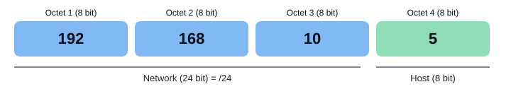

*شکل ۱: آدرس 192.168.10.5/24؛ ۳ Octet اول «شبکه» و آخری «میزبان» است.*

**Mask** هم یک عدد ۳۲ بیتی است: از چپ چند بیت 1 (قسمت شبکه) و بقیه 0 (قسمت میزبان). مثلاً Mask با ۲۴ بیت 1 برابر `255.255.255.0` است. نوشتن «تعداد بیت‌های 1» به شکل `/24` را Prefix Length می‌گویند. پس `192.168.10.5/24` یعنی: ۲۴ بیت اول = شبکه، ۸ بیت آخر = میزبان.

| Prefix | Mask            | تعداد آدرس | Host قابل‌استفاده | اندازه بلوک (Octet آخر) |
|--------|-----------------|------------|------------------|-------------------------|
| /24    | 255.255.255.0   | 256        | 254              | —                       |
| /25    | 255.255.255.128 | 128        | 126              | 128                     |
| /26    | 255.255.255.192 | 64         | 62               | 64                      |
| /27    | 255.255.255.224 | 32         | 30               | 32                      |
| /28    | 255.255.255.240 | 16         | 14               | 16                      |
| /29    | 255.255.255.248 | 8          | 6                | 8                       |
| /30    | 255.255.255.252 | 4          | 2                | 4                       |

**فرمول تعداد آدرس:** هر Subnet به‌اندازه‌ی «۲ به توان تعداد بیت‌های میزبان» آدرس دارد. دو آدرس از آن‌ها رزرو است (اولی آدرس شبکه، آخری Broadcast) و به Host داده نمی‌شود.

``` text
Total addresses = 2 ^ (32 - Prefix)
Usable hosts    = 2 ^ (32 - Prefix) - 2

Example (/26):
  Host bits = 32 - 26 = 6
  Total     = 2 ^ 6   = 64
  Usable    = 64 - 2  = 62
```

### ۴. محاسبه Subnet: روش گام‌به‌گام

برای هر آدرس/Prefix چهار پاسخ می‌خواهیم: **شبکه**، **Broadcast**، **Hostهای قابل‌استفاده (اولی تا آخری)**، **تعداد Host**.

> **روش «اندازه بلوک» (Block Size)**
>
> 1.  Octet «جالب» را پیدا کن: همان Octetی که Mask آن نه 0 است و نه 255.
> 2.  اندازه بلوک را با فرمول زیر حساب کن.
> 3.  عدد Octet آدرس را به نزدیک‌ترین مضرب بلوک (به سمت پایین) گرد کن؛ این می‌شود آدرس شبکه.
> 4.  Broadcast یک عدد کمتر از شبکه بعدی است.
> 5.  Hostها: از «شبکه + 1» تا «Broadcast - 1».

``` text
Block size = 256 - (mask value of the interesting octet)
Network    = largest multiple of Block size that is <= octet value
Broadcast  = (next network) - 1
First host = Network + 1
Last host  = Broadcast - 1
```

#### مثال ۱ (ساده): 192.168.1.10/24

``` text
Mask       = 255.255.255.0   (no interesting octet)
Network    = 192.168.1.0
Broadcast  = 192.168.1.255
Hosts      = 192.168.1.1 - 192.168.1.254
Host count = 2^8 - 2 = 254
```

چون Mask در سه Octet اول 255 است، سه Octet اول بدون تغییر می‌ماند.

#### مثال ۲ (متوسط): 10.10.20.77/26

``` text
Mask         = 255.255.255.192
Interesting  = 4th octet (192)
Block size   = 256 - 192 = 64
Blocks       = 0, 64, 128, 192
77 is between 64 and 127
Network      = 10.10.20.64
Next network = 10.10.20.128
Broadcast    = 10.10.20.127
Hosts        = 10.10.20.65 - 10.10.20.126
Host count   = 2^6 - 2 = 62
```

#### مثال ۳ (سخت): 172.16.45.200/20

``` text
/20 = 8 + 8 + 4 bits
Mask         = 255.255.240.0
Interesting  = 3rd octet (240)
Block size   = 256 - 240 = 16
Blocks       = 0, 16, 32, 48 ...
45 is between 32 and 47
Network      = 172.16.32.0
Next network = 172.16.48.0
Broadcast    = 172.16.47.255
Hosts        = 172.16.32.1 - 172.16.47.254
Host count   = 2^12 - 2 = 4094
```

#### مثال ۴ (معکوس): به ۵۰ Host نیاز دارم؛ Prefix چند؟

``` text
Need          = 50 hosts + 2 reserved = 52
Smallest 2^n >= 52  ->  n = 6  (2^6 = 64)
Host bits     = 6
Prefix        = 32 - 6 = /26
Usable hosts  = 64 - 2 = 62   (enough for 50)
```

همیشه «+2» را فراموش نکن؛ بدون آن جواب اشتباه می‌شود.

### تعداد کل IPهای یک Subnet را با «اندازه بلوک» حساب کنیم

فقط یک سؤال داریم: **یک Subnet روی‌هم چند آدرس دارد؟** فعلاً کاری با آدرس شبکه، Broadcast یا Hostها نداریم. هر Octet ۲۵۶ حالت دارد (از 0 تا 255). پس برای شمردن کل آدرس‌ها دو چیز لازم است: اندازه بلوک، و اینکه «Octet جالب» کجاست.

``` text
Total IPs = Block size x 256 ^ n

Block size = 256 - (mask value of the interesting octet)
n          = number of octets AFTER the interesting octet
```

Octet جالب همان Octetی است که Mask آن نه 0 است و نه 255. هر Octet بعد از آن، کاملاً در بخش میزبان است و ضریب ۲۵۶ می‌آورد.

#### مثال اول: تغییر در Octet چهارم

``` text
192.168.1.0/26
Mask       = 255.255.255.192
Block size = 256 - 192 = 64
n          = 0   (no octet after the 4th)
Total      = 64 x 256^0 = 64
```

#### مثال دوم: تغییر در Octet سوم

``` text
192.168.0.0/22
Mask       = 255.255.252.0
Block size = 256 - 252 = 4
n          = 1   (the 4th octet)
Total      = 4 x 256 = 1024
```

#### مثال سوم: تغییر در Octet دوم

``` text
10.0.0.0/14
Mask       = 255.252.0.0
Block size = 256 - 252 = 4
n          = 2   (the 3rd and 4th octets)
Total      = 4 x 256 x 256 = 262144
```

#### مثال چهارم: تغییر در Octet اول

``` text
0.0.0.0/6
Mask       = 252.0.0.0
Block size = 256 - 252 = 4
n          = 3   (the 2nd, 3rd and 4th octets)
Total      = 4 x 256 x 256 x 256 = 67108864
```

#### جدول خلاصه

| محل تغییر   | اندازه بلوک (نمونه) | محاسبه              | تعداد کل IP |
|-------------|---------------------|---------------------|-------------|
| Octet چهارم | 64                  | 64                  | 64          |
| Octet سوم   | 4                   | 4 × 256             | 1,024       |
| Octet دوم   | 4                   | 4 × 256 × 256       | 262,144     |
| Octet اول   | 4                   | 4 × 256 × 256 × 256 | 67,108,864  |

> **دو نکته‌ی مهم**
>
> ۱) این عدد «کل آدرس‌ها» است؛ برای Host قابل‌استفاده باید ۲ تا کم کنید (شبکه و Broadcast). ۲) اگر Mask دقیقاً روی مرز Octet بود (مثل /24 یا /16 یا /8)، Octet جالب نداریم؛ ساده‌ترین کار این است که اولین Octet صفر را «بلوک ۲۵۶» بگیرید: برای /24 می‌شود ۲۵۶ و برای /16 می‌شود ۲۵۶ × ۲۵۶ = ۶۵۵۳۶.

#### خودآزمایی (آسان تا سخت)

**م1.** سؤال ۱: Mask = 255.255.255.224؛ تعداد کل آدرس؟ *(پاسخ: 2-1-م1 در بخش «پاسخ‌ها» انتهای فصل)*

**م2.** سؤال ۲: Mask = 255.255.248.0؛ تعداد کل آدرس؟ *(پاسخ: 2-1-م2 در بخش «پاسخ‌ها» انتهای فصل)*

**م3.** سؤال ۳: Mask = 255.240.0.0؛ تعداد کل آدرس؟ *(پاسخ: 2-1-م3 در بخش «پاسخ‌ها» انتهای فصل)*

**م4.** سؤال ۴ (بررسی با روش توان ۲): آیا جواب سؤال ۳ با 2 به توان بیت‌های میزبان می‌خواند؟ *(پاسخ: 2-1-م4 در بخش «پاسخ‌ها» انتهای فصل)*

### جدول توان‌های ۲ (برای محاسبه‌ی سریع)

تمام محاسبه‌های Subnetting روی توان‌های ۲ بنا شده‌اند: تعداد آدرس‌ها، اندازه بلوک و تعداد Host. این جدول را چند بار بخوانید تا به‌خاطر بسپارید؛ الگو ساده است: هر ردیف دو برابر ردیف قبلی است.

| توان   | حاصل   |
|--------|--------|
| 2 ^ 0  | 1      |
| 2 ^ 1  | 2      |
| 2 ^ 2  | 4      |
| 2 ^ 3  | 8      |
| 2 ^ 4  | 16     |
| 2 ^ 5  | 32     |
| 2 ^ 6  | 64     |
| 2 ^ 7  | 128    |
| 2 ^ 8  | 256    |
| 2 ^ 9  | 512    |
| 2 ^ 10 | 1,024  |
| 2 ^ 11 | 2,048  |
| 2 ^ 12 | 4,096  |
| 2 ^ 13 | 8,192  |
| 2 ^ 14 | 16,384 |
| 2 ^ 15 | 32,768 |
| 2 ^ 16 | 65,536 |

> **نکته‌ی حفظ‌کردن**
>
> اگر عدد ۲ به توان ۱۰ را (۱,۰۲۴) به یاد داشته باشید، بقیه را می‌توانید از روی آن بسازید: برای هر توان بالاتر دو برابر کنید و برای هر توان پایین‌تر نصف. مثلاً ۲ به توان ۱۲ برابر ۱۰۲۴ × ۴ است، یعنی ۴۰۹۶.

مثال کاربردی: برای /20، بیت‌های میزبان ۱۲ است؛ در جدول ردیف ۲ به توان ۱۲ را نگاه می‌کنیم: ۴,۰۹۶ آدرس.

### جدول مرجع کامل: Prefix، Mask و تعداد IP

این جدول همه‌ی Prefixها را از /32 تا /0 کنار هم می‌گذارد. آن را حفظ نکنید؛ بفهمید و هر وقت لازم شد نگاه کنید. دو الگو را ببینید: با هر یک Prefix کمتر، تعداد آدرس‌ها **دو برابر** می‌شود؛ و ستون «تعداد کل IP» همان ۲ به توان «بیت‌های میزبان» است.

| Prefix | Subnet Mask     | بیت‌های میزبان | تعداد کل IP   |
|--------|-----------------|---------------|---------------|
| /32    | 255.255.255.255 | 0             | 1             |
| /31    | 255.255.255.254 | 1             | 2             |
| /30    | 255.255.255.252 | 2             | 4             |
| /29    | 255.255.255.248 | 3             | 8             |
| /28    | 255.255.255.240 | 4             | 16            |
| /27    | 255.255.255.224 | 5             | 32            |
| /26    | 255.255.255.192 | 6             | 64            |
| /25    | 255.255.255.128 | 7             | 128           |
| /24    | 255.255.255.0   | 8             | 256           |
| /23    | 255.255.254.0   | 9             | 512           |
| /22    | 255.255.252.0   | 10            | 1,024         |
| /21    | 255.255.248.0   | 11            | 2,048         |
| /20    | 255.255.240.0   | 12            | 4,096         |
| /19    | 255.255.224.0   | 13            | 8,192         |
| /18    | 255.255.192.0   | 14            | 16,384        |
| /17    | 255.255.128.0   | 15            | 32,768        |
| /16    | 255.255.0.0     | 16            | 65,536        |
| /15    | 255.254.0.0     | 17            | 131,072       |
| /14    | 255.252.0.0     | 18            | 262,144       |
| /13    | 255.248.0.0     | 19            | 524,288       |
| /12    | 255.240.0.0     | 20            | 1,048,576     |
| /11    | 255.224.0.0     | 21            | 2,097,152     |
| /10    | 255.192.0.0     | 22            | 4,194,304     |
| /9     | 255.128.0.0     | 23            | 8,388,608     |
| /8     | 255.0.0.0       | 24            | 16,777,216    |
| /7     | 254.0.0.0       | 25            | 33,554,432    |
| /6     | 252.0.0.0       | 26            | 67,108,864    |
| /5     | 248.0.0.0       | 27            | 134,217,728   |
| /4     | 240.0.0.0       | 28            | 268,435,456   |
| /3     | 224.0.0.0       | 29            | 536,870,912   |
| /2     | 192.0.0.0       | 30            | 1,073,741,824 |
| /1     | 128.0.0.0       | 31            | 2,147,483,648 |
| /0     | 0.0.0.0         | 32            | 4,294,967,296 |

> **دو حالت خاص**
>
> **/32** فقط یک آدرس است (یک Host مشخص، مثلاً Loopback یا Route برای یک دستگاه). **/31** دو آدرس دارد و طبق استاندارد RFC 3021 برای لینک نقطه‌به‌نقطه بین دو روتر می‌شود از هر دو آدرس استفاده کرد (بدون کسر ۲). برای بقیه‌ی Prefixها، Host قابل‌استفاده برابر «تعداد کل منهای ۲» است.

### کامپیوترها چطور می‌فهمند با هم در یک شبکه‌اند؟

کامپیوتر هیچ «نقشه‌ای» از شبکه ندارد؛ فقط IP و Mask خودش و IP مقصد را می‌داند. با یک عملیات ساده‌ی بیتی به نام AND تصمیم می‌گیرد:

1.  IP را به باینری تبدیل می‌کند.
2.  Mask را به باینری تبدیل می‌کند.
3.  بیت‌به‌بیت AND می‌گیرد؛ نتیجه «آدرس شبکه» (Network) است.
4.  همین کار را برای IP مقصد با Mask خودش انجام می‌دهد.
5.  اگر دو آدرس شبکه برابر بود، «هم‌شبکه» هستند و مستقیم (با ARP) ارتباط می‌گیرند؛ وگرنه بسته را به Gateway می‌دهد.

#### قانون AND (جدول درستی)

``` text
0 AND 0 = 0
0 AND 1 = 0
1 AND 0 = 0
1 AND 1 = 1
```

فقط وقتی هر دو بیت 1 باشند نتیجه 1 است. چون Mask در بخش شبکه همه 1 است، بیت‌های شبکه حفظ می‌شوند؛ و چون در بخش میزبان همه 0 است، بیت‌های میزبان صفر می‌شوند. به همین دلیل نتیجه‌ی AND همیشه «آدرس شبکه» است.

#### مثال ساده: هم‌شبکه

دو کامپیوتر: A = 192.168.1.10/24 و B = 192.168.1.20/24. سه Octet اول Mask برابر 255 (همه 1) است و بدون تغییر می‌ماند؛ فقط Octet آخر را محاسبه می‌کنیم.

``` text
Mask last octet : 0     = 00000000

A last octet    : 10    = 00001010
A AND Mask      :         00000000  = 0
A network       : 192.168.1.0

B last octet    : 20    = 00010100
B AND Mask      :         00000000  = 0
B network       : 192.168.1.0

192.168.1.0 = 192.168.1.0  ->  SAME network
```

#### مثال متوسط: شبیه‌اند ولی هم‌شبکه نیستند

A = 10.10.20.77/26 و B = 10.10.20.130/26. Mask چهارم برابر 192 است.

``` text
Mask last octet : 192   = 11000000

A last octet    : 77    = 01001101
A AND Mask      :         01000000  = 64
A network       : 10.10.20.64

B last octet    : 130   = 10000010
B AND Mask      :         10000000  = 128
B network       : 10.10.20.128

10.10.20.64 != 10.10.20.128  ->  DIFFERENT networks
Result: A sends to its Default Gateway (a router is required)
```

> **نتیجه‌ی کلیدی**
>
> «هم‌شبکه بودن» یعنی آدرس شبکه‌ی دو Host (حاصل IP AND Mask) برابر باشد؛ نه اینکه IPها شبیه هم باشند.

### ۵. Packet Flow: آیا دو Host هم‌شبکه‌اند؟

وقتی Host می‌خواهد بسته بفرستد، با Mask خودش تصمیم می‌گیرد: آدرس مقصد را با Mask AND می‌کند؛ اگر شبکه برابر شبکه خودش بود، مقصد «همین لینک» است و با ARP مستقیم می‌فرستد؛ وگرنه بسته را به Default Gateway می‌دهد.

``` text
Host A: 10.10.20.77/26    network 10.10.20.64   (range 64 .. 127)
Host B: 10.10.20.130/26   network 10.10.20.128  (range 128 .. 191)

A wants to send to B:
  Is B in A's network?   130 is greater than 127  ->  NO
  So A sends the packet to its Default Gateway (the router).
```

نکته جالب: دو آدرس `10.10.20.77` و `10.10.20.130` ظاهراً شبیه‌اند ولی در دو Subnet متفاوت‌اند، و بدون Router با هم حرف نمی‌زنند.

### اگر Default Gateway تنظیم نشده باشد چه می‌شود؟

تصمیم Host همیشه با IP و Mask خودش شروع می‌شود. سپس بسته به نتیجه، یکی از دو مسیر زیر را می‌رود. نکته‌ی مهم این است که **ARP در هر دو مسیر انجام می‌شود**، ولی برای MAC متفاوت.

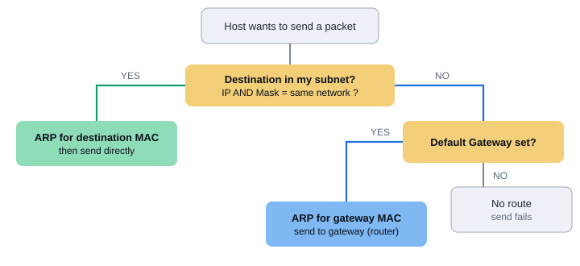

*شکل: درخت تصمیم Host هنگام ارسال بسته؛ در هر دو حالت مسیر درست با ARP کامل می‌شود.*

| حالت                                   | ARP برای چه MAC؟    | فریم به کجا می‌رود؟                          |
|----------------------------------------|---------------------|---------------------------------------------|
| مقصد در Subnet خودم است                | MAC مقصد نهایی      | مستقیم به مقصد                              |
| مقصد در Subnet دیگر است                | MAC Default Gateway | به روتر، و روتر ادامه می‌دهد                 |
| مقصد در Subnet دیگر است و Gateway نیست | —                   | ارتباط برقرار نمی‌شود (جایی برای ارسال نیست) |

پس دو کامپیوتر در دو Subnet متفاوت، بدون Default Gateway (و بدون Route دستی دیگر)، نمی‌توانند با هم ارتباط بگیرند. ARP فقط برای دستگاه‌های «روی همین لینک» جواب می‌دهد؛ هیچ دستگاهی در Subnet دیگر به ARP Request شما پاسخ نمی‌دهد.

> **قاعده‌ی خلاصه**
>
> اگر مقصد همسایه است، با ARP خودش را پیدا می‌کنیم. اگر همسایه نیست، بسته را برای دروازه می‌فرستیم و دروازه تصمیم می‌گیرد.

### ۶. آدرس‌های خاص (باید بشناسید)

| بازه            | نام                            | کاربرد                                                       |
|-----------------|--------------------------------|--------------------------------------------------------------|
| 10.0.0.0/8      | آدرس خصوصی (RFC 1918) - کلاس A | داخل سازمان؛ در اینترنت Route نمی‌شود                         |
| 172.16.0.0/12   | آدرس خصوصی (RFC 1918) - کلاس B | داخل سازمان؛ در اینترنت Route نمی‌شود                         |
| 192.168.0.0/16  | آدرس خصوصی (RFC 1918) - کلاس C | داخل سازمان؛ در اینترنت Route نمی‌شود                         |
| 127.0.0.0/8     | Loopback                       | تست خود دستگاه (`127.0.0.1`)                                 |
| 169.254.0.0/16  | APIPA (Link-Local)             | وقتی Client از DHCP آدرس نگرفت خودش می‌سازد؛ نشانه خرابی DHCP |
| 224.0.0.0/4     | Multicast                      | مثلاً OSPF و HSRP                                             |
| 203.0.113.0/24  | مستندات (TEST-NET-3)           | در Lab ما «اینترنت شبیه‌سازی‌شده» است                          |
| 198.51.100.0/24 | مستندات (TEST-NET-2)           | مثال در مستندات                                              |

> **ارتباط با دوره**
>
> اگر Client شما `169.254.x.x` دارد، یعنی DHCP جواب نداده؛ در عیب‌یابی TS10 می‌بینید.

### ۷. تمرین‌های درجه‌بندی‌شده (قبل از Lab حل کنید)

هرکدام را روی کاغذ حل کنید، بعد جواب را باز کنید.

**ت1.** ۱ (ساده): 192.168.5.130/24 *(پاسخ: 2-1-ت1 در بخش «پاسخ‌ها» انتهای فصل)*

**ت2.** ۲: 10.0.0.9/30 *(پاسخ: 2-1-ت2 در بخش «پاسخ‌ها» انتهای فصل)*

**ت3.** ۳: 192.168.1.100/27 *(پاسخ: 2-1-ت3 در بخش «پاسخ‌ها» انتهای فصل)*

**ت4.** ۴: 192.168.0.200/25 *(پاسخ: 2-1-ت4 در بخش «پاسخ‌ها» انتهای فصل)*

**ت5.** ۵: به ۸ Host نیاز دارم؛ Prefix؟ *(پاسخ: 2-1-ت5 در بخش «پاسخ‌ها» انتهای فصل)*

**ت6.** ۶ (سخت): 172.31.14.9/22 *(پاسخ: 2-1-ت6 در بخش «پاسخ‌ها» انتهای فصل)*

**ت7.** ۷ (سخت): 10.1.200.15/19 *(پاسخ: 2-1-ت7 در بخش «پاسخ‌ها» انتهای فصل)*

**ت8.** ۸: آیا 10.10.20.77/26 و 10.10.20.130/26 هم‌شبکه‌اند؟ *(پاسخ: 2-1-ت8 در بخش «پاسخ‌ها» انتهای فصل)*

### ۸. Lab هدایت‌شده: «Mask چطور تعیین می‌کند چه کسی همسایه است»

در Lab `L00-ImageValidation` می‌دانید `R1` روی `Gi0/0.10` آدرس `10.10.10.1/24` و `SW1` روی `Vlan10` آدرس `10.10.10.2/24` دارد و `ping` کار می‌کند. حالا عمداً Mask را خراب می‌کنیم تا اثرش را ببینید.

#### گام ۱: وضعیت سالم

``` text
R1# show ip interface brief
R1# show ip route connected
R1# ping 10.10.10.2
```

`show ip route connected` باید شبکه `10.10.10.0/24` را به‌عنوان Connected نشان بدهد؛ `ping` موفق.

#### گام ۲: تغییر آدرس سوییچ به یک Host «بالای نصف»

``` text
SW1# configure terminal
SW1(config)# interface vlan 10
SW1(config-if)# ip address 10.10.10.130 255.255.255.0
SW1(config-if)# end
```

#### گام ۳: تنگ‌کردن Mask روی روتر

``` text
R1# configure terminal
R1(config)# interface gi0/0.10
R1(config-subif)# ip address 10.10.10.1 255.255.255.128
R1(config-subif)# end
R1# show ip route connected
R1# ping 10.10.10.130
```

**پیش‌بینی (قبل از اجرا فکر کنید):** با Mask جدید، محدوده‌ی «همین لینک» برای روتر کوچک‌تر شده است:

``` text
R1 new mask = /25
R1 network  = 10.10.10.0 - 10.10.10.127
SW1 address = 10.10.10.130   -> outside this range
Result      : R1 has no connected route to .130 -> ping fails
```

نتیجه‌ی واقعی را بنویسید؛ اگر چیز دیگری دیدید همان را ثبت کنید. سمت سوییچ Mask قبلی (/24) را دارد و فکر می‌کند روتر همسایه است؛ پس ارتباط «نیمه‌کاره» می‌شود.

#### گام ۴: رفع

``` text
R1(config)# interface gi0/0.10
R1(config-subif)# ip address 10.10.10.1 255.255.255.0
R1(config-subif)# end
R1# ping 10.10.10.130
```

بعد از رفع، ping موفق می‌شود. سپس آدرس سوییچ را به `10.10.10.2` برگردانید.

### ۹. Lab مستقل

سه Subnet بسازید: ۴۰ Host، ۱۰ Host و یک لینک دو روتر. از `192.168.50.0/24` با روش اندازه بلوک شروع کنید و برای هرکدام Prefix، شبکه، Broadcast، اولین و آخرین Host را بنویسید. جدول را در فایل `02-design/ip-plan-drill.md` ذخیره کنید.

### ۱۰. عیب‌یابی (TS13: Mask اشتباه، TS14: Gateway اشتباه)

| بخش                | شرح                                                                                                                                              |
|--------------------|--------------------------------------------------------------------------------------------------------------------------------------------------|
| Symptom            | یک Host فقط به بعضی Hostهای همان VLAN می‌رسد                                                                                                      |
| سرنخ اول           | Hostهای «بالای» یک عدد خاص (مثلاً .128 به بالا) جواب نمی‌دهند                                                                                      |
| روش                | ۱) `ipconfig /all` یا `show ip interface brief` ۲) Mask و Gateway را با Subnet مقایسه کن ۳) `ping` هم‌سایه و Gateway ۴) `show ip route connected` |
| علت                | Mask نادرست (مثلاً /25 به‌جای /24) یا Gateway خارج Subnet                                                                                          |
| رفع و Verification | تصحیح Mask/Gateway؛ ping همه Hostها                                                                                                              |

### ۱۱. سؤال‌های مرور (Active Recall، بدون نگاه)

**م5.** آدرس شبکه و Broadcast با چه فرمولی پیدا می‌شود؟ *(پاسخ: 2-1-م5 در بخش «پاسخ‌ها» انتهای فصل)*

**م6.** چرا Host قابل‌استفاده = آدرس‌ها منهای ۲ است؟ *(پاسخ: 2-1-م6 در بخش «پاسخ‌ها» انتهای فصل)*

**م7.** /26 چند Host دارد و بلوکش چند است؟ *(پاسخ: 2-1-م7 در بخش «پاسخ‌ها» انتهای فصل)*

**م8.** Client با 169.254.x.x یعنی چه؟ *(پاسخ: 2-1-م8 در بخش «پاسخ‌ها» انتهای فصل)*

**م9.** دو Host در یک Subnet با چه روشی هم‌شبکه بودنشان را تشخیص می‌دهند؟ *(پاسخ: 2-1-م9 در بخش «پاسخ‌ها» انتهای فصل)*

### English Corner: انگلیسی تخصصی این درس

این جمله‌ها از مستندات و محیط کار واقعی‌اند. بلند بخوانید و ترجمه را بپوشانید.

| English sentence                                                             | ترجمه                                                           |
|------------------------------------------------------------------------------|-----------------------------------------------------------------|
| The subnet mask determines which part of the address identifies the network. | ماسک زیرشبکه مشخص می‌کند کدام بخش آدرس، شبکه را تعیین می‌کند.     |
| The host cannot reach devices outside its subnet without a default gateway.  | بدون Default Gateway، Host به دستگاه‌های خارج از Subnet نمی‌رسد.  |
| A /26 prefix provides 62 usable host addresses.                              | یک Prefix با طول /26 تعداد ۶۲ آدرس قابل‌استفاده برای Host می‌دهد. |
| The client self-assigned a 169.254.x.x address because DHCP failed.          | Client چون DHCP شکست خورد، خودش آدرس 169.254.x.x گرفت.          |

**Q1.** Quick quiz (answer in English): How many usable hosts are in a /27 subnet? *(پاسخ: 2-1-Q1 در بخش «پاسخ‌ها» انتهای فصل)*

### ۱۲. تکلیف و چک‌لیست تسلط

- [ ] ۸ تمرین بخش ۷ را بدون نگاه حل کنم.
- [ ] ده عدد دلخواه را به باینری و برعکس تبدیل کنم.
- [ ] آزمایش Mask (گام ۱ تا ۴) را انجام دهم و نتیجه واقعی `ping` را ثبت کنم.
- [ ] Lab مستقل را در Git (بدون رمز) ذخیره کنم.
- [ ] توضیح بدهم چرا ۲ آدرس رزرو است.

### ۱۳. یادآوری اشتباهات شما

> **یادآوری ۱**
>
> اول `enable` و بعد `configure terminal`؛ و فقط یک‌بار.

> **یادآوری ۲**
>
> دستورهای EXEC (مثل `monitor capture`) در Config خطا می‌دهند؛ خطای «Invalid input» همیشه ناسازگاری Image نیست.

> **یادآوری ۳**
>
> «فرمان پذیرفته شد» ≠ «Feature کار می‌کند»؛ با ترافیک واقعی بسنجید.


#### کارت Lab — درس ۲-۱

| # | فیلد | محتوا |
|---|---|---|
| 1 | عنوان و هدف | دیدن اثر Mask غلط روی ارتباط R1 و SW1 |
| 2 | پیش‌نیاز | درس ۱-B؛ Lab L00 سالم |
| 3 | توپولوژی | R1 Gi0/0.10 ↔ trunk ↔ SW1 Vlan10 |
| 4 | تجهیزات | R1، SW1 |
| 5 | نسخه نرم‌افزار | vIOS-L2 15.2(20200924، Experimental) برای SW؛ vIOS 15.9(3)M9 برای R؛ VPCS (PNetLab)؛ PNetLab 4.2.8 |
| 6 | IP Plan | 10.10.10.1/24 (R1)، 10.10.10.2/24 (SW1) |
| 7 | وضعیت اولیه | ping بین R1 و SW1 موفق |
| 8 | صورت مسئله | Mask را عمداً /25 کنید، نتیجه‌ی ping به 10.10.10.130 را قبل از اجرا پیش‌بینی و بعد ثبت کنید |
| 9 | مراحل هدایت‌شده | همان بخش «Lab هدایت‌شده» همین درس (گام‌به‌گام) |
| 10 | تست عملکرد | `show ip route connected` ؛ `ping 10.10.10.130` |
| 11 | سناریوی خرابی | Mask /25 روی R1 و /24 روی SW1 (نیمه‌کاره) |
| 12 | روش عیب‌یابی | مقایسه‌ی Mask دو سر، `show ip route connected` |
| 13 | نتیجه‌ی مورد انتظار | ping به .130 قبل از رفع شکست می‌خورد؛ بعد از رفع موفق |
| 14 | معیار پذیرش | پیش‌بینی ثبت‌شده با نتیجه‌ی واقعی مقایسه شود؛ رفع کامل |
| 15 | مستندات نهایی | جدول `02-design/ip-plan-drill.md` |
| 16 | Cleanup و بازگردانی | آدرس SW1 را به 10.10.10.2 و Mask R1 را به /24 برگردانید |

> **وضعیت راستی‌آزمایی (خارج از ۱۶ فیلد):** **اجرا نشده (فقط طراحی).** مرحله‌ی Mask غلط اجرا نشده. پیش‌شرط (RoAS + ping R1↔SW1) در Probe ۱-B به‌صورت Tested-OK دیده شده است.

---

<a id="l-2-2"></a>

## درس ۲-۲ — VLSM و طراحی IP Plan

**فصل ۲ - روز ۲ · پیش‌نیاز: درس ۲-۱ · ۶ ساعت**

### این درس درباره چیست و چرا باید یاد بگیریم؟

**چه چیزی یاد می‌گیریم:** چطور یک بلوک آدرس را به Subnetهای هم‌اندازه‌ی نامناسب نبُریم، بلکه برای هر بخش سازمان دقیقاً به اندازه نیازش آدرس بدهیم. این کار را VLSM (مخفف Variable Length Subnet Mask، یعنی «ماسک زیرشبکه با طول متغیر») می‌گویند. بعد، نتیجه را در یک «برنامه‌ی آدرس‌دهی» (IP Plan، مخفف IP Addressing Plan) می‌نویسیم.

**چرا لازم است:** تصور کنید یک ساختمان اداری دارید و می‌خواهید طبقه‌ها را تقسیم کنید. اگر همه‌ی اتاق‌ها را به‌اندازه‌ی بزرگ‌ترین اتاق (سالن اجتماعات) بسازید، فضای زیادی هدر می‌رود. در شبکه هم همین است: لینک بین دو روتر فقط به ۲ آدرس نیاز دارد، ولی اگر یک /24 با ۲۵۴ آدرس به آن بدهید، ۲۵۲ آدرس هدر رفته است.

- **در کار روزانه:** وقتی شعبه‌ی جدید باز می‌شود، باید بدون به‌هم‌ریختن شبکه‌ی فعلی، آدرس تازه بدهید.
- **در امنیت:** هر Subnet یک «مرز» برای فایروال است. Subnetهای درست‌اندازه یعنی قانون‌های دقیق‌تر.
- **در دوره‌ی ما:** پروژه‌ی نهایی (Capstone) یک مرکز و سه شعبه دارد؛ IP Plan آن را همین هفته می‌سازیم.

> **مسیر درس**
>
> مشکل (هدررفت) ← ایده‌ی VLSM ← مثال ساده ← مثال متوسط ← مثال سخت (سازمان واقعی) ← تمرین ← Lab ← عیب‌یابی.

#### اصطلاحات این درس (مخفف ← شکل کامل ← معنی)

| مخفف    | شکل کامل انگلیسی                    | معنی فارسی                                                    |
|---------|-------------------------------------|---------------------------------------------------------------|
| VLSM    | Variable Length Subnet Mask         | ماسک زیرشبکه با طول متغیر؛ هر بخش به اندازه نیازش آدرس می‌گیرد |
| IP Plan | IP Addressing Plan                  | برنامه و سند آدرس‌دهی سازمان                                   |
| VLAN    | Virtual Local Area Network          | شبکه محلی مجازی؛ جداسازی منطقی روی یک سوییچ                   |
| DMZ     | Demilitarized Zone                  | منطقه حائل برای سرورهای در دسترس از بیرون                     |
| Gateway | Default Gateway                     | دروازه پیش‌فرض                                                 |
| DHCP    | Dynamic Host Configuration Protocol | تخصیص خودکار آدرس                                             |
| CIDR    | Classless Inter-Domain Routing      | نمایش آدرس با Prefix بدون کلاس، مثل /26                       |

### ۱. مشکل: تقسیم هم‌اندازه و هدررفت آدرس

فرض کنید بلوک `192.168.10.0/24` (۲۵۶ آدرس) دارید و چهار بخش می‌خواهید: فروش (۱۰۰ کامپیوتر)، فنی (۵۰)، مدیریت (۱۲)، و یک لینک بین دو روتر (۲).

اگر ساده‌لوحانه همه را /26 (۶۲ Host) بسازید، فروش جا نمی‌شود (۱۰۰ \> ۶۲). اگر همه را /25 (۱۲۶ Host) بسازید، فقط ۲ Subnet می‌گیرید و چهار بخش جا نمی‌شود. یعنی با اندازه‌ی ثابت، نه هدر نمی‌دهیم و نه جا می‌شویم. راه‌حل: **اندازه‌ی متغیر**.

### سؤال مهم: در شبکه داخلی برای IP پولی نمی‌دهیم، پس چرا اینقدر مراقب هدررفت هستیم؟

حرف درستی است: آدرس‌های خصوصی (مثل 10.0.0.0/8 یا 192.168.0.0/16) هزینه ندارند و هیچ‌کس برای آن‌ها فاکتور نمی‌فرستد. اما «پول» تنها دلیل VLSM نیست. دلیل‌های اصلی این‌هاست:

| دلیل                   | توضیح                                                                                                                   |
|------------------------|-------------------------------------------------------------------------------------------------------------------------|
| ۱. بلوک شما محدود است  | معمولاً از یک بلوک مشخص (مثلاً یک /24 یا /22) استفاده می‌کنید. اگر هر لینک دو روتر یک /24 کامل بگیرد، بلوک زود تمام می‌شود. |
| ۲. رشد آینده           | شعبه‌ی جدید و VLAN جدید می‌آید. اگر فضا را هدر داده باشید، مجبور می‌شوید همه‌چیز را عوض کنید.                               |
| ۳. مدیریت و مستندسازی  | Subnetهای درست‌اندازه و منظم، IP Plan را خوانا و عیب‌یابی را سریع می‌کند.                                                  |
| ۴. خلاصه‌سازی مسیرها    | وقتی آدرس‌ها پشت‌سرهم و منظم باشند، می‌شود چند Route را در یک Route خلاصه کرد (جدول Route کوچک‌تر).                         |
| ۵. جلوگیری از هم‌پوشانی | در ادغام شرکت‌ها یا اتصال VPN بین دو سایت، بازه‌ها نباید هم‌پوشانی داشته باشند؛ مصرف بی‌حساب بازه این خطر را بالا می‌برد.    |
| ۶. امنیت و Broadcast   | Subnet خیلی بزرگ یعنی Broadcast Domain بزرگ و Policy فایروال درشت و نامحدود.                                            |

> **یک نکته‌ی صادقانه**
>
> اگر بلوک خیلی بزرگی مثل 10.0.0.0/8 دارید، کمبود آدرس معمولاً مشکل اصلی نیست. آن‌جا دلیل‌های ۳ تا ۶ (نظم، خلاصه‌سازی، هم‌پوشانی و امنیت) مهم‌ترند. VLSM در بلوک‌های کوچک‌تر و در لینک‌های بین روترها اهمیت بیشتری دارد.

#### VLSM کجا چقدر مهم است؟

| محیط                 | اهمیت VLSM                               |
|----------------------|------------------------------------------|
| شبکه‌ی خانگی کوچک     | کم                                       |
| شبکه‌ی شرکت کوچک      | متوسط                                    |
| سازمان بزرگ          | بسیار زیاد                               |
| ISP و شبکه‌های گسترده | بسیار زیاد (IPv4 عمومی محدود و گران است) |
| لینک بین روترها      | بسیار مهم (فقط ۲ آدرس لازم است)          |

#### مثال: ۳۰۰ کامپیوتر؛ یک /23 یا سه /24؟

``` text
Option 1: one /23
  Mask          = 255.255.254.0
  Total         = 2 ^ 9 = 512
  Usable        = 512 - 2 = 510
  Spare         = 510 - 300 = 210
  Broadcast domains = 1  (all 300 PCs together)

Option 2: three /24
  Usable each   = 254   (total 762)
  Broadcast domains = 3  (separated)
  Needs a router or L3 switch between them
```

از نظر ظرفیت، هر دو گزینه کافی است. انتخاب نهایی به طراحی بستگی دارد: اگر واحدهای سازمان باید از هم جدا باشند (امنیت، کاهش Broadcast، Policy جدا)، سه Subnet بهتر است؛ ولی برای ارتباط بینشان به دستگاه لایه ۳ نیاز دارید (روتر یا سوییچ لایه ۳). اگر همه یک گروه یکسان‌اند و نیازی به جداسازی نیست، یک /23 ساده‌تر است.

### ۲. ایده‌ی VLSM به زبان ساده

VLSM یعنی «Subnet Mask با طول متغیر» (Variable Length Subnet Mask). مثل برش پیتزا برای مهمان‌ها: به کسی که گرسنه‌تر است برش بزرگ‌تر می‌دهید و به بقیه کوچک‌تر. فقط یک قانون هست: برش‌ها نباید روی هم بیفتند.

> **سه قانون طلایی VLSM**
>
> ۱) **همیشه از بزرگ‌ترین نیاز شروع کن.** ۲) هر Subnet باید روی مرز مضرب اندازه‌ی خودش شروع شود (مثلاً یک /26 باید روی ۰، ۶۴، ۱۲۸ یا ۱۹۲ شروع شود). ۳) هیچ دو Subnet نباید هم‌پوشانی داشته باشند.

**مراحل کار برای هر بخش:** (۱) نیاز را بشمار و ۲ آدرس رزرو (شبکه و Broadcast) اضافه کن. (۲) کوچک‌ترین توان ۲ که کافی باشد را پیدا کن. (۳) Prefix را از آن بساز. (۴) از اولین آدرس آزاد شروع به تخصیص کن. (۵) آدرس بعدی آزاد را یادداشت کن.

### ۳. مثال ساده (دو بخش)

بلوک `10.0.0.0/24` را داریم. بخش A به ۱۰۰ Host و بخش B به ۲۰ Host نیاز دارد. اول بزرگ‌ترین (A):

``` text
A: need = 100 + 2 = 102
   2^7 = 128 >= 102  ->  Prefix = /25
   Network   = 10.0.0.0/25
   Hosts     = 10.0.0.1 - 10.0.0.126
   Broadcast = 10.0.0.127
   Next free = 10.0.0.128
```

بعد B از اولین آدرس آزاد شروع می‌شود:

``` text
B: need = 20 + 2 = 22
   2^5 = 32 >= 22   ->  Prefix = /27
   Network   = 10.0.0.128/27
   Hosts     = 10.0.0.129 - 10.0.0.158
   Broadcast = 10.0.0.159
   Next free = 10.0.0.160  (up to 10.0.0.255 stays free for growth)
```

باقی‌مانده بلوک (۱۶۰ تا ۲۵۵) برای رشد آینده خالی می‌ماند و هدررفت نیست.

### ۴. مثال متوسط (چهار بخش)


*شکل ۲: نوار آدرس VLSM؛ بخش بزرگ‌تر اول و بدون هم‌پوشانی.*

بلوک `192.168.10.0/24`؛ همان چهار بخش بخش ۱: فروش ۱۰۰، فنی ۵۰، مدیریت ۱۲، لینک روتر ۲.

| بخش       | نیاز+۲ | اندازه | Prefix | شبکه           | Hostها      | Broadcast |
|-----------|--------|--------|--------|----------------|-------------|-----------|
| فروش      | 102    | 128    | /25    | 192.168.10.0   | .1 – .126   | .127      |
| فنی       | 52     | 64     | /26    | 192.168.10.128 | .129 – .190 | .191      |
| مدیریت    | 14     | 16     | /28    | 192.168.10.192 | .193 – .206 | .207      |
| لینک روتر | 4      | 4      | /30    | 192.168.10.208 | .209 – .210 | .211      |

دقت کنید هر شروع، دقیقاً بعد از Broadcast قبلی است (۱۲۷ ← ۱۲۸، ۱۹۱ ← ۱۹۲، ۲۰۷ ← ۲۰۸). آدرس‌های `.212` تا `.255` هنوز آزادند (۴۴ آدرس).

**نکته:** اگر ترتیب را برعکس بگیرید (اول لینک /30 را در `.0` بگذارید)، بعداً /25 روی مرز ۱۲۸ می‌افتد و دیگر فروش در یک تکه جا نمی‌شود. برای همین «بزرگ‌ترین اول».

### پیش‌نیاز مثال بعدی: بلوک 10.20.0.0/22 یعنی چه؟

مثال سخت پایین با این جمله شروع می‌شود: «سازمانی بلوک `10.20.0.0/22` دارد.» اول آن را از پایه باز می‌کنیم.

#### گام ۱: معنی /22

از ۳۲ بیت آدرس، ۲۲ بیت برای «شبکه» است و ۱۰ بیت باقی‌مانده برای «میزبان». هر بیت میزبان دو حالت دارد؛ پس تعداد آدرس‌ها این‌طور حساب می‌شود:

``` text
Host bits       = 32 - 22 = 10
Total addresses = 2 ^ 10 = 1024
```

#### گام ۲: چرا آخرین آدرس 10.20.3.255 است؟

اول /22 را به Subnet Mask تبدیل می‌کنیم:

``` text
/22  = 11111111.11111111.11111100.00000000
Mask = 255.255.252.0
```

Octet سوم «جالب» است (چون 252 نه 0 است و نه 255). اندازه بلوک آن:

``` text
Block size = 256 - 252 = 4     (in the 3rd octet)
```

یعنی شبکه‌های /22 در Octet سوم هر ۴ عدد یک‌بار شروع می‌شوند:

| شماره شبکه | آدرس شروع  |
|------------|------------|
| شبکه ۱     | 10.20.0.0  |
| شبکه ۲     | 10.20.4.0  |
| شبکه ۳     | 10.20.8.0  |
| شبکه ۴     | 10.20.12.0 |

پس شبکه‌ی اول ما از `10.20.0.0` شروع می‌شود و درست قبل از شبکه‌ی بعدی (`10.20.4.0`) تمام می‌شود:

``` text
Network   = 10.20.0.0
Next net  = 10.20.4.0
Broadcast = 10.20.4.0 - 1 = 10.20.3.255
Range     = 10.20.0.0 - 10.20.3.255
```

#### گام ۳: چهار «تکه»ی داخل بلوک

Octet سوم در این بلوک چهار مقدار می‌گیرد: 0، 1، 2 و 3. هر مقدار یک تکه‌ی ۲۵۶تایی است:

``` text
10.20.0.0 - 10.20.0.255    256 addresses
10.20.1.0 - 10.20.1.255    256 addresses
10.20.2.0 - 10.20.2.255    256 addresses
10.20.3.0 - 10.20.3.255    256 addresses
Total = 4 x 256 = 1024
```

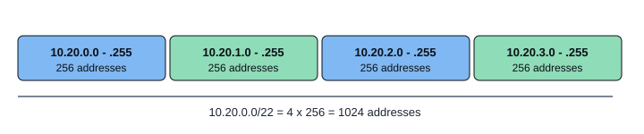

*شکل: بلوک /22 چهار تکه‌ی ۲۵۶تایی (چهار /24 پشت‌سرهم) است.*

> **نکته‌ی مهم**
>
> این چهار تکه فعلاً فقط «چهار قسمت از یک بلوک بزرگ» هستند، نه الزاماً چهار Subnet نهایی. در VLSM ما همین ۱۰۲۴ آدرس را به Subnetهایی با اندازه‌های مختلف (مثلاً /23، /25، /26، /27 و /30) تقسیم می‌کنیم؛ همان کاری که در مثال سخت پایین می‌بینید.

**سؤال خودآزمایی: در یک /22، هر تکه‌ی «Octet سوم» چند آدرس دارد؟**

``` text
Each value of the 3rd octet = 256 addresses (the last octet has 8 host bits: 2 ^ 8 = 256)
Answer: 256
```

### ۵. مثال سخت (سازمان واقعی: مرکز و سه شعبه)

سازمانی با بلوک `10.20.0.0/22` (۱۰۲۴ آدرس: `10.20.0.0` تا `10.20.3.255`). نیازها:

| بخش                   | Host |
|-----------------------|------|
| مرکز: کاربران         | 300  |
| مرکز: سرورها          | 60   |
| مرکز: مدیریت تجهیزات  | 25   |
| شعبه ۱: کاربران       | 100  |
| شعبه ۲: کاربران       | 50   |
| شعبه ۳: کاربران       | 20   |
| سه لینک روتر (هرکدام) | 2    |

**گام ۱ - اندازه هر بخش** (هر بخش یک سطر؛ مرتب از بزرگ به کوچک):

``` text
Center users    : 300 + 2 = 302 -> 512 -> /23
Branch 1        : 100 + 2 = 102 -> 128 -> /25
Center servers  :  60 + 2 =  62 ->  64 -> /26
Branch 2        :  50 + 2 =  52 ->  64 -> /26
Center mgmt     :  25 + 2 =  27 ->  32 -> /27
Branch 3        :  20 + 2 =  22 ->  32 -> /27
3 links         :   2 + 2 =   4 ->   4 -> /30 (each)
```

**گام ۲ - آیا بلوک کافی است؟**

``` text
Total needed = 512 + 128 + 64 + 64 + 32 + 32 + (3 x 4)
             = 844
Available    = 1024  (a /22)
844 <= 1024  ->  OK
```

**گام ۳ - تخصیص پشت‌سرهم:**

| بخش          | Prefix | شبکه        | Broadcast   |
|--------------|--------|-------------|-------------|
| مرکز-کاربران | /23    | 10.20.0.0   | 10.20.1.255 |
| شعبه ۱       | /25    | 10.20.2.0   | 10.20.2.127 |
| مرکز-سرورها  | /26    | 10.20.2.128 | 10.20.2.191 |
| شعبه ۲       | /26    | 10.20.2.192 | 10.20.2.255 |
| مرکز-مدیریت  | /27    | 10.20.3.0   | 10.20.3.31  |
| شعبه ۳       | /27    | 10.20.3.32  | 10.20.3.63  |
| لینک ۱       | /30    | 10.20.3.64  | 10.20.3.67  |
| لینک ۲       | /30    | 10.20.3.68  | 10.20.3.71  |
| لینک ۳       | /30    | 10.20.3.72  | 10.20.3.75  |

**گام ۴ - بررسی:** هر شروع باید دقیقاً یک عدد بعد از Broadcast قبلی باشد.

``` text
Last used address = 10.20.3.75
Free space        = 10.20.3.76 - 10.20.3.255  (180 addresses, for growth)
Overlap check     : every start = previous broadcast + 1  ->  no overlap
```

### ۶. IP Plan: سند زنده‌ی شبکه

جدول بالا هنوز «محاسبه» است. IP Plan سندی است که تیم نگه می‌دارد و این ستون‌ها را دارد: نام بخش، VLAN، شبکه/Prefix، Gateway، بازه‌ی DHCP، آدرس‌های ثابت، مالک، توضیح. قاعده‌ی تجربی: **Gateway را همیشه اولین Host (.1) بگذارید** و سرورها/تجهیزات را از انتهای بازه یا بازه‌ی ثابت جدا کنید، تا همه بدانند «.1 یعنی Gateway».

نمونه برای Lab دوره (در Capstone استفاده می‌شود؛ همین هفته در `02-design/ip-plan.md` ثبتش کنید):

| VLAN | نام     | شبکه          | Gateway    |
|------|---------|---------------|------------|
| 10   | مدیریت  | 10.10.10.0/24 | 10.10.10.1 |
| 20   | کاربران | 10.10.20.0/24 | 10.10.20.1 |
| 30   | سرورها  | 10.10.30.0/24 | 10.10.30.1 |

### ۷. تمرین‌های درجه‌بندی‌شده

**ت1.** ۱ (ساده): از 192.168.1.0/24 دو Subnet بساز: ۱۲۰ Host و ۱۰ Host *(پاسخ: 2-2-ت1 در بخش «پاسخ‌ها» انتهای فصل)*

**ت2.** ۲ (ساده): لینک بین دو روتر از 10.1.1.0/24 *(پاسخ: 2-2-ت2 در بخش «پاسخ‌ها» انتهای فصل)*

**ت3.** ۳ (متوسط): از 172.16.0.0/24: ۶۰، ۳۰، ۱۰ Host *(پاسخ: 2-2-ت3 در بخش «پاسخ‌ها» انتهای فصل)*

**ت4.** ۴ (متوسط): چرا نباید اول Subnet کوچک را بگذاریم؟ *(پاسخ: 2-2-ت4 در بخش «پاسخ‌ها» انتهای فصل)*

**ت5.** ۵ (سخت): از 10.5.0.0/23: ۲۰۰ Host، ۷۰ Host، ۳۰ Host، دو لینک *(پاسخ: 2-2-ت5 در بخش «پاسخ‌ها» انتهای فصل)*

**ت6.** ۶ (سخت): آیا 192.168.1.64/26 و 192.168.1.100/27 هم‌پوشانی دارند؟ *(پاسخ: 2-2-ت6 در بخش «پاسخ‌ها» انتهای فصل)*

### ۸. Lab هدایت‌شده: اجرای IP Plan روی روتر

برای دیدن اینکه روتر Subnetها را «می‌شناسد»، روی `R1` چند Loopback به‌عنوان Subnet مجازی می‌سازیم.

#### گام ۱: ساخت سه Subnet از مثال متوسط

``` text
R1# configure terminal
R1(config)# interface loopback 1
R1(config-if)# ip address 192.168.10.1 255.255.255.128
R1(config-if)# interface loopback 2
R1(config-if)# ip address 192.168.10.129 255.255.255.192
R1(config-if)# interface loopback 3
R1(config-if)# ip address 192.168.10.193 255.255.255.240
R1(config-if)# end
```

#### گام ۲: بررسی

``` text
R1# show ip interface brief
R1# show ip route connected
```

باید سه Route از نوع `C` ببینید: `192.168.10.0/25`، `192.168.10.128/26`، `192.168.10.192/28`. دقت کنید روتر خودش «آدرس شبکه» را از Mask محاسبه کرده است؛ همان‌طور که شما محاسبه کردید.

#### گام ۳: ایجاد عمدی هم‌پوشانی

``` text
R1(config)# interface loopback 4
R1(config-if)# ip address 192.168.10.100 255.255.255.192
```

پیش‌بینی: IOS معمولاً خطای `% 192.168.10.64 overlaps with Loopback1` می‌دهد و دستور را نمی‌پذیرد (نتیجه‌ی واقعی را ثبت کنید). همین است که از هم‌پوشانی در یک روتر جلوگیری می‌کند.

#### گام ۴: پاک‌سازی

``` text
R1(config)# no interface loopback 1
R1(config)# no interface loopback 2
R1(config)# no interface loopback 3
R1(config)# no interface loopback 4
R1(config)# end
```

### ۹. Lab مستقل

برای Capstone یک بلوک `10.50.0.0/22` انتخاب کنید و برای مرکز (کاربران ۱۵۰، سرورها ۴۰، مدیریت ۲۰، DMZ ۱۰) و سه شعبه (هرکدام ۳۰ کاربر) به‌علاوه ۳ لینک، IP Plan کامل بسازید. خروجی: `02-design/ip-plan.md` با ستون‌های گفته‌شده. بدون رمز.

### ۱۰. عیب‌یابی

|         |                                                           |
|---------|-----------------------------------------------------------|
| Symptom | بعد از اضافه‌کردن Subnet جدید، بخشی از شبکه ناگهان قطع شد  |
| سرنخ    | دو Subnet هم‌پوشان؛ روتر برای یک آدرس دو مسیر دارد         |
| روش     | `show ip route`، مقایسه‌ی Prefixها، رسم نوار آدرس روی کاغذ |
| رفع     | تغییر یکی از Subnetها به بازه‌ی آزاد و به‌روزرسانی IP Plan  |
| پیشگیری | هر آدرس جدید را اول در IP Plan ثبت کن، بعد روی دستگاه بزن |

### ۱۱. سؤال‌های مرور

**م1.** VLSM چیست و چرا به آن نیاز داریم؟ *(پاسخ: 2-2-م1 در بخش «پاسخ‌ها» انتهای فصل)*

**م2.** چرا از بزرگ‌ترین نیاز شروع می‌کنیم؟ *(پاسخ: 2-2-م2 در بخش «پاسخ‌ها» انتهای فصل)*

**م3.** بهترین Prefix برای لینک بین دو روتر چیست؟ *(پاسخ: 2-2-م3 در بخش «پاسخ‌ها» انتهای فصل)*

### English Corner: انگلیسی تخصصی این درس

این جمله‌ها از مستندات و محیط کار واقعی‌اند. بلند بخوانید و ترجمه را بپوشانید.

| English sentence                                                        | ترجمه                                                      |
|-------------------------------------------------------------------------|------------------------------------------------------------|
| VLSM lets us allocate address space according to actual need.           | VLSM اجازه می‌دهد فضای آدرس را مطابق نیاز واقعی تخصیص دهیم. |
| Always start with the largest subnet to avoid fragmentation.            | همیشه از بزرگ‌ترین Subnet شروع کنید تا فضا تکه‌تکه نشود.     |
| The two subnets overlap, so the router rejected the second address.     | دو Subnet هم‌پوشانی دارند، پس روتر آدرس دوم را رد کرد.      |
| Document every allocation in the IP plan before configuring the device. | قبل از تنظیم دستگاه، هر تخصیص را در IP Plan مستند کنید.    |

**Q1.** Quick quiz (answer in English): Why do we sort requirements from largest to smallest in VLSM? *(پاسخ: 2-2-Q1 در بخش «پاسخ‌ها» انتهای فصل)*

### ۱۲. تکلیف و چک‌لیست تسلط

- [ ] ۶ تمرین بخش ۷ را حل کنم.
- [ ] Lab هدایت‌شده را اجرا و خروجی `show ip route connected` را ذخیره کنم.
- [ ] IP Plan Capstone را بنویسم و بدون هم‌پوشانی بودنش را وارسی کنم.
- [ ] بتوانم بدون نگاه VLSM را برای ۴ بخش انجام دهم.

### ۱۳. یادآوری اشتباهات شما

> **یادآوری**
>
> «+۲» (شبکه و Broadcast) را در هر محاسبه فراموش نکنید؛ و قبل از اجرا، پیش‌بینی کنید و بعد نتیجه‌ی واقعی را مقایسه کنید.


#### کارت Lab — درس ۲-۲

| # | فیلد | محتوا |
|---|---|---|
| 1 | عنوان و هدف | اجرای VLSM روی روتر با Loopback و دیدن Route های Connected |
| 2 | پیش‌نیاز | درس ۲-۱ |
| 3 | توپولوژی | R1 با Loopback 1 تا 4 |
| 4 | تجهیزات | R1 |
| 5 | نسخه نرم‌افزار | vIOS-L2 15.2(20200924، Experimental) برای SW؛ vIOS 15.9(3)M9 برای R؛ VPCS (PNetLab)؛ PNetLab 4.2.8 |
| 6 | IP Plan | 192.168.10.1/25، 192.168.10.129/26، 192.168.10.193/28 |
| 7 | وضعیت اولیه | R1 بدون Loopback |
| 8 | صورت مسئله | سه Subnet از مثال متوسط را بسازید و هم‌پوشانی را عمداً ایجاد کنید |
| 9 | مراحل هدایت‌شده | همان بخش «Lab هدایت‌شده» همین درس (گام‌به‌گام) |
| 10 | تست عملکرد | `show ip route connected` سه Route C |
| 11 | سناریوی خرابی | Loopback 4 هم‌پوشان |
| 12 | روش عیب‌یابی | محاسبه‌ی دستی شبکه‌ی هر Interface |
| 13 | نتیجه‌ی مورد انتظار | سه Route C؛ پیام overlaps برای Loopback 4 |
| 14 | معیار پذیرش | هم‌پوشانی دیده و ثبت شود |
| 15 | مستندات نهایی | `02-design/ip-plan.md` |
| 16 | Cleanup و بازگردانی | حذف Loopbackها (`no interface loopback N`) |

> **وضعیت راستی‌آزمایی (خارج از ۱۶ فیلد):** **اجرا نشده (فقط طراحی).** اجرا نشده؛ پیام «overlaps» برای Loopback هم‌پوشان پیش‌بینی است، نه مشاهده‌شده.

---

<a id="l-2-3"></a>

## درس ۲-۳ — IPv6 از پایه

**فصل ۲ - روز ۳ · پیش‌نیاز: درس ۲-۱ و ۲-۲ · ۶ ساعت**

### این درس درباره چیست و چرا باید یاد بگیریم؟

**چه چیزی یاد می‌گیریم:** نسل جدید آدرس‌دهی اینترنت یعنی IPv6: شکل آدرس، قوانین کوتاه‌نویسی، انواع آدرس، و اینکه دستگاه‌ها چطور بدون DHCP هم آدرس می‌گیرند.

**چرا لازم است:** آدرس‌های IPv4 حدود ۴.۳ میلیارد تا هستند و از سال‌ها پیش تمام شده‌اند. برای همین مدتی است که شبکه‌ها با ترفندهایی مثل NAT سرپا مانده‌اند. IPv6 با ۱۲۸ بیت آن‌قدر آدرس دارد که می‌شود به هر ذره‌ی شن روی زمین چند آدرس داد.

- **در کار روزانه:** بسیاری از ISPها، سرویس‌های ابری و Windows Server 2022 به‌طور پیش‌فرض IPv6 فعال دارند. اگر آن را نشناسید، یک پورت باز IPv6 در فایروال را نمی‌بینید و این یک حفره‌ی امنیتی می‌شود.
- **در امنیت:** مهاجم می‌تواند از مسیر IPv6 که فراموش کرده‌اید ببندید وارد شود. Blue Team باید هر دو پروتکل را ببیند.
- **در FortiGate:** Policyهای IPv6 جداگانه‌اند؛ در هفته‌های بعد از آن‌ها استفاده می‌کنیم.

> **مسیر درس**
>
> چرا IPv6 ← ساختار و کوتاه‌نویسی ← انواع آدرس ← کشف همسایه و SLAAC ← مثال ساده/متوسط/سخت ← تمرین ← Lab ← عیب‌یابی.

#### اصطلاحات این درس (مخفف ← شکل کامل ← معنی)

| مخفف       | شکل کامل انگلیسی                           | معنی فارسی                            |
|------------|--------------------------------------------|---------------------------------------|
| IPv6       | Internet Protocol version 6                | نسخه ۶ آدرس‌دهی (۱۲۸ بیتی)             |
| Hex        | Hexadecimal                                | شانزده‌شانزدهی؛ ارقام 0-9 و a-f        |
| GUA        | Global Unicast Address                     | آدرس عمومی قابل مسیریابی در اینترنت   |
| ULA        | Unique Local Address                       | آدرس محلی یکتا؛ معادل آدرس خصوصی IPv4 |
| Link-Local | Link-Local Address                         | آدرس محدود به یک لینک (fe80::)        |
| EUI-64     | Extended Unique Identifier 64-bit          | ساخت Interface ID ۶۴ بیتی از MAC      |
| SLAAC      | Stateless Address Auto-Configuration       | آدرس‌دهی خودکار بدون سرور DHCP         |
| NDP        | Neighbor Discovery Protocol                | پروتکل کشف همسایه؛ جایگزین ARP        |
| RA         | Router Advertisement                       | اعلان روتر؛ اعلام Prefix              |
| RS         | Router Solicitation                        | درخواست Host از روتر                  |
| NS         | Neighbor Solicitation                      | درخواست MAC همسایه                    |
| NA         | Neighbor Advertisement                     | پاسخ MAC همسایه                       |
| ICMPv6     | Internet Control Message Protocol for IPv6 | پیام‌های کنترلی IPv6؛ زیربنای NDP      |
| MAC        | Media Access Control address               | آدرس فیزیکی کارت شبکه                 |

### ۱. ساختار آدرس IPv6

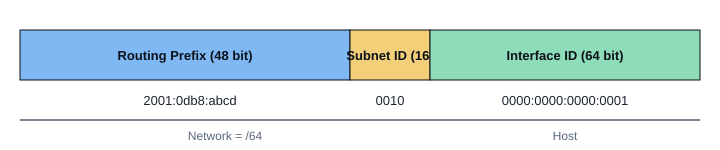

*شکل ۳: ساختار آدرس IPv6؛ ۶۴ بیت اول شبکه (Prefix + Subnet) و ۶۴ بیت آخر دستگاه.*

آدرس IPv6 یک عدد ۱۲۸ بیتی است. آن را به ۸ گروه ۱۶ بیتی تقسیم می‌کنیم و هر گروه را با ۴ رقم شانزده‌شانزدهی (Hex: ارقام ۰ تا ۹ و a تا f) می‌نویسیم، با دونقطه بین گروه‌ها:

``` text
2001:0db8:0010:0010:0000:0000:0000:0001
```

هر رقم Hex معادل ۴ بیت است. پس حساب کل بیت‌ها این‌طور می‌شود:

``` text
1 hex digit = 4 bits      (f = 1111 , a = 1010)
1 group     = 4 digits = 16 bits
8 groups    = 8 x 16   = 128 bits
```

مثل IPv4، آدرس دو بخش دارد: **Prefix** (شبکه) و **Interface ID** (دستگاه). در بیشتر شبکه‌ها Prefix برابر `/64` است: ۶۴ بیت اول شبکه و ۶۴ بیت آخر دستگاه. در IPv6 به‌جای «Subnet Mask» همیشه Prefix می‌نویسیم.

### ۲. دو قانون کوتاه‌نویسی

**قانون ۱: صفرهای ابتدای هر گروه را حذف کن.** مثال: `0db8` ← `db8` و `0010` ← `10` و `0000` ← `0`.

**قانون ۲: یک (فقط یک) رشته‌ی متوالی از گروه‌های تماماً صفر را با `::` جایگزین کن.**

``` text
Full   : 2001:0db8:0010:0010:0000:0000:0000:0001
Rule 1 : 2001:db8:10:10:0:0:0:1
Rule 2 : 2001:db8:10:10::1
```

> **چرا فقط یک بار ::؟**
>
> اگر دو بار بنویسید، معلوم نیست هرکدام چند گروه صفر را نشان می‌دهند. پس `2001::5::1` غلط است. اگر دو رشته‌ی صفر داشتید، `::` را روی **بلندترین** رشته بگذارید.

### ۳. مثال‌های کوتاه‌نویسی (ساده تا سخت)

#### مثال ساده

``` text
Full  : fe80:0000:0000:0000:0000:0000:0000:0001
Step 1: fe80:0:0:0:0:0:0:1
Step 2: fe80::1
```

#### مثال متوسط (دو رشته صفر)

``` text
Full  : 2001:0db8:0000:0000:0001:0000:0000:0005
Step 1: 2001:db8:0:0:1:0:0:5
Step 2: two zero-runs of equal length -> shorten the FIRST one
Result: 2001:db8::1:0:0:5
```

#### مثال سخت (برعکس: باز کردن)

``` text
Short  : 2001:db8:a::1:2
Groups written = 5  (2001, db8, a, 1, 2)
Missing groups = 8 - 5 = 3   (the :: is 3 zero groups)
Full   : 2001:0db8:000a:0000:0000:0000:0001:0002
```

### ۴. انواع آدرس IPv6

| نوع                | Prefix                   | کاربرد                                  | معادل در IPv4                  |
|--------------------|--------------------------|-----------------------------------------|--------------------------------|
| Global Unicast     | 2000::/3                 | آدرس قابل Route در اینترنت              | آدرس عمومی                     |
| Unique Local (ULA) | fc00::/7 (عملاً fd00::/8) | داخل سازمان                             | RFC 1918                       |
| Link-Local         | fe80::/10                | فقط روی یک لینک؛ هر Interface حتماً دارد | APIPA (ولی همیشه فعال و ضروری) |
| Multicast          | ff00::/8                 | ارسال به گروهی از دستگاه‌ها              | 224.0.0.0/4                    |
| Loopback           | ::1/128                  | خود دستگاه                              | 127.0.0.1                      |
| مستندات            | 2001:db8::/32            | در آموزش و Lab                          | TEST-NET                       |

**نکته‌ی مهم:** IPv6 **Broadcast ندارد**. کارهایی که Broadcast می‌کرد (مثل ARP) با Multicast انجام می‌شود. آدرس‌های ff02::1 (همه‌ی گره‌ها) و ff02::2 (همه‌ی روترها) را بشناسید.

### ۵. دستگاه‌ها چطور آدرس می‌گیرند؟

#### ۵-۱. Link-Local خودکار

همین که Interface بالا بیاید، دستگاه خودش یک آدرس `fe80::` می‌سازد. نیازی به DHCP و تنظیم دستی ندارد. تمام ارتباط‌های همسایگی (و Next-Hop روتینگ) با همین آدرس انجام می‌شود.

#### ۵-۲. EUI-64: ساخت Interface ID از MAC

MAC آدرس ۴۸ بیتی است؛ ۶۴ بیت لازم داریم. روش: وسط MAC عدد `fffe` را بگذار و بیت هفتم بایت اول را وارونه کن. مثال: MAC = `aabb.cc00.0100`:

``` text
MAC:            aa bb cc 00 01 00
Step 1 (insert fffe) : aa bb cc ff fe 00 01 00
Step 2 (flip U/L bit) : first byte aa XOR 02 = a8
Interface ID:   a8bb:ccff:fe00:0100
```

پس آدرس Link-Local می‌شود `fe80::a8bb:ccff:fe00:100`. (فقط ایده را بدانید: MAC در آدرس «نشت» می‌کند و برای حریم خصوصی، سیستم‌عامل‌های جدید به‌جای EUI-64 مقدار تصادفی می‌سازند.)

#### ۵-۳. SLAAC و کشف همسایه (NDP)

روتر هر چند ثانیه (یا به درخواست) پیام Router Advertisement (RA) می‌فرستد که می‌گوید «Prefix این لینک 2001:db8:10:10::/64 است». Host خودش Interface ID می‌سازد و آدرس می‌شود. به این روش SLAAC می‌گویند: بدون DHCP.

| پیام NDP                    | معادل       | کار                                   |
|-----------------------------|-------------|---------------------------------------|
| Router Solicitation (RS)    | —           | Host: «روتر هست؟»                     |
| Router Advertisement (RA)   | DHCP قسمتی  | روتر: Prefix و Gateway را اعلام می‌کند |
| Neighbor Solicitation (NS)  | ARP Request | «MAC فلان IPv6 چیست؟» (با Multicast)  |
| Neighbor Advertisement (NA) | ARP Reply   | پاسخ با MAC                           |

NDP از ICMPv6 استفاده می‌کند؛ بنابراین **نباید ICMPv6 را در فایروال کاملاً ببندید** وگرنه IPv6 کار نمی‌کند (اشتباه رایج).

### ۶. مثال کاربردی: Prefix و Subnet در IPv6

سازمان بلوک `2001:db8:abcd::/48` دارد. با ۱۶ بیت باقیمانده تا /64 می‌توانیم ۶۵۵۳۶ Subnet /64 بسازیم. محاسبه‌ی Host ندارد! هر VLAN را یک /64 می‌دهیم: `2001:db8:abcd:`**`10`**`::/64` برای VLAN10، `2001:db8:abcd:`**`20`**`::/64` برای VLAN20 و غیره. گروه چهارم را همان شماره‌ی VLAN بگذارید تا خوانا باشد.

مقایسه: در IPv4 باید هر بار محاسبه‌ی VLSM کنیم. در IPv6 همه /64 هستند و زندگی ساده است.

### ۷. تمرین‌ها

**ت1.** ۱. (ساده) کوتاه کن: 2001:0db8:0000:0000:0000:0000:0000:0001 *(پاسخ: 2-3-ت1 در بخش «پاسخ‌ها» انتهای فصل)*

**ت2.** ۲. (ساده) این چه نوع آدرسی است: fe80::1 ؟ fd12:3456::5 ؟ ff02::1 ؟ 2001:db8::5 ؟ *(پاسخ: 2-3-ت2 در بخش «پاسخ‌ها» انتهای فصل)*

**ت3.** ۳. (متوسط) باز کن: 2001:db8:0:1::5 *(پاسخ: 2-3-ت3 در بخش «پاسخ‌ها» انتهای فصل)*

**ت4.** ۴. (متوسط) آیا 2001:db8::1 و 2001:db8:0:0:1::1 در یک /64 هستند؟ *(پاسخ: 2-3-ت4 در بخش «پاسخ‌ها» انتهای فصل)*

**ت5.** ۵. (سخت) چرا نمی‌توان 2001::1::2 نوشت؟ *(پاسخ: 2-3-ت5 در بخش «پاسخ‌ها» انتهای فصل)*

**ت6.** ۶. (سخت) از 2001:db8:abcd::/48 برای ۴ VLAN (۱۰، ۲۰، ۳۰، ۹۹) Prefix بساز. *(پاسخ: 2-3-ت6 در بخش «پاسخ‌ها» انتهای فصل)*

### ۸. Lab هدایت‌شده: IPv6 بین R1 و SW1

شرط: در Lab `L00` هنوز VLAN10 روی R1 (`Gi0/0.10`) و SW1 (`Vlan10`) سالم است.

#### گام ۱: فعال‌کردن IPv6 روی روتر

``` text
R1# configure terminal
R1(config)# ipv6 unicast-routing
R1(config)# interface gi0/0.10
R1(config-subif)# ipv6 address 2001:db8:10:10::1/64
R1(config-subif)# end
R1# show ipv6 interface brief
```

باید دو آدرس ببینید: Link-Local (`FE80::...`) و آدرسی که دادید. فرمان `ipv6 unicast-routing` روتر را از «Host» به «روتر IPv6» تبدیل می‌کند و RA می‌فرستد.

#### گام ۲: سمت سوییچ

``` text
SW1# configure terminal
SW1(config)# interface vlan 10
SW1(config-if)# ipv6 address 2001:db8:10:10::2/64
SW1(config-if)# end
SW1# show ipv6 interface brief
```

در سوییچ‌های L2 ممکن است IPv6 فقط در CLI دیده شود. اگر دستور رد شد یا ping نشد، دقیقاً همان را ثبت کنید؛ این همان درس «پذیرفته‌شدن ≠ کارکردن» است.

#### گام ۳: Ping و NDP

``` text
R1# ping 2001:db8:10:10::2
R1# show ipv6 neighbors
R1# ping FE80::<LL-SW1>%GigabitEthernet0/0.10
```

در Ping با Link-Local باید Interface خروجی را مشخص کنید (چون fe80:: روی هر Interface تکراری است). جدول `show ipv6 neighbors` معادل `show ip arp` است.

#### گام ۴: دیدن RA

``` text
R1# show ipv6 interface gi0/0.10
```

در خروجی دنبال خط «ND advertised reachable time» و «Hosts use stateless autoconfig» بگردید؛ یعنی روتر Prefix را برای SLAAC اعلام می‌کند.

### ۹. Lab مستقل

برای VLANهای ۱۰ و ۲۰ و ۳۰ Capstone یک Prefix مثل `2001:db8:abcd::/48` انتخاب و در `02-design/ipv6-plan.md` بنویسید. روی R1 هر زیرواسط را یک /64 بدهید و `show ipv6 route connected` را ثبت کنید.

### ۱۰. عیب‌یابی

|         |                                                                                                                                    |
|---------|------------------------------------------------------------------------------------------------------------------------------------|
| Symptom | Ping IPv6 جواب نمی‌دهد ولی IPv4 کار می‌کند                                                                                           |
| سرنخ‌ها  | ۱) `ipv6 unicast-routing` فعال است؟ ؛ ۲) Prefix دو طرف یکی است؟ ؛ ۳) ACL یا فایروال ICMPv6 را بسته؟ ؛ ۴) فقط Link-Local کار می‌کند؟ |
| رفع     | تصحیح Prefix یا اجازه‌ی ICMPv6                                                                                                      |

### ۱۱. سؤال‌های مرور

**م1.** چرا IPv6 Broadcast ندارد؟ *(پاسخ: 2-3-م1 در بخش «پاسخ‌ها» انتهای فصل)*

**م2.** NS/NA معادل چه چیزی در IPv4 است؟ *(پاسخ: 2-3-م2 در بخش «پاسخ‌ها» انتهای فصل)*

**م3.** چرا ICMPv6 را نباید بست؟ *(پاسخ: 2-3-م3 در بخش «پاسخ‌ها» انتهای فصل)*

**م4.** /64 برای یک VLAN یعنی چه؟ *(پاسخ: 2-3-م4 در بخش «پاسخ‌ها» انتهای فصل)*

### English Corner: انگلیسی تخصصی این درس

این جمله‌ها از مستندات و محیط کار واقعی‌اند. بلند بخوانید و ترجمه را بپوشانید.

| English sentence                                                         | ترجمه                                                            |
|--------------------------------------------------------------------------|------------------------------------------------------------------|
| IPv6 has no broadcast; it uses multicast instead.                        | IPv6 Broadcast ندارد؛ به‌جای آن از Multicast استفاده می‌کند.       |
| Every IPv6 interface automatically gets a link-local address.            | هر Interface در IPv6 به‌طور خودکار یک Link-Local می‌گیرد.          |
| Hosts build their own address from the router advertisement using SLAAC. | Hostها با SLAAC از روی Router Advertisement آدرس خود را می‌سازند. |
| Do not block ICMPv6, or neighbor discovery will break.                   | ICMPv6 را نبندید، وگرنه Neighbor Discovery از کار می‌افتد.        |

**Q1.** Quick quiz (answer in English): Which IPv6 messages replace ARP? *(پاسخ: 2-3-Q1 در بخش «پاسخ‌ها» انتهای فصل)*

### ۱۲. تکلیف و چک‌لیست تسلط

- [ ] ۶ تمرین را حل کنم.
- [ ] Lab IPv6 را انجام و نتیجه‌ی واقعی (موفق/ناموفق) را ثبت کنم.
- [ ] IPv6 Plan را بنویسم.
- [ ] قوانین کوتاه‌نویسی را بدون نگاه بگویم.

### ۱۳. یادآوری اشتباهات شما

> **یادآوری**
>
> خروجی قبل از اجرا را پیش‌بینی کنید؛ و «Invalid input» همیشه به معنای ناسازگاری Image نیست.


#### کارت Lab — درس ۲-۳

| # | فیلد | محتوا |
|---|---|---|
| 1 | عنوان و هدف | برقراری IPv6 بین R1 و SW1 |
| 2 | پیش‌نیاز | درس ۲-۲ |
| 3 | توپولوژی | R1 Gi0/0.10 ↔ SW1 Vlan10 |
| 4 | تجهیزات | R1، SW1 |
| 5 | نسخه نرم‌افزار | vIOS-L2 15.2(20200924، Experimental) برای SW؛ vIOS 15.9(3)M9 برای R؛ VPCS (PNetLab)؛ PNetLab 4.2.8 |
| 6 | IP Plan | 2001:db8:10:10::1/64 و ::2/64 |
| 7 | وضعیت اولیه | IPv4 سالم |
| 8 | صورت مسئله | IPv6 بدهید، ping بزنید و جدول همسایه را ببینید |
| 9 | مراحل هدایت‌شده | همان بخش «Lab هدایت‌شده» همین درس (گام‌به‌گام) |
| 10 | تست عملکرد | `ping 2001:db8:10:10::2` ؛ `show ipv6 neighbors` |
| 11 | سناریوی خرابی | `ipv6 unicast-routing` فراموش شود |
| 12 | روش عیب‌یابی | `show ipv6 interface brief` و مقایسه‌ی Prefix |
| 13 | نتیجه‌ی مورد انتظار | ping موفق و دو ورودی همسایه |
| 14 | معیار پذیرش | ثبت نتیجه‌ی واقعی (موفق/ناموفق) از سوییچ |
| 15 | مستندات نهایی | `02-design/ipv6-plan.md` |
| 16 | Cleanup و بازگردانی | حذف آدرس‌های IPv6 |

> **وضعیت راستی‌آزمایی (خارج از ۱۶ فیلد):** **اجرا نشده (فقط طراحی).** اجرا نشده؛ IPv6 در Probe فقط CLI-Accepted بود؛ روی سوییچ ممکن است کار نکند.

---

<a id="l-2-4"></a>

## درس ۲-۴ — CLI سیسکو، مدیریت و بکاپ Config

**فصل ۲ - روز ۴ · پیش‌نیاز: فصل ۱ · ۶ ساعت**

### این درس درباره چیست و چرا باید یاد بگیریم؟

**چه چیزی یاد می‌گیریم:** کار حرفه‌ای با خط فرمان سیسکو (CLI): حالت‌ها، کمک‌گیری، تفاوت پیکربندی در حال اجرا و ذخیره‌شده، و مهم‌تر از همه **پشتیبان‌گیری و بازگشت (Rollback)**.

**چرا لازم است:** در دنیای واقعی بزرگ‌ترین ترس هر مدیر شبکه این است: «یک دستور زدم و ارتباط همه قطع شد، حالا چه کنم؟». کسی که بکاپ و Rollback بلد است، با آرامش کار می‌کند؛ کسی که بلد نیست، ساعت‌ها در قطعی می‌ماند.

- **در کار روزانه:** قبل از هر تغییر، نسخه‌ی فعلی را ذخیره می‌کنید و بعد از تغییر اگر خراب شد، در چند ثانیه برمی‌گردید.
- **در امنیت:** پیکربندی بکاپ‌شده سند حسابرسی است؛ می‌توانید ثابت کنید «چه چیزی، کی تغییر کرد».
- **در دوره:** Capstone مرحله‌ی «CHG (درخواست تغییر)» دارد که بدون Rollback پذیرفته نمی‌شود.

> **مسیر درس**
>
> حالت‌های CLI ← کمک‌گیری و میان‌بُرها ← Running و Startup ← بکاپ و Rollback ← مثال ساده/متوسط/سخت ← Lab ← عیب‌یابی.

#### اصطلاحات این درس (مخفف ← شکل کامل ← معنی)

| مخفف     | شکل کامل انگلیسی               | معنی فارسی                                          |
|----------|--------------------------------|-----------------------------------------------------|
| CLI      | Command Line Interface         | محیط خط فرمان                                       |
| EXEC     | Executive mode                 | حالت اجرایی دستورها                                 |
| NVRAM    | Non-Volatile RAM               | حافظه‌ای که با خاموشی پاک نمی‌شود؛ محل startup-config |
| RAM      | Random Access Memory           | حافظه موقت؛ محل running-config                      |
| TFTP     | Trivial File Transfer Protocol | انتقال فایل ساده و بدون رمزگذاری                    |
| SCP      | Secure Copy Protocol           | انتقال فایل امن روی SSH                             |
| DNS      | Domain Name System             | سیستم نام دامنه                                     |
| CHG      | Change Request                 | درخواست تغییر رسمی                                  |
| Rollback | Rollback                       | بازگشت به وضعیت سالم قبلی                           |
| MOTD     | Message Of The Day             | پیام نمایشی هنگام ورود                              |

### ۱. حالت‌های CLI (چهار اتاق یک ساختمان)

CLI سیسکو مثل ساختمانی با چند اتاق است که هرکدام اجازه‌ی کار متفاوتی دارد:

| حالت                  | Prompt           | چه کاری می‌شود کرد           | ورود/خروج                                          |
|-----------------------|------------------|-----------------------------|----------------------------------------------------|
| User EXEC             | `R1>`            | مشاهده‌ی محدود، ping         | ورود: `enable`                                     |
| Privileged EXEC       | `R1#`            | همه‌ی show، کپی فایل، reload | خروج: `disable`                                    |
| Global Config         | `R1(config)#`    | تغییر تنظیمات کل دستگاه     | ورود: `configure terminal` ؛ خروج: `end` یا `exit` |
| Interface/Line Config | `R1(config-if)#` | تنظیم یک Interface یا Line  | ورود: `interface ...`                              |

> **قاعده‌ی طلایی**
>
> دستورهای `show`، `ping`، `copy`، `monitor capture` و `reload` در EXEC هستند. دستورهای تنظیمی در Config. اگر در Config دستور show بزنید، با `do` جلو آن می‌توانید اجرا کنید: `do show ip route`.

### ۲. کمک‌گیری و میان‌بُرها (سرعت یک مهندس)

- `?` بعد از هر کلمه: گزینه‌های ممکن. مثال: `show ip ?`
- `Tab`: کامل‌کردن. `sh run` هم کافی است (مخفف یکتا).
- `show running-config | section interface`: فیلتر خروجی. `| include` و `| begin` هم داریم.
- فلش بالا: دستور قبلی. `Ctrl+A` ابتدای خط و `Ctrl+E` انتهای خط. `Ctrl+Shift+6` قطع دستور گیرکرده.

مثال: به‌جای خواندن ۲۰۰ خط config فقط این را بزنید:

``` text
R1# show running-config | section interface Gi0/0
R1# show ip interface brief | include up
```

### ۳. تنظیمات پایه‌ی یک دستگاه حرفه‌ای

``` text
R1(config)# hostname R1
R1(config)# no ip domain-lookup
R1(config)# service timestamps log datetime msec
R1(config)# line console 0
R1(config-line)# logging synchronous
R1(config-line)# exec-timeout 10 0
R1(config-line)# exit
R1(config)# banner motd # Authorized access only #
R1(config)# enable secret <PASSWORD>
R1(config)# end
```

خط‌به‌خط:

- `no ip domain-lookup`: جلوی «Translating…» را می‌گیرد (اشتباهی که قبلاً دیدید).
- `logging synchronous`: پیام‌های Log وسط تایپ شما نمی‌پرند.
- `exec-timeout 10 0`: بعد از ۱۰ دقیقه بی‌کاری Session بسته می‌شود (امنیت).
- `enable secret`: رمز ورود به Privileged با Hash قوی. **هرگز** `enable password` (متن ساده) نه. رمز واقعی را در Git نگذارید؛ اینجا فقط جانگهدار است.

### ۴. Running-config و Startup-config

دو نسخه از تنظیمات در دستگاه هست:

- **running-config**: در RAM، همین الان فعال است؛ با خاموش‌شدن می‌پرد.
- **startup-config**: در NVRAM، در بوت بعدی بارگذاری می‌شود.

تشبیه: running مثل «متنی که در Word تایپ کرده‌اید و ذخیره نکرده‌اید»؛ startup همان فایل ذخیره‌شده است.

``` text
R1# show running-config
R1# show startup-config
R1# copy running-config startup-config      (or: write memory)
R1# show archive                              (if supported)
```

اشتباه رایج: بعد از تغییر ذخیره نمی‌کنید و بعد از Reload همه‌چیز می‌پرد. جلوگیری: عادت کنید هر تغییر موفق ← `copy run start`.

### ۵. بکاپ و Rollback (قلب درس)

#### ۵-۱. بکاپ محلی روی Flash

``` text
R1# copy running-config flash:R1-before-change.cfg
R1# dir flash:
```

#### ۵-۲. بکاپ روی سرور (TFTP/SCP)

``` text
R1# copy running-config tftp://10.10.10.50/R1-2026-11-07.cfg
```

برای سرور بکاپ از یک VM لینوکسی استفاده می‌کنیم (در درس‌های بعد، با SCP امن). نام فایل = نام دستگاه + تاریخ. فایل‌های بکاپ **رمزِ هش‌شده** دارند ولی باز هم در جای امن (خارج از Git) نگه‌دارید.

#### ۵-۳. Rollback با Configure Replace

اگر Image شما قابلیت Archive دارد، می‌توانید کل تنظیمات را با یک فایل بکاپ جایگزین کنید (فقط تفاوت‌ها اعمال می‌شود):

``` text
R1# configure replace flash:R1-before-change.cfg list
R1# configure replace flash:R1-before-change.cfg force
```

گزینه‌ی `list` فقط تفاوت‌ها را نشان می‌دهد (Dry-run). اگر دستور در Image شما نبود، روش جایگزین: `copy flash:R1-before-change.cfg startup-config` و سپس `reload`.

#### ۵-۴. «Reload in»: شبکه‌ی ایمنی

``` text
R1# reload in 10
... risky change ...
R1# reload cancel        (if it worked)
```

مثل ماشین‌هایی که ده دقیقه بعد خودشان خاموش می‌شوند. اگر تغییر ارتباط شما را قطع کرد، دستگاه بعد از ۱۰ دقیقه به startup-config قبلی بر می‌گردد. این تکنیک نجات‌بخش است؛ مخصوصاً در تغییرات راه دور.

### ۶. مثال‌ها (ساده تا سخت)

**ساده**

اسم دستگاه را عوض کنید و ذخیره کنید: `hostname R1-HQ` ← `end` ← `copy run start` ← `show startup-config | include hostname`.

**متوسط**

قبل از تغییر IP یک Interface، بکاپ به Flash بگیرید؛ آدرس را تغییر دهید؛ ping کنید؛ اگر قطع شد با `configure replace` برگردید.

**سخت**

تغییر راه دور: با `reload in 5` شبکه‌ی ایمنی بگذارید؛ Mask یک Subinterface را تغییر دهید؛ اگر ارتباط قطع شد، ۵ دقیقه صبر می‌کنید و دستگاه با startup قبلی بالا می‌آید؛ اگر موفق بود `reload cancel` و `copy run start`.

### ۷. تمرین‌ها

**ت1.** ۱. Prompt زیر در کدام حالت است؟ R1(config-if)# *(پاسخ: 2-4-ت1 در بخش «پاسخ‌ها» انتهای فصل)*

**ت2.** ۲. تفاوت running و startup چیست؟ *(پاسخ: 2-4-ت2 در بخش «پاسخ‌ها» انتهای فصل)*

**ت3.** ۳. چطور در Config دستور show ip route را اجرا کنیم؟ *(پاسخ: 2-4-ت3 در بخش «پاسخ‌ها» انتهای فصل)*

**ت4.** ۴. چرا enable secret بهتر از enable password است؟ *(پاسخ: 2-4-ت4 در بخش «پاسخ‌ها» انتهای فصل)*

**ت5.** ۵. فایده‌ی reload in چیست؟ *(پاسخ: 2-4-ت5 در بخش «پاسخ‌ها» انتهای فصل)*

### ۸. Lab هدایت‌شده: تغییر، خراب‌کردن و Rollback

#### گام ۱: تنظیمات پایه (بخش ۳) را روی R1 و SW1 بزنید و ذخیره کنید

#### گام ۲: بکاپ

``` text
R1# copy running-config flash:R1-good.cfg
R1# copy running-config startup-config
R1# dir flash:
```

#### گام ۳: خراب‌کردن عمدی

``` text
R1(config)# interface gi0/0.10
R1(config-subif)# ip address 10.10.99.1 255.255.255.0
R1(config-subif)# end
R1# ping 10.10.10.2
```

پیش‌بینی: ping شکست می‌خورد چون Subnet عوض شد.

#### گام ۴: Rollback

``` text
R1# configure replace flash:R1-good.cfg force
R1# ping 10.10.10.2
```

اگر `configure replace` در Image شما پشتیبانی نشد (ثبت کنید)، با `copy flash:R1-good.cfg running-config` ادغام کنید و Interface را دستی اصلاح نمایید.

#### گام ۵: تمرین reload in

``` text
R1# reload in 5
(make a harmless change)
R1# reload cancel
```

### ۹. Lab مستقل

یک Runbook یک‌صفحه‌ای `03-ops/change-and-rollback.md` بنویسید: چک‌لیست قبل/حین/بعد تغییر، دستورهای بکاپ، Rollback، و Verification. بدون رمز.

### ۱۰. عیب‌یابی

|           |                                                  |
|-----------|--------------------------------------------------|
| Symptom   | بعد از Reload تنظیمات پرید                       |
| علت       | ذخیره نشده بود (فقط running)                     |
| رفع       | بازسازی از بکاپ؛ از این به بعد `copy run start`  |
| Symptom 2 | Rollback خطا می‌دهد                               |
| علت       | فایل بکاپ ناقص یا Archive پشتیبانی نمی‌شود        |
| رفع       | روش جایگزین: `copy file startup-config` + reload |

### ۱۱. سؤال‌های مرور

**م1.** سه حالت اصلی CLI؟ *(پاسخ: 2-4-م1 در بخش «پاسخ‌ها» انتهای فصل)*

**م2.** چرا بکاپ قبل از تغییر؟ *(پاسخ: 2-4-م2 در بخش «پاسخ‌ها» انتهای فصل)*

### English Corner: انگلیسی تخصصی این درس

این جمله‌ها از مستندات و محیط کار واقعی‌اند. بلند بخوانید و ترجمه را بپوشانید.

| English sentence                                                                     | ترجمه                                                                            |
|--------------------------------------------------------------------------------------|----------------------------------------------------------------------------------|
| Save the running configuration to NVRAM, or the changes will be lost after a reload. | running-config را در NVRAM ذخیره کنید، وگرنه بعد از Reload تغییرها از بین می‌رود. |
| Take a backup before every change so you can roll back quickly.                      | قبل از هر تغییر بکاپ بگیرید تا سریع Rollback کنید.                               |
| Use reload in 10 as a safety net during remote changes.                              | در تغییرهای راه دور از reload in 10 به‌عنوان شبکه‌ی ایمنی استفاده کنید.            |
| The enable secret is stored as a hash, unlike a plain-text enable password.          | enable secret به‌صورت Hash ذخیره می‌شود، برخلاف enable password متن ساده.          |

**Q1.** Quick quiz (answer in English): What is the difference between running-config and startup-config? *(پاسخ: 2-4-Q1 در بخش «پاسخ‌ها» انتهای فصل)*

### ۱۲. تکلیف و چک‌لیست تسلط

- [ ] تنظیمات پایه را روی همه‌ی دستگاه‌ها بزنم.
- [ ] بکاپ و Rollback را عملی انجام دهم و نتیجه را ثبت کنم.
- [ ] Runbook تغییر را بنویسم.

### ۱۳. یادآوری اشتباهات شما

> **یادآوری**
>
> دستور EXEC را در Config نزنید؛ کلمه‌ی ناشناخته نزنید (DNS Lookup)؛ بعد از هر تغییر موفق ذخیره کنید.


#### کارت Lab — درس ۲-۴

| # | فیلد | محتوا |
|---|---|---|
| 1 | عنوان و هدف | بکاپ، خراب‌کردن عمدی و Rollback |
| 2 | پیش‌نیاز | درس ۲-۳ |
| 3 | توپولوژی | R1 ↔ SW1 |
| 4 | تجهیزات | R1، SW1 |
| 5 | نسخه نرم‌افزار | vIOS-L2 15.2(20200924، Experimental) برای SW؛ vIOS 15.9(3)M9 برای R؛ VPCS (PNetLab)؛ PNetLab 4.2.8 |
| 6 | IP Plan | 10.10.10.0/24 |
| 7 | وضعیت اولیه | تنظیمات پایه ذخیره‌شده |
| 8 | صورت مسئله | قبل از تغییر بکاپ بگیرید، IP را خراب و با `configure replace` برگردانید |
| 9 | مراحل هدایت‌شده | همان بخش «Lab هدایت‌شده» همین درس (گام‌به‌گام) |
| 10 | تست عملکرد | ping پس از Rollback |
| 11 | سناریوی خرابی | تغییر IP Sub-interface |
| 12 | روش عیب‌یابی | مقایسه‌ی running با بکاپ |
| 13 | نتیجه‌ی مورد انتظار | ping بعد از Rollback موفق |
| 14 | معیار پذیرش | نتیجه‌ی `configure replace` (یا جایگزین) ثبت شود |
| 15 | مستندات نهایی | `03-ops/change-and-rollback.md` |
| 16 | Cleanup و بازگردانی | حذف فایل‌های بکاپ؛ `reload cancel` |

> **وضعیت راستی‌آزمایی (خارج از ۱۶ فیلد):** **اجرا نشده (فقط طراحی).** اجرا نشده؛ `configure replace`، `archive` و `flash:` روی vIOS-L2 در Probe نبوده‌اند (Untested).

---

<a id="l-2-5"></a>

## درس ۲-۵ — مدیریت امن با SSH

**فصل ۲ - روز ۵ · پیش‌نیاز: درس ۲-۴ · ۶ ساعت**

### این درس درباره چیست و چرا باید یاد بگیریم؟

**چه چیزی یاد می‌گیریم:** مدیریت امن دستگاه‌ها از راه دور با SSH، جایگزین قدیمی و ناامن Telnet. یاد می‌گیریم SSH چطور کار می‌کند، چطور روی روتر و سوییچ فعالش کنیم و چطور دسترسی را فقط به سیستم‌های مجاز محدود کنیم.

**چرا لازم است:** Telnet همه‌چیز (از جمله رمز) را به‌صورت متن ساده می‌فرستد. هر کسی در مسیر با Wireshark می‌تواند رمز ادمین را بخواند. SSH همین ارتباط را رمزگذاری می‌کند. در هر ممیزی امنیتی، فعال‌بودن Telnet یک «یافته‌ی جدی» است.

- **در کار روزانه:** ۹۹٪ مدیریت از راه دور با SSH انجام می‌شود.
- **در امنیت:** رمزگذاری، احراز هویت با کاربر و محدودیت مبدأ، سه لایه‌ی اولیه‌ی ایمنی مدیریت هستند.
- **در FortiGate:** همین مفاهیم برای مدیریت فایروال (فقط HTTPS و SSH از Subnet مدیریت) به‌کار می‌رود.

> **مسیر درس**
>
> چرا Telnet ناامن است ← SSH چطور کار می‌کند ← پیکربندی گام‌به‌گام ← محدودکردن دسترسی ← مثال ساده/متوسط/سخت ← Lab ← عیب‌یابی.

#### اصطلاحات این درس (مخفف ← شکل کامل ← معنی)

| مخفف          | شکل کامل انگلیسی            | معنی فارسی                               |
|---------------|-----------------------------|------------------------------------------|
| SSH           | Secure Shell                | پوسته امن؛ مدیریت رمزگذاری‌شده از راه دور |
| Telnet        | Teletype Network            | مدیریت از راه دور بدون رمزگذاری          |
| RSA           | Rivest-Shamir-Adleman       | الگوریتم کلید عمومی                      |
| VTY           | Virtual Teletype            | خطوط مجازی ورود از راه دور               |
| ACL           | Access Control List         | فهرست کنترل دسترسی                       |
| FQDN          | Fully Qualified Domain Name | نام کامل دامنه، مثل r1.lab.local         |
| MITM          | Man-In-The-Middle           | حمله مرد میانی                           |
| Wildcard Mask | Wildcard Mask               | معکوس Mask؛ بیت 0 یعنی باید یکسان باشد   |
| Fingerprint   | Host Key Fingerprint        | اثرانگشت کلید سرور برای تأیید هویت       |

### ۱. Telnet در برابر SSH

| ویژگی             | Telnet           | SSH             |
|-------------------|------------------|-----------------|
| رمزگذاری          | ندارد (متن ساده) | دارد            |
| پورت              | TCP 23           | TCP 22          |
| احراز هویت دستگاه | ندارد            | دارد (Host Key) |
| استفاده‌ی امروزی   | ممنوع            | استاندارد       |

مثال ملموس: Telnet مثل فریاد زدن رمز کارت بانکی وسط بازار است؛ SSH مثل گفتن آن در یک اتاق قفل‌شده.

### ۲. SSH چطور کار می‌کند؟ (ساده)

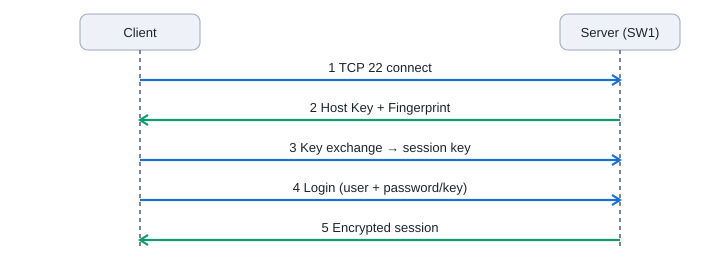

*شکل ۵: مراحل برقراری SSH؛ مرحله ۲ همان جایی است که «Host key changed» نشان می‌دهد.*

1.  **اتصال:** Client به پورت ۲۲ سرور وصل می‌شود.
2.  **هویت سرور:** سرور Host Key خود را نشان می‌دهد. Client اولین بار از شما می‌پرسد «اعتماد دارید؟» و اثرانگشت (Fingerprint) را ذخیره می‌کند. دفعه‌های بعد اگر عوض شد، هشدار می‌دهد (احتمال حمله‌ی Man-in-the-Middle).
3.  **کلید جلسه:** دو طرف با یک الگوریتم تبادل کلید (مثل Diffie-Hellman) یک کلید مشترک می‌سازند که هیچ‌کس در مسیر نمی‌داند.
4.  **احراز هویت کاربر:** رمز یا کلید عمومی.
5.  **ارتباط رمزشده** شروع می‌شود.

> **یادآوری از فصل ۱**
>
> هشدار «Host key changed» در برنامه‌ی SSH را قبلاً دیدید. آن‌جا هویت را با `ssh-keyscan` از یک مسیر مستقل تأیید کردیم. این دقیقاً همین مکانیزم است.

### ۳. پیکربندی SSH روی روتر/سوییچ (گام‌به‌گام)

``` text
R1(config)# hostname R1
R1(config)# ip domain-name lab.local
R1(config)# crypto key generate rsa modulus 2048
R1(config)# ip ssh version 2
R1(config)# username admin privilege 15 secret <PASSWORD>
R1(config)# line vty 0 4
R1(config-line)# login local
R1(config-line)# transport input ssh
R1(config-line)# exec-timeout 10 0
R1(config-line)# end
```

چرا هرکدام؟

- `hostname` و `ip domain-name`: بدون این دو، کلید RSA ساخته نمی‌شود (خطای رایج: «Please define a hostname other than Router»).
- `crypto key generate rsa modulus 2048`: ساخت جفت‌کلید. ۱۰۲۴ ضعیف است؛ حداقل ۲۰۴۸.
- `ip ssh version 2`: نسخه‌ی ۱ آسیب‌پذیر است.
- `username ... secret`: کاربر محلی با Hash. رمز واقعی را در Git نگذارید.
- `login local`: ورود با نام‌کاربری و رمز (نه فقط رمز Line).
- `transport input ssh`: Telnet را می‌بندد.

بررسی:

``` text
R1# show ip ssh
R1# show ssh
R1# show crypto key mypubkey rsa
```

در `show ip ssh` باید «SSH Enabled - version 2.0» ببینید.

### ۴. محدودکردن دسترسی (امنیت لایه‌ای)

فقط Subnet مدیریت (VLAN10) اجازه‌ی SSH داشته باشد:

``` text
R1(config)# ip access-list standard MGMT-ONLY
R1(config-std-nacl)# permit 10.10.10.0 0.0.0.255
R1(config-std-nacl)# deny any log
R1(config-std-nacl)# exit
R1(config)# line vty 0 4
R1(config-line)# access-class MGMT-ONLY in
R1(config-line)# end
```

`0.0.0.255` یک Wildcard Mask است؛ یعنی معکوسِ Subnet Mask. بیت 0 یعنی «باید مطابقت داشته باشد» و بیت 1 یعنی «مهم نیست».

``` text
Subnet mask   : 255.255.255.0
Wildcard mask : 0.0.0.255     (= 255.255.255.255 - 255.255.255.0)
```

`access-class` فقط ترافیک ورودی به VTY (دسترسی مدیریتی) را فیلتر می‌کند، نه ترافیک عبوری.

تنظیمات تکمیلی مفید: `ip ssh time-out 60` و `ip ssh authentication-retries 3`.

> **هشدار: قفل‌شدن از دستگاه**
>
> قبل از `access-class`، مطمئن شوید آدرس خودتان در ACL مجاز است؛ وگرنه خودتان بیرون می‌مانید. از `reload in 5` (درس قبل) به‌عنوان شبکه‌ی ایمنی استفاده کنید.

### ۵. مثال‌ها

**ساده**

از R1 به SW1 وصل شوید: `ssh -l admin 10.10.10.2`؛ اگر پرسید «Are you sure», بله.

**متوسط**

Telnet را غیرفعال کنید (`transport input ssh`) و ثابت کنید با `telnet 10.10.10.2` از R1 رد می‌شود (Connection refused).

**سخت**

ACL را طوری بنویسید که فقط ۲ آدرس مشخص (۱۰.۱۰.۱۰.۵۰ و ۱۰.۱۰.۱۰.۶۰) اجازه داشته باشند؛ و تست کنید از آدرس دیگر رد می‌شود. نکته: مبدأ تست را از Loopback روتر با `ssh -l admin -source-interface loopback0 ...` عوض کنید.

### ۶. تمرین‌ها

**ت1.** ۱. چرا Telnet ناامن است؟ *(پاسخ: 2-5-ت1 در بخش «پاسخ‌ها» انتهای فصل)*

**ت2.** ۲. چرا ip domain-name لازم است؟ *(پاسخ: 2-5-ت2 در بخش «پاسخ‌ها» انتهای فصل)*

**ت3.** ۳. Wildcard Mask برای 10.10.10.0/24؟ *(پاسخ: 2-5-ت3 در بخش «پاسخ‌ها» انتهای فصل)*

**ت4.** ۴. Wildcard Mask برای یک میزبان 10.10.10.50؟ *(پاسخ: 2-5-ت4 در بخش «پاسخ‌ها» انتهای فصل)*

**ت5.** ۵. Wildcard Mask برای 10.10.8.0/22؟ *(پاسخ: 2-5-ت5 در بخش «پاسخ‌ها» انتهای فصل)*

### ۷. Lab هدایت‌شده

#### گام ۱: SSH روی SW1

``` text
SW1(config)# ip domain-name lab.local
SW1(config)# crypto key generate rsa modulus 2048
SW1(config)# ip ssh version 2
SW1(config)# username admin privilege 15 secret <PASSWORD>
SW1(config)# line vty 0 4
SW1(config-line)# login local
SW1(config-line)# transport input ssh
SW1(config-line)# end
SW1# show ip ssh
```

#### گام ۲: اتصال از R1

``` text
R1# ssh -l admin 10.10.10.2
```

اگر خطای «no matching key exchange method» دیدید، Image قدیمی است؛ موقتاً در Lab با `ssh -o KexAlgorithms=...` (روی کلاینت) یا فعال‌کردن الگوریتم روی سرور حل می‌شود. در Lab مهم است بدانید چرا. در تولید، Image را به‌روز کنید.

#### گام ۳: بستن Telnet و تست

``` text
R1# telnet 10.10.10.2
```

باید رد شود (refused).

#### گام ۴: ACL مدیریت (با شبکه‌ی ایمنی)

``` text
SW1# reload in 5
SW1(config)# ip access-list standard MGMT-ONLY
SW1(config-std-nacl)# permit 10.10.10.0 0.0.0.255
SW1(config-std-nacl)# deny any log
SW1(config)# line vty 0 4
SW1(config-line)# access-class MGMT-ONLY in
(test SSH again; if OK:)
SW1# reload cancel
```

### ۸. Lab مستقل

برای هر ۳ دستگاه Lab یک «استاندارد مدیریت امن» بنویسید (`03-ops/secure-mgmt-standard.md`): SSH v2، RSA 2048، Telnet بسته، ACL مدیریت، Timeout. و روی هر دستگاه با یک چک‌لیست بسنجید.

### ۹. عیب‌یابی

|           |                                                                                                                                                                                                 |
|-----------|-------------------------------------------------------------------------------------------------------------------------------------------------------------------------------------------------|
| Symptom   | SSH وصل نمی‌شود                                                                                                                                                                                  |
| چک‌لیست    | ۱) `show ip ssh` فعال است؟ ؛ ۲) `transport input ssh` تنظیم است؟ ؛ ۳) نام‌کاربری وجود دارد؟ ؛ ۴) ACL مبدأ را بسته؟ ؛ ۵) مسیر و Gateway درست است؟ ؛ ۶) ping جواب می‌دهد؟ ؛ ۷) الگوریتم‌ها سازگارند؟ |
| Symptom 2 | کلید ساخته نمی‌شود                                                                                                                                                                               |
| رفع       | hostname و domain-name را بزنید.                                                                                                                                                                |

### ۱۰. سؤال‌های مرور

**م1.** Host Key برای چیست؟ *(پاسخ: 2-5-م1 در بخش «پاسخ‌ها» انتهای فصل)*

**م2.** access-class روی VTY چه فیلتر می‌کند؟ *(پاسخ: 2-5-م2 در بخش «پاسخ‌ها» انتهای فصل)*

### English Corner: انگلیسی تخصصی این درس

این جمله‌ها از مستندات و محیط کار واقعی‌اند. بلند بخوانید و ترجمه را بپوشانید.

| English sentence                                                                      | ترجمه                                                                      |
|---------------------------------------------------------------------------------------|----------------------------------------------------------------------------|
| Telnet sends credentials in clear text; SSH encrypts the whole session.               | Telnet اعتبارنامه‌ها را متن ساده می‌فرستد؛ SSH کل Session را رمزگذاری می‌کند. |
| Generate a 2048-bit RSA key pair before enabling SSH version 2.                       | قبل از فعال‌کردن SSH نسخه ۲، یک جفت‌کلید RSA ۲۰۴۸ بیتی بسازید.               |
| Restrict VTY access to the management subnet with an access class.                    | دسترسی VTY را با access-class به Subnet مدیریت محدود کنید.                 |
| The host key changed, so the client warned about a possible man-in-the-middle attack. | Host Key تغییر کرد، پس Client درباره‌ی احتمال حمله‌ی مرد میانی هشدار داد.    |

**Q1.** Quick quiz (answer in English): Why is Telnet considered insecure? *(پاسخ: 2-5-Q1 در بخش «پاسخ‌ها» انتهای فصل)*

### ۱۱. تکلیف و چک‌لیست تسلط

- [ ] SSH روی هر ۳ دستگاه فعال و تست شده.
- [ ] Telnet بسته شده و ثابت شده.
- [ ] ACL مدیریت با شبکه‌ی ایمنی تست شده.
- [ ] هیچ رمزی در Git نیست.

### ۱۲. یادآوری اشتباهات شما

> **یادآوری**
>
> قبل از تغییر راه دور، بکاپ و `reload in` بگذارید؛ خروجی را پیش‌بینی کنید؛ رمز در ریپو نریزید.


#### کارت Lab — درس ۲-۵

| # | فیلد | محتوا |
|---|---|---|
| 1 | عنوان و هدف | SSH امن و بستن Telnet |
| 2 | پیش‌نیاز | درس ۲-۴ |
| 3 | توپولوژی | R1 → SW1 (SSH) |
| 4 | تجهیزات | R1، SW1 |
| 5 | نسخه نرم‌افزار | vIOS-L2 15.2(20200924، Experimental) برای SW؛ vIOS 15.9(3)M9 برای R؛ VPCS (PNetLab)؛ PNetLab 4.2.8 |
| 6 | IP Plan | 10.10.10.1 و .2 |
| 7 | وضعیت اولیه | SSH فعال نیست |
| 8 | صورت مسئله | SSHv2، RSA 2048، Telnet بسته، ACL مدیریت با `reload in` |
| 9 | مراحل هدایت‌شده | همان بخش «Lab هدایت‌شده» همین درس (گام‌به‌گام) |
| 10 | تست عملکرد | `ssh -l admin 10.10.10.2` ؛ `telnet` رد شود |
| 11 | سناریوی خرابی | نبود `ip domain-name` یا ACL که خودتان را بیرون بگذارد |
| 12 | روش عیب‌یابی | `show ip ssh` ؛ `show running-config \| section line vty` |
| 13 | نتیجه‌ی مورد انتظار | SSH v2.0 فعال؛ Telnet refused |
| 14 | معیار پذیرش | Telnet واقعاً رد شود |
| 15 | مستندات نهایی | `03-ops/secure-mgmt-standard.md` (بدون رمز) |
| 16 | Cleanup و بازگردانی | برداشتن ACL تست؛ `reload cancel` |

> **وضعیت راستی‌آزمایی (خارج از ۱۶ فیلد):** **جزئی.** تولید کلید RSA و فعال‌شدن SSH دیده شده (`%SSH-5-ENABLED`)؛ ورود SSH، ACL مدیریت و رد Telnet اجرا نشده.

---

<a id="l-2-6"></a>

## درس ۲-۶ — Wireshark، ARP/ICMP و Gate G1

**فصل ۲ - روز ۶ · پیش‌نیاز: درس‌های ۲-۱ تا ۲-۵ · ۶ ساعت**

### این درس درباره چیست و چرا باید یاد بگیریم؟

**چه چیزی یاد می‌گیریم:** دیدن بسته‌ها روی سیم با Wireshark و فهمیدن ARP و ICMP. در پایان، آزمون عملی هفته (Gate G1) را می‌دهیم.

**چرا لازم است:** تا اینجا فقط «نتیجه» را دیدیم (ping موفق/ناموفق). Wireshark به شما «چشم» می‌دهد تا ببینید واقعاً چه اتفاقی افتاد. مثل پزشکی که به‌جای حدس‌زدن، عکس رادیولوژی می‌گیرد.

- **در کار روزانه:** وقتی «شبکه کند است» یا «اتصال قطع می‌شود»، فقط Capture می‌تواند ثابت کند مشکل از کجاست.
- **در امنیت:** تشخیص ARP Spoofing، اسکن پورت و ترافیک مشکوک.
- **در دوره:** از هفته‌های بعد، همه‌ی عیب‌یابی‌ها با Capture اثبات می‌شود.

> **مسیر درس**
>
> مفهوم فریم و بسته ← ARP ← ICMP ← گرفتن Capture ← فیلترها ← مثال ساده/متوسط/سخت ← Lab ← Gate G1.

#### اصطلاحات این درس (مخفف ← شکل کامل ← معنی)

| مخفف     | شکل کامل انگلیسی                  | معنی فارسی                            |
|----------|-----------------------------------|---------------------------------------|
| ARP      | Address Resolution Protocol       | تبدیل IP به MAC                       |
| ICMP     | Internet Control Message Protocol | پیام‌های کنترلی/تشخیصی مثل ping        |
| TTL      | Time To Live                      | عمر بسته؛ با هر روتر یک واحد کم می‌شود |
| MAC      | Media Access Control address      | آدرس فیزیکی کارت شبکه                 |
| BPF      | Berkeley Packet Filter            | سینتکس فیلتر هنگام Capture            |
| pcap     | Packet Capture                    | فایل ضبط بسته‌ها                       |
| MITM     | Man-In-The-Middle                 | حمله مرد میانی                        |
| Spoofing | Spoofing                          | جعل هویت (آدرس) در شبکه               |
| G1       | Gate 1                            | نقطه کنترل کیفیت پایان فصل ۲         |

### ۱. فریم، بسته و لایه‌ها (ساده)

مثل نامه‌ای که داخل پاکت و آن داخل یک بسته‌ی پستی است. داده را لایه‌به‌لایه می‌پیچند:

``` text
[ Ethernet: dst MAC | src MAC ]   Layer 2 (frame)
   [ IP: src IP | dst IP ]          Layer 3 (packet)
      [ ICMP or TCP/UDP ]           Layer 4 and above
         [ data ]
```

سوییچ با **MAC** تصمیم می‌گیرد (فریم)، روتر با **IP** (بسته). این تفاوت را همیشه به یاد داشته باشید.

### ۲. ARP: «این IP مال کیست؟»

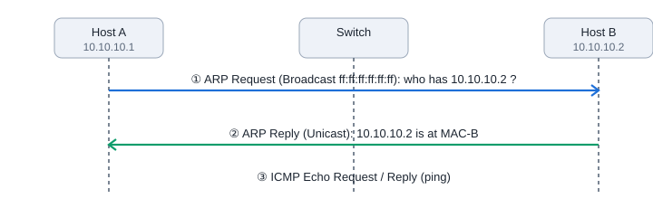

*شکل ۴: ping اول چرا کندتر است؟ چون اول ARP انجام می‌شود.*

Host فقط IP مقصد را می‌داند ولی فریم به MAC نیاز دارد. ARP این نگاشت را پیدا می‌کند:

1.  **ARP Request** (Broadcast به `ff:ff:ff:ff:ff:ff`): «چه کسی 10.10.10.2 را دارد؟ به 10.10.10.1 بگو.»
2.  همه‌ی دستگاه‌های VLAN دریافت می‌کنند؛ فقط صاحب IP جواب می‌دهد.
3.  **ARP Reply** (Unicast): «10.10.10.2 در MAC فلان است.»
4.  جواب در ARP Cache ذخیره می‌شود (چند دقیقه).

به همین دلیل اولین ping همیشه کندتر است یا گاهی یک بسته از دست می‌رود (`.!!!!`): اول باید ARP انجام شود.

مشاهده روی روتر: `show ip arp`

### ۳. ICMP: ابزار تشخیص

| Type | معنی                    | کجا می‌بینیم                              |
|------|-------------------------|------------------------------------------|
| 8    | Echo Request            | ping رفت                                 |
| 0    | Echo Reply              | ping برگشت                               |
| 3    | Destination Unreachable | مسیر/پورت وجود ندارد (`U` در ping سیسکو) |
| 11   | Time Exceeded           | TTL تمام شد (traceroute)                 |

**TTL:** هر روتر آن را ۱ کم می‌کند؛ اگر صفر شد بسته دور ریخته می‌شود تا در حلقه نماند. Windows معمولاً ۱۲۸ و لینوکس ۶۴ می‌فرستد؛ از روی TTL دریافتی می‌توان حدس زد بسته چند روتر رد شده.

### ۴. گرفتن Capture در PNetLab

- روی لینک بین دو دستگاه کلیک راست کنید (یا روی Interface) و **Capture** را بزنید؛ Wireshark روی سیستم شما باز می‌شود (PNetLab از مسیر وب و پروتکل مخصوص این کار را می‌کند).
- جایگزین روی خود IOS (در حالت EXEC، نه Config):

``` text
R1# monitor capture CAP1 interface gi0/0 both
R1# monitor capture CAP1 match any
R1# monitor capture CAP1 start
... ping ...
R1# monitor capture CAP1 stop
R1# show monitor capture CAP1 buffer brief
```

اگر دستور روی Image شما فقط «پذیرفته می‌شود ولی بسته‌ای نمی‌گیرد» (در Probe فصل ۱ دیدیم)، از Capture لینک PNetLab استفاده کنید. باز هم: پذیرفته‌شدن ≠ کارکردن.

### ۵. فیلترهای Wireshark (مهم‌ترین مهارت)

| فیلتر                           | معنی                     |
|---------------------------------|--------------------------|
| `arp`                           | فقط ARP                  |
| `icmp`                          | فقط ping                 |
| `ip.addr == 10.10.10.2`         | هر بسته‌ی مربوط به این IP |
| `eth.addr == aa:bb:cc:00:01:00` | بر اساس MAC              |
| `icmp.type == 8`                | فقط Echo Request         |
| `arp or icmp`                   | ترکیب با or/and          |
| `!arp`                          | همه به‌جز ARP             |

> **دو نوع فیلتر**
>
> **Capture Filter** (قبل از شروع، سبک‌تر، سینتکس BPF مثل `host 10.10.10.2`) و **Display Filter** (بعد از گرفتن، قدرتمندتر؛ جدول بالا).

### ۶. مثال‌ها

**ساده: ping اول**

Capture را شروع کنید، `clear arp` بزنید، `ping 10.10.10.2`. با فیلتر `arp or icmp` ببینید: اول ARP Request (Broadcast) و ARP Reply، بعد ۵ جفت Echo Request/Reply.

**متوسط: ping بیرون از Subnet**

از R1 به آدرسی در Subnet دیگر بزنید و ببینید MAC مقصد فریم، MAC Gateway است، نه MAC مقصد نهایی (ولی IP مقصد همان مقصد نهایی است). این مهم‌ترین نکته‌ی روتینگ است.

**سخت: عیب‌یابی با Capture**

Mask یک طرف را عمداً اشتباه کنید (درس ۲-۱) و Capture بگیرید: خواهید دید ARP Requestهای بدون جواب یا Echo Requestهای بدون Reply. یعنی مشکل در لایه ۲/۳ همان‌جاست و نه در برنامه.

### ۷. تمرین‌ها

**ت1.** ۱. ARP Request به چه MAC مقصدی فرستاده می‌شود؟ *(پاسخ: 2-6-ت1 در بخش «پاسخ‌ها» انتهای فصل)*

**ت2.** ۲. چرا اولین ping گاهی یک بسته از دست می‌دهد؟ *(پاسخ: 2-6-ت2 در بخش «پاسخ‌ها» انتهای فصل)*

**ت3.** ۳. در ping به مقصد بیرون از Subnet، MAC مقصد چیست؟ *(پاسخ: 2-6-ت3 در بخش «پاسخ‌ها» انتهای فصل)*

**ت4.** ۴. فیلتر برای دیدن فقط ping از 10.10.10.1؟ *(پاسخ: 2-6-ت4 در بخش «پاسخ‌ها» انتهای فصل)*

**ت5.** ۵. TTL=127 در جواب یعنی چه؟ *(پاسخ: 2-6-ت5 در بخش «پاسخ‌ها» انتهای فصل)*

### ۸. Lab هدایت‌شده

1.  در PNetLab روی لینک R1-SW1 Capture شروع کنید.
2.  روی R1: `clear arp` سپس `ping 10.10.10.2`.
3.  فیلتر `arp or icmp`: فریم‌ها را مشخص کنید و MAC/IPها را در جدولی یادداشت کنید.
4.  زمان بین ARP Request و Reply را بخوانید.
5.  Capture را به نام `pcap/ping-first.pcapng` ذخیره کنید (فایل را در Git نگذارید؛ ممکن است اطلاعات داشته باشد، فقط جدول خلاصه را بنویسید).

### ۹. Lab مستقل

یک سناریو: Gateway اشتباه روی یک Host (مثلاً `10.10.10.254` به‌جای `.1`). Capture بگیرید و در گزارش یک‌صفحه‌ای (`03-ops/ts14-gateway-wrong.md`) بنویسید: علامت چیست، چه بسته‌ای دیدید، چطور رفع کردید.

### ۱۰. Gate G1: آزمون عملی پایان فصل ۲

موارد زیر را بدون نگاه به درس انجام دهید و برای هر مورد یک «مدرک» (خروجی دستور) داشته باشید:

| \#  | وظیفه                                              | مدرک                                      |
|-----|----------------------------------------------------|-------------------------------------------|
| ۱   | Subnet کردن: ۴ مثال تصادفی (شبکه/Broadcast/Hostها) | جدول جواب‌ها                               |
| ۲   | VLSM برای ۴ بخش و ثبت در IP Plan                   | `02-design/ip-plan.md`                    |
| ۳   | IPv6: Prefix به VLANها، ping و جدول همسایه         | `show ipv6 neighbors`                     |
| ۴   | تنظیمات پایه + بکاپ + Rollback موفق                | خروجی `dir flash:` و ping بعد از Rollback |
| ۵   | SSH v2، Telnet بسته، ACL مدیریت                    | `show ip ssh` و تست رد Telnet             |
| ۶   | Capture ARP+ICMP و توضیح هر فریم                   | جدول MAC/IP                               |
| ۷   | رفع یک خرابی (Mask یا Gateway) با Capture          | گزارش یک‌صفحه‌ای                            |

**معیار قبولی:** حداقل ۶ از ۷ مورد با مدرک. هر مورد ناقص، بازبینی می‌شود و در «مرور اشتباهات» ثبت می‌گردد. وقتی تمام شد بگویید «G1 انجام شد» تا بررسی کنیم و فصل ۳ را شروع کنیم.

### ۱۱. سؤال‌های مرور

**م1.** تفاوت تصمیم سوییچ و روتر؟ *(پاسخ: 2-6-م1 در بخش «پاسخ‌ها» انتهای فصل)*

**م2.** ARP چرا Broadcast است؟ *(پاسخ: 2-6-م2 در بخش «پاسخ‌ها» انتهای فصل)*

**م3.** Echo Request و Reply چه Typeهایی هستند؟ *(پاسخ: 2-6-م3 در بخش «پاسخ‌ها» انتهای فصل)*

### English Corner: انگلیسی تخصصی این درس

این جمله‌ها از مستندات و محیط کار واقعی‌اند. بلند بخوانید و ترجمه را بپوشانید.

| English sentence                                                                     | ترجمه                                                                |
|--------------------------------------------------------------------------------------|----------------------------------------------------------------------|
| The first ping is slower because the host must resolve the MAC address with ARP.     | اولین ping کندتر است چون Host باید MAC را با ARP پیدا کند.           |
| Apply a display filter to isolate ICMP echo requests.                                | یک Display Filter بزنید تا فقط Echo Requestهای ICMP را جدا کنید.     |
| The destination MAC is the gateway's, while the destination IP stays the final host. | MAC مقصد، مال Gateway است در حالی که IP مقصد همان Host نهایی می‌ماند. |
| A packet is dropped when its TTL reaches zero.                                       | وقتی TTL به صفر برسد بسته دور ریخته می‌شود.                           |

**Q1.** Quick quiz (answer in English): Which Ethernet destination address does an ARP request use? *(پاسخ: 2-6-Q1 در بخش «پاسخ‌ها» انتهای فصل)*

### ۱۲. تکلیف و چک‌لیست تسلط

- [ ] Capture ping را انجام و توضیح دهم.
- [ ] ۵ فیلتر Wireshark را بدون نگاه بنویسم.
- [ ] Gate G1 را کامل کنم.

### ۱۳. یادآوری اشتباهات شما

> **یادآوری**
>
> دستور `monitor capture` در EXEC است؛ پذیرفته‌شدن دستور ≠ کار کردن آن؛ و فایل Capture را در Git نگذارید.


#### کارت Lab — درس ۲-۶ (Gate G1)

| # | فیلد | محتوا |
|---|---|---|
| 1 | عنوان و هدف | مشاهده‌ی ARP و ICMP با Wireshark و آزمون G1 |
| 2 | پیش‌نیاز | درس‌های ۲-۱ تا ۲-۵ |
| 3 | توپولوژی | Capture روی لینک R1-SW1 |
| 4 | تجهیزات | R1، SW1، Wireshark |
| 5 | نسخه نرم‌افزار | vIOS-L2 15.2(20200924، Experimental) برای SW؛ vIOS 15.9(3)M9 برای R؛ VPCS (PNetLab)؛ PNetLab 4.2.8 |
| 6 | IP Plan | 10.10.10.0/24 |
| 7 | وضعیت اولیه | ARP Cache خالی (`clear arp`) |
| 8 | صورت مسئله | ARP و ICMP را ببینید و MAC/IP هر فریم را جدول کنید؛ G1 را کامل کنید |
| 9 | مراحل هدایت‌شده | همان بخش «Lab هدایت‌شده» همین درس (گام‌به‌گام) |
| 10 | تست عملکرد | فیلتر `arp or icmp` |
| 11 | سناریوی خرابی | Gateway اشتباه روی یک Host |
| 12 | روش عیب‌یابی | Capture: ARP بدون پاسخ/ Echo بدون Reply |
| 13 | نتیجه‌ی مورد انتظار | ARP Request Broadcast و Reply Unicast؛ Echo Request/Reply |
| 14 | معیار پذیرش | جدول MAC/IP؛ G1 ≥ ۶ از ۷ |
| 15 | مستندات نهایی | جدول Capture؛ گزارش `03-ops/ts14-gateway-wrong.md` (فایل pcap در Git نباشد) |
| 16 | Cleanup و بازگردانی | `clear arp`؛ حذف فایل‌های Capture |

> **وضعیت راستی‌آزمایی (خارج از ۱۶ فیلد):** **اجرا نشده (فقط طراحی).** اجرا نشده؛ `monitor capture` فقط CLI-Accepted؛ Capture از PNetLab آزمایش نشده.

---

<a id="ans-2"></a>

## پاسخ‌های فصل 2

> ابتدا بدون نگاه حل کنید. هر پاسخ با شناسه‌ی «درس-نوع+شماره» مشخص است (ت = تمرین، م = سؤال مرور، Q = Quick quiz انگلیسی).

**2-1-م1** — سؤال ۱: Mask = 255.255.255.224؛ تعداد کل آدرس؟

``` text
Block size = 256 - 224 = 32
n = 0
Total = 32
```

**2-1-م2** — سؤال ۲: Mask = 255.255.248.0؛ تعداد کل آدرس؟

``` text
Block size = 256 - 248 = 8
n = 1
Total = 8 x 256 = 2048
```

**2-1-م3** — سؤال ۳: Mask = 255.240.0.0؛ تعداد کل آدرس؟

``` text
Block size = 256 - 240 = 16
n = 2
Total = 16 x 256 x 256 = 1048576
```

**2-1-م4** — سؤال ۴ (بررسی با روش توان ۲): آیا جواب سؤال ۳ با 2 به توان بیت‌های میزبان می‌خواند؟

``` text
Mask 255.240.0.0 = /12
Host bits = 32 - 12 = 20
Total = 2 ^ 20 = 1048576   (same answer)
```

**2-1-ت1** — ۱ (ساده): 192.168.5.130/24

``` text
Network   = 192.168.5.0
Broadcast = 192.168.5.255
Hosts     = 254
```

**2-1-ت2** — ۲: 10.0.0.9/30

``` text
Block size = 256 - 252 = 4
9 is between 8 and 11
Network   = 10.0.0.8
Broadcast = 10.0.0.11
Hosts     = 10.0.0.9 - 10.0.0.10   (router-to-router link)
```

**2-1-ت3** — ۳: 192.168.1.100/27

``` text
Block size = 256 - 224 = 32
100 is between 96 and 127
Network   = 192.168.1.96
Broadcast = 192.168.1.127
Hosts     = 192.168.1.97 - 192.168.1.126  (30 hosts)
```

**2-1-ت4** — ۴: 192.168.0.200/25

``` text
Block size = 256 - 128 = 128
200 is in block 128..255
Network   = 192.168.0.128
Broadcast = 192.168.0.255
Hosts     = 126
```

**2-1-ت5** — ۵: به ۸ Host نیاز دارم؛ Prefix؟

``` text
Need   = 8 + 2 = 10
2^4 = 16 >= 10   (2^3 = 8 is not enough)
Prefix = 32 - 4 = /28   (14 usable hosts)
```

**2-1-ت6** — ۶ (سخت): 172.31.14.9/22

``` text
Mask       = 255.255.252.0
Block size = 256 - 252 = 4   (3rd octet)
14 is between 12 and 15
Network    = 172.31.12.0
Broadcast  = 172.31.15.255
Host count = 2^10 - 2 = 1022
```

**2-1-ت7** — ۷ (سخت): 10.1.200.15/19

``` text
Mask       = 255.255.224.0
Block size = 256 - 224 = 32   (3rd octet)
200 is in block 192..223
Network    = 10.1.192.0
Broadcast  = 10.1.223.255
Host count = 2^13 - 2 = 8190
```

**2-1-ت8** — ۸: آیا 10.10.20.77/26 و 10.10.20.130/26 هم‌شبکه‌اند؟

``` text
10.10.20.77  -> network 10.10.20.64   (64..127)
10.10.20.130 -> network 10.10.20.128  (128..191)
Different networks -> traffic must pass through a router
```

**2-1-م5** — آدرس شبکه و Broadcast با چه فرمولی پیدا می‌شود؟

برای پیدا کردن آدرس شبکه، آدرس IP را با Mask به‌صورت AND بیتی ترکیب کنید؛ یا ساده‌تر در octet جالب، آدرس را به پایین‌ترین مضرب Block size گرد کنید. Broadcast آدرس شبکه‌ی بعدی منهای یک است. مثال: 192.168.1.100/27 با بلوک ۳۲: شبکه 192.168.1.96، Broadcast 192.168.1.127.

``` text
Network = IP AND Mask ; Broadcast = next network - 1
100 / 32 = 3 -> 3 x 32 = 96 ; 96 + 32 - 1 = 127
```

شبکه: آدرس AND Mask (یا گرد به پایین به مضرب بلوک). Broadcast: شبکه بعدی منهای ۱.

**2-1-م6** — چرا Host قابل‌استفاده = آدرس‌ها منهای ۲ است؟

از هر Subnet دو آدرس برای Host قابل‌استفاده نیست: اولین (آدرس شبکه، همه‌ی بیت‌های میزبان صفر) و آخرین (Broadcast، همه‌ی بیت‌های میزبان یک). پس Host قابل‌استفاده برابر ۲ به توان بیت‌های میزبان منهای ۲ است؛ برای /30 فقط ۲ Host (لینک روتر-روتر).

``` text
Usable hosts = 2^h - 2
/30 : 2^2 - 2 = 2
```

یکی آدرس شبکه و یکی Broadcast است و به Host داده نمی‌شود.

**2-1-م7** — /26 چند Host دارد و بلوکش چند است؟

/26 یعنی ۶ بیت میزبان؛ کل ۶۴ آدرس و Host قابل‌استفاده ۶۲. Block size در octet چهارم 256−192=64 است و شبکه‌ها 0، 64، 128 و 192 هستند.

``` text
Host bits = 32 - 26 = 6 ; 2^6 = 64 ; usable = 62
```

62 Host؛ بلوک 64.

**2-1-م8** — Client با 169.254.x.x یعنی چه؟

آدرس 169.254.x.x یعنی APIPA/Link-Local: کلاینت DHCP Server پیدا نکرده و خودش آدرس ساخته است. این آدرس فقط روی همان لینک کار می‌کند و Gateway ندارد. بررسی: کابل/VLAN، DHCP Server یا Relay، Snooping (فصل ۴)، و `ipconfig /renew`.

DHCP جواب نداده؛ Client خودش آدرس Link-Local ساخته.

**2-1-م9** — دو Host در یک Subnet با چه روشی هم‌شبکه بودنشان را تشخیص می‌دهند؟

Host مقصد را با Mask خودش AND می‌کند و نتیجه را با آدرس شبکه‌ی خودش مقایسه می‌کند: اگر برابر بود Direct (ARP برای مقصد)، وگرنه بسته را به Default Gateway می‌فرستد. اشتباه Mask باعث می‌شود Host تصور کند مقصد هم‌شبکه است و ARP بفرستد که جواب نمی‌گیرد.

آدرس مقصد را با Mask خود AND می‌کنند و با شبکه خودشان مقایسه می‌کنند.

**2-1-Q1** — Quick quiz (answer in English): How many usable hosts are in a /27 subnet?

پاسخ انگلیسی در پایین آمده است؛ محاسبه: /27 یعنی ۵ بیت میزبان، ۳۲ آدرس و ۳۰ Host قابل‌استفاده.

``` text
2^5 - 2 = 30
```

30 (2^5 - 2).

**2-2-ت1** — ۱ (ساده): از 192.168.1.0/24 دو Subnet بساز: ۱۲۰ Host و ۱۰ Host

``` text
120 + 2 = 122 -> 128 -> /25
  192.168.1.0/25     hosts .1 - .126
10 + 2 = 12 -> 16 -> /28
  192.168.1.128/28   hosts .129 - .142
```

**2-2-ت2** — ۲ (ساده): لینک بین دو روتر از 10.1.1.0/24

``` text
Prefix    = /30
Network   = 10.1.1.0/30
Hosts     = 10.1.1.1 - 10.1.1.2
Broadcast = 10.1.1.3
```

**2-2-ت3** — ۳ (متوسط): از 172.16.0.0/24: ۶۰، ۳۰، ۱۰ Host

``` text
60 + 2 = 62 -> 64 -> /26
  172.16.0.0/26    hosts .1 - .62
30 + 2 = 32 -> /27
  172.16.0.64/27   hosts .65 - .94
10 + 2 = 12 -> 16 -> /28
  172.16.0.96/28   hosts .97 - .110
```

**2-2-ت4** — ۴ (متوسط): چرا نباید اول Subnet کوچک را بگذاریم؟

بلوک بزرگ باید روی مرز مضرب اندازه‌ی خودش شروع شود (مثلاً /26 روی 0، 64، 128، 192). اگر اول Subnet کوچک بگذارید، آدرس‌های ابتدایی مصرف می‌شود و بلوک بزرگ نمی‌تواند روی مرز درست بنشیند؛ «سوراخ» می‌ماند و آدرس هدر می‌رود. از این رو الگوریتم VLSM: مرتب‌سازی نزولی، اختصاص متوالی.

Subnet بزرگ باید روی مرز مضرب اندازه‌ی خودش شروع شود. اگر کوچک‌ها اول بیایند، «سوراخ‌هایی» می‌ماند که بزرگ‌ترها در آن جا نمی‌شوند.

**2-2-ت5** — ۵ (سخت): از 10.5.0.0/23: ۲۰۰ Host، ۷۰ Host، ۳۰ Host، دو لینک

``` text
200 + 2 = 202 -> 256 -> /24
  10.5.0.0/24
70 + 2 = 72 -> 128 -> /25
  10.5.1.0/25      hosts .1 - .126
30 + 2 = 32 -> /27
  10.5.1.128/27
Link 1 -> 10.5.1.160/30
Link 2 -> 10.5.1.164/30
Next free = 10.5.1.168
```

**2-2-ت6** — ۶ (سخت): آیا 192.168.1.64/26 و 192.168.1.100/27 هم‌پوشانی دارند؟

محدوده‌ی 192.168.1.64/26 از .64 تا .127 است و 192.168.1.100/27 در بلوک 96..127 قرار دارد؛ بازه‌ی دوم کاملاً داخل اولی است ⇒ هم‌پوشانی (Overlap). هم‌پوشانی باعث Routing اشتباه و ناپایداری می‌شود. رفع: Subnet دوم را در بازه‌ی غیرمتداخل (مثلاً 192.168.1.128/27) بگذارید و در IP Plan ثبت کنید.

``` text
192.168.1.64/26   covers .64  - .127
192.168.1.100/27  covers .96  - .127   (network .96)
The second range is inside the first -> OVERLAP (design error)
```

**2-2-م1** — VLSM چیست و چرا به آن نیاز داریم؟

VLSM (Variable Length Subnet Mask) یعنی تقسیم یک بلوک آدرس به Subnetهایی با اندازه‌های مختلف بر اساس نیاز واقعی. بدون آن همه‌ی Subnetها هم‌اندازه می‌شوند و برای لینک دو‌روتره /24 هدر می‌رود. VLSM آدرس را صرفه‌جویی می‌کند و برای Summary باید با دقت چیده شود.

تقسیم بلوک به Subnetهایی با اندازه‌های مختلف، تا هدررفت آدرس نداشته باشیم.

**2-2-م2** — چرا از بزرگ‌ترین نیاز شروع می‌کنیم؟

شروع از بزرگ‌ترین نیاز باعث می‌شود هر Subnet روی مرز درست بیفتد و «سوراخ» ایجاد نشود؛ سپس Subnetهای کوچک‌تر در ادامه می‌آیند و فضای باقی‌مانده پیوسته می‌ماند. این ترتیب باعث ساده‌تر شدن Summary و طراحی ثابت می‌شود.

برای اینکه هر Subnet روی مرز درست بیفتد و سوراخ ایجاد نشود.

**2-2-م3** — بهترین Prefix برای لینک بین دو روتر چیست؟

بهترین Prefix لینک بین دو روتر /30 است: ۴ آدرس، ۲ Host قابل‌استفاده. در لینک‌های Point-to-point ویژه /31 (RFC 3021) هم قابل‌استفاده است و یک آدرس صرفه‌جویی می‌کند؛ ولی همه‌ی تجهیزات از آن پشتیبانی نمی‌کنند (`Unverified`). در IPv6 معمولاً /127 یا /64 به‌کار می‌رود.

/30 (دو Host). (در IPv6 یا لینک‌های ویژه /31 هم استفاده می‌شود.)

**2-2-Q1** — Quick quiz (answer in English): Why do we sort requirements from largest to smallest in VLSM?

پاسخ انگلیسی در پایین آمده است؛ این ترتیب یک قاعده‌ی عملی بدون استثنا نیست ولی ساده‌ترین راه جلوگیری از هم‌پوشانی و سوراخ است.

So each block aligns on its boundary and no gaps or overlaps appear.

**2-3-ت1** — ۱. (ساده) کوتاه کن: 2001:0db8:0000:0000:0000:0000:0000:0001

قاعده‌ی کوتاه‌سازی IPv6: صفرهای ابتدای هر گروه حذف و بزرگ‌ترین دنباله‌ی گروه‌های صفر با «::» (فقط یک بار) جایگزین می‌شود. 2001:0db8:0000:0000:0000:0000:0000:0001 ← گروه‌های ۳ تا ۷ همه صفرند، پس 2001:db8::1.

`2001:db8::1`

**2-3-ت2** — ۲. (ساده) این چه نوع آدرسی است: fe80::1 ؟ fd12:3456::5 ؟ ff02::1 ؟ 2001:db8::5 ؟

fe80::/10 Link-Local (فقط روی همان لینک)، fd00::/8 (fc00::/7) ULA مشابه RFC1918 آدرس خصوصی IPv6، ff00::/8 Multicast (ff02::1 همه‌ی گره‌های لینک)، و 2001:db8::/32 بلوک مستندات است (در عمل Global Unicast). شناخت پیشوندها برای عیب‌یابی و Policy ضروری است.

Link-Local؛ ULA؛ Multicast (همه‌ی گره‌ها)؛ مستندات/Global.

**2-3-ت3** — ۳. (متوسط) باز کن: 2001:db8:0:1::5

برای باز کردن، :: را با گروه‌های صفر کامل کنید تا ۸ گروه ۴ رقمی شود: 2001:db8:0:1::5 ← 2001:0db8:0000:0001:0000:0000:0000:0005. هر گروه ۱۶ بیت و کل ۱۲۸ بیت است.

`2001:0db8:0000:0001:0000:0000:0000:0005`

**2-3-ت4** — ۴. (متوسط) آیا 2001:db8::1 و 2001:db8:0:0:1::1 در یک /64 هستند؟

دو آدرس را باز کنید و ۶۴ بیت اول (چهار گروه) را مقایسه کنید. A: 2001:0db8:0000:0000 و B: 2001:0db8:0000:0000 هر دو برابرند؛ پس هر دو در 2001:db8::/64 هستند. تفاوت در گروه پنجم (Interface ID) است که بخش میزبان است نه Subnet.

``` text
A = 2001:0db8:0000:0000:0000:0000:0000:0001
B = 2001:0db8:0000:0000:0001:0000:0000:0001
First 64 bits of A = 2001:0db8:0000:0000
First 64 bits of B = 2001:0db8:0000:0000
Equal -> same /64
```

**2-3-ت5** — ۵. (سخت) چرا نمی‌توان 2001::1::2 نوشت؟

«::» فقط یک بار مجاز است چون اگر دو بار بیاید تعداد گروه‌های صفر هر کدام معلوم نیست و ابهام ایجاد می‌شود (2001::1::2 می‌تواند چند آدرس مختلف باشد). پس آدرس نامعتبر است.

دو بار :: ابهام می‌سازد؛ نمی‌دانیم هر کدام چند گروه صفر هستند.

**2-3-ت6** — ۶. (سخت) از 2001:db8:abcd::/48 برای ۴ VLAN (۱۰، ۲۰، ۳۰، ۹۹) Prefix بساز.

از /48 چهار VLAN با /64 می‌سازید: گروه چهارم (Subnet ID) را VLAN قرار می‌دهید. نتیجه: 2001:db8:abcd:10::/64، 2001:db8:abcd:20::/64، 2001:db8:abcd:30::/64، 2001:db8:abcd:99::/64. استاندارد: هر VLAN یک /64 برای SLAAC.

2001:db8:abcd:10::/64، 2001:db8:abcd:20::/64، 2001:db8:abcd:30::/64، 2001:db8:abcd:99::/64.

**2-3-م1** — چرا IPv6 Broadcast ندارد؟

IPv6 Broadcast ندارد و با Multicast جایگزین شده است تا فقط دستگاه‌های مرتبط (مثلاً ff02::1 همه‌ی گره‌ها، ff02::2 روترها) بسته را پردازش کنند؛ بار روی Hostهای بی‌ارتباط کم می‌شود.

با Multicast جایگزین شده تا فقط دستگاه‌های مربوطه پردازش کنند.

**2-3-م2** — NS/NA معادل چه چیزی در IPv4 است؟

NS/NA (Neighbor Solicitation/Advertisement) معادل ARP Request/Reply در IPv4 است و با Multicast Solicited-node ارسال می‌شود؛ بخشی از NDP است.

ARP Request/Reply.

**2-3-م3** — چرا ICMPv6 را نباید بست؟

ICMPv6 را نباید بست چون NDP (NS/NA)، SLAAC (RS/RA) و PMTUD به آن وابسته‌اند؛ بستن آن IPv6 را از کار می‌اندازد. فقط انواع غیرضروری از بیرون فیلتر می‌شوند (RFC 4890).

NDP و SLAAC به آن وابسته‌اند.

**2-3-م4** — /64 برای یک VLAN یعنی چه؟

/64 برای یک VLAN یعنی ۶۴ بیت شبکه و ۶۴ بیت Interface ID؛ SLAAC و بسیاری از ویژگی‌های IPv6 به /64 وابسته‌اند. تقسیم به Subnet کوچک‌تر (مثل /120) فقط در موارد خاص (Loopback/لینک Point-to-point) و با آگاهی.

۶۴ بیت شبکه و ۶۴ بیت دستگاه؛ استاندارد SLAAC.

**2-3-Q1** — Quick quiz (answer in English): Which IPv6 messages replace ARP?

پاسخ انگلیسی در پایین آمده است. NS/NA با Multicast کار می‌کند، نه Broadcast.

Neighbor Solicitation and Neighbor Advertisement (NDP).

**2-4-ت1** — ۱. Prompt زیر در کدام حالت است؟ R1(config-if)#

Prompt «R1(config-if)#» یعنی Interface Configuration Mode که زیرمجموعه‌ی Global Configuration است. هر مد پیشوند خودش را دارد: User EXEC `>`، Privileged EXEC `#`، Global `(config)#`، Interface `(config-if)#`، Line `(config-line)#`.

Interface Config (زیرمجموعه‌ی Global Config).

**2-4-ت2** — ۲. تفاوت running و startup چیست؟

running-config در RAM است و فعال؛ با Reload از بین می‌رود. startup-config در NVRAM ذخیره می‌شود و هنگام بوت بارگذاری می‌شود. بنابراین پس از تغییر باید `copy running-config startup-config` (یا `write memory`) اجرا شود وگرنه تغییرات پس از Reload پاک می‌شود.

running در RAM و فعال؛ startup در NVRAM و برای بوت بعدی.

**2-4-ت3** — ۳. چطور در Config دستور show ip route را اجرا کنیم؟

داخل Config Mode برای اجرای دستور EXEC از `do` استفاده می‌شود: `do show ip route`. بدون آن باید با `end` به Privileged EXEC برگردید.

`do show ip route`

**2-4-ت4** — ۴. چرا enable secret بهتر از enable password است؟

`enable secret` رمز را با Hash قوی (Type 5/8/9) ذخیره می‌کند؛ `enable password` متن ساده یا Type 7 (قابل‌برگشت) است. در Config هرگز نباید رمز قابل‌خواندن باشد؛ `service password-encryption` فقط Type 7 می‌دهد و امنیت واقعی نیست.

secret با Hash قوی ذخیره می‌شود؛ password متن ساده یا Type 7 (ضعیف و قابل برگشت) است.

**2-4-ت5** — ۵. فایده‌ی reload in چیست؟

`reload in 5` دستگاه را پس از ۵ دقیقه Reload می‌کند؛ اگر تغییری باعث قطع شد، دستگاه با startup-config قبلی بالا می‌آید. پس از تأیید تغییر، `reload cancel` و ذخیره‌ی Config. شبکه‌ی ایمنی هنگام Config از راه دور.

اگر تغییر باعث قطع شد، دستگاه خودش به تنظیمات ذخیره‌شده‌ی قبلی بر می‌گردد.

**2-4-م1** — سه حالت اصلی CLI؟

سه حالت اصلی CLI: User EXEC (دستورهای محدود)، Privileged EXEC (دسترسی کامل show/debug) و Configuration (تغییر Config) با زیرحالت‌های Interface، Line، Router. ورود با `enable` و `configure terminal`.

User EXEC، Privileged EXEC، Config (و زیرحالت‌ها).

**2-4-م2** — چرا بکاپ قبل از تغییر؟

Backup قبل از تغییر نقطه‌ی بازگشت سریع است؛ در خرابی می‌توانید Config را بازگردانید و علت را بعداً بررسی کنید. ساده‌ترین روش: `copy running-config tftp:` یا ذخیره‌ی فایل در Git.

برای بازگشت سریع در صورت خرابی.

**2-4-Q1** — Quick quiz (answer in English): What is the difference between running-config and startup-config?

پاسخ انگلیسی در پایین آمده است؛ جمع‌بندی: تغییر روی running اعمال می‌شود و تا زمانی که ذخیره نشود پس از Reload از دست می‌رود.

Running-config is active in RAM; startup-config is saved in NVRAM and loaded at boot.

**2-5-ت1** — ۱. چرا Telnet ناامن است؟

Telnet نام کاربری، رمز و دستورها را به‌صورت متن ساده می‌فرستد؛ هر کس در مسیر (Capture) می‌تواند آن‌ها را بخواند. SSH ارتباط را رمز می‌کند و هویت سرور را با Host Key تأیید می‌کند. پس Telnet فقط در Lab ایزوله.

رمز و دستورها را بدون رمزگذاری می‌فرستد.

**2-5-ت2** — ۲. چرا ip domain-name لازم است؟

برای ساختن کلید RSA، IOS نام کامل دستگاه (hostname + domain = FQDN) را لازم دارد. دستور `ip domain-name lab.local` سپس `crypto key generate rsa modulus 2048`. بدون domain-name خطای «Please define a domain-name first».

برای ساخت کلید RSA، نام کامل (FQDN) لازم است.

**2-5-ت3** — ۳. Wildcard Mask برای 10.10.10.0/24؟

Wildcard Mask معکوس Subnet Mask است. برای 10.10.10.0/24 برابر 0.0.0.255 است (۲۵۵ منهای Mask).

``` text
255.255.255.255 - 255.255.255.0 = 0.0.0.255
```

`0.0.0.255`

**2-5-ت4** — ۴. Wildcard Mask برای یک میزبان 10.10.10.50؟

برای یک Host: Wildcard 0.0.0.0 یعنی همه‌ی بیت‌ها باید مطابق باشد، یا کوتاه‌تر `host 10.10.10.50`.

`0.0.0.0` یا ساده‌تر `host 10.10.10.50`.

**2-5-ت5** — ۵. Wildcard Mask برای 10.10.8.0/22؟

برای /22 (Mask 255.255.252.0): Wildcard برابر 0.0.3.255 است؛ یعنی ۴ شبکه‌ی /24 (octet سوم 8 تا 11).

``` text
255.255.255.255 - 255.255.252.0 = 0.0.3.255
```

`0.0.3.255`

**2-5-م1** — Host Key برای چیست؟

Host Key هویت سرور SSH را اثبات می‌کند؛ کلاینت در اولین اتصال آن را ذخیره می‌کند و اگر تغییر کند هشدار می‌دهد. این از حمله‌ی Man-in-the-Middle جلوگیری می‌کند.

اثبات هویت سرور و جلوگیری از حمله‌ی Man-in-the-Middle.

**2-5-م2** — access-class روی VTY چه فیلتر می‌کند؟

`access-class` روی VTY فقط اتصال‌های مدیریتی ورودی به دستگاه را فیلتر می‌کند (چه آدرسی مجاز به SSH باشد)؛ نه ترافیک عبوری. معمولاً فقط Subnet مدیریت را مجاز می‌کنند.

فقط ارتباط‌های مدیریتی ورودی به دستگاه را.

**2-5-Q1** — Quick quiz (answer in English): Why is Telnet considered insecure?

پاسخ انگلیسی در پایین آمده است. جایگزین: SSH v2 با کلید ۲۰۴۸ بیتی و ACL مدیریت.

It transmits usernames and passwords unencrypted, so anyone on the path can read them.

**2-6-ت1** — ۱. ARP Request به چه MAC مقصدی فرستاده می‌شود؟

ARP Request برای کشف MAC مقصد به Broadcast (ff:ff:ff:ff:ff:ff) فرستاده می‌شود چون MAC مقصد نامعلوم است؛ پاسخ Unicast است. ARP در IPv4 فقط داخل همان Subnet کار می‌کند.

Broadcast: ff:ff:ff:ff:ff:ff

**2-6-ت2** — ۲. چرا اولین ping گاهی یک بسته از دست می‌دهد؟

اولین ping ممکن است یک بسته از دست بدهد چون ARP حل نشده است؛ بسته‌ی اول صبر می‌کند یا Timeout می‌شود. پس از ثبت در جدول ARP پینگ‌های بعدی موفق‌اند. این رفتار عادی است و نشانه‌ی خرابی نیست.

چون ARP هنوز حل نشده؛ بسته‌ی اول صبر می‌کند یا تایم‌اوت می‌شود.

**2-6-ت3** — ۳. در ping به مقصد بیرون از Subnet، MAC مقصد چیست؟

برای مقصد بیرون از Subnet، Host بسته را به Default Gateway می‌فرستد؛ پس MAC مقصد لایه‌ی ۲ همان MAC Gateway است و IP مقصد همان آدرس بیرونی. این نکته در Capture دیده می‌شود.

MAC Default Gateway.

**2-6-ت4** — ۴. فیلتر برای دیدن فقط ping از 10.10.10.1؟

فیلتر Wireshark برای دیدن فقط ping از 10.10.10.1: icmp و ip.src برابر 10.10.10.1. برای Capture Filter (BPF) سینتکس متفاوت است: `icmp and src host 10.10.10.1`.

`icmp and ip.src == 10.10.10.1`

**2-6-ت5** — ۵. TTL=127 در جواب یعنی چه؟

TTL پیش‌فرض Windows برابر ۱۲۸ است؛ TTL=127 در جواب یعنی بسته از یک روتر عبور کرده است (یک Hop). Linux/Cisco معمولاً 64/255؛ با TTL می‌توان تعداد Hop و نوع سیستم را حدس زد.

احتمالاً مبدأ Windows (۱۲۸) بوده و از یک روتر عبور کرده.

**2-6-م1** — تفاوت تصمیم سوییچ و روتر؟

سوییچ با MAC (لایه‌ی ۲) و روتر با IP (لایه‌ی ۳) تصمیم می‌گیرد؛ سوییچ در VLAN فریم را Forward/Flood می‌کند و روتر بین Subnetها Route می‌کند.

سوییچ با MAC (لایه ۲)، روتر با IP (لایه ۳).

**2-6-م2** — ARP چرا Broadcast است؟

ARP Broadcast است چون MAC مقصد را نمی‌دانیم؛ از همه می‌پرسیم تا مالک IP پاسخ دهد. این Broadcast محدود به یک VLAN است.

چون MAC مقصد را نمی‌دانیم؛ همه را می‌پرسیم.

**2-6-م3** — Echo Request و Reply چه Typeهایی هستند؟

ICMP Echo Request نوع ۸ و Echo Reply نوع ۰ است؛ Destination Unreachable نوع ۳ و Time Exceeded نوع ۱۱ (traceroute). این Typeها را برای فیلتر و عیب‌یابی بدانید.

۸ و ۰.

**2-6-Q1** — Quick quiz (answer in English): Which Ethernet destination address does an ARP request use?

پاسخ انگلیسی در پایین آمده است؛ ARP Request به Broadcast و ARP Reply به Unicast فرستاده می‌شود.

The broadcast address ff:ff:ff:ff:ff:ff.

<a id="mist-2"></a>

### پاسخ‌های درس افزوده‌ی 2-0 (فصل 2)

**2-0-ت1** — Application، Presentation، Session، Transport، Network، Data Link، Physical.

مدل OSI هفت لایه دارد که از بالا به پایین عبارت‌اند از Application، Presentation، Session، Transport، Network، Data Link و Physical. نکته‌ی عملی عیب‌یابی: لایه‌ی ۱ و ۲ (لینک و MAC)، لایه‌ی ۳ (IP و Routing)، لایه‌ی ۴ (TCP/UDP و پورت) و لایه‌ی ۷ (سرویس). هر ابزار به یک لایه نگاه می‌کند: کابل‌تستر لایه‌ی ۱، `show mac address-table` لایه‌ی ۲، `ping` لایه‌ی ۳، `telnet host 443` لایه‌ی ۴. سلسله‌مراتب را برای ترتیب عیب‌یابی از پایین به بالا به‌کار ببرید.


**2-0-ت2** — L2: Frame؛ L3: Packet؛ L4: Segment (TCP) یا Datagram (UDP).

واحد داده (PDU) در هر لایه نام متفاوت دارد: لایه‌ی ۲ Frame (با MAC)، لایه‌ی ۳ Packet (با IP)، لایه‌ی ۴ Segment برای TCP و Datagram برای UDP. در Encapsulation هر لایه هدر خودش را جلوی داده‌ی لایه‌ی بالا می‌گذارد و در Decapsulation مقصد برعکس باز می‌کند. در Wireshark هم همین چیدمان را از بیرون به داخل می‌بینید: Ethernet > IP > TCP > HTTP.


**2-0-ت3** — هدر L2 (MAC)؛ IP و بالاتر بدون NAT ثابت می‌ماند و TTL یکی کم می‌شود.

در مسیر عبور از روتر، هدر لایه‌ی ۲ (MAC مبدأ و مقصد) در هر Hop دوباره ساخته می‌شود؛ ولی IP مبدأ و مقصد بدون NAT ثابت می‌ماند و فقط TTL یک واحد کم می‌شود. این توضیح می‌دهد چرا MAC مقصد در Capture همیشه MAC Gateway است نه MAC سرور دور، و چرا با NAT IP مبدأ تغییر می‌کند.


**2-0-ت4** — L1/L2 سالم (ping OK)؛ L3 OK؛ مشکل L4/L7: پورت 80 بسته/Policy/سرویس؛ آزمون با telnet/nc/curl.

اگر ping به سرور موفق است (لایه‌ی ۱ تا ۳ سالم) ولی صفحه‌ی وب باز نمی‌شود، مشکل در لایه‌ی ۴ یا ۷ است: پورت 80/443 بسته، Policy/ACL، یا سرویس خاموش. آزمون: `telnet server 443` یا `nc -vz server 443` یا `curl -v`. اگر پورت باز است، لایه‌ی ۷ (نرم‌افزار وب، گواهی) را بررسی کنید.


**2-0-Q1** — The data link layer (layer 2), using MAC addresses.

پاسخ انگلیسی در پایین آمده است. نکته‌ی عملی: سوییچ بر اساس MAC (لایه‌ی ۲) و روتر بر اساس IP (لایه‌ی ۳) تصمیم می‌گیرد؛ همین تفاوت ریشه‌ی بسیاری از اشتباهات طراحی است.


## اشتباهات و پرسش‌های ثبت‌شده‌ی فصل 2 (برای مرور)

- **نکته‌ی طراحی: شعبه با ۳۰ کاربر در /27 (Capstone IP Plan)** (پرسش، W2)
  /27 دقیقاً ۳۰ Host می‌دهد ولی Gateway هم یک آدرس مصرف می‌کند؛ پس برای ۳۰ کاربر حاشیه‌ی رشد نیست. بهتر است /26 (۶۲ Host) بگیریم. جدول بازنگری‌شده در 02-design/ip-plan.md است. قاعده: نیاز واقعی = کاربران + Gateway + حاشیه‌ی رشد.
- **بلوک 10.20.0.0/22 یعنی چه و عدد بلوک ۴ از کجا آمد؟** (پرسش، W2)
  /22 یعنی ۱۰ بیت میزبان و ۱۰۲۴ آدرس. Mask برابر 255.255.252.0 است و اندازه بلوک Octet سوم برابر ۲۵۶ منهای ۲۵۲ یعنی ۴ است؛ پس شبکه‌ها در Octet سوم هر ۴ عدد شروع می‌شوند و بلوک اول تا 10.20.3.255 می‌رود. شرح کامل در درس ۲-۲.
- **اشتباه Claude: فرمول و مراحل عددی داخل جمله‌ی فارسی** (اشتباه، W2)
  ترکیب فارسی، عدد و انگلیسی در متن راست‌به‌چپ ترتیب را به‌هم می‌ریزد. از این به بعد فرمول و محاسبه در بلوک مستقل چپ‌به‌راست و مراحل در فهرست شماره‌دار می‌آید.
- **اشتباه Claude: درس خیلی کوتاه و بدون مقدمه** (اشتباه، W2)
  هر درس باید با «چه چیزی و چرا» شروع شود، بعد توضیح ساده، مثال ساده/متوسط/سخت، تمرین و Lab. این قانون در CLAUDE.md ثبت شد.
- **نظم جدول‌ها و فهرست‌ها** (پرسش، W2)
  هر مورد از یک فهرست (مثلاً انواع IP خصوصی) در یک سطر جدا می‌آید و متن فارسی/انگلیسی در جدول درست نمایش داده می‌شود.

---

<a id="ch3"></a>

# فصل 3 — Switching I: MAC، VLAN، Trunk، Router-on-a-Stick و SVI

**مدت:** ۳۶ ساعت = ۶ روز × ۶ ساعت (هر درس یک روز؛ روز ۶ شامل آزمون کوچک) | **پیش‌نیاز:** فصل ۲.
**اهداف:**
1. رفتار سوییچ: Learning، Flooding، Forwarding، Aging.
2. VLAN/Access Port و VLAN Matrix.
3. Trunk 802.1Q، Native و Allowed (خطای `add`).
4. Inter-VLAN با Router-on-a-Stick و SVI (و تفاوت‌شان).
5. عیب‌یابی لایه‌ای (TS01 تا TS05).
**معیار تسلط فصل:** مسیر فریم را بدون نگاه توضیح دهید؛ VLAN Matrix بسازید؛ Trunk امن تنظیم کنید؛ دو روش Inter-VLAN را مقایسه و پیاده کنید؛ ≥ ۴ از ۵ TS با RCA.
**اشتباهات رایج:** `allowed vlan` بدون `add`؛ دو Gateway برای یک VLAN؛ فراموشی `ip routing`؛ فراموشی بکاپ قبل از تغییر Trunk.

**درس‌های فصل:**
- [درس ۳-۱ — سوییچ و جدول MAC](#l-3-1)
- [درس ۳-۲ — VLAN و Access Port](#l-3-2)
- [درس ۳-۳ — Trunk و 802.1Q](#l-3-3)
- [درس ۳-۴ — Router-on-a-Stick](#l-3-4)
- [درس ۳-۵ — SVI و سوییچ لایه ۳](#l-3-5)
- [درس ۳-۶ — عیب‌یابی و آزمون هفته](#l-3-6)

---

<a id="l-3-1"></a>

## درس 3-0 — Ethernet از پایه: فریم، Collision/Broadcast Domain، Duplex، الگوریتم یادگیری MAC و ارسال سوئیچ

**فصل 3 · بازنویسی عمیق · پیش‌نیاز: فصل ۲ (OSI و Encapsulation) · ≈ 8 ساعت**

> **وضعیت:** Cisco IOSv/IOSvL2 (vIOS 15.x)؛ خروجی‌ها نمونه‌ی آموزشی؛ Lab «اجرا نشده»؛ برخی ویژگی‌ها روی vIOS `Unverified`.

### ۱) هدف آموزشی

در پایان این درس باید بتوانید:

1. ساختار فریم Ethernet II و 802.1Q را فیلد‌به‌فیلد توضیح دهد.
2. CSMA/CD، Collision Domain و Broadcast Domain را تفسیر و تفاوت Hub/Bridge/Switch/Router را بگوید.
3. Duplex/Speed و اثر ناسازگاری (Duplex mismatch) را تحلیل کند.
4. الگوریتم Learning، Flooding، Forwarding و Filtering سوئیچ و Aging را گام‌به‌گام بنویسد.
5. ظرفیت جدول MAC و حمله‌ی MAC flooding را بفهمد.
6. مشکلات لایه‌ی ۱ و ۲ را با شمارنده‌های Interface کشف کند.

### ۲) مفهوم پایه: چیست و چرا؟

سوئیچ جادو نیست؛ یک «جدول» و چند قاعده است. اگر قواعد Learning/Flooding را دقیق ندانید، رفتار VLAN، STP، Port Security و حمله‌ها را نمی‌فهمید. این درس پایه‌ی کل فصل ۳ و ۴ است.

### ۳) توضیح عمیق فنی

#### ۱) فریم Ethernet II

``` text
| Preamble 7 | SFD 1 | Dst MAC 6 | Src MAC 6 | [802.1Q tag 4] | EtherType 2 | Payload 46-1500 | FCS 4 |
```

- حداقل فریم 64 بایت (بدون Preamble)، حداکثر 1518 (1522 با Tag).
- EtherType: 0x0800 IPv4، 0x86DD IPv6، 0x0806 ARP، 0x8100 VLAN Tag.
- FCS (CRC32) خطای بیت را کشف می‌کند؛ فریم خراب Drop می‌شود (و در Counter `CRC` ثبت).

#### ۲) CSMA/CD و Domainها

در Ethernet نیمه‌دوطرفه (Half-duplex، Hub) چند ایستگاه یک رسانه را به اشتراک می‌گذارند؛ CSMA/CD: گوش بده، اگر آزاد بود بفرست، اگر Collision شد Backoff. در Full-duplex (سوئیچ مدرن) Collision وجود ندارد.

| دستگاه | Collision Domain | Broadcast Domain |
|---|---|---|
| Hub | یکی برای همه | یکی |
| Switch (بدون VLAN) | هر پورت جدا | یکی برای همه‌ی پورت‌ها |
| Switch با VLAN | هر پورت جدا | هر VLAN جدا |
| Router | هر Interface جدا | هر Interface جدا |

#### ۳) Speed/Duplex و Mismatch

Auto-negotiation دو سر را هماهنگ می‌کند. اگر یک سر Fixed Full و دیگری Auto، سر Auto روی Half می‌افتد: **Duplex mismatch** ⇒ Collision/Late Collision/CRC، کندی شدید ولی لینک Up. شاهد: `show interfaces` شمارنده‌های `late collision`, `CRC`, `runts`.

#### ۴) الگوریتم سوئیچ

``` text
On frame arrival on port P in VLAN V:
 1 LEARN : table[V, SrcMAC] = (P, now)        (refresh aging timer)
 2 LOOKUP: dst unicast known?  yes -> FORWARD to table port (if != P)
                              no  -> FLOOD to all ports in V except P
 3 dst broadcast/multicast (unknown) -> FLOOD in V
 4 dst on same port P -> FILTER (drop)
Aging default 300 s (mac address-table aging-time)
```

#### ۵) ظرفیت و حمله

جدول MAC (CAM) محدود است (هزاران تا صدها هزار). **MAC flooding:** مهاجم هزاران فریم با MAC جعلی می‌فرستد؛ جدول پر می‌شود؛ سوئیچ برای مقصدهای جدید Flood می‌کند (شنود). دفاع: Port Security (۴-۴)، محدودیت MAC.

#### ۶) ابزارهای عیب‌یابی

``` text
show interfaces GigabitEthernet0/1       (duplex, speed, errors: CRC, runts, giants, collisions)
show mac address-table dynamic
show mac address-table count
show mac address-table aging-time
clear mac address-table dynamic
```

### ۴) طراحی و تصمیم‌گیری

| سؤال طراحی | گزینه‌ها و معیار انتخاب |
|---|---|
| Duplex | Auto در هر دو سر یا صریح در هر دو |
| Aging | 300 s پیش‌فرض؛ برای Mobility کمتر |
| Port Security | روی پورت‌های دسترسی |

### ۵) مثال‌های حل‌شده (ساده، متوسط، سخت)

**ساده (حل‌شده):** PC1→PC2: اولین فریم Unicast: PC2 ناشناخته ⇒ Flood؛ PC2 پاسخ می‌دهد ⇒ Learn؛ فریم‌های بعدی مستقیم.

**متوسط (تحلیل):** کاربری گزارش «لینک Up ولی بسیار کند». `show interfaces`: `late collision` و `CRC` بالا؛ یک سر auto و دیگری 100/full. رفع: هر دو auto یا هر دو صریح؛ شمارنده‌ها پاک و پایش.

**سخت (امنیت):** سوئیچ در VLAN 10 شنود را نشان می‌دهد: ترافیک Unicast دیگران روی پورت مهاجم دیده می‌شود. شواهد: `show mac address-table count` نزدیک سقف و MACهای تصادفی. علت: MAC flooding. رفع: Port Security با maximum 2، `violation restrict/shutdown`، Alert. آزمون: ارسال MAC جعلی از Lab ⇒ پورت Err-disable.

### ۷) پیاده‌سازی از مسیر CLI

``` text
show interfaces GigabitEthernet0/1
show mac address-table dynamic
show mac address-table count
mac address-table aging-time 300
```

### ۸) Verification (اثبات صحت)

- شمارنده‌های خطا صفر/ثابت.
- جدول MAC مطابق توپولوژی.

### ۹) Troubleshooting

| علامت | شاهد برای بررسی | علت محتمل و رفع |
|---|---|---|
| کند با لینک Up | `show interfaces` (collision/CRC) | Duplex mismatch |
| Flood زیاد | `show mac count` | MAC flooding/Aging کوتاه |
| MAC جابه‌جا می‌شود | Log MACFLAP | Loop/دو مسیر |

### ۱۰) نکات امنیتی

- Port Security و محدودیت MAC.
- Native VLAN/DTP را غیرفعال کنید.

### ۱۱) جمع‌بندی مفهومی

- فریم Ethernet: Dst/Src/Type/Payload/FCS.
- Collision Domain به‌ازای پورت؛ Broadcast Domain به‌ازای VLAN.
- Learn/Flood/Forward/Filter.
- Duplex mismatch علت کندی.
- MAC flooding و دفاع.

### ۱۲) تمرین و ارزیابی

**ت1.** (ساده) حداقل و حداکثر اندازه‌ی فریم Ethernet؟ *(پاسخ: 3-0-ت1)*

**ت2.** (ساده) سوئیچ برای مقصد ناشناخته چه می‌کند؟ *(پاسخ: 3-0-ت2)*

**ت3.** (متوسط) چند Collision و Broadcast Domain دارد سوئیچ ۴۸ پورتی با ۳ VLAN؟ *(پاسخ: 3-0-ت3)*

**ت4.** (متوسط) Duplex mismatch چه علائمی دارد؟ *(پاسخ: 3-0-ت4)*

**ت5.** (سخت) MAC flooding را شرح و دفاع کنید. *(پاسخ: 3-0-ت5)*

**ت6.** (سخت، طراحی) Aging را برای شبکه‌ی با Mobility زیاد تنظیم و دلیل بگویید. *(پاسخ: 3-0-ت6)*

**Q1.** Quick quiz (English): What does a switch do with a frame whose destination MAC is not in its table? *(پاسخ: 3-0-Q1)*

### ۱۳) اصطلاحات و English Corner

| مخفف | شکل کامل | معنی |
|---|---|---|
| CSMA/CD | Carrier Sense Multiple Access/Collision Detection | دسترسی چندگانه با تشخیص برخورد |
| CAM | Content Addressable Memory | حافظه‌ی جدول MAC |
| FCS | Frame Check Sequence | دنباله‌ی بررسی فریم |
| Aging | MAC aging | پیرشدن ورودی |

- *A switch learns source addresses and forwards by destination.* ← سوئیچ مبدأ را یاد می‌گیرد و بر اساس مقصد ارسال می‌کند.

### ۱۴) کارت Lab

**کارت Lab:** Ethernet/MAC. **وضعیت:** اجرا نشده. **Evidence:** `03-ops/ethernet-mac.md`.

### ۱۵) منابع

- IEEE 802.3
- IEEE 802.1Q
- Cisco Catalyst switching guides

## درس ۳-۱ — سوییچ و جدول MAC

**فصل ۳ - روز ۱ · پیش‌نیاز: فصل ۲ · ۶ ساعت**

### این درس درباره چیست و چرا باید یاد بگیریم؟

**چه چیزی یاد می‌گیریم:** سوییچ چطور تصمیم می‌گیرد فریم را از کدام پورت بفرستد؛ یعنی جدول MAC Address Table (که به آن CAM Table هم می‌گویند)، و چهار رفتار اصلی سوییچ: یاد‌گرفتن، پخش‌کردن، ارسال هدفمند و پاک‌کردن.

**چرا لازم است:** تمام ایده‌ی VLAN، Trunk و STP که در دو هفته‌ی آینده می‌خوانید، روی همین جدول بنا شده است. کسی که نداند سوییچ چطور فکر می‌کند، مشکلاتی مثل «ترافیک روی پورت‌های بی‌ربط دیده می‌شود» یا «MAC بین دو پورت پرش می‌کند» را نمی‌فهمد.

- **در کار روزانه:** پیدا کردن اینکه یک کامپیوتر به کدام پورت وصل است (`show mac address-table`) روزانه‌ترین کار یک ادمین شبکه است.
- **در امنیت:** حمله‌های MAC Flooding و MAC Spoofing همین جدول را هدف می‌گیرند؛ فهمیدنش پایه‌ی Port Security (فصل ۴) است.
- **در عیب‌یابی:** «Unknown Unicast Flooding» یکی از دلایل کندی شبکه است و فقط با فهم CAM قابل تشخیص است.

> **مسیر درس**
>
> سوییچ در برابر هاب ← چهار رفتار سوییچ ← مثال ساده/متوسط/سخت ← دستورها ← تمرین ← Lab ← عیب‌یابی ← English Corner.

#### اصطلاحات این درس (مخفف ← شکل کامل ← معنی)

| مخفف      | شکل کامل انگلیسی                   | معنی فارسی                                     |
|-----------|------------------------------------|------------------------------------------------|
| MAC       | Media Access Control address       | آدرس ۴۸ بیتی فیزیکی کارت شبکه                  |
| CAM       | Content Addressable Memory         | حافظه‌ی سریع جدول MAC سوییچ                     |
| Frame     | Ethernet Frame                     | بسته‌ی لایه ۲                                   |
| Unicast   | Unicast                            | ارسال به یک مقصد مشخص                          |
| Broadcast | Broadcast                          | ارسال به همه (ff:ff:ff:ff:ff:ff)               |
| Flooding  | Flooding                           | ارسال فریم از همه‌ی پورت‌ها به‌جز پورت ورودی      |
| Aging     | MAC Aging Time                     | زمان فراموشی ردیف بی‌استفاده (پیش‌فرض ۳۰۰ ثانیه) |
| OUI       | Organizationally Unique Identifier | ۳ بایت اول MAC؛ شناسه‌ی سازنده                  |
| VPCS      | Virtual PC Simulator               | کامپیوتر ساده‌ی PNetLab برای تست                |

### ۱. هاب در برابر سوییچ (یک مثال روزمره)

فرض کنید در یک سالن، یک نفر می‌خواهد با شخصی در آن صحبت کند. **هاب (Hub)** مثل داد زدن وسط سالن است: همه می‌شنوند، حتی کسانی که ربطی ندارند. **سوییچ (Switch)** مثل منشی‌ای است که اول یاد می‌گیرد هر شخص کجا نشسته و بعد پیام را فقط به همان میز می‌برد.

هاب‌ها امروز منسوخ‌اند. سوییچ این کار را با یک جدول انجام می‌دهد: «هر MAC پشت کدام پورت است؟»

### ۲. چهار رفتار سوییچ

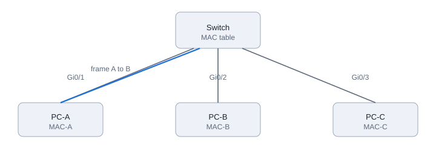

*شکل ۱: سوییچ و سه کامپیوتر؛ هر کامپیوتر به یک پورت وصل است.*

1.  **Learning (یادگیری):** هر فریمی که وارد می‌شود، سوییچ به MAC مبدأ آن نگاه می‌کند و در جدول می‌نویسد «این MAC پشت این پورت است».
2.  **Flooding (پخش):** اگر MAC مقصد در جدول نبود (یا Broadcast بود)، فریم از همه‌ی پورت‌ها به‌جز پورت ورودی فرستاده می‌شود.
3.  **Forwarding (ارسال هدفمند):** اگر MAC مقصد در جدول بود، فریم فقط از همان پورت می‌رود.
4.  **Aging (فراموشی):** ردیفی که ۳۰۰ ثانیه فریم جدیدی از آن نیامد، پاک می‌شود تا جدول پر و کهنه نشود.

> **یک قاعده‌ی مهم**
>
> سوییچ فقط MAC **مبدأ** را یاد می‌گیرد، هرگز MAC مقصد را. و Broadcast هیچ‌وقت مبدأ نیست؛ پس هرگز در جدول نمی‌آید.

### ۳. مثال ساده: اولین ارتباط A با B

جدول سوییچ در ابتدا خالی است. A (پورت Gi0/1) به B (پورت Gi0/2) فریم می‌فرستد:

``` text
Step 1: frame arrives on Gi0/1, src = MAC-A, dst = MAC-B
Step 2: learn  -> table: MAC-A = Gi0/1
Step 3: MAC-B is unknown -> FLOOD to Gi0/2 and Gi0/3
Step 4: B answers: src = MAC-B, dst = MAC-A  (arrives on Gi0/2)
Step 5: learn  -> table: MAC-B = Gi0/2
Step 6: MAC-A is known -> FORWARD only to Gi0/1
```

نتیجه: PC-C فقط فریم اول را می‌بیند. از پیام دوم به بعد، ارتباط A و B خصوصی می‌شود.

### ۴. مثال متوسط: ARP و Broadcast

در عمل، قبل از ping باید ARP انجام شود (درس ۲-۶). ARP Request یک Broadcast است:

``` text
ARP Request : dst = ff:ff:ff:ff:ff:ff  -> always flooded to all ports
ARP Reply   : dst = MAC-A (unicast)     -> forwarded only to Gi0/1
Then ping   : unicast both directions   -> no flooding anymore
```

یعنی هر ارتباط تازه با یک موج Flooding شروع می‌شود و بعد آرام می‌گیرد.

### ۵. مثال سخت: چند MAC پشت یک پورت و پرش MAC

سناریو ۱: پورت Gi0/3 به یک سوییچ دیگر وصل است. پشت آن ۲۰ کامپیوتر هست. نتیجه:

``` text
show mac address-table dynamic
  VLAN  Mac Address       Type     Ports
  1     aaaa.0000.0001    DYNAMIC  Gi0/3
  1     aaaa.0000.0002    DYNAMIC  Gi0/3
  ... 20 MACs on the same port (normal on an uplink)
```

سناریو ۲ (خطرناک): اگر یک MAC یک ثانیه از پورت Gi0/1 و ثانیه‌ی بعد از Gi0/2 بیاید، سوییچ پیام `%SW_MATM-4-MACFLAP_NOTIF` می‌دهد. این تقریباً همیشه نشانه‌ی **Loop** (حلقه) در شبکه است. در فصل ۴ (STP) می‌فهمید چرا و چطور جلویش را بگیریم.

### ۶. دستورهای کلیدی (خط‌به‌خط)

``` text
SW1# show mac address-table
SW1# show mac address-table dynamic
SW1# show mac address-table address aaaa.0000.0001
SW1# show mac address-table interface gi0/1
SW1# show mac address-table aging-time
SW1# clear mac address-table dynamic
```

- `dynamic`: فقط ردیف‌هایی که سوییچ خودش یاد گرفته (در برابر `static` که دستی نوشته می‌شود).
- `address` و `interface`: جستجو برای یک MAC یا یک پورت، مثل «پیدا کردن کامپیوتر گم‌شده».
- `clear ... dynamic`: جدول را پاک می‌کند (در Lab برای دیدن دوباره‌ی یادگیری). در شبکه‌ی واقعی با احتیاط، چون Flooding موقت ایجاد می‌کند.

### ۷. تمرین‌ها

**ت1.** ۱ (ساده): سوییچ کدام MAC را یاد می‌گیرد: مبدأ یا مقصد؟ *(پاسخ: 3-1-ت1 در بخش «پاسخ‌ها» انتهای فصل)*

**ت2.** ۲ (ساده): فریم با مقصد ff:ff:ff:ff:ff:ff چطور پخش می‌شود؟ *(پاسخ: 3-1-ت2 در بخش «پاسخ‌ها» انتهای فصل)*

**ت3.** ۳ (متوسط): جدول خالی است. A (Gi0/1) به B (Gi0/2) و بعد B به A می‌فرستد. چند Flood رخ می‌دهد؟ *(پاسخ: 3-1-ت3 در بخش «پاسخ‌ها» انتهای فصل)*

**ت4.** ۴ (متوسط): چرا ردیف یک MAC بعد از ۵ دقیقه ناپدید می‌شود؟ *(پاسخ: 3-1-ت4 در بخش «پاسخ‌ها» انتهای فصل)*

**ت5.** ۵ (سخت): MACFLAP روی MAC-X بین Gi0/1 و Gi0/2؛ محتمل‌ترین علت؟ *(پاسخ: 3-1-ت5 در بخش «پاسخ‌ها» انتهای فصل)*

### ۸. Lab هدایت‌شده: دیدن یادگیری و Flooding

توپولوژی: سوییچ `SW1` با سه کامپیوتر ساده‌ی VPCS در PNetLab. اگر ندارید، از منوی Add Object سه گره‌ی VPCS (`PC1` تا `PC3`) بسازید و به پورت‌های `Gi0/1` تا `Gi0/3` وصل کنید. همه در VLAN 1 (پیش‌فرض) هستند.

#### گام ۱: آدرس‌دهی VPCS

``` text
PC1> ip 10.10.1.11/24
PC2> ip 10.10.1.12/24
PC3> ip 10.10.1.13/24
```

#### گام ۲: جدول خالی

``` text
SW1# clear mac address-table dynamic
SW1# show mac address-table dynamic
```

#### گام ۳: ایجاد ترافیک و دیدن یادگیری

``` text
PC1> ping 10.10.1.12
SW1# show mac address-table dynamic
```

باید MAC دو VPCS را روی پورت‌های درست ببینید. MAC هر VPCS را با `show ip` روی خودش می‌بینید.

#### گام ۴: دیدن Flooding با Capture

1.  روی لینک PC3 به SW1 کلیک راست و Capture را شروع کنید.
2.  روی SW1: `clear mac address-table dynamic`.
3.  روی PC1: `ping 10.10.1.12`.
4.  در Wireshark فیلتر `arp or icmp`: ARP Request را می‌بینید (چون Broadcast است) ولی Echo Request بین PC1 و PC2 را **نباید** ببینید.

پیش‌بینی کنید و بعد با واقعیت مقایسه کنید. اگر Echo را روی PC3 دیدید، یعنی سوییچ هنوز MAC را یاد نگرفته بود.

#### گام ۵: Aging

``` text
SW1# show mac address-table aging-time
SW1(config)# mac address-table aging-time 60
```

یک دقیقه ترافیک نفرستید و دوباره `show mac address-table dynamic` را بزنید. بعد زمان را به 300 برگردانید.

### ۹. Lab مستقل

MAC یک VPCS را از روی جدول به پورتش ربط دهید، بدون نگاه به توپولوژی. بعد کابل PC2 را به پورت دیگر منتقل کنید و ثبت کنید چه مدت طول می‌کشد جدول درست شود. گزارش را در `03-ops/l2-cam-notes.md` بنویسید.

### ۱۰. عیب‌یابی

|           |                                                                          |
|-----------|--------------------------------------------------------------------------|
| Symptom   | ترافیک یک ارتباط روی پورت‌های بی‌ربط دیده می‌شود                            |
| علت محتمل | MAC مقصد در جدول نیست (Unknown Unicast Flooding) یا Aging خیلی کوتاه است |
| روش       | show mac address-table address ، Capture روی پورت سوم                    |
| Symptom 2 | پیام MACFLAP                                                             |
| علت       | Loop یا MAC تکراری                                                       |
| رفع       | پیدا کردن و قطع Loop (فصل ۴: STP)                                       |

### ۱۱. سؤال‌های مرور

**م1.** سوییچ چه چیزی را یاد می‌گیرد و از کجا؟ *(پاسخ: 3-1-م1 در بخش «پاسخ‌ها» انتهای فصل)*

**م2.** چرا Broadcast هیچ‌وقت در جدول MAC دیده نمی‌شود؟ *(پاسخ: 3-1-م2 در بخش «پاسخ‌ها» انتهای فصل)*

**م3.** Flooding یعنی چه؟ *(پاسخ: 3-1-م3 در بخش «پاسخ‌ها» انتهای فصل)*

### English Corner: انگلیسی تخصصی این درس

این جمله‌ها از مستندات و محیط کار واقعی‌اند. بلند بخوانید و ترجمه را بپوشانید.

| English sentence                                                          | ترجمه                                                               |
|---------------------------------------------------------------------------|---------------------------------------------------------------------|
| The switch learns the source MAC address of every incoming frame.         | سوییچ MAC مبدأ هر فریم ورودی را یاد می‌گیرد.                         |
| Unknown unicast frames are flooded out all ports except the ingress port. | فریم‌های Unicast ناشناخته از همه‌ی پورت‌ها به‌جز پورت ورودی پخش می‌شوند. |
| A MAC flap usually indicates a layer-2 loop.                              | MAC Flap معمولاً نشانه‌ی Loop در لایه ۲ است.                          |
| Entries age out after 300 seconds of inactivity.                          | ردیف‌ها بعد از ۳۰۰ ثانیه بی‌فعالیتی حذف می‌شوند.                       |

**Q1.** Quick quiz (answer in English): What does a switch do when the destination MAC is not in its table? *(پاسخ: 3-1-Q1 در بخش «پاسخ‌ها» انتهای فصل)*

### ۱۲. تکلیف و چک‌لیست تسلط

- [ ] ۵ تمرین را بدون نگاه حل کنم.
- [ ] Lab را انجام دهم و Flooding را با Capture ببینم.
- [ ] چهار رفتار سوییچ را بدون نگاه توضیح دهم.

### ۱۳. یادآوری اشتباهات شما

> **یادآوری**
>
> پیش‌بینی را قبل از اجرا بنویسید؛ دستور EXEC را در Config نزنید؛ فرمول و محاسبه را در بلوک مستقل بنویسید.


#### کارت Lab — درس ۳-۱

| # | فیلد | محتوا |
|---|---|---|
| 1 | عنوان و هدف | دیدن Learning/Flooding/Forwarding/Aging |
| 2 | پیش‌نیاز | فصل ۲ |
| 3 | توپولوژی | SW1 با PC1..PC3 (VPCS) روی Gi0/1..Gi0/3 |
| 4 | تجهیزات | SW1، ۳ VPCS |
| 5 | نسخه نرم‌افزار | vIOS-L2 15.2(20200924، Experimental) برای SW؛ vIOS 15.9(3)M9 برای R؛ VPCS (PNetLab)؛ PNetLab 4.2.8 |
| 6 | IP Plan | 10.10.1.11-13/24 (VLAN 1) |
| 7 | وضعیت اولیه | جدول MAC خالی (`clear mac address-table dynamic`) |
| 8 | صورت مسئله | ثابت کنید سوییچ MAC مبدأ را یاد می‌گیرد و Unknown Unicast پخش می‌شود |
| 9 | مراحل هدایت‌شده | همان بخش «Lab هدایت‌شده» همین درس (گام‌به‌گام) |
| 10 | تست عملکرد | `show mac address-table dynamic` ؛ Capture روی PC3 |
| 11 | سناریوی خرابی | Aging کوتاه (`mac address-table aging-time 60`) |
| 12 | روش عیب‌یابی | Capture روی پورت سوم |
| 13 | نتیجه‌ی مورد انتظار | MAC دو PC روی پورت درست؛ Echo بین PC1 و PC2 روی PC3 دیده نشود |
| 14 | معیار پذیرش | پیش‌بینی با نتیجه تطبیق داده شود |
| 15 | مستندات نهایی | `03-ops/l2-cam-notes.md` |
| 16 | Cleanup و بازگردانی | Aging را 300 کنید |

> **وضعیت راستی‌آزمایی (خارج از ۱۶ فیلد):** **اجرا نشده (فقط طراحی).** اجرا نشده؛ رفتار CAM/Flooding روی vIOS-L2 با VPCS دیده نشده.

---

<a id="l-3-2"></a>

## درس ۳-۲ — VLAN و Access Port

**فصل ۳ - روز ۲ · پیش‌نیاز: درس ۳-۱ · ۶ ساعت**

### این درس درباره چیست و چرا باید یاد بگیریم؟

**چه چیزی یاد می‌گیریم:** چطور یک سوییچ فیزیکی را به چند «شبکه‌ی مجازی جدا» یعنی VLAN تقسیم کنیم، پورت‌ها را به VLANها اختصاص دهیم (Access Port) و جدولی منظم به نام VLAN Matrix بسازیم.

**چرا لازم است:** بدون VLAN، همه‌ی دستگاه‌های سازمان در یک Broadcast Domain هستند: ترافیک حسابداری، دوربین‌ها و مهمان‌ها با هم قاطی می‌شود و یک کامپیوتر آلوده می‌تواند همه را ببیند. VLAN جداسازی را بدون خرید سوییچ جدا ممکن می‌کند.

- **در کار روزانه:** هر بار که کارمند جدید یا پرینتر جدید وصل می‌شود، باید پورتش را به VLAN درست ببرید.
- **در امنیت:** VLAN اولین لایه‌ی «Segmentation» است؛ در FortiGate بین VLANها Policy می‌نویسید.
- **در Capstone:** VLAN10 مدیریت، VLAN20 کاربران و VLAN30 سرورها همین هفته ساخته می‌شوند.

> **مسیر درس**
>
> Broadcast Domain ← VLAN چیست ← Access Port ← VLAN Matrix ← مثال ساده/متوسط/سخت ← دستورها ← تمرین ← Lab ← عیب‌یابی.

#### اصطلاحات این درس (مخفف ← شکل کامل ← معنی)

| مخفف             | شکل کامل انگلیسی                    | معنی فارسی                                     |
|------------------|-------------------------------------|------------------------------------------------|
| VLAN             | Virtual Local Area Network          | شبکه محلی مجازی؛ جداسازی منطقی در لایه ۲       |
| Broadcast Domain | Broadcast Domain                    | محدوده‌ای که Broadcast در آن می‌رسد              |
| Access Port      | Access Port                         | پورتی که فقط به یک VLAN تعلق دارد و Tag نمی‌زند |
| Native           | Native VLAN                         | VLAN بدون Tag روی Trunk (درس بعد)              |
| VLAN ID          | VLAN Identifier                     | شماره‌ی VLAN (۱ تا ۴۰۹۴)                        |
| SVI              | Switch Virtual Interface            | Interface مجازی L3 برای یک VLAN                |
| DHCP             | Dynamic Host Configuration Protocol | تخصیص خودکار آدرس                              |

### ۱. مشکل: یک Broadcast Domain بزرگ

یک ساختمان اداری را در نظر بگیرید که همه‌ی طبقه‌ها یک راه‌پله‌ی مشترک و بدون در دارند. هر صدایی که در یک طبقه بلند شود، همه‌ی ساختمان می‌شنوند. Broadcast در شبکه همین است: هر بار که یک دستگاه ARP یا DHCP می‌فرستد، همه‌ی دستگاه‌های سوییچ آن را دریافت می‌کنند.

هرچه دستگاه‌ها بیشتر شوند، Broadcast بیشتر و شبکه کندتر می‌شود؛ و از نظر امنیت، همه همسایه‌ی هم هستند.

### ۲. VLAN: در گذاشتن بین طبقه‌ها

VLAN سوییچ را به چند «سوییچ مجازی» تقسیم می‌کند. هر پورت عضو یک VLAN است و فریم‌ها فقط بین پورت‌های همان VLAN رد می‌شوند. دستگاه‌های VLAN متفاوت نه Broadcast یکدیگر را می‌بینند و نه بدون روتر با هم صحبت می‌کنند.

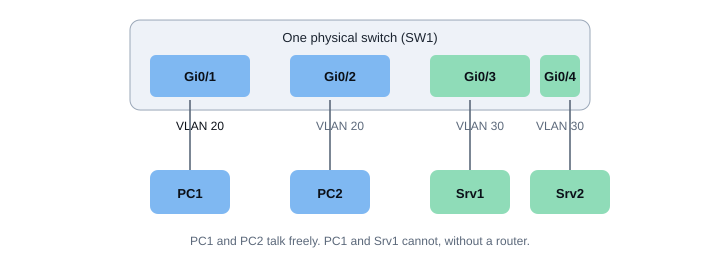

*شکل ۱: یک سوییچ فیزیکی، دو VLAN مجزا.*

#### قوانین VLAN

- VLAN با شماره شناخته می‌شود: ۱ تا ۴۰۹۴ (جزئیات در درس بعد).
- VLAN 1 پیش‌فرض است و بهتر است برای کاربران استفاده نشود.
- هر VLAN معمولاً یک Subnet IP جدا دارد: VLAN20 همان 10.10.20.0/24 در IP Plan ماست.
- Access Port فقط عضو یک VLAN است و دستگاه انتهایی (PC، پرینتر) به آن وصل می‌شود.

### ۳. VLAN Matrix: سند طراحی

قبل از تایپ هر دستور، یک جدول بسازید. ستون‌ها: شماره، نام، Subnet، Gateway، پورت‌ها. این جدول مرجع شماست:

| VLAN | Name    | Subnet        | Gateway    | Access Ports     |
|------|---------|---------------|------------|------------------|
| 10   | MGMT    | 10.10.10.0/24 | 10.10.10.1 | (مدیریت تجهیزات) |
| 20   | USERS   | 10.10.20.0/24 | 10.10.20.1 | Gi0/1, Gi0/2     |
| 30   | SERVERS | 10.10.30.0/24 | 10.10.30.1 | Gi0/3            |

### ۴. دستورها (خط‌به‌خط)

``` text
SW1(config)# vlan 20
SW1(config-vlan)# name USERS
SW1(config-vlan)# exit
SW1(config)# interface gi0/1
SW1(config-if)# switchport mode access
SW1(config-if)# switchport access vlan 20
SW1(config-if)# exit
```

- `vlan 20` + `name`: VLAN را می‌سازد و نام می‌دهد (نام فقط برای خوانایی است).
- `switchport mode access`: پورت را صریحاً Access می‌کند (نه خودکار).
- `switchport access vlan 20`: پورت را عضو VLAN 20 می‌کند. اگر VLAN وجود نداشته باشد، IOS آن را خودکار می‌سازد (خطای رایج: VLAN بدون نام).
- برای چند پورت: `interface range gi0/1 - 2`.

``` text
SW1# show vlan brief
SW1# show interfaces gi0/1 switchport
SW1# show running-config interface gi0/1
```

### ۵. مثال ساده: دو کامپیوتر در یک VLAN

``` text
PC1> ip 10.10.20.11/24 10.10.20.1
PC2> ip 10.10.20.12/24 10.10.20.1
PC1> ping 10.10.20.12     -> success (same VLAN 20)
```

### ۶. مثال متوسط: دو VLAN، بدون روتر

``` text
Srv1 (VLAN 30): 10.10.30.11/24
PC1  (VLAN 20): ping 10.10.30.11   -> FAILS
```

دلیل: دو Broadcast Domain جدا هستند و بدون Gateway (روتر یا SVI) بسته نمی‌تواند رد شود. در درس‌های ۳-۴ و ۳-۵ این مشکل را حل می‌کنیم.

### ۷. مثال سخت: پورت در VLAN اشتباه (TS03)

کاربری شکایت دارد «اینترنت ندارم». IP او 10.10.20.50/24 است ولی ping به Gateway جواب نمی‌دهد. روش عیب‌یابی:

1.  پورت او را پیدا کن: `show mac address-table address <MAC>`.
2.  VLAN آن پورت را ببین: `show vlan brief`.
3.  مقایسه کن: Subnet کامپیوتر با VLAN پورت یکی است؟
4.  اگر نه، پورت را به VLAN درست ببر و دوباره تست کن.

``` text
Symptom   : IP 10.10.20.x but port is in VLAN 30
Evidence  : show vlan brief -> Gi0/5 in VLAN 30
Fix       : switchport access vlan 20
Verify    : ping gateway success
```

### ۸. تمرین‌ها

**ت1.** ۱ (ساده): چرا VLAN باعث کاهش Broadcast می‌شود؟ *(پاسخ: 3-2-ت1 در بخش «پاسخ‌ها» انتهای فصل)*

**ت2.** ۲ (ساده): دو کامپیوتر در VLAN های 20 و 30 بدون روتر ping می‌کنند؛ نتیجه؟ *(پاسخ: 3-2-ت2 در بخش «پاسخ‌ها» انتهای فصل)*

**ت3.** ۳ (متوسط): دستورهای لازم برای ساختن VLAN 40 با نام GUEST و قراردادن Gi0/6 در آن *(پاسخ: 3-2-ت3 در بخش «پاسخ‌ها» انتهای فصل)*

**ت4.** ۴ (متوسط): خروجی show vlan brief چه چیزی نشان می‌دهد؟ *(پاسخ: 3-2-ت4 در بخش «پاسخ‌ها» انتهای فصل)*

**ت5.** ۵ (سخت): کاربر در VLAN 20 است ولی به Gateway نمی‌رسد؛ سه علت محتمل *(پاسخ: 3-2-ت5 در بخش «پاسخ‌ها» انتهای فصل)*

### ۹. Lab هدایت‌شده

#### گام ۱: ساخت VLANها (طبق VLAN Matrix)

``` text
SW1(config)# vlan 20
SW1(config-vlan)# name USERS
SW1(config-vlan)# vlan 30
SW1(config-vlan)# name SERVERS
SW1(config-vlan)# exit
```

#### گام ۲: اختصاص پورت‌ها

``` text
SW1(config)# interface range gi0/1 - 2
SW1(config-if-range)# switchport mode access
SW1(config-if-range)# switchport access vlan 20
SW1(config-if-range)# exit
SW1(config)# interface gi0/3
SW1(config-if)# switchport mode access
SW1(config-if)# switchport access vlan 30
SW1(config-if)# end
SW1# show vlan brief
```

#### گام ۳: تست

``` text
PC1> ip 10.10.20.11/24 10.10.20.1
PC2> ip 10.10.20.12/24 10.10.20.1
PC3> ip 10.10.30.11/24 10.10.30.1
PC1> ping 10.10.20.12     (expect: success)
PC1> ping 10.10.30.11     (expect: fail)
```

#### گام ۴: خراب‌کردن عمدی و رفع

``` text
SW1(config)# interface gi0/2
SW1(config-if)# switchport access vlan 30
(PC1 ping PC2 now fails)
SW1(config-if)# switchport access vlan 20
(ping works again)
```

#### گام ۵: ذخیره

``` text
SW1# copy running-config startup-config
```

### ۱۰. Lab مستقل

VLAN Matrix مفصل Capstone (مرکز) را با ۵ VLAN بنویسید و فایل `02-design/vlan-matrix.md` را بسازید: شماره، نام، Subnet، Gateway، پورت‌ها، توضیح.

### ۱۱. عیب‌یابی

|         |                                                                                                        |
|---------|--------------------------------------------------------------------------------------------------------|
| Symptom | PC به Gateway نمی‌رسد                                                                                   |
| چک‌لیست  | ۱) پورت در VLAN درست است؟ ؛ ۲) VLAN وجود دارد؟ ؛ ۳) پورت UP است؟ (TS01) ؛ ۴) IP/Mask/Gateway درست است؟ |
| ابزار   | show vlan brief ، show interfaces status                                                               |

### ۱۲. سؤال‌های مرور

**م1.** VLAN چه فایده‌ای دارد؟ *(پاسخ: 3-2-م1 در بخش «پاسخ‌ها» انتهای فصل)*

**م2.** Access Port چیست؟ *(پاسخ: 3-2-م2 در بخش «پاسخ‌ها» انتهای فصل)*

### English Corner: انگلیسی تخصصی این درس

این جمله‌ها از مستندات و محیط کار واقعی‌اند. بلند بخوانید و ترجمه را بپوشانید.

| English sentence                                       | ترجمه                                                    |
|--------------------------------------------------------|----------------------------------------------------------|
| A VLAN is a logical broadcast domain on a switch.      | VLAN یک Broadcast Domain منطقی روی سوییچ است.            |
| Assign the port to VLAN 20 as an access port.          | پورت را به‌عنوان Access Port به VLAN 20 اختصاص بدهید.     |
| Hosts in different VLANs need a router to communicate. | Hostها در VLANهای متفاوت برای ارتباط به روتر نیاز دارند. |
| Verify the VLAN membership with show vlan brief.       | عضویت VLAN را با show vlan brief بررسی کنید.             |

**Q1.** Quick quiz (answer in English): Why do hosts in different VLANs need a router? *(پاسخ: 3-2-Q1 در بخش «پاسخ‌ها» انتهای فصل)*

### ۱۳. تکلیف و چک‌لیست تسلط

- [ ] VLAN Matrix را کامل بنویسم.
- [ ] Lab را اجرا کنم و ping موفق و ناموفق را ثبت کنم.
- [ ] TS03 را عمداً بسازم و رفع کنم.

### ۱۴. یادآوری اشتباهات شما

> **یادآوری**
>
> «پذیرفته شدن دستور ≠ کار کردن»؛ همیشه با ping و show تأیید کنید. بعد از هر تغییر موفق ذخیره کنید.


#### کارت Lab — درس ۳-۲

| # | فیلد | محتوا |
|---|---|---|
| 1 | عنوان و هدف | ساخت VLAN و Access Port طبق VLAN Matrix |
| 2 | پیش‌نیاز | درس ۳-۱ |
| 3 | توپولوژی | SW1 با PC1..PC3 (VLAN 20/30) |
| 4 | تجهیزات | SW1، ۳ VPCS |
| 5 | نسخه نرم‌افزار | vIOS-L2 15.2(20200924، Experimental) برای SW؛ vIOS 15.9(3)M9 برای R؛ VPCS (PNetLab)؛ PNetLab 4.2.8 |
| 6 | IP Plan | VLAN20 10.10.20.0/24؛ VLAN30 10.10.30.0/24 |
| 7 | وضعیت اولیه | VLAN فقط 1 |
| 8 | صورت مسئله | VLAN 20 و 30 بسازید؛ ping داخل VLAN موفق و بین VLAN شکست |
| 9 | مراحل هدایت‌شده | همان بخش «Lab هدایت‌شده» همین درس (گام‌به‌گام) |
| 10 | تست عملکرد | `show vlan brief` ؛ ping |
| 11 | سناریوی خرابی | پورت PC2 در VLAN اشتباه |
| 12 | روش عیب‌یابی | مقایسه‌ی Subnet کامپیوتر با VLAN پورت |
| 13 | نتیجه‌ی مورد انتظار | ping هم‌VLAN موفق؛ بین‌VLAN شکست |
| 14 | معیار پذیرش | VLAN Matrix |
| 15 | مستندات نهایی | `02-design/vlan-matrix.md` |
| 16 | Cleanup و بازگردانی | حذف VLANها؛ پورت‌ها به VLAN 1 |

> **وضعیت راستی‌آزمایی (خارج از ۱۶ فیلد):** **جزئی.** ساخت/نام‌گذاری VLAN و `show vlan brief` Tested-OK؛ Access Port + VPCS و ping بین VLAN اجرا نشده.

---

<a id="l-3-3"></a>

## درس ۳-۳ — Trunk و 802.1Q

**فصل ۳ - روز ۳ · پیش‌نیاز: درس ۳-۲ · ۶ ساعت**

### این درس درباره چیست و چرا باید یاد بگیریم؟

**چه چیزی یاد می‌گیریم:** چطور چند VLAN را روی «یک کابل» بین دو سوییچ (یا سوییچ و روتر) عبور بدهیم. این کار با Trunk و استاندارد 802.1Q انجام می‌شود که به هر فریم یک برچسب (Tag) اضافه می‌کند.

**چرا لازم است:** بدون Trunk باید برای هر VLAN یک کابل جدا بین سوییچ‌ها بکشید. Trunk همه را در یک کابل جا می‌دهد؛ ولی یک اشتباه کوچک در آن (مثلاً پاک‌کردن لیست VLANهای مجاز) می‌تواند کل شعبه را قطع کند.

- **در کار روزانه:** تقریباً هر لینک بین سوییچ‌ها و بین سوییچ و فایروال Trunk است.
- **در امنیت:** Trunk نادرست راه حمله‌ی VLAN Hopping است؛ باید Native و Allowed را سفت کنید.
- **در FortiGate:** پورت فایروال که به سوییچ وصل می‌شود، همین Trunk را می‌بیند (VLAN Interface).

> **مسیر درس**
>
> مشکل: یک کابل برای هر VLAN ← Tag 802.1Q ← Native VLAN ← Allowed List ← مثال ساده/متوسط/سخت ← دستورها ← تمرین ← Lab ← عیب‌یابی.

#### اصطلاحات این درس (مخفف ← شکل کامل ← معنی)

| مخفف        | شکل کامل انگلیسی          | معنی فارسی                             |
|-------------|---------------------------|----------------------------------------|
| Trunk       | Trunk Port                | پورتی که چند VLAN را با Tag عبور می‌دهد |
| 802.1Q      | IEEE 802.1Q               | استاندارد Tag کردن VLAN در فریم اترنت  |
| Tag         | VLAN Tag                  | ۴ بایت اضافه به فریم؛ شامل VLAN ID     |
| TPID        | Tag Protocol Identifier   | مقدار 0x8100؛ نشان‌دهنده‌ی وجود Tag      |
| VID         | VLAN Identifier           | ۱۲ بیت شماره VLAN                      |
| PCP         | Priority Code Point       | ۳ بیت اولویت (QoS)                     |
| DTP         | Dynamic Trunking Protocol | پروتکل سیسکو برای مذاکره خودکار Trunk  |
| Native VLAN | Native VLAN               | VLANی که روی Trunk بدون Tag می‌رود      |

### ۱. مشکل: یک کابل برای هر VLAN؟

فرض کنید دو سوییچ در دو طبقه دارید و ۵ VLAN. بدون Trunk باید ۵ کابل بکشید. تصور کنید یک اتوبوس بین دو شهر. به‌جای ۵ ماشین جدا برای ۵ شرکت، یک اتوبوس مسافران همه‌ی شرکت‌ها را می‌برد؛ فقط باید روی هر مسافر یک برچسب بزنید تا در مقصد معلوم باشد مال کدام شرکت است.

### ۲. Tag 802.1Q چیست؟

سوییچ هنگام ورود فریم به Trunk، یک برچسب ۴ بایتی بین MAC مبدأ و نوع فریم می‌گذارد. سوییچ آن‌طرف، برچسب را می‌خواند و فریم را فقط در همان VLAN پخش می‌کند.

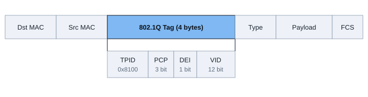

*شکل ۱: فریم اترنت با Tag ۴ بایتی 802.1Q؛ ۱۲ بیت آن شماره‌ی VLAN است.*

چون VID دوازده بیت است، تعداد VLANها محدود می‌شود:

``` text
VID bits         = 12
Total values     = 2 ^ 12 = 4096   (0 .. 4095)
Reserved         = 0 and 4095
Usable VLAN IDs  = 4096 - 2 = 4094   (1 .. 4094)
```

### ۳. Native VLAN: ترافیک بدون برچسب

یک VLAN روی Trunk بدون Tag می‌رود؛ به آن **Native VLAN** می‌گویند (پیش‌فرض VLAN 1). اگر دو سر Trunk Native متفاوت داشته باشند، ترافیک VLANها قاطی می‌شود و CDP پیام `Native VLAN mismatch` می‌دهد. همین امر راهی برای VLAN Hopping است.

> **توصیه‌ی امنیتی**
>
> Native را روی یک VLAN بدون استفاده (مثلاً 999) بگذارید و دو سر لینک یکی باشد.

### ۴. Allowed VLAN List: چه VLANهایی اجازه‌ی عبور دارند

پیش‌فرض Trunk همه‌ی VLANها (1 تا 4094) را عبور می‌دهد. بهتر است فقط VLANهای لازم مجاز باشند. اینجا یک اشتباه بسیار رایج هست:

``` text
switchport trunk allowed vlan 20,30        (REPLACES the whole list!)
switchport trunk allowed vlan add 40        (ADDS 40 to the existing list)
switchport trunk allowed vlan remove 30     (REMOVES 30 only)
```

> **هشدار (TS05: Human Error)**
>
> اگر برای افزودن VLAN جدید فقط بنویسید `allowed vlan 40` (بدون کلمه‌ی add)، کل لیست قبلی پاک می‌شود و فقط VLAN 40 می‌ماند. باقی VLANها بلافاصله قطع می‌شوند. همیشه از `add` استفاده کنید و قبلش `show interfaces trunk` را ببینید.

### ۵. دستورها (خط‌به‌خط)

``` text
SW1(config)# interface gi0/0
SW1(config-if)# switchport trunk encapsulation dot1q
SW1(config-if)# switchport mode trunk
SW1(config-if)# switchport trunk native vlan 999
SW1(config-if)# switchport trunk allowed vlan 10,20,30
SW1(config-if)# switchport nonegotiate
SW1(config-if)# end
```

- `trunk encapsulation dot1q`: روی بعضی سوییچ‌ها لازم است (اگر خطا داد، سوییچ فقط dot1q را پشتیبانی می‌کند و نیازی نیست).
- `mode trunk`: پورت را صریحاً Trunk می‌کند.
- `native vlan 999`: VLAN بدون Tag.
- `allowed vlan`: فهرست مجاز (اینجا برای اولین بار از فرم کامل استفاده شده).
- `nonegotiate`: DTP را خاموش می‌کند تا مذاکره‌ی ناخواسته رخ ندهد.

``` text
SW1# show interfaces trunk
SW1# show interfaces gi0/0 switchport
```

خروجی `show interfaces trunk` چهار بخش دارد: Mode و Status، Vlans allowed، Vlans allowed and active، و Vlans in spanning tree forwarding state. اگر VLANی در بخش اول هست ولی در دوم نیست، یعنی هنوز روی سوییچ ساخته نشده.

### ۶. مثال ساده: Trunk بین SW1 و SW2

``` text
SW1(config)# interface gi0/1
SW1(config-if)# switchport trunk encapsulation dot1q
SW1(config-if)# switchport mode trunk
(same on SW2)
SW1# show interfaces trunk       -> Gi0/1 trunking, allowed 1-4094
```

### ۷. مثال متوسط: دو سوییچ، دو VLAN

``` text
SW1: PC1 (VLAN 20) on Gi0/2        SW2: PC4 (VLAN 20) on Gi0/2
Trunk Gi0/1 between SW1 and SW2 carries VLAN 20 and 30
PC1 ping PC4 (same VLAN 20) -> success through the trunk
```

شرط: هر دو سوییچ باید VLAN 20 را داشته باشند و در لیست مجاز Trunk باشد.

### ۸. مثال سخت: عیب‌یابی TS04 و TS05

``` text
TS04 symptom : VLAN 30 hosts lost connectivity across the trunk
Evidence     : show interfaces trunk -> VLAN 30 missing from "allowed"
Fix          : switchport trunk allowed vlan add 30

TS05 cause   : someone typed "allowed vlan 40" (without add)
Result       : only VLAN 40 remains, 10/20/30 down
Prevention   : always use "add", always review show interfaces trunk
               before and after, keep a backup (lesson 2-4)
```

### ۹. تمرین‌ها

**ت1.** ۱ (ساده): چند بیت از Tag مخصوص VLAN ID است و چند VLAN قابل‌استفاده داریم؟ *(پاسخ: 3-3-ت1 در بخش «پاسخ‌ها» انتهای فصل)*

**ت2.** ۲ (ساده): تفاوت allowed vlan 40 با allowed vlan add 40؟ *(پاسخ: 3-3-ت2 در بخش «پاسخ‌ها» انتهای فصل)*

**ت3.** ۳ (متوسط): Native Mismatch چه عارضه‌ای دارد؟ *(پاسخ: 3-3-ت3 در بخش «پاسخ‌ها» انتهای فصل)*

**ت4.** ۴ (متوسط): چرا nonegotiate را می‌زنیم؟ *(پاسخ: 3-3-ت4 در بخش «پاسخ‌ها» انتهای فصل)*

**ت5.** ۵ (سخت): روی Trunk هستید و VLAN 30 در show interfaces trunk در ستون allowed نیست؛ ۳ دستور رفع *(پاسخ: 3-3-ت5 در بخش «پاسخ‌ها» انتهای فصل)*

### ۱۰. Lab هدایت‌شده

توپولوژی: `SW1` و `SW2` (گره دوم vIOSL2) با کابل بین `Gi0/1` هر دو. PC1 روی SW1 و PC4 روی SW2 هر دو در VLAN 20.

#### گام ۱: بکاپ

``` text
SW1# copy running-config flash:SW1-before-trunk.cfg
SW2# copy running-config flash:SW2-before-trunk.cfg
```

#### گام ۲: VLANها روی هر دو سوییچ

``` text
SW2(config)# vlan 20
SW2(config-vlan)# name USERS
SW2(config-vlan)# vlan 30
SW2(config-vlan)# name SERVERS
```

#### گام ۳: Trunk روی هر دو سر

``` text
SWx(config)# interface gi0/1
SWx(config-if)# switchport trunk encapsulation dot1q
SWx(config-if)# switchport mode trunk
SWx(config-if)# switchport trunk native vlan 999
SWx(config-if)# switchport trunk allowed vlan 20,30
SWx(config-if)# switchport nonegotiate
SWx# show interfaces trunk
```

#### گام ۴: تست

``` text
PC1> ip 10.10.20.11/24 10.10.20.1
PC4> ip 10.10.20.14/24 10.10.20.1
PC1> ping 10.10.20.14      (expect: success)
```

#### گام ۵: Capture و دیدن Tag

روی لینک بین SW1 و SW2 Capture بگیرید. فریم‌ها را باز کنید: در Wireshark باید «802.1Q Virtual LAN، ID: 20» ببینید. روی لینک PC1 همان فریم **بدون** Tag است (چون Access Port است).

#### گام ۶: ایجاد عمدی TS05 و رفع

``` text
SW1(config-if)# switchport trunk allowed vlan 30     (WRONG, replaces list)
PC1 ping PC4 -> fails
SW1(config-if)# switchport trunk allowed vlan add 20
PC1 ping PC4 -> works
```

### ۱۱. Lab مستقل

یک Runbook کوتاه `03-ops/trunk-change.md` بنویسید: «قبل از هر تغییر Trunk چه چیزی بررسی/بکاپ شود و چطور برگردیم». از `reload in` هم استفاده کنید.

### ۱۲. عیب‌یابی

|         |                                                                                                                          |
|---------|--------------------------------------------------------------------------------------------------------------------------|
| Symptom | یک VLAN از Trunk رد نمی‌شود                                                                                               |
| چک‌لیست  | ۱) VLAN در Allowed هست؟ ؛ ۲) VLAN روی هر دو سوییچ ساخته شده؟ ؛ ۳) Native دو سر یکی است؟ ؛ ۴) Trunk در حالت trunking است؟ |
| ابزار   | show interfaces trunk ، show vlan brief ، show cdp neighbors                                                             |

### ۱۳. سؤال‌های مرور

**م1.** Trunk چه کاری می‌کند؟ *(پاسخ: 3-3-م1 در بخش «پاسخ‌ها» انتهای فصل)*

**م2.** Native VLAN چیست؟ *(پاسخ: 3-3-م2 در بخش «پاسخ‌ها» انتهای فصل)*

### English Corner: انگلیسی تخصصی این درس

این جمله‌ها از مستندات و محیط کار واقعی‌اند. بلند بخوانید و ترجمه را بپوشانید.

| English sentence                                                   | ترجمه                                                         |
|--------------------------------------------------------------------|---------------------------------------------------------------|
| The trunk carries traffic for multiple VLANs using 802.1Q tagging. | Trunk ترافیک چند VLAN را با Tag 802.1Q عبور می‌دهد.            |
| A native VLAN mismatch can lead to VLAN hopping.                   | عدم تطابق Native VLAN می‌تواند به VLAN Hopping منجر شود.       |
| Use the add keyword to avoid overwriting the allowed VLAN list.    | از کلمه‌ی add استفاده کنید تا لیست VLANهای مجاز بازنویسی نشود. |
| Disable DTP with switchport nonegotiate.                           | DTP را با switchport nonegotiate خاموش کنید.                  |

**Q1.** Quick quiz (answer in English): Why is "switchport trunk allowed vlan 40" dangerous on a live trunk? *(پاسخ: 3-3-Q1 در بخش «پاسخ‌ها» انتهای فصل)*

### ۱۴. تکلیف و چک‌لیست تسلط

- [ ] Trunk را راه بیندازم و Tag را در Capture ببینم.
- [ ] TS04 و TS05 را بسازم و رفع کنم.
- [ ] جدول allowed/native هر لینک را در IP Plan ثبت کنم.

### ۱۵. یادآوری اشتباهات شما

> **یادآوری**
>
> قبل از تغییر Trunk بکاپ بگیرید؛ بعد از تغییر show را ببینید؛ فرمول‌ها و مراحل را در بلوک مستقل بنویسید.


#### کارت Lab — درس ۳-۳

| # | فیلد | محتوا |
|---|---|---|
| 1 | عنوان و هدف | Trunk 802.1Q با Native و Allowed و دیدن Tag |
| 2 | پیش‌نیاز | درس ۳-۲ |
| 3 | توپولوژی | SW1 Gi0/1 ↔ SW2 Gi0/1 |
| 4 | تجهیزات | SW1، SW2، PC1، PC4 |
| 5 | نسخه نرم‌افزار | vIOS-L2 15.2(20200924، Experimental) برای SW؛ vIOS 15.9(3)M9 برای R؛ VPCS (PNetLab)؛ PNetLab 4.2.8 |
| 6 | IP Plan | VLAN 20 و 30؛ 10.10.20.0/24 |
| 7 | وضعیت اولیه | VLANها روی هر دو ساخته شده |
| 8 | صورت مسئله | Trunk بسازید و خطای فراموشی `add` را ایجاد و رفع کنید |
| 9 | مراحل هدایت‌شده | همان بخش «Lab هدایت‌شده» همین درس (گام‌به‌گام) |
| 10 | تست عملکرد | `show interfaces trunk` ؛ Capture Tag 802.1Q |
| 11 | سناریوی خرابی | `allowed vlan 30` بدون add |
| 12 | روش عیب‌یابی | `show interfaces trunk` قبل/بعد |
| 13 | نتیجه‌ی مورد انتظار | VLAN 20 از Trunk رد شود؛ Tag در Capture |
| 14 | معیار پذیرش | بعد از رفع ping PC1↔PC4 موفق |
| 15 | مستندات نهایی | `03-ops/trunk-change.md` |
| 16 | Cleanup و بازگردانی | Allowed را به 20,30 و Native 999 برگردانید |

> **وضعیت راستی‌آزمایی (خارج از ۱۶ فیلد):** **جزئی.** Trunk 802.1Q روی یک سوییچ Tested-OK؛ Trunk بین دو سوییچ، Tag در Capture و `allowed vlan` اجرا نشده.

---

<a id="l-3-4"></a>

## درس ۳-۴ — Router-on-a-Stick

**فصل ۳ - روز ۴ · پیش‌نیاز: درس ۳-۳ · ۶ ساعت**

### این درس درباره چیست و چرا باید یاد بگیریم؟

**چه چیزی یاد می‌گیریم:** چطور VLANهای مختلف را به هم وصل کنیم. روش اول: یک روتر با یک کابل Trunk و چند Sub-interface؛ معروف به Router-on-a-Stick (RoAS).

**چرا لازم است:** همان‌طور که دیدید دو VLAN بدون روتر با هم صحبت نمی‌کنند. این درس کلید فهم «Inter-VLAN Routing» است و همین مفهوم در FortiGate با VLAN Interface تکرار می‌شود. کسی که RoAS را بفهمد، Gateway در FortiGate را هم می‌فهمد.

- **در کار روزانه:** شعبه‌های کوچک بدون سوییچ لایه ۳ از همین روش استفاده می‌کنند.
- **در امنیت:** وقتی ترافیک بین VLANها از روتر یا فایروال می‌گذرد، می‌شود ACL یا Policy گذاشت.
- **در Capstone:** فایروال FortiGate همین نقش را برای همه‌ی VLANها دارد.

> **مسیر درس**
>
> مشکل: ارتباط بین VLANها ← ایده‌ی Sub-interface ← مسیر بسته (Packet Flow) ← دستورها ← مثال ساده/متوسط/سخت ← تمرین ← Lab ← عیب‌یابی.

#### اصطلاحات این درس (مخفف ← شکل کامل ← معنی)

| مخفف                | شکل کامل انگلیسی          | معنی فارسی                                |
|---------------------|---------------------------|-------------------------------------------|
| RoAS                | Router on a Stick         | روتر با یک لینک Trunk و چند Sub-interface |
| Sub-interface       | Sub-interface             | Interface منطقی روی یک Interface فیزیکی   |
| Inter-VLAN          | Inter-VLAN Routing        | مسیریابی بین VLANها                       |
| Gateway             | Default Gateway           | دروازه‌ی پیش‌فرض هر VLAN                    |
| encapsulation dot1Q | IEEE 802.1Q encapsulation | دستور اتصال Sub-interface به یک VLAN      |
| L3                  | Layer 3                   | لایه شبکه (IP)                            |

### ۱. مشکل

PC1 در VLAN 20 و Srv1 در VLAN 30. هر کدام Subnet خودش را دارد؛ دو شبکه‌ی جدا که بدون «پل» به هم نمی‌رسند. این پل یک **روتر** است: وقتی PC1 بخواهد به Srv1 بفرستد، بسته را به Gateway خودش می‌دهد و روتر آن را به VLAN 30 می‌فرستد.

ساده‌ترین راه: برای هر VLAN یک پورت فیزیکی روتر. ولی روتر پورت زیادی ندارد. راه‌حل هوشمندانه: یک پورت و یک Trunk؛ و روی روتر برای هر VLAN یک «Interface مجازی» می‌سازیم.

### ۲. ایده‌ی Router-on-a-Stick

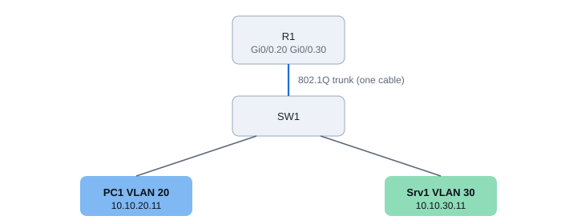

*شکل ۱: یک کابل Trunk بین روتر و سوییچ؛ روتر برای هر VLAN یک Sub-interface دارد.*

Sub-interface مثل چند میز در یک ساختمان است: یک در (کابل فیزیکی) دارد ولی هر میز برای یک شرکت (VLAN) کار می‌کند. هر Sub-interface یک آدرس IP دارد که همان Gateway آن VLAN است.

### ۳. مسیر بسته (Packet Flow)

PC1 (10.10.20.11، VLAN 20) به Srv1 (10.10.30.11، VLAN 30) ping می‌زند:

1.  PC1 می‌بیند Srv1 در Subnet دیگری است و بسته را به Gateway (10.10.20.1) می‌دهد؛ پس MAC مقصد فریم، MAC روتر است.
2.  سوییچ فریم را با Tag VLAN 20 روی Trunk به روتر می‌فرستد.
3.  روتر روی Gi0/0.20 دریافت می‌کند، جدول Route را می‌بیند (Connected: 10.10.30.0/24 روی Gi0/0.30).
4.  روتر فریم جدید با MAC مقصد Srv1 می‌سازد و با Tag VLAN 30 از همان کابل برمی‌گرداند.
5.  سوییچ Tag را برمی‌دارد و فریم را فقط به پورت Srv1 می‌دهد.

``` text
IP src/dst stay the same : 10.10.20.11 -> 10.10.30.11
MAC dst changes          : router MAC (hop 1) -> Srv1 MAC (hop 2)
VLAN tag changes         : 20 (in) -> 30 (out)
TTL                      : decreased by 1 at the router
```

> **نکته‌ی مهم**
>
> IP مبدأ و مقصد تغییر نمی‌کنند، ولی MAC و Tag در هر Hop عوض می‌شوند. این همان نکته‌ی «Routing» است که در Capture (درس ۲-۶) دیدید.

### ۴. دستورها (خط‌به‌خط)

``` text
SW1(config)# interface gi0/0
SW1(config-if)# switchport trunk encapsulation dot1q
SW1(config-if)# switchport mode trunk
SW1(config-if)# switchport trunk allowed vlan 10,20,30

R1(config)# interface gi0/0
R1(config-if)# no shutdown
R1(config-if)# no ip address
R1(config-if)# interface gi0/0.20
R1(config-subif)# encapsulation dot1Q 20
R1(config-subif)# ip address 10.10.20.1 255.255.255.0
R1(config-subif)# interface gi0/0.30
R1(config-subif)# encapsulation dot1Q 30
R1(config-subif)# ip address 10.10.30.1 255.255.255.0
R1(config-subif)# end
```

- Interface فیزیکی بدون IP و روشن (`no shutdown`) می‌ماند؛ فقط Sub-interfaceها آدرس دارند.
- `encapsulation dot1Q 20`: این Sub-interface فقط فریم‌های Tag 20 را می‌گیرد/می‌فرستد. شماره‌ی Sub-interface (.20) فقط یک نام است؛ ولی عرف این است که با VLAN یکی باشد.
- اگر Native VLAN داشتید، `encapsulation dot1Q 10 native` (طبق مستند Cisco، برای VLAN Native Trunk فقط با کلیدواژه‌ی `native` تنظیم شود و Native دو سر Trunk یکسان باشد).

``` text
R1# show ip interface brief
R1# show ip route connected
R1# show interfaces gi0/0.20
R1# ping 10.10.30.11
```

### ۵. مثال ساده: ping به Gateway

``` text
PC1> ping 10.10.20.1     -> success (R1 Gi0/0.20)
```

### ۶. مثال متوسط: ping بین دو VLAN

``` text
PC1> ping 10.10.30.11    -> success through R1
PC1> trace 10.10.30.11   -> hop 1 = 10.10.20.1 (router), hop 2 = 10.10.30.11
```

### ۷. مثال سخت: عیب‌یابی

|            |                                                                                                                                                                                                   |
|------------|---------------------------------------------------------------------------------------------------------------------------------------------------------------------------------------------------|
| Symptom    | PC1 به Gateway می‌رسد ولی به VLAN 30 نه                                                                                                                                                            |
| چک‌لیست     | ۱) Sub-interface .30 بالا است؟ ؛ ۲) `encapsulation dot1Q 30` درست است؟ ؛ ۳) VLAN 30 در Allowed ترانک است؟ ؛ ۴) Srv1 Gateway 10.10.30.1 دارد؟ ؛ ۵) `show ip route connected` هر دو Subnet را دارد؟ |
| علت متداول | Encapsulation اشتباه (مثلاً 3 به‌جای 30) یا فراموشی VLAN در Trunk (TS04)                                                                                                                            |

### ۸. تمرین‌ها

**ت1.** ۱ (ساده): چرا فقط یک کابل فیزیکی کافی است؟ *(پاسخ: 3-4-ت1 در بخش «پاسخ‌ها» انتهای فصل)*

**ت2.** ۲ (ساده): کدام آدرس IP روی Gi0/0.20 می‌نشیند؟ *(پاسخ: 3-4-ت2 در بخش «پاسخ‌ها» انتهای فصل)*

**ت3.** ۳ (متوسط): در مسیر PC1 به Srv1 کدام فیلدها عوض می‌شوند و کدام نه؟ *(پاسخ: 3-4-ت3 در بخش «پاسخ‌ها» انتهای فصل)*

**ت4.** ۴ (متوسط): اگر encapsulation dot1Q 3 به‌جای 30 بزنیم چه می‌شود؟ *(پاسخ: 3-4-ت4 در بخش «پاسخ‌ها» انتهای فصل)*

**ت5.** ۵ (سخت): نقطه‌ضعف RoAS چیست؟ *(پاسخ: 3-4-ت5 در بخش «پاسخ‌ها» انتهای فصل)*

### ۹. Lab هدایت‌شده

توپولوژی درس ۳-۲ را ادامه می‌دهیم: `R1` به `SW1` (Gi0/0 ↔ Gi0/0). VLAN 20 و 30 روی SW1 دارید.

#### گام ۱: بکاپ و Trunk

``` text
SW1# copy running-config flash:SW1-before-roas.cfg
SW1(config)# interface gi0/0
SW1(config-if)# switchport trunk encapsulation dot1q
SW1(config-if)# switchport mode trunk
SW1(config-if)# switchport trunk allowed vlan 10,20,30
```

#### گام ۲: Sub-interface روی R1

دستورهای بخش ۴ را بزنید (VLAN 10 همان Sub-interface قبلی L00 است و دست نمی‌خورد).

#### گام ۳: تست

``` text
PC1> ip 10.10.20.11/24 10.10.20.1
PC3> ip 10.10.30.11/24 10.10.30.1
PC1> ping 10.10.30.11    (expect: success)
R1# show ip route connected
```

#### گام ۴: Capture روی لینک R1-SW1

1.  PC1 ping به PC3 بزند.
2.  در Wireshark فریم‌ها را ببینید: Echo Request با VLAN 20 و MAC مقصد R1، و بعد همان بسته با VLAN 30 و MAC مقصد PC3.
3.  جدول تغییرات (IP/MAC/Tag/TTL) را بنویسید.

#### گام ۵: خراب‌کردن عمدی

``` text
R1(config)# interface gi0/0.30
R1(config-subif)# encapsulation dot1Q 3
PC1 ping PC3 -> fails
R1(config-subif)# encapsulation dot1Q 30
PC1 ping PC3 -> works
```

### ۱۰. Lab مستقل

یک VLAN جدید (مثلاً 40 GUEST) اضافه کنید: VLAN روی SW1، لیست Trunk (با `add`!)، Sub-interface روی R1، تست. مراحل را در `03-ops/add-vlan-runbook.md` بنویسید.

### ۱۱. سؤال‌های مرور

**م1.** Sub-interface چیست؟ *(پاسخ: 3-4-م1 در بخش «پاسخ‌ها» انتهای فصل)*

**م2.** چرا Interface فیزیکی IP ندارد؟ *(پاسخ: 3-4-م2 در بخش «پاسخ‌ها» انتهای فصل)*

### English Corner: انگلیسی تخصصی این درس

این جمله‌ها از مستندات و محیط کار واقعی‌اند. بلند بخوانید و ترجمه را بپوشانید.

| English sentence                                                                | ترجمه                                                                    |
|---------------------------------------------------------------------------------|--------------------------------------------------------------------------|
| The router uses sub-interfaces to route between VLANs over a single trunk link. | روتر با Sub-interfaceها از طریق یک لینک Trunk بین VLANها مسیریابی می‌کند. |
| Each sub-interface is the default gateway for its VLAN.                         | هر Sub-interface Gateway پیش‌فرض VLAN خودش است.                           |
| The VLAN tag changes at the router, but the IP addresses stay the same.         | Tag در روتر عوض می‌شود ولی آدرس‌های IP ثابت می‌مانند.                       |
| A wrong encapsulation ID breaks routing for that VLAN.                          | شناسه‌ی Encapsulation اشتباه، مسیریابی آن VLAN را خراب می‌کند.             |

**Q1.** Quick quiz (answer in English): What is the main drawback of router-on-a-stick? *(پاسخ: 3-4-Q1 در بخش «پاسخ‌ها» انتهای فصل)*

### ۱۲. تکلیف و چک‌لیست تسلط

- [ ] RoAS را راه بیندازم و ping بین VLANها را بگیرم.
- [ ] جدول تغییرات IP/MAC/Tag را از Capture بنویسم.
- [ ] یک VLAN جدید را با Runbook اضافه کنم.

### ۱۳. یادآوری اشتباهات شما

> **یادآوری**
>
> پیش‌بینی قبل از اجرا؛ بکاپ قبل از تغییر Trunk؛ خروجی واقعی را ثبت کنید.


#### کارت Lab — درس ۳-۴

| # | فیلد | محتوا |
|---|---|---|
| 1 | عنوان و هدف | Inter-VLAN با Router-on-a-Stick |
| 2 | پیش‌نیاز | درس ۳-۳ |
| 3 | توپولوژی | R1 Gi0/0 ↔ SW1 Gi0/0 (trunk) |
| 4 | تجهیزات | R1، SW1، ۲ VPCS |
| 5 | نسخه نرم‌افزار | vIOS-L2 15.2(20200924، Experimental) برای SW؛ vIOS 15.9(3)M9 برای R؛ VPCS (PNetLab)؛ PNetLab 4.2.8 |
| 6 | IP Plan | Gateway 10.10.20.1 و 10.10.30.1 |
| 7 | وضعیت اولیه | VLAN 20/30 روی SW1 |
| 8 | صورت مسئله | ping بین VLAN 20 و 30 از طریق R1 و تحلیل تغییر MAC/Tag |
| 9 | مراحل هدایت‌شده | همان بخش «Lab هدایت‌شده» همین درس (گام‌به‌گام) |
| 10 | تست عملکرد | `ping` ؛ `show ip route connected` ؛ Capture |
| 11 | سناریوی خرابی | `encapsulation dot1Q 3` به‌جای 30 |
| 12 | روش عیب‌یابی | مقایسه‌ی Encapsulation و Tag |
| 13 | نتیجه‌ی مورد انتظار | ping موفق؛ جدول IP/MAC/Tag/TTL |
| 14 | معیار پذیرش | تغییر Tag/MAC در Capture ثبت شود |
| 15 | مستندات نهایی | `03-ops/add-vlan-runbook.md` |
| 16 | Cleanup و بازگردانی | Shutdown زیرواسط‌ها |

> **وضعیت راستی‌آزمایی (خارج از ۱۶ فیلد):** **جزئی.** Router-on-a-Stick با SVI و ping ۱۰۰٪ Tested-OK (Probe)؛ ارتباط بین دو VLAN با VPCS اجرا نشده.

---

<a id="l-3-5"></a>

## درس ۳-۵ — SVI و سوییچ لایه ۳

**فصل ۳ - روز ۵ · پیش‌نیاز: درس ۳-۴ · ۶ ساعت**

### این درس درباره چیست و چرا باید یاد بگیریم؟

**چه چیزی یاد می‌گیریم:** روش دوم Inter-VLAN: سوییچ لایه ۳ با Interfaceهای مجازی به نام SVI. شرط بالا آمدن SVI، تفاوت با RoAS، و اینکه در Capstone ما چرا SVI فقط برای مدیریت استفاده می‌شود.

**چرا لازم است:** در شبکه‌های واقعی سازمانی، مسیریابی بین VLANها اغلب روی خود سوییچ انجام می‌شود، چون سریع‌تر است و به یک کابل واحد وابسته نیست. همچنین «SVI Down/Down» (TS09) از شایع‌ترین دلایل «Gateway جواب نمی‌دهد» است.

- **در کار روزانه:** هر سوییچ هسته (Core) در سازمان‌ها SVI دارد.
- **در امنیت:** Gateway روی سوییچ یعنی ACL می‌تواند روی SVI اعمال شود.
- **در Capstone:** Gateway همه‌ی VLANها فایروال است؛ SVI فقط برای مدیریت (VLAN10). «Lab A» (Gateway روی سوییچ هسته) جدا و جایگزین است.

> **مسیر درس**
>
> SVI چیست ← شرط Up بودن ← مقایسه با RoAS ← دستورها ← مثال ساده/متوسط/سخت ← تمرین ← Lab ← عیب‌یابی.

#### اصطلاحات این درس (مخفف ← شکل کامل ← معنی)

| مخفف       | شکل کامل انگلیسی                | معنی فارسی                                |
|------------|---------------------------------|-------------------------------------------|
| SVI        | Switch Virtual Interface        | Interface مجازی L3 برای یک VLAN روی سوییچ |
| L3 Switch  | Layer 3 Switch                  | سوییچی که مسیریابی IP هم انجام می‌دهد      |
| ip routing | ip routing                      | دستور فعال‌کردن مسیریابی روی سوییچ         |
| Up/Up      | Line protocol up / Interface up | وضعیت سالم Interface                      |
| Core       | Core Layer                      | هسته‌ی شبکه                                |
| ACL        | Access Control List             | فهرست کنترل دسترسی                        |

### ۱. SVI چیست؟

در RoAS روتر بیرون از سوییچ بود. در SVI، خود سوییچ یک «پای مجازی» داخل هر VLAN دارد؛ مثل اینکه یک نفر مستقیم داخل هر اتاق نشسته باشد. هر SVI یک آدرس IP دارد که Gateway آن VLAN است، و سوییچ با `ip routing` بین SVIها مسیریابی می‌کند.

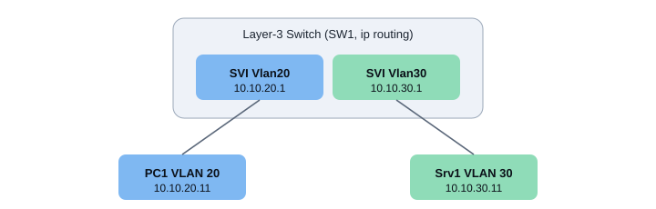

*شکل ۱: Gateway داخل خود سوییچ؛ ترافیک بین VLANها هیچ‌وقت سوییچ را ترک نمی‌کند.*

### ۲. شرط Up شدن SVI (مهم‌ترین نکته)

SVI فقط وقتی `up/up` می‌شود که همه‌ی شرط‌های زیر برقرار باشند:

1.  VLAN روی سوییچ ساخته شده باشد (`show vlan brief`).
2.  حداقل یک پورت در آن VLAN فعال باشد (Access Port بالا، یا Trunk که VLAN را عبور می‌دهد).
3.  SVI با `no shutdown` روشن شده باشد.

> **TS09: SVI Down/Down**
>
> اگر VLAN 30 هیچ پورت فعالی ندارد، `Vlan30` در حالت down/down می‌ماند و Gateway آن VLAN کار نمی‌کند، حتی اگر آدرس درست باشد. اول پورت را بالا بیاورید.

### ۳. مقایسه‌ی RoAS و SVI

| معیار       | Router-on-a-Stick        | SVI (L3 Switch) |
|-------------|--------------------------|-----------------|
| محل Gateway | روتر بیرونی              | خود سوییچ       |
| تعداد کابل  | یک Trunk                 | بدون کابل اضافه |
| سرعت        | محدود به لینک و CPU روتر | سخت‌افزاری، سریع |
| گلوگاه      | دارد (یک لینک)           | ندارد           |
| مناسب برای  | شعبه‌ی کوچک               | هسته‌ی سازمان    |

### ۴. دستورها (خط‌به‌خط)

``` text
SW1(config)# ip routing
SW1(config)# interface vlan 20
SW1(config-if)# ip address 10.10.20.1 255.255.255.0
SW1(config-if)# no shutdown
SW1(config-if)# interface vlan 30
SW1(config-if)# ip address 10.10.30.1 255.255.255.0
SW1(config-if)# no shutdown
SW1(config-if)# end
SW1# show ip interface brief
SW1# show ip route connected
```

- `ip routing`: سوییچ را از «فقط لایه ۲» به «مسیریاب» تبدیل می‌کند. بدون آن SVI آدرس دارد ولی بین VLANها Route نمی‌کند.
- `interface vlan 20`: SVI همان VLAN را می‌سازد (VLAN باید از قبل موجود باشد).
- `no shutdown`: SVI به‌طور پیش‌فرض خاموش است در بعضی نسخه‌ها؛ حتماً بزنید.

### ۵. مثال ساده: ping به SVI

``` text
PC1> ping 10.10.20.1    -> success (SVI Vlan20)
```

### ۶. مثال متوسط: ping بین VLAN

``` text
PC1> ping 10.10.30.11   -> success (routed inside SW1)
SW1# show ip route connected  -> 10.10.20.0/24 via Vlan20, 10.10.30.0/24 via Vlan30
```

### ۷. مثال سخت: TS09 و دو Gateway همزمان

``` text
Symptom   : Vlan30 shows down/down
Check     : show vlan brief          -> VLAN 30 has no active port
            show ip interface brief  -> Vlan30 down/down
Fix       : bring up Gi0/3 (the server port) or allow VLAN 30 on the trunk
Verify    : Vlan30 up/up, ping works

Conflict  : R1 Gi0/0.30 AND SW1 Vlan30 both = 10.10.30.1
Result    : duplicate IP, intermittent failures
Rule      : exactly one gateway per VLAN (shut down the other)
```

### ۸. تمرین‌ها

**ت1.** ۱ (ساده): ip routing برای چیست؟ *(پاسخ: 3-5-ت1 در بخش «پاسخ‌ها» انتهای فصل)*

**ت2.** ۲ (ساده): سه شرط Up شدن SVI *(پاسخ: 3-5-ت2 در بخش «پاسخ‌ها» انتهای فصل)*

**ت3.** ۳ (متوسط): VLAN 40 ساخته‌ایم و SVI دارد ولی down/down است؛ علت؟ *(پاسخ: 3-5-ت3 در بخش «پاسخ‌ها» انتهای فصل)*

**ت4.** ۴ (متوسط): چرا دو Gateway برای یک VLAN مشکل می‌سازد؟ *(پاسخ: 3-5-ت4 در بخش «پاسخ‌ها» انتهای فصل)*

**ت5.** ۵ (سخت): کدام روش برای ۱۰ گیگ ترافیک بین VLANها بهتر است و چرا؟ *(پاسخ: 3-5-ت5 در بخش «پاسخ‌ها» انتهای فصل)*

### ۹. Lab هدایت‌شده (Lab A: Gateway روی سوییچ)

#### گام ۱: خاموش‌کردن Gateway روتر برای VLAN 20 و 30

``` text
R1(config)# interface gi0/0.20
R1(config-subif)# shutdown
R1(config-subif)# interface gi0/0.30
R1(config-subif)# shutdown
```

#### گام ۲: SVIها روی SW1

دستورهای بخش ۴ را اجرا کنید و `show ip interface brief` را بگیرید؛ دو SVI باید up/up باشند.

#### گام ۳: تست

``` text
PC1> ping 10.10.20.1
PC1> ping 10.10.30.11    (routed inside SW1)
```

#### گام ۴: دیدن TS09

``` text
SW1(config)# interface gi0/3
SW1(config-if)# shutdown
SW1# show ip interface brief      -> Vlan30 down/down
SW1(config)# interface gi0/3
SW1(config-if)# no shutdown       -> Vlan30 up/up
```

#### گام ۵: برگشت به Capstone

برای Capstone اصلی (Gateway = فایروال) SVIهای 20 و 30 را `shutdown` کنید یا حذف کنید و فقط SVI مدیریت (VLAN10) بماند. تنظیمات را با `copy run start` ذخیره کنید.

### ۱۰. Lab مستقل

جدول مقایسه‌ی RoAS و SVI را از نتایج Lab خودتان (سرعت ping، Capture، تعداد Hop در trace) بسازید و در `03-ops/roas-vs-svi.md` ذخیره کنید.

### ۱۱. عیب‌یابی

|         |                                                                                                                                              |
|---------|----------------------------------------------------------------------------------------------------------------------------------------------|
| Symptom | Gateway جواب نمی‌دهد                                                                                                                          |
| چک‌لیست  | ۱) `ip routing` فعال است؟ ؛ ۲) SVI up/up است؟ ؛ ۳) VLAN پورت فعال دارد؟ ؛ ۴) Gateway تکراری روی روتر نیست؟ ؛ ۵) PC آدرس و Gateway درست دارد؟ |

### ۱۲. سؤال‌های مرور

**م1.** SVI چیست؟ *(پاسخ: 3-5-م1 در بخش «پاسخ‌ها» انتهای فصل)*

**م2.** چرا SVI down/down می‌شود؟ *(پاسخ: 3-5-م2 در بخش «پاسخ‌ها» انتهای فصل)*

### English Corner: انگلیسی تخصصی این درس

این جمله‌ها از مستندات و محیط کار واقعی‌اند. بلند بخوانید و ترجمه را بپوشانید.

| English sentence                                                  | ترجمه                                                        |
|-------------------------------------------------------------------|--------------------------------------------------------------|
| An SVI is the layer-3 gateway for a VLAN on a multilayer switch.  | SVI گیت‌وی لایه ۳ یک VLAN روی سوییچ چندلایه است.              |
| The SVI stays down until at least one port in the VLAN is active. | SVI تا وقتی دست‌کم یک پورت فعال در VLAN نباشد down می‌ماند.    |
| Enable ip routing to route between VLANs on the switch.           | برای مسیریابی بین VLANها روی سوییچ، ip routing را فعال کنید. |
| Never configure two gateways for the same VLAN.                   | هرگز دو Gateway برای یک VLAN تنظیم نکنید.                    |

**Q1.** Quick quiz (answer in English): When does an SVI come up? *(پاسخ: 3-5-Q1 در بخش «پاسخ‌ها» انتهای فصل)*

### ۱۳. تکلیف و چک‌لیست تسلط

- [ ] SVI را بالا بیاورم و ping بین VLANها بگیرم.
- [ ] TS09 را بسازم و رفع کنم.
- [ ] پیکربندی را به حالت Capstone اصلی برگردانم.

### ۱۴. یادآوری اشتباهات شما

> **یادآوری**
>
> دو Gateway هم‌زمان ممنوع؛ بکاپ قبل از تغییر؛ پذیرفته‌شدن دستور ≠ کار کردن.


#### کارت Lab — درس ۳-۵ (Lab A مقدماتی)

| # | فیلد | محتوا |
|---|---|---|
| 1 | عنوان و هدف | Gateway روی SVI و شرط Up |
| 2 | پیش‌نیاز | درس ۳-۴ |
| 3 | توپولوژی | SW1 با SVI 20/30 |
| 4 | تجهیزات | SW1، ۲ VPCS |
| 5 | نسخه نرم‌افزار | vIOS-L2 15.2(20200924، Experimental) برای SW؛ vIOS 15.9(3)M9 برای R؛ VPCS (PNetLab)؛ PNetLab 4.2.8 |
| 6 | IP Plan | 10.10.20.1/24 و 10.10.30.1/24 |
| 7 | وضعیت اولیه | Sub-interfaceهای R1 shutdown |
| 8 | صورت مسئله | `ip routing`، SVI و ping بین VLAN؛ ایجاد SVI Down/Down |
| 9 | مراحل هدایت‌شده | همان بخش «Lab هدایت‌شده» همین درس (گام‌به‌گام) |
| 10 | تست عملکرد | `show ip interface brief` ؛ ping |
| 11 | سناریوی خرابی | shutdown پورت‌های VLAN 30 (TS09) |
| 12 | روش عیب‌یابی | `show vlan brief` و پورت فعال VLAN |
| 13 | نتیجه‌ی مورد انتظار | Vlan up/up؛ ping موفق |
| 14 | معیار پذیرش | TS09 ساخته و رفع شود |
| 15 | مستندات نهایی | `03-ops/roas-vs-svi.md` |
| 16 | Cleanup و بازگردانی | برگشت به معماری اصلی (Gateway روی FortiGate): SVI 20/30 shutdown |

> **وضعیت راستی‌آزمایی (خارج از ۱۶ فیلد):** **جزئی.** `ip routing` و SVI up/up Tested-OK؛ سناریوی TS09 و ping بین VLAN اجرا نشده.

---

<a id="l-3-6"></a>

## درس ۳-۶ — عیب‌یابی و آزمون هفته

**فصل ۳ - روز ۶ · پیش‌نیاز: درس‌های ۳-۱ تا ۳-۵ · ۶ ساعت**

### این درس درباره چیست و چرا باید یاد بگیریم؟

**چه چیزی یاد می‌گیریم:** روش سیستماتیک عیب‌یابی شبکه (از لایه ۱ به بالا)، پنج سناریوی خرابی TS01 تا TS05، و آزمون عملی کوچک پایان هفته‌ی ۳.

**چرا لازم است:** ادمین خوب کسی نیست که همه‌چیز را حفظ است، کسی است که با روش، خرابی را سریع پیدا می‌کند. اگر «حدس» بزنید، ساعت‌ها هدر می‌دهید؛ اگر «لایه‌به‌لایه» بروید، اغلب در چند دقیقه علت را پیدا می‌کنید.

- **در کار روزانه:** ۸۰٪ تماس‌های پشتیبانی شبکه از لایه ۱ و ۲ است: کابل، پورت، VLAN.
- **در امنیت:** روش سیستماتیک جلوی «تغییر عجولانه» را می‌گیرد که خودش سبب خرابی جدید می‌شود.
- **در مصاحبه:** «چطور عیب‌یابی می‌کنید؟» سؤال ثابت هر مصاحبه است.

> **مسیر درس**
>
> روش لایه‌به‌لایه ← پنج سناریوی TS ← مثال ساده/متوسط/سخت ← تمرین ← Lab عیب‌یابی ← آزمون کوچک.

#### اصطلاحات این درس (مخفف ← شکل کامل ← معنی)

| مخفف        | شکل کامل انگلیسی         | معنی فارسی                                 |
|-------------|--------------------------|--------------------------------------------|
| TS          | Troubleshooting Scenario | سناریوی عیب‌یابی شماره‌دار دوره              |
| RCA         | Root Cause Analysis      | تحلیل علت ریشه‌ای                           |
| Duplex      | Duplex mode              | Half یا Full؛ حالت ارسال/دریافت همزمان     |
| Err-disable | Error-disabled           | پورتی که سوییچ آن را به‌خاطر خطا خاموش کرده |
| CDP         | Cisco Discovery Protocol | کشف همسایه‌های سیسکو                        |
| L1/L2/L3    | Layer 1/2/3              | فیزیکی / پیوند داده / شبکه                 |

### ۱. روش سیستماتیک: از پایین به بالا

مثل بررسی خرابی یک ماشین: اول ببین بنزین دارد (لایه ۱)، بعد استارت می‌خورد (لایه ۲)، بعد جاده را بلد است (لایه ۳). از پایین شروع کنید چون اگر کابل قطع باشد، بقیه‌ی چیزها بی‌معنی است.

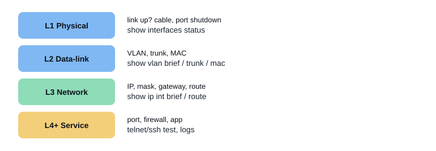

*شکل ۱: نردبان عیب‌یابی؛ از لایه ۱ شروع کنید و فقط وقتی لایه پایین سالم بود بالاتر بروید.*

#### چارچوب پنج‌مرحله‌ای

1.  **Symptom:** دقیقاً چه چیزی خراب است و برای چه کسی؟ (علامت، نه حدس)
2.  **Scope:** چند نفر؟ یک VLAN؟ همه؟
3.  **Hypothesis:** از پایین‌ترین لایه، یک فرضیه بساز.
4.  **Test:** با یک دستور show آن را بسنج.
5.  **Fix and Verify:** رفع، تأیید، ثبت در گزارش (RCA).

### ۲. پنج سناریوی این هفته

#### TS01: Interface Shutdown (ساده)

``` text
Symptom  : PC on Gi0/1 has no link
Evidence : show interfaces status -> Gi0/1 disabled / administratively down
Fix      : interface gi0/1 / no shutdown
Verify   : link up, ping works
```

#### TS02: Duplex/Speed Mismatch (مفهومی)

``` text
Symptom  : link is up but very slow, many CRC/late collisions
Cause    : one side half-duplex, the other full-duplex
Check    : show interfaces gi0/1 -> duplex, speed, errors
Fix      : set both sides to auto (or both manually identical)
```

در شبیه‌ساز، تنظیم Duplex ممکن است اثر واقعی نداشته باشد؛ این سناریو را مفهومی بدانید و در تجهیز واقعی تمرین کنید.

#### TS03: VLAN اشتباه روی Access Port

``` text
Symptom  : PC cannot reach its gateway
Evidence : show vlan brief -> port is in the wrong VLAN
Fix      : switchport access vlan 20
```

#### TS04: Allowed VLAN حذف‌شده روی Trunk

``` text
Symptom  : one VLAN lost across the trunk
Evidence : show interfaces trunk -> VLAN missing in "allowed"
Fix      : switchport trunk allowed vlan add 30
```

#### TS05: Human Error — جایگزینی Allowed List

``` text
Cause    : "allowed vlan 40" typed without "add"
Impact   : all VLANs except 40 are down on the trunk
Fix      : restore from backup or re-add: allowed vlan 10,20,30,40
Lesson   : always "add"; backup + review show before and after
```

### ۳. مثال ساده/متوسط/سخت

#### ساده

کاربر می‌گوید «شبکه قطع است». اول `show interfaces status`: اگر پورت `disabled` است، TS01.

#### متوسط

کاربر به سرور نمی‌رسد ولی به Gateway می‌رسد. لایه ۱ و ۲ سالم است؛ پس `show ip route` و Gateway سرور را ببینید (لایه ۳).

#### سخت

«فقط VLAN 30 از شعبه قطع است، بقیه خوب». نردبان: لینک Trunk up است (L1)، VLAN 30 در allowed نیست (L2) ⇒ TS04. در RCA: چه کسی/کی/چرا تغییر داد؟ چطور جلوگیری شود؟

### ۴. تمرین‌ها

**ت1.** ۱ (ساده): اولین لایه‌ای که چک می‌کنیم چیست؟ *(پاسخ: 3-6-ت1 در بخش «پاسخ‌ها» انتهای فصل)*

**ت2.** ۲ (ساده): پنج مرحله‌ی چارچوب عیب‌یابی را بنویس *(پاسخ: 3-6-ت2 در بخش «پاسخ‌ها» انتهای فصل)*

**ت3.** ۳ (متوسط): «ping به Gateway OK ولی به اینترنت نه»؛ کدام لایه؟ *(پاسخ: 3-6-ت3 در بخش «پاسخ‌ها» انتهای فصل)*

**ت4.** ۴ (سخت): یک Trunk بعد از «allowed vlan 40» همه را قطع کرد؛ سه اقدام بعدی *(پاسخ: 3-6-ت4 در بخش «پاسخ‌ها» انتهای فصل)*

### ۵. Lab هدایت‌شده: همه‌ی TSها را بسازید و رفع کنید

برای هر سناریو: (۱) بکاپ، (۲) خراب‌کردن عمدی، (۳) نوشتن Symptom و Evidence، (۴) رفع، (۵) Verify.

1.  TS01: `shutdown` روی پورت PC1 و رفع.
2.  TS03: بردن پورت PC2 به VLAN اشتباه و رفع.
3.  TS04: `allowed vlan remove 30` روی Trunk و رفع با `add 30`.
4.  TS05: `allowed vlan 40` (بدون add)، سپس برگرداندن از بکاپ.
5.  TS09: `shutdown` پورت سرور و دیدن SVI down/down.

### ۶. آزمون کوچک پایان هفته‌ی ۳ (بدون نگاه به درس)

| \#  | وظیفه                                | مدرک                      |
|-----|--------------------------------------|---------------------------|
| ۱   | MAC یک PC را به پورتش ربط بده        | show mac address-table    |
| ۲   | VLAN Matrix با ۳ VLAN و تنظیم پورت‌ها | show vlan brief           |
| ۳   | Trunk با Native 999 و Allowed        | show interfaces trunk     |
| ۴   | Inter-VLAN با RoAS یا SVI            | ping بین VLANها + Capture |
| ۵   | ۳ سناریو از TS01 تا TS05 با RCA      | گزارش یک‌صفحه‌ای            |

معیار قبولی: حداقل ۴ از ۵ مورد با مدرک. وقتی تمام شد بگویید «فصل ۳ انجام شد».

(آزمون رسمی Gate G2 در پایان فصل ۴ بعد از STP و EtherChannel است.)

### ۷. سؤال‌های مرور

**م1.** چرا از لایه ۱ شروع می‌کنیم؟ *(پاسخ: 3-6-م1 در بخش «پاسخ‌ها» انتهای فصل)*

**م2.** تفاوت TS04 و TS05؟ *(پاسخ: 3-6-م2 در بخش «پاسخ‌ها» انتهای فصل)*

### English Corner: انگلیسی تخصصی این درس

این جمله‌ها از مستندات و محیط کار واقعی‌اند. بلند بخوانید و ترجمه را بپوشانید.

| English sentence                                               | ترجمه                                                                    |
|----------------------------------------------------------------|--------------------------------------------------------------------------|
| Always start troubleshooting at layer 1 and work your way up.  | عیب‌یابی را همیشه از لایه ۱ شروع کنید و بالا بروید.                       |
| The interface is administratively down.                        | Interface به‌صورت مدیریتی خاموش است.                                      |
| Document the root cause and the fix in the RCA.                | علت ریشه‌ای و راه‌حل را در RCA مستند کنید.                                 |
| A typo in the allowed VLAN list can take down the whole trunk. | یک اشتباه تایپی در لیست VLANهای مجاز می‌تواند کل Trunk را از کار بیندازد. |

**Q1.** Quick quiz (answer in English): What are the five steps of the troubleshooting framework? *(پاسخ: 3-6-Q1 در بخش «پاسخ‌ها» انتهای فصل)*

### ۸. تکلیف و چک‌لیست تسلط

- [ ] پنج TS را ساخته و رفع کنم و گزارش RCA بنویسم.
- [ ] آزمون کوچک را کامل کنم.
- [ ] پیکربندی پایانی را ذخیره و بکاپ بگیرم.

### ۹. یادآوری اشتباهات شما

> **یادآوری**
>
> حدس نزنید؛ لایه‌به‌لایه بروید. بکاپ قبل از تغییر. هر نتیجه‌ی واقعی را ثبت کنید.


#### کارت Lab — درس ۳-۶

| # | فیلد | محتوا |
|---|---|---|
| 1 | عنوان و هدف | عیب‌یابی TS01..TS05 و آزمون کوچک |
| 2 | پیش‌نیاز | درس‌های ۳-۱ تا ۳-۵ |
| 3 | توپولوژی | همان توپولوژی درس‌های قبل |
| 4 | تجهیزات | SW1، SW2، R1، VPCS |
| 5 | نسخه نرم‌افزار | vIOS-L2 15.2(20200924، Experimental) برای SW؛ vIOS 15.9(3)M9 برای R؛ VPCS (PNetLab)؛ PNetLab 4.2.8 |
| 6 | IP Plan | طبق درس‌های قبل |
| 7 | وضعیت اولیه | بکاپ تنظیمات سالم |
| 8 | صورت مسئله | هر TS را بسازید، Symptom/Evidence/Fix/Verify/RCA بنویسید |
| 9 | مراحل هدایت‌شده | همان بخش «Lab هدایت‌شده» همین درس (گام‌به‌گام) |
| 10 | تست عملکرد | ping، show vlan/trunk، show ip route |
| 11 | سناریوی خرابی | پنج TS (shutdown، VLAN اشتباه، allowed حذف‌شده، allowed بدون add، SVI down) |
| 12 | روش عیب‌یابی | لایه‌ای L1→L3 |
| 13 | نتیجه‌ی مورد انتظار | هر TS با RCA رفع |
| 14 | معیار پذیرش | حداقل ۴ از ۵ مورد با مدرک |
| 15 | مستندات نهایی | `03-ops/rca-w3.md` |
| 16 | Cleanup و بازگردانی | بازگردانی از بکاپ سالم |

> **وضعیت راستی‌آزمایی (خارج از ۱۶ فیلد):** **اجرا نشده (فقط طراحی).** اجرا نشده؛ TS01 تا TS05 هنوز روی Image ساخته نشده‌اند.

---

<a id="ans-3"></a>

## پاسخ‌های فصل 3

> ابتدا بدون نگاه حل کنید. هر پاسخ با شناسه‌ی «درس-نوع+شماره» مشخص است (ت = تمرین، م = سؤال مرور، Q = Quick quiz انگلیسی).

**3-1-ت1** — ۱ (ساده): سوییچ کدام MAC را یاد می‌گیرد: مبدأ یا مقصد؟

سوییچ فقط MAC مبدأ (Source) را یاد می‌گیرد: برای هر فریم ورودی، آدرس مبدأ را همراه شماره‌ی پورت ورودی در جدول CAM ثبت می‌کند. MAC مقصد فقط جست‌وجو می‌شود تا پورت خروجی انتخاب شود. اگر مقصد در جدول نباشد (Unknown unicast) فریم Flood می‌شود. این قاعده توضیح می‌دهد چرا Broadcast (که فقط مقصد است) هرگز در جدول MAC نمی‌آید.

``` text
Source MAC only.
Destination MAC is only looked up, never learned.
```

**3-1-ت2** — ۲ (ساده): فریم با مقصد ff:ff:ff:ff:ff:ff چطور پخش می‌شود؟

مقصد ff:ff:ff:ff:ff:ff آدرس Broadcast است؛ سوییچ آن را از همه‌ی پورت‌های همان VLAN به‌جز پورت ورودی (Flood) می‌فرستد. بنابراین Broadcast به همه‌ی Hostهای VLAN می‌رسد؛ همین دلیل محدودکردن VLAN و جلوگیری از Storm است. روتر آن را عبور نمی‌دهد.

``` text
Flooded out of all ports except the ingress port.
```

**3-1-ت3** — ۳ (متوسط): جدول خالی است. A (Gi0/1) به B (Gi0/2) و بعد B به A می‌فرستد. چند Flood رخ می‌دهد؟

گام ۱: A به B می‌فرستد؛ سوییچ MAC-A را روی Gi0/1 یاد می‌گیرد ولی MAC-B را نمی‌شناسد ⇒ Flood (۱ بار). گام ۲: B به A می‌فرستد؛ سوییچ MAC-B را روی Gi0/2 یاد می‌گیرد و چون MAC-A قبلاً یاد گرفته شده، فریم فقط به Gi0/1 می‌رود ⇒ بدون Flood. از این به بعد ارتباط A↔B Unicast است.

``` text
A -> B : 1 flood (B unknown)
B -> A : 0 floods (A learned)
```

``` text
1 flood  (A -> B: B unknown)
0 floods (B -> A: A already learned)
```

**3-1-ت4** — ۴ (متوسط): چرا ردیف یک MAC بعد از ۵ دقیقه ناپدید می‌شود؟

ردیف CAM پس از انقضای Aging Time (پیش‌فرض ۳۰۰ ثانیه) بدون دیدن فریم جدید از آن MAC حذف می‌شود تا جدول از Hostهای رفته پر نشود. هر فریم جدید Timer را تازه می‌کند. با `show mac address-table aging-time` ببینید؛ Aging کوتاه‌تر جدول را سبک‌تر ولی Flood را بیشتر می‌کند.

``` text
Aging time = 300 s. No frames from that MAC refresh the entry.
```

**3-1-ت5** — ۵ (سخت): MACFLAP روی MAC-X بین Gi0/1 و Gi0/2؛ محتمل‌ترین علت؟

MACFLAP یعنی یک MAC مرتب بین دو پورت جابه‌جا می‌شود. محتمل‌ترین علت حلقه‌ی لایه‌ی ۲ (STP خراب/خاموش) یا MAC تکراری (دو دستگاه با یک MAC، یا Virtual MAC/VM Migration) است. اقدام اول: یافتن و قطع حلقه (بررسی STP، کابل اضافی، سوییچ جعلی) و نه پاک‌کردن جدول؛ پاک‌کردن علامت را موقتاً پنهان می‌کند.

``` text
A layer-2 loop (or a duplicated MAC).
First action: find the loop and cut it, not clear the table.
```

**3-1-م1** — سوییچ چه چیزی را یاد می‌گیرد و از کجا؟

سوییچ MAC مبدأ فریم و پورتی که فریم از آن وارد شده را یاد می‌گیرد (و VLAN). این جدول CAM است. چون یادگیری دینامیک است، ورودی‌ها با Aging پاک می‌شوند.

MAC مبدأ فریم و پورتی که فریم از آن وارد شد.

**3-1-م2** — چرا Broadcast هیچ‌وقت در جدول MAC دیده نمی‌شود؟

چون Broadcast (ff:ff:ff:ff:ff:ff) آدرس مقصد است نه مبدأ؛ و سوییچ فقط Source MAC را یاد می‌گیرد. هیچ Host با MAC مبدأ Broadcast نمی‌فرستد.

چون Broadcast فقط مقصد است، نه مبدأ.

**3-1-م3** — Flooding یعنی چه؟

Flooding یعنی ارسال فریم از همه‌ی پورت‌های هم‌VLAN به‌جز ورودی؛ برای Broadcast، Multicast ناشناخته و Unknown Unicast. زیاد بودن Flood نشانه‌ی جدول MAC ناقص، حلقه یا حمله‌ی MAC Flooding است.

ارسال فریم از همه‌ی پورت‌ها به‌جز پورت ورودی.

**3-1-Q1** — Quick quiz (answer in English): What does a switch do when the destination MAC is not in its table?

پاسخ انگلیسی در پایین آمده است. نکته‌ی عملی: Unknown unicast flooding موقتی است و پس از اولین پاسخ، سوییچ مقصد را یاد می‌گیرد.

It floods the frame out of all ports except the one it arrived on.

**3-2-ت1** — ۱ (ساده): چرا VLAN باعث کاهش Broadcast می‌شود؟

هر VLAN یک Broadcast Domain جداست؛ Broadcast (مثل ARP و DHCP Discover) فقط داخل همان VLAN می‌رود. با ۱۰۰ Host در یک VLAN هر Broadcast به همه می‌رسد؛ با شکستن به ۴ VLAN ۲۵تایی، ترافیک Broadcast هر Host حدود ۷۵٪ کم می‌شود و امنیت هم بهتر می‌شود.

``` text
Each VLAN is a separate broadcast domain.
Broadcasts stay inside their VLAN.
```

**3-2-ت2** — ۲ (ساده): دو کامپیوتر در VLAN های 20 و 30 بدون روتر ping می‌کنند؛ نتیجه؟

بدون روتر/لایه‌ی ۳، دو کامپیوتر در VLAN 20 و 30 هم‌شبکه نیستند و ARP/ping شکست می‌خورد: Broadcast Domainها جدا و Gateway وجود ندارد. VLAN‌ها فقط با Inter-VLAN Routing (RoAS یا SVI) ارتباط می‌گیرند.

``` text
Fails: different broadcast domains, no gateway.
```

**3-2-ت3** — ۳ (متوسط): دستورهای لازم برای ساختن VLAN 40 با نام GUEST و قراردادن Gi0/6 در آن

VLAN را بسازید، نام بدهید و پورت را Access کرده در VLAN قرار دهید. بررسی: `show vlan brief`. اگر VLAN نباشد، پورت در حالت Inactive می‌ماند.

``` text
vlan 40
 name GUEST
interface gi0/6
 switchport mode access
 switchport access vlan 40
```

``` text
vlan 40
 name GUEST
interface gi0/6
 switchport mode access
 switchport access vlan 40
```

**3-2-ت4** — ۴ (متوسط): خروجی show vlan brief چه چیزی نشان می‌دهد؟

`show vlan brief` شناسه‌ی VLAN، نام، وضعیت (active/act/unsup) و پورت‌های Access هر VLAN را نشان می‌دهد. پورت‌های Trunk در آن دیده نمی‌شوند؛ برای آن‌ها `show interfaces trunk`. اولین ابزار تأیید VLAN است.

``` text
VLAN ID, Name, Status and the access ports of each VLAN.
```

**3-2-ت5** — ۵ (سخت): کاربر در VLAN 20 است ولی به Gateway نمی‌رسد؛ سه علت محتمل

سه علت: ۱) پورت کاربر در VLAN اشتباه است. ۲) VLAN ساخته نشده یا Shutdown است. ۳) IP/Mask/Gateway کامپیوتر اشتباه است (یا Trunk VLAN را عبور نمی‌دهد). بررسی به ترتیب: `show vlan brief`، `show interfaces switchport`، `ipconfig /all`، ping Gateway.

``` text
1) Port is in the wrong VLAN
2) VLAN does not exist or is shut down
3) Wrong IP/mask/gateway on the PC
```

**3-2-م1** — VLAN چه فایده‌ای دارد؟

VLAN Broadcast Domain را می‌شکند، ترافیک را جدا و امنیت و مقیاس‌پذیری را بهتر می‌کند؛ گروه‌بندی منطقی مستقل از مکان فیزیکی.

جداسازی Broadcast Domain و امنیت بیشتر.

**3-2-م2** — Access Port چیست؟

Access Port پورتی است که فقط یک VLAN دارد و فریم‌ها بدون Tag می‌رود؛ دستگاه انتهایی (PC، چاپگر) به آن وصل می‌شود. برعکس Trunk که چند VLAN با Tag حمل می‌کند.

پورتی که فقط عضو یک VLAN است و دستگاه انتهایی به آن وصل می‌شود.

**3-2-Q1** — Quick quiz (answer in English): Why do hosts in different VLANs need a router?

پاسخ انگلیسی در پایین آمده است. هر VLAN یک Subnet جدا دارد و برای عبور بین Subnetها Routing لازم است.

Because each VLAN is a separate broadcast domain (separate subnet), so traffic must be routed between them.

**3-3-ت1** — ۱ (ساده): چند بیت از Tag مخصوص VLAN ID است و چند VLAN قابل‌استفاده داریم؟

فیلد VLAN ID در Tag 802.1Q دوازده بیتی است: ۲^۱۲ = ۴۰۹۶ مقدار. VLAN 0 و 4095 رزرو است، پس ۴۰۹۴ VLAN قابل‌استفاده (۱ تا ۴۰۹۴)؛ VLANهای ۱۰۰۲ تا ۱۰۰۵ برای Token Ring/FDDI رزرو است.

``` text
2^12 = 4096 ; minus 0 and 4095 -> 4094 usable IDs
```

``` text
12 bits -> 4096 values -> minus 2 reserved -> 4094 usable IDs (1..4094)
```

**3-3-ت2** — ۲ (ساده): تفاوت allowed vlan 40 با allowed vlan add 40؟

`switchport trunk allowed vlan 40` لیست را به‌طور کامل با «فقط 40» جایگزین می‌کند و سایر VLANها قطع می‌شوند. `allowed vlan add 40` فقط VLAN 40 را به لیست موجود اضافه می‌کند. روی Trunk زنده همیشه از add استفاده کنید.

``` text
Without add: replaces the list.
With add: appends VLAN 40 to the existing list.
```

**3-3-ت3** — ۳ (متوسط): Native Mismatch چه عارضه‌ای دارد؟

عدم‌تطابق Native VLAN باعث هشدار CDP و Leak ترافیک Native به VLAN دیگر می‌شود (احتمال VLAN Hopping). باید Native در دو سر یکسان و ترجیحاً VLAN بلااستفاده (مثلاً 999) باشد.

``` text
CDP warning and traffic of the native VLAN leaks into another VLAN (VLAN hopping risk).
```

**3-3-ت4** — ۴ (متوسط): چرا nonegotiate را می‌زنیم؟

`switchport nonegotiate` مذاکره‌ی DTP را غیرفعال می‌کند تا پورت به‌صورت ناخواسته Trunk نشود (مثلاً با سوییچ جعلی). پیکربندی صریح: `switchport mode trunk` + `nonegotiate` روی Uplink و `mode access` روی پورت کاربر.

``` text
It disables DTP negotiation so the port cannot become a trunk unexpectedly.
```

**3-3-ت5** — ۵ (سخت): روی Trunk هستید و VLAN 30 در show interfaces trunk در ستون allowed نیست؛ ۳ دستور رفع

اگر VLAN 30 در ستون allowed نیست: ابتدا وضعیت را ببینید، سپس VLAN را اضافه کنید، سپس تأیید کنید. سه دستور:

``` text
show interfaces trunk
switchport trunk allowed vlan add 30
show interfaces trunk
```

``` text
show interfaces trunk
switchport trunk allowed vlan add 30
show interfaces trunk   (verify)
```

**3-3-م1** — Trunk چه کاری می‌کند؟

Trunk چند VLAN را با Tag 802.1Q روی یک لینک عبور می‌دهد تا برای هر VLAN کابل جدا لازم نباشد. بین سوییچ‌ها و سوییچ‌-روتر استفاده می‌شود.

چند VLAN را با Tag روی یک لینک عبور می‌دهد.

**3-3-م2** — Native VLAN چیست؟

Native VLAN VLANی است که روی Trunk بدون Tag می‌رود (پیش‌فرض 1). برای امنیت باید تغییر کند و در دو سر یکسان باشد.

VLANی که روی Trunk بدون Tag می‌رود.

**3-3-Q1** — Quick quiz (answer in English): Why is "switchport trunk allowed vlan 40" dangerous on a live trunk?

پاسخ انگلیسی در پایین آمده است؛ این خطا شایع‌ترین علت قطعی Trunk در Maintenance است: همیشه `add`.

It replaces the entire allowed list, so all other VLANs lose connectivity.

**3-4-ت1** — ۱ (ساده): چرا فقط یک کابل فیزیکی کافی است؟

Trunk همه‌ی VLANها را با Tag می‌برد؛ روتر روی همان Interface فیزیکی چند Sub-interface (Gi0/0.10، .20، .30) می‌سازد و هر کدام Gateway یک VLAN است. پس یک کابل کافی است. ریسک: همان یک لینک گلوگاه است.

``` text
The trunk carries all VLANs tagged; the router splits them into logical sub-interfaces.
```

**3-4-ت2** — ۲ (ساده): کدام آدرس IP روی Gi0/0.20 می‌نشیند؟

Sub-interface Gi0/0.20 آدرس Gateway VLAN 20 را می‌گیرد؛ مثلاً 10.10.20.1/24 (اولین Host Subnet). این همان آدرسی است که کلاینت‌ها به‌عنوان Default Gateway دارند. دستور: `encapsulation dot1Q 20` و `ip address 10.10.20.1 255.255.255.0`.

``` text
The default gateway of VLAN 20, e.g. 10.10.20.1/24 (first host of the subnet).
```

**3-4-ت3** — ۳ (متوسط): در مسیر PC1 به Srv1 کدام فیلدها عوض می‌شوند و کدام نه؟

در Routing بین VLAN: Source و Destination IP عوض نمی‌شود؛ ولی MAC مبدأ و مقصد در هر Hop عوض می‌شود (MAC روتر)، Tag VLAN تغییر می‌کند و TTL یک واحد کم می‌شود.

``` text
Unchanged: src IP, dst IP
Changed: src MAC, dst MAC, VLAN tag, TTL-1
```

``` text
Unchanged: source IP, destination IP
Changed: destination MAC, source MAC, VLAN tag, TTL (-1)
```

**3-4-ت4** — ۴ (متوسط): اگر encapsulation dot1Q 3 به‌جای 30 بزنیم چه می‌شود؟

Sub-interface با `encapsulation dot1Q 3` فقط فریم Tag 3 را می‌پذیرد؛ سوییچ Tag 30 می‌فرستد و روتر آن را نادیده می‌گیرد، پس Hostهای VLAN 30 به Gateway نمی‌رسند. بررسی: `show interfaces trunk`، `show run interface Gi0/0.30`.

``` text
R1 expects tag 3, but the switch sends tag 30 -> frames ignored -> VLAN 30 hosts cannot reach the gateway.
```

**3-4-ت5** — ۵ (سخت): نقطه‌ضعف RoAS چیست؟

نقطه‌ضعف RoAS: همه‌ی ترافیک بین VLANها روی یک لینک در هر دو جهت می‌رود (گلوگاه پهنای باند) و روتر نقطه‌ی شکست واحد است. برای Lab و شعبه‌ی کوچک کافی؛ برای کمپوس از SVI روی سوییچ L3 استفاده می‌شود.

``` text
All inter-VLAN traffic crosses the single link both ways (bandwidth bottleneck) and the router is a single point of failure.
```

**3-4-م1** — Sub-interface چیست؟

Sub-interface Interface منطقی روی یک Interface فیزیکی است که به یک VLAN (با Tag) وصل می‌شود و آدرس Gateway همان VLAN را دارد.

Interface منطقی روی یک Interface فیزیکی که به یک VLAN وصل است.

**3-4-م2** — چرا Interface فیزیکی IP ندارد؟

Interface فیزیکی فقط Trunk را حمل می‌کند و IP روی Sub-interfaceهاست؛ اگر IP هم روی فیزیکی بگذارید با Native VLAN تداخل می‌کند.

چون فقط Trunk را حمل می‌کند؛ آدرس‌ها روی Sub-interfaceها هستند.

**3-4-Q1** — Quick quiz (answer in English): What is the main drawback of router-on-a-stick?

پاسخ انگلیسی در پایین آمده است؛ اگر ترافیک بین VLANها زیاد باشد، لینک اشباع می‌شود و تأخیر بالا می‌رود؛ راه‌حل SVI.

All inter-VLAN traffic shares one link, creating a bandwidth bottleneck and a single point of failure.

**3-5-ت1** — ۱ (ساده): ip routing برای چیست؟

`ip routing` روی سوییچ L3 قابلیت مسیریابی را روشن می‌کند؛ بدون آن SVIها فقط Interface مدیریتی هستند و بین VLANها Route نمی‌شود. بعد از آن Routeهای Connected و Static/OSPF ساخته می‌شود.

``` text
It enables layer-3 routing on the switch so it can route between SVIs.
```

**3-5-ت2** — ۲ (ساده): سه شرط Up شدن SVI

SVI وقتی Up می‌شود که: ۱) VLAN وجود داشته باشد، ۲) حداقل یک پورت فعال در VLAN باشد (Access یا Trunk مجاز)، ۳) SVI با `no shutdown` فعال باشد. هر کدام نباشد SVI در حالت down/down می‌ماند.

``` text
1) VLAN exists
2) at least one active port in the VLAN
3) SVI is not shut down
```

**3-5-ت3** — ۳ (متوسط): VLAN 40 ساخته‌ایم و SVI دارد ولی down/down است؛ علت؟

VLAN 40 و SVI ساخته شده ولی down/down: هیچ پورت Up در VLAN 40 نیست و روی Trunk Up هم Allowed نیست. رفع: پورت Access به VLAN 40 اضافه یا `allowed vlan add 40` و بررسی `show vlan brief`.

``` text
No active (up) port in VLAN 40 and it is not allowed on a trunk to an up port.
```

**3-5-ت4** — ۴ (متوسط): چرا دو Gateway برای یک VLAN مشکل می‌سازد؟

دو Gateway برای یک VLAN یعنی دو دستگاه با همان IP/MAC‌ یا IPهای متفاوت بدون FHRP: Duplicate IP، ARP ناپایدار و رفتار ناهماهنگ. راه درست: یک Gateway یا FHRP (HSRP/VRRP) با VIP مشترک.

``` text
Duplicate IP/MAC confusion: hosts get inconsistent replies; traffic flaps.
```

**3-5-ت5** — ۵ (سخت): کدام روش برای ۱۰ گیگ ترافیک بین VLANها بهتر است و چرا؟

برای ۱۰ گیگ ترافیک بین VLANها SVI روی سوییچ L3 مناسب است: Routing سخت‌افزاری (CEF/ASIC) بدون گلوگاه لینک تکی. RoAS محدود به پهنای یک لینک و CPU روتر است.

``` text
SVI on a layer-3 switch: hardware routing, no single-link bottleneck.
```

**3-5-م1** — SVI چیست؟

SVI یک Interface مجازی لایه‌ی ۳ برای یک VLAN روی سوییچ L3 است و آدرس Gateway VLAN را می‌گیرد.

Interface مجازی لایه ۳ برای یک VLAN روی سوییچ.

**3-5-م2** — چرا SVI down/down می‌شود؟

SVI down/down می‌شود چون VLAN ساخته نشده، پورت Up در VLAN نیست یا SVI shutdown است.

چون VLAN پورت فعالی ندارد یا ساخته نشده یا SVI خاموش است.

**3-5-Q1** — Quick quiz (answer in English): When does an SVI come up?

پاسخ انگلیسی در پایین آمده است؛ هنگام عیب‌یابی سه شرط را به ترتیب بررسی کنید: VLAN، پورت، SVI.

When the VLAN exists, at least one port in the VLAN is up, and the SVI is not shut down.

**3-6-ت1** — ۱ (ساده): اولین لایه‌ای که چک می‌کنیم چیست؟

ابتدا لایه‌ی ۱ (فیزیکی): کابل، لینک، LED، Speed/Duplex، Shutdown. چون لایه‌های بالاتر به آن وابسته‌اند؛ بدون لینک، بررسی VLAN/IP بی‌معناست. ابزار: `show interfaces status`، شمارنده‌ی خطا.

``` text
Layer 1 (physical): cable, link, shutdown.
```

**3-6-ت2** — ۲ (ساده): پنج مرحله‌ی چارچوب عیب‌یابی را بنویس

چارچوب عیب‌یابی: Symptom (علامت)، Scope (دامنه: چه کسی، کجا)، Hypothesis (فرضیه)، Test (آزمون)، Fix و Verify (رفع و تأیید). با ثبت هر مرحله، عیب‌یابی قابل‌تکرار و قابل‌ممیزی می‌شود.

``` text
Symptom, Scope, Hypothesis, Test, Fix and Verify.
```

**3-6-ت3** — ۳ (متوسط): «ping به Gateway OK ولی به اینترنت نه»؛ کدام لایه؟

ping به Gateway موفق (L1/L2/L3 تا Gateway سالم) ولی اینترنت نه: مشکل لایه‌ی ۳ به بالا: Default Route، NAT، فایروال/ACL، DNS. بررسی: `traceroute`، `show ip route`، `nslookup`.

``` text
Layer 3 or above: routing/default route/NAT/firewall (L1 and L2 are fine).
```

**3-6-ت4** — ۴ (سخت): یک Trunk بعد از «allowed vlan 40» همه را قطع کرد؛ سه اقدام بعدی

پس از `allowed vlan 40` که همه را قطع کرد: ۱) بازیابی از Backup (یا `rollback`). ۲) `allowed vlan add 10,20,30`. ۳) تأیید با `show interfaces trunk` و ping و نوشتن RCA (علت: فراموشی add).

``` text
1) restore from backup
2) allowed vlan add 10,20,30
3) verify with show interfaces trunk and ping, then write the RCA
```

**3-6-م1** — چرا از لایه ۱ شروع می‌کنیم؟

از لایه‌ی ۱ شروع می‌کنیم چون لایه‌های بالاتر بدون آن کار نمی‌کنند؛ بررسی پایین‌به‌بالا از هدررفتن وقت جلوگیری می‌کند.

چون لایه‌های بالاتر به آن وابسته‌اند.

**3-6-م2** — تفاوت TS04 و TS05؟

TS04 حذف یک VLAN از لیست Trunk است (خطای Config)؛ TS05 جایگزینی کل لیست به‌خاطر اشتباه انسانی (فراموشی add). هر دو علامت مشابه (VLAN قطع) ولی علت و پیشگیری متفاوت.

TS04 حذف یک VLAN از لیست است؛ TS05 جایگزینی کل لیست به‌خاطر اشتباه انسانی (فراموشی add).

**3-6-Q1** — Quick quiz (answer in English): What are the five steps of the troubleshooting framework?

پاسخ انگلیسی در پایین آمده است؛ ترتیب ثابت: Symptom، Scope، Hypothesis، Test، Fix&Verify.

Symptom, Scope, Hypothesis, Test, Fix and Verify.

---

<a id="end1"></a>

### پاسخ‌های درس افزوده‌ی 3-0 (فصل 3)

**3-0-ت1** — حداقل 64 بایت، حداکثر 1518 بایت (1522 با 802.1Q).

**3-0-ت2** — Flood به همه‌ی پورت‌های همان VLAN به‌جز ورودی.

**3-0-ت3** — 48 Collision Domain (هر پورت)؛ 3 Broadcast Domain.

**3-0-ت4** — لینک Up، کندی، late collision/CRC/runts.

**3-0-ت5** — پر کردن CAM با MAC جعلی؛ سوئیچ Flood می‌کند؛ دفاع: Port Security max MAC، violation، Alert.

**3-0-ت6** — Aging کمتر (مثلاً 60–120 s) تا MAC جابه‌جاشده زودتر پاک شود؛ هزینه: Flood بیشتر؛ بر اساس اندازه‌گیری.

**3-0-Q1** — It floods the frame out of all ports in the same VLAN except the ingress port.

# پایان بخش ۱ (فصل‌های ۱ تا ۳)

## ۱) خلاصه‌ی مهارت‌های کسب‌شده
- **زیرساخت/روش:** لایه‌های Lab، ایزولاسیون، Snapshot در برابر Backup، تغییر ایمن، Image Validation با شاهد.
- **IP:** باینری، Prefix/Mask، Subnetting، AND، VLSM، IP Plan؛ IPv6 (نمایش، انواع، NDP/SLAAC).
- **CLI و مدیریت:** حالت‌ها، بکاپ/Rollback، SSH امن، ACL مدیریت.
- **تحلیل بسته:** ARP/ICMP با Wireshark.
- **Switching:** CAM، VLAN، Trunk/802.1Q، RoAS، SVI، عیب‌یابی لایه‌ای.

## ۲) آزمون پایان سه فصل (۲۰ سؤال؛ پاسخ را پایین‌تر ببینید)
**س1** (مفهومی) — فرق Discovery و Change را در دو جمله بگویید و یک مثال بزنید.

**س2** (مفهومی) — چرا vSwitch بدون Uplink ایزولاسیون واقعی می‌دهد؟

**س3** (محاسبه) — 10.10.20.77/26: شبکه، Broadcast، Hostها و تعداد Host؟

**س4** (محاسبه) — به ۵۰ Host نیاز داریم؛ کوچک‌ترین Prefix؟

**س5** (محاسبه) — تعداد کل IP در 172.16.0.0/20 و Mask آن؟

**س6** (تحلیل) — 10.10.20.77/26 و 10.10.20.130/26 هم‌شبکه‌اند؟ چرا؟

**س7** (طراحی) — برای ۴ بخش (۱۰۰، ۵۰، ۱۲، لینک ۲) از 192.168.10.0/24 VLSM بسازید.

**س8** (IPv6) — `2001:0db8:0000:0000:0001:0000:0000:0005` را کوتاه کنید.

**س9** (IPv6) — چرا ICMPv6 را نباید کامل بست؟

**س10** (CLI) — تفاوت running-config و startup-config و دستور ذخیره؟

**س11** (CLI) — چرا قبل از تغییر راه دور `reload in 5` می‌گذاریم؟

**س12** (امنیت) — سه کنترل لازم برای SSH امن؟

**س13** (Wireshark) — ARP Request به چه MAC مقصدی فرستاده می‌شود و چرا؟

**س14** (سوییچ) — سوییچ MAC مبدأ را یاد می‌گیرد یا مقصد؟

**س15** (VLAN) — چرا دو Host در VLANهای مختلف بدون Gateway ارتباط نمی‌گیرند؟

**س16** (Trunk) — تفاوت `allowed vlan 40` و `allowed vlan add 40` و خطر اولی؟

**س17** (Inter-VLAN) — نقطه‌ضعف Router-on-a-Stick نسبت به SVI؟

**س18** (عیب‌یابی) — SVI `Vlan30` down/down است؛ سه شرط Up بودن و اقدام؟

**س19** (سناریو) — کاربر VLAN 20 به Gateway نمی‌رسد؛ پنج بررسی به ترتیب؟

**س20** (طراحی) — چرا مثال «شعبه با ۳۰ کاربر در /27» طراحی خوبی نیست؟


## ۳) پاسخ آزمون
- **س1:** Discovery فقط می‌خواند و وضع موجود (As-Is) را ثبت می‌کند؛ Change چیزی را تغییر می‌دهد و Backup/Rollback/تأیید می‌خواهد. مثال: `esxcli ... list` در برابر حذف یک Port Group.
- **س2:** چون هیچ مسیر فیزیکی به شبکه‌ی واقعی ندارد؛ ترافیک فقط بین VMهای متصل به همان vSwitch می‌ماند.
- **س3:** Block=64؛ شبکه 10.10.20.64؛ Broadcast 10.10.20.127؛ Hostها .65 تا .126؛ 62 Host.
- **س4:** ۵۰+۲=۵۲ ← ۶۴ ← /26 (۶۲ Host).
- **س5:** Mask 255.255.240.0؛ 2^12 = 4096 آدرس (۴۰۹۴ Host).
- **س6:** خیر؛ شبکه‌ها 10.10.20.64 و 10.10.20.128 هستند؛ ارتباط از Gateway می‌گذرد.
- **س7:** فروش /25 (.0)، فنی /26 (.128)، مدیریت /28 (.192)، لینک /30 (.208)؛ بزرگ‌ترین اول، بدون هم‌پوشانی.
- **س8:** `2001:db8::1:0:0:5` (:: روی اولین رشته‌ی صفر).
- **س9:** NDP/SLAAC به آن وابسته‌اند.
- **س10:** running در RAM و فعال؛ startup در NVRAM برای بوت بعدی؛ `copy running-config startup-config`.
- **س11:** اگر تغییر دسترسی را قطع کرد، دستگاه خودش به تنظیمات ذخیره‌شده برمی‌گردد.
- **س12:** SSH v2 با RSA ≥ 2048، Telnet بسته (`transport input ssh`)، ACL مدیریت روی VTY (+ کاربر محلی).
- **س13:** ff:ff:ff:ff:ff:ff (Broadcast)؛ چون MAC مقصد را نمی‌دانیم.
- **س14:** مبدأ؛ مقصد فقط جستجو می‌شود.
- **س15:** دو Broadcast Domain/Subnet جدا؛ مسیر بین آن‌ها لایه ۳ می‌خواهد.
- **س16:** اولی کل لیست را جایگزین می‌کند و بقیه‌ی VLANها قطع می‌شوند؛ دومی فقط اضافه می‌کند.
- **س17:** همه‌ی ترافیک بین VLANها از یک لینک Trunk می‌گذرد؛ گلوگاه و نقطه‌ی شکست واحد.
- **س18:** VLAN ساخته‌شده؛ حداقل یک پورت فعال در VLAN؛ SVI بدون shutdown. اقدام: پورت سرور را بالا بیاورید.
- **س19:** پورت UP؛ پورت در VLAN درست؛ VLAN وجود دارد؛ VLAN در Trunk مجاز؛ IP/Mask/Gateway کلاینت.
- **س20:** /27 دقیقاً ۳۰ Host می‌دهد ولی Gateway هم یک آدرس می‌گیرد؛ حاشیه‌ی رشد ندارد؛ /26 بهتر است.

## ۴) معیارهای تسلط (برای رفتن به بخش ۲)
| مهارت | سطح لازم | شاهد |
|---|---|---|
| Subnetting/VLSM | بدون ابزار، L3 | ۸ تمرین فصل ۲ + IP Plan مستقل |
| IPv6 پایه | L2 | کوتاه‌نویسی، انواع آدرس |
| CLI، بکاپ و Rollback، SSH | L3 | Lab Card ۲-۴ و ۲-۵ |
| Wireshark ARP/ICMP | L3 | Lab Card ۲-۶ (G1 ≥ ۶ از ۷) |
| VLAN/Trunk/Inter-VLAN | L3 | VLAN Matrix، Lab Card ۳-۲ تا ۳-۵ |
| عیب‌یابی لایه‌ای | L3 | ≥ ۴ از ۵ TS با RCA (۳-۶) |
| توضیح «چرا» (Route/VLAN/Gateway) | الزامی | پاسخ آزمون س۱۴ تا س۱۹ را با کلمات خودتان بنویسید |

## ۵) مشکلات و موارد باقی‌مانده (صریح)
1. **نتیجه‌ی واقعی Lab روی Image شما ثبت‌نشده** برای: CAM/VLAN/Trunk/SVI روی vIOS-L2 (طبق Probe: VLAN و Trunk و PVST Tested-OK؛ اما Violation Port-Security، DHCP Snooping، ACL و QoS فقط CLI-Accepted). از شما می‌خواهیم خروجی واقعی را بیاورید.
2. درس‌های ۱-A و ۱-B **قالب ۱۲ بخشی** را کامل ندارند (Runbook عملیاتی‌اند)؛ برای ممیزی: آیا بازنویسی لازم است؟
3. «مثال سازمانی» در همه‌ی درس‌ها صریح و جدا نیست؛ در درس‌های ۲-۲ و ۳-۵ موجود است و بقیه «مثال سخت» دارند.
4. ستون «کاربرد واقعی» در جدول اصطلاحات فقط در درس ۱-۰ هست.
5. شکل‌ها SVG هستند (در Markdown فقط از طریق فایل جدا دیده می‌شوند). اگر ChatGPT شکل را نمی‌خواند، متن زیر هر شکل کافی است.
6. اسکریپت‌های `phase0a/*.sh` در این فایل بازنویسی نشده‌اند (منبع: `phase0a/`).
7. Linux Image در PNetLab و Wireshark کلاینت: نسخه‌ها ثبت نشده است.

## ۶) پیش‌نیازهای بخش ۲ (فصل‌های ۴ تا ۶)
تسلط بر VLAN/Trunk/SVI؛ Lab سه‌روتری و سه‌سوییچی (RAM کافی: هر Node حدود 1 GB)؛ بکاپ سالم از SW1/SW2/R1؛ تأیید اینکه PVST/Rapid-PVST روی Image کار می‌کند (Probe).

## ۷) فهرست فایل‌های Lab و منابع مرتبط
| فایل | محتوا |
|---|---|
| `02-design/ip-plan-drill.md` | پاسخ Lab مستقل ۲-۱ (بررسی‌شده) |
| `02-design/ip-plan.md` | IP Plan Capstone (دو نسخه) |
| `phase0a/lab_inventory.md` ، `pnetlab_inventory.md` ، `cisco_feature_probe.md` | Inventory و Probe |
| `phase0a/FortiGate_Backup_Restore_Runbook.md` ، `fortigate_eval_tracker.md` | راهنمای بکاپ FortiGate و ردیاب لایسنس |
| `course/figures/ch*.svg` | شکل‌های این بخش |
| `course/Enterprise_Network_Course_Lessons.html` | منبع HTML (فصل‌های ۱–۸) |
| `course/Part01_MANIFEST.md` | فهرست دقیق وابستگی‌ها و فایل‌های هنوز ناموجود |
| Labهای ۳ فصل | «کارت Lab» انتهای هر درس |

## ۸) وضعیت دوره (برای ادامه)
| مورد | مقدار |
|---|---|
| آخرین فصل تکمیل‌شده | ۳ |
| آخرین درس تکمیل‌شده | ۳-۶ |
| مهارت‌های تأییدشده | هنوز ممیزی/آزمون واقعی انجام نشده |
| موضوعات نیازمند مرور | Subnetting بدون ابزار؛ خطای `allowed vlan` بدون add؛ مود CLI |
| موضوعات باقی‌مانده | فصل‌های ۴ تا ۳۲ |
| فصل بعدی | ۴ (Switching II) در بخش ۲ |
| فایل‌های تولیدشده | `Course_Part_01_Chapters_01-03.md` ، `Enterprise_Network_Security_Course_Master_Blueprint_v3.0.md` ، `course/figures/*.svg` |
| اصلاحات انجام‌شده | افزودن درس ۱-۰؛ جابه‌جایی پاسخ‌ها به انتهای فصل؛ کارت Lab؛ اهداف/معیار تسلط؛ آزمون بخش |


## ۹) ماتریس انطباق با قالب ۱۲ بخشی و استثناها
**راهنما:** ✔ کامل | ◐ جزئی | ✖ ندارد. بخش‌ها: ۱ معرفی، ۲ پیش‌نیاز، ۳ مفهوم، ۴ مثال ساده، ۵ مثال سازمانی، ۶ تصویر/توپولوژی، ۷ پیکربندی با توضیح (چه/چرا/خروجی/راستی‌آزمایی/بازگشت)، ۸ تست، ۹ عیب‌یابی، ۱۰ تمرین مستقل (پاسخ جدا)، ۱۱ مرور و معیار تسلط، ۱۲ واژگان.

| درس | ۱ | ۲ | ۳ | ۴ | ۵ | ۶ | ۷ | ۸ | ۹ | ۱۰ | ۱۱ | ۱۲ |
|---|---|---|---|---|---|---|---|---|---|---|---|---|
| 1-0 | ✔ | ✔ | ✔ | ✔ | ✔ | ◐ | ✔ | ✔ | ✔ | ✔ | ✔ | ✔ |
| 1-A | ✔ | ◐ | ◐ | ✖ | ◐ | ◐ | ◐ | ◐ | ✔ | ◐ | ◐ | ✖ |
| 1-B | ✔ | ◐ | ◐ | ✖ | ✖ | ✖ | ◐ | ◐ | ✔ | ◐ | ✔ | ✖ |
| 2-1 | ✔ | ✔ | ✔ | ✔ | ◐ | ✔ | ◐ | ✔ | ✔ | ✔ | ✔ | ◐ |
| 2-2 | ✔ | ✔ | ✔ | ✔ | ✔ | ✔ | ◐ | ◐ | ✔ | ✔ | ✔ | ◐ |
| 2-3 | ✔ | ✔ | ✔ | ✔ | ◐ | ✔ | ◐ | ◐ | ✔ | ✔ | ✔ | ◐ |
| 2-4 | ✔ | ✔ | ✔ | ✔ | ◐ | ✖ | ✔ | ✔ | ✔ | ✔ | ✔ | ◐ |
| 2-5 | ✔ | ✔ | ✔ | ✔ | ◐ | ✔ | ✔ | ✔ | ✔ | ✔ | ✔ | ◐ |
| 2-6 | ✔ | ✔ | ✔ | ✔ | ◐ | ✔ | ◐ | ✔ | ✔ | ✔ | ✔ | ◐ |
| 3-1 | ✔ | ✔ | ✔ | ✔ | ◐ | ✔ | ◐ | ✔ | ✔ | ✔ | ✔ | ◐ |
| 3-2 | ✔ | ✔ | ✔ | ✔ | ✔ | ✔ | ◐ | ✔ | ✔ | ✔ | ✔ | ◐ |
| 3-3 | ✔ | ✔ | ✔ | ✔ | ◐ | ✔ | ✔ | ✔ | ✔ | ✔ | ✔ | ◐ |
| 3-4 | ✔ | ✔ | ✔ | ✔ | ◐ | ✔ | ◐ | ✔ | ✔ | ✔ | ✔ | ◐ |
| 3-5 | ✔ | ✔ | ✔ | ✔ | ◐ | ✔ | ✔ | ✔ | ✔ | ✔ | ✔ | ◐ |
| 3-6 | ✔ | ✔ | ✔ | ✔ | ◐ | ✔ | ◐ | ◐ | ✔ | ✔ | ✔ | ◐ |

**استثناهای رسمی از قالب ۱۲ بخشی (دو درس):**
| درس | چه چیزی کم است | دلیل | برنامه |
|---|---|---|---|
| 1-A | مثال ساده، مثال سازمانی صریح، واژگان | Runbook عملیاتی «فقط‌خواندنی» برای محیط **خاص** شماست؛ مفاهیم آن در درس ۱-۰ آمده است | حفظ؛ درس ۱-۰ نقش مفهومی را دارد |
| 1-B | مثال ساده/سازمانی، شکل، واژگان | Runbook ساخت Lab و Probe؛ بیشتر ثبت شواهد است تا آموزش مفهوم | حفظ؛ در صورت نظر ممیز، بازنویسی با قالب کامل |
**انحراف‌های جزئی (در درس‌های ۲-۱ تا ۳-۶):** (الف) «مثال سازمانی» جدا و صریح همه‌جا نیست (✔ فقط ۲-۲ و ۳-۲)؛ (ب) ستون «کاربرد واقعی» در جدول واژگان نیست (فقط ۱-۰)؛ (ج) «خروجی مورد انتظار + بازگشت» برای هر دستور یکنواخت نیست؛ (د) درس ۲-۴ شکل ندارد. این‌ها **استثنا نیستند؛ بدهی اصلاحی‌اند** و بعد از ممیزی (در صورت تأیید) رفع می‌شوند.

## ۱۰) گزارش اصلاحات نسخه ۱٫۱ (پس از بازبینی کاربر)
| # | درخواست | اقدام | وضعیت |
|---|---|---|---|
| ۱ | تناقض زمان فصل ۱ | مدت فصل ۱ = ۳۶ ساعت: ۱-۰ (۶h) + ۱-A (۱۲h) + ۱-B (**۱۸h**، نه ۱۲) = ۳۶؛ روز هر درس در سرآیند و متای درس‌ها اصلاح شد | انجام شد |
| ۲ | وضعیت Labها | جدول «وضعیت راستی‌آزمایی» + یک خط وضعیت در هر کارت Lab؛ ۲ اجراشده، ۶ جزئی، ۷ اجرا نشده | انجام شد |
| ۳ | لینک‌ها/SVG/وابستگی‌ها | بررسی با `tools/check_part.py`؛ فهرست دقیق وابستگی در `course/Part01_MANIFEST.md`؛ بسته‌ی ZIP حسابرسی | انجام شد |
| ۴ | استثناهای قالب | بند ۹ همین فایل | انجام شد |
| ۵ | زمان‌بندی در Blueprint | Blueprint v3.0 §۴٫۲ (۳۶ ساعت هر فصل، قالب روز، روز آزمون) | انجام شد |
| ۶ | تأیید آمادگی | بند ۱۱ | انجام شد |
اصلاح اصطلاح: «هفته N» در متن فصل‌های ۱–۳ به «فصل N» تغییر کرد (هر فصل = یک هفته).

## ۱۱) تأیید آمادگی برای ممیزی
فصل‌های ۱ تا ۳ از نظر **ساختار و محتوا** برای ممیزی آماده‌اند. محدودیت‌ها که ممیز باید بداند: (۱) فقط ۲ از ۱۵ Lab اجراشده با شاهد است؛ بقیه پیش‌بینی‌اند؛ (۲) دو درس استثنا و چند انحراف جزئی (بند ۹)؛ (۳) شکل‌ها SVG جدا هستند (لینک در `course/figures/`)؛ (۴) نسخه‌ی کلاینت Wireshark و Image لینوکس ثبت نشده است.

**توقف برای ممیزی:** تدریس فصل ۴ تا دریافت نتیجه‌ی ممیزی شما شروع نمی‌شود.


---

# Enterprise Network & Security Engineering — دوره‌ی تخصصی Cisco و Enterprise Firewall
## بخش ۲ از ۱۱ — فصل‌های ۴ تا ۶

| مورد | مقدار |
|---|---|
| نام دوره | Enterprise Network & Security Engineering (Cisco + FortiGate) |
| شماره بخش | ۲ از ۱۱ |
| فصل‌های این فایل | ۴ ، ۵ ، ۶ |
| تاریخ تولید | ۲۰۲۶-۱۱-۲۶ |
| نسخه Blueprint | v3.0 (+ بازبینی ۱٫۱) |
| نسخه‌های نرم‌افزار | Cisco vIOS-L2 15.2(20200924، Experimental) ؛ Cisco vIOS 15.9(3)M9 ؛ VPCS ؛ PNetLab 4.2.8 ؛ ESXi 8.0U2 |
| وضعیت تکمیل | **فصل‌های ۴–۶ آماده‌ی ممیزی (محتوا از درس‌های موجود تبدیل شد).** Labها عمدتاً اجرا نشده‌اند (جدول وضعیت). |

> **قوانین خواندن:** تمرین‌ها و پرسش‌های مرور بدون پاسخ‌اند؛ پاسخ در «پاسخ‌های فصل». «اجرا نشده» یعنی خروجی‌ها **پیش‌نیاز/پیش‌بینی** هستند. «CLI-Accepted» ≠ «کار می‌کند». رمزها نمونه‌اند.

### وضعیت راستی‌آزمایی Labهای این بخش
خلاصه: جزئی: 7, اجرا نشده (فقط طراحی): 11.

| Lab | وضعیت |
|---|---|
| 4-1 | جزئی |
| 4-2 | جزئی |
| 4-3 | جزئی |
| 4-4 | جزئی |
| 4-5 | اجرا نشده (فقط طراحی) |
| 4-6 | اجرا نشده (فقط طراحی) |
| 5-1 | اجرا نشده (فقط طراحی) |
| 5-2 | اجرا نشده (فقط طراحی) |
| 5-3 | جزئی |
| 5-4 | اجرا نشده (فقط طراحی) |
| 5-5 | اجرا نشده (فقط طراحی) |
| 5-6 | اجرا نشده (فقط طراحی) |
| 6-1 | اجرا نشده (فقط طراحی) |
| 6-2 | اجرا نشده (فقط طراحی) |
| 6-3 | اجرا نشده (فقط طراحی) |
| 6-4 | جزئی |
| 6-5 | جزئی |
| 6-6 | اجرا نشده (فقط طراحی) |

---

<a id="ch4"></a>

> **نسخه‌ی اصلاح‌شده (v3.9؛ شامل دسته B):** این فایل نسخه‌ی توسعه‌یافته‌ی `course/Course_Part_02_Chapters_04-06.md` است؛ فایل اصلی حفظ شده است. درس‌های افزوده: ۵-۰ و ۵-۷ (فصل ۵). پاسخ‌های آن‌ها در «پاسخ‌های فصل» همان فصل است.

# فصل 4 — Switching II: STP، EtherChannel و امنیت L2

**مدت:** ۳۶ ساعت | **پیش‌نیاز:** فصل ۳.
**اهداف:** STP/RSTP، Root، PortFast/BPDU Guard، EtherChannel/LACP، Port-Security، DHCP Snooping/DAI، طراحی سه‌لایه؛ **Gate G2**.
**معیار تسلط:** Root عمدی؛ جلوگیری از Loop؛ Channel بدون Mismatch؛ ≥ ۶ از ۷ مورد G2.
**اشتباهات رایج:** Root روی سوییچ دسترسی؛ PortFast روی لینک سوییچ؛ Mismatch در Channel؛ `maximum` کم.

**درس‌های فصل:**
- [درس 4-1 — حلقه در لایه ۲ و STP](#l-4-1)
- [درس 4-2 — Rapid-PVST، Root، PortFast و BPDU Guard](#l-4-2)
- [درس 4-3 — EtherChannel و LACP](#l-4-3)
- [درس 4-4 — Port Security](#l-4-4)
- [درس 4-5 — DHCP، Snooping و DAI](#l-4-5)
- [درس 4-6 — طراحی سه‌لایه و آزمون G2](#l-4-6)

---

<a id="l-4-1"></a>

## درس 4-1 — حلقه در لایه ۲ و STP

**فصل ۴ - روز ۱ · پیش‌نیاز: فصل ۳ · ۶ ساعت**

### این درس درباره چیست و چرا باید یاد بگیریم؟

**چه چیزی یاد می‌گیریم:** چرا یک «حلقه» (Loop) در لایه ۲ شبکه را در چند ثانیه از کار می‌اندازد، و پروتکل STP چطور با «بستن» بعضی پورت‌ها جلوی آن را می‌گیرد.

**چرا لازم است:** در لایه ۲ بسته‌ها TTL ندارند. اگر دو سوییچ با دو کابل به هم وصل شوند، یک Broadcast تا ابد بین آن‌ها می‌چرخد و هر دور بیشتر می‌شود (طوفان Broadcast). بدون STP، یک کابل اضافه که اشتباهاً وصل شود کل شعبه را قطع می‌کند.

- **در کار روزانه:** هر شبکه‌ی سازمانی لینک‌های اضافه (Redundant) دارد و باید بدون Loop باشد.
- **در امنیت:** مهاجم می‌تواند با BPDU جعلی خود را Root کند و ترافیک را از خودش عبور دهد.
- **در عیب‌یابی:** پیام MACFLAP و CPU ۱۰۰٪ سوییچ نشانه‌ی کلاسیک Loop است.

> **مسیر درس**
>
> مشکل Loop ← ایده‌ی STP ← BPDU و Root Bridge ← نقش و حالت پورت‌ها ← مثال ساده/متوسط/سخت ← Lab ← عیب‌یابی.

#### اصطلاحات این درس (مخفف ← شکل کامل ← معنی)

| مخفف            | شکل کامل انگلیسی          | معنی فارسی                                      |
|-----------------|---------------------------|-------------------------------------------------|
| STP             | Spanning Tree Protocol    | پروتکل درخت پوشا؛ جلوگیری از Loop در لایه ۲     |
| BPDU            | Bridge Protocol Data Unit | پیام کنترلی که سوییچ‌ها برای STP رد و بدل می‌کنند |
| Root Bridge     | Root Bridge               | سوییچ مرجع (ریشه‌ی درخت)                         |
| Bridge ID       | Bridge Identifier         | اولویت + MAC؛ کوچک‌تر برنده است                  |
| Root Port       | Root Port                 | پورتی که بهترین مسیر به Root را دارد            |
| Designated Port | Designated Port           | پورت فعال روی هر Segment که به Root نزدیک‌تر است |
| Blocking        | Blocking state            | پورت بسته برای جلوگیری از Loop                  |
| Path Cost       | Path Cost                 | هزینه‌ی مسیر بر اساس سرعت لینک                   |
| Storm           | Broadcast Storm           | طوفان Broadcast ناشی از Loop                    |

### ۱. مشکل: لینک اضافه یعنی Loop

برای اینکه با خراب‌شدن یک کابل شبکه قطع نشود، بین سوییچ‌ها لینک اضافه (Redundancy) می‌کشیم. اما در اترنت، فریم Broadcast از همه‌ی پورت‌ها به‌جز ورودی پخش می‌شود. اگر مسیر حلقه‌ای وجود داشته باشد، فریم بارها و بارها می‌چرخد.

مثال روزمره: یک چهارراه با خیابان‌های دایره‌ای که ماشین‌ها هیچ‌وقت خارج نمی‌شوند و هر دقیقه ماشین‌های بیشتری وارد می‌شود؛ خیلی زود کل شهر قفل می‌شود.

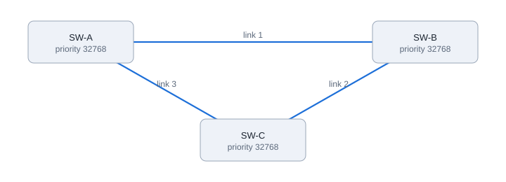

*شکل ۱: سه سوییچ با سه لینک؛ مثلثی که اگر STP نباشد Loop می‌سازد.*

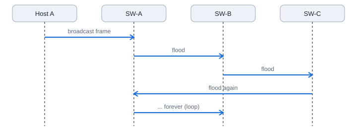

*شکل ۲: یک Broadcast بین سوییچ‌ها می‌چرخد و هیچ‌وقت تمام نمی‌شود.*

#### سه عارضه‌ی Loop

1.  **Broadcast Storm:** ترافیک تکراری پهنای باند را کامل مصرف می‌کند.
2.  **MAC Table Instability:** یک MAC مدام بین دو پورت پرش می‌کند (MACFLAP).
3.  **CPU بالا:** سوییچ مجبور است همین فریم‌ها را پردازش کند و دیگر جواب نمی‌دهد.

### ۲. ایده‌ی STP: یک درخت، بدون حلقه

STP از روی گراف شبکه یک «درخت» می‌سازد: یک ریشه (Root) انتخاب می‌کند و برای هر سوییچ فقط یک مسیر فعال به ریشه نگه می‌دارد. لینک‌های اضافه به‌صورت Blocking در حالت آماده‌باش می‌مانند و اگر لینک اصلی خراب شد، فعال می‌شوند.

#### مراحل کار STP (سه تصمیم)

1.  **انتخاب Root Bridge:** سوییچی با کوچک‌ترین Bridge ID برنده است.
2.  **انتخاب Root Port:** هر سوییچ غیر Root، پورتی را انتخاب می‌کند که کمترین هزینه تا Root را دارد.
3.  **انتخاب Designated Port:** روی هر Segment، پورتی که به Root نزدیک‌تر است فعال می‌ماند؛ پورت‌های باقی‌مانده Blocking می‌شوند.

#### Bridge ID چیست؟

Bridge ID از دو بخش ساخته می‌شود: اولویت (Priority) و MAC سوییچ. اولویت پیش‌فرض ۳۲۷۶۸ است. در PVST+ برای هر VLAN یک نمونه از STP اجرا می‌شود و شماره‌ی VLAN به اولویت اضافه می‌شود:

``` text
Bridge ID = Priority + VLAN ID + MAC address
Example (VLAN 10): 32768 + 10 = 32778 , MAC 0001.aaaa.0001
Lowest Bridge ID wins the Root election
```

اگر اولویت‌ها برابر بود، MAC کوچک‌تر برنده است. چون MAC معمولاً به سن سوییچ بستگی دارد، سوییچ «قدیمی‌ترین» ممکن است Root شود؛ همین یک اشتباه رایج طراحی است. باید Root را عمداً انتخاب کنیم (درس ۴-۲).

#### هزینه‌ی مسیر (Path Cost)

سوییچ‌ها هزینه‌ی مسیر تا Root را با جمع‌کردن هزینه‌ی لینک‌ها حساب می‌کنند. لینک سریع‌تر هزینه‌ی کمتر دارد:

| سرعت لینک | هزینه (روش کوتاه، Short) | هزینه (روش بلند، Long) |
|-----------|--------------------------|------------------------|
| 10 Mbps   | 100                      | 2,000,000              |
| 100 Mbps  | 19                       | 200,000                |
| 1 Gbps    | 4                        | 20,000                 |
| 10 Gbps   | 2                        | 2,000                  |

#### حالت‌ها و نقش پورت‌ها

| STP کلاسیک (802.1D) | کار پورت                                    |
|---------------------|---------------------------------------------|
| Blocking            | فریم داده نمی‌فرستد، فقط BPDU می‌شنود         |
| Listening           | BPDU می‌شنود و پردازش می‌کند، MAC یاد نمی‌گیرد |
| Learning            | MAC یاد می‌گیرد، هنوز داده نمی‌فرستد          |
| Forwarding          | کار عادی                                    |
| Disabled            | خاموش                                       |

در STP کلاسیک، تا Forwarding شدن یک پورت ۳۰ تا ۵۰ ثانیه طول می‌کشد. این تأخیر در شبکه‌ی امروز قابل‌قبول نیست؛ پس از RSTP استفاده می‌کنیم (درس بعد).

``` text
Blocking (20 s max age) -> Listening (15 s) -> Learning (15 s) -> Forwarding
Worst-case convergence = 20 + 15 + 15 = 50 seconds
```

### ۳. مثال ساده: دو سوییچ، دو لینک

SW-A و SW-B با دو کابل به هم وصل‌اند. هر دو با اولویت ۳۲۷۶۸. MAC سوییچ A کوچک‌تر است.

``` text
Election: priority equal (32768) -> lower MAC wins
Root Bridge = SW-A
On SW-B: both uplinks lead to Root with the same cost
  -> choose the lower port ID (Gi0/1) as Root Port
  -> Gi0/2 becomes Blocking (Alternate)
```

### ۴. مثال متوسط: سه سوییچ، مثلث

``` text
Bridge IDs: SW-A 32769.0001.aaaa.0001 (VLAN1)
            SW-B 32769.0001.aaaa.0002
            SW-C 32769.0001.aaaa.0003
Root Bridge = SW-A (lowest MAC)

SW-B -> Root: direct link, cost 4 (1G)          -> Root Port = link A-B
SW-C -> Root: direct link, cost 4 (1G)          -> Root Port = link A-C
Segment B-C: both sides cost 4 to Root; tie -> lower Bridge ID
  SW-B has lower ID than SW-C -> SW-B port is Designated (Forwarding)
  SW-C port on B-C is Alternate (Blocking)
```

نتیجه: فقط پورت SW-C سمت لینک B-C بسته می‌شود؛ مثلث به یک درخت (A در ریشه، B و C فرزند) تبدیل شد.

### ۵. مثال سخت: چرا Root اشتباه خطرناک است؟

در یک شعبه، یک سوییچ قدیمی دسترسی در انتهای شبکه، چون MAC کوچک دارد، Root می‌شود. حالا همه‌ی ترافیک بین سرورها و کاربران از لینک ۱۰۰ مگابیتی آن سوییچ عبور می‌کند.

``` text
Symptom  : network slow, traffic path goes through an old access switch
Check    : show spanning-tree vlan 10  -> "This bridge is the root" on the wrong switch
Cause    : default priority + lowest MAC
Fix      : set core switch priority lower (e.g. 4096) or "root primary"
```

### ۶. دستورهای مشاهده

``` text
SW1# show spanning-tree
SW1# show spanning-tree vlan 10
SW1# show spanning-tree summary
SW1# show spanning-tree root
SW1# show spanning-tree interface gi0/1 detail
```

- `show spanning-tree vlan 10`: Root، Bridge ID خودش، نقش هر پورت (Root/Desg/Altn) و حالت آن.
- `show spanning-tree root`: خلاصه‌ی Root هر VLAN.
- `show spanning-tree summary`: حالت STP و تعداد پورت‌ها به‌تفکیک.

### تمرین‌ها

**ت1.** ۱ (ساده): چرا Loop در لایه ۲ خطرناک‌تر از لایه ۳ است؟ *(پاسخ: 4-1-ت1 در بخش «پاسخ‌ها» انتهای فصل)*

**ت2.** ۲ (ساده): Root Bridge را چطور انتخاب می‌کنند؟ *(پاسخ: 4-1-ت2 در بخش «پاسخ‌ها» انتهای فصل)*

**ت3.** ۳ (متوسط): دو سوییچ با اولویت 32768 و 4096؛ کدام Root است؟ *(پاسخ: 4-1-ت3 در بخش «پاسخ‌ها» انتهای فصل)*

**ت4.** ۴ (متوسط): هزینه‌ی مسیر سه لینک ۱ گیگ پشت‌سرهم تا Root با روش Short؟ *(پاسخ: 4-1-ت4 در بخش «پاسخ‌ها» انتهای فصل)*

**ت5.** ۵ (سخت): در مثلث A (Root)، B، C با لینک‌های 1G، اگر لینک A-C خراب شود، SW-C از کدام مسیر Root را می‌بیند و هزینه چقدر است؟ *(پاسخ: 4-1-ت5 در بخش «پاسخ‌ها» انتهای فصل)*

### Lab هدایت‌شده

توپولوژی: سه سوییچ vIOSL2 به نام‌های `SW1`، `SW2` و `SW3` که مثلث می‌سازند (SW1-SW2، SW2-SW3، SW1-SW3). همه‌ی لینک‌ها Trunk هستند. اگر SW3 ندارید، یک گره‌ی سوم از همان Image اضافه کنید. **هشدار:** قبل از وصل‌کردن لینک سوم، STP باید فعال باشد؛ در Lab ما STP پیش‌فرض روشن است ولی همین را با `show spanning-tree summary` تأیید کنید.

#### گام ۱: بکاپ و حالت STP

``` text
SW1# copy running-config flash:SW1-before-stp.cfg
SW1# show spanning-tree summary
```

#### گام ۲: دیدن Root

``` text
SW1# show spanning-tree vlan 1
SW2# show spanning-tree vlan 1
SW3# show spanning-tree vlan 1
```

در سه خروجی، Bridge ID و Root را مقایسه کنید. روی کدام سوییچ نوشته «This bridge is the root»؟ پیش‌بینی کنید چه سوییچی است و بعد بسنجید.

#### گام ۳: پیدا کردن پورت Blocking

``` text
SWx# show spanning-tree vlan 1 | include Altn|Desg|Root
```

یک پورت Altn (Alternate) باید در مثلث پیدا کنید. آن را یادداشت کنید و نقش همه‌ی پورت‌ها را در یک جدول بنویسید.

#### گام ۴: شکستن لینک و دیدن Failover

``` text
SW2(config)# interface gi0/1
SW2(config-if)# shutdown
SW3# show spanning-tree vlan 1
```

پورت Alternate چقدر زود Forwarding شد؟ (در Rapid-PVST کمتر از چند ثانیه؛ در PVST کلاسیک ۳۰ تا ۵۰ ثانیه.) بعد پورت را `no shutdown` کنید.

### Lab مستقل

جدول «Bridge ID هر سوییچ، Root، نقش پورت‌ها» را برای VLAN 1 بسازید و در `03-ops/stp-baseline.md` ذخیره کنید. بدون رمز.

### عیب‌یابی

|         |                                                                                                                                  |
|---------|----------------------------------------------------------------------------------------------------------------------------------|
| Symptom | شبکه ناگهان بسیار کند شد و LEDهای لینک‌ها مدام چشمک می‌زنند                                                                        |
| سرنخ    | CPU بالا، پیام MACFLAP، ترافیک Broadcast زیاد                                                                                    |
| چک‌لیست  | ۱) show spanning-tree summary ؛ ۲) آیا کابل جدیدی وصل شده؟ ؛ ۳) آیا STP روی همه‌ی سوییچ‌ها فعال است؟ ؛ ۴) پورت Blocking وجود دارد؟ |
| رفع     | کابل اضافه را جدا کنید، STP را فعال کنید، سپس علت را مستند کنید                                                                  |

### سؤال‌های مرور

**م1.** چرا لایه ۲ به STP نیاز دارد؟ *(پاسخ: 4-1-م1 در بخش «پاسخ‌ها» انتهای فصل)*

**م2.** Root Bridge چه کسی است؟ *(پاسخ: 4-1-م2 در بخش «پاسخ‌ها» انتهای فصل)*

**م3.** Root Port و Designated Port چه فرقی دارند؟ *(پاسخ: 4-1-م3 در بخش «پاسخ‌ها» انتهای فصل)*

### English Corner: انگلیسی تخصصی این درس

این جمله‌ها از مستندات و محیط کار واقعی‌اند. بلند بخوانید و ترجمه را بپوشانید.

| English sentence                                              | ترجمه                                                 |
|---------------------------------------------------------------|-------------------------------------------------------|
| STP prevents layer-2 loops by blocking redundant links.       | STP با بستن لینک‌های اضافه جلوی Loop لایه ۲ را می‌گیرد. |
| The switch with the lowest bridge ID becomes the root bridge. | سوییچ با کوچک‌ترین Bridge ID Root می‌شود.               |
| A blocked port still receives BPDUs.                          | پورت Blocking هنوز BPDU دریافت می‌کند.                 |
| A broadcast storm can bring down the entire network.          | طوفان Broadcast می‌تواند کل شبکه را از کار بیندازد.    |

**Q1.** Quick quiz (answer in English): What does STP do with a redundant link? *(پاسخ: 4-1-Q1 در بخش «پاسخ‌ها» انتهای فصل)*

### تکلیف و چک‌لیست تسلط

- [ ] سه عارضه‌ی Loop را بگویم.
- [ ] Root را برای مثلث به‌دست آورم و نقش پورت‌ها را بنویسم.
- [ ] Lab را انجام دهم و Failover را ثبت کنم.

### یادآوری اشتباهات شما

> **یادآوری**
>
> پیش‌بینی قبل از اجرا؛ بکاپ قبل از تغییر؛ پذیرفته‌شدن دستور ≠ کار کردن؛ فرمول‌ها در بلوک مستقل.


#### کارت Lab — حلقه در لایه ۲ و STP

| # | فیلد | محتوا |
|---|---|---|
| 1 | عنوان و هدف | دیدن Root و نقش پورت‌ها در مثلث سه‌سوییچی |
| 2 | پیش‌نیاز | فصل 3 |
| 3 | توپولوژی | SW1-SW2-SW3 مثلث (Trunk) |
| 4 | تجهیزات | ۳ سوییچ vIOS-L2 |
| 5 | نسخه نرم‌افزار | vIOS-L2 15.2(20200924، Experimental) برای SW؛ vIOS 15.9(3)M9 برای R؛ VPCS؛ PNetLab 4.2.8 |
| 6 | IP Plan | VLAN 1 |
| 7 | وضعیت اولیه | PVST پیش‌فرض |
| 8 | صورت مسئله | Root/Port Role را بنویسید و Failover را ببینید |
| 9 | مراحل هدایت‌شده | همان بخش «Lab هدایت‌شده» همین درس |
| 10 | تست عملکرد | `show spanning-tree vlan 1` (Root، Altn) |
| 11 | سناریوی خرابی | Loop بدون STP (آموزشی) |
| 12 | روش عیب‌یابی | لایه‌ای/با شواهد (بخش عیب‌یابی همین درس) |
| 13 | نتیجه‌ی مورد انتظار | Root مشخص؛ یک پورت Altn |
| 14 | معیار پذیرش | جدول Role صحیح |
| 15 | مستندات نهایی | `03-ops/stp-baseline.md` |
| 16 | Cleanup و بازگردانی | `no shutdown` لینک‌ها |

> **وضعیت راستی‌آزمایی (خارج از ۱۶ فیلد):** **جزئی.** `show spanning-tree summary` در Probe Tested-OK (PVST)؛ Failover و مثلث اجرا نشده.

---

<a id="l-4-2"></a>

## درس 4-2 — Rapid-PVST، Root، PortFast و BPDU Guard

**فصل ۴ - روز ۲ · پیش‌نیاز: درس ۴-۱ · ۶ ساعت**

> **وضعیت:** Cisco IOSv/IOSvL2؛ خروجی‌ها و دستورها نمونه‌ی آموزشی‌اند؛ Lab «اجرا نشده»؛ ویژگی‌هایی که روی IOSvL2 آزمایش‌نشده‌اند `Unverified` هستند و باید با Probe (درس ۱-B) تأیید شوند.

### این درس درباره چیست و چرا باید یاد بگیریم؟

**چه چیزی یاد می‌گیریم:** نسخه‌ی سریع STP یعنی RSTP و پیاده‌سازی سیسکو Rapid-PVST+؛ انتخاب عمدی Root؛ و محافظ‌های PortFast و BPDU Guard و Root Guard.

**چرا لازم است:** STP کلاسیک تا ۵۰ ثانیه همگرا می‌شود و Root را به‌صورت تصادفی انتخاب می‌کند. در شبکه‌ی واقعی باید همگرایی چند ثانیه‌ای و Root از پیش‌تعیین‌شده داشته باشیم، و باید جلوی اتصال سوییچ یا BPDU ناخواسته به پورت کاربر را بگیریم.

- **در کار روزانه:** تقریباً همه‌ی سوییچ‌های سازمانی Rapid-PVST اجرا می‌کنند.
- **در امنیت:** BPDU Guard جلوی اتصال سوییچ جعلی (Rogue) را می‌گیرد؛ Root Guard جلوی Root شدن سوییچ ناخواسته را.
- **در عیب‌یابی:** پورت err-disabled بعد از وصل‌کردن یک سوییچ، کار BPDU Guard است.

> **مسیر درس**
>
> RSTP چه فرقی دارد ← تنظیم Root ← PortFast ← BPDU Guard و Root Guard ← مثال ساده/متوسط/سخت ← Lab ← عیب‌یابی.

#### اصطلاحات این درس (مخفف ← شکل کامل ← معنی)

| مخفف        | شکل کامل انگلیسی                      | معنی فارسی                                        |
|-------------|---------------------------------------|---------------------------------------------------|
| RSTP        | Rapid Spanning Tree Protocol (802.1w) | نسخه‌ی سریع STP                                    |
| PVST+       | Per-VLAN Spanning Tree Plus           | یک STP جدا برای هر VLAN (سیسکو)                   |
| Rapid-PVST+ | Rapid Per-VLAN Spanning Tree Plus     | RSTP به‌صورت Per-VLAN                              |
| PortFast    | PortFast                              | پورت لبه‌ای که فوراً Forwarding می‌شود               |
| BPDU Guard  | BPDU Guard                            | پورت را با دریافت BPDU خاموش می‌کند                |
| Root Guard  | Root Guard                            | جلوی Root شدن سوییچ ناخواسته از یک پورت را می‌گیرد |
| Alternate   | Alternate Port                        | پورت جایگزین سریع برای Root Port                  |
| Edge Port   | Edge Port                             | پورتی که به دستگاه انتهایی وصل است                |

### ۱. RSTP چه چیزی را سریع کرد؟

RSTP همان ایده‌ی STP است ولی به‌جای انتظار با تایمرها، سوییچ‌ها با هم «مذاکره» می‌کنند (Proposal/Agreement). حالت‌ها هم ساده‌تر شده‌اند:

| STP کلاسیک | RSTP       |
|------------|------------|
| Blocking   | Discarding |
| Listening  | Discarding |
| Learning   | Learning   |
| Forwarding | Forwarding |

نقش‌ها هم یک نقش جدید دارند:

| نقش             | معنی                                     |
|-----------------|------------------------------------------|
| Root Port       | بهترین مسیر به Root                      |
| Designated Port | پورت فعال هر Segment                     |
| Alternate Port  | پشتیبان Root Port (همگرایی در حد ثانیه)  |
| Backup Port     | پشتیبان Designated Port روی همان Segment |

``` text
STP  : 30-50 seconds to converge
RSTP : usually 1-2 seconds (link failure with alternate port)
```

### ۲. فعال‌کردن Rapid-PVST+

``` text
SW1(config)# spanning-tree mode rapid-pvst
SW1# show spanning-tree summary
```

در خروجی باید بنویسد `Switch is in rapid-pvst mode`. این دستور باید روی همه‌ی سوییچ‌ها یکسان زده شود؛ ترکیب حالت‌ها سازگار است ولی همگرایی سریع از دست می‌رود.

### ۳. تعیین عمدی Root

دو روش داریم. روش اول Macro است و خودش اولویت را کم می‌کند؛ روش دوم دستی است و دقیق‌تر:

``` text
SW1(config)# spanning-tree vlan 1,10,20,30 root primary
SW2(config)# spanning-tree vlan 1,10,20,30 root secondary

! manual equivalent:
SW1(config)# spanning-tree vlan 10 priority 4096
SW2(config)# spanning-tree vlan 10 priority 8192
```

- `root primary`: اولویت را به اندازه‌ای کم می‌کند که Root شود (معمولاً 24576 یا کمتر).
- `root secondary`: اولویت 28672 برای نقش Root پشتیبان.
- اولویت باید مضرب 4096 باشد (چون ۱۲ بیت دیگر برای شماره‌ی VLAN رزرو است).

``` text
Priority values allowed: 0, 4096, 8192, ... 61440 (multiples of 4096)
Default priority : 32768
Bridge priority in BPDU = Priority + VLAN ID  (e.g. 4096 + 10 = 4106)
```

> **قانون طراحی**
>
> Root را همیشه روی سوییچ هسته (Core / Distribution) بگذارید و Root پشتیبان را روی هم‌ترازش. هرگز نگذارید یک سوییچ دسترسی Root شود.

### ۴. PortFast: پورت کاربر را سریع بالا بیاور

پورتی که به کامپیوتر یا پرینتر وصل است نمی‌تواند Loop بسازد. پس نیازی نیست منتظر مراحل STP بماند. PortFast آن را فوراً Forwarding می‌کند:

``` text
SW1(config)# interface range gi0/1 - 4
SW1(config-if-range)# switchport mode access
SW1(config-if-range)# spanning-tree portfast

! or enable globally for all access ports:
SW1(config)# spanning-tree portfast default
```

> **هشدار**
>
> PortFast فقط روی پورت‌های دستگاه انتهایی. روی لینک بین سوییچ‌ها خطرناک است، چون ممکن است Loop بسازد. برای همین حتماً با BPDU Guard همراه می‌شود.

### ۵. BPDU Guard: اگر BPDU آمد، پورت را خاموش کن

پورت کاربر هرگز نباید BPDU دریافت کند. اگر دریافت کرد، یعنی کسی سوییچ وصل کرده. BPDU Guard پورت را به حالت err-disabled می‌برد:

``` text
SW1(config)# interface gi0/1
SW1(config-if)# spanning-tree bpduguard enable

! global default for PortFast ports:
SW1(config)# spanning-tree portfast bpduguard default

! recovery (optional, careful):
SW1(config)# errdisable recovery cause bpduguard
SW1(config)# errdisable recovery interval 300
```

``` text
SW1# show interfaces status err-disabled
SW1# show spanning-tree summary
SW1# show spanning-tree interface gi0/1 detail
```

بعد از رفع علت، پورت را دستی روشن کنید: `shutdown` سپس `no shutdown`. اگر `errdisable recovery` تنظیم شده باشد، بعد از ۳۰۰ ثانیه خودکار برمی‌گردد (ولی اگر علت هنوز هست، دوباره خاموش می‌شود).

### ۶. Root Guard: جلوی Root ناخواسته

روی پورت‌هایی که به سمت سوییچ‌های «مشتری» یا بیرون از کنترل شما می‌روند، اگر BPDU بهتر (ادعای Root) رسید، پورت وارد حالت `root-inconsistent` می‌شود و ترافیک را نمی‌پذیرد:

``` text
SW1(config)# interface gi0/10
SW1(config-if)# spanning-tree guard root
SW1# show spanning-tree inconsistentports
```

| ابزار      | روی کدام پورت                 | عکس‌العمل                       |
|------------|-------------------------------|--------------------------------|
| PortFast   | پورت دستگاه انتهایی           | فوراً Forwarding                |
| BPDU Guard | پورت دستگاه انتهایی           | err-disabled با دریافت BPDU    |
| Root Guard | پورت به سمت خارج از کنترل شما | root-inconsistent با BPDU برتر |

### ۷. مثال ساده/متوسط/سخت

#### ساده

``` text
Task  : make SW1 the root for VLAN 10
Cmd   : spanning-tree vlan 10 root primary
Verify: show spanning-tree vlan 10  -> "This bridge is the root"
```

#### متوسط

کاربری یک سوییچ کوچک خانگی را به پورت دیوار وصل می‌کند. بدون BPDU Guard ممکن است Loop بسازد یا Root شود؛ با BPDU Guard پورت خاموش می‌شود:

``` text
Log: %SPANTREE-2-BLOCK_BPDUGUARD: Received BPDU on port Gi0/3 with BPDU Guard enabled
Show: show interfaces status err-disabled -> Gi0/3 err-disabled bpduguard
```

#### سخت

در شبکه‌ی ۳ سوییچی، Root را روی SW1 و Root پشتیبان را روی SW2 بگذارید، روی پورت‌های دسترسی SW3 PortFast و BPDU Guard فعال کنید، روی پورت اتصال به شبکه‌ی خارجی Root Guard؛ سپس نشان دهید با قطع SW1 همگرایی کمتر از چند ثانیه است.

### تمرین‌ها

**ت1.** ۱ (ساده): چرا RSTP سریع‌تر است؟ *(پاسخ: 4-2-ت1 در بخش «پاسخ‌ها» انتهای فصل)*

**ت2.** ۲ (ساده): اولویت‌های مجاز؟ *(پاسخ: 4-2-ت2 در بخش «پاسخ‌ها» انتهای فصل)*

**ت3.** ۳ (متوسط): PortFast بدون BPDU Guard چه خطری دارد؟ *(پاسخ: 4-2-ت3 در بخش «پاسخ‌ها» انتهای فصل)*

**ت4.** ۴ (متوسط): پورت err-disabled شد؛ مراحل رفع؟ *(پاسخ: 4-2-ت4 در بخش «پاسخ‌ها» انتهای فصل)*

**ت5.** ۵ (سخت): Root Guard را روی کدام پورت‌ها می‌گذاریم و چرا؟ *(پاسخ: 4-2-ت5 در بخش «پاسخ‌ها» انتهای فصل)*

### Lab هدایت‌شده

همان مثلث SW1-SW2-SW3 از درس قبل. SW1 باید Root باشد.

#### گام ۱: Rapid-PVST روی هر سه

``` text
SWx(config)# spanning-tree mode rapid-pvst
SWx# show spanning-tree summary
```

#### گام ۲: Root و Root پشتیبان

``` text
SW1(config)# spanning-tree vlan 1 root primary
SW2(config)# spanning-tree vlan 1 root secondary
SW3# show spanning-tree root
```

#### گام ۳: PortFast و BPDU Guard روی پورت PC

``` text
SW3(config)# interface gi0/3
SW3(config-if)# switchport mode access
SW3(config-if)# spanning-tree portfast
SW3(config-if)# spanning-tree bpduguard enable
```

#### گام ۴: ایجاد عمدی تخلف

به پورت Gi0/3 به‌جای PC، یک سوییچ (SW4) وصل کنید. باید پیام BPDU Guard را ببینید:

``` text
SW3# show interfaces status err-disabled
SW3# show logging | include BPDUGUARD
```

اگر شبیه‌ساز BPDU Guard را اجرا نکرد (طبق Probe فقط پذیرفته شده بود)، دقیقاً همان را ثبت کنید و در Lab واقعی تکرار کنید.

#### گام ۵: رفع

``` text
SW3(config)# interface gi0/3
SW3(config-if)# shutdown
SW3(config-if)# no shutdown
```

### Lab مستقل

یک چک‌لیست «Hardening لایه ۲» یک‌صفحه‌ای بنویسید (Rapid-PVST، Root/Secondary، PortFast، BPDU Guard، Root Guard) در `03-ops/l2-hardening.md`.

### عیب‌یابی

|            |                                                              |
|------------|--------------------------------------------------------------|
| Symptom    | پورت کاربر خاموش شده و کاربر قطع است                         |
| سرنخ       | show interfaces status -\> err-disabled                      |
| علت متداول | BPDU Guard: سوییچ یا دستگاهی که BPDU می‌فرستد به پورت وصل شده |
| رفع        | دستگاه را جدا کنید و پورت را بالا بیاورید؛ علت را مستند کنید |

### سؤال‌های مرور

**م1.** PortFast برای چه پورتی؟ *(پاسخ: 4-2-م1 در بخش «پاسخ‌ها» انتهای فصل)*

**م2.** تفاوت BPDU Guard و Root Guard؟ *(پاسخ: 4-2-م2 در بخش «پاسخ‌ها» انتهای فصل)*

**م3.** چرا Root را دستی تعیین می‌کنیم؟ *(پاسخ: 4-2-م3 در بخش «پاسخ‌ها» انتهای فصل)*

### English Corner: انگلیسی تخصصی این درس

این جمله‌ها از مستندات و محیط کار واقعی‌اند. بلند بخوانید و ترجمه را بپوشانید.

| English sentence                                                           | ترجمه                                                                             |
|----------------------------------------------------------------------------|-----------------------------------------------------------------------------------|
| Enable PortFast on access ports to skip the listening and learning states. | PortFast را روی پورت‌های Access فعال کنید تا حالت‌های Listening و Learning رد شوند. |
| BPDU Guard puts the port in err-disabled state when a BPDU is received.    | BPDU Guard با دریافت BPDU پورت را به حالت err-disabled می‌برد.                     |
| Set the core switch as the root bridge for all VLANs.                      | سوییچ هسته را Root همه‌ی VLANها کنید.                                              |
| Root Guard prevents an unauthorized switch from becoming root.             | Root Guard جلوی Root شدن سوییچ غیرمجاز را می‌گیرد.                                 |

**Q1.** Quick quiz (answer in English): When should you not enable PortFast? *(پاسخ: 4-2-Q1 در بخش «پاسخ‌ها» انتهای فصل)*

### تکلیف و چک‌لیست تسلط

- [ ] Rapid-PVST و Root را تنظیم و تأیید کنم.
- [ ] BPDU Guard را بسازم، تخلف را ببینم و رفع کنم.
- [ ] چک‌لیست Hardening L2 را بنویسم.

### یادآوری اشتباهات شما

> **یادآوری**
>
> پیش‌بینی قبل از اجرا؛ بکاپ قبل از تغییر؛ پذیرفته‌شدن دستور ≠ کار کردن؛ فرمول‌ها در بلوک مستقل.


#### کارت Lab — Rapid-PVST، Root، PortFast و BPDU Guard

| # | فیلد | محتوا |
|---|---|---|
| 1 | عنوان و هدف | Rapid-PVST، Root، PortFast، BPDU Guard |
| 2 | پیش‌نیاز | درس 4-1 |
| 3 | توپولوژی | مثلث + PC |
| 4 | تجهیزات | ۳ سوییچ + VPCS |
| 5 | نسخه نرم‌افزار | vIOS-L2 15.2(20200924، Experimental) برای SW؛ vIOS 15.9(3)M9 برای R؛ VPCS؛ PNetLab 4.2.8 |
| 6 | IP Plan | PVST |
| 7 | وضعیت اولیه | Rapid-PVST |
| 8 | صورت مسئله | Root/Secondary و محافظت پورت |
| 9 | مراحل هدایت‌شده | همان بخش «Lab هدایت‌شده» همین درس |
| 10 | تست عملکرد | `show spanning-tree summary` |
| 11 | سناریوی خرابی | سوییچ جعلی به پورت BPDU Guard |
| 12 | روش عیب‌یابی | لایه‌ای/با شواهد (بخش عیب‌یابی همین درس) |
| 13 | نتیجه‌ی مورد انتظار | Rapid-PVST؛ پورت err-disabled با BPDU |
| 14 | معیار پذیرش | تخلف دیده/ثبت شود |
| 15 | مستندات نهایی | `03-ops/l2-hardening.md` |
| 16 | Cleanup و بازگردانی | shutdown/no shutdown پورت |

> **وضعیت راستی‌آزمایی (خارج از ۱۶ فیلد):** **جزئی.** Rapid-PVST در Config دیده شد؛ PortFast/BPDU Guard فقط CLI-Accepted؛ اجرای واقعی Guard آزمایش نشده.

---

<a id="l-4-3"></a>

## درس 4-3 — EtherChannel و LACP

**فصل ۴ - روز ۳ · پیش‌نیاز: درس ۴-۲ · ۶ ساعت**

> **وضعیت:** Cisco IOSv/IOSvL2؛ خروجی‌ها و دستورها نمونه‌ی آموزشی‌اند؛ Lab «اجرا نشده»؛ ویژگی‌هایی که روی IOSvL2 آزمایش‌نشده‌اند `Unverified` هستند و باید با Probe (درس ۱-B) تأیید شوند.

### این درس درباره چیست و چرا باید یاد بگیریم؟

**چه چیزی یاد می‌گیریم:** چطور چند کابل فیزیکی بین دو سوییچ را به‌صورت یک لینک منطقی (EtherChannel) در بیاوریم، با پروتکل LACP؛ و چرا دو سر لینک باید تنظیمات یکسان داشته باشند.

**چرا لازم است:** اگر بین دو سوییچ دو کابل بکشید، STP یکی را می‌بندد و نیمی از پهنای باند هدر می‌رود. EtherChannel دو (تا هشت) کابل را یکی می‌کند: پهنای باند جمع می‌شود و با قطع یک کابل ارتباط قطع نمی‌شود.

- **در کار روزانه:** لینک بین سوییچ‌های Core و Distribution تقریباً همیشه EtherChannel است.
- **در امنیت:** EtherChannel نادرست باعث Loop یا قطع ناگهانی می‌شود؛ کنترل Mismatch ضروری است.
- **در FortiGate:** همین مفهوم با «Aggregate Interface» در فایروال تکرار می‌شود.

> **مسیر درس**
>
> مشکل لینک‌های موازی ← Port-Channel ← LACP در برابر PAgP ← Load Balancing ← مثال ساده/متوسط/سخت ← Lab ← عیب‌یابی.

#### اصطلاحات این درس (مخفف ← شکل کامل ← معنی)

| مخفف         | شکل کامل انگلیسی                            | معنی فارسی                             |
|--------------|---------------------------------------------|----------------------------------------|
| EtherChannel | EtherChannel                                | تجمیع چند لینک فیزیکی در یک لینک منطقی |
| Port-Channel | Port-Channel                                | Interface منطقی حاصل از تجمیع          |
| LACP         | Link Aggregation Control Protocol (802.3ad) | پروتکل استاندارد مذاکره‌ی تجمیع         |
| PAgP         | Port Aggregation Protocol                   | پروتکل اختصاصی سیسکو برای تجمیع        |
| Active       | LACP Active                                 | پورت فعالانه مذاکره را شروع می‌کند      |
| Passive      | LACP Passive                                | پورت فقط منتظر مذاکره می‌ماند           |
| Hash         | Load-balancing hash                         | الگوریتم انتخاب لینک برای هر جریان     |

### ۱. مشکل: دو کابل، یک کابل کار می‌کند

دو سوییچ را با دو کابل ۱ گیگ وصل می‌کنیم تا هم پهنای باند بیشتر داشته باشیم و هم تحمل خطا. اما STP دو لینک موازی را «Loop» می‌داند و یکی را Block می‌کند. نتیجه: فقط ۱ گیگ، نه ۲ گیگ.

مثال روزمره: دو باند موازی در یک جاده که یکی را بسته‌اند چون فکر می‌کنند دور می‌زند. EtherChannel به STP می‌گوید این دو باند «یک جاده‌ی دوبانده» هستند.

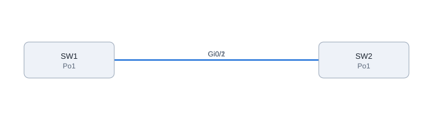

*شکل ۱: دو لینک فیزیکی که STP آن‌ها را یک لینک منطقی (Po1) می‌بیند.*

### ۲. EtherChannel چطور کار می‌کند؟

- چند پورت فیزیکی عضو یک **Port-Channel** می‌شوند.
- STP و Trunk فقط Port-Channel را می‌بینند، نه پورت‌های عضو.
- توزیع ترافیک به‌صورت Hash است: هر جریان (مثلاً یک جفت IP) یک لینک را می‌گیرد؛ پس یک جریان تنها از یک لینک می‌رود و ۱ گیگ می‌ماند، ولی چند جریان روی لینک‌ها پخش می‌شود.
- اگر یک لینک قطع شود، ترافیک به لینک‌های دیگر منتقل می‌شود.

> **نکته‌ی مهم**
>
> EtherChannel سرعت یک ارتباط تکی را بیشتر نمی‌کند؛ ظرفیت کل را بالا می‌برد و تحمل خطا می‌دهد.

### ۳. LACP یا PAgP یا ثابت؟

| حالت   | پروتکل                                  | Modeهای مجاز     |
|--------|-----------------------------------------|------------------|
| LACP   | استاندارد 802.3ad، با تجهیزات هر سازنده | active / passive |
| PAgP   | اختصاصی سیسکو                           | desirable / auto |
| Static | بدون مذاکره (خطرناک)                    | on               |

| ترکیب دو سر       | نتیجه                        |
|-------------------|------------------------------|
| active — active   | Channel تشکیل می‌شود          |
| active — passive  | Channel تشکیل می‌شود          |
| passive — passive | تشکیل نمی‌شود (هر دو منتظرند) |
| on — active       | تشکیل نمی‌شود (Mismatch)      |
| LACP — PAgP       | تشکیل نمی‌شود                 |

توصیه: همیشه LACP با `active` در هر دو سر.

### ۴. شرط‌های یکسان بودن پورت‌ها

همه‌ی پورت‌های عضو باید این‌ها را یکسان داشته باشند، وگرنه Channel بالا نمی‌آید یا Suspend می‌شود:

- سرعت و Duplex
- حالت Trunk/Access و VLANهای مجاز و Native
- VLAN دسترسی (برای Access)
- تنظیمات STP پورت

### ۵. دستورها (خط‌به‌خط)

``` text
SW1(config)# interface range gi0/1 - 2
SW1(config-if-range)# switchport trunk encapsulation dot1q
SW1(config-if-range)# switchport mode trunk
SW1(config-if-range)# channel-group 1 mode active
SW1(config-if-range)# exit
SW1(config)# interface port-channel 1
SW1(config-if)# switchport trunk allowed vlan 10,20,30
SW1(config-if)# switchport trunk native vlan 999
```

- `channel-group 1 mode active`: پورت را عضو Port-Channel شماره‌ی ۱ می‌کند و LACP را فعال.
- تنظیمات Trunk را هم روی Port-Channel بزنید (نه فقط پورت‌ها)، تا تغییرات یکجا اعمال شود.

``` text
SW1# show etherchannel summary
SW1# show etherchannel port-channel
SW1# show interfaces port-channel 1
SW1# show lacp neighbor
SW1# show etherchannel load-balance
```

در `show etherchannel summary` حروف داخل پرانتز مهم‌اند:

| علامت | معنی                         |
|-------|------------------------------|
| P     | پورت در Bundle است (سالم)    |
| I     | پورت مستقل (Stand-alone) است |
| D     | Down                         |
| s     | Suspended (Mismatch)         |
| SU    | Port-channel: L2 و In-use    |
| SD    | Port-channel: L2 و Down      |

### ۶. مثال‌ها

#### ساده

``` text
Po1(SU)  Gi0/1(P)  Gi0/2(P)
Meaning: Layer-2 port-channel in use, both members bundled
```

#### متوسط: Mismatch

``` text
Po1(SD)  Gi0/1(s)  Gi0/2(D)
Cause: native VLAN or allowed VLAN list differs on the two ports/sides
Fix  : make all member ports identical, then shutdown/no shutdown the ports
```

#### سخت: توزیع ترافیک (Load Balancing)

سوییچ با Hash روی مبدأ و مقصد MAC یا IP، لینک را انتخاب می‌کند. اگر فقط یک سرور به یک کلاینت ترافیک بفرستد، همیشه یک لینک پر می‌شود. راه‌حل: Hash بر اساس IP و پورت (در تجهیزات پشتیبان) یا افزایش تنوع جریان‌ها.

``` text
SW1(config)# port-channel load-balance src-dst-ip
SW1# show etherchannel load-balance
```

> **صادقانه درباره‌ی Lab**
>
> در شبیه‌ساز vIOSL2 موتور LACP روشن است ولی در Probe اولیه دیدیم Po1 بدون همتای واقعی در حالت `SD` می‌ماند (پیام «LACP currently not enabled on remote port»). پس Lab را با دو سوییچ شبیه‌سازی‌شده انجام دهید و اگر Bundle تشکیل نشد، ثبت کنید؛ این بخش در Lab واقعی (سخت‌افزار) کاملاً تمرین می‌شود.

### تمرین‌ها

**ت1.** ۱ (ساده): چرا EtherChannel لازم است؟ *(پاسخ: 4-3-ت1 در بخش «پاسخ‌ها» انتهای فصل)*

**ت2.** ۲ (ساده): LACP با کدام Modeها؟ *(پاسخ: 4-3-ت2 در بخش «پاسخ‌ها» انتهای فصل)*

**ت3.** ۳ (متوسط): کدام ترکیب Channel نمی‌سازد؟ *(پاسخ: 4-3-ت3 در بخش «پاسخ‌ها» انتهای فصل)*

**ت4.** ۴ (متوسط): تفسیر Po1(SD) Gi0/1(D) Gi0/2(D) *(پاسخ: 4-3-ت4 در بخش «پاسخ‌ها» انتهای فصل)*

**ت5.** ۵ (سخت): چرا ۲ لینک ۱G برای یک انتقال فایل تکی ۲G سرعت نمی‌دهد؟ *(پاسخ: 4-3-ت5 در بخش «پاسخ‌ها» انتهای فصل)*

### Lab هدایت‌شده

توپولوژی: SW1 و SW2 با دو کابل: `Gi0/1` و `Gi0/2` هر سمت. VLANها از درس ۳-۲.

#### گام ۱: بکاپ و تنظیم هر دو سر

``` text
SWx# copy running-config flash:SWx-before-ec.cfg
SWx(config)# interface range gi0/1 - 2
SWx(config-if-range)# switchport trunk encapsulation dot1q
SWx(config-if-range)# switchport mode trunk
SWx(config-if-range)# channel-group 1 mode active
```

#### گام ۲: بررسی

``` text
SWx# show etherchannel summary
SWx# show interfaces trunk
SWx# show spanning-tree vlan 1
```

در STP باید فقط Po1 را ببینید (نه Gi0/1 و Gi0/2 جداگانه).

#### گام ۳: خراب‌کردن عمدی (Mismatch)

``` text
SW2(config)# interface gi0/2
SW2(config-if)# switchport trunk native vlan 5
SW2# show etherchannel summary
```

وضعیت پورت را ببینید و سپس رفع کنید (Native را مثل بقیه کنید و پورت را `shutdown` / `no shutdown`).

#### گام ۴: تحمل خطا

``` text
SW1(config)# interface gi0/1
SW1(config-if)# shutdown
PC1> ping 10.10.20.14 -t   (should keep working over Gi0/2)
```

### Lab مستقل

در `03-ops/etherchannel-runbook.md` چک‌لیست «قبل از ساخت Channel» (یکسان‌بودن سرعت/VLAN/Native/Allowed) را بنویسید.

### عیب‌یابی

|         |                                                                                                                                 |
|---------|---------------------------------------------------------------------------------------------------------------------------------|
| Symptom | Port-channel بالا نمی‌آید (SD) یا پورت‌ها s هستند                                                                                 |
| چک‌لیست  | ۱) Modeها سازگارند؟ ؛ ۲) Native/Allowed/Trunk دو سر یکی است؟ ؛ ۳) سرعت/Duplex یکی است؟ ؛ ۴) کابل‌ها به همان پورت‌های درست وصل‌اند؟ |
| ابزار   | show etherchannel summary ، show lacp neighbor                                                                                  |
| رفع     | یکسان‌سازی پیکربندی، سپس shutdown و no shutdown پورت‌ها                                                                           |

### سؤال‌های مرور

**م1.** EtherChannel چه مشکلی را حل می‌کند؟ *(پاسخ: 4-3-م1 در بخش «پاسخ‌ها» انتهای فصل)*

**م2.** چرا LACP را ترجیح می‌دهیم؟ *(پاسخ: 4-3-م2 در بخش «پاسخ‌ها» انتهای فصل)*

### English Corner: انگلیسی تخصصی این درس

این جمله‌ها از مستندات و محیط کار واقعی‌اند. بلند بخوانید و ترجمه را بپوشانید.

| English sentence                                          | ترجمه                                                    |
|-----------------------------------------------------------|----------------------------------------------------------|
| Bundle the physical ports into a port-channel using LACP. | پورت‌های فیزیکی را با LACP در یک Port-Channel تجمیع کنید. |
| All member ports must have identical settings.            | همه‌ی پورت‌های عضو باید تنظیمات یکسان داشته باشند.         |
| Traffic is distributed across links using a hash.         | ترافیک با Hash بین لینک‌ها توزیع می‌شود.                   |
| The port-channel stays up if one member link fails.       | با قطع یک لینک عضو، Port-Channel بالا می‌ماند.            |

**Q1.** Quick quiz (answer in English): Why does a single file transfer not use the full bundled bandwidth? *(پاسخ: 4-3-Q1 در بخش «پاسخ‌ها» انتهای فصل)*

### تکلیف و چک‌لیست تسلط

- [ ] Channel را بسازم و در STP یک لینک ببینم.
- [ ] Mismatch را بسازم و رفع کنم.
- [ ] نتیجه‌ی واقعی Lab (SU یا SD) را ثبت کنم.

### یادآوری اشتباهات شما

> **یادآوری**
>
> پیش‌بینی قبل از اجرا؛ بکاپ قبل از تغییر؛ پذیرفته‌شدن دستور ≠ کار کردن؛ فرمول‌ها در بلوک مستقل.


#### کارت Lab — EtherChannel و LACP

| # | فیلد | محتوا |
|---|---|---|
| 1 | عنوان و هدف | EtherChannel (LACP) و عیب‌یابی Mismatch |
| 2 | پیش‌نیاز | درس 4-2 |
| 3 | توپولوژی | SW1 ⇄ SW2 (دو لینک) |
| 4 | تجهیزات | ۲ سوییچ |
| 5 | نسخه نرم‌افزار | vIOS-L2 15.2(20200924، Experimental) برای SW؛ vIOS 15.9(3)M9 برای R؛ VPCS؛ PNetLab 4.2.8 |
| 6 | IP Plan | Trunk تک‌لینک |
| 7 | وضعیت اولیه | Port-channel 1 |
| 8 | صورت مسئله | Bundle و تحمل خطا |
| 9 | مراحل هدایت‌شده | همان بخش «Lab هدایت‌شده» همین درس |
| 10 | تست عملکرد | `show etherchannel summary` |
| 11 | سناریوی خرابی | Native نامتقارن |
| 12 | روش عیب‌یابی | لایه‌ای/با شواهد (بخش عیب‌یابی همین درس) |
| 13 | نتیجه‌ی مورد انتظار | Po1(SU)؛ با قطع یک لینک ارتباط ادامه |
| 14 | معیار پذیرش | نتیجه‌ی واقعی (SU یا SD) ثبت شود |
| 15 | مستندات نهایی | `03-ops/etherchannel-runbook.md` |
| 16 | Cleanup و بازگردانی | حذف channel-group |

> **وضعیت راستی‌آزمایی (خارج از ۱۶ فیلد):** **جزئی.** LACP engine فعال (Po1(SD) تا همتای دوم)؛ Bundle کامل آزمایش نشده.

---

<a id="l-4-4"></a>

## درس 4-4 — Port Security

**فصل ۴ - روز ۴ · پیش‌نیاز: درس ۴-۳ · ۶ ساعت**

> **وضعیت:** Cisco IOSv/IOSvL2؛ خروجی‌ها و دستورها نمونه‌ی آموزشی‌اند؛ Lab «اجرا نشده»؛ ویژگی‌هایی که روی IOSvL2 آزمایش‌نشده‌اند `Unverified` هستند و باید با Probe (درس ۱-B) تأیید شوند.

### این درس درباره چیست و چرا باید یاد بگیریم؟

**چه چیزی یاد می‌گیریم:** چطور هر پورت دسترسی را به تعداد مشخصی از MACهای مجاز محدود کنیم (Port Security)، سه نوع واکنش (Violation) و بازیابی از err-disabled.

**چرا لازم است:** هر کسی با یک کابل و لپ‌تاپ می‌تواند به پورت خالی وصل شود. Port Security جلوی دستگاه‌های ناشناس را می‌گیرد و حمله‌ی پر‌کردن جدول MAC (MAC Flooding) را بی‌اثر می‌کند.

- **در کار روزانه:** برای پورت‌های میز کار و پرینتر در اکثر سازمان‌ها استفاده می‌شود.
- **در امنیت:** لایه‌ی اول کنترل دسترسی فیزیکی و جلوگیری از MAC Flooding.
- **در عیب‌یابی:** پورتی که ناگهان err-disabled شد، اغلب Violation است.

> **مسیر درس**
>
> تهدید ← Port Security ← انواع Violation ← Sticky MAC ← مثال ساده/متوسط/سخت ← Lab ← عیب‌یابی.

#### اصطلاحات این درس (مخفف ← شکل کامل ← معنی)

| مخفف          | شکل کامل انگلیسی    | معنی فارسی                             |
|---------------|---------------------|----------------------------------------|
| Port Security | Port Security       | محدودکردن MACهای مجاز روی پورت         |
| Violation     | Security Violation  | تخلف: MAC غیرمجاز یا بیش از حد         |
| Sticky        | Sticky MAC          | یادگیری و ذخیره‌ی خودکار MAC مجاز       |
| Shutdown      | Violation shutdown  | پورت را err-disabled می‌کند             |
| Restrict      | Violation restrict  | فریم غیرمجاز را دور می‌ریزد و لاگ می‌دهد |
| Protect       | Violation protect   | فریم غیرمجاز را بی‌صدا دور می‌ریزد       |
| MAC Flooding  | MAC Flooding attack | پرکردن جدول MAC با MACهای جعلی         |

### ۱. تهدید: «کسی کابل را به پورت خالی زد»

سوییچ پورت‌های متعددی دارد و معمولاً بعضی از آن‌ها در دیوار سالن آزاد هستند. مهمان یا مهاجم لپ‌تاپ را وصل می‌کند و به شبکه می‌رسد. تهدید دوم: مهاجم هزاران MAC جعلی می‌فرستد تا جدول MAC پر شود و سوییچ شروع به Flooding کند؛ آنگاه ترافیک را می‌شنود.

### ۲. ایده‌ی Port Security

روی هر پورت می‌گوییم: «فقط N تا MAC مجاز است، و آن‌ها این‌ها هستند». اگر MAC دیگری آمد، واکنش تعریف‌شده اجرا می‌شود. سه چیز باید تعیین کنیم:

1.  **حداکثر MAC** (Maximum): معمولاً ۱ برای کامپیوتر، ۲ برای کامپیوتر+IP Phone.
2.  **MACهای مجاز:** دستی (static)، یا یادگیری خودکار (sticky).
3.  **واکنش (Violation):** shutdown، restrict یا protect.

| Violation         | فریم غیرمجاز | پورت         | لاگ/شمارنده |
|-------------------|--------------|--------------|-------------|
| shutdown (پیش‌فرض) | دور ریخته    | err-disabled | بله         |
| restrict          | دور ریخته    | فعال می‌ماند  | بله         |
| protect           | دور ریخته    | فعال می‌ماند  | خیر         |

### ۳. دستورها (خط‌به‌خط)

``` text
SW1(config)# interface gi0/1
SW1(config-if)# switchport mode access
SW1(config-if)# switchport access vlan 20
SW1(config-if)# switchport port-security
SW1(config-if)# switchport port-security maximum 2
SW1(config-if)# switchport port-security violation restrict
SW1(config-if)# switchport port-security mac-address sticky
SW1(config-if)# switchport port-security aging time 10
SW1(config-if)# switchport port-security aging type inactivity
```

- `switchport port-security`: قابلیت را روشن می‌کند (فقط روی پورت Access/Trunk ثابت، نه Dynamic).
- `maximum 2`: حداکثر دو MAC.
- `violation restrict`: واکنش (پیش‌فرض shutdown).
- `mac-address sticky`: MACهای یادگرفته‌شده به running-config اضافه می‌شوند (با `copy run start` دائمی می‌شوند).
- `aging`: بعد از ۱۰ دقیقه بی‌فعالیتی، MAC ثابت‌نشده حذف می‌شود.

``` text
SW1# show port-security
SW1# show port-security interface gi0/1
SW1# show port-security address
SW1# show interfaces status err-disabled
```

مهم‌ترین خطوط `show port-security interface`:

| فیلد                     | معنی                                      |
|--------------------------|-------------------------------------------|
| Port Status              | Secure-up / Secure-down / Secure-shutdown |
| Violation Mode           | نوع واکنش                                 |
| Maximum MAC Addresses    | سقف                                       |
| Total MAC Addresses      | تعداد فعلی                                |
| Last Source Address      | آخرین MAC متخلف                           |
| Security Violation Count | تعداد تخلف‌ها                              |

### ۴. مثال‌ها

#### ساده: یک کامپیوتر، یک MAC

``` text
maximum 1 , sticky
PC1 connects -> its MAC is learned and stored
Another laptop plugged in -> violation
```

#### متوسط: Violation shutdown

``` text
Log: %PM-4-ERR_DISABLE: psecure-violation error detected on Gi0/1, putting Gi0/1 in err-disable state
show port-security interface gi0/1 -> Port Status: Secure-shutdown
```

رفع: دستگاه غیرمجاز را جدا کنید، سپس `shutdown` و `no shutdown`. یا برای رفع خودکار: `errdisable recovery cause psecure-violation`.

#### سخت: IP Phone و کامپیوتر

در میز کار، IP Phone به پورت وصل است و کامپیوتر پشت آن. پس دو MAC لازم است (یا Voice VLAN). maximum را ۳ بگذارید تا یک MAC برای Phone، یکی برای PC و یکی حاشیه برای تعویض دستگاه باشد.

``` text
Rule of thumb: maximum = number of expected devices + 1 spare
Too low -> user complaints; too high -> weaker protection
```

> **صادقانه درباره‌ی Lab**
>
> در Probe اولیه، دستور Port Security در vIOSL2 «پذیرفته» شد، ولی ممکن است تخلف واقعاً شناسایی نشود (شبیه‌ساز). برای هر گام، نتیجه‌ی واقعی را ثبت کنید. اگر کار نکرد، مفهوم را با خروجی نمونه یاد بگیرید و در تجهیز واقعی تمرین کنید.

### تمرین‌ها

**ت1.** ۱ (ساده): سه نوع Violation؟ *(پاسخ: 4-4-ت1 در بخش «پاسخ‌ها» انتهای فصل)*

**ت2.** ۲ (ساده): sticky یعنی چه؟ *(پاسخ: 4-4-ت2 در بخش «پاسخ‌ها» انتهای فصل)*

**ت3.** ۳ (متوسط): چرا بعد از reload ممکن است sticky پاک شود؟ *(پاسخ: 4-4-ت3 در بخش «پاسخ‌ها» انتهای فصل)*

**ت4.** ۴ (متوسط): پورت err-disabled شد؛ مراحل؟ *(پاسخ: 4-4-ت4 در بخش «پاسخ‌ها» انتهای فصل)*

**ت5.** ۵ (سخت): maximum را برای پورت Phone+PC چند می‌گذاریم و چرا؟ *(پاسخ: 4-4-ت5 در بخش «پاسخ‌ها» انتهای فصل)*

### Lab هدایت‌شده

#### گام ۱: فعال‌سازی روی پورت PC1

``` text
SW1(config)# interface gi0/1
SW1(config-if)# switchport mode access
SW1(config-if)# switchport access vlan 20
SW1(config-if)# switchport port-security
SW1(config-if)# switchport port-security maximum 1
SW1(config-if)# switchport port-security violation shutdown
SW1(config-if)# switchport port-security mac-address sticky
```

#### گام ۲: بررسی

``` text
PC1> ping 10.10.20.1
SW1# show port-security interface gi0/1
SW1# show running-config interface gi0/1
```

باید MAC یادگرفته‌شده را به‌صورت `sticky` در پیکربندی ببینید.

#### گام ۳: تخلف عمدی

PC1 را جدا کنید و PC2 (MAC متفاوت) را به همان پورت وصل کنید. نتیجه را با `show interfaces status err-disabled` و `show logging` بررسی کنید.

#### گام ۴: رفع

``` text
SW1(config)# interface gi0/1
SW1(config-if)# shutdown
SW1(config-if)# no shutdown
SW1# clear port-security sticky interface gi0/1
```

### Lab مستقل

استاندارد Port Security (حداکثر، Violation، Sticky، Recovery) را برای پورت‌های کاربر، پرینتر و Phone در `03-ops/port-security-standard.md` بنویسید.

### عیب‌یابی

|         |                                                                                                        |
|---------|--------------------------------------------------------------------------------------------------------|
| Symptom | کاربر مجاز قطع شد                                                                                      |
| چک‌لیست  | ۱) پورت err-disabled است؟ ؛ ۲) MAC جدیدی دیده شده؟ ؛ ۳) Maximum کم است؟ ؛ ۴) Sticky قدیمی تغییر نکرده؟ |
| ابزار   | show port-security interface ، show logging                                                            |
| رفع     | پاک‌کردن MAC قدیمی، تنظیم maximum، و بالا آوردن پورت                                                    |

### سؤال‌های مرور

**م1.** Port Security چه چیزی را کنترل می‌کند؟ *(پاسخ: 4-4-م1 در بخش «پاسخ‌ها» انتهای فصل)*

**م2.** تفاوت restrict و shutdown؟ *(پاسخ: 4-4-م2 در بخش «پاسخ‌ها» انتهای فصل)*

### English Corner: انگلیسی تخصصی این درس

این جمله‌ها از مستندات و محیط کار واقعی‌اند. بلند بخوانید و ترجمه را بپوشانید.

| English sentence                                                            | ترجمه                                                           |
|-----------------------------------------------------------------------------|-----------------------------------------------------------------|
| Port security limits the number of MAC addresses allowed on an access port. | Port Security تعداد MACهای مجاز روی پورت Access را محدود می‌کند. |
| Sticky MAC addresses are saved to the running configuration.                | MACهای Sticky در running-config ذخیره می‌شوند.                   |
| The port goes into the err-disabled state on a violation.                   | در صورت تخلف، پورت به حالت err-disabled می‌رود.                  |
| Always allow one spare MAC for device replacement.                          | همیشه یک MAC اضافه برای تعویض دستگاه در نظر بگیرید.             |

**Q1.** Quick quiz (answer in English): What is the default violation mode? *(پاسخ: 4-4-Q1 در بخش «پاسخ‌ها» انتهای فصل)*

### تکلیف و چک‌لیست تسلط

- [ ] Port Security را فعال و تخلف را تست کنم.
- [ ] نتیجه‌ی واقعی Lab را ثبت کنم.
- [ ] استاندارد را بنویسم.

### یادآوری اشتباهات شما

> **یادآوری**
>
> پیش‌بینی قبل از اجرا؛ بکاپ قبل از تغییر؛ پذیرفته‌شدن دستور ≠ کار کردن؛ فرمول‌ها در بلوک مستقل.


#### کارت Lab — Port Security

| # | فیلد | محتوا |
|---|---|---|
| 1 | عنوان و هدف | Port Security (maximum/sticky/violation) |
| 2 | پیش‌نیاز | درس 4-3 |
| 3 | توپولوژی | SW1 + PC1..PC3 |
| 4 | تجهیزات | SW1 + ۳ VPCS |
| 5 | نسخه نرم‌افزار | vIOS-L2 15.2(20200924، Experimental) برای SW؛ vIOS 15.9(3)M9 برای R؛ VPCS؛ PNetLab 4.2.8 |
| 6 | IP Plan | Access VLAN 20 |
| 7 | وضعیت اولیه | max 2/3 sticky |
| 8 | صورت مسئله | تخلف عمدی و بازیابی |
| 9 | مراحل هدایت‌شده | همان بخش «Lab هدایت‌شده» همین درس |
| 10 | تست عملکرد | `show port-security interface` |
| 11 | سناریوی خرابی | MAC سوم |
| 12 | روش عیب‌یابی | لایه‌ای/با شواهد (بخش عیب‌یابی همین درس) |
| 13 | نتیجه‌ی مورد انتظار | err-disabled؛ بازیابی |
| 14 | معیار پذیرش | Violation واقعی دیده یا محدودیت ثبت |
| 15 | مستندات نهایی | `03-ops/port-security-standard.md` |
| 16 | Cleanup و بازگردانی | shutdown/no shutdown |

> **وضعیت راستی‌آزمایی (خارج از ۱۶ فیلد):** **جزئی.** پیکربندی Port-Security Tested-OK (Max=2/Restrict)؛ اجرای Violation آزمایش نشده.

---

<a id="l-4-5"></a>

## درس 4-5 — DHCP، Snooping و DAI

**فصل ۴ - روز ۵ · پیش‌نیاز: درس ۴-۴ · ۶ ساعت**

### این درس درباره چیست و چرا باید یاد بگیریم؟

**چه چیزی یاد می‌گیریم:** چطور کلاینت از DHCP آدرس می‌گیرد (چهار مرحله‌ی DORA)، و دو سپر امنیتی لایه ۲ یعنی DHCP Snooping و DAI چطور جلوی سرور جعلی و جعل ARP را می‌گیرند.

**چرا لازم است:** اگر کسی یک مودم یا روتر خانگی را به شبکه وصل کند و DHCP Server جعلی راه بیندازد، کلاینت‌ها Gateway و DNS اشتباه می‌گیرند و ترافیک از مسیر مهاجم می‌گذرد (حمله‌ی Man-in-the-Middle). این یکی از رایج‌ترین حمله‌های داخلی است.

- **در کار روزانه:** «کاربر IP نمی‌گیرد» یا «IP اشتباه گرفته» مشکل روزانه‌ی پشتیبانی است.
- **در امنیت:** Snooping و DAI دو لایه‌ی استاندارد Hardening هستند.
- **در Capstone:** Windows Server DHCP همین هفته در W4 مطرح می‌شود؛ سوییچ باید فقط پورت آن را Trusted کند.

> **مسیر درس**
>
> DORA ← حمله‌ی DHCP جعلی ← DHCP Snooping ← DAI ← مثال ساده/متوسط/سخت ← Lab ← عیب‌یابی.

#### اصطلاحات این درس (مخفف ← شکل کامل ← معنی)

| مخفف         | شکل کامل انگلیسی                    | معنی فارسی                             |
|--------------|-------------------------------------|----------------------------------------|
| DHCP         | Dynamic Host Configuration Protocol | تخصیص خودکار IP، Mask، Gateway و DNS   |
| DORA         | Discover Offer Request Acknowledge  | چهار پیام DHCP                         |
| Rogue DHCP   | Rogue DHCP server                   | سرور DHCP جعلی                         |
| Snooping     | DHCP Snooping                       | تحلیل پیام‌های DHCP و جداکردن پورت مجاز |
| Trusted      | Trusted port                        | پورتی که اجازه‌ی عبور OFFER/ACK دارد    |
| Binding      | DHCP Snooping Binding table         | جدول MAC-IP-VLAN-Port                  |
| DAI          | Dynamic ARP Inspection              | بازرسی ARP بر اساس جدول Binding        |
| ARP Spoofing | ARP Spoofing                        | جعل پاسخ ARP برای شنود                 |

### ۱. DHCP چطور کار می‌کند؟ (DORA)

کلاینت تازه‌وارد IP ندارد و نمی‌داند سرور کجاست؛ پس فریاد می‌زند (Broadcast) و سرور جواب می‌دهد. چهار پیام داریم:

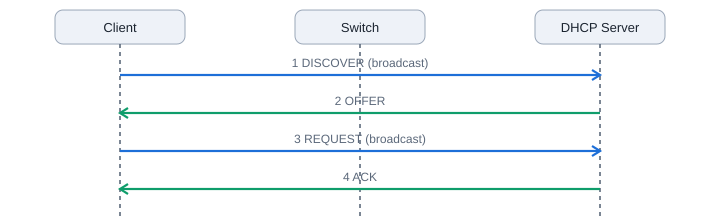

*شکل ۱: چهار مرحله‌ی DORA بین کلاینت و سرور.*

| مرحله | پیام        | نوع               | محتوا                            |
|-------|-------------|-------------------|----------------------------------|
| D     | Discover    | Broadcast         | کلاینت: «سرور DHCP هست؟»         |
| O     | Offer       | Unicast/Broadcast | سرور: «این IP را پیشنهاد می‌کنم»  |
| R     | Request     | Broadcast         | کلاینت: «همین IP را می‌خواهم»     |
| A     | Acknowledge | Unicast/Broadcast | سرور: «تأیید؛ مدت Lease این است» |

در پاسخ، سرور IP، Mask، Gateway، DNS و زمان اجاره (Lease) را می‌دهد. اگر هیچ پاسخی نرسد، کلاینت Windows خودش آدرس `169.254.x.x` می‌سازد (درس ۲-۱).

### ۲. تهدید: DHCP جعلی

چون Discover یک Broadcast است، هر سرور DHCP در شبکه می‌تواند جواب دهد؛ و کلاینت معمولاً اولین پاسخ را می‌پذیرد. مهاجم با یک سرور جعلی، Gateway را آدرس خودش می‌گذارد و همه‌ی ترافیک را می‌بیند.

### ۳. DHCP Snooping: فقط پورت مجاز OFFER بدهد

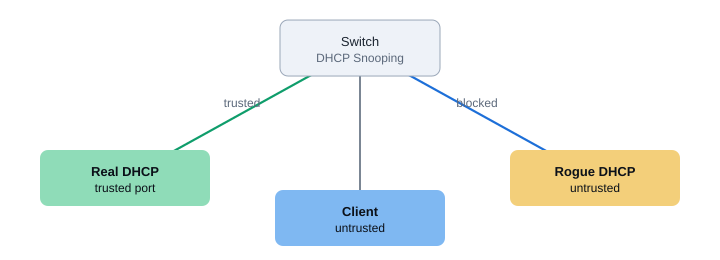

*شکل ۲: پورت سرور واقعی Trusted است؛ OFFER از پورت Untrusted مسدود می‌شود.*

سوییچ هر پورت را «Trusted» یا «Untrusted» می‌داند. پیام‌های سرور (Offer/ACK) فقط از پورت Trusted عبور می‌کنند. پورت کاربر Untrusted است؛ اگر DHCP Server روی آن دیده شود، مسدود می‌شود. سوییچ همچنین جدول Binding می‌سازد (MAC، IP، VLAN، پورت).

``` text
SW1(config)# ip dhcp snooping
SW1(config)# ip dhcp snooping vlan 20,30
SW1(config)# no ip dhcp snooping information option
SW1(config)# interface gi0/10
SW1(config-if)# ip dhcp snooping trust
SW1(config-if)# exit
SW1(config)# interface range gi0/1 - 4
SW1(config-if-range)# ip dhcp snooping limit rate 15
```

- `ip dhcp snooping` و `vlan`: قابلیت را عمومی و برای VLANهای مشخص فعال می‌کند.
- `trust`: فقط روی پورت به سمت DHCP Server (یا Uplink به سمت آن) و Trunkهای بین سوییچ‌ها.
- `limit rate`: سقف تعداد بسته‌ی DHCP در ثانیه برای جلوگیری از حمله‌ی Starvation.
- `no ... information option`: جلوگیری از Option 82 در بعضی سناریوها (مشکل رایج وقتی سرور Option 82 را قبول نمی‌کند).

``` text
SW1# show ip dhcp snooping
SW1# show ip dhcp snooping binding
SW1# show ip dhcp snooping statistics
```

### ۴. DAI: جعل ARP را متوقف کن

در ARP Spoofing مهاجم پاسخ ARP جعلی می‌فرستد: «IP Gateway مال MAC من است». DAI هر ARP را با جدول Binding مقایسه می‌کند؛ اگر IP و MAC با هم نخواند، بسته را می‌اندازد.

``` text
SW1(config)# ip arp inspection vlan 20,30
SW1(config)# interface gi0/10
SW1(config-if)# ip arp inspection trust
SW1# show ip arp inspection
SW1# show ip arp inspection statistics
```

> **شرط DAI**
>
> DAI به جدول Binding وابسته است؛ پس Snooping باید فعال باشد. برای دستگاه‌هایی با IP ثابت (سرور، پرینتر) باید ورودی دستی در Binding یا ARP ACL بنویسید، وگرنه DAI ترافیکشان را می‌اندازد.

### ۵. مثال‌ها

#### ساده

``` text
Client sends DISCOVER on Gi0/1 (untrusted)
Real server replies via Gi0/10 (trusted) -> OFFER passes
Binding: MAC aaaa.0000.0005  IP 10.10.20.50  VLAN 20  Gi0/1
```

#### متوسط: سرور جعلی

``` text
Rogue router on Gi0/3 (untrusted) sends OFFER
Switch drops it  -> client only hears the real server
Log: %DHCP_SNOOPING-5-DHCP_SNOOPING_UNTRUSTED_PORT
```

#### سخت: چرا بعد از فعال‌کردن Snooping هیچ‌کس IP نمی‌گیرد؟

``` text
Cause 1: the port to the DHCP server is NOT trusted -> OFFERs dropped
Cause 2: trunk between switches not trusted
Cause 3: Option 82 inserted and the server rejects it
Fix    : trust server/uplink ports; no ip dhcp snooping information option
```

> **صادقانه درباره‌ی Lab**
>
> طبق Probe اولیه، در vIOSL2 دستورهای DHCP Snooping و DAI فقط «پذیرفته» می‌شوند و ممکن است واقعاً بسته‌ها را بلوک نکنند. در Lab ما، Windows Server DHCP یک VM در ESXi است که در Capstone اصلی کامل می‌شود. اینجا نتیجه‌ی واقعی هر گام را ثبت کنید؛ و مفهوم و دستورها را کامل بدانید.

### تمرین‌ها

**ت1.** ۱ (ساده): نام چهار پیام DORA؟ *(پاسخ: 4-5-ت1 در بخش «پاسخ‌ها» انتهای فصل)*

**ت2.** ۲ (ساده): کدام پورت‌ها Trusted می‌شوند؟ *(پاسخ: 4-5-ت2 در بخش «پاسخ‌ها» انتهای فصل)*

**ت3.** ۳ (متوسط): DAI به چه چیزی وابسته است؟ *(پاسخ: 4-5-ت3 در بخش «پاسخ‌ها» انتهای فصل)*

**ت4.** ۴ (متوسط): کلاینت 169.254.x.x گرفته؛ دو علت محتمل؟ *(پاسخ: 4-5-ت4 در بخش «پاسخ‌ها» انتهای فصل)*

**ت5.** ۵ (سخت): چرا سرور با IP ثابت بعد از DAI قطع می‌شود؟ *(پاسخ: 4-5-ت5 در بخش «پاسخ‌ها» انتهای فصل)*

### Lab هدایت‌شده

سرور DHCP: یا یک VM ویندوزی/لینوکسی که بعداً می‌سازیم، یا موقتاً یک روتر با DHCP Pool. در این Lab، روی R1 یک Pool تست می‌سازیم.

#### گام ۱: DHCP موقت روی R1

``` text
R1(config)# ip dhcp excluded-address 10.10.20.1 10.10.20.10
R1(config)# ip dhcp pool USERS20
R1(dhcp-config)# network 10.10.20.0 255.255.255.0
R1(dhcp-config)# default-router 10.10.20.1
R1(dhcp-config)# dns-server 10.10.10.53
R1(dhcp-config)# lease 0 8
```

#### گام ۲: کلاینت VPCS آدرس بگیرد

``` text
PC1> ip dhcp
PC1> show ip
```

#### گام ۳: Snooping

``` text
SW1(config)# ip dhcp snooping
SW1(config)# ip dhcp snooping vlan 20
SW1(config)# interface gi0/0
SW1(config-if)# ip dhcp snooping trust
SW1# show ip dhcp snooping binding
```

#### گام ۴: DAI

``` text
SW1(config)# ip arp inspection vlan 20
SW1(config)# interface gi0/0
SW1(config-if)# ip arp inspection trust
```

نتیجه‌ی هر گام را ثبت کنید؛ اگر Binding ساخته نشد، همین را به‌عنوان محدودیت شبیه‌ساز ثبت کنید.

### Lab مستقل

یک «تحلیل خطر DHCP» یک‌صفحه‌ای بنویسید: ۳ تهدید، ۳ کنترل (Snooping، DAI، Port Security)، و ۳ دستور Verification در `03-ops/dhcp-l2-security.md`.

### عیب‌یابی

|         |                                                                                                                                                                  |
|---------|------------------------------------------------------------------------------------------------------------------------------------------------------------------|
| Symptom | بعد از Snooping کلاینت‌ها IP نمی‌گیرند                                                                                                                             |
| چک‌لیست  | ۱) پورت سرور Trusted است؟ ؛ ۲) Trunkهای بین سوییچ‌ها Trusted هستند؟ ؛ ۳) VLAN درست در لیست Snooping است؟ ؛ ۴) Option 82 مشکل می‌سازد؟ ؛ ۵) Rate Limit خیلی کم است؟ |
| ابزار   | show ip dhcp snooping ، show ip dhcp snooping binding                                                                                                            |
| رفع     | Trust صحیح و حذف Option 82                                                                                                                                       |

### سؤال‌های مرور

**م1.** DHCP Snooping چه مشکلی را حل می‌کند؟ *(پاسخ: 4-5-م1 در بخش «پاسخ‌ها» انتهای فصل)*

**م2.** DAI چطور کار می‌کند؟ *(پاسخ: 4-5-م2 در بخش «پاسخ‌ها» انتهای فصل)*

### English Corner: انگلیسی تخصصی این درس

این جمله‌ها از مستندات و محیط کار واقعی‌اند. بلند بخوانید و ترجمه را بپوشانید.

| English sentence                                                        | ترجمه                                                                |
|-------------------------------------------------------------------------|----------------------------------------------------------------------|
| Enable DHCP snooping on the access VLANs and trust only the uplink.     | DHCP Snooping را روی VLANهای Access فعال و فقط Uplink را Trust کنید. |
| A rogue DHCP server can redirect clients to a malicious gateway.        | سرور DHCP جعلی می‌تواند کلاینت‌ها را به Gateway مخرب هدایت کند.        |
| Dynamic ARP inspection validates ARP packets against the binding table. | DAI بسته‌های ARP را با جدول Binding اعتبارسنجی می‌کند.                 |
| The client fell back to an APIPA address.                               | کلاینت به آدرس APIPA برگشت.                                          |

**Q1.** Quick quiz (answer in English): Why must the trunk between switches be trusted for DHCP snooping? *(پاسخ: 4-5-Q1 در بخش «پاسخ‌ها» انتهای فصل)*

### تکلیف و چک‌لیست تسلط

- [ ] DORA را بدون نگاه توضیح دهم.
- [ ] Snooping و DAI را بنویسم و نتیجه‌ی واقعی را ثبت کنم.
- [ ] تحلیل خطر را بنویسم.

### یادآوری اشتباهات شما

> **یادآوری**
>
> پیش‌بینی قبل از اجرا؛ بکاپ قبل از تغییر؛ پذیرفته‌شدن دستور ≠ کار کردن؛ فرمول‌ها در بلوک مستقل.


#### کارت Lab — DHCP، Snooping و DAI

| # | فیلد | محتوا |
|---|---|---|
| 1 | عنوان و هدف | DHCP DORA، Snooping و DAI |
| 2 | پیش‌نیاز | درس 4-4 |
| 3 | توپولوژی | SW1 + DHCP (R1) + PC |
| 4 | تجهیزات | R1،SW1،VPCS |
| 5 | نسخه نرم‌افزار | vIOS-L2 15.2(20200924، Experimental) برای SW؛ vIOS 15.9(3)M9 برای R؛ VPCS؛ PNetLab 4.2.8 |
| 6 | IP Plan | VLAN 20 |
| 7 | وضعیت اولیه | Pool 10.10.20.0/24 |
| 8 | صورت مسئله | Binding و Trusted |
| 9 | مراحل هدایت‌شده | همان بخش «Lab هدایت‌شده» همین درس |
| 10 | تست عملکرد | `show ip dhcp snooping binding` |
| 11 | سناریوی خرابی | DHCP جعلی |
| 12 | روش عیب‌یابی | لایه‌ای/با شواهد (بخش عیب‌یابی همین درس) |
| 13 | نتیجه‌ی مورد انتظار | Binding ساخته شود؛ سرور جعلی بسته |
| 14 | معیار پذیرش | نتیجه‌ی واقعی ثبت |
| 15 | مستندات نهایی | `03-ops/dhcp-l2-security.md` |
| 16 | Cleanup و بازگردانی | no ip dhcp snooping |

> **وضعیت راستی‌آزمایی (خارج از ۱۶ فیلد):** **اجرا نشده (فقط طراحی).** DHCP Snooping/DAI در Probe فقط CLI-Accepted.

---

<a id="l-4-6"></a>

## درس 4-6 — طراحی سه‌لایه و آزمون G2

**فصل ۴ - روز ۶ · پیش‌نیاز: درس‌های ۴-۱ تا ۴-۵ · ۶ ساعت**

### این درس درباره چیست و چرا باید یاد بگیریم؟

**چه چیزی یاد می‌گیریم:** چطور شبکه‌ی سازمانی را در سه لایه (Access، Distribution، Core) طراحی می‌کنیم، چه زمانی «Collapsed Core» کافی است، عیب‌یابی خرابی‌های فصل ۴ (TS06 تا TS08)، و آزمون عملی Gate G2.

**چرا لازم است:** طراحی بد یعنی گسترش‌ناپذیری و عیب‌یابی سخت. طراحی لایه‌ای (Hierarchical) برای هر سازمان استانداردی است که جواب سؤال «این سوییچ را کجا بگذارم؟» را می‌دهد؛ و Gate G2 تضمین می‌کند Switching را عملی یاد گرفته‌اید.

- **در کار روزانه:** هر ساختمان یا شعبه با یکی از دو الگوی ۳لایه یا Collapsed Core طراحی می‌شود.
- **در امنیت:** لایه‌بندی یعنی نقاط کنترل مشخص (Policy روی Distribution/Core).
- **در Capstone:** شعبه‌ی کوچک Collapsed Core و مرکز ۳لایه‌ی ساده دارد.

> **مسیر درس**
>
> سه لایه ← Collapsed Core ← طراحی برای Capstone ← عیب‌یابی TS06-TS08 ← Lab ← Gate G2.

#### اصطلاحات این درس (مخفف ← شکل کامل ← معنی)

| مخفف           | شکل کامل انگلیسی   | معنی فارسی                                 |
|----------------|--------------------|--------------------------------------------|
| Access         | Access layer       | لایه‌ی اتصال کاربران و دستگاه‌ها             |
| Distribution   | Distribution layer | تجمیع Accessها، Policy و مسیریابی بین VLAN |
| Core           | Core layer         | هسته‌ی سریع شبکه                            |
| Collapsed Core | Collapsed Core     | ادغام Distribution و Core در یک لایه       |
| HLD            | High-Level Design  | طراحی سطح بالا                             |
| G2             | Gate 2             | آزمون عملی پایان فصل ۴                    |

### ۱. چرا سه لایه؟

شهری را تصور کنید که هر خانه مستقیماً به همه‌ی خانه‌ها خیابان دارد؛ ۱۰۰ خانه یعنی ۴۹۵۰ خیابان! لایه‌بندی مثل «کوچه، خیابان، بزرگراه» است: هر لایه کار مشخصی دارد و تعداد اتصال‌ها کم می‌ماند.

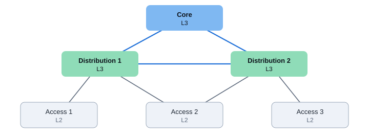

*شکل ۱: شبکه‌ی سه‌لایه؛ هر Access به دو Distribution وصل است (Redundancy).*

| لایه         | کار                                              | دستگاه نمونه  | ویژگی                    |
|--------------|--------------------------------------------------|---------------|--------------------------|
| Access       | اتصال کاربران، PortFast، Port Security، Snooping | سوییچ L2      | تعداد پورت زیاد، ساده    |
| Distribution | تجمیع، Gateway VLANها، ACL/Policy                | سوییچ L3      | Redundancy، EtherChannel |
| Core         | انتقال سریع بین Distributionها                   | سوییچ/روتر L3 | فقط سرعت و پایداری       |

### ۲. Collapsed Core: وقتی دو لایه کافی است

در شعبه‌ی کوچک، Distribution و Core را یکی می‌کنیم (دو سوییچ L3 که هم Gateway‌اند و هم هسته). این ارزان‌تر است و برای ۵۰ تا ۲۰۰ کاربر کافی.

| معیار   | سه‌لایه                  | Collapsed Core |
|---------|-------------------------|----------------|
| اندازه  | سازمان بزرگ/چند ساختمان | شعبه‌ی کوچک     |
| هزینه   | بیشتر                   | کمتر           |
| پیچیدگی | بیشتر                   | کمتر           |
| گسترش   | آسان‌تر                  | محدودتر        |

> **در Capstone ما**
>
> مرکز: Core/Distribution ساده روی یک جفت سوییچ؛ شعبه‌ها: Collapsed Core. Gateway اصلی همه‌ی VLANها FortiGate است و سوییچ‌ها L2 هستند (طبق تصمیم معماری).

### ۳. سه خرابی این هفته (TS06 تا TS08)

#### TS06: Root اشتباه

``` text
Symptom : slow network, traffic path goes through an old switch
Evidence: show spanning-tree -> wrong bridge is root
Fix     : spanning-tree vlan X root primary on the core switch
Verify  : show spanning-tree root
```

#### TS07: پورت err-disabled با BPDU Guard یا Port Security

``` text
Symptom : user port down, link light on
Evidence: show interfaces status err-disabled
Fix     : remove cause, shutdown / no shutdown
Verify  : port up, user online
```

#### TS08: EtherChannel Mismatch

``` text
Symptom : Po1(SD) or member ports (s)
Evidence: show etherchannel summary, show interfaces trunk
Fix     : make allowed/native/speed identical, bounce the ports
Verify  : Po1(SU), members (P)
```

### ۴. طراحی خودتان: HLD کوتاه

برای یک شعبه با ۱۵۰ کاربر، ۱۰ سرور و ۲۰ دستگاه مدیریتی، یک طراحی Collapsed Core بنویسید: چند سوییچ، چه VLANهایی، کجا Root، چه لینک‌هایی EtherChannel.

``` text
Branch (Collapsed Core)
- 2 x L3 core/distribution switches (EtherChannel between them)
- 3 x access switches, each uplinked to both cores
- VLAN 20 users, 30 servers, 10 management
- STP root: core 1 (secondary: core 2)
- Access: PortFast + BPDU Guard + Port Security + DHCP Snooping
```

### ۵. آزمون عملی Gate G2 (پایان فصل ۴)

بدون نگاه به درس، با مدرک (خروجی دستورها):

| \#  | وظیفه                                               | مدرک                                |
|-----|-----------------------------------------------------|-------------------------------------|
| ۱   | Rapid-PVST و Root/Secondary برای ۳ VLAN             | show spanning-tree root             |
| ۲   | PortFast + BPDU Guard روی پورت‌های کاربر و ساخت تخلف | show interfaces status err-disabled |
| ۳   | EtherChannel با LACP بین دو سوییچ                   | show etherchannel summary           |
| ۴   | Port Security با Sticky و ثبت تخلف                  | show port-security interface        |
| ۵   | DHCP Snooping + DAI (یا ثبت محدودیت شبیه‌ساز)        | show ip dhcp snooping               |
| ۶   | سه عیب TS06 تا TS08 با RCA                          | گزارش یک‌صفحه‌ای                      |
| ۷   | HLD شعبه‌ی Collapsed Core                            | فایل طراحی                          |

**معیار قبولی:** حداقل ۶ از ۷ مورد با مدرک (طبق Blueprint G2). وقتی تمام شد بگویید «G2 انجام شد».

### تمرین‌ها

**ت1.** ۱ (ساده): سه لایه‌ی شبکه؟ *(پاسخ: 4-6-ت1 در بخش «پاسخ‌ها» انتهای فصل)*

**ت2.** ۲ (ساده): Collapsed Core یعنی چه؟ *(پاسخ: 4-6-ت2 در بخش «پاسخ‌ها» انتهای فصل)*

**ت3.** ۳ (متوسط): چرا Access به دو Distribution وصل است؟ *(پاسخ: 4-6-ت3 در بخش «پاسخ‌ها» انتهای فصل)*

**ت4.** ۴ (سخت): در طراحی سه‌لایه، Root STP کجا باشد؟ *(پاسخ: 4-6-ت4 در بخش «پاسخ‌ها» انتهای فصل)*

### Lab هدایت‌شده

این Lab یک «مرور کل فصل ۴» است: روی مثلث SW1-SW2-SW3 همه‌ی تنظیمات را اعمال کنید.

1.  Rapid-PVST و Root/Secondary (درس ۴-۲).
2.  PortFast و BPDU Guard روی پورت کاربر (درس ۴-۲).
3.  EtherChannel بین SW1 و SW2 (درس ۴-۳).
4.  Port Security روی پورت PC (درس ۴-۴).
5.  Snooping و DAI (درس ۴-۵).
6.  پیکربندی را بکاپ و در Git (بدون رمز) ذخیره کنید.

``` text
SWx# show spanning-tree summary
SWx# show etherchannel summary
SWx# show port-security
SWx# show ip dhcp snooping
SWx# copy running-config flash:SWx-w4-final.cfg
```

### Lab مستقل

سه سناریوی TS06 تا TS08 را بسازید و هرکدام را با RCA یک‌صفحه‌ای در `03-ops/rca-w4.md` ثبت کنید.

### عیب‌یابی

|         |                                                                         |
|---------|-------------------------------------------------------------------------|
| Symptom | بعد از تغییرات فصل ۴ شبکه ناپایدار است                                 |
| روش     | لایه‌به‌لایه: لینک و STP و Channel و Port Security و DHCP                 |
| ابزار   | show spanning-tree ، show etherchannel summary ، show interfaces status |
| پیشگیری | تغییر مرحله‌ای با بکاپ و reload in                                       |

### سؤال‌های مرور

**م1.** چرا لایه‌بندی؟ *(پاسخ: 4-6-م1 در بخش «پاسخ‌ها» انتهای فصل)*

**م2.** Collapsed Core کی مناسب است؟ *(پاسخ: 4-6-م2 در بخش «پاسخ‌ها» انتهای فصل)*

### English Corner: انگلیسی تخصصی این درس

این جمله‌ها از مستندات و محیط کار واقعی‌اند. بلند بخوانید و ترجمه را بپوشانید.

| English sentence                                                     | ترجمه                                                      |
|----------------------------------------------------------------------|------------------------------------------------------------|
| A hierarchical design simplifies troubleshooting and scaling.        | طراحی سلسله‌مراتبی عیب‌یابی و مقیاس‌پذیری را ساده می‌کند.      |
| Every access switch has redundant uplinks to the distribution layer. | هر سوییچ Access Uplink پشتیبان به لایه‌ی Distribution دارد. |
| Collapsed core merges the core and distribution layers.              | Collapsed Core لایه‌های Core و Distribution را ادغام می‌کند. |
| Document the design before you configure.                            | پیش از پیکربندی، طراحی را مستند کنید.                      |

**Q1.** Quick quiz (answer in English): Why should the STP root never be an access switch? *(پاسخ: 4-6-Q1 در بخش «پاسخ‌ها» انتهای فصل)*

### تکلیف و چک‌لیست تسلط

- [ ] HLD شعبه را بنویسم.
- [ ] TS06 تا TS08 را با RCA ثبت کنم.
- [ ] Gate G2 را کامل کنم.

### یادآوری اشتباهات شما

> **یادآوری**
>
> پیش‌بینی قبل از اجرا؛ بکاپ قبل از تغییر؛ پذیرفته‌شدن دستور ≠ کار کردن؛ فرمول‌ها در بلوک مستقل.


#### کارت Lab — طراحی سه‌لایه و آزمون G2

| # | فیلد | محتوا |
|---|---|---|
| 1 | عنوان و هدف | طراحی سه‌لایه و TS06..TS08 + G2 |
| 2 | پیش‌نیاز | درس 4-5 |
| 3 | توپولوژی | مثلث + EtherChannel |
| 4 | تجهیزات | ۳ سوییچ + VPCS |
| 5 | نسخه نرم‌افزار | vIOS-L2 15.2(20200924، Experimental) برای SW؛ vIOS 15.9(3)M9 برای R؛ VPCS؛ PNetLab 4.2.8 |
| 6 | IP Plan | Baseline ف۴ |
| 7 | وضعیت اولیه | HLD شعبه |
| 8 | صورت مسئله | سه خرابی با RCA |
| 9 | مراحل هدایت‌شده | همان بخش «Lab هدایت‌شده» همین درس |
| 10 | تست عملکرد | show spanning-tree/etherchannel |
| 11 | سناریوی خرابی | TS06-08 |
| 12 | روش عیب‌یابی | لایه‌ای/با شواهد (بخش عیب‌یابی همین درس) |
| 13 | نتیجه‌ی مورد انتظار | هر خرابی RCA |
| 14 | معیار پذیرش | G2 ≥ ۶ از ۷ |
| 15 | مستندات نهایی | `03-ops/rca-w4.md` |
| 16 | Cleanup و بازگردانی | بازگشت به بکاپ |

> **وضعیت راستی‌آزمایی (خارج از ۱۶ فیلد):** **اجرا نشده (فقط طراحی).** اجرا نشده.

---

<a id="ans-4"></a>

## درس 4-7 — STP در عمق: تایمرها، محاسبه‌ی Convergence، RSTP، Loop Guard/UDLD/Root Guard و عیب‌یابی

**فصل 4 · بازنویسی عمیق · پیش‌نیاز: ۴-۱، ۴-۲، ۴-۶ · ≈ 8 ساعت**

> **وضعیت:** Cisco IOSv/IOSvL2 (vIOS 15.x)؛ خروجی‌ها نمونه‌ی آموزشی؛ Lab «اجرا نشده»؛ برخی ویژگی‌ها روی vIOS `Unverified`.

### ۱) هدف آموزشی

در پایان این درس باید بتوانید:

1. تایمرهای STP (Hello 2، Forward Delay 15، Max Age 20) و محاسبه‌ی Convergence 802.1D را انجام دهد.
2. تفاوت 802.1D و RSTP (Proposal/Agreement، Edge، Alternate/Backup) را توضیح دهد.
3. Root Guard، BPDU Guard، Loop Guard، UDLD را با سناریو انتخاب کند.
4. STP را با دستورهای `show spanning-tree` عیب‌یابی کند.
5. Root Placement و Priority را طراحی کند.

### ۲) مفهوم پایه: چیست و چرا؟

حلقه‌ی لایه‌ی ۲ شبکه را در ثانیه‌ها می‌کشد (Broadcast Storm). STP حلقه را می‌شکند، ولی تایمرها و رفتار هنگام خرابی را باید بدانید وگرنه «۵۰ ثانیه قطعی» و «Root اشتباه» می‌بینید.

### ۳) توضیح عمیق فنی

#### ۱) تایمرها (802.1D)

``` text
Hello = 2 s (BPDU from root)   Forward Delay = 15 s   Max Age = 20 s
Port states: Blocking -> Listening (15 s) -> Learning (15 s) -> Forwarding
Convergence after direct link failure ~= 30 s (FwdDelay x 2)
Convergence after indirect failure ~= MaxAge + 2 x FwdDelay = 20 + 30 = 50 s
```

#### ۲) RSTP (802.1w)

حالت‌ها: Discarding، Learning، Forwarding. نقش‌ها: Root، Designated، Alternate، Backup. **Proposal/Agreement** بین دو سوئیچ، Forwarding را در کمتر از ۱ ثانیه برقرار می‌کند. **Edge Port** (PortFast) بلافاصله Forwarding. Convergence معمولاً < ۱–۲ ثانیه.

#### ۳) محافظت‌ها

| ابزار | کار | سناریو |
|---|---|---|
| Root Guard | پورت را اگر BPDU بهتر آمد Root-inconsistent می‌کند | جلوگیری از Root شدن سوئیچ غیرمجاز |
| BPDU Guard | پورت Edge که BPDU دریافت کند Err-disable | سوئیچ/حلقه به پورت کاربر |
| Loop Guard | پورت Non-designated که BPDU را از دست بدهد Forward نمی‌شود | لینک یک‌طرفه |
| UDLD | لینک یک‌طرفه (Fiber) را کشف و پورت را می‌بندد | Fiber |
| BPDU Filter | BPDU را فیلتر (خطرناک) | موارد خاص |

#### ۴) طراحی Root

Root را عمداً روی Core بگذارید: Priority 4096 (Primary) و 8192 (Secondary) با `spanning-tree vlan X root primary`. Root اتفاقی (Priority پیش‌فرض 32768+VLAN و کوچک‌ترین MAC) ممکن است قدیمی‌ترین سوئیچ Access باشد.

#### ۵) عیب‌یابی

``` text
show spanning-tree vlan 10
show spanning-tree root
show spanning-tree interface Gi0/1 detail
show spanning-tree inconsistentports
debug spanning-tree events (lab only)
```

### ۴) طراحی و تصمیم‌گیری

| سؤال طراحی | گزینه‌ها و معیار انتخاب |
|---|---|
| Root | Core با priority صریح |
| Edge | PortFast + BPDU Guard |
| Fiber | UDLD+Loop Guard |
| STP mode | Rapid-PVST |

### ۵) مثال‌های حل‌شده (ساده، متوسط، سخت)

**ساده (حل‌شده):** Root Primary روی Core با Priority 4096؛ `show spanning-tree root` Root مورد انتظار.

**متوسط (محاسبه):** 802.1D: قطع کابل مستقیم روی Root Port ⇒ ≈ 30 s؛ قطع غیرمستقیم (سوئیچ میانی) ⇒ ≈ 50 s. با RSTP < 2 s.

**سخت (سناریو):** کاربر سوئیچ کوچک وصل کرد؛ Root جابه‌جا شد و ترافیک مسیر عوض شد. علت: Root Guard نبود. رفع: Root Guard روی پورت‌های رو به پایین Core؛ BPDU Guard روی Access؛ Alert بر `ROOTGUARD`/`BPDUGUARD`. آزمون: اتصال سوئیچ تست ⇒ پورت inconsistent/err-disable.

### ۷) پیاده‌سازی از مسیر CLI

``` text
spanning-tree mode rapid-pvst
spanning-tree vlan 1-4094 root primary
interface range GigabitEthernet0/10 - 24
 spanning-tree portfast
 spanning-tree bpduguard enable
interface GigabitEthernet0/1
 spanning-tree guard root
spanning-tree loopguard default
udld enable
```

### ۸) Verification (اثبات صحت)

- `show spanning-tree root`.
- آزمون Root Guard/BPDU Guard با سوئیچ تست.
- اندازه‌گیری Convergence با ping.

### ۹) Troubleshooting

| علامت | شاهد برای بررسی | علت محتمل و رفع |
|---|---|---|
| Root اشتباه | `show spanning-tree root` | Priority |
| Port err-disabled | Log | BPDU Guard/UDLD |
| Convergence کند | mode | pvst به rapid-pvst |

### ۱۰) نکات امنیتی

- BPDU/Root Guard در مرز.
- BPDU Filter با احتیاط.

### ۱۱) جمع‌بندی مفهومی

- تایمرها و Convergence 30/50 s در 802.1D.
- RSTP سریع.
- Guardها هرکدام یک تهدید.
- Root عمدی.

### ۱۲) تمرین و ارزیابی

**ت1.** (ساده) Hello/Forward Delay/Max Age پیش‌فرض؟ *(پاسخ: 4-7-ت1)*

**ت2.** (ساده) PortFast کجا استفاده می‌شود؟ *(پاسخ: 4-7-ت2)*

**ت3.** (متوسط) Convergence غیرمستقیم 802.1D؟ *(پاسخ: 4-7-ت3)*

**ت4.** (متوسط) Root Guard و BPDU Guard فرقشان؟ *(پاسخ: 4-7-ت4)*

**ت5.** (سخت) سوئیچ کاربر Root شد؛ تحلیل و رفع. *(پاسخ: 4-7-ت5)*

**ت6.** (سخت، طراحی) استاندارد STP برای دانشگاه. *(پاسخ: 4-7-ت6)*

**Q1.** Quick quiz (English): What does BPDU guard do when an edge port receives a BPDU? *(پاسخ: 4-7-Q1)*

### ۱۳) اصطلاحات و English Corner

| مخفف | شکل کامل | معنی |
|---|---|---|
| BPDU | Bridge Protocol Data Unit | بسته‌ی STP |
| UDLD | UniDirectional Link Detection | تشخیص لینک یک‌طرفه |
| RSTP | Rapid Spanning Tree Protocol | STP سریع |

- *Place the root bridge deliberately at the core.* ← Root Bridge را عمداً در Core قرار دهید.

### ۱۴) کارت Lab

**کارت Lab:** STP عمیق. **وضعیت:** اجرا نشده. **Evidence:** `03-ops/stp-deep.md`.

### ۱۵) منابع

- IEEE 802.1D/802.1w
- Cisco Spanning Tree Protocol guides

## پاسخ‌های فصل 4

> ابتدا بدون نگاه حل کنید. شناسه: درس-نوع+شماره (ت = تمرین، م = مرور، Q = Quick quiz).

**4-1-ت1** — ۱ (ساده): چرا Loop در لایه ۲ خطرناک‌تر از لایه ۳ است؟

فریم لایه‌ی ۲ هیچ فیلد TTL ندارد، پس فریم Broadcast/Unknown-unicast در حلقه تا ابد می‌چرخد و با هر دور تکثیر می‌شود (Broadcast Storm)؛ CPU و پهنای باند سوییچ‌ها در چند ثانیه پر می‌شود. بسته‌ی لایه‌ی ۳ TTL دارد و پس از رسیدن به صفر دور ریخته می‌شود؛ پس حلقه‌ی L3 زودتر خود را محدود می‌کند. به همین دلیل STP لازم است.

``` text
Layer-2 frames have no TTL, so they never expire.
Layer-3 packets have a TTL and are dropped when it reaches 0.
```

**4-1-ت2** — ۲ (ساده): Root Bridge را چطور انتخاب می‌کنند؟

Root Bridge با کوچک‌ترین Bridge ID انتخاب می‌شود: ابتدا کمترین Priority (که با VLAN ID جمع می‌شود در PVST) و در صورت برابری کوچک‌ترین MAC. چون MAC معمولاً سوییچ قدیمی‌تر کوچک‌تر است، بدون تنظیم، قدیمی‌ترین سوییچ Root می‌شود: خطای شایع. راه: Priority را دستی (مثلاً 4096) روی Core بگذارید.

``` text
Bridge ID = Priority (+ VLAN ID) + MAC ; lowest wins
```

``` text
Lowest Bridge ID = lowest (Priority + VLAN ID), then lowest MAC address.
```

**4-1-ت3** — ۳ (متوسط): دو سوییچ با اولویت 32768 و 4096؛ کدام Root است؟

سوییچ با Priority ۴۰۹۶ Root می‌شود چون کوچک‌تر بهتر است و ۴۰۹۶ از ۳۲۷۶۸ کمتر است. MAC فقط وقتی Priority برابر باشد تعیین‌کننده است. در عمل برای اطمینان Root اصلی را 4096 و Secondary را 8192 تنظیم می‌کنند (`spanning-tree vlan X root primary/secondary`).

``` text
The switch with priority 4096 (lower value wins).
```

**4-1-ت4** — ۴ (متوسط): هزینه‌ی مسیر سه لینک ۱ گیگ پشت‌سرهم تا Root با روش Short؟

هزینه‌ی مسیر مجموع Costهای لینک‌ها در جهت Root است. روش Short (IEEE 802.1D 1998) برای 1 Gbps هزینه‌ی ۴ دارد؛ سه لینک پشت‌سرهم ۴+۴+۴=۱۲. روش Long (RSTP پیش‌فرض نسخه‌های جدید) برای 1G مقدار ۲۰۰۰ را می‌دهد؛ مهم است که همه‌ی سوییچ‌ها از یک روش استفاده کنند.

``` text
Cost = 4 + 4 + 4 = 12  (short method, 1 Gbps links)
```

``` text
Cost = 4 + 4 + 4 = 12
```

**4-1-ت5** — ۵ (سخت): در مثلث A (Root)، B، C با لینک‌های 1G، اگر لینک A-C خراب شود، SW-C از کدام مسیر Root را می‌بیند و هزینه چقدر است؟

قبل از خرابی A-C، C مسیر مستقیم به Root (هزینه ۴) و مسیر از B (۸) دارد؛ پورت به سمت B در حالت Alternate/Blocking است. با خرابی A-C، پورت Alternate به سمت B به Root Port تبدیل می‌شود و Forwarding می‌شود؛ هزینه ۸. در RSTP این انتقال معمولاً زیر ۱ ثانیه است؛ در STP کلاسیک تا ۵۰ ثانیه.

``` text
New path: C -> B -> A ; Cost = 4 + 4 = 8
```

``` text
New path: C -> B -> A
Cost = 4 (C-B) + 4 (B-A) = 8
The previously blocked port on C (towards B) becomes the Root Port.
```

**4-1-م1** — چرا لایه ۲ به STP نیاز دارد؟

چون فریم TTL ندارد و حلقه‌ی L2 فریم را بی‌پایان می‌چرخاند و Storm می‌سازد. STP با Block کردن لینک‌های مازاد (و بازکردن آن‌ها در خرابی) یک ساختار درختی بدون حلقه می‌سازد و هم‌زمان افزونگی نگه می‌دارد.

چون فریم TTL ندارد و در صورت وجود حلقه تا ابد می‌چرخد.

**4-1-م2** — Root Bridge چه کسی است؟

Root Bridge سوییچی با کوچک‌ترین Bridge ID (Priority سپس MAC) است. تمام مسیرها برای محاسبه‌ی Cost به سمت Root سنجیده می‌شوند؛ پس بهتر است Root سوییچ Core باشد، نه یک Access تصادفی.

سوییچی با کوچک‌ترین Bridge ID؛ یعنی کوچک‌ترین اولویت و سپس کوچک‌ترین MAC.

**4-1-م3** — Root Port و Designated Port چه فرقی دارند؟

Root Port پورتی در سوییچ غیر Root است که کوتاه‌ترین مسیر به Root را دارد (هر سوییچ غیر Root فقط یکی). Designated Port پورتی در هر Segment است که کوتاه‌ترین مسیر Segment به Root را دارد و ترافیک آن Segment را Forward می‌کند. پورت‌های دیگر Alternate/Blocking می‌شوند. همه‌ی پورت‌های Root سوییچ Designated هستند.

Root Port پورت غیر Root به سمت Root است؛ Designated Port پورت فعال هر Segment به سمت دورتر از Root.

**4-1-Q1** — Quick quiz (answer in English): What does STP do with a redundant link?

پاسخ انگلیسی در پایین آمده است؛ نکته‌ی عملی: پورت Blocked مسیر پشتیبان است نه «پورت خراب»؛ در خرابی لینک اصلی آن Forward می‌شود و افزونگی را فراهم می‌کند.

It places one of the ports in a blocking (alternate) state to prevent a loop, and unblocks it if the active link fails.

**4-2-ت1** — ۱ (ساده): چرا RSTP سریع‌تر است؟

RSTP به‌جای انتظار برای Timerها (Listening/Learning ~30 ثانیه)، سوییچ‌ها با Proposal/Agreement به‌صورت Handshake روی لینک Point-to-point مستقیماً Forwarding را می‌گیرند. پورت Alternate از قبل آماده است و پس از خرابی Root Port بلافاصله جایگزین می‌شود. نتیجه: همگرایی در حد ثانیه (کمتر از ۱ تا ۲ ثانیه) در مقابل ~۳۰–۵۰ ثانیه در STP.

``` text
Switches negotiate (proposal/agreement) instead of waiting for timers; alternate ports are ready.
```

**4-2-ت2** — ۲ (ساده): اولویت‌های مجاز؟

Priority باید مضرب ۴۰۹۶ باشد (۰، ۴۰۹۶، ... ۶۱۴۴۰) چون ۱۲ بیت بالای Bridge ID شامل Extended System ID (VLAN) است و فقط ۴ بیت برای Priority باقی می‌ماند. پیش‌فرض ۳۲۷۶۸. تنظیم عدد دیگر با خطا رد می‌شود.

``` text
Multiples of 4096 (0, 4096, 8192, ... 61440). Default 32768.
```

**4-2-ت3** — ۳ (متوسط): PortFast بدون BPDU Guard چه خطری دارد؟

PortFast پورت را فوراً Forwarding می‌کند و Listening/Learning را رد می‌کند. اگر کاربر یک سوییچ/Hub به آن وصل کند و حلقه بسازد، STP فرصت واکنش ندارد و Storm رخ می‌دهد. BPDU Guard با دیدن BPDU روی پورت PortFast آن را err-disable می‌کند. ترکیب PortFast+BPDU Guard استاندارد پورت کاربر است.

``` text
A switch plugged into a PortFast port can create a loop before STP reacts; BPDU Guard shuts the port.
```

**4-2-ت4** — ۴ (متوسط): پورت err-disabled شد؛ مراحل رفع؟

مراحل رفع err-disabled: ۱) `show interfaces status err-disabled` و Log برای علت (BPDU Guard، Port Security). ۲) علت را حذف کنید (سوییچ جعلی/دستگاه). ۳) `shutdown` سپس `no shutdown`. ۴) آزمون. اگر علت حذف نشود پورت دوباره می‌افتد. `errdisable recovery cause bpduguard interval 300` بازیابی خودکار را فعال می‌کند ولی علت را رفع نمی‌کند.

``` text
1) show interfaces status err-disabled
2) remove the cause (rogue switch)
3) shutdown, then no shutdown
4) verify
```

**4-2-ت5** — ۵ (سخت): Root Guard را روی کدام پورت‌ها می‌گذاریم و چرا؟

Root Guard روی پورت‌هایی که به سوییچ‌های خارج از کنترل شما (مشتری/Edge/ISP) می‌روند گذاشته می‌شود. اگر BPDU برتر (ادعای Root) برسد، پورت به حالت root-inconsistent می‌رود و ترافیک را Forward نمی‌کند تا سوییچ بیگانه Root نشود. وقتی BPDU برتر قطع شد، پورت خودکار بازیابی می‌شود. بر خلاف BPDU Guard، روی پورت کاربر نیست.

``` text
On ports that face switches you do not control (customer/edge); a superior BPDU there puts the port in root-inconsistent state so no foreign switch becomes root.
```

**4-2-م1** — PortFast برای چه پورتی؟

PortFast فقط برای پورت‌های دستگاه انتهایی (PC، پرینتر، تلفن) که از BPDU استفاده نمی‌کنند. روی لینک بین سوییچ‌ها خطرناک است چون ممکن است حلقه‌ی موقت بسازد.

فقط پورت دستگاه انتهایی (PC، پرینتر)، نه لینک بین سوییچ‌ها.

**4-2-م2** — تفاوت BPDU Guard و Root Guard؟

BPDU Guard روی پورت PortFast با دیدن هر BPDU پورت را خاموش می‌کند؛ Root Guard فقط BPDUهای برتر را بلوک می‌کند و پورت را روی Alternate/inconsistent نگه می‌دارد. یکی ضد سوییچ ناخواسته در پورت کاربر و دیگری ضد Root جعلی روی پورت اتصال به خارج.

BPDU Guard با هر BPDU پورت را خاموش می‌کند؛ Root Guard فقط BPDUهای برتر (ادعای Root) را بلوک می‌کند.

**4-2-م3** — چرا Root را دستی تعیین می‌کنیم؟

اگر Root دستی نباشد، قدیمی‌ترین (کوچک‌ترین MAC) سوییچ Root می‌شود که ممکن است ضعیف‌ترین سوییچ و در محل بد باشد. تنظیم دستی Root (Primary/Secondary) مسیر ترافیک را قابل‌پیش‌بینی و پایدار می‌کند.

تا سوییچ قدیمی یا ضعیف تصادفاً Root نشود و مسیر ترافیک قابل‌پیش‌بینی باشد.

**4-2-Q1** — Quick quiz (answer in English): When should you not enable PortFast?

پاسخ انگلیسی در پایین آمده است؛ قانون ساده: PortFast فقط روی Access/Edge پورت دستگاه انتهایی، نه Trunk و نه لینک سوییچ-به-سوییچ.

On trunk or switch-to-switch links, because it can create temporary loops.

**4-3-ت1** — ۱ (ساده): چرا EtherChannel لازم است؟

بدون EtherChannel، لینک‌های موازی بین دو سوییچ را STP Block می‌کند و پهنای باند اضافه استفاده نمی‌شود. EtherChannel چند لینک را به یک لینک منطقی تبدیل می‌کند: STP یک لینک می‌بیند، پهنای باند جمع می‌شود و خرابی یک لینک بدون Re-convergence تحمل می‌شود.

``` text
Without it STP blocks the parallel link; with it the links are bundled into one logical link.
```

**4-3-ت2** — ۲ (ساده): LACP با کدام Modeها؟

LACP دو Mode دارد: active (شروع مذاکره) و passive (فقط پاسخ). حداقل یک سر باید active باشد تا Channel بسازد. توصیه: هر دو active. PAgP (سیسکو) desirable/auto دارد. Mode on (بدون پروتکل) تنها وقتی که هر دو سر on باشند.

``` text
active and passive
```

**4-3-ت3** — ۳ (متوسط): کدام ترکیب Channel نمی‌سازد؟

ترکیب‌های ناموفق: passive-passive (هیچ‌کس شروع نمی‌کند)، on با active/passive (on پروتکل ندارد)، و LACP با PAgP (پروتکل‌های ناسازگار). مشخصات پورت‌ها (Speed/Duplex/VLAN/Trunk) هم باید یکسان باشد وگرنه عضو Suspended می‌شود.

``` text
passive-passive, on-active, LACP-PAgP
```

**4-3-ت4** — ۴ (متوسط): تفسیر Po1(SD) Gi0/1(D) Gi0/2(D)

Po1(SD) یعنی Port-channel لایه‌ی ۲ (S) و Down (D)؛ هر دو عضو (D) یعنی Down: کابل، پورت سمت مقابل یا Shutdown. بررسی: `show interfaces status`، Log، سمت مقابل و `show etherchannel summary`. SU = L2 Up، P = Bundled، I = Standalone، s = Suspended.

``` text
Port-channel is down; both member ports are down (cable or remote side down).
```

**4-3-ت5** — ۵ (سخت): چرا ۲ لینک ۱G برای یک انتقال فایل تکی ۲G سرعت نمی‌دهد؟

EtherChannel بار را با Hash (IP/MAC/پورت) بین لینک‌ها تقسیم می‌کند و یک جریان (Flow) همیشه روی یک عضو می‌رود تا ترتیب بسته‌ها حفظ شود. بنابراین یک انتقال فایل تکی حداکثر سرعت یک لینک (1G) را می‌بیند؛ چندین جریان بین لینک‌ها توزیع می‌شود. برای بهبود: الگوریتم Hash با پورت (`port-channel load-balance src-dst-port`).

``` text
A single flow is hashed to one member link, so one flow is limited to 1G; many flows spread across links.
```

**4-3-م1** — EtherChannel چه مشکلی را حل می‌کند؟

EtherChannel دو مشکل را حل می‌کند: پهنای باند بیشتر از لینک‌های موازی که STP Block می‌کرد، و تحمل خطا (خرابی یک لینک بدون قطع). همچنین Config STP را ساده می‌کند چون یک لینک منطقی است.

پهنای باند و تحمل خطا برای لینک‌های موازی که STP آن‌ها را نمی‌بندد.

**4-3-م2** — چرا LACP را ترجیح می‌دهیم؟

LACP (802.3ad) استاندارد IEEE است و بین سازنده‌های مختلف کار می‌کند؛ PAgP اختصاصی سیسکو. با LACP هم سیسکو-به-فورتی‌گیت/لینوکس ممکن است و خطاهای پیکربندی با Mode active/active و Fast timer کمتر می‌شود.

استاندارد است و با تجهیزات سازنده‌های مختلف کار می‌کند.

**4-3-Q1** — Quick quiz (answer in English): Why does a single file transfer not use the full bundled bandwidth?

پاسخ انگلیسی در پایین آمده است؛ جمع‌بندی: برای بهبود توزیع بار تعداد جریان‌های مختلف و Hash مناسب لازم است نه فقط افزودن لینک.

Because one flow is hashed onto a single member link.

**4-4-ت1** — ۱ (ساده): سه نوع Violation؟

سه حالت Violation: shutdown (پیش‌فرض؛ پورت err-disabled و Log)، restrict (فریم نامجاز دور ریخته و Log/شمارنده، پورت فعال)، protect (دور ریختن بدون Log). برای امنیت و ممیزی shutdown یا restrict بهتر از protect است چون Log دارند.

``` text
shutdown, restrict, protect
```

**4-4-ت2** — ۲ (ساده): sticky یعنی چه؟

Sticky یعنی سوییچ MACهای یادگرفته‌شده را به‌صورت خودکار به running-config اضافه می‌کند؛ پس بعد از ذخیره (`copy run start`) پایدار می‌ماند. مزیت: بدون لیست دستی MAC، پورت به اولین دستگاه‌ها قفل می‌شود. عیب: دستگاه عوض‌شده نیاز به پاک‌سازی دارد (`clear port-security sticky`).

``` text
The switch learns MAC addresses dynamically and stores them in the running-config.
```

**4-4-ت3** — ۳ (متوسط): چرا بعد از reload ممکن است sticky پاک شود؟

Sticky MACها فقط در running-config هستند؛ اگر `copy running-config startup-config` انجام نشود، بعد از reload پاک می‌شوند و سوییچ دوباره یاد می‌گیرد، یعنی امنیت غیرمنتظره عوض می‌شود. پس بعد از تغییر Port Security Config را ذخیره کنید.

``` text
Sticky MACs are only in running-config; without copy running-config startup-config they are lost.
```

**4-4-ت4** — ۴ (متوسط): پورت err-disabled شد؛ مراحل؟

مراحل: ۱) علت: `show port-security interface Gi0/5` و Log برای MAC متخلف. ۲) دستگاه نامجاز را بردارید یا MAC را مجاز کنید. ۳) `shutdown` و `no shutdown` (یا errdisable recovery). ۴) آزمون. بدون رفع علت، پورت دوباره می‌افتد.

``` text
1) find the offending MAC
2) remove the device
3) shutdown / no shutdown
4) verify
```

**4-4-ت5** — ۵ (سخت): maximum را برای پورت Phone+PC چند می‌گذاریم و چرا؟

پورت دارای تلفن IP و PC پشت آن حداقل دو MAC دارد؛ مقدار ۳ (تلفن + PC + یک رزرو) از قفل‌شدن ناخواسته هنگام تعویض دستگاه جلوگیری می‌کند. مقدار بیش‌ازحد بزرگ هدف Port Security را کم می‌کند؛ دلیل ۳ تعادل بین کاربرد و امنیت است.

``` text
3 (Phone + PC + one spare), to avoid unnecessary lockouts.
```

**4-4-م1** — Port Security چه چیزی را کنترل می‌کند؟

Port Security تعداد و هویت MACهای مجاز روی یک پورت را کنترل می‌کند تا دستگاه ناشناس، Switch/Hub جعلی یا حمله‌ی MAC Flooding روی پورت Access محدود شود.

تعداد و هویت MACهای مجاز روی یک پورت.

**4-4-م2** — تفاوت restrict و shutdown؟

restrict فریم نامجاز را دور می‌ریزد، Log و شمارنده می‌دهد ولی پورت فعال می‌ماند؛ shutdown پورت را err-disabled می‌کند و نیاز به ریست دارد. restrict برای محیط‌هایی که قطع کامل پورت نامطلوب است مناسب‌تر است.

restrict فریم را دور می‌ریزد و لاگ می‌دهد ولی پورت فعال می‌ماند؛ shutdown پورت را err-disabled می‌کند.

**4-4-Q1** — Quick quiz (answer in English): What is the default violation mode?

پاسخ انگلیسی در پایین آمده است؛ پیش‌فرض Violation برابر shutdown است: پورت err-disabled می‌شود و برای بازیابی باید shutdown/no shutdown یا errdisable recovery اجرا شود.

Shutdown: the port goes into err-disabled state.

**4-5-ت1** — ۱ (ساده): نام چهار پیام DORA؟

DORA مراحل گرفتن IP است: Discover (کلاینت Broadcast می‌کند)، Offer (سرور پیشنهاد می‌دهد)، Request (کلاینت پیشنهاد را درخواست می‌کند)، Acknowledge (سرور تأیید و Lease). اگر Offer نیاید، کلاینت APIPA (169.254.x.x) می‌گیرد.

``` text
Discover, Offer, Request, Acknowledge
```

**4-5-ت2** — ۲ (ساده): کدام پورت‌ها Trusted می‌شوند؟

Trusted: پورت به سمت DHCP Server قانونی و Trunk بین سوییچ‌ها (و گاهی Relay). پورت کاربر هرگز Trusted نیست. روی Untrusted فقط DISCOVER/REQUEST مجاز است و Offer/ACK دور ریخته می‌شود. این همان دفاع در برابر Rogue DHCP است.

``` text
Ports toward the legitimate DHCP server and inter-switch trunks. Never user ports.
```

**4-5-ت3** — ۳ (متوسط): DAI به چه چیزی وابسته است؟

DAI (Dynamic ARP Inspection) هر ARP را با جدول Binding DHCP Snooping (IP-MAC-پورت-VLAN) مقایسه می‌کند و ARP جعلی را دور می‌ریزد. بدون Binding (مثلاً IP Static) باید ARP ACL یا Static Binding داد وگرنه ARP مشروع هم Drop می‌شود.

``` text
The DHCP Snooping binding table (or static ARP ACL entries).
```

**4-5-ت4** — ۴ (متوسط): کلاینت 169.254.x.x گرفته؛ دو علت محتمل؟

APIPA (169.254.x.x) یعنی هیچ Offer دریافت نشده. دو علت محتمل: ۱) DHCP Server در دسترس/روشن نیست (VLAN/Relay اشتباه). ۲) Snooping Offer را Drop می‌کند چون پورت سرور/Trunk Trusted نیست. بررسی: `show ip dhcp snooping`، `show ip dhcp binding` و Capture روی کلاینت.

``` text
1) DHCP server unreachable/down
2) Snooping drops the OFFER (server port not trusted)
```

**4-5-ت5** — ۵ (سخت): چرا سرور با IP ثابت بعد از DAI قطع می‌شود؟

سرور با IP ثابت در جدول Binding DHCP نیست؛ DAI ARP آن را نامعتبر می‌بیند و Drop می‌کند و سرور قطع می‌شود. راه: Static Binding (`ip source binding`) یا ARP ACL (`arp access-list`) و `ip arp inspection filter`، یا Trusted کردن پورت سرور. پیش از فعال‌سازی DAI، سرورهای IP ثابت را فهرست کنید.

``` text
It has no DHCP binding entry; DAI drops its ARP packets. Fix: add a static binding / ARP ACL.
```

**4-5-م1** — DHCP Snooping چه مشکلی را حل می‌کند؟

DHCP Snooping سرور DHCP جعلی (Rogue) را مسدود می‌کند (Offer/ACK فقط از پورت Trusted) و جدول Binding IP-MAC-پورت می‌سازد که DAI و IP Source Guard از آن استفاده می‌کنند. بدون آن، یک پرینتر یا روتر خانگی اشتباه می‌تواند Gateway/DNS جعلی بدهد.

مسدودکردن سرور DHCP جعلی و ساخت جدول Binding.

**4-5-م2** — DAI چطور کار می‌کند؟

DAI پیام‌های ARP را رهگیری و با Binding Table مقایسه می‌کند؛ ARP با IP-MAC نامطابق دور ریخته می‌شود و حمله‌ی ARP Spoofing/MITM را خنثی می‌کند. باید روی VLANها فعال و پورت‌های Trunk/Uplink Trusted شوند.

هر ARP را با جدول Binding مقایسه می‌کند و ARP نامعتبر را می‌اندازد.

**4-5-Q1** — Quick quiz (answer in English): Why must the trunk between switches be trusted for DHCP snooping?

پاسخ انگلیسی در پایین آمده است؛ اگر Trunk بین سوییچ‌ها Untrusted باشد، Offer سرور که از Trunk می‌رسد Drop می‌شود و کلاینت‌های سوییچ دیگر IP نمی‌گیرند.

Otherwise legitimate DHCP replies arriving over the trunk are dropped.

**4-6-ت1** — ۱ (ساده): سه لایه‌ی شبکه؟

مدل سه‌لایه: Access (اتصال کاربران/سرورها، پورت‌های کاربر و سیاست‌های L2)، Distribution (تجمیع Accessها، سیاست، L3 بین VLANها، ACL/QoS)، Core (انتقال سریع و بدون سیاست بین Distributionها). هر لایه وظیفه و Scale مستقل دارد.

``` text
Access, Distribution, Core
```

**4-6-ت2** — ۲ (ساده): Collapsed Core یعنی چه؟

Collapsed Core یعنی Distribution و Core در یک لایه ادغام شده‌اند (مثلاً دو سوییچ L3 با HSRP). برای شعبه و سازمان کوچک مقرون‌به‌صرفه و ساده است؛ با رشد، یک لایه‌ی Core جدا لازم می‌شود. نقطه‌ی ضعف: Blast radius بزرگ‌تر.

``` text
Distribution and Core are merged into one layer (two layer-3 switches).
```

**4-6-ت3** — ۳ (متوسط): چرا Access به دو Distribution وصل است؟

اتصال Access به دو Distribution افزونگی می‌دهد: خرابی یک Uplink یا یک سوییچ Distribution، ارتباط را قطع نمی‌کند. با STP/RSTP یا Routed Access یکی فعال و دیگری Standby است؛ با Port-channel هر دو فعال. بدون این، یک خرابی Uplink کل Access را قطع می‌کند.

``` text
Redundancy: if one uplink or distribution switch fails, the other keeps the access switch online.
```

**4-6-ت4** — ۴ (سخت): در طراحی سه‌لایه، Root STP کجا باشد؟

Root STP باید روی Distribution/Core باشد، نه Access. اگر Access Root شود، ترافیک بین سوییچ‌ها از یک دستگاه کم‌ظرفیت لبه عبور می‌کند و مسیرهای زیربهینه می‌سازد. راه: Priority پایین روی Distribution و Root Guard روی Uplink Access.

``` text
On the Distribution/Core switches, never on access switches.
```

**4-6-م1** — چرا لایه‌بندی؟

لایه‌بندی مقیاس‌پذیری و کنترل را آسان می‌کند: هر لایه کار مشخص دارد، افزودن Access بدون دست‌زدن به Core، عیب‌یابی ساده‌تر و طراحی قابل‌تکرار.

برای مقیاس‌پذیری و کنترل: هر لایه کار مشخصی دارد.

**4-6-م2** — Collapsed Core کی مناسب است؟

Collapsed Core برای شعبه‌ی کوچک یا کاربران کم (چند ده تا چند صد) مناسب است. با رشد یا نیاز به جداسازی سیاست‌ها، Core جدا بسازید.

شعبه‌ی کوچک با کاربران کم.

**4-6-Q1** — Quick quiz (answer in English): Why should the STP root never be an access switch?

پاسخ انگلیسی در پایین آمده است؛ توصیه: Root را روی Distribution/Core با Priority صریح تنظیم و Root Guard را روی Uplinkهای Access اعمال کنید.

Because all traffic would flow through a low-capacity edge device instead of the core.

---

<a id="ch5"></a>

### پاسخ‌های درس افزوده‌ی 4-7 (فصل 4)

**4-7-ت1** — 2 s، 15 s، 20 s.

**4-7-ت2** — پورت‌های Edge (کاربر/سرور) تا بلافاصله Forwarding شوند.

**4-7-ت3** — Max Age + 2×Forward Delay = 50 s.

**4-7-ت4** — Root Guard Root شدن را در پورت مرزی جلو می‌گیرد؛ BPDU Guard پورت Edge را با دریافت BPDU می‌بندد.

**4-7-ت5** — Root Guard نبود؛ Root Guard روی Core و BPDU Guard روی Access؛ آزمون.

**4-7-ت6** — Rapid-PVST، Root Primary/Secondary، PortFast+BPDU Guard، Root Guard، UDLD روی Fiber.

**4-7-Q1** — It places the port in err-disabled state to protect the spanning tree.

# فصل 5 — Routing I: Static، Floating و OSPF

**مدت:** ۳۶ ساعت | **پیش‌نیاز:** فصل ۴.
**اهداف:** Route Table/LPM/AD، Static، Default/Floating/IP SLA، OSPF (مفهوم + پیاده‌سازی)، عیب‌یابی Adjacency.
**معیار تسلط:** پیش‌بینی مسیر بسته؛ مسیر برگشت؛ OSPF سه‌روتری؛ ≥ ۴ از ۵ خطای OSPF.
**اشتباهات رایج:** «Static همیشه برنده است»؛ مسیر برگشت فراموش‌شده؛ Reference-Bandwidth ناهمسان.

**درس‌های فصل:**
- [درس 5-1 — جدول مسیریابی، LPM و AD](#l-5-1)
- [درس 5-2 — Static Route و مسیر برگشت](#l-5-2)
- [درس 5-3 — Default، Floating و IP SLA](#l-5-3)
- [درس 5-4 — مفهوم OSPF](#l-5-4)
- [درس 5-5 — پیاده‌سازی OSPF](#l-5-5)
- [درس 5-6 — عیب‌یابی مسیریابی و آزمون](#l-5-6)

---

<a id="l-5-1"></a>

## درس 5-0 — Control Plane و Data Plane: روتر چگونه یک بسته را واقعاً عبور می‌دهد؟

**فصل ۵ · درس افزوده (پیش‌درس ۵-۱) · پیش‌نیاز: فصل ۲ (ARP، ICMP، TTL) و فصل ۳ (MAC و Switching) · ≈ ۴ ساعت**

> **وضعیت:** محتوای مفهومی با منابع رسمی؛ دستورهای Cisco در Lab «اجرا نشده» و `Unverified` روی vIOS (برخی خروجی‌ها در Image نمونه ممکن است متفاوت باشد).

### ۱) هدف آموزشی

در پایان این درس باید بتوانید:

1. تفاوت **Control Plane**، **Data Plane** و **Management Plane** را با مثال توضیح دهید.
2. بگویید **RIB** و **FIB** چه هستند و چرا دو جدول جدا لازم است.
3. برای یک بسته‌ی واقعی بنویسید روتر چه مراحلی را انجام می‌دهد: دریافت، بررسی، Route Lookup، پیدا کردن MAC بعدی، بازنویسی هدر لایه ۲، کاهش TTL و ارسال.
4. توضیح دهید چرا «Route در جدول هست» با «بسته عبور می‌کند» یکی نیست.
5. با ابزارهای `show ip route`، `show ip cef` و `show adjacency` شواهد جمع کنید.

### ۲) پیش‌نیازها

- ساختار هدر IPv4 (فیلد TTL، آدرس مبدأ/مقصد) و تفاوت فریم لایه ۲ با بسته‌ی لایه ۳ (فصل ۲).
- ARP: چگونه IP به MAC تبدیل می‌شود (فصل ۲).
- Longest Prefix Match و AD در درس ۵-۱ (پس از این درس می‌آید؛ اینجا فقط به «جدول Route» نیاز دارید).

### ۳) مفهوم پایه: چرا این تفکیک به وجود آمد؟

روتر دو وظیفه‌ی کاملاً متفاوت دارد:

- **یادگیری مسیرها:** با دیگر روترها صحبت می‌کند (OSPF Hello، BGP Update)، الگوریتم اجرا می‌کند (SPF، انتخاب بهترین مسیر) و نتیجه را در جدول می‌نویسد. این کار نسبتاً کند و «هوشمند» است.
- **عبور دادن بسته‌ها:** میلیون‌ها بسته در ثانیه باید با کمترین تأخیر رد شوند. برای هر بسته نباید الگوریتم پیچیده اجرا شود؛ فقط یک جست‌وجوی سریع و بازنویسی هدر.

اگر هر دو کار با یک ساختار انجام می‌شد، هر بسته باید منتظر پردازش پروتکل مسیریابی می‌ماند. پس معماری مدرن آن‌ها را جدا می‌کند:

| صفحه (Plane) | وظیفه | مثال |
|---|---|---|
| Management Plane | مدیریت و پایش دستگاه | SSH، SNMP، Syslog، `show` |
| Control Plane | ساخت جدول‌ها و تصمیم‌ها | OSPF، BGP، ARP (پر کردن Cache)، STP |
| Data Plane (Forwarding Plane) | عبور سریع بسته‌های عبوری | Route Lookup، بازنویسی هدر، ACL، NAT |

> **یک تشبیه:** Control Plane مثل اداره‌ی نقشه‌برداری است که نقشه‌ی راه‌ها را می‌کشد و به‌روز می‌کند. Data Plane مثل پلیس راهنمایی است که فقط نقشه‌ی آماده را نگاه می‌کند و هر ماشین را سریع به سمت درست می‌فرستد. اگر پلیس هر بار منتظر نقشه‌کشی بماند، ترافیک قفل می‌شود.

### ۴) توضیح عمیق فنی

#### ۴-۱) RIB و FIB

- **RIB (Routing Information Base):** جدول مسیریابی که با `show ip route` می‌بینید. همه‌ی پروتکل‌ها (Connected، Static، OSPF، BGP) مسیرهای خود را می‌دهند و **بهترین مسیر هر Prefix** (بر اساس AD و Metric) در RIB می‌نشیند. RIB محصول Control Plane است.
- **FIB (Forwarding Information Base):** نسخه‌ی بهینه‌شده‌ی RIB برای جست‌وجوی سریع (در Cisco با **CEF** = Cisco Express Forwarding ساخته می‌شود). FIB ساختار درختی (Trie) است تا Longest Prefix Match سریع انجام شود. FIB محصول RIB است، نه جایگزین آن.
- **Adjacency Table:** برای هر Next-hop اطلاعات لایه ۲ آماده دارد (MAC مقصد بعدی، Interface خروجی). این جدول از ARP پر می‌شود. با آن، روتر هدر لایه ۲ جدید را از قبل آماده دارد.

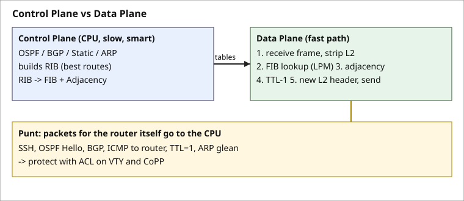

*شکل ۱: Control Plane جدول‌ها را می‌سازد؛ Data Plane فقط از جدول‌های آماده استفاده می‌کند.*

#### ۴-۲) Recursive Lookup (جست‌وجوی بازگشتی)

وقتی یک Static Route فقط Next-hop (نه Interface) دارد:

``` text
ip route 192.168.50.0 255.255.255.0 10.0.12.2
```

روتر باید بداند 10.0.12.2 از کدام Interface قابل‌دسترس است. پس یک جست‌وجوی دوم انجام می‌دهد: «10.0.12.2 در RIB به کدام Interface وصل است؟» جواب (Connected 10.0.12.0/30 روی Gi0/1) را می‌گیرد. این همان Recursive Lookup است. اگر Next-hop از طریق مسیری برسد که خودش به این Route وابسته است، حلقه یا Route ناپایدار می‌شود (نمونه در درس ۵-۳ آمده).

> **نکته‌ی عیب‌یابی:** اگر Next-hop قابل‌دسترس نباشد، Route در RIB **نصب نمی‌شود** (Static Route بدون Interface و بدون Next-hop معتبر نمی‌ماند). پس «Route را نوشتم ولی در جدول نیست» اغلب یعنی Next-hop حل‌نشدنی است.

#### ۴-۳) مراحل عبور یک بسته (Step by step)

برای بسته‌ای که از Client (192.168.1.10) به Server (172.16.5.20) می‌رود و از روتر R1 عبور می‌کند:

``` text
1. Frame arrives on Gi0/0: destination MAC = R1 Gi0/0 MAC  -> accepted
2. FCS check; strip L2 header (de-encapsulate) -> IP packet
3. Validate IP header (version, header checksum, TTL > 1)
4. Inbound features: ACL in, NAT inside->outside (if configured)
5. FIB lookup for 172.16.5.20 (Longest Prefix Match)
   result: next-hop 10.0.12.2, out interface Gi0/1
6. Adjacency lookup: next-hop 10.0.12.2 -> MAC aa:bb:cc:00:00:02
   (if missing: send ARP, packet waits / dropped, "glean" state)
7. TTL = TTL - 1; recompute IP header checksum
8. Outbound features: ACL out, QoS, NAT
9. Build new L2 header: src MAC = R1 Gi0/1, dst MAC = next-hop MAC
10. Transmit on Gi0/1
```

نکته‌های کلیدی این جریان:

- **MAC در هر Hop عوض می‌شود، IP نه** (بدون NAT). روتر هدر لایه ۲ را دور می‌اندازد و هدر جدید می‌سازد.
- **TTL در هر Hop یکی کم می‌شود.** اگر به ۰ برسد، روتر بسته را رها می‌کند و ICMP «Time Exceeded» می‌فرستد. traceroute همین را به کار می‌گیرد.
- **ARP برای Next-hop لازم است، نه برای مقصد نهایی** (اگر مقصد در شبکه‌ی مستقیماً متصل نباشد).
- اگر FIB مسیری نداشته باشد: بسته Drop و ICMP «Destination Unreachable» برمی‌گردد.

#### ۴-۴) مسیر «Punt»: وقتی Data Plane به Control Plane می‌دهد

بعضی بسته‌ها نباید در Data Plane (سریع) پردازش شوند و به CPU (Control Plane) فرستاده می‌شوند. به این **Punt** می‌گویند:

- بسته‌ای که مقصدش خود روتر است (SSH به روتر، OSPF Hello، BGP، ICMP به روتر).
- بسته‌ای با TTL = ۱ که باید ICMP Time Exceeded تولید شود.
- بسته‌ی اول برای مقصدی که ARP ندارد (Glean).
- بسته‌های با Option IP یا Fragmentation خاص.

چرا مهم است؟ CPU ظرفیت محدودی دارد. اگر مهاجم هزاران بسته به خود روتر بفرستد، CPU پر می‌شود و **Control Plane می‌میرد** (OSPF همسایه را از دست می‌دهد). برای همین Control Plane Policing و فهرست‌های محدودکننده وجود دارد (فصل ۸). همین منطق در FortiGate هم هست: ترافیک «Local-in» به CPU می‌رسد (فصل ۱۲).

### ۵) مثال حل‌شده

**شرایط:** R1 دو Interface دارد: Gi0/0 = 192.168.1.1/24 (LAN)، Gi0/1 = 10.0.12.1/30. جدول مسیرها شامل `172.16.5.0/24 via 10.0.12.2`. کلاینت 192.168.1.10 به 172.16.5.20 ping می‌زند. ARP برای 10.0.12.2 هنوز نداریم.

``` text
t0: Client sends frame: dst MAC = R1-Gi0/0, src IP .1.10, dst IP 172.16.5.20, TTL 128
t1: R1 FIB hit: 172.16.5.0/24 -> 10.0.12.2 via Gi0/1; adjacency incomplete
t2: R1 sends ARP "who has 10.0.12.2?" on Gi0/1 (first ping may be dropped)
t3: R2 replies ARP; adjacency complete
t4: second ping: TTL 128 -> 127, new L2 header dst = R2 MAC, forwarded
```

**تحلیل:** این توضیح می‌دهد چرا در Lab اغلب «اولین ping از ۵ ping تایم‌اوت می‌شود (نقطه .!!!!)». ARP هنوز کامل نبوده. این رفتار عادی است، نه خطا.

**مثال سخت (تحلیل خطا):** روتر R1 در جدول خود Route صحیح دارد (`show ip route 172.16.5.20` درست است) ولی ping موفق نمی‌شود. اولین فرضیه‌ها را بر اساس مراحل بالا مرتب کنید:

1. FIB با RIB ناهماهنگ است (نادر؛ `show ip cef 172.16.5.20` را بررسی کنید).
2. Adjacency ناقص است (`show adjacency` → Incomplete؛ ARP پاسخ نمی‌گیرد، مشکل لایه ۲ یا VLAN).
3. ACL خروجی یا ورودی بسته را می‌ریزد.
4. روتر مقصد Route برگشت ندارد (مشکل در جهت برگشت).

### ۶) طراحی و تصمیم‌گیری

| سؤال طراحی | گزینه‌ها | معیار انتخاب |
|---|---|---|
| Static Route با Next-hop یا Interface؟ | Next-hop / Interface / هر دو | روی Ethernet **حتماً Next-hop** (یا هر دو)، چون فقط Interface یعنی ARP برای هر مقصد (Proxy-ARP مصرفی) |
| ارسال Per-destination یا Per-packet؟ | CEF پیش‌فرض Per-destination | Per-packet ترتیب بسته‌ها را به‌هم می‌ریزد؛ به‌ندرت لازم است |
| CPU را چگونه محافظت کنیم؟ | ACL روی VTY، CoPP | هر سرویس مدیریتی فقط از شبکه‌ی مدیریت |

### ۷) پیاده‌سازی و Verification (CLI Cisco)

``` text
R1# show ip route 172.16.5.20
R1# show ip cef 172.16.5.20
R1# show ip cef 172.16.5.20 detail
R1# show adjacency detail
R1# show ip arp
R1# show ip traffic | include ICMP
R1# traceroute 172.16.5.20
```

نکات:

- `show ip cef` باید با `show ip route` هم‌خوان باشد (همان Next-hop و Interface).
- در `show adjacency` وضعیت `incomplete` یعنی MAC بعدی را نداریم.
- `show ip cef exact-route <src> <dst>` (در IOS-XE/IOS؛ `Unverified` روی vIOS) مسیر دقیق یک Flow را نشان می‌دهد.

### ۸) Troubleshooting (مبتنی بر شواهد)

| علامت | بررسی | تفسیر |
|---|---|---|
| Route هست ولی ping نمی‌رود | `show adjacency` | Incomplete = ARP حل نشده |
| فقط اولین ping Timeout است | بسته‌ی اول ARP | رفتار عادی |
| `Destination host unreachable` از R1 | `show ip route` | Route ندارد |
| `TTL expired in transit` | traceroute | حلقه‌ی مسیریابی |
| CPU روتر بالا ولی ترافیک عبوری کم | `show processes cpu sorted`، `show ip traffic` | بسته‌های Punt؛ حمله یا ICMP به روتر |

### ۹) نکات امنیتی

- ترافیک به **خود روتر** (Control/Management Plane) باید جدا کنترل شود، نه فقط ترافیک عبوری.
- ICMP Redirect و IP Source Route را در مرز غیرفعال کنید (`no ip redirects`، `no ip source-route`).
- هرگز SSH/SNMP روی همه‌ی Interfaceها باز نباشد.
- همین مفهوم در FortiGate: `allowaccess` روی Interface و Local-in Policy (فصل ۱۲ و ۱۳).

### ۱۰) جمع‌بندی مفهومی

- Control Plane جدول می‌سازد؛ Data Plane با جدول بسته را عبور می‌دهد.
- RIB بهترین مسیرها؛ FIB نسخه‌ی سریع آن؛ Adjacency اطلاعات L2 بعدی.
- در هر Hop: هدر L2 عوض، TTL یکی کم، IP (بدون NAT) ثابت.
- «Route هست» شرط لازم است، کافی نیست: FIB، Adjacency، ACL و Route برگشت هم لازم‌اند.
- بسته‌ی مقصد روتر به CPU می‌رود (Punt) و آسیب‌پذیر است.

### ۱۱) تمرین و ارزیابی

**ت1.** (ساده) تفاوت RIB و FIB چیست؟ *(پاسخ: 5-0-ت1)*

**ت2.** (ساده) در هر Hop کدام فیلد تغییر می‌کند: MAC مقصد، IP مقصد، TTL؟ *(پاسخ: 5-0-ت2)*

**ت3.** (متوسط) چرا Static Route فقط با Interface خروجی روی Ethernet مناسب نیست؟ *(پاسخ: 5-0-ت3)*

**ت4.** (متوسط) روی R1 مسیر 10.9.9.0/24 via 10.0.0.9 هست ولی 10.0.0.9 در هیچ Connected نیست. Route در جدول دیده می‌شود؟ توضیح دهید. *(پاسخ: 5-0-ت4)*

**ت5.** (سخت) در یک Lab ping از R1 به R3 اولین بار Timeout و بعد موفق است. بر پایه‌ی مراحل بسته توضیح دهید، سپس بگویید چه شواهدی ثابت می‌کند علت ARP است نه Route. *(پاسخ: 5-0-ت5)*

**ت6.** (سخت، طراحی) یک Control Plane Policing ساده را برای محافظت از CPU روتر شرح دهید: چه چیزی را فقط از شبکه‌ی مدیریت می‌پذیرید؟ *(پاسخ: 5-0-ت6)*

**م1.** Punt یعنی چه؟ *(پاسخ: 5-0-م1)*

**م2.** چرا اولین ping معمولاً از دست می‌رود؟ *(پاسخ: 5-0-م2)*

**Q1.** Quick quiz (English): Which plane builds the FIB, and which uses it to forward packets? *(پاسخ: 5-0-Q1)*

### ۱۲) اصطلاحات و English Corner

| مخفف | شکل کامل | معنی |
|---|---|---|
| RIB | Routing Information Base | جدول مسیرهای انتخاب‌شده |
| FIB | Forwarding Information Base | جدول سریع ارسال |
| CEF | Cisco Express Forwarding | ساز و کار ارسال سریع Cisco |
| Punt | Punt to CPU | فرستادن بسته به CPU |
| Glean | Glean adjacency | Adjacency ناقص که ARP لازم دارد |
| CoPP | Control Plane Policing | محدودسازی ترافیک به Control Plane |
| TTL | Time To Live | شمارنده‌ی عمر بسته |

- *The control plane builds the routing table; the data plane forwards packets using it.* ← Control Plane جدول را می‌سازد؛ Data Plane با آن بسته‌ها را ارسال می‌کند.
- *A route in the RIB does not guarantee that packets are forwarded.* ← وجود Route در RIB ارسال را تضمین نمی‌کند.

### ۱۳) منابع

- Cisco: «Cisco Express Forwarding Overview» (IP Switching Configuration Guide، IOS XE).
- RFC 1812 — Requirements for IP Version 4 Routers (فصل ۵: Forwarding).
- RFC 792 — ICMP (Time Exceeded و Destination Unreachable).
- RFC 6192 — Protecting the Router Control Plane.


## درس 5-1 — جدول مسیریابی، LPM و AD

**فصل ۵ - روز ۱ · پیش‌نیاز: فصل ۴ · ۶ ساعت**

### این درس درباره چیست و چرا باید یاد بگیریم؟

**چه چیزی یاد می‌گیریم:** روتر چطور تصمیم می‌گیرد هر بسته را به کدام سمت بفرستد: خواندن Routing Table، معنی کدها، قانون Longest Prefix Match، و دو معیار انتخاب بین مسیرها یعنی Administrative Distance و Metric.

**چرا لازم است:** تمام ارتباط بین شبکه‌ها (و بین VLANها، شعبه‌ها و اینترنت) به جدول مسیریابی بستگی دارد. اگر آن را درست نخوانید، نمی‌توانید بفهمید چرا یک بسته از مسیر غلط رفت یا اصلاً رد نشد. این درس پایه‌ی کل هفته‌های ۵ و ۶ و فایروال است.

- **در کار روزانه:** اولین دستور عیب‌یابی هر ارتباط بین شبکه‌ای `show ip route` است.
- **در امنیت:** Route اشتباه یعنی ترافیک از مسیر ناخواسته (مثلاً دور زدن فایروال) می‌رود.
- **در FortiGate:** Routing Table فایروال دقیقاً همین منطق را دارد (`get router info routing-table all`).

> **مسیر درس**
>
> روتر چیست ← جدول مسیریابی ← کدها ← Longest Prefix Match ← AD و Metric ← مثال ساده/متوسط/سخت ← Lab ← عیب‌یابی.

#### اصطلاحات این درس (مخفف ← شکل کامل ← معنی)

| مخفف                   | شکل کامل انگلیسی        | معنی فارسی                              |
|------------------------|-------------------------|-----------------------------------------|
| Routing Table          | Routing Table           | جدول مسیرهای شناخته‌شده‌ی روتر            |
| Next-hop               | Next-hop                | آدرس روتر بعدی در مسیر                  |
| LPM                    | Longest Prefix Match    | انتخاب Route با طولانی‌ترین Prefix مطابق |
| AD                     | Administrative Distance | اعتبار منبع Route؛ کمتر بهتر است        |
| Metric                 | Metric                  | هزینه‌ی مسیر در یک پروتکل                |
| Connected              | Connected route         | شبکه‌ای که مستقیماً به Interface وصل است  |
| Local                  | Local route             | آدرس خود Interface (/32)                |
| Static                 | Static route            | مسیر دستی                               |
| Gateway of last resort | Gateway of last resort  | مسیر پیش‌فرض                             |

### ۱. روتر چه کاری می‌کند؟

روتر مثل یک اداره‌ی پست است. نامه (بسته) می‌رسد؛ منشی فقط به آدرس مقصد نگاه می‌کند و در دفتر خود می‌بیند «برای این منطقه به کدام اداره بفرستم؟». او کل مسیر را نمی‌داند، فقط «قدم بعدی» (Next-hop) را می‌داند.

> **دو کار روتر**
>
> ۱) یاد گرفتن مسیرها (دستی یا با پروتکل). ۲) ارسال هر بسته بر اساس جدول مسیرها (Forwarding).

### ۲. جدول مسیریابی را بخوانیم

``` text
R1# show ip route
Codes: C - connected, L - local, S - static, O - OSPF

Gateway of last resort is 10.0.12.2 to network 0.0.0.0

S*    0.0.0.0/0 [1/0] via 10.0.12.2
      10.0.0.0/8 is variably subnetted, 4 subnets, 2 masks
C        10.0.12.0/30 is directly connected, GigabitEthernet0/1
L        10.0.12.1/32 is directly connected, GigabitEthernet0/1
O        10.0.23.0/30 [110/2] via 10.0.12.2, 00:05:10, GigabitEthernet0/1
C        192.168.1.0/24 is directly connected, Loopback10
```

هر خط یک Route است. با یک خط نمونه آشنا می‌شویم:

``` text
O   10.0.23.0/30 [110/2] via 10.0.12.2, 00:05:10, GigabitEthernet0/1
|   |            |  |     |          |         |
|   |            |  |     |          |         +-- exit interface
|   |            |  |     |          +-- age of the route
|   |            |  |     +-- next-hop address
|   |            |  +-- metric (OSPF cost)
|   |            +-- administrative distance
|   +-- destination prefix
+-- source code (O = OSPF)
```

| کد  | معنی                            |
|-----|---------------------------------|
| C   | Connected؛ شبکه‌ی مستقیماً وصل‌شده |
| L   | Local؛ آدرس خود Interface (/32) |
| S   | Static؛ دستی                    |
| S\* | Static به‌عنوان مسیر پیش‌فرض      |
| O   | OSPF                            |
| D   | EIGRP                           |
| R   | RIP                             |

### ۳. قانون اول: Longest Prefix Match

اگر چند Route با مقصد جور باشد، آن که Prefix بلندتر دارد (دقیق‌تر است) برنده است. مثل نشانی پستی: «تهران، ولیعصر، پلاک ۱۲» از «تهران» دقیق‌تر است.

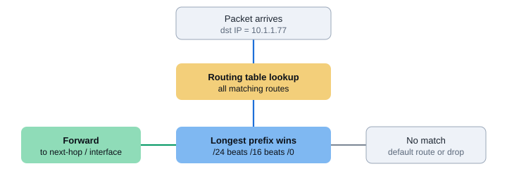

*شکل ۱: مراحل تصمیم روتر برای هر بسته.*

``` text
Routing table:
  10.0.0.0/8      via R-A
  10.1.0.0/16     via R-B
  10.1.1.0/24     via R-C
  0.0.0.0/0       via R-D (default)

Packet to 10.1.1.77:
  matches /0, /8, /16, /24  -> longest = /24  -> via R-C
Packet to 10.1.9.5:
  matches /0, /8, /16       -> longest = /16  -> via R-B
Packet to 8.8.8.8:
  matches /0 only           -> via R-D
```

> **نکته**
>
> اول طول Prefix تعیین می‌کند. فقط وقتی دو Route هم‌طول بودند، AD و Metric وارد می‌شوند.

### ۴. قانون دوم: Administrative Distance و Metric

فرض کنید همان شبکه را دو منبع مختلف (مثلاً Static و OSPF) به روتر معرفی کنند. روتر به منبعی که «معتبرتر» است اعتماد می‌کند. این اعتبار را AD می‌گویند و هرچه کمتر باشد بهتر است:

| منبع          | AD  |
|---------------|-----|
| Connected     | 0   |
| Static        | 1   |
| EIGRP (داخلی) | 90  |
| OSPF          | 110 |
| RIP           | 120 |

Metric هزینه‌ی مسیر **داخل یک پروتکل** است (مثلاً Cost در OSPF). Metricهای پروتکل‌های مختلف قابل مقایسه با هم نیستند؛ برای همین AD وجود دارد.

``` text
Decision order for the same destination:
1) Longest prefix       (most specific wins)
2) Lowest AD             (most trusted source)
3) Lowest metric         (best path inside one protocol)
4) ECMP                  (equal metric -> load share)
```

### ۵. مثال‌ها (ساده تا سخت)

#### ساده: بسته به شبکه‌ی Connected

``` text
Dest 192.168.1.50 -> matches C 192.168.1.0/24
Router ARPs for the host and delivers directly
```

#### متوسط: Static یا OSPF؟

``` text
Both learn 10.0.23.0/30:
  S  10.0.23.0/30 [1/0]   via 10.0.12.2
  O  10.0.23.0/30 [110/2] via 10.0.12.2
Same prefix -> lower AD (1) wins -> Static is installed
```

#### سخت: دو Route با Prefixهای مختلف

``` text
S  10.0.0.0/8   [1/0]   via 10.9.9.9   (static, AD 1)
O  10.0.23.0/30 [110/2] via 10.0.12.2   (OSPF, AD 110)
Packet to 10.0.23.5:
  both match; /30 is longer than /8 -> OSPF route wins
  (AD is NOT compared here; prefix length decides first)
```

این خطای ذهنی بسیار رایج است: «Static همیشه برنده است». نه! اول طول Prefix است.

### ۶. دستورهای مشاهده

``` text
R1# show ip route
R1# show ip route 10.1.1.77
R1# show ip route connected
R1# show ip route static
R1# show ip route ospf
R1# show ip protocols
R1# show ip cef 10.1.1.77
```

- `show ip route 10.1.1.77`: دقیقاً می‌گوید کدام Route برای این مقصد انتخاب می‌شود (بهترین ابزار عیب‌یابی).
- `show ip protocols`: پروتکل‌های مسیریابی فعال و تنظیماتشان.
- `show ip cef ...`: مسیر واقعی Forwarding (CEF).

### تمرین‌ها

**ت1.** ۱ (ساده): L و C چه فرقی دارند؟ *(پاسخ: 5-1-ت1 در بخش «پاسخ‌ها» انتهای فصل)*

**ت2.** ۲ (ساده): AD برای Static و OSPF؟ *(پاسخ: 5-1-ت2 در بخش «پاسخ‌ها» انتهای فصل)*

**ت3.** ۳ (متوسط): بسته به 10.1.1.77؛ Routeهای /8، /16 و /0 موجودند. کدام؟ *(پاسخ: 5-1-ت3 در بخش «پاسخ‌ها» انتهای فصل)*

**ت4.** ۴ (متوسط): آیا Metric یک Route در OSPF با RIP قابل مقایسه است؟ *(پاسخ: 5-1-ت4 در بخش «پاسخ‌ها» انتهای فصل)*

**ت5.** ۵ (سخت): Static 10.0.0.0/8 و OSPF 10.0.23.0/30 هر دو موجود؛ بسته به 10.0.23.5 از کجا می‌رود؟ *(پاسخ: 5-1-ت5 در بخش «پاسخ‌ها» انتهای فصل)*

### Lab هدایت‌شده

توپولوژی این هفته: سه روتر vIOS به نام‌های `R1`، `R2`، `R3` به‌صورت خطی. اتصال‌ها: `R1 Gi0/1 ↔ R2 Gi0/0` و `R2 Gi0/1 ↔ R3 Gi0/0`. اگر RAM روتر زیاد است، می‌توانید vIOS را ۵۱۲ مگابایت کنید (راهنمای CML). برای فعلاً فقط Connected داریم.

#### گام ۱: آدرس‌دهی

``` text
R1(config)# interface gi0/1
R1(config-if)# ip address 10.0.12.1 255.255.255.252
R1(config-if)# no shutdown
R1(config)# interface loopback 10
R1(config-if)# ip address 192.168.1.1 255.255.255.0

R2(config)# interface gi0/0
R2(config-if)# ip address 10.0.12.2 255.255.255.252
R2(config-if)# no shutdown
R2(config)# interface gi0/1
R2(config-if)# ip address 10.0.23.1 255.255.255.252
R2(config-if)# no shutdown

R3(config)# interface gi0/0
R3(config-if)# ip address 10.0.23.2 255.255.255.252
R3(config-if)# no shutdown
R3(config)# interface loopback 30
R3(config-if)# ip address 192.168.3.1 255.255.255.0
```

#### گام ۲: مشاهده

``` text
R1# show ip interface brief
R1# show ip route
R1# ping 10.0.12.2
R1# ping 192.168.3.1
```

پیش‌بینی: ping به همسایه OK، ولی به 192.168.3.1 شکست؛ چون R1 مسیری به آن ندارد. جدول R1 فقط C و L دارد؛ آن را یادداشت کنید.

#### گام ۳: LPM را خودتان بسنجید

از روی جدول بالا، با `show ip route 10.0.23.5` ببینید چه Routeی انتخاب می‌شود (هنوز هیچ؛ در درس بعد Static اضافه می‌کنیم).

### Lab مستقل

جدول مسیریابی هر سه روتر را (فقط C و L) در `03-ops/routing-baseline-w5.md` ذخیره و هر کد را توضیح دهید.

### عیب‌یابی

|         |                                                                                |
|---------|--------------------------------------------------------------------------------|
| Symptom | ping به شبکه‌ی دور شکست می‌خورد                                                  |
| روش     | show ip route \<destination\>؛ اگر «Network not in table» بود، مسیر وجود ندارد |
| چک‌لیست  | ۱) Route هست؟ ؛ ۲) Next-hop قابل‌دسترس است؟ ؛ ۳) مسیر برگشت هم دارد؟            |
| نکته    | برگشت (Return Path) را همیشه چک کنید؛ مسیر یک‌طرفه کار نمی‌کند                   |

### سؤال‌های مرور

**م1.** اولین چیزی که روتر برای انتخاب Route نگاه می‌کند؟ *(پاسخ: 5-1-م1 در بخش «پاسخ‌ها» انتهای فصل)*

**م2.** AD برای چیست؟ *(پاسخ: 5-1-م2 در بخش «پاسخ‌ها» انتهای فصل)*

### English Corner: انگلیسی تخصصی این درس

این جمله‌ها از مستندات و محیط کار واقعی‌اند. بلند بخوانید و ترجمه را بپوشانید.

| English sentence                                                       | ترجمه                                                  |
|------------------------------------------------------------------------|--------------------------------------------------------|
| The router selects the route with the longest matching prefix.         | روتر Route با طولانی‌ترین Prefix مطابق را انتخاب می‌کند. |
| Administrative distance expresses how trustworthy a routing source is. | AD نشان می‌دهد منبع Route چقدر قابل‌اعتماد است.          |
| There is no route to the destination network.                          | مسیری به شبکه‌ی مقصد وجود ندارد.                        |
| Check the return path as well.                                         | مسیر برگشت را هم بررسی کنید.                           |

**Q1.** Quick quiz (answer in English): Which is compared first: administrative distance or prefix length? *(پاسخ: 5-1-Q1 در بخش «پاسخ‌ها» انتهای فصل)*

### تکلیف و چک‌لیست تسلط

- [ ] خط‌به‌خط یک Route را توضیح دهم.
- [ ] LPM را با ۳ مثال حل کنم.
- [ ] Lab را انجام دهم.

### یادآوری اشتباهات شما

> **یادآوری**
>
> پیش‌بینی قبل از اجرا؛ بکاپ قبل از تغییر؛ پذیرفته‌شدن دستور ≠ کار کردن؛ فرمول‌ها در بلوک مستقل.


#### کارت Lab — جدول مسیریابی، LPM و AD

| # | فیلد | محتوا |
|---|---|---|
| 1 | عنوان و هدف | خواندن Route Table و LPM |
| 2 | پیش‌نیاز | فصل 4 |
| 3 | توپولوژی | R1-R2-R3 خطی |
| 4 | تجهیزات | ۳ vIOS |
| 5 | نسخه نرم‌افزار | vIOS-L2 15.2(20200924، Experimental) برای SW؛ vIOS 15.9(3)M9 برای R؛ VPCS؛ PNetLab 4.2.8 |
| 6 | IP Plan | Connected |
| 7 | وضعیت اولیه | Loopbackها |
| 8 | صورت مسئله | LPM و AD را پیش‌بینی کنید |
| 9 | مراحل هدایت‌شده | همان بخش «Lab هدایت‌شده» همین درس |
| 10 | تست عملکرد | `show ip route <dst>` |
| 11 | سناریوی خرابی | Route نبود |
| 12 | روش عیب‌یابی | لایه‌ای/با شواهد (بخش عیب‌یابی همین درس) |
| 13 | نتیجه‌ی مورد انتظار | جدول C/L |
| 14 | معیار پذیرش | پیش‌بینی با واقعیت تطبیق |
| 15 | مستندات نهایی | `03-ops/routing-baseline-w5.md` |
| 16 | Cleanup و بازگردانی | — |

> **وضعیت راستی‌آزمایی (خارج از ۱۶ فیلد):** **اجرا نشده (فقط طراحی).** اجرا نشده.

---

<a id="l-5-2"></a>

## درس 5-2 — Static Route و مسیر برگشت

**فصل ۵ - روز ۲ · پیش‌نیاز: درس ۵-۱ · ۶ ساعت**

### این درس درباره چیست و چرا باید یاد بگیریم؟

**چه چیزی یاد می‌گیریم:** ساخت مسیر دستی (Static Route) با Next-hop، تفاوت Next-hop و Exit-interface، اهمیت مسیر برگشت (Return Path) و خلاصه‌سازی با Static.

**چرا لازم است:** ساده‌ترین و قابل‌پیش‌بینی‌ترین مسیریابی است و در شعبه‌های کوچک و لینک اینترنت هنوز پرکاربرد است. اکثر «شبکه‌ی دور قابل‌دسترس نیست» ها به مسیر برگشت فراموش‌شده برمی‌گردد.

- **در کار روزانه:** Default Route به سمت ISP یا فایروال در ۹۰٪ شعبه‌ها Static است.
- **در امنیت:** Static Route قابل‌پیش‌بینی است و از تزریق مسیر جعلی جلوگیری می‌کند.
- **در FortiGate:** `config router static` دقیقاً همین مفهوم است.

> **مسیر درس**
>
> Static چیست ← Next-hop در برابر Interface ← مسیر برگشت ← خلاصه‌سازی ← مثال ساده/متوسط/سخت ← Lab ← عیب‌یابی.

#### اصطلاحات این درس (مخفف ← شکل کامل ← معنی)

| مخفف           | شکل کامل انگلیسی    | معنی فارسی                           |
|----------------|---------------------|--------------------------------------|
| Static Route   | Static Route        | مسیر دستی                            |
| Next-hop       | Next-hop IP         | آدرس روتر بعدی                       |
| Exit Interface | Exit Interface      | Interface خروجی                      |
| Return Path    | Return Path         | مسیر برگشت بسته                      |
| Recursive      | Recursive lookup    | جستجوی دوباره برای رسیدن به Next-hop |
| Null0          | Null0               | Interface مجازی دورریز               |
| Summary        | Route Summarization | خلاصه‌سازی چند Route در یکی           |

### ۱. Static Route چیست؟

یعنی خودتان به روتر می‌گویید: «برای رسیدن به شبکه X، بسته را به روتر Y بده». مثل اینکه به راننده‌ی تاکسی بگویید «برای رفتن به فرودگاه از این خیابان برو»؛ خودش تصمیم نمی‌گیرد، شما گفته‌اید.

فرمت:

``` text
ip route <destination network> <mask> <next-hop | exit-interface> [AD]

Example:
R1(config)# ip route 192.168.3.0 255.255.255.0 10.0.12.2
```

یعنی «برای شبکه‌ی 192.168.3.0/24، بسته را به 10.0.12.2 بده».

### ۲. Next-hop در برابر Exit-interface

| روش            | مثال                                               | کاربرد                                                   |
|----------------|----------------------------------------------------|----------------------------------------------------------|
| Next-hop       | ip route 192.168.3.0 255.255.255.0 10.0.12.2       | پیشنهاد اصلی؛ روی اترنت امن است                          |
| Exit-interface | ip route 192.168.3.0 255.255.255.0 gi0/1           | فقط لینک نقطه‌به‌نقطه (Serial)؛ روی اترنت ARP برای هر مقصد |
| هر دو          | ip route 192.168.3.0 255.255.255.0 gi0/1 10.0.12.2 | دقیق‌ترین (توصیه برای اترنت)                              |

> **قانون**
>
> روی اترنت فقط Exit-interface ننویسید؛ روتر برای هر مقصد ARP می‌زند و به Proxy-ARP وابسته می‌شود. Next-hop (یا هر دو) بنویسید.

«Recursive»: اگر Next-hop را بنویسید، روتر یک جستجوی دوم می‌کند تا Next-hop را از Connected/Route دیگری پیدا کند. به همین دلیل Next-hop باید حتماً در یک شبکه‌ی Connected یا شناخته‌شده باشد.

### ۳. مسیر برگشت: مهم‌ترین نکته

ارتباط دوطرفه است. اگر فقط R1 مسیر رفت را بداند، ولی R3 راه برگشت به 192.168.1.0/24 را نداند، پاسخ هرگز نمی‌رسد و ping شکست می‌خورد.

``` text
PC (192.168.1.10) -> R1 -> R2 -> R3 -> Server (192.168.3.10)
Forward path : R1 needs route to 192.168.3.0/24, R2 as well
Return path  : R3 needs route to 192.168.1.0/24, R2 as well
If any hop lacks the return route -> ping fails (one-way)
```

### ۴. خلاصه‌سازی با Static و Null0

به‌جای چند Route ریز، یک Route کلی می‌نویسیم. مثال: چهار شبکه‌ی 10.1.0.0/24 تا 10.1.3.0/24 را می‌توان با یک /22 خلاصه کرد:

``` text
10.1.0.0/24, 10.1.1.0/24, 10.1.2.0/24, 10.1.3.0/24
Third octet: 0,1,2,3 -> block size 4 -> /22
Summary = 10.1.0.0/22
```

برای جلوگیری از Loop هنگام خلاصه‌سازی روی مرز، گاهی یک Route به Null0 می‌گذارند تا بسته‌ی بی‌صاحب دور ریخته شود:

``` text
R2(config)# ip route 10.1.0.0 255.255.252.0 null0 200
```

AD برابر 200 است تا Routeهای واقعی (دقیق‌تر یا با AD کمتر) را بلوک نکند.

### ۵. مثال‌ها

#### ساده: یک مسیر

``` text
R1(config)# ip route 192.168.3.0 255.255.255.0 10.0.12.2
R1# show ip route static
S  192.168.3.0/24 [1/0] via 10.0.12.2
```

#### متوسط: مسیر رفت و برگشت

``` text
R1(config)# ip route 192.168.3.0 255.255.255.0 10.0.12.2
R1(config)# ip route 10.0.23.0 255.255.255.252 10.0.12.2
R2(config)# ip route 192.168.3.0 255.255.255.0 10.0.23.2
R2(config)# ip route 192.168.1.0 255.255.255.0 10.0.12.1
R3(config)# ip route 192.168.1.0 255.255.255.0 10.0.23.1
R3(config)# ip route 10.0.12.0 255.255.255.252 10.0.23.1
```

#### سخت: Next-hop غیرقابل‌دسترس

``` text
R1(config)# ip route 192.168.3.0 255.255.255.0 10.9.9.9
R1# show ip route 192.168.3.0
  -> Route is NOT installed: next-hop 10.9.9.9 is not reachable
Fix: use a next-hop inside a connected network (10.0.12.2)
```

### تمرین‌ها

**ت1.** ۱ (ساده): Static برای شبکه‌ی 172.16.5.0/24 با Next-hop 10.0.0.2 *(پاسخ: 5-2-ت1 در بخش «پاسخ‌ها» انتهای فصل)*

**ت2.** ۲ (ساده): چرا روی اترنت Next-hop می‌نویسیم؟ *(پاسخ: 5-2-ت2 در بخش «پاسخ‌ها» انتهای فصل)*

**ت3.** ۳ (متوسط): Summary چهار شبکه‌ی 10.2.4.0/24 تا 10.2.7.0/24؟ *(پاسخ: 5-2-ت3 در بخش «پاسخ‌ها» انتهای فصل)*

**ت4.** ۴ (متوسط): ping یک‌طرفه شکست می‌خورد؛ علت؟ *(پاسخ: 5-2-ت4 در بخش «پاسخ‌ها» انتهای فصل)*

**ت5.** ۵ (سخت): چرا Route به Null0 با AD 200؟ *(پاسخ: 5-2-ت5 در بخش «پاسخ‌ها» انتهای فصل)*

### Lab هدایت‌شده

#### گام ۱: مسیرهای رفت

``` text
R1(config)# ip route 10.0.23.0 255.255.255.252 10.0.12.2
R1(config)# ip route 192.168.3.0 255.255.255.0 10.0.12.2
R3(config)# ip route 10.0.12.0 255.255.255.252 10.0.23.1
R3(config)# ip route 192.168.1.0 255.255.255.0 10.0.23.1
R2(config)# ip route 192.168.1.0 255.255.255.0 10.0.12.1
R2(config)# ip route 192.168.3.0 255.255.255.0 10.0.23.2
```

#### گام ۲: تست

``` text
R1# ping 192.168.3.1 source 192.168.1.1
R1# traceroute 192.168.3.1 source 192.168.1.1
```

با `source` مبدأ را Loopback می‌کنیم تا شبکه‌ی LAN شبیه‌سازی شود.

#### گام ۳: خراب‌کردن عمدی مسیر برگشت

``` text
R3(config)# no ip route 192.168.1.0 255.255.255.0 10.0.23.1
R1# ping 192.168.3.1 source 192.168.1.1   (fails: no return)
R3(config)# ip route 192.168.1.0 255.255.255.0 10.0.23.1
```

Capture روی لینک R2-R3: Echo Request می‌رسد ولی Reply برنمی‌گردد.

### Lab مستقل

یک جدول «Static Route Plan» بنویسید: هر روتر، شبکه‌های مقصد، Next-hop و مسیر برگشت در `02-design/static-plan.md`.

### عیب‌یابی

|         |                                                                                                   |
|---------|---------------------------------------------------------------------------------------------------|
| Symptom | ping به شبکه‌ی دور شکست                                                                            |
| چک‌لیست  | ۱) Route رفت؟ ؛ ۲) Next-hop Connected است؟ ؛ ۳) Route برگشت؟ ؛ ۴) Mask درست؟ ؛ ۵) ACL یا فایروال؟ |
| ابزار   | show ip route \<destination\> ، traceroute ، Capture                                              |
| رفع     | افزودن مسیر گم‌شده                                                                                 |

### سؤال‌های مرور

**م1.** Static Route کی مناسب است؟ *(پاسخ: 5-2-م1 در بخش «پاسخ‌ها» انتهای فصل)*

**م2.** چرا مسیر برگشت مهم است؟ *(پاسخ: 5-2-م2 در بخش «پاسخ‌ها» انتهای فصل)*

### English Corner: انگلیسی تخصصی این درس

این جمله‌ها از مستندات و محیط کار واقعی‌اند. بلند بخوانید و ترجمه را بپوشانید.

| English sentence                                                | ترجمه                                        |
|-----------------------------------------------------------------|----------------------------------------------|
| Configure a static route pointing to the next-hop address.      | یک Static Route به آدرس Next-hop تنظیم کنید. |
| The route is not installed because the next-hop is unreachable. | Route نصب نشده چون Next-hop در دسترس نیست.   |
| Ping fails because there is no return route.                    | ping شکست می‌خورد چون Route برگشت وجود ندارد. |
| Summarize contiguous networks into a single route.              | شبکه‌های متوالی را در یک Route خلاصه کنید.    |

**Q1.** Quick quiz (answer in English): Why do we avoid exit-interface-only static routes on Ethernet? *(پاسخ: 5-2-Q1 در بخش «پاسخ‌ها» انتهای فصل)*

### تکلیف و چک‌لیست تسلط

- [ ] Static رفت و برگشت را بزنم و ping موفق بگیرم.
- [ ] مسیر برگشت را عمداً حذف کنم و Capture ببینم.
- [ ] Summary را بنویسم.

### یادآوری اشتباهات شما

> **یادآوری**
>
> پیش‌بینی قبل از اجرا؛ بکاپ قبل از تغییر؛ پذیرفته‌شدن دستور ≠ کار کردن؛ فرمول‌ها در بلوک مستقل.


#### کارت Lab — Static Route و مسیر برگشت

| # | فیلد | محتوا |
|---|---|---|
| 1 | عنوان و هدف | Static Route با مسیر رفت/برگشت |
| 2 | پیش‌نیاز | درس 5-1 |
| 3 | توپولوژی | R1-R2-R3 |
| 4 | تجهیزات | ۳ vIOS |
| 5 | نسخه نرم‌افزار | vIOS-L2 15.2(20200924، Experimental) برای SW؛ vIOS 15.9(3)M9 برای R؛ VPCS؛ PNetLab 4.2.8 |
| 6 | IP Plan | Connected |
| 7 | وضعیت اولیه | Static + برگشت |
| 8 | صورت مسئله | ping LAN1↔LAN3 |
| 9 | مراحل هدایت‌شده | همان بخش «Lab هدایت‌شده» همین درس |
| 10 | تست عملکرد | `ping ... source` |
| 11 | سناریوی خرابی | حذف مسیر برگشت |
| 12 | روش عیب‌یابی | لایه‌ای/با شواهد (بخش عیب‌یابی همین درس) |
| 13 | نتیجه‌ی مورد انتظار | ping موفق |
| 14 | معیار پذیرش | Return Path اثبات |
| 15 | مستندات نهایی | `02-design/static-plan.md` |
| 16 | Cleanup و بازگردانی | حذف Static |

> **وضعیت راستی‌آزمایی (خارج از ۱۶ فیلد):** **اجرا نشده (فقط طراحی).** اجرا نشده.

---

<a id="l-5-3"></a>

## درس 5-3 — Default، Floating و IP SLA

**فصل ۵ - روز ۳ · پیش‌نیاز: درس ۵-۲ · ۶ ساعت**

### این درس درباره چیست و چرا باید یاد بگیریم؟

**چه چیزی یاد می‌گیریم:** Default Route (0.0.0.0/0)، Route پشتیبان با AD بالا (Floating Static)، و رصد سلامت لینک با IP SLA برای Failover واقعی.

**چرا لازم است:** هر شعبه یک «در خروج» (اینترنت یا فایروال) دارد. اگر لینک اصلی خراب شود، باید ترافیک به لینک پشتیبان برود. Floating Static ساده‌ترین راه است؛ ولی بدون Tracking ممکن است Failover رخ ندهد چون لینک «بالا» است ولی اینترنت قطع.

- **در کار روزانه:** تقریباً هر شعبه Default Route دارد و بعضی یک لینک پشتیبان (4G/ISP دوم).
- **در امنیت:** Default Route تنها راه خروج است؛ اشتباه آن همه‌ی شبکه را ایزوله می‌کند.
- **در FortiGate:** Failover دو ISP با Distance/Priority و Link Monitor همین منطق است.

> **مسیر درس**
>
> Default Route ← Floating Static ← IP SLA و Track ← مثال ساده/متوسط/سخت ← Lab ← عیب‌یابی.

#### اصطلاحات این درس (مخفف ← شکل کامل ← معنی)

| مخفف            | شکل کامل انگلیسی           | معنی فارسی                           |
|-----------------|----------------------------|--------------------------------------|
| Default Route   | Default Route              | مسیر 0.0.0.0/0 برای هر مقصد ناشناخته |
| Floating Static | Floating Static Route      | Route پشتیبان با AD بالاتر           |
| IP SLA          | IP Service Level Agreement | پروب سلامت مسیر با ping              |
| Track           | Object Tracking            | وابستگی Route به وضعیت یک شیء        |
| Failover        | Failover                   | سوییچ خودکار به مسیر پشتیبان         |
| Reachability    | Reachability               | قابل‌دسترس بودن                       |

### ۱. Default Route: «هرجا نمی‌دانی، از اینجا برو»

Default Route همان آدرس ناشناخته در جدول است: مثل تابلوی «بقیه‌ی مسیرها» در بزرگراه. شبکه‌ی /0 همه‌ی آدرس‌ها را می‌پوشاند و چون کوتاه‌ترین Prefix است، فقط وقتی استفاده می‌شود که Route دقیق‌تری نباشد (LPM).

``` text
R1(config)# ip route 0.0.0.0 0.0.0.0 10.0.12.2
R1# show ip route
Gateway of last resort is 10.0.12.2 to network 0.0.0.0
S*   0.0.0.0/0 [1/0] via 10.0.12.2
```

### ۲. Floating Static: پشتیبان که «شناور» است

دو Default Route با دو AD متفاوت می‌نویسیم: اصلی با AD پیش‌فرض (1) و پشتیبان با AD بالاتر (مثلاً 200). روتر فقط Route با AD کمتر را نصب می‌کند؛ اگر آن حذف شد، پشتیبان «بالا می‌آید».

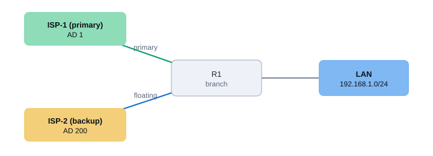

*شکل ۱: لینک اصلی با AD 1 و پشتیبان با AD 200.*

``` text
R1(config)# ip route 0.0.0.0 0.0.0.0 203.0.113.1
R1(config)# ip route 0.0.0.0 0.0.0.0 198.51.100.1 200
R1# show ip route 0.0.0.0
  -> only the AD 1 route is in the table
```

### ۳. مشکل: لینک «بالا» است ولی اینترنت نیست

Route Static تا وقتی Interface خروجی up/up است در جدول می‌ماند؛ حتی اگر Next-hop (ISP) خراب باشد. پس Floating به‌تنهایی Failover واقعی نیست. باید «سلامت واقعی» مسیر را بسنجیم: IP SLA با ping به Next-hop یا یک آدرس دور.

``` text
Interface up/up + ISP dead -> Static route still installed -> no failover
Solution: IP SLA probe + track -> route removed when probe fails
```

### ۴. IP SLA و Track (دستورها خط‌به‌خط)

``` text
R1(config)# ip sla 1
R1(config-ip-sla)# icmp-echo 203.0.113.1 source-interface gi0/1
R1(config-ip-sla-echo)# frequency 5
R1(config-ip-sla-echo)# exit
R1(config)# ip sla schedule 1 life forever start-time now
R1(config)# track 1 ip sla 1 reachability
R1(config)# ip route 0.0.0.0 0.0.0.0 203.0.113.1 track 1
R1(config)# ip route 0.0.0.0 0.0.0.0 198.51.100.1 200
```

- `ip sla 1` + `icmp-echo`: هر ۵ ثانیه ping به Next-hop اول.
- `schedule ... start-time now`: پروب را همین الان و برای همیشه شروع می‌کند.
- `track 1 ip sla 1 reachability`: شیء Track که وضعیت پروب را می‌داند.
- `ip route ... track 1`: این Route فقط وقتی در جدول است که Track بالا باشد.

``` text
R1# show ip sla statistics
R1# show track 1
R1# show ip route 0.0.0.0
```

### ۵. مثال‌ها

#### ساده

``` text
Single ISP: ip route 0.0.0.0 0.0.0.0 <ISP gateway>
```

#### متوسط: Floating

``` text
Primary link fails (interface down)
-> AD 1 route removed
-> AD 200 route installed automatically
```

#### سخت: ISP خراب ولی Interface بالا

``` text
Probe to 203.0.113.1 times out
-> track 1 goes Down
-> primary static removed
-> backup (AD 200) installed
Probe recovers -> primary returns (preempt)
```

> **صادقانه درباره‌ی Lab**
>
> طبق Probe اولیه، IP SLA روی IOS ما کار می‌کند. در Lab، لینک ISP را با قطع کابل (shutdown رو Interface دور) یا حذف Route همسایه شبیه‌سازی کنید و نتیجه‌ی واقعی را ثبت کنید.

### تمرین‌ها

**ت1.** ۱ (ساده): AD پیش‌فرض Static و Floating معمول؟ *(پاسخ: 5-3-ت1 در بخش «پاسخ‌ها» انتهای فصل)*

**ت2.** ۲ (ساده): چرا 0.0.0.0 0.0.0.0 همه‌ی مقاصد را می‌پوشاند؟ *(پاسخ: 5-3-ت2 در بخش «پاسخ‌ها» انتهای فصل)*

**ت3.** ۳ (متوسط): چرا Floating به‌تنهایی کافی نیست؟ *(پاسخ: 5-3-ت3 در بخش «پاسخ‌ها» انتهای فصل)*

**ت4.** ۴ (متوسط): دستور Route وابسته به Track؟ *(پاسخ: 5-3-ت4 در بخش «پاسخ‌ها» انتهای فصل)*

**ت5.** ۵ (سخت): چه چیزی را باید پروب کنیم؟ *(پاسخ: 5-3-ت5 در بخش «پاسخ‌ها» انتهای فصل)*

### Lab هدایت‌شده

روی R1 یک Interface دوم به R2 فرض می‌کنیم (یا Loopback). اگر ندارید، با `Loopback` هم می‌شود مسیر را شبیه‌سازی کرد.

#### گام ۱: Default اصلی و پشتیبان

``` text
R1(config)# ip route 0.0.0.0 0.0.0.0 10.0.12.2
R1(config)# ip route 0.0.0.0 0.0.0.0 10.0.99.2 200
R1# show ip route
```

#### گام ۲: IP SLA و Track

``` text
R1(config)# ip sla 1
R1(config-ip-sla)# icmp-echo 10.0.12.2 source-interface gi0/1
R1(config-ip-sla-echo)# frequency 5
R1(config)# ip sla schedule 1 life forever start-time now
R1(config)# track 1 ip sla 1 reachability
R1(config)# no ip route 0.0.0.0 0.0.0.0 10.0.12.2
R1(config)# ip route 0.0.0.0 0.0.0.0 10.0.12.2 track 1
R1# show track 1
```

#### گام ۳: شبیه‌سازی خرابی

``` text
R2(config)# interface gi0/0
R2(config-if)# shutdown
R1# show track 1
R1# show ip route 0.0.0.0
```

ثبت کنید چند ثانیه طول کشید تا Track پایین بیاید و Route پشتیبان نصب شود، و بعد از `no shutdown` چه شد.

### Lab مستقل

یک Runbook «Failover دو ISP» در `03-ops/dual-isp-failover.md` بنویسید: تنظیم، Verification، و آزمون خرابی.

### عیب‌یابی

|         |                                                                                                                      |
|---------|----------------------------------------------------------------------------------------------------------------------|
| Symptom | Failover رخ نمی‌دهد                                                                                                   |
| چک‌لیست  | ۱) AD پشتیبان بیشتر است؟ ؛ ۲) Track روی Route اصلی است؟ ؛ ۳) پروب به آدرس درست می‌رود؟ ؛ ۴) Interface هنوز up/up است؟ |
| ابزار   | show track ، show ip sla statistics ، show ip route                                                                  |
| رفع     | اصلاح پروب و AD                                                                                                      |

### سؤال‌های مرور

**م1.** Floating Static چیست؟ *(پاسخ: 5-3-م1 در بخش «پاسخ‌ها» انتهای فصل)*

**م2.** IP SLA برای چیست؟ *(پاسخ: 5-3-م2 در بخش «پاسخ‌ها» انتهای فصل)*

### English Corner: انگلیسی تخصصی این درس

این جمله‌ها از مستندات و محیط کار واقعی‌اند. بلند بخوانید و ترجمه را بپوشانید.

| English sentence                                                         | ترجمه                                         |
|--------------------------------------------------------------------------|-----------------------------------------------|
| Configure a floating static route with a higher administrative distance. | Floating Static با AD بالاتر تنظیم کنید.      |
| The track object goes down when the probe fails.                         | وقتی پروب شکست بخورد، شیء Track پایین می‌رود.  |
| The backup route is installed automatically.                             | Route پشتیبان خودکار نصب می‌شود.               |
| Always test failover before production.                                  | Failover را همیشه قبل از Production تست کنید. |

**Q1.** Quick quiz (answer in English): Why can a static route stay in the table even if the ISP is down? *(پاسخ: 5-3-Q1 در بخش «پاسخ‌ها» انتهای فصل)*

### تکلیف و چک‌لیست تسلط

- [ ] Floating و Track را تنظیم کنم.
- [ ] خرابی را شبیه‌سازی و زمان Failover را ثبت کنم.
- [ ] Runbook را بنویسم.

### یادآوری اشتباهات شما

> **یادآوری**
>
> پیش‌بینی قبل از اجرا؛ بکاپ قبل از تغییر؛ پذیرفته‌شدن دستور ≠ کار کردن؛ فرمول‌ها در بلوک مستقل.


#### کارت Lab — Default، Floating و IP SLA

| # | فیلد | محتوا |
|---|---|---|
| 1 | عنوان و هدف | Default، Floating و IP SLA/Track |
| 2 | پیش‌نیاز | درس 5-2 |
| 3 | توپولوژی | R1 + دو مسیر |
| 4 | تجهیزات | ۳ vIOS |
| 5 | نسخه نرم‌افزار | vIOS-L2 15.2(20200924، Experimental) برای SW؛ vIOS 15.9(3)M9 برای R؛ VPCS؛ PNetLab 4.2.8 |
| 6 | IP Plan | Static |
| 7 | وضعیت اولیه | Floating AD 200 |
| 8 | صورت مسئله | Failover با Track |
| 9 | مراحل هدایت‌شده | همان بخش «Lab هدایت‌شده» همین درس |
| 10 | تست عملکرد | `show track` |
| 11 | سناریوی خرابی | ISP خراب ولی لینک up |
| 12 | روش عیب‌یابی | لایه‌ای/با شواهد (بخش عیب‌یابی همین درس) |
| 13 | نتیجه‌ی مورد انتظار | Route پشتیبان نصب |
| 14 | معیار پذیرش | زمان Failover ثبت |
| 15 | مستندات نهایی | `03-ops/dual-isp-failover.md` |
| 16 | Cleanup و بازگردانی | حذف track |

> **وضعیت راستی‌آزمایی (خارج از ۱۶ فیلد):** **جزئی.** IP SLA icmp-echo در Probe Tested-OK؛ Failover کامل و Floating اجرا نشده.

---

<a id="l-5-4"></a>

## درس 5-4 — مفهوم OSPF

**فصل ۵ - روز ۴ · پیش‌نیاز: درس‌های ۵-۱ تا ۵-۳ · ۶ ساعت**

### این درس درباره چیست و چرا باید یاد بگیریم؟

**چه چیزی یاد می‌گیریم:** مفهوم پروتکل مسیریابی پویا OSPF: چرا Static در شبکه‌ی بزرگ جواب نمی‌دهد، چطور روترها همسایه می‌شوند، پایگاه داده‌ی مشترک (LSDB) چیست، و هزینه (Cost) چطور مسیر را انتخاب می‌کند.

**چرا لازم است:** در شبکه‌ای با ۵۰ روتر، نوشتن دستی هزاران Static غیرممکن است و با هر تغییر باید همه را اصلاح کنید. OSPF خودش مسیرها را پیدا می‌کند، با خرابی لینک در چند ثانیه مسیر جایگزین می‌سازد و استاندارد سازمان‌هاست.

- **در کار روزانه:** OSPF رایج‌ترین IGP در سازمان‌هاست.
- **در امنیت:** Adjacency بدون Authentication یعنی هر روتر جعلی می‌تواند مسیر تزریق کند.
- **در FortiGate:** FortiGate هم OSPF می‌فهمد و در Capstone با Cisco هم‌نشین می‌شود.

> **مسیر درس**
>
> چرا مسیریابی پویا ← OSPF چطور کار می‌کند ← حالت‌های همسایگی ← Cost و SPF ← مثال ساده/متوسط/سخت ← Lab ← عیب‌یابی.

#### اصطلاحات این درس (مخفف ← شکل کامل ← معنی)

| مخفف      | شکل کامل انگلیسی               | معنی فارسی                              |
|-----------|--------------------------------|-----------------------------------------|
| OSPF      | Open Shortest Path First       | پروتکل مسیریابی Link-State داخلی        |
| IGP       | Interior Gateway Protocol      | پروتکل مسیریابی داخل یک سازمان          |
| LSA       | Link-State Advertisement       | اعلان وضعیت لینک                        |
| LSDB      | Link-State Database            | پایگاه داده‌ی مشترک همه‌ی روترهای یک Area |
| SPF       | Shortest Path First (Dijkstra) | الگوریتم محاسبه‌ی کوتاه‌ترین مسیر         |
| Router ID | Router Identifier              | شناسه‌ی یکتای روتر (مثل IP)              |
| Adjacency | Adjacency                      | همسایگی کامل بین دو روتر                |
| Area      | OSPF Area                      | ناحیه؛ بخش‌بندی شبکه                     |
| Cost      | OSPF Cost                      | هزینه‌ی لینک بر اساس پهنای باند          |

### ۱. چرا مسیریابی پویا؟

فرض کنید ۱۰ روتر دارید. Static یعنی به هر روتر درباره‌ی هر شبکه بگویید؛ با اضافه‌شدن یک شبکه همه را عوض می‌کنید، و اگر لینکی خراب شود هیچ‌چیز خودکار تغییر نمی‌کند. مسیریابی پویا مثل گوگل‌مپ است: هر روتر وضعیت خودش را اعلام می‌کند و همه با هم نقشه‌ی یکسان می‌سازند.

### ۲. OSPF چطور کار می‌کند؟ (سه مرحله)

1.  **همسایه‌یابی:** روترها با پیام Hello همدیگر را پیدا می‌کنند.
2.  **تبادل نقشه:** هر روتر وضعیت لینک‌های خودش (LSA) را با همه‌ی روترهای Area به اشتراک می‌گذارد؛ نتیجه LSDB یکسان در همه است.
3.  **محاسبه‌ی مسیر:** هر روتر با الگوریتم SPF از روی LSDB کوتاه‌ترین مسیر به هر شبکه را حساب می‌کند.

> **تفاوت با RIP**
>
> OSPF «نقشه‌ی کامل» را دارد (Link-State)، نه فقط «شنیده‌های همسایه» (Distance Vector). برای همین سریع‌تر همگرا می‌شود و حلقه نمی‌سازد.

### ۳. همسایگی: از Down تا Full

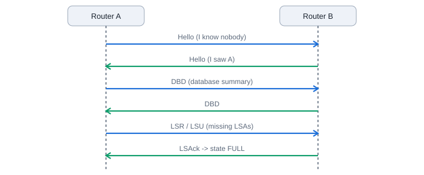

*شکل ۱: ساده‌شده‌ی تبادل پیام‌ها تا رسیدن به حالت Full.*

| حالت     | معنی                                              |
|----------|---------------------------------------------------|
| Down     | Hello نرسیده                                      |
| Init     | Hello دریافت شد ولی همسایه هنوز ما را ندیده       |
| 2-Way    | دوطرفه دیدیم (روی Broadcast: DR/BDR انتخاب می‌شود) |
| ExStart  | انتخاب Master/Slave برای تبادل                    |
| Exchange | تبادل خلاصه‌ی پایگاه داده (DBD)                    |
| Loading  | دریافت LSAهای مفقود                               |
| Full     | پایگاه‌ها یکسان؛ Adjacency کامل                    |

اگر روتری در ExStart یا Exchange گیر کرد، معمولاً MTU یا مشکل پایگاه داده است. اگر در Init می‌ماند، یکی از دو طرف Hello را نمی‌بیند (ACL، Hello/Dead، Subnet).

### ۴. شرط‌های تشکیل Adjacency

برای اینکه دو روتر همسایه شوند، این مقادیر باید یکی باشند:

- هر دو Interface در یک Subnet با Mask یکسان.
- Area یکسان.
- Hello و Dead Interval یکسان (پیش‌فرض اترنت: 10 و 40 ثانیه).
- Authentication یکسان.
- MTU برابر (یا `ip ospf mtu-ignore` در موارد خاص).
- Router ID یکتا.

``` text
Hello interval (Ethernet) = 10 s
Dead interval  (Ethernet) = 4 x Hello = 40 s
(Non-broadcast: Hello 30 s, Dead 120 s)
```

### ۵. Router ID

هر روتر یک شناسه‌ی ۳۲ بیتی شبیه IP دارد. اگر دستی تنظیم نکنید، بزرگ‌ترین IP روی Loopbackها، و در نبود Loopback بزرگ‌ترین IP روی Interfaceهای فعال انتخاب می‌شود. توصیه: همیشه دستی تنظیم کنید تا پایدار و قابل‌پیش‌بینی باشد:

``` text
R1(config)# router ospf 1
R1(config-router)# router-id 1.1.1.1
```

### ۶. Cost: چطور مسیر انتخاب می‌شود؟

هر لینک یک هزینه دارد که از پهنای باند به‌دست می‌آید. هزینه‌ی کل یک مسیر مجموع هزینه‌ی لینک‌های خروجی تا مقصد است و کمترین برنده می‌شود:

``` text
Cost = Reference bandwidth / Interface bandwidth
Default reference bandwidth = 100 Mbps

 10 Mbps  -> 100 / 10   = 10
100 Mbps  -> 100 / 100  = 1
  1 Gbps  -> 100 / 1000 = 0.1 -> rounded up to 1   (problem!)
 10 Gbps  -> also 1
```

> **مشکل شناخته‌شده**
>
> با مرجع ۱۰۰ مگابیت، لینک‌های ۱ و ۱۰ گیگابیت هزینه‌ی یکسان (۱) دارند؛ پس OSPF سریع‌تر را از کندتر تشخیص نمی‌دهد. راه‌حل: مرجع را بالا ببرید و در همه‌ی روترها یکسان کنید: `auto-cost reference-bandwidth 10000` (ده گیگ).

``` text
Reference 10000 Mbps:
  1 Gbps  -> 10000 / 1000  = 10
 10 Gbps  -> 10000 / 10000 = 1
100 Mbps  -> 10000 / 100   = 100
```

### ۷. مثال‌ها

#### ساده: دو روتر

``` text
R1 Gi0/1 10.0.12.1/30  <->  R2 Gi0/0 10.0.12.2/30, area 0
Hello exchanged -> neighbors -> state FULL
Each learns the other LANs automatically
```

#### متوسط: کدام مسیر؟

``` text
Path A: R1 -> R2 -> R3     cost 10 + 10 = 20
Path B: R1 -> R3 direct     cost 30
SPF picks Path A (20 < 30)
```

#### سخت: چرا Adjacency نمی‌شود؟

``` text
R1: ip ospf hello-interval 5   (dead 20)
R2: default (hello 10, dead 40)
Result: neighbors never reach 2-Way; hello/dead mismatch
Fix: make both sides identical
```

### تمرین‌ها

**ت1.** ۱ (ساده): سه مرحله‌ی کار OSPF؟ *(پاسخ: 5-4-ت1 در بخش «پاسخ‌ها» انتهای فصل)*

**ت2.** ۲ (ساده): Hello/Dead پیش‌فرض اترنت؟ *(پاسخ: 5-4-ت2 در بخش «پاسخ‌ها» انتهای فصل)*

**ت3.** ۳ (متوسط): Cost لینک 1 Gbps با Reference 100 Mbps؟ *(پاسخ: 5-4-ت3 در بخش «پاسخ‌ها» انتهای فصل)*

**ت4.** ۴ (متوسط): Cost لینک 100 Mbps با Reference 10000؟ *(پاسخ: 5-4-ت4 در بخش «پاسخ‌ها» انتهای فصل)*

**ت5.** ۵ (سخت): دو روتر در Init مانده‌اند؛ علت‌های محتمل؟ *(پاسخ: 5-4-ت5 در بخش «پاسخ‌ها» انتهای فصل)*

### Lab هدایت‌شده

در این درس فقط مشاهده‌ی مفهوم؛ پیکربندی کامل در درس بعد. ولی Router ID را می‌توانیم از الان برنامه‌ریزی کنیم:

| روتر | Router ID | Loopback               |
|------|-----------|------------------------|
| R1   | 1.1.1.1   | Loopback0 = 1.1.1.1/32 |
| R2   | 2.2.2.2   | Loopback0 = 2.2.2.2/32 |
| R3   | 3.3.3.3   | Loopback0 = 3.3.3.3/32 |

#### گام: ساخت Loopback0 روی هر روتر

``` text
R1(config)# interface loopback 0
R1(config-if)# ip address 1.1.1.1 255.255.255.255
R2(config)# interface loopback 0
R2(config-if)# ip address 2.2.2.2 255.255.255.255
R3(config)# interface loopback 0
R3(config-if)# ip address 3.3.3.3 255.255.255.255
```

سپس با Static قبلی، دسترسی به این Loopbackها را برقرار کنید (یا صبر کنید تا OSPF در درس بعد انجامش دهد).

### Lab مستقل

ترسیم دستی LSDB یک مثلث سه‌روتری روی کاغذ: هر روتر چه LSAهایی می‌سازد؟ و جدول Cost هر لینک را با Reference 10000 بنویسید.

### عیب‌یابی

|         |                                                                                                                           |
|---------|---------------------------------------------------------------------------------------------------------------------------|
| Symptom | دو روتر همسایه نمی‌شوند                                                                                                    |
| چک‌لیست  | ۱) Subnet و Mask یکی؟ ؛ ۲) Area یکی؟ ؛ ۳) Hello/Dead یکی؟ ؛ ۴) Authentication؟ ؛ ۵) MTU؟ ؛ ۶) Router ID تکراری؟ ؛ ۷) ACL؟ |
| ابزار   | show ip ospf neighbor ، show ip ospf interface ، debug ip ospf adj (با احتیاط)                                            |
| رفع     | یکسان‌سازی پارامتر ناسازگار                                                                                                |

### سؤال‌های مرور

**م1.** OSPF چه نوع پروتکلی است؟ *(پاسخ: 5-4-م1 در بخش «پاسخ‌ها» انتهای فصل)*

**م2.** Hello و Dead چیست؟ *(پاسخ: 5-4-م2 در بخش «پاسخ‌ها» انتهای فصل)*

### English Corner: انگلیسی تخصصی این درس

این جمله‌ها از مستندات و محیط کار واقعی‌اند. بلند بخوانید و ترجمه را بپوشانید.

| English sentence                                                                | ترجمه                                                           |
|---------------------------------------------------------------------------------|-----------------------------------------------------------------|
| OSPF routers exchange link-state advertisements to build an identical database. | روترهای OSPF با تبادل LSA پایگاه داده‌ی یکسان می‌سازند.           |
| Neighbors must agree on area, hello and dead timers.                            | همسایه‌ها باید روی Area و تایمرهای Hello/Dead توافق داشته باشند. |
| The lowest total cost path is selected.                                         | مسیر با کمترین هزینه‌ی کل انتخاب می‌شود.                          |
| Set the router ID manually for stability.                                       | Router ID را برای پایداری دستی تنظیم کنید.                      |

**Q1.** Quick quiz (answer in English): What are the three steps of OSPF operation? *(پاسخ: 5-4-Q1 در بخش «پاسخ‌ها» انتهای فصل)*

### تکلیف و چک‌لیست تسلط

- [ ] وضعیت‌های همسایگی را بدون نگاه بگویم.
- [ ] Cost را با دو Reference حساب کنم.
- [ ] Loopbackها را بسازم.

### یادآوری اشتباهات شما

> **یادآوری**
>
> پیش‌بینی قبل از اجرا؛ بکاپ قبل از تغییر؛ پذیرفته‌شدن دستور ≠ کار کردن؛ فرمول‌ها در بلوک مستقل.


#### کارت Lab — مفهوم OSPF

| # | فیلد | محتوا |
|---|---|---|
| 1 | عنوان و هدف | برنامه‌ریزی OSPF (Router-ID، Loopback) |
| 2 | پیش‌نیاز | درس 5-3 |
| 3 | توپولوژی | R1-R2-R3 |
| 4 | تجهیزات | ۳ vIOS |
| 5 | نسخه نرم‌افزار | vIOS-L2 15.2(20200924، Experimental) برای SW؛ vIOS 15.9(3)M9 برای R؛ VPCS؛ PNetLab 4.2.8 |
| 6 | IP Plan | Static |
| 7 | وضعیت اولیه | Loopback0 |
| 8 | صورت مسئله | Cost روی کاغذ |
| 9 | مراحل هدایت‌شده | همان بخش «Lab هدایت‌شده» همین درس |
| 10 | تست عملکرد | `show ip interface brief` |
| 11 | سناریوی خرابی | — |
| 12 | روش عیب‌یابی | لایه‌ای/با شواهد (بخش عیب‌یابی همین درس) |
| 13 | نتیجه‌ی مورد انتظار | Loopbackها بالا |
| 14 | معیار پذیرش | جدول Cost |
| 15 | مستندات نهایی | — |
| 16 | Cleanup و بازگردانی | حذف Loopback |

> **وضعیت راستی‌آزمایی (خارج از ۱۶ فیلد):** **اجرا نشده (فقط طراحی).** اجرا نشده.

---

<a id="l-5-5"></a>

## درس 5-5 — پیاده‌سازی OSPF

**فصل ۵ - روز ۵ · پیش‌نیاز: درس ۵-۴ · ۶ ساعت**

### این درس درباره چیست و چرا باید یاد بگیریم؟

**چه چیزی یاد می‌گیریم:** پیاده‌سازی OSPF تک‌ناحیه‌ای روی سه روتر: router ospf، معرفی شبکه‌ها، passive-interface، پخش Default Route، تنظیم Cost و بررسی با دستورهای show.

**چرا لازم است:** تا اینجا مفهوم را فهمیدید؛ حالا باید بتوانید یک شبکه‌ی چندروتری را در کمتر از ده دقیقه با OSPF بالا بیاورید و درستی‌اش را اثبات کنید. این مهارت در مصاحبه و کار روزانه مستقیماً سنجیده می‌شود.

- **در کار روزانه:** تنظیم OSPF برای شبکه‌ی جدید و عیب‌یابی همسایگی.
- **در امنیت:** Passive-interface جلوی ارسال Hello به سمت کاربران را می‌گیرد.
- **در Capstone:** Lab A (Cisco L3 Core) و ارتباط با FortiGate از همین مبانی استفاده می‌کند.

> **مسیر درس**
>
> طراحی ← دستورها خط‌به‌خط ← passive-interface ← default-information ← مثال ساده/متوسط/سخت ← Lab ← عیب‌یابی.

#### اصطلاحات این درس (مخفف ← شکل کامل ← معنی)

| مخفف                          | شکل کامل انگلیسی              | معنی فارسی                                         |
|-------------------------------|-------------------------------|----------------------------------------------------|
| network                       | OSPF network statement        | Interfaceها را با Wildcard به OSPF معرفی می‌کند     |
| Wildcard                      | Wildcard mask                 | معکوس Mask                                         |
| passive-interface             | Passive interface             | Interface که Hello نمی‌فرستد ولی شبکه‌اش اعلام می‌شود |
| default-information originate | Default information originate | پخش Default Route                                  |
| reference-bandwidth           | Auto-cost reference bandwidth | پهنای مرجع برای Cost                               |
| E2                            | OSPF External Type 2          | Route خارجی با Cost ثابت                           |

### ۱. طراحی Lab

``` text
R1 --10.0.12.0/30-- R2 --10.0.23.0/30-- R3
R1 LAN: 192.168.1.0/24 (Loopback10)
R3 LAN: 192.168.3.0/24 (Loopback30)
Router IDs: 1.1.1.1 , 2.2.2.2 , 3.3.3.3
All in area 0
```

اول Static درس قبل را حذف کنید تا نتیجه‌ی OSPF را درست ببینید.

``` text
R1(config)# no ip route 192.168.3.0 255.255.255.0 10.0.12.2
R1(config)# no ip route 10.0.23.0 255.255.255.252 10.0.12.2
(similarly remove statics on R2 and R3)
```

### ۲. دستورها (خط‌به‌خط)

``` text
R1(config)# router ospf 1
R1(config-router)# router-id 1.1.1.1
R1(config-router)# auto-cost reference-bandwidth 10000
R1(config-router)# network 10.0.12.0 0.0.0.3 area 0
R1(config-router)# network 192.168.1.0 0.0.0.255 area 0
R1(config-router)# passive-interface loopback 10
R1(config-router)# end
```

- `router ospf 1`: شماره‌ی Process فقط محلی است و لازم نیست با همسایه یکی باشد.
- `network ... area 0`: هر Interface که آدرسش در این بازه بیفتد در OSPF شرکت می‌کند. از Wildcard استفاده می‌شود: برای /30 برابر 0.0.0.3 و برای /24 برابر 0.0.0.255.
- `passive-interface`: روی Interface مربوط به LAN کاربران؛ شبکه‌اش اعلام می‌شود ولی Hello نمی‌رود (کاربر نمی‌تواند همسایه جعلی بسازد).
- `reference-bandwidth 10000`: باید در همه‌ی روترها یکسان باشد.

``` text
Wildcard = 255.255.255.255 - Mask
/30: 255.255.255.255 - 255.255.255.252 = 0.0.0.3
/24: 255.255.255.255 - 255.255.255.0   = 0.0.0.255
```

روش جایگزین (مدرن): فعال‌سازی روی خود Interface بدون `network`:

``` text
R1(config)# interface gi0/1
R1(config-if)# ip ospf 1 area 0
R1(config)# interface loopback 10
R1(config-if)# ip ospf 1 area 0
```

### ۳. Verification (چهار دستور اصلی)

``` text
R1# show ip ospf neighbor
R1# show ip ospf interface brief
R1# show ip route ospf
R1# show ip protocols
```

نمونه‌ی خروجی سالم:

``` text
R1# show ip ospf neighbor
Neighbor ID   Pri  State     Dead Time  Address     Interface
2.2.2.2         1  FULL/BDR  00:00:35   10.0.12.2   Gi0/1

R1# show ip route ospf
O   10.0.23.0/30 [110/20] via 10.0.12.2, Gi0/1
O   192.168.3.0/24 [110/21] via 10.0.12.2, Gi0/1
```

خوانش: State باید `FULL` باشد. مقدار Cost به‌صورت زیر حساب می‌شود (با Reference 10000 و لینک 1 گیگ):

``` text
Reference 10000, each 1G link = 10, Loopback = 1
R1 -> 10.0.23.0/30 : 10 (R1-R2) + 10 (R2-R3)        = 20
R1 -> 192.168.3.0/24: 10 + 10 + 1 (Loopback30)        = 21
```

### ۴. پخش Default Route

R1 به اینترنت (یا فایروال) وصل است و Default دارد. می‌خواهیم R2 و R3 هم بدانند:

``` text
R1(config)# ip route 0.0.0.0 0.0.0.0 203.0.113.1
R1(config)# router ospf 1
R1(config-router)# default-information originate
```

در R2 و R3 مسیر `O*E2 0.0.0.0/0` می‌بینید؛ E2 یعنی Route خارجی با Cost ثابت. اگر Default روی R1 نباشد، دستور بی‌اثر است (مگر با `always`).

### ۵. مثال‌ها

#### ساده

``` text
R1 and R2: both "network 10.0.12.0 0.0.0.3 area 0"
show ip ospf neighbor -> FULL
```

#### متوسط: ping سراسری

``` text
R1# ping 192.168.3.1 source 192.168.1.1
R3# ping 192.168.1.1 source 192.168.3.1
Both succeed through OSPF-learned routes
```

#### سخت: تغییر Cost برای هدایت مسیر

``` text
R2(config)# interface gi0/1
R2(config-if)# ip ospf cost 500
R1# show ip route 192.168.3.0   -> cost increases accordingly
Used to steer traffic to a preferred path
```

### تمرین‌ها

**ت1.** ۱ (ساده): Wildcard برای /27؟ *(پاسخ: 5-5-ت1 در بخش «پاسخ‌ها» انتهای فصل)*

**ت2.** ۲ (ساده): چرا Loopback را passive می‌کنیم؟ *(پاسخ: 5-5-ت2 در بخش «پاسخ‌ها» انتهای فصل)*

**ت3.** ۳ (متوسط): Cost 21 در R1 برای شبکه‌ی R3 را توضیح بده *(پاسخ: 5-5-ت3 در بخش «پاسخ‌ها» انتهای فصل)*

**ت4.** ۴ (متوسط): state ExStart گیر کرده؛ علت؟ *(پاسخ: 5-5-ت4 در بخش «پاسخ‌ها» انتهای فصل)*

**ت5.** ۵ (سخت): default-information originate بدون Default روی روتر چه می‌شود؟ *(پاسخ: 5-5-ت5 در بخش «پاسخ‌ها» انتهای فصل)*

### Lab هدایت‌شده

#### گام ۱: بکاپ و حذف Static

``` text
Rx# copy running-config flash:Rx-before-ospf.cfg
```

#### گام ۲: OSPF روی هر سه

``` text
R2(config)# router ospf 1
R2(config-router)# router-id 2.2.2.2
R2(config-router)# auto-cost reference-bandwidth 10000
R2(config-router)# network 10.0.12.0 0.0.0.3 area 0
R2(config-router)# network 10.0.23.0 0.0.0.3 area 0

R3(config)# router ospf 1
R3(config-router)# router-id 3.3.3.3
R3(config-router)# auto-cost reference-bandwidth 10000
R3(config-router)# network 10.0.23.0 0.0.0.3 area 0
R3(config-router)# network 192.168.3.0 0.0.0.255 area 0
R3(config-router)# passive-interface loopback 30
```

#### گام ۳: بررسی

``` text
Rx# show ip ospf neighbor
Rx# show ip route ospf
R1# ping 192.168.3.1 source 192.168.1.1
```

#### گام ۴: Capture Hello

روی لینک R1-R2 Capture بگیرید و فیلتر `ospf` بزنید. بسته‌های Hello را ببینید: هر ۱۰ ثانیه، به مقصد Multicast `224.0.0.5` (همه‌ی روترهای OSPF).

#### گام ۵: Failover

``` text
R2(config)# interface gi0/1
R2(config-if)# shutdown
R1# show ip route ospf   (route to R3 LAN disappears)
R2(config-if)# no shutdown
```

### Lab مستقل

یک «OSPF As-Built» در `03-ops/ospf-as-built.md` بنویسید: Router IDها، شبکه‌ها، Cost، خروجی show ip ospf neighbor و جدول Route.

### عیب‌یابی

|         |                                                                                                                                                   |
|---------|---------------------------------------------------------------------------------------------------------------------------------------------------|
| Symptom | Neighbor نیست یا Route نیامده                                                                                                                     |
| چک‌لیست  | ۱) network statement شامل Interface هست؟ ؛ ۲) Area یکی؟ ؛ ۳) passive-interface اشتباهی روی لینک؟ ؛ ۴) Hello/Dead؟ ؛ ۵) Reference bandwidth یکسان؟ |
| ابزار   | show ip ospf interface ، show ip protocols                                                                                                        |
| رفع     | اصلاح network یا حذف passive از لینک اتصال                                                                                                        |

### سؤال‌های مرور

**م1.** network statement چه می‌کند؟ *(پاسخ: 5-5-م1 در بخش «پاسخ‌ها» انتهای فصل)*

**م2.** passive-interface چه فایده‌ای دارد؟ *(پاسخ: 5-5-م2 در بخش «پاسخ‌ها» انتهای فصل)*

### English Corner: انگلیسی تخصصی این درس

این جمله‌ها از مستندات و محیط کار واقعی‌اند. بلند بخوانید و ترجمه را بپوشانید.

| English sentence                                                     | ترجمه                                                       |
|----------------------------------------------------------------------|-------------------------------------------------------------|
| Advertise the networks with the network command and a wildcard mask. | شبکه‌ها را با دستور network و Wildcard Mask اعلام کنید.      |
| Make user-facing interfaces passive.                                 | Interfaceهای سمت کاربر را Passive کنید.                     |
| The neighbor reached the FULL state.                                 | همسایه به حالت FULL رسید.                                   |
| The default route is injected into OSPF as an external type 2 route. | Default Route به‌صورت Route خارجی نوع ۲ در OSPF تزریق می‌شود. |

**Q1.** Quick quiz (answer in English): Which command verifies that neighbors reached FULL? *(پاسخ: 5-5-Q1 در بخش «پاسخ‌ها» انتهای فصل)*

### تکلیف و چک‌لیست تسلط

- [ ] OSPF را روی سه روتر بالا بیاورم و FULL ببینم.
- [ ] Hello را در Capture ببینم.
- [ ] OSPF As-Built را بنویسم.

### یادآوری اشتباهات شما

> **یادآوری**
>
> پیش‌بینی قبل از اجرا؛ بکاپ قبل از تغییر؛ پذیرفته‌شدن دستور ≠ کار کردن؛ فرمول‌ها در بلوک مستقل.


#### کارت Lab — پیاده‌سازی OSPF

| # | فیلد | محتوا |
|---|---|---|
| 1 | عنوان و هدف | OSPF تک‌ناحیه‌ای |
| 2 | پیش‌نیاز | درس 5-4 |
| 3 | توپولوژی | R1-R2-R3 |
| 4 | تجهیزات | ۳ vIOS |
| 5 | نسخه نرم‌افزار | vIOS-L2 15.2(20200924، Experimental) برای SW؛ vIOS 15.9(3)M9 برای R؛ VPCS؛ PNetLab 4.2.8 |
| 6 | IP Plan | Static حذف |
| 7 | وضعیت اولیه | OSPF area 0 |
| 8 | صورت مسئله | FULL و ping |
| 9 | مراحل هدایت‌شده | همان بخش «Lab هدایت‌شده» همین درس |
| 10 | تست عملکرد | `show ip ospf neighbor` |
| 11 | سناریوی خرابی | Hello/Area mismatch |
| 12 | روش عیب‌یابی | لایه‌ای/با شواهد (بخش عیب‌یابی همین درس) |
| 13 | نتیجه‌ی مورد انتظار | FULL؛ Route O |
| 14 | معیار پذیرش | OSPF As-Built |
| 15 | مستندات نهایی | `03-ops/ospf-as-built.md` |
| 16 | Cleanup و بازگردانی | حذف OSPF |

> **وضعیت راستی‌آزمایی (خارج از ۱۶ فیلد):** **اجرا نشده (فقط طراحی).** OSPF در Probe فقط CLI-Accepted.

---

<a id="l-5-6"></a>

## درس 5-6 — عیب‌یابی مسیریابی و آزمون

**فصل ۵ - روز ۶ · پیش‌نیاز: درس‌های ۵-۱ تا ۵-۵ · ۶ ساعت**

### این درس درباره چیست و چرا باید یاد بگیریم؟

**چه چیزی یاد می‌گیریم:** روش عیب‌یابی مسیریابی و پنج دلیل رایج تشکیل‌نشدن همسایگی OSPF؛ و آزمون کوچک پایان هفته‌ی ۵.

**چرا لازم است:** «شبکه‌ی دور در دسترس نیست» پرتکرارترین شکایت است و علتش یکی از چند مورد محدود است. اگر روش داشته باشید، ریشه را در چند دقیقه پیدا می‌کنید.

- **در کار روزانه:** عیب‌یابی مسیریابی مهارت پایه‌ی هر ادمین شبکه است.
- **در امنیت:** اشتباه مسیر یعنی ترافیک از مسیر ناخواسته یا نامشخص می‌رود.
- **در مصاحبه:** سناریوی «دو روتر همسایه نمی‌شوند» سؤال تکراری مصاحبه‌هاست.

> **مسیر درس**
>
> روش ۵ مرحله‌ای ← پنج خرابی OSPF ← مثال‌ها ← Lab عیب‌یابی ← آزمون کوچک.

#### اصطلاحات این درس (مخفف ← شکل کامل ← معنی)

| مخفف       | شکل کامل انگلیسی          | معنی فارسی                     |
|------------|---------------------------|--------------------------------|
| TS         | Troubleshooting Scenario  | سناریوی عیب‌یابی                |
| MTU        | Maximum Transmission Unit | بزرگ‌ترین اندازه‌ی بسته روی لینک |
| Mismatch   | Mismatch                  | عدم تطابق پارامتر دو طرف       |
| Asymmetric | Asymmetric routing        | مسیر رفت و برگشت متفاوت        |
| RCA        | Root Cause Analysis       | علت ریشه‌ای                     |
| Traceroute | traceroute                | نمایش مسیر Hop به Hop          |

### ۱. روش سیستماتیک مسیریابی

1.  **Symptom:** از کجا به کجا نمی‌رسد؟ (مبدأ و مقصد دقیق)
2.  **ping و traceroute:** تا کدام Hop می‌رسد؟
3.  **Route رفت:** `show ip route <مقصد>` روی هر روتر مسیر.
4.  **Route برگشت:** همان کار از سمت مقصد.
5.  **پروتکل:** همسایگی OSPF (`show ip ospf neighbor`) و فیلتر/ACL.

مهم‌ترین قاعده: Hop به Hop بروید و هر روتر را بررسی کنید؛ حدس ممنوع.

### ۲. پنج دلیل رایج Adjacency نشدن OSPF

#### ۱: Hello/Dead Mismatch

``` text
Symptom : neighbor stuck / flapping
Evidence: show ip ospf interface -> Hello 5 vs 10
Fix     : set the same hello/dead on both ends
```

#### ۲: Area Mismatch

``` text
Symptom : no neighbor; log "Mismatched area"
Evidence: show ip ospf interface -> Area 0 vs Area 1
Fix     : use the same area
```

#### ۳: Subnet/Mask Mismatch

``` text
Symptom : no neighbor
Evidence: 10.0.12.1/30 vs 10.0.12.2/29 (different masks)
Fix     : same subnet and mask
```

#### ۴: Authentication Mismatch

``` text
Symptom : neighbor does not form; log auth failure
Evidence: show ip ospf interface -> auth type/key differs
Fix     : same auth mode and key
```

#### ۵: MTU Mismatch

``` text
Symptom : stuck in ExStart/Exchange
Evidence: show interfaces -> MTU 1500 vs 1400
Fix     : same MTU (or ip ospf mtu-ignore as a temporary workaround)
```

### ۳. مسیر برگشت و مسیر نامتقارن

اگر رفت از R2 و برگشت از R3 باشد (Asymmetric)، فایروال‌ها و NAT اغلب ارتباط را قطع می‌کنند چون Stateful هستند. همیشه مسیر رفت و برگشت را جدا بررسی کنید.

### ۴. آزمون کوچک پایان هفته‌ی ۵ (بدون نگاه به درس)

| \#  | وظیفه                            | مدرک                          |
|-----|----------------------------------|-------------------------------|
| ۱   | LPM را برای ۳ بسته حل کنید       | جدول جواب                     |
| ۲   | Static رفت و برگشت بین دو LAN    | ping موفق                     |
| ۳   | Default + Floating + Track       | show track                    |
| ۴   | OSPF سه‌روتری و ping سراسری       | show ip ospf neighbor / route |
| ۵   | سه عیب OSPF را بسازید و رفع کنید | گزارش RCA                     |

معیار: حداقل ۴ از ۵ مورد. وقتی تمام شد بگویید «فصل ۵ انجام شد».

### تمرین‌ها

**ت1.** ۱ (ساده): اولین ابزار عیب‌یابی مسیریابی؟ *(پاسخ: 5-6-ت1 در بخش «پاسخ‌ها» انتهای فصل)*

**ت2.** ۲ (ساده): پنج دلیل Adjacency نشدن؟ *(پاسخ: 5-6-ت2 در بخش «پاسخ‌ها» انتهای فصل)*

**ت3.** ۳ (متوسط): در ExStart گیر کرده؛ اول چه چیزی را بررسی می‌کنی؟ *(پاسخ: 5-6-ت3 در بخش «پاسخ‌ها» انتهای فصل)*

**ت4.** ۴ (سخت): ping از A به B شکست می‌خورد ولی traceroute تا Hop آخر پیش می‌رود؛ حدس؟ *(پاسخ: 5-6-ت4 در بخش «پاسخ‌ها» انتهای فصل)*

### Lab هدایت‌شده

روی OSPF سه‌روتری، هر پنج خرابی را به ترتیب بسازید و رفع کنید:

1.  Hello: `ip ospf hello-interval 3` روی یک سمت.
2.  Area: network statement با area 1 روی یک سمت.
3.  Mask: Mask متفاوت روی Interface یک سمت.
4.  Authentication: `ip ospf authentication message-digest` فقط یک سمت.
5.  MTU: `ip mtu 1400` روی یک سمت.

``` text
Rx# show ip ospf neighbor
Rx# show ip ospf interface gi0/1
Rx# debug ip ospf adj   (use briefly; then: undebug all)
```

برای هر مورد Symptom، Evidence، Fix و Verify را یادداشت کنید. در شبیه‌ساز اگر رفتار با واقعیت فرق داشت، همان را ثبت کنید.

### Lab مستقل

گزارش RCA پنج‌گانه را در `03-ops/rca-ospf.md` بنویسید.

### عیب‌یابی

|         |                                                           |
|---------|-----------------------------------------------------------|
| Symptom | ارتباط به شبکه‌ی دور نیست                                  |
| روش     | Hop به Hop: Route رفت، Route برگشت، همسایگی، ACL          |
| ابزار   | ping ، traceroute ، show ip route ، show ip ospf neighbor |
| پیشگیری | مستندسازی As-Built و بکاپ قبل از تغییر                    |

### سؤال‌های مرور

**م1.** قدم اول عیب‌یابی مسیریابی؟ *(پاسخ: 5-6-م1 در بخش «پاسخ‌ها» انتهای فصل)*

**م2.** MTU Mismatch چه علامتی دارد؟ *(پاسخ: 5-6-م2 در بخش «پاسخ‌ها» انتهای فصل)*

### English Corner: انگلیسی تخصصی این درس

این جمله‌ها از مستندات و محیط کار واقعی‌اند. بلند بخوانید و ترجمه را بپوشانید.

| English sentence                                          | ترجمه                                                  |
|-----------------------------------------------------------|--------------------------------------------------------|
| Verify the route in both directions.                      | Route را در هر دو جهت بررسی کنید.                      |
| The adjacency is stuck in ExStart due to an MTU mismatch. | Adjacency به‌خاطر MTU Mismatch در ExStart گیر کرده است. |
| Use traceroute to find where the path breaks.             | با traceroute نقطه‌ی قطع مسیر را پیدا کنید.             |
| Document the root cause and the fix.                      | علت ریشه‌ای و راه‌حل را مستند کنید.                      |

**Q1.** Quick quiz (answer in English): A neighbor is stuck in ExStart. What is the most likely cause? *(پاسخ: 5-6-Q1 در بخش «پاسخ‌ها» انتهای فصل)*

### تکلیف و چک‌لیست تسلط

- [ ] پنج عیب OSPF را بسازم و رفع کنم.
- [ ] آزمون کوچک را کامل کنم.
- [ ] RCA را بنویسم.

### یادآوری اشتباهات شما

> **یادآوری**
>
> پیش‌بینی قبل از اجرا؛ بکاپ قبل از تغییر؛ پذیرفته‌شدن دستور ≠ کار کردن؛ فرمول‌ها در بلوک مستقل.


#### کارت Lab — عیب‌یابی مسیریابی و آزمون

| # | فیلد | محتوا |
|---|---|---|
| 1 | عنوان و هدف | عیب‌یابی مسیریابی و ۵ خطای OSPF |
| 2 | پیش‌نیاز | درس 5-5 |
| 3 | توپولوژی | R1-R2-R3 |
| 4 | تجهیزات | ۳ vIOS |
| 5 | نسخه نرم‌افزار | vIOS-L2 15.2(20200924، Experimental) برای SW؛ vIOS 15.9(3)M9 برای R؛ VPCS؛ PNetLab 4.2.8 |
| 6 | IP Plan | OSPF سالم |
| 7 | وضعیت اولیه | پنج خرابی |
| 8 | صورت مسئله | هر خرابی RCA |
| 9 | مراحل هدایت‌شده | همان بخش «Lab هدایت‌شده» همین درس |
| 10 | تست عملکرد | show ip ospf … |
| 11 | سناریوی خرابی | Hello/Area/Mask/Auth/MTU |
| 12 | روش عیب‌یابی | لایه‌ای/با شواهد (بخش عیب‌یابی همین درس) |
| 13 | نتیجه‌ی مورد انتظار | رفع هر پنج |
| 14 | معیار پذیرش | ≥ ۴ از ۵ |
| 15 | مستندات نهایی | `03-ops/rca-ospf.md` |
| 16 | Cleanup و بازگردانی | بازگشت Baseline |

> **وضعیت راستی‌آزمایی (خارج از ۱۶ فیلد):** **اجرا نشده (فقط طراحی).** اجرا نشده.

---

<a id="ans-5"></a>

## درس 5-7 — Convergence: وقتی لینک می‌میرد شبکه چه می‌کند؟

**فصل ۵ · درس افزوده (پس از ۵-۶) · پیش‌نیاز: درس‌های ۵-۱ تا ۵-۵ · ≈ ۶ ساعت**

> **وضعیت:** تحلیل مفهومی با منبع؛ اعداد زمان‌بندی نمونه‌اند و در Lab با vIOS «اجرا نشده» و `Unverified` هستند.

### ۱) هدف آموزشی

دانشجو در پایان می‌تواند:

1. مراحل چهارگانه‌ی Convergence را نام ببرد و برای هر مرحله زمان تقریبی بدهد.
2. زمان Detection در OSPF را با Hello/Dead و با BFD مقایسه و محاسبه کند.
3. توضیح دهد چرا سوئیچ لایه ۲ میانی «خرابی را پنهان می‌کند».
4. تأثیر Static Floating، IP SLA، Fast Hello و BFD را بسنجد و میان آن‌ها انتخاب کند.
5. پیامد قطع شدن را روی Session فایروال و کاربر توضیح دهد.

### ۲) پیش‌نیازها

OSPF (درس ۵-۴ و ۵-۵)، Floating Static و IP SLA (۵-۳)، Neighbor States، LSDB/SPF.

### ۳) مفهوم پایه: Convergence چیست و چرا مهم است؟

**Convergence (همگرایی)** یعنی بعد از یک تغییر (خرابی لینک، افتادن روتر، افزودن مسیر) همه‌ی روترها دوباره به یک تصویر هماهنگ و درست از شبکه برسند. تا آن لحظه، بعضی روترها هنوز بسته‌ها را به سمت مسیر خراب می‌فرستند (**Black Hole**) یا بسته‌ها بین دو روتر ناهماهنگ رفت‌وبرگشت می‌کنند (**Micro-loop**).

چرا برای ما مهم است؟

- در شبکه‌ی سازمانی، ۳۰ ثانیه قطعی یعنی Sessionهای TCP تایم‌اوت می‌شوند، تماس VoIP قطع می‌شود، و در فایروال Sessionهای Stateful باید دوباره ساخته شوند.
- Convergence کند یعنی «افزونگی (Redundancy) داریم ولی عملاً بی‌فایده است».
- تمام Failover در HA، SD-WAN و VPN (فصل‌های ۱۸ تا ۲۲) همین منطق «تشخیص + تصمیم + جایگزینی» را دارند.

### ۴) توضیح عمیق فنی

#### ۴-۱) چهار مرحله‌ی Convergence

``` text
Total convergence time =
    T_detect + T_propagate + T_compute + T_install
```

| مرحله | کار | عامل زمان |
|---|---|---|
| Detect | روتر می‌فهمد همسایه/لینک خراب است | Dead Timer، قطع Carrier، BFD |
| Propagate | خبر تغییر به بقیه می‌رسد | OSPF: Flooding LSA؛ BGP: Update + MRAI |
| Compute | جدول مجدد محاسبه می‌شود | OSPF: SPF (با Throttle) |
| Install | RIB و FIB به‌روز می‌شود | سرعت CPU/سخت‌افزار |

در شبکه‌های کوچک Lab، سه مرحله‌ی آخر معمولاً چند ده میلی‌ثانیه‌اند؛ **Detect بیشترین سهم را دارد**. پس بهینه‌سازی از Detect شروع می‌شود.

#### ۴-۲) Detection در OSPF

پیش‌فرض OSPF روی Ethernet (Broadcast/Point-to-Point): Hello = 10 ثانیه، Dead = 40 ثانیه (۴ برابر Hello).

``` text
Detect time (worst case) = Dead interval
OSPF default: Dead = 40 s
```

یعنی اگر لینک «بی‌صدا» خراب شود (بسته‌ها فقط گم شوند)، تا ۴۰ ثانیه همسایه Up می‌ماند و ترافیک به سمت مسیر خراب می‌رود.

**دو حالت مهم:**

- **قطع مستقیم لینک (Carrier Loss):** کابل مستقیم بین دو روتر قطع شود. Interface فوراً Down می‌شود و OSPF در چند ده میلی‌ثانیه همسایه را می‌بندد؛ بدون انتظار Dead.
- **قطع غیرمستقیم:** بین دو روتر یک **سوئیچ لایه ۲** است. قطع لینک سوئیچ تا آن طرف روتر، Interface روتر را Down نمی‌کند (چون پورتش به سوئیچ هنوز Up است). این‌جا **فقط Dead Timer** خرابی را کشف می‌کند. این یکی از رایج‌ترین دلایل «Failover ما ۴۰ ثانیه طول می‌کشد».

#### ۴-۳) سه راه کوتاه‌کردن Detect

| روش | سازوکار | حداقل زمان معمول | هزینه/ریسک |
|---|---|---|---|
| Fast Hello | Hello 1 s، Dead 3–4 s (`ip ospf hello-interval` / `dead-interval`) | چند ثانیه | بار CPU و ریسک Flap با لینک ناپایدار |
| Sub-second Hello | `ip ospf dead-interval minimal hello-multiplier N` | کمتر از ۱ ثانیه | CPU بالاتر |
| BFD | پروتکل سبک جداگانه برای تشخیص خرابی (RFC 5880) | چند ده تا چند صد میلی‌ثانیه | نیاز به پشتیبانی دو سر؛ روی سخت‌افزار بهتر |

BFD = Bidirectional Forwarding Detection. OSPF/BGP از BFD می‌خواهند «اگر BFD قطع شد فوراً همسایه را ببند». مزیت: یک مکانیزم برای همه‌ی پروتکل‌ها، سبک‌تر از Hello سریع.

``` text
BFD detect time = interval x multiplier
Example: 300 ms x 3 = 900 ms
```

#### ۴-۴) Compute: SPF Throttle

اگر لینکی مدام قطع/وصل شود (Flap)، SPF پشت‌سرهم اجرا می‌شود و CPU پر می‌شود. پس OSPF محدودکننده دارد: `timers throttle spf <start> <hold> <max-wait>` (میلی‌ثانیه). اولین SPF سریع، بعدی‌ها با تأخیر فزاینده. تنظیم بیش از حد کند، Convergence را کند می‌کند؛ بیش از حد سریع، شبکه را ناپایدار.

#### ۴-۵) Black Hole و Micro-loop

- **Black Hole:** مسیر خراب هنوز در جدول است و بسته‌ها در آن ناپدید می‌شوند. زمانش = تا پایان Detect.
- **Micro-loop:** در مرحله‌ی گذار، R1 به R2 و R2 به R1 مسیر می‌دهد چون به‌روزرسانی‌ها هم‌زمان نرسیده‌اند. TTL این حلقه را در نهایت می‌کشد. در شبکه‌های حساس راه‌حل‌های پیشرفته (LFA) وجود دارد که خارج از این دوره است.

#### ۴-۶) Floating Static و IP SLA (مرور و پیوند)

- Floating Static با AD بیشتر مسیر پشتیبان می‌دهد، ولی اگر Detect نباشد (لینک Up ولی ISP قطع)، Route اصلی در جدول می‌ماند. **IP SLA + Track** این «قطع پنهان» را کشف می‌کند (درس ۵-۳).
- زمان Failover = (تعداد شکست لازم × فاصله‌ی Probe) + زمان Track.

``` text
IP SLA detect time ~= frequency x consecutive failures
Example: 5 s x 3 = 15 s
```

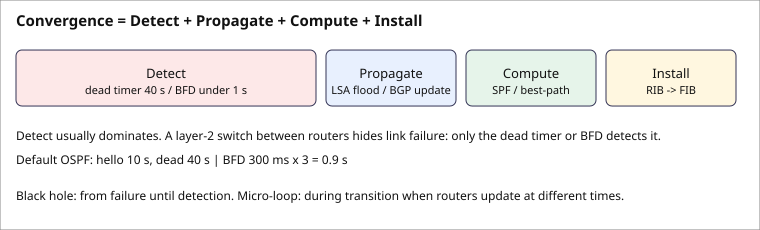

*شکل: چهار مرحله‌ی Convergence؛ Detect معمولاً غالب است.*

### ۵) مثال حل‌شده

**شرایط:** R1—SW—R2 (سوئیچ لایه ۲ بین آن‌ها)، OSPF Area 0، Hello 10/Dead 40. پورت سوئیچ سمت R2 کابلش کشیده می‌شود. R1 همچنان Up می‌بیند.

``` text
t=0 s     cable on SW->R2 pulled; R1 Gi0/0 still up (link to SW is up)
t=0..40 s R1 keeps sending packets to R2 via the dead path (black hole)
t=40 s    Dead timer expires on R1: neighbor Down
t=40.05   SPF recalculated; backup route (via R3) installed
t=40.1    traffic flows via backup path
Outage ~= 40 s
```

**راه‌حل‌ها و مقایسه:**

| راه‌حل | زمان قطعی تقریبی | یادداشت |
|---|---|---|
| پیش‌فرض | ~40 s | بدون هزینه |
| Fast Hello 1/4 | ~4 s | بار Hello 10 برابر |
| BFD 300×3 | ~1 s | نیاز به پشتیبانی دو سر |
| لینک مستقیم بدون سوئیچ | ~0.1 s (Carrier) | تغییر طراحی |

**مثال سخت:** در شبکه‌ی دو فایروال (فصل ۱۵)، Active/Standby با OSPF و لینک از طریق سوئیچ‌های L2 وصل است. تیم می‌گوید «Failover ما ۴۰ ثانیه است». با اعداد بالا بگویید دقیقاً چه چیزی مقصر است و دو راه اصلاح با ریسک هر کدام.

### ۶) طراحی و تصمیم‌گیری

| نیاز | پیشنهاد | دلیل |
|---|---|---|
| لینک بین روتر و فایروال از سوئیچ می‌گذرد | BFD یا Fast Hello | Carrier Loss دیده نمی‌شود |
| لینک WAN/ISP | IP SLA/Track یا BFD (اگر ISP پشتیبانی کند) | Up بودن Interface کافی نیست |
| شبکه‌ی پرنوسان (لینک ناپایدار) | زمان‌های محافظه‌کارانه + Dampening | جلوگیری از Flap |
| VoIP/Real-time | زیر ۱ ثانیه (BFD) | حساسیت Jitter |

اصل طراحی: **سریع‌ترین Convergence همیشه بهترین نیست؛ سریع‌ترین ممکنِ پایدار بهترین است.**

### ۷) پیاده‌سازی (CLI Cisco، نمونه)

``` text
R1(config)# interface GigabitEthernet0/0
R1(config-if)# ip ospf hello-interval 1
R1(config-if)# ip ospf dead-interval 4

! BFD (example, requires support on both ends and platform)
R1(config-if)# bfd interval 300 min_rx 300 multiplier 3
R1(config)# router ospf 1
R1(config-router)# bfd all-interfaces

R1# show ip ospf interface GigabitEthernet0/0
R1# show bfd neighbors
R1# show ip ospf neighbor
```

> **هشدار:** Hello/Dead باید در دو سر یکی باشد؛ در غیر این صورت همسایگی برقرار نمی‌شود. روی vIOS پشتیبانی BFD `Unverified` است.

### ۸) Troubleshooting

| علامت | شاهد | علت محتمل |
|---|---|---|
| Failover ~40 ثانیه | `show ip ospf neighbor` Dead Time | Detect فقط با Dead Timer |
| همسایگی Flap می‌شود | `%OSPF-5-ADJCHG` مکرر | زمان‌ها خیلی تهاجمی/لینک ناپایدار |
| Route پشتیبان نصب نمی‌شود | `show ip route`، `show ip ospf database` | AD/Cost/LSDB ناقص |
| بعد از Failover بعضی Sessionها نمی‌آیند | Session Table فایروال | State قبلی/NAT (فصل ۱۳، ۲۲) |

### ۹) نکات امنیتی

- BFD و Hello سریع را روی لینک‌های غیرقابل‌اعتماد با Authentication محافظت کنید (OSPF Authentication، بخش‌های فصل ۸).
- Timerهای تهاجمی می‌توانند در حمله‌ی DoS روی لینک، شبکه را ناپایدار کنند.
- Failover بی‌شواهد می‌تواند ترافیک را از مسیر «بازرسی‌نشده» (دور از فایروال) عبور دهد؛ پس مسیر پشتیبان هم باید از Policy امنیتی عبور کند.

### ۱۰) جمع‌بندی مفهومی

- Convergence = Detect + Propagate + Compute + Install؛ Detect معمولاً غالب است.
- پیش‌فرض OSPF: Dead 40 s؛ سوئیچ L2 میانی خرابی لینک را پنهان می‌کند.
- BFD و Fast Hello زمان Detect را کم می‌کنند، با هزینه‌ی پایداری.
- Floating Static بدون Track قطع پنهان ISP را نمی‌بیند.
- Convergence را باید در Lab اندازه گرفت (با ping پیوسته و timestamp)، نه حدس زد.

### ۱۱) تمرین و ارزیابی

**ت1.** (ساده) چهار مرحله‌ی Convergence را نام ببرید. *(پاسخ: 5-7-ت1)*

**ت2.** (ساده) Dead interval پیش‌فرض OSPF روی Ethernet چند ثانیه است؟ *(پاسخ: 5-7-ت2)*

**ت3.** (متوسط) BFD با interval 200 ms و multiplier 4 چه زمان Detect دارد؟ *(پاسخ: 5-7-ت3)*

**ت4.** (متوسط) چرا قطع کابل بین سوئیچ و روتر، Interface روتر مقابل را Down نمی‌کند؟ *(پاسخ: 5-7-ت4)*

**ت5.** (سخت) یک IP SLA با frequency 10 ثانیه و آستانه‌ی ۳ شکست متوالی دارید. بدترین زمان Detect را حساب کنید و بگویید برای VoIP قابل‌قبول است؟ *(پاسخ: 5-7-ت5)*

**ت6.** (سخت، طراحی) برای دو فایروال Active/Standby که با دو سوئیچ به روترها وصل‌اند، سه گزینه‌ی کاهش زمان Failover را با مزایا و ریسک مقایسه کنید. *(پاسخ: 5-7-ت6)*

**م1.** Black Hole چیست؟ *(پاسخ: 5-7-م1)*

**م2.** چرا Timer تهاجمی ممکن است شبکه را بی‌ثبات کند؟ *(پاسخ: 5-7-م2)*

**Q1.** Quick quiz (English): Which convergence phase usually dominates, and why? *(پاسخ: 5-7-Q1)*

### ۱۲) اصطلاحات و English Corner

| مخفف | شکل کامل | معنی |
|---|---|---|
| BFD | Bidirectional Forwarding Detection | تشخیص سریع خرابی مسیر |
| SPF | Shortest Path First | الگوریتم محاسبه‌ی مسیر |
| LSA | Link-State Advertisement | بسته‌ی اعلام وضعیت لینک |
| MRAI | Minimum Route Advertisement Interval | حداقل فاصله‌ی ارسال تغییر مسیر در BGP |
| Flap | Route/Link flap | قطع/وصل مکرر |
| Micro-loop | Micro-loop | حلقه‌ی کوتاه‌مدت هنگام همگرایی |

- *Convergence is complete when all routers have a consistent view of the topology.* ← وقتی همه‌ی روترها تصویر یکسانی از توپولوژی داشته باشند، Convergence کامل است.
- *Detection time dominates failover when a switch masks link failures.* ← وقتی سوئیچ خرابی لینک را پنهان کند، زمان تشخیص بر Failover غالب می‌شود.

### ۱۳) منابع

- RFC 2328 — OSPF Version 2 (Hello/Dead، SPF).
- RFC 5880 — Bidirectional Forwarding Detection (BFD).
- Cisco: «OSPF Support for Fast Hello Packets» و «Bidirectional Forwarding Detection» (IOS XE Configuration Guides).


## پاسخ‌های فصل 5

> ابتدا بدون نگاه حل کنید. شناسه: درس-نوع+شماره (ت = تمرین، م = مرور، Q = Quick quiz).

**5-1-ت1** — ۱ (ساده): L و C چه فرقی دارند؟

در جدول مسیر، C (Connected) خود شبکه‌ی متصل به Interface است (مثلاً 10.0.12.0/30) و L (Local) آدرس خود Interface روتر روی آن شبکه با Prefix /32 (مثلاً 10.0.12.1/32). L باعث می‌شود بسته‌ی مقصد خود روتر به CPU برسد. در عیب‌یابی، دیدن C بدون L یعنی Interface آدرس ندارد/Down است؛ و در IOS قدیمی L نمایش داده نمی‌شد.

``` text
C = the connected network (prefix); L = the local router address on it (/32).
```

**5-1-ت2** — ۲ (ساده): AD برای Static و OSPF؟

AD (Administrative Distance) اعتبار منبع Route است: Connected 0، Static 1، eBGP 20، EIGRP 90، OSPF 110، RIP 120، iBGP 200. کمتر بهتر. وقتی یک Prefix یکسان از دو منبع رسید، منبع با AD کمتر وارد RIB می‌شود؛ پس Static (1) بر OSPF (110) می‌چربد. از همین رو Floating Static با AD 200 فقط وقتی فعال می‌شود که مسیر اصلی برود.

``` text
Static 1, OSPF 110
```

**5-1-ت3** — ۳ (متوسط): بسته به 10.1.1.77؛ Routeهای /8، /16 و /0 موجودند. کدام؟

روتر همیشه بر اساس طولانی‌ترین Prefix مطابق (Longest Prefix Match) تصمیم می‌گیرد. 10.1.1.77 با هر سه مسیر مطابق است ولی /16 (10.1.0.0/16) از /8 و /0 دقیق‌تر است؛ پس /16 انتخاب می‌شود. اگر /24 مطابق هم بود، آن برنده بود. AD یا Metric در این مرحله نقشی ندارد.

``` text
10.1.1.77 matches: 10.0.0.0/8 , 10.1.0.0/16 , 0.0.0.0/0  -> longest = /16
```

``` text
/16 (longest matching prefix among those that match).
```

**5-1-ت4** — ۴ (متوسط): آیا Metric یک Route در OSPF با RIP قابل مقایسه است؟

خیر؛ هر پروتکل Metric خودش را دارد (OSPF: Cost پهنای باند، RIP: تعداد Hop، EIGRP: ترکیب پهنای باند/تأخیر) و واحدها قابل مقایسه نیستند. بین منابع مختلف، AD تصمیم می‌گیرد؛ Metric فقط بین مسیرهای همان پروتکل برای همان Prefix معنی دارد.

``` text
No. Different protocols use different metrics; AD decides between sources.
```

**5-1-ت5** — ۵ (سخت): Static 10.0.0.0/8 و OSPF 10.0.23.0/30 هر دو موجود؛ بسته به 10.0.23.5 از کجا می‌رود؟

ابتدا Longest Prefix Match: مقصد 10.0.23.5 با /8 و /30 مطابق است ولی /30 دقیق‌تر است، پس مسیر OSPF انتخاب می‌شود. AD فقط وقتی به‌کار می‌آید که دو مسیر دقیقاً همان Prefix را داشته باشند. این خطا شایع است: «Static دارم ولی ترافیک از OSPF می‌رود» ⇒ طول Prefix را نگاه کنید.

``` text
Via the OSPF route: /30 is the longest prefix. AD is only used for identical prefixes.
```

**5-1-م1** — اولین چیزی که روتر برای انتخاب Route نگاه می‌کند؟

قاعده‌ی اول در Forwarding طول Prefix است (Longest Prefix Match): هرچه Prefix طولانی‌تر باشد، مسیر دقیق‌تر و برنده است. بعد از انتخاب Prefix، اگر چند منبع برای همان Prefix باشد AD، و بعد Metric تصمیم می‌گیرند.

طول Prefix (Longest Prefix Match).

**5-1-م2** — AD برای چیست؟

AD برای انتخاب بین منابع مختلف یک Prefix یکسان است. مثال: 192.168.5.0/24 هم با OSPF (110) و هم با Static (1) آمده؛ Static وارد جدول می‌شود. AD ابزار کنترل «اعتماد» است و در Floating Static و Redistribution هم برای جلوگیری از حلقه به‌کار می‌رود.

انتخاب بین منابع مختلف Route برای یک Prefix یکسان.

**5-1-Q1** — Quick quiz (answer in English): Which is compared first: administrative distance or prefix length?

پاسخ انگلیسی در پایین آمده است؛ ترتیب تصمیم: Prefix length، سپس AD، سپس Metric. اشتباه رایج این است که AD را قبل از طول Prefix فرض کنند.

Prefix length (longest match) is compared first; AD only breaks ties between equal prefixes.

**5-2-ت1** — ۱ (ساده): Static برای شبکه‌ی 172.16.5.0/24 با Next-hop 10.0.0.2

Static Route شبکه‌ی مقصد، Mask و Next-hop را می‌گیرد. دستور بلوک زیر است؛ آدرس 10.0.0.2 باید از طریق یک Interface متصل در دسترس باشد وگرنه Route در جدول نصب نمی‌شود. برای تأیید: `show ip route static` و ping از Source مربوط. فراموش نکنید که روتر مقصد هم باید Route برگشت داشته باشد.

``` text
ip route 172.16.5.0 255.255.255.0 10.0.0.2
```

``` text
ip route 172.16.5.0 255.255.255.0 10.0.0.2
```

**5-2-ت2** — ۲ (ساده): چرا روی اترنت Next-hop می‌نویسیم؟

روی Ethernet Route با فقط Interface خروجی باعث می‌شود روتر برای هر مقصد ARP بفرستد و به Proxy ARP طرف مقابل وابسته شود؛ جدول ARP بزرگ و رفتار غیرقطعی می‌شود. Next-hop مشخص مسیر را قطعی می‌کند و فقط برای همان Next-hop ARP لازم است. برای لینک‌های Serial/Point-to-point Interface-only ایرادی ندارد.

``` text
Interface-only routes make the router ARP for every destination; next-hop is deterministic.
```

**5-2-ت3** — ۳ (متوسط): Summary چهار شبکه‌ی 10.2.4.0/24 تا 10.2.7.0/24؟

چهار شبکه‌ی /24 پیاپی از 10.2.4.0 تا 10.2.7.0 را با ۲ بیت (۴ بلوک) خلاصه می‌کنیم: Prefix 22 و شروع 10.2.4.0. بررسی: بلوک /22 در octet سوم اندازه‌ی ۴ دارد و 4 مضرب ۴ است ⇒ 10.2.4.0/22 تا 10.2.7.255.

``` text
10.2.4.0/24 .. 10.2.7.0/24 -> 10.2.4.0/22
```

``` text
Third octet 4..7 -> block 4 -> 10.2.4.0/22
```

**5-2-ت4** — ۴ (متوسط): ping یک‌طرفه شکست می‌خورد؛ علت؟

اگر ping از A به B موفق نیست ولی مسیر رفت درست است، تقریباً همیشه Route برگشت در یکی از Hopها یا در مقصد وجود ندارد. بررسی: `show ip route` در B/Gateway برای Source A، Debug محدود، Capture. رفع: Route برگشت یا Default روی مقصد. درس: Static دوطرفه است.

``` text
Missing return route on one of the hops.
```

**5-2-ت5** — ۵ (سخت): چرا Route به Null0 با AD 200؟

Route به Null0 با AD بالا (مثلاً 200) برای Summary است: ترافیک مقصدهای نامعتبر داخل Summary را دور می‌ریزد (جلوگیری از حلقه/Black-hole بالادستی) ولی چون AD بالاست، هر مسیر واقعی (دقیق‌تر یا AD کمتر) را بازنویسی نمی‌کند. مثال: Static 10.2.0.0/16 Null0 200 و OSPF 10.2.4.0/24 ⇒ ترافیک به 10.2.4.x از OSPF می‌رود.

``` text
To drop unmatched traffic inside a summary without overriding real (more specific or lower AD) routes.
```

**5-2-م1** — Static Route کی مناسب است؟

Static برای شبکه‌ی کوچک، لینک‌های ثابت و Default به ISP مناسب است: ساده، قابل پیش‌بینی، بدون ترافیک کنترل. در شبکه‌ی بزرگ مدیریت دستی Static خطا و دشوار می‌شود؛ آنجا Dynamic (OSPF/BGP) بهتر است. ترکیب رایج: Static Default به ISP و OSPF داخلی.

شبکه‌ی کوچک یا لینک‌های ثابت مثل Default به ISP.

**5-2-م2** — چرا مسیر برگشت مهم است؟

ارتباط شبکه‌ای دوطرفه است: بسته‌ی رفت و پاسخ برگشت هر دو باید مسیر داشته باشند. اگر Route برگشت نباشد، مقصد پاسخ را به جایی (یا هیچ‌جا) می‌فرستد و کلاینت فقط Timeout می‌بیند. بنابراین هنگام طراحی Static هر دو سمت را بنویسید و هر دو را آزمون کنید.

ارتباط دوطرفه است؛ بدون Route برگشت پاسخ نمی‌رسد.

**5-2-Q1** — Quick quiz (answer in English): Why do we avoid exit-interface-only static routes on Ethernet?

پاسخ انگلیسی در پایین آمده است. نکته‌ی عملی: با Interface-only، روتر هر آدرس مقصد را مستقیماً روی همان Ethernet فرض می‌کند و برای آن ARP می‌فرستد؛ اگر Proxy ARP نباشد، پاسخ نمی‌آید.

The router must ARP for every destination, relying on proxy ARP.

**5-3-ت1** — ۱ (ساده): AD پیش‌فرض Static و Floating معمول؟

AD پیش‌فرض Static برابر ۱ است. Floating Static با AD بزرگ‌تر از مسیر اصلی (معمولاً ۲۰۰) تنظیم می‌شود تا فقط وقتی مسیر اصلی از جدول حذف شد، نصب شود. مثال: `ip route 0.0.0.0 0.0.0.0 203.0.113.9 200` برای ISP پشتیبان.

``` text
Static default AD = 1; floating backup typically 200 (any value higher than the primary).
```

**5-3-ت2** — ۲ (ساده): چرا 0.0.0.0 0.0.0.0 همه‌ی مقاصد را می‌پوشاند؟

Prefix /0 با هر آدرسی مطابق است؛ چون کوتاه‌ترین Prefix است فقط وقتی استفاده می‌شود که هیچ مسیر طولانی‌تری مطابق نباشد: «آخرین راه». برای همین Default Route امن است و جایگزین مسیرهای دقیق نمی‌شود.

``` text
Prefix length 0 matches every address; it is only used when nothing longer matches.
```

**5-3-ت3** — ۳ (متوسط): چرا Floating به‌تنهایی کافی نیست؟

Floating Static فقط وقتی فعال می‌شود که Route اصلی از جدول حذف شود. اما Static به وضعیت Interface محلی وابسته است: اگر لینک به مودم up است ولی ISP قطع است، Route اصلی در جدول می‌ماند و Floating فعال نمی‌شود. برای تشخیص سلامت واقعی باید IP SLA و Track به کار رود.

``` text
The static route stays installed while the interface is up, even if the ISP is dead.
```

**5-3-ت4** — ۴ (متوسط): دستور Route وابسته به Track؟

با Track، Route فقط وقتی نصب می‌ماند که شیء Track Up باشد. دستور بلوک زیر را همراه IP SLA (icmp-echo) و `track 1 ip sla 1 reachability` می‌نویسید. Failover: SLA شکست ⇒ Track Down ⇒ Route حذف ⇒ Floating فعال.

``` text
ip sla 1
 icmp-echo 203.0.113.1
ip sla schedule 1 life forever start-time now
track 1 ip sla 1 reachability
ip route 0.0.0.0 0.0.0.0 203.0.113.1 track 1
```

``` text
ip route 0.0.0.0 0.0.0.0 203.0.113.1 track 1
```

**5-3-ت5** — ۵ (سخت): چه چیزی را باید پروب کنیم؟

باید Next-hop و ترجیحاً مقصدی فراتر از آن (آدرس پایدار در اینترنت یا شبکه‌ی ISP) را Probe کنیم؛ اگر فقط Next-hop (مودم/روتر ISP) را بزنیم، قطعی بالادست دیده نمی‌شود. چند Probe و Track ترکیبی (boolean OR) خطای کاذب را کم می‌کند.

``` text
The next-hop and ideally something beyond it (a reliable remote address) to detect upstream failure.
```

**5-3-م1** — Floating Static چیست؟

Floating Static مسیر پشتیبان با AD بالاتر است که فقط وقتی مسیر اصلی (AD کمتر) از جدول حذف شود نصب می‌شود. استفاده: ISP دوم، لینک پشتیبان. محدودیت: به تنهایی از قطعی «بالادست» خبر ندارد؛ نیاز به Track.

Route پشتیبان با AD بالاتر که فقط با حذف Route اصلی فعال می‌شود.

**5-3-م2** — IP SLA برای چیست؟

IP SLA سلامت واقعی مسیر را (با ICMP، TCP، HTTP) می‌سنجد و نتیجه را به Track می‌دهد. Failover بر پایه‌ی SLA دقیق‌تر از وضعیت Interface است. هشدار: Probe زیاد/شدید بار تولید می‌کند؛ Interval معقول (۵ تا ۱۰ ثانیه) بگذارید.

سنجش سلامت واقعی مسیر تا Failover درست انجام شود.

**5-3-Q1** — Quick quiz (answer in English): Why can a static route stay in the table even if the ISP is down?

پاسخ انگلیسی در پایین آمده است. نکته‌ی عملی: وضعیت Interface فقط لینک محلی را نشان می‌دهد؛ برای تشخیص قطعی ISP باید Probe انتها-به-انتها (IP SLA) داشته باشید.

Because it depends on the local interface state, not on end-to-end reachability.

**5-4-ت1** — ۱ (ساده): سه مرحله‌ی کار OSPF؟

سه مرحله‌ی کار OSPF: ۱) یافتن همسایه‌ها با Hello و ساخت Adjacency، ۲) تبادل LSAها تا همه‌ی روترهای Area LSDB یکسان داشته باشند، ۳) اجرای الگوریتم SPF (Dijkstra) روی LSDB برای ساخت درخت کوتاه‌ترین مسیر و نصب بهترین Routeها در RIB. هر مرحله‌ی خراب نشانه‌ی خاصی دارد: Init/2-Way (همسایه)، ExStart/Exchange (تبادل)، Full ولی بدون Route (SPF/Filter).

``` text
1) discover neighbors 2) exchange LSAs to build the same LSDB 3) run SPF to compute best paths
```

**5-4-ت2** — ۲ (ساده): Hello/Dead پیش‌فرض اترنت؟

روی Ethernet (Broadcast) Hello هر ۱۰ ثانیه و Dead برابر ۴۰ ثانیه (۴ برابر Hello) است. این مقادیر باید در دو سر لینک یکسان باشند وگرنه Adjacency ساخته نمی‌شود. برای P2P/NBMA مقادیر پیش‌فرض متفاوت است (NBMA 30/120).

``` text
10 s / 40 s
```

**5-4-ت3** — ۳ (متوسط): Cost لینک 1 Gbps با Reference 100 Mbps؟

Cost = Reference Bandwidth تقسیم بر Bandwidth لینک؛ با Reference پیش‌فرض ۱۰۰ Mbps و لینک ۱ Gbps حاصل ۰٫۱ است که به ۱ گرد می‌شود؛ پس Gigabit و Fast Ethernet هر دو Cost=۱ می‌گیرند. مشکل: OSPF سرعت‌ها را تشخیص نمی‌دهد؛ راه: `auto-cost reference-bandwidth` یکسان روی همه‌ی روترها.

``` text
Cost = 100 / 1000 = 0.1 -> 1
```

``` text
100 / 1000 = 0.1 -> rounded up to 1
```

**5-4-ت4** — ۴ (متوسط): Cost لینک 100 Mbps با Reference 10000؟

Cost برابر Reference تقسیم بر Bandwidth: ده‌هزار Mbps تقسیم بر ۱۰۰ Mbps می‌شود ۱۰۰. اینجا Reference بالا (10 Gbps) تنظیم شده و لینک ۱۰۰ Mbps هزینه‌ی ۱۰۰ و لینک ۱ Gbps هزینه‌ی ۱۰ می‌گیرد؛ تفاوت سرعت‌ها دیده می‌شود.

``` text
Cost = 10000 / 100 = 100
```

``` text
10000 / 100 = 100
```

**5-4-ت5** — ۵ (سخت): دو روتر در Init مانده‌اند؛ علت‌های محتمل؟

Init یعنی روتر Hello همسایه را دریافت کرده ولی همسایه Hello ما (با نام ما) را ندیده: ارتباط یک‌طرفه. علل: ACL که OSPF (IP 89/Multicast 224.0.0.5) را می‌بندد، عدم‌تطابق Hello/Dead، Subnet/Mask متفاوت، Area متفاوت، Authentication ناسازگار، Interface اشتباه در OSPF یا Passive. بررسی: `show ip ospf interface` و `debug ip ospf hello` (فقط Lab).

``` text
Hello not received on one side: ACL blocking, hello/dead mismatch, subnet/mask mismatch, wrong interface in OSPF.
```

**5-4-م1** — OSPF چه نوع پروتکلی است؟

OSPF پروتکل Link-State است: هر روتر LSDB کامل Area را می‌سازد (نقشه‌ی شبکه) و خودش با SPF بهترین مسیرها را می‌سازد؛ برخلاف RIP که فقط «شنیده» را می‌پذیرد. مزیت: همگرایی سریع و بدون حلقه؛ هزینه: CPU/حافظه و پیچیدگی طراحی (Area).

Link-State؛ هر روتر نقشه‌ی کامل Area را دارد.

**5-4-م2** — Hello و Dead چیست؟

Hello بسته‌ی دوره‌ای برای معرفی و کشف همسایه است؛ Dead مدت انتظار برای دریافت Hello است: اگر در این بازه Hello نیاید همسایه مرده اعلام و Adjacency قطع می‌شود. کوتاه‌کردن Timer همگرایی را سریع‌تر می‌کند ولی ریسک Flap دارد؛ BFD گزینه‌ی بهتر است.

Hello برای معرفی دوره‌ای؛ Dead زمان انتظار قبل از اعلام قطع همسایه.

**5-4-Q1** — Quick quiz (answer in English): What are the three steps of OSPF operation?

پاسخ انگلیسی در پایین آمده است؛ برای عیب‌یابی: مشکل Adjacency در مرحله‌ی اول، مشکل Database در مرحله‌ی دوم و مشکل Route در مرحله‌ی سوم دیده می‌شود.

Form neighbor adjacencies, exchange LSAs to build the LSDB, and run SPF to calculate best paths.

**5-5-ت1** — ۱ (ساده): Wildcard برای /27؟

Wildcard Mask معکوس Subnet Mask است. برای /27، Mask برابر 255.255.255.224 است و Wildcard برابر 0.0.0.31 (۳۲ آدرس). از آن در `network 10.1.1.0 0.0.0.31 area 0` استفاده می‌کنید.

``` text
Wildcard = 255.255.255.255 - 255.255.255.224 = 0.0.0.31
```

``` text
255.255.255.255 - 255.255.255.224 = 0.0.0.31
```

**5-5-ت2** — ۲ (ساده): چرا Loopback را passive می‌کنیم؟

Interface Loopback همسایه ندارد ولی شبکه‌ی آن باید اعلام شود (Router ID، مدیریت). `passive-interface Loopback0` Hello نمی‌فرستد ولی Prefix را اعلام می‌کند. روی Interfaceهای کاربر هم Passive می‌گذارند تا Adjacency ناخواسته (امنیت) ساخته نشود.

``` text
It does not need to form neighbors but its network must be advertised.
```

**5-5-ت3** — ۳ (متوسط): Cost 21 در R1 برای شبکه‌ی R3 را توضیح بده

Cost کل مسیر مجموع Costهای Interfaceهای خروجی است: دو لینک ۱۰ تایی (R1→R2 و R2→R3) و Cost ۱ برای Loopback شبکه‌ی R3. پس ۲۱. این محاسبه را با `show ip ospf interface` و جدول مسیر تأیید کنید.

``` text
Cost = 10 (R1-R2) + 10 (R2-R3) + 1 (Loopback) = 21
```

``` text
Two links of 10 each (R1-R2, R2-R3) plus 1 for the Loopback = 21.
```

**5-5-ت4** — ۴ (متوسط): state ExStart گیر کرده؛ علت؟

ExStart/Exchange گیرکردن معمولاً به MTU متفاوت دو Interface برمی‌گردد (DBD بزرگ رد می‌شود) یا Router ID تکراری. بررسی: `show ip ospf neighbor` و `show interface | include MTU`. رفع: یکسان‌سازی MTU یا `ip ospf mtu-ignore` (فقط موقت) و اصلاح Router ID.

``` text
Typically an MTU mismatch (or duplicate router ID).
```

**5-5-ت5** — ۵ (سخت): default-information originate بدون Default روی روتر چه می‌شود؟

`default-information originate` فقط در صورتی Default را در OSPF اعلام می‌کند که روتر خودش Route پیش‌فرض داشته باشد. با گزینه‌ی `always` حتی بدون Default اعلام می‌کند (خطرناک: Black-hole اگر روتر واقعاً خروجی ندارد). برای ISP دوگانه معمولاً بدون always و با Track.

``` text
Nothing is advertised unless "always" is used; the router needs its own default route.
```

**5-5-م1** — network statement چه می‌کند؟

دستور `network` تعیین می‌کند کدام Interfaceها (که آدرسشان در بازه‌ی Wildcard می‌افتد) در OSPF و در کدام Area شرکت کنند؛ یعنی هم Hello ارسال شود و هم Prefix اعلام گردد. خطا در Wildcard باعث نبود Adjacency یا اعلام ناخواسته می‌شود.

Interfaceهایی که آدرسشان در بازه است را وارد OSPF می‌کند.

**5-5-م2** — passive-interface چه فایده‌ای دارد؟

Passive Interface فقط Hello ارسال نمی‌کند و Adjacency نمی‌سازد، ولی شبکه‌ی آن را همچنان اعلام می‌کند. فایده: امنیت (کاربر نتواند همسایه‌ی OSPF بسازد)، کاهش ترافیک و جلوگیری از Adjacency ناخواسته.

Hello نمی‌فرستد؛ امنیت و کاهش ترافیک، ولی شبکه همچنان اعلام می‌شود.

**5-5-Q1** — Quick quiz (answer in English): Which command verifies that neighbors reached FULL?

پاسخ انگلیسی در پایین آمده است؛ همسایه‌ی سالم در حالت FULL (یا 2-WAY برای DROther) است و `show ip ospf neighbor` حالت و Dead Time را نشان می‌دهد.

show ip ospf neighbor

**5-6-ت1** — ۱ (ساده): اولین ابزار عیب‌یابی مسیریابی؟

اولین ابزار: `show ip route <destination>` برای دیدن Route و Next-hop، سپس `ping` و `traceroute` از Source واقعی (`ping ... source`). این سه نشان می‌دهد Route هست یا نه و بسته تا کجا می‌رود. بعد: ARP، Interface، ACL/Policy.

``` text
show ip route <destination> and ping/traceroute.
```

**5-6-ت2** — ۲ (ساده): پنج دلیل Adjacency نشدن؟

پنج دلیل اصلی نبود Adjacency: ۱) Hello/Dead متفاوت، ۲) Area ID متفاوت، ۳) Subnet/Mask متفاوت، ۴) Authentication ناسازگار، ۵) MTU متفاوت. موارد دیگر: ACL، Network Type، Router ID تکراری، پورت Passive. هر مورد را با `show ip ospf interface` و `debug ip ospf adj` (Lab) بررسی کنید.

``` text
Hello/Dead, Area, Subnet/Mask, Authentication, MTU.
```

**5-6-ت3** — ۳ (متوسط): در ExStart گیر کرده؛ اول چه چیزی را بررسی می‌کنی؟

در ExStart گیرکردن ← اول MTU دو Interface را مقایسه کنید (`show interface | include MTU`). علت: DBD بزرگ‌تر از MTU همسایه رد می‌شود و تبادل پیش نمی‌رود. رفع: یکسان‌سازی MTU. سپس Router ID و Authentication.

``` text
MTU mismatch between the two interfaces.
```

**5-6-ت4** — ۴ (سخت): ping از A به B شکست می‌خورد ولی traceroute تا Hop آخر پیش می‌رود؛ حدس؟

اگر traceroute تا Hop آخر می‌رسد ولی ping شکست می‌خورد: Route برگشت مقصد (پاسخ Echo نمی‌رسد) یا ACL/Firewall مقصد که ICMP Echo Reply را می‌بندد. بررسی: Capture روی مقصد، `show ip route` برای Source و ACL. این همان حالت Asymmetric/Return path است.

``` text
Return path issue at the destination or an ACL/firewall on the destination side.
```

**5-6-م1** — قدم اول عیب‌یابی مسیریابی؟

قدم اول: تعیین مبدأ و مقصد دقیق و بررسی Route رفت و برگشت. بدون آن نمی‌دانید کدام Hop را بررسی کنید و ممکن است خرابی در بخش نامربوط جست‌وجو شود.

تعیین مبدأ و مقصد دقیق و بررسی Route رفت و برگشت.

**5-6-م2** — MTU Mismatch چه علامتی دارد؟

عدم‌تطابق MTU باعث می‌شود همسایه در ExStart/Exchange بماند و Full نشود؛ معمولاً Hello و 2-Way سالم‌اند. شاهد: `show ip ospf neighbor` و Log «Nbr Exchange/ExStart». رفع: یکسان‌سازی MTU.

همسایه در ExStart/Exchange می‌ماند.

**5-6-Q1** — Quick quiz (answer in English): A neighbor is stuck in ExStart. What is the most likely cause?

پاسخ انگلیسی در پایین آمده است؛ نکته‌ی عملی: ExStart بدون Full عموماً MTU یا Router ID تکراری است، نه Hello/Dead.

An MTU mismatch between the two interfaces.

---

<a id="ch6"></a>

### پاسخ‌های درس‌های افزوده‌ی فصل 5 (۵-۰ و ۵-۷)

**5-0-ت1** — RIB جدول مسیرهای انتخاب‌شده‌ی Control Plane است؛ FIB نسخه‌ی بهینه‌ی آن برای جست‌وجوی سریع در Data Plane. RIB را پروتکل‌ها می‌سازند و FIB از RIB ساخته می‌شود.

**5-0-ت2** — MAC مقصد تغییر می‌کند (هدر L2 دوباره ساخته می‌شود) و TTL یکی کم می‌شود. IP مقصد بدون NAT ثابت می‌ماند.

**5-0-ت3** — با فقط Interface خروجی روی Ethernet، روتر برای هر مقصد جداگانه ARP می‌فرستد و به Proxy ARP طرف مقابل وابسته می‌شود؛ جدول ARP بزرگ و شکننده می‌شود. Next-hop (یا هر دو) درست‌تر است.

**5-0-ت4** — خیر، نصب نمی‌شود. Next-hop 10.0.0.9 قابل Recursive Lookup نیست (در هیچ Connected یا مسیر دیگر نیست)، پس Route معتبر نیست و در RIB دیده نمی‌شود (در پیکربندی هست، در جدول نه).

**5-0-ت5** — بسته‌ی اول چون Adjacency ناقص است ARP می‌فرستد و Drop می‌شود؛ پس از پاسخ ARP، بسته‌های بعدی ارسال می‌شوند. شاهد: `show ip route` Route درست را نشان می‌دهد؛ `show adjacency` قبلاً Incomplete و بعداً کامل است؛ `show ip arp` ورودی بعد از ping اول ساخته می‌شود.

**5-0-ت6** — CoPP/محدودسازی: SSH/SNMP/NTP فقط از شبکه‌ی مدیریت (ACL روی VTY و Class برای ترافیک مدیریتی)، پروتکل‌های مسیریابی فقط از همسایه‌های شناخته‌شده، ICMP به روتر نرخ‌محدود؛ بقیه‌ی ترافیک Punt محدود یا رد شود. هدف: CPU با ترافیک مهاجم اشباع نشود و Control Plane زنده بماند.

**5-0-م1** — Punt یعنی بسته‌ای که باید در CPU (Control Plane) پردازش شود، نه در مسیر سریع؛ مثل ترافیک مقصد‌ روتر یا TTL=1.

**5-0-م2** — چون ARP برای Next-hop هنوز حل نشده؛ بسته‌ی اول معمولاً Drop می‌شود و ARP می‌رود.

**5-0-Q1** — The control plane builds the RIB and FIB; the data plane uses the FIB (and adjacency table) to forward packets.

**5-7-ت1** — Detect، Propagate، Compute (SPF)، Install (RIB/FIB).

**5-7-ت2** — 40 ثانیه (Hello 10 ثانیه، Dead چهار برابر آن).

**5-7-ت3** — 200 ms × 4 = 800 ms.

**5-7-ت4** — چون لینک روتر به سوئیچ هنوز برقرار است؛ Carrier روتر قطع نشده. فقط Dead Timer یا BFD خرابی را می‌فهمد.

**5-7-ت5** — بدترین حالت حدود 10 × 3 = 30 ثانیه (به‌علاوه‌ی تا یک فاصله‌ی Probe برای شروع). برای VoIP قابل‌قبول نیست؛ BFD یا Probe سریع‌تر لازم است.

**5-7-ت6** — (۱) Fast Hello/Dead: ساده، بار CPU و ریسک Flap. (۲) BFD: Detect زیر یک ثانیه، نیاز به پشتیبانی دو سر و پیکربندی بیشتر. (۳) حذف سوئیچ میانی/Link-state tracking: Carrier Loss فوری، ولی تغییر طراحی. انتخاب بر پایه‌ی پشتیبانی پلتفرم و تحمل Flap.

**5-7-م1** — دوره‌ای که مسیر خراب هنوز در جدول است و بسته‌ها در آن ناپدید می‌شوند.

**5-7-م2** — چون خرابی‌های کوتاه (Jitter لینک) را «قطع» می‌گیرند و Flap و محاسبات پیاپی SPF رخ می‌دهد.

**5-7-Q1** — Detection usually dominates, because dead timers or probes take seconds while propagation, SPF and installation take milliseconds.


# فصل 6 — Routing II: OSPF پیشرفته، IPv6 و FHRP (Lab A)

**مدت:** ۳۶ ساعت | **پیش‌نیاز:** فصل ۵.
**اهداف:** DR/BDR، OSPF چندناحیه‌ای، OSPFv3، HSRP، Lab A کامل؛ **Gate G3**.
**معیار تسلط:** Failover با Track؛ ABR و خلاصه‌سازی؛ As-Built Lab A.
**اشتباهات رایج:** دو Gateway برای یک VLAN؛ Preempt خاموش؛ Track فراموش‌شده.

**درس‌های فصل:**
- [درس 6-1 — DR/BDR، Network Type و Cost](#l-6-1)
- [درس 6-2 — OSPF چندناحیه‌ای](#l-6-2)
- [درس 6-3 — OSPFv3 و IPv6](#l-6-3)
- [درس 6-4 — HSRP و FHRP](#l-6-4)
- [درس 6-5 — پیاده‌سازی Lab A](#l-6-5)
- [درس 6-6 — عیب‌یابی و آزمون G3](#l-6-6)

---

<a id="l-6-1"></a>

## درس 6-1 — DR/BDR، Network Type و Cost

**فصل ۶ - روز ۱ · پیش‌نیاز: فصل ۵ · ۶ ساعت**

### این درس درباره چیست و چرا باید یاد بگیریم؟

**چه چیزی یاد می‌گیریم:** رفتار OSPF روی لینک‌های اشتراکی (اترنت): انتخاب DR و BDR، انواع شبکه (Network Type)، تنظیم Cost و سرعت شناسایی قطع (Timer، BFD به‌صورت مفهومی).

**چرا لازم است:** روی یک سوییچ با ۱۰ روتر، اگر همه با همه همسایه شوند ۴۵ همسایگی داریم. DR این را به ۱۰ ساده می‌کند. ولی اگر ندانید DR چیست، نمی‌توانید بفهمید چرا «همسایه‌ها در 2-Way مانده‌اند» که کاملاً عادی است.

- **در کار روزانه:** وقتی در show ip ospf neighbor حالت 2WAY/DROTHER می‌بینید، باید بدانید خطا نیست.
- **در امنیت:** Priority مناسب جلوی DR شدن روتر ناخواسته را می‌گیرد.
- **در Capstone:** لینک‌های نقطه‌به‌نقطه را point-to-point می‌کنیم تا DR لازم نشود.

> **مسیر درس**
>
> مشکل ← DR/BDR ← انتخاب ← Network Type ← Cost و Timer ← مثال ساده/متوسط/سخت ← Lab ← عیب‌یابی.

#### اصطلاحات این درس (مخفف ← شکل کامل ← معنی)

| مخفف         | شکل کامل انگلیسی                   | معنی فارسی                            |
|--------------|------------------------------------|---------------------------------------|
| DR           | Designated Router                  | روتر هماهنگ‌کننده‌ی یک Segment          |
| BDR          | Backup Designated Router           | DR پشتیبان                            |
| DROther      | DROther                            | روتر غیر DR/BDR                       |
| Priority     | OSPF Priority                      | اولویت انتخاب DR (پیش‌فرض ۱)           |
| Network Type | OSPF Network Type                  | نوع لینک: broadcast یا point-to-point |
| 224.0.0.5    | AllSPFRouters                      | Multicast همه‌ی روترهای OSPF           |
| 224.0.0.6    | AllDRouters                        | Multicast ویژه‌ی DR/BDR                |
| BFD          | Bidirectional Forwarding Detection | شناسایی سریع قطع لینک                 |

### ۱. مشکل: همه با همه

فرض کنید ۵ روتر روی یک سوییچ هستند. اگر هر روتر با هر روتر دیگر «همسایه‌ی کامل» (Full) شود، تعداد Adjacency می‌شود:

``` text
n routers, full mesh adjacencies = n x (n - 1) / 2
n = 5  -> 5 x 4 / 2   = 10
n = 10 -> 10 x 9 / 2  = 45
```

و هر تغییر، همه را درگیر می‌کند. راه‌حل: یک «سخنگو» انتخاب کنیم.

### ۲. DR و BDR

روی هر شبکه‌ی Broadcast (مثل اترنت) OSPF یک **DR** و یک **BDR** انتخاب می‌کند. هر روتر فقط با DR و BDR به حالت Full می‌رسد؛ با بقیه‌ی روترها (DROther) فقط تا 2-Way می‌ماند و این کاملاً طبیعی است.

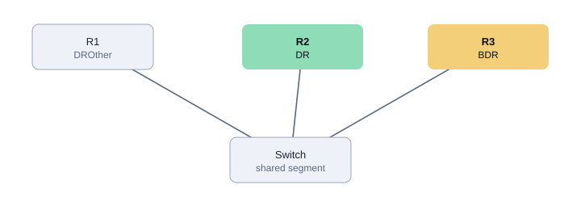

*شکل ۱: روی Segment مشترک، R2 DR و R3 BDR است؛ R1 فقط با این دو Full می‌شود.*

| رابطه             | حالت         |
|-------------------|--------------|
| DROther ↔ DROther | 2-Way (عادی) |
| DROther ↔ DR      | Full         |
| DROther ↔ BDR     | Full         |
| DR ↔ BDR          | Full         |

#### انتخاب DR

1.  بالاترین Priority (پیش‌فرض ۱؛ ۰ یعنی هرگز DR نشو).
2.  اگر برابر بود، بالاترین Router ID.

> **نکته‌ی مهم**
>
> انتخاب DR «غیرقابل‌پس‌گرفتن» است (Non-preemptive): اگر روتری با Priority بالاتر بعد از انتخاب وارد شود، DR فعلی کنار نمی‌رود، تا زمانی که OSPF Process دوباره راه بیفتد.

``` text
R2(config)# interface gi0/0
R2(config-if)# ip ospf priority 100
R1(config)# interface gi0/0
R1(config-if)# ip ospf priority 0      ! never become DR
R1# clear ip ospf process               ! re-run the election (careful)
```

### ۳. Network Type

روی لینک نقطه‌به‌نقطه (فقط دو روتر)، DR بی‌معنی است. با تغییر نوع به point-to-point، DR انتخاب نمی‌شود و همگرایی هم سریع‌تر است:

| نوع               | DR؟ | Hello/Dead | کاربرد               |
|-------------------|-----|------------|----------------------|
| broadcast (اترنت) | بله | 10/40      | پیش‌فرض اترنت         |
| point-to-point    | خیر | 10/40      | لینک دو روتر (توصیه) |
| non-broadcast     | بله | 30/120     | Frame Relay قدیمی    |

``` text
R1(config)# interface gi0/1
R1(config-if)# ip ospf network point-to-point
R2(config)# interface gi0/0
R2(config-if)# ip ospf network point-to-point   ! both ends the same
```

اگر یک سر broadcast و سر دیگر point-to-point باشد، همسایگی بالا می‌آید ولی Routeها نامعتبر می‌شود (مشکل رایج). همیشه دو سر را هم‌نوع کنید.

### ۴. تنظیم Cost برای هدایت ترافیک

``` text
R1(config)# interface gi0/1
R1(config-if)# ip ospf cost 50
Cost = Reference / bandwidth, or any manual value 1..65535
SPF picks the path with the lowest TOTAL cost
```

مثال: دو مسیر به یک مقصد داریم؛ لینک ۱ گیگی (Cost 10) و لینک پشتیبان ۱۰۰ مگی (Cost 100). روتر مسیر ۱ گیگ را انتخاب می‌کند. اگر بخواهید پشتیبان نباشد، با Cost دستی مسیر را عوض کنید.

### ۵. سرعت شناسایی قطع

با تایمر پیش‌فرض (Dead = 40 ثانیه)، قطع یک همسایه تا ۴۰ ثانیه دیر شناخته می‌شود. دو راه: کاهش Hello/Dead (تا ۱ ثانیه با `fast-hello`) یا BFD که در میلی‌ثانیه تشخیص می‌دهد. BFD فقط مفهومی و Unverified در Lab ماست.

``` text
R1(config-if)# ip ospf hello-interval 1
R1(config-if)# ip ospf dead-interval 4
(both ends must match; too aggressive timers cause flapping)
```

### ۶. مثال‌ها

#### ساده

``` text
show ip ospf neighbor
3.3.3.3  1  FULL/BDR   ...
2.2.2.2  1  FULL/DR    ...
```

#### متوسط: چرا 2WAY/DROTHER؟

``` text
R1 neighbor R4: state 2WAY/DROTHER
Both are DROthers -> normal, not an error
```

#### سخت: DR اشتباه

``` text
Old switch router became DR (highest router ID)
Fix: set priority 100 on the core router, priority 0 on edge routers,
     then clear ip ospf process (maintenance window)
```

### تمرین‌ها

**ت1.** ۱ (ساده): چند Adjacency برای ۶ روتر در Full Mesh؟ *(پاسخ: 6-1-ت1 در بخش «پاسخ‌ها» انتهای فصل)*

**ت2.** ۲ (ساده): DROther با DROther چه حالتی؟ *(پاسخ: 6-1-ت2 در بخش «پاسخ‌ها» انتهای فصل)*

**ت3.** ۳ (متوسط): انتخاب DR بر چه اساسی؟ *(پاسخ: 6-1-ت3 در بخش «پاسخ‌ها» انتهای فصل)*

**ت4.** ۴ (متوسط): چه زمانی point-to-point؟ *(پاسخ: 6-1-ت4 در بخش «پاسخ‌ها» انتهای فصل)*

**ت5.** ۵ (سخت): چرا بعد از تغییر Priority، DR عوض نشد؟ *(پاسخ: 6-1-ت5 در بخش «پاسخ‌ها» انتهای فصل)*

### Lab هدایت‌شده

سه روتر روی یک سوییچ (SW1) در یک Segment مشترک: R1، R2، R3 با Gi0/0 به SW1 وصل‌اند، شبکه‌ی 10.10.100.0/24 (آدرس‌ها .1 .2 .3).

#### گام ۱: OSPF روی Segment مشترک

``` text
Rx(config)# router ospf 1
Rx(config-router)# network 10.10.100.0 0.0.0.255 area 0
Rx# show ip ospf neighbor
```

DR و BDR را بخوانید (Router ID بالاتر DR می‌شود). نتیجه را یادداشت کنید.

#### گام ۲: تغییر Priority

``` text
R1(config)# interface gi0/0
R1(config-if)# ip ospf priority 100
R1# clear ip ospf process
```

دوباره show ip ospf neighbor: آیا R1 DR شد؟

#### گام ۳: point-to-point روی لینک دو روتر

یک لینک مستقیم R1-R2 با `ip ospf network point-to-point` در هر دو سر؛ مشاهده کنید حالت FULL/- بدون DR است.

### Lab مستقل

جدول «DR/BDR/DROther هر Segment» و Priorityها را در `03-ops/ospf-dr-plan.md` بنویسید.

### عیب‌یابی

|         |                                                                            |
|---------|----------------------------------------------------------------------------|
| Symptom | همسایه‌ها 2WAY مانده‌اند                                                     |
| تحلیل   | اگر هر دو DROther هستند، طبیعی است                                         |
| چک‌لیست  | ۱) DR/BDR موجود است؟ ؛ ۲) Priority دو طرف؟ ؛ ۳) نوع شبکه دو سر هم‌خوان است؟ |
| رفع     | تنظیم Priority یا point-to-point                                           |

### سؤال‌های مرور

**م1.** DR چرا لازم است؟ *(پاسخ: 6-1-م1 در بخش «پاسخ‌ها» انتهای فصل)*

**م2.** Network Type چه تأثیری دارد؟ *(پاسخ: 6-1-م2 در بخش «پاسخ‌ها» انتهای فصل)*

### English Corner: انگلیسی تخصصی این درس

این جمله‌ها از مستندات و محیط کار واقعی‌اند. بلند بخوانید و ترجمه را بپوشانید.

| English sentence                                                    | ترجمه                                                 |
|---------------------------------------------------------------------|-------------------------------------------------------|
| The DR reduces the number of adjacencies on a multi-access segment. | DR تعداد Adjacency را در Segment چندمسیره کم می‌کند.   |
| DROther routers stay in 2-Way with each other.                      | روترهای DROther با هم در 2-Way می‌مانند.               |
| Set the network type to point-to-point on two-router links.         | روی لینک دو روتر، نوع شبکه را point-to-point بگذارید. |
| DR election is non-preemptive.                                      | انتخاب DR غیرقابل‌پس‌گیری (Non-preemptive) است.         |

**Q1.** Quick quiz (answer in English): Why is 2-Way between two DROthers normal? *(پاسخ: 6-1-Q1 در بخش «پاسخ‌ها» انتهای فصل)*

### تکلیف و چک‌لیست تسلط

- [ ] DR/BDR را در Lab ببینم و تغییر دهم.
- [ ] point-to-point را تست کنم.
- [ ] جدول Priority را بنویسم.

### یادآوری اشتباهات شما

> **یادآوری**
>
> پیش‌بینی قبل از اجرا؛ بکاپ قبل از تغییر؛ پذیرفته‌شدن دستور ≠ کار کردن؛ فرمول‌ها در بلوک مستقل.


#### کارت Lab — DR/BDR، Network Type و Cost

| # | فیلد | محتوا |
|---|---|---|
| 1 | عنوان و هدف | DR/BDR و Network Type |
| 2 | پیش‌نیاز | فصل 5 |
| 3 | توپولوژی | ۳ روتر + سوییچ |
| 4 | تجهیزات | R1-R3 + SW1 |
| 5 | نسخه نرم‌افزار | vIOS-L2 15.2(20200924، Experimental) برای SW؛ vIOS 15.9(3)M9 برای R؛ VPCS؛ PNetLab 4.2.8 |
| 6 | IP Plan | OSPF area 0 |
| 7 | وضعیت اولیه | Segment مشترک |
| 8 | صورت مسئله | Priority و p2p |
| 9 | مراحل هدایت‌شده | همان بخش «Lab هدایت‌شده» همین درس |
| 10 | تست عملکرد | `show ip ospf neighbor` |
| 11 | سناریوی خرابی | DROther 2WAY |
| 12 | روش عیب‌یابی | لایه‌ای/با شواهد (بخش عیب‌یابی همین درس) |
| 13 | نتیجه‌ی مورد انتظار | DR/BDR تعیین |
| 14 | معیار پذیرش | ثبت نقش‌ها |
| 15 | مستندات نهایی | `03-ops/ospf-dr-plan.md` |
| 16 | Cleanup و بازگردانی | — |

> **وضعیت راستی‌آزمایی (خارج از ۱۶ فیلد):** **اجرا نشده (فقط طراحی).** اجرا نشده.

---

<a id="l-6-2"></a>

## درس 6-2 — OSPF چندناحیه‌ای

**فصل ۶ - روز ۲ · پیش‌نیاز: درس ۶-۱ · ۶ ساعت**

### این درس درباره چیست و چرا باید یاد بگیریم؟

**چه چیزی یاد می‌گیریم:** چرا OSPF را به چند ناحیه (Area) تقسیم می‌کنیم، نقش ABR و ASBR، انواع LSA به‌صورت خلاصه، خلاصه‌سازی بین ناحیه‌ها و انواع Stub Area.

**چرا لازم است:** در شبکه‌ی بزرگ، یک Area واحد یعنی هر تغییر کوچک در یک شعبه همه‌ی روترها را وادار به اجرای SPF می‌کند و جداول بزرگ می‌شوند. Areaها این تغییرات را محلی نگه می‌دارند و پایداری و مقیاس را بالا می‌برند.

- **در کار روزانه:** سازمان‌های چندشعبه‌ای از Area برای هر شعبه یا هر منطقه استفاده می‌کنند.
- **در امنیت:** Area مرز دسترسی نیز هست؛ می‌توان Routeهای ناخواسته را جلوی ورود به Area گرفت.
- **در Capstone:** Lab A می‌تواند ۲ Area (مرکز و شعبه) داشته باشد.

> **مسیر درس**
>
> چرا Area ← قانون Area 0 ← ABR/ASBR ← LSAها ← خلاصه‌سازی ← Stub ← Lab ← عیب‌یابی.

#### اصطلاحات این درس (مخفف ← شکل کامل ← معنی)

| مخفف     | شکل کامل انگلیسی                  | معنی فارسی                                       |
|----------|-----------------------------------|--------------------------------------------------|
| Area     | OSPF Area                         | ناحیه‌ی OSPF                                      |
| Backbone | Backbone Area 0                   | ناحیه‌ی مرکزی که همه‌ی Areaها باید به آن وصل باشند |
| ABR      | Area Border Router                | روتر مرزی بین دو Area                            |
| ASBR     | Autonomous System Boundary Router | روتر مرز با دنیای خارج OSPF                      |
| LSA      | Link-State Advertisement          | اعلان وضعیت لینک                                 |
| Stub     | Stub Area                         | ناحیه‌ای که Routeهای خارجی را نمی‌گیرد             |
| Summary  | Inter-area summary                | خلاصه‌سازی در ABR                                 |

### ۱. چرا Area؟

یک شهر بزرگ را به محله تقسیم می‌کنند؛ هر محله نقشه‌ی دقیق خودش را دارد و برای بقیه‌ی شهر فقط «خلاصه» می‌داند. OSPF هم همین‌طور: داخل هر Area نقشه‌ی کامل، و بین Areaها فقط خلاصه.

- تغییر لینک در یک Area فقط همان Area را به SPF می‌اندازد.
- جدول LSDB کوچک‌تر می‌شود.
- امکان خلاصه‌سازی مسیرها.

### ۲. قانون مهم: همه‌ی Areaها به Area 0 وصل

ترافیک بین دو Area معمولی باید از Area 0 (Backbone) بگذرد. Area 0 مثل بزرگراه مرکزی است و همه‌ی محله‌ها به آن راه دارند.

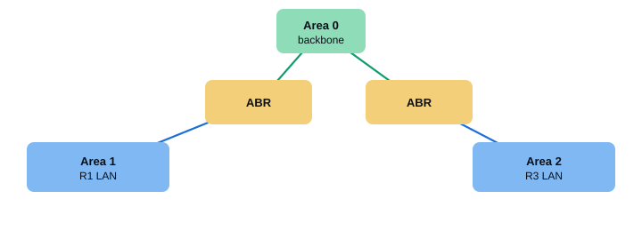

*شکل ۱: Area 1 و Area 2 از طریق ABRها به Area 0 وصل‌اند.*

### ۳. ABR و ASBR

| نقش             | تعریف                                                         | کار                              |
|-----------------|---------------------------------------------------------------|----------------------------------|
| Internal Router | همه‌ی Interfaceها در یک Area                                   | فقط LSDB همان Area               |
| ABR             | Interfaceها در دو Area یا بیشتر (یکی Area 0)                  | خلاصه و جابه‌جایی مسیر بین Areaها |
| ASBR            | Route را از پروتکل/منبع دیگر وارد OSPF می‌کند (Static، BGP...) | تزریق Route خارجی                |

``` text
R2(config)# router ospf 1
R2(config-router)# network 10.0.12.0 0.0.0.3 area 1
R2(config-router)# network 10.0.23.0 0.0.0.3 area 0
-> R2 has interfaces in area 1 and area 0 = ABR
```

### ۴. LSAها (به‌صورت خلاصه)

| نوع | نام          | کجا پخش می‌شود    | محتوا                           |
|-----|--------------|------------------|---------------------------------|
| 1   | Router LSA   | داخل Area        | لینک‌های یک روتر                 |
| 2   | Network LSA  | داخل Area        | Segment و روترهایش (توسط DR)    |
| 3   | Summary LSA  | بین Areaها (ABR) | Routeهای یک Area برای Area دیگر |
| 4   | ASBR Summary | بین Areaها       | مسیر رسیدن به ASBR              |
| 5   | External LSA | کل Domain        | Route خارجی (از ASBR)           |

در جدول مسیریابی: `O` یعنی Intra-area، `O IA` یعنی Inter-area (از LSA نوع ۳)، `O E1/E2` یعنی Route خارجی.

### ۵. خلاصه‌سازی در ABR

ABR می‌تواند چند شبکه‌ی ریز یک Area را به یک خلاصه تبدیل کند:

``` text
Area 1 networks: 10.1.0.0/24, 10.1.1.0/24, 10.1.2.0/24, 10.1.3.0/24
Summary: 10.1.0.0/22
```

``` text
R2(config)# router ospf 1
R2(config-router)# area 1 range 10.1.0.0 255.255.252.0
```

اثر: بقیه‌ی Areaها فقط یک Route (10.1.0.0/22) می‌بینند؛ تغییر یک شبکه‌ی ریز دیگر در سراسر شبکه پخش نمی‌شود.

### ۶. Stub Area

شعبه‌ای که فقط یک راه خروج دارد، نیازی ندارد همه‌ی Routeهای خارجی را بداند؛ کافی است یک Default Route از ABR بگیرد:

| نوع            | Routeهای خارجی (LSA 5)       | Default از ABR |
|----------------|------------------------------|----------------|
| Stub           | بلوک                         | بله            |
| Totally Stubby | بلوک (و Inter-area هم)       | بله            |
| NSSA           | Routeهای خارجی محلی با LSA 7 | اختیاری        |

``` text
! on all routers of the area:
R3(config-router)# area 2 stub
! totally stubby (only on the ABR add "no-summary"):
R2(config-router)# area 2 stub no-summary
```

> **قانون**
>
> همه‌ی روترهای یک Area باید نوع Stub یکسان داشته باشند (flag در Hello)، وگرنه همسایه نمی‌شوند.

### ۷. مثال‌ها

#### ساده: دو Area

``` text
R1 (area 1) -- R2 (ABR) -- R3 (area 0)
R3 shows: O IA 192.168.1.0/24 via R2
```

#### متوسط: چرا نمی‌شود Area 1 را مستقیم به Area 2 وصل کرد؟

همه‌ی Areaها باید به Area 0 وصل باشند؛ بین Areaهای غیر صفر Routeها مستقیماً رد نمی‌شود (باید از ABR و Area 0 بگذرد). اگر Area 2 فقط به Area 1 وصل باشد، مسیرها به Area 2 نمی‌رسد؛ برای رفع، Virtual Link (مفهومی) یا طراحی مجدد.

#### سخت: طراحی

سازمان با مرکز و ۳ شعبه: Area 0 = مرکز، هر شعبه یک Area (۱ تا ۳)، ABR روی روتر مرز شعبه. خلاصه‌ی هر شعبه یک /22.

### تمرین‌ها

**ت1.** ۱ (ساده): ABR چیست؟ *(پاسخ: 6-2-ت1 در بخش «پاسخ‌ها» انتهای فصل)*

**ت2.** ۲ (ساده): O IA یعنی؟ *(پاسخ: 6-2-ت2 در بخش «پاسخ‌ها» انتهای فصل)*

**ت3.** ۳ (متوسط): خلاصه‌ی 10.1.4.0/24 تا 10.1.7.0/24؟ *(پاسخ: 6-2-ت3 در بخش «پاسخ‌ها» انتهای فصل)*

**ت4.** ۴ (متوسط): چرا Stub باید روی همه‌ی روترهای Area باشد؟ *(پاسخ: 6-2-ت4 در بخش «پاسخ‌ها» انتهای فصل)*

**ت5.** ۵ (سخت): مزیت Totally Stubby؟ *(پاسخ: 6-2-ت5 در بخش «پاسخ‌ها» انتهای فصل)*

### Lab هدایت‌شده

سه روتر خطی R1—R2—R3 مثل فصل ۵. حالا R1 را در Area 1 و R3 را در Area 0 می‌گذاریم و R2 ABR می‌شود.

#### گام ۱: Areaها

``` text
R1(config)# router ospf 1
R1(config-router)# network 10.0.12.0 0.0.0.3 area 1
R1(config-router)# network 192.168.1.0 0.0.0.255 area 1

R2(config)# router ospf 1
R2(config-router)# network 10.0.12.0 0.0.0.3 area 1
R2(config-router)# network 10.0.23.0 0.0.0.3 area 0

R3(config)# router ospf 1
R3(config-router)# network 10.0.23.0 0.0.0.3 area 0
R3(config-router)# network 192.168.3.0 0.0.0.255 area 0
```

#### گام ۲: مشاهده

``` text
R3# show ip route ospf        (O IA for area 1 networks)
R2# show ip ospf database
R2# show ip ospf
```

#### گام ۳: خلاصه‌سازی

``` text
R2(config)# router ospf 1
R2(config-router)# area 1 range 192.168.0.0 255.255.252.0
R3# show ip route ospf
```

#### گام ۴: Stub

Area 1 را stub کنید (روی R1 و R2) و ببینید Default از ABR می‌آید.

### Lab مستقل

یک «OSPF Area Design» برای Capstone (مرکز + ۳ شعبه) بنویسید: Areaها، ABRها، خلاصه‌ها در `02-design/ospf-areas.md`.

### عیب‌یابی

|         |                                                                                    |
|---------|------------------------------------------------------------------------------------|
| Symptom | Route به یک Area دیگر نمی‌رسد                                                       |
| چک‌لیست  | ۱) Area 0 متصل است؟ ؛ ۲) ABR درست است؟ ؛ ۳) Stub یکسان است؟ ؛ ۴) خلاصه‌سازی نادرست؟ |
| ابزار   | show ip ospf ، show ip ospf database                                               |
| رفع     | اصلاح Area/Stub یا خلاصه‌سازی                                                       |

### سؤال‌های مرور

**م1.** چرا به Area 0 همه وصل‌اند؟ *(پاسخ: 6-2-م1 در بخش «پاسخ‌ها» انتهای فصل)*

**م2.** ASBR چه می‌کند؟ *(پاسخ: 6-2-م2 در بخش «پاسخ‌ها» انتهای فصل)*

### English Corner: انگلیسی تخصصی این درس

این جمله‌ها از مستندات و محیط کار واقعی‌اند. بلند بخوانید و ترجمه را بپوشانید.

| English sentence                                                         | ترجمه                                                 |
|--------------------------------------------------------------------------|-------------------------------------------------------|
| Segmenting the network into areas limits the scope of SPF recalculation. | تقسیم شبکه به Area دامنه‌ی محاسبه‌ی SPF را محدود می‌کند. |
| Every area must connect to the backbone area.                            | هر Area باید به Backbone وصل باشد.                    |
| The ABR summarizes routes between areas.                                 | ABR بین Areaها خلاصه‌سازی می‌کند.                       |
| A stub area receives a default route instead of external routes.         | Stub Area به‌جای Routeهای خارجی Default می‌گیرد.        |

**Q1.** Quick quiz (answer in English): What does an ABR do? *(پاسخ: 6-2-Q1 در بخش «پاسخ‌ها» انتهای فصل)*

### تکلیف و چک‌لیست تسلط

- [ ] دو Area بسازم و O IA ببینم.
- [ ] خلاصه‌سازی را تست کنم.
- [ ] طراحی Area Capstone را بنویسم.

### یادآوری اشتباهات شما

> **یادآوری**
>
> پیش‌بینی قبل از اجرا؛ بکاپ قبل از تغییر؛ پذیرفته‌شدن دستور ≠ کار کردن؛ فرمول‌ها در بلوک مستقل.


#### کارت Lab — OSPF چندناحیه‌ای

| # | فیلد | محتوا |
|---|---|---|
| 1 | عنوان و هدف | OSPF چندناحیه‌ای و خلاصه‌سازی |
| 2 | پیش‌نیاز | درس 6-1 |
| 3 | توپولوژی | R1-R2(ABR)-R3 |
| 4 | تجهیزات | ۳ vIOS |
| 5 | نسخه نرم‌افزار | vIOS-L2 15.2(20200924، Experimental) برای SW؛ vIOS 15.9(3)M9 برای R؛ VPCS؛ PNetLab 4.2.8 |
| 6 | IP Plan | Area 0 |
| 7 | وضعیت اولیه | Area 1 |
| 8 | صورت مسئله | O IA و Summary |
| 9 | مراحل هدایت‌شده | همان بخش «Lab هدایت‌شده» همین درس |
| 10 | تست عملکرد | `show ip route ospf` |
| 11 | سناریوی خرابی | Area mismatch |
| 12 | روش عیب‌یابی | لایه‌ای/با شواهد (بخش عیب‌یابی همین درس) |
| 13 | نتیجه‌ی مورد انتظار | O IA دیده شود |
| 14 | معیار پذیرش | طراحی Area |
| 15 | مستندات نهایی | `02-design/ospf-areas.md` |
| 16 | Cleanup و بازگردانی | حذف area |

> **وضعیت راستی‌آزمایی (خارج از ۱۶ فیلد):** **اجرا نشده (فقط طراحی).** اجرا نشده.

---

<a id="l-6-3"></a>

## درس 6-3 — OSPFv3 و IPv6

**فصل ۶ - روز ۳ · پیش‌نیاز: درس‌های ۲-۳ و ۶-۲ · ۶ ساعت**

### این درس درباره چیست و چرا باید یاد بگیریم؟

**چه چیزی یاد می‌گیریم:** مسیریابی IPv6 با OSPFv3: تفاوت با OSPFv2، فعال‌سازی روی Interface، Router ID، و استفاده از آدرس Link-Local برای Next-hop.

**چرا لازم است:** شبکه‌های امروز Dual-Stack هستند. اگر IPv6 را فقط «روشن» کنید ولی مسیریابی‌اش را ندانید، ارتباط بین VLANها و شعبه‌ها در IPv6 کار نمی‌کند و ترافیک از مسیر غیرکنترل‌شده می‌رود.

- **در کار روزانه:** سازمان‌های جدید IPv6 را همراه IPv4 اجرا می‌کنند.
- **در امنیت:** فراموش‌کردن IPv6 یک سطح حمله‌ی بدون پایش ایجاد می‌کند.
- **در Capstone:** Dual-Stack در بخشی از Lab و Policy فایروال بررسی می‌شود.

> **مسیر درس**
>
> تفاوت v2 و v3 ← فعال‌سازی ← Router ID ← Link-Local Next-hop ← مثال ساده/متوسط/سخت ← Lab ← عیب‌یابی.

#### اصطلاحات این درس (مخفف ← شکل کامل ← معنی)

| مخفف                 | شکل کامل انگلیسی     | معنی فارسی                           |
|----------------------|----------------------|--------------------------------------|
| OSPFv3               | OSPF version 3       | OSPF برای IPv6 (و Address Family)    |
| Link-Local           | Link-Local address   | آدرس fe80:: روی هر Interface         |
| Dual-Stack           | Dual-Stack           | اجرای هم‌زمان IPv4 و IPv6             |
| Address Family       | Address Family       | OSPFv3 با پشتیبانی IPv4 و IPv6       |
| ipv6 unicast-routing | ipv6 unicast-routing | فعال‌سازی مسیریابی IPv6 روی روتر      |
| Next-hop             | Next-hop             | روتر بعدی؛ در IPv6 معمولاً Link-Local |

### ۱. OSPFv3 چه فرقی دارد؟

ایده‌ی OSPF همان است (Area، LSDB، SPF). تفاوت‌ها:

| موضوع          | OSPFv2 (IPv4)    | OSPFv3 (IPv6)                        |
|----------------|------------------|--------------------------------------|
| آدرس           | IPv4             | IPv6 (و با Address Family هر دو)     |
| فعال‌سازی       | دستور network    | روی خود Interface (ipv6 ospf)        |
| Router ID      | از IPv4 Loopback | همچنان ۳۲ بیتی و باید دستی تنظیم شود |
| Next-hop       | IP همسایه        | Link-Local همسایه (fe80::)           |
| Authentication | بخشی از پروتکل   | با IPsec (یا Authentication Trailer) |
| Multicast      | 224.0.0.5/6      | ff02::5 / ff02::6                    |

> **نکته‌ی مهم**
>
> OSPFv3 حتی در شبکه‌ی «فقط IPv6» به یک Router ID ۳۲ بیتی (شکل IPv4) نیاز دارد. اگر روتر هیچ آدرس IPv4 نداشته باشد، باید دستی بدهید وگرنه فرایند بالا نمی‌آید.

### ۲. دستورها (خط‌به‌خط)

ابتدا مسیریابی IPv6 را روشن کنید (درس ۲-۳). بعد روی روتر:

``` text
R1(config)# ipv6 unicast-routing
R1(config)# ipv6 router ospf 1
R1(config-rtr)# router-id 1.1.1.1
R1(config-rtr)# exit
R1(config)# interface gi0/1
R1(config-if)# ipv6 address 2001:db8:12::1/64
R1(config-if)# ipv6 ospf 1 area 0
R1(config)# interface loopback 10
R1(config-if)# ipv6 address 2001:db8:1::1/64
R1(config-if)# ipv6 ospf 1 area 0
```

- `ipv6 router ospf 1`: Process (مثل v2، فقط محلی).
- `ipv6 ospf 1 area 0`: روی هر Interface (جایگزین network).
- آدرس Link-Local خودکار ساخته می‌شود و OSPFv3 با آن همسایه می‌شود.

``` text
R1# show ipv6 ospf neighbor
R1# show ipv6 route ospf
R1# show ipv6 ospf interface brief
```

### ۳. Next-hop با Link-Local

در جدول IPv6 Route، Next-hop آدرس Link-Local همسایه است (مثلاً FE80::2). چون Link-Local فقط روی همان لینک معنی دارد، Interface خروجی هم نوشته می‌شود:

``` text
O   2001:db8:3::/64 [110/20]
     via FE80::2, GigabitEthernet0/1
```

در Staticهای IPv6 هم اگر Next-hop را Link-Local بنویسید، باید Interface هم بدهید: `ipv6 route ... FE80::2 gi0/1`.

### ۴. مثال‌ها

#### ساده

``` text
Two routers, one /64 link, both: ipv6 ospf 1 area 0
show ipv6 ospf neighbor -> FULL
```

#### متوسط: ping IPv6 سراسری

``` text
R1# ping 2001:db8:3::1 source loopback10
```

#### سخت: چرا همسایه بالا نمی‌آید؟

``` text
Cause 1: ipv6 unicast-routing not enabled
Cause 2: no router-id and no IPv4 address -> process cannot start
Cause 3: different area or mismatched hello/dead
Cause 4: ACL blocking ff02::5 / OSPFv3 (protocol 89)
```

> **صادقانه درباره‌ی Lab**
>
> روی روتر vIOS، IPv6 و OSPFv3 تحت IOS واقعی اجرا می‌شود و باید کار کند. اگر روی SW (vIOSL2) IPv6 کامل نبود، همان محدودیت قبلی شبیه‌ساز است؛ نتیجه را ثبت کنید.

### تمرین‌ها

**ت1.** ۱ (ساده): OSPFv3 چطور فعال می‌شود؟ *(پاسخ: 6-3-ت1 در بخش «پاسخ‌ها» انتهای فصل)*

**ت2.** ۲ (ساده): Next-hop در IPv6 چه آدرسی است؟ *(پاسخ: 6-3-ت2 در بخش «پاسخ‌ها» انتهای فصل)*

**ت3.** ۳ (متوسط): چرا Router ID لازم است؟ *(پاسخ: 6-3-ت3 در بخش «پاسخ‌ها» انتهای فصل)*

**ت4.** ۴ (سخت): چرا Static IPv6 با Next-hop Link-Local به Interface هم نیاز دارد؟ *(پاسخ: 6-3-ت4 در بخش «پاسخ‌ها» انتهای فصل)*

### Lab هدایت‌شده

#### گام ۱: روی مثلث R1-R2-R3 (فصل ۵)

``` text
Rx(config)# ipv6 unicast-routing
Rx(config)# ipv6 router ospf 1
Rx(config-rtr)# router-id x.x.x.x
```

#### گام ۲: آدرس‌دهی و فعال‌سازی

برای لینک‌ها از 2001:db8:12::/64 و 2001:db8:23::/64 و برای LAN از 2001:db8:1::/64 و 2001:db8:3::/64 استفاده کنید؛ روی هر Interface `ipv6 ospf 1 area 0`.

#### گام ۳: بررسی

``` text
Rx# show ipv6 ospf neighbor
R1# show ipv6 route ospf
R1# ping 2001:db8:3::1 source loopback10
```

### Lab مستقل

یک «Dual-Stack Plan» (IPv4 و IPv6 هر VLAN و هر لینک) در `02-design/dual-stack-plan.md` بنویسید.

### عیب‌یابی

|         |                                                                                                          |
|---------|----------------------------------------------------------------------------------------------------------|
| Symptom | همسایگی OSPFv3 بالا نمی‌آید یا ping IPv6 شکست می‌خورد                                                      |
| چک‌لیست  | ۱) ipv6 unicast-routing؟ ؛ ۲) Router ID؟ ؛ ۳) ipv6 ospf روی Interface؟ ؛ ۴) Link-Local OK است؟ ؛ ۵) ACL؟ |
| ابزار   | show ipv6 ospf neighbor ، show ipv6 interface brief                                                      |
| رفع     | اصلاح مورد ناقص                                                                                          |

### سؤال‌های مرور

**م1.** تفاوت اصلی فعال‌سازی v2 و v3؟ *(پاسخ: 6-3-م1 در بخش «پاسخ‌ها» انتهای فصل)*

**م2.** چرا Router ID دستی؟ *(پاسخ: 6-3-م2 در بخش «پاسخ‌ها» انتهای فصل)*

### English Corner: انگلیسی تخصصی این درس

این جمله‌ها از مستندات و محیط کار واقعی‌اند. بلند بخوانید و ترجمه را بپوشانید.

| English sentence                                    | ترجمه                                                 |
|-----------------------------------------------------|-------------------------------------------------------|
| Enable IPv6 routing before configuring OSPFv3.      | پیش از OSPFv3 مسیریابی IPv6 را فعال کنید.             |
| OSPFv3 uses link-local addresses to form neighbors. | OSPFv3 با آدرس Link-Local همسایه می‌شود.               |
| Run dual-stack to support both IPv4 and IPv6.       | Dual-Stack را اجرا کنید تا هر دو پروتکل پشتیبانی شود. |
| Configure the router ID manually.                   | Router ID را دستی تنظیم کنید.                         |

**Q1.** Quick quiz (answer in English): Why does OSPFv3 still need an IPv4-style router ID? *(پاسخ: 6-3-Q1 در بخش «پاسخ‌ها» انتهای فصل)*

### تکلیف و چک‌لیست تسلط

- [ ] OSPFv3 را بالا بیاورم.
- [ ] Next-hop Link-Local را در Route ببینم.
- [ ] Dual-Stack Plan را بنویسم.

### یادآوری اشتباهات شما

> **یادآوری**
>
> پیش‌بینی قبل از اجرا؛ بکاپ قبل از تغییر؛ پذیرفته‌شدن دستور ≠ کار کردن؛ فرمول‌ها در بلوک مستقل.


#### کارت Lab — OSPFv3 و IPv6

| # | فیلد | محتوا |
|---|---|---|
| 1 | عنوان و هدف | OSPFv3 / IPv6 Routing |
| 2 | پیش‌نیاز | درس 6-2 |
| 3 | توپولوژی | R1-R2-R3 |
| 4 | تجهیزات | ۳ vIOS |
| 5 | نسخه نرم‌افزار | vIOS-L2 15.2(20200924، Experimental) برای SW؛ vIOS 15.9(3)M9 برای R؛ VPCS؛ PNetLab 4.2.8 |
| 6 | IP Plan | IPv4 سالم |
| 7 | وضعیت اولیه | 2001:db8::/48 |
| 8 | صورت مسئله | همسایگی v3 |
| 9 | مراحل هدایت‌شده | همان بخش «Lab هدایت‌شده» همین درس |
| 10 | تست عملکرد | `show ipv6 ospf neighbor` |
| 11 | سناریوی خرابی | بدون router-id |
| 12 | روش عیب‌یابی | لایه‌ای/با شواهد (بخش عیب‌یابی همین درس) |
| 13 | نتیجه‌ی مورد انتظار | FULL |
| 14 | معیار پذیرش | Dual-Stack Plan |
| 15 | مستندات نهایی | `02-design/dual-stack-plan.md` |
| 16 | Cleanup و بازگردانی | — |

> **وضعیت راستی‌آزمایی (خارج از ۱۶ فیلد):** **اجرا نشده (فقط طراحی).** IPv6 فقط CLI-Accepted.

---

<a id="l-6-4"></a>

## درس 6-4 — HSRP و FHRP

**فصل ۶ - روز ۴ · پیش‌نیاز: درس ۳-۵ · ۶ ساعت**

> **وضعیت:** Cisco IOSv/IOSvL2؛ خروجی‌ها و دستورها نمونه‌ی آموزشی‌اند؛ Lab «اجرا نشده»؛ ویژگی‌هایی که روی IOSvL2 آزمایش‌نشده‌اند `Unverified` هستند و باید با Probe (درس ۱-B) تأیید شوند.

### این درس درباره چیست و چرا باید یاد بگیریم؟

**چه چیزی یاد می‌گیریم:** چطور برای Default Gateway هر VLAN «پشتیبان» بگذاریم: پروتکل HSRP (و مقایسه با VRRP و GLBP)، آدرس مجازی، Priority، Preempt و Tracking.

**چرا لازم است:** Gateway نقطه‌ی شکست واحد (SPOF) است: اگر آن سوییچ یا روتر خاموش شود، تمام کاربران VLAN از شبکه بیرون می‌مانند حتی اگر روتر دوم سالم باشد، چون روی کلاینت‌ها فقط یک Gateway تنظیم شده است. FHRP این مشکل را حل می‌کند.

- **در کار روزانه:** تقریباً همه‌ی Coreهای سازمانی HSRP یا VRRP دارند.
- **در امنیت:** Authentication HSRP جلوی تصاحب نقش Active توسط دستگاه جعلی را می‌گیرد.
- **در Capstone:** Lab A-HA از HSRP برای Gateway دوگانه استفاده می‌کند.

> **مسیر درس**
>
> مشکل Gateway واحد ← ایده‌ی آدرس مجازی ← انتخاب Active ← Preempt و Track ← مثال ساده/متوسط/سخت ← Lab ← عیب‌یابی.

#### اصطلاحات این درس (مخفف ← شکل کامل ← معنی)

| مخفف       | شکل کامل انگلیسی                   | معنی فارسی                                  |
|------------|------------------------------------|---------------------------------------------|
| FHRP       | First Hop Redundancy Protocol      | خانواده‌ی پروتکل‌های پشتیبان Gateway          |
| HSRP       | Hot Standby Router Protocol        | پروتکل سیسکو برای Gateway پشتیبان           |
| VRRP       | Virtual Router Redundancy Protocol | نسخه‌ی استاندارد                             |
| GLBP       | Gateway Load Balancing Protocol    | نسخه‌ی سیسکو با تقسیم بار                    |
| Virtual IP | Virtual IP (VIP)                   | آدرس مشترک که کلاینت به‌عنوان Gateway می‌گیرد |
| Active     | Active router                      | روتری که ترافیک را عبور می‌دهد               |
| Standby    | Standby router                     | روتر آماده‌باش                               |
| Preempt    | Preempt                            | پس‌گرفتن نقش Active توسط روتر قوی‌تر          |
| SPOF       | Single Point Of Failure            | نقطه‌ی شکست واحد                             |

### ۱. مشکل: یک Gateway یعنی یک نقطه‌ی شکست

کلاینت‌ها فقط یک Default Gateway دارند. اگر دو Core بگذارید ولی کلاینت‌ها به Core-1 اشاره کنند، با خاموشی Core-1 همه قطع می‌شوند، حتی با وجود Core-2.

مثال روزمره: یک شرکت که فقط یک شماره‌ی تلفن دارد و اگر منشی نباشد کسی جواب نمی‌دهد. راه‌حل: یک «شماره‌ی مشترک» که هر کدام از دو منشی حاضر باشند پاسخ می‌دهند.

### ۲. ایده‌ی HSRP

دو (یا چند) روتر یک «روتر مجازی» می‌سازند با یک آدرس IP مجازی (VIP) و یک MAC مجازی. کلاینت‌ها VIP را به‌عنوان Gateway می‌گیرند. فقط یکی از روترها «Active» است و جواب ARP و ترافیک را می‌دهد. دیگری «Standby» است و Hello می‌شنود؛ اگر Active ساکت شد، فوراً Active می‌شود.

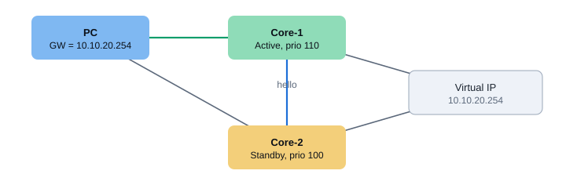

*شکل ۱: کلاینت VIP را Gateway می‌داند؛ Core-1 Active است و Core-2 در آماده‌باش.*

| موضوع       | HSRP v1        | HSRP v2        |
|-------------|----------------|----------------|
| Multicast   | 224.0.0.2      | 224.0.0.102    |
| Virtual MAC | 0000.0c07.acXX | 0000.0c9f.fXXX |
| تعداد Group | 0 تا 255       | 0 تا 4095      |
| IPv6        | ندارد          | دارد           |

XX یا XXX شماره‌ی Group به‌صورت Hex است. Hello پیش‌فرض ۳ ثانیه و Hold ۱۰ ثانیه است.

``` text
Default hello = 3 s, hold = 10 s -> failover up to ~10 s
Tuned (hello 1, hold 3) -> failover ~3 s
```

### ۳. انتخاب Active

1.  بالاترین Priority (پیش‌فرض ۱۰۰).
2.  اگر برابر بود، بالاترین IP روی Interface.

> **نکته‌ی مهم**
>
> پیش‌فرض Preempt خاموش است. اگر Core-1 (Priority بالاتر) خراب شود و بعد برگردد، نقش Active را پس نمی‌گیرد مگر اینکه `preempt` بزنید. معمولاً در طراحی می‌خواهیم Core اصلی دوباره Active شود، پس Preempt را روشن می‌کنیم.

### ۴. دستورها (خط‌به‌خط)

``` text
Core-1(config)# interface vlan 20
Core-1(config-if)# ip address 10.10.20.2 255.255.255.0
Core-1(config-if)# standby version 2
Core-1(config-if)# standby 20 ip 10.10.20.254
Core-1(config-if)# standby 20 priority 110
Core-1(config-if)# standby 20 preempt
Core-1(config-if)# standby 20 authentication md5 key-string <KEY>

Core-2(config)# interface vlan 20
Core-2(config-if)# ip address 10.10.20.3 255.255.255.0
Core-2(config-if)# standby version 2
Core-2(config-if)# standby 20 ip 10.10.20.254
Core-2(config-if)# standby 20 priority 100
Core-2(config-if)# standby 20 preempt
```

- هر Core آدرس واقعی خودش (.2 و .3) و یک VIP مشترک (.254) دارد.
- شماره‌ی Group (اینجا 20) هم‌شماره‌ی VLAN انتخاب می‌شود تا خوانا باشد.
- کلاینت‌ها Gateway را **.254** می‌گیرند، نه .2 یا .3.
- کلید Authentication را در ریپو نگذارید؛ اینجا فقط جانگهدار است.

``` text
Core-1# show standby brief
Core-1# show standby vlan 20
Core-1# show standby
```

``` text
Interface   Grp  Pri P State   Active    Standby    Virtual IP
Vl20         20  110 P Active  local     10.10.20.3 10.10.20.254
```

### ۵. Tracking: وقتی لینک بالادست خراب شد

اگر Core-1 Active است ولی لینک اصلی‌اش به بیرون خراب شود، همچنان Active می‌ماند و ترافیک را «سیاه‌چاله» می‌کند. با Track، Priority را در صورت خرابی لینک کم می‌کنیم تا Core-2 بگیرد:

``` text
Core-1(config)# track 10 interface gi0/3 line-protocol
Core-1(config)# interface vlan 20
Core-1(config-if)# standby 20 track 10 decrement 20
Effect: priority 110 - 20 = 90 < 100 -> Core-2 becomes Active (needs preempt on Core-2)
```

### ۶. VRRP و GLBP

| پروتکل | تعریف              | ویژگی                                  |
|--------|--------------------|----------------------------------------|
| HSRP   | سیسکو              | یک Active؛ رایج در Cisco               |
| VRRP   | استاندارد RFC 5798 | چند سازنده؛ مشابه HSRP (Master/Backup) |
| GLBP   | سیسکو              | چند Forwarder؛ تقسیم بار بین Gatewayها |

FortiGate از VRRP و FGCP (HA اختصاصی) پشتیبانی می‌کند. مفهوم همین است.

### ۷. مثال‌ها

#### ساده

``` text
Two cores, VIP .254, Core-1 priority 110 -> Active
PC gateway = .254 , ping works
```

#### متوسط: Failover

``` text
Core-1 shut down -> Core-2 becomes Active after hold time
PC keeps pinging with only a few lost packets
```

#### سخت: Failover بدون Track

``` text
Core-1 uplink fails but Core-1 stays Active (its VLAN interface is up)
Traffic is black-holed
Fix: track the uplink and decrement priority, or use routing protocol awareness
```

> **صادقانه درباره‌ی Lab**
>
> طبق Probe، «HSRP state» روی vIOSL2 تست شد و کار می‌کند. Failover واقعی (Virtual MAC) را با Capture بررسی کنید و اگر شبیه‌ساز رفتار متفاوتی داشت ثبت کنید.

### تمرین‌ها

**ت1.** ۱ (ساده): VIP چیست؟ *(پاسخ: 6-4-ت1 در بخش «پاسخ‌ها» انتهای فصل)*

**ت2.** ۲ (ساده): Active چطور انتخاب می‌شود؟ *(پاسخ: 6-4-ت2 در بخش «پاسخ‌ها» انتهای فصل)*

**ت3.** ۳ (متوسط): چرا Preempt؟ *(پاسخ: 6-4-ت3 در بخش «پاسخ‌ها» انتهای فصل)*

**ت4.** ۴ (متوسط): Failover پیش‌فرض چند ثانیه؟ *(پاسخ: 6-4-ت4 در بخش «پاسخ‌ها» انتهای فصل)*

**ت5.** ۵ (سخت): نقش Track چیست؟ *(پاسخ: 6-4-ت5 در بخش «پاسخ‌ها» انتهای فصل)*

### Lab هدایت‌شده

دو سوییچ L3: `Core-1` و `Core-2` (vIOSL2 با `ip routing`)، یک سوییچ دسترسی `Acc-1` که به هر دو Trunk است، و PC1 در VLAN 20.

#### گام ۱: SVI روی هر دو Core

``` text
Core-x(config)# ip routing
Core-x(config)# vlan 20
Core-1(config)# interface vlan 20
Core-1(config-if)# ip address 10.10.20.2 255.255.255.0
Core-1(config-if)# no shutdown
Core-2(config)# interface vlan 20
Core-2(config-if)# ip address 10.10.20.3 255.255.255.0
Core-2(config-if)# no shutdown
```

#### گام ۲: HSRP

``` text
Core-1(config-if)# standby version 2
Core-1(config-if)# standby 20 ip 10.10.20.254
Core-1(config-if)# standby 20 priority 110
Core-1(config-if)# standby 20 preempt
Core-2(config-if)# standby version 2
Core-2(config-if)# standby 20 ip 10.10.20.254
Core-2(config-if)# standby 20 preempt
Core-x# show standby brief
```

#### گام ۳: تست

``` text
PC1> ip 10.10.20.11/24 10.10.20.254
PC1> ping 10.10.20.254 -t
```

#### گام ۴: Failover

``` text
Core-1(config)# interface vlan 20
Core-1(config-if)# shutdown
Core-2# show standby brief
Core-1(config-if)# no shutdown   (preempt: Core-1 returns)
```

تعداد پکت گم‌شده و زمان Failover را ثبت کنید.

### Lab مستقل

یک «HSRP Plan» (Groupها، VIPها، Priorityها، Track) برای ۳ VLAN در `02-design/hsrp-plan.md` بنویسید.

### عیب‌یابی

|         |                                                                                                                              |
|---------|------------------------------------------------------------------------------------------------------------------------------|
| Symptom | Failover نمی‌شود یا هر دو Active هستند                                                                                        |
| چک‌لیست  | ۱) VIP و Group دو سر یکی؟ ؛ ۲) Version یکسان؟ ؛ ۳) Authentication مشابه؟ ؛ ۴) ارتباط L2 بین Coreها OK؟ ؛ ۵) Preempt/Priority |
| ابزار   | show standby brief ، show standby                                                                                            |
| نکته    | «دو Active» یعنی Hello به هم نمی‌رسد (قطع L2)                                                                                 |

### سؤال‌های مرور

**م1.** HSRP چه مشکلی را حل می‌کند؟ *(پاسخ: 6-4-م1 در بخش «پاسخ‌ها» انتهای فصل)*

**م2.** تفاوت HSRP و VRRP؟ *(پاسخ: 6-4-م2 در بخش «پاسخ‌ها» انتهای فصل)*

### English Corner: انگلیسی تخصصی این درس

این جمله‌ها از مستندات و محیط کار واقعی‌اند. بلند بخوانید و ترجمه را بپوشانید.

| English sentence                                               | ترجمه                                                     |
|----------------------------------------------------------------|-----------------------------------------------------------|
| HSRP provides a virtual gateway address shared by two routers. | HSRP یک آدرس Gateway مجازی بین دو روتر ارائه می‌کند.       |
| The router with the highest priority becomes active.           | روتر با بالاترین Priority Active می‌شود.                   |
| Enable preempt so the primary router regains the active role.  | Preempt را روشن کنید تا روتر اصلی نقش Active را پس بگیرد. |
| Track the uplink to trigger failover when it goes down.        | برای فعال‌شدن Failover هنگام قطع Uplink آن را Track کنید.  |

**Q1.** Quick quiz (answer in English): What happens to clients if the active HSRP router fails? *(پاسخ: 6-4-Q1 در بخش «پاسخ‌ها» انتهای فصل)*

### تکلیف و چک‌لیست تسلط

- [ ] HSRP را بسازم و Failover را ثبت کنم.
- [ ] Track را توضیح دهم.
- [ ] HSRP Plan را بنویسم.

### یادآوری اشتباهات شما

> **یادآوری**
>
> پیش‌بینی قبل از اجرا؛ بکاپ قبل از تغییر؛ پذیرفته‌شدن دستور ≠ کار کردن؛ فرمول‌ها در بلوک مستقل.


#### کارت Lab — HSRP و FHRP

| # | فیلد | محتوا |
|---|---|---|
| 1 | عنوان و هدف | HSRP: Active/Standby و Track |
| 2 | پیش‌نیاز | درس 6-3 |
| 3 | توپولوژی | Core-1/Core-2 + Acc |
| 4 | تجهیزات | ۳ سوییچ L3/L2 |
| 5 | نسخه نرم‌افزار | vIOS-L2 15.2(20200924، Experimental) برای SW؛ vIOS 15.9(3)M9 برای R؛ VPCS؛ PNetLab 4.2.8 |
| 6 | IP Plan | VLAN 20 |
| 7 | وضعیت اولیه | VIP .254 |
| 8 | صورت مسئله | Failover |
| 9 | مراحل هدایت‌شده | همان بخش «Lab هدایت‌شده» همین درس |
| 10 | تست عملکرد | `show standby brief` |
| 11 | سناریوی خرابی | Preempt خاموش |
| 12 | روش عیب‌یابی | لایه‌ای/با شواهد (بخش عیب‌یابی همین درس) |
| 13 | نتیجه‌ی مورد انتظار | Failover؛ بازگشت |
| 14 | معیار پذیرش | زمان Failover |
| 15 | مستندات نهایی | `02-design/hsrp-plan.md` |
| 16 | Cleanup و بازگردانی | — |

> **وضعیت راستی‌آزمایی (خارج از ۱۶ فیلد):** **جزئی.** HSRP State Tested-OK (Active)؛ Failover با روتر دوم آزمایش نشده.

---

<a id="l-6-5"></a>

## درس 6-5 — پیاده‌سازی Lab A

**فصل ۶ - روز ۵ · پیش‌نیاز: درس‌های ۶-۱ تا ۶-۴ · ۶ ساعت**

### این درس درباره چیست و چرا باید یاد بگیریم؟

**چه چیزی یاد می‌گیریم:** پیاده‌سازی کامل Lab A: Gateway روی Core با SVI و HSRP، OSPF به سمت Edge (که بعداً FortiGate می‌شود)، و تأیید مسیر رفت و برگشت.

**چرا لازم است:** این Lab تمام مباحث فصل ۳ تا ۶ را در یک طراحی واقعی کنار هم می‌گذارد: VLAN، Trunk، STP، EtherChannel، SVI، HSRP و OSPF. اگر این Lab را درست بسازید، یعنی شبکه‌ی Campus سیسکو را فهمیده‌اید. (یادآوری: Capstone اصلی ما الگوی B است؛ Lab A جدا و مکمل است.)

- **در کار روزانه:** این همان چیدمان معمول Campus سازمانی است.
- **در امنیت:** Return Path و Gateway مشخص، پایه‌ی هر Policy است.
- **در FortiGate:** در W9/W10 همین Lab با FGT به‌جای EDGE-R1 کامل می‌شود.

> **مسیر درس**
>
> طراحی ← جدول آدرس ← پیاده‌سازی مرحله‌ای ← Verification Matrix ← تست Failover ← عیب‌یابی.

#### اصطلاحات این درس (مخفف ← شکل کامل ← معنی)

| مخفف        | شکل کامل انگلیسی              | معنی فارسی                    |
|-------------|-------------------------------|-------------------------------|
| Lab A       | Lab A (Cisco L3 Core Gateway) | Gateway روی Core سیسکو        |
| Perimeter   | Perimeter firewall            | فایروال لبه‌ی شبکه             |
| Transit     | Transit link                  | لینک نقطه‌به‌نقطه به فایروال    |
| Return Path | Return Path                   | مسیر برگشت                    |
| As-Built    | As-Built documentation        | مستند وضعیت نهایی             |
| ECMP        | Equal-Cost Multi-Path         | تقسیم بار بین مسیرهای هم‌هزینه |

### ۱. طراحی

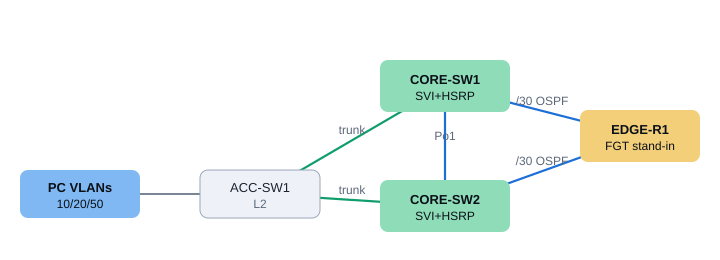

*شکل ۱: Lab A؛ VLANها روی Core (SVI + HSRP) و OSPF با Edge.*

``` text
VLAN 10 MGMT   10.10.10.0/24   VIP .254   Core-1 .2  Core-2 .3
VLAN 20 USERS  10.10.20.0/24   VIP .254   Core-1 .2  Core-2 .3
VLAN 50 GUEST  10.10.50.0/24   VIP .254   Core-1 .2  Core-2 .3

Core-1 <-> EDGE-R1 : 10.0.1.0/30   (.1 .2)
Core-2 <-> EDGE-R1 : 10.0.2.0/30   (.1 .2)
Core-1 <-> Core-2  : EtherChannel Po1 (trunk)
OSPF area 0 on Cores and Edge
EDGE-R1 loopback 0 = 8.8.8.8/32 (stand-in for "internet")
```

> **قاعده**
>
> هر VLAN دقیقاً یک Gateway دارد: VIP روی Core. هرگز دو Gateway همزمان (مثل SVI و Sub-interface روی R1).

### ۲. گام‌های پیاده‌سازی

#### گام ۱: VLAN و Trunk

``` text
! on Core-1, Core-2, ACC-SW1
vlan 10
 name MGMT
vlan 20
 name USERS
vlan 50
 name GUEST
! trunks: ACC <-> Core-1, ACC <-> Core-2, Core-1 <-> Core-2
interface gi0/x
 switchport trunk encapsulation dot1q
 switchport mode trunk
 switchport trunk allowed vlan 10,20,50
 switchport trunk native vlan 999
```

#### گام ۲: STP

``` text
Core-1(config)# spanning-tree mode rapid-pvst
Core-1(config)# spanning-tree vlan 10,20,50 root primary
Core-2(config)# spanning-tree vlan 10,20,50 root secondary
ACC-SW1(config)# interface range gi0/1 - 3
ACC-SW1(config-if-range)# spanning-tree portfast
ACC-SW1(config-if-range)# spanning-tree bpduguard enable
```

#### گام ۳: SVI و HSRP

``` text
Core-1(config)# ip routing
Core-1(config)# interface vlan 20
Core-1(config-if)# ip address 10.10.20.2 255.255.255.0
Core-1(config-if)# standby version 2
Core-1(config-if)# standby 20 ip 10.10.20.254
Core-1(config-if)# standby 20 priority 110
Core-1(config-if)# standby 20 preempt
! repeat for VLAN 10 and 50; Core-2 uses .3 and default priority
```

#### گام ۴: لینک‌های Routed به Edge

``` text
Core-1(config)# interface gi0/3
Core-1(config-if)# no switchport
Core-1(config-if)# ip address 10.0.1.1 255.255.255.252
Core-2(config)# interface gi0/3
Core-2(config-if)# no switchport
Core-2(config-if)# ip address 10.0.2.1 255.255.255.252
EDGE-R1(config)# interface gi0/0
EDGE-R1(config-if)# ip address 10.0.1.2 255.255.255.252
EDGE-R1(config)# interface gi0/1
EDGE-R1(config-if)# ip address 10.0.2.2 255.255.255.252
EDGE-R1(config)# interface loopback 0
EDGE-R1(config-if)# ip address 8.8.8.8 255.255.255.255
```

#### گام ۵: OSPF

``` text
Core-1(config)# router ospf 1
Core-1(config-router)# router-id 11.11.11.11
Core-1(config-router)# network 10.0.1.0 0.0.0.3 area 0
Core-1(config-router)# network 10.10.10.0 0.0.0.255 area 0
Core-1(config-router)# network 10.10.20.0 0.0.0.255 area 0
Core-1(config-router)# network 10.10.50.0 0.0.0.255 area 0
Core-1(config-router)# passive-interface default
Core-1(config-router)# no passive-interface gi0/3
! Core-2 same with its own link and router-id 12.12.12.12
EDGE-R1(config)# router ospf 1
EDGE-R1(config-router)# router-id 1.1.1.1
EDGE-R1(config-router)# network 10.0.1.0 0.0.0.3 area 0
EDGE-R1(config-router)# network 10.0.2.0 0.0.0.3 area 0
EDGE-R1(config-router)# network 8.8.8.8 0.0.0.0 area 0
EDGE-R1(config-router)# default-information originate always
```

OSPF Default از Edge می‌آید و Coreها خودشان Default را یاد می‌گیرند. EDGE-R1 باید مسیر برگشت به سه VLAN را از OSPF یاد بگیرد (Return Path).

### ۳. Verification Matrix

| تست         | دستور                                    | انتظار                                      |
|-------------|------------------------------------------|---------------------------------------------|
| VLAN/Trunk  | show interfaces trunk                    | VLAN 10,20,50 allowed                       |
| Root        | show spanning-tree root                  | Core-1 root                                 |
| HSRP        | show standby brief                       | Core-1 Active هر سه VLAN                    |
| OSPF        | show ip ospf neighbor                    | FULL با Edge و (اگر طراحی کردید) بین Coreها |
| Route       | show ip route ospf                       | Default و Routeهای VLAN روی Edge            |
| End-to-end  | PC ping 8.8.8.8                          | موفق                                        |
| Return Path | EDGE-R1# ping 10.10.20.11 source 8.8.8.8 | موفق                                        |

### ۴. آزمون Failover

۳ آزمایش، هرکدام را ثبت کنید:

1.  Core-1 را خاموش کنید: HSRP به Core-2 می‌رود؛ ping پایدار می‌ماند.
2.  لینک Core-1 به Edge را قطع کنید: OSPF مسیر را از Core-2 می‌گیرد.
3.  لینک ACC به Core-1 را قطع کنید: Rapid-PVST به مسیر جایگزین می‌رود.

``` text
Measure: lost packets and seconds to recover for each test.
Typical: HSRP ~10 s (tunable), OSPF dead 40 s (tunable), RSTP ~1-2 s
```

> **Asymmetric Routing**
>
> چون دو Core و دو لینک به Edge داریم، ممکن است رفت از Core-1 و برگشت از Core-2 باشد. در Lab ساده بی‌اثر است، ولی وقتی FortiGate Stateful بیاید (W9/W10) باید مسیرها را متقارن کنید؛ ریسکی که در طراحی نوشته‌ایم.

> **صادقانه درباره‌ی Lab**
>
> چند قابلیت (EtherChannel و برخی امنیت‌های L2) روی vIOSL2 ممکن است فقط پذیرفته شوند. اگر Po1 بالا نیامد، یک لینک عادی Trunk بگذارید و محدودیت را ثبت کنید. SVI، HSRP و OSPF روی این Imageها طبق Probe و درس‌های قبل قابل‌اجراست.

### تمرین‌ها

**ت1.** ۱ (ساده): Gateway هر VLAN در Lab A کدام آدرس است؟ *(پاسخ: 6-5-ت1 در بخش «پاسخ‌ها» انتهای فصل)*

**ت2.** ۲ (ساده): چرا لینک Core به Edge Routed است؟ *(پاسخ: 6-5-ت2 در بخش «پاسخ‌ها» انتهای فصل)*

**ت3.** ۳ (متوسط): Return Path برای 8.8.8.8 به VLAN 20 چطور ساخته می‌شود؟ *(پاسخ: 6-5-ت3 در بخش «پاسخ‌ها» انتهای فصل)*

**ت4.** ۴ (سخت): چه خطری در Dual Core + Dual Link برای فایروال Stateful هست؟ *(پاسخ: 6-5-ت4 در بخش «پاسخ‌ها» انتهای فصل)*

### Lab هدایت‌شده

همه‌ی گام‌های بخش ۲ را اجرا کنید، بعد ماتریس Verification و سه آزمون Failover. از هر مرحله بکاپ بگیرید:

``` text
Rx# copy running-config flash:Rx-labA-final.cfg
```

خروجی‌ها (بدون رمز) را در `03-ops/labA-as-built.md` ذخیره کنید.

### Lab مستقل

نمودار Packet Flow برای «PC به 8.8.8.8» و «8.8.8.8 به PC» را روی کاغذ بکشید و با Capture صحت را تأیید کنید.

### عیب‌یابی

|         |                                                                                                     |
|---------|-----------------------------------------------------------------------------------------------------|
| Symptom | PC به 8.8.8.8 نمی‌رسد                                                                                |
| روش     | از PC شروع کنید: Gateway ← Core Active ← OSPF ← Edge ← برگشت                                        |
| چک‌لیست  | ۱) VIP؟ ؛ ۲) Default روی Core؟ ؛ ۳) Edge مسیر برگشت دارد؟ ؛ ۴) HSRP Active درست؟ ؛ ۵) Trunk/Allowed |
| ابزار   | show standby brief ، show ip route ، traceroute                                                     |

### سؤال‌های مرور

**م1.** چرا Lab A و Capstone جدا هستند؟ *(پاسخ: 6-5-م1 در بخش «پاسخ‌ها» انتهای فصل)*

**م2.** Return Path چیست؟ *(پاسخ: 6-5-م2 در بخش «پاسخ‌ها» انتهای فصل)*

### English Corner: انگلیسی تخصصی این درس

این جمله‌ها از مستندات و محیط کار واقعی‌اند. بلند بخوانید و ترجمه را بپوشانید.

| English sentence                                            | ترجمه                                                      |
|-------------------------------------------------------------|------------------------------------------------------------|
| The core switches act as the default gateway for all VLANs. | سوییچ‌های Core Gateway پیش‌فرض همه‌ی VLANها هستند.            |
| OSPF advertises the VLAN subnets to the edge router.        | OSPF زیرشبکه‌های VLAN را به روتر Edge اعلام می‌کند.          |
| Verify the return path from the edge router.                | مسیر برگشت را از روتر Edge تأیید کنید.                     |
| Asymmetric routing can break stateful firewalls.            | مسیریابی نامتقارن می‌تواند فایروال‌های Stateful را مختل کند. |

**Q1.** Quick quiz (answer in English): Why must there be exactly one gateway per VLAN? *(پاسخ: 6-5-Q1 در بخش «پاسخ‌ها» انتهای فصل)*

### تکلیف و چک‌لیست تسلط

- [ ] Lab A را کامل بسازم.
- [ ] ماتریس Verification را پر کنم.
- [ ] سه Failover را ثبت کنم و As-Built را بنویسم.

### یادآوری اشتباهات شما

> **یادآوری**
>
> پیش‌بینی قبل از اجرا؛ بکاپ قبل از تغییر؛ پذیرفته‌شدن دستور ≠ کار کردن؛ فرمول‌ها در بلوک مستقل.


#### کارت Lab — پیاده‌سازی Lab A

| # | فیلد | محتوا |
|---|---|---|
| 1 | عنوان و هدف | Lab A: Core با SVI+HSRP+OSPF |
| 2 | پیش‌نیاز | درس 6-4 |
| 3 | توپولوژی | Acc-Core1/2-Edge |
| 4 | تجهیزات | ۴ سوییچ + Edge |
| 5 | نسخه نرم‌افزار | vIOS-L2 15.2(20200924، Experimental) برای SW؛ vIOS 15.9(3)M9 برای R؛ VPCS؛ PNetLab 4.2.8 |
| 6 | IP Plan | VLAN 10/20/50 |
| 7 | وضعیت اولیه | VIP .254 |
| 8 | صورت مسئله | ping 8.8.8.8 و Failover |
| 9 | مراحل هدایت‌شده | همان بخش «Lab هدایت‌شده» همین درس |
| 10 | تست عملکرد | ماتریس Verification |
| 11 | سناریوی خرابی | Route برگشت حذف |
| 12 | روش عیب‌یابی | لایه‌ای/با شواهد (بخش عیب‌یابی همین درس) |
| 13 | نتیجه‌ی مورد انتظار | Failover سه‌گانه |
| 14 | معیار پذیرش | As-Built |
| 15 | مستندات نهایی | `03-ops/labA-as-built.md` |
| 16 | Cleanup و بازگردانی | بازگشت Baseline |

> **وضعیت راستی‌آزمایی (خارج از ۱۶ فیلد):** **جزئی.** SVI/HSRP state Tested-OK؛ EtherChannel/OSPF و Failover کامل اجرا نشده.

---

<a id="l-6-6"></a>

## درس 6-6 — عیب‌یابی و آزمون G3

**فصل ۶ - روز ۶ · پیش‌نیاز: درس‌های ۶-۱ تا ۶-۵ · ۶ ساعت**

### این درس درباره چیست و چرا باید یاد بگیریم؟

**چه چیزی یاد می‌گیریم:** عیب‌یابی سناریوهای Routing و FHRP (TS15 تا TS18 و TS09) با روش Hop به Hop، و آزمون عملی Gate G3.

**چرا لازم است:** بعد از ساخت Lab A، مهارت اصلی «پیدا کردن خرابی» است. G3 تضمین می‌کند Routing و HSRP را عملی و با مدرک اثبات می‌کنید.

- **در کار روزانه:** سناریوی «بعضی VLANها قطع‌اند» همین الگو را دارد.
- **در امنیت:** RCA مکتوب مستندات حسابرسی است.
- **در مصاحبه:** سناریو و گزارش RCA سؤال تکراری هستند.

> **مسیر درس**
>
> روش Hop به Hop ← پنج خرابی ← Lab عیب‌یابی ← Gate G3.

#### اصطلاحات این درس (مخفف ← شکل کامل ← معنی)

| مخفف       | شکل کامل انگلیسی         | معنی فارسی              |
|------------|--------------------------|-------------------------|
| TS         | Troubleshooting Scenario | سناریوی عیب‌یابی         |
| RCA        | Root Cause Analysis      | تحلیل علت ریشه‌ای        |
| Black hole | Black hole               | سیاه‌چاله؛ ترافیک بی‌پاسخ |
| Flap       | Flapping                 | قطع و وصل مکرر          |
| G3         | Gate 3                   | آزمون عملی پایان فصل ۶ |
| As-Built   | As-Built                 | مستند وضعیت نهایی       |

### ۱. روش Hop به Hop

1.  مبدأ و مقصد دقیق را مشخص کنید.
2.  از مبدأ به Gateway: HSRP و VLAN.
3.  Gateway تا Edge: OSPF و Route.
4.  Edge تا مقصد.
5.  مسیر برگشت را جدا بررسی کنید.

در هر Hop یک سؤال: «این روتر Route دارد؟ بسته را به کجا می‌دهد؟ برگشت چطور؟»

### ۲. پنج سناریو

#### TS15: Route برگشت نبود

``` text
Symptom : PC reaches the Edge hop but not 8.8.8.8 replies
Evidence: EDGE-R1 has no route to 10.10.20.0/24 (not advertised)
Fix     : add network statement or static route on Edge
Verify  : ping from Edge to the VLAN IP works
```

#### TS16: OSPF Adjacency (Hello/MTU/Area)

``` text
Symptom : no neighbor between Core and Edge
Evidence: show ip ospf interface -> hello/area mismatch
Fix     : align the parameters
```

#### TS17: دو Gateway (HSRP) یا Preempt خاموش

``` text
Symptom : after recovery, old core does not become Active again
Cause   : preempt not enabled
Fix     : standby <grp> preempt
```

#### TS18: Track فراموش‌شده (Black hole)

``` text
Symptom : Core-1 is Active but its uplink is down -> traffic lost
Fix     : track the uplink and decrement priority
```

#### TS09: SVI Down/Down

``` text
Symptom : Vlan interface down/down -> gateway unreachable
Cause   : VLAN has no active port
Fix     : bring a port up in the VLAN / allow it on a trunk
```

### ۳. آزمون Gate G3 (پایان فصل ۶)

با مدرک و بدون نگاه به درس:

| \#  | وظیفه                                 | مدرک                            |
|-----|---------------------------------------|---------------------------------|
| ۱   | OSPF سه روتر (تک Area) + DR/BDR توضیح | show ip ospf neighbor           |
| ۲   | دو Area با ABR و خلاصه‌سازی            | show ip route (O IA)            |
| ۳   | OSPFv3 دو روتر (Dual-Stack)           | show ipv6 ospf neighbor         |
| ۴   | HSRP + Preempt + Track و Failover     | show standby brief + اندازه‌گیری |
| ۵   | Lab A کامل (ping تا 8.8.8.8 و برگشت)  | As-Built                        |
| ۶   | سه TS با RCA از TS15 تا TS18/TS09     | گزارش                           |
| ۷   | Packet Flow رفت و برگشت Lab A         | نمودار + Capture                |

**معیار قبولی:** حداقل ۶ از ۷ مورد با مدرک. وقتی تمام شد بگویید «G3 انجام شد».

### تمرین‌ها

**ت1.** ۱ (ساده): اولین قدم عیب‌یابی؟ *(پاسخ: 6-6-ت1 در بخش «پاسخ‌ها» انتهای فصل)*

**ت2.** ۲ (ساده): Black hole یعنی چه؟ *(پاسخ: 6-6-ت2 در بخش «پاسخ‌ها» انتهای فصل)*

**ت3.** ۳ (متوسط): HSRP Active است ولی Uplink قطع؛ راه‌حل؟ *(پاسخ: 6-6-ت3 در بخش «پاسخ‌ها» انتهای فصل)*

**ت4.** ۴ (سخت): چرا مسیر نامتقارن با فایروال Stateful مشکل می‌سازد؟ *(پاسخ: 6-6-ت4 در بخش «پاسخ‌ها» انتهای فصل)*

### Lab هدایت‌شده

در Lab A پنج خرابی را به ترتیب بسازید و رفع کنید؛ برای هر مورد Symptom، Evidence، Fix، Verify و RCA بنویسید.

1.  Route برگشت را از Edge حذف کنید.
2.  Hello interval یک سمت OSPF را تغییر دهید.
3.  Preempt را از Core-1 حذف کنید و Failover/Failback را ببینید.
4.  لینک Uplink را قطع کنید بدون Track.
5.  همه‌ی پورت‌های یک VLAN را shutdown کنید و SVI را ببینید.

### Lab مستقل

گزارش RCA پنج‌گانه را در `03-ops/rca-w6.md` بنویسید و Gate G3 را کامل کنید.

### عیب‌یابی

|         |                                                            |
|---------|------------------------------------------------------------|
| Symptom | بعد از تغییر، بخشی از شبکه قطع شد                          |
| روش     | Hop به Hop + مقایسه با As-Built                            |
| ابزار   | show standby brief ، show ip ospf neighbor ، show ip route |
| پیشگیری | بکاپ، تغییر مرحله‌ای و reload in                            |

### سؤال‌های مرور

**م1.** چرا Hop به Hop؟ *(پاسخ: 6-6-م1 در بخش «پاسخ‌ها» انتهای فصل)*

**م2.** چرا As-Built لازم است؟ *(پاسخ: 6-6-م2 در بخش «پاسخ‌ها» انتهای فصل)*

### English Corner: انگلیسی تخصصی این درس

این جمله‌ها از مستندات و محیط کار واقعی‌اند. بلند بخوانید و ترجمه را بپوشانید.

| English sentence                                                   | ترجمه                                             |
|--------------------------------------------------------------------|---------------------------------------------------|
| Troubleshoot hop by hop, starting from the source.                 | عیب‌یابی را Hop به Hop و از مبدأ شروع کنید.        |
| The standby router did not take over because preempt was disabled. | Standby چون Preempt خاموش بود نقش را نگرفت.       |
| Document each failure as an RCA.                                   | هر خرابی را به‌صورت RCA مستند کنید.                |
| Gate three covers routing and gateway redundancy.                  | Gate سوم Routing و پشتیبان Gateway را پوشش می‌دهد. |

**Q1.** Quick quiz (answer in English): What is the first thing to define when troubleshooting a connectivity issue? *(پاسخ: 6-6-Q1 در بخش «پاسخ‌ها» انتهای فصل)*

### تکلیف و چک‌لیست تسلط

- [ ] پنج TS را با RCA ثبت کنم.
- [ ] Gate G3 را کامل کنم.
- [ ] As-Built را به‌روز کنم.

### یادآوری اشتباهات شما

> **یادآوری**
>
> پیش‌بینی قبل از اجرا؛ بکاپ قبل از تغییر؛ پذیرفته‌شدن دستور ≠ کار کردن؛ فرمول‌ها در بلوک مستقل.


#### کارت Lab — عیب‌یابی و آزمون G3

| # | فیلد | محتوا |
|---|---|---|
| 1 | عنوان و هدف | عیب‌یابی Routing/FHRP و G3 |
| 2 | پیش‌نیاز | درس 6-5 |
| 3 | توپولوژی | Lab A |
| 4 | تجهیزات | Lab A |
| 5 | نسخه نرم‌افزار | vIOS-L2 15.2(20200924، Experimental) برای SW؛ vIOS 15.9(3)M9 برای R؛ VPCS؛ PNetLab 4.2.8 |
| 6 | IP Plan | Baseline |
| 7 | وضعیت اولیه | پنج خرابی |
| 8 | صورت مسئله | RCA |
| 9 | مراحل هدایت‌شده | همان بخش «Lab هدایت‌شده» همین درس |
| 10 | تست عملکرد | show standby/ospf |
| 11 | سناریوی خرابی | TS15-18،TS09 |
| 12 | روش عیب‌یابی | لایه‌ای/با شواهد (بخش عیب‌یابی همین درس) |
| 13 | نتیجه‌ی مورد انتظار | رفع |
| 14 | معیار پذیرش | G3 ≥ ۶ از ۷ |
| 15 | مستندات نهایی | `03-ops/rca-w6.md` |
| 16 | Cleanup و بازگردانی | — |

> **وضعیت راستی‌آزمایی (خارج از ۱۶ فیلد):** **اجرا نشده (فقط طراحی).** اجرا نشده.

---

<a id="ans-6"></a>

## درس 6-7 — OSPF در عمق: LSAهای Type 1–5/7، LSDB، SPF، انواع Area، Virtual-link و Summarization/Filtering

**فصل 6 · بازنویسی عمیق · پیش‌نیاز: ۵-۴، ۶-۱، ۶-۲ · ≈ 9 ساعت**

> **وضعیت:** Cisco IOSv/IOSvL2 (vIOS 15.x)؛ خروجی‌ها نمونه‌ی آموزشی؛ Lab «اجرا نشده»؛ برخی ویژگی‌ها روی vIOS `Unverified`.

### ۱) هدف آموزشی

در پایان این درس باید بتوانید:

1. انواع LSA (1، 2، 3، 4، 5، 7) و محتوا/دامنه‌ی هرکدام را توضیح دهد.
2. LSDB و الگوریتم SPF را (Cost، Tree) بفهمد و مسیر را دستی محاسبه کند.
3. Area typeها (Backbone، Standard، Stub، Totally Stubby، NSSA) و Virtual-link را با دلیل انتخاب کند.
4. Summarization (ABR/ASBR) و Filtering را طراحی کند.
5. LSDB را برای عیب‌یابی بخواند.
6. Convergence و SPF throttle را تحلیل کند.

### ۲) مفهوم پایه: چیست و چرا؟

OSPF را با «Neighbor Full» نمی‌توان فهمید؛ باید دانست چه چیزی در LSDB است و SPF چه می‌کند. تفاوت Router با DR/ABR/ASBR و اینکه LSA نوع ۳ چه کاری می‌کند برای طراحی چندناحیه‌ای حیاتی است.

### ۳) توضیح عمیق فنی

#### ۱) LSAها

| Type | نام | تولیدکننده | دامنه | محتوا |
|---|---|---|---|---|
| 1 | Router | هر روتر | Area | لینک‌ها و Cost |
| 2 | Network | DR | Area | روترهای متصل به Segment |
| 3 | Summary | ABR | بین Area | Prefix مقصدهای Area دیگر |
| 4 | ASBR Summary | ABR | بین Area | آدرس ASBR |
| 5 | External | ASBR | کل (جز Stub) | مسیرهای خارجی |
| 7 | NSSA External | ASBR در NSSA | Area | خارجی در NSSA؛ ABR به 5 تبدیل |

نشانه‌ی Route: `O` (Intra-area)، `O IA` (Type 3)، `O E1/E2` (Type 5)، `O N1/N2` (Type 7).

#### ۲) SPF

هر روتر LSDB Area را دارد و با Dijkstra درخت کوتاه‌ترین مسیر از خودش می‌سازد.

``` text
Cost = reference-bandwidth / interface bandwidth     (default ref 100 Mbps; Gi -> 1 -> change ref!)
E2 metric = external cost only; E1 = external + internal cost
```

`auto-cost reference-bandwidth 100000` (در همه‌ی روترها یکسان) برای لینک‌های Gigabit/10G ضروری است.

#### ۳) Area typeها

| نوع | LSA مجاز | مزیت |
|---|---|---|
| Backbone (0) | همه | مرکز |
| Standard | 1,2,3,4,5 | عمومی |
| Stub | بدون 5 (Default Route از ABR) | LSDB کوچک |
| Totally Stubby | بدون 3،4،5 (فقط Default) | حداقل LSDB |
| NSSA | بدون 5 ولی 7؛ Default خودکار نمی‌گیرد (باید `default-information-originate` روی ABR داده شود) | Stub با ASBR داخلی |

#### ۴) Virtual-link

Area بدون اتصال فیزیکی به Area 0 از طریق Virtual-link (در Transit Area) متصل می‌شود؛ **راه‌حل موقت** (پس از ادغام/مهاجرت)؛ طراحی دائمی نیست.

#### ۵) Summarization و Filtering

- **Inter-area:** `area X range 10.1.0.0 255.255.0.0` روی ABR.
- **External:** `summary-address` روی ASBR.
- Filtering: `area X filter-list prefix` (Type 3)، `distribute-list in` (محلی؛ LSDB را عوض نمی‌کند).

#### ۶) عیب‌یابی LSDB

``` text
show ip ospf database
show ip ospf database router self-originate
show ip ospf database summary
show ip ospf database external
show ip ospf border-routers
```

#### ۷) Convergence

SPF throttle (`timers throttle spf 50 200 5000`): تأخیر اولیه، Hold، حداکثر؛ LSA arrival throttle؛ BFD برای Detect.

### ۴) طراحی و تصمیم‌گیری

| سؤال طراحی | گزینه‌ها و معیار انتخاب |
|---|---|
| Area type | Stub/Totally Stubby برای شعب بدون خروج خارجی |
| Reference BW | بالا و یکسان |
| Summary | در ABR |
| Virtual-link | موقت |

### ۵) مثال‌های حل‌شده (ساده، متوسط، سخت)

**ساده (حل‌شده):** Route `O IA 10.2.0.0/16` در R1 ⇒ از LSA Type 3 توسط ABR؛ Cost = Cost تا ABR + Cost Summary.

**متوسط (محاسبه):** Gigabit و reference پیش‌فرض: Cost هر لینک 1 ⇒ OSPF بین 1G و 10G فرق نمی‌گذارد؛ با reference 100000 ⇒ 1G=100، 10G=10. آزمون: `show ip ospf interface` Cost.

**سخت (طراحی):** شعب ۲۰۰ Prefix دارند و LSDB بزرگ است. طرح: Area هر منطقه، Totally Stubby برای شعب بدون ASBR، Summary در ABR، Default از ABR؛ ASBR در NSSA. نتیجه: LSDB شعب از ۲۰۰۰ به ≈ ۱۰ LSA. ریسک: Suboptimal routing؛ آزمون.

### ۷) پیاده‌سازی از مسیر CLI

``` text
router ospf 1
 auto-cost reference-bandwidth 100000
 area 10 stub no-summary
 area 10 range 10.10.0.0 255.255.0.0
 timers throttle spf 50 200 5000
show ip ospf database
show ip ospf database summary
show ip route ospf
```

### ۸) Verification (اثبات صحت)

- LSDB مطابق Area type.
- Cost صحیح.
- Summary در ABR.

### ۹) Troubleshooting

| علامت | شاهد برای بررسی | علت محتمل و رفع |
|---|---|---|
| Route Inter-area نیست | database summary | Stub/Filter/Range |
| E2 مسیر غیربهینه | metric-type | E1/E2 |
| LSDB بزرگ | database | Area/Summary |

### ۱۰) نکات امنیتی

- OSPF Authentication.
- Filtering کنترل‌شده.

### ۱۱) جمع‌بندی مفهومی

- LSA 1–5/7.
- SPF/Cost/Reference BW.
- Area types.
- Virtual-link موقت.
- Summary/Filter.

### ۱۲) تمرین و ارزیابی

**ت1.** (ساده) LSA Type 3 را کدام روتر می‌سازد؟ *(پاسخ: 6-7-ت1)*

**ت2.** (ساده) `O IA` یعنی چه؟ *(پاسخ: 6-7-ت2)*

**ت3.** (متوسط) چرا reference-bandwidth باید تغییر کند؟ *(پاسخ: 6-7-ت3)*

**ت4.** (متوسط) Stub و Totally Stubby؟ *(پاسخ: 6-7-ت4)*

**ت5.** (سخت) LSDB شعب بزرگ؛ طرح. *(پاسخ: 6-7-ت5)*

**ت6.** (سخت، طراحی) چه موقع Virtual-link و چرا موقت؟ *(پاسخ: 6-7-ت6)*

**Q1.** Quick quiz (English): Which LSA type carries inter-area prefixes? *(پاسخ: 6-7-Q1)*

### ۱۳) اصطلاحات و English Corner

| مخفف | شکل کامل | معنی |
|---|---|---|
| LSA | Link-State Advertisement | بسته‌ی وضعیت لینک |
| LSDB | Link-State Database | پایگاه وضعیت لینک |
| ASBR | Autonomous System Boundary Router | روتر مرز AS |
| NSSA | Not-So-Stubby Area | Area نیمه‌Stub |

- *Use stub areas to reduce the link-state database.* ← برای کاهش LSDB از Area Stub استفاده کنید.

### ۱۴) کارت Lab

**کارت Lab:** OSPF عمیق. **وضعیت:** اجرا نشده. **Evidence:** `03-ops/ospf-deep.md`.

### ۱۵) منابع

- RFC 2328
- RFC 3101 (NSSA)
- Cisco OSPF design guide

## پاسخ‌های فصل 6

> ابتدا بدون نگاه حل کنید. شناسه: درس-نوع+شماره (ت = تمرین، م = مرور، Q = Quick quiz).

**6-1-ت1** — ۱ (ساده): چند Adjacency برای ۶ روتر در Full Mesh؟

در Full Mesh هر روتر با همه‌ی روترهای دیگر Adjacency می‌سازد. برای n روتر هر جفت یک بار شمرده می‌شود، پس تعداد جفت‌ها همان فرمول ترکیب است (محاسبه در بلوک زیر). برای شش روتر هر روتر با پنج روتر دیگر ارتباط دارد؛ چون هر ارتباط دو بار شمرده می‌شود، نتیجه نصف می‌شود: پانزده Adjacency. اگر روتر هفتم اضافه شود می‌شود بیست‌ویک؛ رشد درجه‌ی دوم است و همین دلیل وجود DR است: روی Segment مشترک با DR فقط هر روتر با DR و BDR (دو Adjacency) Full می‌شود.

``` text
Adjacencies = n x (n - 1) / 2 = 6 x 5 / 2 = 15
```

``` text
6 x 5 / 2 = 15
```

**6-1-ت2** — ۲ (ساده): DROther با DROther چه حالتی؟

دو DROther روی یک Segment چندگانه‌دسترسی به حالت 2-Way می‌رسند و Full نمی‌شوند. این رفتار «عادی» است نه خطا: آن‌ها LSDB را فقط از DR/BDR همگام می‌کنند. اگر `show ip ospf neighbor` دو DROther را در 2-Way نشان داد، مشکلی نیست؛ ولی اگر یک روتر با DR در 2-Way ماند، باید به دنبال عدم‌تطابق MTU، تایمر یا Authentication باشید.

``` text
2-Way (normal)
```

**6-1-ت3** — ۳ (متوسط): انتخاب DR بر چه اساسی؟

DR با بالاترین Priority (پیش‌فرض ۱) انتخاب می‌شود و در صورت برابری، بالاترین Router ID. Priority صفر یعنی «هرگز DR نشو». انتخاب غیر-Preemptive است: روتری که بعداً با Priority بالاتر برسد DR فعلی را کنار نمی‌زند. در طراحی عملی Priority را روی روترهای قوی‌تر (مثلاً Core) بالا می‌برند و روی روترهای کوچک ۰ می‌گذارند تا اتفاقی DR نشوند.

``` text
Highest priority, then highest router ID.
```

**6-1-ت4** — ۴ (متوسط): چه زمانی point-to-point؟

Network Type به‌صورت point-to-point برای لینک‌های دو‌روتره مناسب است: انتخاب DR/BDR انجام نمی‌شود، Adjacency سریع‌تر Full می‌شود و Hello/Dead تایمرها (۱۰/۴۰) پیش‌فرض می‌مانند. روی Ethernet دو‌روتره با `ip ospf network point-to-point` زمان همگرایی کم می‌شود. هر دو سر باید همان نوع را داشته باشند، وگرنه Adjacency ناپایدار یا ناقص می‌شود.

``` text
On links with exactly two routers; avoids DR election and speeds convergence.
```

**6-1-ت5** — ۵ (سخت): چرا بعد از تغییر Priority، DR عوض نشد؟

علت این است که انتخابات DR غیر-Preemptive است؛ تغییر Priority تا وقتی DR فعلی زنده است اثری ندارد. برای اعمال: فرایند OSPF را روی روترها دوباره راه‌اندازی می‌کنید (`clear ip ospf process`) یا Interface را shut/no shut می‌کنید. در Production این کار قطع کوتاه ایجاد می‌کند؛ پس در Maintenance Window و با آگاهی از اثر روی Adjacencyها انجام شود.

``` text
DR election is non-preemptive; the OSPF process must be cleared.
```

**6-1-م1** — DR چرا لازم است؟

روی Segment مشترک با n روتر، بدون DR تعداد Adjacency حدود n(n−1)/2 است و هر تغییر LSA به همه‌ی آن‌ها Flood می‌شود. DR نقطه‌ی مرکزی است: هر روتر LSA را فقط به DR (و BDR) می‌فرستد و DR آن را برای همه پخش می‌کند. نتیجه کاهش Adjacency، کاهش ترافیک Flood و پایداری بهتر. BDR یدک‌کش آماده است تا اگر DR افتاد، بدون انتخابات طولانی جایگزین شود.

تعداد Adjacency را در Segment مشترک کم می‌کند.

**6-1-م2** — Network Type چه تأثیری دارد؟

Network Type تعیین می‌کند آیا DR/BDR انتخاب شود، Hello/Dead چند ثانیه باشد و Next-hopها چگونه کشف شوند. مثال: Broadcast (Ethernet) انتخابات و تایمر ۱۰/۴۰؛ point-to-point بدون انتخابات؛ NBMA/Frame Relay قدیمی با Neighbor دستی. عدم‌تطابق Network Type بین دو سر یکی از علل رایج «Adjacency ناپایدار» است؛ شاهد: `show ip ospf interface` نوع و تایمرها را نشان می‌دهد.

انتخاب DR، تایمرها و رفتار همسایگی را تعیین می‌کند.

**6-1-Q1** — Quick quiz (answer in English): Why is 2-Way between two DROthers normal?

Only DR and BDR form full adjacencies with everyone; DROthers exchange LSAs via the DR.

**6-2-ت1** — ۱ (ساده): ABR چیست؟

ABR (Area Border Router) روتری است که حداقل یک Interface در Area 0 و Interface دیگر در Area دیگر دارد. LSDB جدا برای هر Area نگه می‌دارد، مسیرهای هر Area را به‌صورت LSA نوع ۳ خلاصه برای Areaهای دیگر می‌فرستد و محل خلاصه‌سازی (`area X range`) است. اگر ABR بخواهد کار کند باید به Backbone وصل باشد؛ در غیر این صورت از Virtual Link استفاده می‌شود.

``` text
A router with interfaces in two or more areas, one of which is area 0.
```

**6-2-ت2** — ۲ (ساده): O IA یعنی؟

`O IA` یعنی مسیر بین‌Area (Inter-Area): مقصد در Area دیگری است و مسیرش از LSA نوع ۳ آمده که ABR ساخته است. `O` یعنی داخل همان Area. در جدول مسیر، O IA با Metric مجموع هزینه‌ی تا ABR و هزینه‌ی ABR تا مقصد دیده می‌شود. اگر انتظار O IA داشتید ولی ندیدید، ABR/Area 0/Summary را بررسی کنید.

``` text
An inter-area route (from a type 3 LSA).
```

**6-2-ت3** — ۳ (متوسط): خلاصه‌ی 10.1.4.0/24 تا 10.1.7.0/24؟

محدوده‌ی 10.1.4.0/24 تا 10.1.7.0/24 چهار شبکه‌ی /24 پیاپی است. چهار شبکه یعنی ۲ بیت از octet سوم تغییر می‌کند؛ پس طول Prefix 24−2=22 و شروع بلوک عدد ۴ (چون ۴ مضرب ۴ است). نتیجه 10.1.4.0/22 که دقیقاً 10.1.4.0 تا 10.1.7.255 را پوشش می‌دهد. روی ABR: `area 1 range 10.1.4.0 255.255.252.0`. اگر شبکه‌ای مثل 10.1.5.0/24 در آن بازه موجود نباشد، Black-hole ممکن است ایجاد شود؛ Null0 محافظ است.

``` text
Block size = 4 (third octet) -> 10.1.4.0/22 covers 10.1.4.0-10.1.7.255
```

``` text
Third octet 4..7 -> block 4 -> 10.1.4.0/22
```

**6-2-ت4** — ۴ (متوسط): چرا Stub باید روی همه‌ی روترهای Area باشد؟

پرچم Stub در Hello بسته‌ها حمل می‌شود (E-bit). اگر یک روتر Stub باشد و دیگری نه، Hello نامطابق است و Adjacency ساخته نمی‌شود. به همین دلیل پیکربندی Stub باید روی همه‌ی روترهای Area انجام شود. در عیب‌یابی `show ip ospf` پرچم Area را نشان می‌دهد و `debug ip ospf adj` پیام «mismatch stub/transit area option» می‌دهد (فقط Lab).

``` text
The stub flag is carried in Hellos; a mismatch prevents adjacency.
```

**6-2-ت5** — ۵ (سخت): مزیت Totally Stubby؟

در Totally Stubby Area روترها فقط مسیرهای داخل Area به‌علاوه‌ی یک Default (از ABR) دارند؛ LSA نوع ۳ و ۴ و ۵ فیلتر می‌شود. مزیت: جدول مسیر و LSDB کوچک و همگرایی سریع‌تر برای روترهای ضعیف (شعبه). عیب: دید کمتر؛ مسیر خروج بهینه‌ی خارجی ممکن نیست و Default همه‌چیز است. پیکربندی: `area X stub no-summary` روی ABR و `area X stub` روی بقیه.

``` text
Routers in the area keep only intra-area routes plus one default route, minimizing tables.
```

**6-2-م1** — چرا به Area 0 همه وصل‌اند؟

قاعده‌ی OSPF چندناحیه‌ای: همه‌ی Areaها باید به Area 0 (Backbone) وصل باشند و ترافیک بین Areaها از آن عبور می‌کند. این طراحی از حلقه‌ی مسیریابی بین Areaها جلوگیری می‌کند (مدل Distance-Vector بین Area). اگر Area بدون اتصال فیزیکی به Backbone باشد، Virtual Link موقت است نه طراحی دائمی.

ترافیک بین Areaها از Backbone عبور می‌کند.

**6-2-م2** — ASBR چه می‌کند؟

ASBR (Autonomous System Boundary Router) مسیر خارجی را (از پروتکل دیگر یا Static) وارد OSPF می‌کند و آن را به‌صورت LSA نوع ۵ (یا ۷ در NSSA) پخش می‌کند. بقیه‌ی روترها با LSA نوع ۴ آدرس ASBR را می‌شناسند. این مسیرها با E1/E2 در جدول مسیر دیده می‌شوند. پیش‌نیاز Redistribution کنترل‌شده با Route-map است.

Route خارجی را وارد OSPF می‌کند.

**6-2-Q1** — Quick quiz (answer in English): What does an ABR do?

It connects areas to the backbone and exchanges (summarized) routes between them.

**6-3-ت1** — ۱ (ساده): OSPFv3 چطور فعال می‌شود؟

در OSPFv3 فعال‌سازی روی Interface انجام می‌شود نه با دستور network: ابتدا `ipv6 unicast-routing`، سپس `ipv6 router ospf N` برای تعریف فرایند و Router ID، و سپس روی هر Interface `ipv6 ospf N area A`. چون Adjacency روی Link-local ساخته می‌شود، حتی بدون آدرس Global هم همسایگی شکل می‌گیرد؛ ولی برای Reachability سراسری آدرس Global لازم است.

``` text
ipv6 unicast-routing, ipv6 router ospf N, and "ipv6 ospf N area A" on each interface.
```

**6-3-ت2** — ۲ (ساده): Next-hop در IPv6 چه آدرسی است؟

Next-hop در IPv6 آدرس Link-local همسایه (fe80::/10) است، نه آدرس Global؛ چون پروتکل‌های مسیریابی از Link-local برای ارتباط روی لینک استفاده می‌کنند. دلیل: Link-local ثابت و مستقل از Prefix Global است؛ تغییر Prefix Global ارتباط را قطع نمی‌کند. در `show ipv6 route` Next-hop به‌صورت fe80::... همراه Interface نمایش داده می‌شود.

``` text
The neighbor link-local address (fe80::).
```

**6-3-ت3** — ۳ (متوسط): چرا Router ID لازم است؟

OSPFv3 هم Router ID ۳۲بیتی دارد (قالب IPv4). اگر روتر هیچ آدرس IPv4 نداشته باشد، انتخاب خودکار ممکن نیست و Process شروع نمی‌شود یا هشدار می‌دهد. پس باید `router-id 1.1.1.1` را دستی تنظیم کرد. Router ID باید در کل Domain یکتا باشد.

``` text
OSPFv3 uses a 32-bit router ID; without any IPv4 address it must be set manually.
```

**6-3-ت4** — ۴ (سخت): چرا Static IPv6 با Next-hop Link-Local به Interface هم نیاز دارد؟

آدرس Link-local فقط در یک لینک یکتاست؛ دو لینک مختلف ممکن است همان fe80::1 را داشته باشند. بنابراین برای Static Route با Next-hop Link-local باید Interface خروجی هم ذکر شود تا روتر بداند آن آدرس روی کدام لینک است: `ipv6 route 2001:db8:2::/64 GigabitEthernet0/1 fe80::2`. بدون Interface فرمان رد می‌شود.

``` text
Link-local addresses are only unique per link, so the exit interface is required.
```

**6-3-م1** — تفاوت اصلی فعال‌سازی v2 و v3؟

در OSPFv2 با دستور network و Wildcard Interfaceها انتخاب می‌شوند؛ در OSPFv3 دستور مستقیم روی Interface است (`ipv6 ospf N area A`). یعنی تعریف Area روی Interface؛ این رفتار خطای Wildcard را حذف می‌کند و دقت بیشتری می‌دهد.

v3 روی Interface فعال می‌شود، نه با network.

**6-3-م2** — چرا Router ID دستی؟

چون OSPFv3 هم Router ID ۳۲بیتی IPv4 می‌خواهد و ممکن است روتر فقط IPv6 داشته باشد (شبکه‌ی IPv6-only). در چنین روتری بدون تنظیم دستی، Router ID ساخته نمی‌شود. ثبات Router ID هم مهم است: Loopback با آدرس ثابت و مستند.

چون ممکن است روتر IPv4 نداشته باشد.

**6-3-Q1** — Quick quiz (answer in English): Why does OSPFv3 still need an IPv4-style router ID?

Router IDs are 32-bit values in both versions, independent of the address family.

**6-4-ت1** — ۱ (ساده): VIP چیست؟

VIP (Virtual IP) آدرسی مشترک بین دو یا چند روتر است که کلاینت‌ها آن را به‌عنوان Default Gateway تنظیم می‌کنند. روتر Active صاحب VIP و MAC مجازی (در HSRP v1 الگوی 0000.0c07.acXX) است. اگر Active بیفتد، Standby همان VIP و MAC را می‌گیرد و کلاینت‌ها بدون تغییر تنظیمات ادامه می‌دهند. مثال: VLAN 10 با روترهای 10.10.10.2 و 10.10.10.3 و VIP 10.10.10.1؛ کلاینت‌ها فقط 10.10.10.1 را می‌شناسند.

``` text
A shared virtual IP address used as the clients' default gateway.
```

**6-4-ت2** — ۲ (ساده): Active چطور انتخاب می‌شود؟

Active با بالاترین Priority (پیش‌فرض ۱۰۰) انتخاب می‌شود؛ در صورت برابری، آدرس IP بالاتر روی همان Interface. این قاعده را برای طراحی می‌توانید دستی کنترل کنید: روتر ترجیحی را با Priority ۱۱۰ و `preempt` تنظیم می‌کنید. اگر دو روتر هم‌زمان بالا بیایند و Preempt نباشد، اولین روتری که بالا آمده Active می‌ماند حتی با Priority کمتر؛ پس Preempt را فراموش نکنید.

``` text
Highest priority, then highest IP address.
```

**6-4-ت3** — ۳ (متوسط): چرا Preempt؟

بدون Preempt، روتری با Priority بالاتر که پس از خرابی برمی‌گردد نقش Active را پس نمی‌گیرد؛ در نتیجه طراحی (مثلاً Core1 اصلی) بعد از هر Failover بهم می‌ریزد و ترافیک روی روتر ضعیف‌تر می‌ماند. با `standby 1 preempt delay minimum 60` نقش را با تأخیر امن پس می‌گیرد تا مسیرها/OSPF همگرا شوند و دوباره Flap نکند.

``` text
So the higher-priority router regains the Active role after it recovers.
```

**6-4-ت4** — ۴ (متوسط): Failover پیش‌فرض چند ثانیه؟

با Hello ۳ ثانیه و Hold ۱۰ ثانیه، Standby وقتی ۱۰ ثانیه Hello از Active نشنود آن را مرده فرض می‌کند؛ پس Failover حدود ۱۰ ثانیه است. برای سرویس‌های حساس تایمرها را کوتاه می‌کنند (`standby 1 timers msec 250 msec 750`) یا BFD می‌گذارند. هزینه: بار CPU و ریسک Flap با Loss کوتاه.

``` text
Default: hello 3 s, hold 10 s -> failover ~ 10 s
Fast   : hello 250 ms, hold 750 ms -> failover < 1 s (CPU cost)
```

``` text
About 10 s (hold time) with hello 3 / hold 10.
```

**6-4-ت5** — ۵ (سخت): نقش Track چیست؟

اگر Active باشد ولی Uplink آن قطع شود، HSRP هنوز Active است و Gateway ترافیک را می‌پذیرد ولی راه خروج ندارد: Black-hole. Track با `standby 1 track GigabitEthernet0/0 20` وقتی Uplink Down می‌شود Priority را ۲۰ واحد کم می‌کند؛ اگر Priority کمتر از Standby شود و Preempt فعال باشد، Standby Active می‌شود. نتیجه: قطع لینک → Failover خودکار. بدون Track یا SLA، شبکه «سالم ولی ناکارآمد» می‌ماند.

``` text
Lower the priority when an uplink fails so the standby takes over; otherwise traffic black-holes.
```

**6-4-م1** — HSRP چه مشکلی را حل می‌کند؟

Default Gateway واحد یک Single Point of Failure است: اگر روتر بیفتد همه‌ی کلاینت‌های آن VLAN اینترنت ندارند. FHRP (First Hop Redundancy Protocol) با VIP مشترک این SPOF را حذف می‌کند: دو روتر یک Gateway منطقی می‌سازند و کلاینت‌ها مطلع نمی‌شوند که Failover رخ داده.

وجود Gateway واحد به‌عنوان SPOF.

**6-4-م2** — تفاوت HSRP و VRRP؟

HSRP اختصاصی سیسکو (Active/Standby) است؛ VRRP استاندارد RFC (Master/Backup) و بین سازندگان قابل استفاده؛ GLBP (سیسکو) علاوه بر Redundancy بار را هم تقسیم می‌کند. در شبکه‌ی چندسازنده (مثلاً Cisco+FortiGate) VRRP انتخاب منطقی‌تر است؛ در Cisco‌-only HSRP رایج است. رفتارها مشابه‌اند ولی نام‌ها و تایمر پیش‌فرض متفاوت است.

HSRP اختصاصی سیسکو؛ VRRP استاندارد.

**6-4-Q1** — Quick quiz (answer in English): What happens to clients if the active HSRP router fails?

پاسخ انگلیسی اصلی در پایین آمده است؛ نکته‌ی عملی: چون Standby همان VIP و MAC مجازی را می‌گیرد، جدول ARP کلاینت‌ها معتبر می‌ماند و فقط چند ثانیه قطع ترافیک رخ می‌دهد (زمان تشخیص). Gratuitous ARP سوییچ‌ها را به‌روز می‌کند.

The standby router becomes active and answers for the same virtual IP and MAC, so clients keep their gateway.

**6-5-ت1** — ۱ (ساده): Gateway هر VLAN در Lab A کدام آدرس است؟

در Lab A هر VLAN آدرس Gateway مجازی HSRP دارد (الگوی 10.10.X.254) و کلاینت‌ها فقط همان را می‌شناسند، نه آدرس واقعی روترها. مزیت: با Failover Core، Gateway کلاینت تغییر نمی‌کند. آدرس واقعی هر Core مثلاً .252 و .253 و VIP .254 است؛ ثبت این جدول در As-Built لازم است.

``` text
The HSRP virtual IP (10.10.x.254).
```

**6-5-ت2** — ۲ (ساده): چرا لینک Core به Edge Routed است؟

لینک Routed بین Core و Edge از حلقه‌ی لایه‌ی ۲ (STP) جلوگیری می‌کند، بلوک‌شدن پورت توسط STP را حذف می‌کند و اجازه‌ی ECMP بین دو Core را می‌دهد: دو لینک هم‌زمان فعال. همگرایی با OSPF سریع‌تر از STP و محدوده‌ی خرابی (Blast radius) کوچک‌تر است. هزینه: پیچیدگی مسیریابی و خطر مسیر نامتقارن با فایروال Stateful.

``` text
To avoid layer-2 loops and use routing (OSPF) with ECMP between the two cores.
```

**6-5-ت3** — ۳ (متوسط): Return Path برای 8.8.8.8 به VLAN 20 چطور ساخته می‌شود؟

ترافیک VLAN 20 به 8.8.8.8 از Gateway می‌رود؛ برای برگشت، Edge باید بداند VLAN 20 پشت کدام Core است. Coreها Subnet VLANها را با OSPF به EDGE-R1 اعلام می‌کنند؛ در Edge یک Route O 10.10.20.0/24 دو Next-hop (ECMP) دارد. بدون این اعلام یا Static برگشتی، بسته‌ی برگشت Drop می‌شود: «Return Path». آزمون: `show ip route 10.10.20.0` در Edge و traceroute از VLAN 20.

``` text
OSPF advertises the VLAN subnets from the cores to EDGE-R1.
```

**6-5-ت4** — ۴ (سخت): چه خطری در Dual Core + Dual Link برای فایروال Stateful هست؟

با دو Core و دو لینک ECMP، بسته‌ی رفت ممکن است از Core1 برود و پاسخ از Core2 برگردد. فایروال Stateful فقط یک جهت را می‌بیند: برای بسته‌ی برگشت Session ندارد و آن را Drop می‌کند. راه‌حل‌ها: طراحی Symmetric (Cost/Weight)، Active-Standby به‌جای ECMP، Session sync در Cluster، یا Policy Route. این همان خطر اصلی فصل ۱۰ (مسیر نامتقارن) است.

``` text
Asymmetric routing: forward and return paths differ, and the stateful firewall drops the unmatched return.
```

**6-5-م1** — چرا Lab A و Capstone جدا هستند؟

Lab A تمرین پایه‌ی شبکه‌ی Cisco خالص (Gateway روی Cisco با HSRP) است تا مفاهیم L2/L3 را بدون فایروال بیاموزید. Capstone یک پروژه‌ی کامل است که Gateway روی FortiGate است تا Policy، NAT و Log در یک نقطه جمع شوند. جداسازی باعث می‌شود اول مبانی محکم شود و بعد با Security ترکیب گردد.

Lab A Gateway روی Cisco است؛ Capstone Gateway روی FortiGate تا Policy و Log در یک نقطه باشد.

**6-5-م2** — Return Path چیست؟

Return Path مسیر بسته‌ی پاسخ از مقصد تا کلاینت است. ارتباط دوطرفه شرط دارد: هم Forward و هم Return باید مسیر معتبر داشته باشند. شایع‌ترین علت «ping فقط یک‌طرفه» نبود Route برگشتی روی مقصد/Edge است. هنگام عیب‌یابی همیشه هر دو جهت را بررسی کنید.

مسیر برگشت پاسخ؛ بدون آن ارتباط دوطرفه نمی‌شود.

**6-5-Q1** — Quick quiz (answer in English): Why must there be exactly one gateway per VLAN?

پاسخ انگلیسی در پایین آمده است. نکته‌ی عملی: در HSRP فقط یک روتر همزمان به ARP پاسخ می‌دهد؛ اگر دو Gateway واقعی با یک IP پیکربندی شوند، IP Conflict و جدول ARP ناپایدار رخ می‌دهد و بسته‌ها بی‌نظم بین دو دستگاه می‌روند.

Two gateways cause duplicate IPs/MACs and inconsistent forwarding.

**6-6-ت1** — ۱ (ساده): اولین قدم عیب‌یابی؟

اولین قدم، تعریف دقیق مبدأ و مقصد مشکل است: چه کسی، به چه سرویسی، از کی، چه پیامی می‌بیند. سپس Hop به Hop از Source: لینک، VLAN، Gateway، Route، ACL/Policy، NAT، مقصد. بدون تعریف دقیق، ساعت‌ها صرف بررسی چیزهای نامربوط می‌شود. در Ticket بنویسید: Source IP، Dest IP/پورت، زمان، خطا، تغییر اخیر.

``` text
Define the exact source and destination, then check hop by hop.
```

**6-6-ت2** — ۲ (ساده): Black hole یعنی چه؟

Black-hole یعنی دستگاهی بسته را می‌پذیرد ولی هیچ مسیر معتبری برای ادامه ندارد و بی‌صدا آن را دور می‌اندازد؛ مثل Active HSRP با Uplink قطع. علامت: لینک‌ها up ولی ترافیک قطع و بدون پیام خطا. ابزار: traceroute که در یک Hop متوقف می‌شود، Track/IP SLA و مقایسه‌ی جدول مسیر.

``` text
Traffic is accepted by a device but silently dropped/has no valid path.
```

**6-6-ت3** — ۳ (متوسط): HSRP Active است ولی Uplink قطع؛ راه‌حل؟

با Track روی Uplink: وقتی Uplink قطع می‌شود Priority کم می‌شود و Standby Active می‌شود (با Preempt). مراحل: ۱) `standby 1 track Gi0/0 20`. ۲) `standby 1 preempt`. ۳) آزمون: قطع Uplink و دیدن `show standby brief`. معیار: Failover < ۱۵ ثانیه و بدون قطع طولانی.

``` text
Track the uplink and decrement priority.
```

**6-6-ت4** — ۴ (سخت): چرا مسیر نامتقارن با فایروال Stateful مشکل می‌سازد؟

فایروال Stateful جدول Session را با دیدن SYN می‌سازد. اگر مسیر برگشت از فایروال دیگر یا مسیر دیگر رد شود، فایروال اول فقط رفت را و فایروال دوم فقط برگشت را می‌بیند: برای برگشت Session نیست و Drop می‌کند. اثبات: Capture دو سمت (فقط SYN در یکی، فقط SYN-ACK در دیگری). رفع: مسیر Symmetric یا Session sync.

``` text
The firewall sees only one direction of a flow, no state entry exists, and drops the other direction.
```

**6-6-م1** — چرا Hop به Hop؟

Hop به Hop یعنی مسیر را از مبدأ تا مقصد به بخش‌های کوچک تقسیم کنید و هر بخش را آزمون کنید تا نقطه‌ی دقیق خرابی پیدا شود؛ حدس‌زدن جای آن را می‌گیرد و هم‌زمان چند متغیر را تغییر نمی‌دهید. ابزار: ping، traceroute، show route، show arp، log.

تا نقطه‌ی دقیق خرابی بدون حدس پیدا شود.

**6-6-م2** — چرا As-Built لازم است؟

As-Built سند وضعیت واقعی پس از پیاده‌سازی است: آدرس‌ها، VLANها، Route، نسخه‌ها و Config. هنگام عیب‌یابی، مرجع مقایسه است («چه چیزی تغییر کرده؟») و برای Rollback مرجع بازگشت. بدون آن، هر مشکل با «انگار قبلاً این‌طور بود» حل می‌شود.

مرجع مقایسه برای عیب‌یابی و Rollback.

**6-6-Q1** — Quick quiz (answer in English): What is the first thing to define when troubleshooting a connectivity issue?

پاسخ انگلیسی در پایین آمده است؛ نکته‌ی عملی: قبل از هر دستور، مشکل را با سه مورد تعریف کنید: Source، Destination و سرویس/پورت؛ این سه مورد جهت Capture و Policy Lookup را هم تعیین می‌کنند.

The exact source and destination of the failing traffic.

---

<a id="end2"></a>

### پاسخ‌های درس افزوده‌ی 6-7 (فصل 6)

**6-7-ت1** — ABR؛ Prefixهای Area دیگر را خلاصه می‌دهد.

ABR (Area Border Router) روتر مرزی بین Area‌هاست: LSDB هر Area را جدا نگه می‌دارد و Prefixهای Area را به‌صورت LSA نوع ۳ خلاصه برای Areaهای دیگر می‌فرستد. محل خلاصه‌سازی `area X range` و نقطه‌ی فیلتر LSA است. خرابی ABR بین Areaها ارتباط را قطع می‌کند؛ پس در طراحی دو ABR می‌گذارند.


**6-7-ت2** — مسیر Inter-area (Type 3).

LSA نوع ۳ (Summary) را ABR می‌سازد و مسیر را به‌عنوان Inter-area (O IA) به Areaهای دیگر اعلام می‌کند؛ Metric شامل هزینه‌ی تا ABR است. روتر داخلی مسیر کامل Area دیگر را نمی‌داند، فقط Prefix و هزینه‌ی رسیدن به ABR را.


**6-7-ت3** — پیش‌فرض 100 Mbps باعث Cost برابر 1 برای ≥ 100 Mbps می‌شود.

Cost = Reference Bandwidth / Bandwidth. با Reference پیش‌فرض ۱۰۰ Mbps، همه‌ی لینک‌های ≥۱۰۰ Mbps (Fast/Gigabit/10G) Cost برابر ۱ می‌گیرند و OSPF نمی‌تواند لینک سریع‌تر را ترجیح دهد. راه: `auto-cost reference-bandwidth 100000` روی همه‌ی روترها.

``` text
Cost = 100 Mbps / BW
1 Gbps -> 100/1000 = 0.1 -> rounded to 1 (same as 100 Mbps)
```


**6-7-ت4** — Stub بدون Type 5؛ Totally Stubby بدون Type 3/4/5 (فقط Default).

Stub: LSA نوع ۵ (خارجی) فیلتر می‌شود و یک Default از ABR داده می‌شود. Totally Stubby: علاوه بر نوع ۵، نوع ۳ و ۴ هم فیلتر می‌شود و فقط Default و مسیرهای داخل Area می‌ماند. هر چه Area کوچک‌تر باشد، LSDB کم‌تر و همگرایی سریع‌تر؛ ولی دید مسیر و انتخاب خروجی بهینه کمتر می‌شود.


**6-7-ت5** — Area منطقه‌ای، Totally Stubby، Summary، Default.

برای شعبه‌ی کوچک با یک ABR: Area جدا، Totally Stubby برای کوچک‌ترین جدول، Summary روی ABR برای محدودکردن LSA و Default Originate برای خروج. ترتیب تصمیم: ابتدا Areaبندی منطقه‌ای، بعد نوع Area، بعد Summary و Default. هر مرحله را با `show ip ospf database` تأیید کنید.


**6-7-ت6** — Area بی‌اتصال به 0؛ ناپایدار/پیچیده؛ باید با طراحی Area اصلاح شود.

Area بدون اتصال به Area 0 Virtual Link می‌خواهد که ناپایدار و پیچیده است و به لینک Transit Area وابسته است. اصلاح: اتصال فیزیکی/منطقی Area به Backbone یا ادغام/بازطراحی Areaها. Virtual Link فقط راه‌حل موقت (مثلاً در ادغام شرکت‌ها) است.


**6-7-Q1** — Type 3 summary LSAs generated by area border routers.

پاسخ انگلیسی در پایین آمده است؛ جمع‌بندی: LSA نوع ۳ توسط ABR تولید می‌شود، در Area مبدأ ساخته و در Areaهای دیگر Flood می‌شود؛ جدول مسیر آن را با O IA نشان می‌دهد.


# پایان بخش ۲ (فصل‌های ۴ تا ۶)

## ۱) خلاصه‌ی مهارت‌های کسب‌شده
- STP/RSTP و Root عمدی؛ PortFast/BPDU Guard؛ EtherChannel/LACP؛ Port-Security؛ DHCP Snooping/DAI؛ طراحی سه‌لایه.
- Route Table، LPM، AD؛ Static/Floating/IP SLA؛ OSPF تک‌ و چندناحیه‌ای؛ OSPFv3؛ HSRP؛ Lab A.

## ۲) آزمون پایان سه فصل
**س1** — Root Bridge چگونه انتخاب می‌شود و Bridge ID در PVST برای VLAN 10 با اولویت 32768 چیست؟

**س2** — PortFast بدون BPDU Guard چه خطری دارد؟

**س3** — کدام ترکیب Mode در LACP Channel نمی‌سازد؟

**س4** — سه نوع Violation در Port-Security و تفاوت shutdown/restrict؟

**س5** — DAI به چه چیزی وابسته است؟

**س6** — بسته به 10.1.1.77 و Routeهای /8 و /16 و /24 و /0؛ کدام؟

**س7** — Static (AD 1) برای 10.0.0.0/8 و OSPF برای 10.0.23.0/30؛ بسته به 10.0.23.5 کجا می‌رود؟

**س8** — پنج شرط Adjacency در OSPF؟

**س9** — Cost لینک 1 Gbps با Reference 10000 Mbps؟

**س10** — DR چگونه انتخاب می‌شود و غیرقابل‌پس‌گیری یعنی چه؟

**س11** — چرا HSRP به Preempt و Track نیاز دارد؟

**س12** — چرا Lab A دو Gateway برای یک VLAN را ممنوع می‌کند؟


## ۳) پاسخ آزمون
- **س1:** کوچک‌ترین Bridge ID؛ 32768+10 = 32778 و بعد MAC.
- **س2:** سوییچ متصل به پورت می‌تواند قبل از واکنش STP حلقه بسازد.
- **س3:** passive-passive، on-active، LACP-PAgP.
- **س4:** shutdown/restrict/protect؛ shutdown پورت را err-disabled می‌کند؛ restrict فریم را می‌اندازد و لاگ می‌دهد.
- **س5:** جدول Binding (DHCP Snooping) یا ARP ACL.
- **س6:** /24 (طولانی‌ترین Prefix).
- **س7:** OSPF؛ اول طول Prefix است نه AD.
- **س8:** Subnet/Mask، Area، Hello/Dead، Authentication، MTU (و Router-ID یکتا).
- **س9:** 10000/1000 = 10.
- **س10:** بالاترین Priority سپس Router-ID؛ با ورود روتر قوی‌تر DR عوض نمی‌شود مگر Process ریست شود.
- **س11:** Preempt: بازگشت Active؛ Track: کاهش Priority با خرابی Uplink.
- **س12:** IP/MAC تکراری و Forwarding ناسازگار.

## ۴) معیارهای تسلط
| مهارت | سطح | شاهد |
|---|---|---|
| STP/L2 امن | L3 | G2 (≥ ۶ از ۷) |
| Static/OSPF | L3-L4 | آزمون کوچک ف۵ |
| HSRP/Lab A | L3 | G3 |

## ۵) مشکلات و موارد باقی‌مانده (صریح)
1. اغلب Labها اجرا نشده‌اند؛ DHCP Snooping/DAI/PortFast/OSPF فقط CLI-Accepted. 2. درس‌ها از HTML تبدیل شدند و بدهی «مثال سازمانی/کاربرد واقعی واژگان» را دارند. 3. EtherChannel LACP نیازمند سوییچ دوم است.

## ۶) پیش‌نیازهای بخش بعد
Lab A و سوییچ‌ها؛ OSPF؛ آماده‌بودن Image CSR/IOSv برای BGP؛ تأیید Rapid-PVST/OSPF روی Image.

## ۷) فهرست Lab و منابع مرتبط
`phase0a/cisco_feature_probe.md` ، کارت‌های Lab همین فایل ، `02-design/*.md`

## ۸) وضعیت دوره
| مورد | مقدار |
|---|---|
| آخرین فصل تکمیل‌شده | ۶ |
| آخرین درس تکمیل‌شده | ۶-۶ |
| مهارت‌های تأییدشده | **هیچ‌کدام هنوز آزمون عملی واقعی نشده‌اند** (ممیزی/اجرای شما لازم است) |
| موضوعات نیازمند مرور | طبق «معیارهای تسلط» |
| فصل بعدی | ۷ |
| فایل تولیدشده | `course/Course_Part_02_Chapters_04-06.md` |


---

# Enterprise Network & Security Engineering — دوره‌ی تخصصی Cisco و Enterprise Firewall
## بخش ۳ از ۱۱ — فصل‌های ۷ تا ۹

| مورد | مقدار |
|---|---|
| نام دوره | Enterprise Network & Security Engineering (Cisco + FortiGate) |
| شماره بخش | ۳ از ۱۱ |
| فصل‌های این فایل | ۷ ، ۸ ، ۹ |
| تاریخ تولید | ۲۰۲۶-۱۱-۲۶ |
| نسخه Blueprint | v3.0 (+ بازبینی ۱٫۱) |
| نسخه‌های نرم‌افزار | Cisco vIOS-L2 15.2(20200924، Experimental) ؛ Cisco vIOS 15.9(3)M9 ؛ VPCS ؛ PNetLab 4.2.8 ؛ ESXi 8.0U2 |
| وضعیت تکمیل | **فصل‌های ۷–۹: ۷ و ۸ از درس‌های موجود تبدیل شد؛ فصل ۹ (BGP) جدید.** Labها عمدتاً اجرا نشده‌اند. |

> **قوانین خواندن:** تمرین‌ها و پرسش‌های مرور بدون پاسخ‌اند؛ پاسخ در «پاسخ‌های فصل». «اجرا نشده» یعنی خروجی‌ها **پیش‌نیاز/پیش‌بینی** هستند. «CLI-Accepted» ≠ «کار می‌کند». رمزها نمونه‌اند.

### وضعیت راستی‌آزمایی Labهای این بخش
خلاصه: اجرا نشده (فقط طراحی): 17, جزئی: 1.

| Lab | وضعیت |
|---|---|
| 7-1 | اجرا نشده (فقط طراحی) |
| 7-2 | اجرا نشده (فقط طراحی) |
| 7-3 | اجرا نشده (فقط طراحی) |
| 7-4 | اجرا نشده (فقط طراحی) |
| 7-5 | جزئی |
| 7-6 | اجرا نشده (فقط طراحی) |
| 8-1 | اجرا نشده (فقط طراحی) |
| 8-2 | اجرا نشده (فقط طراحی) |
| 8-3 | اجرا نشده (فقط طراحی) |
| 8-4 | اجرا نشده (فقط طراحی) |
| 8-5 | اجرا نشده (فقط طراحی) |
| 8-6 | اجرا نشده (فقط طراحی) |
| 9-1 | اجرا نشده (فقط طراحی) |
| 9-2 | اجرا نشده (فقط طراحی) |
| 9-3 | اجرا نشده (فقط طراحی) |
| 9-4 | اجرا نشده (فقط طراحی) |
| 9-5 | اجرا نشده (فقط طراحی) |
| 9-6 | اجرا نشده (فقط طراحی) |

---

<a id="ch7"></a>

> **نسخه‌ی اصلاح‌شده (v3.9؛ شامل دسته B):** این فایل نسخه‌ی توسعه‌یافته‌ی `course/Course_Part_03_Chapters_07-09.md` است؛ فایل اصلی حفظ شده است. درس‌های افزوده: ۹-۰ و ۹-۷ (فصل ۹). پاسخ‌های آن‌ها در «پاسخ‌های فصل» همان فصل است.

# فصل 7 — IP Services: DHCP، DNS، NTP، NAT، ACL، Syslog و QoS

**مدت:** ۳۶ ساعت | **پیش‌نیاز:** فصل ۶.
**اهداف:** DHCP/Relay، DNS/NTP، NAT/PAT، ACL، Syslog/SNMP، QoS، Service Matrix.
**معیار تسلط:** Relay و Scope؛ NAT قابل‌اثبات؛ ACL با ترتیب درست؛ لاگ با ساعت درست.
**اشتباهات رایج:** فراموشی helper-address؛ ACL بدون permit؛ SNMP v2c در تولید.

**درس‌های فصل:**
- [درس 7-1 — DHCP و Relay](#l-7-1)
- [درس 7-2 — DNS و NTP](#l-7-2)
- [درس 7-3 — NAT و PAT](#l-7-3)
- [درس 7-4 — ACL](#l-7-4)
- [درس 7-5 — Syslog و SNMP](#l-7-5)
- [درس 7-6 — QoS و Service Matrix](#l-7-6)

---

<a id="l-7-1"></a>

## درس 7-1 — DHCP و Relay

**فصل ۷ - روز ۱ · پیش‌نیاز: درس ۴-۵ · ۶ ساعت**

### این درس درباره چیست و چرا باید یاد بگیریم؟

**چه چیزی یاد می‌گیریم:** راه‌اندازی DHCP Server روی روتر/سوییچ سیسکو، رزرو آدرس، و DHCP Relay (ip helper-address) برای زمانی که سرور در VLAN دیگری است.

**چرا لازم است:** هیچ سازمانی آدرس‌ها را دستی روی صدها کامپیوتر نمی‌زند. DHCP این کار را خودکار می‌کند؛ ولی چون Discover یک Broadcast است و Broadcast از VLAN خارج نمی‌شود، بدون Relay هر VLAN باید سرور جدا داشته باشد. فراموش‌کردن Relay از رایج‌ترین خطاهاست.

- **در کار روزانه:** «کاربر آدرس نمی‌گیرد» پرتکرارترین تیکت است.
- **در امنیت:** Reservation و Snooping از آدرس‌های غیرمجاز جلوگیری می‌کنند.
- **در Capstone:** Windows Server DHCP مرکز برای همه‌ی VLANها Relay می‌شود.

> **مسیر درس**
>
> DHCP Pool ← آدرس‌های مستثنا ← Lease و Reservation ← Relay ← مثال ساده/متوسط/سخت ← Lab ← عیب‌یابی.

#### اصطلاحات این درس (مخفف ← شکل کامل ← معنی)

| مخفف        | شکل کامل انگلیسی                    | معنی فارسی                              |
|-------------|-------------------------------------|-----------------------------------------|
| DHCP        | Dynamic Host Configuration Protocol | تخصیص خودکار IP                         |
| Pool        | DHCP Pool                           | محدوده‌ی آدرس قابل‌واگذاری                |
| Lease       | Lease time                          | مدت اجاره‌ی آدرس                         |
| Reservation | DHCP Reservation                    | اختصاص آدرس ثابت به یک MAC              |
| Relay       | DHCP Relay Agent                    | انتقال Discover به سرور در VLAN دیگر    |
| giaddr      | Gateway IP address                  | آدرس Interface Relay داخل پیام          |
| Scope       | DHCP Scope                          | معادل Pool در Windows Server            |
| Option      | DHCP Option                         | اطلاعات اضافه مثل DNS (۶) و Gateway (۳) |

### ۱. DHCP روی روتر یا سوییچ

یک Pool تعریف می‌کنیم: بازه‌ی آدرس، Gateway، DNS و مدت اجاره. آدرس‌های ثابت (Gateway، سرورها، پرینترها) را «مستثنا» می‌کنیم تا به کسی داده نشود.

``` text
R1(config)# ip dhcp excluded-address 10.10.20.1 10.10.20.20
R1(config)# ip dhcp pool USERS20
R1(dhcp-config)# network 10.10.20.0 255.255.255.0
R1(dhcp-config)# default-router 10.10.20.1
R1(dhcp-config)# dns-server 10.10.10.53
R1(dhcp-config)# domain-name lab.local
R1(dhcp-config)# lease 0 8 0
```

- `excluded-address`: بازه‌ی .1 تا .20 هرگز داده نمی‌شود.
- `lease 0 8 0`: روز، ساعت، دقیقه؛ یعنی ۸ ساعت. برای Wi-Fi مهمان کوتاه‌تر، برای کاربران ثابت بلندتر.
- `dns-server` و `default-router`: Optionهای ۶ و ۳ که به کلاینت می‌رسند.

### ۲. Reservation: آدرس ثابت برای یک دستگاه

پرینتر باید همیشه یک IP داشته باشد ولی تنظیم دستی روی آن ممکن نیست. با MAC آن یک رزرو می‌سازیم:

``` text
R1(config)# ip dhcp pool PRINTER1
R1(dhcp-config)# host 10.10.20.50 255.255.255.0
R1(dhcp-config)# client-identifier 01aa.bbcc.0001.00
R1(dhcp-config)# default-router 10.10.20.1
```

نکته: `client-identifier` با 01 شروع می‌شود (نوع Ethernet) و بعد MAC می‌آید.

### ۳. مشکل: سرور در VLAN دیگر

DHCP Server معمولاً در VLAN سرورهاست، نه در VLAN کاربران. Discover یک Broadcast است و Router/Core آن را عبور نمی‌دهد. **DHCP Relay** روی Interface Gateway کاربران، Broadcast را می‌گیرد و به‌صورت Unicast به سرور می‌فرستد:

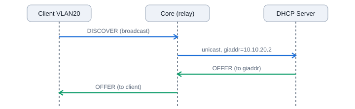

*شکل ۱: Relay، Discover را Unicast می‌کند و آدرس Interface خودش را در giaddr می‌گذارد تا سرور Pool درست را انتخاب کند.*

``` text
Core(config)# interface vlan 20
Core(config-if)# ip helper-address 10.10.30.10
! 10.10.30.10 = DHCP server in VLAN 30
```

سرور با **giaddr** می‌فهمد Discover از کدام Subnet آمده و Pool مربوط (VLAN 20) را به کلاینت می‌دهد. پس سرور باید Scope برای هر Subnet داشته باشد.

> **هشدار**
>
> `ip helper-address` علاوه بر DHCP، ۸ سرویس UDP دیگر را هم Forward می‌کند (TFTP، DNS، NetBIOS، TACACS و ...). در Hardening با `no ip forward-protocol udp ...` محدودشان می‌کنیم.

### ۴. دستورهای مشاهده

``` text
R1# show ip dhcp pool
R1# show ip dhcp binding
R1# show ip dhcp conflict
R1# show ip dhcp server statistics
R1# debug ip dhcp server events   (briefly)
```

- `binding`: کدام MAC چه IP گرفته و تا کی.
- `conflict`: آدرسی که قبل از واگذاری Ping داده شد و کسی جواب داد (تداخل).
- `pool`: تعداد آدرس‌های مصرف‌شده و باقی‌مانده.

### ۵. مثال‌ها

#### ساده

``` text
PC1> ip dhcp
DDORA IP 10.10.20.21/24 GW 10.10.20.1
```

#### متوسط: Relay

``` text
Server in VLAN 30, clients in VLAN 20
ip helper-address on Vlan20 -> clients get 10.10.20.x from the right scope
```

#### سخت: Pool تمام شد

``` text
Symptom : new clients get 169.254.x.x
Check   : show ip dhcp pool -> 0 free addresses
Cause   : lease too long + many short-lived devices (e.g. guest Wi-Fi)
Fix     : shorten the lease, enlarge the pool, clear stale bindings
```

### تمرین‌ها

**ت1.** ۱ (ساده): چرا آدرس Gateway را exclude می‌کنیم؟ *(پاسخ: 7-1-ت1 در بخش «پاسخ‌ها» انتهای فصل)*

**ت2.** ۲ (ساده): DHCP Relay چه می‌کند؟ *(پاسخ: 7-1-ت2 در بخش «پاسخ‌ها» انتهای فصل)*

**ت3.** ۳ (متوسط): giaddr برای چیست؟ *(پاسخ: 7-1-ت3 در بخش «پاسخ‌ها» انتهای فصل)*

**ت4.** ۴ (متوسط): ۲۵۴ آدرس، ۲۰ مستثنا؛ حداکثر کلاینت؟ *(پاسخ: 7-1-ت4 در بخش «پاسخ‌ها» انتهای فصل)*

**ت5.** ۵ (سخت): کاربران VLAN 20 آدرس نمی‌گیرند ولی VLAN 10 می‌گیرد؛ علت محتمل؟ *(پاسخ: 7-1-ت5 در بخش «پاسخ‌ها» انتهای فصل)*

### Lab هدایت‌شده

#### گام ۱: DHCP روی Core

``` text
Core(config)# ip dhcp excluded-address 10.10.20.1 10.10.20.20
Core(config)# ip dhcp pool USERS20
Core(dhcp-config)# network 10.10.20.0 255.255.255.0
Core(dhcp-config)# default-router 10.10.20.254
Core(dhcp-config)# dns-server 10.10.10.53
```

#### گام ۲: تست با VPCS

``` text
PC1> ip dhcp
PC1> show ip
Core# show ip dhcp binding
```

#### گام ۳: Relay

DHCP Pool را روی یک روتر دیگر (مثلاً R-SRV در VLAN 30) بسازید و روی `interface vlan 20` دستور helper-address بزنید؛ از VPCS دوباره آدرس بگیرید و Capture را ببینید: Discover Broadcast روی لینک PC، Unicast روی لینک سرور.

#### گام ۴: Reservation

یک رزرو برای MAC یکی از VPCSها بسازید و تأیید کنید همیشه همان IP را می‌گیرد.

### Lab مستقل

جدول «Scope Plan» (VLAN، Subnet، بازه، Excluded، Lease، DNS، Reservationها) را در `02-design/dhcp-plan.md` بنویسید.

### عیب‌یابی

|         |                                                                                                                                  |
|---------|----------------------------------------------------------------------------------------------------------------------------------|
| Symptom | کلاینت 169.254.x.x می‌گیرد                                                                                                        |
| چک‌لیست  | ۱) Relay تنظیم است؟ ؛ ۲) Scope برای آن Subnet هست؟ ؛ ۳) Pool پر نشده؟ ؛ ۴) Snooping/ACL جلوی Offer را نمی‌گیرد؟ ؛ ۵) مسیر به سرور |
| ابزار   | show ip dhcp binding ، show ip dhcp pool ، Capture                                                                               |
| رفع     | افزودن Relay یا Scope                                                                                                            |

### سؤال‌های مرور

**م1.** DHCP Relay کی لازم است؟ *(پاسخ: 7-1-م1 در بخش «پاسخ‌ها» انتهای فصل)*

**م2.** Reservation چیست؟ *(پاسخ: 7-1-م2 در بخش «پاسخ‌ها» انتهای فصل)*

### English Corner: انگلیسی تخصصی این درس

این جمله‌ها از مستندات و محیط کار واقعی‌اند. بلند بخوانید و ترجمه را بپوشانید.

| English sentence                                     | ترجمه                                                 |
|------------------------------------------------------|-------------------------------------------------------|
| Exclude the static addresses from the DHCP pool.     | آدرس‌های ثابت را از Pool DHCP مستثنا کنید.             |
| The relay agent forwards the broadcast as a unicast. | Relay Agent، Broadcast را به‌صورت Unicast ارسال می‌کند. |
| The client received an APIPA address.                | کلاینت آدرس APIPA گرفت.                               |
| Create a reservation for the printer.                | برای پرینتر یک Reservation بسازید.                    |

**Q1.** Quick quiz (answer in English): Why does a DHCP request not cross a router by default? *(پاسخ: 7-1-Q1 در بخش «پاسخ‌ها» انتهای فصل)*

### تکلیف و چک‌لیست تسلط

- [ ] DHCP و Reservation را بسازم.
- [ ] Relay را تست و Capture را تحلیل کنم.
- [ ] Scope Plan را بنویسم.

### یادآوری اشتباهات شما

> **یادآوری**
>
> پیش‌بینی قبل از اجرا؛ بکاپ قبل از تغییر؛ پذیرفته‌شدن دستور ≠ کار کردن؛ فرمول‌ها در بلوک مستقل.


#### کارت Lab — DHCP و Relay

| # | فیلد | محتوا |
|---|---|---|
| 1 | عنوان و هدف | DHCP Server و Relay |
| 2 | پیش‌نیاز | فصل 6 |
| 3 | توپولوژی | Core + R-SRV |
| 4 | تجهیزات | Core، روتر |
| 5 | نسخه نرم‌افزار | vIOS-L2 15.2(20200924، Experimental) برای SW؛ vIOS 15.9(3)M9 برای R؛ VPCS؛ PNetLab 4.2.8 |
| 6 | IP Plan | VLAN 20/30 |
| 7 | وضعیت اولیه | Pool/Relay |
| 8 | صورت مسئله | IP از VLAN دیگر |
| 9 | مراحل هدایت‌شده | همان بخش «Lab هدایت‌شده» همین درس |
| 10 | تست عملکرد | `show ip dhcp binding` |
| 11 | سناریوی خرابی | بدون helper |
| 12 | روش عیب‌یابی | لایه‌ای/با شواهد (بخش عیب‌یابی همین درس) |
| 13 | نتیجه‌ی مورد انتظار | Lease |
| 14 | معیار پذیرش | Scope Plan |
| 15 | مستندات نهایی | `02-design/dhcp-plan.md` |
| 16 | Cleanup و بازگردانی | — |

> **وضعیت راستی‌آزمایی (خارج از ۱۶ فیلد):** **اجرا نشده (فقط طراحی).** DHCP pool فقط CLI-Accepted.

---

<a id="l-7-2"></a>

## درس 7-2 — DNS و NTP

**فصل ۷ - روز ۲ · پیش‌نیاز: درس ۷-۱ · ۶ ساعت**

### این درس درباره چیست و چرا باید یاد بگیریم؟

**چه چیزی یاد می‌گیریم:** دو سرویس پایه که همه‌چیز به آن‌ها وابسته است: DNS (تبدیل نام به IP) و NTP (هماهنگی ساعت). چطور کار می‌کنند، چطور روی سیسکو تنظیم و بررسی می‌شوند، و چرا خرابی‌شان شبکه را «عجیب» می‌کند.

**چرا لازم است:** بیشتر شکایت‌های «اینترنت قطع است» در واقع «DNS خراب است». و Logها، Certificateها، Kerberos و Active Directory بدون ساعت درست بی‌معنی یا خراب می‌شوند؛ اختلاف بیش از ۵ دقیقه، ورود به دامنه را ناممکن می‌کند.

- **در کار روزانه:** ping به IP جواب می‌دهد ولی به نام نه؟ DNS است.
- **در امنیت:** Log با ساعت اشتباه برای تحلیل حادثه بی‌ارزش است.
- **در Capstone:** DNS و NTP مرکز روی Windows Server است و همه‌ی تجهیزات به آن اشاره می‌کنند.

> **مسیر درس**
>
> DNS چطور کار می‌کند ← رکوردها ← تنظیم روی سیسکو ← NTP و Stratum ← مثال ساده/متوسط/سخت ← Lab ← عیب‌یابی.

#### اصطلاحات این درس (مخفف ← شکل کامل ← معنی)

| مخفف     | شکل کامل انگلیسی            | معنی فارسی                                 |
|----------|-----------------------------|--------------------------------------------|
| DNS      | Domain Name System          | سیستم نام دامنه                            |
| Resolver | DNS Resolver                | سرویس‌دهنده‌ای که پرس‌وجوی کلاینت را حل می‌کند |
| A        | A record                    | نام به IPv4                                |
| AAAA     | AAAA record                 | نام به IPv6                                |
| PTR      | Pointer record              | IP به نام                                  |
| CNAME    | Canonical Name              | نام مستعار                                 |
| NTP      | Network Time Protocol       | پروتکل هماهنگی ساعت                        |
| Stratum  | Stratum                     | فاصله از منبع زمان دقیق                    |
| UTC      | Coordinated Universal Time  | زمان هماهنگ جهانی                          |
| FQDN     | Fully Qualified Domain Name | نام کامل دامنه                             |

### ۱. DNS چطور کار می‌کند؟

دفترچه‌ی تلفن را تصور کنید: شما نام «example.com» را می‌دانید و DNS «شماره» (IP) آن را می‌دهد. کلاینت از سرور DNS خودش می‌پرسد؛ اگر سرور پاسخ را نداشت، از سرورهای بالاتر می‌پرسد و در پایان جواب را می‌گیرد و برای مدتی نگه می‌دارد (Cache).

``` text
Client -> local DNS server : www.example.com ?
Local DNS -> root / TLD / authoritative servers (if not cached)
Local DNS -> client : 203.0.113.10   (cached for TTL seconds)
```

| رکورد | کار                 | مثال                             |
|-------|---------------------|----------------------------------|
| A     | نام به IPv4         | srv1.lab.local = 10.10.30.10     |
| AAAA  | نام به IPv6         | srv1.lab.local = 2001:db8:30::10 |
| PTR   | IP به نام (Reverse) | 10.10.30.10 = srv1.lab.local     |
| CNAME | نام مستعار          | www = srv1                       |
| MX    | سرور ایمیل          | mail.lab.local                   |
| NS    | سرور DNS یک Zone    | dns1.lab.local                   |

### ۲. تنظیم DNS روی سیسکو

``` text
R1(config)# ip domain-name lab.local
R1(config)# ip name-server 10.10.10.53
R1(config)# ip domain lookup
R1# ping srv1
R1# nslookup srv1  (not on all images)
```

> **یادآوری از دوره**
>
> در درس ۲-۴ گفتیم `no ip domain-lookup` برای جلوگیری از «Translating...». اگر DNS واقعی دارید و می‌خواهید روی دستگاه از نام استفاده کنید، `ip domain lookup` و `ip name-server` را بزنید.

روی کلاینت Windows: `nslookup srv1.lab.local` و `ipconfig /flushdns`.

### ۳. NTP: همه‌ی ساعت‌ها یکی

ساعت کامپیوترها کم‌کم از هم فاصله می‌گیرد (Drift). NTP آن‌ها را با یک منبع دقیق هماهنگ می‌کند. سلسله‌مراتب Stratum: منبع اتمی/GPS ‏Stratum 0، سروری که مستقیم به آن وصل است Stratum 1، و هر مرحله پایین‌تر یک عدد بیشتر.

``` text
Stratum 0 : atomic clock / GPS
Stratum 1 : server directly attached
Stratum 2 : synchronizes from stratum 1
...
Stratum 16 : unsynchronized (invalid)
```

#### تنظیم NTP روی سیسکو

``` text
R1(config)# clock timezone IRST 3 30
R1(config)# ntp server 10.10.10.53
R1(config)# ntp server 192.168.88.1 prefer
R1(config)# service timestamps log datetime msec localtime
R1(config)# service timestamps debug datetime msec localtime
R1# show ntp status
R1# show ntp associations
R1# show clock detail
```

- `clock timezone IRST 3 30`: ایران +۳:۳۰ (UTC). منطقه‌ی زمانی را در نظر بگیرید.
- `ntp server ... prefer`: منبع ترجیحی. چند منبع برای تحمل خطا.
- `show ntp status`: باید `Clock is synchronized` باشد.

``` text
R1# show ntp associations
  address        ref clock   st  when  poll reach  delay  offset
*~10.10.10.53   .GPS.       2   18    64   377    1.2   0.3

* = synchronized   ~ = configured   reach 377 = all last 8 polls succeeded
```

در Lab ما ESXi از MikroTik (192.168.88.1) NTP می‌گیرد؛ همان منبع می‌تواند ریشه‌ی Stratum کل Lab باشد.

### ۴. مثال‌ها

#### ساده

``` text
ping 10.10.30.10 works but ping srv1 fails
-> DNS problem (name resolution), not connectivity
```

#### متوسط: ساعت اشتباه

``` text
Syslog entries from R1 show 2000-01-01 and from SW1 2026-11-08
-> logs cannot be correlated; configure NTP on all devices
```

#### سخت: Kerberos و Windows

اگر ساعت یک کلاینت بیش از ۵ دقیقه با Domain Controller اختلاف داشته باشد، ورود به دامنه یا دسترسی به فایل‌سرور شکست می‌خورد، با پیام‌های مبهم احراز هویت. همیشه اول ساعت را بررسی کنید.

### تمرین‌ها

**ت1.** ۱ (ساده): A و PTR چه فرقی دارند؟ *(پاسخ: 7-2-ت1 در بخش «پاسخ‌ها» انتهای فصل)*

**ت2.** ۲ (ساده): Stratum 16 یعنی؟ *(پاسخ: 7-2-ت2 در بخش «پاسخ‌ها» انتهای فصل)*

**ت3.** ۳ (متوسط): ping به IP می‌رسد ولی به نام نه؛ علت؟ *(پاسخ: 7-2-ت3 در بخش «پاسخ‌ها» انتهای فصل)*

**ت4.** ۴ (متوسط): ساعت Windows 6 دقیقه عقب است؛ اثر؟ *(پاسخ: 7-2-ت4 در بخش «پاسخ‌ها» انتهای فصل)*

**ت5.** ۵ (سخت): reach 0 در show ntp associations یعنی؟ *(پاسخ: 7-2-ت5 در بخش «پاسخ‌ها» انتهای فصل)*

### Lab هدایت‌شده

#### گام ۱: NTP روی روترها

``` text
R1(config)# clock timezone IRST 3 30
R1(config)# ntp server 192.168.88.1
R1# show ntp status
R1# show ntp associations
```

اگر IP مسیر نداشت، در Lab ایزوله NTP محلی را روی یک روتر (`ntp master 3`) بسازید و بقیه را به آن وصل کنید:

``` text
R1(config)# ntp master 3
R2(config)# ntp server 10.0.12.1
R2# show ntp status
```

#### گام ۲: DNS

در PNetLab یک VM سبک (مثلاً لینوکس) به‌عنوان DNS بسازید یا فعلاً روی سیسکو یک نگاشت محلی بنویسید:

``` text
R1(config)# ip host srv1 10.10.30.10
R1# ping srv1
```

#### گام ۳: Syslog با ساعت درست

``` text
R1(config)# service timestamps log datetime msec localtime
R1# show logging | include %
```

### Lab مستقل

«Service Dependency Map» بنویسید: چه تجهیزی به DNS/NTP کدام سرور اشاره می‌کند؛ در `02-design/dns-ntp-map.md`.

### عیب‌یابی

|         |                                                                                                         |
|---------|---------------------------------------------------------------------------------------------------------|
| Symptom | IP کار می‌کند، نام نه (یا ساعت اشتباه)                                                                   |
| چک‌لیست  | ۱) DNS Server درست روی کلاینت؟ ؛ ۲) رکورد A هست؟ ؛ ۳) NTP reach؟ ؛ ۴) Timezone؟ ؛ ۵) فایروال UDP 53/123 |
| ابزار   | nslookup ، show ntp associations ، show clock detail                                                    |
| رفع     | اصلاح DNS/NTP                                                                                           |

### سؤال‌های مرور

**م1.** DNS چه می‌کند؟ *(پاسخ: 7-2-م1 در بخش «پاسخ‌ها» انتهای فصل)*

**م2.** چرا NTP برای امنیت مهم است؟ *(پاسخ: 7-2-م2 در بخش «پاسخ‌ها» انتهای فصل)*

### English Corner: انگلیسی تخصصی این درس

این جمله‌ها از مستندات و محیط کار واقعی‌اند. بلند بخوانید و ترجمه را بپوشانید.

| English sentence                                       | ترجمه                                                |
|--------------------------------------------------------|------------------------------------------------------|
| The device synchronizes its clock with the NTP server. | دستگاه ساعتش را با سرور NTP هماهنگ می‌کند.            |
| DNS resolves hostnames to IP addresses.                | DNS نام میزبان را به IP تبدیل می‌کند.                 |
| A time skew of more than five minutes breaks Kerberos. | اختلاف ساعت بیش از پنج دقیقه Kerberos را خراب می‌کند. |
| Flush the DNS cache on the client.                     | Cache DNS کلاینت را پاک کنید.                        |

**Q1.** Quick quiz (answer in English): Why do all devices need the same NTP source? *(پاسخ: 7-2-Q1 در بخش «پاسخ‌ها» انتهای فصل)*

### تکلیف و چک‌لیست تسلط

- [ ] NTP را بالا بیاورم و Synchronized ببینم.
- [ ] فرق خرابی DNS و اتصال را توضیح دهم.
- [ ] Dependency Map را بنویسم.

### یادآوری اشتباهات شما

> **یادآوری**
>
> پیش‌بینی قبل از اجرا؛ بکاپ قبل از تغییر؛ پذیرفته‌شدن دستور ≠ کار کردن؛ فرمول‌ها در بلوک مستقل.


#### کارت Lab — DNS و NTP

| # | فیلد | محتوا |
|---|---|---|
| 1 | عنوان و هدف | DNS و NTP |
| 2 | پیش‌نیاز | درس 7-1 |
| 3 | توپولوژی | R1,R2 + سرور |
| 4 | تجهیزات | R1،R2 |
| 5 | نسخه نرم‌افزار | vIOS-L2 15.2(20200924، Experimental) برای SW؛ vIOS 15.9(3)M9 برای R؛ VPCS؛ PNetLab 4.2.8 |
| 6 | IP Plan | — |
| 7 | وضعیت اولیه | ntp/ip host |
| 8 | صورت مسئله | Sync |
| 9 | مراحل هدایت‌شده | همان بخش «Lab هدایت‌شده» همین درس |
| 10 | تست عملکرد | `show ntp status` |
| 11 | سناریوی خرابی | reach 0 |
| 12 | روش عیب‌یابی | لایه‌ای/با شواهد (بخش عیب‌یابی همین درس) |
| 13 | نتیجه‌ی مورد انتظار | Synchronized |
| 14 | معیار پذیرش | Dependency Map |
| 15 | مستندات نهایی | `02-design/dns-ntp-map.md` |
| 16 | Cleanup و بازگردانی | — |

> **وضعیت راستی‌آزمایی (خارج از ۱۶ فیلد):** **اجرا نشده (فقط طراحی).** NTP فقط CLI-Accepted (Sync آزمایش نشده).

---

<a id="l-7-3"></a>

## درس 7-3 — NAT و PAT

**فصل ۷ - روز ۳ · پیش‌نیاز: درس‌های ۲-۱ و ۷-۱ · ۶ ساعت**

### این درس درباره چیست و چرا باید یاد بگیریم؟

**چه چیزی یاد می‌گیریم:** NAT و PAT: چطور آدرس‌های خصوصی با یک (یا چند) آدرس عمومی به اینترنت می‌روند؛ انواع Static، Dynamic و Overload؛ Inside/Outside؛ و جدول Translation.

**چرا لازم است:** آدرس‌های خصوصی (10.x، 192.168.x) در اینترنت Route نمی‌شوند. NAT مبدأ بسته را در لبه عوض می‌کند تا پاسخ برگردد. هر شبکه‌ی داخلی که به اینترنت وصل است NAT دارد؛ و خرابی آن (مثلاً NAT دوگانه) مبهم‌ترین مشکلات را می‌سازد.

- **در کار روزانه:** تقریباً همه‌ی اینترنت‌ها PAT هستند.
- **در امنیت:** NAT امنیت نیست؛ فقط پنهان‌سازی آدرس است. محافظ اصلی Policy فایروال است.
- **در FortiGate:** Policy NAT، IP Pool و VIP همین مفاهیم را در فایروال دارند (W10).

> **مسیر درس**
>
> چرا NAT ← Inside/Outside ← Static ← Dynamic ← PAT/Overload ← مثال ساده/متوسط/سخت ← Lab ← عیب‌یابی.

#### اصطلاحات این درس (مخفف ← شکل کامل ← معنی)

| مخفف          | شکل کامل انگلیسی            | معنی فارسی                      |
|---------------|-----------------------------|---------------------------------|
| NAT           | Network Address Translation | ترجمه‌ی آدرس                     |
| PAT           | Port Address Translation    | ترجمه‌ی آدرس و پورت (Overload)   |
| Inside Local  | Inside Local                | آدرس داخلی قبل از ترجمه         |
| Inside Global | Inside Global               | آدرس عمومی بعد از ترجمه         |
| Overload      | NAT Overload                | چند آدرس داخلی با یک آدرس عمومی |
| VIP           | Virtual IP                  | Port Forward در فایروال (DNAT)  |
| DNAT          | Destination NAT             | تغییر آدرس مقصد                 |
| SNAT          | Source NAT                  | تغییر آدرس مبدأ                 |

### ۱. NAT چرا و چطور؟

فرض کنید یک ساختمان اداری یک شماره‌ی تلفن بیرونی دارد و داخل داخلی‌ها (۱۰۱، ۱۰۲...). وقتی کارمند ۱۰۲ تماس می‌گیرد، گیرنده شماره‌ی بیرونی را می‌بیند؛ منشی (NAT) می‌داند پاسخ را به کدام داخلی بدهد. NAT هم همین جدول را نگه می‌دارد.

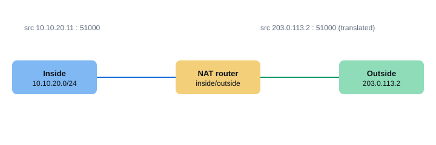

*شکل ۱: NAT مبدأ بسته را از آدرس داخلی به آدرس عمومی تبدیل می‌کند و در جدول نگه می‌دارد.*

| اصطلاح         | معنی                                   | مثال        |
|----------------|----------------------------------------|-------------|
| Inside Local   | آدرس داخلی (قبل از ترجمه)              | 10.10.20.11 |
| Inside Global  | آدرس داخلی از دید بیرون (بعد از ترجمه) | 203.0.113.2 |
| Outside Global | آدرس مقصد در اینترنت                   | 8.8.8.8     |

### ۲. سه نوع NAT

| نوع            | نگاشت                                   | کاربرد                         |
|----------------|-----------------------------------------|--------------------------------|
| Static NAT     | یک به یک ثابت                           | انتشار سرور (مثلاً وب) به بیرون |
| Dynamic NAT    | داخلی به Pool از چند آدرس عمومی         | نادر؛ وقتی چند IP عمومی داریم  |
| PAT / Overload | چند داخلی به یک IP عمومی با پورت متفاوت | اینترنت عادی                   |

PAT چطور؟ برای هر ارتباط، علاوه بر آدرس، شماره‌ی پورت مبدأ هم عوض می‌شود تا ارتباط‌ها از هم جدا بمانند:

``` text
10.10.20.11:51000 -> 203.0.113.2:51000
10.10.20.12:51000 -> 203.0.113.2:51001   (port changed to stay unique)
```

### ۳. دستورها (خط‌به‌خط)

#### PAT (Overload) با ACL

``` text
R1(config)# access-list 10 permit 10.10.20.0 0.0.0.255
R1(config)# interface gi0/0
R1(config-if)# ip nat inside
R1(config)# interface gi0/1
R1(config-if)# ip nat outside
R1(config)# ip nat inside source list 10 interface gi0/1 overload
```

- `ip nat inside / outside`: هر Interface را نقش می‌دهد؛ بدون این‌ها NAT کار نمی‌کند.
- `access-list 10`: مشخص می‌کند کدام ترافیک ترجمه شود (چه کسی «داخل» است).
- `overload`: PAT. `interface gi0/1`: از IP همان Interface خروجی استفاده شود.

#### Static NAT (انتشار سرور)

``` text
R1(config)# ip nat inside source static 10.10.30.10 203.0.113.10
! port forward only HTTPS:
R1(config)# ip nat inside source static tcp 10.10.30.10 443 203.0.113.10 443
```

#### مشاهده

``` text
R1# show ip nat translations
R1# show ip nat statistics
R1# clear ip nat translation *
R1# debug ip nat   (briefly)
```

``` text
Pro Inside global        Inside local        Outside local    Outside global
icmp 203.0.113.2:1       10.10.20.11:1       8.8.8.8:1        8.8.8.8:1
tcp  203.0.113.2:51000   10.10.20.12:51000   93.184.216.34:443 93.184.216.34:443
```

### ۴. مثال‌ها

#### ساده

``` text
PC (10.10.20.11) pings 8.8.8.8
show ip nat translations shows the entry with inside global 203.0.113.2
```

#### متوسط: Static برای سرور

``` text
Outside client -> 203.0.113.10:443
Router translates the destination to 10.10.30.10:443 (inbound)
Return traffic is translated back automatically
```

#### سخت: چرا NAT کار نمی‌کند؟

``` text
Cause 1: ip nat inside/outside missing or on the wrong interface
Cause 2: ACL does not match the inside subnet
Cause 3: missing default route to the ISP
Cause 4: double NAT (router and firewall both translate)
Check : show ip nat translations (empty?) , show ip nat statistics (misses)
```

### تمرین‌ها

**ت1.** ۱ (ساده): PAT چه چیزی را علاوه بر IP تغییر می‌دهد؟ *(پاسخ: 7-3-ت1 در بخش «پاسخ‌ها» انتهای فصل)*

**ت2.** ۲ (ساده): Inside Global چیست؟ *(پاسخ: 7-3-ت2 در بخش «پاسخ‌ها» انتهای فصل)*

**ت3.** ۳ (متوسط): دو دستور لازم برای NAT روی یک Interface؟ *(پاسخ: 7-3-ت3 در بخش «پاسخ‌ها» انتهای فصل)*

**ت4.** ۴ (متوسط): چرا NAT امنیت نیست؟ *(پاسخ: 7-3-ت4 در بخش «پاسخ‌ها» انتهای فصل)*

**ت5.** ۵ (سخت): NAT دوگانه (Double NAT) چه مشکلی می‌سازد؟ *(پاسخ: 7-3-ت5 در بخش «پاسخ‌ها» انتهای فصل)*

### Lab هدایت‌شده

روتر EDGE-R1 با Inside = لینک به Core و Outside = Loopback شبیه اینترنت (یا یک روتر دیگر).

#### گام ۱: PAT

``` text
EDGE-R1(config)# access-list 10 permit 10.10.0.0 0.0.255.255
EDGE-R1(config)# interface gi0/0
EDGE-R1(config-if)# ip nat inside
EDGE-R1(config)# interface gi0/2
EDGE-R1(config-if)# ip address 203.0.113.2 255.255.255.0
EDGE-R1(config-if)# ip nat outside
EDGE-R1(config)# ip nat inside source list 10 interface gi0/2 overload
```

#### گام ۲: تست

``` text
PC1> ping 203.0.113.1
EDGE-R1# show ip nat translations
EDGE-R1# show ip nat statistics
```

طبق Probe اولیه، دستور NAT در vIOSL2 «پذیرفته» می‌شود؛ روی روتر vIOS (IOS واقعی) باید کار کند. نتیجه‌ی واقعی را ثبت کنید.

#### گام ۳: Static NAT

یک سرور Inside را با Static منتشر کنید و از «بیرون» تست کنید.

#### گام ۴: قبل/بعد Capture

روی لینک Inside و Outside Capture بگیرید و آدرس مبدأ را مقایسه کنید.

### Lab مستقل

جدول «NAT Matrix» (Inside Local، Inside Global، نوع، سرویس) و تصویر Packet Flow قبل/بعد NAT را در `02-design/nat-matrix.md` بنویسید.

### عیب‌یابی

|         |                                                                                                                  |
|---------|------------------------------------------------------------------------------------------------------------------|
| Symptom | اینترنت ندارم؛ ping داخلی OK                                                                                     |
| چک‌لیست  | ۱) show ip nat translations خالی؟ ؛ ۲) inside/outside درست؟ ؛ ۳) ACL مطابق؟ ؛ ۴) Default route؟ ؛ ۵) Double NAT؟ |
| ابزار   | show ip nat statistics ، debug ip nat                                                                            |
| رفع     | اصلاح نقش Interface یا ACL                                                                                       |

### سؤال‌های مرور

**م1.** PAT چطور چند کاربر را با یک IP می‌برد؟ *(پاسخ: 7-3-م1 در بخش «پاسخ‌ها» انتهای فصل)*

**م2.** Static NAT برای چیست؟ *(پاسخ: 7-3-م2 در بخش «پاسخ‌ها» انتهای فصل)*

### English Corner: انگلیسی تخصصی این درس

این جمله‌ها از مستندات و محیط کار واقعی‌اند. بلند بخوانید و ترجمه را بپوشانید.

| English sentence                                                          | ترجمه                                                                 |
|---------------------------------------------------------------------------|-----------------------------------------------------------------------|
| Configure NAT overload on the outside interface.                          | NAT Overload را روی Interface خارجی تنظیم کنید.                       |
| The translation table shows the inside local and inside global addresses. | جدول Translation، آدرس‌های Inside Local و Inside Global را نشان می‌دهد. |
| NAT is not a security feature.                                            | NAT ویژگی امنیتی نیست.                                                |
| Double NAT breaks inbound port forwarding.                                | Double NAT ارسال پورت ورودی را خراب می‌کند.                            |

**Q1.** Quick quiz (answer in English): What does PAT add to the translation to keep sessions unique? *(پاسخ: 7-3-Q1 در بخش «پاسخ‌ها» انتهای فصل)*

### تکلیف و چک‌لیست تسلط

- [ ] PAT را بسازم و Translation را ببینم.
- [ ] Static NAT را تست کنم.
- [ ] NAT Matrix را بنویسم.

### یادآوری اشتباهات شما

> **یادآوری**
>
> پیش‌بینی قبل از اجرا؛ بکاپ قبل از تغییر؛ پذیرفته‌شدن دستور ≠ کار کردن؛ فرمول‌ها در بلوک مستقل.


#### کارت Lab — NAT و PAT

| # | فیلد | محتوا |
|---|---|---|
| 1 | عنوان و هدف | NAT/PAT |
| 2 | پیش‌نیاز | درس 7-2 |
| 3 | توپولوژی | Edge |
| 4 | تجهیزات | EDGE-R1 |
| 5 | نسخه نرم‌افزار | vIOS-L2 15.2(20200924، Experimental) برای SW؛ vIOS 15.9(3)M9 برای R؛ VPCS؛ PNetLab 4.2.8 |
| 6 | IP Plan | Inside/Outside |
| 7 | وضعیت اولیه | overload |
| 8 | صورت مسئله | Translation |
| 9 | مراحل هدایت‌شده | همان بخش «Lab هدایت‌شده» همین درس |
| 10 | تست عملکرد | `show ip nat translations` |
| 11 | سناریوی خرابی | inside/outside غلط |
| 12 | روش عیب‌یابی | لایه‌ای/با شواهد (بخش عیب‌یابی همین درس) |
| 13 | نتیجه‌ی مورد انتظار | Translation |
| 14 | معیار پذیرش | NAT Matrix |
| 15 | مستندات نهایی | `02-design/nat-matrix.md` |
| 16 | Cleanup و بازگردانی | — |

> **وضعیت راستی‌آزمایی (خارج از ۱۶ فیلد):** **اجرا نشده (فقط طراحی).** NAT فقط CLI-Accepted.

---

<a id="l-7-4"></a>

## درس 7-4 — ACL

**فصل ۷ - روز ۴ · پیش‌نیاز: درس‌های ۲-۵ و ۶-۵ · ۶ ساعت**

### این درس درباره چیست و چرا باید یاد بگیریم؟

**چه چیزی یاد می‌گیریم:** فهرست کنترل دسترسی (ACL): انواع Standard و Extended، قاعده‌ی «اولین تطابق» و Implicit Deny، جای درست گذاشتن ACL، و نوشتن Policy بین VLANها.

**چرا لازم است:** ACL اولین ابزار کنترل ترافیک روی سیسکوست و پایه‌ی فهم Policy فایروال است. ترتیب اشتباه یک قاعده یا فراموشی Implicit Deny می‌تواند کل شبکه را قطع کند یا درِ امنیت را باز بگذارد.

- **در کار روزانه:** جداکردن مهمان از شبکه‌ی داخلی و محدودکردن مدیریت (SSH).
- **در امنیت:** ACL، Least Privilege را در لایه‌ی شبکه پیاده می‌کند.
- **در FortiGate:** Policy فایروال همان منطق Top-Down و First Match را دارد (با Stateful بودن).

> **مسیر درس**
>
> ACL چیست ← First Match و Implicit Deny ← Standard در برابر Extended ← جای ACL ← مثال ساده/متوسط/سخت ← Lab ← عیب‌یابی.

#### اصطلاحات این درس (مخفف ← شکل کامل ← معنی)

| مخفف          | شکل کامل انگلیسی     | معنی فارسی                 |
|---------------|----------------------|----------------------------|
| ACL           | Access Control List  | فهرست قوانین permit/deny   |
| Standard      | Standard ACL         | فقط آدرس مبدأ              |
| Extended      | Extended ACL         | مبدأ، مقصد، پروتکل، پورت   |
| Implicit Deny | Implicit Deny        | انکار ضمنی در پایان هر ACL |
| Wildcard      | Wildcard mask        | معکوس Mask                 |
| ACE           | Access Control Entry | یک خط ACL                  |
| Stateless     | Stateless            | بدون حافظه‌ی وضعیت ارتباط   |
| established   | TCP established      | بسته‌های بعد از برقراری TCP |

### ۱. ACL چیست؟

ACL فهرستی از قوانین است. هر قانون می‌گوید: «اگر بسته با این مشخصات بود، اجازه بده (permit) یا ببند (deny)». مثل لیست مهمانان در ورودی یک سالن؛ نگهبان از بالای لیست شروع می‌کند و هر نامی را پیدا کرد همان‌جا تصمیم می‌گیرد.

> **دو قانون اصلی**
>
> ۱) **اولین تطابق** (First Match): از بالا به پایین؛ به محض اولین قانونی که جور شد، بقیه خوانده نمی‌شود. ۲) **Implicit Deny**: در انتهای هر ACL یک `deny any` نامرئی هست؛ پس هر چه صریحاً permit نشده، بسته می‌شود.

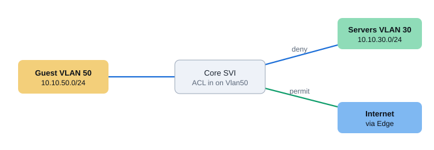

*شکل ۱: ACL روی ورودی SVI مهمان: دسترسی به سرورها بسته و اینترنت باز است.*

### ۲. Standard در برابر Extended

| معیار   | Standard             | Extended                 |
|---------|----------------------|--------------------------|
| شماره   | 1-99 و 1300-1999     | 100-199 و 2000-2699      |
| معیار   | فقط IP مبدأ          | مبدأ، مقصد، پروتکل، پورت |
| جای نصب | نزدیک مقصد           | نزدیک مبدأ               |
| کاربرد  | فیلتر ساده (مثل VTY) | Policy دقیق بین VLANها   |

چرا Standard نزدیک مقصد؟ چون فقط مبدأ را می‌شناسد؛ اگر نزدیک مبدأ بگذارید، ترافیک آن مبدأ به همه‌ی مقصدها بسته می‌شود. Extended را نزدیک مبدأ می‌گذارند تا ترافیک ناخواسته زودتر از شبکه خارج شود.

### ۳. دستورها (خط‌به‌خط)

روش Named که قابل‌ویرایش و خواناست:

``` text
Core(config)# ip access-list extended GUEST-IN
Core(config-ext-nacl)# remark block guests from internal networks
Core(config-ext-nacl)# deny ip 10.10.50.0 0.0.0.255 10.10.0.0 0.0.255.255
Core(config-ext-nacl)# permit udp 10.10.50.0 0.0.0.255 any eq 53
Core(config-ext-nacl)# permit tcp 10.10.50.0 0.0.0.255 any eq 80
Core(config-ext-nacl)# permit tcp 10.10.50.0 0.0.0.255 any eq 443
Core(config-ext-nacl)# deny ip any any log
Core(config-ext-nacl)# exit
Core(config)# interface vlan 50
Core(config-if)# ip access-group GUEST-IN in
```

- `remark`: توضیح خط‌به‌خط (حتماً بنویسید).
- اول `deny` برای شبکه‌ی داخلی (10.10.0.0/16)؛ بعد permitهای لازم (DNS، وب).
- `log`: برای دیدن Hit در Log (روی خطوط deny مفید است).
- `ip access-group NAME in`: ACL را روی ورودی Interface اعمال می‌کند.

``` text
Core# show access-lists
Core# show ip interface vlan 50 | include access list
Core# show running-config | section ip access-list
```

``` text
Extended IP access list GUEST-IN
    10 deny ip 10.10.50.0 0.0.0.255 10.10.0.0 0.0.255.255 (12 matches)
    20 permit udp 10.10.50.0 0.0.0.255 any eq domain (45 matches)
    30 permit tcp 10.10.50.0 0.0.0.255 any eq www
    40 permit tcp 10.10.50.0 0.0.0.255 any eq 443
    50 deny ip any any log (3 matches)
```

### ۴. نکته‌های حرفه‌ای

- **ترتیب مهم است:** اگر permit کلی را بالای deny بگذارید، deny هرگز اجرا نمی‌شود.
- **ACL فقط ترافیک عبوری را فیلتر می‌کند،** نه ترافیکی که خود روتر می‌سازد.
- **Stateless است:** برگشت ترافیک باید صراحتاً مجاز شود (مثلاً `established` برای TCP)؛ فایروال Stateful این را خودکار می‌کند.
- **جهت (in/out) را درست انتخاب کنید:** in = ورودی به Interface از بیرون؛ out = خروجی.
- **قبل از اعمال،** مطمئن شوید قانون مدیریت (SSH) شما را قطع نمی‌کند.

``` text
Return traffic example (TCP, stateless ACL):
  permit tcp any 10.10.20.0 0.0.0.255 established
matches only packets with ACK/RST bits set (replies), not new connections
```

### ۵. مثال‌ها

#### ساده: SSH فقط از مدیریت (Standard)

``` text
Core(config)# ip access-list standard MGMT-ONLY
Core(config-std-nacl)# permit 10.10.10.0 0.0.0.255
Core(config)# line vty 0 4
Core(config-line)# access-class MGMT-ONLY in
```

#### متوسط: کاربران فقط HTTPS و DNS به سرور

``` text
ip access-list extended USERS-TO-SRV
 permit tcp 10.10.20.0 0.0.0.255 host 10.10.30.10 eq 443
 permit udp 10.10.20.0 0.0.0.255 host 10.10.30.53 eq 53
 deny ip 10.10.20.0 0.0.0.255 10.10.30.0 0.0.0.255 log
 permit ip any any
```

#### سخت: چرا Ping کار می‌کند ولی HTTPS نه؟

``` text
Cause 1: ACL has permit icmp above, no permit for tcp 443
Cause 2: ACL applied in the wrong direction or on the wrong interface
Cause 3: implicit deny (no permit for the traffic)
Cause 4: return path ACL blocks the replies (stateless)
Check : show access-lists (hit counters), show ip interface ... | include access
```

### تمرین‌ها

**ت1.** ۱ (ساده): Implicit Deny چیست؟ *(پاسخ: 7-4-ت1 در بخش «پاسخ‌ها» انتهای فصل)*

**ت2.** ۲ (ساده): Extended را کجا می‌گذاریم؟ *(پاسخ: 7-4-ت2 در بخش «پاسخ‌ها» انتهای فصل)*

**ت3.** ۳ (متوسط): Wildcard برای 10.10.20.0/24؟ *(پاسخ: 7-4-ت3 در بخش «پاسخ‌ها» انتهای فصل)*

**ت4.** ۴ (متوسط): چرا ترتیب مهم است؟ *(پاسخ: 7-4-ت4 در بخش «پاسخ‌ها» انتهای فصل)*

**ت5.** ۵ (سخت): ACL روی VLAN مهمان هر چیزی را می‌بندد؛ چه چیزی فراموش شده؟ *(پاسخ: 7-4-ت5 در بخش «پاسخ‌ها» انتهای فصل)*

### Lab هدایت‌شده

روی Core از Lab A (یا هر روتر با دو VLAN):

#### گام ۱: Baseline

``` text
PC-guest> ping 10.10.30.10   (before ACL: success)
```

#### گام ۲: ACL و اعمال

ACL بخش ۳ را بسازید و روی `interface vlan 50` اعمال کنید (in). قبل از آن بکاپ بگیرید.

#### گام ۳: Verify

``` text
PC-guest> ping 10.10.30.10   (expect: fail)
PC-guest> ping 8.8.8.8        (expect: success via edge)
Core# show access-lists       (hit counters rise)
```

طبق Probe، ACL روی vIOSL2 «پذیرفته» می‌شود و ممکن است عملاً اعمال نشود؛ روی روتر vIOS (L3) تست کنید و نتیجه‌ی واقعی را ثبت کنید.

#### گام ۴: خراب‌کردن عمدی ترتیب

یک `permit ip any any` بالای deny بگذارید و ببینید deny بی‌اثر می‌شود؛ سپس با شماره‌ی خط ترتیب را اصلاح کنید.

### Lab مستقل

یک «Policy Matrix» (مبدأ VLAN، مقصد VLAN، سرویس، اجازه/انکار) برای ۳ VLAN در `02-design/policy-matrix.md` بنویسید.

### عیب‌یابی

|         |                                                                                                         |
|---------|---------------------------------------------------------------------------------------------------------|
| Symptom | ترافیک مجاز بسته شده یا ترافیک ممنوع رد می‌شود                                                           |
| چک‌لیست  | ۱) ACL روی کدام Interface و جهت؟ ؛ ۲) ترتیب خطوط؟ ؛ ۳) Hit Count؟ ؛ ۴) Implicit Deny؟ ؛ ۵) برگشت ترافیک |
| ابزار   | show access-lists ، show ip interface                                                                   |
| رفع     | اصلاح ترتیب یا افزودن permit                                                                            |

### سؤال‌های مرور

**م1.** اولین تطابق یعنی چه؟ *(پاسخ: 7-4-م1 در بخش «پاسخ‌ها» انتهای فصل)*

**م2.** تفاوت Stateless و Stateful؟ *(پاسخ: 7-4-م2 در بخش «پاسخ‌ها» انتهای فصل)*

### English Corner: انگلیسی تخصصی این درس

این جمله‌ها از مستندات و محیط کار واقعی‌اند. بلند بخوانید و ترجمه را بپوشانید.

| English sentence                                                     | ترجمه                                                          |
|----------------------------------------------------------------------|----------------------------------------------------------------|
| Apply the ACL inbound on the VLAN interface.                         | ACL را روی ورودی Interface مربوط به VLAN اعمال کنید.           |
| Rules are evaluated top-down, first match wins.                      | قوانین از بالا به پایین ارزیابی می‌شوند؛ اولین تطابق برنده است. |
| Add a remark to document the purpose of each entry.                  | برای مستندسازی هدف هر خط یک remark بگذارید.                    |
| The implicit deny drops everything that is not explicitly permitted. | Implicit Deny هر چه صریحاً مجاز نشده را می‌اندازد.               |

**Q1.** Quick quiz (answer in English): Where should a standard ACL be placed and why? *(پاسخ: 7-4-Q1 در بخش «پاسخ‌ها» انتهای فصل)*

### تکلیف و چک‌لیست تسلط

- [ ] ACL را بسازم و Hit Count ببینم.
- [ ] ترتیب اشتباه را بسازم و رفع کنم.
- [ ] Policy Matrix را بنویسم.

### یادآوری اشتباهات شما

> **یادآوری**
>
> پیش‌بینی قبل از اجرا؛ بکاپ قبل از تغییر؛ پذیرفته‌شدن دستور ≠ کار کردن؛ فرمول‌ها در بلوک مستقل.


#### کارت Lab — ACL

| # | فیلد | محتوا |
|---|---|---|
| 1 | عنوان و هدف | ACL استاندارد/Extended |
| 2 | پیش‌نیاز | درس 7-3 |
| 3 | توپولوژی | Core |
| 4 | تجهیزات | Core |
| 5 | نسخه نرم‌افزار | vIOS-L2 15.2(20200924، Experimental) برای SW؛ vIOS 15.9(3)M9 برای R؛ VPCS؛ PNetLab 4.2.8 |
| 6 | IP Plan | VLAN 50 |
| 7 | وضعیت اولیه | GUEST-IN |
| 8 | صورت مسئله | Hit Count |
| 9 | مراحل هدایت‌شده | همان بخش «Lab هدایت‌شده» همین درس |
| 10 | تست عملکرد | `show access-lists` |
| 11 | سناریوی خرابی | ترتیب غلط |
| 12 | روش عیب‌یابی | لایه‌ای/با شواهد (بخش عیب‌یابی همین درس) |
| 13 | نتیجه‌ی مورد انتظار | deny مهمان→سرور |
| 14 | معیار پذیرش | Policy Matrix |
| 15 | مستندات نهایی | `02-design/policy-matrix.md` |
| 16 | Cleanup و بازگردانی | — |

> **وضعیت راستی‌آزمایی (خارج از ۱۶ فیلد):** **اجرا نشده (فقط طراحی).** ACL فقط CLI-Accepted.

---

<a id="l-7-5"></a>

## درس 7-5 — Syslog و SNMP

**فصل ۷ - روز ۵ · پیش‌نیاز: درس ۷-۲ · ۶ ساعت**

### این درس درباره چیست و چرا باید یاد بگیریم؟

**چه چیزی یاد می‌گیریم:** پایش دستگاه‌ها: ارسال Log به سرور مرکزی با Syslog (سطح‌های ۰ تا ۷)، تنظیم سرور rsyslog، و پرس‌وجوی وضعیت با SNMP (v2c فقط در Lab و v3 امن).

**چرا لازم است:** وقتی شبکه خراب شد، اولین سؤال این است: «چه چیزی تغییر کرد؟». Log مرکزی با ساعت درست جواب می‌دهد. SNMP هم داده‌ی عددی (CPU، ترافیک، Interface) برای مانیتورینگ و هشدار می‌دهد. بدون این دو، مدیریت شبکه کور است.

- **در کار روزانه:** هر Interface که قطع/وصل می‌شود در Log دیده می‌شود.
- **در امنیت:** Log مرکزی پایه‌ی SIEM و تحلیل حادثه است؛ Community لو رفته یعنی نفوذ.
- **در Capstone:** Zabbix و rsyslog در Phase مانیتورینگ همین داده‌ها را می‌گیرند.

> **مسیر درس**
>
> Syslog و سطح‌ها ← سرور rsyslog ← SNMP v2c و v3 ← امنیت ← مثال ساده/متوسط/سخت ← Lab ← عیب‌یابی.

#### اصطلاحات این درس (مخفف ← شکل کامل ← معنی)

| مخفف      | شکل کامل انگلیسی                          | معنی فارسی               |
|-----------|-------------------------------------------|--------------------------|
| Syslog    | System Logging Protocol                   | ارسال پیام Log به سرور   |
| Severity  | Syslog severity                           | سطح اهمیت ۰ تا ۷         |
| rsyslog   | rsyslog                                   | سرور Syslog در لینوکس    |
| SNMP      | Simple Network Management Protocol        | پروتکل پایش و مدیریت     |
| MIB       | Management Information Base               | پایگاه اشیاء قابل‌پایش    |
| OID       | Object Identifier                         | شناسه‌ی هر شیء            |
| Community | SNMP Community                            | رمز ساده‌ی v2c (متن ساده) |
| Trap      | SNMP Trap                                 | اعلان غیرهم‌زمان دستگاه   |
| SIEM      | Security Information and Event Management | تحلیل متمرکز Log         |

### ۱. Syslog: دفتر ثبت وقایع

دستگاه هر رویداد مهم را به‌صورت یک خط پیام می‌نویسد: لینک بالا رفت، کاربر وارد شد، ACL بسته را رد کرد. هر پیام یک سطح اهمیت (Severity) دارد:

| سطح | نام           | معنی                |
|-----|---------------|---------------------|
| 0   | Emergency     | سیستم از کار افتاده |
| 1   | Alert         | نیاز به اقدام فوری  |
| 2   | Critical      | وضعیت بحرانی        |
| 3   | Error         | خطا                 |
| 4   | Warning       | هشدار               |
| 5   | Notice        | رویداد معمولی مهم   |
| 6   | Informational | اطلاعات             |
| 7   | Debug         | اشکال‌زدایی          |

قاعده: عدد کمتر یعنی مهم‌تر. اگر روی «سطح ۶» تنظیم کنید، سطح‌های ۰ تا ۶ ارسال می‌شود.

### ۲. تنظیم سیسکو برای ارسال Log

``` text
R1(config)# service timestamps log datetime msec localtime
R1(config)# logging host 10.10.10.60
R1(config)# logging trap informational
R1(config)# logging source-interface loopback 0
R1(config)# logging buffered 16384
R1(config)# logging console warnings
R1# show logging
```

- `logging host`: آدرس سرور rsyslog (UDP 514).
- `logging trap informational`: سطح ارسال (تا ۶).
- `source-interface loopback 0`: همه‌ی Logها با آدرس ثابت دستگاه می‌آیند.
- `buffered`: نگه‌داری در حافظه‌ی خود دستگاه (برای وقتی سرور نیست).

> **ساعت!**
>
> بدون NTP (درس ۷-۲)، Log بی‌ارزش است. اول NTP، بعد Syslog.

### ۳. سرور rsyslog (لینوکس)

روی VM مانیتورینگ (`MON`) rsyslog را برای دریافت UDP 514 فعال می‌کنیم و Log هر دستگاه را در فایل جدا می‌نویسیم:

``` text
# /etc/rsyslog.d/10-network.conf
module(load="imudp")
input(type="imudp" port="514")

template(name="PerHost" type="string"
  string="/var/log/network/%HOSTNAME%.log")
if ($fromhost-ip startswith "10.10.") then {
  action(type="omfile" dynaFile="PerHost")
  stop
}
```

``` text
sudo mkdir -p /var/log/network
sudo systemctl restart rsyslog
sudo ss -ulnp | grep 514
sudo tail -f /var/log/network/R1.log
```

این دستورها را شما روی VM اجرا می‌کنید؛ من فقط فرمان می‌دهم. VM هنوز ساخته نشده؛ در Phase مانیتورینگ ساخته می‌شود، اینجا مفهوم و پیکربندی را بشناسید.

### ۴. SNMP: سؤال‌وجواب با دستگاه

سرور مانیتورینگ هر چند ثانیه از دستگاه می‌پرسد (Poll): «CPU چند درصد؟ ترافیک Interface؟». هر مقدار با یک OID مشخص می‌شود. دستگاه می‌تواند خودش هم رویداد اعلام کند (Trap).

| نسخه | احراز هویت           | رمزگذاری       | توصیه   |
|------|----------------------|----------------|---------|
| v1   | Community (متن ساده) | ندارد          | ممنوع   |
| v2c  | Community (متن ساده) | ندارد          | فقط Lab |
| v3   | نام‌کاربری + SHA      | AES (authPriv) | تولید   |

#### v2c فقط برای Lab

``` text
R1(config)# ip access-list standard SNMP-MGR
R1(config-std-nacl)# permit host 10.10.10.60
R1(config)# snmp-server community <LAB-COMMUNITY> RO SNMP-MGR
R1(config)# snmp-server location LAB-HQ
R1(config)# snmp-server contact netadmin@lab.local
```

#### v3 امن

``` text
R1(config)# snmp-server group MON-GRP v3 priv
R1(config)# snmp-server user monitor MON-GRP v3 auth sha <AUTH-PASS> priv aes 128 <PRIV-PASS>
R1(config)# snmp-server host 10.10.10.60 version 3 priv monitor
R1(config)# snmp-server enable traps
```

> **نکته‌ی امنیتی**
>
> رمزها و Communityها را در ریپو و اسناد ننویسید؛ جانگهدار بگذارید و مقدار واقعی را در مدیریت رمز نگه دارید. Community پیش‌فرض (public/private) ممنوع است. دسترسی SNMP را با ACL به آدرس سرور مانیتورینگ محدود کنید. سینتکس v3 روی Image شما باید تأیید شود (Unverified).

``` text
R1# show snmp
R1# show snmp user
R1# show snmp host
! from the monitoring VM (Linux):
snmpwalk -v2c -c <LAB-COMMUNITY> 10.0.12.1 1.3.6.1.2.1.1.1.0
```

### ۵. مثال‌ها

#### ساده

``` text
Interface flaps -> log line on the server:
Nov  8 10:12:01 R1 %LINK-3-UPDOWN: Interface GigabitEthernet0/1, changed state to down
```

#### متوسط: تحلیل رویداد

``` text
10:12:01 %LINK-3-UPDOWN gi0/1 down
10:12:02 %OSPF-5-ADJCHG neighbor 2.2.2.2 Full -> Down
10:12:32 %LINK-3-UPDOWN gi0/1 up
10:12:40 %OSPF-5-ADJCHG neighbor 2.2.2.2 Down -> Full
Conclusion: a 31 s link outage caused an OSPF flap
```

#### سخت: چرا Log نمی‌رسد؟

``` text
Cause 1: no route to the log server
Cause 2: ACL/firewall blocks UDP 514
Cause 3: wrong logging trap level
Cause 4: server not listening (ss -ulnp)
Cause 5: wrong time makes entries look missing
```

### تمرین‌ها

**ت1.** ۱ (ساده): سطح Syslog برای «خطا»؟ *(پاسخ: 7-5-ت1 در بخش «پاسخ‌ها» انتهای فصل)*

**ت2.** ۲ (ساده): چرا v2c خطرناک است؟ *(پاسخ: 7-5-ت2 در بخش «پاسخ‌ها» انتهای فصل)*

**ت3.** ۳ (متوسط): logging trap warnings چه سطح‌هایی را می‌فرستد؟ *(پاسخ: 7-5-ت3 در بخش «پاسخ‌ها» انتهای فصل)*

**ت4.** ۴ (متوسط): چرا source-interface loopback؟ *(پاسخ: 7-5-ت4 در بخش «پاسخ‌ها» انتهای فصل)*

**ت5.** ۵ (سخت): Poll در برابر Trap؟ *(پاسخ: 7-5-ت5 در بخش «پاسخ‌ها» انتهای فصل)*

### Lab هدایت‌شده

#### گام ۱: Syslog روی روتر

``` text
R1(config)# service timestamps log datetime msec localtime
R1(config)# logging buffered 16384
R1(config)# logging host 10.10.10.60
R1(config)# logging trap informational
R1# show logging
```

#### گام ۲: تولید رویداد

``` text
R1(config)# interface loopback 99
R1(config-if)# shutdown
R1(config-if)# no shutdown
R1# show logging | include LINEPROTO
```

اگر سرور rsyslog ندارید، فقط `show logging` (Buffer) را بررسی کنید؛ بعداً سرور را می‌سازیم.

#### گام ۳: SNMP (فقط ساخت و Verify)

``` text
R1# show snmp
R1# show snmp community
```

طبق Probe، SNMP روی vIOSL2 فقط «پذیرفته» بود؛ روی روتر نتیجه را ثبت کنید.

### Lab مستقل

یک «Monitoring Matrix» بنویسید: هر دستگاه، ارسال Syslog (سطح)، SNMP (نسخه/ACL)، منبع NTP، در `02-design/monitoring-matrix.md`.

### عیب‌یابی

|         |                                                                                      |
|---------|--------------------------------------------------------------------------------------|
| Symptom | Log روی سرور نمی‌رسد                                                                  |
| چک‌لیست  | ۱) logging host درست؟ ؛ ۲) مسیر و ACL؟ ؛ ۳) سطح trap؟ ؛ ۴) سرور گوش می‌دهد؟ ؛ ۵) ساعت |
| ابزار   | show logging ، tcpdump روی سرور                                                      |
| رفع     | اصلاح مسیر یا سطح                                                                    |

### سؤال‌های مرور

**م1.** Syslog چیست؟ *(پاسخ: 7-5-م1 در بخش «پاسخ‌ها» انتهای فصل)*

**م2.** چرا SNMPv3؟ *(پاسخ: 7-5-م2 در بخش «پاسخ‌ها» انتهای فصل)*

### English Corner: انگلیسی تخصصی این درس

این جمله‌ها از مستندات و محیط کار واقعی‌اند. بلند بخوانید و ترجمه را بپوشانید.

| English sentence                                             | ترجمه                                               |
|--------------------------------------------------------------|-----------------------------------------------------|
| Send logs to a central syslog server for correlation.        | Logها را برای همبستگی به سرور Syslog مرکزی بفرستید. |
| SNMPv3 provides authentication and encryption.               | SNMPv3 احراز هویت و رمزگذاری دارد.                  |
| Never use the default community strings.                     | هرگز از Community پیش‌فرض استفاده نکنید.             |
| Make sure the clocks are synchronized before analyzing logs. | قبل از تحلیل Log مطمئن شوید ساعت‌ها هماهنگ‌اند.       |

**Q1.** Quick quiz (answer in English): What does a lower syslog severity number mean? *(پاسخ: 7-5-Q1 در بخش «پاسخ‌ها» انتهای فصل)*

### تکلیف و چک‌لیست تسلط

- [ ] Syslog را تنظیم و رویداد تولید کنم.
- [ ] تفاوت v2c و v3 را بگویم.
- [ ] Monitoring Matrix را بنویسم.

### یادآوری اشتباهات شما

> **یادآوری**
>
> پیش‌بینی قبل از اجرا؛ بکاپ قبل از تغییر؛ پذیرفته‌شدن دستور ≠ کار کردن؛ فرمول‌ها در بلوک مستقل.


#### کارت Lab — Syslog و SNMP

| # | فیلد | محتوا |
|---|---|---|
| 1 | عنوان و هدف | Syslog و SNMP |
| 2 | پیش‌نیاز | درس 7-4 |
| 3 | توپولوژی | R1 + MON |
| 4 | تجهیزات | R1 |
| 5 | نسخه نرم‌افزار | vIOS-L2 15.2(20200924، Experimental) برای SW؛ vIOS 15.9(3)M9 برای R؛ VPCS؛ PNetLab 4.2.8 |
| 6 | IP Plan | — |
| 7 | وضعیت اولیه | logging host |
| 8 | صورت مسئله | لاگ |
| 9 | مراحل هدایت‌شده | همان بخش «Lab هدایت‌شده» همین درس |
| 10 | تست عملکرد | `show logging` |
| 11 | سناریوی خرابی | سطح غلط |
| 12 | روش عیب‌یابی | لایه‌ای/با شواهد (بخش عیب‌یابی همین درس) |
| 13 | نتیجه‌ی مورد انتظار | لاگ رویداد |
| 14 | معیار پذیرش | Monitoring Matrix |
| 15 | مستندات نهایی | `02-design/monitoring-matrix.md` |
| 16 | Cleanup و بازگردانی | — |

> **وضعیت راستی‌آزمایی (خارج از ۱۶ فیلد):** **جزئی.** شروع Syslog Tested-OK؛ دریافت در سرور و SNMP آزمایش نشده.

---

<a id="l-7-6"></a>

## درس 7-6 — QoS و Service Matrix

**فصل ۷ - روز ۶ · پیش‌نیاز: درس‌های ۷-۱ تا ۷-۵ · ۶ ساعت**

### این درس درباره چیست و چرا باید یاد بگیریم؟

**چه چیزی یاد می‌گیریم:** مفهوم کیفیت سرویس (QoS): دسته‌بندی، علامت‌گذاری (DSCP)، صف‌بندی و محدودسازی؛ و جمع‌بندی هفته با «Service Matrix» و آزمون کوچک.

**چرا لازم است:** وقتی پهنای باند کم است، صدا و تصویر زنده (VoIP) باید جلوتر از دانلود فایل بروند وگرنه قطع‌وصل می‌شوند. QoS تعیین می‌کند چه ترافیکی اولویت دارد. حتی اگر روزانه استفاده نکنید، باید مفهومش را بدانید.

- **در کار روزانه:** تماس صوتی/ویدیویی و پشتیبان‌گیری هم‌زمان؛ QoS راه‌حل است.
- **در امنیت:** محدودسازی ترافیک مشکوک و جلوگیری از اشباع لینک.
- **در FortiGate:** Traffic Shaper همین مفاهیم را دارد.

> **مسیر درس**
>
> مشکل رقابت ترافیک ← چهار ابزار QoS ← DSCP ← مثال ساده/متوسط/سخت ← Lab ← Service Matrix ← آزمون.

#### اصطلاحات این درس (مخفف ← شکل کامل ← معنی)

| مخفف       | شکل کامل انگلیسی                   | معنی فارسی                       |
|------------|------------------------------------|----------------------------------|
| QoS        | Quality of Service                 | کیفیت سرویس؛ اولویت‌دهی ترافیک    |
| DSCP       | Differentiated Services Code Point | علامت ۶ بیتی اولویت در IP        |
| EF         | Expedited Forwarding (DSCP 46)     | اولویت بالا برای صدا             |
| AF         | Assured Forwarding                 | کلاس‌های تضمین‌شده                 |
| Policing   | Policing                           | قطع/کاهش ترافیک اضافی            |
| Shaping    | Shaping                            | کند کردن و صف‌کردن برای رعایت نرخ |
| Queuing    | Queuing                            | صف‌بندی بر اساس کلاس              |
| Class-map  | Class-map                          | تعریف کلاس ترافیک                |
| Policy-map | Policy-map                         | تعریف رفتار هر کلاس              |

### ۱. مشکل: رقابت روی یک لینک

جاده‌ای را تصور کنید که آمبولانس و کامیون باری هر دو در آن گرفتار ترافیک‌اند. آمبولانس (صدا) باید جلو برود؛ کامیون (دانلود) می‌تواند صبر کند. QoS همان «لاین ویژه» است.

### ۲. چهار ابزار QoS

| ابزار            | کار                                                 |
|------------------|-----------------------------------------------------|
| Classification   | تشخیص نوع ترافیک (با ACL یا DSCP)                   |
| Marking          | علامت‌گذاری اولویت (DSCP/CoS)                        |
| Queuing          | صف‌بندی؛ ترافیک مهم زودتر خارج می‌شود                 |
| Policing/Shaping | محدودکردن نرخ؛ Policing قطع می‌کند، Shaping صف می‌کند |

#### DSCP چیست؟

یک فیلد ۶ بیتی در هدر IP که اولویت را نشان می‌دهد؛ ۶ بیت یعنی ۶۴ مقدار:

``` text
DSCP bits = 6 -> 2 ^ 6 = 64 values (0 .. 63)
```

| کلاس         | DSCP | کاربرد              |
|--------------|------|---------------------|
| EF           | 46   | صدا (VoIP)          |
| AF41         | 34   | ویدیو               |
| AF31         | 26   | داده‌ی مهم           |
| BE (Default) | 0    | ترافیک عادی         |
| CS1          | 8    | کم‌اهمیت (Scavenger) |

### ۳. دستورها (MQC)

سیسکو QoS را با «Modular QoS CLI» می‌سازد: سه قدم Class-map، Policy-map، Service-policy:

``` text
R1(config)# ip access-list extended VOICE
R1(config-ext-nacl)# permit udp any any range 16384 32767
R1(config-ext-nacl)# exit
R1(config)# class-map match-any VOICE-CLASS
R1(config-cmap)# match access-group name VOICE
R1(config-cmap)# exit
R1(config)# policy-map WAN-OUT
R1(config-pmap)# class VOICE-CLASS
R1(config-pmap-c)# priority percent 20
R1(config-pmap-c)# set dscp ef
R1(config-pmap)# class class-default
R1(config-pmap-c)# fair-queue
R1(config-pmap-c)# exit
R1(config)# interface gi0/1
R1(config-if)# service-policy output WAN-OUT
```

- `priority percent 20`: ۲۰٪ پهنای باند برای صدا با اولویت مطلق (صف LLQ).
- `set dscp ef`: علامت‌گذاری EF.
- `class-default`: بقیه‌ی ترافیک.
- `service-policy output`: روی Interface خروجی اعمال می‌شود (QoS معمولاً روی خروجی صف می‌سازد).

``` text
R1# show policy-map interface gi0/1
R1# show class-map
R1# show policy-map
```

> **صادقانه**
>
> QoS در شبیه‌ساز vIOS ممکن است فقط پیکربندی را بپذیرد بدون صف‌بندی واقعی. هدف این درس فهم مفهوم و دستورهاست؛ نتیجه‌ی واقعی Lab را ثبت کنید.

### ۴. Service Matrix: جمع‌بندی فصل ۷

یک جدول که برای هر سرویس مشخص می‌کند «چه کسی، کجا، با چه تنظیمی»:

| سرویس  | سرور/دستگاه      | Client        | تنظیم کلیدی            | Verification             |
|--------|------------------|---------------|------------------------|--------------------------|
| DHCP   | Core/Windows     | همه‌ی VLANها   | Scope + helper-address | show ip dhcp binding     |
| DNS    | Windows          | همه           | ip name-server         | nslookup                 |
| NTP    | MikroTik/Windows | همه تجهیزات   | ntp server             | show ntp status          |
| NAT    | Edge/FGT         | VLANهای کاربر | overload               | show ip nat translations |
| ACL    | Core/FGT         | VLAN مهمان    | access-group           | show access-lists        |
| Syslog | MON VM           | همه تجهیزات   | logging host           | tail log                 |
| SNMP   | MON VM           | همه تجهیزات   | v3 + ACL               | snmpwalk                 |

### ۵. آزمون کوچک پایان هفته‌ی ۷ (بدون نگاه به درس)

| \#  | وظیفه                          | مدرک                     |
|-----|--------------------------------|--------------------------|
| ۱   | DHCP + Relay برای VLAN دیگر    | show ip dhcp binding     |
| ۲   | NTP روی همه‌ی تجهیزات           | show ntp status          |
| ۳   | PAT و Static NAT               | show ip nat translations |
| ۴   | ACL برای مهمان (Policy Matrix) | show access-lists        |
| ۵   | Syslog + مفهوم SNMPv3          | show logging             |
| ۶   | Service Matrix کامل            | فایل طراحی               |

معیار: حداقل ۵ از ۶ مورد. وقتی تمام شد بگویید «فصل ۷ انجام شد».

### تمرین‌ها

**ت1.** ۱ (ساده): DSCP چند بیت و چند مقدار؟ *(پاسخ: 7-6-ت1 در بخش «پاسخ‌ها» انتهای فصل)*

**ت2.** ۲ (ساده): فرق Policing و Shaping؟ *(پاسخ: 7-6-ت2 در بخش «پاسخ‌ها» انتهای فصل)*

**ت3.** ۳ (متوسط): سه قدم MQC؟ *(پاسخ: 7-6-ت3 در بخش «پاسخ‌ها» انتهای فصل)*

**ت4.** ۴ (متوسط): DSCP صدا؟ *(پاسخ: 7-6-ت4 در بخش «پاسخ‌ها» انتهای فصل)*

**ت5.** ۵ (سخت): چرا QoS را معمولاً روی خروجی اعمال می‌کنیم؟ *(پاسخ: 7-6-ت5 در بخش «پاسخ‌ها» انتهای فصل)*

### Lab هدایت‌شده

#### گام ۱: ساخت MQC

Class-map و Policy-map بخش ۳ را بسازید.

#### گام ۲: Verify

``` text
R1# show policy-map interface gi0/1
R1# show class-map
```

#### گام ۳: تولید ترافیک

ping با اندازه‌ی بزرگ و ترافیک ساده تولید کنید و شمارنده‌ی کلاس را ببینید؛ اگر شمارنده بالا نرفت، همان را به‌عنوان محدودیت شبیه‌ساز ثبت کنید.

### Lab مستقل

Service Matrix فصل ۷ را در `02-design/service-matrix.md` بنویسید و آزمون کوچک را کامل کنید.

### عیب‌یابی

|         |                                                                                               |
|---------|-----------------------------------------------------------------------------------------------|
| Symptom | صدا قطع‌وصل می‌شود                                                                              |
| چک‌لیست  | ۱) لینک اشباع است؟ ؛ ۲) کلاس صدا مطابق؟ ؛ ۳) policy روی Interface خروجی؟ ؛ ۴) DSCP حفظ می‌شود؟ |
| ابزار   | show policy-map interface                                                                     |
| رفع     | افزودن کلاس اولویت                                                                            |

### سؤال‌های مرور

**م1.** QoS برای چیست؟ *(پاسخ: 7-6-م1 در بخش «پاسخ‌ها» انتهای فصل)*

**م2.** DSCP چه می‌کند؟ *(پاسخ: 7-6-م2 در بخش «پاسخ‌ها» انتهای فصل)*

### English Corner: انگلیسی تخصصی این درس

این جمله‌ها از مستندات و محیط کار واقعی‌اند. بلند بخوانید و ترجمه را بپوشانید.

| English sentence                                        | ترجمه                                                         |
|---------------------------------------------------------|---------------------------------------------------------------|
| Classify the voice traffic and give it strict priority. | ترافیک صدا را دسته‌بندی کنید و اولویت مطلق بدهید.              |
| Apply the service policy in the outbound direction.     | Service Policy را روی جهت خروجی اعمال کنید.                   |
| Shaping buffers excess traffic while policing drops it. | Shaping ترافیک اضافه را بافر می‌کند، Policing آن را حذف می‌کند. |
| QoS only matters when the link is congested.            | QoS فقط هنگام ازدحام لینک اهمیت دارد.                         |

**Q1.** Quick quiz (answer in English): When does QoS actually make a difference? *(پاسخ: 7-6-Q1 در بخش «پاسخ‌ها» انتهای فصل)*

### تکلیف و چک‌لیست تسلط

- [ ] MQC را بسازم و Verify کنم.
- [ ] Service Matrix را بنویسم.
- [ ] آزمون کوچک را کامل کنم.

### یادآوری اشتباهات شما

> **یادآوری**
>
> پیش‌بینی قبل از اجرا؛ بکاپ قبل از تغییر؛ پذیرفته‌شدن دستور ≠ کار کردن؛ فرمول‌ها در بلوک مستقل.


#### کارت Lab — QoS و Service Matrix

| # | فیلد | محتوا |
|---|---|---|
| 1 | عنوان و هدف | QoS مقدماتی و Service Matrix |
| 2 | پیش‌نیاز | درس 7-5 |
| 3 | توپولوژی | R1 |
| 4 | تجهیزات | R1 |
| 5 | نسخه نرم‌افزار | vIOS-L2 15.2(20200924، Experimental) برای SW؛ vIOS 15.9(3)M9 برای R؛ VPCS؛ PNetLab 4.2.8 |
| 6 | IP Plan | — |
| 7 | وضعیت اولیه | MQC |
| 8 | صورت مسئله | شمارنده کلاس |
| 9 | مراحل هدایت‌شده | همان بخش «Lab هدایت‌شده» همین درس |
| 10 | تست عملکرد | `show policy-map interface` |
| 11 | سناریوی خرابی | Interface ورودی |
| 12 | روش عیب‌یابی | لایه‌ای/با شواهد (بخش عیب‌یابی همین درس) |
| 13 | نتیجه‌ی مورد انتظار | شمارنده |
| 14 | معیار پذیرش | Service Matrix |
| 15 | مستندات نهایی | `02-design/service-matrix.md` |
| 16 | Cleanup و بازگردانی | — |

> **وضعیت راستی‌آزمایی (خارج از ۱۶ فیلد):** **اجرا نشده (فقط طراحی).** QoS اجرا نشده.

---

<a id="ans-7"></a>

## درس 7-7 — امنیت سرویس‌های زیرساخت: DHCP Starvation/Rogue، DNS Poisoning/DNSSEC، NTP و راهکارهای دفاعی

**فصل 7 · بازنویسی عمیق · پیش‌نیاز: ۷-۱، ۷-۲، ۴-۵ · ≈ 8 ساعت**

> **وضعیت:** Cisco IOSv/IOSvL2 (vIOS 15.x)؛ خروجی‌ها نمونه‌ی آموزشی؛ Lab «اجرا نشده»؛ برخی ویژگی‌ها روی vIOS `Unverified`.

### ۱) هدف آموزشی

در پایان این درس باید بتوانید:

1. حمله‌های DHCP (Starvation، Rogue Server) و دفاع (Snooping، Rate Limit، Port Security) را توضیح دهد.
2. DNS Cache Poisoning، DNS Tunneling و DNSSEC را بفهمد و Resolver امن طراحی کند.
3. NTP Spoofing و Authentication را بداند.
4. Logging/Detection برای این سرویس‌ها طراحی کند.
5. سناریوهای واقعی را تحلیل و کنترل‌ها را اولویت‌بندی کند.

### ۲) مفهوم پایه: چیست و چرا؟

DHCP، DNS و NTP «سرویس‌های اعتماد» هستند: اگر مهاجم کنترلشان کند، شبکه را بدون هیچ Exploit پیچیده‌ای هدایت می‌کند: Gateway جعلی، DNS جعلی، زمان تغییریافته (Kerberos/Certificate خراب).

### ۳) توضیح عمیق فنی

#### ۱) DHCP

- **Starvation:** مهاجم با MACهای جعلی همه‌ی IPها را می‌گیرد ⇒ DoS.
- **Rogue DHCP:** سرور جعلی Gateway/DNS مهاجم را می‌دهد ⇒ MITM.

دفاع:

``` text
ip dhcp snooping
ip dhcp snooping vlan 10,20
interface Gi0/24 (uplink to legit DHCP)
 ip dhcp snooping trust
interface range Gi0/1-23
 ip dhcp snooping limit rate 15
 switchport port-security maximum 3
```

(+DAI مبتنی بر Binding، ۴-۵.)

#### ۲) DNS

| حمله | توضیح | دفاع |
|---|---|---|
| Cache Poisoning | پاسخ جعلی در Cache Resolver | DNSSEC، Source port randomization، Resolver به‌روز |
| DNS Spoofing لوکال | MITM | DAI، Snooping |
| DNS Tunneling | خروج داده در Query | Rate/Length/Entropy Detection، DNS Filter |
| DDoS Amplification | Open Resolver | بستن Recursion خارجی |

**DNSSEC:** امضای دیجیتال رکوردها؛ زنجیره‌ی اعتماد از Root؛ Validating Resolver جعل را رد می‌کند (SERVFAIL). محدودیت: پیچیدگی، پاسخ بزرگ‌تر (MTU/TCP).

#### ۳) NTP

حمله: Spoof/Reflection (monlist)، زمان اشتباه ⇒ Kerberos/Certificate/Log مختل. دفاع: `ntp authenticate` + کلید، ACL (`ntp access-group peer/serve-only`)، چند منبع، بستن Monlist/Control Query.

``` text
ntp authenticate
ntp authentication-key 1 md5 <KEY>
ntp trusted-key 1
ntp server 192.168.90.5 key 1
ntp access-group peer 10
```

#### ۴) Detection

DHCP: Rogue Offer از پورت Untrusted (Log Snooping)، افزایش Discover؛ DNS: Query طولانی/بی‌شمار/دامنه‌ی تازه؛ NTP: تغییر ناگهانی Offset.

#### ۵) اولویت

۱) DHCP Snooping+DAI (ارزان، مؤثر)؛ ۲) Resolver امن؛ ۳) NTP Auth؛ ۴) Detection.

### ۴) طراحی و تصمیم‌گیری

| سؤال طراحی | گزینه‌ها و معیار انتخاب |
|---|---|
| DHCP | Snooping+DAI+Rate |
| DNS | Resolver داخلی+DNSSEC+Filter |
| NTP | Auth+ACL+چند منبع |

### ۵) مثال‌های حل‌شده (ساده، متوسط، سخت)

**ساده (حل‌شده):** DHCP Snooping با Uplink Trust و Rate 15؛ Rogue Offer از پورت کاربر ⇒ Drop و Log.

**متوسط (تحلیل):** کاربران Gateway اشتباه می‌گیرند: Rogue DHCP؛ `show ip dhcp snooping binding`/Log؛ پورت مهاجم را یافتن؛ رفع.

**سخت (DNS Tunneling):** ترافیک DNS حجیم با Query طولانی به یک دامنه‌ی عجیب؛ تحلیل: Entropy/طول؛ شواهد: Log DNS؛ مهار: Block دامنه، DNS Filter، Rate limit؛ بررسی میزبان آلوده؛ PIR.

### ۷) پیاده‌سازی از مسیر CLI

``` text
ip dhcp snooping
ip dhcp snooping vlan 10
show ip dhcp snooping
show ip dhcp snooping binding
ntp authenticate
ntp authentication-key 1 md5 <KEY>
ntp trusted-key 1
show ntp associations
```

### ۸) Verification (اثبات صحت)

- Rogue DHCP آزمایشی (Lab) Drop.
- DNSSEC validation (dig +dnssec).
- NTP synchronized با Auth.

### ۹) Troubleshooting

| علامت | شاهد برای بررسی | علت محتمل و رفع |
|---|---|---|
| Gateway جعلی | Binding | Rogue |
| DNS SERVFAIL | dig +dnssec | DNSSEC/Trust |
| زمان اشتباه | ntp assoc | Spoof/Auth |

### ۱۰) نکات امنیتی

- سه سرویس اعتماد را محافظت کنید.
- Open Resolver ممنوع.

### ۱۱) جمع‌بندی مفهومی

- DHCP: Starvation/Rogue ⇒ Snooping.
- DNS: Poisoning/Tunneling ⇒ DNSSEC/Filter.
- NTP: Auth.
- Detection.

### ۱۲) تمرین و ارزیابی

**ت1.** (ساده) Rogue DHCP چه می‌کند؟ *(پاسخ: 7-7-ت1)*

**ت2.** (ساده) DHCP Snooping Trust روی کدام پورت؟ *(پاسخ: 7-7-ت2)*

**ت3.** (متوسط) DNSSEC چه چیزی را تضمین می‌کند؟ *(پاسخ: 7-7-ت3)*

**ت4.** (متوسط) چرا NTP Authentication؟ *(پاسخ: 7-7-ت4)*

**ت5.** (سخت) DNS Tunneling را چگونه تشخیص و مهار می‌کنید؟ *(پاسخ: 7-7-ت5)*

**ت6.** (سخت، طراحی) برنامه‌ی دفاع سه‌سرویس با اولویت. *(پاسخ: 7-7-ت6)*

**Q1.** Quick quiz (English): Which switch feature prevents rogue DHCP servers? *(پاسخ: 7-7-Q1)*

### ۱۳) اصطلاحات و English Corner

| مخفف | شکل کامل | معنی |
|---|---|---|
| DNSSEC | DNS Security Extensions | افزونه‌ی امنیتی DNS |
| Starvation | DHCP starvation | تخلیه‌ی Pool DHCP |
| Snooping | DHCP snooping | پایش DHCP روی سوئیچ |

- *Protect DHCP, DNS and NTP as trust services.* ← DHCP، DNS و NTP را به‌عنوان سرویس‌های اعتماد محافظت کنید.

### ۱۴) کارت Lab

**کارت Lab:** امنیت سرویس‌ها. **وضعیت:** اجرا نشده. **Evidence:** `03-ops/infra-security.md`.

### ۱۵) منابع

- RFC 4033 (DNSSEC)
- RFC 5905 (NTPv4)
- Cisco DHCP snooping/DAI guides

## پاسخ‌های فصل 7

> ابتدا بدون نگاه حل کنید. شناسه: درس-نوع+شماره (ت = تمرین، م = مرور، Q = Quick quiz).

**7-1-ت1** — ۱ (ساده): چرا آدرس Gateway را exclude می‌کنیم؟

آدرس Gateway (مثلاً 10.10.20.1) به روتر/Interface اختصاص دارد. اگر DHCP همان را به کلاینتی بدهد، Conflict IP رخ می‌دهد: Gateway و کلاینت هر دو ARP پاسخ می‌دهند و ارتباط ناپایدار می‌شود. پس با `ip dhcp excluded-address 10.10.20.1 10.10.20.20` بازه‌ی ثابت‌ها (Gateway، سرورها، چاپگر) را از Pool خارج می‌کنیم.

``` text
So the DHCP server never hands out the gateway address to a client.
```

**7-1-ت2** — ۲ (ساده): DHCP Relay چه می‌کند؟

DHCP Discover یک Broadcast است و روتر Broadcast را عبور نمی‌دهد. DHCP Relay (`ip helper-address 10.99.0.5` روی Interface/SVI کلاینت) درخواست را به Unicast به سرور تبدیل می‌کند و giaddr را با آدرس Interface خود پر می‌کند. نتیجه: یک سرور مرکزی برای چند VLAN.

``` text
It converts the client broadcast into a unicast to a DHCP server on another subnet.
```

**7-1-ت3** — ۳ (متوسط): giaddr برای چیست؟

giaddr (Gateway IP Address) آدرس Interface Relay را در بسته‌ی DHCP می‌گذارد. سرور از giaddr می‌فهمد درخواست از کدام Subnet آمده و Scope مناسب را انتخاب می‌کند. اگر برای آن Subnet Scope تعریف نشده باشد، سرور جواب نمی‌دهد. پس Scope هر VLAN باید دقیقاً با Subnet Interface Relay هماهنگ باشد.

``` text
It tells the server which subnet the request came from, so it picks the right scope.
```

**7-1-ت4** — ۴ (متوسط): ۲۵۴ آدرس، ۲۰ مستثنا؛ حداکثر کلاینت؟

از ۲۵۴ آدرس قابل‌استفاده‌ی یک /24، ۲۰ آدرس مستثنا (Gateway، سرورها) کم می‌شود و ۲۳۴ آدرس برای کلاینت می‌ماند. در طراحی واقعی حاشیه‌ی ۲۰٪ برای رشد بگذارید و Lease کوتاه (مثلاً ۸ ساعت) برای شبکه‌ی مهمان.

``` text
Usable = 254 - 20 = 234 clients
```

``` text
254 - 20 = 234
```

**7-1-ت5** — ۵ (سخت): کاربران VLAN 20 آدرس نمی‌گیرند ولی VLAN 10 می‌گیرد؛ علت محتمل؟

VLAN 10 آدرس می‌گیرد ولی VLAN 20 نه: دو علت اصلی: ۱) `ip helper-address` روی SVI Vlan20 نیست، ۲) برای Subnet VLAN 20 Scope روی سرور وجود ندارد یا پر است. بررسی: `show run interface Vlan20`، `show ip dhcp pool`، و Capture. رفع: افزودن helper و Scope؛ آزمون `ipconfig /renew`.

``` text
Missing ip helper-address on Vlan20 (or no scope for that subnet on the server).
```

**7-1-م1** — DHCP Relay کی لازم است؟

DHCP Relay وقتی لازم است که سرور DHCP در Subnet دیگری از کلاینت باشد؛ در معماری سازمانی تقریباً همیشه. در شبکه‌ی کوچک که روتر خودش DHCP Server است Relay لازم نیست.

وقتی سرور DHCP در Subnet دیگری است.

**7-1-م2** — Reservation چیست؟

Reservation یعنی اختصاص دائمی یک آدرس به MAC مشخص داخل Pool: دستگاه همیشه همان IP را می‌گیرد ولی مدیریت مرکزی روی DHCP می‌ماند (مثلاً چاپگر). مزیت بر IP ثابت دستی: تغییر آدرس در یک نقطه و بدون Config دستگاه.

اختصاص آدرس ثابت به یک MAC در Pool.

**7-1-Q1** — Quick quiz (answer in English): Why does a DHCP request not cross a router by default?

پاسخ انگلیسی در پایین آمده است. نکته‌ی عملی: Discover با مقصد 255.255.255.255 و Source 0.0.0.0 است؛ روتر Broadcast را Forward نمی‌کند، بنابراین Relay (helper) لازم است.

Because it is a broadcast and routers do not forward broadcasts.

**7-2-ت1** — ۱ (ساده): A و PTR چه فرقی دارند؟

رکورد A نام را به IPv4 تبدیل می‌کند (www.example.com → 203.0.113.10)؛ AAAA برای IPv6؛ PTR برعکس (IP → نام) در ناحیه‌ی in-addr.arpa برای Reverse Lookup است. Logها، SSH و ابزارهای امنیتی از PTR برای نمایش نام استفاده می‌کنند. نبود PTR باعث کندی برخی سرویس‌ها (مثل SSH/Mail) می‌شود.

``` text
A maps a name to an IP; PTR maps an IP back to a name (reverse lookup).
```

**7-2-ت2** — ۲ (ساده): Stratum 16 یعنی؟

Stratum تعداد Hop تا منبع زمان مرجع است (۰ = ساعت اتمی/GPS، ۱ = سرور مستقیم به آن). Stratum 16 یعنی «Unsynchronized»: دستگاه هیچ منبع معتبر ندارد. در `show ntp status` پیام Clock is unsynchronized دیده می‌شود. بررسی: دسترسی UDP 123، Server درست، Authentication.

``` text
The device is not synchronized (invalid time source).
```

**7-2-ت3** — ۳ (متوسط): ping به IP می‌رسد ولی به نام نه؛ علت؟

اگر ping IP موفق ولی ping نام ناموفق است: مشکل Resolve نام: DNS Server تنظیم‌نشده یا اشتباه، رکورد نبود، Policy/ACL که UDP/TCP 53 را می‌بندد، Suffix اشتباه. بررسی: `nslookup name`، `ipconfig /all`، تغییر DNS برای تست. این از «مشکل شبکه» جداست.

``` text
DNS resolution failure (no/wrong DNS server, missing record).
```

**7-2-ت4** — ۴ (متوسط): ساعت Windows 6 دقیقه عقب است؛ اثر؟

Kerberos حداکثر اختلاف ساعت (Clock Skew) پیش‌فرض ۵ دقیقه را تحمل می‌کند. ساعت ۶ دقیقه عقب یعنی Ticket نامعتبر و ورود به دامنه/سرویس‌ها شکست می‌خورد (خطای KRB_AP_ERR_SKEW). راه: همگام‌سازی NTP (`w32tm /resync`)، تنظیم NTP Server درست و بررسی PDC Emulator.

``` text
Kerberos authentication to the domain fails (allowed skew is about 5 minutes).
```

**7-2-ت5** — ۵ (سخت): reach 0 در show ntp associations یعنی؟

Reach مقدار هشت‌بیتی (octal) از آخرین هشت Poll است؛ reach 0 یعنی هیچ‌کدام موفق نبوده: سرور در دسترس نیست، UDP 123 فیلتر است، ACL/Firewall، یا Source اشتباه. رفع: ping/Route، Policy 123، `ntp source`. reach 377 یعنی هر هشت Poll موفق.

``` text
None of the recent polls succeeded: server unreachable or filtered.
```

**7-2-م1** — DNS چه می‌کند؟

DNS نام قابل‌خواندن را به IP (و برعکس) تبدیل می‌کند؛ همه‌ی سرویس‌ها از آن استفاده می‌کنند. Resolver محلی، Forwarder و Authoritative نقش‌های مختلف دارند؛ خرابی DNS شبیه «قطع اینترنت» دیده می‌شود.

نام را به IP تبدیل می‌کند.

**7-2-م2** — چرا NTP برای امنیت مهم است؟

برای تحلیل Log و شناسایی حمله باید ترتیب رویدادها در همه‌ی دستگاه‌ها قابل‌مقایسه باشد؛ و Kerberos، گواهی TLS و احراز هویت به ساعت صحیح وابسته‌اند. همه‌ی دستگاه‌ها باید یک منبع NTP واحد و مطمئن داشته باشند.

تحلیل Log و احراز هویت به ساعت صحیح وابسته است.

**7-2-Q1** — Quick quiz (answer in English): Why do all devices need the same NTP source?

پاسخ انگلیسی در پایین آمده است. نکته‌ی عملی: منبع مشترک Timestamp Correlation در SIEM را ممکن می‌کند؛ اختلاف چند ثانیه‌ای هم ترتیب رویدادها را به‌هم می‌ریزد.

So timestamps in logs and certificates are consistent and events can be correlated.

**7-3-ت1** — ۱ (ساده): PAT چه چیزی را علاوه بر IP تغییر می‌دهد؟

PAT علاوه بر IP، پورت مبدأ را (و گاهی ICMP ID) تغییر می‌دهد تا چند Host داخلی با یک IP عمومی یکتا شناخته شوند؛ جدول NAT جفت (IP:Port داخلی ↔ IP:Port عمومی) نگه می‌دارد. ظرفیت حدود ۶۴ هزار پورت به‌ازای هر IP و مقصد است.

``` text
The source port, so many hosts can share one public IP.
```

**7-3-ت2** — ۲ (ساده): Inside Global چیست؟

Inside Global آدرس Host داخلی پس از ترجمه، آن‌طور که از بیرون دیده می‌شود (مثلاً 203.0.113.10)؛ Inside Local آدرس واقعی داخلی (10.10.0.5). Outside Local/Global برای مقصد. فهمیدن این چهار اصطلاح برای خواندن `show ip nat translations` ضروری است.

``` text
The inside host's address as seen from outside after translation.
```

**7-3-ت3** — ۳ (متوسط): دو دستور لازم برای NAT روی یک Interface؟

دو دستور: `ip nat inside` روی Interface LAN و `ip nat outside` روی Interface WAN، به‌علاوه‌ی دستور `ip nat inside source list ACL interface WAN overload`. اگر Interface inside/outside را اشتباه بگذارید ترجمه رخ نمی‌دهد یا مسیر معکوس می‌شود.

``` text
ip nat inside on the LAN interface and ip nat outside on the WAN interface.
```

**7-3-ت4** — ۴ (متوسط): چرا NAT امنیت نیست؟

NAT فقط آدرس‌ها را پنهان می‌کند و ترافیک را فیلتر نمی‌کند؛ یعنی «امنیت از روی ابهام». حفاظت واقعی از ACL/Firewall Policy و Stateful Inspection می‌آید. به‌علاوه در IPv6 NAT معمولاً لازم نیست ولی Firewall لازم است. باور رایج «NAT = فایروال» اشتباه و خطرناک است.

``` text
It only hides addresses; it does not filter traffic. A firewall policy provides the protection.
```

**7-3-ت5** — ۵ (سخت): NAT دوگانه (Double NAT) چه مشکلی می‌سازد؟

Double NAT یعنی ترجمه در دو دستگاه پشت‌سرهم (مثلاً روتر خانگی و روتر ISP): Port Forward ورودی از دستگاه بیرونی نمی‌رسد، IP واقعی کاربر در Log گم می‌شود، VPN/SIP/بازی دچار مشکل می‌شود و عیب‌یابی دشوار است. راه: NAT فقط یک نقطه (Edge) یا حالت Bridge روی دستگاه اول.

``` text
Translations at two devices break inbound port forwards and complicate troubleshooting.
```

**7-3-م1** — PAT چطور چند کاربر را با یک IP می‌برد؟

PAT با تغییر پورت مبدأ برای هر ارتباط، چند کاربر را روی یک IP می‌برد؛ جدول ترجمه پاسخ برگشتی را به کاربر درست نگاشت می‌کند. محدودیت: تعداد پورت‌ها و Timeout جدول.

با تغییر پورت مبدأ برای هر ارتباط.

**7-3-م2** — Static NAT برای چیست؟

Static NAT یک آدرس داخلی را به یک آدرس عمومی ثابت نگاشت می‌کند تا سرور (وب، Mail) از بیرون در دسترس باشد؛ ترجمه دوطرفه و پایدار است. حتماً با ACL/Policy همراه شود تا فقط پورت‌های لازم باز باشد.

انتشار یک سرور داخلی با آدرس ثابت به بیرون.

**7-3-Q1** — Quick quiz (answer in English): What does PAT add to the translation to keep sessions unique?

پاسخ انگلیسی در پایین آمده است؛ شماره‌ی پورت مبدأ در جدول ترجمه ذخیره می‌شود و بسته‌ی برگشتی با همان پورت به کاربر درست نگاشت می‌شود.

The source port number.

**7-4-ت1** — ۱ (ساده): Implicit Deny چیست؟

Implicit Deny یک «deny any» نامرئی در انتهای هر ACL است. اگر بسته با هیچ ردیفی مطابقت نکند رد می‌شود. پس ACLی که فقط deny دارد همه چیز را می‌بندد و باید permit صریح برای ترافیک لازم (مثلاً `permit ip any any` یا سرویس‌های مشخص) داشت.

``` text
An invisible "deny any" at the end of every ACL.
```

**7-4-ت2** — ۲ (ساده): Extended را کجا می‌گذاریم؟

Extended ACL (Source/Dest/Protocol/Port) نزدیک به مبدأ گذاشته می‌شود تا ترافیک نامطلوب زود بسته شود و پهنای باند هدر نرود. Standard ACL فقط Source را می‌بیند و نزدیک مقصد می‌گذارند تا ترافیک مشروع دیگر را از همان Source نبندد.

``` text
Close to the source of the traffic.
```

**7-4-ت3** — ۳ (متوسط): Wildcard برای 10.10.20.0/24؟

Wildcard Mask معکوس Subnet Mask است: برای /24، Mask 255.255.255.0 و Wildcard برابر 0.0.0.255. از آن در `permit ip 10.10.20.0 0.0.0.255 any` استفاده می‌شود؛ صفر یعنی «باید مطابق باشد» و یک یعنی «اهمیت ندارد».

``` text
Wildcard = 255.255.255.255 - 255.255.255.0 = 0.0.0.255
```

``` text
0.0.0.255
```

**7-4-ت4** — ۴ (متوسط): چرا ترتیب مهم است؟

ACL از بالا به پایین بررسی می‌شود و در اولین تطابق متوقف می‌شود. اگر یک permit کلی بالای deny خاص باشد، deny هرگز اجرا نمی‌شود. بنابراین قواعد خاص‌تر بالا و عام‌تر پایین؛ و بررسی ترتیب با `show access-lists` و شمارنده‌ی Match.

``` text
Evaluation stops at the first match; a broad permit above a deny makes the deny unreachable.
```

**7-4-ت5** — ۵ (سخت): ACL روی VLAN مهمان هر چیزی را می‌بندد؛ چه چیزی فراموش شده؟

ACL مهمان همه چیز را می‌بندد چون permit برای سرویس‌های لازم نداشته: DNS (UDP/53) و وب (TCP 80/443) و DHCP (UDP 67/68). به‌خاطر Implicit Deny هر چه صریحاً مجاز نشده رد می‌شود. رفع: permit برای DNS و وب و deny برای شبکه‌ی داخلی و permit نهایی برای اینترنت.

``` text
A permit for DNS (udp/53) and required web ports, because of the implicit deny.
```

**7-4-م1** — اولین تطابق یعنی چه؟

«اولین تطابق» یعنی بررسی از بالا به پایین و توقف در اولین ردیف مطابق؛ ردیف‌های بعدی نادیده گرفته می‌شود. ترتیب قواعد منطق ACL را تعیین می‌کند.

بررسی از بالا به پایین و توقف در اولین قانون مطابق.

**7-4-م2** — تفاوت Stateless و Stateful؟

ACL استاندارد/Extended Stateless است: هر بسته را مستقل بررسی می‌کند و بسته‌ی برگشتی هم باید صریحاً مجاز شود (مگر `established`). Firewall Stateful وضعیت اتصال را نگه می‌دارد و برگشت را خودکار می‌پذیرد.

Stateless هر بسته را مستقل بررسی می‌کند؛ Stateful وضعیت ارتباط را نگه می‌دارد.

**7-4-Q1** — Quick quiz (answer in English): Where should a standard ACL be placed and why?

پاسخ انگلیسی در پایین آمده است. توضیح: Standard ACL فقط Source را می‌سنجد؛ اگر نزدیک مبدأ باشد، ترافیک آن Source به مقاصد مشروع دیگر هم بسته می‌شود؛ پس نزدیک مقصد.

Close to the destination, because it matches only the source address.

**7-5-ت1** — ۱ (ساده): سطح Syslog برای «خطا»؟

سطوح Syslog از ۰ تا ۷: 0 Emergency، 1 Alert، 2 Critical، 3 Error، 4 Warning، 5 Notice، 6 Informational، 7 Debug. سطح «خطا» برابر ۳ است. عدد کوچک‌تر یعنی شدیدتر.

``` text
3 (Error)
```

**7-5-ت2** — ۲ (ساده): چرا v2c خطرناک است؟

SNMP v2c رشته‌ی Community را به‌صورت متن ساده می‌فرستد و رمزگذاری و احراز هویت واقعی ندارد؛ هر کسی که Capture کند، Community را می‌بیند و می‌تواند (با write) Config را تغییر دهد. از v3 با authPriv (SHA/AES) استفاده کنید و ACL برای Managerها بگذارید.

``` text
The community string is sent in clear text and there is no encryption.
```

**7-5-ت3** — ۳ (متوسط): logging trap warnings چه سطح‌هایی را می‌فرستد؟

`logging trap warnings` پیام‌های سطح ۰ تا ۴ (Emergency تا Warning) را به Syslog Server می‌فرستد؛ سطح ۵ تا ۷ نمی‌رود. انتخاب سطح تعادل بین اطلاعات و حجم Log است؛ Debug فقط برای Lab.

``` text
Levels 0 to 4 (emergencies to warnings).
```

**7-5-ت4** — ۴ (متوسط): چرا source-interface loopback؟

`logging source-interface Loopback0` باعث می‌شود Source IP پیام‌ها همیشه یکی و پایدار باشد حتی اگر Interface فیزیکی خراب شود؛ SIEM و ACL سرور بر اساس آن آدرس کار می‌کنند. این رویه برای SNMP، NTP و TACACS+ هم توصیه می‌شود.

``` text
The log source address stays stable even if a physical interface fails.
```

**7-5-ت5** — ۵ (سخت): Poll در برابر Trap؟

Poll: سرور مدیریت (NMS) به‌صورت دوره‌ای از دستگاه می‌پرسد (مثلاً هر ۵ دقیقه)؛ Trap: دستگاه خودش هنگام رویداد (قطع لینک) پیام می‌فرستد. Poll پایش مداوم و روند را می‌دهد؛ Trap سرعت. بهترین حالت ترکیب هر دو.

``` text
Poll: the server asks periodically. Trap: the device sends an event on its own.
```

**7-5-م1** — Syslog چیست؟

Syslog ارسال پیام‌های رویداد دستگاه‌ها به یک سرور مرکزی است تا ذخیره، جست‌وجو، هشدار و ممیزی ممکن شود؛ بدون آن Log در خود دستگاه با Reload پاک می‌شود.

ارسال پیام رویدادها به سرور مرکزی.

**7-5-م2** — چرا SNMPv3؟

SNMPv3 احراز هویت (کاربر/SHA) و رمزگذاری (AES) دارد و از Replay/Spoofing جلوگیری می‌کند؛ v2c فقط Community متنی دارد.

احراز هویت و رمزگذاری دارد، برخلاف v2c.

**7-5-Q1** — Quick quiz (answer in English): What does a lower syslog severity number mean?

پاسخ انگلیسی در پایین آمده است؛ سطح ۰ شدیدترین و ۷ کم‌اهمیت‌ترین است؛ در `logging trap warnings` همه‌ی سطح‌های ≤۴ ارسال می‌شود.

A more severe event (0 = emergency, 7 = debug).

**7-6-ت1** — ۱ (ساده): DSCP چند بیت و چند مقدار؟

DSCP شش بیت (۶ بیت) در فیلد ToS هدر IP است و ۶۴ مقدار (۰ تا ۶۳) دارد؛ مثال EF=46، AF41=34، CS1=8. دو بیت باقی‌مانده ECN است. Markرا باید در لبه‌ی اعتماد انجام داد و در شبکه Trust کرد.

``` text
6 bits, 64 values.
```

**7-6-ت2** — ۲ (ساده): فرق Policing و Shaping؟

Policing ترافیک مازاد بر نرخ را Drop یا Re-mark می‌کند؛ Shaping آن را در صف نگه می‌دارد و با تأخیر می‌فرستد تا نرخ هموار شود. Policing معمولاً ورودی و برای محافظت؛ Shaping خروجی و برای تطبیق با نرخ ISP.

``` text
Policing drops/marks excess traffic; shaping buffers and delays it to smooth the rate.
```

**7-6-ت3** — ۳ (متوسط): سه قدم MQC؟

سه قدم MQC: `class-map` برای شناسایی ترافیک، `policy-map` برای تعیین عمل (priority، bandwidth، police)، و `service-policy` برای اعمال روی Interface (input/output). ترتیب را رعایت کنید و با `show policy-map interface` بررسی کنید.

``` text
class-map, policy-map, service-policy
```

**7-6-ت4** — ۴ (متوسط): DSCP صدا؟

ترافیک صدای IP با DSCP برابر EF (۴۶) علامت‌گذاری می‌شود و در صف Priority (LLQ) قرار می‌گیرد تا تأخیر و Jitter کم باشد. سیگنالینگ (SIP) معمولاً CS3 و ویدئو AF41.

``` text
EF (46).
```

**7-6-ت5** — ۵ (سخت): چرا QoS را معمولاً روی خروجی اعمال می‌کنیم؟

صف و ازدحام وقتی شکل می‌گیرد که ترافیک بیشتر از ظرفیت Interface خروجی باشد (مثلاً LAN سریع به WAN کند)؛ بنابراین Queuing و Shaping روی خروجی اعمال می‌شود. ورودی فقط Classification/Marking/Policing.

``` text
Congestion (queues) forms when sending out a slower/limited interface, so queuing is applied on egress.
```

**7-6-م1** — QoS برای چیست؟

QoS هنگام کمبود پهنای باند ترافیک حساس (صدا، ویدئو، کنترل) را اولویت می‌دهد و ترافیک کم‌اهمیت (دانلود) را محدود می‌کند؛ ظرفیت اضافه نمی‌سازد.

اولویت‌دهی ترافیک حساس هنگام کمبود پهنای باند.

**7-6-م2** — DSCP چه می‌کند؟

DSCP اولویت/کلاس سرویس بسته را در هدر IP علامت می‌زند تا تجهیزات مسیر بر اساس آن صف و Drop را تعیین کنند.

اولویت ترافیک را در هدر IP علامت می‌زند.

**7-6-Q1** — Quick quiz (answer in English): When does QoS actually make a difference?

پاسخ انگلیسی در پایین آمده است؛ در لینک خالی QoS اثری ندارد؛ فقط وقتی ازدحام باشد صف‌بندی و اولویت معنی پیدا می‌کند.

Only when there is congestion on a link.

---

<a id="ch8"></a>

### پاسخ‌های درس افزوده‌ی 7-7 (فصل 7)

**7-7-ت1** — Gateway/DNS مهاجم را به کلاینت‌ها می‌دهد و ترافیک را منحرف می‌کند.

**7-7-ت2** — پورت رو به DHCP Server/Uplink مجاز.

**7-7-ت3** — اصالت و یکپارچگی پاسخ DNS با امضای دیجیتال.

**7-7-ت4** — جلوگیری از Spoof زمان که Kerberos/Certificate/Log را مختل می‌کند.

**7-7-ت5** — Query طولانی/Entropy/حجم، Log DNS، Block دامنه، DNS Filter، بررسی میزبان.

**7-7-ت6** — Snooping+DAI، Resolver امن، NTP Auth، Detection.

**7-7-Q1** — DHCP snooping, which only allows DHCP server messages from trusted ports.

# فصل 8 — Hardening، AAA، Automation و As-Built (CP1)

**مدت:** ۳۶ ساعت | **پیش‌نیاز:** فصل ۷.
**اهداف:** Hardening، AAA، JSON/YAML/REST، Netmiko، Ansible، Git، As-Built؛ **CP1**.
**معیار تسلط:** Baseline امن؛ بکاپ خودکار read-only؛ As-Built کامل.
**اشتباهات رایج:** قفل‌شدن با AAA؛ رمز در Git؛ اجرای خودکار بدون `--check`.

**درس‌های فصل:**
- [درس 8-1 — Hardening تجهیزات](#l-8-1)
- [درس 8-2 — AAA و سطح‌های دسترسی](#l-8-2)
- [درس 8-3 — JSON، YAML و REST](#l-8-3)
- [درس 8-4 — Python و Netmiko](#l-8-4)
- [درس 8-5 — Ansible](#l-8-5)
- [درس 8-6 — Git، As-Built و CP1](#l-8-6)

---

<a id="l-8-1"></a>

## درس 8-1 — Hardening تجهیزات

**فصل ۸ - روز ۱ · پیش‌نیاز: درس‌های ۲-۵، ۴-۲ و ۷-۴ · ۶ ساعت**

### این درس درباره چیست و چرا باید یاد بگیریم؟

**چه چیزی یاد می‌گیریم:** سخت‌سازی (Hardening) تجهیزات سیسکو: بستن سرویس‌های غیرضروری، محافظت از سه صفحه‌ی دستگاه (مدیریت، کنترل، داده)، و تهیه‌ی یک چک‌لیست استاندارد قابل‌اجرا روی همه‌ی دستگاه‌ها.

**چرا لازم است:** تجهیز شبکه‌ی «روشن‌شده و کار می‌کند» با تنظیمات پیش‌فرض آسیب‌پذیر است: سرویس‌های اضافه، رمزهای ضعیف، Telnet و پورت‌های باز. بیشتر نفوذها از پیکربندی ضعیف است، نه ضعف الگوریتم. Hardening ارزان‌ترین کنترل امنیتی است.

- **در کار روزانه:** هر دستگاه جدید قبل از ورود به Production باید طبق چک‌لیست سخت‌سازی شود.
- **در امنیت:** کاهش سطح حمله (Attack Surface).
- **در Capstone:** CP1 (نقطه‌ی بازبینی ۱) بر اساس همین استاندارد ارزیابی می‌شود.

> **مسیر درس**
>
> سه صفحه‌ی دستگاه ← چک‌لیست مدیریت ← کنترل ← داده ← مثال ساده/متوسط/سخت ← Lab ← عیب‌یابی.

#### اصطلاحات این درس (مخفف ← شکل کامل ← معنی)

| مخفف             | شکل کامل انگلیسی              | معنی فارسی                |
|------------------|-------------------------------|---------------------------|
| Hardening        | Device hardening              | سخت‌سازی؛ کاهش سطح حمله    |
| Attack Surface   | Attack Surface                | مجموع نقاط قابل‌حمله       |
| Management Plane | Management Plane              | مدیریت دستگاه (SSH، SNMP) |
| Control Plane    | Control Plane                 | پروتکل‌های مسیریابی/STP    |
| Data Plane       | Data Plane                    | ترافیک کاربران            |
| CDP              | Cisco Discovery Protocol      | کشف همسایه (اطلاعات‌افشا)  |
| LLDP             | Link Layer Discovery Protocol | نسخه‌ی استاندارد CDP       |
| CoPP             | Control Plane Policing        | محدودسازی ترافیک به CPU   |

### ۱. سه صفحه‌ی هر دستگاه

یک تجهیز شبکه سه «لایه‌ی کار» دارد؛ هر کدام راه حمله‌ی خودش را دارد:

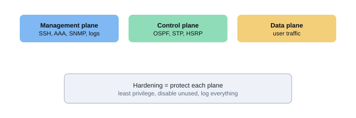

*شکل ۱: سه صفحه‌ی دستگاه و هدف Hardening.*

| صفحه       | کار                   | خطر                      | کنترل                           |
|------------|-----------------------|--------------------------|---------------------------------|
| Management | ورود ادمین، SNMP، Log | دسترسی غیرمجاز           | SSH، ACL، AAA، رمز قوی          |
| Control    | OSPF، STP، HSRP       | تزریق مسیر/Root جعلی     | Authentication، BPDU/Root Guard |
| Data       | ترافیک کاربران        | اسکن، Spoofing، Flooding | ACL، Port Security، Snooping    |

### ۲. چک‌لیست Management Plane

``` text
! 1. strong local credentials, hashed
enable secret <SECRET>
username admin privilege 15 secret <PASSWORD>
service password-encryption
no enable password

! 2. SSH only, version 2, key >= 2048
ip domain-name lab.local
crypto key generate rsa modulus 2048
ip ssh version 2
ip ssh time-out 60
ip ssh authentication-retries 3
line vty 0 4
 transport input ssh
 login local
 exec-timeout 10 0
 access-class MGMT-ONLY in
line console 0
 exec-timeout 10 0
 logging synchronous

! 3. brute-force protection
login block-for 120 attempts 5 within 60
login on-failure log
login on-success log

! 4. banners
banner login # Authorized access only #

! 5. turn off unneeded management
no ip http server
no ip http secure-server
no service pad
no service finger
no ip bootp server
```

- `service password-encryption`: رمزهای Type 7 را مخفی می‌کند ولی ضعیف است؛ رمز واقعی را فقط با `secret` بگذارید.
- `login block-for`: بعد از ۵ تلاش ناموفق در ۶۰ ثانیه، ۱۲۰ ثانیه ورود بسته می‌شود.
- `no ip http server`: وب‌مدیریت بدون نیاز را می‌بندد.

> **هشدار**
>
> رمز واقعی را در ریپو نگذارید (جانگهدار). و قبل از اعمال ACL/تغییر VTY از راه دور، `reload in 5` بگذارید تا قفل نشوید (درس ۲-۴).

### ۳. چک‌لیست Control Plane

``` text
! Layer 2
spanning-tree mode rapid-pvst
spanning-tree portfast bpduguard default
spanning-tree guard root     (on edge facing ports)

! Neighbor discovery: only where needed
no cdp run                   (or: no cdp enable on user-facing ports)
lldp run                     (only on trusted links)

! Routing: passive interfaces and authentication
router ospf 1
 passive-interface default
 no passive-interface gi0/1
interface gi0/1
 ip ospf authentication message-digest
 ip ospf message-digest-key 1 md5 <OSPF-KEY>
```

CDP/LLDP اطلاعات دستگاه (نام، IP، Image) را برای هر همسایه می‌گوید. روی پورت‌های کاربر باید خاموش باشد، چون مهاجم اطلاعات ارزشمند می‌گیرد.

### ۴. چک‌لیست Data Plane

``` text
! unused access ports: shut down and park in an unused VLAN
interface range gi0/10 - 24
 switchport mode access
 switchport access vlan 999
 shutdown

! disable negotiation, avoid VLAN hopping
interface range gi0/1 - 24
 switchport nonegotiate

! trunks: explicit native + allowed
interface gi0/0
 switchport trunk native vlan 999
 switchport trunk allowed vlan 10,20,50

! anti-spoofing basics
no ip source-route
no ip proxy-arp     (on user-facing interfaces)
no ip redirects
no ip unreachables  (on untrusted interfaces)
```

«VLAN 999 بدون استفاده» جای پارک پورت‌های خالی است؛ حتی اگر کسی کابل بزند، به شبکه‌ی خالی می‌رسد.

### ۵. مثال‌ها

#### ساده: بستن وب‌مدیریت

``` text
Core# show ip http server status
HTTP server status: Enabled
Core(config)# no ip http server
```

#### متوسط: پورت‌های خالی

``` text
Before: 18 unused ports, all in VLAN 1, no shutdown (open door)
After : shutdown + VLAN 999 for all unused ports
```

#### سخت: کنترل خودکار

``` text
Compare each device against the golden baseline:
  show running-config | include http|telnet|cdp|snmp
Any deviation = finding; record it and fix with a CHG.
```

> **صادقانه**
>
> بعضی دستورها (مثل `login block-for` یا `service-policy`) روی Imageهای شبیه‌ساز ممکن است محدود باشند. نتیجه‌ی واقعی را ثبت کنید و در تجهیز واقعی تکرار کنید.

### تمرین‌ها

**ت1.** ۱ (ساده): سه صفحه‌ی دستگاه؟ *(پاسخ: 8-1-ت1 در بخش «پاسخ‌ها» انتهای فصل)*

**ت2.** ۲ (ساده): چرا no ip http server؟ *(پاسخ: 8-1-ت2 در بخش «پاسخ‌ها» انتهای فصل)*

**ت3.** ۳ (متوسط): چرا پورت‌های خالی shutdown و VLAN 999؟ *(پاسخ: 8-1-ت3 در بخش «پاسخ‌ها» انتهای فصل)*

**ت4.** ۴ (متوسط): چرا CDP روی پورت کاربر خاموش؟ *(پاسخ: 8-1-ت4 در بخش «پاسخ‌ها» انتهای فصل)*

**ت5.** ۵ (سخت): قبل از Hardening VTY از راه دور چه شبکه‌ی ایمنی می‌گذاریم؟ *(پاسخ: 8-1-ت5 در بخش «پاسخ‌ها» انتهای فصل)*

### Lab هدایت‌شده

یک دستگاه (مثلاً Core-1) را با چک‌لیست سخت‌سازی کنید، مرحله‌ای و با بکاپ:

#### گام ۱: بکاپ و Baseline

``` text
Core-1# copy running-config flash:Core1-before-hardening.cfg
Core-1# show running-config | include http|telnet|cdp|snmp|password
```

#### گام ۲: Management Plane

بخش ۲ را اعمال کنید (با `reload in 5`).

#### گام ۳: Control/Data Plane

بخش‌های ۳ و ۴ را اعمال و `reload cancel` کنید.

#### گام ۴: بازبینی

``` text
Core-1# show running-config | include http|telnet|cdp|password
Core-1# show ip ssh
Core-1# show login
```

### Lab مستقل

«Hardening Baseline» (چک‌لیست ≥ ۲۰ بند با Verification) را در `03-ops/hardening-baseline.md` بنویسید.

### عیب‌یابی

|         |                                                                                                               |
|---------|---------------------------------------------------------------------------------------------------------------|
| Symptom | بعد از Hardening دسترسی SSH قطع شد                                                                            |
| چک‌لیست  | ۱) ACL VTY شامل آدرس شما؟ ؛ ۲) transport input ssh؟ ؛ ۳) کلید RSA و نام‌کاربری؟ ؛ ۴) login block-for فعال شده؟ |
| رفع     | از Console وارد شوید و اصلاح کنید یا reload in منتظر بماند                                                    |
| پیشگیری | بکاپ + reload in                                                                                              |

### سؤال‌های مرور

**م1.** Hardening چیست؟ *(پاسخ: 8-1-م1 در بخش «پاسخ‌ها» انتهای فصل)*

**م2.** چرا Management Plane مهم‌ترین است؟ *(پاسخ: 8-1-م2 در بخش «پاسخ‌ها» انتهای فصل)*

### English Corner: انگلیسی تخصصی این درس

این جمله‌ها از مستندات و محیط کار واقعی‌اند. بلند بخوانید و ترجمه را بپوشانید.

| English sentence                                       | ترجمه                                                       |
|--------------------------------------------------------|-------------------------------------------------------------|
| Disable all unused services and ports.                 | همه‌ی سرویس‌ها و پورت‌های بلااستفاده را غیرفعال کنید.          |
| Restrict management access to a dedicated subnet.      | دسترسی مدیریتی را به یک Subnet اختصاصی محدود کنید.          |
| Use secret instead of password for stored credentials. | برای رمزهای ذخیره‌شده به‌جای password از secret استفاده کنید. |
| Compare every device against a hardening baseline.     | هر دستگاه را با Baseline سخت‌سازی مقایسه کنید.               |

**Q1.** Quick quiz (answer in English): Why is "enable secret" preferred over "enable password"? *(پاسخ: 8-1-Q1 در بخش «پاسخ‌ها» انتهای فصل)*

### تکلیف و چک‌لیست تسلط

- [ ] Hardening را روی یک دستگاه اجرا و Verify کنم.
- [ ] Baseline را بنویسم.
- [ ] بکاپ قبل/بعد را نگه دارم.

### یادآوری اشتباهات شما

> **یادآوری**
>
> پیش‌بینی قبل از اجرا؛ بکاپ قبل از تغییر؛ پذیرفته‌شدن دستور ≠ کار کردن؛ فرمول‌ها در بلوک مستقل.


#### کارت Lab — Hardening تجهیزات

| # | فیلد | محتوا |
|---|---|---|
| 1 | عنوان و هدف | Hardening سه صفحه‌ی دستگاه |
| 2 | پیش‌نیاز | فصل 7 |
| 3 | توپولوژی | Core-1 |
| 4 | تجهیزات | Core-1 |
| 5 | نسخه نرم‌افزار | vIOS-L2 15.2(20200924، Experimental) برای SW؛ vIOS 15.9(3)M9 برای R؛ VPCS؛ PNetLab 4.2.8 |
| 6 | IP Plan | Baseline |
| 7 | وضعیت اولیه | چک‌لیست |
| 8 | صورت مسئله | Verify |
| 9 | مراحل هدایت‌شده | همان بخش «Lab هدایت‌شده» همین درس |
| 10 | تست عملکرد | `show running-config \| include http\|telnet` |
| 11 | سناریوی خرابی | قفل شدن از VTY |
| 12 | روش عیب‌یابی | لایه‌ای/با شواهد (بخش عیب‌یابی همین درس) |
| 13 | نتیجه‌ی مورد انتظار | بدون http/telnet |
| 14 | معیار پذیرش | Baseline Hardening |
| 15 | مستندات نهایی | `03-ops/hardening-baseline.md` |
| 16 | Cleanup و بازگردانی | reload cancel |

> **وضعیت راستی‌آزمایی (خارج از ۱۶ فیلد):** **اجرا نشده (فقط طراحی).** اجرا نشده.

---

<a id="l-8-2"></a>

## درس 8-2 — AAA و سطح‌های دسترسی

**فصل ۸ - روز ۲ · پیش‌نیاز: درس ۸-۱ · ۶ ساعت**

### این درس درباره چیست و چرا باید یاد بگیریم؟

**چه چیزی یاد می‌گیریم:** کنترل «چه کسی، چه کاری، چه زمانی» روی دستگاه: AAA (احراز هویت، مجوز، حسابداری)، سطح‌های دسترسی (Privilege Level)، و مفهوم TACACS+ و RADIUS.

**چرا لازم است:** اگر همه‌ی ادمین‌ها یک رمز مشترک بدانند، نمی‌توانید بگویید «چه کسی این تغییر را داد». AAA هر ادمین را جدا می‌شناسد، دسترسی را به نیاز او محدود می‌کند (Least Privilege) و ثبت می‌کند چه دستوری زد.

- **در کار روزانه:** کارمند کمک‌حال فقط show می‌بیند؛ ارشد تنظیم می‌کند.
- **در امنیت:** مسئولیت‌پذیری (Accountability) و اصل Least Privilege.
- **در Capstone:** Admin FortiGate هم با Profile و Trusted Host همین منطق را دارد.

> **مسیر درس**
>
> سه A ← Local AAA ← Privilege Level ← TACACS+ و RADIUS ← مثال ساده/متوسط/سخت ← Lab ← عیب‌یابی.

#### اصطلاحات این درس (مخفف ← شکل کامل ← معنی)

| مخفف      | شکل کامل انگلیسی                                      | معنی فارسی                              |
|-----------|-------------------------------------------------------|-----------------------------------------|
| AAA       | Authentication, Authorization, Accounting             | احراز هویت، مجوز، حسابداری              |
| TACACS+   | Terminal Access Controller Access-Control System Plus | پروتکل AAA سیسکو برای مدیریت دستگاه     |
| RADIUS    | Remote Authentication Dial-In User Service            | پروتکل AAA برای دسترسی شبکه             |
| Privilege | Privilege level                                       | سطح دسترسی 0 تا 15                      |
| RBAC      | Role-Based Access Control                             | دسترسی بر اساس نقش                      |
| Fallback  | Fallback                                              | روش جایگزین وقتی سرور AAA در دسترس نیست |

### ۱. سه A

| حرف            | معنی       | سؤال                     |
|----------------|------------|--------------------------|
| Authentication | احراز هویت | تو کیستی؟                |
| Authorization  | مجوز       | چه کاری مجازی انجام دهی؟ |
| Accounting     | حسابداری   | چه کاری انجام دادی؟      |

مثال: ورود به ساختمان: کارت (هویت)، دسترسی فقط به طبقه‌ی خودت (مجوز)، و دفتر ورود و خروج (ثبت).

### ۲. Local AAA (بدون سرور)

``` text
R1(config)# username netadmin privilege 15 secret <PASSWORD1>
R1(config)# username helpdesk privilege 5 secret <PASSWORD2>
R1(config)# aaa new-model
R1(config)# aaa authentication login default local
R1(config)# aaa authorization exec default local
R1(config)# aaa accounting exec default start-stop group tacacs+
R1(config)# line vty 0 4
R1(config-line)# login authentication default
```

> **هشدار قفل‌شدن**
>
> `aaa new-model` رفتار ورود را عوض می‌کند. قبل از آن حتماً یک کاربر محلی بسازید، با `reload in 5` کار کنید، و همیشه یک روش Fallback (Local) بگذارید.

### ۳. سطح‌های دسترسی (Privilege Level)

| سطح        | معنی                              |
|------------|-----------------------------------|
| 0          | دستورهای حداقلی (logout، exit...) |
| 1          | User EXEC (مشاهده‌ی محدود)         |
| 5 (سفارشی) | مثلاً show و ping برای کمک‌حال      |
| 15         | دسترسی کامل (Privileged EXEC)     |

``` text
R1(config)# privilege exec level 5 show running-config
R1(config)# privilege exec level 5 show ip interface brief
R1(config)# privilege exec level 5 ping
R1(config)# privilege exec level 5 traceroute
```

کاربر helpdesk با سطح ۵ فقط دستورهایی که به سطح ۵ داده‌اید را می‌بیند. راه امن‌تر و مدرن‌تر: Role-Based CLI (Parser View).

### ۴. TACACS+ و RADIUS

به‌جای ساختن کاربر روی ۵۰ دستگاه، یک سرور مرکزی کاربران را نگه می‌دارد؛ دستگاه از سرور می‌پرسد.

| ویژگی                              | TACACS+       | RADIUS             |
|------------------------------------|---------------|--------------------|
| سازنده                             | سیسکو         | استاندارد          |
| پورت                               | TCP 49        | UDP 1812/1813      |
| رمزگذاری                           | کل بسته       | فقط رمز            |
| مجوز دستور (Command Authorization) | بله، دقیق     | محدود              |
| کاربرد معمول                       | مدیریت دستگاه | VPN، Wi-Fi، 802.1X |

``` text
R1(config)# tacacs server TAC1
R1(config-server-tacacs)# address ipv4 10.10.10.70
R1(config-server-tacacs)# key <TACACS-KEY>
R1(config)# aaa group server tacacs+ TAC-GRP
R1(config-sg-tacacs+)# server name TAC1
R1(config)# aaa authentication login default group TAC-GRP local
R1(config)# aaa authorization exec default group TAC-GRP local
```

ترتیب در انتها یعنی: اول سرور، اگر در دسترس نبود Local (Fallback). این دستورها نیاز به سرور واقعی دارند؛ در Lab فقط ساخت و مفهوم را می‌بینیم و بعداً در FortiGate با RADIUS/LDAP کار می‌کنیم.

### ۵. مثال‌ها

#### ساده

``` text
Two users: netadmin (priv 15) and helpdesk (priv 5)
helpdesk logs in via SSH and can only run show and ping
```

#### متوسط: ثبت فعالیت

``` text
Accounting on: every exec session and command is logged to the AAA server
Audit question "who changed the ACL at 14:05?" is answerable
```

#### سخت: سرور AAA از کار افتاد

``` text
Config: group TAC-GRP local
TAC server down  -> login falls back to the local user (still works)
Without "local" -> everyone is locked out (only console recovery)
```

### تمرین‌ها

**ت1.** ۱ (ساده): سه A؟ *(پاسخ: 8-2-ت1 در بخش «پاسخ‌ها» انتهای فصل)*

**ت2.** ۲ (ساده): TACACS+ چه پورتی؟ *(پاسخ: 8-2-ت2 در بخش «پاسخ‌ها» انتهای فصل)*

**ت3.** ۳ (متوسط): چرا Local را Fallback می‌گذاریم؟ *(پاسخ: 8-2-ت3 در بخش «پاسخ‌ها» انتهای فصل)*

**ت4.** ۴ (متوسط): Privilege 15 یعنی؟ *(پاسخ: 8-2-ت4 در بخش «پاسخ‌ها» انتهای فصل)*

**ت5.** ۵ (سخت): TACACS+ در برابر RADIUS برای مدیریت دستگاه؟ *(پاسخ: 8-2-ت5 در بخش «پاسخ‌ها» انتهای فصل)*

### Lab هدایت‌شده

#### گام ۱: بکاپ و شبکه‌ی ایمنی

``` text
R1# copy running-config flash:R1-before-aaa.cfg
R1# reload in 10
```

#### گام ۲: کاربران و AAA محلی

بخش ۲ را اجرا کنید.

#### گام ۳: تست

از R2 با `ssh -l helpdesk` وارد شوید و ببینید فقط دستورهای سطح ۵ کار می‌کنند. با netadmin وارد شوید و تنظیم بزنید.

#### گام ۴: برداشتن reload

``` text
R1# reload cancel
R1# copy running-config startup-config
```

### Lab مستقل

یک «Access Matrix» (نقش‌ها، سطح، دستورها، دستگاه‌ها) در `03-ops/access-matrix.md` بنویسید.

### عیب‌یابی

|         |                                                                                                    |
|---------|----------------------------------------------------------------------------------------------------|
| Symptom | بعد از aaa new-model هیچ‌کس وارد نمی‌شود                                                             |
| چک‌لیست  | ۱) کاربر محلی وجود دارد؟ ؛ ۲) login authentication روی VTY؟ ؛ ۳) Fallback؟ ؛ ۴) سرور AAA در دسترس؟ |
| رفع     | Console + اصلاح؛ یا انتظار برای reload in                                                          |
| پیشگیری | همیشه شبکه‌ی ایمنی                                                                                  |

### سؤال‌های مرور

**م1.** Authorization چیست؟ *(پاسخ: 8-2-م1 در بخش «پاسخ‌ها» انتهای فصل)*

**م2.** چرا Accounting؟ *(پاسخ: 8-2-م2 در بخش «پاسخ‌ها» انتهای فصل)*

### English Corner: انگلیسی تخصصی این درس

این جمله‌ها از مستندات و محیط کار واقعی‌اند. بلند بخوانید و ترجمه را بپوشانید.

| English sentence                                                 | ترجمه                                                       |
|------------------------------------------------------------------|-------------------------------------------------------------|
| AAA controls who can log in, what they can do and what they did. | AAA تعیین می‌کند چه کسی وارد شود، چه کاری کند و چه کرده است. |
| Configure a local fallback in case the AAA server is down.       | برای زمانی که سرور AAA قطع است Fallback محلی بگذارید.       |
| Apply least privilege to each role.                              | برای هر نقش اصل حداقل دسترسی را رعایت کنید.                 |
| TACACS+ encrypts the entire payload.                             | TACACS+ کل بار بسته را رمز می‌کند.                           |

**Q1.** Quick quiz (answer in English): What happens if you configure AAA with no local fallback and the server is down? *(پاسخ: 8-2-Q1 در بخش «پاسخ‌ها» انتهای فصل)*

### تکلیف و چک‌لیست تسلط

- [ ] AAA محلی را با دو سطح بسازم.
- [ ] Fallback را توضیح دهم.
- [ ] Access Matrix را بنویسم.

### یادآوری اشتباهات شما

> **یادآوری**
>
> پیش‌بینی قبل از اجرا؛ بکاپ قبل از تغییر؛ پذیرفته‌شدن دستور ≠ کار کردن؛ فرمول‌ها در بلوک مستقل.


#### کارت Lab — AAA و سطح‌های دسترسی

| # | فیلد | محتوا |
|---|---|---|
| 1 | عنوان و هدف | AAA محلی و Privilege |
| 2 | پیش‌نیاز | درس 8-1 |
| 3 | توپولوژی | R1 |
| 4 | تجهیزات | R1،R2 |
| 5 | نسخه نرم‌افزار | vIOS-L2 15.2(20200924، Experimental) برای SW؛ vIOS 15.9(3)M9 برای R؛ VPCS؛ PNetLab 4.2.8 |
| 6 | IP Plan | — |
| 7 | وضعیت اولیه | دو کاربر |
| 8 | صورت مسئله | ورود helpdesk |
| 9 | مراحل هدایت‌شده | همان بخش «Lab هدایت‌شده» همین درس |
| 10 | تست عملکرد | `show privilege` |
| 11 | سناریوی خرابی | بدون fallback |
| 12 | روش عیب‌یابی | لایه‌ای/با شواهد (بخش عیب‌یابی همین درس) |
| 13 | نتیجه‌ی مورد انتظار | دسترسی سطحی |
| 14 | معیار پذیرش | Access Matrix |
| 15 | مستندات نهایی | `03-ops/access-matrix.md` |
| 16 | Cleanup و بازگردانی | reload cancel |

> **وضعیت راستی‌آزمایی (خارج از ۱۶ فیلد):** **اجرا نشده (فقط طراحی).** اجرا نشده.

---

<a id="l-8-3"></a>

## درس 8-3 — JSON، YAML و REST

**فصل ۸ - روز ۳ · پیش‌نیاز: فصل ۷ · ۶ ساعت**

### این درس درباره چیست و چرا باید یاد بگیریم؟

**چه چیزی یاد می‌گیریم:** زبان مشترک اتوماسیون: JSON و YAML، مفهوم REST API (متدها و کدهای وضعیت)، و ابزار curl؛ همراه با تمرین خواندن داده‌ی ساختاریافته.

**چرا لازم است:** دستگاه‌ها و سرویس‌های امروزی (FortiGate، Zabbix، Ansible، ابزارهای ابری) همه با API و JSON صحبت می‌کنند. اگر نتوانید JSON بخوانید و یک درخواست API بفرستید، از بخش بزرگی از کار مدرن بیرون می‌مانید.

- **در کار روزانه:** API فایروال برای گرفتن لیست Policy یا اضافه‌کردن Object.
- **در امنیت:** اتوماسیون ایمن (Token، Least Privilege) و جلوگیری از افشای رمز.
- **در FortiGate:** REST API فایروال با Token (W9 به بعد).

> **مسیر درس**
>
> داده ساختاریافته ← JSON ← YAML ← REST ← curl ← مثال ساده/متوسط/سخت ← Lab ← عیب‌یابی.

#### اصطلاحات این درس (مخفف ← شکل کامل ← معنی)

| مخفف     | شکل کامل انگلیسی                  | معنی فارسی                     |
|----------|-----------------------------------|--------------------------------|
| JSON     | JavaScript Object Notation        | قالب داده‌ی کلید-مقدار          |
| YAML     | YAML Ain't Markup Language        | قالب خوانای انسان برای تنظیمات |
| API      | Application Programming Interface | رابط برنامه‌نویسی               |
| REST     | Representational State Transfer   | سبک API مبتنی بر HTTP          |
| HTTP     | HyperText Transfer Protocol       | پروتکل وب                      |
| Token    | API token                         | کلید دسترسی به API             |
| Endpoint | API endpoint                      | آدرس یک منبع API               |
| jq       | jq                                | ابزار خط فرمان برای JSON       |

### ۱. چرا داده «ساختاریافته»؟

خروجی `show ip interface brief` برای انسان خوانا و برای برنامه دشوار است؛ باید ستون‌ها را جدا کرد و هر نسخه فرق می‌کند. اگر دستگاه همین اطلاعات را به‌صورت «کلید و مقدار» بدهد، برنامه مستقیم می‌خواند.

### ۲. JSON

JSON از دو ساختار ساخته می‌شود: شیء (Object) داخل آکولاد و آرایه (Array) داخل کروشه. مقدارها: رشته، عدد، true/false، null:

``` text
{
  "hostname": "R1",
  "interfaces": [
    { "name": "Gi0/0", "ip": "10.0.12.1", "status": "up" },
    { "name": "Gi0/1", "ip": null,        "status": "down" }
  ],
  "ospf_enabled": true,
  "uptime_days": 42
}
```

خواندن: `hostname` کلید است و `"R1"` مقدار. `interfaces` آرایه‌ای از دو شیء است. قواعد: کلیدها با دابل‌کوتیشن، بین عناصر ویرگول، بدون ویرگول آخر.

``` text
Path examples:
  hostname            -> "R1"
  interfaces[0].ip    -> "10.0.12.1"
  interfaces[1].status-> "down"
```

### ۳. YAML

همان داده، بدون آکولاد، با تورفتگی (فاصله‌ها، نه Tab):

``` text
hostname: R1
interfaces:
  - name: Gi0/0
    ip: 10.0.12.1
    status: up
  - name: Gi0/1
    ip: null
    status: down
ospf_enabled: true
uptime_days: 42
```

> **قانون YAML**
>
> تورفتگی معنی دارد. دو فاصله برای هر سطح؛ هرگز Tab. یک فاصله‌ی اضافه ساختار را خراب می‌کند. Ansible با YAML کار می‌کند.

### ۴. REST API و HTTP

REST یعنی هر «منبع» (مثلاً یک Interface) یک آدرس (URL) دارد و با متدهای HTTP روی آن کار می‌کنیم:

| متد    | کار           | مثال             |
|--------|---------------|------------------|
| GET    | خواندن        | لیست Interfaceها |
| POST   | ساختن         | Object جدید      |
| PUT    | جایگزینی کامل | به‌روزرسانی کامل  |
| PATCH  | تغییر جزئی    | یک فیلد          |
| DELETE | حذف           | حذف Object       |

| کد وضعیت | معنی            |
|----------|-----------------|
| 200      | موفق            |
| 201      | ساخته شد        |
| 400      | درخواست نامعتبر |
| 401      | احراز هویت نشده |
| 403      | دسترسی ممنوع    |
| 404      | یافت نشد        |
| 500      | خطای سرور       |

### ۵. curl و jq

ابزار خط فرمان برای ارسال درخواست HTTP. در Lab ما، سرویس API لوکال و Token نمونه استفاده می‌شود (بدون رمز واقعی):

``` text
# GET request with a token header (token comes from an environment variable)
curl -s -H "Authorization: Bearer $LAB_TOKEN" https://10.10.10.80/api/v2/monitor/system/status

# pretty print and pick a field with jq
curl -s -H "Authorization: Bearer $LAB_TOKEN" https://10.10.10.80/api/v2/monitor/system/status | jq ".results.hostname"

# POST a JSON body
curl -s -X POST -H "Content-Type: application/json" -d "{\"name\":\"web1\"}" https://10.10.10.80/api/v2/cmdb/firewall/address
```

> **امنیت**
>
> Token را در دستور یا فایل ذخیره‌شده در Git ننویسید؛ از متغیر محیطی یا مدیر رمز استفاده کنید. `-k` (نادیده‌گرفتن Certificate) فقط در Lab و با علم به خطر.

### ۶. مثال‌ها

#### ساده: خواندن JSON

``` text
From the JSON above: what is the IP of Gi0/0?  -> 10.0.12.1
```

#### متوسط: تبدیل به YAML

همان شیء Gi0/1 را به YAML بنویسید (بخش ۳).

#### سخت: خطای 401

``` text
curl returns HTTP 401
Causes: missing/expired token, wrong header name, wrong scheme (Bearer vs api_key),
        token tied to a different source IP (trusted host)
Do not retry blindly: fix auth first
```

### تمرین‌ها

**ت1.** ۱ (ساده): تفاوت Object و Array؟ *(پاسخ: 8-3-ت1 در بخش «پاسخ‌ها» انتهای فصل)*

**ت2.** ۲ (ساده): GET چه می‌کند؟ *(پاسخ: 8-3-ت2 در بخش «پاسخ‌ها» انتهای فصل)*

**ت3.** ۳ (متوسط): کد 403 یعنی؟ *(پاسخ: 8-3-ت3 در بخش «پاسخ‌ها» انتهای فصل)*

**ت4.** ۴ (متوسط): چرا YAML با Tab خراب می‌شود؟ *(پاسخ: 8-3-ت4 در بخش «پاسخ‌ها» انتهای فصل)*

**ت5.** ۵ (سخت): چرا Token در Git ممنوع؟ *(پاسخ: 8-3-ت5 در بخش «پاسخ‌ها» انتهای فصل)*

### Lab هدایت‌شده

این Lab روی لپ‌تاپ/VM شماست و به تجهیزات دست نمی‌زند.

#### گام ۱: فایل JSON بسازید

با یک ویرایشگر، JSON بخش ۲ را در `interfaces.json` ذخیره کنید.

#### گام ۲: خواندن با jq

``` text
jq ".hostname" interfaces.json
jq ".interfaces[].name" interfaces.json
jq ".interfaces[] | select(.status==\"down\")" interfaces.json
```

#### گام ۳: تبدیل به YAML

همان داده را دستی به YAML بنویسید و با یک ابزار آنلاین/محلی اعتبارسنجی کنید.

#### گام ۴: درخواست API آزمایشی

اگر API لوکال ندارید، با یک سرویس عمومی تست (مثلاً یک API نمونه) یک GET بزنید و کد وضعیت را بخوانید؛ بعداً با FortiGate تکرار می‌کنیم.

### Lab مستقل

سه خروجی show را (دستی) به JSON ساختاریافته تبدیل کنید و در `04-automation/data-samples/` ذخیره کنید.

### عیب‌یابی

|         |                                                         |
|---------|---------------------------------------------------------|
| Symptom | JSON خطای Parse می‌دهد                                   |
| چک‌لیست  | ۱) دابل‌کوتیشن؟ ؛ ۲) ویرگول آخر؟ ؛ ۳) آکولاد/کروشه بسته؟ |
| ابزار   | jq ، validator                                          |
| رفع     | اصلاح دستور نگارشی                                      |

### سؤال‌های مرور

**م1.** REST چیست؟ *(پاسخ: 8-3-م1 در بخش «پاسخ‌ها» انتهای فصل)*

**م2.** چرا YAML برای Ansible؟ *(پاسخ: 8-3-م2 در بخش «پاسخ‌ها» انتهای فصل)*

### English Corner: انگلیسی تخصصی این درس

این جمله‌ها از مستندات و محیط کار واقعی‌اند. بلند بخوانید و ترجمه را بپوشانید.

| English sentence                                             | ترجمه                                           |
|--------------------------------------------------------------|-------------------------------------------------|
| The API returns the data in JSON format.                     | API داده را به قالب JSON برمی‌گرداند.            |
| Send a GET request with the authorization header.            | یک درخواست GET با هدر Authorization بفرستید.    |
| The server responded with HTTP 401, so the token is invalid. | سرور HTTP 401 داد، پس Token نامعتبر است.        |
| Keep tokens in environment variables, not in the repository. | Tokenها را در متغیر محیطی نگه دارید نه در ریپو. |

**Q1.** Quick quiz (answer in English): What is the difference between PUT and PATCH? *(پاسخ: 8-3-Q1 در بخش «پاسخ‌ها» انتهای فصل)*

### تکلیف و چک‌لیست تسلط

- [ ] JSON را بخوانم و بنویسم.
- [ ] YAML را بنویسم.
- [ ] curl/jq را تمرین کنم.

### یادآوری اشتباهات شما

> **یادآوری**
>
> پیش‌بینی قبل از اجرا؛ بکاپ قبل از تغییر؛ پذیرفته‌شدن دستور ≠ کار کردن؛ فرمول‌ها در بلوک مستقل.


#### کارت Lab — JSON، YAML و REST

| # | فیلد | محتوا |
|---|---|---|
| 1 | عنوان و هدف | JSON/YAML/REST |
| 2 | پیش‌نیاز | درس 8-2 |
| 3 | توپولوژی | PC |
| 4 | تجهیزات | PC شما |
| 5 | نسخه نرم‌افزار | vIOS-L2 15.2(20200924، Experimental) برای SW؛ vIOS 15.9(3)M9 برای R؛ VPCS؛ PNetLab 4.2.8 |
| 6 | IP Plan | — |
| 7 | وضعیت اولیه | نمونه فایل |
| 8 | صورت مسئله | jq |
| 9 | مراحل هدایت‌شده | همان بخش «Lab هدایت‌شده» همین درس |
| 10 | تست عملکرد | `jq` |
| 11 | سناریوی خرابی | Parse error |
| 12 | روش عیب‌یابی | لایه‌ای/با شواهد (بخش عیب‌یابی همین درس) |
| 13 | نتیجه‌ی مورد انتظار | خواندن مقدار |
| 14 | معیار پذیرش | نمونه‌ها |
| 15 | مستندات نهایی | `04-automation/data-samples/` |
| 16 | Cleanup و بازگردانی | — |

> **وضعیت راستی‌آزمایی (خارج از ۱۶ فیلد):** **اجرا نشده (فقط طراحی).** روی PC شما؛ اجرا نشده.

---

<a id="l-8-4"></a>

## درس 8-4 — Python و Netmiko

**فصل ۸ - روز ۴ · پیش‌نیاز: درس‌های ۸-۱ و ۸-۳ · ۶ ساعت**

### این درس درباره چیست و چرا باید یاد بگیریم؟

**چه چیزی یاد می‌گیریم:** نوشتن یک اسکریپت Python با کتابخانه‌ی Netmiko که به چند دستگاه با SSH وصل شود، فقط دستورهای مشاهده (`show`) اجرا کند و پیکربندی را بکاپ بگیرد؛ بدون ذخیره‌ی رمز در کد.

**چرا لازم است:** گرفتن بکاپ از ۵۰ سوییچ به‌صورت دستی ساعت‌ها طول می‌کشد و فراموش می‌شود. یک اسکریپت ساده همین کار را در دقیقه‌ها و هر شب انجام می‌دهد و یک «تاریخچه‌ی تغییرات» می‌سازد. این اولین قدم عملی اتوماسیون است و ریسکش (چون فقط read است) پایین است.

- **در کار روزانه:** بکاپ شبانه و گزارش Inventory.
- **در امنیت:** اسکریپت اشتباه می‌تواند همه‌ی دستگاه‌ها را همزمان خراب کند؛ برای همین فقط read-only و تست روی یک دستگاه.
- **در Capstone:** بکاپ خودکار Config همه‌ی تجهیزات در Git.

> **مسیر درس**
>
> چرا Netmiko ← محیط امن ← اسکریپت قدم‌به‌قدم ← خطاها ← مثال ساده/متوسط/سخت ← Lab ← عیب‌یابی.

#### اصطلاحات این درس (مخفف ← شکل کامل ← معنی)

| مخفف                 | شکل کامل انگلیسی           | معنی فارسی                                |
|----------------------|----------------------------|-------------------------------------------|
| Python               | Python                     | زبان برنامه‌نویسی                          |
| Netmiko              | Netmiko                    | کتابخانه‌ی Python برای SSH به تجهیزات شبکه |
| venv                 | Python virtual environment | محیط جدا برای بسته‌ها                      |
| Idempotent           | Idempotent                 | اجرای چندباره = نتیجه‌ی یکسان              |
| Read-only            | Read-only                  | فقط خواندن؛ بدون تغییر                    |
| Inventory            | Device inventory           | فهرست دستگاه‌ها                            |
| Environment variable | Environment variable       | متغیر محیطی برای نگه‌داری رمز              |

### ۱. ایده

Netmiko یک «کاربر خودکار» است: با SSH وارد دستگاه می‌شود، دستور می‌زند و خروجی را برمی‌گرداند.

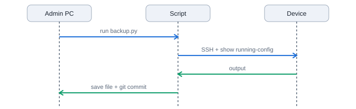

*شکل ۱: اسکریپت با SSH به دستگاه وصل می‌شود، show می‌زند و خروجی را ذخیره می‌کند.*

### ۲. آماده‌سازی محیط (روی PC/VM شما)

این دستورها را شما روی دستگاه خودتان اجرا می‌کنید (من فقط فرمان می‌دهم و به شبکه‌ی شما متصل نمی‌شوم):

``` text
python3 -m venv netauto
source netauto/bin/activate          # Windows: netauto\Scripts\activate
pip install netmiko
pip freeze > requirements.txt
```

رمز را در متغیر محیطی می‌گذاریم، نه در کد:

``` text
export NET_USER=netadmin
export NET_PASS='<your-password>'
# Windows PowerShell:  $env:NET_USER="netadmin"; $env:NET_PASS="<your-password>"
```

### ۳. Inventory

فایل `inventory.yaml` فقط آدرس‌ها و نوع دستگاه را دارد؛ رمز ندارد:

``` text
devices:
  - name: CORE-SW1
    host: 10.10.10.2
    device_type: cisco_ios
  - name: CORE-SW2
    host: 10.10.10.3
    device_type: cisco_ios
  - name: EDGE-R1
    host: 10.10.10.1
    device_type: cisco_ios
```

### ۴. اسکریپت (Read-only)

``` text
import os, sys, datetime, pathlib
import yaml
from netmiko import ConnectHandler
from netmiko.exceptions import NetmikoTimeoutException, NetmikoAuthenticationException

USER = os.environ.get("NET_USER")
PASS = os.environ.get("NET_PASS")
if not USER or not PASS:
    sys.exit("Set NET_USER and NET_PASS first")

# read-only: only show commands are allowed
ALLOWED = ("show ",)
COMMANDS = ["show running-config", "show version", "show ip interface brief"]
for c in COMMANDS:
    assert c.startswith(ALLOWED), "only show commands are allowed"

out_dir = pathlib.Path("backups")
out_dir.mkdir(exist_ok=True)
stamp = datetime.date.today().isoformat()

with open("inventory.yaml") as f:
    inventory = yaml.safe_load(f)["devices"]

for dev in inventory:
    params = {"device_type": dev["device_type"], "host": dev["host"],
              "username": USER, "password": PASS, "timeout": 20}
    try:
        with ConnectHandler(**params) as conn:
            for cmd in COMMANDS:
                text = conn.send_command(cmd)
                name = cmd.replace(" ", "_")
                (out_dir / f"{dev['name']}_{name}_{stamp}.txt").write_text(text)
        print(f"OK   {dev['name']}")
    except NetmikoTimeoutException:
        print(f"FAIL {dev['name']}: timeout")
    except NetmikoAuthenticationException:
        print(f"FAIL {dev['name']}: authentication")
    except Exception as e:
        print(f"FAIL {dev['name']}: {e}")
```

توضیح بخش‌ها:

- رمز از متغیر محیطی خوانده می‌شود، نه از کد.
- `ALLOWED`: اسکریپت فقط اجازه‌ی show دارد؛ اگر دستور دیگری اضافه شود برنامه می‌ایستد.
- `try/except`: خرابی یک دستگاه بقیه را متوقف نمی‌کند.
- فایل خروجی هر دستگاه و تاریخ دارد؛ در Git نگه‌داری می‌شود (درس ۸-۶).

### ۵. قبل از اجرا: چک‌لیست ایمنی

1.  اول روی **یک** دستگاه تست کنید.
2.  فقط دستورهای show.
3.  رمز در متغیر محیطی؛ فایل خروجی هم ممکن است Hash رمز داشته باشد؛ خروجی را در Git عمومی نگذارید.
4.  حد تعداد اتصال همزمان؛ در Lab ما یکی‌یکی.
5.  لاگ اجرا را نگه دارید.

### ۶. مثال‌ها

#### ساده: یک دستگاه

``` text
Inventory has 1 device -> script prints "OK CORE-SW1" and one file per command
```

#### متوسط: خطای SSH

``` text
FAIL CORE-SW2: timeout
Check: ping, SSH enabled, VTY ACL allows the automation host, route
```

#### سخت: تغییرات امن

وقتی بخواهید پیکربندی هم بزنید (`send_config_set`)، اول `--check` یا Dry-run، تغییر روی یک دستگاه، تأیید، بعد بقیه؛ و بکاپ قبل از تغییر. اتوماسیون خطا را سریع‌تر و گسترده‌تر پخش می‌کند.

> **دسترسی در PNetLab**
>
> گره‌های PNetLab به‌طور پیش‌فرض از بیرون SSH ندارند. یا مدیریت را به Lab وصل می‌کنید (VLAN10 مدیریت با آدرس قابل‌دسترس از VM اتوماسیون)، یا از `cisco_ios_telnet` روی پورت Console PNetLab استفاده می‌کنید. این تصمیم را قبل از اجرا با هم می‌گیریم؛ من به تجهیزات شما وصل نمی‌شوم.

### تمرین‌ها

**ت1.** ۱ (ساده): چرا رمز در متغیر محیطی؟ *(پاسخ: 8-4-ت1 در بخش «پاسخ‌ها» انتهای فصل)*

**ت2.** ۲ (ساده): read-only یعنی چه؟ *(پاسخ: 8-4-ت2 در بخش «پاسخ‌ها» انتهای فصل)*

**ت3.** ۳ (متوسط): چرا try/except؟ *(پاسخ: 8-4-ت3 در بخش «پاسخ‌ها» انتهای فصل)*

**ت4.** ۴ (متوسط): چرا اول روی یک دستگاه؟ *(پاسخ: 8-4-ت4 در بخش «پاسخ‌ها» انتهای فصل)*

**ت5.** ۵ (سخت): چه چیزی در خروجی show running-config حساس است؟ *(پاسخ: 8-4-ت5 در بخش «پاسخ‌ها» انتهای فصل)*

### Lab هدایت‌شده

این Lab روی PC/VM شماست؛ هر گام را خودتان اجرا و نتیجه را گزارش می‌کنید:

1.  محیط و بسته‌ها را بسازید (بخش ۲).
2.  `inventory.yaml` را با یک دستگاه بسازید.
3.  اسکریپت را اجرا کنید و فایل خروجی را ببینید.
4.  یک دستگاه را عمداً با آدرس اشتباه بگذارید و خطا را ببینید.
5.  سپس با ۳ دستگاه اجرا کنید.

### Lab مستقل

اسکریپت را به «گزارش Inventory» (hostname، Version، Interfaceهای down) گسترش دهید؛ بدون هیچ تغییر روی دستگاه. در `04-automation/backup.py` (بدون رمز) ذخیره کنید.

### عیب‌یابی

|         |                                                                        |
|---------|------------------------------------------------------------------------|
| Symptom | اسکریپت به دستگاه وصل نمی‌شود                                           |
| چک‌لیست  | ۱) ping؟ ؛ ۲) SSH روشن؟ ؛ ۳) ACL VTY؟ ؛ ۴) رمز/کاربر؟ ؛ ۵) device_type |
| ابزار   | ssh دستی ، debug Netmiko با session_log                                |
| رفع     | اصلاح اتصال                                                            |

### سؤال‌های مرور

**م1.** Netmiko چه می‌کند؟ *(پاسخ: 8-4-م1 در بخش «پاسخ‌ها» انتهای فصل)*

**م2.** چرا Read-only برای شروع؟ *(پاسخ: 8-4-م2 در بخش «پاسخ‌ها» انتهای فصل)*

### English Corner: انگلیسی تخصصی این درس

این جمله‌ها از مستندات و محیط کار واقعی‌اند. بلند بخوانید و ترجمه را بپوشانید.

| English sentence                                                    | ترجمه                                                     |
|---------------------------------------------------------------------|-----------------------------------------------------------|
| The script connects over SSH and saves the running configuration.   | اسکریپت با SSH وصل می‌شود و running-config را ذخیره می‌کند. |
| Store credentials in environment variables.                         | اعتبارنامه‌ها را در متغیر محیطی نگه دارید.                 |
| Test on a single device before running against the whole inventory. | قبل از اجرا روی کل Inventory روی یک دستگاه تست کنید.      |
| Handle exceptions so one failure does not stop the run.             | خطاها را مدیریت کنید تا یک شکست اجرا را متوقف نکند.       |

**Q1.** Quick quiz (answer in English): Why is a read-only script a safe first step in network automation? *(پاسخ: 8-4-Q1 در بخش «پاسخ‌ها» انتهای فصل)*

### تکلیف و چک‌لیست تسلط

- [ ] اسکریپت را روی یک دستگاه اجرا کنم.
- [ ] هیچ رمزی در کد یا ریپو نباشد.
- [ ] خروجی بکاپ را ذخیره کنم.

### یادآوری اشتباهات شما

> **یادآوری**
>
> پیش‌بینی قبل از اجرا؛ بکاپ قبل از تغییر؛ پذیرفته‌شدن دستور ≠ کار کردن؛ فرمول‌ها در بلوک مستقل.


#### کارت Lab — Python و Netmiko

| # | فیلد | محتوا |
|---|---|---|
| 1 | عنوان و هدف | Python/Netmiko بکاپ read-only |
| 2 | پیش‌نیاز | درس 8-3 |
| 3 | توپولوژی | PC + SW |
| 4 | تجهیزات | PC،SW |
| 5 | نسخه نرم‌افزار | vIOS-L2 15.2(20200924، Experimental) برای SW؛ vIOS 15.9(3)M9 برای R؛ VPCS؛ PNetLab 4.2.8 |
| 6 | IP Plan | SSH فعال |
| 7 | وضعیت اولیه | inventory.yaml |
| 8 | صورت مسئله | بکاپ |
| 9 | مراحل هدایت‌شده | همان بخش «Lab هدایت‌شده» همین درس |
| 10 | تست عملکرد | اجرای اسکریپت |
| 11 | سناریوی خرابی | timeout |
| 12 | روش عیب‌یابی | لایه‌ای/با شواهد (بخش عیب‌یابی همین درس) |
| 13 | نتیجه‌ی مورد انتظار | فایل بکاپ |
| 14 | معیار پذیرش | backup.py |
| 15 | مستندات نهایی | `04-automation/backup.py` |
| 16 | Cleanup و بازگردانی | — |

> **وضعیت راستی‌آزمایی (خارج از ۱۶ فیلد):** **اجرا نشده (فقط طراحی).** اجرا نشده؛ مسیر SSH به Node بررسی نشده.

---

<a id="l-8-5"></a>

## درس 8-5 — Ansible

**فصل ۸ - روز ۵ · پیش‌نیاز: درس‌های ۸-۳ و ۸-۴ · ۶ ساعت**

### این درس درباره چیست و چرا باید یاد بگیریم؟

**چه چیزی یاد می‌گیریم:** ابزار Ansible برای مدیریت پیکربندی چند دستگاه: Inventory، Playbook، ماژول‌های `ios_command` و `ios_config`، مفهوم Idempotency، و حالت‌های امن `--check` و `--diff`.

**چرا لازم است:** Python به شما آزادی کامل می‌دهد ولی همه‌چیز را خودتان باید بنویسید. Ansible تنظیمات را «توصیفی» می‌کند: بگویید «این Banner و این NTP روی همه‌ی ۵ دستگاه باشد»، و خودش فقط تفاوت‌ها را اعمال می‌کند. نتیجه یکنواختی تنظیمات و سرعت است.

- **در کار روزانه:** استقرار استاندارد (Banner، NTP، Syslog) روی ده‌ها دستگاه.
- **در امنیت:** Playbook = سند قابل‌بازبینی و Rollback؛ Vault برای رمزها.
- **در Capstone:** اعمال Baseline سخت‌سازی روی همه‌ی تجهیزات Cisco.

> **مسیر درس**
>
> چرا Ansible ← Inventory ← Playbook ← Idempotency ← Check/Diff ← مثال ساده/متوسط/سخت ← Lab ← عیب‌یابی.

#### اصطلاحات این درس (مخفف ← شکل کامل ← معنی)

| مخفف        | شکل کامل انگلیسی | معنی فارسی                 |
|-------------|------------------|----------------------------|
| Ansible     | Ansible          | ابزار اتوماسیون بدون Agent |
| Playbook    | Playbook         | فایل YAML مراحل کار        |
| Module      | Ansible module   | واحد عمل مثل ios_config    |
| Inventory   | Inventory        | فهرست دستگاه‌ها و گروه‌ها    |
| Idempotency | Idempotency      | اجرای مکرر، نتیجه‌ی یکسان   |
| Vault       | Ansible Vault    | رمزگذاری فایل‌های حساس      |
| Check mode  | --check          | اجرای آزمایشی بدون تغییر   |
| Diff        | --diff           | نمایش تفاوت                |

### ۱. تفاوت اسکریپت و Ansible

| موضوع      | اسکریپت Python             | Ansible                            |
|------------|----------------------------|------------------------------------|
| سبک        | دستوری: «این کارها را بکن» | توصیفی: «وضعیت باید این باشد»      |
| اجرای مکرر | ممکن است دوباره اعمال شود  | فقط تفاوت اعمال می‌شود (Idempotent) |
| تنظیم      | کد                         | YAML                               |
| یادگیری    | نیاز به برنامه‌نویسی        | ساده‌تر برای ادمین                  |

### ۲. نصب و Inventory

``` text
python3 -m venv ansenv && source ansenv/bin/activate
pip install ansible ansible-pylibssh
ansible-galaxy collection install cisco.ios
ansible --version
```

``` text
# inventory.ini
[cisco]
CORE-SW1 ansible_host=10.10.10.2
CORE-SW2 ansible_host=10.10.10.3
EDGE-R1  ansible_host=10.10.10.1

[cisco:vars]
ansible_network_os=cisco.ios.ios
ansible_connection=ansible.netcommon.network_cli
ansible_user={{ lookup('env','NET_USER') }}
ansible_password={{ lookup('env','NET_PASS') }}
```

رمز دوباره از متغیر محیطی می‌آید؛ در فایل ننویسید.

### ۳. Playbook اول: فقط خواندن

``` text
# show_version.yml
- name: Collect version
  hosts: cisco
  gather_facts: false
  tasks:
    - name: Run show version
      cisco.ios.ios_command:
        commands:
          - show version
      register: out

    - name: Print first lines
      ansible.builtin.debug:
        msg: "{{ out.stdout_lines[0][:3] }}"
```

``` text
ansible-playbook -i inventory.ini show_version.yml
```

### ۴. Playbook تنظیم: Banner و NTP

``` text
# baseline.yml
- name: Apply baseline
  hosts: cisco
  gather_facts: false
  tasks:
    - name: Set login banner
      cisco.ios.ios_banner:
        banner: login
        text: "Authorized access only"
        state: present

    - name: Set NTP and syslog
      cisco.ios.ios_config:
        lines:
          - ntp server 10.10.10.53
          - logging host 10.10.10.60
          - service timestamps log datetime msec localtime
```

#### اجرای امن (سه قدم)

1.  **Check:** `ansible-playbook baseline.yml --check --diff --limit CORE-SW1` فقط نشان می‌دهد چه تغییر می‌کند.
2.  **یک دستگاه:** بدون `--check` ولی با `--limit CORE-SW1`.
3.  **همه:** بعد از تأیید، بدون `--limit`.

> **Idempotency**
>
> اگر Banner و NTP قبلاً تنظیم شده باشند، اجرای دوباره `changed=0` می‌دهد. این یعنی Playbook «حالت مطلوب» را می‌گوید، نه «کار».

``` text
PLAY RECAP
CORE-SW1 : ok=2 changed=1 unreachable=0 failed=0   (first run)
CORE-SW1 : ok=2 changed=0 unreachable=0 failed=0   (second run: idempotent)
```

### ۵. Vault: رمز امن

اگر مجبور شدید رمز در فایل بگذارید، با Vault رمزگذاری کنید:

``` text
ansible-vault create secrets.yml
ansible-playbook -i inventory.ini baseline.yml --ask-vault-pass
```

فایل Vault هم نباید به‌همراه کلیدش در Git عمومی برود.

### ۶. مثال‌ها

#### ساده

``` text
ios_command: show version on all hosts -> read-only, safe
```

#### متوسط: همگن‌سازی

``` text
Baseline applied to 5 devices -> all have the same NTP/syslog/banner
Second run -> changed=0
```

#### سخت: تغییر خطرناک

``` text
Wrong ios_config line (e.g. removing the VTY ACL) pushed to ALL devices at once
-> everyone loses SSH
Prevention: --check/--diff first, --limit to one device, backup before, reload in on critical changes
```

> **صادقانه**
>
> اجرای Ansible روی IOS شبیه‌ساز ممکن است به‌خاطر نسخه‌ی SSH یا الگوریتم‌ها خطا بدهد. اگر شد، خطا را ثبت کنید؛ این هم بخشی از یادگیری است.

### تمرین‌ها

**ت1.** ۱ (ساده): Idempotency چیست؟ *(پاسخ: 8-5-ت1 در بخش «پاسخ‌ها» انتهای فصل)*

**ت2.** ۲ (ساده): --check چه می‌کند؟ *(پاسخ: 8-5-ت2 در بخش «پاسخ‌ها» انتهای فصل)*

**ت3.** ۳ (متوسط): چرا --limit؟ *(پاسخ: 8-5-ت3 در بخش «پاسخ‌ها» انتهای فصل)*

**ت4.** ۴ (متوسط): رمز را کجا نگه می‌داریم؟ *(پاسخ: 8-5-ت4 در بخش «پاسخ‌ها» انتهای فصل)*

**ت5.** ۵ (سخت): تفاوت ios_command و ios_config؟ *(پاسخ: 8-5-ت5 در بخش «پاسخ‌ها» انتهای فصل)*

### Lab هدایت‌شده

روی PC/VM شما:

1.  Inventory با ۲ دستگاه بسازید.
2.  Playbook `show_version.yml` را اجرا کنید.
3.  `baseline.yml` را با `--check --diff --limit` اجرا کنید.
4.  روی یک دستگاه اعمال و سپس روی همه.
5.  دوباره اجرا کنید و `changed=0` را تأیید کنید.

### Lab مستقل

یک Playbook «hardening-lite» (Banner، no ip http server، NTP، Syslog) در `04-automation/baseline.yml` بنویسید؛ بدون رمز.

### عیب‌یابی

|         |                                                                                                 |
|---------|-------------------------------------------------------------------------------------------------|
| Symptom | Playbook خطای اتصال می‌دهد                                                                       |
| چک‌لیست  | ۱) network_cli و network_os؟ ؛ ۲) collection نصب است؟ ؛ ۳) SSH کار می‌کند؟ ؛ ۴) رمز/متغیر محیطی؟ |
| ابزار   | ansible -m ping ، -vvv                                                                          |
| رفع     | اصلاح Inventory یا اتصال                                                                        |

### سؤال‌های مرور

**م1.** Ansible در چه چیزی بهتر از اسکریپت است؟ *(پاسخ: 8-5-م1 در بخش «پاسخ‌ها» انتهای فصل)*

**م2.** --diff چه نشان می‌دهد؟ *(پاسخ: 8-5-م2 در بخش «پاسخ‌ها» انتهای فصل)*

### English Corner: انگلیسی تخصصی این درس

این جمله‌ها از مستندات و محیط کار واقعی‌اند. بلند بخوانید و ترجمه را بپوشانید.

| English sentence                                              | ترجمه                                                     |
|---------------------------------------------------------------|-----------------------------------------------------------|
| Run the playbook in check mode before applying changes.       | قبل از اعمال تغییرات Playbook را در Check Mode اجرا کنید. |
| The task is idempotent, so the second run reports no changes. | Task Idempotent است، پس اجرای دوم تغییری گزارش نمی‌کند.    |
| Limit the run to a single host first.                         | ابتدا اجرا را به یک میزبان محدود کنید.                    |
| Encrypt secrets with Ansible Vault.                           | رمزها را با Ansible Vault رمز کنید.                       |

**Q1.** Quick quiz (answer in English): What does changed=0 on a second run tell you? *(پاسخ: 8-5-Q1 در بخش «پاسخ‌ها» انتهای فصل)*

### تکلیف و چک‌لیست تسلط

- [ ] Playbook را با Check/Diff اجرا کنم.
- [ ] Idempotency را ببینم.
- [ ] هیچ رمزی در Git نباشد.

### یادآوری اشتباهات شما

> **یادآوری**
>
> پیش‌بینی قبل از اجرا؛ بکاپ قبل از تغییر؛ پذیرفته‌شدن دستور ≠ کار کردن؛ فرمول‌ها در بلوک مستقل.


#### کارت Lab — Ansible

| # | فیلد | محتوا |
|---|---|---|
| 1 | عنوان و هدف | Ansible Baseline |
| 2 | پیش‌نیاز | درس 8-4 |
| 3 | توپولوژی | PC + SW |
| 4 | تجهیزات | PC،SW |
| 5 | نسخه نرم‌افزار | vIOS-L2 15.2(20200924، Experimental) برای SW؛ vIOS 15.9(3)M9 برای R؛ VPCS؛ PNetLab 4.2.8 |
| 6 | IP Plan | SSH فعال |
| 7 | وضعیت اولیه | baseline.yml |
| 8 | صورت مسئله | changed=0 دوم |
| 9 | مراحل هدایت‌شده | همان بخش «Lab هدایت‌شده» همین درس |
| 10 | تست عملکرد | `ansible-playbook --check` |
| 11 | سناریوی خرابی | خطای اتصال |
| 12 | روش عیب‌یابی | لایه‌ای/با شواهد (بخش عیب‌یابی همین درس) |
| 13 | نتیجه‌ی مورد انتظار | Idempotent |
| 14 | معیار پذیرش | Playbook |
| 15 | مستندات نهایی | `04-automation/baseline.yml` |
| 16 | Cleanup و بازگردانی | — |

> **وضعیت راستی‌آزمایی (خارج از ۱۶ فیلد):** **اجرا نشده (فقط طراحی).** اجرا نشده.

---

<a id="l-8-6"></a>

## درس 8-6 — Git، As-Built و CP1

**فصل ۸ - روز ۶ · پیش‌نیاز: درس‌های ۸-۴ و ۸-۵ · ۶ ساعت**

### این درس درباره چیست و چرا باید یاد بگیریم؟

**چه چیزی یاد می‌گیریم:** نسخه‌بندی پیکربندی‌ها با Git (commit، diff، branch)، جلوگیری از ورود رمز به ریپو، مقایسه‌ی روش دستی و خودکار، و تکمیل مستند Cisco Campus As-Built برای نقطه‌ی بازبینی CP1.

**چرا لازم است:** وقتی شبکه خراب شد، سؤال اول «چه چیزی تغییر کرد؟» است. Git هر تغییر را با زمان و دلیل نگه می‌دارد و با `git diff` تفاوت را نشان می‌دهد. As-Built هم تصویر دقیق شبکه‌ی ساخته‌شده است و بدون آن هیچ‌چیز قابل‌نگه‌داری نیست.

- **در کار روزانه:** تاریخچه‌ی Config و بازگشت به نسخه‌ی قبل.
- **در امنیت:** جلوگیری از افشای رمز در Git و ثبت تغییرات برای حسابرسی.
- **در Capstone:** CP1 پایان فاز Cisco و آغاز FortiGate است.

> **مسیر درس**
>
> Git چیست ← دستورها ← فایل‌های حساس ← مقایسه‌ی دستی و خودکار ← As-Built ← CP1 ← عیب‌یابی.

#### اصطلاحات این درس (مخفف ← شکل کامل ← معنی)

| مخفف            | شکل کامل انگلیسی       | معنی فارسی                    |
|-----------------|------------------------|-------------------------------|
| Git             | Git                    | سیستم کنترل نسخه              |
| Commit          | Commit                 | ثبت یک نسخه با پیام           |
| Diff            | Diff                   | تفاوت دو نسخه                 |
| Branch          | Branch                 | شاخه‌ی موازی کار               |
| Remote          | Remote repository      | ریپوی راه دور                 |
| .gitignore      | .gitignore             | فهرست فایل‌هایی که ثبت نمی‌شوند |
| As-Built        | As-Built documentation | مستند وضعیت نهایی             |
| CP1             | Checkpoint 1           | نقطه‌ی بازبینی پایان فاز Cisco |
| Secret scanning | Secret scanning        | جست‌وجوی رمز در ریپو           |

### ۱. Git به زبان ساده

Git مثل «Ctrl+Z با حافظه‌ی نامحدود» است: هر بار که چیزی را مهم می‌دانید، یک «عکس» (commit) می‌گیرید با یک پیام؛ بعداً هر عکس را می‌بینید و تفاوت‌ها را مقایسه می‌کنید.

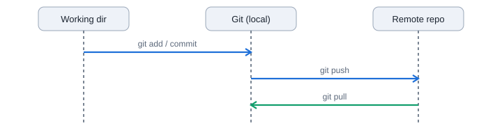

*شکل ۱: جریان کار Git؛ تغییر ← commit محلی ← push به ریپو.*

### ۲. دستورهای اصلی

``` text
git init                                   # create a repository
git status                                 # what changed?
git add configs/CORE-SW1.cfg               # stage a file
git commit -m "CORE-SW1: add NTP and syslog (CHG-0012)"
git log --oneline                          # history
git diff                                   # unstaged changes
git diff HEAD~1 HEAD -- configs/CORE-SW1.cfg   # compare two versions
git checkout -b feature/hardening          # new branch
git restore configs/CORE-SW1.cfg           # undo local changes to a file
```

- پیام commit باید بگوید «چه کسی/چرا» (شماره‌ی CHG).
- `git diff` بعد از هر بکاپ: اگر تفاوتی هست، یعنی کسی تغییر داده؛ بدون تفاوت = شبکه تغییر نکرده.

### ۳. رمز در Git: خط قرمز

``` text
# .gitignore
backups/*.raw
*.vault
secrets*.yml
.env
*.pcap
*.pcapng
```

قبل از commit فایل‌های Config را از رمزها پاک‌سازی (Sanitize) کنید:

``` text
# redact secrets from a config before committing
sed -E -e "s/(secret [0-9] ).*/\1<REDACTED>/" \
       -e "s/(password [0-9] ).*/\1<REDACTED>/" \
       -e "s/(snmp-server community ).*/\1<REDACTED>/" \
       CORE-SW1.raw > configs/CORE-SW1.cfg
```

> **اگر رمز اشتباهی commit شد**
>
> ۱) فوراً رمز را عوض کنید (فرض کنید لو رفته). ۲) تاریخچه را پاک‌سازی کنید (فقط با راهنمایی؛ حذف از commit‌های قبلی ساده نیست). ۳) Secret Scanning را فعال کنید. هرگز فقط «پاک‌کردن فایل در commit بعدی» را کافی ندانید.

### ۴. دستی در برابر خودکار: قضاوت مستدل

| معیار            | دستی               | خودکار                     |
|------------------|--------------------|----------------------------|
| سرعت (۵۰ دستگاه) | ساعت‌ها             | دقیقه‌ها                    |
| خطای تایپی       | محتمل              | کم                         |
| یکنواختی         | کم                 | زیاد                       |
| ریسک خطای گسترده | محدود به یک دستگاه | همه‌ی دستگاه‌ها همزمان       |
| ردپا/Audit       | دستی               | Playbook + Git             |
| یادگیری          | کم                 | نیاز به مهارت              |
| مناسب برای       | تغییر یک‌باره/خاص   | تغییرات تکراری و استاندارد |

نتیجه: اتوماسیون ابزار است، نه جایگزین قضاوت. تغییر پرریسک را با Check، یک دستگاه، سپس همه و همیشه با بکاپ انجام دهید.

### ۵. Cisco Campus As-Built (محصول CP1)

مستند نهایی بخش Cisco باید این‌ها را داشته باشد:

| بخش              | محتوا                                      | منبع                         |
|------------------|--------------------------------------------|------------------------------|
| ۱. توپولوژی      | نمودار فیزیکی و منطقی                      | Lab A و PNetLab              |
| ۲. IP Plan       | VLAN، Subnet، Gateway                      | 02-design/ip-plan.md         |
| ۳. VLAN Matrix   | VLAN، پورت‌ها                               | 02-design/vlan-matrix.md     |
| ۴. L2            | STP، EtherChannel، Port Security، Snooping | تنظیمات و show               |
| ۵. L3            | OSPF، HSRP، Default                        | As-Built Lab A               |
| ۶. سرویس‌ها       | DHCP، DNS، NTP، NAT، ACL، Syslog، SNMP     | Service Matrix               |
| ۷. Hardening     | Baseline و نتیجه‌ی بازبینی                  | 03-ops/hardening-baseline.md |
| ۸. Runbookها     | Change/Rollback و TSها                     | 03-ops                       |
| ۹. Config Backup | نسخه‌های Git (Sanitize‌شده)                  | Git                          |
| ۱۰. محدودیت‌ها    | موارد Unverified و نتیجه‌ی واقعی Lab        | یادداشت Lab                  |

### ۶. نقطه‌ی بازبینی CP1

CP1 پایان فاز Cisco (فصل ۱ تا ۸) است. چک‌لیست قبولی:

| \#  | معیار                               | مدرک                  |
|-----|-------------------------------------|-----------------------|
| ۱   | IP Plan و VLAN Matrix کامل          | فایل‌های طراحی         |
| ۲   | Lab A کامل و Failover تست‌شده        | As-Built + نتیجه‌ی تست |
| ۳   | Hardening Baseline روی همه‌ی تجهیزات | گزارش مقایسه          |
| ۴   | Service Matrix و سرویس‌ها            | فایل Matrix           |
| ۵   | بکاپ Git (بدون رمز)                 | git log               |
| ۶   | Gate G1، G2، G3 گذرانده             | سوابق                 |
| ۷   | لیست درس‌آموخته‌ها و اشتباهات         | صفحه‌ی مرور            |

**معیار قبولی:** هر ۷ مورد. با پایان CP1 و تأیید شما، فاز FortiGate (فصل ۹ به بعد) شروع می‌شود. تا آن زمان FortiGate را بوت نمی‌کنیم تا ساعت Evaluation مصرف نشود.

### ۷. مثال‌ها

#### ساده

``` text
git add backups/CORE-SW1.cfg && git commit -m "baseline backup"
```

#### متوسط: پیدا کردن تغییر

``` text
git diff HEAD~1 HEAD -- backups/CORE-SW1.cfg
+ no ip http server        (someone hardened the device)
```

#### سخت: رمز لو رفته

``` text
A SNMP community appeared in a committed config
Action: rotate the community immediately, sanitize history, enable secret scanning, add sanitize step before commit
```

### تمرین‌ها

**ت1.** ۱ (ساده): commit چیست؟ *(پاسخ: 8-6-ت1 در بخش «پاسخ‌ها» انتهای فصل)*

**ت2.** ۲ (ساده): git diff چه می‌کند؟ *(پاسخ: 8-6-ت2 در بخش «پاسخ‌ها» انتهای فصل)*

**ت3.** ۳ (متوسط): چرا رمز را بعد از commit اشتباهی باید عوض کنیم؟ *(پاسخ: 8-6-ت3 در بخش «پاسخ‌ها» انتهای فصل)*

**ت4.** ۴ (متوسط): دستی یا خودکار برای ۵۰ دستگاه؟ *(پاسخ: 8-6-ت4 در بخش «پاسخ‌ها» انتهای فصل)*

**ت5.** ۵ (سخت): CP1 چه چیزی را می‌سنجد؟ *(پاسخ: 8-6-ت5 در بخش «پاسخ‌ها» انتهای فصل)*

### Lab هدایت‌شده

روی PC/VM شما:

1.  یک ریپوی جدید برای Config بسازید (`git init`).
2.  بکاپ‌های فصل ۸-۴ را با اسکریپت Sanitize کنید و commit کنید.
3.  یک تغییر کوچک روی یک دستگاه بدهید، دوباره بکاپ بگیرید و `git diff` را ببینید.
4.  `.gitignore` را بسازید و تأیید کنید فایل‌های حساس commit نمی‌شوند.
5.  As-Built را بنویسید و چک‌لیست CP1 را پر کنید.

### Lab مستقل

مستند «Cisco Campus As-Built» (۱۰ بخش) را در `03-ops/campus-as-built.md` کامل کنید. این محصول CP1 است.

### عیب‌یابی

|         |                                                                             |
|---------|-----------------------------------------------------------------------------|
| Symptom | git push رد می‌شود یا رمز در ریپو است                                        |
| چک‌لیست  | ۱) .gitignore؟ ؛ ۲) Sanitize انجام شده؟ ؛ ۳) Secret scan؟ ؛ ۴) Remote درست؟ |
| ابزار   | git status ، git log ، grep برای الگوهای رمز                                |
| رفع     | عوض‌کردن رمز و پاک‌سازی                                                       |

### سؤال‌های مرور

**م1.** Git برای Config چه فایده‌ای دارد؟ *(پاسخ: 8-6-م1 در بخش «پاسخ‌ها» انتهای فصل)*

**م2.** CP1 چیست؟ *(پاسخ: 8-6-م2 در بخش «پاسخ‌ها» انتهای فصل)*

### English Corner: انگلیسی تخصصی این درس

این جمله‌ها از مستندات و محیط کار واقعی‌اند. بلند بخوانید و ترجمه را بپوشانید.

| English sentence                                                      | ترجمه                                                          |
|-----------------------------------------------------------------------|----------------------------------------------------------------|
| Commit every configuration change with a meaningful message.          | هر تغییر پیکربندی را با پیام معنادار commit کنید.              |
| Use git diff to see what changed between two backups.                 | با git diff ببینید بین دو بکاپ چه تغییر کرده است.              |
| Never commit passwords or API tokens.                                 | هرگز رمز یا Token را commit نکنید.                             |
| The as-built document describes the network as it was actually built. | مستند As-Built شبکه را همان‌طور که واقعاً ساخته شده توصیف می‌کند. |

**Q1.** Quick quiz (answer in English): What should you do if a secret was committed to the repository? *(پاسخ: 8-6-Q1 در بخش «پاسخ‌ها» انتهای فصل)*

### تکلیف و چک‌لیست تسلط

- [ ] ریپوی Config را بسازم و diff ببینم.
- [ ] As-Built را کامل کنم.
- [ ] چک‌لیست CP1 را پر کنم.

### یادآوری اشتباهات شما

> **یادآوری**
>
> پیش‌بینی قبل از اجرا؛ بکاپ قبل از تغییر؛ پذیرفته‌شدن دستور ≠ کار کردن؛ فرمول‌ها در بلوک مستقل.


#### کارت Lab — Git، As-Built و CP1

| # | فیلد | محتوا |
|---|---|---|
| 1 | عنوان و هدف | Git/As-Built/CP1 |
| 2 | پیش‌نیاز | درس 8-5 |
| 3 | توپولوژی | PC |
| 4 | تجهیزات | PC |
| 5 | نسخه نرم‌افزار | vIOS-L2 15.2(20200924، Experimental) برای SW؛ vIOS 15.9(3)M9 برای R؛ VPCS؛ PNetLab 4.2.8 |
| 6 | IP Plan | — |
| 7 | وضعیت اولیه | Repo Config |
| 8 | صورت مسئله | git diff |
| 9 | مراحل هدایت‌شده | همان بخش «Lab هدایت‌شده» همین درس |
| 10 | تست عملکرد | `git log` |
| 11 | سناریوی خرابی | رمز در commit |
| 12 | روش عیب‌یابی | لایه‌ای/با شواهد (بخش عیب‌یابی همین درس) |
| 13 | نتیجه‌ی مورد انتظار | As-Built کامل |
| 14 | معیار پذیرش | چک‌لیست CP1 |
| 15 | مستندات نهایی | `03-ops/campus-as-built.md` |
| 16 | Cleanup و بازگردانی | — |

> **وضعیت راستی‌آزمایی (خارج از ۱۶ فیلد):** **اجرا نشده (فقط طراحی).** اجرا نشده.

---

<a id="ans-8"></a>

## پاسخ‌های فصل 8

> ابتدا بدون نگاه حل کنید. شناسه: درس-نوع+شماره (ت = تمرین، م = مرور، Q = Quick quiz).

**8-1-ت1** — ۱ (ساده): سه صفحه‌ی دستگاه؟

هر دستگاه شبکه سه صفحه (Plane) دارد: Management (دسترسی مدیر: SSH، SNMP، Syslog)، Control (پروتکل‌های مسیریابی، STP، ARP)، Data (عبور ترافیک کاربر). Hardening باید هر سه را پوشش دهد: ACL روی VTY و CoPP برای Control و فیلتر/Port Security برای Data. مدیریت مهم‌ترین است چون کنترل کامل می‌دهد.

``` text
Management, control and data plane.
```

**8-1-ت2** — ۲ (ساده): چرا no ip http server؟

`no ip http server` سرویس HTTP بدون رمزگذاری را می‌بندد و سطح حمله را کم می‌کند؛ هر سرویس اضافه آسیب‌پذیری بالقوه است. اگر GUI لازم است `ip http secure-server` با ACL و گواهی. قاعده: هر سرویس بی‌استفاده را خاموش کنید.

``` text
To close an unnecessary management service and reduce the attack surface.
```

**8-1-ت3** — ۳ (متوسط): چرا پورت‌های خالی shutdown و VLAN 999؟

پورت خالی با Shutdown و عضویت در VLAN بلااستفاده (مثلاً 999 بدون SVI) مانع می‌شود دستگاه جعلی با اتصال به پورت آزاد به شبکه دسترسی یابد. ترکیب: shutdown، VLAN مرده، BPDU Guard و Port Security. هنگام نیاز پورت با CHG فعال می‌شود.

``` text
So that a rogue device plugged into an unused port gets no access.
```

**8-1-ت4** — ۴ (متوسط): چرا CDP روی پورت کاربر خاموش؟

CDP نام دستگاه، IP، نسخه‌ی IOS و Interface را برای هر Host مجاور افشا می‌کند؛ مهاجم می‌تواند از آن برای شناسایی هدف و آسیب‌پذیری استفاده کند. روی پورت کاربر `no cdp enable` (و LLDP مشابه) بگذارید؛ روی Uplink بین سوییچ‌ها لازم است.

``` text
It leaks device information (name, IP, software) to any host.
```

**8-1-ت5** — ۵ (سخت): قبل از Hardening VTY از راه دور چه شبکه‌ی ایمنی می‌گذاریم؟

پیش از Hardening از راه دور (مثلاً محدودکردن VTY) Backup بگیرید و `reload in 5` را اجرا کنید: اگر قفل شدید، پس از ۵ دقیقه دستگاه به Config ذخیره‌شده برمی‌گردد. پس از تأیید `reload cancel` و ذخیره. همچنین کنسول آماده نگه دارید.

``` text
Backup the config and use "reload in 5" so a mistake does not lock you out.
```

**8-1-م1** — Hardening چیست؟

Hardening کاهش سطح حمله با بستن سرویس‌های اضافه، رمزنگاری مدیریت، ACL، AAA، Banner، Timeout و غیرفعال‌سازی پروتکل‌های ناامن (Telnet، HTTP، v2c) است. هدف: دستگاهی که حتی اگر در معرض شبکه باشد، سطح حمله‌ی کمی دارد.

کاهش سطح حمله با بستن سرویس‌های اضافه و تنظیم امن.

**8-1-م2** — چرا Management Plane مهم‌ترین است؟

Management Plane دسترسی کامل به Config و کنترل دستگاه می‌دهد؛ مهاجمی که آن را بگیرد می‌تواند مسیر، ACL، VLAN و Log را تغییر دهد. پس پیش از هر چیز باید SSH، AAA، ACL مدیریت و Logging کنترل شود.

کنترل کامل دستگاه را می‌دهد.

**8-1-Q1** — Quick quiz (answer in English): Why is "enable secret" preferred over "enable password"?

پاسخ انگلیسی در پایین آمده است. نکته‌ی عملی: `enable secret` از الگوریتم قوی (Type 5/8/9) و `enable password` متن ساده/Type 7 (قابل‌برگشت) استفاده می‌کند؛ هرگز password.

Secret is stored as a strong hash; password is clear text or weak Type 7.

**8-2-ت1** — ۱ (ساده): سه A؟

AAA: Authentication (کیستی؟)، Authorization (چه کارهایی مجاز است؟)، Accounting (چه کرد؟ ثبت). با هم احراز هویت مرکزی، کنترل دسترسی دقیق و Audit را فراهم می‌کنند.

``` text
Authentication, Authorization, Accounting.
```

**8-2-ت2** — ۲ (ساده): TACACS+ چه پورتی؟

TACACS+ روی TCP/49 کار می‌کند و کل Payload را محافظت (obfuscate) می‌کند؛ RADIUS روی UDP (1812/1813) و فقط فیلد رمز را. دقت: طبق RFC 8907 محافظت TACACS+ «Obfuscation» است نه رمزنگاری مدرن؛ برای الزامات سخت‌گیرانه آن را داخل شبکه‌ی مدیریت جدا یا تونل امن ببرید. TCP به TACACS+ قابلیت اطمینان و Timeout واضح می‌دهد.

``` text
TCP 49
```

**8-2-ت3** — ۳ (متوسط): چرا Local را Fallback می‌گذاریم؟

اگر AAA Server در دسترس نباشد، بدون Fallback محلی هیچ‌کس نمی‌تواند وارد دستگاه شود. با `aaa authentication login default group tacacs+ local` وقتی سرور پاسخ ندهد حساب محلی (Break-glass) استفاده می‌شود. حساب محلی باید رمز قوی و استفاده‌ی نادر داشته باشد.

``` text
If the AAA server is unreachable you can still log in with a local account.
```

**8-2-ت4** — ۴ (متوسط): Privilege 15 یعنی؟

Privilege 15 دسترسی کامل مدیریتی (همه‌ی دستورها شامل Config) است؛ 1 فقط User EXEC. در عمل سطح‌های میانی (مثلاً 5 برای NOC با show و ping) تعریف و با TACACS+ Command Authorization کنترل می‌شود. اصل Least Privilege.

``` text
Full administrative access.
```

**8-2-ت5** — ۵ (سخت): TACACS+ در برابر RADIUS برای مدیریت دستگاه؟

TACACS+ کل Payload را رمز می‌کند و Authorization دستور-به‌دستور (Command Authorization) دارد؛ RADIUS فقط رمز را رمز می‌کند و Authorization آن مناسب Network Access (VPN/802.1X). برای مدیریت دستگاه TACACS+ ترجیح داده می‌شود و برای VPN/Wi-Fi RADIUS.

``` text
TACACS+ encrypts the whole packet and supports granular command authorization.
```

**8-2-م1** — Authorization چیست؟

Authorization تعیین می‌کند کاربر احراز‌شده چه کارهایی (دستور، Privilege، شبکه) مجاز است. مثال: کاربر NOC فقط show، مهندس شبکه Config، ممیز فقط خواندنی.

تعیین اینکه کاربر چه کارهایی مجاز است.

**8-2-م2** — چرا Accounting؟

Accounting ثبت می‌کند چه کسی، چه زمانی، چه دستوری یا چه Session اجرا کرد؛ برای مسئولیت‌پذیری، Audit و تحقیق پس از حادثه ضروری است. بدون آن «کار چه کسی بود؟» جواب ندارد.

ثبت اینکه چه کسی چه کرده؛ برای مسئولیت‌پذیری.

**8-2-Q1** — Quick quiz (answer in English): What happens if you configure AAA with no local fallback and the server is down?

پاسخ انگلیسی در پایین آمده است؛ بدون Fallback و با سرور قطع، همه قفل می‌شوند و فقط از کنسول با بازیابی رمز (Password Recovery) وارد می‌شوید؛ پس همیشه Local Fallback و Backup کنسول.

Everyone is locked out of the device, except via console recovery.

**8-3-ت1** — ۱ (ساده): تفاوت Object و Array؟

Object مجموعه‌ی کلید/مقدار داخل { } است (مثل یک رکورد)، Array فهرست مرتب داخل [ ] (مثل چند دستگاه). JSON ترکیب این دو است؛ در YAML Object با «کلید: مقدار» و Array با «- » نمایش داده می‌شود.

``` text
Object = key/value pairs in { }; Array = ordered list in [ ].
```

**8-3-ت2** — ۲ (ساده): GET چه می‌کند؟

GET منبع را بدون تغییر می‌خواند؛ Safe و Idempotent است. POST ایجاد، PUT جایگزینی کامل، PATCH تغییر جزئی، DELETE حذف. در API دستگاه شبکه ابتدا GET برای آزمون بگیرید.

``` text
Reads a resource without changing it.
```

**8-3-ت3** — ۳ (متوسط): کد 403 یعنی؟

403 Forbidden یعنی هویت شما شناخته شد ولی اجازه‌ی دسترسی ندارید (Authorization)؛ 401 یعنی احراز هویت نشدید. 404 منبع نیست، 5xx خطای سرور. در API Fortinet/Cisco تفکیک 401/403 برای رفع مهم است.

``` text
Forbidden: authenticated but not allowed.
```

**8-3-ت4** — ۴ (متوسط): چرا YAML با Tab خراب می‌شود؟

در YAML ساختار با Indentation (فاصله) تعیین می‌شود و Tab مجاز نیست؛ استفاده از Tab Parser را خراب می‌کند یا ساختار را اشتباه می‌خواند. استاندارد: ۲ فاصله و ویرایشگر با نمایش Whitespace و Linter.

``` text
Indentation defines structure and tabs are not allowed.
```

**8-3-ت5** — ۵ (سخت): چرا Token در Git ممنوع؟

Token/Password اگر در Git باشد، هر کس به Repo دسترسی دارد (و تاریخچه حتی پس از حذف) می‌تواند از آن استفاده کند. باید در متغیر محیطی یا Secret Store/Vault باشد و در `.gitignore`؛ و اگر لو رفت فوراً Rotate شود.

``` text
Anyone with repo access could use it; it must come from a secret store or environment variable.
```

**8-3-م1** — REST چیست؟

REST معماری API مبتنی بر HTTP است: هر منبع URL دارد و عمل با Method (GET/POST/PUT/DELETE) و نتیجه با کد وضعیت و بدنه‌ی JSON. بیشتر تجهیزات مدرن (FortiGate، Cisco DNA/RESTCONF) API مشابه دارند.

API مبتنی بر HTTP که هر منبع یک URL دارد.

**8-3-م2** — چرا YAML برای Ansible؟

YAML خوانا، مناسب برای Config‌های انسانی و پایه‌ی Ansible (Playbook، Inventory) است. ولی به Indentation حساس است؛ پس Lint کنید.

خوانا و برای تنظیمات مناسب است.

**8-3-Q1** — Quick quiz (answer in English): What is the difference between PUT and PATCH?

پاسخ انگلیسی در پایین آمده است؛ PUT منبع را کامل جایگزین می‌کند (فیلد جاافتاده حذف می‌شود)، PATCH فقط فیلدهای ارسالی را تغییر می‌دهد؛ برای تغییر کوچک PATCH امن‌تر است.

PUT replaces the whole resource; PATCH modifies part of it.

**8-4-ت1** — ۱ (ساده): چرا رمز در متغیر محیطی؟

رمز در متغیر محیطی (`os.environ`) می‌ماند و در کد و Git نمی‌رود؛ با تغییر رمز فقط محیط عوض می‌شود. بهتر: Vault. هرگز رمز در اسکریپت، لاگ یا خروجی نمایش داده نشود.

``` text
So the password never ends up in the source code or in Git.
```

**8-4-ت2** — ۲ (ساده): read-only یعنی چه؟

Read-only یعنی اسکریپت فقط دستور show اجرا می‌کند و هیچ تغییری روی دستگاه نمی‌دهد؛ خطا فقط روی خروجی اثر دارد. شروع Automation از Read-only (Inventory، Backup، Audit) ریسک را کم می‌کند.

``` text
The script only runs show commands and never changes the device.
```

**8-4-ت3** — ۳ (متوسط): چرا try/except؟

try/except اجازه می‌دهد اگر یک دستگاه خاموش/کند/Auth Fail باشد، اسکریپت برای بقیه‌ی دستگاه‌ها ادامه دهد و خطا را Log کند؛ وگرنه یک خطا کل اجرا را قطع می‌کند و نتیجه ناقص می‌ماند.

``` text
So a failing device does not stop the run for the remaining devices.
```

**8-4-ت4** — ۴ (متوسط): چرا اول روی یک دستگاه؟

اجرا ابتدا روی یک دستگاه (Pilot) دامنه‌ی خطا (Blast radius) را کوچک می‌کند؛ اگر دستور اشتباه باشد فقط یک دستگاه آسیب می‌بیند. پس از تأیید، گروهی کوچک و سپس همه.

``` text
To limit the blast radius of a mistake.
```

**8-4-ت5** — ۵ (سخت): چه چیزی در خروجی show running-config حساس است؟

`show running-config` شامل Hash رمزها، SNMP Community، کلیدهای TACACS/RADIUS، IPهای داخلی و ACL است؛ انتشار یا Commit آن در Git عمومی خطرناک است. فایل‌ها را رمزگذاری یا Sanitize کنید و دسترسی محدود.

``` text
Password hashes, SNMP communities, keys; do not publish the files.
```

**8-4-م1** — Netmiko چه می‌کند؟

Netmiko کتابخانه‌ی پایتون است که با SSH به تجهیز شبکه وصل می‌شود، دستور اجرا می‌کند و خروجی را برمی‌گرداند؛ تفاوت Promptها و Paging را مدیریت می‌کند.

با SSH به تجهیز شبکه وصل شده و دستور اجرا می‌کند.

**8-4-م2** — چرا Read-only برای شروع؟

Read-only ریسک کم و قابل‌برگشت دارد و ارزش بالا (Inventory، Backup، Audit) می‌دهد؛ اعتماد تیم را برای Automation تغییردهنده می‌سازد.

ریسک کم و قابل‌بازگشت.

**8-4-Q1** — Quick quiz (answer in English): Why is a read-only script a safe first step in network automation?

پاسخ انگلیسی در پایین آمده است؛ اسکریپت Read-only حتی با باگ هم قطعی ایجاد نمی‌کند، پس برای شروع Automation امن‌ترین انتخاب است.

It cannot change any device, so a bug cannot cause an outage.

**8-5-ت1** — ۱ (ساده): Idempotency چیست؟

Idempotency یعنی اجرای مجدد Playbook اگر وضعیت مطلوب برقرار باشد هیچ تغییری نمی‌دهد (changed=0). مزیت Ansible بر اسکریپت: امن برای تکرار و هم‌ترازکردن (Drift correction).

``` text
Running the same playbook again changes nothing if the desired state is already in place.
```

**8-5-ت2** — ۲ (ساده): --check چه می‌کند؟

`--check` حالت Dry-run است: نشان می‌دهد چه چیزی تغییر می‌کرد بدون اعمال. همراه `--diff` تفاوت دقیق را می‌بینید. پیش از اجرای واقعی همیشه `--check` بزنید.

``` text
A dry run: shows what would change without changing anything.
```

**8-5-ت3** — ۳ (متوسط): چرا --limit؟

`--limit sw-lab-01` اجرا را روی یک دستگاه (Pilot) محدود می‌کند تا خطا گسترده نشود. پس از اطمینان، `--limit` گروهی و سپس همه.

``` text
To run on a single device first and limit the blast radius.
```

**8-5-ت4** — ۴ (متوسط): رمز را کجا نگه می‌داریم؟

رمز در متغیر محیطی یا Ansible Vault (رمزگذاری‌شده) نگه داشته می‌شود، نه متن ساده در Git. Vault Password نیز جدا و محافظت‌شده باشد.

``` text
Environment variables or Ansible Vault, never plain text in Git.
```

**8-5-ت5** — ۵ (سخت): تفاوت ios_command و ios_config؟

`ios_command` دستورهای Exec/show را اجرا می‌کند (خواندن)؛ `ios_config` خطوط پیکربندی را اعمال می‌کند (تغییر). برای Audit از ios_command و برای تغییر از ios_config (با `--check`).

``` text
ios_command runs exec/show commands; ios_config pushes configuration lines.
```

**8-5-م1** — Ansible در چه چیزی بهتر از اسکریپت است؟

Ansible برای تنظیم توصیفی (Desired State) و Idempotent روی چند دستگاه بهتر از اسکریپت است: Inventory، متغیرها، Roleها و گزارش changed.

تنظیم توصیفی و Idempotent برای چند دستگاه.

**8-5-م2** — --diff چه نشان می‌دهد؟

`--diff` تفاوت پیکربندی قبل و بعد را نشان می‌دهد؛ برای ممیزی و تأیید تغییر پیش از اعمال.

تفاوت پیکربندی قبل و بعد.

**8-5-Q1** — Quick quiz (answer in English): What does changed=0 on a second run tell you?

پاسخ انگلیسی در پایین آمده است؛ changed=0 در اجرای دوم یعنی دستگاه از قبل مطابق وضعیت مطلوب است و Playbook Idempotent است.

The device already matches the desired state; the playbook is idempotent.

**8-6-ت1** — ۱ (ساده): commit چیست؟

commit یک Snapshot ثبت‌شده از فایل‌ها با پیام و شناسه است؛ تاریخچه و بازگشت را ممکن می‌کند. پیام باید دلیل را بگوید («اضافه‌کردن ACL مهمان – CHG123»).

``` text
A recorded snapshot of the files with a message.
```

**8-6-ت2** — ۲ (ساده): git diff چه می‌کند؟

`git diff` تفاوت بین نسخه‌ها (یا Working tree و Commit) را نشان می‌دهد؛ برای بازبینی Config قبل از Commit/Push و مقایسه‌ی As-Built با وضعیت فعلی.

``` text
Shows the differences between versions.
```

**8-6-ت3** — ۳ (متوسط): چرا رمز را بعد از commit اشتباهی باید عوض کنیم؟

پس از Commit اشتباه رمز، هر کس به Repo/تاریخچه دسترسی دارد می‌تواند آن را بخواند؛ حذف از Commit بعدی کافی نیست. باید رمز فوراً عوض (Rotate)، تاریخچه پاک‌سازی (filter-repo) و Secret Scanning فعال شود.

``` text
Anyone with repository access (or history) could have already read it.
```

**8-6-ت4** — ۴ (متوسط): دستی یا خودکار برای ۵۰ دستگاه؟

برای ۵۰ دستگاه و تغییر استاندارد تکرارشونده، خودکار (Ansible) با Check Mode و Pilot روی یک دستگاه بهتر است؛ دستی خطا و ناهمگونی می‌سازد. تغییرات یک‌باره و پیچیده را می‌توان دستی با CHG انجام داد.

``` text
Automated for repeated standard changes, with check mode and a single-device pilot.
```

**8-6-ت5** — ۵ (سخت): CP1 چه چیزی را می‌سنجد؟

CP1 (Checkpoint 1) کامل‌بودن طراحی کمپوس سیسکو را می‌سنجد: اسناد (As-Built)، Lab A، Hardening، سرویس‌ها، Backup و Gateهای قبلی. هدف: آماده‌بودن برای ورود به فاز FortiGate.

``` text
Completeness of the Cisco campus design: documents, Lab A, hardening, services, backup and gates.
```

**8-6-م1** — Git برای Config چه فایده‌ای دارد؟

Git برای Config تاریخچه، Diff و Rollback می‌دهد؛ می‌توانید ببینید چه کسی چه چیز را کی تغییر داد و در صورت خطا نسخه‌ی قبل را بازگردانید.

تاریخچه، Diff و Rollback.

**8-6-م2** — CP1 چیست؟

CP1 نقطه‌ی بازبینی پایان فاز Cisco قبل از ورود به FortiGate است؛ مرزی برای اطمینان از کامل‌بودن مبانی.

نقطه‌ی بازبینی پایان فاز Cisco قبل از FortiGate.

**8-6-Q1** — Quick quiz (answer in English): What should you do if a secret was committed to the repository?

پاسخ انگلیسی در پایین آمده است؛ ترتیب: Rotate، پاک‌سازی تاریخچه، Secret Scanning، بررسی لاگ دسترسی.

Rotate the secret immediately, clean the history and enable secret scanning.

---

<a id="ch9"></a>

# فصل 9 — BGP عملی و Route Filtering

**مدت:** ۳۶ ساعت (۶ روز × ۶ ساعت) | **پیش‌نیاز:** فصل ۶ (OSPF)، فصل ۷ (ACL/NAT).
**اهداف:** ۱) مفهوم BGP و تفاوت eBGP/iBGP. ۲) برپایی Peering و اعلام شبکه. ۳) iBGP با Loopback و `next-hop-self`. ۴) کنترل مسیر با Local Preference، AS-Path Prepend و MED. ۵) فیلتر مسیر با Prefix-List و Route-Map. ۶) عیب‌یابی BGP.
**چرا برای فایروال؟** FortiGate در شبکه‌ی دو ISP و Hub-and-Spoke BGP صحبت می‌کند؛ بدون فهم BGP نمی‌توان مسیر برگشت و Failover را تحلیل کرد. **عمق:** نه CCNP؛ فقط آنچه فایروال لازم دارد.
**معیار تسلط فصل:** برپایی eBGP/iBGP بدون راهنما؛ توضیح انتخاب بهترین مسیر؛ ساخت یک فیلتر؛ پیدا کردن علت «Peer در Active/Idle».
**اشتباهات رایج:** فراموشی `next-hop-self` در iBGP؛ `network` بدون Route دقیق در جدول؛ نبود مسیر TCP 179 بین Peerها؛ Route-Map بدون `permit` پایانی.

**درس‌های فصل:**
- [درس 9-1 — مفهوم BGP: AS، eBGP/iBGP و حالت‌های Peer](#l-9-1)
- [درس 9-2 — eBGP عملی: Peering و اعلام شبکه](#l-9-2)
- [درس 9-3 — iBGP: Loopback Peering و next-hop-self](#l-9-3)
- [درس 9-4 — انتخاب بهترین مسیر: Weight، Local-Pref، AS-Path، MED](#l-9-4)
- [درس 9-5 — Route Filtering: Prefix-List، Route-Map و Community](#l-9-5)
- [درس 9-6 — عیب‌یابی BGP و آزمون کوچک فصل](#l-9-6)

---

<a id="l-9-1"></a>

## درس 9-0 — چرا BGP؟ مسیریابی میان سازمان‌ها و اینترنت از پایه

**فصل ۹ · درس افزوده (پیش‌درس ۹-۱) · پیش‌نیاز: فصل ۵ و ۶ (Routing، OSPF)، درس ۵-۷ · ≈ ۴ ساعت**

> **وضعیت:** مفهومی و مبتنی بر RFC 4271 و مستند Cisco؛ Labها «اجرا نشده».

### ۱) هدف آموزشی

در پایان می‌توانید:

1. توضیح دهید چرا IGPهایی مثل OSPF برای اینترنت مناسب نیستند و BGP چه مشکلی را حل می‌کند.
2. **Autonomous System (AS)** را تعریف کنید و AS خصوصی/عمومی را بشناسید.
3. بگویید BGP یک پروتکل **Path Vector** است و از این ویژگی چه نتیجه‌ای می‌گیریم (جلوگیری از Loop، اعمال Policy).
4. تفاوت eBGP و iBGP را در رفتار، AD و Loop Prevention بگویید.
5. بگویید BGP به‌جای «کوتاه‌ترین مسیر» «**Policy**» را مبنای انتخاب می‌گیرد و پیامد آن را در طراحی با ISP و فایروال توضیح دهید.

### ۲) پیش‌نیازها

OSPF و Link-State (فصل ۵ و ۶)، Administrative Distance، Redistribution مقدماتی (فصل ۱۰ در ادامه)، TCP (فصل ۲).

### ۳) مفهوم پایه: چرا IGP کافی نیست؟

OSPF فرض می‌کند همه‌ی روترها زیر یک مدیریت‌اند و از همه‌ی لینک‌ها اطلاع کامل دارند (LSDB). این فرض در اینترنت غلط است:

- **مقیاس:** اینترنت صدها هزار Prefix دارد؛ Flooding LSA در این مقیاس غیرممکن است.
- **اعتماد:** هر سازمان قوانین و منافع خود را دارد؛ نمی‌خواهیم توپولوژی داخلی‌مان را به رقیب نشان دهیم.
- **سیاست:** سازمان می‌خواهد بگوید «ترافیک را از ISP-A بفرست، چون ارزان‌تر است» (نه صرفاً «کوتاه‌ترین»).

BGP برای همین ساخته شد: مسیریابی میان **سیستم‌های خودمختار**، با کنترل Policy و مقیاس‌پذیری بالا.

> **تشبیه:** OSPF مثل نقشه‌ی راه داخل یک شهر است که همه‌ی خیابان‌ها را می‌دانید. BGP مثل «توافق‌نامه‌ی گمرکی بین کشورها» است: هر کشور فقط می‌گوید «از طریق من به این مقصدها می‌رسید» و بقیه‌ی جزئیات داخلی را نمی‌گوید.

### ۴) توضیح عمیق فنی

#### ۴-۱) AS و ASN

**AS (Autonomous System)** مجموعه‌ای از شبکه‌ها و روترها زیر یک سیاست مسیریابی واحد است. هر AS یک شماره دارد (ASN):

| محدوده | نوع | کاربرد |
|---|---|---|
| 1 تا 64495 (تقریباً) | عمومی (۲ بایتی) | اینترنت |
| 64512 تا 65534 | خصوصی (۲ بایتی) | Lab و داخلی؛ **در دوره از این‌ها استفاده می‌کنیم** |
| ۴ بایتی (تا ~4.29 میلیارد) | عمومی/خصوصی | RFC 6793 |

(جزئیات دقیق رزرو ASN را از IANA بررسی کنید؛ این جدول تقریبی است و `Unverified` تا تطبیق با ثبت IANA.)

#### ۴-۲) Path Vector

BGP برای هر Prefix **فهرست ASهای عبوری (AS_PATH)** را حمل می‌کند:

``` text
Prefix 203.0.113.0/24  AS_PATH = 65002 65003 65004
```

نتیجه:

- **جلوگیری از Loop:** اگر روتری ASN خودش را در AS_PATH ببیند، آن Update را رد می‌کند. بنابراین BGP بدون LSDB و بدون الگوریتم SPF هم حلقه نمی‌سازد (در سطح AS).
- **انتخاب با Policy:** می‌توان روی AS_PATH فیلتر یا طول مسیر را به‌عنوان معیار گذاشت.
- **Metric عددی ندارد:** BGP «Metric» واحدی مثل Cost ندارد؛ مجموعه‌ای از **Attribute**ها (Weight، Local-Pref، AS_PATH، Origin، MED ...) است که الگوریتم انتخاب بهترین مسیر آن‌ها را به ترتیب می‌سنجد (درس ۹-۴ و ۹-۷).

#### ۴-۳) Session و TCP

BGP با **TCP پورت 179** بین دو Neighbor (Peer) برقرار می‌شود؛ پس پایداری و Reachability لایه ۳ پیش‌شرط است. دو Peer باید آدرس یکدیگر را صریحاً تنظیم کنند (BGP Neighbor را کشف نمی‌کند؛ برخلاف OSPF Hello Multicast). پیام‌ها: **OPEN، KEEPALIVE، UPDATE، NOTIFICATION** (RFC 4271).

- OPEN: ASN، Hold Time، BGP Identifier (Router-ID) و قابلیت‌ها.
- KEEPALIVE: زنده بودن.
- UPDATE: اعلام یا پس‌گرفتن Prefix و Attributeها.
- NOTIFICATION: خطا و بستن Session.

زمان‌های پیش‌فرض Cisco: Keepalive 60 s و Hold 180 s (RFC پیشنهاد 30 و 90 دارد؛ Hold نهایی میان دو Peer کوچک‌تر دو مقدار می‌شود). پس Detect پیش‌فرض خرابی BGP تا ۱۸۰ ثانیه است؛ با BFD یا Timer کوتاه‌تر کم می‌شود (مرتبط با درس ۵-۷).

#### ۴-۴) eBGP و iBGP

| ویژگی | eBGP | iBGP |
|---|---|---|
| Peer | AS متفاوت | AS یکسان |
| AD پیش‌فرض Cisco | 20 | 200 |
| TTL پیش‌فرض Session | 1 (مستقیم‌ متصل) | 255 |
| افزودن ASN به AS_PATH | بله، هنگام خروج | خیر |
| Next-hop | تغییر به آدرس خود روتر | **بدون تغییر** (باید `next-hop-self` بگذاریم، درس ۹-۳) |
| قانون Loop | رد Update با ASN خودی | **Split Horizon iBGP**: مسیر یادگرفته‌شده از iBGP Peer به iBGP Peer دیگر داده نمی‌شود |

قانون iBGP Split Horizon دلیل لزوم **Full Mesh** در iBGP یا استفاده از **Route Reflector/Confederation** است (مقیاس).

> **چرا iBGP لازم است؟** تا مسیرهایی که از ISP یاد گرفته‌ایم به همه‌ی روترهای مرزی AS خودمان برسد و همه یک تصمیم یکسان بگیرند، بدون این‌که BGP را به IGP تبدیل (Redistribute) کنیم (فصل ۱۰ خطرات آن را می‌گوید).

#### ۴-۵) BGP و IGP: تقسیم کار

- **IGP (OSPF):** Reachability داخل AS (Loopbackها، لینک‌ها).
- **BGP:** مسیرهای خارجی و Policy.
- BGP برای رسیدن به Next-hop از IGP کمک می‌گیرد (Recursive Lookup؛ درس ۵-۰). اگر IGP Next-hop را نداشته باشد، مسیر BGP «Inaccessible» و غیرقابل‌استفاده است.

### ۵) مثال حل‌شده

**سازمان ما: AS 65010** با دو ISP: ISP-A (AS 65100) و ISP-B (AS 65200). هر دو مسیر پیش‌فرض و Prefixهای اینترنتی می‌دهند. می‌خواهیم ترافیک خروجی از A برود و B پشتیبان باشد.

``` text
Our AS 65010 ---- eBGP ---- ISP-A (AS 65100)  (preferred)
              \--- eBGP ---- ISP-B (AS 65200)  (backup)
```

- چرا BGP؟ چون هر دو ISP به یک Prefix می‌رسند و تصمیم «کدام ISP» Policy است، نه Metric.
- با OSPF نمی‌توان از ISP پیش‌فرض مسیر انتخابی ساخت و AS_PATH/Policy را حمل کرد.
- ما Local-Preference بالاتری برای مسیرهای ISP-A می‌گذاریم (درس ۹-۴).

**مثال سخت (تحلیل):** Prefix 198.51.100.0/24 از ISP-A با AS_PATH `65100 65300` و از ISP-B با AS_PATH `65200` می‌رسد. بدون هیچ Policy کدام انتخاب می‌شود؟ جواب: AS_PATH کوتاه‌تر (ISP-B) برنده است؛ مگر Weight/Local-Pref بالاتری برای A تنظیم کنیم، چون آن‌ها پیش از AS_PATH سنجیده می‌شوند (درس ۹-۷).

### ۶) طراحی و تصمیم‌گیری

| سؤال | گزینه | معیار |
|---|---|---|
| آیا اصلاً BGP لازم است؟ | بله / فقط Static Default | بیش از یک ISP، نیاز به Policy، یا اتصال به AS دیگر؛ برای تک‌ISP معمولاً Default Static کافی است |
| eBGP یا Static برای شعب؟ | هر دو ممکن | تعداد شعب و نیاز به Failover خودکار |
| iBGP Full Mesh یا RR؟ | Full Mesh / Route Reflector | تعداد روتر؛ بالای ~۵–۶ روتر RR |
| ASN خصوصی؟ | در Lab بله؛ در تولید معمولاً ASN خود یا ASN خصوصی ISP | سیاست ISP |

### ۷) پیاده‌سازی مقدماتی و Verification

پیکربندی کامل در درس ۹-۲ می‌آید. در این‌جا فقط شواهد را بشناسید:

``` text
R1# show ip bgp summary
R1# show ip bgp neighbors 10.0.12.2
R1# show ip bgp
R1# show ip route bgp
```

- `show ip bgp summary`: وضعیت Neighbor و تعداد Prefix دریافتی (State/PfxRcd).
- وضعیت‌های Session: Idle → Connect → Active → OpenSent → OpenConfirm → **Established** (درس ۹-۱).

### ۸) Troubleshooting اولیه

| علامت | شاهد | علت محتمل |
|---|---|---|
| Session بالا نمی‌آید (Active/Idle) | `show ip bgp summary`، ping Neighbor | Reachability، ASN/آدرس Neighbor اشتباه، ACL TCP 179 |
| Established ولی Prefix نمی‌آید | `show ip bgp neighbors ... received-routes`/PfxRcd | Policy/Filter، `network` نادرست |
| Route در BGP هست ولی در RIB نه | `show ip bgp` | Next-hop غیرقابل‌دسترس یا AD/مسیر بهتر از منبع دیگر |

### ۹) نکات امنیتی

- BGP پروتکلی با اعتماد ضمنی است؛ اعلان نادرست (Route Leak/Hijack) می‌تواند ترافیک را منحرف کند. در مرز با ISP **همیشه Prefix-List ورودی/خروجی** بگذارید (درس ۹-۵ و ۹-۷).
- Session را با TTL Security/Authentication محافظت کنید (درس ۹-۷).
- ISP نباید Prefix خصوصی یا Bogon از ما بپذیرد و ما هم نباید بپذیریم (RFC 7454).

### ۱۰) جمع‌بندی مفهومی

- BGP برای مقیاس و Policy میان ASها ساخته شد؛ OSPF برای داخل AS.
- BGP Path Vector است؛ AS_PATH هم Loop را می‌گیرد و هم ابزار Policy است.
- Metric یگانه ندارد؛ مجموعه‌ی Attributeها به ترتیب سنجیده می‌شوند.
- Session روی TCP/179 و با Neighbor دستی است؛ iBGP Split Horizon دارد.
- BGP به IGP برای Next-hop وابسته است.

### ۱۱) تمرین و ارزیابی

**ت1.** (ساده) AS چیست؟ *(پاسخ: 9-0-ت1)*

**ت2.** (ساده) BGP روی کدام پروتکل و پورت کار می‌کند؟ *(پاسخ: 9-0-ت2)*

**ت3.** (متوسط) AD پیش‌فرض eBGP و iBGP در Cisco چند است و چرا فرق دارد؟ *(پاسخ: 9-0-ت3)*

**ت4.** (متوسط) چرا Loop در BGP با AS_PATH کشف می‌شود؟ *(پاسخ: 9-0-ت4)*

**ت5.** (سخت) سازمان دو ISP دارد. چه زمانی Static Default کافی است و چه زمانی BGP لازم است؟ سه معیار بدهید. *(پاسخ: 9-0-ت5)*

**ت6.** (سخت، طراحی) برای ۸ روتر مرزی AS چرا Full Mesh iBGP مشکل‌ساز است؟ تعداد Sessionها را حساب کنید و راه‌حل را بگویید. *(پاسخ: 9-0-ت6)*

**م1.** چهار پیام BGP را نام ببرید. *(پاسخ: 9-0-م1)*

**م2.** چرا BGP بدون IGP کار کامل نمی‌کند؟ *(پاسخ: 9-0-م2)*

**Q1.** Quick quiz (English): Why is BGP called a path vector protocol? *(پاسخ: 9-0-Q1)*

### ۱۲) اصطلاحات و English Corner

| مخفف | شکل کامل | معنی |
|---|---|---|
| AS | Autonomous System | سیستم خودمختار |
| ASN | AS Number | شماره‌ی AS |
| eBGP | External BGP | BGP میان ASهای مختلف |
| iBGP | Internal BGP | BGP داخل یک AS |
| RR | Route Reflector | بازتاب‌دهنده‌ی مسیر |
| Path Vector | Path vector protocol | پروتکل مبتنی بر فهرست مسیر |

- *BGP selects routes by policy, not only by shortest path.* ← BGP مسیر را بر اساس Policy انتخاب می‌کند، نه فقط کوتاه‌ترین.
- *An AS_PATH containing my own ASN means a loop.* ← وجود ASN خودم در AS_PATH یعنی حلقه.

### ۱۳) منابع

- RFC 4271 — A Border Gateway Protocol 4 (BGP-4).
- RFC 6793 — BGP Support for Four-Octet AS Numbers.
- RFC 7454 (BCP 194) — BGP Operations and Security.
- Cisco: [Select BGP Best-path Algorithm](https://www.cisco.com/c/en/us/support/docs/ip/border-gateway-protocol-bgp/13753-25.html).


## درس 9-1 — BGP از درون: ماشین حالت Session، پیام‌ها، Capabilities، Timerها و تفسیر `show ip bgp summary`

**فصل 9 · بازنویسی عمیق · پیش‌نیاز: ۹-۰، ۵-۷ · ≈ 8 ساعت**

> **وضعیت:** Cisco IOSv 15.9/CSR1000v 17.03؛ خروجی‌ها نمونه‌ی آموزشی؛ Lab «اجرا نشده»؛ برخی ویژگی‌ها روی vIOS `Unverified`.

### ۱) هدف آموزشی

در پایان این درس باید بتوانید:

1. حالت‌های Session BGP (Idle، Connect، Active، OpenSent، OpenConfirm، Established) و گذار بین آن‌ها را توضیح دهد.
2. پیام‌های OPEN/UPDATE/KEEPALIVE/NOTIFICATION و فیلدهای مهم را بخواند.
3. Timerها (Keepalive/Hold) و رفتار هنگام خرابی را محاسبه کند.
4. `show ip bgp summary` و `neighbors` را تفسیر و علت گیرکردن در Active/Idle را بیابد.
5. Capabilities (4-byte ASN، Route Refresh، MP-BGP) را بشناسد.

### ۲) مفهوم پایه: چیست و چرا؟

BGP روی TCP/179 کار می‌کند ولی «Session»ی دارد که مثل ماشین حالت است. وقتی Session بالا نمی‌آید، باید بدانید در کدام حالت متوقف شده تا علت را بیابید: Idle (TCP ساخته نمی‌شود) با Active (تلاش TCP ناموفق) با OpenSent (OPEN رفت و پاسخ نیامد) متفاوت‌اند.

### ۳) توضیح عمیق فنی

#### ۱) ماشین حالت

``` text
Idle      : waiting to start (no route to peer / admin down / backoff after failure)
Connect   : TCP connection attempt in progress
Active    : TCP failed, retrying (common "stuck" state: peer unreachable or TCP 179 blocked)
OpenSent  : TCP up, our OPEN sent, waiting for peer OPEN
OpenConfirm: OPEN received, waiting KEEPALIVE
Established: session up, UPDATEs exchanged
```

نکته: «Active» یعنی «فعالانه تلاش می‌کنم وصل شوم» نه «فعال و سالم».

#### ۲) پیام‌ها

| پیام | محتوا |
|---|---|
| OPEN | نسخه، ASN، Hold Time، BGP Identifier، Capabilities |
| UPDATE | Prefixهای جدید/حذف‌شده + Attributeها |
| KEEPALIVE | زنده بودن (هر Keepalive) |
| NOTIFICATION | خطا؛ Session بسته می‌شود (مثلاً Bad Peer AS، Hold Timer Expired) |

Hold Time نهایی = کوچک‌ترین مقدار دو سر؛ Keepalive = Hold/3.

``` text
Cisco default: keepalive 60 s, hold 180 s
Detect of silent failure <= Hold time (180 s) ; with BFD ~ 1 s
```

#### ۳) Capabilities

4-byte ASN (RFC 6793)، Route Refresh (Soft reconfig بدون ریست)، Multiprotocol (IPv6/VPN)، Graceful Restart.

#### ۴) تفسیر `show ip bgp summary`

``` text
Neighbor     V  AS  MsgRcvd MsgSent TblVer InQ OutQ Up/Down  State/PfxRcd
10.0.12.2    4  65002  120    118      8    0    0 00:35:02          3
10.0.13.3    4  65003    0      0      0    0    0 never    Active
```

- ستون آخر: عدد = Established و تعداد Prefix دریافتی؛ نام حالت = Established نیست.
- `Up/Down never` + Active: هرگز برقرار نشده.
- `MsgRcvd=0`: هیچ پیامی نیامده ⇒ TCP/Reachability.

#### ۵) علل گیرکردن

| حالت | علت‌ها |
|---|---|
| Idle | Route به Peer ندارد؛ neighbor shutdown؛ Backoff |
| Active | TCP 179 بسته (ACL/Firewall)، IP Neighbor اشتباه، Source اشتباه (update-source)، AS خطا قبل از OPEN |
| OpenSent | Peer جواب OPEN نمی‌دهد؛ ACL یک‌طرفه؛ MTU |
| بالا و پایین (flap) | Hold/لینک/MD5 mismatch/Max-prefix |

#### ۶) تغییر مهم: `update-source`

eBGP/iBGP با Loopback نیاز به `neighbor X update-source Loopback0` دارد تا TCP از آدرس درست برقرار شود؛ و برای eBGP چندگامی `ebgp-multihop`.

### ۴) طراحی و تصمیم‌گیری

| سؤال طراحی | گزینه‌ها و معیار انتخاب |
|---|---|
| Timer | پیش‌فرض یا کوتاه‌تر با BFD |
| update-source | Loopback برای iBGP |
| Max-prefix | محافظ |

### ۵) مثال‌های حل‌شده (ساده، متوسط، سخت)

**ساده (حل‌شده):** `show ip bgp summary`: Neighbor 10.0.12.2 State/PfxRcd = 3 ⇒ Established با ۳ Prefix؛ Up/Down 00:35:02.

**متوسط (تحلیل):** Neighbor 10.0.13.3 در Active و `never`: بررسی: `ping 10.0.13.3`، `show ip route 10.0.13.3`، ACL/Firewall TCP 179 (`telnet 10.0.13.3 179`)؛ علت: ACL روی R3. رفع: مجازکردن 179؛ حالت به Established.

**سخت (محاسبه+تحلیل):** Session هر ~۳ دقیقه می‌افتد: NOTIFICATION «Hold Timer Expired»؛ لینک Packet-loss ۴۰٪ و Keepalive 60/Hold 180؛ تحلیل: ۳ Keepalive متوالی گم می‌شود؛ Detect ≤ 180 s. راه: کاهش Loss/QoS برای Control Plane (Keepalive)، BFD برای Detect سریع‌تر؛ یا Timer 20/60 (با ریسک Flap). آزمون: ping با Loss؛ لاگ.

### ۷) پیاده‌سازی از مسیر CLI

``` text
show ip bgp summary
show ip bgp neighbors 10.0.12.2
show ip bgp neighbors 10.0.12.2 | include BGP state|Last reset|Hold
telnet 10.0.13.3 179
debug ip bgp events   ! lab only
```

### ۸) Verification (اثبات صحت)

- State=Established.
- `Last reset` مناسب.
- TCP 179 reachability.

### ۹) Troubleshooting

| علامت | شاهد برای بررسی | علت محتمل و رفع |
|---|---|---|
| Active | `telnet X 179` | TCP/ACL/Source |
| OpenSent گیر | Capture | OPEN/MTU/ACL |
| Flap | Last reset reason | Hold/لینک/MD5 |

### ۱۰) نکات امنیتی

- MD5/TTL security.
- Max-prefix.

### ۱۱) جمع‌بندی مفهومی

- ماشین حالت BGP.
- Active ≠ سالم.
- Hold/Keepalive.
- `summary` ستون آخر.

### ۱۲) تمرین و ارزیابی

**ت1.** (ساده) در `State/PfxRcd` عدد 5 یعنی چه؟ *(پاسخ: 9-1-ت1)*

**ت2.** (ساده) Active یعنی چه؟ *(پاسخ: 9-1-ت2)*

**ت3.** (متوسط) Hold نهایی بین 180 و 90؟ *(پاسخ: 9-1-ت3)*

**ت4.** (متوسط) چرا update-source لازم است؟ *(پاسخ: 9-1-ت4)*

**ت5.** (سخت) Session هر ۳ دقیقه می‌افتد؛ تحلیل. *(پاسخ: 9-1-ت5)*

**ت6.** (سخت، طراحی) تنظیم Timer برای Failover سریع با ریسک Flap. *(پاسخ: 9-1-ت6)*

**Q1.** Quick quiz (English): Which BGP state indicates that the TCP connection has failed and is being retried? *(پاسخ: 9-1-Q1)*

### ۱۳) اصطلاحات و English Corner

| مخفف | شکل کامل | معنی |
|---|---|---|
| FSM | Finite State Machine | ماشین حالت |
| Hold time | BGP hold timer | تایمر نگه‌داشتن |
| Capability | BGP capability | قابلیت اعلام‌شده |

- *Read the neighbor state to locate the failure.* ← از حالت Neighbor برای مکان‌یابی خرابی استفاده کنید.

### ۱۴) کارت Lab

**کارت Lab:** BGP FSM. **Evidence:** `03-ops/bgp-fsm.md`.

### ۱۵) منابع

- RFC 4271
- RFC 5492 (Capabilities)
- Cisco BGP configuration guide

<a id="l-9-2"></a>

## درس 9-2 — eBGP عملی: Peering، اعلام Prefix با `network`/Redistribute، AD، Verification و خطاهای رایج

**فصل 9 · بازنویسی عمیق · پیش‌نیاز: ۹-۰، ۹-۱ · ≈ 8 ساعت**

> **وضعیت:** Cisco IOSv 15.9/CSR1000v 17.03؛ خروجی‌ها نمونه‌ی آموزشی؛ Lab «اجرا نشده»؛ برخی ویژگی‌ها روی vIOS `Unverified`.

### ۱) هدف آموزشی

در پایان این درس باید بتوانید:

1. eBGP بین دو AS را با آدرس Interface و با Loopback (`ebgp-multihop`) پیکربندی کند.
2. `network` (با Route دقیق در RIB) و `redistribute` را مقایسه و صحیح به‌کار ببرد.
3. AD eBGP (20) و اثر آن را بداند.
4. Verification سه‌سطحی (Session، Table، RIB) را اجرا کند.
5. خطاهای رایج (network بدون Route، next-hop، ASN) را عیب‌یابی کند.

### ۲) مفهوم پایه: چیست و چرا؟

eBGP ساده‌ترین حالت BGP است ولی ۴ اشتباه رایج دارد: Prefix در BGP اعلام نمی‌شود چون `network` دقیق نیست، Route در BGP هست ولی در RIB نیست، Next-hop غیرقابل‌دسترس، یا ASN/Neighbor اشتباه.

### ۳) توضیح عمیق فنی

#### ۱) توپولوژی

``` text
R1 (AS 65001) 10.0.12.1/30 ---- 10.0.12.2/30 R2 (AS 65002)
R1 LAN 10.10.0.0/16     R2 LAN 10.20.0.0/16
```

#### ۲) پیکربندی

``` text
! R1
router bgp 65001
 bgp router-id 1.1.1.1
 bgp log-neighbor-changes
 neighbor 10.0.12.2 remote-as 65002
 network 10.10.0.0 mask 255.255.0.0
! requires an exact matching route in the RIB:
ip route 10.10.0.0 255.255.0.0 Null0
```

``` text
! R2
router bgp 65002
 neighbor 10.0.12.1 remote-as 65001
 network 10.20.0.0 mask 255.255.0.0
ip route 10.20.0.0 255.255.0.0 Null0
```

قاعده‌ی `network`: Prefix و Mask باید **دقیقاً** با Route موجود در RIB مطابق باشد؛ وگرنه اعلام نمی‌شود. Null0 برای Summary رایج (Anchor).

#### ۳) `redistribute`

`redistribute connected/static/ospf` همه‌ی مسیرها را (با Origin Incomplete) وارد BGP می‌کند؛ کنترل کمتر و ریسک Leak؛ ترجیحاً `network` یا Route-map.

#### ۴) eBGP با Loopback

``` text
neighbor 2.2.2.2 remote-as 65002
neighbor 2.2.2.2 update-source Loopback0
neighbor 2.2.2.2 ebgp-multihop 2
ip route 2.2.2.2 255.255.255.255 10.0.12.2
```

eBGP پیش‌فرض TTL=1 است؛ Peer غیرمستقیم نیاز به `ebgp-multihop`. 

#### ۵) AD و جدول

eBGP AD=20 (بهتر از OSPF 110) ⇒ مسیر BGP RIB را می‌گیرد. `show ip bgp` Table؛ `show ip route bgp` RIB.

#### ۶) Verification

``` text
show ip bgp summary
show ip bgp
show ip bgp 10.20.0.0
show ip route 10.20.0.0
show ip bgp neighbors 10.0.12.2 advertised-routes
show ip bgp neighbors 10.0.12.2 received-routes
```

### ۴) طراحی و تصمیم‌گیری

| سؤال طراحی | گزینه‌ها و معیار انتخاب |
|---|---|
| network یا redistribute | network؛ Redistribute فقط با Route-map |
| Loopback | با update-source+multihop |
| Summary | Null0 Anchor |

### ۵) مثال‌های حل‌شده (ساده، متوسط، سخت)

**ساده (حل‌شده):** Established؛ R1 Prefix 10.20.0.0/16 را از R2 می‌بیند و در RIB با [20/0].

**متوسط (تحلیل):** `network 10.10.0.0 mask 255.255.0.0` ولی در RIB فقط 10.10.1.0/24 هست ⇒ اعلام نمی‌شود؛ `show ip bgp` Prefix ندارد. رفع: Route Null0 دقیق یا `network` درست.

**سخت (RIB failure):** Prefix در BGP Table با `r` (RIB-failure): مسیر بهتری با AD کمتر (Static AD 1) از منبع دیگر هست؛ شاهد: `show ip bgp rib-failure`. تحلیل: AD؛ راه: تنظیم Static/`distance bgp` یا حذف Static. درس: BGP Table ≠ RIB.

### ۷) پیاده‌سازی از مسیر CLI

``` text
router bgp 65001
 neighbor 10.0.12.2 remote-as 65002
 network 10.10.0.0 mask 255.255.0.0
ip route 10.10.0.0 255.255.0.0 Null0
show ip bgp summary
show ip bgp
show ip route bgp
show ip bgp rib-failure
```

### ۸) Verification (اثبات صحت)

- Established و Prefix دریافتی.
- Route در RIB و ping بین LANها.
- advertised-routes مطابق انتظار.

### ۹) Troubleshooting

| علامت | شاهد برای بررسی | علت محتمل و رفع |
|---|---|---|
| Prefix اعلام نمی‌شود | `show ip route` دقیق؟ | network/mask دقیق + Anchor |
| در BGP هست در RIB نه | `rib-failure` | AD/مسیر بهتر |
| Next-hop inaccessible | `show ip bgp X` | Route به Next-hop |
| Active | telnet 179 | ACL/Source |

### ۱۰) نکات امنیتی

- Prefix-list و Max-prefix.

### ۱۱) جمع‌بندی مفهومی

- network نیاز به Route دقیق.
- RIB ≠ BGP Table.
- eBGP TTL=1.
- AD 20.

### ۱۲) تمرین و ارزیابی

**ت1.** (ساده) چرا `network` باید با RIB دقیقاً مطابق باشد؟ *(پاسخ: 9-2-ت1)*

**ت2.** (ساده) AD پیش‌فرض eBGP؟ *(پاسخ: 9-2-ت2)*

**ت3.** (متوسط) eBGP با Loopback چه دستورهایی می‌خواهد؟ *(پاسخ: 9-2-ت3)*

**ت4.** (متوسط) `redistribute connected` چه ریسکی دارد؟ *(پاسخ: 9-2-ت4)*

**ت5.** (سخت) Prefix با `r` در Table یعنی چه؟ *(پاسخ: 9-2-ت5)*

**ت6.** (سخت، طراحی) برگه‌ی eBGP دو سازمان. *(پاسخ: 9-2-ت6)*

**Q1.** Quick quiz (English): Why might a prefix configured with the network command not be advertised? *(پاسخ: 9-2-Q1)*

### ۱۳) اصطلاحات و English Corner

| مخفف | شکل کامل | معنی |
|---|---|---|
| RIB failure | BGP RIB failure | نصب‌نشدن مسیر BGP در RIB |
| multihop | eBGP multihop | eBGP چندگامی |

- *The network command requires an exact route in the routing table.* ← دستور network یک Route دقیق در جدول مسیریابی می‌خواهد.

### ۱۴) کارت Lab

**کارت Lab:** eBGP. **Evidence:** `03-ops/ebgp.md`.

### ۱۵) منابع

- RFC 4271
- Cisco BGP guide

<a id="l-9-3"></a>

## درس 9-3 — iBGP: Full-mesh/RR، Loopback Peering، `next-hop-self`، Synchronization و Split-horizon

**فصل 9 · بازنویسی عمیق · پیش‌نیاز: ۹-۱، ۹-۲، ۶-۱ · ≈ 8 ساعت**

> **وضعیت:** Cisco IOSv 15.9/CSR1000v 17.03؛ خروجی‌ها نمونه‌ی آموزشی؛ Lab «اجرا نشده»؛ برخی ویژگی‌ها روی vIOS `Unverified`.

### ۱) هدف آموزشی

در پایان این درس باید بتوانید:

1. iBGP Split-horizon و لزوم Full-mesh/Route Reflector را توضیح دهد.
2. iBGP با Loopback و IGP (OSPF) برای Reachability را پیکربندی کند.
3. `next-hop-self` را درست به‌کار ببرد و دلیلش را بگوید.
4. Route Reflector (Client/Non-client، Cluster-ID) را پیکربندی کند.
5. عیب‌یابی Next-hop inaccessible و عدم انتشار را انجام دهد.

### ۲) مفهوم پایه: چیست و چرا؟

iBGP مسیرهای خارجی را بین روترهای AS پخش می‌کند، ولی دو قاعده‌ی مهم دارد: (۱) مسیر iBGP را به iBGP Peer دیگر ندهید (Split-horizon)، (۲) Next-hop تغییر نمی‌کند. بدون درک این دو، «Route هست ولی استفاده نمی‌شود».

### ۳) توضیح عمیق فنی

#### ۱) Split-horizon و راه‌حل‌ها

n روتر Full-mesh: n(n−1)/2 Session. یا **Route Reflector:** RR مسیر Client را به Clientهای دیگر بازتاب می‌دهد.

``` text
router bgp 65001
 neighbor 1.1.1.1 remote-as 65001
 neighbor 1.1.1.1 update-source Loopback0
 neighbor 1.1.1.1 route-reflector-client      ! on RR
```

Cluster-ID/Originator-ID برای جلوگیری از Loop.

#### ۲) Peering با Loopback

``` text
interface Loopback0
 ip address 10.254.0.1 255.255.255.255
router ospf 1
 network 10.254.0.1 0.0.0.0 area 0
router bgp 65001
 neighbor 10.254.0.2 remote-as 65001
 neighbor 10.254.0.2 update-source Loopback0
```

IGP Reachability Loopback را فراهم می‌کند؛ Session با خرابی یک لینک نمی‌افتد (مسیر جایگزین).

#### ۳) `next-hop-self`

R1 (Border) مسیر خارجی را با Next-hop = IP Peer خارجی (10.0.12.2) به iBGP Peerها می‌دهد؛ اگر آن آدرس در IGP نباشد ⇒ **Inaccessible**. راه: `neighbor X next-hop-self` روی Border یا Redistribute شبکه‌ی لینک خارجی در IGP (Passive).

#### ۴) Synchronization

قدیمی (فعلاً خاموش در IOS جدید)؛ نیاز IGP-BGP همگام بود؛ امروز BGP Full-mesh/RR کافی است.

#### ۵) تفاوت‌ها

| | eBGP | iBGP |
|---|---|---|
| AD | 20 | 200 |
| Next-hop | تغییر می‌کند | تغییر نمی‌کند |
| TTL | 1 | 255 |
| AS_PATH | افزوده می‌شود | نه |

### ۴) طراحی و تصمیم‌گیری

| سؤال طراحی | گزینه‌ها و معیار انتخاب |
|---|---|
| Full-mesh یا RR | >5 روتر ⇒ RR |
| next-hop-self | روی Border |
| Peering | Loopback+IGP |

### ۵) مثال‌های حل‌شده (ساده، متوسط، سخت)

**ساده (حل‌شده):** R1,R2,R3 در AS 65001 با RR=R2؛ `show ip bgp summary` در R3 Established با R2.

**متوسط (تحلیل):** R3 مسیر خارجی را دارد ولی با `i` و Next-hop 10.0.12.2 (`inaccessible`): `next-hop-self` روی R1؛ پس از ریست نرم، `>` و RIB.

**سخت (طراحی):** ۲۰ روتر Full-mesh = 190 Session؛ RR دوتایی با Cluster-ID یکتا ⇒ ≈ 40 Session؛ ریسک RR: SPOF → دو RR؛ Loop: Cluster-list؛ Policy RR روی Prefix. آزمون: قطع RR1 و Convergence.

### ۷) پیاده‌سازی از مسیر CLI

``` text
router bgp 65001
 neighbor 10.254.0.2 remote-as 65001
 neighbor 10.254.0.2 update-source Loopback0
 neighbor 10.254.0.2 next-hop-self
 neighbor 10.254.0.3 route-reflector-client
show ip bgp
show ip bgp 10.20.0.0
```

### ۸) Verification (اثبات صحت)

- Established.
- Next-hop قابل‌دسترس.
- Prefix `>` و در RIB.

### ۹) Troubleshooting

| علامت | شاهد برای بررسی | علت محتمل و رفع |
|---|---|---|
| inaccessible | `show ip bgp X` | next-hop-self/IGP |
| Route به همه نمی‌رسد | RR/Client | route-reflector-client |
| Session flap | IGP | Loopback Reachability |

### ۱۰) نکات امنیتی

- Auth.

### ۱۱) جمع‌بندی مفهومی

- Split-horizon ⇒ Full-mesh/RR.
- next-hop-self.
- Loopback+IGP.

### ۱۲) تمرین و ارزیابی

**ت1.** (ساده) چرا iBGP Full-mesh می‌خواهد؟ *(پاسخ: 9-3-ت1)*

**ت2.** (ساده) next-hop-self چیست؟ *(پاسخ: 9-3-ت2)*

**ت3.** (متوسط) تعداد Session Full-mesh برای ۲۰ روتر؟ *(پاسخ: 9-3-ت3)*

**ت4.** (متوسط) چرا Peering با Loopback؟ *(پاسخ: 9-3-ت4)*

**ت5.** (سخت) Next-hop inaccessible؛ رفع. *(پاسخ: 9-3-ت5)*

**ت6.** (سخت، طراحی) RR دوتایی با Cluster-ID. *(پاسخ: 9-3-ت6)*

**Q1.** Quick quiz (English): Why does iBGP not change the next hop by default? *(پاسخ: 9-3-Q1)*

### ۱۳) اصطلاحات و English Corner

| مخفف | شکل کامل | معنی |
|---|---|---|
| RR | Route Reflector | بازتاب‌دهنده |
| Split-horizon | Split horizon | قاعده‌ی عدم بازگرداندن مسیر |

- *Use next-hop-self on border routers.* ← روی روترهای مرزی next-hop-self بگذارید.

### ۱۴) کارت Lab

**کارت Lab:** iBGP. **Evidence:** `03-ops/ibgp.md`.

### ۱۵) منابع

- RFC 4271
- RFC 4456

<a id="l-9-4"></a>

## درس 9-4 — کنترل مسیر BGP: Weight، Local-Pref، AS-Path Prepend، MED، Community — طراحی ورودی/خروجی با مثال

**فصل 9 · بازنویسی عمیق · پیش‌نیاز: ۹-۱ تا ۹-۳، ۹-۷ · ≈ 9 ساعت**

> **وضعیت:** Cisco IOSv 15.9/CSR1000v 17.03؛ خروجی‌ها نمونه‌ی آموزشی؛ Lab «اجرا نشده»؛ برخی ویژگی‌ها روی vIOS `Unverified`.

### ۱) هدف آموزشی

در پایان این درس باید بتوانید:

1. هر Attribute را برای هدف درست (ورودی/خروجی) به‌کار ببرد.
2. Route-map برای Local-Pref/Prepend/MED/Community بنویسد و Soft reset اعمال کند.
3. اثر را با `show ip bgp` (Best/ترتیب) تحلیل کند.
4. Community (Well-known/Custom) را برای Policy بین AS به‌کار ببرد.
5. خطاهای رایج (Route-map غلط، Soft reset فراموش) را رفع کند.

### ۲) مفهوم پایه: چیست و چرا؟

کنترل مسیر BGP یعنی: «ترافیک خروجی از ISP-A، ورودی ترجیحاً از ISP-A». ابزارها فرق دارند و خطا در انتخاب ابزار نتیجه‌ی معکوس می‌دهد.

### ۳) توضیح عمیق فنی

#### ۱) نقشه‌ی ابزار

| هدف | ابزار | محدوده |
|---|---|---|
| خروج از ISP-A | Local-Pref بالاتر | کل AS (iBGP) |
| خروج روی یک روتر | Weight | محلی |
| ترجیح ورود از ISP-A | AS-Path Prepend روی B، MED، Community | تأثیر نه کنترل |
| علامت‌گذاری مسیر | Community | بین AS |

#### ۲) Route-map نمونه

``` text
ip prefix-list ALL permit 0.0.0.0/0 le 24
route-map FROM-ISPA permit 10
 set local-preference 200
route-map TO-ISPB permit 10
 set as-path prepend 65010 65010 65010
router bgp 65010
 neighbor 192.0.2.1 route-map FROM-ISPA in
 neighbor 192.0.2.5 route-map TO-ISPB out
clear ip bgp 192.0.2.1 soft in
clear ip bgp 192.0.2.5 soft out
```

#### ۳) MED

Metric برای همسایه‌ی AS دیگر: «از این لینک وارد شو». کمتر بهتر؛ فقط بین Pathهای همان AS همسایه مقایسه می‌شود.

#### ۴) Community

``` text
route-map SET-COMM permit 10
 set community 65010:100 additive
neighbor X send-community
```

Well-known: `no-export`، `no-advertise`، `local-AS`. ISPها Communityهای Action (Prepend/Blackhole) را مستند می‌کنند.

#### ۵) تحلیل

``` text
show ip bgp 198.51.100.0/24
 *> best, with local-pref/weight/as-path shown
```

#### ۶) اشتباه رایج

Prepend روی Inbound برای کنترل خروج (بی‌اثر)؛ MED برای AS مختلف (مقایسه نمی‌شود)؛ فراموشی `soft` ⇒ تغییر اعمال نمی‌شود.

### ۴) طراحی و تصمیم‌گیری

| سؤال طراحی | گزینه‌ها و معیار انتخاب |
|---|---|
| خروجی | Local-Pref |
| ورودی | Prepend/MED/Community/Prefix splitting |
| Soft reset | اجباری |

### ۵) مثال‌های حل‌شده (ساده، متوسط، سخت)

**ساده (حل‌شده):** Local-Pref 200 برای ISP-A؛ `show ip bgp` Best از A.

**متوسط (تحلیل):** ورودی هنوز از B: Prepend 3× روی B؛ بعضی ISPها اهمیت نمی‌دهند؛ Community ISP را بررسی؛ اندازه‌گیری Traffic ورودی.

**سخت (طراحی):** دو ISP؛ ترافیک ورودی ۷۰٪ A و ۳۰٪ B؛ اعلام نیمی از Prefixها (/24 بالا) از A و نیمه‌ی دیگر از B؛ Prefix کل از هر دو با Prepend؛ ریسک Failover؛ آزمون با Looking Glass. معیار: Traffic Share.

### ۷) پیاده‌سازی از مسیر CLI

``` text
route-map FROM-ISPA permit 10
 set local-preference 200
router bgp 65010
 neighbor 192.0.2.1 route-map FROM-ISPA in
clear ip bgp 192.0.2.1 soft in
show ip bgp
```

### ۸) Verification (اثبات صحت)

- Best Path مطابق Policy.
- Traffic ورودی/خروجی اندازه‌گیری.

### ۹) Troubleshooting

| علامت | شاهد برای بررسی | علت محتمل و رفع |
|---|---|---|
| تغییر اثر نکرد | soft reset؟ | clear soft |
| MED اثر ندارد | AS همسایه | مقایسه فقط یک AS |
| Prepend بی‌اثر | ISP | Community/Prefix |

### ۱۰) نکات امنیتی

- Community غیرمجاز را فیلتر کنید.

### ۱۱) جمع‌بندی مفهومی

- خروجی Local-Pref؛ ورودی نشانه‌دهی.
- Soft reset.
- Community.

### ۱۲) تمرین و ارزیابی

**ت1.** (ساده) خروج را با چه کنترل می‌کنیم؟ *(پاسخ: 9-4-ت1)*

**ت2.** (ساده) Prepend چه می‌کند؟ *(پاسخ: 9-4-ت2)*

**ت3.** (متوسط) چرا Prepend روی Inbound برای خروج بی‌اثر است؟ *(پاسخ: 9-4-ت3)*

**ت4.** (متوسط) MED چه زمانی مقایسه می‌شود؟ *(پاسخ: 9-4-ت4)*

**ت5.** (سخت) ورودی ۷۰/۳۰ را چگونه طراحی می‌کنید؟ *(پاسخ: 9-4-ت5)*

**ت6.** (سخت، طراحی) Policy کامل دو ISP. *(پاسخ: 9-4-ت6)*

**Q1.** Quick quiz (English): Which BGP attribute is best for influencing outbound traffic within an AS? *(پاسخ: 9-4-Q1)*

### ۱۳) اصطلاحات و English Corner

| مخفف | شکل کامل | معنی |
|---|---|---|
| Community | BGP community | برچسب مسیر |
| MED | Multi-Exit Discriminator | نشانه‌ی ترجیح ورود |

- *Local preference controls outbound; prepending only influences inbound.* ← Local-Pref خروجی را کنترل می‌کند؛ Prepend فقط ورودی را تحت‌تأثیر می‌گذارد.

### ۱۴) کارت Lab

**کارت Lab:** کنترل مسیر. **Evidence:** `03-ops/bgp-policy.md`.

### ۱۵) منابع

- Cisco BGP best path
- RFC 1997 (Communities)

<a id="l-9-5"></a>

## درس 9-5 — Route Filtering در BGP: Prefix-List، AS-Path ACL، Route-map، Max-prefix و دفاع از Route Leak

**فصل 9 · بازنویسی عمیق · پیش‌نیاز: ۹-۴، ۹-۷، ۱۰-۱ · ≈ 9 ساعت**

> **وضعیت:** Cisco IOSv 15.9/CSR1000v 17.03؛ خروجی‌ها نمونه‌ی آموزشی؛ Lab «اجرا نشده»؛ برخی ویژگی‌ها روی vIOS `Unverified`.

### ۱) هدف آموزشی

در پایان این درس باید بتوانید:

1. Prefix-list (ge/le) و AS-path access-list را بنویسد و آزمایش کند.
2. Route-map ترکیبی (Match/Set) را برای Inbound/Outbound طراحی کند.
3. Bogon و Prefixهای نامعتبر را فیلتر و Default را کنترل کند.
4. Max-prefix و Alert را تنظیم کند.
5. Route Leak را شناسایی و رفع کند.

### ۲) مفهوم پایه: چیست و چرا؟

BGP بدون فیلتر خطرناک است: یک اشتباه ISP یا خودتان می‌تواند Prefix خصوصی را به اینترنت بدهد یا خودتان را Transit کند. فیلتر ورودی/خروجی «حداقل لازم» است.

### ۳) توضیح عمیق فنی

#### ۱) Prefix-list

``` text
ip prefix-list MY-PFX seq 5 permit 203.0.113.0/24
ip prefix-list BOGON seq 5 deny 10.0.0.0/8 le 32
ip prefix-list BOGON seq 10 deny 172.16.0.0/12 le 32
ip prefix-list BOGON seq 15 deny 192.168.0.0/16 le 32
ip prefix-list BOGON seq 20 deny 0.0.0.0/0
ip prefix-list BOGON seq 25 permit 0.0.0.0/0 le 24
```

`ge/le` طول Prefix را محدود می‌کند: `10.0.0.0/8 le 32` یعنی 10/8 و همه‌ی زیرمجموعه‌ها.

#### ۲) AS-path ACL

``` text
ip as-path access-list 10 permit ^$                 ! only locally originated
ip as-path access-list 20 permit ^65100_            ! learned from ISP-A directly
ip as-path access-list 30 deny _65300_              ! block routes through AS 65300
route-map TO-ISPB permit 10
 match as-path 10
```

`^$` فقط مسیرهای خودمان را اعلام (جلوگیری از Transit).

#### ۳) اعمال

``` text
router bgp 65010
 neighbor 192.0.2.1 prefix-list BOGON in
 neighbor 192.0.2.1 prefix-list MY-PFX out
 neighbor 192.0.2.1 maximum-prefix 1000 80 warning-only
 neighbor 192.0.2.1 filter-list 10 out
clear ip bgp 192.0.2.1 soft
```

#### ۴) Route Leak

Leak: Prefixهای ISP-A به ISP-B اعلام شود (ما Transit شویم). علائم: ترافیک اضافی روی لینک؛ ISPها شکایت. رفع: `filter-list ^$ out` یا Prefix-list خروجی.

#### ۵) آزمون

``` text
show ip bgp neighbors X advertised-routes
show ip bgp regexp ^65100_
show ip prefix-list MY-PFX
```

### ۴) طراحی و تصمیم‌گیری

| سؤال طراحی | گزینه‌ها و معیار انتخاب |
|---|---|
| In | Bogon+Max-prefix |
| Out | Prefix خودمان+^$ |
| Default | فقط در صورت نیاز |

### ۵) مثال‌های حل‌شده (ساده، متوسط، سخت)

**ساده (حل‌شده):** Prefix-list خروجی فقط 203.0.113.0/24؛ `advertised-routes` فقط همان.

**متوسط (تحلیل):** ISP-B ترافیک ISP-A را از ما عبور می‌دهد: Leak؛ شاهد: `advertised-routes` به B شامل Prefixهای A؛ رفع `filter-list ^$ out`؛ `soft out`.

**سخت (Max-prefix):** ISP به‌اشتباه ۲۰۰ هزار Prefix فرستاد و جدول پر می‌شود: Max-prefix 1000 قطع/هشدار؛ آزمون در Lab؛ Alert؛ ارتباط با ISP.

### ۷) پیاده‌سازی از مسیر CLI

``` text
ip prefix-list MY-PFX seq 5 permit 203.0.113.0/24
router bgp 65010
 neighbor 192.0.2.1 prefix-list MY-PFX out
 neighbor 192.0.2.1 maximum-prefix 1000 80
show ip bgp neighbors 192.0.2.1 advertised-routes
```

### ۸) Verification (اثبات صحت)

- advertised-routes مطابق.
- آزمون منفی: Prefix غیرمجاز رد.

### ۹) Troubleshooting

| علامت | شاهد برای بررسی | علت محتمل و رفع |
|---|---|---|
| Leak | advertised-routes | Prefix-list/filter-list |
| Prefix غایب | received-routes | Filter ورودی |
| Session قطع | Max-prefix log | سقف |

### ۱۰) نکات امنیتی

- RFC 7454.

### ۱۱) جمع‌بندی مفهومی

- فیلتر ورودی/خروجی.
- Bogon.
- Max-prefix.
- ^$ ضد Transit.

### ۱۲) تمرین و ارزیابی

**ت1.** (ساده) `le 24` یعنی چه؟ *(پاسخ: 9-5-ت1)*

**ت2.** (ساده) `^$` چیست؟ *(پاسخ: 9-5-ت2)*

**ت3.** (متوسط) Route Leak چیست؟ *(پاسخ: 9-5-ت3)*

**ت4.** (متوسط) چرا Max-prefix؟ *(پاسخ: 9-5-ت4)*

**ت5.** (سخت) Leak را کشف و رفع کنید. *(پاسخ: 9-5-ت5)*

**ت6.** (سخت، طراحی) استاندارد فیلتر ISP. *(پاسخ: 9-5-ت6)*

**Q1.** Quick quiz (English): What does the AS-path regex ^$ match? *(پاسخ: 9-5-Q1)*

### ۱۳) اصطلاحات و English Corner

| مخفف | شکل کامل | معنی |
|---|---|---|
| Bogon | Bogon prefix | Prefix نامعتبر |
| Route leak | Route leak | نشت مسیر |

- *Filter both inbound and outbound BGP prefixes.* ← Prefixهای BGP را هم ورودی و هم خروجی فیلتر کنید.

### ۱۴) کارت Lab

**کارت Lab:** فیلتر BGP. **Evidence:** `03-ops/bgp-filter.md`.

### ۱۵) منابع

- RFC 7454
- Cisco BGP filtering guide

<a id="l-9-6"></a>

## درس 9-6 — عیب‌یابی BGP و آزمون فصل ۹: روش لایه‌ای، پنج پرونده‌ی کامل، کلید و Rubric

**فصل 9 · بازنویسی عمیق · پیش‌نیاز: ۹-۰ تا ۹-۵، ۹-۷ · ≈ 12 ساعت**

> **وضعیت:** Cisco IOSv 15.9/CSR1000v 17.03؛ خروجی‌ها نمونه‌ی آموزشی؛ Lab «اجرا نشده»؛ دستورهای vIOS `Unverified` تا اجرای Lab.

### ۱) هدف آموزشی

در پایان این درس باید بتوانید:

1. روش عیب‌یابی BGP (Session، Reachability، Prefix، Policy، RIB، Forwarding) را مرحله‌به‌مرحله اجرا کند.
2. پنج پرونده‌ی رایج را با دستور، شاهد، علت و رفع حل کند.
3. هر رفع را با آزمون مثبت و منفی تأیید کند.
4. RCA و گزارش کوتاه برای هر پرونده بنویسد.
5. آزمون عملی فصل ۹ را با Rubric تحویل دهد.

### ۲) مفهوم پایه: چیست و چرا؟

BGP دیر یاد گرفته می‌شود ولی زود خراب می‌شود: یک Prefix گم می‌شود و کل سازمان می‌پرسد «چرا اینترنت کند است؟». عیب‌یاب خوب حدس نمی‌زند؛ از پایین به بالا می‌رود: آیا TCP برقرار است؟ Session Established است؟ Prefix دریافت شد؟ Policy چه کرد؟ در RIB نشست؟ بسته ارسال می‌شود؟ هر پاسخ «نه» محل خرابی را نشان می‌دهد.

### ۳) توضیح عمیق فنی

#### ۱) روش هفت‌گامی

``` text
1 Session  : show ip bgp summary          (state / PfxRcd / Up-Down)
2 Reach/TCP: ping, telnet <peer> 179, ACL/firewall
3 Received : show ip bgp neighbors X received-routes (needs soft-reconfig) / show ip bgp
4 Policy   : route-map / prefix-list / filter-list in/out
5 Best path: show ip bgp <prefix>  (attributes, next-hop, valid/best)
6 RIB      : show ip route <prefix> ; show ip bgp rib-failure
7 Forward  : traceroute, CEF, return path
```

#### ۲) پرونده ۱: Active

``` text
R1# show ip bgp summary
10.0.13.3  4 65003  0 0 0 0 0 never Active
```

شاهد: `telnet 10.0.13.3 179` شکست. علت: ACL روی R3 پورت 179 را می‌بندد. رفع: permit tcp host 10.0.13.1 host 10.0.13.3 eq 179. آزمون: Established.

#### ۳) پرونده ۲: Established ولی PfxRcd=0

شاهد: `show ip bgp neighbors X advertised-routes` در طرف مقابل خالی. علت: Prefix-list خروجی طرف مقابل یا `network` بدون Route دقیق. رفع: Route Null0 دقیق. آزمون: PfxRcd>0.

#### ۴) پرونده ۳: در BGP Table ولی نه در RIB

شاهد: `show ip bgp rib-failure`. علت: مسیر Static با AD کمتر. رفع: حذف Static یا `distance bgp`. آزمون: `show ip route bgp`.

#### ۵) پرونده ۴: Next-hop inaccessible

شاهد: `show ip bgp 10.20.0.0` : `inaccessible`. علت: iBGP و Next-hop خارجی در IGP نیست. رفع: `next-hop-self`. آزمون: `>` و RIB.

#### ۶) پرونده ۵: Best Path اشتباه

شاهد: `show ip bgp 198.51.100.0/24` Local-pref/Weight. علت: Weight روی Neighbor اشتباه. رفع: اصلاح Route-map و `clear ip bgp X soft in`. آزمون: traceroute.

#### ۷) آزمون عملی

سه عیب تزریق‌شده؛ برای هرکدام: شواهد، علت، رفع، آزمون منفی. Rubric: کشف ۳۰، رفع ۳۰، شواهد ۲۰، آزمون منفی ۱۰، صداقت ۱۰.

### ۵) مثال‌های حل‌شده (ساده، متوسط، سخت)

**ساده (حل‌شده):** Active: `telnet 10.0.13.3 179` شکست؛ ACL R3؛ رفع؛ Established؛ PfxRcd=2.

**متوسط (PfxRcd=0):** R1 Established با R2 و PfxRcd=0. مراحل: ۱) `advertised-routes` در R2 خالی. ۲) `show ip route 10.20.0.0` فقط /24؛ network /16. ۳) افزودن Null0 /16. ۴) PfxRcd=1. درس: network دقیق.

**سخت (دو عیب):** Prefix 10.20.0.0/16 در R1 با `r` (RIB-failure) و Next-hop inaccessible روی R3. مراحل: ۱) rib-failure: Static AD1. ۲) حذف Static. ۳) R3 next-hop-self روی R1. ۴) آزمون ping از R3. درس: یک رفع، یک آزمون.

### ۷) پیاده‌سازی از مسیر CLI

``` text
show ip bgp summary
show ip bgp neighbors 10.0.12.2 advertised-routes
show ip bgp 10.20.0.0/16
show ip bgp rib-failure
show ip route bgp
traceroute 10.20.0.1
```

### ۸) Verification (اثبات صحت)

- Evidence هر گام.
- آزمون منفی.
- RCA.

### ۹) Troubleshooting

| علامت | شاهد برای بررسی | علت محتمل و رفع |
|---|---|---|
| Active | telnet 179 | ACL |
| PfxRcd=0 | advertised-routes | Prefix-list/network |
| rib-failure | AD | Static |

### ۱۰) نکات امنیتی

- debug ip bgp فقط Lab.

### ۱۱) جمع‌بندی مفهومی

- روش هفت‌گامی.
- Active/PfxRcd/RIB/Next-hop/Best Path.
- یک رفع، یک آزمون.

### ۱۲) تمرین و ارزیابی

**ت1.** (ساده) Active یعنی چه و اولین بررسی؟ *(پاسخ: 9-6-ت1)*

**ت2.** (ساده) PfxRcd=0 یعنی چه؟ *(پاسخ: 9-6-ت2)*

**ت3.** (متوسط) rib-failure چیست و رفعش؟ *(پاسخ: 9-6-ت3)*

**ت4.** (متوسط) Next-hop inaccessible در iBGP؟ *(پاسخ: 9-6-ت4)*

**ت5.** (سخت) دو عیب هم‌زمان را چگونه جدا می‌کنید؟ *(پاسخ: 9-6-ت5)*

**ت6.** (سخت، طراحی) چک‌لیست یک‌صفحه‌ای BGP. *(پاسخ: 9-6-ت6)*

**Q1.** Quick quiz (English): Which command shows prefixes that BGP could not install in the RIB? *(پاسخ: 9-6-Q1)*

### ۱۳) اصطلاحات و English Corner

| مخفف | شکل کامل | معنی |
|---|---|---|
| RIB | Routing Information Base | جدول مسیر |

- *Troubleshoot BGP layer by layer.* ← BGP را لایه‌به‌لایه عیب‌یابی کنید.

### ۱۴) کارت Lab

**کارت Lab:** آزمون BGP (اجرا نشده). **Evidence:** `03-ops/rca-bgp.md`.

### ۱۵) منابع

- درس‌های ۹-۱ تا ۹-۵
- Cisco BGP troubleshooting guide

## درس 9-7 — انتخاب بهترین مسیر BGP (کامل)، پایداری و امنیت Session

**فصل ۹ · درس افزوده (تکمیل ۹-۴ و ۹-۵) · پیش‌نیاز: درس‌های ۹-۰ تا ۹-۵ · ≈ ۷ ساعت**

> **وضعیت:** ترتیب انتخاب مسیر از مستند رسمی Cisco ([لینک](https://www.cisco.com/c/en/us/support/docs/ip/border-gateway-protocol-bgp/13753-25.html)) و RFC 4271؛ ترتیب Tie-breakerهای انتهایی بسته به پلتفرم/نسخه فرق دارد؛ Labها «اجرا نشده».

### ۱) هدف آموزشی

دانشجو در پایان می‌تواند:

1. ترتیب سنجش Attributeها در الگوریتم انتخاب بهترین مسیر Cisco را به‌درستی بنویسد.
2. برای دو یا سه مسیر نمونه گام‌به‌گام برنده را تعیین و دلیل را توضیح دهد.
3. تفاوت اثر Weight، Local-Pref، AS-Path Prepend و MED را بداند و ابزار مناسب هر هدف (ورودی/خروجی ترافیک) را انتخاب کند.
4. پایداری Session (Timer، BFD، Graceful Restart) و Convergence BGP را توضیح دهد.
5. اقدام‌های امنیتی پایه‌ی BGP را پیاده و بسنجد: Prefix-List، Max-Prefix، TTL Security، Authentication.

### ۲) پیش‌نیازها

درس‌های ۹-۰ (Path Vector)، ۹-۴ (Attributeها)، ۹-۵ (Prefix-List و Route-Map)، ۵-۷ (Convergence).

### ۳) مفهوم پایه: چرا ترتیب مهم است؟

BGP چند مسیر برای یک Prefix دریافت می‌کند ولی فقط **یکی** را بهترین می‌داند و در RIB می‌گذارد (و به Peerها اعلام می‌کند). انتخاب با مقایسه‌ی پشت‌سرهم Attributeها انجام می‌شود: **اگر یک مرحله برنده را مشخص کند، مراحل بعد اصلاً سنجیده نمی‌شوند.** پس «Weight 0 و AS_PATH کوتاه‌تر» هرگز بر «Local-Pref بالاتر» غلبه نمی‌کند. اشتباه در ترتیب = اشتباه در پیش‌بینی مسیر = قطعی یا مسیر نامطلوب.

### ۴) توضیح عمیق فنی

#### ۴-۱) ترتیب مراحل (Cisco IOS، خلاصه‌ی مستند رسمی)

``` text
Order (highest priority first), Cisco IOS:
1. Weight           : highest wins (Cisco-specific, local to the router)
2. Local Preference : highest wins (default 100; shared inside the AS)
3. Locally originated (network/aggregate/redistribute) preferred
4. AS_PATH length   : shortest wins
5. Origin           : IGP < EGP < Incomplete (lowest wins)
6. MED              : lowest wins (compared only between paths from the same neighbor AS by default)
7. Prefer eBGP over iBGP
8. Lowest IGP metric to the next hop
9. Oldest path / lowest Router-ID / shortest cluster list / lowest neighbor address (tie-breakers)
```

نکات دقیق:

- **پیش از این مراحل**، مسیری که Next-hop آن غیرقابل‌دسترس است حذف می‌شود (در IOS-XR صراحتاً ذکر شده؛ در IOS هم Next-hop نامعتبر مسیر را «Inaccessible» می‌کند).
- Weight فقط روی همان روتر معنا دارد و به Peerها اعلام نمی‌شود.
- Local-Pref در کل AS (iBGP) پخش می‌شود و برای **انتخاب خروجی ترافیک** است.
- MED به‌صورت پیش‌فرض فقط بین مسیرهای یک AS همسایه مقایسه می‌شود. اگر برای چند AS مقایسه کنیم باید `bgp always-compare-med` را آگاهانه فعال کنیم (ریسک ناسازگاری).
- Tie-breakerهای انتهایی بسته به پلتفرم/نسخه کمی متفاوت است؛ فهرست بالا برای مرحله‌های ۷ به بعد «خلاصه» است. برای دقت در تولید به مستند همان نسخه رجوع کنید (`Unverified` برای vIOS/CSR).

#### ۴-۲) کدام Attribute برای چه هدفی؟

| هدف | کنترل ورودی یا خروجی؟ | ابزار | محدوده |
|---|---|---|---|
| ترجیح یک ISP برای **خروج** ترافیک | خروجی | Local-Pref (یا Weight روی یک روتر) | کل AS |
| ترجیح یک لینک برای **ورود** ترافیک از اینترنت | ورودی | AS-Path Prepend (برای ISPها)، MED (برای یک ISP مشخص)، Community (اگر ISP بپذیرد) | غیرقطعی؛ تصمیم نهایی با ISP است |
| فقط یک روتر مرزی | محلی | Weight | همان روتر |

> **نکته‌ی بسیار مهم:** ما فقط روی **ترافیک خروجی** کنترل کامل داریم. برای ترافیک ورودی فقط «نشانه می‌دهیم» (Prepend/MED) و ISP تصمیم می‌گیرد. این یکی از اشتباهات رایج طراحی است.

#### ۴-۳) مثال محاسبه‌ی گام‌به‌گام

مسیرها به Prefix 198.51.100.0/24:

``` text
Path A: via ISP-A, Weight 0,   LocalPref 100, AS_PATH 65100 65300 (2 hops), Origin IGP, MED 50
Path B: via ISP-B, Weight 0,   LocalPref 200, AS_PATH 65200 65301 65302 (3 hops), Origin IGP, MED 10
```

مراحل: Weight هر دو 0 ← تساوی. Local-Pref: B (200) از A (100) بزرگ‌تر ← **B برنده**؛ AS_PATH و MED سنجیده نمی‌شوند.

اگر هر دو Local-Pref 100 بودند: AS_PATH کوتاه‌تر ← **A برنده**. اگر AS_PATH هم برابر بود: Origin، سپس MED (در صورت یکسان‌بودن AS همسایه).

#### ۴-۴) AS-Path Prepend و MED در عمل

- **Prepend:** ASN خودمان را چند بار در AS_PATH Outbound تکرار می‌کنیم تا مسیر «بلندتر و بدتر» به نظر برسد (برای کاهش جذب ترافیک ورودی از یک ISP).
- **MED:** پیشنهاد به همسایه‌ی AS دیگر که «از کدام لینک وارد شو». کمتر بهتر. دوطرفه نیست؛ همسایه ممکن است نادیده بگیرد.

#### ۴-۵) پایداری Session و Convergence BGP

| عامل | رفتار پیش‌فرض | نکته |
|---|---|---|
| Keepalive/Hold | 60 / 180 s (Cisco) | Detect خرابی تا ۱۸۰ ثانیه؛ با `neighbor timers` یا BFD کم می‌شود |
| BFD | اختیاری | زیر ثانیه؛ نیاز دو سر |
| MRAI | eBGP ~30 s، iBGP ~5 s (پیش‌فرض‌های متداول؛ `Unverified` روی vIOS) | فاصله‌ی ارسال به‌روزرسانی؛ Convergence را کند می‌کند |
| Graceful Restart | اختیاری | حفظ ارسال هنگام ریستارت Control Plane؛ ریسک نگه‌داشتن مسیر کهنه |
| Soft Reconfiguration / Route Refresh | — | اعمال Policy جدید بدون ریست Session |

``` text
BGP failure detect (default) <= Hold time = 180 s
BGP failure detect with BFD 300 ms x 3 ~= 0.9 s
```

تغییر Policy: بعد از تغییر Route-map/Prefix-List باید `clear ip bgp <neighbor> soft in|out` (یا Route Refresh) بزنید؛ ریست کامل Session (`clear ip bgp *`) در تولید ممنوع است مگر با Change.

#### ۴-۶) امنیت BGP (RFC 7454)

``` text
Router(config-router)# neighbor 203.0.113.1 password <BGP-MD5-LAB>
Router(config-router)# neighbor 203.0.113.1 ttl-security hops 1
Router(config-router)# neighbor 203.0.113.1 maximum-prefix 1000 80 warning-only
Router(config-router)# neighbor 203.0.113.1 prefix-list FROM-ISP in
Router(config-router)# neighbor 203.0.113.1 prefix-list TO-ISP out
```

- **Prefix-List ورودی:** رد Bogon (آدرس‌های خصوصی RFC 1918، Loopback، Link-local، Multicast و ...)، رد Default اگر نخواستیم، رد Prefixهای خودمان از بیرون.
- **Prefix-List خروجی:** فقط Prefixهای متعلق به خودمان؛ جلوگیری از Route Leak (عبوردادن مسیر ISP-A به ISP-B و تبدیل ما به Transit ناخواسته).
- **Max-Prefix:** اگر Peer ناگهان تعداد غیرعادی Prefix فرستاد، هشدار یا قطع Session (محافظت از حافظه و جدول).
- **TTL Security (GTSM):** Session eBGP مستقیم؛ Session با TTL برابر 255 فرستاده می‌شود و بسته‌ای که TTL آن کمتر از 255 منهای تعداد Hop مجاز باشد رد می‌شود؛ پس جعل از راه دور (چند Hop آن‌طرف‌تر) ممکن نیست.
- **Authentication:** MD5 (قدیمی) یا TCP-AO (جدیدتر) در صورت پشتیبانی.
- **RPKI/ROA:** اعتبارسنجی مبدأ Prefix (مفهومی؛ فراتر از Lab).

> **توجه:** رمزها در مثال‌ها فرضی‌اند و در ریپو ذخیره نمی‌شوند.

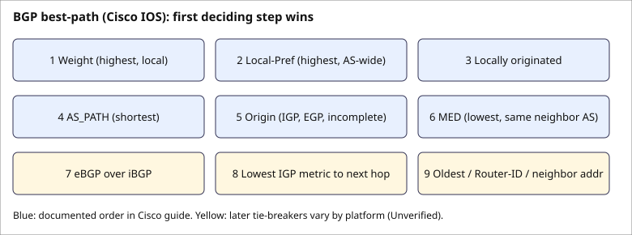

*شکل: ترتیب انتخاب بهترین مسیر BGP؛ اولین مرحله‌ی تعیین‌کننده برنده است.*

### ۵) مثال حل‌شده (سناریوی Route Leak)

سازمان ما (AS 65010) به ISP-A و ISP-B وصل است. بدون Prefix-List خروجی، همه‌ی مسیرهایی که از ISP-A یاد می‌گیریم به ISP-B هم اعلام می‌شود (به‌شرطی که پیش‌فرض‌های BGP و Policy آن را بدهند).

``` text
ISP-A routes -> our router -> advertised to ISP-B   (we become a transit AS)
Result: ISP-B may send transit traffic through our small links -> congestion/outage
```

**اصلاح:** Prefix-List خروجی فقط Prefixهای خودمان (مثلاً 203.0.113.0/24) را اجازه می‌دهد.

**مثال سخت:** پس از اعمال Local-Pref 200 برای ISP-A، ترافیک خروجی به A می‌رود ولی ترافیک ورودی مشتریان هنوز از B می‌آید. توضیح دهید چرا و راه‌حل (Prepend + هماهنگی با ISP).

### ۶) طراحی و تصمیم‌گیری

| سؤال | تصمیم پیشنهادی |
|---|---|
| ISP اصلی/پشتیبان خروجی | Local-Pref (نه Weight) تا همه‌ی روترهای AS یکسان تصمیم بگیرند |
| ورود ترافیک | Prepend + MED + (در صورت پشتیبانی) Community؛ انتظار کنترل کامل نداشته باشید |
| محافظت Session | TTL Security + Authentication + Max-Prefix |
| Filter | همیشه Prefix-List ورودی/خروجی در مرز ISP |
| تغییر Policy | Soft reconfiguration، نه ریست کامل |

### ۷) پیاده‌سازی (CLI Cisco، نمونه)

``` text
ip prefix-list MY-PFX seq 5 permit 203.0.113.0/24
ip prefix-list BOGONS seq 5 deny 10.0.0.0/8 le 32
ip prefix-list BOGONS seq 10 deny 172.16.0.0/12 le 32
ip prefix-list BOGONS seq 15 deny 192.168.0.0/16 le 32
ip prefix-list BOGONS seq 20 deny 0.0.0.0/0
ip prefix-list BOGONS seq 25 permit 0.0.0.0/0 le 24

route-map SET-LP-A permit 10
 set local-preference 200

router bgp 65010
 neighbor 192.0.2.1 remote-as 65100
 neighbor 192.0.2.1 route-map SET-LP-A in
 neighbor 192.0.2.1 prefix-list BOGONS in
 neighbor 192.0.2.1 prefix-list MY-PFX out
 neighbor 192.0.2.1 maximum-prefix 1000 80 warning-only
```

Verification:

``` text
R1# show ip bgp 198.51.100.0/24
R1# show ip bgp neighbors 192.0.2.1 advertised-routes
R1# show ip bgp neighbors 192.0.2.1 received-routes
R1# show ip bgp summary
R1# clear ip bgp 192.0.2.1 soft in
```

(`received-routes` نیاز به `soft-reconfiguration inbound` دارد؛ `Unverified` روی vIOS.)

### ۸) Troubleshooting

| علامت | شاهد | علت محتمل |
|---|---|---|
| مسیر غیرمنتظره انتخاب شد | `show ip bgp <prefix>` با Best | Attribute بالاتر در ترتیب |
| Prefix نمی‌آید | `received-routes`، Prefix-List | Filter ورودی/Bogon |
| ISP-B ترافیک ناخواسته می‌فرستد | `advertised-routes` | نبودن Prefix-List خروجی |
| Session ناپایدار | Log، Hold، `show ip bgp neighbors` | Timer، لینک، Max-prefix |
| Route نصب نشد | Next-hop در RIB | Next-hop غیرقابل‌دسترس |

### ۹) نکات امنیتی

- BGP Hijack و Route Leak سابقه‌ی واقعی در حوادث بزرگ اینترنت دارند؛ فیلتر ورودی/خروجی حداقل دفاع است.
- Max-Prefix در برابر «سرریز Table» یا اشتباه ISP محافظت می‌کند.
- TTL Security و Authentication Session را در برابر جعل TCP/RST محافظت می‌کنند.
- در Lab ایزوله بدون اینترنت حمله‌ی واقعی تست نمی‌شود؛ فقط رفتار با Peer مجاز.

### ۱۰) جمع‌بندی مفهومی

- ترتیب: Weight → Local-Pref → Local → AS_PATH → Origin → MED → eBGP/iBGP → IGP metric → Tie-break.
- اولین مرحله‌ی تعیین‌کننده برنده است؛ مراحل بعدی سنجیده نمی‌شوند.
- خروجی را با Local-Pref کنترل می‌کنیم؛ ورودی را فقط می‌توانیم تحت تأثیر قرار دهیم.
- Hold پیش‌فرض ۱۸۰ ثانیه است؛ با BFD سریع‌تر.
- امنیت: Prefix-List ورودی/خروجی، Max-Prefix، TTL Security، Authentication.

### ۱۱) تمرین و ارزیابی

**ت1.** (ساده) پنج مرحله‌ی اول انتخاب مسیر Cisco را به ترتیب بنویسید. *(پاسخ: 9-7-ت1)*

**ت2.** (ساده) Weight در کجا معتبر است؟ *(پاسخ: 9-7-ت2)*

**ت3.** (متوسط) دو مسیر: A (LP 150، AS_PATH طول 3) و B (LP 100، AS_PATH طول 1). کدام انتخاب می‌شود؟ چرا؟ *(پاسخ: 9-7-ت3)*

**ت4.** (متوسط) چرا برای کنترل خروج ترافیک Local-Pref بهتر از Weight است؟ *(پاسخ: 9-7-ت4)*

**ت5.** (سخت) دو مسیر با LP، Weight و AS_PATH برابر؛ A: Origin IGP، B: Origin Incomplete، MED A=100 و B=10. کدام برنده است؟ *(پاسخ: 9-7-ت5)*

**ت6.** (سخت، طراحی) سازمان می‌خواهد ترافیک ورودی را از ISP-A بگیرد و B پشتیبان باشد. چه ابزارهایی دارد و محدودیت چیست؟ *(پاسخ: 9-7-ت6)*

**ت7.** (سخت، امنیت) پنج خط محافظ Session eBGP با ISP را فهرست کنید و دلیل هر کدام. *(پاسخ: 9-7-ت7)*

**م1.** Max-Prefix برای چیست؟ *(پاسخ: 9-7-م1)*

**م2.** Soft reset چرا بهتر از ریست کامل است؟ *(پاسخ: 9-7-م2)*

**Q1.** Quick quiz (English): Which attribute is evaluated first on Cisco routers, and is it advertised to peers? *(پاسخ: 9-7-Q1)*

### ۱۲) اصطلاحات و English Corner

| مخفف | شکل کامل | معنی |
|---|---|---|
| LP | Local Preference | اولویت محلی (در کل AS) |
| MED | Multi-Exit Discriminator | نشانه‌ی ترجیح ورود برای همسایه |
| MRAI | Minimum Route Advertisement Interval | حداقل فاصله‌ی ارسال تغییر |
| GTSM | Generalized TTL Security Mechanism | حفاظت TTL Session |
| RPKI | Resource Public Key Infrastructure | اعتبارسنجی مالکیت Prefix |
| ROA | Route Origin Authorization | مجوز مبدأ مسیر |

- *Local preference influences outbound traffic; AS-path prepending only influences inbound traffic.* ← Local-Pref خروج را تحت تأثیر می‌گذارد؛ Prepend فقط ورود.
- *Always filter prefixes on eBGP sessions.* ← در Sessionهای eBGP همیشه Prefix را فیلتر کنید.

### ۱۳) منابع

- Cisco: [Select BGP Best-path Algorithm](https://www.cisco.com/c/en/us/support/docs/ip/border-gateway-protocol-bgp/13753-25.html).
- RFC 4271 — BGP-4 (§9.1: Decision Process).
- RFC 7454 (BCP 194) — BGP Operations and Security (Max-prefix، TTL Security، فیلتر Prefix).
- RFC 5880 — BFD.


## پاسخ‌های فصل 9

> ابتدا بدون نگاه حل کنید. شناسه: درس-نوع+شماره (ت = تمرین، م = مرور).


### پاسخ‌های بازنویسی عمیق درس 9-1

**9-1-ت1** — Session Established و ۵ Prefix دریافت شده.

ستون آخر `show ip bgp summary` یا حالت (Idle/Active/...) را نشان می‌دهد یا اگر Session برقرار باشد، تعداد Prefix دریافتی را. عدد ۵ یعنی Session در حالت Established است و ۵ Prefix از این Neighbor دریافت و پذیرفته شده است. ستون Up/Down مدت برقراری را می‌گوید. اگر عدد ۰ بود Session بالاست ولی Prefixی دریافت نشده: به سراغ فیلتر ورودی یا اعلام‌نکردن Peer بروید (درس ۹-۶).

**9-1-ت2** — TCP برقرار نشده و تلاش دوباره می‌شود.

Active در BGP یعنی «روتر فعالانه در حال تلاش برای ساختن اتصال TCP به Peer است ولی موفق نشده». این حالت سالم نیست و نباید با «فعال و سالم» اشتباه شود. علل: Peer در دسترس نیست، پورت 179 بسته است، آدرس Neighbor یا update-source اشتباه است، یا ACL/Firewall. اولین بررسی: `ping`، `show ip route <peer>` و `telnet <peer> 179`.

**9-1-ت3** — کوچک‌تر: 90 ثانیه (Keepalive 30).

Hold Time نهایی کوچک‌ترین مقدار پیشنهادی دو سر است؛ پس بین ۱۸۰ و ۹۰، مقدار ۹۰ ثانیه اعمال می‌شود و Keepalive معمولاً یک‌سوم Hold یعنی ۳۰ ثانیه. نتیجه: اگر Peer ۹۰ ثانیه چیزی نفرستد Session با NOTIFICATION بسته می‌شود. هماهنگ‌کردن تایمر دو سر برای پیش‌بینی‌پذیری بهتر است.

``` text
Hold = min(180, 90) = 90 s ; Keepalive = 90 / 3 = 30 s
```

**9-1-ت4** — تا TCP از Loopback/آدرس درست ساخته شود و با Neighbor دیگر مطابق باشد.

Session BGP روی TCP است و آدرس Source بسته را Neighbor با دستور neighbor خودش می‌شناسد. وقتی از Loopback Peer می‌کنید، باید `update-source Loopback0` بگذارید تا TCP از آدرس Loopback ساخته شود؛ وگرنه بسته با آدرس Interface خروجی می‌رود و Neighbor آن را به‌عنوان Peer ناشناخته رد می‌کند. در iBGP Loopback به‌همراه IGP پایداری را بالا می‌برد چون Session با خرابی یک لینک نمی‌افتد.

**9-1-ت5** — Loss باعث Hold Timer Expired؛ رفع Loss/QoS/BFD.

Session هر چند دقیقه می‌افتد و NOTIFICATION «Hold Timer Expired» می‌دهد: ۴۰٪ Loss باعث می‌شود چند Keepalive پشت‌سرهم گم شود و Hold (۱۸۰ ثانیه) تمام شود. رفع علت: کاهش Loss (کابل، QoS برای ترافیک کنترل)، یا BFD برای تشخیص سریع‌تر. تنظیم Timer کوتاه‌تر فقط سرعت تشخیص را زیاد می‌کند و ریسک Flap را هم؛ ریشه‌ی Loss باید رفع شود.

**9-1-ت6** — Timer کوتاه+BFD؛ آزمون لینک ناپایدار؛ Dampening.

Failover سریع BGP: Timer را کوتاه یا BFD (تشخیص زیر ثانیه) فعال می‌کنند. ریسک: لینک ناپایدار با هر Loss کوتاه Session را می‌اندازد و Flap پیاپی ایجاد می‌کند. راه کاهش: آزمون روی لینک ناپایدار، Dampening/Hold-down، و سنجش میزان Loss واقعی پیش از کاهش Timer. معیار: Failover < ۳ ثانیه بدون Flap در آزمون ۲۴ ساعته.

**9-1-Q1** — Active.

در حالت Active، TCP به Peer برقرار نشده و روتر دوباره تلاش می‌کند. بررسی اولیه: Reachability، پورت 179 و ACL.

### پاسخ‌های بازنویسی عمیق درس 9-2

**9-2-ت1** — BGP فقط Prefixی را اعلام می‌کند که Route دقیق در RIB دارد.

دستور `network` فقط Prefixی را اعلام می‌کند که در RIB با همان Mask دقیق وجود داشته باشد. اگر Route /16 داشته باشید و `network` برای /24 بنویسید، اعلام نمی‌شود. راه: Route Null0 دقیق برای Summary یا نوشتن Prefix واقعی. این رایج‌ترین علت «Prefix در BGP نیست» است.

**9-2-ت2** — 20.

Administrative Distance پیش‌فرض eBGP برابر ۲۰ است (iBGP ۲۰۰). یعنی در رقابت با OSPF (110) مسیر eBGP وارد RIB می‌شود. اگر Static با AD 1 همان Prefix را داشته باشد، BGP در RIB نمی‌نشیند و در `show ip bgp` با علامت r (RIB-failure) دیده می‌شود.

**9-2-ت3** — update-source، ebgp-multihop و Route به Loopback Peer.

برای eBGP با Loopback باید سه چیز باشد: `neighbor X update-source Loopback0` برای آدرس Source، `neighbor X ebgp-multihop 2` چون TTL پیش‌فرض eBGP برابر ۱ است و Loopback یک Hop بیشتر فاصله دارد، و Route Static/IGP به Loopback Peer. بدون هر یک Session بالا نمی‌آید.

**9-2-ت4** — نشت مسیرهای ناخواسته و Origin Incomplete؛ کنترل کم.

`redistribute connected/static` همه‌ی مسیرهای موجود را با Origin Incomplete وارد BGP می‌کند؛ ریسک: نشت مسیرهای ناخواسته (آدرس‌های داخلی یا لینک‌ها) به اینترنت و کنترل کم. ترجیح: `network` با Route-map/Prefix-list برای کنترل دقیق.

**9-2-ت5** — RIB-failure؛ مسیر با AD بهتر از منبع دیگر در RIB است.

`r` در `show ip bgp` یعنی RIB-failure: مسیر BGP معتبر است ولی مسیر بهتری با AD کمتر از منبع دیگر (مثلاً Static) در RIB نشسته؛ پس BGP نصب نمی‌شود. با `show ip bgp rib-failure` علت را ببینید و AD/Static را اصلاح کنید.

**9-2-ت6** — ASN، Peer IP، Prefix-list، Max-prefix، Auth.

برگه‌ی eBGP دو سازمان شامل: ASN هر دو، آدرس Peer، Prefixهای مجاز اعلام و دریافت (Prefix-list)، Max-prefix، Authentication (MD5)، TTL Security، تماس NOC و Timer/BFD. این برگه پیش از فعال‌سازی امضا می‌شود تا اشتباه کانفیگ ISP یا خودمان به Leak نرسد.

**9-2-Q1** — Because there is no exactly matching route in the routing table.

چون BGP فقط Prefixی را اعلام می‌کند که Route دقیقاً مطابق در RIB باشد؛ برای Summary باید Route Null0 با همان Mask ساخت.

### پاسخ‌های بازنویسی عمیق درس 9-3

**9-3-ت1** — Split-horizon: مسیر iBGP به iBGP Peer داده نمی‌شود.

قاعده‌ی Split-horizon در iBGP: مسیری که از یک iBGP Peer یاد گرفته شده به iBGP Peer دیگر داده نمی‌شود تا حلقه‌ی AS_PATH-بدون-تغییر ایجاد نشود (در iBGP AS_PATH تغییر نمی‌کند). نتیجه: همه‌ی روترهای iBGP باید Full-mesh باشند یا از Route Reflector استفاده شود.

**9-3-ت2** — Next-hop را آدرس خود روتر قرار می‌دهد.

`next-hop-self` Next-hop مسیرهایی را که به iBGP Peer می‌دهد آدرس خود روتر قرار می‌دهد. چون پیش‌فرض iBGP تغییر Next-hop نمی‌دهد و Next-hop خارجی (آدرس ISP) ممکن است در IGP نباشد، روتر داخلی آن را Inaccessible می‌بیند. با next-hop-self مسیر قابل‌استفاده می‌شود.

**9-3-ت3** — 20×19/2 = 190.

Full-mesh برای n روتر n(n−1)/2 Session دارد. برای ۲۰ روتر ۱۹۰ Session؛ مدیریت و CPU سخت می‌شود. راه: Route Reflector با تعداد Session تقریباً خطی (هر Client با RR).

``` text
Sessions = 20 x 19 / 2 = 190
```

**9-3-ت4** — پایداری با وجود چند مسیر؛ نیاز IGP.

Peering iBGP با Loopback باعث می‌شود Session با خرابی یک لینک نیفتد (IGP مسیر جایگزین به Loopback می‌دهد) و Session مستقل از Interface فیزیکی باشد. پیش‌نیاز: IGP (OSPF) Reachability Loopback را بدهد و `update-source Loopback0`.

**9-3-ت5** — next-hop-self یا IGP Reachability؛ ریست نرم.

Next-hop inaccessible: مسیر BGP در Table است ولی Next-hop (خارجی) در RIB نیست. راه: `neighbor X next-hop-self` روی روتر مرزی یا Redistribute/Passive کردن شبکه‌ی لینک خارجی در IGP. پس از تغییر `clear ip bgp X soft` و تأیید `>` و Route در RIB.

**9-3-ت6** — طرح.

طرح Route Reflector دوتایی: RR1 و RR2 با Cluster-ID یکسان یا متفاوت (طبق طراحی)، Clientها با هر دو Session دارند؛ در خرابی RR1، RR2 جایگزین می‌شود. Session شمار حدود 2×n به‌جای n(n−1)/2. آزمون: قطع RR1 و دیدن Convergence و نبود حلقه.

**9-3-Q1** — To preserve the original exit point information; hence the next hop must be reachable via the IGP.

iBGP عمداً Next-hop را عوض نمی‌کند تا اطلاعات خروج اصلی حفظ شود؛ بنابراین Next-hop باید از طریق IGP قابل‌دسترس باشد.

### پاسخ‌های بازنویسی عمیق درس 9-4

**9-4-ت1** — Local-Pref (کل AS) یا Weight (محلی).

برای کنترل خروج: Local-Preference در کل AS (مقدار بزرگ‌تر بهتر) و Weight فقط محلی روی همان روتر (سیسکو). در طراحی دو ISP معمولاً Local-Pref 200 برای ISP ترجیحی ست می‌شود و `clear ip bgp soft in` اعمال می‌شود.

**9-4-ت2** — AS_PATH را بلندتر نشان می‌دهد تا کم‌ترجیح شود.

AS-Path Prepend شماره‌ی AS خودمان را چند بار به مسیرهای ارسالی اضافه می‌کند تا مسیر بلندتر و کم‌ترجیح دیده شود. برای تأثیر روی ورود ترافیک استفاده می‌شود؛ تضمینی نیست چون ISP می‌تواند Local-Pref خودش را اعمال کند.

**9-4-ت3** — Prepend مسیرهای ارسالی را تغییر می‌دهد نه ترجیح خودمان برای دریافتی.

Prepend روی ورودی برای کنترل خروج بی‌اثر است چون Prepend مسیرهای ارسالی را تغییر می‌دهد، نه ترجیح ما برای مسیرهای دریافتی. برای خروج باید Local-Pref/Weight روی مسیرهای دریافتی گذاشت.

**9-4-ت4** — فقط بین Pathهای همان AS همسایه.

MED فقط بین مسیرهای دریافتی از همان AS همسایه مقایسه می‌شود (پیش‌فرض)؛ بین دو AS مختلف مقایسه نمی‌شود مگر با `bgp always-compare-med`. کم‌تر بهتر است و برای پیشنهاد نقطه‌ی ورود به همسایه به‌کار می‌رود.

**9-4-ت5** — تقسیم Prefix، Prepend، Community، اندازه‌گیری.

برای تقسیم ورودی ۷۰/۳۰ بین دو ISP: Prefix را به دو نیمه تقسیم کنید و هر نیمه را با اولویت متفاوت اعلام کنید (نیمه‌ی بالا ترجیحاً از A، نیمه‌ی پایین از B)، Prepend برای مسیر پشتیبان، Community طبق مستند ISP و اندازه‌گیری ترافیک ورودی با Looking Glass/NetFlow. نتیجه تضمینی نیست؛ آزمون و تنظیم تکراری لازم است.

**9-4-ت6** — Local-Pref+Prefix-list+Prepend+Community.

Policy کامل دو ISP: Local-Pref 200 برای ISP-A (خروج)، Prefix-list خروجی فقط Prefixهای خودمان، Prepend 3× روی ISP-B برای ورودی، Community Action طبق ISP، Max-prefix و `soft` پس از هر تغییر. آزمون: traceroute خروجی و مشاهده‌ی ترافیک ورودی.

**9-4-Q1** — Local preference.

Local Preference ویژگی‌ای است که کل AS (iBGP) می‌بیند و مسیر خروج را تعیین می‌کند؛ Prepend فقط ورودی را تحت تأثیر می‌گذارد.

### پاسخ‌های بازنویسی عمیق درس 9-5

**9-5-ت1** — طول Prefix حداکثر 24.

در Prefix-list، `le 24` یعنی طول Prefix حداکثر ۲۴ (مثلاً 10.0.0.0/8 le 24 همه‌ی زیرمجموعه‌های تا /24)، و `ge` حداقل طول. این برای فیلتر Prefixهای خیلی طولانی (/25 تا /32) که نباید در اینترنت دیده شوند کاربرد دارد.

**9-5-ت2** — AS_PATH خالی؛ مسیرهای خودمان.

عبارت `^$` در AS-path access-list یعنی AS_PATH خالی؛ مسیرهایی که خودمان مبدأ آن‌ها هستیم. با `filter-list ... out` فقط Prefixهای خودمان اعلام می‌شود و از Transit شدن جلوگیری می‌کند.

**9-5-ت3** — اعلام مسیرهای یک ISP به ISP دیگر و تبدیل ما به Transit.

Route Leak یعنی مسیرهای یک ISP (مثلاً A) به ISP دیگر (B) اعلام شود و ما به‌ناخواسته Transit شویم؛ ترافیک اضافی و شکایت ISPها. جلوگیری: فیلتر خروجی با `^$` و Prefix-list، و فیلتر ورودی.

**9-5-ت4** — محافظت جدول/حافظه در برابر اشتباه یا حمله.

Max-prefix تعداد Prefixهای دریافتی از Neighbor را محدود می‌کند و در اشتباه/حمله (ارسال ۲۰۰ هزار Prefix) از پر شدن RIB و حافظه جلوگیری می‌کند؛ با هشدار در ۸۰٪ و قطع یا Warning-only. مقدار را از واقعیت ISP بگیرید.

**9-5-ت5** — advertised-routes، filter-list ^$ out، soft out.

کشف و رفع Leak: ۱) `show ip bgp neighbors X advertised-routes` Prefixهای اضافه را نشان می‌دهد. ۲) `filter-list ^$ out` و Prefix-list خروجی. ۳) `clear ip bgp X soft out`. ۴) آزمون: دوباره advertised-routes. ۵) اطلاع ISP.

**9-5-ت6** — Bogon in، Prefix out، Max-prefix، RPKI مفهومی.

استاندارد فیلتر ISP: ورودی Bogon و Prefixهای خصوصی/طولانی را رد کند و Max-prefix بگذارد؛ خروجی فقط Prefixهای خود. RPKI/ROA (اعتبارسنجی مبدأ) به‌عنوان لایه‌ی بعدی مفهومی. RFC 7454 مرجع بهترین رویه است.

**9-5-Q1** — Routes with an empty AS path, i.e., locally originated routes.

`^$` مسیرهای با AS_PATH خالی را تطبیق می‌دهد؛ یعنی مسیرهایی که خودمان مبدأ هستیم.

### پاسخ‌های بازنویسی عمیق درس 9-6


### پاسخ‌های بازنویسی عمیق درس 9-6

**9-6-ت1** — TCP برقرار نشده و تلاش دوباره می‌شود؛ ابتدا `telnet peer 179` و ACL/Reachability.

Active یعنی TCP برقرار نشده و تلاش تکرار می‌شود؛ ابتدا `telnet peer 179` و بررسی ACL/Reachability.

**9-6-ت2** — Session برقرار است ولی Prefixی دریافت نشده؛ فیلتر ورودی یا Peer اعلام نمی‌کند.

**9-6-ت3** — مسیر BGP در Table است ولی مسیر بهتر (AD کمتر) در RIB نشسته؛ رفع با حذف/تنظیم AD.

**9-6-ت4** — Next-hop خارجی در IGP نیست؛ `next-hop-self` یا Redistribute شبکه‌ی لینک.

**9-6-ت5** — اول لایه‌ی پایین‌تر را رفع و آزمون کنید، بعد بالاتر؛ ثبت اثر هر تغییر.

**9-6-ت6** — هفت گام، دستور هر گام، خروجی مورد انتظار، اقدام.

چک‌لیست BGP: هفت گام (Session، TCP، Received، Policy، Best path، RIB، Forwarding) با دستور و خروجی مورد انتظار.

**9-6-Q1** — show ip bgp rib-failure.

### پاسخ‌های درس‌های افزوده‌ی فصل 9 (۹-۰ و ۹-۷)

**9-0-ت1** — AS مجموعه‌ای از شبکه‌ها و روترها زیر یک مدیریت و سیاست مسیریابی واحد است که با یک ASN شناخته می‌شود.

**9-0-ت2** — TCP پورت 179.

**9-0-ت3** — eBGP = 20 و iBGP = 200. مسیر خارجی (eBGP) معتبرتر از مسیری است که از داخل AS یاد گرفته‌ایم؛ و iBGP نباید جلوی IGP را بگیرد.

**9-0-ت4** — هر AS هنگام عبور ASN خود را به AS_PATH اضافه می‌کند. اگر روتری ASN خودش را در AS_PATH ببیند، یعنی مسیر قبلاً از AS او گذشته و Update را رد می‌کند.

**9-0-ت5** — Static Default کافی است وقتی یک ISP، نیاز به Policy نیست و Failover خودکار لازم نیست. BGP لازم است وقتی: بیش از یک ISP با Policy انتخاب مسیر، نیاز به اعلام Prefix خودمان به اینترنت، یا اتصال به ASهای دیگر/شعب با Failover خودکار.

**9-0-ت6** — تعداد Sessionها n(n−1)/2 = 8×7/2 = 28. با رشد n به‌صورت درجه‌ی دو زیاد می‌شود؛ راه‌حل: Route Reflector (هر Client فقط با RR) یا Confederation.

**9-0-م1** — OPEN، KEEPALIVE، UPDATE، NOTIFICATION.

**9-0-م2** — چون BGP برای رسیدن به Next-hop (Recursive Lookup) به Reachability داخلی از IGP یا Static نیاز دارد؛ بدون آن مسیر BGP غیرقابل‌استفاده است.

**9-0-Q1** — Because each route carries the list of ASes it has passed through (the AS_PATH), which is used for loop prevention and policy.

**9-7-ت1** — Weight، Local Preference، مسیرهای Locally originated، AS_PATH کوتاه‌تر، Origin (IGP < EGP < Incomplete).

**9-7-ت2** — فقط روی همان روتر؛ به Peerها اعلام نمی‌شود.

**9-7-ت3** — A برنده است. Local-Pref قبل از AS_PATH سنجیده می‌شود (150 > 100) و مرحله‌ی AS_PATH اصلاً بررسی نمی‌شود.

**9-7-ت4** — Local-Pref در کل AS (iBGP) پخش می‌شود و همه‌ی روترهای AS یکسان تصمیم می‌گیرند؛ Weight فقط محلی است و ناسازگاری ایجاد می‌کند.

**9-7-ت5** — Weight/LP/AS_PATH برابرند؛ مرحله‌ی Origin: IGP (A) از Incomplete (B) بهتر است؛ پس A برنده می‌شود و MED سنجیده نمی‌شود (MED بعد از Origin می‌آید).

**9-7-ت6** — ابزارها: AS-Path Prepend روی B، MED، و Community (اگر ISP بپذیرد). محدودیت: ورودی را ISPها و دیگر ASها تعیین می‌کنند؛ ما فقط «پیشنهاد» می‌دهیم و کنترل کامل نداریم.

**9-7-ت7** — (۱) Prefix-List ورودی: رد Bogon و Prefixهای نامعتبر. (۲) Prefix-List خروجی: فقط Prefixهای خودمان تا Route Leak نشود. (۳) Max-Prefix: محافظت از حافظه/جدول. (۴) TTL Security (GTSM): جلوگیری از جعل از راه دور. (۵) Authentication (MD5/TCP-AO): جلوگیری از تزریق به Session.

**9-7-م1** — محدود کردن تعداد Prefix دریافتی از یک Peer؛ هشدار یا قطع Session هنگام تعداد غیرعادی.

**9-7-م2** — بدون قطع Session و بدون قطع ترافیک، Policy جدید اعمال می‌شود؛ ریست کامل همه‌ی مسیرها را موقتاً از بین می‌برد.

**9-7-Q1** — Weight is evaluated first; it is Cisco-specific, local to the router and is not advertised to peers.


# پایان بخش ۳ (فصل‌های ۷ تا ۹)

## ۱) خلاصه‌ی مهارت‌های کسب‌شده
- DHCP/Relay، DNS/NTP، NAT/PAT، ACL، Syslog/SNMP، QoS؛ Hardening، AAA، JSON/YAML/REST، Netmiko، Ansible، Git، As-Built.
- BGP: eBGP/iBGP، انتخاب مسیر، فیلتر، عیب‌یابی.

## ۲) آزمون پایان سه فصل
**س1** — giaddr در DHCP Relay چیست؟

**س2** — Stratum 16 یعنی چه؟

**س3** — PAT چه چیزی را علاوه بر IP تغییر می‌دهد؟

**س4** — Implicit deny در ACL؟

**س5** — Syslog severity 3 و 6؟

**س6** — چرا SNMPv3؟

**س7** — سه کنترل Management Plane در Hardening؟

**س8** — چرا AAA Fallback محلی؟

**س9** — Idempotency در Ansible؟

**س10** — حالت سالم Peer BGP؟

**س11** — Local-Pref در برابر MED؟

**س12** — چرا Prefix-List روی eBGP؟


## ۳) پاسخ آزمون
- **س1:** آدرس Interface Relay؛ سرور از آن Scope را تشخیص می‌دهد.
- **س2:** ناهمگام (نامعتبر).
- **س3:** پورت مبدأ.
- **س4:** deny any نامرئی در پایان؛ هر چه permit نشده بسته می‌شود.
- **س5:** Error و Informational.
- **س6:** احراز هویت و رمزگذاری دارد؛ v2c متن ساده است.
- **س7:** SSH v2/ACL VTY/AAA یا secret؛ بستن http/telnet.
- **س8:** اگر سرور AAA قطع شد قفل نشویم.
- **س9:** اجرای دوباره بدون تغییر اگر حالت مطلوب برقرار است.
- **س10:** Established.
- **س11:** LocPrf داخل AS و بالاتر بهتر؛ MED برای همسایه و کمتر بهتر.
- **س12:** جلوگیری از نشت/پذیرش مسیر ناخواسته.

## ۴) معیارهای تسلط
| مهارت | سطح | شاهد |
|---|---|---|
| IP Services | L3 | Service Matrix |
| Hardening/Automation | L2-L3 | CP1 As-Built |
| BGP پایه | L3 | رفع ۵ خرابی |

## ۵) مشکلات و موارد باقی‌مانده (صریح)
1. Labهای ۷ و ۸ اجرا نشده. 2. فصل ۹ جدید و بدون تجربه‌ی Image (BGP روی vIOS باید کار کند ولی آزمایش نشده). 3. SNMPv3/AAA/TACACS سینتکس `Unverified`.

## ۶) پیش‌نیازهای بخش بعد
BGP عملی روی دو vIOS؛ آماده‌بودن Image دوم برای ISP-Sim.

## ۷) فهرست Lab و منابع مرتبط
کارت‌های Lab همین فایل ، `03-ops/*.md` (خروجی دانشجو)

## ۸) وضعیت دوره
| مورد | مقدار |
|---|---|
| آخرین فصل تکمیل‌شده | ۹ |
| آخرین درس تکمیل‌شده | ۹-۶ |
| مهارت‌های تأییدشده | **هیچ‌کدام هنوز آزمون عملی واقعی نشده‌اند** (ممیزی/اجرای شما لازم است) |
| موضوعات نیازمند مرور | طبق «معیارهای تسلط» |
| فصل بعدی | ۱۰ |
| فایل تولیدشده | `course/Course_Part_03_Chapters_07-09.md` |


---

# Enterprise Network & Security Engineering — دوره‌ی تخصصی Cisco و Enterprise Firewall
## بخش ۴ از ۱۱ — فصل‌های ۱۰ تا ۱۲

| مورد | مقدار |
|---|---|
| نام دوره | Enterprise Network & Security Engineering (Cisco + FortiGate) |
| شماره بخش | ۴ از ۱۱ |
| فصل‌های این فایل | ۱۰ ، ۱۱ ، ۱۲ |
| تاریخ تولید | ۲۰۲۶-۱۱-۲۶ |
| نسخه Blueprint | v3.0 (+ بازبینی ۱٫۱) |
| نسخه‌های نرم‌افزار | FortiOS 7.0.3 (اسمی؛ بوت‌نشده؛ تأیید با `get system status`) ؛ Cisco vIOS-L2 15.2(20200924، Experimental) ؛ Cisco vIOS 15.9(3)M9 ؛ VPCS ؛ PNetLab 4.2.8 ؛ ESXi 8.0U2 ؛ CSR1000v 17.03.02 (IOS-XE؛ آزمایش‌نشده) |
| وضعیت تکمیل | **فصل‌های ۱۰–۱۲ تولید شد؛ مبانی تا Baseline FortiGate.** همه‌ی Labها «اجرا نشده»؛ FortiGate هنوز بوت نشده. محتوای FortiGate از مستند عمومی FortiOS 7.0 و دانش مؤلف است و باید در بوت اول تطبیق داده شود. |

> **قوانین خواندن:** تمرین‌ها و پرسش‌های مرور بدون پاسخ‌اند؛ پاسخ در «پاسخ‌های فصل». «اجرا نشده» یعنی خروجی‌ها **پیش‌نیاز/پیش‌بینی** هستند. «CLI-Accepted» ≠ «کار می‌کند». رمزها نمونه‌اند.

### وضعیت راستی‌آزمایی Labهای این بخش
خلاصه: اجرا نشده (فقط طراحی): 20.

| Lab | وضعیت |
|---|---|
| 10-1 | اجرا نشده (فقط طراحی) |
| 10-2 | اجرا نشده (فقط طراحی) |
| 10-3 | اجرا نشده (فقط طراحی) |
| 10-4 | اجرا نشده (فقط طراحی) |
| 10-5 | اجرا نشده (فقط طراحی) |
| 10-6 | اجرا نشده (فقط طراحی) |
| 10-7 | اجرا نشده (فقط طراحی) |
| 11-1 | اجرا نشده (فقط طراحی) |
| 11-2 | اجرا نشده (فقط طراحی) |
| 11-3 | اجرا نشده (فقط طراحی) |
| 11-4 | اجرا نشده (فقط طراحی) |
| 11-5 | اجرا نشده (فقط طراحی) |
| 11-6 | اجرا نشده (فقط طراحی) |
| 12-1 | اجرا نشده (فقط طراحی) |
| 12-2 | اجرا نشده (فقط طراحی) |
| 12-3 | اجرا نشده (فقط طراحی) |
| 12-4 | اجرا نشده (فقط طراحی) |
| 12-5 | اجرا نشده (فقط طراحی) |
| 12-6 | اجرا نشده (فقط طراحی) |
| 12-7 | اجرا نشده (فقط طراحی) |

---

<a id="ch10"></a>

> **نسخه‌ی اصلاح‌شده (v3.1، دسته B):** این فایل نسخه‌ی توسعه‌یافته‌ی `course/Course_Part_04_Chapters_10-12.md` است؛ فایل اصلی حفظ شده است. درس‌های افزوده: ۱۰-۸ و ۱۰-۹ (فصل ۱۰). پاسخ‌های آن‌ها در «پاسخ‌های فصل» همان فصل است.

> **نسخه‌ی اصلاح‌شده (v3.9):** نسخه‌ی توسعه‌یافته‌ی فایل اصلی؛ درس‌های افزوده: ۱۰-۸، ۱۰-۹، ۱۱-۰، ۱۱-۷، ۱۲-۰، ۱۲-۸، ۱۲-۹ (دسته‌های B و A). فایل اصلی در `course/` حفظ شده است. پاسخ‌های درس‌های افزوده در «پاسخ‌های فصل» همان فصل است.

# فصل 10 — Redistribution، ECMP، PBR، VRF-lite و Asymmetric Routing

**مدت:** ۳۶ ساعت | **پیش‌نیاز:** فصل ۹ (BGP)، فصل ۶ (OSPF).
**اهداف:** انتقال مسیر بین پروتکل‌ها بدون حلقه؛ توزیع بار با ECMP؛ هدایت ترافیک با PBR؛ جداسازی جداول مسیریابی با VRF-lite؛ تحلیل و رفع مسیر نامتقارن.
**چرا برای فایروال؟** فایروال Stateful با مسیر نامتقارن خراب می‌شود؛ ECMP/PBR/VRF همان ابزارهایی هستند که باعث نامتقارن‌شدن یا جداسازی می‌شوند.
**معیار تسلط:** Redistribution دوطرفه با Tag و بدون حلقه؛ پیش‌بینی مسیر ECMP؛ PBR با Track؛ VRF مستقل؛ تشخیص Asymmetric با traceroute دوطرفه.
**اشتباهات رایج:** Redistribution بدون `subnets`؛ حلقه‌ی دوطرفه؛ PBR روی Interface اشتباه؛ نشت VRF ناخواسته؛ بررسی مسیر فقط در یک جهت.

**درس‌های فصل:**
- [درس 10-1 — Redistribution: مفهوم و Seed Metric](#l-10-1)
- [درس 10-2 — Redistribution دوطرفه و جلوگیری از حلقه با Tag](#l-10-2)
- [درس 10-3 — ECMP و توزیع بار](#l-10-3)
- [درس 10-4 — Policy-Based Routing (PBR)](#l-10-4)
- [درس 10-5 — VRF-lite: جداسازی جدول مسیریابی](#l-10-5)
- [درس 10-6 — Asymmetric Routing: تحلیل مسیر رفت و برگشت](#l-10-6)
- [درس 10-7 — طراحی مسیر برای چندفایروالی و آزمون کوچک](#l-10-7)

---

<a id="l-10-1"></a>

## درس 10-1 — Redistribution: مفهوم، Seed Metric، Subnets و Route Type

**فصل 10 · بازنویسی عمیق · پیش‌نیاز: ۶-۱، ۶-۴، ۹-۲ · ≈ 9 ساعت**

> **وضعیت:** Cisco IOSv 15.9/CSR1000v 17.03؛ خروجی‌ها نمونه‌ی آموزشی؛ Lab «اجرا نشده»؛ دستورهای vIOS `Unverified` تا اجرای Lab.

### ۱) هدف آموزشی

در پایان این درس باید بتوانید:

1. توضیح دهد Redistribution یعنی تزریق مسیرهای یک پروتکل به پروتکل دیگر، نه «ترجمه‌ی» پروتکل‌ها.
2. Seed Metric پیش‌فرض و دستور `metric`/`default-metric` را برای OSPF/EIGRP/RIP/BGP تنظیم کند.
3. `subnets` در OSPF، Route Type E1/E2 و اثر آن‌ها را تحلیل کند.
4. نتیجه را با `show ip route` و `show ip ospf database external` تأیید کند.
5. خطاهای رایج (Metric ناسازگار، فراموشی subnets) را رفع کند.

### ۲) مفهوم پایه: چیست و چرا؟

فرض کنید شرکتی دو شعبه دارد: یکی OSPF اجرا می‌کند، دیگری EIGRP. هر دو زبان خودشان را می‌فهمند و یکدیگر را نه. Redistribution مترجمی در مرز است که مسیرهای یک زبان را می‌گیرد و در زبان دیگر اعلام می‌کند. ولی مترجم باید «هزینه» را هم بسازد، چون Metricها قابل تبدیل نیستند. این هزینه‌ی ساختگی همان Seed Metric است.

### ۳) توضیح عمیق فنی

#### ۱) اصل کار

Redistribution فقط مسیرهایی را که **در RIB با آن پروتکل یا نوع مسیر نصب شده‌اند** برمی‌دارد، نه همه‌ی چیزهایی که پروتکل می‌داند. پس اگر مسیر در RIB نباشد، منتقل نمی‌شود.

``` text
OSPF domain  <--- R-ASBR --->  EIGRP domain
R-ASBR: router ospf 1 + router eigrp 100 ; redistribute in the needed direction
```

#### ۲) Seed Metric

| مقصد | Metric پیش‌فرض Seed |
|---|---|
| OSPF | 20 (BGP: 1)، Type E2 |
| EIGRP | بی‌نهایت: باید دستی تعیین شود |
| RIP | بی‌نهایت: باید دستی تعیین شود |
| BGP | Metric (MED) از IGP کپی می‌شود |

``` text
router ospf 1
 redistribute eigrp 100 subnets metric 100 metric-type 1
router eigrp 100
 redistribute ospf 1 metric 10000 100 255 1 1500
 ! bandwidth(Kbps) delay(10us) reliability load MTU
```

#### ۳) `subnets` و Route Type

بدون `subnets` در OSPF فقط مسیرهای classful منتقل می‌شوند و /24ها «ناپدید» می‌شوند: شایع‌ترین خطا. E1 = Metric خارجی + هزینه‌ی داخلی تا ASBR؛ E2 (پیش‌فرض) = فقط Metric خارجی ثابت. E1 برای چند ASBR و انتخاب نزدیک‌ترین خروج مناسب‌تر است.

#### ۴) AD

مسیر خارجی OSPF (AD=110)، EIGRP External (170)، EIGRP داخلی (90). اثر: در Redistribution دوطرفه حلقه و Route Feedback ممکن است (درس ۱۰-۲).

#### ۵) اعتبارسنجی

``` text
show ip route ospf
show ip ospf database external
show ip route 172.16.5.0
show ip eigrp topology 172.16.5.0/24
```

### ۴) طراحی و تصمیم‌گیری

| سؤال طراحی | گزینه‌ها و معیار انتخاب |
|---|---|
| Seed Metric | OSPF: metric-type 1 برای چند ASBR؛ EIGRP/RIP: دستی |
| فیلتر | Route-map/Prefix-list؛ نه همه‌چیز |
| جهت | یک‌طرفه تا ممکن؛ دوطرفه با Tag |

### ۵) مثال‌های حل‌شده (ساده، متوسط، سخت)

**ساده (حل‌شده):** EIGRP 100 دارای 172.16.0.0/16 است؛ در ASBR `redistribute eigrp 100 subnets` زده می‌شود؛ در روتر OSPF دیگر `O E2 172.16.5.0/24 [110/20]` دیده می‌شود. رابطه: Metric 20 همان Seed.

**متوسط (تحلیل):** بعد از Redistribute، در OSPF فقط 172.16.0.0/16 هست و /24ها نیستند. علت: `subnets` نبود. رفع: افزودن `subnets`؛ آزمون: `show ip route ospf` و ping به 172.16.5.1.

**سخت (طراحی):** دو ASBR (A,B) هر دو EIGRP را به OSPF می‌دهند. با E2 هر روتر OSPF Metric یکسان 20 می‌بیند و ممکن است از ASBR دورتر خارج شود. تحلیل: با E1 هزینه تا ASBR هم افزوده می‌شود و نزدیک‌ترین انتخاب می‌شود. آزمون: traceroute از دو نقطه. معیار: هر Router نزدیک‌ترین ASBR.

### ۷) پیاده‌سازی از مسیر CLI

``` text
router ospf 1
 redistribute eigrp 100 subnets metric 100 metric-type 1
router eigrp 100
 redistribute ospf 1 metric 10000 100 255 1 1500
show ip route ospf
show ip ospf database external
```

### ۸) Verification (اثبات صحت)

- مسیرهای Redistribute با نوع E1/E2 یا D EX در جدول.
- ping/traceroute بین دو دامنه.
- Metric مطابق Seed.

### ۹) Troubleshooting

| علامت | شاهد برای بررسی | علت محتمل و رفع |
|---|---|---|
| /24ها نیستند | `show ip route` فقط classful | `subnets` را اضافه کنید |
| مسیر EIGRP به OSPF نمی‌رود | Metric EIGRP تعیین نشده | `metric ...` بدهید |
| مسیرها ناپایدار | Feedback | Tag و Route-map (۱۰-۲) |

### ۱۰) نکات امنیتی

- مسیر ناخواسته را وارد نکنید؛ Route-map/Prefix-list.
- ASBR نقطه‌ی حساس: ACL/Auth.

### ۱۱) جمع‌بندی مفهومی

- Redistribution مترجم است نه Merge.
- Seed Metric لازم است.
- subnets در OSPF.
- E1 در برابر E2.

### ۱۲) تمرین و ارزیابی

**ت1.** (ساده) Seed Metric پیش‌فرض Redistribution به OSPF چند است؟ *(پاسخ: 10-1-ت1)*

**ت2.** (ساده) چرا EIGRP و RIP Metric پیش‌فرض ندارند؟ *(پاسخ: 10-1-ت2)*

**ت3.** (متوسط) تفاوت E1 و E2؟ *(پاسخ: 10-1-ت3)*

**ت4.** (متوسط) اگر `subnets` نباشد چه می‌شود؟ *(پاسخ: 10-1-ت4)*

**ت5.** (سخت) دو ASBR و تصمیم Type. *(پاسخ: 10-1-ت5)*

**ت6.** (سخت، طراحی) طرح Redistribution یک‌طرفه با فیلتر. *(پاسخ: 10-1-ت6)*

**Q1.** Quick quiz (English): What happens if you redistribute into EIGRP without specifying a metric? *(پاسخ: 10-1-Q1)*

### ۱۳) اصطلاحات و English Corner

| مخفف | شکل کامل | معنی |
|---|---|---|
| ASBR | Autonomous System Boundary Router | روتر مرزی دامنه |
| E2 | OSPF External Type 2 | مسیر خارجی نوع ۲ |
| Seed | Seed metric | Metric اولیه |

- *Redistribution injects routes from one protocol into another.* ← Redistribution مسیرهای یک پروتکل را به دیگری تزریق می‌کند.

### ۱۴) کارت Lab

**کارت Lab:** Redistribution یک‌طرفه. **Evidence:** `03-ops/redist1.md`.

### ۱۵) منابع

- Cisco IOS IP Routing guide: Redistribution
- RFC 2328 (OSPF) بخش External

<a id="l-10-2"></a>

## درس 10-2 — Redistribution دوطرفه، Route Feedback و جلوگیری از حلقه با Tag

**فصل 10 · بازنویسی عمیق · پیش‌نیاز: ۱۰-۱ · ≈ 9 ساعت**

> **وضعیت:** Cisco IOSv 15.9/CSR1000v 17.03؛ خروجی‌ها نمونه‌ی آموزشی؛ Lab «اجرا نشده»؛ دستورهای vIOS `Unverified` تا اجرای Lab.

### ۱) هدف آموزشی

در پایان این درس باید بتوانید:

1. خطر Route Feedback و Suboptimal routing را در دو ASBR توضیح دهد.
2. با Tag + Route-map حلقه را قطع کند.
3. Prefix-list/Distribute-list را مکمل کند.
4. با آزمون منفی ثابت کند حلقه رخ نمی‌دهد.
5. مسیر چندپروتکلی را تحلیل کند.

### ۲) مفهوم پایه: چیست و چرا؟

دو شعبه با دو ASBR: R-A و R-B هر دو دوطرفه ترجمه می‌کنند. مسیری که R-A از OSPF به EIGRP برد، R-B دوباره از EIGRP به OSPF برمی‌گرداند و کم‌کم همه چیز به هم می‌ریزد. راه‌حل: هر مسیر را با «برچسب مبدأ» (Tag) علامت بزنید تا دوباره منتقل نشود.

### ۳) توضیح عمیق فنی

#### ۱) سناریو

``` text
          OSPF area 0              EIGRP 100
 R1 ----- R-A ======================== R-C
           \\                      //
            R-B ===================
```

#### ۲) راه‌حل Tag

``` text
route-map OSPF-TO-EIGRP deny 10
 match tag 100
route-map OSPF-TO-EIGRP permit 20
 set tag 200
route-map EIGRP-TO-OSPF deny 10
 match tag 200
route-map EIGRP-TO-OSPF permit 20
 set tag 100
router eigrp 100
 redistribute ospf 1 metric 10000 100 255 1 1500 route-map OSPF-TO-EIGRP
router ospf 1
 redistribute eigrp 100 subnets route-map EIGRP-TO-OSPF
```

منطق: مسیری که از EIGRP به OSPF آمد Tag=100 دارد؛ برگشت آن به EIGRP رد می‌شود و برعکس. 

#### ۳) AD و Feedback

EIGRP External AD=170 و OSPF External AD=110؛ مسیری که از OSPF وارد EIGRP شده و بر می‌گردد ممکن است با AD بهتر بر مسیر اصلی غلبه کند. Tag مشکل را از ریشه می‌برد.

#### ۴) مکمل

Prefix-list برای فقط شبکه‌های مجاز؛ و `distance` برای External.

#### ۵) آزمون

``` text
show ip route 10.1.1.0
show ip ospf database external 10.1.1.0
show ip eigrp topology 10.1.1.0/24
```

مسیر باید فقط از منبع اصلی باشد.

### ۴) طراحی و تصمیم‌گیری

| سؤال طراحی | گزینه‌ها و معیار انتخاب |
|---|---|
| چند ASBR | Tag+Route-map روی همه |
| راه جایگزین | یک‌طرفه+Default |
| مستندسازی | جدول Tagها |

### ۵) مثال‌های حل‌شده (ساده، متوسط، سخت)

**ساده (حل‌شده):** Tag 100 روی مسیرهای EIGRP→OSPF؛ در R-B فیلتر Tag 100 در جهت برگشت؛ آزمون: مسیر از R-A دوباره به EIGRP نمی‌رود.

**متوسط (تحلیل):** ترافیک بین OSPF و EIGRP از مسیر طولانی رفت: Suboptimal؛ علت: ASBR دورتر؛ راه: E1/Metric/Tag؛ و در نهایت طراحی یک ASBR اصلی.

**سخت (چندعلتی):** بعد از افزودن R-B حلقه؛ بررسی: Tag ست نشده روی R-B (Route-map فقط روی R-A)؛ تحلیل: یکسان‌سازی پیکربندی روی هر دو؛ آزمون منفی با شکستن لینک و traceroute. معیار: بدون حلقه و Convergence < 10 s.

### ۷) پیاده‌سازی از مسیر CLI

``` text
route-map OSPF-TO-EIGRP deny 10
 match tag 100
route-map OSPF-TO-EIGRP permit 20
 set tag 200
show route-map OSPF-TO-EIGRP
show ip route 10.1.1.0
```

### ۸) Verification (اثبات صحت)

- Tag در جدول مسیر.
- نبود حلقه (traceroute).
- Convergence پس از قطع لینک.

### ۹) Troubleshooting

| علامت | شاهد برای بررسی | علت محتمل و رفع |
|---|---|---|
| مسیر حلقه می‌زند | traceroute/TTL | Tag/Route-map روی همه ASBRها |
| مسیر از بین می‌رود | Tag اشتباه | match/set را بازبینی کنید |
| Suboptimal | AD/Type | E1/Metric |

### ۱۰) نکات امنیتی

- همه‌ی ASBRها یکسان پیکربندی شوند.

### ۱۱) جمع‌بندی مفهومی

- دو ASBR=خطر.
- Tag کلید.
- آزمون منفی.

### ۱۲) تمرین و ارزیابی

**ت1.** (ساده) Route Feedback چیست؟ *(پاسخ: 10-2-ت1)*

**ت2.** (ساده) Tag چه کاری می‌کند؟ *(پاسخ: 10-2-ت2)*

**ت3.** (متوسط) چرا Route-map باید روی هر دو ASBR باشد؟ *(پاسخ: 10-2-ت3)*

**ت4.** (متوسط) AD External OSPF و EIGRP؟ *(پاسخ: 10-2-ت4)*

**ت5.** (سخت) پس از R-B حلقه شد؛ تحلیل. *(پاسخ: 10-2-ت5)*

**ت6.** (سخت، طراحی) برگه‌ی Tag سازمان. *(پاسخ: 10-2-ت6)*

**Q1.** Quick quiz (English): Why is route tagging used in two-way redistribution? *(پاسخ: 10-2-Q1)*

### ۱۳) اصطلاحات و English Corner

| مخفف | شکل کامل | معنی |
|---|---|---|
| Tag | Route tag | برچسب مسیر |
| Feedback | Route feedback | بازگشت مسیر |

- *Tag routes at the boundary to stop loops.* ← مسیرها را در مرز Tag کنید تا حلقه نشود.

### ۱۴) کارت Lab

**کارت Lab:** دوطرفه با Tag. **Evidence:** `03-ops/redist2.md`.

### ۱۵) منابع

- Cisco IOS Route-map guide
- RFC 2328

<a id="l-10-3"></a>

## درس 10-3 — ECMP و توزیع بار: Equal-cost، Hashing و Load Balancing

**فصل 10 · بازنویسی عمیق · پیش‌نیاز: ۶-۱، ۱۰-۱ · ≈ 8 ساعت**

> **وضعیت:** Cisco IOSv 15.9/CSR1000v 17.03؛ خروجی‌ها نمونه‌ی آموزشی؛ Lab «اجرا نشده»؛ دستورهای vIOS `Unverified` تا اجرای Lab.

### ۱) هدف آموزشی

در پایان این درس باید بتوانید:

1. شرط ECMP (برابری Metric و AD) و Maximum-paths را بگوید.
2. Hashing (Per-flow) را در برابر Per-packet توضیح دهد.
3. `show ip cef`/`show ip route` را برای مسیرهای برابر بخواند.
4. اثر ECMP بر ترافیک Stateful (فایروال) را تحلیل کند.
5. عیب‌یابی نبود Load-balancing را انجام دهد.

### ۲) مفهوم پایه: چیست و چرا؟

دو جاده‌ی هم‌اندازه به مقصد: ECMP هر دو را به‌کار می‌گیرد. ولی ماشین‌هایی که یک «گفتگو» دارند باید همه از یک جاده بروند، وگرنه بسته‌ها برعکس می‌رسند. پس تقسیم «روی جریان» (flow) انجام می‌شود نه روی بسته.

### ۳) توضیح عمیق فنی

#### ۱) شرط

مسیرها با **Metric و AD برابر** و حداکثر `maximum-paths` (مقدار پیش‌فرض بسته به پلتفرم/نسخه‌ی IOS فرق دارد؛ با `show ip protocols` مقدار فعلی را ببینید).

``` text
router ospf 1
 maximum-paths 4
show ip route 10.1.0.0
 10.1.0.0/16 [110/20] via 10.0.1.2 ... via 10.0.2.2
```

#### ۲) Hashing

CEF بر اساس Hash (Src IP/Dst IP ± پورت) جریان را به یک مسیر نگاشت می‌کند ⇒ جریان واحد ترتیب را حفظ می‌کند ولی توزیع بار ممکن است ناهموار باشد (چند جریان بزرگ روی یک لینک).

``` text
ip cef load-sharing algorithm universal
show ip cef 10.1.1.1 internal
```

#### ۳) Per-packet

توزیع بسته به بسته: بار یکنواخت‌تر، ولی بسته‌ها ممکن است نامرتب برسند و برای TCP/فایروال Stateful مشکل می‌سازد؛ ممکن است Session بسته شود.

#### ۴) ECMP و فایروال

با دو فایروال Stateful، رفت از یکی و برگشت از دیگری ⇒ Drop (Asymmetric: درس ۱۰-۶). پس Hash باید Symmetric باشد.

#### ۵) خرابی پنهان

یک لینک Down می‌شود، مسیر حذف می‌شود ولی Flowهای آن به لینک دیگر منتقل می‌شوند و Session ریست می‌شود. اندازه‌گیری پهنای باند قبل/بعد.

### ۴) طراحی و تصمیم‌گیری

| سؤال طراحی | گزینه‌ها و معیار انتخاب |
|---|---|
| Per-flow یا Per-packet | Per-flow برای Stateful |
| Maximum-paths | طبق تعداد لینک |
| Hash | Symmetric |

### ۵) مثال‌های حل‌شده (ساده، متوسط، سخت)

**ساده (حل‌شده):** دو مسیر OSPF هزینه‌ی 20؛ `show ip route` هر دو را نشان می‌دهد.

**متوسط (تحلیل):** یک لینک ۹۰٪ و دیگری ۱۰٪: Hash بر اساس Src/Dst دو Host اصلی؛ راه: افزودن پورت به Hash یا الگوریتم دیگر؛ آزمون با iperf چند جریان.

**سخت (فایروال):** دو فایروال Stateful پشت ECMP؛ برخی Sessionها قطع می‌شوند: Hash رفت/برگشت متفاوت؛ راه: Symmetric hash/Routing طراحی‌شده/Active-Standby؛ آزمون: `diagnose sys session` روی هر دو.

### ۷) پیاده‌سازی از مسیر CLI

``` text
router ospf 1
 maximum-paths 4
show ip route 10.1.0.0
show ip cef 10.1.1.1 internal
show ip cef exact-route 10.0.0.1 10.1.1.1
```

### ۸) Verification (اثبات صحت)

- چند Next-hop در RIB.
- `exact-route` مسیر جریان را نشان می‌دهد.
- آزمون بار با چند جریان.

### ۹) Troubleshooting

| علامت | شاهد برای بررسی | علت محتمل و رفع |
|---|---|---|
| فقط یک مسیر | Metric/AD برابر؟ | Cost را یکسان کنید |
| توزیع ناهموار | Hash | الگوریتم/Port |
| Sessionها قطع | فایروال | Symmetric |

### ۱۰) نکات امنیتی

- ECMP با فایروال بدون Symmetry ممنوع.

### ۱۱) جمع‌بندی مفهومی

- Per-flow.
- Hash.
- Stateful حساس.

### ۱۲) تمرین و ارزیابی

**ت1.** (ساده) شرط ECMP؟ *(پاسخ: 10-3-ت1)*

**ت2.** (ساده) Per-flow چیست؟ *(پاسخ: 10-3-ت2)*

**ت3.** (متوسط) چرا Per-packet برای TCP بد است؟ *(پاسخ: 10-3-ت3)*

**ت4.** (متوسط) maximum-paths پیش‌فرض OSPF؟ *(پاسخ: 10-3-ت4)*

**ت5.** (سخت) توزیع ۹۰/۱۰ را چطور حل کنید؟ *(پاسخ: 10-3-ت5)*

**ت6.** (سخت، طراحی) ECMP دو فایروال. *(پاسخ: 10-3-ت6)*

**Q1.** Quick quiz (English): Why is per-flow load balancing preferred over per-packet? *(پاسخ: 10-3-Q1)*

### ۱۳) اصطلاحات و English Corner

| مخفف | شکل کامل | معنی |
|---|---|---|
| ECMP | Equal-Cost Multi-Path | چندمسیری هم‌هزینه |
| CEF | Cisco Express Forwarding | ارسال سریع سیسکو |

- *Per-flow hashing keeps a flow on one path.* ← Hash روی جریان، جریان را روی یک مسیر نگه می‌دارد.

### ۱۴) کارت Lab

**کارت Lab:** ECMP. **Evidence:** `03-ops/ecmp.md`.

### ۱۵) منابع

- Cisco CEF guide

<a id="l-10-4"></a>

## درس 10-4 — Policy-Based Routing (PBR): مسیریابی بر اساس سیاست با Route-map، Track و Failover

**فصل 10 · بازنویسی عمیق · پیش‌نیاز: ۶-۱، ۸-۱، ۱۰-۱ · ≈ 10 ساعت**

> **وضعیت:** Cisco IOSv 15.9/CSR1000v 17.03؛ خروجی‌ها نمونه‌ی آموزشی؛ Lab «اجرا نشده»؛ دستورهای vIOS `Unverified` تا اجرای Lab.

### ۱) هدف آموزشی

در پایان این درس باید بتوانید:

1. PBR را در برابر مسیریابی بر اساس مقصد توضیح دهد و جای آن را در ترتیب پردازش بگوید.
2. ACL، Route-map و `ip policy route-map` را پیکربندی کند.
3. set ip next-hop را با default next-hop، verify-availability و Track مقایسه و درست انتخاب کند.
4. Local PBR را برای ترافیک خود روتر به‌کار ببرد.
5. Verification با `show route-map`، شمارنده و traceroute را اجرا کند.
6. خطاهای رایج (ACL غلط، Next-hop ناقابل‌دسترس، نبود Failover) را عیب‌یابی کند.

### ۲) مفهوم پایه: چیست و چرا؟

مسیریابی عادی فقط یک سؤال می‌پرسد: «مقصد کجاست؟». ولی کسب‌وکار سؤال‌های دیگری دارد: «این بسته از واحد مالی است؟ از وب است یا ویدئو؟». اگر ترافیک مالی باید از ISP گران‌قیمت‌تر ولی مطمئن‌تر برود و بقیه از ISP ارزان، مقصد یکی است ولی مسیر باید فرق کند. PBR همین کار را می‌کند: قبل از نگاه به جدول مسیریابی، شرط می‌گذارد و Next-hop را خودش تعیین می‌کند.

چون PBR مسیر را بدون توجه به جدول مسیریابی تغییر می‌دهد، خطرناک هم هست: Next-hop مرده یعنی ترافیک بی‌صدا گم می‌شود. به همین دلیل Track و Failover بخش جدایی‌ناپذیر این درس‌اند.

### ۳) توضیح عمیق فنی

#### ۱) ترتیب پردازش

``` text
packet in (interface with 'ip policy') -> PBR match? 
    yes -> set next-hop/interface  (if next-hop usable)
    no/permit-without-set -> normal routing table
```

PBR روی Interface **ورودی** اعمال می‌شود، نه خروجی.

#### ۲) ساختار

``` text
ip access-list extended FINANCE
 permit ip 10.10.20.0 0.0.0.255 any
!
route-map PBR-FIN permit 10
 match ip address FINANCE
 set ip next-hop verify-availability 192.0.2.1 10 track 1
 set ip next-hop 192.0.2.5
route-map PBR-FIN permit 20
!
ip sla 1
 icmp-echo 192.0.2.1 source-interface GigabitEthernet0/2
 frequency 5
ip sla schedule 1 life forever start-time now
track 1 ip sla 1 reachability
!
interface GigabitEthernet0/1
 ip policy route-map PBR-FIN
```

- `permit 10` با Match: ترافیک مالی.
- Sequence پایانی (مثلاً `permit 20`) بدون Match و Set اختیاری است و فقط خوانایی می‌دهد: طبق مستند Cisco بسته‌ای که با هیچ Sequence مطابق نشود (یا با `deny` مطابق شود) **Drop نمی‌شود**؛ از PBR خارج و با جدول مسیریابی عادی ارسال می‌شود. (نکته: Route-map بدون `match` روی همه‌ی بسته‌ها `set` را اعمال می‌کند؛ پس Sequence خالی با `set` خطرناک است.)
- اگر Next-hop اول با Track پایین رفت، Next-hop دوم (192.0.2.5) استفاده می‌شود.

#### ۳) next-hop در برابر default next-hop

| دستور | رفتار |
|---|---|
| `set ip next-hop X` | حتی اگر مسیر دقیق در RIB باشد، X را ترجیح می‌دهد |
| `set ip default next-hop X` | فقط وقتی RIB مسیر مشخصی ندارد (غیر از Default) |

#### ۴) Local PBR

``` text
ip local policy route-map LOCAL-PBR
```

برای ترافیکی که خود روتر تولید می‌کند (مثلاً BGP، SNMP).

#### ۵) آزمون

``` text
show route-map PBR-FIN
show ip policy
traceroute 8.8.8.8 source 10.10.20.5
debug ip policy   ! lab only, rate-limited
```

شمارنده‌های `policy routing matches` باید بالا بروند.

#### ۶) PBR و CEF/عملکرد

PBR با CEF روی بسیاری از پلتفرم‌ها سخت‌افزاری است؛ ولی `set` بعضی ویژگی‌ها (مثل `set ip next-hop recursive`) ممکن است ترافیک را به CPU ببرد. `Unverified` روی vIOS.

### ۴) طراحی و تصمیم‌گیری

| سؤال طراحی | گزینه‌ها و معیار انتخاب |
|---|---|
| next-hop یا default next-hop | default اگر مسیر عادی ترجیح |
| Track | اجباری برای Next-hop خارجی |
| Local PBR | فقط وقتی لازم |

### ۵) مثال‌های حل‌شده (ساده، متوسط، سخت)

**ساده (حل‌شده):** ترافیک 10.10.20.0/24 باید از 192.0.2.1 برود. ورودی: Host 10.10.20.5 به 8.8.8.8. مراحل: ۱) ACL تطبیق. ۲) Next-hop 192.0.2.1. پاسخ: traceroute از 192.0.2.1 عبور می‌کند؛ Host 10.10.30.5 از مسیر عادی.

**متوسط (تحلیل):** PBR اثری ندارد. مراحل: ۱) `show route-map` شمارنده Match=0. ۲) ACL روی subnet اشتباه (10.10.2.0 به‌جای 10.10.20.0). ۳) اصلاح ACL. ۴) شمارنده بالا می‌رود؛ traceroute تأیید.

**سخت (Failover):** لینک ISP-A قطع شد ولی Finance قطع ماند. مراحل: ۱) `set ip next-hop 192.0.2.1` بدون Track. ۲) روتر همچنان ترافیک را به Next-hop مرده می‌فرستد. ۳) افزودن IP SLA+Track و `verify-availability`، Next-hop دوم. ۴) آزمون: قطع لینک، Finance به ISP-B می‌رود (شمارنده‌ها). معیار: Failover < 15 s.

### ۷) پیاده‌سازی از مسیر CLI

``` text
route-map PBR-FIN permit 10
 match ip address FINANCE
 set ip next-hop verify-availability 192.0.2.1 10 track 1
interface Gi0/1
 ip policy route-map PBR-FIN
show route-map PBR-FIN
show ip policy
```

### ۸) Verification (اثبات صحت)

- شمارنده‌ی Match افزایش.
- traceroute مسیر سیاست.
- آزمون Failover.

### ۹) Troubleshooting

| علامت | شاهد برای بررسی | علت محتمل و رفع |
|---|---|---|
| Match صفر | ACL/Interface ورودی | ACL و ip policy روی Interface درست |
| Failover ندارد | Track | verify-availability |
| ترافیک گم | Next-hop مرده | ARP/Reachability |
| ترافیک غیرمطابق قطع | بررسی Set/Next-hop | Next-hop مرده یا Route-map بدون match؛ نه Drop به‌دلیل نبود sequence |

### ۱۰) نکات امنیتی

- PBR مسیرهای حفاظتی را دور نزند.
- تغییر با CHG و آزمون.

### ۱۱) جمع‌بندی مفهومی

- PBR قبل از RIB.
- Interface ورودی.
- Track و Failover.
- بسته‌ی غیرمطابق با جدول مسیریابی عادی می‌رود.

### ۱۲) تمرین و ارزیابی

**ت1.** (ساده) PBR بر چه اساسی تصمیم می‌گیرد؟ *(پاسخ: 10-4-ت1)*

**ت2.** (ساده) PBR روی کدام Interface اعمال می‌شود؟ *(پاسخ: 10-4-ت2)*

**ت3.** (متوسط) تفاوت next-hop و default next-hop؟ *(پاسخ: 10-4-ت3)*

**ت4.** (متوسط) بسته‌ای که با هیچ Sequence از Route-map PBR مطابقت نکند چه می‌شود؟ *(پاسخ: 10-4-ت4)*

**ت5.** (سخت) Failover PBR را طراحی کنید. *(پاسخ: 10-4-ت5)*

**ت6.** (سخت، طراحی) PBR برای دو ISP با ریسک‌ها. *(پاسخ: 10-4-ت6)*

**Q1.** Quick quiz (English): What is the purpose of the track keyword with a PBR next hop? *(پاسخ: 10-4-Q1)*

### ۱۳) اصطلاحات و English Corner

| مخفف | شکل کامل | معنی |
|---|---|---|
| PBR | Policy-Based Routing | مسیریابی سیاست‌محور |
| SLA | IP SLA | پایش لینک |

- *PBR overrides destination-based routing.* ← PBR مسیریابی مبتنی بر مقصد را لغو می‌کند.

### ۱۴) کارت Lab

**کارت Lab:** PBR (اجرا نشده). **Evidence:** `03-ops/pbr.md`.

### ۱۵) منابع

- Cisco IOS IP Routing: Policy-Based Routing

<a id="l-10-5"></a>

## درس 10-5 — VRF-lite: چند جدول مسیریابی مستقل، Overlap آدرس و ارتباط با فایروال

**فصل 10 · بازنویسی عمیق · پیش‌نیاز: ۶-۱، ۱۰-۴ · ≈ 10 ساعت**

> **وضعیت:** Cisco IOSv 15.9/CSR1000v 17.03؛ خروجی‌ها نمونه‌ی آموزشی؛ Lab «اجرا نشده»؛ دستورهای vIOS `Unverified` تا اجرای Lab.

### ۱) هدف آموزشی

در پایان این درس باید بتوانید:

1. VRF را (چند RIB/FIB مستقل) توضیح دهد.
2. VRF-lite با Interface، RD و مسیر مستقل را پیکربندی کند.
3. Overlap آدرس بین مشتریان را مدیریت کند.
4. ping/traceroute/OSPF را در VRF اجرا کند.
5. VRF را با فایروال (Zone/VDOM) هم‌ساز کند.
6. خطاهای رایج (پاک‌شدن IP، نبود vrf در دستور) را رفع کند.

### ۲) مفهوم پایه: چیست و چرا؟

ساختمانی دارید با دو شرکت مستأجر که هر دو شبکه‌ی 192.168.1.0/24 دارند و نباید یکدیگر را ببینند. اگر یک روتر فیزیکی بخرید برای هرکدام، هزینه و فضا هدر می‌رود. VRF روی همان روتر «چند روتر مجازی» می‌سازد؛ هر کدام جدول مسیریابی مستقل دارند و آدرس‌ها می‌توانند تکراری باشند.

### ۳) توضیح عمیق فنی

#### ۱) پیکربندی

``` text
ip vrf CUST-A
 rd 65000:1
ip vrf CUST-B
 rd 65000:2
!
interface GigabitEthernet0/1
 ip vrf forwarding CUST-A
 ip address 192.168.1.1 255.255.255.0
interface GigabitEthernet0/2
 ip vrf forwarding CUST-B
 ip address 192.168.1.1 255.255.255.0
```

دستور `ip vrf forwarding` آدرس Interface را پاک می‌کند: اول forwarding بعد IP.

#### ۲) مسیریابی

``` text
ip route vrf CUST-A 0.0.0.0 0.0.0.0 10.0.0.1
router ospf 10 vrf CUST-A
 network 192.168.1.0 0.0.0.255 area 0
```

#### ۳) تست

``` text
show ip vrf
show ip route vrf CUST-A
ping vrf CUST-A 192.168.1.2
traceroute vrf CUST-A 8.8.8.8
```

بدون `vrf` به جدول Global می‌رود: شایع‌ترین «ping کار نمی‌کند».

#### ۴) VRF و فایروال

هر VRF یک لینک (یا VLAN) به فایروال؛ فایروال برای هر VRF Zone یا VDOM جدا. جداسازی VRF خودش سیاست امنیتی نیست؛ فقط RIB را جدا می‌کند و Policy فایروال لازم است.

#### ۵) Route Leaking

برای ارتباط کنترل‌شده (مثلاً سرویس مشترک) بین VRFها: درس ۱۰-۸.

### ۴) طراحی و تصمیم‌گیری

| سؤال طراحی | گزینه‌ها و معیار انتخاب |
|---|---|
| VRF-lite یا MPLS VRF | داخلی: lite |
| RD | یکتا |
| فایروال | Zone/VDOM هر VRF |

### ۵) مثال‌های حل‌شده (ساده، متوسط، سخت)

**ساده (حل‌شده):** CUST-A و B هر دو 192.168.1.0/24: ping vrf CUST-A 192.168.1.2 فقط Hostهای A را می‌بیند.

**متوسط (تحلیل):** `ping 192.168.1.2` از روتر جواب نمی‌دهد. علت: بدون vrf در جدول Global اجرا شده؛ رفع: `ping vrf CUST-A`.

**سخت (طراحی):** سه مشتری با اینترنت مشترک: ۱) سه VRF. ۲) Default هر VRF به Interface فایروال جدا. ۳) NAT جدا برای هر مشتری. ۴) آزمون: A به B نمی‌رسد؛ A به اینترنت می‌رسد. ۵) Log. ریسک: Leak ناخواسته. معیار: آزمون منفی A→B رد.

### ۷) پیاده‌سازی از مسیر CLI

``` text
ip vrf CUST-A
 rd 65000:1
interface Gi0/1
 ip vrf forwarding CUST-A
 ip address 192.168.1.1 255.255.255.0
show ip route vrf CUST-A
ping vrf CUST-A 192.168.1.2
```

### ۸) Verification (اثبات صحت)

- RIB جدا.
- ping vrf.
- نبود نشت.

### ۹) Troubleshooting

| علامت | شاهد برای بررسی | علت محتمل و رفع |
|---|---|---|
| آدرس پاک شد | ترتیب دستور | IP را دوباره بزنید |
| ping ناموفق | بدون vrf | ping vrf |
| نشت | Leak/Static | حذف |

### ۱۰) نکات امنیتی

- VRF امنیت کامل نیست؛ Policy فایروال لازم است.

### ۱۱) جمع‌بندی مفهومی

- VRF=چند RIB.
- Overlap.
- ping vrf.
- فایروال لازم.

### ۱۲) تمرین و ارزیابی

**ت1.** (ساده) VRF چیست؟ *(پاسخ: 10-5-ت1)*

**ت2.** (ساده) چرا IP هنگام forwarding پاک می‌شود؟ *(پاسخ: 10-5-ت2)*

**ت3.** (متوسط) چگونه ping کنید؟ *(پاسخ: 10-5-ت3)*

**ت4.** (متوسط) RD چیست؟ *(پاسخ: 10-5-ت4)*

**ت5.** (سخت) سه مشتری با اینترنت مشترک. *(پاسخ: 10-5-ت5)*

**ت6.** (سخت، طراحی) جداسازی با فایروال. *(پاسخ: 10-5-ت6)*

**Q1.** Quick quiz (English): What does VRF-lite provide? *(پاسخ: 10-5-Q1)*

### ۱۳) اصطلاحات و English Corner

| مخفف | شکل کامل | معنی |
|---|---|---|
| VRF | Virtual Routing and Forwarding | مسیریابی مجازی |
| RD | Route Distinguisher | تمایزدهنده‌ی مسیر |

- *VRF separates routing tables.* ← VRF جدول‌های مسیریابی را جدا می‌کند.

### ۱۴) کارت Lab

**کارت Lab:** VRF (اجرا نشده). **Evidence:** `03-ops/vrf.md`.

### ۱۵) منابع

- Cisco VRF-lite configuration guide

<a id="l-10-6"></a>

## درس 10-6 — Asymmetric Routing: تحلیل رفت و برگشت، اثر بر فایروال و راه‌حل‌ها

**فصل 10 · بازنویسی عمیق · پیش‌نیاز: ۱۰-۳، ۱۱-۱، ۱۱-۳ · ≈ 10 ساعت**

> **وضعیت:** Cisco IOSv 15.9/CSR1000v 17.03؛ خروجی‌ها نمونه‌ی آموزشی؛ Lab «اجرا نشده»؛ دستورهای vIOS `Unverified` تا اجرای Lab.

### ۱) هدف آموزشی

در پایان این درس باید بتوانید:

1. Asymmetric Routing را تعریف و علت‌های رایج را بشمارد.
2. اثر آن بر Stateful Firewall را دقیق توضیح دهد.
3. با traceroute و Capture دو سویه آن را ثابت کند.
4. راه‌حل‌ها (طراحی Symmetric، Policy، Session-pickup، disable check) را مقایسه کند.
5. رفع را اجرا و آزمون کند.
6. طراحی را برای ECMP و چند ISP بازبینی کند.

### ۲) مفهوم پایه: چیست و چرا؟

نامه‌ای را از پست‌خانه‌ی A می‌فرستید ولی جوابش از پست‌خانه‌ی B می‌آید. اگر پست‌خانه‌ی B ثبت نکرده باشد که این نامه جواب کدام درخواست است، آن را دور می‌اندازد. فایروال Stateful دقیقاً همین رفتار را دارد: «Session ندیدم، پس بسته‌ی برگشت را نمی‌پذیرم». ولی لینک‌ها سالم‌اند و کاربر فقط می‌گوید «سایت باز نمی‌شود».

### ۳) توضیح عمیق فنی

#### ۱) علل رایج

- ECMP/Per-packet بین دو فایروال.
- دو ISP با Policy ورودی/خروجی متفاوت (Local-pref در برابر Prepend).
- Redistribution/Route-map ناهمگون.
- HA/Cluster نادرست.
- NAT متفاوت در دو مسیر.

#### ۲) اثر بر فایروال

``` text
Client -> FW1 -> Server       (SYN, FW1 creates session)
Server -> FW2 -> Client       (SYN-ACK arrives at FW2: "no session matched" -> DROP)
```

Stateless: مشکلی ندارد.

#### ۳) اثبات

``` text
FW1 capture: SYN present, no SYN-ACK
FW2 capture: SYN-ACK present, no SYN
traceroute from both ends shows different hops
```

#### ۴) راه‌حل‌ها

| روش | توضیح | ریسک |
|---|---|---|
| طراحی Symmetric | Local-pref/Weight/PBR تا هر دو جهت از یک FW | کمترین |
| Session-pickup/Sync | FGCP Session sync بین Cluster | تأخیر |
| Policy Route | هر جریان را به یک فایروال | پیچیدگی |
| `asymroute enable` | فایروال اجازه‌ی بسته‌ی برگشت بدون SYN | ضعیف‌شدن امنیت |

#### ۵) آزمون

بعد از رفع: ping/TCP، `diagnose sys session list` روی یک فایروال، و Failover قطع لینک.

### ۴) طراحی و تصمیم‌گیری

| سؤال طراحی | گزینه‌ها و معیار انتخاب |
|---|---|
| Symmetric یا Sync | Symmetric ترجیح |
| asymroute | نه (فقط موقت) |

### ۵) مثال‌های حل‌شده (ساده، متوسط، سخت)

**ساده (حل‌شده):** Capture: FW1 فقط SYN، FW2 فقط SYN-ACK ⇒ Asymmetric.

**متوسط (تحلیل):** ISP2 برگشت را از لینک دوم می‌آورد. مراحل: ۱) BGP Local-pref برای خروج ISP1. ۲) Prepend برای ورود. ۳) آزمون traceroute. نتیجه: هر دو جهت از ISP1.

**سخت (Active-Active):** Cluster با Session sync؛ مراحل: ۱) فعال‌سازی session-pickup. ۲) آزمون قطع FW1: Sessionها در FW2 می‌مانند. ۳) اندازه‌گیری Delay. ریسک: Sync تأخیر؛ جایگزین: Active-Standby. معیار: صفر قطع Session.

### ۷) پیاده‌سازی از مسیر CLI

``` text
traceroute 10.20.0.5
show ip route 10.20.0.5
! FortiGate (Unverified): diagnose sniffer packet any "host 10.20.0.5" 4
```

### ۸) Verification (اثبات صحت)

- Capture دو سویه.
- Session روی یک FW.

### ۹) Troubleshooting

| علامت | شاهد برای بررسی | علت محتمل و رفع |
|---|---|---|
| برخی Session قطع | Capture | Symmetric/Policy |
| فقط پورت‌های خاص | Hash | ECMP |

### ۱۰) نکات امنیتی

- asymroute امنیت را کم می‌کند.

### ۱۱) جمع‌بندی مفهومی

- Asymmetric=Drop در Stateful.
- Capture اثبات.
- Symmetric ترجیح.

### ۱۲) تمرین و ارزیابی

**ت1.** (ساده) Asymmetric یعنی؟ *(پاسخ: 10-6-ت1)*

**ت2.** (ساده) چرا Stateful Drop می‌کند؟ *(پاسخ: 10-6-ت2)*

**ت3.** (متوسط) سه علت؟ *(پاسخ: 10-6-ت3)*

**ت4.** (متوسط) چگونه ثابت کنیم؟ *(پاسخ: 10-6-ت4)*

**ت5.** (سخت) راه‌حل سازمان. *(پاسخ: 10-6-ت5)*

**ت6.** (سخت، طراحی) Active-Active. *(پاسخ: 10-6-ت6)*

**Q1.** Quick quiz (English): Why do stateful firewalls drop asymmetric flows? *(پاسخ: 10-6-Q1)*

### ۱۳) اصطلاحات و English Corner

| مخفف | شکل کامل | معنی |
|---|---|---|
| Asymmetric | Asymmetric routing | مسیر نامتقارن |

- *Asymmetric paths break stateful inspection.* ← مسیر نامتقارن بازرسی حالت‌دار را خراب می‌کند.

### ۱۴) کارت Lab

**کارت Lab:** Asymmetric (اجرا نشده). **Evidence:** `03-ops/asym.md`.

### ۱۵) منابع

- Fortinet FortiOS 7.0: Asymmetric routing

<a id="l-10-7"></a>

## درس 10-7 — طراحی مسیر چندفایروالی و آزمون جامع فصل ۱۰: پروژه‌ی حل‌شده‌ی کامل

**فصل 10 · بازنویسی عمیق · پیش‌نیاز: ۱۰-۱ تا ۱۰-۶ · ≈ 12 ساعت**

> **وضعیت:** Cisco IOSv 15.9/CSR1000v 17.03؛ خروجی‌ها نمونه‌ی آموزشی؛ Lab «اجرا نشده»؛ دستورهای vIOS `Unverified` تا اجرای Lab.

### ۱) هدف آموزشی

در پایان این درس باید بتوانید:

1. طرح مسیر سازمان دوفایروالی با دو ISP را با BGP/OSPF/Static کامل بنویسد.
2. هر تصمیم (Redistribution، ECMP، PBR، VRF، NAT) را توجیه کند.
3. پیکربندی نمونه‌ی هر گره را تهیه کند.
4. آزمون پنج‌گانه‌ی مثبت/منفی را با شواهد اجرا کند.
5. ریسک‌ها و Rollback را مستند کند.

### ۲) مفهوم پایه: چیست و چرا؟

این درس نتیجه‌ی فصل ۱۰ است: به‌جای مفاهیم جدا، یک پروژه‌ی کامل را از نیازمندی تا آزمون پیش می‌بریم. نیازمندی: دو ISP، ترافیک مالی از ISP-A با Failover، بقیه از ISP-B، شبکه‌ی مهمان جدا، و بدون مسیر نامتقارن روی فایروال‌های Stateful.

### ۳) توضیح عمیق فنی

#### ۱) نیازمندی

1. اینترنت پایدار با دو ISP.
2. Finance (10.10.20.0/24) ترجیحاً ISP-A، Failover به B.
3. مهمان (192.168.50.0/24) فقط اینترنت؛ بدون دسترسی داخلی.
4. NAT فقط روی Edge.
5. بدون Asymmetric.

#### ۲) طرح

``` text
ISP-A ---BGP---+                         +--- Internal FW --- Servers
               +-- EDGE FW (HA) -- Core(OSPF) --- Users
ISP-B ---BGP---+                         +--- VRF GUEST --- Guest
```

#### ۳) پیکربندی نمونه Edge

``` text
router bgp 65010
 neighbor 192.0.2.1 remote-as 65100
 neighbor 192.0.2.1 route-map FROM-A in
 neighbor 192.0.2.5 remote-as 65200
 neighbor 192.0.2.5 route-map FROM-B in
 neighbor 192.0.2.5 route-map TO-B out
route-map FROM-A permit 10
 set local-preference 200
route-map FROM-B permit 10
 set local-preference 100
route-map TO-B permit 10
 set as-path prepend 65010 65010
router ospf 1
 default-information originate always
```

#### ۴) PBR و Track روی Core

``` text
route-map PBR-FIN permit 10
 match ip address FINANCE
 set ip next-hop verify-availability 192.0.2.1 10 track 1
```

#### ۵) VRF مهمان

``` text
ip vrf GUEST
interface Gi0/5
 ip vrf forwarding GUEST
 ip address 192.168.50.1 255.255.255.0
ip route vrf GUEST 0.0.0.0 0.0.0.0 10.255.9.2
```

#### ۶) آزمون پنج‌گانه

| # | آزمون | انتظار |
|---|---|---|
| 1 | traceroute Users→8.8.8.8 | از ISP-B (Local-pref پایین‌تر برای عادی؟ طبق طرح) |
| 2 | Finance→8.8.8.8 | از ISP-A |
| 3 | قطع ISP-A | Finance به B؛ Failover<15s |
| 4 | Guest→Servers | رد |
| 5 | Capture دو سمت | بدون Asymmetric |

#### ۷) ریسک

Next-hop مرده در PBR (Track)؛ Leak بین VRF؛ Prepend بی‌اثر؛ Rollback: Config قبلی.

### ۵) مثال‌های حل‌شده (ساده، متوسط، سخت)

**ساده (حل‌شده):** Users→Internet: Local-pref 200 برای A و Policy؛ نتیجه traceroute.

**متوسط (Failover):** قطع ISP-A: Track پایین؛ Next-hop دوم؛ شمارنده‌ها؛ مدت Failover اندازه‌گیری شد (۱۲ ثانیه).

**سخت (Asymmetric):** پس از افزودن لینک دوم Capture نشان داد SYN از FW1 و SYN-ACK از FW2؛ رفع: Local-pref/Prepend و Policy؛ آزمون تکرار: Symmetric.

### ۷) پیاده‌سازی از مسیر CLI

``` text
show ip bgp summary
show route-map PBR-FIN
show ip route vrf GUEST
traceroute 8.8.8.8 source 10.10.20.5
```

### ۸) Verification (اثبات صحت)

- آزمون پنج‌گانه.
- Evidence.

### ۹) Troubleshooting

| علامت | شاهد برای بررسی | علت محتمل و رفع |
|---|---|---|
| Failover کند | Track interval | BFD/کاهش interval |
| Guest به داخل می‌رسد | Leak | حذف Static |

### ۱۰) نکات امنیتی

- VRF+Policy فایروال.

### ۱۱) جمع‌بندی مفهومی

- پروژه‌ی کامل.
- آزمون مثبت/منفی.
- ریسک و Rollback.

### ۱۲) تمرین و ارزیابی

**ت1.** (ساده) چرا NAT فقط Edge؟ *(پاسخ: 10-7-ت1)*

**ت2.** (ساده) نقش Local-pref؟ *(پاسخ: 10-7-ت2)*

**ت3.** (متوسط) چرا Track در PBR؟ *(پاسخ: 10-7-ت3)*

**ت4.** (متوسط) Guest را چگونه جدا کردید؟ *(پاسخ: 10-7-ت4)*

**ت5.** (سخت) Asymmetric پس از لینک دوم؛ تحلیل. *(پاسخ: 10-7-ت5)*

**ت6.** (سخت، طراحی) طرح را برای سه ISP گسترش دهید. *(پاسخ: 10-7-ت6)*

**Q1.** Quick quiz (English): Which tool ensures PBR stops using a dead next hop? *(پاسخ: 10-7-Q1)*

### ۱۳) اصطلاحات و English Corner

| مخفف | شکل کامل | معنی |
|---|---|---|
| HA | High Availability | دسترس‌پذیری بالا |

- *Test negative cases as well as positive ones.* ← علاوه بر مثبت، حالت‌های منفی را هم آزمون کنید.

### ۱۴) کارت Lab

**کارت Lab:** پروژه‌ی فصل ۱۰ (اجرا نشده). **Evidence:** `03-ops/multi-fw.md`.

### ۱۵) منابع

- درس‌های ۱۰-۱ تا ۱۰-۶

## درس 10-8 — Route Leaking میان VRFها و جدول Global: طراحی کنترل‌شده

**فصل ۱۰ · درس افزوده (تکمیل ۱۰-۵) · پیش‌نیاز: درس‌های ۱۰-۱ تا ۱۰-۵ · ≈ ۶ ساعت**

> **وضعیت:** مفهومی با مثال VRF-lite؛ ویژگی‌های Leaking بسته به پلتفرم فرق دارد (IOS vs IOS-XE vs CSR)؛ Lab «اجرا نشده»؛ برخی دستورها `Unverified` روی vIOS.

### ۱) هدف آموزشی

دانشجو در پایان می‌تواند:

1. توضیح دهد VRF چه چیزی را جدا می‌کند و چرا «جداسازی کامل» گاهی باید به‌طور کنترل‌شده شکسته شود.
2. روش‌های Route Leaking را بشناسد و میان آن‌ها بر اساس نیاز انتخاب کند.
3. خطرهای امنیتی و عملیاتی Leaking را نام ببرد (دور زدن فایروال، Overlap، Asymmetric).
4. برای یک سناریوی واقعی (سرویس مشترک مثل DNS/NTP/فایروال) طرح Leaking بنویسد و آن را آزمایش کند.
5. پیوند VRF با Zone و VDOM در FortiGate را بفهمد (فصل ۲۴).

### ۲) پیش‌نیازها

VRF-lite (۱۰-۵)، Static Route و Recursive Lookup (۵-۰، ۵-۲)، Redistribution (۱۰-۱).

### ۳) مفهوم پایه: چرا VRF و چرا Leak؟

**VRF (Virtual Routing and Forwarding)** یک جدول مسیریابی مستقل است. ترافیک VRF-A نمی‌تواند به شبکه‌های VRF-B برسد، حتی اگر IPها هم‌پوشانی داشته باشند. کاربرد: Multi-tenant، جداسازی Guest از Corporate، سرویس‌دهی به چند مشتری.

اما در عمل **سرویس‌های مشترک** هست: DNS، NTP، Monitoring، Update Server، یا فایروال مشترک در لبه. دو راه داریم:

1. **عبور از بیرون (Firewall/Router خارجی):** ترافیک VRFها از یک فایروال بیرونی می‌گذرد (امن‌تر، قابل‌بازرسی).
2. **Route Leaking:** مسیرهای مشخصی را عمداً میان جداول کپی کنیم.

Leak یعنی در جدول A یک Route برای شبکه‌ای در B قرار دهیم (و برعکس برای برگشت). ابزار: Static Route با اشاره به VRF دیگر، یا (در پلتفرم‌های MPLS) Route-Target Import/Export.

> **قانون طلایی:** Leak همیشه باید **حداقلی** (Prefix مشخص، نه شبکه‌ی کامل)، **دوطرفه** (رفت و برگشت) و **قابل‌کنترل** (ACL/Firewall) باشد.

### ۴) توضیح عمیق فنی

#### ۴-۱) روش‌های Leak

| روش | سازوکار | پلتفرم | مزیت/ریسک |
|---|---|---|---|
| Static با `global` | `ip route vrf A <prefix> <mask> <next-hop> global` | IOS/IOS-XE | ساده؛ Next-hop باید در Global قابل‌دسترس باشد |
| Static به Interface | `ip route vrf A <prefix> <mask> <interface> <next-hop>` | IOS/IOS-XE | ساده؛ دقیق |
| Route-Target Import/Export | `route-target import/export` در تعریف VRF (VRF با MPLS-VPN/Multi-Protocol BGP) | IOS-XE (VRF-aware) | مقیاس‌پذیر؛ نیاز به BGP |
| Inter-VRF فایروال | ترافیک از فایروال بیرونی می‌گذرد | هر | امن‌ترین؛ تأخیر بیشتر |
| VRF-aware ACL | محدود کردن عبور | IOS | تکمیل Leak؛ کافی نیست |

(در Lab فقط VRF-lite + Static تمرین می‌شود؛ Route-Target نیاز به MPLS/BGP دارد و خارج از دامنه است.)

#### ۴-۲) نیاز به مسیر برگشت

Leak یک‌طرفه کار نمی‌کند: بسته به مقصد می‌رسد ولی پاسخ مسیر برگشت ندارد (Asymmetric/Drop). پس همیشه **دو Route** لازم است: A→B و B→A.

#### ۴-۳) پیامدهای Leak

- **دور زدن Policy:** اگر VRF مهمان را به VRF سازمانی Leak کنیم، فایروال میانی دیگر عبور را کنترل نمی‌کند.
- **Overlap:** اگر آدرس‌ها هم‌پوشان باشند، Leak ممکن نیست (یا نیاز به NAT).
- **Route ناخواسته:** Leak یک Prefix بزرگ (مثلاً 10.0.0.0/8) همه‌چیز را باز می‌کند.
- **عیب‌یابی پیچیده‌تر:** Route در جدول دیگری است؛ `show ip route vrf X` را فراموش نکنید.

### ۵) مثال حل‌شده

**شرایط:** دو VRF: CORP و GUEST. سرور DNS در VRF SHARED (10.99.0.53). باید هر دو VRF فقط به DNS و نه به هم برسند.

``` text
ip vrf SHARED
ip vrf CORP
ip vrf GUEST

! Leak DNS server host route into CORP and GUEST
ip route vrf CORP  10.99.0.53 255.255.255.255 10.99.0.1 global
ip route vrf GUEST 10.99.0.53 255.255.255.255 10.99.0.1 global

! Return routes in SHARED
ip route vrf SHARED 10.10.0.0 255.255.0.0 10.10.255.1
ip route vrf SHARED 10.20.0.0 255.255.0.0 10.20.255.1
```

**تحلیل:**

- فقط Host Route (/32) سرور DNS leak شده؛ CORP و GUEST به هم دسترسی ندارند.
- برگشت: SHARED باید Subnet هر VRF را بشناسد؛ برای کنترل بیشتر ACL روی Interface بگذارید.

**آزمون‌ها:**

``` text
R1# show ip route vrf CORP
R1# show ip route vrf SHARED
R1# ping vrf CORP 10.99.0.53 source 10.10.1.1
R1# ping vrf GUEST 10.10.1.1
```

آخرین دستور باید **شکست بخورد** (GUEST نباید CORP را ببیند)؛ شکست = اثبات جداسازی.

**مثال سخت:** مدیر سهواً `ip route vrf GUEST 10.0.0.0 255.0.0.0 ... global` نوشته و Guest به شبکه‌ی داخلی دسترسی پیدا کرده است. سه شاهد برای کشف: `show ip route vrf GUEST` (مسیر بزرگ)، `ping vrf GUEST` به یک Host داخلی (موفق)، و بررسی `show running-config | include ip route vrf`. راه‌حل: حذف Route بزرگ، Leak فقط /32، افزودن ACL.

### ۶) طراحی و تصمیم‌گیری

| سؤال | گزینه | معیار |
|---|---|---|
| Leak یا فایروال؟ | Leak / فایروال | اگر ترافیک نیاز به بازرسی/Log دارد: فایروال |
| چه Prefixی؟ | /32 سرویس | حداقل سطح تماس |
| تکرار یا مرکزی؟ | Leak هر VRF | با تعداد VRF زیاد، فایروال/سرویس مرکزی |
| مستندسازی | جدول Leak (Prefix، جهت، دلیل، مسئول) | الزامی |

در **FortiGate** هم همین منطق به شکل Zone/VDOM است: ترافیک بین Zoneها از Policy می‌گذرد؛ بین VDOMها فقط از Inter-VDOM Link (فصل ۲۴). پس ترجیح طراحی «عبور از فایروال» است، نه Leak مستقیم.

### ۷) پیاده‌سازی و Verification

``` text
R1# show ip vrf
R1# show ip route vrf CORP
R1# show ip route vrf SHARED
R1# show ip cef vrf CORP 10.99.0.53
R1# traceroute vrf CORP 10.99.0.53
R1# show running-config | include ip route vrf
```

بعد از هر Leak، **دو آزمون** انجام دهید: مثبت (دسترسی مجاز موفق) و منفی (دسترسی غیرمجاز شکست).

### ۸) Troubleshooting

| علامت | شاهد | علت محتمل |
|---|---|---|
| Leak کار نمی‌کند | `show ip route vrf X` | Route نصب نشده (Next-hop نامعتبر) |
| ارسال هست، پاسخ نه | `show ip route vrf Y` | مسیر برگشت ندارد |
| دسترسی غیرمنتظره | `show ip route vrf` مسیرهای بزرگ | Leak بیش‌ازحد |
| آدرس هم‌پوشان | traceroute | Overlap؛ NAT یا طراحی دوباره |

### ۹) نکات امنیتی

- هر Leak یک «سوراخ در دیوار» است؛ مستند و بازبینی‌شده باشد.
- Leak به Guest را فقط برای سرویس‌های ضروری (DNS) و با ACL.
- تغییر Leak = Change رسمی با Rollback.
- فایروال بین VRFها گزینه‌ی امن‌تر است (Log و Inspection).

### ۱۰) جمع‌بندی مفهومی

- VRF جدول جداگانه است؛ Leak عمدی و حداقلی آن را می‌شکند.
- Leak باید دوطرفه، /32 (یا کوچک) و مستند باشد.
- هر Leak را با آزمون مثبت و منفی بسنجید.
- برای بازرسی/Log، عبور از فایروال بهتر از Leak است.
- در FortiGate، معادل مفهومی: Zone/VDOM با Policy.

### ۱۱) تمرین و ارزیابی

**ت1.** (ساده) VRF چه چیزی را از هم جدا می‌کند؟ *(پاسخ: 10-8-ت1)*

**ت2.** (ساده) چرا Leak باید دوطرفه باشد؟ *(پاسخ: 10-8-ت2)*

**ت3.** (متوسط) چرا برای DNS مشترک /32 بهتر از /8 است؟ *(پاسخ: 10-8-ت3)*

**ت4.** (متوسط) آزمون منفی در Leak چیست و چرا لازم است؟ *(پاسخ: 10-8-ت4)*

**ت5.** (سخت) دو VRF با آدرس‌های 10.0.0.0/24 هم‌پوشان دارید. Leak ممکن است؟ راه‌حل را شرح دهید. *(پاسخ: 10-8-ت5)*

**ت6.** (سخت، طراحی) برای ۳ VRF (Corp، Guest، Servers) و یک DNS مشترک، جدول Leak و تست‌های مثبت/منفی را بنویسید. *(پاسخ: 10-8-ت6)*

**م1.** تفاوت Leak و عبور از فایروال را بگویید. *(پاسخ: 10-8-م1)*

**Q1.** Quick quiz (English): Why should route leaking be limited to host routes? *(پاسخ: 10-8-Q1)*

### ۱۲) اصطلاحات و English Corner

| مخفف | شکل کامل | معنی |
|---|---|---|
| VRF | Virtual Routing and Forwarding | جدول مسیریابی مجازی مستقل |
| RT | Route Target | برچسب Import/Export در VRF با MPLS |
| Leak | Route leaking | نشت عمدی مسیر بین جداول |
| Multi-tenant | Multi-tenancy | چندمستأجری |

- *Route leaking should be minimal, bidirectional and documented.* ← Leak باید حداقلی، دوطرفه و مستند باشد.
- *Always run a negative test to prove isolation.* ← همیشه آزمون منفی برای اثبات جداسازی انجام دهید.

### ۱۳) منابع

- Cisco: «Configuring VRF-lite» و «Route leaking / Inter-VRF routing» (IOS XE IP Routing Configuration Guides).
- RFC 4364 — BGP/MPLS IP VPNs (مفهوم VRF و Route Target).


## درس 10-9 — ECMP: Hashing، Load Balancing واقعی و خرابی‌های پنهان

**فصل ۱۰ · درس افزوده (تکمیل ۱۰-۳ و ۱۰-۶) · پیش‌نیاز: ۱۰-۳، ۱۰-۶، ۵-۰ · ≈ ۵ ساعت**

> **وضعیت:** مفهومی؛ رفتار Hash در Lab vIOS «اجرا نشده» و `Unverified`.

### ۱) هدف آموزشی

دانشجو در پایان می‌تواند:

1. شرایط تشکیل ECMP را بگوید.
2. توضیح دهد توزیع بار در ECMP بر پایه‌ی **Flow** است، نه بسته‌ی منفرد، و چرا.
3. بفهمد چرا «دو لینک ۱ گیگ» لزوماً ۲ گیگ نمی‌دهد (Polarization، Elephant Flow).
4. اثر ECMP بر Stateful Firewall و Asymmetric Routing را تحلیل کند.
5. روش بررسی مسیر انتخاب‌شده‌ی یک Flow را بداند.

### ۲) پیش‌نیازها

CEF و Forwarding (۵-۰)، Redistribution و AD/Metric (۵-۱، ۱۰-۱)، Asymmetric (۱۰-۶).

### ۳) مفهوم پایه

وقتی برای یک Prefix چند مسیر **با هزینه‌ی برابر** (Equal-Cost) در RIB نصب شود، روتر می‌تواند ترافیک را بین آن‌ها پخش کند. این **ECMP (Equal-Cost Multi-Path)** است. هدف: استفاده از همه‌ی لینک‌ها و پایداری بالاتر.

چرا ساده نیست؟ اگر بسته‌های یک ارتباط TCP بین دو مسیر پخش شوند، ممکن است با تأخیر متفاوت برسند و **ترتیبشان به‌هم بریزد (Reordering)**؛ TCP این را خرابی می‌پندارد و کند می‌شود. پس روتر مسیر را بر پایه‌ی **Hash** انتخاب می‌کند: همه‌ی بسته‌های یک Flow همیشه یک مسیر را دارند.

### ۴) توضیح عمیق فنی

#### ۴-۱) شرط تشکیل ECMP

- Prefix یکسان و **Metric (و AD) برابر**.
- حداکثر تعداد مسیر موازی محدود است (IOS: حد پیش‌فرض بسته به پلتفرم/نسخه است و با `maximum-paths` تنظیم می‌شود؛ مقدار فعلی را با `show ip protocols` ببینید).
- BGP برای ECMP علاوه بر برابری Attributeها نیاز به `maximum-paths` دارد (و ملاحظات AS_PATH).
- Static Route: دو Route با همان Prefix و AD برابر ← ECMP.

#### ۴-۲) Hashing

CEF مسیر را بر پایه‌ی Hash فیلدهایی از بسته انتخاب می‌کند؛ پیش‌فرض متداول: **IP مبدأ و مقصد** (Per-destination)، و بسته به پلتفرم می‌تواند پورت لایه ۴ را هم شامل شود (`ip cef load-sharing algorithm universal` یا `include-ports`؛ `Unverified`).

``` text
path_index = hash(src_ip, dst_ip [, src_port, dst_port, protocol]) mod number_of_paths
```

نتیجه‌ها:

- یک Flow همیشه یک مسیر؛ **یک Flow بزرگ (Elephant)** نمی‌تواند از دو لینک استفاده کند (حداکثر سرعت یک لینک).
- اگر فقط دو Host با هم صحبت کنند و Hash فقط IP باشد، همه‌ی ترافیک روی یک لینک می‌رود (**Polarization**).
- Hash روی چند Hop پشت‌سرهم با همان الگوریتم ممکن است یک مسیر را بارها انتخاب کند.

#### ۴-۳) ECMP و Stateful Firewall

دو فایروال موازی (فصل ۲۳) یا فایروال با ECMP: ترافیک رفت از FW1 و برگشت از FW2 ← Asymmetric ← Drop (چون Session فقط در FW1 است). راه‌ها: Hash متقارن (هر دو جهت یک مسیر)، یا Session Sync/Active-Passive، یا Policy Routing برای برگشت (فصل ۱۰-۶ و ۲۳).

#### ۴-۴) ECMP و Failure

اگر یک مسیر قطع شود، Flowهای روی آن باید Rehash شوند؛ بعضی Flowها که روی مسیر سالم بودند هم ممکن است جابه‌جا شوند (بسته به الگوریتم) و Session فایروال را بشکنند. «Consistent hashing» در سخت‌افزارهای جدید این اثر را کم می‌کند (خارج از Lab).

#### ۴-۵) Per-packet (ممنوع در عمل)

`ip load-sharing per-packet` بار را دقیق‌تر پخش می‌کند ولی Reordering ایجاد می‌کند و برای TCP مناسب نیست؛ فقط در موارد خاص.

### ۵) مثال حل‌شده

**شرایط:** R1 به R2 با دو لینک 10.0.12.0/30 و 10.0.13.0/30 و Cost برابر. سه Flow:

``` text
F1: 192.168.1.10 -> 172.16.5.20 (TCP 443)
F2: 192.168.1.11 -> 172.16.5.20 (TCP 443)
F3: 192.168.1.12 -> 172.16.5.20 (TCP 443)
```

با Hash فقط IP: توزیع بسته به مقادیر Hash است (ممکن است F1 و F2 هر دو روی لینک ۱ بیفتند). سه Flow هرگز دقیقاً «۱/۲ و ۱/۲» پخش نمی‌شوند؛ توزیع آماری است و با Flow کم نامتوازن است.

**اندازه‌گیری:** `show interfaces | include rate` روی هر دو لینک؛ `show ip cef exact-route 192.168.1.10 172.16.5.20` مسیر F1 را نشان می‌دهد (`Unverified` روی vIOS).

**مثال سخت:** دو فایروال Active/Active پشت ECMP در لبه. چند Flow دچار Drop است ولی Ping معمولی (ICMP) موفق است. توضیح: ICMP تک‌بسته‌ای ممکن است Hash موافق بگیرد؛ TCP با Session روی FW2 برمی‌گردد و Drop می‌شود. شاهد: `diagnose sys session list` فقط روی FW1 و Drop برگشت روی FW2 (فصل ۱۴).

### ۶) طراحی و تصمیم‌گیری

| سؤال | تصمیم |
|---|---|
| ECMP روی چه لینک‌هایی؟ | لینک‌های بدون Stateful میانی؛ یا با Session Sync/Hash متقارن |
| چند مسیر؟ | کم (۲ تا ۴)؛ بیشتر = پیچیدگی عیب‌یابی |
| Hash بر چه پایه؟ | IP + Port برای تنوع بیشتر (اگر پلتفرم بپذیرد) |
| Elephant Flow | LAG/لینک سریع‌تر یا چند Flow موازی در برنامه |

### ۷) پیاده‌سازی و Verification

``` text
R1(config)# ip route 172.16.5.0 255.255.255.0 10.0.12.2
R1(config)# ip route 172.16.5.0 255.255.255.0 10.0.13.2
R1# show ip route 172.16.5.0
R1# show ip cef 172.16.5.0 detail
R1# show ip cef exact-route 192.168.1.10 172.16.5.20
R1# show interfaces GigabitEthernet0/1 | include rate
```

`show ip route` باید دو Next-hop با ستاره‌ی «traffic share» را نشان دهد.

### ۸) Troubleshooting

| علامت | شاهد | علت محتمل |
|---|---|---|
| فقط یک لینک پر است | `show interfaces rate`، Hash | Polarization/Flow کم |
| پخش نامتوازن | `exact-route` برای چند Flow | آماری بودن Hash |
| TCP کند با ECMP | Retransmission (Wireshark) | Per-packet یا Reordering |
| Drop فقط برای بعضی Flowها | Session Table | Asymmetric با Stateful |
| یک مسیر قطع ولی مشکل ماند | `show ip route`، Probe | Route پایدار/Track ندارد |

### ۹) نکات امنیتی

- ECMP می‌تواند مسیر بازرسی را دور بزند (Flow از مسیر بدون فایروال)؛ همه‌ی مسیرهای موازی باید از Policy یکسان عبور کنند.
- Asymmetric ناشی از ECMP، Logهای فایروال را ناقص می‌کند و تحلیل حادثه را سخت می‌کند.

### ۱۰) جمع‌بندی مفهومی

- ECMP نیاز به Metric/AD برابر دارد.
- توزیع بر پایه‌ی Hash و Flow است، نه بسته.
- یک Flow همیشه یک لینک؛ ۲ لینک لزوماً ۲ برابر سرعت یک Flow نمی‌دهد.
- با Stateful Firewall، Asymmetric خطرناک است.
- همیشه توزیع واقعی را اندازه بگیرید.

### ۱۱) تمرین و ارزیابی

**ت1.** (ساده) شرط ECMP چیست؟ *(پاسخ: 10-9-ت1)*

**ت2.** (ساده) چرا بار بر پایه‌ی Flow است؟ *(پاسخ: 10-9-ت2)*

**ت3.** (متوسط) چرا دو لینک ۱ گیگ برای یک دانلود تک‌Flow ۲ گیگ نمی‌دهند؟ *(پاسخ: 10-9-ت3)*

**ت4.** (متوسط) Polarization یعنی چه؟ *(پاسخ: 10-9-ت4)*

**ت5.** (سخت) ECMP پشت دو فایروال Stateful ایجاد Drop می‌کند. سه راه‌حل را مقایسه کنید. *(پاسخ: 10-9-ت5)*

**ت6.** (سخت) نشان دهید چگونه می‌فهمید یک Flow مشخص از کدام لینک می‌رود. *(پاسخ: 10-9-ت6)*

**م1.** Per-packet load sharing چه ایراد دارد؟ *(پاسخ: 10-9-م1)*

**Q1.** Quick quiz (English): Why does ECMP hash per flow instead of per packet? *(پاسخ: 10-9-Q1)*

### ۱۲) اصطلاحات و English Corner

| مخفف | شکل کامل | معنی |
|---|---|---|
| ECMP | Equal-Cost Multi-Path | چند مسیر هم‌هزینه |
| Hash | Hash function | تابع تبدیل فیلدها به شماره‌ی مسیر |
| Flow | Network flow | رشته‌ی بسته‌های یک ارتباط |
| Elephant flow | Elephant flow | Flow بسیار بزرگ |
| Reordering | Packet reordering | به‌هم‌ریختن ترتیب بسته‌ها |

- *ECMP balances flows, not individual packets.* ← ECMP Flowها را متوازن می‌کند، نه بسته‌ها.
- *A single flow never exceeds the speed of one link.* ← یک Flow هرگز از سرعت یک لینک بیشتر نمی‌شود.

### ۱۳) منابع

- Cisco: «Cisco Express Forwarding — Load Balancing» (IP Switching Configuration Guide).
- RFC 2991 — Multipath Issues in Unicast and Multicast Next-Hop Selection.
- RFC 2992 — Analysis of an Equal-Cost Multi-Path Algorithm.


## پاسخ‌های فصل 10

> ابتدا بدون نگاه حل کنید. شناسه: درس-نوع+شماره (ت = تمرین، م = مرور).


### پاسخ‌های بازنویسی عمیق درس 10-1

**10-1-ت1** — ۲۰ و نوع E2 (برای BGP مقدار ۱).

هنگام Redistribution به OSPF، مسیرها به‌صورت External Type 2 (E2) با Metric ثابت ۲۰ وارد می‌شوند (برای BGP مقدار ۱). یعنی هر روتر OSPF هزینه‌ی خارجی ۲۰ را می‌بیند و هزینه‌ی داخلی تا ASBR را جمع نمی‌کند. با `metric` و `metric-type 1` می‌توان مقدار و نوع را تغییر داد.

**10-1-ت2** — Metric OSPF/BGP قابل تبدیل نیست؛ نبود Metric یعنی بی‌نهایت و مسیر منتقل نمی‌شود؛ باید دستی بدهید.

**10-1-ت3** — E2 فقط Metric خارجی؛ E1 هزینه‌ی داخلی تا ASBR را هم جمع می‌کند.

**10-1-ت4** — فقط مسیرهای classful منتقل می‌شوند؛ زیرشبکه‌ها نمی‌روند.

بدون کلمه‌ی `subnets` در `redistribute ... ospf`، فقط مسیرهای classful (مثلاً /8، /16، /24 کلاس‌دار) وارد OSPF می‌شوند و زیرشبکه‌ها (مثل 172.16.5.0/24) ناپدید می‌شوند؛ این شایع‌ترین علت «مسیر Redistribute نمی‌رسد» است. رفع: افزودن `subnets` و آزمون با `show ip route ospf`.

**10-1-ت5** — E1 برای انتخاب نزدیک‌ترین ASBR؛ آزمون با traceroute.

با چند ASBR، E2 همه‌ی روترهای OSPF را با Metric برابر می‌بیند و ممکن است ترافیک به ASBR دورتر برود. E1 هزینه‌ی داخلی تا ASBR را هم جمع می‌کند و نزدیک‌ترین ASBR را ترجیح می‌دهد. آزمون: traceroute از دو نقطه‌ی مختلف و مقایسه‌ی ASBR انتخاب‌شده.

**10-1-ت6** — فقط Prefixهای لازم با Prefix-list+Route-map، Seed صریح، E1 در صورت چند ASBR و آزمون منفی روی Prefix غیرمجاز.

**10-1-Q1** — The routes are not redistributed because the seed metric is infinite.


### پاسخ‌های بازنویسی عمیق درس 10-2

**10-2-ت1** — مسیری که به پروتکل دیگر رفته دوباره به مبدأ برگردد.

Route Feedback یعنی مسیری که از دامنه‌ی A به B تزریق شده، توسط ASBR دوم دوباره به A برگردانده شود. نتیجه: مسیر با AD بهتر ممکن است مسیر اصلی را بازنویسی کند و حلقه یا مسیر زیربهینه بسازد. این در Redistribution دوطرفه با دو ASBR رایج است.

**10-2-ت2** — مبدأ مسیر را علامت می‌زند تا بازگشت آن رد شود.

Tag برچسب عددی روی مسیر است که مبدأ را مشخص می‌کند. با Route-map، مسیری که Tag دارد در جهت بازگشت رد می‌شود؛ مثلاً مسیرهای EIGRP→OSPF با Tag 100 و در جهت OSPF→EIGRP با `match tag 100` deny می‌شوند تا برنگردند.

**10-2-ت3** — وگرنه ASBR بدون Route-map حلقه می‌سازد.

اگر Route-map فقط روی یک ASBR باشد، ASBR دیگر بدون فیلتر مسیرها را برمی‌گرداند و حلقه ساخته می‌شود. پس همه‌ی ASBRها باید Route-map یکسان داشته باشند و پس از تغییر آزمون شوند.

**10-2-ت4** — 110 و 170.

AD مسیر خارجی OSPF برابر ۱۱۰ و EIGRP External برابر ۱۷۰ است. اگر مسیر از OSPF به EIGRP رفته و برگردد، رقابت AD ممکن است مسیر اصلی را بازنویسی کند؛ Tag این را از ریشه قطع می‌کند.

**10-2-ت5** — Route-map فقط روی R-A؛ یکسان‌سازی و آزمون.

پس از افزودن R-B حلقه شد چون Route-map فقط روی R-A بود. مراحل: ۱) `show route-map` روی R-B. ۲) یکسان‌سازی Tag و Route-map. ۳) آزمون: traceroute و `show ip route` برای مسیر مشکوک؛ ۴) قطع یک لینک و تأیید نبود حلقه.

**10-2-ت6** — مبدأ، Tag، جهت، Route-map و مالک.

برگه‌ی Tag سازمان: برای هر دامنه شناسه‌ی Tag (OSPF=100، EIGRP=200، BGP=300)، جهت Redistribution، Route-map مربوط، مالک و تاریخ بازبینی. این برگه از اشتباه هنگام اضافه‌شدن ASBR جدید جلوگیری می‌کند.

**10-2-Q1** — To prevent routes from being re-redistributed back into their source domain, avoiding loops.


### پاسخ‌های بازنویسی عمیق درس 10-3

**10-3-ت1** — Metric و AD برابر.

شرط ECMP: چند مسیر با Metric و AD برابر به همان Prefix، و تعداد مسیرها ≤ `maximum-paths` (مقدار پیش‌فرض بسته به پلتفرم/نسخه فرق دارد). اگر Cost حتی یک واحد فرق کند ECMP نمی‌شود؛ برای تنظیم Cost یکسان `ip ospf cost` به‌کار می‌رود.

**10-3-ت2** — هر جریان همیشه از یک مسیر.

Per-flow یعنی هر جریان (مثلاً یک اتصال TCP) با Hash روی IP/پورت‌ها همیشه از یک مسیر می‌رود. مزیت: ترتیب بسته‌ها حفظ می‌شود و با دستگاه Stateful سازگار است؛ عیب: توزیع بار ممکن است ناهموار باشد.

**10-3-ت3** — بسته‌ها نامرتب می‌رسند.

Per-packet بسته‌ها را بین مسیرها می‌چرخاند و چون تأخیر مسیرها متفاوت است، بسته‌ها نامرتب می‌رسند؛ TCP آن را Loss فرض می‌کند و سرعت را پایین می‌آورد و فایروال Stateful ممکن است Session را بشکند. پس برای TCP بد است.

**10-3-ت4** — بسته به پلتفرم/نسخه؛ در بسیاری از Imageها ۴.

مقدار پیش‌فرض `maximum-paths` در OSPF به پلتفرم و نسخه‌ی IOS بستگی دارد (در مستند Cisco عدد ثابتی داده نشده؛ در بسیاری از Imageها ۴ است و حداکثر مجاز بسته به پلتفرم می‌تواند ۸ یا ۱۶ باشد). با `show ip protocols` خط «Maximum path» را ببینید. اگر تعداد مسیرهای برابر از این حد بیشتر باشد فقط به همان تعداد در RIB می‌آید.

**10-3-ت5** — الگوریتم Hash با پورت؛ آزمون با چند جریان.

توزیع ۹۰/۱۰ معمولاً نشانه‌ی Hash ناهموار (چند جریان بزرگ با Src/Dst ثابت) است. راه: الگوریتم Hash که پورت را هم لحاظ کند (`ip cef load-sharing algorithm include-ports source destination`؛ پیش‌فرض الگوریتم universal است)، و آزمون با iperf چند جریان.

**10-3-ت6** — Symmetric hash/Active-Standby.

ECMP بین دو فایروال Stateful فقط با Symmetric Hash (هر دو جهت جریان از یک فایروال) یا طراحی Active-Standby/Session sync ایمن است. در غیر این صورت Asymmetric رخ می‌دهد (درس ۱۰-۶).

**10-3-Q1** — It preserves packet order within a flow and works with stateful devices.


### پاسخ‌های بازنویسی عمیق درس 10-4


### پاسخ‌های بازنویسی عمیق درس 10-4

**10-4-ت1** — بر اساس ACL (مبدأ، پروتکل، پورت) و نه فقط مقصد.

PBR با ACL تصمیم می‌گیرد: مبدأ، مقصد، پروتکل و پورت. به‌خلاف مسیریابی عادی که فقط مقصد را می‌بیند. مثال: ترافیک 10.10.20.0/24 از ISP-A و بقیه از ISP-B.

**10-4-ت2** — Interface ورودی ترافیک.

PBR روی Interface ورودی ترافیک (`ip policy route-map`) اعمال می‌شود؛ نه روی خروجی. برای ترافیک خود روتر از `ip local policy` استفاده می‌شود.

**10-4-ت3** — default فقط وقتی مسیر مشخص در RIB نباشد استفاده می‌شود.

`set ip next-hop` حتی اگر مسیر مشخص در RIB باشد، Next-hop تعیین‌شده را ترجیح می‌دهد؛ `set ip default next-hop` فقط وقتی استفاده می‌شود که RIB مسیر مشخصی (غیر از Default) نداشته باشد.

**10-4-ت4** — با جدول مسیریابی عادی ارسال می‌شود (Drop نمی‌شود).

طبق مستند Cisco، بسته‌ای که با هیچ Sequence از Route-map مطابقت نکند یا با `deny` مطابق شود، از PBR خارج شده و با جدول مسیریابی عادی ارسال می‌شود (برخلاف تصور رایج «deny ضمنی = Drop»). پس Sequence پایانی خالی لازم نیست؛ خطر واقعی Sequence بدون `match` با `set` است که همه‌ی بسته‌ها را به همان Next-hop می‌برد.

**10-4-ت5** — IP SLA+Track، verify-availability، Next-hop دوم، آزمون قطع لینک.

Failover PBR: `ip sla` با icmp-echo روی Next-hop، `track 1 ip sla 1 reachability`، و `set ip next-hop verify-availability X 10 track 1` به‌همراه Next-hop دوم. آزمون: قطع لینک ISP-A و دیدن اینکه ترافیک Finance به Next-hop دوم می‌رود (شمارنده‌ها و traceroute).

**10-4-ت6** — ACL، Track، Failover، مستند و آزمون منفی؛ ریسک: Next-hop مرده.

PBR دو ISP: ACL برای Finance، Route-map با Track و Next-hop دوم، Failover آزمون‌شده، مستند و آزمون منفی (ترافیک غیر Finance از مسیر عادی). ریسک اصلی: Next-hop مرده؛ جبران با Track.

**10-4-Q1** — To stop using the next hop when it becomes unreachable.

### پاسخ‌های بازنویسی عمیق درس 10-5


### پاسخ‌های بازنویسی عمیق درس 10-5

**10-5-ت1** — جدول مسیریابی مجازی مستقل روی همان روتر.

VRF یک جدول مسیریابی مجازی مستقل روی همان روتر است: Interfaceها، Routeها و پروتکل‌ها در هر VRF جدا هستند؛ پس آدرس‌های تکراری (مثلاً دو مشتری با 192.168.1.0/24) مشکلی ندارند.

**10-5-ت2** — چون Interface به جدول دیگری منتقل می‌شود و IP قبلی در جدول Global ثبت بوده.

**10-5-ت3** — ping vrf NAME.

ping بدون vrf در جدول Global اجرا می‌شود؛ برای تست داخل VRF `ping vrf CUST-A 192.168.1.2` و `traceroute vrf ...` لازم است. فراموشی این دستور شایع‌ترین «ping کار نمی‌کند» در VRF است.

**10-5-ت4** — شناسه‌ی یکتا برای Prefix در VRF.

RD (Route Distinguisher) مقدار یکتا (مثلاً 65000:1) است که Prefix را در VRF متمایز می‌کند تا در MPLS/BGP آدرس‌های تکراری با هم قاطی نشوند. در VRF-lite لازم نیست ولی استاندارد پیکربندی است.

**10-5-ت5** — VRF جدا، فایروال Zone، NAT جدا، آزمون منفی.

سه مشتری با اینترنت مشترک: سه VRF، Default هر VRF به Interface/Zone جدا در فایروال، NAT جدا برای هر مشتری، و آزمون منفی (مشتری A به B نرسد). ریسک: Leak ناخواسته از Static یا Redistribute.

**10-5-ت6** — VRF+Zone+Policy+Log.

جداسازی با فایروال: VRF مسیرها را جدا می‌کند و Zone/Policy فایروال تعیین می‌کند چه چیزی بین Zoneها عبور کند. فقط VRF امنیت کامل نیست؛ Policy و Log لازم است.

**10-5-Q1** — Multiple isolated routing tables on one router without MPLS.

### پاسخ‌های بازنویسی عمیق درس 10-6


### پاسخ‌های بازنویسی عمیق درس 10-6

**10-6-ت1** — رفت و برگشت از مسیر یا فایروال متفاوت.

Asymmetric یعنی بسته‌ی رفت و برگشت یک جریان از مسیر یا فایروال متفاوت عبور کنند. در Stateless مشکلی نیست؛ در Stateful باعث Drop می‌شود.

**10-6-ت2** — Session اولیه را ندیده.

فایروال Stateful فقط وقتی بسته‌ی برگشت را می‌پذیرد که Session اولیه (SYN) را دیده باشد؛ در Asymmetric فایروال دوم SYN را ندیده و `no session matched` می‌دهد و Drop می‌کند.

**10-6-ت3** — ECMP، دو ISP، Redistribution.

سه علت رایج: ECMP/Per-packet بین فایروال‌ها، دو ISP با Policy ورودی/خروجی متفاوت (Local-pref و Prepend)، و Redistribution/Route-map ناهمگون. موارد دیگر: HA نادرست و NAT متفاوت.

**10-6-ت4** — Capture دو سویه.

با Capture هم‌زمان روی هر دو فایروال: FW1 فقط SYN و FW2 فقط SYN-ACK را می‌بیند؛ و traceroute از دو سر مسیر متفاوت نشان می‌دهد. این دو شاهد با هم Asymmetric را ثابت می‌کنند.

**10-6-ت5** — Symmetric یا Session sync.

راه سازمان: طراحی Symmetric (Local-pref/Weight/PBR تا هر دو جهت از یک فایروال) یا Cluster با Session sync. `asymroute` فقط موقت و ضعیف‌کننده‌ی امنیت است.

**10-6-ت6** — Sync+Hash+آزمون.

Active-Active با Session sync: فعال‌سازی session-pickup، آزمون قطع FW1 و ماندگاری Sessionها، و اندازه‌گیری Delay Sync. جایگزین ساده‌تر: Active-Standby. معیار: صفر قطع Session در Failover آزمایشی.

**10-6-Q1** — They never saw the initial packet, so no session exists.


### پاسخ‌های بازنویسی عمیق درس 10-7


### پاسخ‌های بازنویسی عمیق درس 10-7

**10-7-ت1** — رد‌یابی ساده و جلوگیری از NAT دوباره.

NAT فقط روی Edge: Log و رد‌یابی ساده می‌شود، IP واقعی کاربر در Internal دیده می‌شود و NAT دوباره (Double NAT) مشکلات VPN/Port-forward نمی‌سازد.

**10-7-ت2** — تعیین ISP خروجی در کل AS.

Local-pref (مقدار بزرگ‌تر بهتر) در کل AS از طریق iBGP پخش می‌شود و ISP خروجی را برای همه‌ی روترها تعیین می‌کند؛ ابزار اصلی کنترل خروج.

**10-7-ت3** — بدون آن ترافیک به Next-hop مرده می‌رود.

بدون Track، PBR به Next-hop مرده ادامه می‌دهد و ترافیک بی‌صدا Drop می‌شود. Track/IP SLA Next-hop مرده را از Policy خارج می‌کند و Failover را ممکن می‌سازد.

**10-7-ت4** — VRF جدا، Default مستقل، Policy فایروال، آزمون منفی.

Guest در VRF جدا قرار می‌گیرد با Default مستقل به Interface فایروال؛ Policy فایروال فقط اینترنت را مجاز می‌کند و آزمون منفی (Guest→Servers) رد می‌شود و Log دارد.

**10-7-ت5** — Capture، Local-pref/Prepend، آزمون.

Asymmetric پس از لینک دوم: Capture روی هر دو فایروال، اصلاح Local-pref/Prepend یا PBR تا هر دو جهت از یک فایروال برود، و آزمون تکرار (Capture Symmetric).

**10-7-ت6** — Local-pref، Prepend، PBR، Track، VRF.

طرح سه‌ISP: Local-pref برای ترتیب خروج، Prepend برای ورود، PBR با Track برای ترافیک حساس، VRF برای مهمان و آزمون Failover هر ISP؛ مستندسازی ریسک و Rollback.

**10-7-Q1** — IP SLA with a track object.

IP SLA به‌همراه Track Object می‌تواند Next-hop مرده را از PBR کنار بگذارد.

### پاسخ‌های درس‌های افزوده‌ی فصل 10 (۱۰-۸ و ۱۰-۹)

**10-8-ت1** — جدول‌های مسیریابی (و در نتیجه Reachability لایه ۳) را؛ آدرس‌ها می‌توانند هم‌پوشان باشند.

**10-8-ت2** — چون بسته‌ی پاسخ برای برگشت به مبدأ نیاز به Route دارد؛ Leak یک‌طرفه باعث Drop یا Asymmetric می‌شود.

**10-8-ت3** — /32 فقط همان سرور را باز می‌کند؛ /8 صدها هزار آدرس و سرویس دیگر را هم قابل‌دسترس می‌کند و سطح حمله را بزرگ می‌کند.

**10-8-ت4** — آزمونی که باید شکست بخورد (مثلاً ping از Guest به Corp). اثبات می‌کند جداسازی هنوز برقرار است و Leak فراتر از هدف نیست.

**10-8-ت5** — Leak مستقیم ممکن نیست چون Prefix تکراری است (مسیر مبهم). راه‌حل: NAT (ترجمه‌ی یک طرف)، تغییر Addressing، یا عبور از فایروال/Proxy که NAT و Policy را بر عهده بگیرد.

**10-8-ت6** — Leak فقط DNS (/32) از SHARED به هر سه VRF و Subnet هر VRF برای برگشت در SHARED. تست مثبت: هر VRF به DNS برسد. تست منفی: Guest به Corp و Servers نرسد؛ Corp به Guest نرسد؛ Guest به Servers نرسد.

**10-8-م1** — Leak مسیر را مستقیم باز می‌کند و بازرسی/Log ندارد؛ عبور از فایروال ترافیک را Inspect و Log می‌کند.

**10-8-Q1** — Because a host route opens only the single required service, minimizing exposure and the risk of unintended reachability.

**10-9-ت1** — چند مسیر به یک Prefix با AD و Metric برابر (و پشتیبانی/تنظیم `maximum-paths`).

**10-9-ت2** — برای جلوگیری از Reordering بسته‌ها در یک ارتباط TCP؛ با Hash همه‌ی بسته‌های یک Flow یک مسیر را می‌گیرند.

**10-9-ت3** — چون یک Flow فقط یک لینک را می‌گیرد؛ حداکثر سرعت آن سرعت یک لینک است.

**10-9-ت4** — وقتی Hash یا الگوریتم یکسان در چند Hop پشت‌سرهم یا تنوع کم فیلدها باعث می‌شود ترافیک روی یک مسیر جمع شود.

**10-9-ت5** — (۱) Hash متقارن تا رفت و برگشت از یک فایروال بگذرد: ساده ولی به تجهیزات وابسته است. (۲) Active-Passive یا Session Sync بین فایروال‌ها: مؤثر ولی پیچیده‌تر و گاه Needs-License. (۳) Policy Routing/SNAT برای برگشت از همان فایروال: عملی ولی عیب‌یابی را سخت می‌کند.

**10-9-ت6** — با `show ip cef exact-route <src> <dst>` (در پلتفرم‌هایی که پشتیبانی می‌کنند) یا با مقایسه‌ی شمارنده‌ی ترافیک Interfaceها و Capture روی هر لینک هنگام ایجاد همان Flow.

**10-9-م1** — بسته‌های یک Flow روی مسیرهای مختلف می‌روند و Reordering ایجاد می‌شود؛ TCP کند می‌شود.

**10-9-Q1** — To avoid packet reordering within a connection, which would degrade TCP performance.


# فصل 11 — مبانی فایروال

**مدت:** ۳۶ ساعت | **پیش‌نیاز:** فصل ۷ (ACL/NAT)، فصل ۸، فصل ۱۰ (مسیر نامتقارن).
**اهداف:** Stateless/Stateful؛ Session؛ Zone و Trust Boundary؛ Default Deny و Least Privilege؛ مسیر بسته در فایروال؛ ترافیک عبوری در برابر ترافیک خود فایروال؛ تفاوت Routing، Policy، ACL، NAT؛ Segmentation؛ **Gate G4**.
**چرا اینجا؟** قبل از FortiGate باید «چرا» را بدانید تا هر منو و دستور برایتان معنی داشته باشد.
**معیار تسلط:** پاسخ به ۱۰ پرسش مسیر بسته برای یک ارتباط؛ نوشتن Policy Matrix با Least Privilege؛ توضیح تفاوت ACL/Policy/NAT با مثال.
**اشتباهات رایج:** گمان اینکه NAT امنیت است؛ ترتیب Policy؛ فراموشی Default Deny؛ نادیده‌گرفتن ترافیک خود فایروال.

**درس‌های فصل:**
- [درس 11-1 — فایروال چیست؟ Stateless در برابر Stateful](#l-11-1)
- [درس 11-2 — Zone، Trust Boundary، Default Deny و Least Privilege](#l-11-2)
- [درس 11-3 — مسیر بسته در فایروال و ترافیک عبوری در برابر ترافیک خود فایروال](#l-11-3)
- [درس 11-4 — ACL، Policy و NAT: تفاوت‌ها و ارتباط‌ها](#l-11-4)
- [درس 11-5 — Session، Timeout، MTU/MSS و ریشه‌ی خرابی‌های TCP/UDP](#l-11-5)
- [درس 11-6 — کارگاه طراحی Policy و ۱۰ پرسش مسیر بسته + Gate G4](#l-11-6)

---

<a id="l-11-1"></a>

## درس 11-0 — مدل تهدید، مرز اعتماد و Defense in Depth: قبل از نوشتن اولین Policy

**فصل ۱۱ · درس افزوده (پیش‌درس ۱۱-۱) · پیش‌نیاز: فصل ۲، ۴، ۱۰ · ≈ ۶ ساعت**

> **وضعیت:** مفهومی؛ مستقل از برند؛ مبنای تصمیم‌های فصل‌های ۱۲ تا ۳۲.

### ۱) هدف آموزشی

در پایان می‌توانید:

1. **دارایی (Asset)، تهدید (Threat)، آسیب‌پذیری (Vulnerability)، ریسک (Risk)** و کنترل (Control) را تعریف و تفکیک کنید.
2. یک **مدل تهدید ساده** برای یک شبکه‌ی سازمانی بسازید (چه چیزی را از چه کسی و از چه راهی محافظت می‌کنیم).
3. **مرز اعتماد (Trust Boundary)** را روی نقشه مشخص و برای هر مرز یک کنترل تعیین کنید.
4. **Defense in Depth** را با مثال لایه‌به‌لایه توضیح دهید و بگویید چرا یک فایروال به‌تنهایی کافی نیست.
5. **Least Privilege** را به Policy واقعی تبدیل کنید و تفاوت **Default Deny** و **Default Allow** را بگویید.
6. مسیر **North-South** و **East-West** را تفکیک و کنترل‌های هرکدام را انتخاب کنید.

### ۲) پیش‌نیازها

VLAN و Subnet (فصل ۳ و ۲)، Routing (فصل ۵)، مفهوم NAT و DMZ در حد آشنایی.

### ۳) مفهوم پایه: چرا قبل از Policy باید «فکر کرد»؟

بسیاری از شبکه‌ها فایروال دارند ولی ناامن‌اند، چون Policyها بر پایه‌ی «کار بیفتد» نوشته شده‌اند، نه بر پایه‌ی تحلیل ریسک. نتیجه: `any → any → ALL → accept` که فایروال را به یک روتر گران‌قیمت تبدیل می‌کند.

مهندس امنیت به‌جای سؤال «چطور این پورت را باز کنم؟» می‌پرسد:

1. چه چیزی ارزشمند است؟ (Asset: دیتابیس مشتری، AD، سرور مالی)
2. چه کسی/چه چیزی می‌تواند به آن آسیب بزند؟ (Threat: مهاجم خارجی، کارمند ناراضی، بدافزار)
3. از چه راهی؟ (Attack Path: VPN، ایمیل، سرور وب، حرکت جانبی)
4. کدام کنترل جلوی هر مسیر را می‌گیرد؟ و اگر آن کنترل شکست خورد، کنترل بعدی چیست؟

> **تشبیه:** امنیت یک بانک فقط «در ورودی» نیست: در ورودی، نگهبان، دوربین، درب شیشه‌ای، صندوق‌های جدا، خزانه، و دستور بازرسی. اگر یکی بشکند، بقیه می‌مانند. این Defense in Depth است.

### ۴) توضیح عمیق فنی

#### ۴-۱) واژگان ریسک

| واژه | تعریف | مثال |
|---|---|---|
| Asset | چیزی که ارزش دارد | پایگاه‌داده‌ی مشتریان |
| Threat | عامل بالقوه‌ی آسیب | باج‌افزار، مهاجم خارجی |
| Vulnerability | ضعفی که تهدید از آن استفاده می‌کند | سرور بدون Patch، رمز پیش‌فرض |
| Risk | احتمال × اثر | احتمال بالا × اثر زیاد = ریسک بالا |
| Control | اقدام کاهش ریسک | فایروال، Patch، MFA، Segmentation |

``` text
Risk ~= Likelihood x Impact
```

ریسک صفر وجود ندارد؛ هدف کاهش به سطح قابل‌قبول و مدیریت باقی‌مانده است.

#### ۴-۲) مدل تهدید ساده (چهار سؤال)

یک چارچوب عملی (الهام‌گرفته از STRIDE و مدل‌های ساده): برای هر سیستم بپرسید:

1. **چه چیزی می‌سازیم/محافظت می‌کنیم؟** (نقشه + جریان داده)
2. **چه چیزی می‌تواند خراب شود؟** (Spoofing، Tampering، Information Disclosure، DoS، Elevation)
3. **چه کاری برایش می‌کنیم؟** (کنترل)
4. **آیا کافی است؟** (آزمون/Verification)

STRIDE = Spoofing (جعل هویت)، Tampering (دستکاری)، Repudiation (انکار)، Information disclosure (افشا)، Denial of service (انکار سرویس)، Elevation of privilege (ارتقای دسترسی).

#### ۴-۳) Trust Boundary و Zone

**مرز اعتماد** جایی است که سطح اعتماد تغییر می‌کند: Internet ↔ DMZ، DMZ ↔ LAN، Guest ↔ Corporate، Server ↔ Management. **هر عبور از مرز باید کنترل شود** (Policy + Log). شبکه را به **Zoneها** تقسیم می‌کنیم؛ هر Zone سطح اعتماد مشابه دارد:

| Zone | سطح اعتماد | نمونه |
|---|---|---|
| Internet (Untrust) | صفر | همه‌ی اینترنت |
| DMZ | پایین/متوسط | وب‌سرور عمومی |
| Users | متوسط | PC کارمندان |
| Servers | بالا | اپلیکیشن/DB |
| Management | بسیار بالا | سرورهای مدیریت، OOB |
| Guest | صفر/بسیار پایین | مهمان |

قانون عبور: از اعتماد کمتر به بیشتر **سخت‌تر**؛ از بالاتر به پایین‌تر معمولاً مجاز با Inspection.

#### ۴-۴) Defense in Depth

لایه‌های کنترل (از بیرون به داخل):

``` text
1 Perimeter     : edge firewall, DoS protection, IPS
2 Network       : segmentation (VLAN/Zone), ACL, internal firewall
3 Host          : EDR/antivirus, host firewall, patching
4 Application   : WAF, secure coding, authentication
5 Data          : encryption, backup, DLP
6 Identity      : MFA, least privilege, privileged access management
7 Monitoring    : logs, SIEM, alerting, incident response
```

ایده: **هیچ لایه‌ای را کامل فرض نکن.** اگر مهاجم لایه‌ی ۱ را رد کند، لایه‌ی ۲ حرکت جانبی را محدود می‌کند.

#### ۴-۵) Least Privilege و Default Deny

- **Least Privilege:** هر کاربر/سیستم فقط حداقل دسترسی لازم.
- **Default Deny:** هر چه صریحاً مجاز نشده، رد است؛ برخلاف Default Allow که همه‌چیز مجاز است مگر ممنوع.
- در Policy: Source دقیق (نه all)، Destination دقیق، Service دقیق (نه ALL)، زمان‌بندی در صورت نیاز، Log فعال.

``` text
BAD : srcintf=any dstintf=any src=all dst=all service=ALL action=accept
GOOD: srcintf=users dstintf=servers src=Users-subnet dst=App-1 service=HTTPS action=accept log=all
```

#### ۴-۶) North-South و East-West

- **North-South:** ورود/خروج از سازمان (اینترنت). سنتی‌ترین نقطه‌ی کنترل.
- **East-West:** ترافیک داخلی بین سرورها/کاربران. بیشتر حملات واقعی پس از نفوذ اولیه از همین مسیر **حرکت جانبی (Lateral Movement)** می‌کنند. اگر فقط لبه کنترل شود، مهاجمی که یک PC را بگیرد آزادانه به سرورها می‌رسد.

نتیجه: **Segmentation داخلی** و Policy بین Zoneهای داخلی ضروری است (فصل ۲۴: Data Center).

### ۵) مثال حل‌شده

**سازمان کوچک:** وب‌سرور عمومی (DMZ)، اپلیکیشن و دیتابیس (Servers)، کاربران، Guest، Management.

مدل تهدید:

| Asset | Threat | مسیر حمله | کنترل |
|---|---|---|---|
| DB مشتری | مهاجم پس از نفوذ به وب‌سرور | DMZ → Servers | Policy فقط وب‌سرور→App روی پورت لازم؛ App→DB؛ هیچ مسیر DMZ→DB |
| AD | بدافزار روی PC | Users → DC | فقط پروتکل‌های لازم (Kerberos/LDAP) از Users به DC؛ Log |
| فایروال | مدیر ناشناس | اینترنت → GUI مدیریت | غیرفعال‌سازی `allowaccess` روی WAN، Trusted Host، MFA |
| Guest | کاربر مهمان آلوده | Guest → Users | Zone جدا، فقط اینترنت |

``` text
Users   -> Internet : HTTP/HTTPS/DNS      allow + UTM
Users   -> Servers  : HTTPS to app only   allow + log
Servers -> DB       : TCP 1433 only       allow + log
DMZ     -> Servers  : TCP 8080 to app only
DMZ     -> DB       : none (deny)
Guest   -> Internet : HTTP/HTTPS/DNS only
Guest   -> any internal : deny
any     -> any      : implicit deny + log
```

**مثال سخت:** مدیر شبکه می‌خواهد برای عیب‌یابی «موقتاً» همه‌چیز را باز کند. با مدل تهدید توضیح دهید چرا خطرناک است و روش جایگزین ایمن چیست (Policy موقت با Source دقیق + زمان‌بندی + Log + حذف بعد از اتمام، با Change). 

### ۶) طراحی و تصمیم‌گیری

| تصمیم | گزینه‌ها | معیار |
|---|---|---|
| تعداد Zone | کم (ساده) / زیاد (امن‌تر) | ریسک، پیچیدگی عملیات |
| فایروال یکتا یا چندلایه | تک/دوتایی | ریسک + بودجه؛ برای داده‌ی حساس: دو لایه (فصل ۱۵) |
| Inspection کامل یا انتخابی | UTM همه/انتخابی | Performance (فصل ۱۶) |
| Logging | همه‌ی Deny + Allow مهم | فضا، هزینه |

### ۷) پیاده‌سازی و Verification (مفهومی)

- نقشه‌ی Zoneها و جدول Policy Matrix (Source Zone، Destination Zone، Service، Action) را قبل از پیکربندی بنویسید.
- پس از پیاده‌سازی: **آزمون مثبت** (مجاز موفق) و **آزمون منفی** (غیرمجاز شکست) برای هر خط.
- ابزار: `nmap` از هر Zone، `ping/curl`، و Log فایروال.

### ۸) Troubleshooting (مبتنی بر طراحی)

| علامت | علت محتمل |
|---|---|
| «همه چیز کار می‌کند» ولی ناامن | Policy any-any؛ آزمون منفی انجام نشده |
| سرویس کار نمی‌کند | Service/Port ناقص، یا Zone اشتباه |
| Log حجیم و بی‌فایده | Log همه‌ی Allow بدون هدف |

### ۹) نکات امنیتی

- بزرگ‌ترین اشتباه: تصمیم امنیتی بدون مدل تهدید.
- Policyهای موقت را با تاریخ انقضا بنویسید.
- مرز مدیریتی (Management) را جدا نگه دارید و از اینترنت قابل‌دسترس نکنید.

### ۱۰) جمع‌بندی مفهومی

- Risk = احتمال × اثر؛ کنترل ریسک را کم می‌کند، صفر نمی‌کند.
- مرز اعتماد = جایی که سطح اعتماد عوض می‌شود؛ هر عبور کنترل می‌شود.
- Defense in Depth: چند لایه‌ی مستقل.
- Default Deny و Least Privilege پایه‌ی Policy خوب‌اند.
- East-West را هم کنترل کنید؛ حرکت جانبی واقعی‌ترین مسیر بعد از نفوذ است.

### ۱۱) تمرین و ارزیابی

**ت1.** (ساده) Asset، Threat و Vulnerability را با مثال تعریف کنید. *(پاسخ: 11-0-ت1)*

**ت2.** (ساده) Trust Boundary یعنی چه؟ *(پاسخ: 11-0-ت2)*

**ت3.** (متوسط) چرا Default Deny امن‌تر از Default Allow است؟ *(پاسخ: 11-0-ت3)*

**ت4.** (متوسط) چرا فایروال لبه به‌تنهایی از حرکت جانبی جلوگیری نمی‌کند؟ *(پاسخ: 11-0-ت4)*

**ت5.** (سخت) برای شبکه‌ای با Users، Servers، DMZ، Guest و Management جدول Policy Matrix بنویسید و برای هر سطر یک دلیل ذکر کنید. *(پاسخ: 11-0-ت5)*

**ت6.** (سخت، طراحی) مهاجمی از طریق VPN کاربر آلوده به شبکه نفوذ کرده است. چهار لایه‌ی Defense in Depth که باید او را متوقف کنند نام ببرید. *(پاسخ: 11-0-ت6)*

**م1.** STRIDE سرنام چیست؟ *(پاسخ: 11-0-م1)*

**Q1.** Quick quiz (English): What is lateral movement and which control limits it? *(پاسخ: 11-0-Q1)*

### ۱۲) اصطلاحات و English Corner

| مخفف | شکل کامل | معنی |
|---|---|---|
| STRIDE | Spoofing, Tampering, Repudiation, Information disclosure, DoS, Elevation | مدل دسته‌بندی تهدید |
| DiD | Defense in Depth | دفاع چندلایه |
| NS/EW | North-South / East-West | ترافیک ورود/خروج و ترافیک داخلی |
| LM | Lateral Movement | حرکت جانبی مهاجم |
| MFA | Multi-Factor Authentication | احراز چندعاملی |
| DMZ | Demilitarized Zone | ناحیه‌ی واسط |

- *Never rely on a single control; layer your defenses.* ← هرگز فقط به یک کنترل اتکا نکنید؛ دفاع را لایه‌ای کنید.
- *Segment the network to limit lateral movement.* ← شبکه را بخش‌بندی کنید تا حرکت جانبی محدود شود.

### ۱۳) منابع

- NIST SP 800-30 — Guide for Conducting Risk Assessments.
- NIST SP 800-41 Rev.1 — Guidelines on Firewalls and Firewall Policy.
- Microsoft: STRIDE Threat Modeling.
- MITRE ATT&CK — Lateral Movement (مفهومی).

## درس 11-1 — فایروال چیست؟ Stateless در برابر Stateful، و چرا هر دو مهم‌اند

**فصل 11 · بازنویسی عمیق · پیش‌نیاز: ۱۱-۰، ۲-۱ · ≈ 9 ساعت**

> **وضعیت:** مفهومی و مستقل از نسخه؛ مثال‌های FortiOS 7.0.3 نامی (بوت‌نشده)؛ Lab «اجرا نشده»؛ دستورهای FortiGate `Unverified`.

### ۱) هدف آموزشی

در پایان این درس باید بتوانید:

1. وظیفه‌ی فایروال را در مدل لایه‌ها توضیح دهد.
2. Packet filter (Stateless)، Stateful و NGFW را مقایسه کند.
3. جدول State را برای TCP/UDP/ICMP شرح دهد.
4. یک ACL Stateless و یک Policy Stateful را برای یک سناریو مقایسه و اشکال ACL را پیدا کند.
5. محدودیت‌های هر نوع را بگوید.

### ۲) مفهوم پایه: چیست و چرا؟

نگهبان ساختمان را تصور کنید. نگهبان نوع اول فقط لیست «مجاز/ممنوع» دارد و هر بار برگه را چک می‌کند (Stateless). نگهبان نوع دوم یادش می‌ماند چه کسی بیرون رفت و فقط جواب او را اجازه‌ی ورود می‌دهد (Stateful). نوع سوم داخل کیف هم نگاه می‌کند (NGFW).

### ۳) توضیح عمیق فنی

#### ۱) سه نسل

| نوع | تصمیم بر اساس | حافظه‌ی Session |
|---|---|---|
| Packet filter | Src/Dst IP، پورت، پروتکل | ندارد |
| Stateful | همان + وضعیت اتصال | دارد |
| NGFW | همان + برنامه، کاربر، محتوا | دارد |

#### ۲) چرا Stateless مشکل دارد

برای اجازه‌ی وب باید هم خروج به 443 و هم «برگشت از 443 به پورت‌های بالا» را باز کنید؛ یعنی هر کسی از بیرون با Source-port 443 وارد می‌شود.

``` text
access-list OUT permit tcp 10.0.0.0 0.0.0.255 any eq 443
access-list IN  permit tcp any eq 443 10.0.0.0 0.0.0.255 gt 1023
! the IN rule also admits crafted packets with source port 443
```

#### ۳) Stateful

اولین بسته (SYN) را با Policy بررسی می‌کند؛ اگر مجاز بود، ورودی در جدول State ساخته می‌شود: Src, Dst, پورت‌ها، پروتکل، وضعیت، Timeout. بسته‌های برگشتی با جدول مطابقت می‌کنند و بدون Policy جدید عبور می‌کنند.

``` text
Session: tcp 10.0.0.5:51000 -> 203.0.113.10:443  state=ESTABLISHED  timeout=3600
Return : tcp 203.0.113.10:443 -> 10.0.0.5:51000  matched to the session
```

#### ۴) UDP و ICMP

UDP اتصال ندارد؛ فایروال «شبه‌Session» با Timeout کوتاه می‌سازد. ICMP Echo Reply فقط در صورتی که Request قبلاً دیده شده باشد.

#### ۵) NGFW

بازرسی عمیق (IPS، Application Control، SSL Inspection، AV) نیازمند لایسنس و CPU است (Needs-License)؛ و خطر اشتباه بیشتر.

#### ۶) محدودیت

Stateful نمی‌داند داخل 443 چه می‌رود؛ جدول State محدود است (DoS با SYN Flood)؛ مسیر نامتقارن را نمی‌پسندد.

### ۴) طراحی و تصمیم‌گیری

| سؤال طراحی | گزینه‌ها و معیار انتخاب |
|---|---|
| Stateless/Stateful/NGFW | مرز شبکه: Stateful؛ بازرسی عمیق فقط ترافیک ریسک‌دار |
| Timeout | طبق سرویس |

### ۵) مثال‌های حل‌شده (ساده، متوسط، سخت)

**ساده (حل‌شده):** کاربر 10.0.0.5 به 203.0.113.10:443 می‌رود؛ Session ساخته می‌شود و جواب بدون Policy دوم برمی‌گردد.

**متوسط (تحلیل):** ACL Stateless با `permit tcp any eq 443 ... gt 1023`: مهاجم با Source-port 443 به پورت 3389 داخل بسته می‌فرستد و می‌گذرد (چون dst>1023). راه: Stateful (`established`/Policy).

**سخت (طراحی):** سازمان وب را باز و RDP را بسته می‌خواهد؛ NGFW برای Application Control؛ ولی CPU کم: ابتدا Stateful+IPS روی ترافیک حساس؛ اندازه‌گیری Throughput قبل و بعد؛ معیار: افت < 30٪.

### ۷) پیاده‌سازی از مسیر CLI

``` text
! FortiGate (Unverified in lab)
diagnose sys session list
diagnose sys session filter dst 203.0.113.10
diagnose sys session list
```

### ۸) Verification (اثبات صحت)

- Session برای جریان اجازه‌داده‌شده ساخته می‌شود.
- بسته‌ی برگشت بدون Policy جدید عبور می‌کند.
- بسته‌ی بدون SYN رد می‌شود.

### ۹) Troubleshooting

| علامت | شاهد برای بررسی | علت محتمل و رفع |
|---|---|---|
| برگشت رد می‌شود | Session | مسیر/Asymmetric |
| Session پر | جدول | Timeout/DoS |

### ۱۰) نکات امنیتی

- Stateless به‌تنهایی برای مرز اینترنت کافی نیست.

### ۱۱) جمع‌بندی مفهومی

- Stateless بی‌حافظه.
- Stateful جدول State.
- NGFW عمیق ولی پرهزینه.

### ۱۲) تمرین و ارزیابی

**ت1.** (ساده) تفاوت Stateless و Stateful؟ *(پاسخ: 11-1-ت1)*

**ت2.** (ساده) NGFW چه چیزی اضافه دارد؟ *(پاسخ: 11-1-ت2)*

**ت3.** (متوسط) چرا ACL برگشتی با eq 443 خطرناک است؟ *(پاسخ: 11-1-ت3)*

**ت4.** (متوسط) UDP چطور Session می‌گیرد؟ *(پاسخ: 11-1-ت4)*

**ت5.** (سخت) CPU کم و نیاز به NGFW. *(پاسخ: 11-1-ت5)*

**ت6.** (سخت، طراحی) انتخاب نوع فایروال برای مرز. *(پاسخ: 11-1-ت6)*

**Q1.** Quick quiz (English): What does a stateful firewall store for each allowed connection? *(پاسخ: 11-1-Q1)*

### ۱۳) اصطلاحات و English Corner

| مخفف | شکل کامل | معنی |
|---|---|---|
| NGFW | Next-Generation Firewall | فایروال نسل بعد |
| SYN | Synchronize flag | پرچم شروع اتصال |

- *A stateful firewall tracks connection state.* ← فایروال حالت‌دار وضعیت اتصال را دنبال می‌کند.

### ۱۴) کارت Lab

**کارت Lab:** Stateful. **Evidence:** `03-ops/stateful.md`.

### ۱۵) منابع

- Fortinet FortiOS 7.0 Administration Guide: Firewall policy
- RFC 793

<a id="l-11-2"></a>

## درس 11-2 — Zone، Trust Boundary، Default Deny و Least Privilege: از ماتریس تا Policy

**فصل 11 · بازنویسی عمیق · پیش‌نیاز: ۱۱-۰، ۱۱-۱ · ≈ 10 ساعت**

> **وضعیت:** مفهومی و مستقل از نسخه؛ مثال‌های FortiOS 7.0.3 نامی (بوت‌نشده)؛ Lab «اجرا نشده»؛ دستورهای FortiGate `Unverified`.

### ۱) هدف آموزشی

در پایان این درس باید بتوانید:

1. Zone و سطح اعتماد را تعریف و ماتریس Zone-to-Zone بسازد.
2. Default Deny و Least Privilege را در Policy واقعی اعمال کند.
3. Policy را از ماتریس استخراج و ترتیب خاص به عام را رعایت کند.
4. Policy گشاد (ALL) را با Log شناسایی و تنگ کند.
5. آزمون مثبت/منفی برای هر خانه‌ی ماتریس بنویسد.
6. ماتریس را برای ممیزی مستند و نگهداری کند.

### ۲) مفهوم پایه: چیست و چرا؟

فرودگاه را در نظر بگیرید: سالن عمومی، گیت امنیتی، سالن پرواز، باند و اتاق کنترل. هر منطقه سطح اعتماد متفاوت و مرز مشخص دارد؛ عبور از هر مرز فقط با مجوز مخصوص. اگر همه‌ی درها باز باشند، دیوار بی‌معناست.

شبکه هم همین است. Zone یعنی «منطقه‌ی هم‌اعتماد»؛ Trust Boundary مرز بین دو سطح اعتماد؛ Default Deny یعنی «هر عبور ثبت‌نشده ممنوع»؛ Least Privilege یعنی «فقط همان‌قدر که لازم است». اگر این چهار را درست بفهمید، طراحی Policy از «حدس» به «استخراج از جدول» تبدیل می‌شود.

### ۳) توضیح عمیق فنی

#### ۱) Zoneها و سطح اعتماد

| Zone | سطح اعتماد | مثال |
|---|---|---|
| Internet | صفر | WAN |
| DMZ | کم | وب‌سرور عمومی |
| Users | متوسط | VLAN کاربران |
| Servers | متوسط‌بالا | App/DB |
| Mgmt | بالا | ایستگاه Admin |

قانون: ترافیک از اعتماد کمتر به بیشتر سخت‌گیرانه‌تر است؛ از بیشتر به کمتر هم باید کنترل شود (Exfiltration).

#### ۲) ماتریس

``` text
from\to   Internet  DMZ     Users  Servers  Mgmt
Internet  -         443VIP  -      -        -
DMZ       Updates   -       -      DB-only  -
Users     HTTP/S    HTTPS   -      App 443  -
Servers   Updates   -       -      -        -
Mgmt      -         SSH     SSH    SSH      -
```

هر خانه‌ی «-» = Deny. هر خانه‌ی پر = یک یا چند Policy با سرویس مشخص.

#### ۳) از ماتریس به Policy

``` text
ID  from   to       src         dst        service     action
10  Users  Internet NET-USERS   all        HTTP,HTTPS,DNS ACCEPT
20  Users  Servers  NET-USERS   SRV-APP    TCP-443     ACCEPT
30  Mgmt   Servers  HOST-ADMIN  GRP-SERVERS SSH        ACCEPT
99  any    any      all         all        ALL         DENY + log
```

ترتیب: خاص بالا، عام پایین، Deny صریح آخر.

#### ۴) Least Privilege در عمل

- به‌جای dst=all فقط مقصد لازم.
- به‌جای ALL فقط سرویس لازم.
- به‌جای always فقط Schedule لازم (مثلاً پیمانکار).
- مدیریت فقط از Mgmt.

#### ۵) تشخیص Policy گشاد

``` text
Policy 55: Users -> Servers  ALL/ALL ACCEPT  (hit count: 1.2M)
```

Log ۱۴ روز نشان می‌دهد فقط 443/445/1433 به سه سرور استفاده شده؛ جایگزین: سه Policy خاص.

#### ۶) آزمون ماتریس

برای هر خانه: آزمون مثبت (مجاز کار کند) و منفی (ممنوع رد شود و Log شود). ثبت در جدول Evidence.

### ۴) طراحی و تصمیم‌گیری

| سؤال طراحی | گزینه‌ها و معیار انتخاب |
|---|---|
| تعداد Zone | طبق تفاوت اعتماد؛ نه بیش‌ازحد |
| ترتیب | خاص→عام |
| Log | Deny همیشه؛ Accept حساس |

### ۵) مثال‌های حل‌شده (ساده، متوسط، سخت)

**ساده (حل‌شده):** Users→Internet فقط HTTP/HTTPS/DNS. ورودی: کاربر 10.10.0.5 با SSH به اینترنت. مراحل: Policy 10 تطبیق نمی‌کند (Service)؛ Policy 99 Deny. پاسخ: رد و Log با policyid=99.

**متوسط (تنگ‌سازی):** Policy 55 ALL/ALL بین Users و Servers. مراحل: ۱) Log All روشن. ۲) ۱۴ روز جمع‌آوری. ۳) استخراج: 10.20.0.10:443، 10.20.0.11:445، 10.20.0.20:1433. ۴) سه Policy خاص بالای 55. ۵) 55 را Disable و دو هفته مشاهده. ۶) حذف. پاسخ: کاهش سطح حمله از ALL به سه مسیر.

**سخت (طراحی ۵ Zone):** سازمان ۱۵۰ کاربر؛ وب عمومی؛ DB داخلی؛ مدیریت. طراحی: ۱) ۵ Zone. ۲) ماتریس ۲۵ خانه؛ ۹ خانه پر. ۳) ۱۲ Policy. ۴) DMZ→DB ممنوع؛ فقط App→DB. ۵) آزمون ۲۵ خانه (۹ مثبت، ۱۶ منفی). ۶) Evidence. معیار پذیرش: صفر Policy ALL، همه‌ی Deny ها Log دارند.

### ۶) پیاده‌سازی از مسیر GUI

1. Network → Interfaces → Create New → Zone.
2. Policy & Objects → Firewall Policy → Create New با Zone.
3. Policy → Drag برای ترتیب.
4. Hit Count/Log برای ممیزی.

### ۷) پیاده‌سازی از مسیر CLI

``` text
config firewall policy
 edit 20
  set name "USERS-to-APP-443"
  set srcintf "ZN-USERS"
  set dstintf "ZN-SERVER"
  set srcaddr "NET-USERS"
  set dstaddr "SRV-APP"
  set action accept
  set schedule "always"
  set service "HTTPS"
  set logtraffic all
 next
end
```

### ۸) Verification (اثبات صحت)

- آزمون مثبت/منفی هر خانه.
- Hit Count Policyها.
- Log Deny‌ها.

### ۹) Troubleshooting

| علامت | شاهد برای بررسی | علت محتمل و رفع |
|---|---|---|
| Policy کار نمی‌کند | ترتیب/Zone | خاص قبل عام |
| ALL گشاد | Log | تنگ‌سازی |
| DMZ→DB باز است | Lookup | Policy حذف |

### ۱۰) نکات امنیتی

- Default Deny با Log.
- ALL/ALL ممنوع.

### ۱۱) جمع‌بندی مفهومی

- Zone=منطقه‌ی هم‌اعتماد.
- ماتریس منبع Policy.
- Least Privilege.
- آزمون هر خانه.

### ۱۲) تمرین و ارزیابی

**ت1.** (ساده) Default Deny یعنی چه؟ *(پاسخ: 11-2-ت1)*

**ت2.** (ساده) Least Privilege؟ *(پاسخ: 11-2-ت2)*

**ت3.** (متوسط) چرا ماتریس؟ *(پاسخ: 11-2-ت3)*

**ت4.** (متوسط) چرا ترتیب مهم است؟ *(پاسخ: 11-2-ت4)*

**ت5.** (سخت) Policy ALL را چطور تنگ می‌کنید؟ *(پاسخ: 11-2-ت5)*

**ت6.** (سخت، طراحی) ماتریس ۵ Zone و آزمون. *(پاسخ: 11-2-ت6)*

**Q1.** Quick quiz (English): What does default deny mean? *(پاسخ: 11-2-Q1)*

### ۱۳) اصطلاحات و English Corner

| مخفف | شکل کامل | معنی |
|---|---|---|
| DMZ | Demilitarized Zone | منطقه‌ی حائل |
| Trust boundary | Trust boundary | مرز اعتماد |

- *Apply least privilege to every rule.* ← به هر Rule حداقل دسترسی را بدهید.

### ۱۴) کارت Lab

**کارت Lab:** ماتریس Zone (اجرا نشده). **Evidence:** `03-ops/zone-matrix.md`.

### ۱۵) منابع

- Fortinet FortiOS 7.0 Administration Guide: Firewall policies
- NIST SP 800-41 Rev.1

<a id="l-11-3"></a>

## درس 11-3 — مسیر بسته در فایروال: Transit، Local-in، Local-out و ترتیب DNAT/Route/Policy/SNAT

**فصل 11 · بازنویسی عمیق · پیش‌نیاز: ۱۱-۱، ۱۱-۲ · ≈ 10 ساعت**

> **وضعیت:** مفهومی و مستقل از نسخه؛ مثال‌های FortiOS 7.0.3 نامی (بوت‌نشده)؛ Lab «اجرا نشده»؛ دستورهای FortiGate `Unverified`.

### ۱) هدف آموزشی

در پایان این درس باید بتوانید:

1. مراحل پردازش بسته (Ingress، RPF، Session، DNAT، Route، Policy، SNAT، Egress) را به ترتیب بگوید.
2. سه نوع ترافیک را تفکیک و کنترل هرکدام را بگوید.
3. Policy را با آدرس درست (بعد DNAT) بنویسد.
4. سناریو را روی کاغذ شبیه‌سازی کند.
5. با Debug/Session مسیر را اثبات کند.
6. علائم هر مرحله‌ی شکست را بشناسد.

### ۲) مفهوم پایه: چیست و چرا؟

کاربر می‌گوید «سایت باز نمی‌شود». بدون نقشه‌ی مسیر بسته، حدس می‌زنید: Policy؟ Route؟ NAT؟ DNS؟ با نقشه، مرحله‌به‌مرحله می‌پرسید: بسته رسید؟ Session ساخته شد؟ Route دارد؟ Policy؟ NAT؟ خارج شد؟ هر پاسخ «نه» محل خرابی را نشان می‌دهد.

### ۳) توضیح عمیق فنی

#### ۱) مراحل ترافیک عبوری (Transit)

``` text
1 Ingress interface
2 Anti-spoof / RPF check
3 Session lookup (existing session? -> fast path)
4 DNAT (VIP)
5 Route lookup (egress interface)
6 Policy lookup (srcintf, dstintf, src, dst, service, schedule)
7 UTM inspection (if enabled)
8 SNAT (IP pool / interface address)
9 Egress
```

نکته‌ی ظریف: DNAT قبل از Route و Policy است؛ پس Policy با آدرس **داخلی** (بعد DNAT) و VIP object تطابق می‌کند.

#### ۲) سه نوع ترافیک

| نوع | مقصد | کنترل |
|---|---|---|
| Transit | شبکه‌ی پشت فایروال | Firewall Policy |
| Local-in | خود فایروال (Admin، BGP، IPsec، DNS) | Allowaccess + Local-in policy |
| Local-out | تولیدشده توسط فایروال (NTP، FortiGuard، Syslog) | Routing خود فایروال + Source-IP |

#### ۳) شبیه‌سازی

``` text
User 10.10.0.5:40000 -> 203.0.113.10:443
1 ingress port2, RPF: route to 10.10.0.5 via port2 OK
2 no session -> new
3 no DNAT
4 route: default -> port1
5 policy: ZN-USERS->port1 src NET-USERS svc HTTPS -> ACCEPT (id 10)
6 SNAT -> 198.51.100.2:40000
7 egress port1
```

#### ۴) اثبات

``` text
diagnose debug flow filter addr 203.0.113.10
diagnose debug flow show function-name enable
diagnose debug flow trace start 20
diagnose debug enable
diagnose sys session list
```

#### ۵) علائم هر مرحله

| پیام | مرحله |
|---|---|
| reverse path check fail | RPF |
| no matching policy / Denied by forward policy check | Policy |
| iprope_in_check() check failed | Local-in |
| find a route: ... | Route |
| no session matched | بسته میانه‌ی اتصال |

### ۴) طراحی و تصمیم‌گیری

| سؤال طراحی | گزینه‌ها و معیار انتخاب |
|---|---|
| Local-in | Policy برای BGP/IPsec/Admin |
| Source IP Local-out | Loopback/Interface ثابت |

### ۵) مثال‌های حل‌شده (ساده، متوسط، سخت)

**ساده (حل‌شده):** کاربر به اینترنت: Walk بالا؛ نتیجه: Policy 10، SNAT.

**متوسط (VIP):** کاربر اینترنت به 203.0.113.10:443 (VIP به 10.30.0.10). مراحل: DNAT اول؛ Route به DMZ؛ Policy با dstaddr=VIP-WEB (نه IP داخلی)؛ Accept. اگر Policy با 10.30.0.10 نوشته شود تطابق نمی‌کند ⇒ `Denied by forward policy check`.

**سخت (Local-in):** Admin از Mgmt به https فایروال وصل نمی‌شود. مراحل: ۱) ترافیک Local-in؛ ۲) Debug flow: `iprope_in_check() check failed`. ۳) allowaccess https روی Interface Mgmt نیست یا Local-in policy بسته. رفع: allowaccess و Trusted host؛ آزمون ورود.

### ۷) پیاده‌سازی از مسیر CLI

``` text
diagnose debug flow filter addr 203.0.113.10
diagnose debug flow show function-name enable
diagnose debug flow trace start 20
diagnose debug enable
diagnose debug disable
```

### ۸) Verification (اثبات صحت)

- Debug flow مراحل را نشان می‌دهد.
- policy-id مطابق.

### ۹) Troubleshooting

| علامت | شاهد برای بررسی | علت محتمل و رفع |
|---|---|---|
| no policy | Lookup | آدرس بعد DNAT |
| RPF fail | Route برگشت | Route |
| Admin وارد نمی‌شود | allowaccess | Interface Mgmt |

### ۱۰) نکات امنیتی

- Debug را خاموش کنید.

### ۱۱) جمع‌بندی مفهومی

- DNAT قبل Route/Policy.
- سه نوع ترافیک.
- Debug flow اثبات.

### ۱۲) تمرین و ارزیابی

**ت1.** (ساده) DNAT قبل یا بعد Policy؟ *(پاسخ: 11-3-ت1)*

**ت2.** (ساده) Local-in چیست؟ *(پاسخ: 11-3-ت2)*

**ت3.** (متوسط) چرا Policy VIP با IP داخلی کار نمی‌کند؟ *(پاسخ: 11-3-ت3)*

**ت4.** (متوسط) RPF چیست؟ *(پاسخ: 11-3-ت4)*

**ت5.** (سخت) Admin به https نمی‌رسد؛ مسیر عیب‌یابی. *(پاسخ: 11-3-ت5)*

**ت6.** (سخت، طراحی) نقشه‌ی Flow سازمان. *(پاسخ: 11-3-ت6)*

**Q1.** Quick quiz (English): Does destination NAT occur before or after the policy lookup? *(پاسخ: 11-3-Q1)*

### ۱۳) اصطلاحات و English Corner

| مخفف | شکل کامل | معنی |
|---|---|---|
| RPF | Reverse Path Forwarding | بررسی مسیر معکوس |
| VIP | Virtual IP | آدرس مجازی |

- *Trace the packet stage by stage.* ← بسته را مرحله‌به‌مرحله ردیابی کنید.

### ۱۴) کارت Lab

**کارت Lab:** Flow (اجرا نشده). **Evidence:** `03-ops/packet-walk.md`.

### ۱۵) منابع

- Fortinet FortiOS 7.0 Administration Guide: Packet flow
- FortiOS 7.0 Troubleshooting guide

<a id="l-11-4"></a>

## درس 11-4 — ACL، Policy و NAT: تفاوت‌ها، ارتباط‌ها و ترکیب درست

**فصل 11 · بازنویسی عمیق · پیش‌نیاز: ۱۱-۱، ۱۱-۳ · ≈ 10 ساعت**

> **وضعیت:** مفهومی و مستقل از نسخه؛ مثال‌های FortiOS 7.0.3 نامی (بوت‌نشده)؛ Lab «اجرا نشده»؛ دستورهای FortiGate `Unverified`.

### ۱) هدف آموزشی

در پایان این درس باید بتوانید:

1. وظیفه‌ی ACL، Firewall Policy و NAT را تفکیک کند.
2. Source NAT، Destination NAT و PAT را بشناسد.
3. NAT و Policy را برای انتشار سرویس هماهنگ کند.
4. Hairpin NAT و Split DNS را مقایسه کند.
5. خطاهای رایج (NAT بدون Policy، Policy بدون Route) را رفع کند.
6. مثال کامل Publish و آزمون منفی بنویسد.

### ۲) مفهوم پایه: چیست و چرا؟

سه اشتباه رایج: «NAT گذاشتم ولی کار نمی‌کند»، «Policy گذاشتم ولی ترجمه نمی‌شود»، «ACL گذاشتم ولی دور زده می‌شود». هر سه از یکی‌گرفتن سه ابزار با وظایف متفاوت می‌آید.

مثال روزمره: ACL فهرست مهمان‌های مجاز، Policy مجوز ورود هر مهمان (با شرایط)، NAT تغییر نام روی تابلو (مثلاً «اتاق ۲۱۴» برای بیرون «طبقه‌ی بالا»).

### ۳) توضیح عمیق فنی

#### ۱) جدول تفاوت

| | ACL | Policy | NAT |
|---|---|---|---|
| وظیفه | فیلتر ساده | اجازه/ردّ + بازرسی | بازنویسی آدرس/پورت |
| وضعیت | معمولاً Stateless | Stateful | Stateful |
| معیار | IP/پورت | Interface/Zone، User، Service، App | آدرس مبدأ/مقصد |

#### ۲) انواع NAT

- Source NAT (SNAT/PAT): کاربران داخلی با IP عمومی.
- Destination NAT (DNAT/VIP): انتشار سرور داخلی.
- Static NAT: یک‌به‌یک.

#### ۳) انتشار وب

``` text
VIP: 203.0.113.10:443 -> 10.30.0.10:443
Policy: Internet -> DMZ, dst=VIP-WEB, service=HTTPS, ACCEPT, log all
```

بدون Policy: VIP ترجمه می‌کند ولی بسته رد می‌شود. بدون VIP: Policy مقصد عمومی را نمی‌شناسد.

#### ۴) Hairpin

کاربر داخلی به IP عمومی وب داخلی: بسته به فایروال می‌رود، DNAT می‌شود و به سرور می‌رسد؛ سرور پاسخ را مستقیم به کاربر می‌دهد (هم‌شبکه) و فایروال را دور می‌زند ⇒ Session ناقص. راه‌ها: Split DNS (ترجیح) یا SNAT برای Hairpin.

#### ۵) خطاها

| علامت | علت |
|---|---|
| VIP کار نمی‌کند | Policy dst=VIP نیست |
| برگشت نیست | سرور Default Gateway ندارد/Route |
| فقط بعضی کاربران | NAT Overlap |

#### ۶) آزمون

مثبت: HTTPS از اینترنت. منفی: SSH به VIP باید رد شود.

### ۴) طراحی و تصمیم‌گیری

| سؤال طراحی | گزینه‌ها و معیار انتخاب |
|---|---|
| Hairpin | Split DNS |
| VIP | Port-forward حداقل |

### ۵) مثال‌های حل‌شده (ساده، متوسط، سخت)

**ساده (حل‌شده):** PAT: ۲۰۰ کاربر با یک IP؛ Session با SNAT.

**متوسط (VIP بدون Policy):** VIP ساخته ولی سایت باز نمی‌شود؛ Debug flow: `Denied by forward policy check`. Policy dst=VIP-WEB؛ آزمون موفق.

**سخت (Hairpin):** کاربران داخلی به وب با نام عمومی نمی‌رسند ولی از اینترنت باز است. مراحل: ۱) DNS عمومی IP عمومی. ۲) مسیر Hairpin ناقص. رفع: Split DNS با پاسخ 10.30.0.10؛ آزمون nslookup و باز شدن سایت. جایگزین: Hairpin NAT با ریسک پیچیدگی.

### ۷) پیاده‌سازی از مسیر CLI

``` text
config firewall vip
 edit "VIP-WEB-443"
  set extintf "port1"
  set extip 203.0.113.10
  set mappedip "10.30.0.10"
  set portforward enable
  set extport 443
  set mappedport 443
 next
end
```

### ۸) Verification (اثبات صحت)

- آزمون مثبت/منفی.
- Session DNAT.

### ۹) Troubleshooting

| علامت | شاهد برای بررسی | علت محتمل و رفع |
|---|---|---|
| VIP کار نمی‌کند | Policy | dst=VIP |
| برگشت نیست | Route سرور | Gateway |

### ۱۰) نکات امنیتی

- فقط پورت لازم.

### ۱۱) جمع‌بندی مفهومی

- ACL≠Policy≠NAT.
- VIP+Policy.
- Split DNS.

### ۱۲) تمرین و ارزیابی

**ت1.** (ساده) NAT چه می‌کند؟ *(پاسخ: 11-4-ت1)*

**ت2.** (ساده) PAT چیست؟ *(پاسخ: 11-4-ت2)*

**ت3.** (متوسط) چرا VIP بدون Policy کار نمی‌کند؟ *(پاسخ: 11-4-ت3)*

**ت4.** (متوسط) Hairpin چیست؟ *(پاسخ: 11-4-ت4)*

**ت5.** (سخت) Hairpin را چطور حل می‌کنید؟ *(پاسخ: 11-4-ت5)*

**ت6.** (سخت، طراحی) انتشار سه سرویس. *(پاسخ: 11-4-ت6)*

**Q1.** Quick quiz (English): Why does a VIP alone not allow traffic through? *(پاسخ: 11-4-Q1)*

### ۱۳) اصطلاحات و English Corner

| مخفف | شکل کامل | معنی |
|---|---|---|
| PAT | Port Address Translation | ترجمه‌ی پورت |
| VIP | Virtual IP | آدرس مجازی |

- *NAT alone does not permit traffic.* ← NAT به‌تنهایی ترافیک را مجاز نمی‌کند.

### ۱۴) کارت Lab

**کارت Lab:** NAT و VIP (اجرا نشده). **Evidence:** `02-design/fgt-nat.md`.

### ۱۵) منابع

- Fortinet FortiOS 7.0 Administration Guide: NAT; Virtual IPs

<a id="l-11-5"></a>

## درس 11-5 — Session، Timeout، MTU/MSS و ریشه‌ی خرابی‌های «نیمه‌کارکرده» TCP/UDP

**فصل 11 · بازنویسی عمیق · پیش‌نیاز: ۱۱-۱، ۴-۲، ۱۱-۳ · ≈ 10 ساعت**

> **وضعیت:** مفهومی و مستقل از نسخه؛ مثال‌های FortiOS 7.0.3 نامی (بوت‌نشده)؛ Lab «اجرا نشده»؛ دستورهای FortiGate `Unverified`.

### ۱) هدف آموزشی

در پایان این درس باید بتوانید:

1. چرخه‌ی Session TCP/UDP/ICMP و Timeoutها را توضیح دهد.
2. MTU، MSS، PMTUD و Fragmentation را با محاسبه تحلیل کند.
3. علائم MTU Black-hole را بشناسد و PMTU را اندازه بگیرد.
4. MSS-clamp را محاسبه و اعمال کند.
5. خرابی‌های Timeout (SSH، DB) را رفع کند.
6. آزمون پایدار برای تأیید طراحی کند.

### ۲) مفهوم پایه: چیست و چرا؟

شکایت رایج: «سایت باز می‌شود ولی بعد از لاگین گیر می‌کند»، «ping جواب می‌دهد ولی دانلود می‌ایستد»، «SSH بعد از چند دقیقه می‌پرد». اینها Policy نیستند؛ MTU یا Timeout‌اند. تشخیصشان نیاز به دانستن این دارد که در لایه‌ی انتقال چه می‌گذرد.

### ۳) توضیح عمیق فنی

#### ۱) Timeoutها

| پروتکل | Timeout تقریبی |
|---|---|
| TCP Established | ۳۶۰۰ ثانیه |
| TCP Half-open (SYN) | کوتاه (در حد ثانیه‌ها تا چند ده ثانیه؛ عدد دقیق را از مستند نسخه بخوانید) |
| UDP | چند ده ثانیه تا حدود ۱۸۰ ثانیه (بسته به نسخه و Service) |
| ICMP | کوتاه |

فقط عدد TCP Established و مفهوم «Timeout سراسری و Timeout هر Service» مرجع است: طبق مستند Fortinet مقدار سراسری پیش‌فرض ۳۶۰۰ ثانیه است، Timeout هر پورت/Service آن را بازنویسی می‌کند و برای UDP مقدار `udp-idle-timer` در تعریف Service مقدار سراسری را override می‌کند. مقادیر دقیق بسته به نسخه فرق دارند؛ با `get system session-ttl` و `show full-configuration` ببینید. Session بیکار حذف می‌شود؛ سرویس‌های طولانی (SSH، DB) Keepalive یا Timeout بیشتر می‌خواهند.

#### ۲) MTU و MSS

``` text
Ethernet MTU = 1500
IP header = 20
TCP header = 20
MSS = 1500 - 20 - 20 = 1460
```

تونل (IPsec) سربار دارد: مثلاً MTU مؤثر 1400 ⇒ MSS ≈ 1360.

#### ۳) PMTUD و Black-hole

TCP بسته‌ها را با DF می‌فرستد؛ اگر مسیر MTU کوچک‌تر دارد، روتر ICMP «Fragmentation needed» برمی‌گرداند. اگر فایروالی ICMP را ببندد، فرستنده نمی‌فهمد و بسته‌های بزرگ بی‌خبر می‌میرند: Black-hole. علامت: Handshake و بسته‌های کوچک ok؛ بزرگ نه.

#### ۴) اندازه‌گیری

``` text
ping -f -l 1472 203.0.113.10     (Windows; 1472+28=1500)
execute ping-options df-bit yes
execute ping-options data-size 1372
execute ping 203.0.113.10
```

کاهش تا اولین موفقیت ⇒ PMTU = اندازه + 28.

#### ۵) MSS-clamp

``` text
config firewall policy
 edit 2
  set tcp-mss-sender 1360
  set tcp-mss-receiver 1360
 next
end
```

(`Unverified` روی 7.0.3؛ با CLI help ببینید.)

#### ۶) آزمون پایدار

دانلود ۱۰۰ MB، صفحه‌ی HTTPS بزرگ، SSH ۳۰ دقیقه‌ی بیکار.

### ۴) طراحی و تصمیم‌گیری

| سؤال طراحی | گزینه‌ها و معیار انتخاب |
|---|---|
| MSS | PMTU−40 با حاشیه |
| Timeout | سرویس‌محور |

### ۵) مثال‌های حل‌شده (ساده، متوسط، سخت)

**ساده (حل‌شده):** MSS=1500−40=1460.

**متوسط (PMTU):** IPsec: ping 1472 شکست، 1372 موفق، 1422 شکست، 1400 موفق ⇒ PMTU=1428؛ MSS ≈ 1388؛ clamp 1380 (حاشیه).

**سخت (SSH می‌پرد):** SSH Admin پس از ۵ دقیقه بیکاری قطع می‌شود. مراحل: ۱) Session expire ۳۰۰. ۲) `session-ttl` پورت 22 = 7200 یا Keepalive 60s در کلاینت. ۳) آزمون ۳۰ دقیقه بیکار. ریسک: Session بیکار منابع می‌گیرد؛ فقط برای پورت لازم.

### ۷) پیاده‌سازی از مسیر CLI

``` text
execute ping-options df-bit yes
execute ping-options data-size 1372
execute ping 203.0.113.10
get system session-ttl
```

### ۸) Verification (اثبات صحت)

- دانلود بزرگ.
- SSH ماندگار.

### ۹) Troubleshooting

| علامت | شاهد برای بررسی | علت محتمل و رفع |
|---|---|---|
| فقط بزرگ می‌میرد | DF ping | MSS/MTU |
| SSH می‌پرد | Timeout | Keepalive/session-ttl |

### ۱۰) نکات امنیتی

- ICMP frag-needed را کامل نبندید.

### ۱۱) جمع‌بندی مفهومی

- MSS=MTU−40.
- Black-hole.
- Timeout.

### ۱۲) تمرین و ارزیابی

**ت1.** (ساده) MSS برای MTU 1500؟ *(پاسخ: 11-5-ت1)*

**ت2.** (ساده) علامت Black-hole؟ *(پاسخ: 11-5-ت2)*

**ت3.** (متوسط) محاسبه برای MTU 1400. *(پاسخ: 11-5-ت3)*

**ت4.** (متوسط) چرا ICMP لازم است؟ *(پاسخ: 11-5-ت4)*

**ت5.** (سخت) SSH بعد ۵ دقیقه می‌پرد. *(پاسخ: 11-5-ت5)*

**ت6.** (سخت، طراحی) MSS روی IPsec و آزمون. *(پاسخ: 11-5-ت6)*

**Q1.** Quick quiz (English): What causes an MTU black hole? *(پاسخ: 11-5-Q1)*

### ۱۳) اصطلاحات و English Corner

| مخفف | شکل کامل | معنی |
|---|---|---|
| MTU | Maximum Transmission Unit | حداکثر اندازه‌ی بسته |
| MSS | Maximum Segment Size | حداکثر قطعه |

- *Lower the MSS on tunnels.* ← MSS را روی تونل‌ها کاهش دهید.

### ۱۴) کارت Lab

**کارت Lab:** MTU (اجرا نشده). **Evidence:** `03-ops/mtu-mss.md`.

### ۱۵) منابع

- Fortinet FortiOS 7.0 Administration Guide: Session TTL
- RFC 1191
- RFC 4821

<a id="l-11-6"></a>

## درس 11-6 — کارگاه طراحی Policy، ۱۰ پرسش مسیر بسته و آزمون G4: پروژه‌ی حل‌شده‌ی کامل

**فصل 11 · بازنویسی عمیق · پیش‌نیاز: ۱۱-۰ تا ۱۱-۷ · ≈ 12 ساعت**

> **وضعیت:** FortiOS 7.0.3 نامی (بوت‌نشده)؛ دستورها طبق مستندات 7.0 ولی `Unverified` تا اجرای Lab؛ Lab «اجرا نشده».

### ۱) هدف آموزشی

در پایان این درس باید بتوانید:

1. ماتریس Zone و ۱۰ Policy کامل بنویسد.
2. ۱۰ پرسش مسیر بسته را با دستور و شاهد پاسخ دهد.
3. ۹ آزمون مثبت و ۱۶ آزمون منفی را طراحی کند.
4. Gate G4 را با Evidence و Rubric تحویل دهد.
5. طراحی را بازبینی و ضعف‌ها را بیابد.

### ۲) مفهوم پایه: چیست و چرا؟

این کارگاه آخرین مرحله‌ی فصل ۱۱ است: به‌جای جمله‌های کلی، یک شرکت کوچک را از صفر تا آزمون طراحی می‌کنید. هدف این است که وقتی ممیز پرسید «چرا DB از اینترنت دیده نمی‌شود؟» با Policy، Log و آزمون جواب بدهید.

### ۳) توضیح عمیق فنی

#### ۱) سناریو

``` text
Internet - [FW] - DMZ  10.30.0.0/24 (web 10.30.0.10)
                - SRV  10.20.0.0/24 (app 10.20.0.10, db 10.20.0.20)
                - USR  10.10.0.0/24
                - MGT  10.99.0.0/24
```

#### ۲) ماتریس

``` text
from\to  INET        DMZ       SRV         USR   MGT
INET      -           443 (VIP) -           -     -
DMZ       Updates     -         app 8443    -     -
SRV       Updates     -         -           -     -
USR       HTTP/S,DNS  HTTPS     app 443     -     -
MGT       -           SSH       SSH         SSH   -
```

#### ۳) ده Policy

| ID | از | به | Src | Dst | Service | NAT |
|---|---|---|---|---|---|---|
| 10 | USR | INET | NET-USERS | all | HTTP/HTTPS/DNS | SNAT |
| 20 | USR | DMZ | NET-USERS | SRV-WEB | HTTPS | - |
| 30 | USR | SRV | NET-USERS | SRV-APP | TCP-443 | - |
| 40 | INET | DMZ | all | VIP-WEB | HTTPS | DNAT |
| 50 | DMZ | SRV | SRV-WEB | SRV-APP | TCP-8443 | - |
| 60 | SRV | SRV | SRV-APP | SRV-DB | MS-SQL | - |
| 70 | MGT | DMZ,SRV,USR | HOST-ADMIN | GRP-ALL | SSH | - |
| 80 | DMZ,SRV | INET | GRP-DMZ-SRV | UPDATE-SITES | HTTPS | SNAT |
| 90 | DMZ | SRV | all | SRV-DB | ALL | Deny+log |
| 99 | any | any | all | all | ALL | Deny+log |

#### ۴) پاسخ ۱۰ پرسش

1. Users→Internet: Policy 10، SNAT. 2. VIP-WEB-443→10.30.0.10، Policy 40 dst=VIP. 3. DB: بدون مسیر از INET؛ فقط 60. 4. Admin: Policy 70 فقط MGT. 5. Default Deny: Policy 99 با Log. 6. Log: FortiAnalyzer/Syslog. 7. NAT: فقط Policy 10، 40، 80. 8. MTU 1400 ⇒ MSS 1360. 9. Asymmetric: Session «no session matched» و Capture دو سمت. 10. آزمون منفی DMZ→DB: Policy 90.

#### ۵) آزمون‌ها

۹ مثبت: 10، 20، 30، 40، 50، 60، 70، 80 و VIP. ۱۶ منفی: هر خانه‌ی «-» (مثلاً INET→SRV، DMZ→USR، SRV→DMZ، USR→MGT...).

#### ۶) Rubric

ماتریس ۲۰، Policy ۲۵، پاسخ ۲۵، آزمون ۲۰، صداقت ۱۰.

### ۵) مثال‌های حل‌شده (ساده، متوسط، سخت)

**ساده (حل‌شده):** پرسش ۱: کاربر 10.10.0.5 به 203.0.113.10:443 ⇒ Policy 10، SNAT 198.51.100.2؛ `session list` act=snat.

**متوسط (تحلیل):** پرسش ۳: اگر Policy 90 حذف شود، Implicit Deny هنوز DMZ→DB را رد می‌کند ولی بدون Log؛ پس Deny صریح برای Alert لازم است.

**سخت (آزمون منفی):** DMZ→DB: `telnet 10.20.0.20 1433` از وب؛ انتظار Timeout؛ Log: policyid=90 action=deny؛ Alert؛ Evidence ثبت.

### ۷) پیاده‌سازی از مسیر CLI

``` text
diagnose firewall iprope lookup 10.30.0.10 40000 10.20.0.20 1433 tcp port3
execute log filter field policyid 90
execute log display
```

### ۸) Verification (اثبات صحت)

- G4: ۹ مثبت و ۱۶ منفی با Evidence.

### ۹) Troubleshooting

| علامت | شاهد برای بررسی | علت محتمل و رفع |
|---|---|---|
| Policy گشاد | Log | تنگ‌سازی |
| VIP کار نمی‌کند | Policy dst | VIP object |

### ۱۰) نکات امنیتی

- Default Deny با Log.

### ۱۱) جمع‌بندی مفهومی

- طراحی از ماتریس.
- آزمون مثبت/منفی.
- Evidence.

### ۱۲) تمرین و ارزیابی

**ت1.** (ساده) Default Deny کجاست؟ *(پاسخ: 11-6-ت1)*

**ت2.** (ساده) DB از Internet؟ *(پاسخ: 11-6-ت2)*

**ت3.** (متوسط) چرا Deny صریح با وجود Implicit Deny؟ *(پاسخ: 11-6-ت3)*

**ت4.** (متوسط) NAT کجا؟ *(پاسخ: 11-6-ت4)*

**ت5.** (سخت) ۱۶ آزمون منفی را فهرست کنید. *(پاسخ: 11-6-ت5)*

**ت6.** (سخت، طراحی) بهبود طرح. *(پاسخ: 11-6-ت6)*

**Q1.** Quick quiz (English): Name one negative test for a DMZ policy. *(پاسخ: 11-6-Q1)*

### ۱۳) اصطلاحات و English Corner

| مخفف | شکل کامل | معنی |
|---|---|---|
| G4 | Gate 4 | دروازه‌ی ۴ |

- *Test both allowed and denied flows.* ← هم جریان مجاز و هم ممنوع را آزمون کنید.

### ۱۴) کارت Lab

**کارت Lab:** کارگاه Policy G4 (اجرا نشده). **Evidence:** `03-ops/g4.md`.

### ۱۵) منابع

- درس‌های فصل ۱۱
- Fortinet FortiOS 7.0 Administration Guide: Firewall policies

## درس 11-7 — Stateful Inspection از درون: State Table، TCP State و Timeout

**فصل ۱۱ · درس افزوده (تکمیل ۱۱-۱) · پیش‌نیاز: ۱۱-۰، ۱۱-۱، فصل ۲ (TCP) · ≈ ۶ ساعت**

> **وضعیت:** مفهومی با مثال Linux conntrack؛ رفتار FortiGate در فصل ۱۲ و ۱۳ ادامه می‌یابد؛ Labها «اجرا نشده».

### ۱) هدف آموزشی

دانشجو در پایان می‌تواند:

1. تفاوت **Stateless (Packet Filter)** و **Stateful** را با مثال بسته‌به‌بسته بگوید.
2. توضیح دهد جدول State (Session/Connection Table) چه چیزی نگه می‌دارد و هنگام ساخت، استفاده و حذف ورودی چه می‌شود.
3. حالت‌های TCP (SYN_SENT، ESTABLISHED، FIN_WAIT، TIME_WAIT، ...) را در جدول State تفسیر کند.
4. رفتار UDP و ICMP (بدون اتصال) را در یک فایروال Stateful توضیح دهد.
5. بداند چرا Timeout، Asymmetric Routing و تغییر Policy بر Session اثر می‌گذارند.
6. محدودیت‌های Stateful (ALG، Fragmentation، Session Exhaustion) را بشناسد.

### ۲) پیش‌نیازها

TCP Three-way Handshake و Flagها (SYN، ACK، FIN، RST)، تفاوت UDP/ICMP، Packet Flow پایه (۵-۰).

### ۳) مفهوم پایه

**Packet Filter (Stateless):** هر بسته را مستقل و بدون حافظه با قوانین مقایسه می‌کند. برای اجازه‌ی «کلاینت به وب»، باید دو قانون بنویسیم: رفت (مقصد پورت 443) و برگشت (مبدأ پورت 443 به هر پورت بالا). قانون برگشت یک سوراخ بزرگ است (هر بسته با مبدأ 443 رد می‌شود، حتی بدون درخواست قبلی).

**Stateful Inspection:** فایروال **ارتباط** را می‌شناسد. وقتی کلاینت اتصال را شروع می‌کند، فایروال یک **Session** ثبت می‌کند. بسته‌ی برگشت فقط اگر **با یک Session موجود مطابقت کند** مجاز است. پس به قانون برگشت نیاز نیست و سوراخ‌ها بسته می‌شوند.

> **تشبیه:** Stateless مثل نگهبانی است که برای هر نامه فقط نشانی را می‌خواند. Stateful مثل منشی‌ای است که دفترچه دارد: «نامه‌ی پاسخ را فقط وقتی تحویل می‌دهم که قبلاً خودمان درخواستش را فرستاده باشیم.»

### ۴) توضیح عمیق فنی

#### ۴-۱) Session چیست؟

یک Session معمولاً با **۵-تایی (5-tuple)** شناسایی می‌شود:

``` text
(src_ip, src_port, dst_ip, dst_port, protocol)
```

به‌علاوه: Interface ورودی/خروجی، Policy مطابق، اطلاعات NAT، Timeout باقی‌مانده، شمارنده‌ی بایت/بسته، و وضعیت TCP. جدول State در RAM است و ظرفیت محدود دارد (**Session Exhaustion** حمله‌ی رایج: سیل SYN).

#### ۴-۲) چرخه‌ی عمر یک Session TCP

``` text
Client           Firewall                 Server
SYN  ---------->  (lookup: no session)
                  policy check: allowed
                  create session [SYN_SENT / half-open, short timeout]
                  SYN  ------------------> 
                  <---------------- SYN/ACK
                  [session -> SYN_RECV / ESTABLISHED]
ACK  ---------->  ACK --------------------> 
data <----> data  (fast path: session lookup only; no policy re-eval)
FIN  ---------->  FIN -------------------->
                  [FIN_WAIT / TIME_WAIT] -> removed after timeout
```

نکات:

- **Policy فقط برای بسته‌ی اول** ارزیابی می‌شود. بسته‌های بعدی با Session مطابقت می‌کنند و Policy دوباره بررسی نمی‌شود. بنابراین تغییر Policy روی Sessionهای موجود فوراً اثر نمی‌گذارد (درس ۱۳-۷).
- بسته‌ای که ACK/ دیتا دارد ولی Session برایش نیست (مثلاً بعد از Timeout یا در مسیر Asymmetric) **Drop** می‌شود، چون «ارتباط ناشناخته» است.
- **Half-open** (فقط SYN دیده شده) Timeout کوتاه دارد تا SYN Flood جدول را پر نکند.
- **Established** Timeout طولانی دارد (مثلاً چند ساعت)؛ برای ارتباط‌های بی‌فعالیت مثل SSH ممکن است Session قبل از قطع ارتباط حذف شود (راه‌حل: Keepalive یا افزایش Timeout).

#### ۴-۳) UDP و ICMP

UDP بدون اتصال است؛ فایروال «شبه‌Session» می‌سازد: بسته‌ی اول ← Session با Timeout کوتاه (مثلاً دقایق)، پاسخ مطابق 5-tuple معکوس مجاز. ICMP Echo/Reply با شناسه‌ی Echo (ID) تطبیق می‌شود. برای Error ICMP (مثل Destination Unreachable) فایروال می‌تواند آن را به Session مرتبط (RELATED) نسبت دهد.

#### ۴-۵) Application Layer Gateway و پروتکل‌های چندکاناله

FTP فعال، SIP و ... پورت‌های دوم را در **محتوای** بسته مذاکره می‌کنند. فایروال باید داخل Payload را بخواند (ALG/Helper/Session Helper) و Session فرعی (**Expected/Related Session**) بسازد. اگر Helper غیرفعال یا اشتباه باشد، اتصال داده‌ی FTP قطع می‌شود. (در FortiGate: Session Helper/ALG؛ فصل ۱۳.)

#### ۴-۶) Timeout و حافظه

``` text
Total sessions ~= connections per second x average session lifetime (seconds)
```

مثال: ۲۰۰۰ اتصال در ثانیه و عمر متوسط ۶۰ ثانیه = ۱۲۰٬۰۰۰ Session هم‌زمان. اگر Timeout را از ۶۰ به ۳۶۰۰ ثانیه ببریم، جدول ۶۰ برابر بزرگ می‌شود.

#### ۴-۷) رفتار در Asymmetric و Failover

- Asymmetric: برگشت از فایروال دیگر ← Session نیست ← Drop (درس ۱۰-۶).
- Failover در HA: بدون **Session Sync/Pickup**، Sessionهای TCP قطع می‌شوند و کاربر باید دوباره وصل شود (فصل ۲۲).

### ۵) مثال حل‌شده (Linux conntrack)

``` text
# Linux router/firewall lab (example)
iptables -A FORWARD -m conntrack --ctstate ESTABLISHED,RELATED -j ACCEPT
iptables -A FORWARD -i lan -o wan -m conntrack --ctstate NEW -j ACCEPT
iptables -P FORWARD DROP

conntrack -L | head
conntrack -L -p tcp --dport 443
```

تحلیل: بسته‌ی NEW از LAN به WAN مجاز است؛ پاسخ‌ها با ESTABLISHED رد می‌شوند. یک بسته‌ی ACK ناخواسته از اینترنت (بدون Session) ردیف NEW/INVALID می‌شود و `DROP` پیش‌فرض آن را می‌ریزد.

**مثال متوسط:** SSH بی‌فعالیت پس از ۱۰ دقیقه قطع می‌شود. علت: Timeout Established کوتاه‌تر از انتظار. راه‌حل‌ها: `ServerAliveInterval` در SSH، یا Timeout بلندتر فقط برای سرویس SSH.

**مثال سخت:** فایروال در برابر SYN Flood: ۵۰٬۰۰۰ SYN/s با IP جعلی. بدون محافظت جدول Half-open پر می‌شود و کاربران واقعی Session نمی‌گیرند. راه‌حل‌ها: SYN Cookies/SYN Proxy، DoS Policy (Threshold)، کاهش Timeout Half-open، و محدودیت نرخ Session به‌ازای Source (فصل ۱۶: DoS).

### ۶) طراحی و تصمیم‌گیری

| سؤال | گزینه | معیار |
|---|---|---|
| Timeout پیش‌فرض یا سفارشی؟ | پیش‌فرض / Per-service | سرویس‌های طولانی (SSH، DB) |
| محافظت SYN Flood | DoS Policy / SYN cookie | حساس بودن سرویس به در دسترس بودن |
| ALG روشن یا خاموش؟ | روشن برای FTP/SIP در صورت نیاز | امنیت در برابر سازگاری |
| ظرفیت Session | محاسبه‌ی CPS × عمر | انتخاب مدل/لایسنس |

### ۷) Verification (Linux و مفهومی)

``` text
conntrack -L
conntrack -C
sysctl net.netfilter.nf_conntrack_max
sysctl net.netfilter.nf_conntrack_tcp_timeout_established
```

- شمارش Session (`conntrack -C`) را با حد (`nf_conntrack_max`) مقایسه کنید.
- در FortiGate معادل: `diagnose sys session list` و `get system performance status` (فصل ۱۳ و ۱۴).

### ۸) Troubleshooting

| علامت | شاهد | علت |
|---|---|---|
| ارتباط طولانی قطع می‌شود | Session حذف بعد از X دقیقه | Timeout |
| SYN می‌رود، SYN/ACK برنمی‌گردد | Capture | Policy/Route/Asymmetric |
| پاسخ‌ها Drop می‌شوند | Log: no session | Asymmetric یا Timeout |
| FTP لیست دایرکتوری نمی‌دهد | Capture | ALG/Helper |
| کاربران جدید Session نمی‌گیرند | جدول پر | Session Exhaustion/حمله |

### ۹) نکات امنیتی

- Stateful بخشی از دفاع است؛ فایروال محتوا را نمی‌فهمد مگر UTM/IPS فعال باشد.
- Timeoutهای بسیار بلند برای همه‌ی سرویس‌ها ریسک Exhaustion دارند.
- Logging باید بسته‌های Drop به‌دلیل «بدون Session» را ثبت کند؛ نشانه‌ی Asymmetric یا اسکن است.

### ۱۰) جمع‌بندی مفهومی

- Stateless بسته را مستقل می‌سنجد؛ Stateful ارتباط را می‌شناسد.
- Policy فقط برای بسته‌ی اول؛ بعد از آن Session Lookup.
- جدول State محدود و هدف DoS است؛ Timeout تعادل کارایی/امنیت است.
- بدون Session، بسته‌ی برگشت Drop می‌شود (Asymmetric، Timeout).
- ALG برای پروتکل‌های چندکاناله لازم است.

### ۱۱) تمرین و ارزیابی

**ت1.** (ساده) تفاوت Stateless و Stateful را بگویید. *(پاسخ: 11-7-ت1)*

**ت2.** (ساده) 5-tuple شامل چه فیلدهایی است؟ *(پاسخ: 11-7-ت2)*

**ت3.** (متوسط) چرا پس از ایجاد Session، Policy برای هر بسته بازبینی نمی‌شود؟ *(پاسخ: 11-7-ت3)*

**ت4.** (متوسط) ۱۵۰۰ اتصال در ثانیه با عمر متوسط ۴۵ ثانیه چند Session هم‌زمان می‌سازد؟ *(پاسخ: 11-7-ت4)*

**ت5.** (سخت) SSH کاربر پس از ۲۰ دقیقه سکوت قطع می‌شود. سه راه‌حل با مزایا/ریسک بدهید. *(پاسخ: 11-7-ت5)*

**ت6.** (سخت، طراحی) برای سرور وب روی اینترنت، محافظت در برابر SYN Flood را از سه لایه (فایروال، سرور، شبکه) شرح دهید. *(پاسخ: 11-7-ت6)*

**م1.** Half-open Session چیست؟ *(پاسخ: 11-7-م1)*

**Q1.** Quick quiz (English): Why are return packets accepted by a stateful firewall without an explicit rule? *(پاسخ: 11-7-Q1)*

### ۱۲) اصطلاحات و English Corner

| مخفف | شکل کامل | معنی |
|---|---|---|
| Stateful | Stateful inspection | بازرسی با حافظه‌ی اتصال |
| 5-tuple | 5-tuple | پنج فیلد شناسایی Session |
| Half-open | Half-open connection | اتصال نیمه‌باز |
| ALG | Application Layer Gateway | دروازه‌ی لایه‌ی کاربرد |
| SYN cookie | SYN cookie | مکانیزم دفاع بدون ذخیره‌ی State |
| conntrack | Connection tracking | ردیابی اتصال در Linux |

- *A stateful firewall matches return traffic against existing sessions.* ← فایروال Stateful ترافیک برگشتی را با Sessionهای موجود تطبیق می‌دهد.
- *Session exhaustion is a common denial-of-service target.* ← پر شدن جدول Session هدف رایج DoS است.

### ۱۳) منابع

- NIST SP 800-41 Rev.1 — Guidelines on Firewalls and Firewall Policy (Stateful Inspection).
- RFC 9293 — Transmission Control Protocol (TCP).
- Linux kernel documentation: nf_conntrack sysctl.

## پاسخ‌های فصل 11

> ابتدا بدون نگاه حل کنید. شناسه: درس-نوع+شماره (ت = تمرین، م = مرور).


### پاسخ‌های بازنویسی عمیق درس 11-1

**11-1-ت1** — Stateful وضعیت اتصال را نگه می‌دارد و برگشت را خودکار می‌پذیرد.

**11-1-ت2** — برنامه، کاربر و محتوا.

**11-1-ت3** — هر کس با Source-port 443 می‌تواند وارد شود.

**11-1-ت4** — شبه‌Session با Timeout کوتاه.

**11-1-ت5** — ابتدا Stateful سپس بازرسی انتخابی و اندازه‌گیری.

**11-1-ت6** — Stateful+IPS انتخابی؛ معیار Throughput.

**11-1-Q1** — A session entry with addresses, ports, protocol, state and timeout.


### پاسخ‌های بازنویسی عمیق درس 11-2


### پاسخ‌های بازنویسی عمیق درس 11-2

**11-2-ت1** — هر ترافیک که صریحاً مجاز نشده رد می‌شود.

Default Deny یعنی هر ترافیکی که صراحتاً مجاز نشده رد می‌شود؛ پایه‌ی امنیت مبتنی بر «فهرست مجاز». در FortiGate Implicit Deny انتهای لیست است ولی Log ندارد؛ پس Deny صریح با Log هم بسازید تا Alert و ممیزی ممکن شود.

**11-2-ت2** — حداقل دسترسی لازم برای انجام کار.

Least Privilege یعنی هر کاربر/سیستم فقط حداقل دسترسی لازم برای کارش را دارد: مقصد، پورت و زمان مشخص به‌جای ALL. مثال: Users فقط HTTPS به SRV-APP نه به کل شبکه‌ی سرورها.

**11-2-ت3** — برای اینکه هر مسیر مجاز مستند، قابل ممیزی و قابل آزمون باشد.

ماتریس Zone-to-Zone نشان می‌دهد هر مسیر مجاز چیست؛ منبع Policyها، مرجع ممیزی و پایه‌ی آزمون مثبت/منفی است. بدون ماتریس Policyها ad-hoc می‌شوند و تعداد مسیرهای ناخواسته نامعلوم می‌ماند.

**11-2-ت4** — First Match؛ اگر عام بالا باشد خاص هرگز اجرا نمی‌شود.

چون First Match است: اولین Policy مطابق اعمال می‌شود. اگر Policy عام (مثلاً Users→all ALL) بالاتر باشد، Policyهای خاص هرگز اجرا نمی‌شوند؛ پس خاص بالا و عام پایین، و Deny صریح آخر.

**11-2-ت5** — Log، استخراج مقاصد/سرویس‌ها، Policy خاص، غیرفعال‌سازی ALL، مشاهده، حذف.

تنگ‌سازی Policy ALL: Log را روشن، ۱۴ تا ۳۰ روز جمع‌آوری، مقصد/سرویس‌های واقعی را استخراج، Policyهای خاص بساز و بالای ALL بگذار، ALL را غیرفعال و دو هفته مشاهده، سپس حذف با Backup و مستندسازی.

**11-2-ت6** — جدول ماتریس + ۹ آزمون مثبت و ۱۶ منفی.

ماتریس ۵ Zone: ۲۵ خانه که ۹ خانه مجاز (آزمون مثبت) و ۱۶ خانه ممنوع (آزمون منفی) است. برای هر خانه‌ی ممنوع باید Deny و Log دیده شود؛ این ۲۵ آزمون Evidence طراحی هستند.

**11-2-Q1** — Any traffic not explicitly allowed is blocked.

Default deny blocks everything not permitted. در عمل این یعنی هر سرویس جدید باید با Policy صریح و CHG وارد شود.

### پاسخ‌های بازنویسی عمیق درس 11-3


### پاسخ‌های بازنویسی عمیق درس 11-3

**11-3-ت1** — قبل؛ پس Policy با VIP یا آدرس بعد DNAT مطابقت می‌کند.

DNAT (VIP) قبل از Route و Policy انجام می‌شود؛ پس Policy باید با آدرس پس از DNAT یا شیء VIP نوشته شود نه آدرس عمومی. SNAT بعد از Policy اعمال می‌شود.

**11-3-ت2** — ترافیک به مقصد خود فایروال.

Local-in ترافیکی است که مقصدش خود فایروال است (Admin، BGP، IPsec، DNS). کنترل آن با Allowaccess روی Interface و Local-in policy است؛ Firewall Policy عادی آن را کنترل نمی‌کند.

**11-3-ت3** — Policy مقصد را با شیء VIP تطبیق می‌دهد.

Policy مقصد را با شیء VIP (که DNAT را تعریف می‌کند) تطبیق می‌دهد. اگر آدرس داخلی (10.30.0.10) را به‌جای VIP بنویسید، Policy تطبیق نمی‌کند و `Denied by forward policy check` می‌بینید.

**11-3-ت4** — بررسی اینکه Route به Source از همان Interface ورودی است.

RPF بررسی می‌کند Route به آدرس مبدأ از همان Interface ورودی است. اگر نیست (مثلاً Asymmetric یا Spoof) بسته Drop می‌شود: `reverse path check fail`. رفع: Route برگشت یا طراحی Symmetric.

**11-3-ت5** — Debug flow، allowaccess، Local-in، Trusted host.

Admin به https نمی‌رسد: Debug flow پیام `iprope_in_check() check failed` می‌دهد؛ بررسی allowaccess https روی Interface، Local-in policy و Trusted host؛ رفع و آزمون ورود.

**11-3-ت6** — Transit، Local-in، Local-out، ابزار اثبات هر مرحله.

نقشه‌ی Flow سازمان: Transit (Users→Internet)، Local-in (Admin/BGP/IPsec)، Local-out (NTP/FortiGuard/Syslog) و برای هر کدام ابزار اثبات: Debug flow، Sniffer، Session، Log.

**11-3-Q1** — Before; policies match the translated destination.

DNAT occurs before policy lookup; therefore policies must reference the VIP or translated destination.

### پاسخ‌های بازنویسی عمیق درس 11-4


### پاسخ‌های بازنویسی عمیق درس 11-4

**11-4-ت1** — آدرس/پورت بسته را بازنویسی می‌کند.

NAT آدرس و/یا پورت بسته را بازنویسی می‌کند (SNAT مبدأ، DNAT مقصد). NAT به‌تنهایی اجازه‌ی عبور نمی‌دهد؛ Policy تصمیم‌گیرنده است.

**11-4-ت2** — ترجمه‌ی چند Host با یک IP با استفاده از پورت‌های مختلف.

PAT چند Host داخلی را با یک IP عمومی ترجمه می‌کند و برای تمایز، پورت مبدأ را تغییر می‌دهد؛ ظرفیت تقریبی ۶۴ هزار پورت به‌ازای IP و مقصد.

**11-4-ت3** — NAT اجازه نمی‌دهد؛ Policy لازم است.

VIP فقط ترجمه‌ی مقصد را تعریف می‌کند؛ بدون Policy که اجازه‌ی عبور بدهد ترافیک Implicit Deny می‌شود. پس VIP + Policy (dst=VIP) هر دو لازم‌اند.

**11-4-ت4** — دسترسی داخلی به IP عمومی سرور داخلی.

Hairpin یعنی کاربر داخلی به IP عمومی سروری که داخل همان شبکه است وصل شود: بسته به فایروال می‌رسد و DNAT می‌شود ولی پاسخ سرور مستقیم به کاربر می‌رود و Session ناقص می‌ماند.

**11-4-ت5** — Split DNS یا Hairpin NAT؛ آزمون.

Hairpin را با Split DNS (DNS داخلی IP داخلی را بدهد، ترجیح) یا Hairpin NAT (SNAT برای این جریان) حل می‌کنند؛ آزمون: nslookup و باز شدن سایت از LAN.

**11-4-ت6** — سه VIP، سه Policy، آزمون منفی.

انتشار سه سرویس: سه VIP (با Port-forward حداقل)، سه Policy با dst=VIP و Service مشخص، Log All و آزمون منفی (پورت غیرمجاز رد شود).

**11-4-Q1** — A VIP only translates addresses; a firewall policy must still permit the traffic.

A VIP only translates addresses; a firewall policy is still needed to permit the traffic.

### پاسخ‌های بازنویسی عمیق درس 11-5


### پاسخ‌های بازنویسی عمیق درس 11-5

**11-5-ت1** — 1460.

MSS برای MTU 1500 برابر 1500−20−20=1460 است.

``` text
MSS = MTU - IP(20) - TCP(20) = 1460
```

**11-5-ت2** — Handshake ok، بسته‌ی بزرگ بی‌پاسخ.

علامت Black-hole: Handshake و بسته‌های کوچک (ping معمولی) موفق؛ بسته‌ی بزرگ بی‌پاسخ و Retransmission. علت: بسته‌ی بزرگ با DF از لینک کوچک‌تر عبور نمی‌کند و ICMP Frag-needed بسته شده است.

**11-5-ت3** — 1360.

MSS برای MTU 1400: 1400−40=1360.

``` text
MSS = 1400 - 40 = 1360
```

**11-5-ت4** — PMTUD برای اطلاع از MTU مسیر.

ICMP Fragmentation-needed (Type 3 Code 4) به فرستنده می‌گوید MTU مسیر کوچک‌تر است (PMTUD). اگر فایروال آن را ببندد، Black-hole می‌شود؛ پس این نوع ICMP را مجاز کنید.

**11-5-ت5** — Timeout/Keepalive.

SSH پس از ۵ دقیقه بیکاری قطع می‌شود چون Timeout Session کوتاه است؛ راه: افزایش `session-ttl` برای پورت 22 یا Keepalive در کلاینت، و آزمون ۳۰ دقیقه بیکاری.

**11-5-ت6** — اندازه‌گیری PMTU، clamp، دانلود ۱۰۰MB.

MSS روی IPsec: PMTU را با ping DF اندازه بگیرید (مثلاً 1400)، MSS=PMTU−40 با حاشیه (1360)، روی Policy تونل تنظیم و با دانلود ۱۰۰MB سه بار آزمون کنید.

**11-5-Q1** — Large DF packets are dropped while ICMP fragmentation-needed messages are blocked.

An MTU black hole happens when large DF packets are dropped while ICMP fragmentation-needed messages are blocked.

### پاسخ‌های بازنویسی عمیق درس 11-6


### پاسخ‌های بازنویسی عمیق درس 11-6

**11-6-ت1** — Policy 99 در انتها با Log.

Default Deny در Policy 99 در انتهای لیست با Log All قرار دارد؛ هر ترافیک مجازنشده Deny و ثبت می‌شود و برای Alert و ممیزی استفاده می‌شود.

**11-6-ت2** — هیچ مسیری ندارد؛ ممنوع.

DB از اینترنت هیچ مسیری ندارد: نه VIP، نه Policy؛ فقط APP→DB با Policy 60. آزمون منفی: اتصال از INET به SRV-DB رد و Log شود.

**11-6-ت3** — Implicit Log ندارد؛ صریح برای Alert.

Implicit Deny Log ندارد؛ Deny صریح با Log برای Alert و ممیزی لازم است (مثلاً تلاش DMZ→DB).

**11-6-ت4** — فقط Policy 10، 40، 80.

NAT فقط روی Policy 10 (SNAT کاربران)، 40 (DNAT/VIP وب) و 80 (SNAT خروج سرورها به Update) است؛ بقیه‌ی Policyها بدون NAT.

**11-6-ت5** — هر خانه‌ی «-» ماتریس: INET→SRV/USR/MGT، DMZ→USR/MGT، SRV→DMZ/USR/MGT، USR→MGT، MGT→INET و ... با نتیجه‌ی deny.

۱۶ آزمون منفی: هر خانه‌ی «-» ماتریس؛ مثلاً INET→SRV، INET→USR، INET→MGT، DMZ→USR، DMZ→MGT، SRV→DMZ، SRV→USR، SRV→MGT، USR→MGT، MGT→INET و ...؛ همه باید Deny و Log داشته باشند.

**11-6-ت6** — SSO/MFA برای Admin، Segment بیشتر DMZ، WAF (Needs-License).

بهبود طرح: SSO/MFA برای Admin، Segment بیشتر در DMZ، WAF برای وب (Needs-License)، Alert روی Deny بین لایه‌ها و بازبینی فصلی Policy.

**11-6-Q1** — Attempt a direct connection from the DMZ to the database and confirm it is denied.

A negative test: connect from the DMZ to the database and verify it is denied and logged.

### پاسخ‌های درس افزوده‌ی 11-0 (فصل 11)

**11-0-ت1** — Asset ارزش‌دار (DB)؛ Threat عامل آسیب (باج‌افزار)؛ Vulnerability ضعف قابل‌سوءاستفاده (سرور بدون Patch).

**11-0-ت2** — نقطه‌ای که سطح اعتماد عوض می‌شود (مثلاً Internet↔DMZ)؛ هر عبور باید با Policy و Log کنترل شود.

**11-0-ت3** — چون هر چه صریحاً مجاز نشده رد می‌شود؛ خطای فراموشی به باز بودن نمی‌انجامد.

**11-0-ت4** — مهاجمی که یک PC داخلی را بگیرد از مسیر East-West بدون عبور از لبه به سرورها می‌رسد؛ نیاز به Segmentation داخلی.

**11-0-ت5** — نمونه: Users→Internet: HTTP/HTTPS/DNS + UTM؛ Users→Servers: فقط HTTPS به اپ؛ Servers→DB: فقط TCP 1433؛ DMZ→Servers: فقط 8080 به اپ؛ DMZ→DB: ممنوع؛ Guest→Internet فقط وب/DNS؛ Guest→داخل ممنوع؛ Management فقط از شبکه‌ی مدیریت؛ هر چیز دیگر Implicit deny+Log. دلیل هر سطر: Least Privilege و جلوگیری از مسیر حمله.

**11-0-ت6** — Segmentation/Policy حداقلی، IPS/Inspection، MFA و Least Privilege هویتی، EDR روی میزبان، Monitoring/Alert (SIEM).

**11-0-م1** — Spoofing، Tampering، Repudiation، Information disclosure، Denial of service، Elevation of privilege.

**11-0-Q1** — Lateral movement is an attacker moving between internal systems after the first compromise; internal segmentation and least-privilege policies limit it.


### پاسخ‌های درس افزوده‌ی 11-7 (فصل 11)

**11-7-ت1** — Stateless هر بسته را مستقل می‌سنجد؛ Stateful ارتباط را در جدول State می‌شناسد و برگشت را با Session مطابقت می‌دهد.

**11-7-ت2** — IP مبدأ، پورت مبدأ، IP مقصد، پورت مقصد، پروتکل.

**11-7-ت3** — نتیجه‌ی ارزیابی در Session ذخیره می‌شود؛ بسته‌های بعدی با Session مطابقت می‌کنند و بررسی مجدد هزینه‌ی CPU دارد.

**11-7-ت4** — 1500 × 45 = 67,500 Session هم‌زمان (تقریبی).

**11-7-ت5** — (۱) Keepalive در SSH: ساده و بی‌ریسک. (۲) افزایش Timeout فقط برای سرویس SSH: جدول بزرگ‌تر. (۳) Timeout بلند برای همه: ریسک Exhaustion.

**11-7-ت6** — فایروال: DoS Policy/SYN cookie و Rate limit؛ سرور: SYN backlog/cookies؛ شبکه: Upstream scrubbing/ISP و ACL.

**11-7-م1** — اتصال که فقط SYN دیده شده و هنوز Handshake کامل نشده؛ Timeout کوتاه دارد.

**11-7-Q1** — Because the return packet matches an existing session entry created by the outbound packet.

# فصل 12 — FortiGate I: معماری، Interface، Zone، Object، Routing، Admin و Backup (معماری ۱)

**مدت:** ۳۶ ساعت | **پیش‌نیاز:** فصل ۱۱ (G4)، فصل ۸ (CP1).
**اهداف:** اولین بوت و تأیید نسخه؛ Interface/VLAN؛ Zone و Object؛ Static Route/Default؛ Admin/RBAC و سخت‌سازی مدیریت؛ Backup/Restore. **هر کار هم با GUI و هم با CLI** آموزش داده می‌شود.
**هشدار نسخه و آزمایش:** Image `fortinet-7.0.3` **تا کنون بوت نشده**. منوها و دستورها از مستند عمومی FortiOS 7.0 و دانش مؤلف هستند و در بوت اول باید مقایسه شوند. بوت اول فقط با **تأیید صریح شما** و در Lab ایزوله انجام می‌شود (ساعت Evaluation شروع می‌شود؛ طبق `phase0a/fortigate_eval_tracker.md` تاریخ را خودتان ثبت می‌کنید).
**معیار تسلط:** ساخت Baseline کامل (Interface/Zone/Object/Route/Admin) با GUI و CLI؛ اثبات با دستورهای get/show؛ بکاپ و بازیابی موفق.
**اشتباهات رایج:** قفل‌شدن با Trusted Host؛ `allowaccess` روی WAN؛ فراموشی بکاپ قبل از تغییر؛ حذف Interface دارای Policy.

**درس‌های فصل:**
- [درس 12-1 — معماری FortiGate، اولین بوت و تأیید نسخه](#l-12-1)
- [درس 12-2 — Interface، VLAN، Role و Administrative Access](#l-12-2)
- [درس 12-3 — Zone و Objectها: Address، Service، Group و استاندارد نام‌گذاری](#l-12-3)
- [درس 12-4 — Static Route، Default Route و Policy Route](#l-12-4)
- [درس 12-5 — Admin، RBAC و سخت‌سازی مدیریت](#l-12-5)
- [درس 12-6 — Backup/Restore، Firmware و Lifecycle](#l-12-6)
- [درس 12-7 — آزمون پایان فصل ۱۲ و تحلیل خطا (مدیریت قفل‌شده)](#l-12-7)

---

<a id="l-12-1"></a>

## درس 12-0 — Packet Flow در FortiGate: مسیر یک بسته از ورود تا خروج

**فصل ۱۲ · درس افزوده (پیش‌درس ۱۲-۱) · پیش‌نیاز: ۵-۰، ۱۱-۰، ۱۱-۷ · ≈ ۸ ساعت**

> **وضعیت (FortiOS 7.0.3، `Unverified` روی Image):** ترتیب مراحل بر پایه‌ی مستند رسمی «Debugging the packet flow» (Administration Guide 7.0) و مقاله‌های جامعه‌ی Fortinet است؛ جزئیات داخلی نسخه‌ی دقیق باید با `get system status` و Debug واقعی تأیید شود. Lab «اجرا نشده».

### ۱) هدف آموزشی

دانشجو در پایان می‌تواند برای یک بسته‌ی واقعی توضیح دهد:

1. از کدام Interface وارد شده، آیا Session موجودی دارد یا جدید است.
2. اگر VIP/DNAT هست، چه موقع و چگونه آدرس مقصد عوض می‌شود.
3. کدام **Route** انتخاب می‌شود و چرا (Route Lookup).
4. کدام **Policy** مطابق می‌شود و چه ترتیبی دارد (Policy Lookup).
5. چه تغییری روی آدرس‌ها اعمال می‌شود (SNAT/IP Pool).
6. چه **Security Profileهایی** اعمال می‌شوند و Session چگونه ساخته می‌شود.
7. چرا بسته عبور کرد یا Drop شد؛ و با Debug Flow آن را اثبات کند.

### ۲) پیش‌نیازها

مسیر عبور در روتر (۵-۰)، مدل تهدید و Stateful (۱۱-۰، ۱۱-۷)، NAT مقدماتی، مفهوم Zone و Interface.

### ۳) مفهوم پایه: چرا Packet Flow مهم‌ترین موضوع FortiGate است؟

وقتی کاربر می‌گوید «سایت باز نمی‌شود»، علت می‌تواند Route، Policy، NAT، Profile، DNS، MTU یا Session باشد. اگر ترتیب پردازش را ندانید، حدس می‌زنید؛ اگر بدانید، **هر مرحله را جداگانه با شواهد بررسی** و دقیقاً مرحله‌ای که بسته در آن رفتار غیرمنتظره دارد را پیدا می‌کنید. تمام عیب‌یابی در فصل ۱۴ و ۲۸ بر همین مسیر ساخته می‌شود.

> **تشبیه:** FortiGate مثل فرودگاه است: ورود (Interface)، بررسی بلیت قبلی (Session Lookup)، تعیین گیت (Route)، کنترل امنیتی (Policy + Profile)، تغییر مشخصات (NAT)، خروج. اگر مسافری در کنترل امنیتی مانده، به گیت دیگر رسیدن بی‌معنی است.

### ۴) توضیح عمیق فنی

#### ۴-۱) نمای کلی (ترتیب منطقی)


*شکل ۱: ترتیب منطقی: Ingress → Session Lookup → DNAT → Route → Policy → SNAT/Profile → Egress.*

``` text
1. Ingress           : packet arrives on an interface (L2 checks, VLAN)
2. Anti-spoofing     : reverse path check (RPF)
3. Session lookup    : is it an existing session (fast path)?
                       YES -> apply session state (NAT, profile) and forward
                       NO  -> continue (new session)
4. DNAT / VIP        : destination NAT (before routing and policy)
5. Route lookup      : find egress interface and next-hop
6. Policy lookup     : match firewall policy (in order, first match)
7. Security profiles : AV / IPS / Web / App / SSL (if enabled in policy)
8. SNAT              : source NAT (policy NAT or IP pool)
9. Session create    : install session entry (with NAT info)
10. Egress           : ARP/next-hop MAC, send
```

دو نکته‌ی فراتر از جدول:

- **DNAT قبل از Route و Policy** اتفاق می‌افتد؛ بنابراین Policy باید بر اساس آدرس **مقصد بعد از DNAT** (آدرس داخلی) تطبیق شود، نه IP عمومی VIP. در مستند Fortinet و مقاله‌ی Central NAT این ترتیب «ingress → session lookup → DNAT → route → policy → SNAT» آمده است.
- **SNAT بعد از Policy** است؛ Policy مبدأ اصلی (قبل از SNAT) را می‌بیند.

#### ۴-۲) Ingress و Anti-spoofing (RPF)

FortiGate هر بسته‌ی ورودی را با **Reverse Path Forwarding (RPF)** می‌سنجد: آیا بهترین مسیر به آدرس **مبدأ** از همان Interfaceی که بسته آمده می‌گذرد؟ اگر نه، به‌عنوان جعل/Asymmetric Drop می‌شود (Debug: `reverse path check fail, drop`). این یکی از شایع‌ترین دلایل Drop در شبکه‌های نامتقارن یا با Route ناقص است (فصل ۱۰-۶، ۲۳).

#### ۴-۳) Session Lookup (Fast path)

اگر بسته با یک Session موجود (در یکی از جهت‌ها) مطابقت کند، Route و Policy برای آن دوباره بررسی نمی‌شوند (به‌جز موارد خاص مثل تغییر Route و `session-route-check`). نتیجه:

- پاسخ‌های برگشتی بدون Policy عبور می‌کنند (چون Session دارند).
- تغییر Policy یا Route روی **Sessionهای موجود** تا پایان Session یا پاک کردن آن اثر ندارد (درس ۱۳-۷).

#### ۴-۴) Route Lookup

انتخاب Interface خروجی و Next-hop با همان قواعد (LPM، Distance، Priority، Policy Route). در FortiOS: ترتیب بررسی: **Policy Route (PBR)** ← **SD-WAN Rule** ← **Routing Table (RIB/FIB)**. (جزئیات SD-WAN: فصل ۲۱.) **Zone** و Interface خروجی همین‌جا مشخص می‌شود.

> تفاوت مهم: **Routing می‌گوید بسته از کجا برود؛ Policy می‌گوید اجازه‌ی عبور دارد یا نه.** هر دو باید درست باشند؛ Route درست و Policy غایب = Drop؛ Policy درست و Route غلط = Drop یا مسیر اشتباه.

#### ۴-۵) Policy Lookup

بررسی Policyها **از بالا به پایین؛ اولین تطبیق برنده است (First Match)**. فیلدهای تطبیق: Incoming Interface/Zone، Outgoing Interface/Zone، Source (آدرس/کاربر/دستگاه)، Destination، Service، Schedule. اگر هیچ Policy مطابق نباشد، **Implicit Deny** (Policy شناسه‌ی 0) و ثبت `Denied by forward policy check (policy 0)`.

#### ۴-۶) Security Profile Inspection

پس از تطبیق Policy، اگر Profileها وصل باشند (AV، IPS، Web Filter، Application Control، SSL Inspection ...)، بسته/جریان بر اساس **Inspection Mode (Flow یا Proxy)** بازرسی می‌شود. در 7.0 حالت بازرسی در **هر Policy** تنظیم می‌شود (`set inspection-mode flow|proxy`). جزئیات در فصل ۱۶.

#### ۴-۷) NAT و ساخت Session

اگر Policy NAT فعال باشد، آدرس مبدأ به IP خروجی Interface یا IP Pool تغییر می‌کند و در Session ذخیره می‌شود تا بسته‌های بعدی و پاسخ بدون پردازش مجدد ترجمه شوند. پس هر Session دو جهت دارد: Original و Reply.

#### ۴-۸) ترافیک Local-in و Local-out (مرور)

ترافیکی که **مقصدش خود FortiGate** است (Local-in) یا **مبدأش خود FortiGate** است (Local-out) مسیر متفاوتی دارد و Forward Policy بر آن اعمال نمی‌شود؛ درس ۱۲-۸ آن را کامل توضیح می‌دهد.

### ۵) مثال حل‌شده: Debug Flow

**توپولوژی:** LAN (port2، 192.168.10.0/24) و WAN (port1). کلاینت 192.168.10.5 به 8.8.8.8 پورت 443 وصل می‌شود. Policy 10: LAN→WAN با NAT.

``` text
FGT # diagnose debug reset
FGT # diagnose debug flow filter addr 8.8.8.8
FGT # diagnose debug flow filter port 443
FGT # diagnose debug flow show function-name enable
FGT # diagnose debug flow trace start 10
FGT # diagnose debug enable
```

خروجی نمونه‌ی **مفهومی** (ساده‌شده؛ فرمت واقعی در نسخه‌ی شما را با Lab تأیید کنید):

``` text
id=20085 trace_id=1 func=print_pkt_detail msg="vd-root:0 received a packet(proto=6, 192.168.10.5:51200->8.8.8.8:443) from port2. flag [S], seq ..."
id=20085 trace_id=1 func=init_ip_session_common msg="allocate a new session-00004a2b"
id=20085 trace_id=1 func=vf_ip_route_input_common msg="find a route: flag=00000000 gw-203.0.113.1 via port1"
id=20085 trace_id=1 func=fw_forward_handler msg="Allowed by Policy-10: SNAT"
id=20085 trace_id=1 func=__ip_session_run_tuple msg="SNAT 192.168.10.5->203.0.113.10:51200"
```

**تحلیل خط‌به‌خط:**

| خط | معنی | مرحله |
|---|---|---|
| received a packet ... from port2 | ورود، جدید است (flag S) | Ingress |
| allocate a new session | Session موجود نبود | Session lookup |
| find a route ... via port1 | Route انتخاب شد | Route lookup |
| Allowed by Policy-10 | Policy مطابق | Policy lookup |
| SNAT ... | ترجمه‌ی مبدأ | NAT |

``` text
FGT # diagnose debug disable
FGT # diagnose debug flow trace stop
FGT # diagnose debug reset
```

> **هشدار:** Debug Flow را حتماً پس از کار Disable/Reset کنید. در مستند رسمی آمده که برای مشاهده‌ی Packet Flow روی پلتفرم‌های دارای **NP4/NP6** باید Offload غیرفعال شود (`diagnose npu fastpath disable`) و نسخه‌ی 7.0.12 اضافه می‌کند مانیتور Flow برای ترافیک Offloadشده در NP6/NP7 کار نمی‌کند (درس ۱۲-۹). FortiGate-VM معمولاً NP ندارد (`Unverified`).

**مثال متوسط (Drop):**

``` text
... msg="Denied by forward policy check (policy 0)"
```

یعنی هیچ Policy مطابق نبود. علت‌های رایج: Interface/Zone اشتباه، Service نادرست، Source/Destination اشتباه، یا ترتیب Policyها.

**مثال سخت (RPF):**

``` text
... msg="reverse path check fail, drop"
```

یعنی بهترین مسیر به مبدأ از Interface ورودی نمی‌گذرد: Route ناقص/Asymmetric. بررسی: `get router info routing-table details <src-ip>`.

### ۶) طراحی و تصمیم‌گیری

| تصمیم | معیار |
|---|---|
| Policy بر اساس Interface یا Zone | Zone برای سادگی چند Interface؛ Interface برای دقت |
| DNAT با VIP | Policy مقصد = IP داخلی (post-DNAT) |
| Policy NAT یا Central NAT | Central NAT برای سیاست NAT متمرکز؛ توجه به ترتیب |
| Inspection Mode per policy | Flow (سبک‌تر) / Proxy (قابلیت بیشتر) طبق نیاز |

### ۷) پیاده‌سازی: GUI و CLI

**GUI:**

1. Policy & Objects → Firewall Policy: ترتیب Policyها را ببینید (ستون ID، Hit Count).
2. Log & Report → Forward Traffic: فیلتر بر اساس Source/Destination برای دیدن Action و Policy ID.
3. Network → Diagnostics → Packet Capture: Capture با Filter.
4. (در 7.0) Policy → ستون Bytes/Sessions برای Hit.

**CLI:**

``` text
get router info routing-table details 8.8.8.8
get router info routing-table all
diagnose firewall iprope lookup 192.168.10.5 51200 8.8.8.8 443 tcp port2
diagnose sys session filter dst 8.8.8.8
diagnose sys session list
diagnose sniffer packet any "host 8.8.8.8 and port 443" 4 20 l
```

- `iprope lookup`: شبیه‌سازی Policy Lookup (دقت فرمت `Unverified`).
- `session list`: ورودی Session شامل Policy و NAT است.

### ۸) Troubleshooting (یک الگوی ثابت)

1. Ingress: بسته در Sniffer روی Interface ورودی دیده می‌شود؟
2. RPF: خطای reverse path check دارد؟
3. Session: جدید است یا موجود؟
4. Route: Interface خروجی درست است؟
5. Policy: کدام Policy؟ (ID)
6. NAT/Profile: ترجمه و Profile چیست؟
7. Egress: بسته در Interface خروجی دیده می‌شود؟ پاسخ برمی‌گردد؟

اگر بسته در مرحله‌ی N ناپدید شود، علت در همان مرحله است. این «روش تقسیم مسیر» تمام عیب‌یابی بعدی است.

### ۹) نکات امنیتی

- Debug Flow بار CPU دارد و ممکن است اطلاعات حساس نشان دهد؛ با Filter دقیق و زمان کوتاه.
- Policy با Implicit Deny و Log باعث می‌شود تلاش‌های ناموفق دیده شوند؛ Logging Policy 0 را فعال کنید.
- DNAT/VIP بدون Policy دقیق، سرویس داخلی را برای همه باز می‌کند.

### ۱۰) جمع‌بندی مفهومی

- ترتیب: Ingress → RPF → Session → DNAT → Route → Policy → Profile → SNAT → Session → Egress.
- DNAT قبل از Route/Policy؛ SNAT بعد از Policy.
- Session موجود Policy/Route را دور می‌زند.
- Routing و Policy دو تصمیم جدا هستند؛ هر دو لازم‌اند.
- Debug Flow + Session + Routing Table سه شاهد اصلی‌اند.

### ۱۱) تمرین و ارزیابی

**ت1.** (ساده) ترتیب مراحل پردازش یک بسته‌ی جدید را بنویسید. *(پاسخ: 12-0-ت1)*

**ت2.** (ساده) Implicit Deny چه شناسه‌ای دارد و چه Log می‌دهد؟ *(پاسخ: 12-0-ت2)*

**ت3.** (متوسط) VIP پورت 443 را به 10.1.1.10 می‌برد. Policy باید مقصد را چه بگذارد؟ چرا؟ *(پاسخ: 12-0-ت3)*

**ت4.** (متوسط) چرا Route درست و Policy غایب باعث Drop می‌شود؟ *(پاسخ: 12-0-ت4)*

**ت5.** (سخت) بسته‌ای در Sniffer روی port2 دیده می‌شود ولی روی port1 نه. فهرست علت‌ها را به ترتیب بررسی بنویسید. *(پاسخ: 12-0-ت5)*

**ت6.** (سخت، طراحی) Debug Flow نشان می‌دهد `reverse path check fail`. سه علت و روش اثبات هر کدام را بنویسید. *(پاسخ: 12-0-ت6)*

**م1.** SNAT بعد از کدام مرحله است؟ *(پاسخ: 12-0-م1)*

**Q1.** Quick quiz (English): Does a reply packet of an existing session go through policy lookup again? *(پاسخ: 12-0-Q1)*

### ۱۲) اصطلاحات و English Corner

| مخفف | شکل کامل | معنی |
|---|---|---|
| RPF | Reverse Path Forwarding | بررسی مسیر معکوس برای ضد جعل |
| DNAT | Destination NAT | ترجمه‌ی مقصد |
| SNAT | Source NAT | ترجمه‌ی مبدأ |
| VIP | Virtual IP | آدرس مجازی برای DNAT |
| Policy ID 0 | Implicit deny | Policy ضمنی رد |
| Debug flow | Packet flow debug | ردگیری گام‌به‌گام بسته |

- *The firewall policy is evaluated only for the first packet of a session.* ← Policy فقط برای بسته‌ی اول Session ارزیابی می‌شود.
- *Check routing and policy as two separate decisions.* ← Routing و Policy را دو تصمیم جدا بررسی کنید.

### ۱۳) منابع

- Fortinet Docs: [Debugging the packet flow](https://docs.fortinet.com/document/fortigate/7.0.3/administration-guide/54688/debugging-the-packet-flow) (FortiOS 7.0 Administration Guide).
- Fortinet Community: «Central NAT: Packet processing, troubleshooting steps and traffic flow» و «FortiGate Debug Flow Functions» (غیررسمی؛ `Unverified` تا تأیید روی Lab).
- Fortinet Docs: FortiOS 7.0 CLI Reference (`diagnose debug flow`).

## درس 12-1 — معماری FortiGate، اولین بوت و تأیید نسخه

**فصل 12 · بازنویسی عمیق · پیش‌نیاز: ۱۲-۰، ۱۱-۳ · ≈ 9 ساعت**

> **وضعیت:** FortiOS 7.0.3 نامی (بوت‌نشده)؛ دستورها طبق مستندات 7.0 ولی `Unverified` تا اجرای Lab؛ Lab «اجرا نشده».

### ۱) هدف آموزشی

در پایان این درس باید بتوانید:

1. اجزای معماری (CPU/NPU، FortiOS، VDOM root، Management) را شرح دهد.
2. مراحل اولین بوت (کنسول، IP پیش‌فرض، تغییر رمز) را اجرا کند.
3. نسخه، سریال، لایسنس و HA را با `get system status` تأیید کند.
4. تنظیمات پایه (hostname، timezone، DNS، NTP) را اعمال کند.
5. تأیید کند نسخه‌ی روی دستگاه همان نسخه‌ی هدف دوره (7.0.3) است و در صورت مغایرت گزارش دهد.

### ۲) مفهوم پایه: چیست و چرا؟

دستگاه جدید را از جعبه درمی‌آورید. پیش از هر Policy باید بدانید چه دستگاهی است، چه نسخه‌ای دارد و لایسنس دارد یا نه؛ چون ویژگی‌ها و دستورها به نسخه وابسته‌اند و «همان‌طور که در دوره نوشته شده» کار نمی‌کند اگر نسخه فرق کند.

### ۳) توضیح عمیق فنی

#### ۱) معماری

``` text
Console/GUI/SSH --> FortiOS (control plane: routing, policy, daemons)
Traffic --> CPU (flow) and/or NPU/SPU (offload) --> interfaces
```

مدل‌های دارای NPU بخشی از ترافیک را Offload می‌کنند (درس ۱۲-۹). نسخه‌ی مجازی (VM) NPU ندارد و برای Lab مناسب است.

#### ۲) اولین اتصال

| مورد | مقدار پیش‌فرض رایج |
|---|---|
| Admin | admin |
| رمز | خالی (در اولین ورود الزام تغییر) |
| IP مدیریت | 192.168.1.99/24 روی مدل‌های سخت‌افزاری (طبق مدل متفاوت) |

رمز را بلافاصله قوی کنید و در Inventory ننویسید (طبق قوانین پروژه).

#### ۳) تأیید نسخه

``` text
get system status
```

خروجی باید Version (مثلاً v7.0.3 build ...)، Serial، License Status، Hostname و Operation Mode را نشان دهد.

#### ۴) تنظیمات پایه

``` text
config system global
 set hostname FGT-EDGE-01
 set timezone 26
end
config system dns
 set primary 1.1.1.1
 set secondary 8.8.8.8
end
config system ntp
 set ntpsync enable
 set type fortiguard
end
```

کد منطقه‌ی زمانی عددی است و طبق CLI help (`set timezone ?`) باید انتخاب شود.

#### ۵) نسخه‌ی هدف

دوره روی 7.0.3 نوشته شده؛ اگر دستگاه نسخه‌ی دیگری دارد، هر درس را با Release Notes همان نسخه مقایسه کنید و تفاوت را ثبت کنید، نه اینکه دستور را کورکورانه بزنید.

### ۴) طراحی و تصمیم‌گیری

| سؤال طراحی | گزینه‌ها و معیار انتخاب |
|---|---|
| نام‌گذاری | سایت-نقش-شماره |
| NTP | FortiGuard یا داخلی |
| نسخه | نسخه‌ی پایدار و توصیه‌شده‌ی Fortinet برای مدل |

### ۵) مثال‌های حل‌شده (ساده، متوسط، سخت)

**ساده (حل‌شده):** `get system status` را می‌زنید؛ نسخه 7.0.3؛ License valid؛ hostname تغییر می‌کند.

**متوسط (تحلیل):** پس از تغییر hostname، SSH قطع شد؟ خیر؛ ولی اگر `set timezone` اشتباه باشد لاگ‌ها ساعت غلط دارند؛ برای Correlation در SIEM مشکل می‌شود؛ پس NTP را بررسی کنید: `diagnose sys ntp status`.

**سخت (مغایرت نسخه):** دستگاه v7.2 دارد ولی دوره 7.0.3؛ مراحل: ثبت نسخه، مقایسه Release Notes، علامت `Unverified` روی دستورهای مشکوک، و عدم Downgrade بدون Backup و تأیید.

### ۶) پیاده‌سازی از مسیر GUI

1. ورود به GUI از طریق IP مدیریت.
2. Dashboard → System Information: نسخه و سریال.
3. System → Settings: Hostname، Timezone، NTP.
4. Network → DNS.

### ۷) پیاده‌سازی از مسیر CLI

``` text
get system status
get system performance status
diagnose sys ntp status
show system global | grep hostname
```

### ۸) Verification (اثبات صحت)

- نسخه و Build ثبت شده.
- License وضعیت صحیح.
- NTP همگام.

### ۹) Troubleshooting

| علامت | شاهد برای بررسی | علت محتمل و رفع |
|---|---|---|
| ورود ممکن نیست | کابل/IP/Admin access | کنسول؛ IP را بررسی |
| NTP sync نمی‌شود | DNS/Route | DNS و مسیر اینترنت |
| License invalid | FortiCare | ثبت/اتصال |

### ۱۰) نکات امنیتی

- رمز قوی و تغییر پیش‌فرض.
- مدیریت فقط روی Interface مدیریتی.

### ۱۱) جمع‌بندی مفهومی

- اول شناخت دستگاه.
- نسخه مرجع است.
- Hostname/NTP/DNS پایه‌اند.

### ۱۲) تمرین و ارزیابی

**ت1.** (ساده) کدام دستور نسخه را نشان می‌دهد؟ *(پاسخ: 12-1-ت1)*

**ت2.** (ساده) چرا NTP مهم است؟ *(پاسخ: 12-1-ت2)*

**ت3.** (متوسط) چرا نسخه‌ی دستگاه باید با دوره تطبیق شود؟ *(پاسخ: 12-1-ت3)*

**ت4.** (متوسط) رمز پیش‌فرض را چه کنیم؟ *(پاسخ: 12-1-ت4)*

**ت5.** (سخت) نسخه v7.2 است؛ چه می‌کنید؟ *(پاسخ: 12-1-ت5)*

**ت6.** (سخت، طراحی) برگه‌ی اولین بوت. *(پاسخ: 12-1-ت6)*

**Q1.** Quick quiz (English): Which command displays the FortiOS version and serial number? *(پاسخ: 12-1-Q1)*

### ۱۳) اصطلاحات و English Corner

| مخفف | شکل کامل | معنی |
|---|---|---|
| NPU | Network Processor Unit | پردازنده‌ی شبکه |
| VDOM | Virtual Domain | دامنه‌ی مجازی |
| NTP | Network Time Protocol | هماهنگ‌سازی زمان |

- *Always verify the firmware version first.* ← همیشه اول نسخه‌ی Firmware را تأیید کنید.

### ۱۴) کارت Lab

**کارت Lab:** اولین بوت (اجرا نشده). **Evidence:** `03-ops/fgt-asbuilt-1.md`.

### ۱۵) منابع

- Fortinet FortiOS 7.0 Administration Guide: Getting started
- FortiOS 7.0.3 Release Notes

<a id="l-12-2"></a>

## درس 12-2 — Interface، VLAN، Role، Administrative Access و سخت‌سازی پورت‌های FortiGate

**فصل 12 · بازنویسی عمیق · پیش‌نیاز: ۱۲-۱، ۳-۱، ۴-۱ · ≈ 10 ساعت**

> **وضعیت:** FortiOS 7.0.3 نامی (بوت‌نشده)؛ دستورها طبق مستندات 7.0 ولی `Unverified` تا اجرای Lab؛ Lab «اجرا نشده».

### ۱) هدف آموزشی

در پایان این درس باید بتوانید:

1. انواع Interface (Physical، VLAN، Aggregate/LACP، Loopback، Zone) را بشناسد و کاربرد هرکدام را بگوید.
2. IP، Role، Alias و Allowaccess را درست پیکربندی کند.
3. VLAN Sub-interface را با Trunk سوییچ هماهنگ کند.
4. فقط سرویس‌های لازم را روی هر Interface باز و WAN را سخت‌سازی کند.
5. Verification (وضعیت لینک، آمار خطا، ARP) را اجرا کند.
6. خطاهای رایج (VLAN، Duplex، Allowaccess) را عیب‌یابی کند.

### ۲) مفهوم پایه: چیست و چرا؟

FortiGate را به شبکه وصل می‌کنید و «کار نمی‌کند». ۷۰٪ مواقع علت در Interface است: کابل در پورت دیگر، VLAN ID اشتباه، یا Allowaccess بسته. و بدتر: مدیر برای راحتی HTTPS را روی WAN باز می‌گذارد و چند روز بعد پنل مدیریت از اینترنت Brute-force می‌شود.

Interface در FortiGate فقط پورت فیزیکی نیست؛ تعیین می‌کند چه کسی با دستگاه چه سرویسی صحبت کند، در چه Zoneای است و Policy به چه نامی به آن ارجاع می‌دهد.

### ۳) توضیح عمیق فنی

#### ۱) انواع Interface

| نوع | کاربرد |
|---|---|
| Physical | پورت واقعی (port1...) |
| VLAN | Sub-interface با vlanid روی Physical/Aggregate |
| Aggregate (LACP) | تجمیع چند لینک برای پهنای باند و افزونگی |
| Loopback | آدرس پایدار برای مدیریت/BGP/IPsec |
| Zone | گروه Interfaceها در Policy |
| Software Switch | چند پورت در یک Bridge L2 |

#### ۲) پیکربندی پایه

``` text
config system interface
 edit "port1"
  set alias "WAN-ISP-A"
  set mode static
  set ip 198.51.100.2 255.255.255.252
  set allowaccess ping
  set role wan
  set description "To ISP-A circuit ID XYZ"
 next
 edit "port2"
  set alias "LAN-TRUNK"
  set mode static
  set ip 10.10.0.1 255.255.255.0
  set allowaccess ping
  set role lan
 next
 edit "VLAN20"
  set vdom "root"
  set interface "port2"
  set vlanid 20
  set ip 10.20.0.1 255.255.255.0
  set allowaccess ping
  set role lan
 next
end
```

#### ۳) Role

Role (wan، lan، dmz، undefined) روی نمایش GUI، پیشنهادهای Policy و Security Fabric اثر دارد؛ بر مسیر بسته اثر ندارد. با این حال Role درست مستندسازی را آسان می‌کند.

#### ۴) Allowaccess (حیاتی)

| سرویس | توصیه |
|---|---|
| https، ssh | فقط Mgmt و با Trusted host |
| ping | محدود (WAN فقط در صورت نیاز) |
| http، telnet | غیرفعال |
| snmp | فقط Mgmt و نسخه‌ی ۳ |
| fgfm | فقط برای FortiManager |
| fabric | فقط لینک Fabric |

``` text
set allowaccess https ssh ping    ! only on MGMT interface
```

#### ۵) VLAN و Trunk

VLAN20 روی port2 فقط وقتی کار می‌کند که پورت سوییچ مقابل Trunk باشد و VLAN 20 را Allow کند. علامت خرابی: لینک up ولی ping به Gateway/کلاینت نه، و ARP incomplete.

#### ۶) Verification

``` text
get system interface physical
diagnose hardware deviceinfo nic port2
diagnose ip arp list
show system interface VLAN20
```

شمارنده‌های خطا (CRC، collisions) و Speed/Duplex را بخوانید؛ عدم‌تطابق Duplex علامت «کند ولی up» است.

#### ۷) Aggregate (LACP)

``` text
config system interface
 edit "agg1"
  set type aggregate
  set member "port5" "port6"
  set lacp-mode active
  set ip 10.50.0.1 255.255.255.0
 next
end
```

سوییچ هم باید LACP active/passive باشد؛ عدم‌تطابق باعث Flap می‌شود.

### ۴) طراحی و تصمیم‌گیری

| سؤال طراحی | گزینه‌ها و معیار انتخاب |
|---|---|
| Role | lan/wan/dmz |
| Mgmt | Interface جدا |
| Aggregate | برای لینک پرترافیک و افزونگی |
| Alias/Description | شناسه‌ی مدار و مالک |

### ۵) مثال‌های حل‌شده (ساده، متوسط، سخت)

**ساده (حل‌شده):** ورودی: port2 با IP 10.10.0.1/24 و ping. مراحل: ۱) `edit port2`. ۲) `set ip ...`. ۳) `set allowaccess ping`. ۴) از PC با ping 10.10.0.1 آزمون. پاسخ: جواب می‌گیرید؛ ولی HTTPS باز نیست چون allowaccess ندارد (مطلوب).

**متوسط (VLAN):** VLAN20 ساخته شد ولی ping به 10.20.0.1 از PC ناموفق. مراحل: ۱) `get system interface physical` لینک up. ۲) `diagnose ip arp list` برای 10.20.0.x ورودی ندارد. ۳) پورت سوییچ Access روی VLAN 1 است، نه Trunk. رفع: Trunk allowed 20. آزمون: ping و ARP.

**سخت (سخت‌سازی WAN):** لاگ نشان می‌دهد صدها تلاش ورود به HTTPS از اینترنت. مراحل: ۱) `show system interface port1` allowaccess شامل https ssh. ۲) حذف به ping (یا هیچ). ۳) مدیریت فقط از Mgmt با Trusted host. ۴) Local-in policy برای تکمیل. ۵) آزمون: از اینترنت nmap پورت 443/22 بسته. ۶) Log تلاش‌ها کاهش. درس: WAN بدون مدیریت.

### ۶) پیاده‌سازی از مسیر GUI

1. Network → Interfaces → Edit.
2. IP/Netmask، Role، Alias و Administrative Access را تنظیم کنید.
3. Create New → Interface → Type: VLAN، VLAN ID.
4. Create New → Interface → Type: 802.3ad Aggregate.

### ۷) پیاده‌سازی از مسیر CLI

``` text
config system interface
 edit "port2"
  set ip 10.10.0.1 255.255.255.0
  set allowaccess ping
 next
end
get system interface physical
diagnose ip arp list
```

### ۸) Verification (اثبات صحت)

- لینک up، Speed/Duplex صحیح.
- ping Gateway/کلاینت.
- Allowaccess حداقل.
- آزمون nmap از WAN.

### ۹) Troubleshooting

| علامت | شاهد برای بررسی | علت محتمل و رفع |
|---|---|---|
| VLAN کار نمی‌کند | Trunk/VLAN سوییچ | Trunk allowed |
| کند ولی up | Duplex/CRC | Auto-neg/کابل |
| GUI باز نمی‌شود | allowaccess/Trusted host | https روی Interface |
| LACP flap | mode دو سر | active/passive |

### ۱۰) نکات امنیتی

- WAN: بدون مدیریت.
- Trusted host برای Admin.
- Telnet/HTTP غیرفعال.

### ۱۱) جمع‌بندی مفهومی

- Interface تعیین‌کننده‌ی مدیریت و Policy.
- Allowaccess حداقل.
- VLAN با Trunk.
- Aggregate با LACP هماهنگ.

### ۱۲) تمرین و ارزیابی

**ت1.** (ساده) allowaccess چیست؟ *(پاسخ: 12-2-ت1)*

**ت2.** (ساده) VLAN Sub-interface چیست؟ *(پاسخ: 12-2-ت2)*

**ت3.** (متوسط) چرا نباید https روی WAN باز باشد؟ *(پاسخ: 12-2-ت3)*

**ت4.** (متوسط) لینک up ولی VLAN کار نمی‌کند؛ علت‌ها؟ *(پاسخ: 12-2-ت4)*

**ت5.** (سخت) از اینترنت Brute-force می‌شود؛ طرح رفع. *(پاسخ: 12-2-ت5)*

**ت6.** (سخت، طراحی) Interfaceهای یک شعبه با WAN، LAN، DMZ، Mgmt. *(پاسخ: 12-2-ت6)*

**Q1.** Quick quiz (English): Which setting controls which management services are reachable on an interface? *(پاسخ: 12-2-Q1)*

### ۱۳) اصطلاحات و English Corner

| مخفف | شکل کامل | معنی |
|---|---|---|
| LACP | Link Aggregation Control Protocol | پروتکل تجمیع لینک |
| Trunk | 802.1Q trunk | لینک حامل چند VLAN |

- *Never expose management services on the WAN interface.* ← هرگز سرویس‌های مدیریتی را روی Interface WAN باز نگذارید.

### ۱۴) کارت Lab

**کارت Lab:** Interface و VLAN (اجرا نشده). **Evidence:** `02-design/fgt-interfaces.md`.

### ۱۵) منابع

- Fortinet FortiOS 7.0 Administration Guide: Interfaces
- FortiOS 7.0 Hardening guide

<a id="l-12-3"></a>

## درس 12-3 — Zone و Objectها: Address، Service، Group، Schedule و استاندارد نام‌گذاری

**فصل 12 · بازنویسی عمیق · پیش‌نیاز: ۱۲-۲، ۱۱-۲ · ≈ 10 ساعت**

> **وضعیت:** FortiOS 7.0.3 نامی (بوت‌نشده)؛ دستورها طبق مستندات 7.0 ولی `Unverified` تا اجرای Lab؛ Lab «اجرا نشده».

### ۱) هدف آموزشی

در پایان این درس باید بتوانید:

1. Zone را بسازد و مزیت آن را بر Interface مستقل توضیح دهد.
2. Address (Subnet، Range، FQDN، Geography)، Service و Group را بسازد.
3. استاندارد نام‌گذاری و Comment را رعایت کند.
4. Objectها را در Policy درست استفاده و بلااستفاده‌ها را پاک کند.
5. تغییر Object را با اثر بر Policyها ارزیابی کند.
6. Where-used را برای ممیزی به‌کار ببرد.

### ۲) مفهوم پایه: چیست و چرا؟

Policy بدون Object مثل کدی با عددهای جادویی است: «10.20.0.10» در ۴۰ Policy پخش شده و وقتی سرور عوض شد، باید ۴۰ جا را پیدا کنید. با Object، فقط یک تعریف عوض می‌شود و همه‌ی Policyها به‌روز می‌شوند. Zone همین ایده برای Interfaceهاست.

### ۳) توضیح عمیق فنی

#### ۱) Zone

``` text
config system zone
 edit "ZN-SERVER"
  set interface "port3" "VLAN20"
  set intrazone deny
 next
end
```

`intrazone deny` یعنی ترافیک بین اعضای همان Zone بدون Policy رد می‌شود (امن‌تر)؛ `allow` رفتار L2-ish.

نکته: Interface عضو Zone دیگر مستقیماً در Policy انتخاب نمی‌شود؛ Zone جایگزین است.

#### ۲) Address

``` text
config firewall address
 edit "NET-USERS"
  set subnet 10.10.0.0 255.255.255.0
 next
 edit "SRV-WEB"
  set subnet 10.30.0.10 255.255.255.255
 next
 edit "RNG-GUEST"
  set type iprange
  set start-ip 10.60.0.10
  set end-ip 10.60.0.200
 next
 edit "FQDN-UPDATE"
  set type fqdn
  set fqdn "update.vendor.com"
 next
end
```

FQDN به DNS وابسته است؛ در Policy خروجی مفید ولی خطای DNS = خطای Policy.

#### ۳) Service

``` text
config firewall service custom
 edit "TCP-8443"
  set tcp-portrange 8443
 next
end
config firewall service group
 edit "GRP-WEB"
  set member "HTTP" "HTTPS"
 next
end
```

#### ۴) Address Group

``` text
config firewall addrgrp
 edit "GRP-SERVERS"
  set member "SRV-WEB" "SRV-APP" "SRV-DB"
 next
end
```

#### ۵) استاندارد نام‌گذاری

| نوع | الگو | نمونه |
|---|---|---|
| Subnet | NET- | NET-USERS |
| Host | SRV-/HOST- | SRV-DB |
| Range | RNG- | RNG-GUEST |
| FQDN | FQDN- | FQDN-UPDATE |
| Service | TCP-/UDP- | TCP-8443 |
| Group | GRP- | GRP-SERVERS |
| Zone | ZN- | ZN-SERVER |

هر Object Comment (مالک، دلیل) داشته باشد.

#### ۶) Where Used و پاک‌سازی

GUI: روی Object → Where Used. Object بدون مصرف و بدون Comment کاندید حذف. تغییر Object مشترک روی همه‌ی Policyها اثر می‌گذارد؛ قبل از تغییر Where Used را ببینید.

### ۴) طراحی و تصمیم‌گیری

| سؤال طراحی | گزینه‌ها و معیار انتخاب |
|---|---|
| Zone یا Interface | Zone برای چند پورت هم‌نقش |
| intrazone | deny |
| FQDN | فقط جایی که DNS مطمئن است |

### ۵) مثال‌های حل‌شده (ساده، متوسط، سخت)

**ساده (حل‌شده):** NET-USERS=10.10.0.0/24 ساخته و در Policy 2 استفاده شد؛ بعداً شبکه به 10.11.0.0/24 تغییر کرد؛ فقط Object ویرایش شد و Policyها بدون تغییر ماندند.

**متوسط (Zone):** Interface port3 در Zone ZN-SERVER است ولی در Policy قابل انتخاب نیست. علت: عضو Zone؛ رفع: Zone را انتخاب کنید یا Interface را از Zone خارج کنید. درس: Policy با Zone.

**سخت (ممیزی Object):** ۲۰۰ Object: ۵۰ بدون Where-used؛ ۱۰ با نام یکسان تکراری. برنامه: Export، تأیید مالکان، حذف بلااستفاده‌ها پس از Backup، ادغام تکراری‌ها (Policyها را به Object اصلی بردارید)، اعمال استاندارد نام. معیار: صفر Object بی‌مالک، صفر تکراری.

### ۶) پیاده‌سازی از مسیر GUI

1. Policy & Objects → Addresses → Create New.
2. Services، Address Groups، Schedules.
3. Network → Interfaces → Create New → Zone.
4. روی Object → Where Used.

### ۷) پیاده‌سازی از مسیر CLI

``` text
config firewall address
 edit "NET-USERS"
  set subnet 10.10.0.0 255.255.255.0
  set comment "User VLAN; owner NOC"
 next
end
config system zone
 edit "ZN-SERVER"
  set interface "port3"
 next
end
```

### ۸) Verification (اثبات صحت)

- Where Used نشان می‌دهد Object استفاده شده.
- Policy از Zone استفاده می‌کند.
- نام‌ها مطابق استاندارد.

### ۹) Troubleshooting

| علامت | شاهد برای بررسی | علت محتمل و رفع |
|---|---|---|
| Interface در Policy نیست | عضو Zone | Zone را انتخاب کنید |
| Policy FQDN کار نمی‌کند | DNS | Resolver |
| تغییر Object اثر ناخواسته | Where Used | قبل از تغییر بررسی |

### ۱۰) نکات امنیتی

- Objectها را با Least Privilege.
- FQDN را کنترل کنید.

### ۱۱) جمع‌بندی مفهومی

- Object = یک نقطه‌ی تغییر.
- Zone برای خوانایی.
- نام‌گذاری و Comment.
- Where Used قبل از تغییر.

### ۱۲) تمرین و ارزیابی

**ت1.** (ساده) مزیت Address Object چیست؟ *(پاسخ: 12-3-ت1)*

**ت2.** (ساده) intrazone deny چه می‌کند؟ *(پاسخ: 12-3-ت2)*

**ت3.** (متوسط) چرا Interface عضو Zone در Policy قابل انتخاب نیست؟ *(پاسخ: 12-3-ت3)*

**ت4.** (متوسط) خطر Object FQDN؟ *(پاسخ: 12-3-ت4)*

**ت5.** (سخت) ۲۰۰ Object را ممیزی کنید. *(پاسخ: 12-3-ت5)*

**ت6.** (سخت، طراحی) استاندارد نام‌گذاری شرکت. *(پاسخ: 12-3-ت6)*

**Q1.** Quick quiz (English): Why use zones instead of individual interfaces in policies? *(پاسخ: 12-3-Q1)*

### ۱۳) اصطلاحات و English Corner

| مخفف | شکل کامل | معنی |
|---|---|---|
| FQDN | Fully Qualified Domain Name | نام کامل دامنه |

- *Use a naming standard for every object.* ← برای هر Object استاندارد نام‌گذاری بگذارید.

### ۱۴) کارت Lab

**کارت Lab:** Objectها (اجرا نشده). **Evidence:** `02-design/fgt-objects.md`.

### ۱۵) منابع

- Fortinet FortiOS 7.0 Administration Guide: Firewall objects; Zones

<a id="l-12-4"></a>

## درس 12-4 — Static Route، Default Route، Policy Route، Distance/Priority و Failover

**فصل 12 · بازنویسی عمیق · پیش‌نیاز: ۱۲-۲، ۱۰-۴ · ≈ 10 ساعت**

> **وضعیت:** FortiOS 7.0.3 نامی (بوت‌نشده)؛ دستورها طبق مستندات 7.0 ولی `Unverified` تا اجرای Lab؛ Lab «اجرا نشده».

### ۱) هدف آموزشی

در پایان این درس باید بتوانید:

1. Static و Default Route را بسازد و Distance/Priority را تفاوت بگذارد.
2. ECMP و Failover دو ISP را با Link-monitor طراحی کند.
3. Policy Route را به‌کار ببرد و ترتیبش با جدول مسیر را بداند.
4. جدول مسیر را بخواند (all/details/database).
5. RPF، Blackhole و Summary را بشناسد.
6. خرابی‌های رایج مسیر را عیب‌یابی کند.

### ۲) مفهوم پایه: چیست و چرا؟

Policy درست و ترافیک نمی‌رسد؟ اغلب Route است. در FortiGate Route قبل از Policy تصمیم می‌گیرد بسته از کدام Interface خارج شود؛ سپس Policy برای همان جفت (ورودی، خروجی) جست‌وجو می‌شود. پس Route اشتباه = Policy بی‌اثر.

### ۳) توضیح عمیق فنی

#### ۱) Static و Default

``` text
config router static
 edit 1
  set dst 0.0.0.0 0.0.0.0
  set gateway 198.51.100.1
  set device "port1"
  set distance 10
  set priority 1
  set comment "ISP-A primary"
 next
 edit 2
  set dst 0.0.0.0 0.0.0.0
  set gateway 203.0.113.1
  set device "port4"
  set distance 10
  set priority 10
  set comment "ISP-B backup"
 next
end
```

#### ۲) Distance و Priority

| ویژگی | معنی |
|---|---|
| Distance | اعتبار منبع؛ کمتر بهتر؛ بین Routeهای متفاوت |
| Priority | تعیین‌کننده بین Routeهای هم‌Distance به یک مقصد؛ کمتر ترجیح |

اگر Distance برابر و Priority متفاوت: مسیر با Priority کمتر Active (Primary) و دیگری آماده؛ اگر هر دو برابر: ECMP.

#### ۳) Failover با Link-monitor

``` text
config system link-monitor
 edit "ISP-A-MON"
  set srcintf "port1"
  set server "8.8.8.8"
  set gateway-ip 198.51.100.1
  set interval 1000
  set failtime 5
  set recoverytime 5
  set update-static-route enable
 next
end
```

بدون Link-monitor، اگر Gateway زنده ولی ISP قطع باشد، Route فعال می‌ماند و ترافیک گم می‌شود. `Unverified` برای ثبات پارامترها در 7.0.3.

#### ۴) Policy Route

``` text
config router policy
 edit 1
  set input-device "port2"
  set src "10.10.20.0/255.255.255.0"
  set gateway 203.0.113.1
  set output-device "port4"
 next
end
```

Policy Route قبل از جدول مسیر؛ مسیر ترافیک مالی از ISP-B. اگر نیازی نیست، به‌جای آن SD-WAN (فصل ۱۶) بهتر است.

#### ۵) خواندن جدول

``` text
get router info routing-table all
get router info routing-table details 8.8.8.8
get router info routing-table database
diagnose firewall proute list
```

#### ۶) Blackhole و Summary

``` text
config router static
 edit 10
  set dst 10.0.0.0 255.0.0.0
  set blackhole enable
  set distance 254
 next
end
```

Summary داخلی با Blackhole و Distance بالا مانع Leak به Default می‌شود.

#### ۷) RPF

FortiGate مسیر معکوس Source را چک می‌کند؛ اگر Route برگشت از Interface دیگری باشد بسته Drop می‌شود (`reverse path check fail`).

### ۴) طراحی و تصمیم‌گیری

| سؤال طراحی | گزینه‌ها و معیار انتخاب |
|---|---|
| Primary/Backup | Distance برابر، Priority متفاوت |
| Failover | Link-monitor به مقصد مستقل (نه فقط Gateway) |
| Summary | Blackhole |

### ۵) مثال‌های حل‌شده (ساده، متوسط، سخت)

**ساده (حل‌شده):** Default به ISP-A. `get router info routing-table all` نشان می‌دهد `S* 0.0.0.0/0 [10/0] via 198.51.100.1, port1`.

**متوسط (Failover):** Primary ISP-A (priority 1) و Backup ISP-B (priority 10). مراحل: ۱) Link-monitor روی ISP-A. ۲) قطع ISP-A (نه فقط Gateway). ۳) Monitor ۵ بار شکست ⇒ Route ISP-A غیرفعال ⇒ ISP-B. ۴) آزمون traceroute. ۵) بازگشت: recoverytime. معیار: Failover < 10 s.

**سخت (Policy Route + RPF):** پس از افزودن Policy Route برای 10.10.20.0/24 به ISP-B، برخی Sessionها قطع می‌شوند. مراحل: ۱) Debug flow: `reverse path check fail`. ۲) پاسخ از ISP-B می‌آید ولی Route برگشت Default ISP-A است. ۳) رفع: Policy برای Interface خروجی ISP-B با NAT صحیح و Route برگشت یا `set asymroute`(فقط موقت؛ امنیت کم). ۴) آزمون. درس: Policy Route باید با NAT و مسیر برگشت هماهنگ باشد.

### ۶) پیاده‌سازی از مسیر GUI

1. Network → Static Routes → Create New.
2. Network → Policy Routes.
3. Network → SD-WAN (در 7.0) برای Failover پیشرفته.
4. Monitor → Routing Monitor.

### ۷) پیاده‌سازی از مسیر CLI

``` text
config router static
 edit 1
  set gateway 198.51.100.1
  set device "port1"
  set distance 10
  set priority 1
 next
end
get router info routing-table all
get router info routing-table details 8.8.8.8
diagnose firewall proute list
```

### ۸) Verification (اثبات صحت)

- Route Active در جدول.
- traceroute از ISP درست.
- Failover با قطع ISP.

### ۹) Troubleshooting

| علامت | شاهد برای بررسی | علت محتمل و رفع |
|---|---|---|
| Failover کار نمی‌کند | Link-monitor | Monitor به مقصد خارجی |
| برخی Sessionها قطع | RPF | Route برگشت |
| مسیر عجیب | proute | Policy Route |
| Default غایب | database | Distance/Interface down |

### ۱۰) نکات امنیتی

- Blackhole برای Summary.
- Policy Route را مستند کنید.

### ۱۱) جمع‌بندی مفهومی

- Route قبل Policy.
- Distance/Priority.
- Link-monitor.
- RPF.

### ۱۲) تمرین و ارزیابی

**ت1.** (ساده) Distance چیست؟ *(پاسخ: 12-4-ت1)*

**ت2.** (ساده) Priority چه فرقی با Distance دارد؟ *(پاسخ: 12-4-ت2)*

**ت3.** (متوسط) چرا Link-monitor لازم است؟ *(پاسخ: 12-4-ت3)*

**ت4.** (متوسط) Policy Route قبل یا بعد از جدول مسیر؟ *(پاسخ: 12-4-ت4)*

**ت5.** (سخت) پس از Policy Route برخی Sessionها قطع می‌شوند؛ تحلیل. *(پاسخ: 12-4-ت5)*

**ت6.** (سخت، طراحی) دو ISP با Primary/Backup. *(پاسخ: 12-4-ت6)*

**Q1.** Quick quiz (English): Which attribute breaks the tie between static routes with equal distance? *(پاسخ: 12-4-Q1)*

### ۱۳) اصطلاحات و English Corner

| مخفف | شکل کامل | معنی |
|---|---|---|
| RPF | Reverse Path Forwarding | بررسی مسیر معکوس |
| Blackhole | Blackhole route | مسیر دورریز |

- *A route decides the egress interface before the policy lookup.* ← Route قبل از Policy Interface خروجی را تعیین می‌کند.

### ۱۴) کارت Lab

**کارت Lab:** Route و Failover (اجرا نشده). **Evidence:** `02-design/fgt-routing.md`.

### ۱۵) منابع

- Fortinet FortiOS 7.0 Administration Guide: Static routing; Link monitor; Policy routes

<a id="l-12-5"></a>

## درس 12-5 — Admin، RBAC، MFA و سخت‌سازی مدیریت FortiGate

**فصل 12 · بازنویسی عمیق · پیش‌نیاز: ۱۲-۲، ۱۲-۱ · ≈ 10 ساعت**

> **وضعیت:** FortiOS 7.0.3 نامی (بوت‌نشده)؛ دستورها طبق مستندات 7.0 ولی `Unverified` تا اجرای Lab؛ Lab «اجرا نشده».

### ۱) هدف آموزشی

در پایان این درس باید بتوانید:

1. Admin Profile (RBAC) با حداقل دسترسی بسازد.
2. Trusted host، Timeout، Lockout و TLS را تنظیم کند.
3. MFA (FortiToken/Email) و حساب Break-glass را طراحی کند.
4. Admin پیش‌فرض و Local-in/Management را محافظت کند.
5. Audit ورود/تغییر را بخواند و Alert بسازد.
6. چک‌لیست سخت‌سازی را اجرا و مستند کند.

### ۲) مفهوم پایه: چیست و چرا؟

اگر همه‌ی مدیران Super-admin باشند، یک رمز لورفته یعنی تسلط کامل: پاک‌کردن Policy، دریافت Config و حتی VPN backdoor. RBAC هر نفر را به اندازه‌ی کارش محدود می‌کند؛ MFA و Trusted host لایه‌ی بعدی‌اند.

### ۳) توضیح عمیق فنی

#### ۱) Admin Profile

``` text
config system accprofile
 edit "NOC-READONLY"
  set secfabgrp read
  set ftviewgrp read
  set authgrp read
  set sysgrp read
  set netgrp read
  set loggrp read
  set fwgrp read
  set vpngrp read
  set utmgrp read
 next
 edit "NET-ENGINEER"
  set sysgrp read
  set netgrp read-write
  set fwgrp read-write
  set loggrp read
 next
end
```

#### ۲) Admin و Trusted host

``` text
config system admin
 edit "noc01"
  set accprofile "NOC-READONLY"
  set trusthost1 10.99.0.0 255.255.255.0
  set password <STRONG-PASSWORD>
  set two-factor fortitoken
 next
end
```

رمز واقعی هرگز در ریپو/اسناد نمی‌آید.

#### ۳) سخت‌سازی سراسری

``` text
config system global
 set admintimeout 10
 set admin-lockout-threshold 3
 set admin-lockout-duration 300
 set admin-https-ssl-versions tlsv1-2 tlsv1-3
 set admin-ssh-v1 disable
 set strong-crypto enable
 set admin-port 8443
 set admin-sport 8443
end
```

(پورت‌های مدیریت سفارشی کمک متوسط؛ Obscurity.) `Unverified`.

#### ۴) Password Policy

``` text
config system password-policy
 set status enable
 set minimum-length 14
 set min-lower-case-letter 1
 set min-upper-case-letter 1
 set min-number 1
 set min-non-alphanumeric 1
 set expire-status enable
 set expire-day 90
end
```

#### ۵) Break-glass

یک حساب اضطراری با رمز طولانی در گاوصندوق، فقط برای زمان قطع SSO/MFA؛ هر استفاده Alert و Rotate.

#### ۶) Audit

``` text
execute log filter category 1   ! event log
execute log filter field logdesc "Admin login successful"
execute log display
```

در FortiAnalyzer: Alert روی «Admin login failed» >5 در ۵ دقیقه و «Configuration changed».

#### ۷) چک‌لیست

1. admin پیش‌فرض: تغییر نام/غیرفعال. 2. MFA همه. 3. Trusted host. 4. فقط TLS 1.2+. 5. Telnet/HTTP off. 6. Timeout/Lockout. 7. Backup رمزگذاری. 8. Log به خارج.

### ۴) طراحی و تصمیم‌گیری

| سؤال طراحی | گزینه‌ها و معیار انتخاب |
|---|---|
| سه سطح دسترسی | Super، Engineer، ReadOnly |
| MFA | FortiToken/OTP برای همه |
| Break-glass | گاوصندوق و Alert |

### ۵) مثال‌های حل‌شده (ساده، متوسط، سخت)

**ساده (حل‌شده):** Admin فقط‌خواندنی noc01 با Trusted host 10.99.0.0/24؛ ورود از شبکه‌ی دیگر رد می‌شود.

**متوسط (Brute-force):** لاگ: ۲۰ ورود ناموفق از یک IP. مراحل: ۱) Lockout 3/300 فعال. ۲) IP در Local-in policy مسدود. ۳) Trusted host. ۴) Alert. نتیجه: تلاش‌ها پس از ۳ بار قفل می‌شود.

**سخت (سه سطح + Break-glass):** طراحی: ۱) Super-admin ۲ نفر با MFA. ۲) Network engineer: fwgrp/netgrp رایت. ۳) NOC: فقط‌خواندنی. ۴) Break-glass در گاوصندوق. ۵) Alert روی ورود Break-glass و تغییر Config. ۶) آزمون: ورود با NOC و تلاش تغییر Policy ⇒ رد. معیار: هیچ حساب مشترک، هیچ رمز در ریپو.

### ۶) پیاده‌سازی از مسیر GUI

1. System → Admin Profiles → Create New.
2. System → Administrators → Create New (Trusted hosts، Two-factor).
3. System → Settings: Idle timeout، HTTPS ports.
4. Security Fabric/Log برای Alert.

### ۷) پیاده‌سازی از مسیر CLI

``` text
config system global
 set admintimeout 10
 set admin-lockout-threshold 3
 set admin-lockout-duration 300
end
show system admin
```

### ۸) Verification (اثبات صحت)

- ورود با Trusted host.
- Lockout پس از ۳ تلاش.
- NOC تغییر Policy نمی‌تواند.
- Alert ارسال می‌شود.

### ۹) Troubleshooting

| علامت | شاهد برای بررسی | علت محتمل و رفع |
|---|---|---|
| Admin وارد نمی‌شود | Trusthost | آدرس مدیر |
| MFA قفل | FortiToken | Break-glass |
| Lockout زیاد | دور زدن | Trusted host/Local-in |

### ۱۰) نکات امنیتی

- MFA همه.
- Break-glass.
- رمز در ریپو ممنوع.

### ۱۱) جمع‌بندی مفهومی

- RBAC.
- Trusted host.
- MFA.
- Audit/Alert.

### ۱۲) تمرین و ارزیابی

**ت1.** (ساده) RBAC چیست؟ *(پاسخ: 12-5-ت1)*

**ت2.** (ساده) Trusted host چه می‌کند؟ *(پاسخ: 12-5-ت2)*

**ت3.** (متوسط) Lockout چه فایده‌ای دارد؟ *(پاسخ: 12-5-ت3)*

**ت4.** (متوسط) چرا Break-glass؟ *(پاسخ: 12-5-ت4)*

**ت5.** (سخت) Brute-force از یک IP؛ پاسخ. *(پاسخ: 12-5-ت5)*

**ت6.** (سخت، طراحی) سه سطح دسترسی و چک‌لیست. *(پاسخ: 12-5-ت6)*

**Q1.** Quick quiz (English): What does a trusted host setting restrict? *(پاسخ: 12-5-Q1)*

### ۱۳) اصطلاحات و English Corner

| مخفف | شکل کامل | معنی |
|---|---|---|
| MFA | Multi-Factor Authentication | احراز چندعاملی |
| RBAC | Role-Based Access Control | کنترل دسترسی نقش‌محور |

- *Apply least privilege to administrator accounts.* ← به حساب‌های Admin حداقل دسترسی بدهید.

### ۱۴) کارت Lab

**کارت Lab:** سخت‌سازی Admin (اجرا نشده). **Evidence:** `03-ops/fgt-admin-standard.md`.

### ۱۵) منابع

- Fortinet FortiOS 7.0 Administration Guide: Administrators; Hardening
- FortiOS 7.0 Hardening guide

<a id="l-12-6"></a>

## درس 12-6 — Backup/Restore، Firmware Upgrade، Rollback و Lifecycle

**فصل 12 · بازنویسی عمیق · پیش‌نیاز: ۱۲-۱، ۱۲-۵ · ≈ 10 ساعت**

> **وضعیت:** FortiOS 7.0.3 نامی (بوت‌نشده)؛ دستورها طبق مستندات 7.0 ولی `Unverified` تا اجرای Lab؛ Lab «اجرا نشده».

### ۱) هدف آموزشی

در پایان این درس باید بتوانید:

1. Backup کامل (Config، Certificates، License) را بگیرد و ایمن نگه دارد.
2. Restore را در Lab اجرا و صحت آن را بررسی کند.
3. Upgrade Path را از Fortinet تعیین و Window/Rollback را برنامه‌ریزی کند.
4. قبل/بعد Upgrade چک‌لیست اجرا کند.
5. Lifecycle (EoS/EoL، Release Notes) را ردیابی کند.
6. برنامه‌ی تغییر (CHG) و Runbook بنویسد.

### ۲) مفهوم پایه: چیست و چرا؟

Upgrade بدون Backup مثل جراحی بدون رضایت‌نامه است. یک Upgrade ساده می‌تواند Config را خراب کند یا Boot loop بسازد. تفاوت مهندس حرفه‌ای با تازه‌کار: Backup، Path، Rollback و آزمون پس از تغییر.

### ۳) توضیح عمیق فنی

#### ۱) Backup

``` text
execute backup config tftp fgt-edge-01_2026-11-26.conf 10.99.0.5
execute backup config sftp fgt-edge-01.conf 10.99.0.5 backupuser
```

GUI: User/Admin → Configuration → Backup (انتخاب Encrypt). Backup حاوی رمزها و کلیدهاست: رمزگذاری، دسترسی محدود، عدم نگهداری در ریپو عمومی.

#### ۲) Restore

``` text
execute restore config tftp fgt-edge-01_2026-11-26.conf 10.99.0.5
```

دستگاه Reboot می‌کند؛ ابتدا در Lab تمرین کنید. پس از Restore: نسخه، Interface، Route و Policyها را مقایسه کنید.

#### ۳) Upgrade Path

از Fortinet Upgrade Path Tool استفاده کنید: ممکن است نسخه‌ی میانی لازم باشد (مثلاً 6.4.x → 7.0.x). Release Notes نسخه‌ی مقصد برای Known Issues، تغییرات رفتاری و حداقل RAM.

#### ۴) چک‌لیست قبل

``` text
1 Backup (config) + export of certificates
2 Release Notes read, Known Issues vs our features
3 Maintenance window + rollback plan + owner
4 Current: get system status ; diagnose sys ha status
5 Download image, verify checksum
```

#### ۵) اجرای Upgrade

GUI: System → Firmware → File Upload (یا FortiGuard). یا CLI: `execute restore image tftp image.out 10.99.0.5`. HA: Cluster ابتدا Upgrade Secondary سپس Primary با Failover (فصل HA).

#### ۶) چک‌لیست بعد

``` text
get system status
get router info routing-table all
diagnose sys session stat
execute ping 8.8.8.8
verify VPN, policies hit counts, logs
```

#### ۷) Rollback

اگر شکست: Boot از Partition قبلی (FortiGate دو Image دارد) یا Restore Config+Firmware قبلی از Backup. زمان تصمیم Rollback را پیش از شروع تعیین کنید (مثلاً بعد ۳۰ دقیقه).

#### ۸) Lifecycle

تاریخ EoS/EoL مدل و FortiOS، آسیب‌پذیری‌های PSIRT، برنامه‌ی جایگزینی؛ ثبت در Inventory.

### ۴) طراحی و تصمیم‌گیری

| سؤال طراحی | گزینه‌ها و معیار انتخاب |
|---|---|
| Backup | قبل هر تغییر و روزانه خودکار |
| Window | زمان کم‌ترافیک + Rollback |
| HA | ابتدا Secondary |

### ۵) مثال‌های حل‌شده (ساده، متوسط، سخت)

**ساده (حل‌شده):** Backup با TFTP؛ فایل ۳۰ KB؛ Hash ثبت؛ نگهداری در مخزن رمزگذاری‌شده.

**متوسط (Upgrade Path):** میخواهیم 6.4.8 → 7.0.3. مراحل: ۱) Path Tool: ممکن است 6.4.8 → 7.0.x مستقیم باشد (باید از ابزار تأیید شود؛ ما ادعایی نمی‌کنیم). ۲) Backup. ۳) Upgrade. ۴) چک‌لیست بعد. معیار: همه‌ی Policyها و Routeها حفظ.

**سخت (Rollback):** Upgrade با Boot loop. مراحل: ۱) کنسول. ۲) Boot از Partition قبلی (منوی بوت). ۳) نسخه‌ی قبلی بالا می‌آید. ۴) Restore Config. ۵) گزارش: علت (Known Issue)، تصمیم: عدم Upgrade تا رفع. درس: Window شامل زمان Rollback.

### ۶) پیاده‌سازی از مسیر GUI

1. Dashboard → Admin → Configuration → Backup.
2. System → Firmware.
3. System → Config → Revisions.

### ۷) پیاده‌سازی از مسیر CLI

``` text
execute backup config tftp fgt-edge-01.conf 10.99.0.5
get system status
diagnose sys session stat
```

### ۸) Verification (اثبات صحت)

- فایل Backup + Hash.
- نسخه جدید.
- Policy/Route سالم.

### ۹) Troubleshooting

| علامت | شاهد برای بررسی | علت محتمل و رفع |
|---|---|---|
| Boot loop | کنسول | Partition قبلی |
| Restore ناقص | نسخه/License | Config را مقایسه |
| Upgrade مجاز نیست | Path | نسخه‌ی میانی |

### ۱۰) نکات امنیتی

- Backup رمزگذاری و ایمن.
- Checksum Firmware.

### ۱۱) جمع‌بندی مفهومی

- Backup اول.
- Path.
- Rollback.
- Lifecycle.

### ۱۲) تمرین و ارزیابی

**ت1.** (ساده) چرا Backup رمزگذاری شود؟ *(پاسخ: 12-6-ت1)*

**ت2.** (ساده) Upgrade Path Tool چیست؟ *(پاسخ: 12-6-ت2)*

**ت3.** (متوسط) قبل Upgrade چه بررسی می‌کنید؟ *(پاسخ: 12-6-ت3)*

**ت4.** (متوسط) چرا HA ابتدا Secondary؟ *(پاسخ: 12-6-ت4)*

**ت5.** (سخت) Boot loop بعد Upgrade؛ پاسخ. *(پاسخ: 12-6-ت5)*

**ت6.** (سخت، طراحی) برنامه‌ی CHG برای Upgrade. *(پاسخ: 12-6-ت6)*

**Q1.** Quick quiz (English): Why must you plan a rollback before upgrading firmware? *(پاسخ: 12-6-Q1)*

### ۱۳) اصطلاحات و English Corner

| مخفف | شکل کامل | معنی |
|---|---|---|
| EoS | End of Support | پایان پشتیبانی |
| CHG | Change request | درخواست تغییر |

- *Back up before every change.* ← قبل از هر تغییر Backup بگیرید.

### ۱۴) کارت Lab

**کارت Lab:** Backup/Restore (اجرا نشده). **Evidence:** `03-ops/fgt-backup-log.md`.

### ۱۵) منابع

- Fortinet FortiOS 7.0 Administration Guide: Backup and restore; Firmware
- Fortinet Upgrade Path Tool

## درس 12-8 — Transit، Local-in و Local-out: سه نوع ترافیک و سه مسیر پردازش

**فصل ۱۲ · درس افزوده (پس از ۱۲-۶) · پیش‌نیاز: ۱۲-۰، ۵-۰ · ≈ ۶ ساعت**

> **وضعیت (FortiOS 7.0.3، `Unverified` روی Image):** دسته‌بندی مفهومی است؛ نام دقیق دستورها با CLI Reference 7.0 تطبیق داده شود. Lab «اجرا نشده».

### ۱) هدف آموزشی

دانشجو در پایان می‌تواند:

1. سه نوع ترافیک **Transit (Forward)**، **Local-in** و **Local-out** را تعریف و برای هرکدام مثال بزند.
2. بگوید هر نوع با کدام ساز و کار کنترل می‌شود (Firewall Policy، `allowaccess`، Local-in Policy، تنظیمات Source-IP سرویس).
3. توضیح دهد چرا «Policy برای ping به فایروال لازم نیست ولی `allowaccess ping` لازم است».
4. مدیریت فایروال را ایمن کند (Trusted Host، Admin Port، Local-in Policy).
5. علت رایج‌ترین خطاها را بیابد: «از فایروال ping می‌زنم ولی کاربران نه»، «GUI از WAN باز نمی‌شود/خیلی باز است».

### ۲) پیش‌نیازها

Packet Flow (۱۲-۰)، Punt و Management Plane (۵-۰)، مدل تهدید (۱۱-۰).

### ۳) مفهوم پایه

بسته‌ها سه سرنوشت دارند:

| نوع | مبدأ → مقصد | مثال |
|---|---|---|
| **Transit / Forward** | از FortiGate عبور می‌کند | کاربر → اینترنت |
| **Local-in** | مقصد = خود FortiGate | SSH/HTTPS به فایروال، OSPF/BGP، IKE، ping به فایروال |
| **Local-out** | مبدأ = خود FortiGate | ping از CLI فایروال، DNS/NTP/FortiGuard، Syslog، ارسال Log، RADIUS، اتصال IPsec خروجی |

برای هر نوع **ساز و کار کنترل متفاوت** است. اشتباه رایج: فکر می‌کنیم «Firewall Policy همه‌چیز را کنترل می‌کند». ولی Policy فقط **Transit** را کنترل می‌کند.

### ۴) توضیح عمیق فنی

#### ۴-۱) Transit

مسیر کامل درس ۱۲-۰: Session، DNAT، Route، Policy، Profile، SNAT. کنترل: `config firewall policy` (و Central NAT/VIP).

#### ۴-۲) Local-in

ترافیک به سرویس‌های خود فایروال می‌رسد: مدیریت (HTTPS/SSH/Telnet/SNMP)، Ping، پروتکل‌های مسیریابی، IKE/IPsec، DHCP Server، DNS Server، FortiGuard Update (پاسخ‌ها) و ...

کنترل‌ها:

1. **`allowaccess` روی Interface:** مشخص می‌کند کدام سرویس‌ها روی آن Interface پاسخ می‌دهند (`ping https ssh snmp fgfm http telnet ...`).
2. **Local-in Policy** (`config firewall local-in-policy`): قوانین دقیق‌تر روی ترافیک ورودی به فایروال (مثلاً فقط مدیریت از یک Subnet).
3. **Trusted Host** برای هر Admin: فقط از IPهای مشخص.
4. **Admin Port/Redirect:** تغییر پورت و اجبار HTTPS.

نتیجه: مدیریت فایروال از اینترنت = ریسک بحرانی (و تاریخچه‌ی CVE روی GUI/SSL VPN). `allowaccess` را روی WAN حداقل کنید.

#### ۴-۳) Local-out

فایروال هم مثل یک Host ترافیک می‌سازد. نکات:

- مسیر خروجی با **Routing Table** (و گاهی تنظیمات **Source-IP**) تعیین می‌شود، نه Firewall Policy.
- Source IP پیش‌فرض = IP Interface خروجی؛ برای سرویس‌هایی مثل Syslog، SNMP Trap، RADIUS و NTP می‌توان `source-ip` تعیین کرد (در بخش تنظیم آن سرویس؛ نام دقیق پارامتر در 7.0 تطبیق شود).
- اگر Route خروجی از VPN بگذرد، ترافیک Local-out باید در Phase 2 Selector هم بگنجد (مشکل رایج: ping از CLI فایروال به شبکه‌ی آن‌طرف VPN کار نمی‌کند چون Source IP ناسازگار است).
- در 7.0 ترافیک Local-out معمولاً **Firewall Policy** نمی‌خواهد ولی Log آن در بخش Local Traffic Log است.

#### ۴-۴) خلاصه‌ی کنترل‌ها

| نوع | کنترل اصلی | Log |
|---|---|---|
| Transit | Firewall Policy | Forward Traffic |
| Local-in | `allowaccess` + Local-in Policy + Trusted Host | Local Traffic |
| Local-out | Routing + `source-ip` سرویس | Local Traffic |

### ۵) مثال حل‌شده

**مسئله:** از CLI فایروال `execute ping 192.168.20.1` (مقصد پشت VPN) جواب نمی‌گیرد ولی کاربران LAN به آن می‌رسند.

``` text
FGT # execute ping-options source 192.168.10.1
FGT # execute ping 192.168.20.1
FGT # get router info routing-table details 192.168.20.1
```

**تحلیل:** Ping از CLI = Local-out؛ Source پیش‌فرض IP Interface خروجی (Tunnel) است که در Selector نیست. با تعیین Source = IP داخلی که در Selector هست، ping موفق می‌شود. نتیجه: شبکه خراب نیست؛ آزمون با Source غلط انجام شده بود.

**مثال متوسط:** GUI فایروال از WAN باز می‌شود. علت: `allowaccess https` روی WAN.

``` text
config system interface
    edit "port1"
        set allowaccess ping
    next
end
config system admin
    edit "admin-lab"
        set trusthost1 192.168.90.0 255.255.255.0
    next
end
```

**مثال سخت:** فقط مدیریت از Subnet مدیریت (192.168.90.0/24) روی HTTPS و SSH مجاز و بقیه رد شود، با Local-in Policy:

``` text
config firewall address
    edit "MGMT-NET"
        set subnet 192.168.90.0 255.255.255.0
    next
end
config firewall local-in-policy
    edit 1
        set intf "port1"
        set srcaddr "MGMT-NET"
        set dstaddr "all"
        set action accept
        set service "HTTPS" "SSH"
        set schedule "always"
    next
    edit 2
        set intf "port1"
        set srcaddr "all"
        set dstaddr "all"
        set action deny
        set service "ALL"
        set schedule "always"
    next
end
```

(نام فیلدها در 7.0 با CLI Reference تطبیق داده شود؛ `Unverified`.)

### ۶) طراحی و تصمیم‌گیری

| سؤال | تصمیم |
|---|---|
| مدیریت از کجا؟ | فقط شبکه‌ی مدیریت/Interface اختصاصی؛ نه WAN |
| چند لایه؟ | `allowaccess` حداقل + Trusted Host + Local-in Policy + MFA |
| Ping به فایروال | روی WAN غیرفعال یا محدود |
| سرویس‌های Local-out | Source-IP مشخص، Route صریح |

### ۷) پیاده‌سازی: GUI و CLI

**GUI:**

1. Network → Interfaces → انتخاب Interface → «Administrative Access»: فقط سرویس‌های لازم.
2. System → Administrators → ویرایش Admin → «Restrict login to trusted hosts».
3. Policy & Objects → Local-in Policy (اگر فعال نیست در Feature Visibility روشن شود).
4. Log & Report → Local Traffic: بررسی ورودی/خروجی.

**CLI:**

``` text
show system interface port1
show firewall local-in-policy
show system admin
diagnose sniffer packet port1 "host 192.168.90.5 and (port 443 or port 22)" 4 20 l
execute ping-options source <ip>
```

### ۸) Troubleshooting

| علامت | علت محتمل | شاهد |
|---|---|---|
| GUI باز نمی‌شود | `allowaccess` نیست/Trusted Host/Local-in deny | Sniffer، Local Traffic Log |
| Ping به فایروال ندارد | `allowaccess ping` غایب | Sniffer: Request بدون Reply |
| ping از CLI به VPN شکست | Source/Selector | `execute ping-options source` |
| NTP/DNS فایروال کار نمی‌کند | Route/Source IP | Sniffer روی Interface خروجی |

### ۹) نکات امنیتی

- مدیریت از اینترنت ممنوع مگر با VPN/Trusted Host/MFA.
- رمز پیش‌فرض و Admin عمومی را تغییر دهید.
- Telnet/HTTP را غیرفعال کنید.
- نسخه‌های 7.0.x دارای CVE روی GUI/SSL VPN هستند؛ در Lab ایزوله کار کنید.

### ۱۰) جمع‌بندی مفهومی

- Policy فقط Transit را کنترل می‌کند.
- Local-in = `allowaccess` + Local-in Policy + Trusted Host.
- Local-out = Routing + Source-IP.
- آزمون از CLI فایروال همیشه شبیه ترافیک کاربران نیست.
- مدیریت را از WAN ببندید.

### ۱۱) تمرین و ارزیابی

**ت1.** (ساده) سه نوع ترافیک را نام ببرید. *(پاسخ: 12-8-ت1)*

**ت2.** (ساده) کدام تنظیم Ping به فایروال را روی یک Interface مجاز می‌کند؟ *(پاسخ: 12-8-ت2)*

**ت3.** (متوسط) چرا Firewall Policy برای SSH به خود فایروال کافی/لازم نیست؟ *(پاسخ: 12-8-ت3)*

**ت4.** (متوسط) ping از CLI به شبکه‌ی پشت VPN شکست می‌خورد؛ چرا؟ *(پاسخ: 12-8-ت4)*

**ت5.** (سخت) مدیریت را فقط از 192.168.90.0/24 مجاز کنید؛ سه لایه‌ی کنترل را بنویسید. *(پاسخ: 12-8-ت5)*

**ت6.** (سخت، طراحی) فایروال Syslog را به سرور 192.168.90.20 می‌فرستد ولی Log نمی‌رسد؛ مراحل بررسی Local-out را مرتب کنید. *(پاسخ: 12-8-ت6)*

**م1.** Trusted Host چیست؟ *(پاسخ: 12-8-م1)*

**Q1.** Quick quiz (English): Which mechanism controls traffic destined to the firewall itself? *(پاسخ: 12-8-Q1)*

### ۱۲) اصطلاحات و English Corner

| مخفف | شکل کامل | معنی |
|---|---|---|
| Local-in | Local-in traffic | ترافیک ورودی به خود فایروال |
| Local-out | Local-out traffic | ترافیک خروجی از خود فایروال |
| Transit | Transit traffic | ترافیک عبوری |
| allowaccess | Administrative access | سرویس‌های مجاز روی Interface |
| Trusted host | Trusted host | IP مجاز برای ورود Admin |

- *Firewall policies do not control traffic destined to the firewall itself.* ← Policyها ترافیک مقصد خود فایروال را کنترل نمی‌کنند.
- *Restrict management access to a dedicated network.* ← دسترسی مدیریتی را به شبکه‌ی اختصاصی محدود کنید.

### ۱۳) منابع

- Fortinet Docs: FortiOS 7.0 Administration Guide — Interface settings (Administrative access)، Local-in policy؛ CLI Reference `config firewall local-in-policy`، `config system interface`.
- Fortinet: «Hardening your FortiOS» (مقاله‌ی رسمی؛ نسخه‌ی 7.0 را بررسی کنید).


## درس 12-9 — Hardware Acceleration (NPU/SPU) و Session Offload: اثر بر عملکرد و عیب‌یابی

**فصل ۱۲ · درس افزوده (پس از ۱۲-۸) · پیش‌نیاز: ۱۲-۰، ۱۱-۷ · ≈ ۴ ساعت**

> **وضعیت:** مفهومی. FortiGate-VM در Lab ما سخت‌افزار NP ندارد؛ بنابراین رفتار Offload در Lab «اجرا نشده» است. دستورها `Unverified`.

### ۱) هدف آموزشی

دانشجو در پایان می‌تواند:

1. توضیح دهد Hardware Acceleration چیست و چه مشکلی را حل می‌کند.
2. تفاوت پردازش **Software (CPU/Kernel)** و **Offload (NPU)** را برای یک Session بگوید.
3. بداند چه ترافیکی Offload می‌شود و چه چیزی مانع آن است (Profile، NAT خاص، ...).
4. بفهمد چرا Debug Flow و Sniffer روی ترافیک Offloadشده کامل نیست و چه کند.
5. اثر Offload را بر Performance، Log و Troubleshooting ارزیابی کند.

### ۲) پیش‌نیازها

Packet Flow (۱۲-۰)، Session (۱۱-۷)، مفهوم CPU و ASIC.

### ۳) مفهوم پایه

پردازش بسته روی CPU عمومی گران است. FortiGateهای سخت‌افزاری دارای **ASIC**های اختصاصی‌اند: **NPU (Network Processor)** برای ارسال سریع و **CP (Content Processor)** برای رمزنگاری/Inspection (نام‌گذاری نسل‌ها: NP4/NP6/NP7 ...؛ نسخه/مدل `Unverified`). **Session Offload** یعنی بعد از ساخت Session توسط CPU (بسته‌ی اول، Policy، NAT)، بسته‌های بعدی همان Session مستقیماً در NPU ارسال می‌شوند و CPU را درگیر نمی‌کنند.

> **تشبیه:** CPU مثل مدیر است که اولین بار قانون را تعیین می‌کند؛ NPU مثل کارمند تندکار که بعد از آن، کار تکراری را بدون مراجعه به مدیر انجام می‌دهد.

### ۴) توضیح عمیق فنی

#### ۴-۱) مسیرها

``` text
Slow path (software): CPU -> full policy/NAT/profile -> forward
Fast path (kernel)  : session lookup in CPU kernel -> forward
NPU offload         : session installed in NPU -> forwarded in hardware
```

#### ۴-۲) چه ترافیکی Offload می‌شود؟

- معمولاً Sessionهای TCP/UDP ساده‌ی ارسالی (Forward) با NAT مجاز.
- **Sessionی که نیاز به Inspection محتوایی دارد** (برخی Profile‌ها، Proxy-based) یا ALG خاص، یا فیچرهای نیازمند CPU **Offload نمی‌شود** یا فقط بخشی از آن.
- ترافیک **Local-in/Local-out** اغلب CPU است.
- IPsec: رمزنگاری می‌تواند در CP/NPU انجام شود (`npu-offload` در Phase1؛ پیش‌فرض enable طبق CLI Reference 7.0).

(شرایط دقیق Offload وابسته به مدل، نسل NPU و نسخه است؛ مرجع رسمی آن مدل را ببینید.)

#### ۴-۳) پیامد برای عیب‌یابی

مستند رسمی «Debugging the packet flow» تأکید می‌کند: برای ردگیری Packet Flow روی پلتفرم‌های دارای **NP4/NP6**، Offload باید غیرفعال شود (`diagnose npu fastpath disable`) و برای NP7 باید Offload در Policy موردنظر غیرفعال شود؛ در غیر این صورت Debug Flow و گاهی Sniffer بسته‌های Offloadشده را نمی‌بینند. پس «بسته در Debug دیده نمی‌شود» همیشه یعنی Drop نیست؛ ممکن است Offloadشده باشد.

#### ۴-۴) پیامد برای Log و Counter

شمارنده‌ها و Log ممکن است برای Sessionهای Offloadشده با تأخیر/دقت متفاوت به‌روز شوند. برای تحلیل دقیق، Session را بررسی کنید (`diagnose sys session list` نشانگر Offload دارد؛ نام فیلد `Unverified`).

#### ۴-۵) Trade-off

| عامل | Offload روشن | Offload خاموش |
|---|---|---|
| Throughput | بالا | پایین |
| CPU | کم | زیاد |
| قابلیت Debug | محدود | کامل |
| Inspection عمیق | برخی ممنوع | کامل |

### ۵) مثال حل‌شده

**مسئله:** مدیر Debug Flow اجرا کرده ولی ترافیک ping ۱۰۰٪ کار می‌کند و در Debug هیچ‌چیز دیده نمی‌شود.

**تحلیل:** احتمال Offload. اقدام (در Lab/Change Window، نه تولید): غیرفعال‌کردن موقت Offload طبق مرجع همان مدل، تکرار تست، و بازگرداندن.

``` text
FGT # diagnose npu fastpath disable
FGT # diagnose debug flow trace start 10
...
FGT # diagnose npu fastpath enable
```

(فقط روی مدل‌هایی که NP4/NP6 دارند؛ روی VM پشتیبانی نمی‌شود/لازم نیست؛ `Unverified`.)

**مثال متوسط:** فعال‌کردن IPS روی Policy باعث افت Throughput از ۲۰ به ۵ گیگابیت می‌شود. دلیل: بخش بازرسی در CPU/CP انجام می‌شود و Offload محدود می‌شود؛ باید Profile را انتخابی کرد (فصل ۱۶).

**مثال سخت:** در مقایسه‌ی دو Policy مشابه یکی Offload می‌شود و دیگری نه. با مقایسه‌ی Profile، Inspection Mode و ALG علت را پیدا کنید؛ سپس تصمیم بگیرید امنیت مهم‌تر است یا Throughput.

### ۶) طراحی و تصمیم‌گیری

| سؤال | معیار |
|---|---|
| Profile را روی همه‌ی ترافیک؟ | فقط جایی که لازم است؛ ترافیک Backup/Data Center ممکن است Offload شود |
| Flow یا Proxy | Flow سبک‌تر؛ Proxy قابلیت بیشتر |
| اندازه‌گیری | Baseline قبل/بعد از فعال‌سازی Profile |
| مدل فایروال | بر اساس Throughput با Inspection فعال (نه عدد Firewall خام Datasheet) |

### ۷) پیاده‌سازی: GUI و CLI

**GUI:** Dashboard → Performance (CPU/Memory/Sessions)؛ Policy & Objects → Firewall Policy → ستون Inspection Mode؛ Log & Report.

**CLI:**

``` text
get system performance status
diagnose sys top 2 20
diagnose sys session list
diagnose npu fastpath status
```

(`diagnose npu ...` فقط مدل‌های دارای NPU؛ `Unverified`.)

### ۸) Troubleshooting

| علامت | علت محتمل | اقدام |
|---|---|---|
| Debug Flow هیچ بسته‌ای نشان نمی‌دهد | Offload | غیرفعال موقت Offload (طبق مدل) |
| Throughput افت کرده | Profile/Proxy | مقایسه‌ی CPU و Profile |
| CPU بالا با ترافیک کم | Inspection سنگین/Local-in | `diagnose sys top` |

### ۹) نکات امنیتی

- خاموش‌کردن Offload در تولید فقط برای زمان کوتاه و با Change.
- Offload به‌معنای «دور زدن امنیت» نیست؛ فقط محل پردازش Sessionهای مجاز است؛ ولی Inspectionهای فعال‌نشده انجام نمی‌شوند.

### ۱۰) جمع‌بندی مفهومی

- Offload بعد از ساخت Session، پردازش را به NPU می‌دهد.
- Inspection عمیق/Proxy Offload را محدود می‌کند.
- Debug/Sniffer روی ترافیک Offloadشده می‌تواند ناقص باشد.
- Performance واقعی با Profile فعال اندازه‌گیری می‌شود.
- در Lab VM این‌ها قابل آزمایش نیستند؛ فقط مفهوم.

### ۱۱) تمرین و ارزیابی

**ت1.** (ساده) NPU چه می‌کند؟ *(پاسخ: 12-9-ت1)*

**ت2.** (ساده) چرا Debug Flow ممکن است ترافیک را نبیند؟ *(پاسخ: 12-9-ت2)*

**ت3.** (متوسط) چرا IPS Throughput را کم می‌کند؟ *(پاسخ: 12-9-ت3)*

**ت4.** (متوسط) چرا عدد Throughput Datasheet برای انتخاب مدل کافی نیست؟ *(پاسخ: 12-9-ت4)*

**ت5.** (سخت) برنامه‌ی تست کنترل‌شده برای مقایسه‌ی Throughput با و بدون Profile بنویسید. *(پاسخ: 12-9-ت5)*

**م1.** Slow path و Fast path چه فرقی دارند؟ *(پاسخ: 12-9-م1)*

**Q1.** Quick quiz (English): Why can offloaded traffic be missing from debug flow output? *(پاسخ: 12-9-Q1)*

### ۱۲) اصطلاحات و English Corner

| مخفف | شکل کامل | معنی |
|---|---|---|
| NPU | Network Processor Unit | پردازنده‌ی شبکه‌ی سخت‌افزاری |
| CP | Content Processor | پردازنده‌ی محتوا/رمز |
| ASIC | Application-Specific Integrated Circuit | مدار مجتمع اختصاصی |
| Offload | Session offload | واگذاری Session به سخت‌افزار |

- *Offloaded sessions bypass the CPU for forwarding.* ← Sessionهای Offloadشده ارسال را بدون CPU انجام می‌دهند.
- *Disable offload only temporarily when debugging.* ← Offload را فقط موقت و برای Debug غیرفعال کنید.

### ۱۳) منابع

- Fortinet Docs: [Debugging the packet flow](https://docs.fortinet.com/document/fortigate/7.0.3/administration-guide/54688/debugging-the-packet-flow) و بخش Hardware acceleration در Administration Guide 7.0 (مدل خود را بررسی کنید).
- Fortinet: FortiGate datasheet مدل مورد استفاده.

<a id="l-12-7"></a>

## درس 12-7 — آزمون پایان فصل ۱۲ و تحلیل خطا: مدیریت قفل‌شده، Route اشتباه و Interface

**فصل 12 · بازنویسی عمیق · پیش‌نیاز: ۱۲-۰ تا ۱۲-۶ · ≈ 12 ساعت**

> **وضعیت:** FortiOS 7.0.3 نامی (بوت‌نشده)؛ دستورها طبق مستندات 7.0 ولی `Unverified` تا اجرای Lab؛ Lab «اجرا نشده».

### ۱) هدف آموزشی

در پایان این درس باید بتوانید:

1. سه پرونده‌ی خرابی (مدیریت، Route، Interface) را با روش ثابت حل کند.
2. Evidence خروجی دستورها را ثبت کند.
3. RCA و اقدام پیشگیرانه بنویسد.
4. آزمون عملی فصل ۱۲ را با Rubric تحویل دهد.

### ۲) مفهوم پایه: چیست و چرا؟

«بعد از تغییر Interface نمی‌توانم وارد فایروال شوم.» اگر مدیریت را روی همان Interface تغییر داده باشید، قفل شده‌اید. این آزمون سه خطای واقعی را تمرین می‌کند: قفل‌شدن، Route اشتباه و ناسازگاری VLAN.

### ۳) توضیح عمیق فنی

#### ۱) پرونده ۱: مدیریت قفل‌شده

علامت: بعد از `unset allowaccess` روی port2 دیگر GUI/SSH باز نمی‌شود. شاهد: ping بله، https نه. رفع: کنسول: `config system interface / edit port2 / set allowaccess https ssh ping`. پیشگیری: `execute ... ` Safe-mode/زمان‌بندی Rollback (`config system global / set cfg-save revert`؛ `Unverified`).

#### ۲) پرونده ۲: Route اشتباه

علامت: اینترنت قطع است ولی ping به Gateway ok. شاهد: `get router info routing-table details 8.8.8.8` به port2. علت: Static با Distance کمتر. رفع: اصلاح Distance/حذف. آزمون: traceroute.

#### ۳) پرونده ۳: VLAN

علامت: VLAN20 up ولی ping نه. شاهد: ARP incomplete. علت: Trunk سوییچ. رفع: Trunk allowed 20. آزمون.

#### ۴) تحویل

برای هر پرونده: Evidence، علت، رفع، آزمون، پیشگیری. Rubric: کشف ۳۰، رفع ۳۰، Evidence ۲۰، پیشگیری ۱۰، صداقت ۱۰.

### ۵) مثال‌های حل‌شده (ساده، متوسط، سخت)

**ساده (حل‌شده):** پرونده ۱: ورود از کنسول، allowaccess بازگردانی؛ GUI باز می‌شود.

**متوسط (تحلیل):** پرونده ۲: Route 0.0.0.0 به port2 با distance 5؛ حذف؛ Default ISP برمی‌گردد.

**سخت (هم‌زمان):** دو عیب: Route و VLAN. ابتدا VLAN (لایه‌ی ۲) سپس Route؛ هر کدام آزمون جدا.

### ۷) پیاده‌سازی از مسیر CLI

``` text
get router info routing-table details 8.8.8.8
diagnose ip arp list
show system interface port2
```

### ۸) Verification (اثبات صحت)

- Evidence سه پرونده.

### ۹) Troubleshooting

| علامت | شاهد برای بررسی | علت محتمل و رفع |
|---|---|---|
| مدیریت قفل | کنسول | allowaccess |

### ۱۰) نکات امنیتی

- تغییر Interface مدیریت فقط با کنسول/Rollback.

### ۱۱) جمع‌بندی مفهومی

- از کنسول.
- Route/ARP.
- پیشگیری.

### ۱۲) تمرین و ارزیابی

**ت1.** (ساده) راه نجات مدیریت قفل؟ *(پاسخ: 12-7-ت1)*

**ت2.** (ساده) ARP incomplete یعنی؟ *(پاسخ: 12-7-ت2)*

**ت3.** (متوسط) چرا Distance مهم است؟ *(پاسخ: 12-7-ت3)*

**ت4.** (متوسط) پیشگیری از قفل‌شدن؟ *(پاسخ: 12-7-ت4)*

**ت5.** (سخت) دو عیب همزمان؟ *(پاسخ: 12-7-ت5)*

**ت6.** (سخت، طراحی) Runbook تغییر Interface. *(پاسخ: 12-7-ت6)*

**Q1.** Quick quiz (English): How can you regain management access after a bad allowaccess change? *(پاسخ: 12-7-Q1)*

### ۱۳) اصطلاحات و English Corner

| مخفف | شکل کامل | معنی |
|---|---|---|
| ARP | Address Resolution Protocol | تبدیل IP به MAC |

- *Keep console access ready before risky changes.* ← پیش از تغییر پرریسک کنسول را آماده نگه دارید.

### ۱۴) کارت Lab

**کارت Lab:** آزمون فصل ۱۲ (اجرا نشده). **Evidence:** `03-ops/fgt-asbuilt-1.md`.

### ۱۵) منابع

- Fortinet FortiOS 7.0 Administration Guide: Interfaces; Routing

### ضمیمه: پرونده‌ی کامل حل‌شده — «بعد از تغییر Interface دیگر وارد فایروال نمی‌شوم»

**ورودی (گزارش):** مدیر شبکه ساعت ۲۳:۱۰ allowaccess روی port2 را ویرایش کرده و اتصال SSH/HTTPS قطع شده؛ ping به 10.99.0.1 جواب می‌دهد.

**گام ۱ — تعریف علامت:** ping ok (لایه‌ی ۳ سالم)؛ https/ssh نه ⇒ مشکل Local-in یا allowaccess، نه لینک.

**گام ۲ — اقدام اضطراری:** اتصال از کنسول (نه از شبکه).

``` text
config system interface
 edit "port2"
  set allowaccess https ssh ping
 next
end
```

**گام ۳ — Verification:** `show system interface port2` سپس ورود از شبکه با https. انتظار: صفحه‌ی ورود باز می‌شود.

**گام ۴ — RCA کوتاه:**

``` text
Cause    : allowaccess overwritten with 'ping' only (set replaces the list)
Impact   : management lost for 14 min
Fix      : restored via console
Prevent  : change management interface only with console ready + scheduled revert
```

**درس:** در CLI فرمان `set allowaccess` کل فهرست را جایگزین می‌کند (نه افزودن)؛ برای افزودن از `append` استفاده کنید (`Unverified` در 7.0.3): `append allowaccess https`.

## پاسخ‌های فصل 12

> ابتدا بدون نگاه حل کنید. شناسه: درس-نوع+شماره (ت = تمرین، م = مرور).


### پاسخ‌های بازنویسی عمیق درس 12-1

**12-1-ت1** — `get system status`؛ خروجی Version/Serial/License را دارد.

`get system status` نسخه (Version/Build)، Serial، License، Hostname و Operation Mode را نشان می‌دهد؛ اولین دستور برای تأیید نسخه‌ی دستگاه.

**12-1-ت2** — زمان صحیح برای Log، گواهی و Correlation در SIEM لازم است.

NTP زمان صحیح می‌دهد؛ Log، گواهی TLS و Correlation در SIEM به آن وابسته‌اند؛ اختلاف چند دقیقه ترتیب رویدادها را به‌هم می‌ریزد.

**12-1-ت3** — دستورها و رفتارها بین نسخه‌ها فرق دارند (مثلاً SD-WAN/SSL-VPN)؛ بدون تطبیق ممکن است دستور خطا بدهد یا رفتار متفاوت باشد.

**12-1-ت4** — فوراً قوی کنیم و در ریپو ذخیره نکنیم.

رمز پیش‌فرض را فوراً به رمز قوی تغییر دهید و در ریپو/سند ذخیره نکنید؛ رمز در Vault و تغییر نام/غیرفعال‌سازی admin پیش‌فرض.

**12-1-ت5** — ثبت، مقایسه با Release Notes، علامت Unverified، عدم Downgrade بدون Backup.

نسخه‌ی v7.2 به‌جای 7.0.3: نسخه را ثبت، با Release Notes مقایسه، دستورهای مشکوک را `Unverified` علامت بزنید و بدون Backup و تأیید Downgrade نکنید.

**12-1-ت6** — نسخه، سریال، License، hostname، NTP، DNS، رمز، Backup اولیه.

برگه‌ی اولین بوت: نسخه، سریال، License، Hostname، NTP، DNS، رمز قوی، Backup اولیه و ثبت در Inventory.

**12-1-Q1** — get system status.

`get system status` shows the version, serial number and license state.

### پاسخ‌های بازنویسی عمیق درس 12-2

**12-2-ت1** — فهرست سرویس‌های مدیریتی/تشخیصی که روی آن Interface به خود FortiGate اجازه‌ی اتصال دارند (https، ssh، ping، ...). هرچه بیشتر، سطح حمله بیشتر.

**12-2-ت2** — Interface منطقی با vlanid که روی یک پورت فیزیکی/Aggregate ساخته می‌شود تا چند شبکه‌ی جدا روی یک لینک Trunk داشته باشیم.

VLAN Sub-interface یک Interface منطقی با vlanid است که روی پورت فیزیکی یا Aggregate ساخته می‌شود تا چند شبکه‌ی جدا روی یک لینک Trunk داشته باشیم.

**12-2-ت3** — پنل مدیریت از اینترنت قابل Brute-force و سوءاستفاده از آسیب‌پذیری می‌شود؛ مدیریت باید فقط از شبکه‌ی Mgmt و با Trusted host باشد.

**12-2-ت4** — Trunk نبودن پورت سوییچ، VLAN غیرمجاز، vlanid اشتباه؛ شاهد: ARP incomplete.

لینک up ولی VLAN کار نمی‌کند: Trunk نبودن پورت سوییچ، VLAN غیرمجاز یا vlanid اشتباه؛ شاهد: ARP incomplete. رفع روی سوییچ و آزمون ping.

**12-2-ت5** — حذف https/ssh از WAN، Mgmt جدا، Trusted host، Local-in policy، MFA، بررسی Log و آزمون nmap.

حذف https/ssh از WAN، مدیریت فقط از Mgmt با Trusted host، Local-in policy، MFA، بررسی Log و آزمون nmap از اینترنت (پورت‌های 22/443 بسته).

**12-2-ت6** — جدول: نام، IP، Role، allowaccess، VLAN، Zone؛ Mgmt فقط https/ssh با Trusted host.

جدول Interfaceهای شعبه: نام، IP، Role، allowaccess، VLAN و Zone؛ Mgmt فقط https/ssh با Trusted host؛ WAN بدون مدیریت.

**12-2-Q1** — allowaccess.

`allowaccess` controls which management services are reachable on the interface.

### پاسخ‌های بازنویسی عمیق درس 12-3

**12-3-ت1** — یک نقطه‌ی تعریف؛ تغییر آدرس در یک جا همه‌ی Policyها را به‌روز می‌کند و Policy خوانا می‌شود.

Address Object یک نقطه‌ی تعریف است؛ تغییر آدرس سرور در یک جا همه‌ی Policyها را به‌روز می‌کند و Policy خواناتر می‌شود.

**12-3-ت2** — ترافیک بین Interfaceهای همان Zone را بدون Policy رد می‌کند.

`intrazone deny` ترافیک بین Interfaceهای همان Zone را بدون Policy صریح رد می‌کند؛ امن‌تر از allow.

**12-3-ت3** — چون Zone جایگزین آن Interface‌ها در Policy است.

Interface عضو Zone در Policy مستقیماً انتخاب نمی‌شود چون Zone جایگزین آن است؛ باید Zone را انتخاب کرد.

**12-3-ت4** — وابستگی به DNS؛ اگر DNS خراب شود Policy کار نمی‌کند.

Object FQDN به DNS وابسته است؛ اگر Resolver خراب شود Policy کار نمی‌کند؛ فقط جایی که DNS مطمئن است.

**12-3-ت5** — Export، Where-used، تأیید مالک، Backup، حذف/ادغام، استاندارد نام.

ممیزی ۲۰۰ Object: Export، Where-used، تأیید مالک، Backup، حذف/ادغام، اعمال استاندارد نام؛ معیار: صفر Object بی‌مالک.

**12-3-ت6** — جدول پیشوندها، مالک، Comment، مثال.

استاندارد نام‌گذاری: NET-/HOST-/SRV-/RNG-/FQDN-/TCP-/UDP-/GRP-/ZN- همراه Comment مالک و دلیل.

**12-3-Q1** — Zones group interfaces with the same role so policies are shorter and easier to maintain.

Zones group interfaces with the same role so policies stay short and easy to maintain.

### پاسخ‌های بازنویسی عمیق درس 12-4

**12-4-ت1** — اعتبار منبع Route؛ کمتر بهتر؛ بین Routeهای مختلف به یک مقصد انتخاب می‌کند.

Distance اعتبار منبع Route است (کمتر بهتر) و بین Routeهای مختلف به یک مقصد انتخاب می‌کند؛ Static پیش‌فرض ۱۰ در FortiOS.

**12-4-ت2** — Priority بین Routeهای هم‌Distance تعیین‌کننده است.

Priority بین Routeهای هم‌Distance به یک مقصد تعیین‌کننده است (کمتر ترجیح)؛ دو Default با Distance برابر و Priority متفاوت یعنی Primary/Backup.

**12-4-ت3** — Gateway ممکن است زنده باشد ولی ISP قطع؛ Monitor به مقصد خارجی Route را غیرفعال می‌کند.

Gateway ISP ممکن است زنده باشد ولی ISP قطع؛ Link-monitor به مقصد خارجی (مثل 8.8.8.8) Route را غیرفعال می‌کند و Failover می‌شود.

**12-4-ت4** — قبل از جدول مسیر.

Policy Route قبل از جدول مسیر اعمال می‌شود؛ پس مسیر «عجیب» اغلب از `diagnose firewall proute list` پیداست.

**12-4-ت5** — RPF و Route برگشت؛ هماهنگی NAT/Route؛ آزمون.

پس از Policy Route برخی Sessionها قطع می‌شوند: RPF و Route برگشت؛ NAT و Route باید هماهنگ باشند؛ آزمون Debug flow.

**12-4-ت6** — Distance برابر، Priority 1/10، Link-monitor با failtime/recoverytime، آزمون قطع.

دو ISP: Distance برابر، Priority 1/10، Link-monitor با failtime/recoverytime مناسب، آزمون قطع ISP و Failover.

**12-4-Q1** — Priority.

Priority breaks the tie between static routes with equal distance.

### پاسخ‌های بازنویسی عمیق درس 12-5

**12-5-ت1** — کنترل دسترسی بر اساس نقش؛ هر مدیر فقط به اندازه‌ی نقشش دسترسی دارد.

RBAC کنترل دسترسی نقش‌محور است: هر مدیر فقط به اندازه‌ی نقشش دسترسی دارد (Super، Network، ReadOnly).

**12-5-ت2** — ورود Admin را به آدرس‌های مشخص محدود می‌کند.

Trusted host ورود Admin را به آدرس‌های مشخص محدود می‌کند؛ حتی با رمز لورفته از بیرون نمی‌توان وارد شد.

**12-5-ت3** — پس از چند تلاش ناموفق حساب/مبدأ را موقتاً قفل می‌کند و Brute-force را کند می‌کند.

Lockout پس از چند تلاش ناموفق حساب یا مبدأ را موقتاً قفل می‌کند و Brute-force را کند می‌کند.

**12-5-ت4** — دسترسی اضطراری وقتی MFA/SSO در دسترس نیست؛ با Alert و Rotate.

Break-glass حساب اضطراری برای وقتی که MFA/SSO در دسترس نیست؛ رمز طولانی در گاوصندوق، Alert روی استفاده و Rotate پس از آن.

**12-5-ت5** — Lockout، Local-in، Trusted host، Alert و Log.

Brute-force از یک IP: Lockout، Local-in، Trusted host، Alert و بررسی Log؛ مدیریت را از WAN حذف کنید.

**12-5-ت6** — طبق متن.

سه سطح: Super (۲ نفر با MFA)، Network Admin (fwgrp/netgrp رایت)، ReadOnly (NOC)؛ Break-glass جدا.

**12-5-Q1** — The source addresses from which an administrator may log in.

A trusted host restricts the source addresses from which an administrator may log in.

### پاسخ‌های بازنویسی عمیق درس 12-6

**12-6-ت1** — حاوی رمزها و کلیدهاست و افشا یعنی نفوذ.

Backup حاوی رمزها و کلیدهاست؛ افشای آن یعنی نفوذ؛ باید رمزگذاری و محدود شود.

**12-6-ت2** — ابزار Fortinet که مسیر نسخه‌های پشتیبانی‌شده را می‌دهد.

Upgrade Path Tool ابزار Fortinet است که مسیر نسخه‌های پشتیبانی‌شده (و نسخه‌ی میانی) را می‌دهد.

**12-6-ت3** — Backup، Release Notes، Known Issues، Window، Rollback، نسخه‌ی فعلی.

پیش از Upgrade: Backup، Release Notes، Known Issues، Window، Rollback و نسخه‌ی فعلی/Path.

**12-6-ت4** — تا سرویس با Failover حفظ شود.

در HA ابتدا Secondary ارتقا می‌یابد تا با Failover سرویس حفظ شود و سپس Primary قبلی.

**12-6-ت5** — کنسول، Partition قبلی، Restore، گزارش.

Boot loop پس از Upgrade: کنسول، Boot از Partition قبلی، Restore Config در صورت نیاز و گزارش علت.

**12-6-ت6** — هدف، Window، Path، Backup، Rollback، آزمون، تأیید.

برنامه‌ی CHG Upgrade: هدف، Window، Path، Backup، Rollback، آزمون و تأیید.

**12-6-Q1** — Because a failed upgrade can cause outage and you must restore service quickly.

A failed upgrade can cause an outage, so a rollback must be planned in advance.

### پاسخ‌های بازنویسی عمیق درس 12-7

**12-7-ت1** — کنسول و بازگرداندن allowaccess.

قفل‌شدن مدیریت: از کنسول وارد شوید و allowaccess را بازگردانید (`set allowaccess https ssh ping`).

**12-7-ت2** — لایه‌ی ۲ مشکل دارد.

ARP incomplete یعنی لایه‌ی ۲ مشکل دارد (VLAN/Trunk/کابل)، نه Policy.

**12-7-ت3** — Route با Distance کمتر برنده می‌شود.

Route با Distance کمتر برنده می‌شود؛ پس Static اشتباه با Distance کوچک مسیر Default را می‌دزدد.

**12-7-ت4** — تغییر از Mgmt جدا، Rollback/زمان‌بندی، کنسول آماده.

پیشگیری: تغییر مدیریت از Mgmt جدا، Rollback/زمان‌بندی، کنسول آماده و Backup.

**12-7-ت5** — ابتدا لایه‌ی پایین‌تر.

دو عیب هم‌زمان: ابتدا لایه‌ی پایین‌تر (VLAN) و بعد Route؛ هر کدام جدا آزمون.

**12-7-ت6** — Backup، Window، کنسول، آزمون، Rollback.

Runbook تغییر Interface: Backup، Window، کنسول آماده، آزمون و Rollback.

**12-7-Q1** — Log in via the console and restore the setting.

Log in via the console and restore the management setting.

### پاسخ‌های درس افزوده‌ی 12-0 (فصل 12)

**12-0-ت1** — Ingress، RPF، Session lookup، DNAT، Route lookup، Policy lookup، Profiles، SNAT، ساخت Session، Egress.

**12-0-ت2** — Policy ID 0؛ Log: Denied by forward policy check (policy 0).

**12-0-ت3** — مقصد = IP داخلی (10.1.1.10) چون DNAT قبل از Policy انجام می‌شود (post-DNAT).

**12-0-ت4** — Route فقط مسیر را می‌دهد؛ Policy اجازه‌ی عبور را؛ بدون Policy Implicit deny می‌شود.

**12-0-ت5** — ۱) Debug Flow: Denied policy؟ ۲) RPF؟ ۳) Route به port1 هست؟ ۴) Offload باعث نبودن در Debug؟ ۵) NAT/Profile؟ ۶) لینک/ARP روی port1.

**12-0-ت6** — ۱) Route ناقص به مبدأ؛ ۲) Asymmetric (برگشت از Interface دیگر)؛ ۳) مسیر مبدأ به Interface دیگر اشاره می‌کند. اثبات: get router info routing-table details و Sniffer.

**12-0-م1** — بعد از Policy lookup (و بعد از Route/Profile).

**12-0-Q1** — No; reply packets match the existing session and skip policy lookup.


### پاسخ‌های درس افزوده‌ی 12-8 (فصل 12)

**12-8-ت1** — Transit، Local-in، Local-out.

**12-8-ت2** — allowaccess ping روی Interface.

**12-8-ت3** — Policy فقط Transit را کنترل می‌کند؛ SSH به فایروال Local-in است و با allowaccess/Local-in Policy/Trusted Host کنترل می‌شود.

**12-8-ت4** — Local-out با Source IP پیش‌فرض Interface خروجی (Tunnel) می‌رود که در Selector نیست؛ Source را به IP داخلی تغییر دهید.

**12-8-ت5** — allowaccess فقط روی Interface مدیریتی، Trusted Host برای Admin و Local-in Policy (accept از MGMT-NET، deny بقیه).

**12-8-ت6** — Route به سرور، Source IP، ping از CLI، Sniffer روی Interface خروجی، تنظیم syslog (server/port/status)، ACL سرور.

**12-8-م1** — فهرست IPهایی که Admin اجازه‌ی ورود از آن‌ها را دارد.

**12-8-Q1** — Local-in policies together with the interface administrative-access settings and trusted hosts.


### پاسخ‌های درس افزوده‌ی 12-9 (فصل 12)

**12-9-ت1** — Sessionهای ساخته‌شده را در سخت‌افزار ارسال می‌کند و CPU را سبک می‌کند.

**12-9-ت2** — چون ترافیک Offloadشده از مسیر CPU/Kernel نمی‌گذرد و Debug آن را نمی‌بیند.

**12-9-ت3** — بازرسی محتوا در CPU/CP انجام می‌شود و Offload را محدود می‌کند.

**12-9-ت4** — Datasheet معمولاً Firewall خام بدون UTM است؛ با Profile فعال Throughput کم می‌شود.

**12-9-ت5** — Baseline بدون Profile (iperf)، فعال‌کردن یک Profile، تکرار با همان بار و تعداد Session، ثبت CPU/Throughput/Latency، مقایسه.

**12-9-م1** — Slow path در CPU با بررسی کامل؛ Fast path Session موجود را سریع می‌فرستد (و NPU در سخت‌افزار).

**12-9-Q1** — Because offloaded packets are forwarded in hardware and never reach the CPU path that debug flow monitors.

# پایان بخش ۴ (فصل‌های ۱۰ تا ۱۲)

## ۱) خلاصه‌ی مهارت‌های کسب‌شده
- Redistribution با Tag، ECMP، PBR، VRF-lite، تحلیل Asymmetric.
- مبانی فایروال: Stateful، Zone، Default Deny، مسیر بسته، MTU/MSS.
- FortiGate: بوت و نسخه، Interface/VLAN، Zone/Object، Routing، Admin، Backup (GUI و CLI).

## ۲) آزمون پایان سه فصل
**س1** — چرا Redistribution دوطرفه Tag می‌خواهد؟

**س2** — ECMP Per-flow یا Per-packet و اثر آن بر فایروال؟

**س3** — PBR کجا اعمال می‌شود و قبل/بعد از Route Table؟

**س4** — VRF چه می‌کند؟

**س5** — Asymmetric چرا Stateful را خراب می‌کند؟

**س6** — Stateless در برابر Stateful؟

**س7** — Local-in چیست؟

**س8** — MSS چگونه محاسبه می‌شود؟

**س9** — چرا نسخه‌ی Image را قبل از طراحی ثبت می‌کنیم؟

**س10** — Distance در برابر Priority در Static FortiGate؟

**س11** — Trusted Host چه خطری دارد؟

**س12** — چرا بکاپ Config را در Git نمی‌گذاریم؟


## ۳) پاسخ آزمون
- **س1:** جلوگیری از بازگشت مسیر و حلقه/Flap.
- **س2:** Per-flow؛ Session باید روی یک مسیر بماند.
- **س3:** Interface ورودی؛ قبل از Route Table.
- **س4:** جدول مسیریابی مستقل.
- **س5:** Session فقط یک جهت را می‌بیند.
- **س6:** Stateless هر بسته جدا؛ Stateful Session نگه می‌دارد.
- **س7:** ترافیک به خود فایروال.
- **س8:** MTU − 40.
- **س9:** قابلیت/دستور وابسته به نسخه است.
- **س10:** Distance بین منابع؛ Priority تای‌بریک.
- **س11:** قفل‌شدن از مدیریت.
- **س12:** Hash رمز/کلید دارد.

## ۴) معیارهای تسلط
| مهارت | سطح | شاهد |
|---|---|---|
| کنترل مسیر | L3 | Walk + Tag |
| مبانی فایروال | L3 | G4 |
| Baseline FGT | L3 | As-Built (GUI+CLI) |

## ۵) مشکلات و موارد باقی‌مانده (صریح)
1. FortiGate هنوز بوت نشده؛ همه‌ی دستورها/منوها آزمایش‌نشده. 2. VRF-lite/PBR/BGP روی vIOS آزمایش‌نشده. 3. عمق درس‌های فصل ۱۰–۱۲ کمتر از فصل‌های ۱–۸ است (فشرده‌تر).

## ۶) پیش‌نیازهای بخش بعد
بوت اول FortiGate با تأیید شما؛ Snapshot؛ تأیید `get system status`؛ ثبت تاریخ Evaluation.

## ۷) فهرست Lab و منابع مرتبط
`phase0a/FortiGate_Backup_Restore_Runbook.md` ، `phase0a/fortigate_eval_tracker.md` ، کارت‌های Lab همین فایل

## ۸) وضعیت دوره
| مورد | مقدار |
|---|---|
| آخرین فصل تکمیل‌شده | ۱۲ |
| آخرین درس تکمیل‌شده | ۱۲-۶ |
| مهارت‌های تأییدشده | **هیچ‌کدام هنوز آزمون عملی واقعی نشده‌اند** (ممیزی/اجرای شما لازم است) |
| موضوعات نیازمند مرور | طبق «معیارهای تسلط» |
| فصل بعدی | ۱۳ |
| فایل تولیدشده | `course/Course_Part_04_Chapters_10-12.md` |


---

# Enterprise Network & Security Engineering — دوره‌ی تخصصی Cisco و Enterprise Firewall
## بخش ۵ از ۱۱ — فصل‌های ۱۳ تا ۱۵

| مورد | مقدار |
|---|---|
| نام دوره | Enterprise Network & Security Engineering (Cisco + FortiGate) |
| شماره بخش | ۵ از ۱۱ |
| فصل‌های این فایل | ۱۳ ، ۱۴ ، ۱۵ |
| تاریخ تولید | ۲۰۲۶-۱۱-۲۶ |
| نسخه Blueprint | v3.0 (+ بازبینی ۱٫۱) |
| نسخه‌های نرم‌افزار | FortiOS 7.0.3 (اسمی؛ بوت‌نشده؛ تأیید با `get system status`) ؛ Cisco vIOS-L2 15.2(20200924، Experimental) ؛ Cisco vIOS 15.9(3)M9 ؛ VPCS ؛ PNetLab 4.2.8 ؛ ESXi 8.0U2 ؛ CSR1000v 17.03.02 (IOS-XE؛ آزمایش‌نشده) |
| وضعیت تکمیل | **فصل‌های ۱۳–۱۵ تولید شد؛ Policy/NAT، ابزارهای عیب‌یابی، معماری دوفایروالی.** Labها «اجرا نشده»؛ دستورها آزمایش‌نشده. |

> **قوانین خواندن:** تمرین‌ها و پرسش‌های مرور بدون پاسخ‌اند؛ پاسخ در «پاسخ‌های فصل». «اجرا نشده» یعنی خروجی‌ها **پیش‌نیاز/پیش‌بینی** هستند. «CLI-Accepted» ≠ «کار می‌کند». رمزها نمونه‌اند.

### وضعیت راستی‌آزمایی Labهای این بخش
خلاصه: اجرا نشده (فقط طراحی): 18.

| Lab | وضعیت |
|---|---|
| 13-1 | اجرا نشده (فقط طراحی) |
| 13-2 | اجرا نشده (فقط طراحی) |
| 13-3 | اجرا نشده (فقط طراحی) |
| 13-4 | اجرا نشده (فقط طراحی) |
| 13-5 | اجرا نشده (فقط طراحی) |
| 13-6 | اجرا نشده (فقط طراحی) |
| 14-1 | اجرا نشده (فقط طراحی) |
| 14-2 | اجرا نشده (فقط طراحی) |
| 14-3 | اجرا نشده (فقط طراحی) |
| 14-4 | اجرا نشده (فقط طراحی) |
| 14-5 | اجرا نشده (فقط طراحی) |
| 14-6 | اجرا نشده (فقط طراحی) |
| 15-1 | اجرا نشده (فقط طراحی) |
| 15-2 | اجرا نشده (فقط طراحی) |
| 15-3 | اجرا نشده (فقط طراحی) |
| 15-4 | اجرا نشده (فقط طراحی) |
| 15-5 | اجرا نشده (فقط طراحی) |
| 15-6 | اجرا نشده (فقط طراحی) |

---

<a id="ch13"></a>

> **نسخه‌ی اصلاح‌شده (v3.9):** نسخه‌ی توسعه‌یافته‌ی فایل اصلی؛ درس‌های افزوده: ۱۳-۷، ۱۴-۷ (دسته A). فایل اصلی در `course/` حفظ شده است. پاسخ‌های درس‌های افزوده در «پاسخ‌های فصل» همان فصل است.

# فصل 13 — FortiGate II: Policy، Session، NAT، VIP، IP Pool و Central NAT (تک‌فایروالی کامل)

**مدت:** ۳۶ ساعت | **پیش‌نیاز:** فصل ۱۲ (Baseline)، فصل ۱۱ (G4).
**اهداف:** Firewall Policy (اجزا، ترتیب، Log)؛ NAT (Policy NAT، IP Pool، Central NAT)؛ VIP/Port-forward و Hairpin؛ Session Table؛ مدیریت Policy (Shadow، تداخل Object، Hit Count)؛ سناریوهای خرابی؛ **Gate G5**. هر موضوع با GUI و CLI.
**نسخه:** FortiOS 7.0.3 اسمی؛ همه‌ی دستورها آزمایش‌نشده روی Image شما (در بوت اول مقایسه شوند).
**معیار تسلط:** سناریوی تک‌فایروالی (اینترنت، VIP، Policy محدود) کامل و با Packet Walk اثبات؛ پیدا کردن Policy اشتباه، NAT اشتباه و Shadow با شواهد.
**اشتباهات رایج:** ترتیب Policy؛ `set nat enable` فراموش‌شده؛ VIP بدون Policy؛ Policy «all/all»؛ Log خاموش.

**درس‌های فصل:**
- [درس 13-1 — اجزای Firewall Policy، ترتیب و Log](#l-13-1)
- [درس 13-2 — NAT: Policy NAT، IP Pool و Central NAT](#l-13-2)
- [درس 13-3 — VIP، Port-Forward و Hairpin NAT](#l-13-3)
- [درس 13-4 — Session Table، Timeout و ابزارهای Session](#l-13-4)
- [درس 13-5 — مدیریت Policy: Shadow، تداخل Object، Hit Count و Schedule](#l-13-5)
- [درس 13-6 — سناریوهای خرابی (Policy/NAT/Route) و آزمون G5](#l-13-6)

---

<a id="l-13-1"></a>

## درس 13-1 — Firewall Policy: اجزا، قاعده‌ی First Match، Implicit Deny و Log

**فصل 13 · بازنویسی عمیق · پیش‌نیاز: ۱۱-۲، ۱۲-۳، ۱۲-۴ · ≈ 10 ساعت**

> **وضعیت:** FortiOS 7.0.3 نامی (بوت‌نشده)؛ دستورها طبق مستندات 7.0 ولی `Unverified` تا اجرای Lab؛ Lab «اجرا نشده».

### ۱) هدف آموزشی

در پایان این درس باید بتوانید:

1. هشت جزء اصلی یک Firewall Policy را نام ببرد و نقش هرکدام را توضیح دهد.
2. قاعده‌ی First Match و Implicit Deny را با یک مثال عددی اثبات کند.
3. ترتیب Policy را برای یک سناریوی واقعی طراحی کند.
4. Logging (all/utm/disable) و Log ضمنی Deny را تنظیم کند.
5. با GUI و CLI یک Policy بسازد و با Session/Log آن را تأیید کند.
6. خطاهای رایج (Policy بدون Route، ترتیب غلط، Service اشتباه) را عیب‌یابی کند.

### ۲) مفهوم پایه: چیست و چرا؟

تصور کنید در ورودی یک ساختمان اداری یک دفترچه‌ی قوانین دارید. نگهبان هر مراجعه‌کننده را با قوانین از اولین سطر مقایسه می‌کند؛ به محض اینکه یک سطر با او جور شد، همان سطر اجرا می‌شود و بقیه‌ی دفترچه را نمی‌خواند. اگر هیچ سطری جور نشد، اجازه‌ی ورود نمی‌دهد. Firewall Policy در FortiGate دقیقاً همین دفترچه است.

نتیجه‌ی عملی: «ترتیب» به‌اندازه‌ی «محتوا» مهم است. یک Policy درست که در جای غلط قرار گرفته یا هرگز اجرا نمی‌شود (Shadowed) یا قاعده‌ی دیگری را بی‌اثر می‌کند. در این درس یاد می‌گیرید هر Policy از چه اجزایی ساخته می‌شود، چطور FortiGate بین آن‌ها انتخاب می‌کند و چطور با Log ثابت کنید که چه اتفاقی افتاده است.

### ۳) توضیح عمیق فنی

#### ۱) اجزای Policy

| جزء | نقش | نمونه |
|---|---|---|
| Name | نام قابل‌خواندن | USERS-to-INTERNET |
| Incoming Interface | از کدام Interface/Zone وارد شده | ZN-USERS |
| Outgoing Interface | به کدام Interface/Zone می‌رود (از Route تعیین می‌شود) | port1 |
| Source | آدرس مبدأ (Address، User، Device) | NET-USERS |
| Destination | آدرس مقصد | all |
| Schedule | زمان فعال‌بودن | always |
| Service | پروتکل/پورت | HTTP، HTTPS، DNS |
| Action | ACCEPT یا DENY (یا IPsec) | ACCEPT |
| NAT | ترجمه‌ی مبدأ | Enable (Outgoing Interface Address) |
| Security Profiles | AV/IPS/Web Filter/... | Needs-License |
| Log | چه چیزی ثبت شود | All Sessions |

نکته: Outgoing Interface را FortiGate از **جدول مسیریابی** پیدا می‌کند و بعد دنبال Policyای می‌گردد که برای همین جفت (ورودی، خروجی) باشد. پس اگر Route نباشد، به Policy هم نمی‌رسد.

#### ۲) First Match

``` text
Policy 1: ZN-USERS -> port1  src NET-MGMT        service ALL   ACCEPT
Policy 2: ZN-USERS -> port1  src NET-USERS       service HTTP,HTTPS,DNS  ACCEPT
Policy 3: ZN-USERS -> port1  src all             service ALL   DENY
(implicit) deny all
```

بسته‌ای از NET-USERS با سرویس SSH: Policy 1 نه (مبدأ فرق دارد)، Policy 2 نه (سرویس فرق دارد)، Policy 3 بله ⇒ Deny. اگر Policy 3 بالاتر از 2 بود، همه‌ی ترافیک NET-USERS رد می‌شد و Policy 2 هرگز اجرا نمی‌شد (Shadow).

#### ۳) Implicit Deny و Log آن

در پایان لیست یک Deny ضمنی هست که **Log ندارد** مگر اینکه فعال کنید:

``` text
config log setting
 set fwpolicy-implicit-log enable
end
```

این دستور برای 7.0 گزارش شده ولی روی Image شما `Unverified` است. جایگزین پایدار: یک Policy صریح Deny در انتها با Log All (در GUI به آن Policy ID مشخص می‌دهد).

#### ۴) Log

| گزینه | مقدار | کاربرد |
|---|---|---|
| Disabled | هیچ Log | فقط ترافیک بی‌اهمیت |
| Security Events | فقط رویدادهای UTM | کاهش حجم |
| All Sessions | شروع/پایان هر Session | عیب‌یابی و ممیزی |

Log همه‌ی Sessionها روی سخت‌افزار کوچک CPU/Disk می‌خورد؛ برای Deny و Policyهای حساس همیشه روشن، برای ترافیک وب انبوه با مصرف سنجیده.

#### ۵) ID و Name

ID عددی یکتا و ثابت است (برای Log و Debug)؛ ترتیب با ID یکی نیست. هر Policy باید Name و Comment (چرا ساخته شد، چه کسی) داشته باشد.

#### ۶) Policy Lookup

``` text
diagnose firewall iprope lookup 10.10.0.5 40000 203.0.113.10 443 tcp port2
```

نشان می‌دهد کدام Policy برای این جریان انتخاب می‌شود (`Unverified` تا Lab). در GUI معادل «Policy Lookup» در صفحه‌ی Firewall Policy است.

### ۴) طراحی و تصمیم‌گیری

| سؤال طراحی | گزینه‌ها و معیار انتخاب |
|---|---|
| ترتیب | خاص به عام؛ Deny صریح در انتها |
| Log | All برای Deny و حساس؛ کم‌تر برای انبوه |
| نام‌گذاری | SRC-to-DST-SERVICE + Comment |
| Interface | Zone به‌جای Interface برای خوانایی |

### ۵) مثال‌های حل‌شده (ساده، متوسط، سخت)

**ساده (حل‌شده):** ورودی: کاربر 10.10.0.5 به 203.0.113.10:443. مراحل: ۱) Route: خروج port1. ۲) Policy 2 را با Source، Service و Interface مطابقت می‌دهیم. ۳) مطابق است ⇒ ACCEPT، Log All. پاسخ: Session ساخته می‌شود و در `diagnose sys session list` با policy_id=2 دیده می‌شود.

**متوسط (تحلیل ترتیب):** سازمان گزارش داد «سایت داخلی باز نمی‌شود». Policy 5 (`USERS→SERVERS HTTPS accept`) پایین‌تر از Policy 3 (`USERS→all DENY`) است. مراحل: ۱) Policy Lookup نشان می‌دهد Policy 3. ۲) hit-count Policy 5 صفر است. ۳) علت: Shadow. رفع: Policy 5 را بالاتر از 3 ببرید (یا Policy 3 را محدود کنید). آزمون: Lookup دوباره ⇒ Policy 5؛ از کلاینت HTTPS موفق.

**سخت (طراحی و Log):** نیاز: کاربران وب را ببینند، سرور DB فقط از App در دسترس، همه‌ی Denyها ثبت شوند و دیسک کوچک است. طراحی: ۱) Policyهای خاص در بالا (App→DB 1433، Users→Web 443). ۲) Users→Internet با Log Security Events + Web/DNS. ۳) Deny صریح انتهایی با Log All برای ممیزی. ۴) Logها به FortiAnalyzer/Syslog (فصل ۲۴). معیار پذیرش: آزمون منفی (Users→DB) رد و در Log ظاهر شود؛ حجم Log روزانه < ظرفیت دیسک.

### ۶) پیاده‌سازی از مسیر GUI

1. Policy & Objects → Firewall Policy → Create New.
2. Name، Incoming/Outgoing Interface، Source، Destination، Schedule، Service را پر کنید.
3. Action = ACCEPT؛ NAT را بر اساس نیاز؛ Log = All Sessions.
4. Comments را بنویسید؛ OK.
5. با کشیدن (Drag) ترتیب را اصلاح کنید؛ ستون ID و Hit Count را فعال کنید.

### ۷) پیاده‌سازی از مسیر CLI

``` text
config firewall policy
 edit 2
  set name "USERS-to-INTERNET"
  set srcintf "ZN-USERS"
  set dstintf "port1"
  set srcaddr "NET-USERS"
  set dstaddr "all"
  set action accept
  set schedule "always"
  set service "HTTP" "HTTPS" "DNS"
  set nat enable
  set logtraffic all
  set comments "Internet browsing; owner NOC"
 next
end
show firewall policy 2
diagnose firewall iprope lookup 10.10.0.5 40000 203.0.113.10 443 tcp port2
```

### ۸) Verification (اثبات صحت)

- Policy Lookup همان ID مورد انتظار را می‌دهد.
- Hit Count بعد از آزمون افزایش می‌یابد.
- Log با policyid و action=accept دیده می‌شود.
- آزمون منفی (سرویس غیرمجاز) در Log با action=deny.

### ۹) Troubleshooting

| علامت | شاهد برای بررسی | علت محتمل و رفع |
|---|---|---|
| Policy تطابق نمی‌کند | Route و Interface ورودی/خروجی | Routing/Interface Policy را یکی کنید |
| Policy بالاتر همه چیز را می‌گیرد | Hit Count و Lookup | ترتیب/Shadow |
| Deny در Log نیست | Implicit Deny | Deny صریح با Log |
| Log دیسک را پر می‌کند | حجم Log | Log Security Events یا Syslog |

### ۱۰) نکات امنیتی

- Policy با Source/Destination/Service برابر `all` فقط با دلیل مستند.
- Deny صریح انتهایی با Log.
- تغییر Policy را با Change ticket ثبت کنید.

### ۱۱) جمع‌بندی مفهومی

- Policy = دفترچه‌ی قوانین با First Match.
- Route قبل از Policy انتخاب می‌شود.
- Implicit Deny بی‌Log است؛ Deny صریح بسازید.
- ترتیب، Hit Count و Lookup ابزار اثبات‌اند.

### ۱۲) تمرین و ارزیابی

**ت1.** (ساده) First Match یعنی چه؟ *(پاسخ: 13-1-ت1)*

**ت2.** (ساده) چرا Outgoing Interface را خود ما انتخاب می‌کنیم ولی Route تعیین می‌کند؟ *(پاسخ: 13-1-ت2)*

**ت3.** (متوسط) Policy 3 (Deny all) بالای Policy 2 است. چه می‌شود و چطور کشف می‌کنید؟ *(پاسخ: 13-1-ت3)*

**ت4.** (متوسط) تفاوت Log All Sessions و Security Events؟ *(پاسخ: 13-1-ت4)*

**ت5.** (سخت) برای DB فقط از App مجاز باشد. Policyها را بنویسید و آزمون منفی را شرح دهید. *(پاسخ: 13-1-ت5)*

**ت6.** (سخت، طراحی) استاندارد Policy برای سازمان ۳ شعبه‌ای. *(پاسخ: 13-1-ت6)*

**Q1.** Quick quiz (English): Why does an explicit deny rule with logging help compared to the implicit deny? *(پاسخ: 13-1-Q1)*

### ۱۳) اصطلاحات و English Corner

| مخفف | شکل کامل | معنی |
|---|---|---|
| Policy | Firewall policy | قاعده‌ی فایروال |
| Shadow | Shadowed rule | قاعده‌ی پنهان‌شده |
| Hit count | Policy hit count | شمارنده‌ی تطابق |

- *The first matching policy wins.* ← اولین Policy مطابق برنده است.
- *Always log denied traffic.* ← ترافیک ردشده را همیشه Log کنید.

### ۱۴) کارت Lab

**کارت Lab:** سه Policy و آزمون ترتیب (اجرا نشده). **Evidence:** `03-ops/policy-review.md`.

### ۱۵) منابع

- Fortinet FortiOS 7.0 Administration Guide: Firewall policies
- FortiOS 7.0 CLI Reference: config firewall policy

<a id="l-13-2"></a>

## درس 13-2 — NAT در FortiGate: Policy NAT، IP Pool، Central NAT و انتخاب درست

**فصل 13 · بازنویسی عمیق · پیش‌نیاز: ۱۱-۴، ۱۳-۱ · ≈ 10 ساعت**

> **وضعیت:** FortiOS 7.0.3 نامی (بوت‌نشده)؛ دستورها طبق مستندات 7.0 ولی `Unverified` تا اجرای Lab؛ Lab «اجرا نشده».

### ۱) هدف آموزشی

در پایان این درس باید بتوانید:

1. Source NAT را با Outgoing Interface Address و IP Pool مقایسه کند.
2. چهار نوع IP Pool را بشناسد و برای هر کدام کاربرد بگوید.
3. Central NAT را در برابر Policy NAT بسنجد و فعال‌سازی آن را بداند.
4. تعداد Sessionهای ممکن با یک IP عمومی را برآورد کند.
5. خطاهای رایج NAT (برگشت نیست، Pool خالی، Central NAT فراموش) را رفع کند.

### ۲) مفهوم پایه: چیست و چرا؟

یک ساختمان ۵۰۰ نفره با یک شماره‌ی تلفن بیرونی را در نظر بگیرید. وقتی کارمندی تماس می‌گیرد، تلفن‌چی شماره‌ی بیرونی را می‌گذارد و یادش می‌ماند «داخلی 214 زنگ زد». جواب برمی‌گردد به همان داخلی. این PAT است. اگر شرکت چند شماره‌ی بیرونی داشته باشد (Pool)، می‌شود شماره را به‌صورت دلخواه یا ثابت به افراد داد.

مسئله‌ی عملی: «اینترنت دارم ولی سرور سازمانی ما را Block کرده چون IP مشترک است»؛ یا «ترافیک برگشت نمی‌رسد». پاسخ در NAT است.

### ۳) توضیح عمیق فنی

#### ۱) NAT داخل Policy (پیش‌فرض)

``` text
config firewall policy
 edit 2
  set nat enable
  ! default: use outgoing interface address
 next
end
```

مبدأ با IP Interface خروجی ترجمه می‌شود (PAT). ساده‌ترین حالت.

#### ۲) IP Pool

| نوع | رفتار | کاربرد |
|---|---|---|
| Overload | چند Host با یک/چند IP، پورت‌ها اشتراکی | پیش‌فرض اینترنت |
| One-to-One | هر IP داخلی یک IP عمومی ثابت | سرویس نیازمند IP اختصاصی |
| Fixed Port Range | هر Host بازه‌ی پورت ثابت | ردیابی قانونی |
| Port Block Allocation | بلوک پورت به هر Host | Log کم‌حجم CGN |

``` text
config firewall ippool
 edit "POOL-WAN"
  set type overload
  set startip 203.0.113.20
  set endip 203.0.113.21
 next
end
config firewall policy
 edit 2
  set ippool enable
  set poolname "POOL-WAN"
 next
end
```

نکته: IP Pool باید آدرسی باشد که **ISP به شما Route می‌کند** و ARP/Proxy-ARP برای آن (در صورت لزوم) تنظیم شود.

#### ۳) ظرفیت

``` text
Ports per IP ~ 65535 - 1024 = ~64500
Max concurrent sessions per public IP (to ONE destination ip:port) ~ 64500
```

فرمول برای همان Destination:Port؛ برای مقاصد متفاوت بیشتر است. با ۱۰۰۰ کاربر و ۵۰ Session هر کدام = ۵۰۰۰۰ ⇒ نزدیک سقف؛ Pool دو IP.

#### ۴) Central NAT

در 7.0 ترجمه از Policy جدا و در جدول جدا (`config firewall central-snat-map`) مدیریت می‌شود:

``` text
config system settings
 set central-nat enable
end
config firewall central-snat-map
 edit 1
  set srcintf "ZN-USERS"
  set dstintf "port1"
  set orig-addr "NET-USERS"
  set dst-addr "all"
  set nat-ippool "POOL-WAN"
 next
end
```

بعد از فعال‌سازی، گزینه‌ی NAT در Policy کار نمی‌کند و باید Central SNAT Map ساخت: «NAT فعال شد ولی اثر نکرد» ⇒ اغلب همین.

#### ۵) انتخاب

| معیار | Policy NAT | Central NAT |
|---|---|---|
| سادگی | بله | نیاز به نگهداری جدول جدا |
| ترجمه‌های پیچیده/چند Pool | سخت | مناسب |

#### ۶) ترتیب

SNAT بعد از Policy (مبدأ در Policy آدرس داخلی است) و DNAT/VIP قبل از Policy.

### ۴) طراحی و تصمیم‌گیری

| سؤال طراحی | گزینه‌ها و معیار انتخاب |
|---|---|
| PAT ساده یا Pool | Overload Pool برای بیش از ۴۰k Session |
| Central NAT | فقط وقتی ترجمه‌ها زیاد/پیچیده |
| IP Pool | IP تحویلی ISP؛ ARP/Route را هماهنگ کنید |

### ۵) مثال‌های حل‌شده (ساده، متوسط، سخت)

**ساده (حل‌شده):** ۲۰۰ کاربر از یک IP WAN: Policy با `nat enable`؛ `diagnose sys session list` نشان می‌دهد `hook=post dir=org act=snat 10.10.0.5:40000->203.0.113.10:443(198.51.100.2:40000)`. پاسخ: PAT با IP Interface.

**متوسط (ظرفیت):** ۱۰۰۰ کاربر با میانگین ۵۰ Session هم‌زمان به یک سرویس 443. مراحل: ۱) کل Session = 1000×50 = 50000. ۲) سقف هر IP ≈ 64500. ۳) حاشیه‌ی ایمنی کم؛ پاسخ: Pool با دو IP (Overload) تا ظرفیت ≈ 129000 و حاشیه‌ی ۵۰٪. آزمون: بار با iperf/ab و مشاهده‌ی `nat-pool exhausted` در لاگ.

**سخت (Central NAT):** پس از فعال‌سازی Central NAT کاربران اینترنت را از دست دادند. مراحل: ۱) Policy ها `nat enable` دارند ولی Central NAT فعال است. ۲) `show firewall central-snat-map` خالی. ۳) علت: SNAT Map نیست. رفع: ساخت Map برای ZN-USERS→port1. آزمون: Session با snat؛ Log. درس: قبل از فعال‌سازی Central NAT نقشه‌ی ترجمه را آماده کنید و در Maintenance Window.

### ۶) پیاده‌سازی از مسیر GUI

1. Policy & Objects → IP Pools → Create New (Type Overload، Start/End IP).
2. Firewall Policy → NAT = Enable → Dynamic IP Pool → انتخاب Pool.
3. برای Central NAT: System → Feature Visibility → Central SNAT را روشن؛ Policy & Objects → Central SNAT → Create New.

### ۷) پیاده‌سازی از مسیر CLI

``` text
config firewall ippool
 edit "POOL-WAN"
  set type overload
  set startip 203.0.113.20
  set endip 203.0.113.21
 next
end
config firewall policy
 edit 2
  set nat enable
  set ippool enable
  set poolname "POOL-WAN"
 next
end
diagnose sys session filter src 10.10.0.5
diagnose sys session list
```

### ۸) Verification (اثبات صحت)

- Session دارای NAT مبدأ جدید است.
- Source IP در سرور مقصد همان Pool است.
- ظرفیت: عدم Pool exhausted در Log.

### ۹) Troubleshooting

| علامت | شاهد برای بررسی | علت محتمل و رفع |
|---|---|---|
| برگشت نیست | Route برگشت/NAT | Route و ARP |
| NAT اثر ندارد | Central NAT فعال؟ | SNAT Map |
| Pool exhausted | Session شمار | IP بیشتر/Port block |
| IP Pool کار نمی‌کند | ISP Route | هماهنگی با ISP |

### ۱۰) نکات امنیتی

- اطلاعات NAT برای رد‌یابی ثبت شود.
- Pool را فقط برای Zoneهای لازم.

### ۱۱) جمع‌بندی مفهومی

- PAT پیش‌فرض.
- IP Pool: Overload/One-to-One/Fixed/PBA.
- ظرفیت ≈ 64500 Session به ازای هر IP و مقصد.
- Central NAT جدول جدا و Policy NAT را کنار می‌گذارد.

### ۱۲) تمرین و ارزیابی

**ت1.** (ساده) PAT چیست؟ *(پاسخ: 13-2-ت1)*

**ت2.** (ساده) تفاوت Overload و One-to-One؟ *(پاسخ: 13-2-ت2)*

**ت3.** (متوسط) برآورد ظرفیت یک IP؟ *(پاسخ: 13-2-ت3)*

**ت4.** (متوسط) چرا پس از Central NAT اینترنت قطع شد؟ *(پاسخ: 13-2-ت4)*

**ت5.** (سخت) ۱۰۰۰ کاربر، ۸۰ Session هر نفر. *(پاسخ: 13-2-ت5)*

**ت6.** (سخت، طراحی) NAT برای سه Zone با Poolهای متفاوت. *(پاسخ: 13-2-ت6)*

**Q1.** Quick quiz (English): What happens to the NAT option in policies after Central NAT is enabled? *(پاسخ: 13-2-Q1)*

### ۱۳) اصطلاحات و English Corner

| مخفف | شکل کامل | معنی |
|---|---|---|
| PAT | Port Address Translation | ترجمه‌ی پورت |
| PBA | Port Block Allocation | تخصیص بلوک پورت |
| CGN | Carrier-Grade NAT | NAT مقیاس اپراتور |

- *The pool must be routed to you by the ISP.* ← ISP باید Pool را به شما Route کند.

### ۱۴) کارت Lab

**کارت Lab:** NAT و Pool (اجرا نشده). **Evidence:** `02-design/fgt-nat.md`.

### ۱۵) منابع

- Fortinet FortiOS 7.0 Administration Guide: NAT
- FortiOS 7.0: IP pools
- FortiOS 7.0: Central NAT

<a id="l-13-3"></a>

## درس 13-3 — VIP، Port-Forward و Hairpin NAT: انتشار امن سرویس داخلی

**فصل 13 · بازنویسی عمیق · پیش‌نیاز: ۱۳-۱، ۱۳-۲ · ≈ 10 ساعت**

> **وضعیت:** FortiOS 7.0.3 نامی (بوت‌نشده)؛ دستورها طبق مستندات 7.0 ولی `Unverified` تا اجرای Lab؛ Lab «اجرا نشده».

### ۱) هدف آموزشی

در پایان این درس باید بتوانید:

1. VIP را (Static NAT/Port Forward) بسازد و تفاوتشان را بگوید.
2. Policy مربوط به VIP را با مقصد صحیح بنویسد.
3. Hairpin NAT و Split DNS را مقایسه و انتخاب کند.
4. آزمون‌های مثبت/منفی و Security را اجرا کند.
5. خطاهای رایج (Policy نبود، Route، ARP) را عیب‌یابی کند.

### ۲) مفهوم پایه: چیست و چرا؟

سازمان می‌خواهد وب‌سرور داخلی از اینترنت در دسترس باشد. مثل این است که روی تابلوی ساختمان یک شماره‌ی اینترنتی بنویسید و پشت صحنه به داخلی 214 وصل شود. این کار VIP (Virtual IP) است. اما اگر کارمند داخل ساختمان هم از همان شماره‌ی عمومی استفاده کند، مسیر بسته به خود فایروال برمی‌گردد (Hairpin) و اگر درست طراحی نشود قطع می‌شود.

### ۳) توضیح عمیق فنی

#### ۱) VIP

``` text
config firewall vip
 edit "VIP-WEB-443"
  set extintf "port1"
  set extip 203.0.113.10
  set mappedip "10.20.0.10"
  set portforward enable
  set protocol tcp
  set extport 443
  set mappedport 443
 next
end
```

بدون `portforward`، یک‌به‌یک (Static NAT) برای همه‌ی پورت‌ها؛ خطرناک‌تر. Port Forward حداقل سطح در معرض.

#### ۲) Policy

``` text
config firewall policy
 edit 20
  set name "INET-to-WEB"
  set srcintf "port1"
  set dstintf "ZN-DMZ"
  set srcaddr "all"
  set dstaddr "VIP-WEB-443"
  set action accept
  set schedule "always"
  set service "HTTPS"
  set logtraffic all
 next
end
```

مقصد = **اسم VIP** (نه IP داخلی). بدون این Policy ترافیک رد می‌شود.

#### ۳) ARP/Route

IP عمومی باید به FortiGate برسد: IP روی Interface WAN یا Route ISP؛ برای IP اضافی Proxy-ARP خودکار با VIP.

#### ۴) Hairpin

کاربر داخلی به 203.0.113.10: بسته به فایروال می‌رسد، DNAT می‌شود و به سرور در همان LAN/Zone می‌رود؛ سرور پاسخ مستقیم به کاربر می‌دهد (چون هم‌شبکه‌اند) و فایروال را دور می‌زند ⇒ Session ناقص. راه‌حل‌ها:

| روش | توضیح |
|---|---|
| Split DNS | DNS داخلی نام را به IP داخلی می‌دهد (توصیه) |
| Policy مخصوص Hairpin | VIP با `extintf any` یا Policy با Incoming Interface = Interface داخلی و Destination = VIP (بدون NAT طبق مستند قدیمی؛ نسخه‌ها فرق دارند) |

نکته: `set nat-source-vip enable` تنظیم Hairpin نیست؛ طبق مستند Fortinet باعث می‌شود ترافیک خروجی سرور نگاشت‌شده با IP خارجی VIP ترجمه (SNAT) شود.

#### ۵) آزمون

``` text
curl -vk https://203.0.113.10 (from Internet)
diagnose sys session filter dst 203.0.113.10
diagnose sys session list
```

آزمون منفی: پورت دیگر (22) رد شود.

### ۴) طراحی و تصمیم‌گیری

| سؤال طراحی | گزینه‌ها و معیار انتخاب |
|---|---|
| Port Forward یا Static | Port Forward |
| Hairpin یا Split DNS | Split DNS |
| Zone سرور | DMZ جدا |

### ۵) مثال‌های حل‌شده (ساده، متوسط، سخت)

**ساده (حل‌شده):** VIP-WEB-443 + Policy؛ از اینترنت HTTPS باز می‌شود؛ Session با DNAT.

**متوسط (تحلیل):** VIP ساخته شد ولی سایت باز نمی‌شود: Policy نیست یا مقصد IP داخلی نوشته شده؛ رفع: Policy با dstaddr=VIP.

**سخت (Hairpin):** کاربران داخلی به نام عمومی نمی‌رسند ولی از اینترنت باز است. مراحل: ۱) DNS عمومی IP Public می‌دهد. ۲) Hairpin. رفع پیشنهادی: Split DNS؛ جایگزین: Policy داخلی با VIP و NAT. آزمون: از LAN و اینترنت.

### ۶) پیاده‌سازی از مسیر GUI

1. Policy & Objects → Virtual IPs → Create New.
2. Firewall Policy → Destination = VIP.
3. Service را روی پورت لازم محدود کنید.

### ۷) پیاده‌سازی از مسیر CLI

``` text
config firewall vip
 edit "VIP-WEB-443"
  set extintf "port1"
  set extip 203.0.113.10
  set mappedip "10.20.0.10"
  set portforward enable
  set extport 443
  set mappedport 443
 next
end
```

### ۸) Verification (اثبات صحت)

- آزمون از بیرون موفق.
- پورت‌های دیگر رد.
- Hairpin طبق طرح.

### ۹) Troubleshooting

| علامت | شاهد برای بررسی | علت محتمل و رفع |
|---|---|---|
| باز نمی‌شود | Policy dst=VIP؟ | Policy |
| برگشت نیست | Route سرور | Default سرور به FW |
| داخلی نمی‌رسد | Hairpin | Split DNS |

### ۱۰) نکات امنیتی

- فقط پورت لازم.
- IPS/WAF قبل از VIP (Needs-License).

### ۱۱) جمع‌بندی مفهومی

- VIP=DNAT.
- Policy با نام VIP.
- Hairpin مشکل مسیر است نه NAT.

### ۱۲) تمرین و ارزیابی

**ت1.** (ساده) VIP چیست؟ *(پاسخ: 13-3-ت1)*

**ت2.** (ساده) Policy باید به چه مقصدی اشاره کند؟ *(پاسخ: 13-3-ت2)*

**ت3.** (متوسط) چرا Port Forward امن‌تر است؟ *(پاسخ: 13-3-ت3)*

**ت4.** (متوسط) علت Hairpin؟ *(پاسخ: 13-3-ت4)*

**ت5.** (سخت) VIP کار نمی‌کند؛ مراحل بررسی. *(پاسخ: 13-3-ت5)*

**ت6.** (سخت، طراحی) انتشار سه سرویس. *(پاسخ: 13-3-ت6)*

**Q1.** Quick quiz (English): Why must the policy destination reference the VIP object? *(پاسخ: 13-3-Q1)*

### ۱۳) اصطلاحات و English Corner

| مخفف | شکل کامل | معنی |
|---|---|---|
| VIP | Virtual IP | آدرس مجازی |
| DNAT | Destination NAT | ترجمه‌ی مقصد |

- *Publish only the required port.* ← فقط پورت لازم را منتشر کنید.

### ۱۴) کارت Lab

**کارت Lab:** VIP (اجرا نشده). **Evidence:** `02-design/fgt-vip.md`.

### ۱۵) منابع

- Fortinet FortiOS 7.0 Administration Guide: Virtual IPs

<a id="l-13-4"></a>

## درس 13-4 — Session Table: ساختار، Timeout، فیلتر و پاک‌سازی

**فصل 13 · بازنویسی عمیق · پیش‌نیاز: ۱۱-۱، ۱۱-۷، ۱۳-۱ · ≈ 10 ساعت**

> **وضعیت:** FortiOS 7.0.3 نامی (بوت‌نشده)؛ دستورها طبق مستندات 7.0 ولی `Unverified` تا اجرای Lab؛ Lab «اجرا نشده».

### ۱) هدف آموزشی

در پایان این درس باید بتوانید:

1. فیلدهای مهم یک Session را بخواند (proto، state، timeout، policy، NAT، offload).
2. Session را با فیلتر مناسب پیدا و تحلیل کند.
3. Timeout پیش‌فرض و Session-TTL را بشناسد و تنظیم کند.
4. تغییر Policy/Route را با Session قدیمی هماهنگ کند (clear).
5. پاک‌سازی Session را امن (فیلترشده) انجام دهد.
6. Session پر یا Leak را شناسایی کند.

### ۲) مفهوم پایه: چیست و چرا؟

می‌گویید «Policy را عوض کردم ولی اثر نکرد». اغلب Session قدیمی هنوز در جدول است و FortiGate برای بسته‌های ادامه‌دار Policy را دوباره نمی‌پرسد. Session Table حافظه‌ی فایروال است؛ بدون خواندن آن تفسیر رفتار فایروال حدس است.

### ۳) توضیح عمیق فنی

#### ۱) خواندن یک Session

``` text
session info: proto=6 proto_state=01 duration=35 expire=3565 timeout=3600 flags=00000000
origin-shaper= reply-shaper= per_ip_shaper=
class_id=0 ha_id=0 policy_dir=0 tunnel=/ vlan_cos=0/255
state=may_dirty npu
statistic(bytes/packets/allow_err): org=5320/42/1 reply=48200/55/1 tuples=2
orgin->sink: org pre->post, reply pre->post dev=5->3/3->5 gwy=198.51.100.1/10.10.0.5
hook=post dir=org act=snat 10.10.0.5:40000->203.0.113.10:443(198.51.100.2:40000)
hook=pre dir=reply act=dnat 203.0.113.10:443->198.51.100.2:40000(10.10.0.5:40000)
policy_id=2 auth_info=0 chk_client_info=0 vd=0
```

| فیلد | معنی |
|---|---|
| proto | 6=TCP، 17=UDP، 1=ICMP |
| proto_state | وضعیت (TCP: 01=Established) |
| expire/timeout | زمان باقی‌مانده/کل |
| policy_id | Policy که اجازه داد |
| hook/act | SNAT/DNAT انجام‌شده |
| npu | Offload شده |

#### ۲) فیلتر

``` text
diagnose sys session filter clear
diagnose sys session filter src 10.10.0.5
diagnose sys session filter dport 443
diagnose sys session list
diagnose sys session filter clear
```

همیشه فیلتر را قبل از `clear` تنظیم کنید؛ `diagnose sys session clear` بدون فیلتر **همه‌ی** Sessionها را می‌بندد (قطع سراسری).

#### ۳) Timeout

| نوع | پیش‌فرض تقریبی |
|---|---|
| TCP Established | 3600 s |
| TCP Half-open | ثانیه‌ها |
| UDP | چند ده ثانیه تا حدود ۱۸۰ ثانیه (بسته به نسخه/Service) |
| ICMP | ثانیه‌ها |

``` text
config system session-ttl
 set default 3600
 config port
  edit 5000
   set protocol 6
   set timeout 7200
   set end-port 5000
  next
 end
end
```

مقادیر پیش‌فرض `Unverified` برای نسخه‌ی شما؛ با `get system session-ttl` ببینید.

#### ۴) Policy تغییر کرد؛ Session چه می‌شود؟

FortiGate Sessionهای موجود را معمولاً تا انقضا نگه می‌دارد؛ برای اعمال فوری Policy جدید، Session مشخص را پاک کنید (با فیلتر). تنظیم `set auth-timeout` یا «session re-validate» در 7.0 تغییر Policy را بازبینی می‌کند (`Unverified`).

#### ۵) Session Leak

تعداد Session رو به افزایش: `get system performance status` و `diagnose sys session full-stat`. علل: Timeout طولانی، DoS، UDP بی‌پایان.

### ۴) طراحی و تصمیم‌گیری

| سؤال طراحی | گزینه‌ها و معیار انتخاب |
|---|---|
| Timeout | Per-port برای سرویس‌های طولانی |
| Clear | فقط با فیلتر |

### ۵) مثال‌های حل‌شده (ساده، متوسط، سخت)

**ساده (حل‌شده):** Session بالا: `proto=6`، `policy_id=2`، `act=snat`؛ یعنی TCP، Policy 2، SNAT شده. پاسخ: همان انتظار.

**متوسط (Session قدیمی):** Policy 5 (اجازه‌ی FTP) حذف شد ولی FTP کار می‌کند. مراحل: ۱) Session با dport 21 هنوز هست و policy_id=5. ۲) فیلتر dport 21 و `diagnose sys session clear`. ۳) FTP جدید رد می‌شود. درس: بعد از تغییر Policy حساس Session مربوطه را پاک کنید.

**سخت (Timeout و SSH):** SSH ادمین هر ۵ دقیقه قطع می‌شود. مراحل: ۱) Session expire را با `session list` ببینید. ۲) timeout 300 برای port 22 در `session-ttl`. ۳) افزایش ۸۶۴۰۰ برای پورت 22 یا Keepalive سمت کلاینت. ۴) آزمون ۳۰ دقیقه بیکار. معیار: Session نمی‌میرد. ریسک: Sessionهای بیکار منابع می‌گیرند.

### ۶) پیاده‌سازی از مسیر GUI

1. Dashboard → FortiView Sessions (یا Monitor → Firewall User/Session).
2. فیلتر و Kill Session در GUI.

### ۷) پیاده‌سازی از مسیر CLI

``` text
diagnose sys session filter clear
diagnose sys session filter src 10.10.0.5
diagnose sys session list
diagnose sys session clear
get system session-ttl
diagnose sys session full-stat
```

### ۸) Verification (اثبات صحت)

- Session با policy درست.
- پس از clear، Session جدید.
- Timeout اعمال‌شده.

### ۹) Troubleshooting

| علامت | شاهد برای بررسی | علت محتمل و رفع |
|---|---|---|
| Policy تازه اثر ندارد | Session قدیمی | clear فیلترشده |
| قطع بعد ۵ دقیقه | expire | session-ttl |
| Session زیاد | full-stat | DoS/Timeout |

### ۱۰) نکات امنیتی

- clear بدون فیلتر ممنوع.

### ۱۱) جمع‌بندی مفهومی

- Session = حافظه.
- فیلتر قبل clear.
- Timeout.

### ۱۲) تمرین و ارزیابی

**ت1.** (ساده) proto=6 یعنی؟ *(پاسخ: 13-4-ت1)*

**ت2.** (ساده) چرا clear فیلترشده؟ *(پاسخ: 13-4-ت2)*

**ت3.** (متوسط) Policy حذف شد ولی ترافیک می‌گذرد؛ چرا؟ *(پاسخ: 13-4-ت3)*

**ت4.** (متوسط) timeout پیش‌فرض TCP؟ *(پاسخ: 13-4-ت4)*

**ت5.** (سخت) SSH قطع می‌شود. *(پاسخ: 13-4-ت5)*

**ت6.** (سخت، طراحی) جدول timeout سازمان. *(پاسخ: 13-4-ت6)*

**Q1.** Quick quiz (English): Why should a session filter be set before running clear? *(پاسخ: 13-4-Q1)*

### ۱۳) اصطلاحات و English Corner

| مخفف | شکل کامل | معنی |
|---|---|---|
| TTL | Time To Live | زمان زنده‌ماندن |
| NPU | Network Processing Unit | پردازنده‌ی شبکه |

- *Never clear all sessions in production.* ← هرگز همه‌ی Sessionها را در Production پاک نکنید.

### ۱۴) کارت Lab

**کارت Lab:** Session (اجرا نشده). **Evidence:** `03-ops/session-notes.md`.

### ۱۵) منابع

- Fortinet FortiOS 7.0 Administration Guide: Session table
- FortiOS 7.0 CLI: diagnose sys session

<a id="l-13-5"></a>

## درس 13-5 — مدیریت Policy در طول زمان: Shadow، Overlap، Hit Count، Schedule و بازبینی فصلی

**فصل 13 · بازنویسی عمیق · پیش‌نیاز: ۱۳-۱، ۱۳-۴ · ≈ 10 ساعت**

> **وضعیت:** FortiOS 7.0.3 نامی (بوت‌نشده)؛ دستورها طبق مستندات 7.0 ولی `Unverified` تا اجرای Lab؛ Lab «اجرا نشده».

### ۱) هدف آموزشی

در پایان این درس باید بتوانید:

1. Shadow، Overlap و Redundant را تعریف کند و هرکدام را با مثال تشخیص دهد.
2. Hit Count و Last Used را برای تصمیم حذف/غیرفعال‌سازی به‌کار ببرد.
3. Schedule (Recurring و One-time) و اثر آن بر Session را بفهمد.
4. Policy گشاد (ALL) را با Log و داده تنگ کند.
5. فرایند بازبینی فصلی با Backup، Window و Rollback را طراحی کند.
6. گزارش بازبینی برای ممیز بنویسد.

### ۲) مفهوم پایه: چیست و چرا؟

شرکتی ۸ سال است فایروال دارد. هر سال چند «Policy موقتی» اضافه شده، مدیران عوض شده‌اند و کسی نمی‌داند Policy شماره‌ی ۴۷ برای چیست. ممیز می‌پرسد «چرا همه‌ی کاربران به DB دسترسی دارند؟» و جواب این است: «یک پروژه بود که تمام شد، ولی Policy ماند.»

Policy فایروال بدهی فنی تولید می‌کند. هر قاعده‌ی اضافه یک سطح حمله، یک احتمال خطا و یک مانع برای عیب‌یابی است. این درس نشان می‌دهد چطور با داده (نه حدس) سیاست‌ها را پاک‌سازی و دائماً سالم نگه دارید.

### ۳) توضیح عمیق فنی

#### ۱) سه بیماری Policy

| نام | تعریف | اثر |
|---|---|---|
| Shadowed | هرگز اجرا نمی‌شود چون Policy بالاتر همه‌ی ترافیکش را می‌گیرد | قاعده بی‌اثر؛ فریب مدیر |
| Overlap | بخشی از ترافیک را دو Policy می‌پوشانند | رفتار وابسته به ترتیب |
| Redundant | دو Policy یکسان | شلوغی |

مثال:

``` text
10  ZN-USERS -> port1  NET-USERS  all  ALL           ACCEPT
20  ZN-USERS -> port1  NET-USERS  all  HTTPS         ACCEPT  log all
```

Policy 20 Shadowed است: همه‌ی HTTPS قبلاً توسط 10 پذیرفته می‌شود و Log همیشه‌ی 20 هرگز تولید نمی‌شود؛ مدیر خیال می‌کند Log فعال است.

#### ۲) Hit Count و Last Used

GUI ستون Hit Count، Bytes و Last Used دارد. قاعده‌ی عملی:

``` text
Hit Count = 0 and age > 90 days  -> candidate: disable, then delete
Hit Count huge and service ALL   -> candidate: narrow
Last Used older than 180 days    -> candidate: review with owner
```

Hit Count با Reboot یا Reset ممکن است صفر شود؛ پس قبل از تصمیم تاریخچه‌ی Log/FortiAnalyzer را هم ببینید.

#### ۳) Schedule

``` text
config firewall schedule recurring
 edit "WORKHOURS"
  set day monday tuesday wednesday thursday friday
  set start 08:00
  set end 18:00
 next
end
config firewall schedule onetime
 edit "VENDOR-MAINT-2026-12"
  set start 22:00 2026/12/05
  set end 02:00 2026/12/06
 next
end
```

وقتی Schedule تمام می‌شود، Sessionهای جدید رد می‌شوند و Sessionهای موجود تا انقضا یا پاک‌سازی می‌مانند. برای دسترسی پیمانکار از Policy One-time به‌جای «فعال می‌کنیم و یادمان می‌ماند خاموش کنیم» استفاده کنید.

#### ۴) تنگ‌سازی Policy ALL (روش گام‌به‌گام)

1. Backup بگیرید.
2. در Policy ALL، Log همه‌ی Sessionها را روشن کنید.
3. ۱۴ تا ۳۰ روز Log جمع کنید (چرخه‌ی ماهانه را هم شامل شود).
4. مقصدها و سرویس‌های واقعی را استخراج کنید.
5. Policyهای خاص بسازید و **بالاتر** از ALL بگذارید.
6. ALL را غیرفعال کنید (نه حذف)؛ ۲ هفته مشاهده.
7. در صورت بی‌شکایتی حذف و مستند کنید.

#### ۵) فرایند بازبینی فصلی

``` text
Week 1: export policies + hit counts + logs, mark candidates
Week 2: owner confirmation (email/ticket)
Week 3: change window: disable candidates, backup before/after
Week 4: monitor, delete or rollback, update documentation
```

#### ۶) گزارش ممیزی

برای هر Policy: ID، نام، مالک، دلیل کسب‌وکاری، تاریخ ایجاد/آخرین بازبینی، Hit Count، ریسک (ALL؟ بدون Log؟)، تصمیم.

### ۴) طراحی و تصمیم‌گیری

| سؤال طراحی | گزینه‌ها و معیار انتخاب |
|---|---|
| دوره‌ی بازبینی | فصلی؛ مهم‌ها ماهانه |
| حذف یا غیرفعال | اول غیرفعال و مشاهده |
| Policyهای فصلی | Comment+Schedule یا نگه‌داری |

### ۵) مثال‌های حل‌شده (ساده، متوسط، سخت)

**ساده (حل‌شده):** Policy 20 با Hit Count صفر زیر Policy 10 (ALL) قرار دارد. مراحل: ۱) Lookup برای 10.10.0.5→HTTPS ID 10 را می‌دهد. ۲) 20 هرگز نمی‌رسد. ۳) نتیجه: Shadow. رفع: Policy 20 را بالاتر ببرید یا 10 را تنگ کنید. پاسخ: ترتیب اصلاح و Hit Count 20 افزایش می‌یابد.

**متوسط (تنگ‌سازی ALL):** USERS→SERVERS ALL است. ورودی: Log ۱۴ روز. مراحل: ۱) خروجی Log: مقصد 10.20.0.10 پورت 443 و 445؛ 10.20.0.20 پورت 1433. ۲) سه Policy خاص ساخته‌می‌شود. ۳) ALL غیرفعال. ۴) دو هفته بعد هیچ شکایتی. پاسخ: حذف ALL، ثبت تغییر. اگر شکایت می‌آمد از Log Deny سرویس جاافتاده را اضافه می‌کردید.

**سخت (برنامه‌ی کامل):** ۸۰ Policy، ۱۲ با Hit صفر، ۳ ALL، ۵ بدون Log. برنامه: هفته۱ Export و طبقه‌بندی؛ هفته۲ تأیید مالکان (۱۲ مورد صفر: ۹ تأیید حذف، ۳ نگه‌داشتن موقت با Comment)؛ هفته۳ Backup و غیرفعال‌سازی ۹ مورد و روشن‌کردن Log پنج Policy بدون Log؛ هفته۴ بدون Ticket ⇒ حذف ۹ مورد. ریسک: مصرف فصلی (حسابداری پایان سال) که Hit Count آن را نشان نمی‌دهد؛ راه: بررسی Log ۱۲ ماهه یا نگه‌داشتن Policyهای فصلی با Comment. معیار پذیرش: صفر Ticket، تعداد Policy ALL = 0، همه‌ی Policyها دارای Owner/Comment.

### ۶) پیاده‌سازی از مسیر GUI

1. Policy & Objects → Firewall Policy؛ ستون‌ها: Hit Count، Last Used، Bytes را فعال کنید.
2. روی Policy راست‌کلیک → Show Matching Logs.
3. Disable با Status toggle.
4. Schedules: Policy & Objects → Schedules.

### ۷) پیاده‌سازی از مسیر CLI

``` text
config firewall policy
 edit 47
  set status disable
  set comments "disabled 2026-11-26 review Q4; owner NOC; rollback: enable"
 next
end
show firewall policy | grep -f "set name"
diagnose firewall iprope lookup 10.10.0.5 40000 10.20.0.10 443 tcp port2
```

### ۸) Verification (اثبات صحت)

- Policy Lookup ID مورد انتظار.
- Hit Count Policy جدید افزایش.
- پس از غیرفعال‌سازی هیچ Ticket.
- Backup قبل/بعد موجود.

### ۹) Troubleshooting

| علامت | شاهد برای بررسی | علت محتمل و رفع |
|---|---|---|
| Policy جدید هیچ Hit ندارد | Shadow | ترتیب |
| کاربر بعد از حذف شکایت دارد | Log Deny | Policy خاص اضافه |
| Hit Count صفر مشکوک | Reboot/Reset | Log تاریخی |
| Schedule قطع شد ولی Session باقی است | Session | clear فیلترشده |

### ۱۰) نکات امنیتی

- ALL/ALL فقط موقت با تاریخ پایان.
- هر تغییر با Ticket و Backup.

### ۱۱) جمع‌بندی مفهومی

- Policy بدهی فنی تولید می‌کند.
- Shadow/Overlap/Redundant.
- داده (Hit/Log) تصمیم می‌دهد.
- ابتدا غیرفعال، بعد حذف.

### ۱۲) تمرین و ارزیابی

**ت1.** (ساده) Shadowed Policy چیست؟ *(پاسخ: 13-5-ت1)*

**ت2.** (ساده) چرا Hit Count به‌تنهایی کافی نیست؟ *(پاسخ: 13-5-ت2)*

**ت3.** (متوسط) Schedule تمام شد؛ Session باز چه می‌شود؟ *(پاسخ: 13-5-ت3)*

**ت4.** (متوسط) چرا ابتدا غیرفعال و بعد حذف؟ *(پاسخ: 13-5-ت4)*

**ت5.** (سخت) Policy ALL کاربران→سرورها را تنگ کنید. *(پاسخ: 13-5-ت5)*

**ت6.** (سخت، طراحی) فرایند بازبینی فصلی ۴ هفته‌ای با گزارش. *(پاسخ: 13-5-ت6)*

**Q1.** Quick quiz (English): Why is it safer to disable a policy before deleting it? *(پاسخ: 13-5-Q1)*

### ۱۳) اصطلاحات و English Corner

| مخفف | شکل کامل | معنی |
|---|---|---|
| Shadowed | Shadowed policy | Policy پنهان‌شده |
| Owner | Policy owner | مالک Policy |

- *Review policies quarterly with the business owner.* ← Policyها را فصلی با مالک کسب‌وکار بازبینی کنید.

### ۱۴) کارت Lab

**کارت Lab:** بازبینی Policy (اجرا نشده). **Evidence:** `03-ops/policy-review.md`.

### ۱۵) منابع

- Fortinet FortiOS 7.0 Administration Guide: Firewall policies; Schedules
- NIST SP 800-41 Rev.1 §4.4

<a id="l-13-6"></a>

## درس 13-6 — سناریوهای خرابی Policy/NAT/Route، روش ۱۰ گامی و آزمون G5

**فصل 13 · بازنویسی عمیق · پیش‌نیاز: ۱۳-۱ تا ۱۳-۵، ۱۴-۱ · ≈ 10 ساعت**

> **وضعیت:** FortiOS 7.0.3 نامی (بوت‌نشده)؛ دستورها طبق مستندات 7.0 ولی `Unverified` تا اجرای Lab؛ Lab «اجرا نشده».

### ۱) هدف آموزشی

در پایان این درس باید بتوانید:

1. علائم رایج خرابی را به لایه‌ی علت (Route، Policy، NAT، Session) نگاشت کند.
2. با Debug flow و Session علت را اثبات کند.
3. سه پرونده‌ی کامل را با RCA حل کند.
4. آزمون عملی G5 را با Evidence و Rubric تحویل دهد.
5. گزارش حادثه‌ی کوتاه (Timeline، علت، رفع، پیشگیری) بنویسد.

### ۲) مفهوم پایه: چیست و چرا؟

پشتیبانی تماس می‌گیرد: «کاربران نمی‌توانند سایت داخلی را باز کنند». ۱۰ دقیقه‌ی اول تعیین‌کننده است: یا با روش، علت را سریع می‌یابید، یا حدس می‌زنید و Policy را آن‌قدر عوض می‌کنید که خودتان مشکل دوم می‌سازید. این درس یک روش ثابت می‌دهد و با سه پرونده تمرینش می‌کند.

### ۳) توضیح عمیق فنی

#### ۱) روش ۱۰ گامی

``` text
1 Define symptom precisely (who, what, when, from where, to where)
2 Route: does the FW have a route to dst and back?
3 Policy: does a policy match (lookup / debug flow)?
4 NAT: SNAT/DNAT as expected (session list)?
5 Session: exists? state? stale?
6 DNS: name resolves to expected IP?
7 MTU/MSS: large packets fail?
8 Logs: deny logs, policy id
9 Sniffer + debug flow: packet seen? decision?
10 Verify fix + negative test + document
```

#### ۲) نگاشت علامت به علت

| علامت | علت محتمل |
|---|---|
| Debug flow: `no matching policy` | Policy/Interface/Zone |
| Session فقط org بدون reply | SNAT یا Route برگشت یا سرور |
| Debug flow: `reverse path check fail` | RPF/Route نامتقارن |
| TCP برقرار، بسته‌ی بزرگ نه | MTU |
| فقط با نام کار نمی‌کند | DNS |

#### ۳) سه پرونده

**پرونده ۱ (Policy):** کاربران به وب داخلی نمی‌رسند. Lookup: ID 3 (Deny). Policy مجاز ID 15 پایین‌تر است. رفع: جابه‌جایی. 

**پرونده ۲ (NAT/Route):** اینترنت کار می‌کند ولی یک سرویس خاص نه؛ Session `reply` ندارد؛ Sniffer: SYN خارج می‌شود. علت: IP Pool Overload ولی آن IP در لیست مجاز سرویس نیست؛ یا SNAT به IP غلط. رفع: IP Pool مجاز.

**پرونده ۳ (RPF):** بعد از افزودن لینک دوم برخی Sessionها Drop. Debug flow: reverse path check fail. علت: Route برگشت از Interface دیگر. رفع: اصلاح Route/Distance.

#### ۴) آزمون G5

سه عیب تزریق‌شده توسط مربی/خود شما؛ برای هرکدام Evidence (Lookup/Flow/Session)، علت، رفع، آزمون منفی. Rubric: کشف ۳۰، رفع ۳۰، شواهد ۲۰، آزمون منفی ۱۰، صداقت (بیان Unverified) ۱۰.

#### ۵) گزارش حادثه

``` text
Time: 10:05 first report; 10:12 root cause; 10:20 fixed
Impact: 120 users, service X
Cause: policy order
Fix: moved policy 15 above 3
Prevention: policy review checklist
```

### ۴) طراحی و تصمیم‌گیری

| سؤال طراحی | گزینه‌ها و معیار انتخاب |
|---|---|
| ابزار اول | Lookup/Flow |
| ثبت | Evidence هر گام |

### ۵) مثال‌های حل‌شده (ساده، متوسط، سخت)

**ساده (حل‌شده):** Lookup=ID 3 Deny؛ Policy 15 پایین‌تر؛ رفع: جابه‌جایی؛ آزمون: Lookup=15 و دسترسی موفق.

**متوسط (No reply):** Session org دارد و reply ندارد. مراحل: ۱) Sniffer خارج: SYN رفته. ۲) Sniffer ورودی: SYN-ACK نیامد. ۳) SNAT IP اشتباه. ۴) اصلاح Pool. پاسخ: reply آمد و Session ESTABLISHED.

**سخت (دو عیب):** دو عیب هم‌زمان: Policy ترتیب + NAT. ابتدا Policy را رفع کنید؛ سپس علائم NAT ظاهر می‌شود؛ اگر هر دو را هم‌زمان تغییر دهید نمی‌دانید کدام اثر کرد. درس: یک تغییر، یک آزمون.

### ۷) پیاده‌سازی از مسیر CLI

``` text
diagnose firewall iprope lookup 10.10.0.5 40000 10.20.0.10 443 tcp port2
diagnose debug flow filter addr 10.20.0.10
diagnose debug flow trace start 20
diagnose debug enable
diagnose debug disable
diagnose sys session filter dst 10.20.0.10
diagnose sys session list
```

### ۸) Verification (اثبات صحت)

- Evidence هر گام.
- آزمون منفی.
- گزارش حادثه.

### ۹) Troubleshooting

| علامت | شاهد برای بررسی | علت محتمل و رفع |
|---|---|---|
| no matching policy | Lookup | ترتیب |
| no reply | Sniffer | SNAT/Route |
| RPF fail | Flow | Route برگشت |

### ۱۰) نکات امنیتی

- Debug را خاموش کنید.
- Evidence بدون اطلاعات حساس.

### ۱۱) جمع‌بندی مفهومی

- روش ثابت.
- یک تغییر/یک آزمون.
- Evidence و RCA.

### ۱۲) تمرین و ارزیابی

**ت1.** (ساده) اولین گام عیب‌یابی؟ *(پاسخ: 13-6-ت1)*

**ت2.** (ساده) no reply یعنی؟ *(پاسخ: 13-6-ت2)*

**ت3.** (متوسط) RPF fail چیست؟ *(پاسخ: 13-6-ت3)*

**ت4.** (متوسط) چرا یک تغییر هر بار؟ *(پاسخ: 13-6-ت4)*

**ت5.** (سخت) دو عیب هم‌زمان را چگونه جدا می‌کنید؟ *(پاسخ: 13-6-ت5)*

**ت6.** (سخت، طراحی) قالب گزارش حادثه. *(پاسخ: 13-6-ت6)*

**Q1.** Quick quiz (English): Which tool shows the policy that would match a given flow? *(پاسخ: 13-6-Q1)*

### ۱۳) اصطلاحات و English Corner

| مخفف | شکل کامل | معنی |
|---|---|---|
| RCA | Root Cause Analysis | تحلیل ریشه‌ای |

- *Change one variable at a time.* ← هر بار فقط یک متغیر را تغییر دهید.

### ۱۴) کارت Lab

**کارت Lab:** G5 (اجرا نشده). **Evidence:** `03-ops/rca-fgt-1.md`.

### ۱۵) منابع

- Fortinet FortiOS 7.0 Administration Guide: Troubleshooting

## درس 13-7 — Session، تغییر Policy/Route و NAT در برابر Routing: چرا «تنظیم را عوض کردم ولی اثر نکرد»؟

**فصل ۱۳ · درس افزوده (تکمیل ۱۳-۶) · پیش‌نیاز: ۱۲-۰، ۱۱-۷، ۱۳-۱ تا ۱۳-۶ · ≈ ۶ ساعت**

> **وضعیت (FortiOS 7.0.3، `Unverified` روی Image):** رفتارها از مستند Fortinet و دانش عملیاتی است؛ نام دقیق پارامترها با CLI Reference 7.0 تطبیق داده شود. Lab «اجرا نشده».

### ۱) هدف آموزشی

دانشجو در پایان می‌تواند:

1. توضیح دهد چرا تغییر Policy/Route روی Sessionهای **موجود** فوراً اثر نمی‌کند.
2. Sessionها را ببیند، فیلتر کند و (با احتیاط) پاک کند.
3. Timeout Session را بشناسد و برای سرویس خاص تنظیم کند.
4. **NAT را از Routing** جدا بفهمد و بگوید هرکدام چه می‌کنند.
5. رفتار Session در مسیرهای نامتقارن و Failover را تحلیل کند.
6. «سناریوی تغییر» را درست اجرا کند: تغییر → Clear Session مرتبط → تست.

### ۲) پیش‌نیازها

Packet Flow (۱۲-۰)، Stateful (۱۱-۷)، Policy/NAT/VIP (۱۳-۱ تا ۱۳-۶).

### ۳) مفهوم پایه

در FortiGate، Policy و Route برای **بسته‌ی اول** Session بررسی می‌شوند؛ نتیجه در Session ذخیره می‌شود. بسته‌های بعدی فقط Session را می‌بینند. پس اگر Session برقرار است و شما Policy را به deny تغییر دهید، آن Session ممکن است تا انقضا یا پاک‌شدن ادامه یابد (بسته به نسخه/تنظیمات Session re-evaluation؛ رفتار دقیق `Unverified`). به همین دلیل:

> **«سرویس را بستم ولی هنوز کار می‌کند»** = Session قدیمی هنوز زنده است.
> **«Route را عوض کردم ولی ترافیک هنوز از مسیر قبلی می‌رود»** = Session روی مسیر قبلی است.

### ۴) توضیح عمیق فنی

#### ۴-۱) کدام تغییرات بر Session موجود اثر می‌گذارند؟

| تغییر | اثر بر Session موجود | اقدام |
|---|---|---|
| Policy جدید/تغییر Action | معمولاً خیر (تا پایان Session) | پاک‌کردن Session مرتبط |
| تغییر Route | ممکن است نه؛ بستگی به `session-route-check`/تنظیمات (`Unverified`) | پاک‌کردن Session یا تنظیم مناسب |
| تغییر Profile (AV/Web) | ممکن است برای Sessionهای جدید | Clear یا انتظار |
| تغییر NAT/IP Pool | Session قدیمی ترجمه‌ی قبلی را حفظ می‌کند | Clear |
| قطع لینک | Session روی لینک مرده می‌ماند تا Timeout | Clear/Health-check (فصل ۲۱) |

#### ۴-۲) مشاهده و فیلتر Session

``` text
diagnose sys session filter clear
diagnose sys session filter src 192.168.10.5
diagnose sys session filter dst 8.8.8.8
diagnose sys session filter dport 443
diagnose sys session list
diagnose sys session clear
```

نکات:

- **همیشه Filter را بگذارید** قبل از `clear`؛ `diagnose sys session clear` بدون Filter **همه‌ی Sessionها** را پاک می‌کند و ارتباط همه‌ی کاربران را قطع می‌کند.
- خروجی `session list` شامل: Protocol، State، Timeout (expire)، Policy ID، NAT (`hook=pre/post` و آدرس‌های ترجمه‌شده)، Interface ورودی/خروجی، شمارنده‌ها.

``` text
session info: proto=6 proto_state=01 duration=45 expire=3555 timeout=3600 ...
orgin->sink: org pre->post, reply pre->post dev=4->3/3->4 gwy=203.0.113.1/192.168.10.5
hook=post dir=org act=snat 192.168.10.5:51200->8.8.8.8:443(203.0.113.10:51200)
hook=pre dir=reply act=dnat 8.8.8.8:443->203.0.113.10:51200(192.168.10.5:51200)
policy_id=10
```

(نمونه‌ی ساده‌شده؛ فرمت واقعی را در Lab بخوانید.)

خواندن: `act=snat` ترجمه‌ی مبدأ؛ `dir=reply` جهت برگشت؛ `policy_id` همان Policy؛ `expire` زمان باقی‌مانده.

#### ۴-۳) Timeout

- Session TCP Established: پیش‌فرض طولانی (مثلاً ۳۶۰۰ ثانیه)؛ Half-open کوتاه.
- UDP/ICMP کوتاه‌تر.
- قابل تنظیم در سطح Global (`config system session-ttl`) یا Per-Policy (`set session-ttl`)؛ نام‌ها `Unverified`.
- Timeout کوتاه ← کاربران بی‌فعالیت قطع؛ Timeout بلند ← جدول Session بزرگ.

#### ۴-۴) NAT در برابر Routing (تکرار هدفمند)

| | Routing | NAT |
|---|---|---|
| وظیفه | انتخاب مسیر/Interface خروجی | تغییر آدرس (و پورت) در هدر |
| چه چیزی را عوض می‌کند | Next-hop/Interface | IP/پورت مبدأ (SNAT) یا مقصد (DNAT) |
| زمان | بعد از DNAT، قبل از Policy | DNAT قبل از Route؛ SNAT بعد از Policy |
| بدون آن چه می‌شود | بسته مسیر ندارد | آدرس خصوصی در اینترنت قابل برگشت نیست |
| خطای رایج | Route ناقص | Policy مقصد قبل از DNAT |

**مثال تمایز:** سرور داخلی 10.1.1.10 با VIP 203.0.113.50 منتشر شده. Routing فقط می‌گوید 10.1.1.10 پشت port3 است؛ NAT (VIP) است که مقصد 203.0.113.50 را به 10.1.1.10 تبدیل می‌کند. اگر Route 10.1.1.0/24 نبود، DNAT انجام می‌شود ولی بسته مسیر ندارد؛ اگر VIP نبود، مسیر هست ولی مقصد (آدرس عمومی) روی فایروال مسیر مناسبی ندارد.

#### ۴-۵) Session و Asymmetric/Failover

- Asymmetric: برگشت از Interface/فایروال دیگر ← Session نیست یا RPF ← Drop.
- HA بدون Session Pickup: Sessionها قطع (درس ۲۲-۰). با Pickup: TCP همگام می‌شود (UDP/ICMP نیاز به تنظیم جدا، طبق مستند 7.x).

### ۵) مثال حل‌شده

**مسئله:** تا ساعت ۱۰ کاربران به یک سایت دسترسی دارند. مدیر Policy deny می‌نویسد ولی کاربر به دانلود ادامه می‌دهد.

``` text
FGT # diagnose sys session filter clear
FGT # diagnose sys session filter src 192.168.10.5
FGT # diagnose sys session filter dst 198.51.100.7
FGT # diagnose sys session list
FGT # diagnose sys session clear
FGT # diagnose sys session filter clear
```

**تحلیل:** Session دانلود قبل از Policy جدید ساخته شده؛ با Clear فقط Sessionهای همان کاربر/مقصد پاک شده و بقیه‌ی کاربران دست نخورده‌اند. پس از Clear، بسته‌ی بعدی دوباره Policy می‌سنجد و deny می‌شود.

**مثال متوسط:** تغییر IP Pool: Session قدیمی هنوز IP قدیمی را دارد. بعد از Clear Sessionهای مرتبط، IP جدید دیده می‌شود.

**مثال سخت (Failover ISP):** پس از قطع WAN1، ترافیک جدید از WAN2 می‌رود ولی دانلودهای قبلی قفل شده‌اند. Session روی WAN1 مانده با SNAT قدیمی. راه‌حل: Clear Sessionهای مرتبط با WAN1 هنگام Failover (در SD-WAN با تنظیمات `Unverified` در فصل ۲۱) و Timeout مناسب.

### ۶) طراحی و تصمیم‌گیری

| تصمیم | معیار |
|---|---|
| Clear کامل یا Filter شده | Filter شده؛ Clear کامل فقط با Change Window |
| Timeout Per-Policy | سرویس‌های طولانی (DB/SSH) |
| بعد از هر تغییر Policy | چک‌لیست: Policy → Session → Test |

### ۷) پیاده‌سازی: GUI و CLI

**GUI:** Dashboard → Add Widget → «Sessions»؛ Log & Report → Forward Traffic؛ در FortiView → Sessions (7.0) امکان مشاهده/Kill Session (نام و محل `Unverified`).

**CLI:**

``` text
diagnose sys session filter clear
diagnose sys session filter dst 198.51.100.7
diagnose sys session list
diagnose sys session clear
get system session-info statistics
```

### ۸) Troubleshooting

| علامت | علت | شاهد |
|---|---|---|
| Policy جدید اثر ندارد | Session قدیمی | `session list` (قبل از تغییر) |
| IP NAT قدیمی باقی است | Session | `hook=post` |
| Failover ترافیک را نبرد | Session قفل | `session list` به WAN قبلی |
| Session زیاد | Timeout بلند/حمله | `get system session-info statistics` |

### ۹) نکات امنیتی

- `diagnose sys session clear` بدون Filter ممنوع در تولید.
- Timeout بسیار بلند + حمله = Exhaustion.
- بعد از Policy deny برای حادثه، Sessionهای فعال مهاجم را حتماً Clear کنید.

### ۱۰) جمع‌بندی مفهومی

- Policy/Route برای بسته‌ی اول؛ تغییر روی Session موجود فوراً نیست.
- قبل از Clear Filter بگذارید.
- NAT آدرس را عوض می‌کند؛ Routing مسیر را.
- Timeout تعادل است.
- همیشه پس از تغییر: Clear مرتبط + تست.

### ۱۱) تمرین و ارزیابی

**ت1.** (ساده) چرا تغییر Policy روی Session موجود فوراً اثر نمی‌کند؟ *(پاسخ: 13-7-ت1)*

**ت2.** (ساده) چرا Filter قبل از Clear لازم است؟ *(پاسخ: 13-7-ت2)*

**ت3.** (متوسط) تفاوت DNAT و Routing را با مثال VIP بگویید. *(پاسخ: 13-7-ت3)*

**ت4.** (متوسط) از `act=snat` در خروجی session چه می‌فهمید؟ *(پاسخ: 13-7-ت4)*

**ت5.** (سخت) پس از Failover ISP بعضی دانلودها قفل‌اند؛ علت و راه‌حل با شواهد. *(پاسخ: 13-7-ت5)*

**ت6.** (سخت، طراحی) چک‌لیست ۵ مرحله‌ای تغییر Policy در تولید بنویسید. *(پاسخ: 13-7-ت6)*

**م1.** Timeout پیش‌فرض TCP Established به چه قابل تنظیم است؟ *(پاسخ: 13-7-م1)*

**Q1.** Quick quiz (English): Why must you apply a filter before clearing sessions? *(پاسخ: 13-7-Q1)*

### ۱۲) اصطلاحات و English Corner

| مخفف | شکل کامل | معنی |
|---|---|---|
| Session TTL | Session time-to-live | عمر Session |
| act=snat | NAT action in session | عمل ترجمه ثبت‌شده |
| Clear | Clear session | حذف Session |
| Pickup | Session pickup | حفظ Session هنگام Failover |

- *Changing a policy does not affect established sessions until they expire or are cleared.* ← تغییر Policy تا پایان یا پاک‌شدن Session روی Sessionهای برقرار اثر ندارد.
- *Never clear all sessions in production without a change window.* ← هرگز در تولید بدون Change Window همه‌ی Sessionها را پاک نکنید.

### ۱۳) منابع

- Fortinet Docs: FortiOS 7.0 Administration Guide — Session table، NAT؛ CLI Reference `diagnose sys session`.
- Fortinet Community: «Troubleshooting Tip: Central NAT Packet processing» (غیررسمی؛ `Unverified`).

## پاسخ‌های فصل 13

> ابتدا بدون نگاه حل کنید. شناسه: درس-نوع+شماره (ت = تمرین، م = مرور).


### پاسخ‌های بازنویسی عمیق درس 13-1

**13-1-ت1** — FortiGate Policyها را از بالا بررسی می‌کند و اولین Policyای که با Interface، Source، Destination، Service و Schedule جور شود اعمال می‌شود؛ بقیه بررسی نمی‌شوند.

**13-1-ت2** — در Policy باید جفت ورودی/خروجی را بنویسیم؛ ولی بسته فقط وقتی به آن Policy می‌رسد که Route همان خروجی را انتخاب کرده باشد؛ اگر Route خروجی دیگری بدهد، Policy تطابق نمی‌کند.

**13-1-ت3** — Policy 2 هرگز اجرا نمی‌شود (Shadowed). Hit Count آن صفر می‌ماند و Policy Lookup ID 3 را نشان می‌دهد؛ رفع با جابه‌جایی.

**13-1-ت4** — All Sessions شروع و پایان هر Session را ثبت می‌کند (مناسب عیب‌یابی، حجم زیاد)؛ Security Events فقط رویدادهای UTM را (حجم کم).

**13-1-ت5** — Policy A: ZN-APP→ZN-DB، Source SRV-APP، Service TCP-1433، ACCEPT، Log All. Policy پایین‌تر: ZN-USERS→ZN-DB Deny با Log. آزمون منفی: از یک کاربر telnet به 1433 ⇒ رد، و در Log action=deny و policyid Deny دیده می‌شود.

**13-1-ت6** — نام‌گذاری یکسان، Comment/Owner، ترتیب خاص→عام، Deny صریح با Log، بازبینی فصلی Hit Count ۰، حذف Policy ALL/ALL، ثبت تغییرات و Backup قبل از تغییر.

**13-1-Q1** — Because the implicit deny does not log by default, while an explicit deny creates auditable log entries.


### پاسخ‌های بازنویسی عمیق درس 13-2

**13-2-ت1** — ترجمه‌ی چند آدرس داخلی به یک آدرس عمومی با استفاده از پورت مبدأ متفاوت.

**13-2-ت2** — Overload چند Host را روی یک/چند IP اشتراکی می‌برد؛ One-to-One هر IP داخلی را به یک IP عمومی ثابت می‌نگارد.

**13-2-ت3** — حدود ۶۴۵۰۰ پورت قابل‌استفاده؛ پس حدود همین تعداد Session هم‌زمان به یک مقصد:پورت.

**13-2-ت4** — Policy NAT نادیده گرفته می‌شود و SNAT Map خالی است.

**13-2-ت5** — ۸۰۰۰۰ Session ⇒ از سقف یک IP بیشتر؛ Pool حداقل دو IP؛ ترجیحاً ۳ برای حاشیه؛ آزمون بار.

**13-2-ت6** — Central SNAT Map جدا برای هر Zone، Pool جدا، ثبت ماتریس و Log.

**13-2-Q1** — It is ignored; translation must be defined in central SNAT map entries.


### پاسخ‌های بازنویسی عمیق درس 13-3

**13-3-ت1** — ترجمه‌ی مقصد (DNAT) از IP عمومی به IP داخلی.

**13-3-ت2** — به شیء VIP.

Policy باید به شیء VIP (نه آدرس داخلی) اشاره کند، چون DNAT قبل از Policy انجام می‌شود و Policy مقصد را با VIP تطبیق می‌دهد؛ اگر آدرس داخلی بنویسید `Denied by forward policy check` می‌بینید.

**13-3-ت3** — فقط پورت‌های لازم را در معرض می‌گذارد.

Port-forward فقط پورت‌های لازم (مثلاً 443) را در معرض می‌گذارد؛ در Static NAT یک‌به‌یک همه‌ی پورت‌های سرور از اینترنت قابل‌دسترس می‌شود که سطح حمله را بزرگ می‌کند.

**13-3-ت4** — سرور و کاربر هم‌شبکه‌اند و پاسخ مستقیم می‌دهد و فایروال دور زده می‌شود.

**13-3-ت5** — Policy، Route، ARP، Session، Log، آزمون منفی.

VIP کار نمی‌کند: ۱) Policy با dst=VIP وجود دارد؟ ۲) Route سرور و Gateway آن به فایروال؟ ۳) ARP/IP عمومی روی WAN؟ ۴) Session و DNAT در `session list`. ۵) Log. ۶) آزمون منفی پورت دیگر.

**13-3-ت6** — سه VIP جدا، Policy جدا، Zone DMZ، Log، آزمون منفی.

انتشار سه سرویس: سه VIP جدا (هر کدام پورت خودش)، سه Policy با Service مشخص، سرورها در Zone DMZ، Log All و آزمون منفی (پورت غیرمجاز رد شود).

**13-3-Q1** — Because DNAT happens before policy lookup and the policy matches the VIP.


### پاسخ‌های بازنویسی عمیق درس 13-4

**13-4-ت1** — TCP.

proto=6 یعنی TCP (17 UDP و 1 ICMP). این فیلد در `session list` نوع پروتکل Session را نشان می‌دهد.

**13-4-ت2** — تا Sessionهای دیگر قطع نشوند.

`session clear` بدون فیلتر همه‌ی Sessionها را می‌بندد و قطعی سراسری می‌سازد؛ با فیلتر src/dst/port فقط Sessionهای مشخص پاک می‌شود.

**13-4-ت3** — Session موجود تا انقضا باقی است؛ Session را با فیلتر پاک کنید.

**13-4-ت4** — حدود ۳۶۰۰ ثانیه (طبق نسخه تأیید شود).

Timeout پیش‌فرض TCP Established حدود ۳۶۰۰ ثانیه است، ولی مقدار دقیق بسته به نسخه فرق دارد؛ با `get system session-ttl` تأیید شود (`Unverified` تا Lab).

**13-4-ت5** — timeout پورت 22 افزایش یا Keepalive.

SSH Admin قطع می‌شود چون Timeout Session کوتاه است؛ راه: timeout پورت 22 را در `session-ttl` افزایش دهید یا Keepalive در کلاینت (`ServerAliveInterval`) تنظیم کنید.

**13-4-ت6** — سرویس، پورت، timeout و دلیل.

جدول Timeout سازمان: سرویس، پورت، Timeout و دلیل (مثلاً SSH Admin: 22: 7200: بیکاری طولانی)؛ همه‌ی تغییرات با CHG ثبت شود.

**13-4-Q1** — Without a filter all sessions are cleared causing an outage.


### پاسخ‌های بازنویسی عمیق درس 13-5


### پاسخ‌های بازنویسی عمیق درس 13-5

**13-5-ت1** — Policyای که هرگز اجرا نمی‌شود چون Policy بالاتر همه‌ی ترافیک آن را می‌گیرد. مثلاً ALL بالای HTTPS.

**13-5-ت2** — با Reboot/Reset صفر می‌شود و استفاده‌ی فصلی را نمی‌بیند؛ باید با Log تاریخی و مالک تأیید شود.

Hit Count با Reboot/Reset صفر می‌شود و استفاده‌ی فصلی (مثلاً پایان سال مالی) را نمی‌بیند؛ پس قبل از حذف با Log تاریخی ۱۲ ماهه و تأیید مالک بررسی شود.

**13-5-ت3** — تا انقضا یا پاک‌سازی می‌ماند؛ برای قطع فوری Session را با فیلتر پاک کنید.

پس از پایان Schedule، Sessionهای موجود تا انقضا باقی می‌مانند و فقط Sessionهای جدید رد می‌شوند؛ برای قطع فوری Session را با فیلتر پاک کنید.

**13-5-ت4** — برای Rollback سریع اگر سرویس مخفی وابسته باشد.

ابتدا غیرفعال و بعد حذف: اگر سرویس مخفی به Policy وابسته باشد، با فعال‌کردن دوباره Rollback سریع می‌شود؛ حذف نیازمند بازگرداندن از Backup است.

**13-5-ت5** — Log ۱۴–۳۰ روز، استخراج مقصد/پورت، Policy خاص بالای ALL، غیرفعال‌سازی ALL، مشاهده، حذف؛ همراه Backup و Rollback.

**13-5-ت6** — Export، تأیید مالک، Window با Backup، مشاهده/حذف؛ گزارش: ID، مالک، دلیل، Hit، ریسک، تصمیم.

فرایند فصلی: Export Policy و Hit، تأیید مالک، Window با Backup، مشاهده و حذف؛ گزارش شامل ID، مالک، دلیل، Hit، ریسک و تصمیم است.

**13-5-Q1** — Disabling allows quick rollback if an unknown dependency appears.


### پاسخ‌های بازنویسی عمیق درس 13-6

**13-6-ت1** — تعریف دقیق علامت.

اولین گام تعریف دقیق علامت است: چه کسی، به چه سرویسی، از کجا، از کی و چه پیامی می‌بیند؛ سپس Route و بقیه‌ی گام‌ها.

**13-6-ت2** — پاسخ برنگشته؛ SNAT/Route/سرور.

no reply یعنی Session ساخته شده ولی پاسخ برنگشته: SNAT اشتباه، Route برگشت یا سرور پاسخ نمی‌دهد؛ با Sniffer دو سمت مشخص می‌شود.

**13-6-ت3** — Route معکوس مبدأ از Interface ورودی نیست.

RPF fail یعنی Route برگشت به مبدأ از همان Interface ورودی نیست؛ با `get router info routing-table details <src>` بررسی و Route/Asymmetric رفع شود.

**13-6-ت4** — برای دانستن اثر هر تغییر.

یک تغییر در هر بار تا بدانید کدام تغییر مشکل را حل کرد و ریشه‌ی اصلی پنهان نشود.

**13-6-ت5** — اول یکی را رفع، آزمون، سپس دومی.

دو عیب هم‌زمان: ابتدا یکی را رفع و آزمون کنید، بعد دومی؛ ثبت اثر هر تغییر در Evidence.

**13-6-ت6** — Timeline، Impact، Cause، Fix، Prevention.

قالب گزارش حادثه: Timeline، Impact، Cause، Fix و Prevention؛ هر بخش با شواهد.

**13-6-Q1** — The policy lookup (iprope lookup).

### پاسخ‌های درس افزوده‌ی 13-7 (فصل 13)

**13-7-ت1** — Policy برای بسته‌ی اول ارزیابی و نتیجه در Session ذخیره می‌شود؛ تغییر بعدی تا انقضا/Clear روی Session موجود اثر ندارد.

**13-7-ت2** — بدون Filter همه‌ی Sessionها پاک و ارتباط همه‌ی کاربران قطع می‌شود.

**13-7-ت3** — Routing مسیر را تعیین می‌کند؛ VIP/DNAT مقصد را به IP داخلی ترجمه می‌کند؛ هر دو لازم‌اند.

**13-7-ت4** — مبدأ بسته ترجمه (SNAT) شده است؛ آدرس ترجمه‌شده در پرانتز دیده می‌شود.

**13-7-ت5** — Session روی WAN قدیمی با SNAT قدیمی مانده؛ شاهد: session list؛ راه‌حل: Clear فیلترشده و تنظیم Failover/Timeout.

**13-7-ت6** — ۱) Backup؛ ۲) تغییر Policy؛ ۳) Clear فیلترشده‌ی Sessionهای مرتبط؛ ۴) آزمون مثبت/منفی؛ ۵) ثبت Evidence و Rollback.

**13-7-م1** — در Global یا Per-Policy با session-ttl (نام دقیق با CLI Reference تطبیق شود).

**13-7-Q1** — Because clearing without a filter removes every session and disconnects all users.

# فصل 14 — ابزارهای عیب‌یابی FortiOS: Sniffer، Debug Flow، Session، Routing، MTU/MSS و Log

**مدت:** ۳۶ ساعت | **پیش‌نیاز:** فصل ۱۳.
**اهداف:** چارچوب ۱۰ پرسش؛ Packet Sniffer؛ Debug Flow؛ Session/Routing/iprope؛ MTU/MSS/DNS/TCP؛ Log Analysis؛ آزمون Packet Walk.
**چرا اینجا؟** عیب‌یابی باید از همین حالا در همه‌ی فصل‌های بعد ابزار شما باشد.
**نسخه:** FortiOS 7.0.3 اسمی (آزمایش‌نشده روی Image).
**معیار تسلط:** با Sniffer و Debug Flow علت موفقیت/شکست یک ارتباط را در ≤ ۱۰ دقیقه با شواهد بگویید.
**اشتباهات رایج:** Sniffer بدون فیلتر؛ فراموشی `diagnose debug disable/reset`؛ Debug روی دستگاه شلوغ؛ نخواندن Route/Policy ID در خروجی.

**درس‌های فصل:**
- [درس 14-1 — چارچوب ۱۰ پرسش عیب‌یابی و مدل ابزارها](#l-14-1)
- [درس 14-2 — Packet Sniffer (CLI و GUI) و Wireshark](#l-14-2)
- [درس 14-3 — Debug Flow: خواندن تصمیم فایروال](#l-14-3)
- [درس 14-4 — Session، Routing و iprope: ابزارهای تکمیلی](#l-14-4)
- [درس 14-5 — MTU/MSS، DNS و مشکلات TCP/UDP](#l-14-5)
- [درس 14-6 — تحلیل Log، Packet Walk و آزمون فصل](#l-14-6)

---

<a id="l-14-1"></a>

## درس 14-1 — چارچوب ۱۰ پرسش عیب‌یابی و نقشه‌ی ابزارها

**فصل 14 · بازنویسی عمیق · پیش‌نیاز: ۱۳-۶، ۱۱-۳، ۱۲-۰ · ≈ 10 ساعت**

> **وضعیت:** FortiOS 7.0.3 نامی (بوت‌نشده)؛ دستورها طبق مستندات 7.0 ولی `Unverified` تا اجرای Lab؛ Lab «اجرا نشده».

### ۱) هدف آموزشی

در پایان این درس باید بتوانید:

1. ده پرسش ثابت عیب‌یابی فایروال را به ترتیب بپرسد و برای هرکدام ابزار مناسب را انتخاب کند.
2. ابزارها (ping، traceroute، sniffer، debug flow، session، routing، log) را در نقشه‌ی مسیر بسته جای دهد.
3. از علامت «کار نمی‌کند» به فرضیه‌ی قابل‌آزمون برسد.
4. هر گام را با Evidence ثبت کند.
5. از ابزارهای سنگین (debug) ایمن استفاده کند.

### ۲) مفهوم پایه: چیست و چرا؟

پزشکی که بیمار را می‌بیند اول ده سؤال استاندارد می‌پرسد: چه علامتی؟ از کی؟ تب هست؟ ... بعد آزمایش مناسب می‌فرستد. عیب‌یابی شبکه هم همین است. بدون چارچوب، هر مهندس از جایی شروع می‌کند، آزمایش‌های تکراری می‌گیرد و گاهی Policy سالم را خراب می‌کند. این درس «ده پرسش» را به ابزار نگاشت می‌کند.

### ۳) توضیح عمیق فنی

#### ۱) ده پرسش

| # | پرسش | ابزار |
|---|---|---|
| 1 | دقیقاً چه چیزی کار نمی‌کند، از کجا به کجا؟ | گفتگو، ticket |
| 2 | آیا لایه‌ی ۱–۲ سالم است؟ | `get system interface physical`، لینک، VLAN |
| 3 | آیا بسته به FortiGate می‌رسد؟ | sniffer ورودی |
| 4 | آیا Route به مقصد و برگشت وجود دارد؟ | `get router info routing-table details` |
| 5 | آیا Policy مطابق است؟ | policy lookup، debug flow |
| 6 | آیا NAT درست انجام شد؟ | `diagnose sys session list` |
| 7 | آیا Session ساخته شد و وضعیتش چیست؟ | session filter |
| 8 | آیا بسته خارج می‌شود؟ | sniffer خروجی |
| 9 | آیا پاسخ برمی‌گردد؟ | sniffer ورودی (مقصد→ما) |
| 10 | آیا نام/MTU/سرویس‌های جانبی مشکل دارند؟ | DNS test، ping DF |

#### ۲) نقشه‌ی ابزار روی مسیر بسته

``` text
Client -> [sniffer in] -> RPF/Route -> Policy -> NAT -> [sniffer out] -> Server
             ^debug flow shows each decision^         ^session list shows result^
```

#### ۳) ابزارهای اصلی

``` text
execute ping 8.8.8.8
execute ping-options source 10.10.0.1
execute traceroute 8.8.8.8
diagnose sniffer packet any 'host 10.10.0.5 and tcp port 443' 4 20 l
diagnose debug flow filter addr 10.10.0.5
diagnose debug flow trace start 20
diagnose debug enable
get router info routing-table details 203.0.113.10
diagnose sys session list
```

#### ۴) ایمنی ابزار

Debug روی Production CPU مصرف می‌کند؛ همیشه فیلتر، محدودیت تعداد (`trace start 20`) و در پایان `diagnose debug disable` و `diagnose debug reset`. Sniffer را با شمارنده بزنید (مثلاً 20 بسته) نه بی‌پایان.

#### ۵) از علامت تا فرضیه

علامت: «سایت باز نمی‌شود». فرضیه‌ها: Route، Policy، NAT، DNS، MTU. هر فرضیه یک آزمایش و یک نتیجه‌ی صریح دارد؛ فرضیه‌ای که نتوان رد/تأیید کرد، بد تعریف شده است.

### ۴) طراحی و تصمیم‌گیری

| سؤال طراحی | گزینه‌ها و معیار انتخاب |
|---|---|
| ترتیب | پایین به بالا |
| ابزار | کم‌هزینه‌تر اول |
| ثبت | Evidence هر گام |

### ۵) مثال‌های حل‌شده (ساده، متوسط، سخت)

**ساده (حل‌شده):** «کاربر 10.10.0.5 به 203.0.113.10:443 نمی‌رسد». پرسش ۳: Sniffer ورودی SYN را نشان می‌دهد ⇒ می‌رسد. پرسش ۴: Route Default هست. پرسش ۵: Lookup ID 2. پرسش ۸: SYN خارج می‌شود. پرسش ۹: SYN-ACK نمی‌آید ⇒ مشکل بیرون از فایروال (سرور/ISP). پاسخ: تیم سرور.

**متوسط (تحلیل):** بسته در Sniffer ورودی دیده نمی‌شود. پرسش ۲ و ۳: لینک up؛ VLAN اشتباه سوییچ. اثبات: `get system interface physical` و MAC در ARP: `diagnose ip arp list`. رفع: VLAN سوییچ. درس: همیشه از پایین‌ترین لایه شروع کنید.

**سخت (چندلایه):** «بعضی سایت‌ها باز می‌شوند، بعضی نه». ۱) ping همه موفق. ۲) Debug flow: Policy و NAT صحیح. ۳) Sniffer: بسته‌های کوچک عبور می‌کنند؛ بزرگ نه. ۴) `execute ping-options df-bit yes` با `data-size 1472` شکست؛ 1372 موفق ⇒ PMTU≈1400. علت: لینک تونل با MTU کمتر و فیلتر ICMP. رفع: MSS-clamp/MTU. معیار: بارگیری صفحه‌ی بزرگ موفق.

### ۶) پیاده‌سازی از مسیر GUI

1. Network → Diagnostics → Packet Capture.
2. Dashboard → FortiView.
3. Log & Report → Forward Traffic.

### ۷) پیاده‌سازی از مسیر CLI

``` text
execute ping 8.8.8.8
execute traceroute 8.8.8.8
diagnose sniffer packet any 'host 10.10.0.5 and tcp port 443' 4 20 l
diagnose debug flow filter addr 10.10.0.5
diagnose debug flow trace start 20
diagnose debug enable
diagnose debug disable
diagnose debug reset
```

### ۸) Verification (اثبات صحت)

- هر گام Evidence دارد.
- فرضیه‌ی نهایی با آزمایش تأیید شده.
- Debug خاموش شده.

### ۹) Troubleshooting

| علامت | شاهد برای بررسی | علت محتمل و رفع |
|---|---|---|
| Sniffer خالی | فیلتر | Host/پورت و Interface |
| Debug خروجی ندارد | offload/filter | offload را موقتاً غیرفعال (Lab) |
| CPU بالا | Debug | disable |

### ۱۰) نکات امنیتی

- Capture حاوی داده‌ی حساس است؛ محدود و حذف.
- Debug را خاموش کنید.

### ۱۱) جمع‌بندی مفهومی

- ده پرسش ثابت.
- ابزار هر پرسش.
- Debug با فیلتر و شمارنده.

### ۱۲) تمرین و ارزیابی

**ت1.** (ساده) چرا از لایه‌ی پایین شروع می‌کنیم؟ *(پاسخ: 14-1-ت1)*

**ت2.** (ساده) Sniffer را چرا با شمارنده می‌زنیم؟ *(پاسخ: 14-1-ت2)*

**ت3.** (متوسط) Sniffer ورودی خالی است؛ علت‌های محتمل؟ *(پاسخ: 14-1-ت3)*

**ت4.** (متوسط) تفاوت sniffer و debug flow؟ *(پاسخ: 14-1-ت4)*

**ت5.** (سخت) برخی سایت‌ها باز می‌شوند؛ مسیر عیب‌یابی؟ *(پاسخ: 14-1-ت5)*

**ت6.** (سخت، طراحی) چک‌لیست یک‌صفحه‌ای ده‌پرسشی. *(پاسخ: 14-1-ت6)*

**Q1.** Quick quiz (English): Which tool reveals the policy and route decision made for a packet? *(پاسخ: 14-1-Q1)*

### ۱۳) اصطلاحات و English Corner

| مخفف | شکل کامل | معنی |
|---|---|---|
| DF | Don't Fragment | بدون تکه‌سازی |
| PMTU | Path MTU | MTU مسیر |

- *Start from the lowest layer and move up.* ← از پایین‌ترین لایه شروع کنید و بالا بروید.

### ۱۴) کارت Lab

**کارت Lab:** ده پرسش (اجرا نشده). **Evidence:** `03-ops/ten-questions.md`.

### ۱۵) منابع

- Fortinet FortiOS 7.0 Administration Guide: Troubleshooting tools
- FortiOS 7.0 Troubleshooting guide

<a id="l-14-2"></a>

## درس 14-2 — Packet Sniffer در CLI و GUI و تحلیل pcap با Wireshark: از فیلتر تا نتیجه‌گیری

**فصل 14 · بازنویسی عمیق · پیش‌نیاز: ۱۴-۱ · ≈ 10 ساعت**

> **وضعیت:** FortiOS 7.0.3 نامی (بوت‌نشده)؛ دستورها طبق مستندات 7.0 ولی `Unverified` تا اجرای Lab؛ Lab «اجرا نشده».

### ۱) هدف آموزشی

در پایان این درس باید بتوانید:

1. دستور sniffer را با verbosity، count و فیلتر BPF بنویسد.
2. Capture را در GUI بگیرد و pcap را دانلود کند.
3. خروجی را در Wireshark با Display Filter تحلیل کند.
4. الگوهای SYN بدون SYN-ACK، RST، Retransmission و ICMP Frag-needed را بشناسد.
5. اثر Offload و ایمنی Capture را بداند.
6. از Capture به نتیجه‌ی قابل‌دفاع برسد.

### ۲) مفهوم پایه: چیست و چرا؟

دو نفر درباره‌ی اینکه «بسته رسید یا نرسید» بحث می‌کنند. Sniffer حکم می‌دهد: یا بسته روی Interface دیده می‌شود یا نمی‌شود. ولی اگر فیلتر را غلط بنویسید، «هیچ‌چیز دیده نمی‌شود» و نتیجه‌ی غلط می‌گیرید. مهارت واقعی این است که فیلتر درست بنویسید و خروجی را درست بخوانید.

### ۳) توضیح عمیق فنی

#### ۱) دستور

``` text
diagnose sniffer packet <interface> '<filter>' <verbosity> <count> <timestamp>
diagnose sniffer packet port2 'host 10.10.0.5 and tcp port 443' 4 20 l
```

| Verbosity | محتوا |
|---|---|
| 1 | فقط هدر بسته |
| 2 | هدر + داده‌ی IP |
| 3 | هدر + داده‌ی Ethernet (در صورت وجود) |
| 4 | هدر + نام Interface |
| 5 | هدر + داده‌ی IP + نام Interface |
| 6 | هدر + داده‌ی Ethernet + نام Interface (مناسب برای تبدیل به pcap و دیدن MAC) |

`any` همه‌ی Interfaceها؛ `l` زمان محلی؛ `0` count یعنی بی‌پایان (خطرناک).

#### ۲) فیلترهای BPF

``` text
'host 10.10.0.5'
'net 10.20.0.0/24'
'tcp and port 443'
'icmp'
'host 10.10.0.5 and not port 22'
'src host 10.10.0.5 and dst port 53 and udp'
```

#### ۳) GUI

Network → Diagnostics → Packet Capture: Interface، Filter، Count → Start → Download pcap. مزیت: فایل مستقیم برای Wireshark.

#### ۴) تحلیل در Wireshark

``` text
tcp.flags.syn==1 and tcp.flags.ack==0     SYN only
tcp.analysis.retransmission               retransmissions
tcp.flags.reset==1                        resets
icmp.type==3 and icmp.code==4             frag needed
dns.flags.rcode != 0                      DNS errors
```

الگوها:

| الگو | معنی |
|---|---|
| SYN بدون SYN-ACK | مقصد/مسیر/Policy مقصد |
| SYN-ACK ولی ACK نیامد | Asymmetric/Drop در مسیر |
| RST بلافاصله | پورت بسته یا Policy |
| Retransmission فراوان | Loss یا MTU |
| ICMP 3/4 | MTU مسیر |

#### ۵) Offload

بسته‌های Offload‌شده روی NPU ممکن است در sniffer کامل دیده نشوند. در Lab: `config firewall policy / edit N / set auto-asic-offload disable`. در Production با احتیاط (`Unverified`).

#### ۶) ایمنی

Capture حاوی داده‌ی حساس است؛ فیلتر باریک، count محدود، pcap را پس از تحلیل امن حذف کنید.

### ۴) طراحی و تصمیم‌گیری

| سؤال طراحی | گزینه‌ها و معیار انتخاب |
|---|---|
| verbosity | 4 عمومی؛ 6 برای pcap |
| فیلتر | دقیق و محدود |

### ۵) مثال‌های حل‌شده (ساده، متوسط، سخت)

**ساده (حل‌شده):** sniffer روی port2 با فیلتر host و tcp port 443: SYN، SYN-ACK، ACK ⇒ Handshake کامل ⇒ مسیر سالم.

**متوسط (SYN بی‌پاسخ):** Sniffer port1: SYN خارج می‌شود بارها (retransmit) و SYN-ACK نیست. مراحل: ۱) Sniffer ورودی port2 SYN را می‌بیند. ۲) Policy/Session ok. ۳) مقصد جواب نمی‌دهد. نتیجه: مشکل بیرون از فایروال (سرور/ISP). Evidence: دو Capture با زمان.

**سخت (Asymmetric):** SYN در port2، SYN-ACK در port3، ACK ندارد. مراحل: ۱) Sniffer any با نام Interface (verbosity 4). ۲) ترافیک برگشت از Interface دیگر. ۳) RPF/Route برگشت. رفع Route؛ آزمون: Handshake کامل روی یک Interface.

### ۶) پیاده‌سازی از مسیر GUI

1. Network → Diagnostics → Packet Capture → Create New.
2. Interface، Filter، Count را بنویسید؛ Start؛ Download.

### ۷) پیاده‌سازی از مسیر CLI

``` text
diagnose sniffer packet any 'host 10.10.0.5 and tcp port 443' 4 20 l
diagnose sniffer packet port2 'icmp' 6 10 l
```

### ۸) Verification (اثبات صحت)

- Handshake کامل.
- Timestamp و Interface.

### ۹) Troubleshooting

| علامت | شاهد برای بررسی | علت محتمل و رفع |
|---|---|---|
| چیزی دیده نمی‌شود | فیلتر/Interface | any و فیلتر ساده |
| بسته ناقص | Offload | auto-asic-offload (Lab) |

### ۱۰) نکات امنیتی

- Capture حاوی داده‌ی حساس است.

### ۱۱) جمع‌بندی مفهومی

- Sniffer شاهد عینی.
- فیلتر دقیق.
- Wireshark Filters.
- Offload.

### ۱۲) تمرین و ارزیابی

**ت1.** (ساده) verbosity 4 چه نشان می‌دهد؟ *(پاسخ: 14-2-ت1)*

**ت2.** (ساده) count چیست؟ *(پاسخ: 14-2-ت2)*

**ت3.** (متوسط) SYN بدون SYN-ACK یعنی؟ *(پاسخ: 14-2-ت3)*

**ت4.** (متوسط) چرا Offload اثر دارد؟ *(پاسخ: 14-2-ت4)*

**ت5.** (سخت) Asymmetric را با Sniffer ثابت کنید. *(پاسخ: 14-2-ت5)*

**ت6.** (سخت، طراحی) روش Capture امن. *(پاسخ: 14-2-ت6)*

**Q1.** Quick quiz (English): Which sniffer verbosity includes the interface name? *(پاسخ: 14-2-Q1)*

### ۱۳) اصطلاحات و English Corner

| مخفف | شکل کامل | معنی |
|---|---|---|
| BPF | Berkeley Packet Filter | فیلتر بسته |
| pcap | Packet capture file | فایل Capture |

- *Capture with a narrow filter.* ← با فیلتر محدود Capture کنید.

### ۱۴) کارت Lab

**کارت Lab:** Sniffer (اجرا نشده). **Evidence:** `03-ops/sniffer-notes.md`.

### ۱۵) منابع

- Fortinet FortiOS 7.0 Administration Guide: Packet capture
- Wireshark User Guide

<a id="l-14-3"></a>

## درس 14-3 — Debug Flow: خواندن تصمیم فایروال خط‌به‌خط با مثال‌های Allowed، Denied و RPF

**فصل 14 · بازنویسی عمیق · پیش‌نیاز: ۱۴-۱، ۱۴-۲ · ≈ 10 ساعت**

> **وضعیت:** FortiOS 7.0.3 نامی (بوت‌نشده)؛ دستورها طبق مستندات 7.0 ولی `Unverified` تا اجرای Lab؛ Lab «اجرا نشده».

### ۱) هدف آموزشی

در پایان این درس باید بتوانید:

1. فیلتر Debug flow را بسازد و ایمن اجرا و خاموش کند.
2. خروجی را (Route، Policy، NAT، Drop) خط‌به‌خط تفسیر کند.
3. پیام‌های رایج (no matching policy، reverse path check fail، iprope_in_check) را بشناسد.
4. با Lookup و Session نتیجه را تأیید کند.
5. از Debug flow به رفع قابل‌اثبات برسد.
6. Evidence را ثبت کند.

### ۲) مفهوم پایه: چیست و چرا؟

Debug flow «فیلم تصمیم‌گیری فایروال» است: بسته آمد، Session ساخته شد، Route پیدا شد، Policy انتخاب شد، NAT اعمال شد یا بسته Drop شد و دلیلش چه بود. اگر خواندنش را بلد باشید، بیشتر پرونده‌ها در چند دقیقه حل می‌شوند؛ اگر نه، خروجی فقط انبوهی متن است.

### ۳) توضیح عمیق فنی

#### ۱) اجرا

``` text
diagnose debug reset
diagnose debug flow filter clear
diagnose debug flow filter addr 10.10.0.5
diagnose debug flow filter port 443
diagnose debug flow show function-name enable
diagnose debug flow trace start 20
diagnose debug enable
... test ...
diagnose debug disable
diagnose debug reset
```

برای مدل‌های NPU طبق مستند، Offload باید غیرفعال باشد وگرنه بسته‌ها دیده نمی‌شوند.

#### ۲) خروجی Allowed

``` text
msg="vd-root received a packet(proto=6, 10.10.0.5:40000->203.0.113.10:443) from port2. flag [S]"
msg="allocate a new session-00001234"
msg="find a route: flag=00000000 gw-198.51.100.1 via port1"
msg="Allowed by Policy-2: SNAT"
msg="SNAT 10.10.0.5->198.51.100.2:40000"
```

| خط | معنی |
|---|---|
| received a packet | ورود و Interface |
| allocate a new session | Session |
| find a route | Interface خروجی/Gateway |
| Allowed by Policy-2 | Policy و NAT |

#### ۳) خروجی Denied

``` text
msg="Denied by forward policy check (policy 0)"
```

policy 0 = Implicit Deny: Policy مطابق نیست. بررسی: Interface/Zone، Source/Destination (بعد DNAT)، Service، Schedule.

#### ۴) RPF

``` text
msg="reverse path check fail, drop"
```

Route برگشت Source از Interface ورودی نیست. رفع: Route یا طراحی Asymmetric.

#### ۵) Local-in

``` text
msg="iprope_in_check() check failed on policy 0, drop"
```

ترافیک به خود فایروال: allowaccess/Local-in.

#### ۶) تأیید

``` text
diagnose firewall iprope lookup 10.10.0.5 40000 203.0.113.10 443 tcp port2
diagnose sys session list
```

#### ۷) ایمنی

Debug سنگین است؛ `trace start 20` تعداد بسته را محدود می‌کند و همیشه `disable` و `reset`.

### ۴) طراحی و تصمیم‌گیری

| سؤال طراحی | گزینه‌ها و معیار انتخاب |
|---|---|
| فیلتر | Addr+Port |
| trace | ۲۰ بسته |

### ۵) مثال‌های حل‌شده (ساده، متوسط، سخت)

**ساده (حل‌شده):** خط «Allowed by Policy-2: SNAT» یعنی Policy 2 اجازه داد و SNAT شد؛ مسیر port1.

**متوسط (Denied):** `Denied by forward policy check (policy 0)`: Source 10.10.0.5 از port2، مقصد 203.0.113.10:22. Service SSH در Policy 2 نیست. رفع: Policy جدا یا اصلاح Service؛ آزمون: Allowed.

**سخت (RPF):** `reverse path check fail`: مبدأ 10.30.0.5 از port4 آمد ولی Route 10.30.0.0/24 از port3. مراحل: ۱) `get router info routing-table details 10.30.0.5`. ۲) اصلاح Route/Distance. ۳) آزمون: Allowed. درس: RPF با Asymmetric.

### ۷) پیاده‌سازی از مسیر CLI

``` text
diagnose debug reset
diagnose debug flow filter addr 10.10.0.5
diagnose debug flow show function-name enable
diagnose debug flow trace start 20
diagnose debug enable
diagnose debug disable
diagnose debug reset
```

### ۸) Verification (اثبات صحت)

- Allowed/Denied و Policy-ID.
- پس از رفع، Allowed.

### ۹) Troubleshooting

| علامت | شاهد برای بررسی | علت محتمل و رفع |
|---|---|---|
| خروجی خالی | فیلتر/Offload | فیلتر؛ Offload |
| no session matched | Handshake | Asymmetric |
| RPF fail | Route | Route برگشت |

### ۱۰) نکات امنیتی

- Debug را خاموش کنید.

### ۱۱) جمع‌بندی مفهومی

- Debug flow=تصمیم.
- policy 0=Implicit Deny.
- RPF.
- فیلتر و شمارنده.

### ۱۲) تمرین و ارزیابی

**ت1.** (ساده) trace start 20 چه می‌کند؟ *(پاسخ: 14-3-ت1)*

**ت2.** (ساده) Allowed by Policy-2 یعنی؟ *(پاسخ: 14-3-ت2)*

**ت3.** (متوسط) policy 0 یعنی؟ *(پاسخ: 14-3-ت3)*

**ت4.** (متوسط) RPF fail چیست؟ *(پاسخ: 14-3-ت4)*

**ت5.** (سخت) RPF را رفع کنید. *(پاسخ: 14-3-ت5)*

**ت6.** (سخت، طراحی) الگوی ثبت Debug. *(پاسخ: 14-3-ت6)*

**Q1.** Quick quiz (English): What does "reverse path check fail" indicate? *(پاسخ: 14-3-Q1)*

### ۱۳) اصطلاحات و English Corner

| مخفف | شکل کامل | معنی |
|---|---|---|
| RPF | Reverse Path Forwarding | مسیر معکوس |

- *Always disable debug when finished.* ← پس از اتمام Debug را خاموش کنید.

### ۱۴) کارت Lab

**کارت Lab:** Debug flow (اجرا نشده). **Evidence:** `03-ops/debug-flow.md`.

### ۱۵) منابع

- Fortinet FortiOS 7.0 Administration Guide: Debug flow
- FortiOS 7.0 Troubleshooting guide

<a id="l-14-4"></a>

## درس 14-4 — Session، Routing و iprope: ابزارهای تکمیلی برای اثبات تصمیم‌ها

**فصل 14 · بازنویسی عمیق · پیش‌نیاز: ۱۴-۱ تا ۱۴-۳ · ≈ 10 ساعت**

> **وضعیت:** FortiOS 7.0.3 نامی (بوت‌نشده)؛ دستورها طبق مستندات 7.0 ولی `Unverified` تا اجرای Lab؛ Lab «اجرا نشده».

### ۱) هدف آموزشی

در پایان این درس باید بتوانید:

1. جدول مسیر را با `get router info routing-table` (all/details/database) بخواند.
2. Policy Route و جدول ARP را بررسی کند.
3. iprope lookup و `diagnose firewall iprope list` را به‌کار ببرد.
4. Session را برای اثبات NAT/Policy تفسیر کند.
5. نتایج را در یک «پرونده‌ی شواهد» جمع کند.

### ۲) مفهوم پایه: چیست و چرا؟

گاهی debug flow کافی نیست یا نمی‌خواهید روی Production Debug بزنید. ابزارهای «فقط‌خواندنی» مثل جدول مسیر، ARP، Session و iprope بدون اثر جانبی جواب می‌دهند. یک مهندس خوب اول این‌ها را می‌خواند.

### ۳) توضیح عمیق فنی

#### ۱) جدول مسیر

``` text
get router info routing-table all
get router info routing-table details 203.0.113.10
get router info routing-table database
get router info kernel
```

- `all`: مسیرهای فعال (RIB).
- `details`: چرا این مسیر انتخاب شد (Distance، Metric، Interface).
- `database`: همه‌ی مسیرهای دریافتی حتی غیرفعال (برای فهم اینکه چرا مسیر بهتر استفاده نمی‌شود).
- `kernel`: جدول Forwarding واقعی.

#### ۲) ARP و MAC

``` text
diagnose ip arp list
get system arp
```

اگر Next-hop ARP ندارد (INCOMPLETE) یعنی لایه‌ی ۲ مشکل دارد، نه Policy.

#### ۳) Policy Route

``` text
diagnose firewall proute list
```

Policy Route قبل از جدول مسیر اعمال می‌شود؛ مسیر «عجیب» اغلب از همین‌جاست.

#### ۴) iprope

``` text
diagnose firewall iprope lookup 10.10.0.5 40000 203.0.113.10 443 tcp port2
diagnose firewall iprope list 100004
```

lookup: کدام Policy؛ list: لیست Policyها با شمارنده‌ها (`Unverified` برای شماره‌ی گروه).

#### ۵) Session

``` text
diagnose sys session filter src 10.10.0.5
diagnose sys session list
```

فیلدهای مهم: policy_id، act=snat/dnat، state، npu.

#### ۶) پرونده‌ی شواهد

برای هر پرونده: خروجی‌ها (Route، ARP، Lookup، Session) با زمان و علت؛ بدون رمز/اطلاعات حساس.

### ۴) طراحی و تصمیم‌گیری

| سؤال طراحی | گزینه‌ها و معیار انتخاب |
|---|---|
| ابزار فقط‌خواندنی | قبل از debug |
| Evidence | زمان‌دار |

### ۵) مثال‌های حل‌شده (ساده، متوسط، سخت)

**ساده (حل‌شده):** `get router info routing-table details 203.0.113.10`: Default via 198.51.100.1 port1 [10/0]؛ Policy Lookup: ID 2؛ نتیجه: مسیر و Policy سالم.

**متوسط (ARP):** Route درست و Policy درست ولی ping به Next-hop نمی‌رود: `diagnose ip arp list` ورودی `incomplete`؛ لینک یا VLAN سوییچ؛ رفع و آزمون ping.

**سخت (Policy Route پنهان):** ترافیک مالی از ISP2 می‌رود در حالی که Default ISP1 است. مراحل: ۱) routing-table درست. ۲) `proute list`: Policy Route 3 برای 10.10.20.0/24 به ISP2. ۳) علت: Policy قدیمی. رفع: حذف/اصلاح؛ آزمون traceroute.

### ۶) پیاده‌سازی از مسیر GUI

1. Monitor → Routing Monitor.
2. Network → Policy Routes.

### ۷) پیاده‌سازی از مسیر CLI

``` text
get router info routing-table details 203.0.113.10
get router info routing-table database
diagnose ip arp list
diagnose firewall proute list
diagnose firewall iprope lookup 10.10.0.5 40000 203.0.113.10 443 tcp port2
diagnose sys session list
```

### ۸) Verification (اثبات صحت)

- Route/ARP/Policy/Session هماهنگ.

### ۹) Troubleshooting

| علامت | شاهد برای بررسی | علت محتمل و رفع |
|---|---|---|
| مسیر عجیب | proute | Policy Route |
| ARP incomplete | L2 | سوییچ |
| مسیر بهتر استفاده نمی‌شود | database | Distance |

### ۱۰) نکات امنیتی

- خروجی‌ها را بدون اطلاعات حساس نگه دارید.

### ۱۱) جمع‌بندی مفهومی

- ابزار فقط‌خواندنی.
- proute.
- پرونده‌ی شواهد.

### ۱۲) تمرین و ارزیابی

**ت1.** (ساده) routing-table database چیست؟ *(پاسخ: 14-4-ت1)*

**ت2.** (ساده) ARP incomplete؟ *(پاسخ: 14-4-ت2)*

**ت3.** (متوسط) Policy Route قبل یا بعد از جدول مسیر؟ *(پاسخ: 14-4-ت3)*

**ت4.** (متوسط) iprope lookup؟ *(پاسخ: 14-4-ت4)*

**ت5.** (سخت) ترافیک از ISP اشتباه می‌رود. *(پاسخ: 14-4-ت5)*

**ت6.** (سخت، طراحی) پرونده‌ی شواهد. *(پاسخ: 14-4-ت6)*

**Q1.** Quick quiz (English): Which command lists policy routes? *(پاسخ: 14-4-Q1)*

### ۱۳) اصطلاحات و English Corner

| مخفف | شکل کامل | معنی |
|---|---|---|
| ARP | Address Resolution Protocol | تبدیل IP به MAC |

- *Prove each decision with evidence.* ← هر تصمیم را با شواهد ثابت کنید.

### ۱۴) کارت Lab

**کارت Lab:** ابزارهای تکمیلی (اجرا نشده). **Evidence:** `03-ops/full-picture.md`.

### ۱۵) منابع

- Fortinet FortiOS 7.0 Administration Guide: Routing monitor
- FortiOS 7.0 CLI Reference: get router info

<a id="l-14-5"></a>

## درس 14-5 — MTU/MSS، DNS و مشکلات TCP/UDP: عیب‌یابی «نیمه‌کارکرده» با محاسبه و آزمون پایدار

**فصل 14 · بازنویسی عمیق · پیش‌نیاز: ۱۱-۵، ۱۴-۱، ۱۴-۲ · ≈ 10 ساعت**

> **وضعیت:** FortiOS 7.0.3 نامی (بوت‌نشده)؛ دستورها طبق مستندات 7.0 ولی `Unverified` تا اجرای Lab؛ Lab «اجرا نشده».

### ۱) هدف آموزشی

در پایان این درس باید بتوانید:

1. PMTU را با ping و DF با جست‌وجوی دودویی اندازه بگیرد.
2. MSS-clamp را محاسبه و روی Policy/Tunnel اعمال کند.
3. DNS (Resolver، Forwarder، TCP/UDP 53، EDNS) را عیب‌یابی کند.
4. علائم Black-hole، Retransmission و RST را در Capture بخواند.
5. رفع را با آزمون پایدار تأیید کند.

### ۲) مفهوم پایه: چیست و چرا؟

بدترین گزارش «بعضی وقت‌ها کار می‌کند» است. صفحه‌ی ساده باز می‌شود ولی ورود به پورتال تا لود شدن می‌ماند؛ ping کار می‌کند و دانلود می‌ایستد؛ نام کار نمی‌کند ولی IP می‌کند. اینها اغلب MTU یا DNS هستند.

### ۳) توضیح عمیق فنی

#### ۱) اندازه‌گیری PMTU

``` text
execute ping-options df-bit yes
execute ping-options data-size 1472
execute ping 203.0.113.10        -> fail
execute ping-options data-size 1372
execute ping 203.0.113.10        -> ok
execute ping-options data-size 1422
...
```

جست‌وجوی دودویی بین موفق و ناموفق؛ PMTU = اندازه‌ی موفق + 28.

``` text
Example: success at 1400 -> PMTU = 1428
MSS = PMTU - 40 = 1388 ; use 1380 for margin
```

#### ۲) MSS-clamp

``` text
config firewall policy
 edit 2
  set tcp-mss-sender 1380
  set tcp-mss-receiver 1380
 next
end
```

(`Unverified` روی 7.0.3.) برای IPsec روی Phase/Interface تونل هم MSS تنظیم کنید.

#### ۳) DNS

- UDP/TCP 53؛ پاسخ بزرگ نیاز به TCP/EDNS.
- FortiGate می‌تواند Forwarder/DNS Server باشد.
- علامت: ping IP ok، ping name نه.

``` text
execute ping www.example.com
diagnose test application dnsproxy 3
```

#### ۴) الگوها در Capture

- بسته‌ی بزرگ بی‌پاسخ + Retransmission ⇒ MTU.
- Query بدون Response ⇒ Policy 53/Resolver.
- RST ⇒ سرور/Policy.

#### ۵) آزمون پایدار

دانلود ۱۰۰ MB، صفحه‌ی HTTPS بزرگ، ۲۰ DNS Query؛ ۳ بار تکرار.

### ۴) طراحی و تصمیم‌گیری

| سؤال طراحی | گزینه‌ها و معیار انتخاب |
|---|---|
| MSS | PMTU−40 با حاشیه |
| ICMP | Frag-needed مجاز |

### ۵) مثال‌های حل‌شده (ساده، متوسط، سخت)

**ساده (حل‌شده):** PMTU=1428 ⇒ MSS=1388؛ clamp 1380.

**متوسط (DNS):** ping IP ok، name no. مراحل: ۱) Policy پورت 53 به Resolver نیست. ۲) افزودن UDP/TCP 53. ۳) آزمون nslookup. نتیجه: نام کار می‌کند.

**سخت (IPsec):** تونل MTU 1438؛ دانلود می‌ایستد؛ ICMP frag-needed بسته. مراحل: ۱) ping DF: 1372 ok، 1422 fail ⇒ PMTU 1400. ۲) MSS 1360 روی Policy تونل. ۳) باز کردن ICMP 3/4. ۴) آزمون ۱۰۰MB. معیار: بدون Retransmission.

### ۷) پیاده‌سازی از مسیر CLI

``` text
execute ping-options df-bit yes
execute ping-options data-size 1372
execute ping 203.0.113.10
execute ping www.example.com
```

### ۸) Verification (اثبات صحت)

- دانلود بزرگ.
- DNS جواب.
- Retransmission کم.

### ۹) Troubleshooting

| علامت | شاهد برای بررسی | علت محتمل و رفع |
|---|---|---|
| فقط بزرگ | DF ping | MSS/MTU |
| نام کار نمی‌کند | DNS | Policy 53 |

### ۱۰) نکات امنیتی

- ICMP frag-needed را کامل نبندید.

### ۱۱) جمع‌بندی مفهومی

- PMTU باینری.
- MSS−40.
- DNS.
- آزمون پایدار.

### ۱۲) تمرین و ارزیابی

**ت1.** (ساده) MSS برای MTU 1400؟ *(پاسخ: 14-5-ت1)*

**ت2.** (ساده) علامت Black-hole؟ *(پاسخ: 14-5-ت2)*

**ت3.** (متوسط) ping IP ok ولی نام no؟ *(پاسخ: 14-5-ت3)*

**ت4.** (متوسط) چرا ICMP لازم است؟ *(پاسخ: 14-5-ت4)*

**ت5.** (سخت) IPsec دانلود می‌ایستد. *(پاسخ: 14-5-ت5)*

**ت6.** (سخت، طراحی) آزمون پایدار. *(پاسخ: 14-5-ت6)*

**Q1.** Quick quiz (English): How do you measure path MTU with ping? *(پاسخ: 14-5-Q1)*

### ۱۳) اصطلاحات و English Corner

| مخفف | شکل کامل | معنی |
|---|---|---|
| MSS | Maximum Segment Size | حداکثر قطعه |

- *Lower the MSS on tunnels.* ← MSS را روی تونل‌ها کاهش دهید.

### ۱۴) کارت Lab

**کارت Lab:** MTU/DNS (اجرا نشده). **Evidence:** `03-ops/mtu-mss.md`.

### ۱۵) منابع

- Fortinet FortiOS 7.0 Administration Guide: Troubleshooting
- RFC 1191

<a id="l-14-6"></a>

## درس 14-6 — تحلیل Log، Packet Walk و آزمون عملی فصل ۱۴: سه پرونده‌ی کامل

**فصل 14 · بازنویسی عمیق · پیش‌نیاز: ۱۴-۱ تا ۱۴-۵ · ≈ 12 ساعت**

> **وضعیت:** FortiOS 7.0.3 نامی (بوت‌نشده)؛ دستورها طبق مستندات 7.0 ولی `Unverified` تا اجرای Lab؛ Lab «اجرا نشده».

### ۱) هدف آموزشی

در پایان این درس باید بتوانید:

1. Log ترافیک را (action، policyid، srcip، dstip، service، byte) بخواند.
2. با فیلتر Log علت Deny را بیابد.
3. Packet Walk کامل را از Log و Flow بسازد.
4. سه پرونده را حل و RCA کند.
5. آزمون عملی فصل ۱۴ را با Rubric تحویل دهد.

### ۲) مفهوم پایه: چیست و چرا؟

Debug لحظه است؛ Log حافظه‌ی بلندمدت است. «ساعت ۹ دیروز چرا قطع شد؟» فقط با Log جواب داده می‌شود. این درس خواندن Log را به عیب‌یابی کامل تبدیل می‌کند.

### ۳) توضیح عمیق فنی

#### ۱) خواندن Log

``` text
date=2026-11-26 time=10:05:11 type="traffic" subtype="forward" level="notice" srcip=10.10.0.5 srcport=40000 srcintf="port2" dstip=203.0.113.10 dstport=443 dstintf="port1" policyid=2 action="accept" service="HTTPS" sentbyte=5320 rcvdbyte=48200
```

policyid=0 و action=deny ⇒ معمولاً Implicit Deny. rcvdbyte=0 ⇒ پاسخی نیامده. نکته‌ی مستند Fortinet: policyid=0 فقط مخصوص Implicit Deny نیست؛ ترافیک Local (Local-in/Local-out) بدون Policy تعریف‌شده هم با policyid=0 ثبت می‌شود؛ پس `subtype` (forward یا local) را هم بخوانید.

#### ۲) فیلتر

``` text
execute log filter category 0
execute log filter field srcip 10.10.0.5
execute log filter field action deny
execute log display
```

GUI: Log & Report → Forward Traffic → Filter.

#### ۳) پرونده ۱: Deny

Log: action=deny policyid=0 dstport=22. علت: SSH در Policy نیست. رفع: Policy مجزا برای مقاصد لازم. آزمون: accept.

#### ۴) پرونده ۲: Accept با rcvdbyte=0

Log: accept، sentbyte>0، rcvdbyte=0. علت: سرور پاسخ نمی‌دهد یا Route برگشت. شاهد: Sniffer دو سمت. رفع: Route/سرور.

#### ۵) پرونده ۳: Drop بی‌Log

ترافیک رد می‌شود ولی Log ندارد: Implicit Deny. رفع: Deny صریح با Log.

#### ۶) Packet Walk از Log

``` text
Log: srcintf=port2 -> dstintf=port1, policy 2, SNAT
Walk: ingress port2 -> route port1 -> policy 2 -> SNAT -> egress
```

#### ۷) آزمون

سه پرونده، Evidence: Log+Flow+Sniffer، علت، رفع، آزمون. Rubric: Log ۲۰، تحلیل ۳۰، رفع ۲۰، Evidence ۱۵، صداقت ۱۵.

### ۵) مثال‌های حل‌شده (ساده، متوسط، سخت)

**ساده (حل‌شده):** Log accept policyid=2؛ Walk مطابق.

**متوسط (تحلیل):** Deny با policyid=0 و dstport=22 ⇒ Implicit Deny؛ Policy SSH برای Admin؛ آزمون accept.

**سخت (rcvdbyte=0):** Accept ولی rcvdbyte=0: Sniffer port1 خروج SYN، بدون SYN-ACK؛ سرور خاموش؛ تیم سرور؛ ثبت RCA.

### ۷) پیاده‌سازی از مسیر CLI

``` text
execute log filter category 0
execute log filter field srcip 10.10.0.5
execute log display
```

### ۸) Verification (اثبات صحت)

- Log و Flow همسو.

### ۹) Troubleshooting

| علامت | شاهد برای بررسی | علت محتمل و رفع |
|---|---|---|
| Log نیست | logtraffic | Policy Log All |

### ۱۰) نکات امنیتی

- Log بدون رمز.

### ۱۱) جمع‌بندی مفهومی

- Log=گذشته.
- policyid=0.
- rcvdbyte=0.
- Walk.

### ۱۲) تمرین و ارزیابی

**ت1.** (ساده) policyid=0 یعنی؟ *(پاسخ: 14-6-ت1)*

**ت2.** (ساده) rcvdbyte=0 یعنی؟ *(پاسخ: 14-6-ت2)*

**ت3.** (متوسط) چرا Log نیست؟ *(پاسخ: 14-6-ت3)*

**ت4.** (متوسط) Packet Walk را از Log بسازید. *(پاسخ: 14-6-ت4)*

**ت5.** (سخت) سه پرونده را حل کنید. *(پاسخ: 14-6-ت5)*

**ت6.** (سخت، طراحی) الگوی گزارش. *(پاسخ: 14-6-ت6)*

**Q1.** Quick quiz (English): What does policyid=0 mean in a traffic log? *(پاسخ: 14-6-Q1)*

### ۱۳) اصطلاحات و English Corner

| مخفف | شکل کامل | معنی |
|---|---|---|
| Log | Traffic log | لاگ ترافیک |

- *Logs explain what happened in the past.* ← Log گذشته را توضیح می‌دهد.

### ۱۴) کارت Lab

**کارت Lab:** آزمون ۱۴ (اجرا نشده). **Evidence:** `03-ops/walk-arch2.md`.

### ۱۵) منابع

- Fortinet FortiOS 7.0 Administration Guide: Log & Report

### ضمیمه: پرونده‌ی کامل حل‌شده — خواندن Log تا Packet Walk

**ورودی:** کاربر 10.10.0.5 به پورتال 10.20.0.30:443 نمی‌رسد. Log:

``` text
srcip=10.10.0.5 srcintf="port2" dstip=10.20.0.30 dstport=443 dstintf="port3" policyid=0 action="deny"
```

**گام ۱ — تفسیر:** policyid=0 و action=deny ⇒ Implicit Deny؛ هیچ Policy مطابق نیست.

**گام ۲ — Lookup:**

``` text
diagnose firewall iprope lookup 10.10.0.5 40000 10.20.0.30 443 tcp port2
```

نتیجه: policy 0. بررسی: Policy موجود Users→Servers فقط TCP-8443 است.

**گام ۳ — رفع:** افزودن 443 به Service یا Policy جدید با Service HTTPS؛ Log All.

**گام ۴ — Packet Walk پس از رفع:**

``` text
ingress port2 -> RPF ok -> route 10.20.0.0/24 via port3 -> policy 62 accept -> egress port3
```

**گام ۵ — آزمون:** `curl -vk https://10.20.0.30` ⇒ 200؛ Log: action=accept policyid=62؛ آزمون منفی SSH ⇒ Deny.

**درس:** Log اثبات می‌کند چه شد؛ Lookup نشان می‌دهد چرا.

## درس 14-7 — روش نظام‌مند عیب‌یابی: از علامت تا علت و رفع (با پرونده‌های واقعی)

**فصل ۱۴ · درس افزوده (تکمیل ۱۴-۶) · پیش‌نیاز: ۱۲-۰، ۱۲-۸، ۱۳-۷، ۵-۰ · ≈ ۸ ساعت**

> **وضعیت:** روش مستقل از برند + دستورهای FortiOS 7.0.3 (`Unverified` روی Image). خروجی‌ها نمونه‌ی آموزشی‌اند.

### ۱) هدف آموزشی

دانشجو در پایان می‌تواند:

1. یک **فرایند عیب‌یابی ثابت** را اجرا کند (علامت، دامنه، فرضیه، شاهد، آزمون، رفع، تأیید، مستندسازی).
2. با «تقسیم مسیر» (Divide and Conquer) مرحله‌ی خرابی را در Packet Flow پیدا کند.
3. ابزارها را به سؤال درست وصل کند: Sniffer، Debug Flow، Session، Routing، ARP، Log، CPU/Memory، Interface Errors، DNS/DHCP/Auth.
4. از شواهد به **علت ریشه‌ای** برسد و دو علت هم‌زمان را از هم جدا کند.
5. پیش از «رفع»، اثر تغییر را پیش‌بینی و پس از آن اندازه‌گیری کند.

### ۲) پیش‌نیازها

Packet Flow (۱۲-۰)، Local-in/out (۱۲-۸)، Session (۱۳-۷)، ابزارهای Linux/Wireshark (فصل ۲، ۲۸).

### ۳) مفهوم پایه

عیب‌یابی ضعیف = «دستورها را حفظ کردن و پشت‌سرهم زدن». عیب‌یابی قوی = **فرضیه‌محور**: هر دستور برای پاسخ به یک سؤال مشخص است. اگر نتیجه فرضیه را رد کرد، فرضیه‌ی بعد.

### ۴) توضیح عمیق فنی

#### ۴-۱) فرایند هشت‌مرحله‌ای

``` text
1. Symptom      : what exactly fails? who? since when? what changed?
2. Scope        : one user / one subnet / everyone? one app / all apps?
3. Hypotheses   : list likely causes by layer (L1..L7, route, policy, NAT, profile, DNS, auth)
4. Evidence     : choose the cheapest test that splits the hypothesis space
5. Test         : run it with a narrow filter; record raw output
6. Root cause   : the change/condition that explains ALL evidence
7. Fix + verify : minimal change; positive and negative test; measure
8. Document     : symptom, evidence, cause, fix, prevention
```

#### ۴-۲) تقسیم مسیر روی Packet Flow

مسیر: کلاینت → سوئیچ → FortiGate Ingress → Route → Policy → NAT/Profile → Egress → ISP/سرور → برگشت. **در نقطه‌ی میانی** آزمون بگذارید:

- بسته در Ingress دیده می‌شود؟ (`diagnose sniffer packet <port> "host X" 4`)
- اگر نه: مشکل قبل از فایروال (کابل، VLAN، ARP، کلاینت).
- اگر بله: Debug Flow (Route/Policy/Drop؟).
- اگر Allowed و Egress دیده می‌شود: مشکل بعد از فایروال یا مسیر برگشت.

#### ۴-۳) نقشه‌ی «سؤال → ابزار»

| سؤال | ابزار |
|---|---|
| بسته به Interface رسید؟ | Sniffer/Packet Capture |
| ARP/Neighbor درست است؟ | `diagnose ip arp list`، `get system arp` |
| Route چیست؟ | `get router info routing-table details <ip>` |
| Policy کدام است؟ | Debug Flow، `diagnose firewall iprope lookup`، Log Forward |
| NAT چه شد؟ | `diagnose sys session list` |
| Session هست؟ | `diagnose sys session filter ...` |
| Interface خطا دارد؟ | `get system interface physical`، `diagnose hardware deviceinfo nic <port>` |
| CPU/Memory؟ | `get system performance status`، `diagnose sys top` |
| DNS؟ | `execute nslookup` (Local-out)، Sniffer روی 53 |
| DHCP؟ | Sniffer روی 67/68، `diagnose ... dhcp` |
| Auth؟ | `diagnose test authserver`، `diagnose debug application fnbamd -1` |
| VPN؟ | `diagnose vpn ike log filter`، `diagnose vpn tunnel list` |
| HA؟ | `get system ha status` |

(نام و فرمت دستورها با CLI Reference 7.0 تطبیق شود؛ `Unverified`.)

#### ۴-۴) خطاهای فکری

- **Confirmation bias:** فقط دنبال شاهد برای فرضیه‌ی اول بودن.
- **Fix-first:** تغییر چند چیز هم‌زمان؛ نمی‌دانید کدام اثر کرد.
- **Symptom ≠ cause:** «Drop شد» علامت است؛ علت Route/Policy/RPF است.
- **Debug طولانی:** Debug بدون Filter CPU را می‌خورد.

#### ۴-۵) مستندسازی RCA

قالب یک‌صفحه‌ای: عنوان، زمان، اثر، Timeline، شواهد (خروجی خام)، علت ریشه‌ای، اقدام فوری، اقدام پیشگیرانه.

### ۵) پرونده‌های حل‌شده

**پرونده ۱: «سایت X باز نمی‌شود»**

علامت: کاربر 192.168.10.5 به www.example.com نمی‌رسد؛ دیگران می‌رسند. دامنه: فقط یک کاربر.

``` text
FGT # diagnose sniffer packet any "host 192.168.10.5 and port 53" 4 10 l
FGT # diagnose debug flow filter addr 192.168.10.5
FGT # diagnose debug flow trace start 20
```

شاهد: کلاینت از DNS داخلی 192.168.10.2 درخواست می‌دهد؛ پاسخ NXDOMAIN. نتیجه: DNS ✓ فایروال بی‌تقصیر؛ سمت DNS Server/Cache. رفع: پاک کردن Cache، بررسی Record.

**پرونده ۲: «VPN بالاست ولی ترافیک نیست»**

شواهد: `diagnose vpn tunnel list` نشان می‌دهد Bytes out زیاد، in صفر. Debug Flow در سایت مقابل: «Denied by forward policy check (policy 0)». علت: Policy سمت مقابل نیست. رفع: Policy دوطرفه (فصل ۱۸).

**پرونده ۳: «کند است»**

شواهد: `get system performance status` CPU 85٪؛ `diagnose sys top` فرایند ipsengine/wad. علت: Profile روی همه‌ی ترافیک. رفع: Profile انتخابی و اندازه‌گیری قبل/بعد (فصل ۱۶). **علت دوم** هم‌زمان: Interface خطا (CRC) روی لینک — شواهد `get system interface physical`. پس «دو علت هم‌زمان» جدا مستند شوند.

**پرونده ۴ (سخت): «فقط وب‌های بزرگ باز نمی‌شود»**

شواهد: ping معمولی OK؛ `ping -f` اندازه‌ی بزرگ شکست؛ Capture: Retransmission دانلودهای بزرگ. علت: MTU/MSS در Tunnel (فصل ۱۸). رفع: `tcp-mss` و MTU Tunnel؛ بازبینی با Capture.

### ۶) طراحی و تصمیم‌گیری

| تصمیم | معیار |
|---|---|
| Debug یا Sniffer اول؟ | Sniffer ارزان‌تر؛ Debug برای Policy/Route/NAT |
| چقدر Capture؟ | Filter باریک، تعداد محدود |
| چه کسی تغییر می‌دهد؟ | Change مجاز، یک تغییر در هر زمان |
| Evidence | خروجی خام، زمان، دستور؛ در تیکت |

### ۷) پیاده‌سازی: GUI و CLI

**GUI:** Log & Report → Forward Traffic / System Events؛ Network → Diagnostics → Packet Capture؛ Dashboard → Performance؛ FortiView.

**CLI:** مطابق جدول ۴-۳؛ مثال الگو:

``` text
diagnose sniffer packet any "host 192.168.10.5" 4 20 l
diagnose debug reset
diagnose debug flow filter addr 192.168.10.5
diagnose debug flow show function-name enable
diagnose debug flow trace start 20
diagnose debug enable
diagnose debug disable
diagnose debug reset
```

### ۸) Troubleshooting خود فرایند

| مشکل | اصلاح |
|---|---|
| Debug بسیار طولانی | Filter + `trace start N` محدود |
| خروجی نامفهوم | اول Sniffer؛ سپس Debug |
| علت مبهم | فرضیه را رد/تأیید کنید؛ دو علت ممکن است |
| بعد از رفع هنوز خراب | Session قدیمی (۱۳-۷) |

### ۹) نکات امنیتی

- Capture/Debug ممکن است داده‌ی حساس (رمز، توکن) ثبت کند؛ فایل را رمز/حذف کنید.
- Debug را همیشه Disable/Reset کنید.
- تغییر موقت (any-any) ممنوع؛ Policy موقت با Source دقیق و زمان.

### ۱۰) جمع‌بندی مفهومی

- عیب‌یابی = فرضیه + شاهد، نه حفظ دستور.
- تقسیم مسیر روی Packet Flow سریع‌ترین راه است.
- یک تغییر در هر زمان؛ شواهد خام ثبت شود.
- علت ریشه‌ای باید همه‌ی شواهد را توضیح دهد.
- پس از رفع: آزمون مثبت/منفی و مستندسازی.

### ۱۱) تمرین و ارزیابی

**ت1.** (ساده) هشت مرحله‌ی عیب‌یابی را بنویسید. *(پاسخ: 14-7-ت1)*

**ت2.** (ساده) کدام ابزار نشان می‌دهد بسته به Interface رسیده؟ *(پاسخ: 14-7-ت2)*

**ت3.** (متوسط) تفاوت «علامت» و «علت» را با مثال بگویید. *(پاسخ: 14-7-ت3)*

**ت4.** (متوسط) چرا یک تغییر در هر زمان؟ *(پاسخ: 14-7-ت4)*

**ت5.** (سخت) کاربری می‌گوید نیمی از سایت‌ها کند است. فرضیه‌ها را به ترتیب بنویسید و برای هرکدام یک شاهد ارزان. *(پاسخ: 14-7-ت5)*

**ت6.** (سخت، طراحی) یک قالب RCA یک‌صفحه‌ای برای پرونده‌ی ۲ بنویسید. *(پاسخ: 14-7-ت6)*

**م1.** Confirmation bias چیست؟ *(پاسخ: 14-7-م1)*

**Q1.** Quick quiz (English): Why start with a sniffer before a debug flow? *(پاسخ: 14-7-Q1)*

### ۱۲) اصطلاحات و English Corner

| مخفف | شکل کامل | معنی |
|---|---|---|
| RCA | Root Cause Analysis | تحلیل علت ریشه‌ای |
| Hypothesis | Hypothesis | فرضیه |
| Evidence | Evidence | شاهد |
| Scope | Scope | دامنه‌ی مشکل |
| MTTR | Mean Time To Repair | میانگین زمان رفع |

- *Change one thing at a time and record the evidence.* ← هر بار یک چیز را تغییر دهید و شاهد را ثبت کنید.
- *The symptom is not the root cause.* ← علامت همان علت ریشه‌ای نیست.

### ۱۳) منابع

- Fortinet Docs: [Debugging the packet flow](https://docs.fortinet.com/document/fortigate/7.0.3/administration-guide/54688/debugging-the-packet-flow)؛ FortiOS 7.0 Administration Guide — Troubleshooting.
- ITIL 4 — Incident and Problem Management (مفهومی).

## پاسخ‌های فصل 14

> ابتدا بدون نگاه حل کنید. شناسه: درس-نوع+شماره (ت = تمرین، م = مرور).


### پاسخ‌های بازنویسی عمیق درس 14-1

**14-1-ت1** — چون اگر لینک/VLAN خراب باشد بالاتر هیچ‌چیز معنا ندارد و آزمایش بیهوده است.

از لایه‌ی پایین‌تر شروع می‌کنیم چون اگر لینک/VLAN خراب باشد بالاتر هیچ‌چیز معنا ندارد؛ آزمون‌های بالاتر بی‌فایده و گمراه‌کننده می‌شود.

**14-1-ت2** — تا حجم Capture و بار CPU کنترل شود و دستگاه پر نشود.

count تعداد بسته‌ها را محدود می‌کند تا حجم Capture و CPU کنترل شود و دستگاه Production پر نشود؛ count=0 بی‌پایان و خطرناک است.

**14-1-ت3** — لینک، VLAN، فیلتر اشتباه، یا Interface نادرست. با ARP و وضعیت لینک بررسی می‌شود.

Sniffer ورودی خالی: لینک/VLAN، فیلتر اشتباه یا Interface نادرست؛ با `get system interface physical` و `diagnose ip arp list` بررسی می‌شود.

**14-1-ت4** — Sniffer بسته‌ها را می‌بیند؛ Debug flow تصمیم FortiGate (Policy، Route، NAT) را نشان می‌دهد.

Sniffer خودِ بسته‌ها را می‌بیند؛ Debug flow تصمیم FortiGate (Route، Policy، NAT، Drop) را نشان می‌دهد؛ هر دو مکمل‌اند.

**14-1-ت5** — ping، debug flow، sniffer، تست DF با اندازه‌ی مختلف، PMTU، MSS-clamp، آزمون.

برخی سایت‌ها باز می‌شوند: ping، Debug flow، Sniffer، تست DF با اندازه‌های مختلف، تعیین PMTU، MSS-clamp و آزمون دانلود بزرگ.

**14-1-ت6** — جدول پرسش/ابزار/خروجی مورد انتظار/اقدام بعدی.

چک‌لیست ده‌پرسشی: جدول پرسش، ابزار، خروجی مورد انتظار و اقدام بعدی؛ برای ثبت Evidence هر گام.

**14-1-Q1** — Debug flow.


### پاسخ‌های بازنویسی عمیق درس 14-2


### پاسخ‌های بازنویسی عمیق درس 14-2

**14-2-ت1** — هدر بسته همراه نام Interface.

verbosity 4 هدر بسته را همراه نام Interface نشان می‌دهد؛ برای دیدن اینکه بسته از کدام Interface آمده/رفته مناسب است.

**14-2-ت2** — تعداد بسته‌ها تا توقف؛ برای کنترل حجم.

count تعداد بسته تا توقف است؛ برای کنترل حجم و CPU استفاده می‌شود.

**14-2-ت3** — مقصد/مسیر پاسخ نمی‌دهد؛ با Capture ورودی/خروجی محل را مشخص کنید.

SYN بدون SYN-ACK یعنی مقصد یا مسیر پاسخ نمی‌دهد؛ Capture ورودی و خروجی محل را مشخص می‌کند.

**14-2-ت4** — بسته‌ی Offload‌شده ممکن است در sniffer دیده نشود.

بسته‌ی Offload‌شده روی NPU ممکن است در sniffer CPU دیده نشود؛ برای Lab Offload غیرفعال شود (`Unverified`).

**14-2-ت5** — Capture چند Interface، مقایسه‌ی جهت‌ها و Interfaceها.

Asymmetric: Sniffer روی چند Interface؛ SYN در یکی، SYN-ACK در دیگری؛ مقایسه‌ی جهت‌ها آن را ثابت می‌کند.

**14-2-ت6** — فیلتر باریک، count، حذف pcap، ثبت زمان/Evidence.

Capture امن: فیلتر باریک، count محدود، حذف pcap پس از تحلیل و ثبت زمان/Evidence بدون داده‌ی حساس.

**14-2-Q1** — Verbosity 4.

### پاسخ‌های بازنویسی عمیق درس 14-3


### پاسخ‌های بازنویسی عمیق درس 14-3

**14-3-ت1** — ۲۰ بسته را Trace می‌کند و سپس متوقف می‌شود.

`trace start 20` فقط ۲۰ بسته را Trace می‌کند و سپس متوقف می‌شود؛ برای محدود کردن بار.

**14-3-ت2** — Policy 2 اجازه داد و NAT طبق همان اعمال شد.

«Allowed by Policy-2» یعنی Policy 2 اجازه داد و NAT طبق همان Policy اعمال شد.

**14-3-ت3** — Implicit Deny؛ هیچ Policyای مطابق نبود.

policy 0 یعنی Implicit Deny؛ هیچ Policyای مطابق نبود؛ Interface/Zone، Src/Dst (بعد DNAT)، Service و Schedule را بررسی کنید.

**14-3-ت4** — Route معکوس Source از Interface ورودی نیست.

RPF fail یعنی Route معکوس مبدأ از Interface ورودی نیست؛ Route/Asymmetric را بررسی کنید.

**14-3-ت5** — Route را اصلاح، Asymmetric را بررسی، آزمون Allowed.

رفع RPF: Route را اصلاح کنید، Asymmetric را بررسی کنید و با Debug flow Allowed را تأیید کنید.

**14-3-ت6** — فیلتر، زمان، خروجی، تفسیر، رفع، آزمون.

الگوی ثبت Debug: فیلتر، زمان، خروجی، تفسیر، رفع و آزمون؛ بدون اطلاعات حساس.

**14-3-Q1** — The route back to the source does not use the ingress interface.

### پاسخ‌های بازنویسی عمیق درس 14-4

**14-4-ت1** — همه‌ی مسیرها حتی غیرفعال.

`routing-table database` همه‌ی مسیرها را (حتی غیرفعال) نشان می‌دهد؛ برای فهم اینکه چرا مسیر بهتر استفاده نمی‌شود.

**14-4-ت2** — لایه‌ی ۲ پاسخ نمی‌دهد.

ARP incomplete یعنی لایه‌ی ۲ پاسخ نمی‌دهد (کابل، VLAN، سوییچ).

**14-4-ت3** — قبل.

Policy Route قبل از جدول مسیر اعمال می‌شود؛ مسیر «عجیب» اغلب از آن است.

**14-4-ت4** — Policy مطابق جریان.

`iprope lookup` Policy مطابق جریان را نشان می‌دهد و شماره را برای Evidence می‌دهد.

**14-4-ت5** — proute، routing-table، رفع.

ترافیک از ISP اشتباه می‌رود: `proute list` و `routing-table`؛ حذف/اصلاح Policy Route و آزمون traceroute.

**14-4-ت6** — Route، ARP، Lookup، Session با زمان.

پرونده‌ی شواهد: خروجی Route، ARP، Lookup و Session همراه زمان.

**14-4-Q1** — diagnose firewall proute list.


### پاسخ‌های بازنویسی عمیق درس 14-5


### پاسخ‌های بازنویسی عمیق درس 14-5

**14-5-ت1** — 1360.

MSS برای MTU 1400 برابر 1360 است (MTU−40).

**14-5-ت2** — Handshake و بسته‌ی کوچک ok؛ بزرگ بی‌پاسخ.

Black-hole: Handshake و بسته‌ی کوچک ok؛ بسته‌ی بزرگ بی‌پاسخ و Retransmission.

**14-5-ت3** — DNS/Resolver/Policy 53.

ping IP ok ولی نام no: DNS/Resolver یا Policy پورت 53؛ با `nslookup` و Capture بررسی شود.

**14-5-ت4** — PMTUD برای اطلاع از MTU مسیر.

ICMP Frag-needed برای PMTUD لازم است؛ بستن آن Black-hole می‌سازد.

**14-5-ت5** — PMTU، MSS-clamp، ICMP، آزمون.

IPsec دانلود می‌ایستد: PMTU را اندازه بگیرید، MSS-clamp کنید، ICMP مجاز، آزمون دانلود بزرگ.

**14-5-ت6** — دانلود ۱۰۰MB سه بار + DNS.

آزمون پایدار: دانلود ۱۰۰MB سه بار و ۲۰ پرس‌وجوی DNS بدون خطا.

**14-5-Q1** — Use the DF bit and vary the packet size until it passes.

### پاسخ‌های بازنویسی عمیق درس 14-6


### پاسخ‌های بازنویسی عمیق درس 14-6

**14-6-ت1** — Implicit Deny.

policyid=0 یعنی Implicit Deny؛ Policy مطابق نبود.

**14-6-ت2** — پاسخی دریافت نشده.

rcvdbyte=0 یعنی هیچ پاسخی دریافت نشد؛ سرور/Route برگشت/ISP.

**14-6-ت3** — Log Policy خاموش است.

Log نیست چون `logtraffic` در Policy خاموش است؛ برای Policy مهم Log All.

**14-6-ت4** — srcintf/dstintf/policy/NAT.

Packet Walk از Log: srcintf، dstintf، policy، NAT و نتیجه.

**14-6-ت5** — Deny، rcvdbyte=0، Drop بی‌Log.

سه پرونده: Deny، rcvdbyte=0 و Drop بی‌Log؛ هر کدام Evidence Log+Flow+Sniffer.

**14-6-ت6** — Log، Flow، علت، رفع، آزمون.

الگوی گزارش: Log، Flow، علت، رفع و آزمون.

**14-6-Q1** — The implicit deny policy.

### پاسخ‌های درس افزوده‌ی 14-7 (فصل 14)

**14-7-ت1** — Symptom، Scope، Hypotheses، Evidence، Test، Root cause، Fix+Verify، Document.

**14-7-ت2** — Sniffer/Packet Capture روی Interface ورودی.

**14-7-ت3** — علامت: «Drop شد»؛ علت: RPF/Policy/Route. علامت چیزی است که می‌بینیم؛ علت چیزی که آن را توضیح می‌دهد.

**14-7-ت4** — تا بدانید کدام تغییر اثر کرده و بتوانید Rollback کنید.

**14-7-ت5** — DNS، MTU/MSS، CPU/Profile، لینک (خطا)، ISP، Policy. شاهد: nslookup/Sniffer، ping -f، sys top، خطای Interface، traceroute، Debug Flow.

**14-7-ت6** — عنوان، زمان، اثر، Timeline، شواهد (Bytes out/in، Denied policy)، علت (نبود Policy سمت مقابل)، اقدام فوری (Policy)، پیشگیری (چک‌لیست دوطرفه).

**14-7-م1** — فقط به‌دنبال شاهدی بودن که فرضیه‌ی اول را تأیید کند.

**14-7-Q1** — Because a sniffer is cheaper and tells you whether the packet arrived before you inspect policy and route behavior.

# فصل 15 — دوفایروالی با DMZ (Edge و Internal) — معماری ۲

**مدت:** ۳۶ ساعت | **پیش‌نیاز:** فصل ۱۳، ۱۴.
**اهداف:** طراحی و ساخت دو FortiGate (Edge و Internal) با DMZ (Web) و Zone سرورها (App/DB)؛ Routing بین فایروال‌ها؛ NAT در دو نقطه؛ Packet Walk در هر دو فایروال؛ عیب‌یابی؛ **Gate G6**.
**نسخه:** FortiOS 7.0.3 اسمی؛ آزمایش‌نشده. هر FortiGate به ≥ 2 GB RAM نیاز دارد (طبق Inventory).
**معیار تسلط:** کاربر به اینترنت؛ اینترنت به Web (VIP)؛ Web به App؛ App به DB؛ همه با Packet Walk و Log دو فایروال.
**اشتباهات رایج:** Route برگشت در فایروال دوم؛ NAT مضاعف ناخواسته؛ Policy فقط در یک فایروال؛ ترتیب Policy؛ مسیر نامتقارن.

**درس‌های فصل:**
- [درس 15-1 — طراحی معماری دوفایروالی](#l-15-1)
- [درس 15-2 — ساخت Edge: WAN، DMZ، NAT و VIP](#l-15-2)
- [درس 15-3 — ساخت Internal: Users و Servers و Routing به Edge](#l-15-3)
- [درس 15-4 — DMZ سه‌لایه: Web، App، DB و Policy بین لایه‌ها](#l-15-4)
- [درس 15-5 — Packet Walk دو فایروال و NAT در دو نقطه](#l-15-5)
- [درس 15-6 — خرابی‌ها و آزمون G6](#l-15-6)

---

<a id="l-15-1"></a>

## درس 15-0 — چرا دو فایروال؟ طراحی لبه، DMZ و لایه‌ی داخلی با تحلیل جریان و خرابی

**فصل ۱۵ · درس افزوده (پیش‌درس ۱۵-۱) · پیش‌نیاز: ۱۱-۰، ۱۲-۰، ۱۳-۷ · ≈ ۶ ساعت**

> **وضعیت (FortiOS 7.0.3):** مفهوم و طراحی؛ دستورها `Unverified`؛ Lab «اجرا نشده».

### ۱) هدف آموزشی

1. توضیح دهد چه موقع یک فایروال کافی است و چه موقع دو فایروال (Edge + Internal) توجیه دارد.
2. **DMZ**، Zoneها و مسیر هر نوع ترافیک (Users→Internet، Internet→DMZ، DMZ→Internal) را طراحی کند.
3. **NAT** را در دو فایروال (Double NAT) تحلیل و از مشکل‌هایش پرهیز کند.
4. جریان یک درخواست از اینترنت تا DB را از میان هر دو فایروال با Packet Flow بنویسد.
5. رفتار سیستم را در خرابی هر فایروال تحلیل کند.
6. تفاوت **دو فایروال از دو سازنده** (تنوع) با **دو فایروال هم‌سازنده** را بداند.

### ۲) پیش‌نیازها

مدل تهدید و Defense in Depth (۱۱-۰)، Packet Flow (۱۲-۰)، Session و NAT (۱۳-۷)، Asymmetric (۱۰-۶).

### ۳) مفهوم پایه

DMZ (ناحیه‌ی واسط) جایی است که سرورهای در معرض اینترنت (وب، ایمیل، Reverse Proxy) قرار می‌گیرند تا اگر نفوذ شد، مهاجم مستقیماً در شبکه‌ی داخلی نباشد. با یک فایروال سه‌پایه (Inside، Outside، DMZ) این کار ممکن است. دو فایروال پشت‌سرهم **لایه‌ی کنترل دوم** اضافه می‌کند: لبه (Edge) اینترنت را کنترل می‌کند و فایروال داخلی (Internal) فقط ورودی به شبکه‌ی داخلی را؛ حتی اگر Edge آسیب ببیند (یک Zero-day یا خطای Policy)، Internal جداگانه دفاع می‌کند.

> **تشبیه:** ورودی ساختمان (Edge) و درب اتاق سرور (Internal) دو کنترل مستقل‌اند؛ اگر نگهبان ورودی فریب بخورد، درب اتاق سرور هنوز قفل است.

### ۴) توضیح عمیق فنی

#### ۴-۱) سه الگو

| الگو | توضیح | مزیت | هزینه/ریسک |
|---|---|---|---|
| تک‌فایروال سه‌پایه | Inside، Outside، DMZ روی یک دستگاه | ساده، ارزان | نقطه‌ی شکست/آسیب واحد |
| دوفایروال سری (Sandwich) | Edge ← DMZ ← Internal | Defense in Depth، DMZ بین دو فایروال | پیچیدگی، هزینه، Double NAT |
| دوفایروال با تنوع سازنده | دو برند | کاهش آسیب‌پذیری مشترک | مدیریت دو ابزار، مهارت بیشتر |

#### ۴-۲) توپولوژی Sandwich

``` text
Internet --- [FW-EDGE] --- DMZ switch --- [FW-INT] --- Internal LAN
                              |
                         web / mail / proxy
```

قواعد:

- Edge: Internet→DMZ فقط پورت‌های سرویس (VIP)؛ DMZ→Internet محدود (Update)؛ Users→Internet از Edge یا از مسیر DMZ-proxy (تصمیم طراحی).
- Internal: DMZ→Internal فقط پورت‌های لازم (مثلاً Web→App 8080)؛ **Internal→DMZ مجاز و Internet→Internal مستقیم ممنوع**.
- هیچ مسیر مستقیم Internet→Internal بدون عبور از هر دو.

#### ۴-۳) NAT در دو فایروال

- **Edge:** DNAT (VIP) برای سرویس‌های عمومی؛ SNAT خروجی کاربران.
- **Internal:** ترجیحاً **بدون NAT** (Routing خالص) تا Log اصلی حفظ شود. Double NAT عیب‌یابی را سخت می‌کند و آدرس واقعی کاربر را در لاگ سرور پنهان می‌کند.
- اگر شبکه‌ی داخلی RFC 1918 است و DMZ هم، Edge باید مسیر برگشت به Internal داشته باشد (مسیر Static از طریق Internal) یا Source NAT انجام دهد؛ طراحی روتینگ را روی کاغذ بکشید.

#### ۴-۴) جریان یک درخواست

``` text
1. Client(Internet) -> 203.0.113.50:443            (VIP on EDGE)
2. EDGE: session lookup -> new; DNAT to 10.10.10.20 (DMZ web)
3. EDGE: route to DMZ; policy "WAN->DMZ HTTPS" accept; UTM; session
4. DMZ web -> App 10.20.20.5:8080                  (via FW-INT)
5. INT: policy "DMZ->Servers 8080" accept; session (no NAT)
6. App -> DB 10.20.30.7:1433 (inside Internal, same or another zone)
7. Replies follow the same sessions back (symmetric path)
```

شرط حیاتی: مسیر **برگشت** از همان فایروال‌ها (Stateful).

#### ۴-۵) خرابی

| خرابی | اثر | کاهش ریسک |
|---|---|---|
| Edge از کار بیفتد | اینترنت قطع؛ داخل سالم | HA یا Edge دوم |
| Internal بیفتد | DMZ→Internal قطع؛ اینترنت سالم | HA |
| Policy اشتباه Edge | سرویس‌های DMZ آسیب‌پذیر | Internal هنوز محافظ داخلی است |
| Asymmetric | Drop | طراحی مسیر + Session Sync/Policy Route |
| FW هر دو CVE مشترک | هر دو آسیب‌پذیر | تنوع سازنده/Patch سریع |

#### ۴-۶) سیاست‌های مدیریتی

Management VLAN جدا، Admin روی هر دو فقط از مدیریت، Syslog مرکزی از هر دو، تغییرات هماهنگ (Change مشترک)، Backup هر دو.

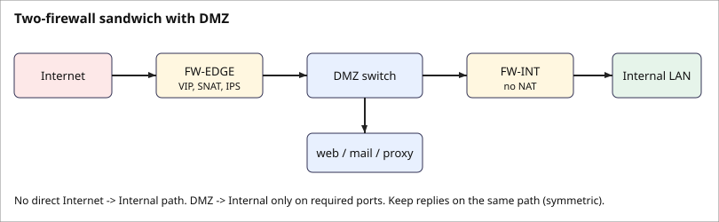

*شکل: دوفایروال با DMZ.*

### ۵) مثال حل‌شده

**نیاز:** وب‌سایت عمومی، API داخلی، DB. طراحی: Edge: VIP 203.0.113.50:443→10.10.10.20 (DMZ). Internal: DMZ→10.20.20.5:8080 (App)؛ App→DB فقط داخل Internal. Policy Matrix:

``` text
EDGE    : WAN  -> DMZ      : VIP web  TCP 443        accept + IPS + log
EDGE    : DMZ  -> WAN      : DNS, updates only        accept + log
EDGE    : INT  -> WAN      : users HTTP/HTTPS/DNS     accept + UTM + NAT
INT     : DMZ  -> SRV      : 10.10.10.20 -> 10.20.20.5 TCP 8080   accept + log
INT     : SRV  -> DMZ      : established only (implicit via session)
INT     : any  -> any      : implicit deny + log
```

**مثال متوسط:** `ping` از Internet به DB داخلی ناکام است؛ Debug Flow روی Edge: «Denied policy 0» ← درست (هیچ Policy). نشان‌دهنده‌ی طراحی سالم است.

**مثال سخت:** پس از Compromise وب‌سرور DMZ، مهاجم سعی می‌کند به DB وصل شود: DMZ→SRV فقط 8080 مجاز است، بقیه deny+log؛ Alert بر پایه‌ی «Denied از DMZ به SRV» می‌تواند نشانه‌ی نفوذ باشد (Detection).

### ۶) طراحی و تصمیم‌گیری

| سؤال | تصمیم |
|---|---|
| دوفایروال یا تک؟ | ریسک بالا/دارایی حساس ← دو؛ سازمان کوچک ← یک با DMZ و UTM |
| NAT | Edge فقط؛ Internal Routing |
| HA | هر دو HA (فصل ۲۲) |
| تنوع سازنده | در صورت بودجه/مهارت |
| Log | مرکزی، با Timestamp همگام (NTP) |

### ۷) پیاده‌سازی و Verification (GUI/CLI)

**GUI:** Policy & Objects → Virtual IPs (VIP)؛ Firewall Policy (WAN→DMZ)؛ Network → Static Routes (DMZ→Internal)؛ Log & Report → Forward Traffic.

**CLI:**

``` text
config firewall vip
    edit "VIP-WEB"
        set extip 203.0.113.50
        set mappedip "10.10.10.20"
        set extintf "wan1"
        set portforward enable
        set extport 443
        set mappedport 443
    next
end
get router info routing-table all
diagnose debug flow filter addr 10.10.10.20
diagnose sys session filter dst 10.10.10.20
```

(نام فیلدها `Unverified`.) **آزمون‌ها:** مثبت: اینترنت→VIP؛ منفی: اینترنت→DB، DMZ→DB، Internal→Internet مستقیم (بدون Policy).

### ۸) Troubleshooting

| علامت | علت |
|---|---|
| VIP از بیرون کار نمی‌کند | Policy مقصد (post-DNAT)، Route، ARP |
| DMZ به Internal نمی‌رسد | Policy Internal، مسیر، NAT اشتباه |
| فقط بعضی ارتباط‌ها Drop | Asymmetric/Session |
| Log مبدأ همه یک IP | Double NAT |

### ۹) نکات امنیتی

- Internal هرگز Internet را به‌طور مستقیم به‌رسمیت نشناسد.
- سرورهای DMZ نباید اعتبار (Credential) شبکه‌ی داخلی داشته باشند.
- تغییرات هر دو فایروال Change یکپارچه.

### ۱۰) جمع‌بندی مفهومی

- DMZ اثر نفوذ را محدود می‌کند؛ دو فایروال لایه‌ی کنترل مستقل است.
- NAT را فقط لبه؛ Internal ترجیحاً Routing.
- مسیر برگشت متقارن؛ Policy در جهت درست.
- طراحی را با «اگر لایه‌ی اول بشکند» ارزیابی کنید.
- مدیریت و Log را متمرکز کنید.

### ۱۱) تمرین و ارزیابی

**ت1.** (ساده) DMZ چیست؟ *(پاسخ: 15-0-ت1)*

**ت2.** (ساده) چرا Internal NAT نمی‌کند؟ *(پاسخ: 15-0-ت2)*

**ت3.** (متوسط) مسیر یک درخواست Internet→App را بنویسید. *(پاسخ: 15-0-ت3)*

**ت4.** (متوسط) Double NAT چه مشکلی در Log دارد؟ *(پاسخ: 15-0-ت4)*

**ت5.** (سخت) پس از Compromise وب‌سرور، کدام سه کنترل جلوی حرکت جانبی را می‌گیرد؟ *(پاسخ: 15-0-ت5)*

**ت6.** (سخت، طراحی) برای سازمانی با بودجه‌ی محدود تصمیم دو فایروال در برابر تک‌فایروال+DMZ را با معیار ریسک بگیرید. *(پاسخ: 15-0-ت6)*

**Q1.** Quick quiz (English): Why avoid NAT on the internal firewall? *(پاسخ: 15-0-Q1)*

### ۱۲) اصطلاحات و English Corner

| مخفف | شکل کامل | معنی |
|---|---|---|
| DMZ | Demilitarized Zone | ناحیه‌ی واسط |
| Edge | Edge firewall | فایروال لبه |
| Sandwich | Firewall sandwich | دو فایروال با DMZ بین آن‌ها |
| VIP | Virtual IP | آدرس مجازی DNAT |

- *Place public servers in a DMZ between two firewalls.* ← سرورهای عمومی را در DMZ بین دو فایروال بگذارید.
- *Preserve original source addresses for logging.* ← آدرس مبدأ اصلی را برای Log حفظ کنید.

### ۱۳) منابع

- NIST SP 800-41 Rev.1 — Guidelines on Firewalls (DMZ designs).
- Fortinet Docs: FortiOS 7.0 Administration Guide — Virtual IPs، Firewall policy.

## درس 15-1 — طراحی معماری دوفایروالی: نقش‌ها، Zoneها، آدرس‌دهی و جدول مسیر

**فصل 15 · بازنویسی عمیق · پیش‌نیاز: ۱۵-۰، ۱۲-۲، ۱۳-۱ · ≈ 10 ساعت**

> **وضعیت:** FortiOS 7.0.3 نامی (بوت‌نشده)؛ دستورها طبق مستندات 7.0 ولی `Unverified` تا اجرای Lab؛ Lab «اجرا نشده».

### ۱) هدف آموزشی

در پایان این درس باید بتوانید:

1. نقش Edge و Internal را تفکیک و تصمیم‌های طراحی را توجیه کند.
2. Zoneها، سطح اعتماد و آدرس‌دهی (VLSM) را برای معماری کامل بنویسد.
3. جدول مسیر هر فایروال و Default/Static را طراحی کند.
4. ماتریس Policy بین Zoneها را بسازد.
5. خطرات (Asymmetric، Single point of failure، Rule drift) را شناسایی کند.
6. مستند طراحی قابل‌ممیزی تحویل دهد.

### ۲) مفهوم پایه: چیست و چرا؟

چرا شرکت‌ها دو فایروال می‌گذارند؟ تصور کنید یک ساختمان دو نگهبان دارد: نگهبان در ورودی خیابان (Edge) افراد ناشناس را می‌پالاید؛ نگهبان داخل ساختمان (Internal) فقط کارمندان و بخش‌ها را کنترل می‌کند. اگر یکی دور زده شود، دومی هنوز هست. ولی هزینه‌ی دو نگهبان، هماهنگی و پیچیدگی مسیرها هم هست.

هدف این درس: طرحی بنویسید که هر Zone مالک مشخص، ماتریس Policy روشن و جدول مسیر بدون ابهام داشته باشد، قبل از اینکه یک دستور بزنید.

### ۳) توضیح عمیق فنی

#### ۱) نقش‌ها

| فایروال | نقش | کنترل |
|---|---|---|
| Edge | اینترنت، DMZ، NAT/VIP، VPN | شمال-جنوب، UTM لبه |
| Internal | کاربران، سرورها، مدیریت | شرق-غرب، تفکیک داخلی |

#### ۲) توپولوژی

``` text
Internet
   |
 [ISP-A]--port1--[EDGE FW]--port3--[DMZ switch: web]
                    |
                  port2 (transit 10.255.0.0/30)
                    |
                 [INTERNAL FW]--port2--[USERS 10.10.0.0/24]
                               --port3--[SERVERS 10.20.0.0/24]
                               --port4--[MGMT 10.99.0.0/24]
```

#### ۳) آدرس‌دهی

| شبکه | آدرس | استفاده |
|---|---|---|
| Transit Edge–Internal | 10.255.0.0/30 | .1 Edge، .2 Internal |
| DMZ | 10.30.0.0/24 | وب |
| Users | 10.10.0.0/24 | کاربران |
| Servers | 10.20.0.0/24 | App/DB |
| Mgmt | 10.99.0.0/24 | مدیریت |
| WAN | 198.51.100.0/30 | به ISP |

#### ۴) جدول مسیر

``` text
EDGE:
  0.0.0.0/0      -> 198.51.100.1 (port1)
  10.10.0.0/24   -> 10.255.0.2   (port2)   internal users
  10.20.0.0/24   -> 10.255.0.2
  10.99.0.0/24   -> 10.255.0.2
INTERNAL:
  0.0.0.0/0      -> 10.255.0.1   (port1 transit)
  (connected) users/servers/mgmt
```

اصل: Internal فقط یک Default به Edge؛ Edge همه‌ی شبکه‌های داخلی را از طریق Internal می‌شناسد. بدون Route برگشت در Edge، پاسخ‌ها گم می‌شوند.

#### ۵) ماتریس Policy

| از ↓ به → | Internet | DMZ | Users | Servers | Mgmt |
|---|---|---|---|---|---|
| Internet | - | HTTPS (VIP) | - | - | - |
| DMZ | - | - | - | DB 1433 از App | - |
| Users | HTTP/S/DNS (SNAT) | HTTPS | - | App 443 | - |
| Servers | Updates | - | - | - | - |
| Mgmt | - | SSH | - | SSH | - |

#### ۶) خطرات

- Asymmetric: فقط یک مسیر بین Edge و Internal.
- NAT دوباره: فقط Edge NAT کند (NAT دوم تحلیل را سخت می‌کند).
- Rule drift: فاصله‌ی سیاست دو فایروال؛ بازبینی فصلی.
- Single point of failure: در فصل HA/DR.

### ۴) طراحی و تصمیم‌گیری

| سؤال طراحی | گزینه‌ها و معیار انتخاب |
|---|---|
| NAT کجا | فقط Edge |
| Default Internal | به Edge |
| DMZ | روی Edge یا Internal؟ Edge برای انتشار عمومی |

### ۵) مثال‌های حل‌شده (ساده، متوسط، سخت)

**ساده (حل‌شده):** کاربر 10.10.0.5 به اینترنت: Internal (Policy Users→Edge) ⇒ Edge (Transit→Internet, SNAT) ⇒ ISP. برگشت: Edge می‌داند 10.10.0.0/24 از port2 است ⇒ Internal ⇒ Users.

**متوسط (تحلیل خطا):** Route 10.10.0.0/24 در Edge نیست: Session کاربران ساخته می‌شود ولی برگشت از Default به ISP می‌رود و Drop. اثبات: Edge debug flow: `reverse path check fail`/Sniffer port1 دیده می‌شود. رفع: Route.

**سخت (طراحی ممیزی‌پذیر):** سازمان ۱۵۰ کاربر، ۱۰ سرور، وب‌سرور عمومی. تحویل: ۱) نمودار، ۲) جدول آدرس، ۳) ماتریس Policy، ۴) جدول مسیر دو فایروال، ۵) ریسک‌ها و آزمون: Users→Internet، Internet→Web، Users→DB (ممنوع)، DMZ→DB مستقیم (ممنوع). معیار: ۱۰۰٪ آزمون‌ها مطابق ماتریس.

### ۶) پیاده‌سازی از مسیر GUI

1. هر فایروال: Network → Interfaces برای Transit و Zoneها.
2. Network → Static Routes.
3. Policy & Objects برای ماتریس.

### ۷) پیاده‌سازی از مسیر CLI

``` text
config router static
 edit 1
  set dst 10.10.0.0 255.255.255.0
  set gateway 10.255.0.2
  set device "port2"
 next
end
```

### ۸) Verification (اثبات صحت)

- ping/traceroute مطابق جدول.
- آزمون مثبت/منفی ماتریس.

### ۹) Troubleshooting

| علامت | شاهد برای بررسی | علت محتمل و رفع |
|---|---|---|
| برگشت ندارد | Route Edge | Route داخلی |
| Policy تطابق ندارد | Zone | Interface |

### ۱۰) نکات امنیتی

- Default Deny بین Zoneها.
- Mgmt جدا.

### ۱۱) جمع‌بندی مفهومی

- Edge شمال-جنوب؛ Internal شرق-غرب.
- جدول مسیر دو سمتی.
- ماتریس Policy.

### ۱۲) تمرین و ارزیابی

**ت1.** (ساده) چرا NAT فقط روی Edge؟ *(پاسخ: 15-1-ت1)*

**ت2.** (ساده) Default Internal به کجاست؟ *(پاسخ: 15-1-ت2)*

**ت3.** (متوسط) چرا Edge باید Route شبکه‌های داخلی را داشته باشد؟ *(پاسخ: 15-1-ت3)*

**ت4.** (متوسط) DMZ→DB مستقیم چرا ممنوع؟ *(پاسخ: 15-1-ت4)*

**ت5.** (سخت) طرح ممیزی‌پذیر را بنویسید. *(پاسخ: 15-1-ت5)*

**ت6.** (سخت، طراحی) ریسک Rule drift را چگونه کنترل می‌کنید؟ *(پاسخ: 15-1-ت6)*

**Q1.** Quick quiz (English): Why configure NAT only on the edge firewall? *(پاسخ: 15-1-Q1)*

### ۱۳) اصطلاحات و English Corner

| مخفف | شکل کامل | معنی |
|---|---|---|
| DMZ | Demilitarized Zone | منطقه‌ی حائل |

- *Edge handles north-south traffic.* ← Edge ترافیک شمال-جنوب را کنترل می‌کند.

### ۱۴) کارت Lab

**کارت Lab:** طراحی دوفایروالی (اجرا نشده). **Evidence:** `02-design/arch2.md`.

### ۱۵) منابع

- Fortinet FortiOS 7.0 Administration Guide: Firewall policies; Routing
- NIST SP 800-41

<a id="l-15-2"></a>

## درس 15-2 — ساخت Edge: WAN، DMZ، NAT، VIP و Policy ورودی

**فصل 15 · بازنویسی عمیق · پیش‌نیاز: ۱۵-۱، ۱۳-۲، ۱۳-۳ · ≈ 10 ساعت**

> **وضعیت:** FortiOS 7.0.3 نامی (بوت‌نشده)؛ دستورها طبق مستندات 7.0 ولی `Unverified` تا اجرای Lab؛ Lab «اجرا نشده».

### ۱) هدف آموزشی

در پایان این درس باید بتوانید:

1. Interfaceهای Edge را (WAN، DMZ، Transit) پیکربندی کند.
2. Default Route و Route داخلی را اضافه کند.
3. SNAT برای کاربران داخلی و VIP برای وب را بسازد.
4. Policyهای Edge را با Log و Default Deny بنویسد.
5. آزمون مثبت/منفی و Evidence را انجام دهد.

### ۲) مفهوم پایه: چیست و چرا؟

Edge اولین چیزی است که اینترنت می‌بیند. هر اشتباه اینجا یعنی مواجهه‌ی مستقیم با اینترنت؛ پس ساخت باید نظم‌دار و با آزمون منفی باشد.

### ۳) توضیح عمیق فنی

#### ۱) Interface

``` text
config system interface
 edit "port1"
  set ip 198.51.100.2 255.255.255.252
  set allowaccess ping
  set role wan
 next
 edit "port2"
  set ip 10.255.0.1 255.255.255.252
  set allowaccess ping
  set role lan
 next
 edit "port3"
  set ip 10.30.0.1 255.255.255.0
  set allowaccess ping
  set role dmz
 next
end
```

#### ۲) Route

``` text
config router static
 edit 1
  set gateway 198.51.100.1
  set device "port1"
 next
 edit 2
  set dst 10.10.0.0 255.255.255.0
  set gateway 10.255.0.2
  set device "port2"
 next
end
```

#### ۳) NAT و VIP

``` text
config firewall vip
 edit "VIP-WEB-443"
  set extintf "port1"
  set extip 203.0.113.10
  set mappedip "10.30.0.10"
  set portforward enable
  set extport 443
  set mappedport 443
 next
end
```

#### ۴) Policy

| ID | از | به | Source | Dest | Service | NAT |
|---|---|---|---|---|---|---|
| 1 | port2 (Transit) | port1 | NET-INTERNAL | all | HTTP/HTTPS/DNS | Enable |
| 2 | port1 | port3 | all | VIP-WEB-443 | HTTPS | - |
| 3 | port3 | port2 | SRV-WEB | SRV-APP | TCP-8443 | - |
| 99 | any | any | all | all | ALL | Deny + Log |

#### ۵) آزمون

از Internal Users: curl اینترنت؛ از Internet: HTTPS به VIP؛ منفی: SSH به VIP رد؛ DMZ→Users رد.

### ۴) طراحی و تصمیم‌گیری

| سؤال طراحی | گزینه‌ها و معیار انتخاب |
|---|---|
| Policy 99 | Deny با Log |
| Route | دقیق |

### ۵) مثال‌های حل‌شده (ساده، متوسط، سخت)

**ساده (حل‌شده):** Policy 1 با SNAT؛ Session با IP 198.51.100.2.

**متوسط (تحلیل):** VIP کار نمی‌کند: Policy 2 dst=VIP نبود؛ اصلاح.

**سخت (آزمون منفی):** DMZ→Users باید Deny؛ Log policyid=99؛ ثبت Evidence.

### ۶) پیاده‌سازی از مسیر GUI

1. Network → Interfaces.
2. Static Routes.
3. Virtual IPs.
4. Firewall Policy.

### ۷) پیاده‌سازی از مسیر CLI

``` text
show system interface port1
show router static
show firewall vip
show firewall policy
```

### ۸) Verification (اثبات صحت)

- Lookup/Flow/Session.
- آزمون منفی در Log.

### ۹) Troubleshooting

| علامت | شاهد برای بررسی | علت محتمل و رفع |
|---|---|---|
| اینترنت قطع | Route/NAT | Default/NAT |
| VIP از بیرون نه | Policy | dst=VIP |

### ۱۰) نکات امنیتی

- port1 بدون مدیریت.

### ۱۱) جمع‌بندی مفهومی

- Interface، Route، NAT، Policy، آزمون.

### ۱۲) تمرین و ارزیابی

**ت1.** (ساده) Policy 99؟ *(پاسخ: 15-2-ت1)*

**ت2.** (ساده) VIP چه می‌کند؟ *(پاسخ: 15-2-ت2)*

**ت3.** (متوسط) چرا port1 بدون Admin access؟ *(پاسخ: 15-2-ت3)*

**ت4.** (متوسط) آزمون منفی؟ *(پاسخ: 15-2-ت4)*

**ت5.** (سخت) VIP جواب نمی‌دهد. *(پاسخ: 15-2-ت5)*

**ت6.** (سخت، طراحی) ماتریس Edge. *(پاسخ: 15-2-ت6)*

**Q1.** Quick quiz (English): Which policy should end the Edge rule list? *(پاسخ: 15-2-Q1)*

### ۱۳) اصطلاحات و English Corner

| مخفف | شکل کامل | معنی |
|---|---|---|
| VIP | Virtual IP | آدرس مجازی |

- *Test denied flows too.* ← جریان‌های ردشده را هم آزمون کنید.

### ۱۴) کارت Lab

**کارت Lab:** Edge (اجرا نشده). **Evidence:** `02-design/fgt-edge.md`.

### ۱۵) منابع

- Fortinet FortiOS 7.0 Administration Guide: Virtual IPs

<a id="l-15-3"></a>

### ضمیمه: پرونده‌ی کامل حل‌شده — «VIP وب از اینترنت باز نمی‌شود»

**ورودی:** VIP-WEB-443 (203.0.113.10 → 10.30.0.10) ساخته شده؛ از اینترنت Timeout.

**گام ۱ — Debug flow:**

``` text
diagnose debug flow filter addr 203.0.113.10
diagnose debug flow trace start 20
diagnose debug enable
 -> "Denied by forward policy check (policy 0)"
```

**گام ۲ — علت:** Policy 2 با dstaddr=10.30.0.10 (آدرس داخلی) نوشته شده؛ باید VIP باشد (DNAT قبل از Policy).

**گام ۳ — رفع:** dstaddr را به VIP-WEB-443 تغییر دهید.

**گام ۴ — Verify:** Debug: «Allowed by Policy-2»؛ `session list`: DNAT 203.0.113.10:443 → 10.30.0.10:443.

**گام ۵ — آزمون منفی:** SSH به 203.0.113.10 ⇒ Deny (policyid=99 با Log).

**گام ۶ — پایان:** `diagnose debug disable` و `diagnose debug reset`.

## درس 15-3 — ساخت Internal: Users، Servers، Mgmt و Routing به Edge با آزمون کامل

**فصل 15 · بازنویسی عمیق · پیش‌نیاز: ۱۵-۱، ۱۵-۲ · ≈ 10 ساعت**

> **وضعیت:** FortiOS 7.0.3 نامی (بوت‌نشده)؛ دستورها طبق مستندات 7.0 ولی `Unverified` تا اجرای Lab؛ Lab «اجرا نشده».

### ۱) هدف آموزشی

در پایان این درس باید بتوانید:

1. Interfaceها و Zoneهای Internal را (Users، Servers، Mgmt، Transit) پیکربندی کند.
2. Default به Edge و ترتیب Routeها را درست بسازد.
3. Policyهای Users→Servers، Users→Edge و Mgmt را با Least Privilege بنویسد.
4. دلیل خاموش‌بودن NAT روی Internal را توضیح دهد.
5. Packet Walk و آزمون مثبت/منفی را اجرا و مستند کند.
6. خطاهای رایج (Route، Zone، NAT دوباره) را عیب‌یابی کند.

### ۲) مفهوم پایه: چیست و چرا؟

Edge در برابر اینترنت از ساختمان محافظت می‌کند؛ ولی بیشتر حوادث واقعی از «داخل» شروع می‌شوند: لپ‌تاپ آلوده‌ای که به سرور فایل می‌رسد، حسابی که لو رفته و به DB می‌رود. Internal فایروالی است که این حرکت جانبی (Lateral Movement) را می‌بندد.

ساخت Internal اغلب ساده فرض می‌شود و همین‌جا خطا می‌شود: Default اشتباه، NAT دوباره، یا Policyهای ALL «موقتی». این درس Internal را مرحله‌به‌مرحله می‌سازد و هر مرحله را با آزمون ثابت می‌کند.

### ۳) توضیح عمیق فنی

#### ۱) نقش و آدرس‌ها

``` text
Internal FW
 port1  10.255.0.2/30   Transit to Edge (Default gateway 10.255.0.1)
 port2  10.10.0.1/24    USERS
 port3  10.20.0.1/24    SERVERS
 port4  10.99.0.1/24    MGMT
```

#### ۲) Interface، Zone و Route

``` text
config system interface
 edit "port1"
  set ip 10.255.0.2 255.255.255.252
  set allowaccess ping
  set role wan
 next
 edit "port2"
  set ip 10.10.0.1 255.255.255.0
  set allowaccess ping
  set role lan
 next
 edit "port3"
  set ip 10.20.0.1 255.255.255.0
  set allowaccess ping
  set role lan
 next
 edit "port4"
  set ip 10.99.0.1 255.255.255.0
  set allowaccess ping https ssh
  set role lan
 next
end
config router static
 edit 1
  set gateway 10.255.0.1
  set device "port1"
 next
end
```

فقط port4 (Mgmt) مدیریت مجاز دارد. Route داخلی لازم نیست چون شبکه‌ها Connected هستند.

#### ۳) چرا NAT خاموش؟

اگر Internal هم NAT کند، Edge فقط IP Transit (10.255.0.2) را می‌بیند؛ Logها ناخوانا می‌شوند، رد‌یابی کاربر به IP سخت و Policy مبتنی بر Source در Edge بی‌معنا. NAT فقط یک‌بار و آن هم روی Edge.

#### ۴) ماتریس Policy Internal

| ID | از | به | Source | Dest | Service | Log |
|---|---|---|---|---|---|---|
| 10 | port2 | port1 | NET-USERS | all | HTTP/HTTPS/DNS | Sec |
| 20 | port2 | port3 | NET-USERS | SRV-APP | TCP-443 | All |
| 30 | port4 | port2/port3 | HOST-ADMIN | all | SSH/HTTPS | All |
| 40 | port3 | port1 | SRV-APP | UPDATE-SITES | HTTPS | All |
| 99 | any | any | all | all | ALL | Deny+All |

#### ۵) Packet Walk

``` text
10.10.0.5 -> port2 (RPF ok) -> route default -> port1
Policy 10 accept (no NAT) -> Edge 10.255.0.1 -> Edge Policy 1 SNAT -> ISP
Reply: ISP -> Edge (session reply) -> route 10.10.0.0/24 via 10.255.0.2 -> Internal -> port2
```

#### ۶) آزمون‌ها

مثبت: Users→Internet، Users→SRV-APP:443، Admin→SSH سرور. منفی: Users→SRV-DB، Users→Mgmt، Servers→Users، Internet→Users (از بیرون).

### ۴) طراحی و تصمیم‌گیری

| سؤال طراحی | گزینه‌ها و معیار انتخاب |
|---|---|
| NAT | فقط Edge |
| Mgmt | Interface و Policy جدا، Trusted host |
| Servers→Internet | فقط مقاصد Update |

### ۵) مثال‌های حل‌شده (ساده، متوسط، سخت)

**ساده (حل‌شده):** ورودی: کاربر 10.10.0.5 به 203.0.113.10:443. مراحل: ۱) Policy 10 مطابق است. ۲) Default به 10.255.0.1. ۳) Edge SNAT می‌کند. پاسخ: Session در Internal با policy_id=10 و بدون NAT؛ در Edge با SNAT.

**متوسط (NAT دوباره):** گزارش: در Edge Log همه‌ی کاربران IP 10.255.0.2 هستند. مراحل: ۱) Policy 10 در Internal `nat enable` دارد. ۲) خاموش‌کردن NAT. ۳) Log Edge IP واقعی کاربر را نشان می‌دهد. درس: NAT فقط روی Edge.

**سخت (چندعلتی):** پس از نصب Internal، Users به Servers می‌رسند ولی اینترنت ندارند. مراحل: ۱) Lookup: Policy 10 درست. ۲) Debug flow: Allowed، route port1. ۳) Sniffer port1: SYN خارج می‌شود. ۴) Edge: SYN دریافت نمی‌شود؟ در Edge Sniffer port2 چیزی نیست: کابل/VLAN Transit. ۵) رفع VLAN و آزمون. درس: Evidence هر دو فایروال.

### ۶) پیاده‌سازی از مسیر GUI

1. Network → Interfaces برای هر پورت.
2. Network → Static Routes → Default به 10.255.0.1.
3. Policy & Objects → Firewall Policy با ماتریس.
4. Log & Report → Forward Traffic برای آزمون منفی.

### ۷) پیاده‌سازی از مسیر CLI

``` text
config firewall policy
 edit 10
  set name "USERS-to-EDGE"
  set srcintf "port2"
  set dstintf "port1"
  set srcaddr "NET-USERS"
  set dstaddr "all"
  set action accept
  set schedule "always"
  set service "HTTP" "HTTPS" "DNS"
  set nat disable
  set logtraffic utm
 next
end
get router info routing-table all
diagnose firewall iprope lookup 10.10.0.5 40000 203.0.113.10 443 tcp port2
```

### ۸) Verification (اثبات صحت)

- Lookup: Policy 10.
- Session بدون NAT در Internal.
- آزمون‌های منفی در Log با policyid=99.

### ۹) Troubleshooting

| علامت | شاهد برای بررسی | علت محتمل و رفع |
|---|---|---|
| اینترنت نیست | Route/Transit | Default و لینک Transit |
| IP کاربر در Edge پنهان | NAT Internal | NAT disable |
| Users به Servers نمی‌رسند | Policy 20 | Service/Zone |

### ۱۰) نکات امنیتی

- Mgmt جدا و محدود.
- Default Deny با Log.
- Servers→Internet فقط Update.

### ۱۱) جمع‌بندی مفهومی

- Internal ضد حرکت جانبی.
- Default به Edge.
- NAT فقط Edge.
- آزمون مثبت و منفی.

### ۱۲) تمرین و ارزیابی

**ت1.** (ساده) چرا NAT روی Internal خاموش است؟ *(پاسخ: 15-3-ت1)*

**ت2.** (ساده) Default Internal به کجا؟ *(پاسخ: 15-3-ت2)*

**ت3.** (متوسط) چرا Servers→Internet باید محدود باشد؟ *(پاسخ: 15-3-ت3)*

**ت4.** (متوسط) چرا Mgmt جدا؟ *(پاسخ: 15-3-ت4)*

**ت5.** (سخت) اینترنت ندارند ولی Servers ok؛ مسیر عیب‌یابی؟ *(پاسخ: 15-3-ت5)*

**ت6.** (سخت، طراحی) ماتریس Internal برای ۱۵۰ کاربر و ۱۰ سرور. *(پاسخ: 15-3-ت6)*

**Q1.** Quick quiz (English): Why is NAT not enabled on the internal firewall in this design? *(پاسخ: 15-3-Q1)*

### ۱۳) اصطلاحات و English Corner

| مخفف | شکل کامل | معنی |
|---|---|---|
| Lateral movement | Lateral movement | حرکت جانبی مهاجم |
| Transit | Transit network | شبکه‌ی ارتباطی دو فایروال |

- *Internal firewall limits lateral movement.* ← فایروال داخلی حرکت جانبی را محدود می‌کند.

### ۱۴) کارت Lab

**کارت Lab:** Internal (اجرا نشده). **Evidence:** `02-design/fgt-internal.md`.

### ۱۵) منابع

- Fortinet FortiOS 7.0 Administration Guide: Firewall policies; Routing
- NIST SP 800-41 Rev.1

<a id="l-15-4"></a>

## درس 15-4 — DMZ سه‌لایه: Web، App، DB؛ Policy، آزمون منفی و پایش

**فصل 15 · بازنویسی عمیق · پیش‌نیاز: ۱۵-۱ تا ۱۵-۳ · ≈ 10 ساعت**

> **وضعیت:** FortiOS 7.0.3 نامی (بوت‌نشده)؛ دستورها طبق مستندات 7.0 ولی `Unverified` تا اجرای Lab؛ Lab «اجرا نشده».

### ۱) هدف آموزشی

در پایان این درس باید بتوانید:

1. دلیل معماری سه‌لایه را با سناریوی حمله توضیح دهد.
2. آدرس‌دهی و Policy بین لایه‌ها را با Least Privilege بنویسد.
3. آزمون منفی را برای هر خانه‌ی Deny اجرا کند.
4. Log و Alert برای تلاش‌های ممنوع بسازد.
5. خطاهای رایج (Web→DB مجاز، Update باز) را رفع کند.
6. نتیجه را مستند و برای ممیز آماده کند.

### ۲) مفهوم پایه: چیست و چرا؟

مهاجم یک آسیب‌پذیری وب‌اپلیکیشن را پیدا می‌کند و کنترل وب‌سرور را می‌گیرد. در معماری یک‌لایه همه‌چیز (از جمله DB) همان‌جاست و کار تمام است. در معماری سه‌لایه، وب‌سرور فقط می‌تواند با App حرف بزند، و App فقط با DB روی یک پورت. مهاجم به دیوار بعدی می‌خورد و Log هم زنگ خطر می‌دهد.

### ۳) توضیح عمیق فنی

#### ۱) لایه‌ها

``` text
Internet -> [WEB 10.30.1.0/24] -> [APP 10.30.2.0/24] -> [DB 10.30.3.0/24]
```

#### ۲) ماتریس

| از ↓ به → | WEB | APP | DB | Internet |
|---|---|---|---|---|
| Internet | 443 (VIP) | - | - | - |
| WEB | - | 8443 | **ممنوع** | - |
| APP | - | - | 1433 | Update (کنترل‌شده) |
| DB | - | - | - | **ممنوع** |
| Users | 443 | 8443 (Admin) | - | - |

#### ۳) Policy نمونه

``` text
config firewall policy
 edit 60
  set name "APP-to-DB-1433"
  set srcintf "ZN-APP"
  set dstintf "ZN-DB"
  set srcaddr "SRV-APP"
  set dstaddr "SRV-DB"
  set action accept
  set schedule "always"
  set service "MS-SQL"
  set logtraffic all
 next
 edit 61
  set name "DENY-WEB-to-DB"
  set srcintf "ZN-WEB"
  set dstintf "ZN-DB"
  set srcaddr "all"
  set dstaddr "all"
  set action deny
  set logtraffic all
 next
end
```

Policy Deny صریح (61) اگرچه Implicit Deny هم هست، ولی برای Log و Alert لازم است.

#### ۴) آزمون منفی

``` text
From WEB: telnet 10.30.3.10 1433  -> must FAIL, log policyid=61
From Internet: connect to APP     -> FAIL
From DB: curl https://example.com -> FAIL
```

#### ۵) Alert

``` text
Alert: policyid=61 count > 5 in 5 min  -> notify SOC
```

(در FortiAnalyzer/Syslog؛ فصل ۲۴.)

### ۴) طراحی و تصمیم‌گیری

| سؤال طراحی | گزینه‌ها و معیار انتخاب |
|---|---|
| تعداد لایه | سه لایه؛ دو لایه اگر ریسک کم |
| Update | Proxy/ لیست مقاصد |
| Alert | روی Deny بین لایه‌ها |

### ۵) مثال‌های حل‌شده (ساده، متوسط، سخت)

**ساده (حل‌شده):** App→DB 1433: Session با policyid=60؛ ارتباط برقرار.

**متوسط (تحلیل):** ممیزی کشف کرد Web→DB مجاز است (Policy ALL). اثبات: Lookup ID قدیمی؛ رفع: Policy 61 بالاتر و حذف ALL؛ آزمون منفی موفق؛ Log دارد.

**سخت (حمله‌ی شبیه‌سازی‌شده):** فرض: Web آلوده است. مهاجم Scan 10.30.3.0/24 می‌زند. انتظار: ده‌ها Deny با policyid=61 در Log؛ Alert؛ پاسخ: ایزوله‌کردن وب‌سرور (Quarantine). معیار: زمان تشخیص < ۵ دقیقه، هیچ اتصال موفق به DB جز App.

### ۶) پیاده‌سازی از مسیر GUI

1. Policy & Objects → Firewall Policy → ترتیب Policyها.
2. Log & Report → Forward Traffic → Filter policyid=61.

### ۷) پیاده‌سازی از مسیر CLI

``` text
show firewall policy 61
diagnose firewall iprope lookup 10.30.1.10 40000 10.30.3.10 1433 tcp port3
```

### ۸) Verification (اثبات صحت)

- Lookup: Policy 61 برای Web→DB.
- App→DB Session موفق.
- Alert در آزمون.

### ۹) Troubleshooting

| علامت | شاهد برای بررسی | علت محتمل و رفع |
|---|---|---|
| Web به DB می‌رسد | Lookup | Policy ALL |
| App به DB نمی‌رسد | Policy 60 | Service/Address |

### ۱۰) نکات امنیتی

- DB بدون Internet.
- Log All روی Denyها.

### ۱۱) جمع‌بندی مفهومی

- سه‌لایه مانع حرکت جانبی.
- Least privilege.
- آزمون منفی.
- Alert روی Deny.

### ۱۲) تمرین و ارزیابی

**ت1.** (ساده) چرا Web→DB ممنوع است؟ *(پاسخ: 15-4-ت1)*

**ت2.** (ساده) چرا Deny صریح با وجود Implicit Deny؟ *(پاسخ: 15-4-ت2)*

**ت3.** (متوسط) DB→Internet چرا ممنوع؟ *(پاسخ: 15-4-ت3)*

**ت4.** (متوسط) آزمون منفی چیست؟ *(پاسخ: 15-4-ت4)*

**ت5.** (سخت) Web آلوده Scan می‌زند؛ پاسخ؟ *(پاسخ: 15-4-ت5)*

**ت6.** (سخت، طراحی) ماتریس و Alertها. *(پاسخ: 15-4-ت6)*

**Q1.** Quick quiz (English): Why use three tiers instead of placing web and database together? *(پاسخ: 15-4-Q1)*

### ۱۳) اصطلاحات و English Corner

| مخفف | شکل کامل | معنی |
|---|---|---|
| Tier | Application tier | لایه‌ی برنامه |
| SOC | Security Operations Center | مرکز عملیات امنیت |

- *The web tier must not reach the database directly.* ← لایه‌ی وب نباید مستقیماً به DB برسد.

### ۱۴) کارت Lab

**کارت Lab:** سه‌لایه (اجرا نشده). **Evidence:** `02-design/fgt-3tier.md`.

### ۱۵) منابع

- Fortinet FortiOS 7.0 Administration Guide: Firewall policies
- NIST SP 800-41; OWASP

<a id="l-15-5"></a>

## درس 15-5 — Packet Walk در دو فایروال: NAT در دو نقطه، Session در هر سمت و اثبات

**فصل 15 · بازنویسی عمیق · پیش‌نیاز: ۱۵-۱ تا ۱۵-۴، ۱۴-۳ · ≈ 10 ساعت**

> **وضعیت:** FortiOS 7.0.3 نامی (بوت‌نشده)؛ دستورها طبق مستندات 7.0 ولی `Unverified` تا اجرای Lab؛ Lab «اجرا نشده».

### ۱) هدف آموزشی

در پایان این درس باید بتوانید:

1. Packet Walk کامل سه جریان (Users→Internet، Internet→Web، Users→Web) را بنویسد.
2. NAT و Session را در هر فایروال جداگانه بخواند.
3. با Sniffer/Debug در هر فایروال اثبات کند.
4. Hairpin و Split DNS را در این معماری حل کند.
5. Walk را به‌عنوان مستند Runbook تحویل دهد.

### ۲) مفهوم پایه: چیست و چرا؟

در یک فایروال، Packet Walk ساده است. با دو فایروال، یک بسته دو بار Policy و گاهی دو بار NAT می‌خورد. اگر Walk روی کاغذ نباشد، هنگام خرابی هیچ‌کس نمی‌داند کدام فایروال کجا تصمیم گرفته. این درس Walk را به یک مستند استاندارد تبدیل می‌کند.

### ۳) توضیح عمیق فنی

#### ۱) جریان A: Users → Internet

``` text
1 User 10.10.0.5:40000 -> 203.0.113.10:443
2 Internal ingress port2, RPF ok, Policy 10 accept (NAT off)
3 Internal route default -> port1 -> Edge 10.255.0.1
4 Edge ingress port2, RPF ok, Policy 1 accept, SNAT -> 198.51.100.2:40000
5 Edge egress port1 -> ISP
Reply: Edge session reply -> un-NAT -> route 10.10.0.0/24 via 10.255.0.2
       Internal session reply -> port2 -> user
```

#### ۲) جریان B: Internet → Web

``` text
1 Client 8.8.4.4 -> 203.0.113.10:443
2 Edge ingress port1: DNAT via VIP-WEB-443 -> 10.30.0.10:443
3 Route 10.30.0.10 -> port3, Policy 2 accept
4 Web server replies -> Edge session reply -> un-DNAT -> client
```

Internal در این جریان دخالتی ندارد.

#### ۳) جریان C: Users → Web (از داخل)

``` text
1 User 10.10.0.5 -> web.example.com
2 DNS public IP 203.0.113.10  -> Hairpin problem
3 With Split DNS: internal DNS returns 10.30.0.10
4 Internal -> Edge (route 10.30.0.0/24) -> Edge Policy USERS->DMZ -> web
```

#### ۴) اثبات در هر دو فایروال

``` text
Internal: diagnose sys session filter src 10.10.0.5 ; diagnose sys session list   (no snat)
Edge:     diagnose sys session filter src 10.10.0.5 ; diagnose sys session list   (snat)
```

#### ۵) قالب Runbook

برای هر جریان: مسیر، Policyها، NAT، دستورهای اثبات، علائم خرابی و اقدام اول.

### ۴) طراحی و تصمیم‌گیری

| سؤال طراحی | گزینه‌ها و معیار انتخاب |
|---|---|
| Hairpin | Split DNS |
| Runbook | سه جریان اصلی |

### ۵) مثال‌های حل‌شده (ساده، متوسط، سخت)

**ساده (حل‌شده):** جریان A: Internal Policy 10 بدون NAT؛ Edge Policy 1 با SNAT. `session list` در Internal act=snat ندارد و در Edge دارد.

**متوسط (تحلیل):** کاربران به وب با IP عمومی نمی‌رسند ولی از اینترنت می‌رسد: Hairpin. مراحل: ۱) DNS عمومی. ۲) Route بسته به Edge می‌رود و DNAT می‌شود ولی پاسخ سرور مستقیم به کاربر نمی‌رود. رفع: Split DNS (پاسخ 10.30.0.10)؛ آزمون nslookup.

**سخت (اثبات دوسمتی):** Users به یک سایت نمی‌رسند. مراحل: ۱) Internal: Session org بدون reply. ۲) Edge: Session ساخته نشده ⇒ بسته به Edge نمی‌رسد. ۳) Sniffer port1 Internal: خروج؛ Sniffer port2 Edge: دریافت نیست ⇒ لینک Transit. ۴) رفع. درس: هر فایروال را جداگانه اثبات کنید.

### ۷) پیاده‌سازی از مسیر CLI

``` text
diagnose sys session filter src 10.10.0.5
diagnose sys session list
diagnose debug flow trace start 20
```

### ۸) Verification (اثبات صحت)

- Walk سه جریان.
- Session دو سمت.

### ۹) Troubleshooting

| علامت | شاهد برای بررسی | علت محتمل و رفع |
|---|---|---|
| Session فقط در Internal | Transit | لینک |
| وب داخلی باز نمی‌شود | DNS | Split DNS |

### ۱۰) نکات امنیتی

- Debug را خاموش کنید.

### ۱۱) جمع‌بندی مفهومی

- Walk دو فایروال.
- NAT یک‌بار.
- Split DNS.
- Runbook.

### ۱۲) تمرین و ارزیابی

**ت1.** (ساده) NAT کجا انجام می‌شود؟ *(پاسخ: 15-5-ت1)*

**ت2.** (ساده) در جریان B، Internal نقش دارد؟ *(پاسخ: 15-5-ت2)*

**ت3.** (متوسط) Hairpin چرا مشکل می‌سازد؟ *(پاسخ: 15-5-ت3)*

**ت4.** (متوسط) Split DNS چیست؟ *(پاسخ: 15-5-ت4)*

**ت5.** (سخت) Session فقط در Internal است؛ علت؟ *(پاسخ: 15-5-ت5)*

**ت6.** (سخت، طراحی) Runbook سه‌جریانی. *(پاسخ: 15-5-ت6)*

**Q1.** Quick quiz (English): How can internal users reach an internal web server by its public name? *(پاسخ: 15-5-Q1)*

### ۱۳) اصطلاحات و English Corner

| مخفف | شکل کامل | معنی |
|---|---|---|
| Un-NAT | Reverse translation | ترجمه‌ی معکوس |

- *Document the packet walk in a runbook.* ← Packet Walk را در Runbook مستند کنید.

### ۱۴) کارت Lab

**کارت Lab:** Walk (اجرا نشده). **Evidence:** `03-ops/walk-arch2.md`.

### ۱۵) منابع

- Fortinet FortiOS 7.0 Administration Guide: Packet flow
- FortiOS 7.0: Virtual IPs

<a id="l-15-6"></a>

## درس 15-6 — خرابی‌ها و آزمون G6: Edge، Internal، DMZ و گزارش RCA

**فصل 15 · بازنویسی عمیق · پیش‌نیاز: ۱۵-۱ تا ۱۵-۵ · ≈ 10 ساعت**

> **وضعیت:** FortiOS 7.0.3 نامی (بوت‌نشده)؛ دستورها طبق مستندات 7.0 ولی `Unverified` تا اجرای Lab؛ Lab «اجرا نشده».

### ۱) هدف آموزشی

در پایان این درس باید بتوانید:

1. خرابی‌های رایج دوفایروالی را به علت نگاشت کند.
2. سه پرونده را با Evidence دوسمتی حل کند.
3. RCA و گزارش حادثه بنویسد.
4. آزمون G6 را با Rubric تحویل دهد.
5. درس‌های آموخته را به چک‌لیست پیشگیری تبدیل کند.

### ۲) مفهوم پایه: چیست و چرا؟

G6 آخرین دروازه‌ی بخش فایروال است. در دنیای واقعی خرابی با برچسب «اینترنت قطع است» می‌آید، نه با «Route Edge اشتباه است». شما باید از علامت به علت برسید و ثابت کنید.

### ۳) توضیح عمیق فنی

#### ۱) جدول خرابی‌های رایج

| علامت | علت محتمل | شاهد |
|---|---|---|
| کاربران اینترنت ندارند | Route Edge به داخل نیست | `reverse path check fail` یا بسته‌ی برگشت در port1 |
| IP همه‌ی کاربران یکی است | NAT دوباره | Log Edge |
| وب از اینترنت باز نمی‌شود | Policy روی VIP نیست | Lookup/Flow |
| Web به DB می‌رسد | Policy ALL | Lookup |
| بعضی Sessionها قطع | Asymmetric/ECMP | Sniffer دو سمت |

#### ۲) سه پرونده‌ی نمونه

**پرونده ۱:** کاربران Internal اینترنت ندارند. Internal: Session org ok. Edge: Session ساخته می‌شود؛ پاسخ Drop با RPF. علت: Route 10.10.0.0/24 در Edge نیست. رفع: Route.

**پرونده ۲:** VIP وب از بیرون باز نمی‌شود. Flow: `Denied by forward policy check (policy 0)`. علت: Policy dst=VIP نیست. رفع: Policy.

**پرونده ۳:** پس از افزودن لینک دوم، Sessionها گاهی قطع. Sniffer: SYN از لینک A و SYN-ACK از B. علت: Asymmetric. رفع: Route/Weight یا Active-Standby.

#### ۳) گزارش RCA

``` text
Title: Internal users lost internet 2026-11-26
Impact: 150 users, 25 min
Timeline: 10:05 report; 10:12 edge sniffer; 10:20 route added
Root cause: missing return route on Edge after Transit re-IP
Corrective: add route; Preventive: pre-change checklist + route monitoring
```

#### ۴) آزمون G6

سه عیب تزریقی؛ برای هرکدام: Evidence دو فایروال، علت، رفع، آزمون منفی. Rubric: کشف ۳۰، رفع ۳۰، Evidence ۲۰، آزمون منفی ۱۰، صداقت ۱۰.

### ۴) طراحی و تصمیم‌گیری

| سؤال طراحی | گزینه‌ها و معیار انتخاب |
|---|---|
| چک‌لیست قبل تغییر | Route، Policy، NAT، Backup |
| Monitoring | Route و لینک Transit |

### ۵) مثال‌های حل‌شده (ساده، متوسط، سخت)

**ساده (حل‌شده):** پرونده ۱: Route برگشت در Edge؛ پس از افزودن، Session بسته می‌شود و اینترنت می‌آید.

**متوسط (تحلیل):** پرونده ۲: Lookup ID 0 ⇒ Implicit Deny؛ Policy با dst=VIP ساخته می‌شود؛ آزمون از بیرون و پورت دیگر منفی.

**سخت (دو عیب):** هم Route و هم Policy خراب. ابتدا Route را رفع (برگشت)؛ سپس Policy؛ هر رفع جدا آزمون؛ اگر هم‌زمان رفع کنید ریشه‌ی اصلی معلوم نمی‌شود.

### ۷) پیاده‌سازی از مسیر CLI

``` text
diagnose debug flow filter addr 10.10.0.5
diagnose debug flow trace start 20
diagnose debug enable
diagnose debug disable
get router info routing-table all
```

### ۸) Verification (اثبات صحت)

- Evidence دو فایروال.
- آزمون منفی.
- گزارش RCA.

### ۹) Troubleshooting

| علامت | شاهد برای بررسی | علت محتمل و رفع |
|---|---|---|
| اینترنت نیست | Edge Route | Route داخلی |
| VIP کار نمی‌کند | Policy | dst=VIP |

### ۱۰) نکات امنیتی

- Debug را خاموش کنید.

### ۱۱) جمع‌بندی مفهومی

- از علامت به علت.
- Evidence دوسمتی.
- RCA و پیشگیری.

### ۱۲) تمرین و ارزیابی

**ت1.** (ساده) Route برگشت چرا مهم است؟ *(پاسخ: 15-6-ت1)*

**ت2.** (ساده) policy 0 یعنی؟ *(پاسخ: 15-6-ت2)*

**ت3.** (متوسط) NAT دوباره چه علامتی دارد؟ *(پاسخ: 15-6-ت3)*

**ت4.** (متوسط) چرا Evidence از هر دو فایروال؟ *(پاسخ: 15-6-ت4)*

**ت5.** (سخت) دو عیب هم‌زمان را چگونه جدا می‌کنید؟ *(پاسخ: 15-6-ت5)*

**ت6.** (سخت، طراحی) چک‌لیست پیشگیری. *(پاسخ: 15-6-ت6)*

**Q1.** Quick quiz (English): Why should faults be fixed one at a time? *(پاسخ: 15-6-Q1)*

### ۱۳) اصطلاحات و English Corner

| مخفف | شکل کامل | معنی |
|---|---|---|
| RCA | Root Cause Analysis | تحلیل ریشه‌ای |

- *Collect evidence from both firewalls.* ← از هر دو فایروال شواهد جمع کنید.

### ۱۴) کارت Lab

**کارت Lab:** G6 (اجرا نشده). **Evidence:** `03-ops/rca-arch2.md`.

### ۱۵) منابع

- Fortinet FortiOS 7.0 Administration Guide: Troubleshooting

## پاسخ‌های فصل 15

> ابتدا بدون نگاه حل کنید. شناسه: درس-نوع+شماره (ت = تمرین، م = مرور).


### پاسخ‌های بازنویسی عمیق درس 15-1

**15-1-ت1** — تا Session و عیب‌یابی ساده بماند و NAT دوباره پیچیدگی نسازد.

**15-1-ت2** — به Edge (Transit).

**15-1-ت3** — تا بسته‌ی برگشتی/پاسخ را به Internal برگرداند.

**15-1-ت4** — اگر وب‌سرور هک شود، مهاجم مستقیم به DB نرسد؛ فقط App.

**15-1-ت5** — نمودار، آدرس، ماتریس، مسیر، آزمون.

**15-1-ت6** — بازبینی فصلی، Config مقایسه‌ی خودکار، Comment/Owner.

**15-1-Q1** — To keep traffic analysis simple and avoid double translation.


### پاسخ‌های بازنویسی عمیق درس 15-2

**15-2-ت1** — Deny با Log.

Policy 99 آخرین قاعده با Deny و Log است؛ Implicit Deny Log ندارد و برای Alert/ممیزی نیاز به Deny صریح است.

**15-2-ت2** — DNAT.

VIP ترجمه‌ی مقصد (DNAT) از IP عمومی به IP داخلی سرور را انجام می‌دهد؛ Policy باید به آن اشاره کند.

**15-2-ت3** — سطح حمله.

port1 (WAN) بدون Admin access تا مدیریت از اینترنت قابل‌دسترس نباشد و سطح حمله کم شود.

**15-2-ت4** — SSH به VIP.

آزمون منفی: SSH به VIP (پورت 22) باید رد شود و Log با policyid=99 ثبت شود.

**15-2-ت5** — Policy، Route، Session.

VIP جواب نمی‌دهد: Policy dst=VIP، Route داخلی سرور، Session و DNAT و Log را بررسی کنید.

**15-2-ت6** — جدول.

ماتریس Edge: Transit→WAN (SNAT)، WAN→DMZ (VIP)، DMZ→Transit (فقط App) و Deny صریح.

**15-2-Q1** — An explicit deny with logging.

An explicit deny with logging should end the Edge rule list.

### پاسخ‌های بازنویسی عمیق درس 15-3

**15-3-ت1** — NAT دوباره Log و رد‌یابی را خراب می‌کند و Edge IP واقعی را نمی‌بیند؛ ترجمه یک‌بار روی Edge کافی است.

**15-3-ت2** — به Edge از طریق Transit (10.255.0.1).

Default Internal به Edge از طریق Transit (10.255.0.1) است.

**15-3-ت3** — سرور آلوده نباید به C2 اینترنت وصل شود؛ فقط مقاصد Update و HTTPS لازم باز می‌ماند.

**15-3-ت4** — تا فقط Admin به مدیریت برسد و سطح حمله کم شود.

**15-3-ت5** — Lookup، Debug flow، Sniffer port1 Internal و port2 Edge، Route برگشت، Transit؛ Evidence هر دو سمت.

**15-3-ت6** — طبق جدول: Users→Internet، Users→App 443، Mgmt→SSH، Servers→Update، Deny با Log.

**15-3-Q1** — Because translating twice hides real source addresses and complicates logging and troubleshooting.


### پاسخ‌های بازنویسی عمیق درس 15-4

**15-4-ت1** — اگر وب‌سرور هک شود، مهاجم مستقیم به DB نرسد؛ فقط App مجاز است.

**15-4-ت2** — Implicit Deny Log ندارد؛ Deny صریح برای Log و Alert لازم است.

**15-4-ت3** — تا سرور آلوده نتواند داده خارج کند یا به C2 وصل شود.

**15-4-ت4** — تلاش برای ارتباط ممنوع و تأیید اینکه رد می‌شود و Log ثبت می‌شود.

**15-4-ت5** — Alert، Quarantine، بررسی Log، حذف دسترسی؛ مستند.

**15-4-ت6** — طبق جدول؛ Alert بر policyid=61.

ماتریس سه‌لایه: Internet→Web 443، Web→App 8443، App→DB 1433، Web→DB ممنوع و Alert روی Deny Web→DB (policyid=61).

**15-4-Q1** — To limit lateral movement and expose the database to fewer systems.


### پاسخ‌های بازنویسی عمیق درس 15-5

**15-5-ت1** — فقط روی Edge.

NAT فقط روی Edge انجام می‌شود تا Log و Session ساده بماند.

**15-5-ت2** — خیر؛ ترافیک فقط از Edge به DMZ می‌رود.

در جریان Internet→Web فقط Edge دخیل است؛ Internal نقشی ندارد.

**15-5-ت3** — پاسخ سرور مستقیم به کاربر می‌رود یا مسیر برگشت از فایروال دور می‌زند.

**15-5-ت4** — DNS داخلی IP داخلی را برای کاربران داخلی می‌دهد.

**15-5-ت5** — بسته به Edge نمی‌رسد؛ Transit/Route/ACL.

**15-5-ت6** — قالب بالا.

Runbook سه‌جریانی: برای هر جریان مسیر، Policyها، NAT و دستورهای اثبات.

**15-5-Q1** — Use split DNS so the name resolves to the internal address.


### پاسخ‌های بازنویسی عمیق درس 15-6

**15-6-ت1** — Edge باید پاسخ را به Internal برگرداند؛ بدون Route به Default و ISP می‌رود و Drop می‌شود.

**15-6-ت2** — Implicit Deny؛ Policy مطابق نیست.

**15-6-ت3** — IP مبدأ همه‌ی کاربران در Edge Log یکسان است.

**15-6-ت4** — تا معلوم شود بسته به کدام فایروال می‌رسد و کجا گم می‌شود.

**15-6-ت5** — یکی‌یکی رفع و آزمون؛ ثبت اثر هر تغییر.

**15-6-ت6** — Route، Policy، NAT، Backup، آزمون منفی، Monitoring Transit.

**15-6-Q1** — To know which change solved the problem and avoid masking the root cause.

### پاسخ‌های درس افزوده‌ی 15-0 (فصل 15)

**15-0-ت1** — ناحیه‌ی واسط برای سرورهای در معرض اینترنت تا نفوذ به آن‌ها مستقیماً به شبکه‌ی داخلی نرسد.

**15-0-ت2** — برای حفظ آدرس واقعی در Log و جلوگیری از Double NAT و عیب‌یابی سخت؛ Internal فقط Routing می‌کند.

**15-0-ت3** — Client→VIP روی Edge (DNAT به وب DMZ)→Policy WAN→DMZ→وب به App از Internal (Policy DMZ→SRV 8080)→App به DB داخل Internal؛ برگشت از همان Sessionها.

**15-0-ت4** — آدرس مبدأ همه یک IP می‌شود و منبع واقعی در Log سرور پنهان می‌ماند.

**15-0-ت5** — Policy حداقلی DMZ→SRV (فقط 8080)، Deny+Log و Alert روی تلاش‌های ممنوع، Segmentation/Least Privilege و نداشتن اعتبارنامه‌ی داخلی روی DMZ.

**15-0-ت6** — دارایی‌های حساس و بودجه کافی: دو فایروال؛ بودجه کم: تک‌فایروال با DMZ، UTM، HA و Patch دقیق؛ تصمیم با ریسک × اثر.

**15-0-Q1** — To keep the original source address in logs and avoid double-NAT troubleshooting problems.

# پایان بخش ۵ (فصل‌های ۱۳ تا ۱۵)

## ۱) خلاصه‌ی مهارت‌های کسب‌شده
- Policy/NAT/VIP/Session/Shadow؛ Sniffer، Debug Flow، iprope، MTU/MSS؛ معماری دوفایروالی با DMZ و سه‌لایه.

## ۲) آزمون پایان سه فصل
**س1** — First Match و Implicit deny؟

**س2** — Policy NAT در برابر Central NAT؟

**س3** — انواع IP Pool؟

**س4** — VIP چه می‌کند و چرا Policy لازم است؟

**س5** — چرا filter قبل از session list؟

**س6** — Policy 0 در Debug Flow؟

**س7** — Sniffer verbose 4؟

**س8** — دو ابزار شناسایی Policy مطابق؟

**س9** — MSS Clamp برای چیست؟

**س10** — چرا Web به DB نه؟

**س11** — NAT کجا در معماری ۲؟

**س12** — خرابی «Return Route» علامت؟


## ۳) پاسخ آزمون
- **س1:** اولین Policy مطابق؛ Deny ضمنی در پایان.
- **س2:** NAT داخل Policy در برابر جدول جدا.
- **س3:** overload، one-to-one، fixed-port-range، port-block-allocation.
- **س4:** DNAT؛ VIP فقط نگاشت است.
- **س5:** حجم خروجی/CPU.
- **س6:** Implicit deny.
- **س7:** با نام Interface.
- **س8:** iprope lookup و Policy Lookup.
- **س9:** حل بسته‌ی بزرگ در Tunnel/MTU کم.
- **س10:** Least Privilege.
- **س11:** Edge.
- **س12:** TCP برقرار نمی‌شود.

## ۴) معیارهای تسلط
| مهارت | سطح | شاهد |
|---|---|---|
| Policy/NAT | L3-L4 | G5 |
| عیب‌یابی FortiOS | L3 | آزمون فصل ۱۴ |
| معماری ۲ | L3 | G6 |

## ۵) مشکلات و موارد باقی‌مانده (صریح)
1. همه‌ی Labها اجرا نشده. 2. سینتکس `central-snat-map`، `tcp-mss-*`، `execute log filter` و `fwpolicy-implicit-log` در 7.0.3 `Unverified`. 3. VM FortiGate با ≥ 2 GB لازم است؛ دو FGT همزمان فشار RAM.

## ۶) پیش‌نیازهای بخش بعد
Lab معماری ۲ ساخته و Backup؛ لایسنس UTM (Needs-License) بررسی؛ Windows Server AD (فصل ۱۷).

## ۷) فهرست Lab و منابع مرتبط
کارت‌های Lab ، `02-design/arch2.md` (خروجی دانشجو)

## ۸) وضعیت دوره
| مورد | مقدار |
|---|---|
| آخرین فصل تکمیل‌شده | ۱۵ |
| آخرین درس تکمیل‌شده | ۱۵-۶ |
| مهارت‌های تأییدشده | **هیچ‌کدام هنوز آزمون عملی واقعی نشده‌اند** (ممیزی/اجرای شما لازم است) |
| موضوعات نیازمند مرور | طبق «معیارهای تسلط» |
| فصل بعدی | ۱۶ |
| فایل تولیدشده | `course/Course_Part_05_Chapters_13-15.md` |


---

# Enterprise Network & Security Engineering — دوره‌ی تخصصی Cisco و Enterprise Firewall
## بخش ۶ از ۱۱ — فصل‌های ۱۶ تا ۱۸

| مورد | مقدار |
|---|---|
| نام دوره | Enterprise Network & Security Engineering (Cisco + FortiGate) |
| شماره بخش | ۶ از ۱۱ |
| فصل‌های این فایل | ۱۶ ، ۱۷ ، ۱۸ |
| تاریخ تولید | ۲۰۲۶-۱۱-۲۶ |
| نسخه Blueprint | v3.0 (+ بازبینی ۱٫۱) |
| نسخه‌های نرم‌افزار | FortiOS 7.0.3 (اسمی؛ بوت‌نشده؛ تأیید با `get system status`) ؛ Cisco vIOS-L2 15.2(20200924، Experimental) ؛ Cisco vIOS 15.9(3)M9 ؛ VPCS ؛ PNetLab 4.2.8 ؛ ESXi 8.0U2 ؛ CSR1000v 17.03.02 (IOS-XE؛ آزمایش‌نشده) |
| وضعیت تکمیل | **فصل‌های ۱۶–۱۸ تولید شد؛ UTM، Authentication، IPsec S2S.** Labها «اجرا نشده»؛ UTM به لایسنس FortiGuard وابسته (Needs-License)؛ دستورها آزمایش‌نشده. |

> **قوانین خواندن:** تمرین‌ها و پرسش‌های مرور بدون پاسخ‌اند؛ پاسخ در «پاسخ‌های فصل». «اجرا نشده» یعنی خروجی‌ها **پیش‌نیاز/پیش‌بینی** هستند. «CLI-Accepted» ≠ «کار می‌کند». رمزها نمونه‌اند.

### وضعیت راستی‌آزمایی Labهای این بخش
خلاصه: اجرا نشده (فقط طراحی): 18.

| Lab | وضعیت |
|---|---|
| 16-1 | اجرا نشده (فقط طراحی) |
| 16-2 | اجرا نشده (فقط طراحی) |
| 16-3 | اجرا نشده (فقط طراحی) |
| 16-4 | اجرا نشده (فقط طراحی) |
| 16-5 | اجرا نشده (فقط طراحی) |
| 16-6 | اجرا نشده (فقط طراحی) |
| 17-1 | اجرا نشده (فقط طراحی) |
| 17-2 | اجرا نشده (فقط طراحی) |
| 17-3 | اجرا نشده (فقط طراحی) |
| 17-4 | اجرا نشده (فقط طراحی) |
| 17-5 | اجرا نشده (فقط طراحی) |
| 17-6 | اجرا نشده (فقط طراحی) |
| 18-1 | اجرا نشده (فقط طراحی) |
| 18-2 | اجرا نشده (فقط طراحی) |
| 18-3 | اجرا نشده (فقط طراحی) |
| 18-4 | اجرا نشده (فقط طراحی) |
| 18-5 | اجرا نشده (فقط طراحی) |
| 18-6 | اجرا نشده (فقط طراحی) |

---

<a id="ch16"></a>

> **نسخه‌ی اصلاح‌شده (v3.9):** نسخه‌ی توسعه‌یافته‌ی فایل اصلی؛ درس‌های افزوده: ۱۶-۰، ۱۶-۷، ۱۸-۰ (دسته C). فایل اصلی در `course/` حفظ شده است. پاسخ‌های درس‌های افزوده در «پاسخ‌های فصل» همان فصل است.

# فصل 16 — UTM: آنتی‌ویروس، IPS، Application Control، Web Filter و SSL Inspection

**مدت:** ۳۶ ساعت | **پیش‌نیاز:** فصل ۱۳، ۱۴.
**اهداف:** Security Profile و Profile Group؛ AV؛ Web Filter (Static URL به‌جای Category)؛ IPS و DoS؛ Application Control؛ SSL/SSH Inspection؛ اثر Performance و عیب‌یابی.
**هشدار لایسنس (مهم):** AV/IPS/Web Filter/App Control به **FortiGuard Subscription** وابسته‌اند. در Lab ایزوله و Evaluation این وابستگی `Needs-License` و وضعیتش `Unverified` است. هر درس بخش «بدون لایسنس چه می‌توان کرد» دارد (Static URL، Custom IPS، DoS، Port-based). **همه‌ی دستورها آزمایش‌نشده روی Image.**
**معیار تسلط:** Profile ساخته و به Policy وصل؛ اثبات با Log/تست؛ توضیح اثر SSL Inspection بر Performance و Certificate.
**اشتباهات رایج:** فعال‌کردن Deep Inspection بدون نصب CA؛ Profile روی همه‌ی ترافیک؛ نادیده‌گرفتن لایسنس؛ بدون تست.

**درس‌های فصل:**
- [درس 16-1 — Security Profile و لایسنس: نقشه‌ی UTM](#l-16-1)
- [درس 16-2 — Web Filter و DNS Filter (Static و Category)](#l-16-2)
- [درس 16-3 — Antivirus و File Filter](#l-16-3)
- [درس 16-4 — IPS، DoS و Application Control](#l-16-4)
- [درس 16-5 — SSL/SSH Inspection: Certificate و CA](#l-16-5)
- [درس 16-6 — Performance، عیب‌یابی UTM و آزمون فصل](#l-16-6)

---

<a id="l-16-1"></a>

## درس 16-0 — Inspection Mode (Flow در برابر Proxy)، TLS Inspection و زنجیره‌ی اعتماد

**فصل ۱۶ · درس افزوده (پیش‌درس ۱۶-۱) · پیش‌نیاز: ۱۲-۰، ۱۱-۷، مفاهیم TLS و PKI · ≈ ۸ ساعت**

> **وضعیت (FortiOS 7.0.3):** تفاوت Flow/Proxy و پروفایل‌های SSL از مستند رسمی 7.0 تأیید شد ([Inspection modes](https://docs.fortinet.com/document/fortigate/7.0.1/administration-guide/721410/inspection-modes)، [Inspection mode feature comparison](https://docs.fortinet.com/document/fortigate/7.0.0/administration-guide/922096/inspection-mode-feature-comparison)، [SSL & SSH Inspection](https://docs.fortinet.com/document/fortigate/7.0.1/administration-guide/929997/ssl-ssh-inspection)). جزئیات روی Image `Unverified`. Needs-License: سرویس‌های FortiGuard.

### ۱) هدف آموزشی

دانشجو در پایان می‌تواند:

1. تفاوت **Flow-based** و **Proxy-based Inspection** را از نظر سازوکار، قابلیت و Performance بگوید و برای هر سناریو انتخاب کند.
2. توضیح دهد TLS چگونه کار می‌کند و چرا بدون **SSL Inspection** محتوای HTTPS دیده نمی‌شود.
3. **Certificate Inspection** و **Deep Inspection** را از نظر دید، ریسک و پیش‌نیاز مقایسه کند.
4. **زنجیره‌ی اعتماد (Certificate Chain)، CA و Trust Store** را توضیح دهد و بگوید چرا مرورگر به CA فایروال باید اعتماد کند.
5. **SNI** و محدودیت‌های دید روی ترافیک رمزشده (TLS 1.3، ECH، Certificate Pinning) را بشناسد.
6. در سناریوی واقعی Exemption امن بنویسد.

### ۲) پیش‌نیازها

Handshake TLS در سطح مفهومی (Client Hello، Certificate، Key Exchange)، مفهوم کلید عمومی/خصوصی و گواهی (PKI)، Packet Flow (۱۲-۰).

### ۳) مفهوم پایه

بیشتر ترافیک امروز رمزشده است. فایروالی که فقط پورت و IP را ببیند، نمی‌تواند بدافزار داخل HTTPS را کشف کند. **UTM** یعنی بازرسی محتوا؛ و بازرسی محتوا برای ترافیک رمزشده نیاز به **رمزگشایی** دارد. این رمزگشایی یک **حمله‌ی Man-in-the-Middle مجاز** است: فایروال به‌جای سرور، گواهی صادر می‌کند. کاربر فقط وقتی خطا نمی‌بیند که به CA فایروال اعتماد کرده باشد.

### ۴) توضیح عمیق فنی

#### ۴-۱) Flow-based در برابر Proxy-based

طبق مستند Fortinet (7.0):

- **Flow-based:** بسته‌ها را «در جریان» می‌بیند؛ یک Snapshot از محتوا می‌گیرد و با Pattern Matching بررسی می‌کند؛ بسته‌ها بازسازی کامل نمی‌شوند. تأخیر کمتر، Throughput بیشتر (و قابلیت NPU Offload در بعضی حالت‌ها).
- **Proxy-based:** فایروال اتصال کلاینت را ختم و اتصال جدیدی به سرور می‌سازد؛ **محتوا را کامل بازسازی** می‌کند (فایل کامل، پاسخ کامل HTTP). قابلیت بیشتر (مثلاً بعضی گزینه‌های AV/Web Filter/DLP مثل Content Disarm، Quota و ...)، هزینه‌ی CPU/Memory و تأخیر بیشتر.
- در 7.0 حالت بازرسی **در هر Policy** انتخاب می‌شود (`set inspection-mode flow|proxy`)؛ پیش‌فرض Flow است.

| معیار | Flow | Proxy |
|---|---|---|
| سازوکار | بدون بازسازی کامل، Pattern | ختم و بازسازی |
| تأخیر | کمتر | بیشتر |
| CPU/Memory | کمتر | بیشتر |
| قابلیت‌ها | کمتر (جدول مقایسه‌ی Fortinet) | بیشتر |
| پوشش پورت | همه‌ی پورت‌ها در Deep (طبق مستند) | فقط پورت‌های نگاشت‌شده مگر «Inspect all ports» |
| کاربرد | Throughput، ترافیک عمومی | حساسیت بالا، قابلیت خاص |

(برای هر Profile باید جدول «Inspection mode feature comparison» همان نسخه بررسی شود.)

#### ۴-۲) TLS در یک نگاه

``` text
1. ClientHello  : supported versions/ciphers, SNI (server name, plaintext in TLS<=1.2/1.3 default)
2. ServerHello  : chosen cipher
3. Certificate  : server certificate chain
4. Key exchange : (EC)DHE -> session keys
5. Finished     : encrypted application data
```

- **SNI (Server Name Indication):** نام سرور در ClientHello (معمولاً رمزنشده)؛ فایروال بدون رمزگشایی می‌تواند بر اساس SNI فیلتر کند.
- TLS 1.3: گواهی سرور رمز می‌شود؛ بنابراین Certificate Inspection روی TLS 1.3 اطلاعات کمتری دارد (SNI می‌ماند). با **ECH (Encrypted Client Hello)** حتی SNI هم رمز می‌شود (محدودیت آینده/مرورگرهای جدید).

#### ۴-۳) Certificate Inspection

فایروال فقط **اطلاعات گواهی و SNI** را می‌بیند (تا لایه‌ی TLS) و محتوای رمزشده را باز نمی‌کند. توانایی: Web Filter بر اساس Category/FQDN، بلاک گواهی نامعتبر/منقضی. محدودیت: AV/IPS/DLP روی محتوای HTTPS ناممکن.

#### ۴-۴) Deep Inspection (Full SSL Inspection)

فایروال به‌عنوان **Proxy TLS** عمل می‌کند:

``` text
Client <==TLS(session A, cert signed by firewall CA)==> FortiGate <==TLS(session B)==> Server
                       decrypt -> inspect (AV/IPS/Web/DLP) -> re-encrypt
```

- باید **CA فایروال** (یا CA سازمانی) در Trust Store همه‌ی کلاینت‌ها نصب باشد (GPO/MDM)، وگرنه خطای گواهی.
- ریسک: بار CPU، مشکل با برنامه‌های Pin‌شده، مسائل حریم خصوصی/حقوقی، افزایش سطح حمله به خود فایروال (گواهی‌های صادرشده، کلید CA).
- **Exemption:** بانک، سلامت، به‌روزرسانی‌های Pin‌شده، برنامه‌های خاص (Teams/OS update) از Inspection مستثنا شوند (Address/FQDN/Category).
- 7.0 دو Profile آماده دارد: `certificate-inspection` و `deep-inspection` (و `no-inspection`) طبق مستند.

#### ۴-۵) Certificate Chain، CA و Trust

``` text
Root CA (in trust store) -> Intermediate CA -> Server certificate
Browser: verify signature chain up to a trusted root, check name (SAN), validity, revocation (OCSP/CRL)
```

در Deep Inspection فایروال زنجیره‌ی سرور واقعی را **اعتبارسنجی می‌کند** و برای کلاینت گواهی جدید (با همان Subject/SAN) با **CA فایروال** امضا می‌کند. اگر گواهی سرور معتبر نباشد، فایروال باید به کلاینت هشدار بدهد (گواهی «untrusted» جداگانه؛ تنظیم Action برای گواهی نامعتبر مهم است: Allow/Block/Warning). CA فایروال به‌صورت پیش‌فرض Self-signed است؛ بهتر است CA داخلی سازمان (Intermediate) استفاده شود.

#### ۴-۶) محدودیت‌های دید

- **Certificate Pinning:** برنامه‌ای که گواهی خاص را انتظار دارد با گواهی فایروال خطا می‌دهد.
- **TLS 1.3/ECH/QUIC (HTTP/3 روی UDP 443):** QUIC معمولاً قابل Inspection عمیق نیست؛ سیاست معمول: بلاک QUIC تا ترافیک به TCP/TLS برگردد (Application Control).
- **mTLS (Mutual TLS):** گواهی کلاینت؛ Inspection ممکن است آن را بشکند.
- **STARTTLS، SMTPS، IMAPS:** پروتکل‌های دیگر هم Profile جدا دارند.

#### ۴-۷) Detection در برابر Prevention

- **Detection (Monitor):** رویداد را Log می‌کند ولی ترافیک را عبور می‌دهد.
- **Prevention (Block):** ترافیک را مسدود می‌کند.
- روش ایمن استقرار: ابتدا **Monitor** و بررسی False Positive، سپس Block برای موارد با اطمینان بالا.

### ۵) مثال حل‌شده

**نیاز:** Policy Users→Internet با AV و Web Filter و SSL Inspection.

``` text
config firewall policy
    edit 10
        set name "Users-to-Internet"
        set srcintf "port2"
        set dstintf "port1"
        set srcaddr "Users-Net"
        set dstaddr "all"
        set action accept
        set schedule "always"
        set service "HTTP" "HTTPS" "DNS"
        set inspection-mode flow
        set ssl-ssh-profile "certificate-inspection"
        set nat enable
        set logtraffic all
    next
end
```

(نام فیلدها طبق مستند 7.0؛ `Unverified` روی Image.) سپس برای سناریوی بانک: Profile سفارشی Deep با Exemption.

**مثال متوسط:** پس از فعال‌کردن Deep Inspection، برنامه‌ی Updater خطای TLS می‌دهد. علت: Pinning. راه‌حل: Exemption آن FQDN، نه خاموش‌کردن Deep برای همه.

**مثال سخت:** کاربران مرورگر Firefox هنوز هشدار گواهی می‌بینند در حالی‌که Chrome ندارد. تحلیل: Firefox Trust Store جداگانه دارد؛ CA فقط در Windows Store نصب شده است. راه‌حل: Policy Firefox (`security.enterprise_roots.enabled`) یا نصب CA در Firefox (مدیریت متمرکز). ثبت در RCA.

### ۶) طراحی و تصمیم‌گیری

| سؤال | تصمیم |
|---|---|
| Flow یا Proxy؟ | Flow برای عموم؛ Proxy برای نیاز خاص (طبق جدول مقایسه) |
| Deep یا Certificate Inspection؟ | Deep برای Users→Internet؛ Certificate برای سرورها/سلامت |
| CA فایروال یا CA سازمانی؟ | CA سازمانی (Intermediate) با توزیع GPO |
| Exemptionها | بانک، سلامت، Pinned، Update |
| QUIC | بلاک یا Exempt طبق سیاست |
| گواهی نامعتبر | Block/Warning برای Users |

### ۷) پیاده‌سازی: GUI و CLI

**GUI:**

1. Security Profiles → SSL/SSH Inspection → Create New (یا Clone از deep-inspection).
2. Inspection Method: Full SSL Inspection / SSL Certificate Inspection.
3. CA Certificate: انتخاب، و Download/Export CA برای نصب روی کلاینت.
4. Exempt from SSL Inspection: Web Categories، Addresses.
5. Policy & Objects → Firewall Policy → ویرایش Policy → Inspection Mode و SSL Inspection.

**CLI:**

``` text
config firewall ssl-ssh-profile
    edit "SSL-DEEP-LAB"
        config https
            set ports 443
            set status deep-inspection
        end
        set untrusted-caname "Fortinet_CA_Untrusted"
    next
end
get firewall ssl-ssh-profile
```

(`untrusted-caname`، `status` و ... با CLI Reference 7.0 تطبیق شود؛ `Unverified`.)

### ۸) Troubleshooting

| علامت | شاهد | علت |
|---|---|---|
| خطای گواهی در مرورگر | Issuer = CA فایروال | CA روی کلاینت نصب نیست |
| برنامه TLS خطا می‌دهد | Capture: Alert | Pinning |
| سایت HTTPS کند | CPU، `sys top` | Deep روی ترافیک سنگین |
| Block کار نمی‌کند | Log بدون UTM | Profile/SSL Inspection وصل نیست یا Pinned |
| QUIC دور می‌زند | Capture UDP 443 | QUIC Inspect نمی‌شود |

### ۹) نکات امنیتی

- کلید خصوصی CA فایروال حساس‌ترین دارایی این سیستم است؛ دسترسی Admin محدود و Backup رمزشده.
- رمزگشایی داده‌ی کاربران ملاحظات حقوقی و حریم خصوصی دارد؛ سیاست و رضایت لازم.
- گواهی‌های نامعتبر را Block کنید؛ اجازه‌ی «Allow» پیش‌فرض خطرناک است.

### ۱۰) جمع‌بندی مفهومی

- Flow سریع‌تر و محدودتر؛ Proxy کامل‌تر و سنگین‌تر؛ انتخاب Per-Policy.
- Certificate Inspection فقط گواهی/SNI؛ Deep محتوا را می‌بیند ولی نیاز به CA و Exemption دارد.
- TLS 1.3/ECH/QUIC/Pinning دید را کم می‌کنند.
- Monitor قبل از Block.
- کلید CA یک دارایی بحرانی است.

### ۱۱) تمرین و ارزیابی

**ت1.** (ساده) Flow و Proxy چه فرقی دارند؟ *(پاسخ: 16-0-ت1)*

**ت2.** (ساده) SNI چیست؟ *(پاسخ: 16-0-ت2)*

**ت3.** (متوسط) چرا Deep Inspection نیاز به نصب CA روی کلاینت دارد؟ *(پاسخ: 16-0-ت3)*

**ت4.** (متوسط) Certificate Pinning چه مشکلی ایجاد می‌کند؟ راه‌حل؟ *(پاسخ: 16-0-ت4)*

**ت5.** (سخت) برای ۳ گروه (کاربران عادی، سرورها، بانک/سلامت) استراتژی SSL Inspection را طراحی کنید. *(پاسخ: 16-0-ت5)*

**ت6.** (سخت، طراحی) QUIC چه مشکلی برای Inspection دارد و چگونه مدیریت می‌شود؟ *(پاسخ: 16-0-ت6)*

**م1.** Detection و Prevention چه فرقی دارند؟ *(پاسخ: 16-0-م1)*

**Q1.** Quick quiz (English): What can certificate inspection see that deep inspection also sees, and what only deep inspection sees? *(پاسخ: 16-0-Q1)*

### ۱۲) اصطلاحات و English Corner

| مخفف | شکل کامل | معنی |
|---|---|---|
| SNI | Server Name Indication | نام سرور در Hello |
| CA | Certificate Authority | مرجع گواهی |
| PKI | Public Key Infrastructure | زیرساخت کلید عمومی |
| ECH | Encrypted Client Hello | رمزکردن Hello |
| QUIC | QUIC | پروتکل انتقال روی UDP |
| mTLS | Mutual TLS | TLS دوطرفه |
| OCSP | Online Certificate Status Protocol | بررسی ابطال گواهی |

- *Deep inspection decrypts and re-encrypts TLS sessions.* ← Deep Inspection نشست TLS را رمزگشایی و دوباره رمزگذاری می‌کند.
- *Exempt pinned and privacy-sensitive destinations from inspection.* ← مقصدهای Pinned و حساس حریم خصوصی را از Inspection مستثنا کنید.

### ۱۳) منابع

- Fortinet Docs: [Inspection modes](https://docs.fortinet.com/document/fortigate/7.0.1/administration-guide/721410/inspection-modes)، [Inspection mode feature comparison](https://docs.fortinet.com/document/fortigate/7.0.0/administration-guide/922096/inspection-mode-feature-comparison)، [SSL & SSH Inspection](https://docs.fortinet.com/document/fortigate/7.0.1/administration-guide/929997/ssl-ssh-inspection)، [Inspection mode per policy](https://docs.fortinet.com/document/fortigate/7.0.0/administration-guide/366651/inspection-mode-per-policy).
- RFC 8446 — TLS 1.3؛ RFC 6066 (SNI)؛ RFC 5280 (X.509 PKI).

## درس 16-1 — نقشه‌ی UTM: Security Profileها، لایسنس FortiGuard و ماتریس قابلیت

**فصل 16 · بازنویسی عمیق · پیش‌نیاز: ۱۶-۰، ۱۲-۰، ۱۳-۱ · ≈ 6 ساعت**

> **وضعیت:** FortiOS 7.0.3 (بوت‌نشده)؛ دستورها `Unverified`؛ Lab «اجرا نشده»؛ وابستگی لایسنس هر قابلیت صریح ذکر شده است.

### ۱) هدف آموزشی

در پایان این درس باید بتوانید:

1. فهرست Security Profileها و محل اتصال آن‌ها به Policy را بگوید.
2. برای هر قابلیت وابستگی لایسنس را مشخص کند (Needs-License/بدون لایسنس).
3. یک «ماتریس لایسنس و قابلیت» برای Lab خود تکمیل کند.
4. نتیجه‌ی بررسی را با شواهد (وضعیت FortiGuard، Log) ثبت و از ادعای بدون شاهد پرهیز کند.
5. مسیر پردازش UTM را در Packet Flow (پس از Policy) جایابی کند.

### ۲) مفهوم پایه: چیست و چرا؟

Security Profile مجموعه‌ی تنظیمات بازرسی لایه‌ی ۷ است که **داخل Firewall Policy** فعال می‌شود: Antivirus، Web Filter، DNS Filter، Application Control، IPS، File Filter، SSL/SSH Inspection (و DLP/Email Filter بسته به نسخه). Policy می‌گوید «اجازه‌ی عبور هست»؛ Profile می‌گوید «محتوای مجاز را هم بررسی کن».

مشکل رایج: تیم‌ها فرض می‌کنند چون Profile ساخته‌اند، حفاظت فعال است. حفاظت فقط وقتی واقعی است که (۱) Profile به Policy درست وصل باشد، (۲) سرویس مربوط لایسنس/DB داشته باشد، (۳) ترافیک قابل‌دیدن باشد (TLS)، (۴) Log اثباتش کند.

### ۳) توضیح عمیق فنی

#### ۱) جای UTM در Packet Flow

``` text
Ingress -> RPF -> Session -> DNAT -> Route -> Policy match -> [Security profiles] -> SNAT -> Egress
```

UTM فقط برای ترافیکی اجرا می‌شود که **Policy مطابق، `accept` کرده** باشد؛ ترافیک Denied اصلاً به Profile نمی‌رسد.

#### ۲) ماتریس قابلیت و لایسنس

| قابلیت | کار اصلی | نیاز لایسنس FortiGuard | بدون لایسنس چه می‌شود؟ |
|---|---|---|---|
| Antivirus | Signature بدافزار | بله (DB) | File Filter، بلاک نوع فایل |
| Web Filter | Category/URL | Category: بله | Static URL Filter |
| DNS Filter | بلاک دامنه‌ی مخرب | Category: بله | Static domain |
| Application Control | شناخت برنامه | DB برنامه: بله | Port/Service-based |
| IPS | Signature حمله | Signature: بله | Custom Signature، DoS Policy |
| File Filter | نوع فایل | خیر | کار می‌کند |
| SSL/SSH Inspection | رمزگشایی TLS | خیر (CA لازم) | کار می‌کند |

(ستون لایسنس بر اساس مدل FortiGuard است؛ جزئیات هر مدل/نسخه را در مستند 7.0 و Contract بررسی کنید.)

#### ۳) راستی‌آزمایی لایسنس

وضعیت سرویس‌ها از GUI (System → FortiGuard) و CLI دیده می‌شود. در Lab ایزوله به‌روزرسانی ممکن نیست؛ پس «Profile ساخته‌شده» ≠ «محافظت فعال».

#### ۴) سه سطح شاهد

1. **پیکربندی:** Profile در Policy (`show firewall policy`).
2. **وضعیت سرویس:** FortiGuard Valid/Expired.
3. **رفتار:** تست با فایل/سایت/پورت و Log.

### ۴) طراحی و تصمیم‌گیری

| سؤال طراحی | گزینه‌ها و معیار انتخاب |
|---|---|
| کدام Profile روی کدام Policy؟ | Users→Internet: همه؛ Servers: IPS؛ Guest: Web/DNS |
| Inspection Mode | Flow برای عموم؛ Proxy برای نیاز خاص (۱۶-۰) |
| حالت لایسنس‌نداشتن | لایه‌ی جایگزین بدون لایسنس + ثبت صریح محدودیت |

### ۵) مثال‌های حل‌شده (ساده، متوسط، سخت)

**ساده:** Policy 10 (Users→Internet) فقط Web Filter دارد. با `show firewall policy 10` اثبات می‌کنید `webfilter-profile` وصل است؛ بدون این شاهد، «Web Filter فعال است» ادعای تأییدنشده است.

**متوسط:** AV Profile ساخته و به Policy وصل است ولی EICAR رد می‌شود. بررسی: FortiGuard AV DB تاریخ دارد؟ (نه در Lab ایزوله) ← علت: نبود DB. ثبت: «Needs-License؛ آزمایش ناموفق».

**سخت:** سازمان می‌خواهد «هیچ بدافزاری وارد نشود». تحلیل: AV Signature به‌تنهایی کافی نیست (Zero-day، رمزدار، TLS بدون Deep). طرح لایه‌ای: File Filter + SSL Inspection + IPS + Sandbox (لایسنس) + EDR/Patch؛ و معیار «کشف/پیشگیری» را با FP/FN مستند کنید.

### ۶) پیاده‌سازی از مسیر GUI

1. Security Profiles → هر Profile: وضعیت و گزینه‌ها.
2. Policy & Objects → Firewall Policy → Security Profiles: فعال‌سازی و انتخاب.
3. System → FortiGuard: وضعیت لایسنس/DB.
4. Log & Report → Security Events.

### ۷) پیاده‌سازی از مسیر CLI

``` text
get system fortiguard-service status
show firewall policy 10
show antivirus profile
show webfilter profile
```

### ۸) Verification (اثبات صحت)

- ماتریس لایسنس را با خروجی واقعی پر کنید.
- برای هر قابلیت یک آزمون و Log ثبت کنید.
- قابلیت بدون شاهد = «اجرا نشده».

### ۹) Troubleshooting

| علامت | شاهد برای بررسی | علت محتمل و رفع |
|---|---|---|
| Profile اثر ندارد | Log بدون رویداد UTM | Profile به Policy وصل نیست یا Policy دیگری Match شده |
| Category کار نمی‌کند | Log: rating error | لایسنس/ارتباط FortiGuard |
| HTTPS دیده نمی‌شود | فقط SNI در Log | SSL Inspection فعال نیست |

### ۱۰) نکات امنیتی

- Profile پیش‌فرض را بدون بازبینی روی همه‌چیز فعال نکنید.
- UTM جایگزین Patch و Segmentation نیست.

### ۱۱) جمع‌بندی مفهومی

- Profile فقط برای ترافیک Accept‌شده اجرا می‌شود.
- سه سطح شاهد: پیکربندی، وضعیت سرویس، رفتار.
- Needs-License را صریح ثبت کنید.

### ۱۲) تمرین و ارزیابی

**ت1.** (ساده) UTM در کجای Packet Flow است؟ *(پاسخ: 16-1-ت1)*

**ت2.** (ساده) کدام قابلیت‌ها بدون لایسنس کار می‌کنند؟ *(پاسخ: 16-1-ت2)*

**ت3.** (متوسط) چرا «Profile ساخته شد» شاهد کافی نیست؟ *(پاسخ: 16-1-ت3)*

**ت4.** (سخت) ماتریس لایسنس Lab خود را با ۳ شاهد بسازید. *(پاسخ: 16-1-ت4)*

**ت5.** (سخت، طراحی) طرح لایه‌ای ضدبدافزار برای سازمانی بدون Sandbox. *(پاسخ: 16-1-ت5)*

**Q1.** Quick quiz (English): Why is a created profile not proof of protection? *(پاسخ: 16-1-Q1)*

### ۱۳) اصطلاحات و English Corner

| مخفف | شکل کامل | معنی |
|---|---|---|
| UTM | Unified Threat Management | مدیریت یکپارچه‌ی تهدید |
| FortiGuard | FortiGuard Services | سرویس به‌روزرسانی Fortinet |
| Profile | Security profile | مجموعه‌ی تنظیم بازرسی |

- *A security profile only works when it is attached to an accepting policy.* ← Profile فقط وقتی کار می‌کند که به Policy مجاز وصل شده باشد.

### ۱۴) کارت Lab

**Lab:** ماتریس UTM. **وضعیت:** اجرا نشده. **Evidence:** `03-ops/utm-license-log.md`. **Rollback:** ندارد (فقط خواندنی).

### ۱۵) منابع

- Fortinet Docs: FortiOS 7.0 Administration Guide — Security Profiles، FortiGuard.
- [Inspection mode feature comparison](https://docs.fortinet.com/document/fortigate/7.0.0/administration-guide/922096/inspection-mode-feature-comparison).

<a id="l-16-2"></a>

## درس 16-2 — Web Filter و DNS Filter: Static URL، Category، FQDN و عیب‌یابی HTTPS

**فصل ۱۶ · بازنویسی عمیق (جایگزین نسخه‌ی فشرده) · پیش‌نیاز: ۱۶-۰، ۱۶-۱، ۱۲-۰ · ≈ ۶ ساعت**

> **وضعیت (FortiOS 7.0.3):** Static URL Filter بدون لایسنس FortiGuard کار می‌کند؛ Category/Rating **Needs-License**. سینتکس `Unverified` روی Image. Lab «اجرا نشده».

### ۱) هدف آموزشی

دانشجو بتواند:

1. توضیح دهد Web Filter چگونه تصمیم می‌گیرد (Static URL، Category، Safe Search، Quota) و ترتیب ارزیابی چیست.
2. تفاوت **FQDN Filter** (در Policy/Address) با **Web Filter Profile** را بگوید.
3. بداند در HTTPS بدون Deep Inspection چه چیزی دیده می‌شود (SNI) و چه نه (مسیر URL).
4. **DNS Filter** را با Web Filter مقایسه و محدودیت‌اش (DoH) را بشناسد.
5. یک Profile بسازد، به Policy وصل کند و **با آزمون مثبت/منفی و Log** ثابت کند کار می‌کند.

### ۲) پیش‌نیازها

Flow/Proxy و TLS (۱۶-۰)، Packet Flow (۱۲-۰)، Policy (فصل ۱۳).

### ۳) مفهوم پایه

دسترسی وب مهم‌ترین مسیر ورود بدافزار و نشت داده است. Web Filter می‌پرسد: «این مقصد برای این کاربر مجاز است؟». سه منبع تصمیم: (۱) فهرست دستی شما (Static)، (۲) دسته‌بندی FortiGuard (Category؛ لایسنس)، (۳) رفتار (Quota، Safe Search).

### ۴) توضیح عمیق فنی

#### ۴-۱) ترتیب ارزیابی (مفهومی)

``` text
1. Static URL filter entries (first match: allow / block / monitor / exempt)
2. FortiGuard category filter (needs rating service)
3. Other options (safe search, quota, content checks)
```

اگر Static URL «Exempt» بزنید، بقیه‌ی بررسی‌ها برای آن مقصد رد می‌شوند؛ پس Exempt را با احتیاط استفاده کنید.

#### ۴-۲) انواع ورودی Static URL

- `simple`: مطابقت ساده‌ی دامنه/URL.
- `wildcard`: الگوی `*.example.com`.
- `regex`: عبارت منظم (قدرت زیاد، خطای زیاد، CPU بیشتر).
- Action: `allow`, `block`, `monitor`, `exempt`.

#### ۴-۳) HTTPS: چه چیزی دیده می‌شود؟

| حالت | دید | نتیجه |
|---|---|---|
| HTTP | URL کامل | فیلتر کامل |
| HTTPS + Certificate Inspection | دامنه (SNI/گواهی) | فیلتر بر اساس دامنه/Category؛ نه مسیر |
| HTTPS + Deep Inspection | URL کامل پس از رمزگشایی | فیلتر کامل؛ نیاز CA (۱۶-۰) |

مثال: بلاک `example.com/private` فقط با Deep Inspection ممکن است؛ بلاک `example.com` با SNI ممکن است.

#### ۴-۴) DNS Filter

فایروال Query را قبل از اتصال کنترل می‌کند: دامنه‌ی مخرب → NXDOMAIN/Redirect به Block Page. نقاط ضعف: **DoH/DoT** (DNS رمز) و IP مستقیم؛ راه‌حل: Application Control برای DoH + Deep Inspection + فقط DNS داخلی (Policy: DNS فقط به سرور شما).

#### ۴-۵) Block Page و Log

Block Page (Replacement Message) کاربر را مطلع می‌کند. Log: `action=blocked`، `catdesc`/`url`. برای عیب‌یابی، **Log Web Filter** اولین شاهد است.

### ۵) پیاده‌سازی: GUI و CLI

**GUI:**

1. Security Profiles → Web Filter → Create New (Name: WF-STD).
2. FortiGuard Category Based Filter (اگر لایسنس) یا خاموش.
3. Static URL Filter: Enable → Create New: URL `badsite.example`، Type Simple، Action Block.
4. Policy & Objects → Firewall Policy → Users-to-Internet → Security Profiles: Web Filter = WF-STD؛ SSL Inspection = certificate-inspection.
5. Log & Report → Web Filter.

**CLI:**

``` text
config webfilter urlfilter
    edit 1
        set name "URLF-LAB"
        config entries
            edit 1
                set url "badsite.example"
                set type simple
                set action block
            next
        end
    next
end
config webfilter profile
    edit "WF-STD"
        config web
            set urlfilter-table 1
        end
    next
end
config firewall policy
    edit 10
        set utm-status enable
        set webfilter-profile "WF-STD"
        set ssl-ssh-profile "certificate-inspection"
    next
end
```

(سینتکس `Unverified` روی 7.0.3؛ فیلدهای `utm-status` و ساختار `config web` را با CLI Reference تطبیق دهید.)

### ۶) مثال‌ها

**ساده:** بلاک `badsite.example`. کلاینت: `curl -I http://badsite.example` → Block Page؛ `curl -I http://good.example` → OK.

**متوسط:** بلاک فقط `social.example/games` با HTTPS: با Certificate Inspection ممکن نیست؛ دو راه: Deep Inspection با Exemption مناسب، یا بلاک کل دامنه برای ساعات کاری با Schedule.

**سخت (تحلیل خطا):** URL بلاک شده ولی کاربر باز می‌کند. فرضیه‌ها به ترتیب: (۱) Profile به Policy وصل نیست؛ (۲) Policy دیگری بالاتر Match شده؛ (۳) HTTPS و ورودی نیازمند مسیر کامل؛ (۴) QUIC دور می‌زند؛ (۵) DoH/IP مستقیم؛ (۶) Exempt قبلی. شواهد: Debug Flow (Policy ID)، Log Web Filter، Capture (UDP 443).

### ۷) Troubleshooting

| علامت | شاهد | علت |
|---|---|---|
| Block نمی‌شود | Log خالی | Profile وصل نیست/Policy دیگر |
| HTTPS مسیر بلاک نمی‌شود | Log فقط دامنه | Certificate Inspection |
| Block Page خطای گواهی می‌دهد | مرورگر | CA نصب نیست |
| QUIC دور می‌زند | Capture UDP 443 | بلاک QUIC |
| Category کار نمی‌کند | Log: rating error | لایسنس/ارتباط FortiGuard |

### ۸) نکات امنیتی

- Exempt/Allow را محدود و مستند کنید.
- Safe Search و بلاک Proxy/Anonymizer Category (در صورت لایسنس).
- Web Filter جایگزین Patch/EDR نیست.

### ۹) جمع‌بندی

- ترتیب: Static → Category → سایر؛ Exempt همه چیز بعدی را رد می‌کند.
- HTTPS بدون Deep فقط دامنه؛ با Deep مسیر کامل.
- DNS Filter قبل از اتصال؛ ضعف DoH.
- آزمون مثبت/منفی و Log.

### ۱۰) تمرین و ارزیابی

**ت1.** (ساده) Static URL با Category چه فرقی دارد؟ *(پاسخ: 16-2-ت1)*

**ت2.** (ساده) Exempt چه می‌کند؟ *(پاسخ: 16-2-ت2)*

**ت3.** (متوسط) چرا بلاک مسیر در HTTPS نیاز به Deep دارد؟ *(پاسخ: 16-2-ت3)*

**ت4.** (متوسط) DNS Filter چه نقطه‌ضعفی دارد؟ *(پاسخ: 16-2-ت4)*

**ت5.** (سخت) فرضیه‌های «URL بلاک‌شده باز می‌شود» را به ترتیب و با شاهد بنویسید. *(پاسخ: 16-2-ت5)*

**ت6.** (سخت، طراحی) سیاست وب برای ۳ گروه (کارمند، مهمان، سرور) طراحی کنید. *(پاسخ: 16-2-ت6)*

**Q1.** Quick quiz (English): What does an exempt action in a static URL filter do? *(پاسخ: 16-2-Q1)*

### ۱۱) اصطلاحات و English Corner

| مخفف | شکل کامل | معنی |
|---|---|---|
| Static URL | Static URL filter | فیلتر دستی URL |
| FQDN | Fully Qualified Domain Name | نام کامل دامنه |
| DoH | DNS over HTTPS | DNS رمزشده |
| Safe Search | Safe search enforcement | اجبار جست‌وجوی امن |

- *HTTPS without deep inspection reveals only the domain name.* ← HTTPS بدون Deep فقط نام دامنه را نشان می‌دهد.

### ۱۲) Lab

**کارت Lab:** Static URL Filter. **هدف:** بلاک یک دامنه و اثبات با Log. **توپولوژی:** Client → FGT → Web Lab. **وضعیت:** اجرا نشده. **مراحل:** مطابق بخش ۵. **Verification:** مثبت/منفی؛ Log. **Rollback:** حذف Profile از Policy. **Evidence:** `03-ops/webfilter-static.md`.

### ۱۳) منابع

- Fortinet Docs: FortiOS 7.0 Administration Guide — Web filter، DNS filter؛ [Inspection modes](https://docs.fortinet.com/document/fortigate/7.0.1/administration-guide/721410/inspection-modes).

<a id="l-16-3"></a>

## درس 16-3 — Antivirus و File Filter: سازوکار، حالت‌ها و تست امن

**فصل ۱۶ · بازنویسی عمیق · پیش‌نیاز: ۱۶-۰، ۱۶-۲ · ≈ ۶ ساعت**

> **وضعیت (FortiOS 7.0.3):** AV Signature **Needs-License**؛ File Filter بدون لایسنس. گزینه‌های Flow/Proxy از جدول مقایسه‌ی رسمی ([Inspection mode feature comparison](https://docs.fortinet.com/document/fortigate/7.0.0/administration-guide/922096/inspection-mode-feature-comparison)). Lab «اجرا نشده».

### ۱) هدف آموزشی

1. بداند AV چه چیزی را کشف می‌کند (Signature، Heuristic) و چه چیزی را نه (Zero-day، فایل رمزدار، ترافیک رمز بدون Deep).
2. تفاوت AV در Flow و Proxy را بداند و انتخاب کند.
3. **File Filter** را به‌عنوان لایه‌ی مکمل بدون لایسنس طراحی کند.
4. با **فایل EICAR** تست امن انجام دهد و نتیجه‌ی واقعی ثبت کند.
5. FP/FN و اثر Performance را ارزیابی کند.

### ۲) پیش‌نیازها

۱۶-۰ (Flow/Proxy، TLS)، ۱۶-۷ (FP/FN).

### ۳) مفهوم پایه

بدافزار معمولاً به‌صورت فایل از وب/ایمیل/اشتراک می‌رسد. AV فایل را (یا جریان را) با پایگاه Signature می‌سنجد. اما هر امضا از گذشته می‌آید؛ بدافزار جدید یا رمزدار را نمی‌گیرد. پس AV **یک لایه** است، نه راه‌حل کامل.

### ۴) توضیح عمیق فنی

#### ۴-۱) AV چگونه کار می‌کند

- **Flow-based:** بسته‌ها در جریان اسکن می‌شوند؛ سریع؛ بدون بازسازی کامل فایل؛ گزینه‌ها کمتر.
- **Proxy-based:** فایل کامل Buffer می‌شود و پس از اسکن به کاربر می‌رسد؛ دقیق‌تر و گزینه‌های بیشتر (مثلاً محدودیت اندازه‌ی Buffer، Content Disarm بسته به نسخه)؛ تأخیر و مصرف حافظه بیشتر.
- سقف اندازه‌ی فایل: فایل بزرگ‌تر از Threshold اسکن نمی‌شود (Pass یا Block طبق تنظیم) — **این یک نقطه‌ی کور است**.

#### ۴-۲) چه چیزی دیده نمی‌شود

| مورد | علت |
|---|---|
| Zero-day | Signature ندارد (نیاز Sandbox) |
| فایل رمزدار (zip با رمز) | محتوا قابل اسکن نیست |
| HTTPS بدون Deep | محتوا رمز است |
| فایل بزرگ‌تر از سقف | اسکن نمی‌شود |
| پروتکل غیراسکن‌شده | AV روی پروتکل‌های انتخاب‌شده کار می‌کند |

#### ۴-۳) File Filter

کنترل بر اساس **نوع/پسوند** (و Magic bytes در صورت پشتیبانی) و جهت (Upload/Download). مثال: بلاک `exe, scr, js, vbs` از اینترنت؛ بلاک فایل رمزدار. مزیت: بدون لایسنس، سبک؛ ضعف: پسوند جعل‌شدنی، محتوای مخرب در نوع مجاز.

#### ۴-۴) EICAR

فایل متنی استاندارد بی‌خطر که همه‌ی AVها به‌عنوان «ویروس تست» می‌شناسند؛ برای آزمون زنجیره (Policy→Profile→Inspection→Log). **نتیجه‌ی آزمون باید ثبت شود؛ اگر Signature در Lab نیست، «اجرا نشده/ناموفق» بنویسید، نه «کار می‌کند».**

### ۵) پیاده‌سازی: GUI و CLI

**GUI:**

1. Security Profiles → AntiVirus → Create New (AV-STD): Inspected Protocols: HTTP/FTP/SMTP/... ؛ Action Block.
2. Security Profiles → File Filter → Create New (FF-STD): Rule: File types exe/script؛ Direction Incoming؛ Action Block.
3. Policy: AntiVirus = AV-STD؛ File Filter = FF-STD؛ SSL Inspection (مناسب).
4. Log & Report → AntiVirus / Security Events.

**CLI (ساختار؛ `Unverified`):**

``` text
config antivirus profile
    edit "AV-STD"
        set comment "lab"
    next
end
config file-filter profile
    edit "FF-STD"
        config rules
            edit "block-exe"
                set protocol http ftp
                set action block
                set file-type "exe"
            next
        end
    next
end
config firewall policy
    edit 10
        set av-profile "AV-STD"
        set file-filter-profile "FF-STD"
    next
end
```

### ۶) مثال‌ها

**ساده:** دانلود EICAR از وب: Block + Log AV.

**متوسط:** `setup.exe` بلاک می‌شود با File Filter در حالی‌که AV لایسنس ندارد؛ درس: لایه‌ی بدون لایسنس مفید است.

**سخت:** مهاجم zip رمزدار می‌فرستد؛ AV نمی‌بیند؛ File Filter رمزدار را بلاک می‌کند اگر پشتیبانی شود؛ سیاست: بلاک آرشیو رمزدار از منبع ناشناس + آموزش + Sandbox (در صورت لایسنس). **FN را بپذیرید و مستند کنید.**

### ۷) Troubleshooting

| علامت | علت |
|---|---|
| EICAR رد می‌شود | Profile وصل نیست/لایسنس/DB نیست/HTTPS بدون Deep |
| فایل بزرگ اسکن نمی‌شود | سقف اندازه |
| کندی دانلود | Proxy Buffer |
| FP | Signature/استثنا |

### ۸) نکات امنیتی

- EICAR فقط برای تست؛ بدافزار واقعی ممنوع.
- Exception محدود.
- ترکیب با Patch/EDR.

### ۹) جمع‌بندی

- AV Signature؛ Zero-day و رمزدار نه.
- Flow سریع/Proxy دقیق.
- File Filter لایه‌ی بدون لایسنس.
- نتیجه‌ی واقعی ثبت شود.

### ۱۰) تمرین و ارزیابی

**ت1.** (ساده) EICAR چیست؟ *(پاسخ: 16-3-ت1)*

**ت2.** (ساده) AV چه چیزی را نمی‌بیند؟ *(پاسخ: 16-3-ت2)*

**ت3.** (متوسط) تفاوت AV در Flow و Proxy؟ *(پاسخ: 16-3-ت3)*

**ت4.** (متوسط) چرا سقف اندازه‌ی فایل نقطه‌ی کور است؟ *(پاسخ: 16-3-ت4)*

**ت5.** (سخت) سیاست دفاع از zip رمزدار را طراحی کنید. *(پاسخ: 16-3-ت5)*

**Q1.** Quick quiz (English): Why can't antivirus inspect a password-protected archive? *(پاسخ: 16-3-Q1)*

### ۱۱) اصطلاحات و English Corner

| مخفف | شکل کامل | معنی |
|---|---|---|
| AV | Antivirus | ضدویروس |
| Heuristic | Heuristic detection | تشخیص رفتاری/الگویی |
| Sandbox | Sandbox | محیط اجرای ایزوله |
| Magic bytes | File magic bytes | امضای ابتدای فایل |

- *Antivirus is one layer, not a complete defense.* ← ضدویروس یک لایه است، نه دفاع کامل.

### ۱۲) Lab

**کارت Lab:** AV/File Filter. **هدف:** EICAR و بلاک exe. **وضعیت:** اجرا نشده. **Verification:** Log AV/File Filter. **Rollback:** حذف Profile. **Evidence:** `03-ops/av-notes.md` (نتیجه‌ی واقعی).

### ۱۳) منابع

- Fortinet Docs: [Inspection mode feature comparison](https://docs.fortinet.com/document/fortigate/7.0.0/administration-guide/922096/inspection-mode-feature-comparison)؛ EICAR (eicar.org).

<a id="l-16-4"></a>

## درس 16-4 — IPS، DoS Policy و Application Control: سازوکار، تنظیم و FP

**فصل ۱۶ · بازنویسی عمیق · پیش‌نیاز: ۱۶-۰، ۱۶-۷، ۱۱-۷ · ≈ ۷ ساعت**

> **وضعیت (FortiOS 7.0.3):** Signature IPS و DB برنامه **Needs-License**؛ DoS Policy و Custom Signature بدون لایسنس. سینتکس `Unverified`. تست حمله فقط در Lab ایزوله و مجاز. Lab «اجرا نشده».

### ۱) هدف آموزشی

1. IPS (Signature، Severity، Target، Action) و تفاوت **Monitor/Block** را توضیح دهد.
2. **DoS Policy** (Anomaly: SYN Flood، UDP Flood، Port Scan، Session Limit) را به Threshold درست تبدیل کند.
3. **Application Control** را (Category، Application، Action، QUIC/DoH) به کار ببرد.
4. اثر Performance و FP را بسنجد و **Exception دقیق** بنویسد.
5. در Lab با ابزار مجاز تست و نتیجه را ثبت کند.

### ۲) مفهوم پایه

- **IPS:** الگوی اکسپلویت را در ترافیک می‌شناسد (مثل «آنتی‌ویروس برای حمله»).
- **DoS Policy:** حجم/نرخ غیرعادی را می‌گیرد، بدون نیاز به شناخت محتوا.
- **Application Control:** می‌پرسد «این چه برنامه‌ای است؟» حتی روی پورت غیرمعمول.

### ۳) توضیح عمیق فنی

#### ۳-۱) IPS Sensor

Sensor مجموعه‌ای از Filter/Signature است: انتخاب بر اساس **Severity** (Critical تا Info)، **Target** (Server/Client)، **OS**، **Protocol**. Action: `pass`, `monitor`, `block`, `reset`, `quarantine`. اصول: ابتدا Monitor؛ برای سرور مشخص (Target=Server) Signatureهای مرتبط؛ Severity High/Critical Block؛ کم‌اهمیت‌ها Monitor. **Virtual Patching:** Signature آسیب‌پذیری را تا Patch سرور بلاک می‌کند.

#### ۳-۲) DoS Policy

``` text
Threshold examples (tune from baseline, not copied):
tcp_syn_flood   : 2000 pkts/s per source
udp_flood       : 2000 pkts/s
ip_src_session  : 5000 sessions per source
tcp_port_scan   : 1000 pkts/s
```

اعداد را از **Baseline** (۲۷-۰) بسازید؛ Threshold کم = FP برای کاربران واقعی؛ زیاد = ناکارآمد. DoS Policy **قبل از Firewall Policy** (در مسیر سریع Ingress) اعمال می‌شود و ارزان است؛ روی Interface WAN.

#### ۳-۳) Application Control

Signature برنامه‌ها (Teams، Dropbox، BitTorrent، DoH ...). Action: Allow/Monitor/Block/Quarantine. نکات: (۱) **QUIC:** بلاک تا ترافیک به TCP/TLS برگردد و Inspection ممکن شود. (۲) **DoH:** بلاک برنامه‌ی DoH یا Policy DNS فقط به سرور داخلی. (۳) Deep Inspection برای شناسایی دقیق‌تر در HTTPS. (۴) بدون لایسنس: Port-based/Service-based.

#### ۳-۴) Performance

IPS/App بازرسی محتوایی است: CPU↑ و Offload↓ (۱۲-۹). راه: Sensor انتخابی روی Policyهای مهم؛ DoS ارزان‌تر؛ Baseline قبل/بعد.

### ۴) پیاده‌سازی: GUI و CLI

**GUI:** Policy & Objects → DoS Policy → Create New (Incoming: port1؛ Source/Dest: all؛ Service ALL؛ Anomaly: Threshold). Security Profiles → Intrusion Prevention → Create New (Filters: Severity High, Critical؛ Action Block). Security Profiles → Application Control → Create New (Category Proxy/P2P: Block؛ QUIC: Block). Policy: فعال‌سازی هر دو.

**CLI (`Unverified`):**

``` text
config firewall DoS-policy
    edit 1
        set interface "port1"
        set srcaddr "all"
        set dstaddr "all"
        set service "ALL"
        config anomaly
            edit "tcp_syn_flood"
                set status enable
                set threshold 2000
                set action block
            next
        end
    next
end
config ips sensor
    edit "IPS-LAB"
        config entries
            edit 1
                set severity high critical
                set action block
            next
        end
    next
end
config application list
    edit "APP-LAB"
        config entries
            edit 1
                set category 2
                set action block
            next
        end
    next
end
```

### ۵) مثال‌ها

**ساده:** SYN Flood آزمایشی (hping3 در Lab) با 5000 pkt/s؛ DoS Policy Block؛ Log anomaly.

**متوسط:** FP: سامانه‌ی مالی با Signature اشتباه قطع شد؛ Log IPS → Signature ID؛ Exception فقط برای آن Signature و آن سرور؛ تاریخ بازبینی.

**سخت:** CPU ۹۰٪ پس از فعال‌کردن IPS روی همه‌ی ترافیک؛ تحلیل: `diagnose sys top` (ipsengine)، Offload کم. راه: Sensor انتخابی (Target=Server، Severity High+) و Monitor برای بقیه؛ اندازه‌گیری مجدد.

### ۶) Troubleshooting

| علامت | علت |
|---|---|
| DoS اثر ندارد | Interface اشتباه، Threshold بالا |
| FP کاربران | Threshold کم |
| IPS بلاک نمی‌کند | Action=monitor/لایسنس/Profile وصل نیست |
| QUIC دور می‌زند | بلاک نشده |
| CPU زیاد | Sensor گسترده |

### ۷) نکات امنیتی

- آزمون حمله فقط در Lab ایزوله و مجاز.
- IPS جایگزین Patch نیست.
- Exception با تاریخ بازبینی.

### ۸) جمع‌بندی

- IPS بر اساس Signature؛ ابتدا Monitor؛ Virtual Patching.
- DoS Policy با Baseline؛ ارزان و Ingress.
- App Control با QUIC/DoH.
- Performance را اندازه بگیرید.

### ۹) تمرین و ارزیابی

**ت1.** (ساده) IPS و DoS Policy چه فرقی دارند؟ *(پاسخ: 16-4-ت1)*

**ت2.** (ساده) Virtual Patching یعنی چه؟ *(پاسخ: 16-4-ت2)*

**ت3.** (متوسط) Threshold DoS را چگونه تعیین می‌کنید؟ *(پاسخ: 16-4-ت3)*

**ت4.** (متوسط) چرا QUIC بلاک می‌شود؟ *(پاسخ: 16-4-ت4)*

**ت5.** (سخت) پس از IPS، CPU ۹۰٪ شد؛ تحلیل و رفع. *(پاسخ: 16-4-ت5)*

**Q1.** Quick quiz (English): Why start an IPS sensor in monitor mode? *(پاسخ: 16-4-Q1)*

### ۱۰) اصطلاحات و English Corner

| مخفف | شکل کامل | معنی |
|---|---|---|
| IPS | Intrusion Prevention System | جلوگیری از نفوذ |
| DoS | Denial of Service | انکار سرویس |
| Anomaly | Anomaly threshold | آستانه‌ی ناهنجاری |
| Virtual patching | Virtual patching | وصله‌ی مجازی |

- *Tune thresholds from your own baseline.* ← آستانه‌ها را از Baseline خودتان تنظیم کنید.

### ۱۱) Lab

**کارت Lab:** DoS و IPS. **وضعیت:** اجرا نشده. **Verification:** Log anomaly/IPS، `sys top`. **Rollback:** حذف Policy/Profile. **Evidence:** `03-ops/ips-dos.md`.

### ۱۲) منابع

- Fortinet Docs: FortiOS 7.0 Administration Guide — DoS policy، Intrusion prevention، Application control.

<a id="l-16-5"></a>

## درس 16-5 — SSL Inspection عملی: ساخت CA، نصب، Exemption و آزمون

**فصل ۱۶ · بازنویسی عمیق · پیش‌نیاز: ۱۶-۰ (مفاهیم TLS/CA)، ۱۶-۲ · ≈ ۶ ساعت**

> **وضعیت (FortiOS 7.0.3):** پروفایل‌های `certificate-inspection`/`deep-inspection` طبق مستند. سینتکس `Unverified`. Lab «اجرا نشده».

### ۱) هدف آموزشی

1. پروفایل SSL سفارشی (Deep) بسازد، CA را Export و روی کلاینت نصب کند.
2. **Exemption** درست (Category، FQDN، Address) تعریف کند.
3. رفتار گواهی نامعتبر (Block/Allow/Warn) را تنظیم کند.
4. نتیجه را با مرورگر/`openssl s_client`/Capture اثبات کند.
5. مشکلات Pinning، Firefox Trust Store و QUIC را عیب‌یابی کند.

### ۲) پیش‌نیازها

۱۶-۰ (TLS، Chain، Deep vs Certificate).

### ۳) توضیح عمیق فنی

#### ۳-۱) تفاوت CA صادرکننده

فایروال برای هر سایت گواهی جدید با همان Subject/SAN می‌سازد و با **CA فایروال** امضا می‌کند. اگر CA فایروال Self-signed پیش‌فرض باشد، باید روی همه‌ی کلاینت‌ها دستی/GPO نصب شود. بهتر: **Intermediate CA سازمانی** (ADCS) به فایروال بدهید تا زنجیره به Root سازمان برسد و Trust از قبل موجود باشد.

#### ۳-۲) گواهی نامعتبر (Untrusted)

فایروال گواهی سرور مقصد را اعتبارسنجی می‌کند. اگر نامعتبر/منقضی/Self-signed بود، باید به کلاینت **گواهی ناموثق** بدهد (CA جداگانه‌ی Untrusted) تا مرورگر هشدار بدهد؛ نه گواهی معتبر صادر کند. تنظیم Action برای گواهی نامعتبر: Block (امن‌تر برای کاربران عادی) یا Allow/Ignore (خطرناک).

#### ۳-۳) Exemption

- **Category:** Finance/Health (حریم خصوصی).
- **FQDN/Address:** Update سرویس‌های Pinned.
- **Policy جدا:** سرورها با Certificate Inspection.
اصل: Exemption کمترین گستره + مستند + بازبینی.

#### ۳-۴) Trust Storeها

Windows/Chrome/Edge: Store سیستم. **Firefox:** Store مستقل (یا `security.enterprise_roots.enabled`). **Java/Python/curl:** Store/Bundle خودشان (`curl --cacert`، `REQUESTS_CA_BUNDLE`). **موبایل:** MDM. خطای «فقط یک برنامه» معمولاً Trust Store جدا است.

### ۴) پیاده‌سازی: GUI و CLI

**GUI:**

1. Security Profiles → SSL/SSH Inspection → Create New (Deep-Lab): Inspection Method Full SSL Inspection؛ CA Certificate انتخاب؛ Untrusted SSL Certificates: Block؛ Exempt: Web Categories و Addresses.
2. System → Certificates → CA مربوطه → Download (برای نصب).
3. Policy: SSL Inspection = Deep-Lab.
4. Log & Report → Forward Traffic.

**CLI (`Unverified`):**

``` text
config firewall ssl-ssh-profile
    edit "Deep-Lab"
        config https
            set ports 443
            set status deep-inspection
        end
        set untrusted-caname "Fortinet_CA_Untrusted"
        config ssl-exempt
            edit 1
                set type fortiguard-category
                set category 31
            next
        end
    next
end
```

### ۵) مثال‌ها

**ساده:** مرورگر روی `https://example.com`؛ گواهی Issuer = CA فایروال؛ بدون خطا (CA نصب‌شده).

**متوسط:** `openssl s_client -connect example.com:443 -servername example.com | openssl x509 -noout -issuer` در کلاینت: Issuer فایروال؛ مقایسه با خارج از فایروال: Issuer واقعی.

**سخت:** بعد از Deep Inspection، `git` و `pip` در Linux خطای گواهی می‌دهند: Trust Store سیستم و Bundle را به‌روز کنید؛ برای Updaterهای Pinned Exemption بگذارید؛ مستند کنید.

### ۶) Troubleshooting

| علامت | علت |
|---|---|
| خطای گواهی همه‌ی سایت‌ها | CA نصب نیست |
| فقط Firefox | Trust Store جدا |
| بعضی برنامه‌ها | Pinning/Bundle |
| کندی | Deep روی ترافیک سنگین |
| سایت باز نمی‌شود | گواهی مقصد نامعتبر + Block |

### ۷) نکات امنیتی

- کلید خصوصی CA را حفاظت کنید.
- Exemption برای حریم خصوصی/قانون.
- ثبت رضایت/سیاست رمزگشایی.

### ۸) جمع‌بندی

- Deep = CA فایروال + نصب + Exemption.
- گواهی نامعتبر باید به کاربر منتقل شود.
- Trust Storeهای متعدد.
- اثبات با openssl/مرورگر.

### ۹) تمرین و ارزیابی

**ت1.** (ساده) چرا Intermediate CA سازمانی بهتر است؟ *(پاسخ: 16-5-ت1)*

**ت2.** (ساده) کاربر Firefox خطا می‌بیند؛ چرا؟ *(پاسخ: 16-5-ت2)*

**ت3.** (متوسط) گواهی Untrusted چه نقشی دارد؟ *(پاسخ: 16-5-ت3)*

**ت4.** (سخت) با `openssl s_client` اثبات کنید Deep Inspection فعال است. *(پاسخ: 16-5-ت4)*

**ت5.** (سخت، طراحی) برنامه‌ی Exemption برای یک سازمان بنویسید. *(پاسخ: 16-5-ت5)*

**Q1.** Quick quiz (English): How can openssl s_client show that traffic is being inspected? *(پاسخ: 16-5-Q1)*

### ۱۰) اصطلاحات و English Corner

| مخفف | شکل کامل | معنی |
|---|---|---|
| ADCS | Active Directory Certificate Services | سرویس گواهی AD |
| Trust store | Certificate trust store | مخزن CAهای معتبر |
| Exemption | SSL exemption | استثنای Inspection |

- *Verify inspection by comparing the certificate issuer.* ← با مقایسه‌ی Issuer گواهی، Inspection را اثبات کنید.

### ۱۱) Lab

**کارت Lab:** SSL Inspection. **وضعیت:** اجرا نشده. **Verification:** Issuer گواهی، Log. **Rollback:** بازگشت به certificate-inspection. **Evidence:** `03-ops/ssl-inspection.md`.

### ۱۲) منابع

- Fortinet Docs: [SSL & SSH Inspection](https://docs.fortinet.com/document/fortigate/7.0.1/administration-guide/929997/ssl-ssh-inspection)؛ OpenSSL s_client manual.

<a id="l-16-6"></a>

## درس 16-6 — Performance UTM، اندازه‌گیری، عیب‌یابی و آزمون عملی فصل ۱۶

**فصل 16 · بازنویسی عمیق · پیش‌نیاز: ۱۶-۰ تا ۱۶-۵، ۱۲-۹، ۲۷-۰ · ≈ 6 ساعت**

> **وضعیت:** FortiOS 7.0.3 (بوت‌نشده)؛ دستورها `Unverified`؛ Lab «اجرا نشده»؛ وابستگی لایسنس هر قابلیت صریح ذکر شده است.

### ۱) هدف آموزشی

در پایان این درس باید بتوانید:

1. اثر هر Profile بر CPU/Throughput را با آزمایش کنترل‌شده بسنجد.
2. مشکلات UTM (کندی، FP، عدم اثر) را با شواهد عیب‌یابی کند.
3. Exception را امن و مستند بنویسد.
4. آزمون عملی فصل را با Rubric اجرا کند.

### ۲) مفهوم پایه: چیست و چرا؟

UTM منابع می‌خورد؛ «فعال کن و ببین» روش مهندسی نیست. باید **Baseline** داشت، **یک Profile در هر زمان** اضافه کرد، و اثر را اندازه گرفت.

### ۳) توضیح عمیق فنی

#### ۱) روش اندازه‌گیری

``` text
1 Baseline: no profiles; run iperf (N parallel streams, 5 min); record CPU, Throughput, Latency, Sessions
2 Enable profile A only; repeat; record
3 Enable A+B; repeat
4 Compare: delta CPU, delta Throughput
```

شرایط یکسان: همان سرور، همان تعداد Flow، همان نوع ترافیک. نتیجه = جدول اثر هر Profile.

#### ۲) علل رایج کندی

- Proxy-based + Deep Inspection روی ترافیک سنگین.
- IPS روی همه‌ی ترافیک (Offload کم، ۱۲-۹).
- File/Archive بزرگ در AV Proxy (Buffer).
- Logging همه‌ی Allow (I/O).

#### ۳) ابزارها

``` text
get system performance status
diagnose sys top 2 20
diagnose sys session stat
diagnose debug flow filter addr <host>
```

#### ۴) FP: Exception امن

Exception را (۱) فقط برای همان Signature/دامنه، (۲) فقط برای همان Source/Destination، (۳) با تاریخ بازبینی، (۴) با صاحب ثبت کنید.

### ۴) طراحی و تصمیم‌گیری

| سؤال طراحی | گزینه‌ها و معیار انتخاب |
|---|---|
| ترتیب فعال‌سازی | Web/DNS → AV → App → IPS → Deep |
| چه چیزی را Log کنیم | Deny + رویداد UTM؛ نه همه‌ی Allow |
| مدل فایروال | Throughput با UTM فعال، نه عدد Datasheet خام |

### ۵) مثال‌های حل‌شده (ساده، متوسط، سخت)

**ساده:** Baseline 900 Mbps و CPU 12٪؛ با Web Filter 880 Mbps و CPU 20٪؛ اثر کم.

**متوسط:** با IPS: 420 Mbps، CPU 85٪. تحلیل: IPS روی همه‌ی ترافیک. اقدام: Sensor انتخابی (Target=Server) و Monitor برای بقیه؛ اندازه‌گیری مجدد: 760 Mbps.

**سخت:** کاربران گزارش می‌دهند «بعضی سایت‌ها لود نمی‌شود» پس از Deep Inspection. شواهد: Capture: TLS Alert unknown_ca فقط برای چند برنامه؛ Log: Certificate error. علت: Pinning. رفع: Exemption آن FQDN؛ آزمون منفی: برنامه‌های دیگر هنوز Inspect می‌شوند.

### ۶) پیاده‌سازی از مسیر GUI

1. Dashboard → Performance (CPU/Memory/Sessions).
2. FortiView → Sources/Destinations.
3. Log & Report → Security Events.
4. Policy → ستون Security Profiles برای مقایسه.

### ۷) پیاده‌سازی از مسیر CLI

``` text
get system performance status
diagnose sys top 2 20
diagnose sys session stat
```

### ۸) Verification (اثبات صحت)

- جدول Baseline/اثر هر Profile با اعداد واقعی.
- آزمون مثبت/منفی Exception.

### ۹) Troubleshooting

| علامت | شاهد برای بررسی | علت محتمل و رفع |
|---|---|---|
| CPU بالا | `diagnose sys top` | Profile گسترده؛ Flow/Proxy؛ Deep |
| FP | Log (Signature ID) | Exception دقیق |
| برنامه خطا می‌دهد | Capture: TLS Alert | Pinning؛ Exemption |

### ۱۰) نکات امنیتی

- Exception بدون تاریخ بازبینی ممنوع.
- Profile را بر اساس ریسک، نه همه‌جا.

### ۱۱) جمع‌بندی مفهومی

- Baseline → یک Profile در هر زمان → مقایسه.
- Exception دقیق و مستند.
- عدد Datasheet برای انتخاب مدل کافی نیست.

### ۱۲) تمرین و ارزیابی

**ت1.** (ساده) چرا هر بار فقط یک Profile اضافه می‌کنیم؟ *(پاسخ: 16-6-ت1)*

**ت2.** (متوسط) Offload IPS را چگونه محدود می‌کند؟ *(پاسخ: 16-6-ت2)*

**ت3.** (سخت) جدول اثر برای ۴ Profile طراحی کنید. *(پاسخ: 16-6-ت3)*

**ت4.** (سخت) آزمون عملی: Web Filter + File Filter + Deep با Exemption را پیاده و ۵ آزمون مثبت/منفی بنویسید. *(پاسخ: 16-6-ت4)*

**ت5.** (سخت، طراحی) Rubric ۱۰۰ نمره‌ای برای آزمون این فصل بنویسید. *(پاسخ: 16-6-ت5)*

**Q1.** Quick quiz (English): Why measure performance with one profile at a time? *(پاسخ: 16-6-Q1)*

### ۱۳) اصطلاحات و English Corner

| مخفف | شکل کامل | معنی |
|---|---|---|
| Baseline | Performance baseline | مرجع عملکرد عادی |
| iperf | iperf | ابزار اندازه‌گیری Throughput |
| Exception | Exception rule | استثنای کنترل‌شده |

- *Measure before and after enabling each profile.* ← قبل و بعد از فعال‌سازی هر Profile اندازه بگیرید.

### ۱۴) کارت Lab

**Lab:** آزمون UTM. **وضعیت:** اجرا نشده. **Evidence:** `03-ops/utm-perf.md`. **Rollback:** حذف Profile از Policy.

### ۱۵) منابع

- Fortinet Docs: FortiOS 7.0 — Performance، Inspection modes؛ iperf3 documentation.

## درس 16-7 — کارت قابلیت هر Security Profile: چه می‌بیند، چه نمی‌بیند، هزینه و راستی‌آزمایی

**فصل ۱۶ · درس افزوده (پس از ۱۶-۶) · پیش‌نیاز: ۱۶-۰، ۱۶-۱ تا ۱۶-۶ · ≈ ۶ ساعت**

> **وضعیت (FortiOS 7.0.3):** برای هر قابلیت وابستگی لایسنس و حالت Inspection در جدول مقایسه‌ی رسمی ([Inspection mode feature comparison](https://docs.fortinet.com/document/fortigate/7.0.0/administration-guide/922096/inspection-mode-feature-comparison)) باید تأیید شود؛ ستون «Needs-License» برای Signatureهای FortiGuard است. دستورها `Unverified`. Lab «اجرا نشده».

### ۱) هدف آموزشی

برای هر قابلیت UTM دانشجو بتواند هفت سؤال را پاسخ دهد: چه می‌کند؟ چه چیزی را می‌بیند؟ چه چیزی را نمی‌بیند؟ محدودیت؟ اثر Performance؟ کی استفاده شود؟ چگونه نتیجه‌اش را بسنجیم؟ و **تفاوت Detection و Prevention** و **False Positive/Negative** را در مثال بفهمد.

### ۲) مفاهیم پایه: False Positive و False Negative

| اصطلاح | معنی | مثال | هزینه |
|---|---|---|---|
| True Positive | تهدید واقعی، شناسایی شد | بدافزار بلاک شد | — |
| **False Positive (FP)** | بی‌خطر، به‌اشتباه تهدید گفته شد | سایت قانونی بلاک شد | اختلال کسب‌وکار |
| **False Negative (FN)** | تهدید واقعی، دیده نشد | بدافزار رد شد | نفوذ |
| True Negative | بی‌خطر، درست عبور کرد | — | — |

``` text
Precision = TP / (TP + FP)
Recall    = TP / (TP + FN)
```

هیچ سامانه‌ای FP و FN را هم‌زمان صفر نمی‌کند؛ کاهش یکی معمولاً دیگری را زیاد می‌کند. تصمیم: برای دارایی حساس FN گران‌تر است (سخت‌گیرتر)؛ برای سرویس عمومی FP گران‌تر است (سهل‌گیرتر + Monitor).

### ۳) کارت قابلیت‌ها

#### کارت ۱: Antivirus (AV)

- **چه می‌کند:** فایل/محتوا را با Signature بدافزار می‌سنجد (و در بعضی حالت‌ها Heuristic/Sandbox).
- **می‌بیند:** بدافزار شناخته‌شده در HTTP/FTP/SMTP/...، و با Deep Inspection در HTTPS.
- **نمی‌بیند:** بدافزار ناشناخته (Zero-day) بدون Sandbox، فایل رمزشده با رمز، ترافیک HTTPS بدون Deep Inspection.
- **محدودیت:** وابسته به DB (Needs-License)؛ سقف اندازه‌ی فایل؛ گزینه‌ها در Proxy بیشتر از Flow.
- **Performance:** متوسط تا زیاد (Proxy سنگین‌تر).
- **کاربرد:** دانلود کاربران، ایمیل.
- **راستی‌آزمایی:** فایل تست EICAR (بی‌خطر) و Log AV؛ نتیجه واقعی ثبت شود.

#### کارت ۲: Web Filter

- **می‌کند:** مجاز/ممنوع‌کردن وب بر اساس URL/Category/Static List.
- **می‌بیند:** نام دامنه، Category، URL (HTTP یا HTTPS با Inspection)؛ SNI در HTTPS بدون Deep.
- **نمی‌بیند:** مسیر کامل URL و محتوای HTTPS بدون Deep؛ سایت‌های Rating‌نشده.
- **محدودیت:** Category نیاز FortiGuard Rating (Needs-License)؛ Static URL بدون لایسنس.
- **Performance:** کم تا متوسط.
- **کاربرد:** سیاست استفاده‌ی قابل‌قبول، جلوگیری از سایت‌های مخرب.
- **راستی‌آزمایی:** مرورگر به سایت ممنوع؛ Block Page؛ Log Category.

#### کارت ۳: DNS Filter

- **می‌کند:** پرس‌وجوهای DNS را بر اساس Category/دامنه‌ی مخرب بلاک یا Redirect می‌کند.
- **می‌بیند:** نام دامنه‌ی DNS Query قبل از اتصال (حتی اگر بعداً HTTPS باشد).
- **نمی‌بیند:** DoH/DoT رمزشده (دور می‌زند)، IP مستقیم بدون DNS.
- **محدودیت:** Needs-License برای Category؛ DoH باید با Application Control مدیریت شود.
- **Performance:** کم.
- **کاربرد:** پوشش اولیه‌ی دامنه‌های مخرب/C2.
- **راستی‌آزمایی:** `nslookup` دامنه‌ی تست؛ Log DNS.

#### کارت ۴: Application Control

- **می‌کند:** برنامه‌ها را (حتی روی پورت‌های غیراستاندارد) با Signature شناسایی و کنترل می‌کند.
- **می‌بیند:** برنامه‌ی لایه‌ی کاربرد (Teams، BitTorrent، ...).
- **نمی‌بیند:** برنامه‌های رمزشده بدون Deep Inspection ممکن است با دقت کمتر؛ برنامه‌های ناشناخته.
- **محدودیت:** DB برنامه (Needs-License)؛ QUIC؛ بروزرسانی.
- **Performance:** متوسط.
- **کاربرد:** بلاک P2P/Proxy/Remote Tools؛ مدیریت QUIC.
- **راستی‌آزمایی:** اجرای برنامه‌ی تست و Log Application.

#### کارت ۵: IPS

- **می‌کند:** الگوی حمله/اکسپلویت را در ترافیک با Signature می‌شناسد و Block/Monitor می‌کند.
- **می‌بیند:** حمله‌ی شناخته‌شده علیه سرویس‌ها (CVE).
- **نمی‌بیند:** حمله‌ی ناشناخته (Zero-day) بدون Signature؛ حمله‌ی داخل TLS بدون Deep.
- **محدودیت:** Signature (Needs-License)؛ FP؛ تنظیم Severity/Target.
- **Performance:** زیاد؛ Offload را محدود می‌کند.
- **کاربرد:** محافظت سرور (Virtual Patching)، لبه‌ی اینترنت.
- **راستی‌آزمایی:** تست در Lab ایزوله با ابزار تست مجاز؛ Log IPS.

#### کارت ۶: File Filter

- **می‌کند:** فایل را بر اساس نوع/پسوند/Magic بلاک می‌کند.
- **می‌بیند:** نوع فایل (exe، zip، doc).
- **نمی‌بیند:** محتوای مخرب داخل نوع مجاز.
- **محدودیت:** پسوند قابل‌جعل (بهتر Magic/نوع واقعی)؛ فایل رمزشده.
- **Performance:** کم تا متوسط.
- **کاربرد:** جلوگیری از exe/script از اینترنت.
- **راستی‌آزمایی:** دانلود فایل تست exe.

#### کارت ۷: SSL/SSH Inspection

(درس ۱۶-۰) پیش‌نیاز AV/IPS/Web (محتوا) روی HTTPS؛ Performance زیاد؛ Exemption و CA الزامی.

### ۴) Detection در برابر Prevention (روش استقرار)

``` text
Phase 1  Monitor/Detect  : log only for 2 weeks; collect FP/FN data
Phase 2  Tune            : exceptions, thresholds, exemptions
Phase 3  Prevent/Block   : block high-confidence signatures; keep monitor for others
Phase 4  Review          : monthly FP/FN and performance review
```

### ۵) مثال حل‌شده

**سناریو:** پس از فعال‌کردن IPS، سیستم مالی قطع می‌شود. تحلیل: Signature اشتباه (FP) روی ترافیک سامانه‌ی مالی. اقدام: Log IPS را بررسی (Signature ID)، Exception برای آن Signature **فقط** روی آن سرور/مقصد (نه حذف کل Signature)، ثبت علت و تاریخ بازبینی. اثر امنیتی: ریسک باقی‌مانده مستند.

**مثال سخت (Evasion):** مهاجم بدافزار را در zip رمزدار می‌فرستد. AV نمی‌بیند؛ File Filter «zip» را اگر مجاز کرده باشید رد می‌کند؛ پس سیاست «zip رمزدار» با File Filter + آموزش/Sandbox تکمیل می‌شود. درس: **هر کنترل حفره دارد؛ لایه‌ها را ترکیب کنید.**

### ۶) پیاده‌سازی (GUI/CLI)

**GUI:** Security Profiles → هر Profile → Create New؛ Policy → Security Profiles → فعال‌کردن؛ Log & Report → Security Events.

**CLI (ساختار):**

``` text
config antivirus profile
    edit "AV-LAB"
    next
end
config webfilter profile
    edit "WF-LAB"
    next
end
config ips sensor
    edit "IPS-LAB"
    next
end
config application list
    edit "APP-LAB"
    next
end
config firewall policy
    edit 10
        set av-profile "AV-LAB"
        set webfilter-profile "WF-LAB"
        set ips-sensor "IPS-LAB"
        set application-list "APP-LAB"
        set ssl-ssh-profile "certificate-inspection"
    next
end
```

(نام فیلدها با CLI Reference 7.0 تطبیق شود؛ `Unverified`.)

### ۷) Verification و Performance

``` text
get system performance status
diagnose sys top 2 20
diagnose debug flow filter addr 192.168.10.5
```

**اندازه‌گیری:** CPU/Throughput را قبل و بعد از فعال‌کردن هر Profile در همان بار ثبت و مقایسه کنید.

### ۸) Troubleshooting

| علامت | علت |
|---|---|
| Profile اثر ندارد | به Policy وصل نیست، Inspection Mode، SSL Inspection |
| FP زیاد | Signature/Category، نبود Exception |
| کندی | Profile روی همه‌ی ترافیک، Proxy، Deep |
| Log UTM نیست | `logtraffic`/Log Settings |

### ۹) نکات امنیتی

- Exception را محدود (دامنه، زمان) و مستند کنید.
- UTM جایگزین Patch و Segmentation نیست.
- Profile پیش‌فرض را بدون بازبینی روی همه‌چیز فعال نکنید.

### ۱۰) جمع‌بندی مفهومی

- هر قابلیت ورودی/محدودیت/هزینه‌ی مشخص دارد.
- FP و FN هر دو هزینه دارند؛ بر اساس دارایی تعادل بگذارید.
- Monitor قبل از Block.
- Needs-License را صریح بدانید.
- با Capture/Log/EICAR نتیجه را اثبات کنید.

### ۱۱) تمرین و ارزیابی

**ت1.** (ساده) FP و FN را با مثال تعریف کنید. *(پاسخ: 16-7-ت1)*

**ت2.** (ساده) Web Filter چه چیزی را در HTTPS بدون Deep می‌بیند؟ *(پاسخ: 16-7-ت2)*

**ت3.** (متوسط) چرا DNS Filter در برابر DoH ضعیف است؟ *(پاسخ: 16-7-ت3)*

**ت4.** (متوسط) IPS چرا Offload را محدود می‌کند؟ *(پاسخ: 16-7-ت4)*

**ت5.** (سخت) استقرار فازی یک IPS را با معیار خروج از هر فاز بنویسید. *(پاسخ: 16-7-ت5)*

**ت6.** (سخت، طراحی) برای ۳ دارایی (سرور مالی، کاربران، مهمان) ترکیب Profileها و Detection/Prevention را پیشنهاد دهید. *(پاسخ: 16-7-ت6)*

**Q1.** Quick quiz (English): Why can't a file filter stop malware inside an allowed file type? *(پاسخ: 16-7-Q1)*

### ۱۲) اصطلاحات و English Corner

| مخفف | شکل کامل | معنی |
|---|---|---|
| FP | False Positive | هشدار کاذب |
| FN | False Negative | عدم تشخیص |
| IPS | Intrusion Prevention System | سامانه‌ی جلوگیری از نفوذ |
| EICAR | EICAR test file | فایل تست استاندارد |
| DoH | DNS over HTTPS | DNS رمزشده |
| Zero-day | Zero-day | حمله‌ی بدون Signature |

- *Start in monitor mode, tune, then enforce.* ← با Monitor شروع کنید، تنظیم کنید، سپس اعمال کنید.
- *Every control has blind spots; combine layers.* ← هر کنترل نقطه‌ی کور دارد؛ لایه‌ها را ترکیب کنید.

### ۱۳) منابع

- Fortinet Docs: [Inspection mode feature comparison](https://docs.fortinet.com/document/fortigate/7.0.0/administration-guide/922096/inspection-mode-feature-comparison)، FortiOS 7.0 Administration Guide — Security Profiles.
- EICAR: www.eicar.org (فایل تست).

## پاسخ‌های فصل 16

> ابتدا بدون نگاه حل کنید. شناسه: درس-نوع+شماره (ت = تمرین، م = مرور).


### پاسخ‌های بازنویسی درس 16-1

**16-1-ت1** — بعد از Policy lookup و قبل از SNAT؛ فقط برای ترافیک Accept‌شده.

Security Profile پس از Policy lookup و پیش از SNAT روی ترافیک Accept‌شده اعمال می‌شود؛ ترافیک Deny‌شده هرگز بازرسی نمی‌شود. پس بدون Policy مجاز، Profile اثری ندارد.

**16-1-ت2** — File Filter، SSL Inspection، Static URL، DoS Policy، Custom IPS.

زیرمجموعه‌ی Security Profile: File Filter، SSL Inspection، Static URL، DoS Policy و Custom IPS؛ هر کدام لایسنس یا شرط جدا دارد (Needs-License برای FortiGuard).

**16-1-ت3** — باید به Policy وصل، لایسنس معتبر و رفتار با Log اثبات شود.

برای ادعای «فعال است»: Profile به Policy وصل، لایسنس معتبر (`diagnose autoupdate versions`) و رفتار با Log (بلاک/اجازه) اثبات شود.

**16-1-ت4** — برای هر ردیف: خروجی `fortiguard-service status`، `show firewall policy`، و Log آزمون؛ ردیف بدون شاهد «اجرا نشده».

**16-1-ت5** — File Filter، Deep Inspection با Exemption، AV، IPS، Web/DNS Filter، EDR و Patch؛ FN باقی‌مانده را مستند کنید.

**16-1-Q1** — Because it must be attached to a policy, backed by a valid license/database, and verified by logs.

### پاسخ‌های بازنویسی درس 16-2

**16-2-ت1** — Static دستی و بدون لایسنس؛ Category بر پایه‌ی رتبه‌بندی FortiGuard (Needs-License).

**16-2-ت2** — Exempt مقصد را از بقیه‌ی بررسی‌های Web Filter معاف می‌کند.

Exempt مقصد را از بقیه‌ی بررسی‌های Web Filter معاف می‌کند (مثلاً وب‌سایت بانک)؛ باید با دقت استفاده شود تا سوراخ امنیتی نسازد.

**16-2-ت3** — مسیر URL داخل HTTPS رمزشده است؛ فقط با رمزگشایی (Deep) دیده می‌شود.

در HTTPS مسیر URL رمزشده است و فقط با رمزگشایی (Deep Inspection) دیده می‌شود؛ بدون آن فقط SNI/دامنه قابل‌رؤیت است.

**16-2-ت4** — DoH/DoT و IP مستقیم دور می‌زنند.

DoH/DoT و دسترسی مستقیم با IP، Web Filter مبتنی بر DNS/نام را دور می‌زنند؛ باید DoH را کنترل و Application Control اعمال کرد.

**16-2-ت5** — Profile وصل نیست؛ Policy دیگر بالاتر؛ HTTPS و نیاز مسیر؛ QUIC؛ DoH؛ Exempt. شاهد: Debug Flow، Log، Capture.

**16-2-ت6** — کارمند: Category+Static+Deep با Exemption؛ مهمان: سخت‌گیرانه با Safe Search؛ سرور: فقط FQDN مجاز Update.

**16-2-Q1** — It exempts the matching destination from the remaining web filter checks.


### پاسخ‌های بازنویسی درس 16-3

**16-3-ت1** — فایل تست استاندارد بی‌خطر که ضدویروس‌ها آن را ویروس تست می‌شناسند.

فایل EICAR تست استاندارد بی‌خطر است که همه‌ی ضدویروس‌ها آن را ویروس شناسایی می‌کنند؛ برای آزمون AV بدون خطر.

**16-3-ت2** — Zero-day، آرشیو رمزدار، HTTPS بدون Deep و فایل بزرگ‌تر از سقف.

AV نمی‌بیند: Zero-day، آرشیو رمزدار، HTTPS بدون Deep Inspection و فایل بزرگ‌تر از سقف اسکن.

**16-3-ت3** — Flow در جریان و سبک؛ Proxy فایل را کامل بازسازی می‌کند و دقیق‌تر ولی سنگین‌تر است.

**16-3-ت4** — فایل بزرگ‌تر از سقف اسکن نمی‌شود و ممکن است عبور کند.

فایل بزرگ‌تر از سقف اسکن (oversize) اسکن نمی‌شود و بسته به تنظیم ممکن است عبور کند؛ سقف را با ریسک تنظیم و Log کنید.

**16-3-ت5** — File Filter برای آرشیو رمزدار، Sandbox (لایسنس)، محدودسازی منبع، آموزش کاربر و Monitor.

**16-3-Q1** — Because its contents are encrypted and cannot be read by the scanner.


### پاسخ‌های بازنویسی درس 16-4

**16-4-ت1** — IPS بر اساس Signature حمله‌ی شناخته‌شده؛ DoS Policy بر اساس حجم/نرخ غیرعادی.

**16-4-ت2** — بلاک اکسپلویت آسیب‌پذیری تا Patch سرور با Signature IPS.

Virtual Patching: Signature IPS اکسپلویت آسیب‌پذیری را تا زمان Patch واقعی سرور مسدود می‌کند.

**16-4-ت3** — از Baseline حجم عادی؛ آستانه کمی بالاتر از پیک عادی و آزمون با ترافیک واقعی.

**16-4-ت4** — QUIC با TLS1.3 روی UDP قابل Inspection عمیق نیست؛ بلاک آن ترافیک را به TCP/TLS برمی‌گرداند.

**16-4-ت5** — `sys top` فرایند ipsengine، Sensor گسترده؛ رفع: Sensor انتخابی (Target=Server، Severity High+)، Monitor برای بقیه و اندازه‌گیری مجدد.

**16-4-Q1** — To measure false positives before blocking and avoid business disruption.


### پاسخ‌های بازنویسی درس 16-5

**16-5-ت1** — Trust از قبل برقرار است و نصب دستی روی کلاینت‌ها کم می‌شود.

CA سازمانی در دامنه توزیع می‌شود و Trust از قبل برقرار است؛ نصب دستی روی کلاینت‌ها کم می‌شود.

**16-5-ت2** — Firefox Trust Store جدا دارد.

Firefox Trust Store جدا از ویندوز دارد؛ CA باید جدا نصب یا از طریق Policy توزیع شود.

**16-5-ت3** — به کلاینت گواهی ناموثق می‌دهد تا گواهی نامعتبر مقصد دیده شود.

گواهی ناموثق به کلاینت داده می‌شود تا گواهی نامعتبر مقصد دیده شود و کاربر هشدار بگیرد؛ بدون آن مقصد مشکوک مخفی می‌ماند.

**16-5-ت4** — `openssl s_client -connect host:443 -servername host` و مقایسه‌ی Issuer با CA فایروال.

**16-5-ت5** — Exemption برای Finance/Health، Pinned Updaterها، سرورهای داخلی؛ حداقل گستره، مستند و بازبینی دوره‌ای.

**16-5-Q1** — The certificate issuer is the firewall CA instead of the real public CA.


### پاسخ‌های بازنویسی درس 16-6

**16-6-ت1** — تا اثر هر Profile جداگانه دیده شود.

Profile را یکی‌یکی فعال کنید تا اثر هر کدام (CPU، Latency، Block) جدا دیده شود و علت مشکل معلوم باشد.

**16-6-ت2** — بازرسی محتوایی در CPU/CP انجام می‌شود و Session کامل Offload نمی‌شود.

بازرسی محتوایی در CPU/CP انجام می‌شود و Session کامل Offload نمی‌شود؛ بنابراین Throughput کم می‌شود.

**16-6-ت3** — ستون‌ها: Profile، CPU، Throughput، Latency، FP؛ ردیف Baseline و هر Profile و ترکیب؛ شرایط یکسان.

**16-6-ت4** — مثبت: سایت مجاز باز؛ دانلود مجاز؛ منفی: سایت ممنوع Block؛ exe Block؛ سایت Exempt بدون Inspect؛ همه با Log.

**16-6-ت5** — پیکربندی ۳۰، آزمون مثبت/منفی ۳۰، Log و Evidence ۲۰، عیب‌یابی ۱۰، صداقت (Unverified/اجرا نشده) ۱۰.

**16-6-Q1** — To isolate the impact of each profile instead of guessing which one caused the load.

### پاسخ‌های درس افزوده‌ی 16-0 (فصل 16)

**16-0-ت1** — Flow: بازرسی در جریان بدون بازسازی کامل؛ سریع‌تر. Proxy: ختم و بازسازی؛ قابلیت بیشتر و هزینه‌ی بیشتر.

**16-0-ت2** — نام سرور در ClientHello (SNI) که معمولاً رمزنشده است و گواهی.

در TLS رمزنشده‌ی ClientHello نام سرور (SNI) و بعد گواهی دیده می‌شود؛ پایه‌ی Web Filter بدون رمزگشایی.

**16-0-ت3** — فایروال برای کلاینت گواهی جایگزین صادر می‌کند؛ مرورگر فقط اگر CA آن را بپذیرد خطا نمی‌دهد.

**16-0-ت4** — برنامه گواهی مشخصی را انتظار دارد؛ با Deep Inspection خطا می‌دهد؛ راه‌حل Exemption.

**16-0-ت5** — کاربران عادی: Deep + Exemption؛ سرورها: Certificate Inspection؛ بانک/سلامت: Exempt.

**16-0-ت6** — QUIC روی UDP 443 با TLS 1.3 قابل Inspection عمیق نیست؛ مدیریت: بلاک QUIC با Application Control تا به TCP/TLS برگردد.

**16-0-م1** — Detection فقط Log می‌کند؛ Prevention ترافیک را مسدود می‌کند.

Detection فقط Log می‌کند؛ Prevention ترافیک را مسدود می‌کند. شروع با Detection برای سنجش False Positive، بعد Prevention.

**16-0-Q1** — Certificate inspection sees the certificate and SNI; deep inspection additionally sees the decrypted payload.


### پاسخ‌های درس افزوده‌ی 16-7 (فصل 16)

**16-7-ت1** — FP: بی‌خطر به‌اشتباه تهدید؛ FN: تهدید واقعی که دیده نشد.

False Positive: ترافیک بی‌خطر به‌اشتباه تهدید؛ False Negative: تهدید واقعی که دیده نشد. هر دو هزینه دارند؛ تنظیم باید تعادل ایجاد کند.

**16-7-ت2** — دامنه/SNI و اطلاعات گواهی.

فقط دامنه/SNI و اطلاعات گواهی در دسترس است مگر Deep Inspection فعال باشد.

**16-7-ت3** — DoH درخواست DNS را داخل HTTPS رمز می‌کند و فایروال Query را نمی‌بیند.

DoH درخواست DNS را داخل HTTPS رمز می‌کند و فایروال Query را نمی‌بیند؛ لازم است DoH کنترل شود.

**16-7-ت4** — IPS به بازرسی محتوا در CPU/CP نیاز دارد.

IPS به بازرسی محتوا در CPU/CP نیاز دارد و Offload کامل Session ممکن نیست.

**16-7-ت5** — فاز ۱ Monitor (معیار: جمع FP)، فاز ۲ تنظیم (معیار: FP زیر آستانه)، فاز ۳ Block سیگنچرهای با اطمینان بالا، فاز ۴ بازبینی ماهانه.

**16-7-ت6** — سرور مالی: IPS Prevention + SSL Certificate + AV؛ کاربران: Web+AV+App+Deep؛ مهمان: Web Filter+DNS Filter، Prevention سبک.

**16-7-Q1** — Because the file type is allowed and the malicious content is inside that type; the filter only looks at the type.

# فصل 17 — Authentication: AD، LDAP، RADIUS، FSSO و Captive Portal

**مدت:** ۳۶ ساعت | **پیش‌نیاز:** فصل ۱۳، فصل ۷ (DNS/DHCP).
**اهداف:** Active Directory روی Windows Server (VM Lab)؛ LDAP و گروه‌ها؛ RADIUS (NPS)؛ FSSO؛ Captive Portal؛ Policy مبتنی بر هویت؛ عیب‌یابی Auth.
**Windows:** Domain Controller روی Golden Windows Server (`phase0a/Golden_W2025_Runbook.md`)؛ همه‌ی دستورهای Windows را شما اجرا می‌کنید. **رمزها نمونه‌اند.**
**نسخه:** FortiOS 7.0.3 اسمی؛ دستورها آزمایش‌نشده.
**معیار تسلط:** Policy بر اساس گروه AD؛ تست LDAP/RADIUS؛ رفع «Auth شکست» با `diagnose test authserver` و Debug.
**اشتباهات رایج:** DN اشتباه؛ ساعت نامتوازن (Kerberos)؛ پورت 389/636 بسته؛ حساب سرویس با رمز منقضی.

**درس‌های فصل:**
- [درس 17-1 — AD، DNS و DHCP روی Windows Server (آماده‌سازی Lab)](#l-17-1)
- [درس 17-2 — LDAP و Policy بر اساس گروه](#l-17-2)
- [درس 17-3 — RADIUS (NPS) و MFA](#l-17-3)
- [درس 17-4 — FSSO: Single Sign-On](#l-17-4)
- [درس 17-5 — Captive Portal، مهمان و Firewall Authentication](#l-17-5)
- [درس 17-6 — عیب‌یابی Authentication و آزمون فصل](#l-17-6)

---

<a id="l-17-1"></a>

## درس 17-0 — AAA و هویت: LDAP، Kerberos، RADIUS و FSSO از درون

**فصل ۱۷ · درس افزوده (پیش‌درس ۱۷-۱) · پیش‌نیاز: ۱۲-۰، ۱۱-۰، آشنایی با AD · ≈ ۸ ساعت**

> **وضعیت (FortiOS 7.0):** حالت‌های FSSO و محدودیت Polling از مستند رسمی ([FSSO polling connector](https://docs.fortinet.com/document/fortigate/7.0.0/administration-guide/503764/fsso-polling-connector-agent-installation)، [FSSO](https://docs.fortinet.com/document/fortigate/7.0.8/administration-guide/450337)) تأیید شد؛ سینتکس روی Image `Unverified`؛ Lab «اجرا نشده».

### ۱) هدف آموزشی

1. **AAA** (Authentication، Authorization، Accounting) را تعریف و با مثال تفکیک کند.
2. سازوکار **LDAP Bind/Search** و تفاوت **Simple/Regular Bind** را بفهمد.
3. **Kerberos** و **NTLM** را در حد مفهومی (Ticket، KDC، ساعت) و اثر آن‌ها بر FSSO بگوید.
4. **RADIUS** (Access-Request/Accept/Reject، Shared Secret، Attributes) را توضیح دهد.
5. حالت‌های **FSSO** (DC Agent، Collector Agent Polling، FortiGate Polling) را مقایسه و انتخاب کند.
6. **Policy مبتنی بر هویت** را بنویسد و محدودیت‌ها (IP→User) را بشناسد.

### ۲) پیش‌نیازها

DNS و AD (مفهوم)، Packet Flow (۱۲-۰)، مدل تهدید (۱۱-۰).

### ۳) مفهوم پایه

فایروال سنتی «IP» می‌شناسد؛ ولی امنیت واقعی بر پایه‌ی **هویت** است: «گروه Finance به سرور مالی»، نه «192.168.10.5». AAA سه پرسش را جواب می‌دهد: **تو کیستی؟ (Authentication)** **چه کاری می‌توانی بکنی؟ (Authorization)** **چه کردی؟ (Accounting)**.

### ۴) توضیح عمیق فنی

#### ۴-۱) LDAP

LDAP پروتکل پرس‌وجو از Directory است (AD یک Directory است). مراحل Authentication با LDAP:

1. فایروال به سرور LDAP **Bind** می‌کند (با حساب سرویس) تا بتواند جست‌وجو کند.
2. کاربر را با **cnid** (مثلاً `sAMAccountName`) و **DN** پایه جست‌وجو می‌کند و DN کاربر را می‌یابد.
3. با DN کاربر و رمزی که وارد کرده، **Bind دوم** انجام می‌دهد؛ موفقیت = رمز صحیح.
4. گروه‌های کاربر را (برای Authorization) می‌خواند.

نکات: پورت 389 (بدون رمزنگاری)، 636 (LDAPS)، StartTLS؛ حساب سرویس حداقل دسترسی؛ **رمز LDAP بدون رمزنگاری قابل شنود است** پس LDAPS/StartTLS.

#### ۴-۲) Kerberos و NTLM

- **Kerberos:** احراز هویت مبتنی بر Ticket؛ KDC (در DC) Ticket Granting Ticket صادر می‌کند؛ نیاز به ساعت هماهنگ (≤ 5 دقیقه اختلاف) و DNS درست. رویدادهای ورود در Security Log DC (مثلاً 4768/4769) تولید می‌شوند.
- **NTLM:** قدیمی‌تر، چالش–پاسخ؛ ضعیف‌تر و در حال حذف.
- اثر بر FSSO: طبق مستند، **FSSO Polling فقط Kerberos را پشتیبانی می‌کند** (رویدادهای 4768 و 4769)، **NTLM ساپورت نمی‌شود**، و در ورود هم‌زمان کاربران زیاد ممکن است ورودی‌ها از دست برود.

#### ۴-۳) RADIUS

- Client (فایروال) **Access-Request** به سرور (NPS) می‌فرستد با User-Name/Password (رمز با Shared Secret محافظت می‌شود).
- پاسخ: **Access-Accept** (با Attributeها مثل Group/VLAN)، **Access-Reject**، یا **Access-Challenge** (برای MFA/OTP).
- پورت UDP 1812 (Auth) و 1813 (Accounting).
- Shared Secret باید دو سر یکی باشد؛ NPS فقط Clientهای تعریف‌شده را می‌پذیرد.

#### ۴-۴) FSSO (Fortinet Single Sign-On)

هدف: کاربر یک بار به دامنه Login می‌کند؛ FSSO این ورود را به فایروال خبر می‌دهد تا **IP→User/Group** نگاشت شود و Policy بر اساس گروه کار کند، بدون Login دوباره.

| حالت | سازوکار | نکته |
|---|---|---|
| DC Agent + Collector | Agent روی هر DC رویداد را به Collector می‌دهد؛ Collector به FortiGate (TCP 8000؛ UDP 8002 برای DC Agent) | تا ۵ Collector برای Redundancy (مستند) |
| Collector Agent Polling | Collector خودش DCها را Poll می‌کند (نیاز به DC Agent نیست) | نصب روی یک سرور |
| FortiGate Polling (Agentless) | FortiGate مستقیم DC را Poll می‌کند (Security Event Log) و گروه‌ها را از LDAP می‌گیرد | فقط Kerberos 4768/4769؛ NTLM نه؛ ممکن است ورود را از دست بدهد؛ پیش‌نیاز: LDAP server تنظیم‌شده |

نکات مستند: در Polling، چون Security Event Log اطلاعات گروه ندارد، FortiGate با LDAP گروه را می‌پرسد و فقط کاربرانی که در گروه‌های Filter هستند به لیست FSSO می‌روند؛ `polling-frequency` بین 1 تا 30 ثانیه (پیش‌فرض 10).

#### ۴-۵) محدودیت‌های هویت مبتنی بر IP

- **چند کاربر روی یک IP** (Terminal Server، NAT): FSSO فقط یک کاربر را می‌بیند (راه‌حل: Terminal Server Agent).
- **IP عوض می‌شود** (DHCP، VPN): نگاشت باید به‌روز شود؛ Timeout ورود.
- **سرور/Printer بدون Login:** استثنا/Policy IP-based.
- **Spoofing:** اگر مهاجم IP کاربر را جعل کند، هویت اشتباه می‌شود؛ به Anti-spoofing و Segmentation وابسته است.

#### ۴-۶) Policy مبتنی بر هویت

Policy Source = User/Group (FSSO) به‌علاوه‌ی Subnet برای دقت. ترتیب: Policy مبتنی بر هویت وقتی Match می‌شود که نگاشت IP→User موجود باشد؛ در غیر این صورت Policy بعدی (یا Captive Portal) مطابق می‌شود.

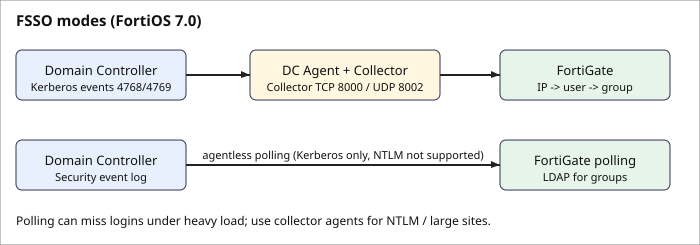

*شکل: حالت‌های FSSO.*

### ۵) مثال حل‌شده

**نیاز:** گروه Finance به سرور مالی، بقیه ممنوع.

``` text
config user ldap
    edit "LDAP-AD"
        set server "192.168.90.40"
        set cnid "sAMAccountName"
        set dn "dc=lab,dc=local"
        set type regular
        set username "CN=svc-fgt,CN=Users,DC=lab,DC=local"
        set password <SERVICE-ACCOUNT-PASSWORD>
        set secure ldaps
        set port 636
    next
end
config user fsso-polling
    edit 1
        set server "192.168.90.40"
        set ldap-server "LDAP-AD"
        set polling-frequency 10
    next
end
config user group
    edit "GRP-FINANCE"
        set group-type fsso-service
        set member "CN=Finance,CN=Users,DC=lab,DC=local"
    next
end
```

(سینتکس نمونه؛ `Unverified`؛ با CLI Reference 7.0 تطبیق شود.) Policy: Source = GRP-FINANCE، Destination = SRV-FIN، Service = HTTPS.

**GUI:** User & Authentication → LDAP Servers؛ Security Fabric → External Connectors → FSSO (Poll Active Directory Server)؛ User & Authentication → User Groups؛ Policy & Objects → Firewall Policy.

**آزمون‌ها:** مثبت: کاربر Finance دسترسی دارد؛ منفی: کاربر دیگر ندارد؛ IP عوض شود؛ Terminal Server.

**مثال متوسط:** کاربر Login کرد ولی Policy مطابق نشد. علت‌ها به ترتیب: نگاشت IP→User نیامده (Polling/Log)، گروه در Filter نیست، DN اشتباه، ساعت ناهماهنگ.

**مثال سخت:** بعضی کاربران پس از ورود با NTLM در Polling دیده نمی‌شوند. علت طبق مستند: Polling فقط Kerberos. راه‌حل: Collector Agent یا اصلاح DNS/SPN تا Kerberos استفاده شود.

### ۶) طراحی و تصمیم‌گیری

| سؤال | تصمیم |
|---|---|
| LDAP یا RADIUS؟ | LDAP برای Directory/گروه؛ RADIUS برای VPN/Wi-Fi/MFA/NPS |
| FSSO کدام حالت؟ | کوچک: Polling؛ بزرگ/NTLM: Collector/DC Agent |
| رمزنگاری | LDAPS/StartTLS |
| Redundancy | چند Collector، چند LDAP |
| Fallback | Captive Portal برای IP بدون Login |

### ۷) Verification

``` text
diagnose test authserver ldap LDAP-AD <user> <password>
diagnose debug authd fsso list
diagnose debug application fnbamd -1
diagnose debug enable
diagnose debug disable
```

### ۸) Troubleshooting

| علامت | علت |
|---|---|
| Bind شکست | DN/رمز/پورت/TLS |
| کاربر یافت نمی‌شود | DN/OU/cnid |
| FSSO کاربر نیست | Kerberos/NTLM، ساعت، Event Log، Group Filter |
| RADIUS Reject | Secret/Client/Policy NPS |
| Policy مطابق نمی‌شود | نگاشت IP→User |

### ۹) نکات امنیتی

- حساب سرویس LDAP read-only؛ رمز قوی؛ ذخیره‌ی رمز در ریپو ممنوع.
- LDAP بدون TLS ممنوع در تولید.
- MFA برای مدیریت و VPN.
- Log ورود ناموفق را مانیتور کنید.

### ۱۰) جمع‌بندی مفهومی

- AAA سه سؤال: کیستی، چه می‌توانی، چه کردی.
- LDAP: Bind سرویس + Search + Bind کاربر.
- Kerberos نیازمند ساعت و DNS؛ Polling فقط Kerberos.
- RADIUS: Request/Accept/Reject با Secret.
- هویت مبتنی بر IP محدودیت دارد؛ طراحی با Fallback.

### ۱۱) تمرین و ارزیابی

**ت1.** (ساده) AAA را تعریف کنید. *(پاسخ: 17-0-ت1)*

**ت2.** (ساده) پورت LDAP و LDAPS؟ *(پاسخ: 17-0-ت2)*

**ت3.** (متوسط) چرا ساعت برای Kerberos مهم است؟ *(پاسخ: 17-0-ت3)*

**ت4.** (متوسط) FSSO Polling چه محدودیتی دارد؟ *(پاسخ: 17-0-ت4)*

**ت5.** (سخت) چند کاربر روی یک Terminal Server دارید؛ چه مشکلی در FSSO پیش می‌آید؟ *(پاسخ: 17-0-ت5)*

**ت6.** (سخت، طراحی) برای ۵۰۰ کاربر ویندوزی و ۵۰ کاربر Mac/Linux راه‌حل هویت را بنویسید. *(پاسخ: 17-0-ت6)*

**Q1.** Quick quiz (English): Why does LDAP authentication use two binds? *(پاسخ: 17-0-Q1)*

### ۱۲) اصطلاحات و English Corner

| مخفف | شکل کامل | معنی |
|---|---|---|
| AAA | Authentication, Authorization, Accounting | هویت، مجوز، حسابرسی |
| LDAP | Lightweight Directory Access Protocol | پروتکل Directory |
| KDC | Key Distribution Center | مرکز توزیع کلید Kerberos |
| FSSO | Fortinet Single Sign-On | ورود یکپارچه |
| NPS | Network Policy Server | سرور RADIUS ویندوز |
| DN | Distinguished Name | نام مسیر در Directory |

- *Use LDAPS or StartTLS to protect directory credentials.* ← برای محافظت از اعتبارنامه‌ها LDAPS/StartTLS بزنید.
- *FSSO maps logons to IP addresses.* ← FSSO ورود را به IP نگاشت می‌کند.

### ۱۳) منابع

- Fortinet Docs: [FSSO polling connector agent installation](https://docs.fortinet.com/document/fortigate/7.0.0/administration-guide/503764/fsso-polling-connector-agent-installation)، [FSSO](https://docs.fortinet.com/document/fortigate/7.0.8/administration-guide/450337)، [config user fsso-polling](https://docs.fortinet.com/document/fortigate/7.0.0/cli-reference/516620/config-user-fsso-polling).
- RFC 4511 (LDAP)، RFC 4120 (Kerberos)، RFC 2865 (RADIUS).

## درس 17-1 — آماده‌سازی Lab هویت: Active Directory، DNS، OU، گروه و حساب سرویس روی Windows Server

**فصل 17 · بازنویسی عمیق · پیش‌نیاز: ۱۷-۰، Golden_W2025_Runbook · ≈ 6 ساعت**

> **وضعیت:** FortiOS 7.0.3 (بوت‌نشده)؛ دستورها `Unverified`؛ Lab «اجرا نشده»؛ وابستگی لایسنس هر قابلیت صریح ذکر شده است. دستورهای Windows را شما اجرا می‌کنید؛ رمزها نمونه‌اند.

### ۱) هدف آموزشی

در پایان این درس باید بتوانید:

1. زیرساخت AD را برای Lab بسازد (Forest/Domain، DNS، OU، گروه، کاربر تست، حساب سرویس).
2. وابستگی‌های FortiGate (DNS، زمان، پورت‌ها) را بشناسد.
3. ساختار OU/گروه را برای Policy هویتی طراحی کند.
4. Snapshot و Rollback را اجرا کند.

### ۲) مفهوم پایه: چیست و چرا؟

FortiGate برای Policy مبتنی بر هویت به یک Directory نیاز دارد. بدون AD تمیز و DNS/ساعت درست، همه‌ی مراحل بعد (LDAP، FSSO، RADIUS) شکست می‌خورند و مشکل در جای اشتباه جست‌وجو می‌شود.

### ۳) توضیح عمیق فنی

#### ۱) طراحی دامنه‌ی Lab

``` text
Domain  : lab.local       DC: DC1 192.168.90.40   DNS: DC1
OU      : Corp -> Users, Groups, ServiceAccounts
Groups  : GRP-FINANCE, GRP-IT, GRP-GUEST
Users   : u.fin1 (Finance), u.it1 (IT), svc-fgt (read-only bind)
Time    : DC is time source (NTP upstream); FortiGate uses same NTP
```

#### ۲) چرا این طراحی؟

- **OU جدا برای ServiceAccounts:** حساب Bind حداقل دسترسی و قابل‌ممیزی.
- **گروه‌ها برای نقش:** Policy روی گروه نوشته می‌شود، نه کاربر.
- **DNS روی DC:** AD بدون DNS درست کار نمی‌کند (SRV records).
- **زمان:** Kerberos به اختلاف زمان حساس است (۱۷-۰).

#### ۳) پورت‌های مورد نیاز (مرور)

LDAP 389/TCP، LDAPS 636/TCP، Kerberos 88/TCP+UDP، DNS 53، RADIUS 1812/UDP (NPS)، FSSO Collector 8000/TCP (۱۷-۰).

### ۴) طراحی و تصمیم‌گیری

| سؤال طراحی | گزینه‌ها و معیار انتخاب |
|---|---|
| OU/گروه | ساختار نقش‌محور؛ نام‌گذاری استاندارد |
| حساب سرویس | Read-only، رمز قوی، بدون Interactive logon |
| زمان | یک منبع NTP برای DC و FGT |

### ۵) مثال‌های حل‌شده (ساده، متوسط، سخت)

**ساده:** PowerShell: ساخت Forest و گروه‌ها؛ تست `Get-ADDomain` و `nslookup lab.local`.

**متوسط:** FortiGate نمی‌تواند DC را resolve کند: DNS فایروال را روی DC1 بگذارید یا Conditional Forward؛ آزمون `execute nslookup`.

**سخت:** LDAP Bind از FGT شکست می‌خورد با پیام invalid credentials: حساب svc-fgt با UPN اشتباه (DN صحیح لازم). اثبات: `ldp.exe` یا `Get-ADUser svc-fgt` برای DN دقیق؛ سپس تست از FGT. درس: DN را از خود AD بخوانید، حدس نزنید.

### ۶) پیاده‌سازی از مسیر GUI

1. Server Manager → Add Roles → Active Directory Domain Services و DNS.
2. Active Directory Users and Computers → ساخت OU/Group/User.
3. DNS Manager → بررسی Zone lab.local.
4. FortiGate: Network → DNS = 192.168.90.40.

### ۷) پیاده‌سازی از مسیر CLI

``` text
# Windows PowerShell on DC1 (lab only; run by the user)
Install-WindowsFeature AD-DS -IncludeManagementTools
Install-ADDSForest -DomainName lab.local -InstallDns
New-ADOrganizationalUnit -Name Corp -Path "DC=lab,DC=local"
New-ADGroup -Name GRP-FINANCE -GroupScope Global -Path "OU=Corp,DC=lab,DC=local"
New-ADUser -Name svc-fgt -SamAccountName svc-fgt -AccountPassword (Read-Host -AsSecureString) -Enabled $true
Get-ADDomain
Get-ADUser svc-fgt | Select DistinguishedName
```

### ۸) Verification (اثبات صحت)

- `nslookup lab.local` از FortiGate و کلاینت.
- `Get-ADUser` DN حساب سرویس.
- Snapshot VM گرفته شده.

### ۹) Troubleshooting

| علامت | شاهد برای بررسی | علت محتمل و رفع |
|---|---|---|
| FGT نام DC را نمی‌یابد | `execute nslookup` | DNS فایروال |
| Kerberos خطا | اختلاف زمان | NTP/زمان DC |
| Bind شکست | DN/رمز | DN دقیق از AD |

### ۱۰) نکات امنیتی

- رمزها نمونه و غیر ذخیره‌ای در ریپو.
- حساب سرویس read-only.
- DC را از اینترنت ایزوله نگه دارید.

### ۱۱) جمع‌بندی مفهومی

- AD تمیز + DNS + زمان = پیش‌نیاز هویت.
- DN را از AD بخوانید.
- Snapshot قبل از تغییر.

### ۱۲) تمرین و ارزیابی

**ت1.** (ساده) چرا DNS روی DC لازم است؟ *(پاسخ: 17-1-ت1)*

**ت2.** (ساده) چرا حساب سرویس جدا؟ *(پاسخ: 17-1-ت2)*

**ت3.** (متوسط) FGT نام DC را resolve نمی‌کند؛ مراحل. *(پاسخ: 17-1-ت3)*

**ت4.** (سخت) طراحی OU/گروه برای ۳ نقش. *(پاسخ: 17-1-ت4)*

**ت5.** (سخت، طراحی) برنامه‌ی Snapshot/Rollback برای Lab AD. *(پاسخ: 17-1-ت5)*

**Q1.** Quick quiz (English): Why must DNS be correct before AD authentication works? *(پاسخ: 17-1-Q1)*

### ۱۳) اصطلاحات و English Corner

| مخفف | شکل کامل | معنی |
|---|---|---|
| AD DS | Active Directory Domain Services | سرویس Directory |
| OU | Organizational Unit | واحد سازمانی |
| SRV | DNS service record | رکورد سرویس |

- *Use a least-privilege service account for LDAP binds.* ← برای Bind از حساب سرویس با حداقل دسترسی استفاده کنید.

### ۱۴) کارت Lab

**Lab:** DC و کاربران. **وضعیت:** اجرا نشده. **Evidence:** `03-ops/ad-lab.md`. **Rollback:** Snapshot.

### ۱۵) منابع

- Microsoft Learn: Active Directory Domain Services Overview.
- `phase0a/Golden_W2025_Runbook.md`.

<a id="l-17-2"></a>

## درس 17-2 — LDAP در FortiGate و Policy بر اساس گروه: Bind، Search، User Group و آزمون

**فصل 17 · بازنویسی عمیق · پیش‌نیاز: ۱۷-۰، ۱۷-۱، ۱۲-۰ · ≈ 7 ساعت**

> **وضعیت:** FortiOS 7.0.3 (بوت‌نشده)؛ دستورها `Unverified`؛ Lab «اجرا نشده»؛ وابستگی لایسنس هر قابلیت صریح ذکر شده است.

### ۱) هدف آموزشی

در پایان این درس باید بتوانید:

1. سرور LDAP را در FortiGate بسازد (cnid، dn، Bind، LDAPS).
2. User Group با Remote Group (DN کامل) بسازد.
3. Policy گروهی بنویسد و رفتار نگاشت IP→User را بداند.
4. با ابزار تست و Debug مشکل را عیب‌یابی کند.

### ۲) مفهوم پایه: چیست و چرا؟

LDAP به FortiGate می‌گوید «کاربر کیست و عضو کدام گروه است». اما Policy مبتنی بر هویت فقط وقتی کار می‌کند که کاربر **احراز هویت** شده باشد (Captive/FSSO/VPN)؛ خود LDAP فقط منبع تأیید و عضویت است.

### ۳) توضیح عمیق فنی

#### ۱) اجزای تنظیم LDAP

- **Server/Port/Secure:** `ldaps`/636 یا StartTLS.
- **cnid:** ویژگی نام ورود (`sAMAccountName`).
- **dn:** ریشه‌ی جست‌وجو (`dc=lab,dc=local`).
- **Bind:** `regular` با DN و رمز حساب سرویس.
- **Group:** Remote Group با DN کامل گروه.

#### ۲) جریان احراز هویت

``` text
user -> FGT (login)
FGT -> LDAP: bind with svc-fgt, search cnid=user under dn
FGT -> LDAP: bind with found user DN + user password
FGT -> LDAP: read memberOf / match remote group
FGT: allow policy for group
```

#### ۳) نکات

- DN گروه باید دقیق باشد؛ فرق Users container و OU.
- Nested group ممکن است نیاز به تنظیم جداگانه داشته باشد (`Unverified` برای 7.0.3).
- گواهی LDAPS باید معتبر باشد (CA را به FortiGate معرفی کنید).

### ۴) طراحی و تصمیم‌گیری

| سؤال طراحی | گزینه‌ها و معیار انتخاب |
|---|---|
| LDAP یا LDAPS | LDAPS/StartTLS |
| گروه‌ها | نقش‌محور؛ Nested را آگاهانه |
| Fallback | Captive Portal برای IP بدون هویت |

### ۵) مثال‌های حل‌شده (ساده، متوسط، سخت)

**ساده:** Test Connectivity موفق و Test User Credentials برای u.fin1 موفق.

**متوسط:** کاربر یافت نمی‌شود: dn روی OU محدود بود؛ تغییر dn به ریشه‌ی دامنه.

**سخت:** کاربر Login می‌کند ولی Policy گروه Finance مطابق نمی‌شود. فرضیه‌ها: DN گروه اشتباه (CN=Finance در OU دیگر)، کاربر عضو مستقیم نیست (Nested)، نگاشت IP→User نیامده، ترتیب Policy. آزمون: `diagnose test authserver`، Group membership در AD، Debug Flow Policy ID.

### ۶) پیاده‌سازی از مسیر GUI

1. User & Authentication → LDAP Servers → Create New (Server، cnid، dn، Bind).
2. Test Connectivity و Test User Credentials.
3. User Groups → Create New → Remote Groups → Add (انتخاب گروه از LDAP).
4. Policy → Source = گروه.

### ۷) پیاده‌سازی از مسیر CLI

``` text
config user ldap
    edit "LDAP-AD"
        set server "192.168.90.40"
        set cnid "sAMAccountName"
        set dn "dc=lab,dc=local"
        set type regular
        set username "CN=svc-fgt,OU=ServiceAccounts,OU=Corp,DC=lab,DC=local"
        set password <SERVICE-ACCOUNT-PASSWORD>
        set secure ldaps
        set port 636
    next
end
config user group
    edit "GRP-FINANCE"
        config match
            edit 1
                set server-name "LDAP-AD"
                set group-name "CN=GRP-FINANCE,OU=Groups,OU=Corp,DC=lab,DC=local"
            next
        end
    next
end
diagnose test authserver ldap LDAP-AD u.fin1 <PASSWORD>
```

### ۸) Verification (اثبات صحت)

- Test Connectivity/Credentials در GUI.
- `diagnose test authserver ldap ...` موفق.
- آزمون مثبت/منفی Policy.

### ۹) Troubleshooting

| علامت | شاهد برای بررسی | علت محتمل و رفع |
|---|---|---|
| Bind شکست | `diagnose debug application fnbamd -1` | DN/رمز/TLS/پورت |
| User یافت نمی‌شود | Debug | cnid/dn |
| Policy مطابق نمی‌شود | Debug Flow | گروه/نگاشت |

### ۱۰) نکات امنیتی

- LDAPS؛ رمز در ریپو نیست؛ حساب Read-only.

### ۱۱) جمع‌بندی مفهومی

- LDAP منبع احراز و عضویت است؛ Policy هویتی به نگاشت نیاز دارد.
- DN دقیق و TLS.
- آزمون مثبت/منفی.

### ۱۲) تمرین و ارزیابی

**ت1.** (ساده) cnid چیست؟ *(پاسخ: 17-2-ت1)*

**ت2.** (ساده) چرا LDAPS؟ *(پاسخ: 17-2-ت2)*

**ت3.** (متوسط) کاربر یافت نمی‌شود؛ علت محتمل؟ *(پاسخ: 17-2-ت3)*

**ت4.** (سخت) Policy گروهی مطابق نمی‌شود؛ فرضیه‌ها. *(پاسخ: 17-2-ت4)*

**ت5.** (سخت، طراحی) طرح گروه‌بندی برای ۳ دسترسی. *(پاسخ: 17-2-ت5)*

**Q1.** Quick quiz (English): Which information must an LDAP server entry in FortiGate contain to find a user? *(پاسخ: 17-2-Q1)*

### ۱۳) اصطلاحات و English Corner

| مخفف | شکل کامل | معنی |
|---|---|---|
| cnid | Common name identifier | ویژگی ورود |
| DN | Distinguished Name | نام مسیر |
| LDAPS | LDAP over TLS | LDAP رمزشده |

- *Test the LDAP connection before building policies.* ← قبل از Policy اتصال LDAP را تست کنید.

### ۱۴) کارت Lab

**Lab:** LDAP. **وضعیت:** اجرا نشده. **Evidence:** `03-ops/ldap.md`. **Rollback:** حذف User Group/LDAP.

### ۱۵) منابع

- RFC 4511 (LDAP)؛ Fortinet Docs: FortiOS 7.0 — LDAP servers، User groups.

<a id="l-17-3"></a>

## درس 17-3 — RADIUS و NPS، احراز هویت چندعاملی (MFA) و Attributeها

**فصل 17 · بازنویسی عمیق · پیش‌نیاز: ۱۷-۰، ۱۷-۲ · ≈ 6 ساعت**

> **وضعیت:** FortiOS 7.0.3 (بوت‌نشده)؛ دستورها `Unverified`؛ Lab «اجرا نشده»؛ وابستگی لایسنس هر قابلیت صریح ذکر شده است. MFA به FortiToken/OTP وابسته است (Needs-License/سرویس جداگانه).

### ۱) هدف آموزشی

در پایان این درس باید بتوانید:

1. جریان RADIUS (Access-Request/Accept/Reject/Challenge) را شرح دهد.
2. NPS را به‌عنوان RADIUS Server با Client و Policy پیکربندی کند.
3. FortiGate را RADIUS Client کند و تست را بخواند.
4. MFA را با Access-Challenge/OTP مفهومی توضیح دهد.
5. Attributeها (Group/VLAN) را برای Authorization به‌کار ببرد.

### ۲) مفهوم پایه: چیست و چرا؟

RADIUS برای احراز هویت دسترسی راه‌دور/شبکه (VPN، Wi-Fi، Admin) و مدیریت متمرکز است. FortiGate Client است؛ NPS (یا FreeRADIUS) Server. مزیت: سیاست یکجا، Accounting، MFA.

### ۳) توضیح عمیق فنی

#### ۱) جریان

``` text
FGT (client) -> NPS: Access-Request (User-Name, User-Password encrypted with shared secret, NAS-IP)
NPS: check AD + Network Policy
NPS -> FGT: Access-Accept (attributes) | Access-Reject | Access-Challenge (OTP)
FGT: Accounting-Request (1813) optional
```

#### ۲) NPS

- RADIUS Client: IP فایروال + Shared Secret.
- Network Policy: شرط (گروه AD) + روش احراز (PAP/MS-CHAPv2/EAP) + Constraints.
- پورت‌ها 1812/1813 UDP.

#### ۳) امنیت RADIUS

Shared Secret قوی؛ PAP رمز را (با Secret) رمز می‌کند ولی در برابر شنود/جعل ضعیف‌تر از EAP-TLS؛ برای VPN با MFA از Challenge استفاده کنید.

#### ۴) MFA

پس از رمز، سرور OTP می‌خواهد (Access-Challenge)؛ کاربر کد را وارد می‌کند. FortiToken یا OTP خارجی (Needs-License/سرویس).

### ۴) طراحی و تصمیم‌گیری

| سؤال طراحی | گزینه‌ها و معیار انتخاب |
|---|---|
| PAP/CHAP/EAP | EAP/MS-CHAPv2 برای VPN؛ PAP فقط با Secret قوی و شبکه‌ی مدیریت |
| Accounting | برای حسابرسی ورود |
| MFA | OTP/Token برای Admin و VPN |

### ۵) مثال‌های حل‌شده (ساده، متوسط، سخت)

**ساده:** `diagnose test authserver radius RADIUS-NPS pap u.fin1 <PASSWORD>` ← success.

**متوسط:** Access-Reject: NPS Event Viewer: «policy not matched» چون کاربر در گروه مجاز نیست.

**سخت:** VPN با MFA: کاربر بعد از رمز OTP می‌خواهد ولی GUI FortiClient خطا می‌دهد. بررسی: RADIUS timeout (کوتاه)، Challenge پشتیبانی کلاینت، Secret. اثبات با Sniffer 1812 و NPS Log.

### ۶) پیاده‌سازی از مسیر GUI

1. User & Authentication → RADIUS Servers → Create New (Name، Primary Server، Secret).
2. Test Connectivity/Credentials.
3. NPS: RADIUS Clients → New (IP فایروال، Secret).
4. NPS: Network Policies → شرط Group.

### ۷) پیاده‌سازی از مسیر CLI

``` text
config user radius
    edit "RADIUS-NPS"
        set server "192.168.90.41"
        set secret <RADIUS-SECRET>
        set timeout 10
    next
end
diagnose test authserver radius RADIUS-NPS pap u.fin1 <PASSWORD>
```

### ۸) Verification (اثبات صحت)

- Test موفق؛ NPS Event "granted".
- Sniffer: Access-Request/Accept.

### ۹) Troubleshooting

| علامت | شاهد برای بررسی | علت محتمل و رفع |
|---|---|---|
| Access-Reject | NPS Event | Secret/Policy/گروه |
| بدون پاسخ | Sniffer 1812 | Client تعریف نشده/Firewall |
| Challenge خطا | Log | Timeout/کلاینت |

### ۱۰) نکات امنیتی

- Secret قوی و یکتا؛ RADIUS را از اینترنت ببندید.

### ۱۱) جمع‌بندی مفهومی

- RADIUS: Request/Accept/Reject/Challenge.
- NPS Client+Policy.
- MFA با Challenge.

### ۱۲) تمرین و ارزیابی

**ت1.** (ساده) پورت‌های RADIUS؟ *(پاسخ: 17-3-ت1)*

**ت2.** (ساده) Shared Secret چیست؟ *(پاسخ: 17-3-ت2)*

**ت3.** (متوسط) Access-Reject با رمز درست؛ علت؟ *(پاسخ: 17-3-ت3)*

**ت4.** (سخت) VPN با MFA بعد از رمز قطع می‌شود؛ فرضیه‌ها. *(پاسخ: 17-3-ت4)*

**ت5.** (سخت، طراحی) طرح RADIUS برای مدیریت فایروال با MFA. *(پاسخ: 17-3-ت5)*

**Q1.** Quick quiz (English): What does Access-Challenge enable? *(پاسخ: 17-3-Q1)*

### ۱۳) اصطلاحات و English Corner

| مخفف | شکل کامل | معنی |
|---|---|---|
| NPS | Network Policy Server | سرور RADIUS ویندوز |
| NAS | Network Access Server | دستگاه دسترسی (فایروال) |
| OTP | One-Time Password | رمز یک‌بارمصرف |

- *The shared secret must match on both sides.* ← Secret باید دو سر یکی باشد.

### ۱۴) کارت Lab

**Lab:** RADIUS. **وضعیت:** اجرا نشده. **Evidence:** `03-ops/radius.md`. **Rollback:** حذف RADIUS.

### ۱۵) منابع

- RFC 2865 (RADIUS)؛ Microsoft Learn: NPS.

<a id="l-17-4"></a>

## درس 17-4 — FSSO عملی: انتخاب حالت، پیکربندی، Group Filter و عیب‌یابی

**فصل 17 · بازنویسی عمیق · پیش‌نیاز: ۱۷-۰، ۱۷-۲ · ≈ 6 ساعت**

> **وضعیت:** FortiOS 7.0.3 (بوت‌نشده)؛ دستورها `Unverified`؛ Lab «اجرا نشده»؛ وابستگی لایسنس هر قابلیت صریح ذکر شده است.

### ۱) هدف آموزشی

در پایان این درس باید بتوانید:

1. حالت مناسب FSSO را (DC Agent/Collector/Polling) انتخاب کند.
2. Polling را پیکربندی و کاربران را ببیند.
3. Group Filter و Policy را درست بنویسد.
4. مشکلات NTLM/زمان/Event Log را تشخیص دهد.

### ۲) مفهوم پایه: چیست و چرا؟

FSSO کاربر را بدون Login دوباره به فایروال می‌شناساند. در 7.0، Polling بدون Agent ساده است ولی محدودیت دارد (Kerberos، ورود هم‌زمان)؛ Collector Agent مقیاس‌پذیرتر است.

### ۳) توضیح عمیق فنی

#### ۱) انتخاب حالت

| شرایط | حالت |
|---|---|
| ≤ چند صد کاربر، Kerberos، ساده | FortiGate Polling |
| NTLM یا بار زیاد | Collector Agent/DC Agent |
| Terminal Server | Terminal Server Agent |

#### ۲) تنظیم Polling (طبق مستند 7.0)

پیش‌نیاز: LDAP Server موفق. سپس Security Fabric → External Connectors → FSSO (Poll Active Directory Server) با حساب مجاز خواندن Event Log. `polling-frequency` بین 1 تا 30 ثانیه (پیش‌فرض 10).

#### ۳) Group Filter

فقط کاربران عضو گروه‌های Filter به لیست FSSO می‌روند؛ اگر گروه را نگذارید، کاربر دیده نمی‌شود.

#### ۴) رویدادها

Polling فقط Kerberos 4768/4769 را می‌خواند؛ NTLM پشتیبانی نمی‌شود؛ ورود هم‌زمان زیاد ممکن است ورودی را از دست بدهد.

> **دقت مفهومی (طبق مستند Fortinet):** این محدودیت مربوط به **FortiGate Polling Connector** است. **Collector Agent در حالت Polling** مجموعه‌ی رویداد گسترده‌تری می‌خواند (مثلاً 4768 و 4776 و بسته به تنظیم 4769 و 4624) و NTLM را هم پوشش می‌دهد؛ ولی خودش با NTLM به DCها احراز هویت می‌کند و با Windows Server 2025 گزینه‌ی «Enforce Kerberos» لازم می‌شود. پس برای محیط NTLM-محور Collector/DC Agent مناسب‌تر از FortiGate Polling است. ([مرجع](https://community.fortinet.com/fortigate-3/technical-tip-enforcing-kerberos-instead-of-ntlm-on-fsso-collector-agent-226817))

### ۴) طراحی و تصمیم‌گیری

| سؤال طراحی | گزینه‌ها و معیار انتخاب |
|---|---|
| حالت | طبق جدول |
| Fallback | Captive Portal |
| Redundancy | چند Collector (تا ۵ طبق مستند) |

### ۵) مثال‌های حل‌شده (ساده، متوسط، سخت)

**ساده:** کاربر u.fin1 به PC Login می‌کند؛ `diagnose debug authd fsso list` او را با IP و گروه نشان می‌دهد.

**متوسط:** کاربر دیده نمی‌شود: گروه در Filter نبود؛ افزودن گروه؛ آزمون.

**سخت:** نیمی از کاربران دیده نمی‌شوند: آن‌ها با NTLM (IP به‌جای نام) به File Server وصل می‌شوند و Kerberos Ticket ندارند. راه‌حل: اصلاح DNS/SPN تا Kerberos استفاده شود یا گذار به Collector Agent.

### ۶) پیاده‌سازی از مسیر GUI

1. User & Authentication → LDAP (از ۱۷-۲).
2. Security Fabric → External Connectors → Create New → FSSO.
3. Poll Active Directory Server: IP، User، Password، LDAP Server.
4. User Groups → FSSO → Members.
5. Policy: Source = گروه FSSO.

### ۷) پیاده‌سازی از مسیر CLI

``` text
config user fsso-polling
    edit 1
        set server "192.168.90.40"
        set ldap-server "LDAP-AD"
        set polling-frequency 10
    next
end
diagnose debug authd fsso list
```

### ۸) Verification (اثبات صحت)

- `fsso list` کاربر و IP.
- Policy Hit و Log با User.

### ۹) Troubleshooting

| علامت | شاهد برای بررسی | علت محتمل و رفع |
|---|---|---|
| کاربر نیست | `fsso list` | Group Filter/Kerberos/ساعت |
| IP→User اشتباه | Terminal Server | Agent مخصوص |
| کند/ناقص | Load | Collector |

### ۱۰) نکات امنیتی

- حساب Polling حداقل دسترسی؛ شبکه‌ی مدیریت.

### ۱۱) جمع‌بندی مفهومی

- حالت را با NTLM/بار انتخاب کنید.
- Group Filter الزامی.
- Fallback داشته باشید.

### ۱۲) تمرین و ارزیابی

**ت1.** (ساده) Polling چه رویدادهایی را می‌خواند؟ *(پاسخ: 17-4-ت1)*

**ت2.** (متوسط) کاربر Login کرده ولی دیده نمی‌شود؛ ۳ علت. *(پاسخ: 17-4-ت2)*

**ت3.** (سخت) چرا Terminal Server مشکل‌ساز است؟ *(پاسخ: 17-4-ت3)*

**ت4.** (سخت) Collector یا Polling برای ۲۰۰۰ کاربر با NTLM؟ *(پاسخ: 17-4-ت4)*

**ت5.** (سخت، طراحی) آزمون ۵ مورد FSSO. *(پاسخ: 17-4-ت5)*

**Q1.** Quick quiz (English): Why can FSSO polling miss users who authenticate with NTLM? *(پاسخ: 17-4-Q1)*

### ۱۳) اصطلاحات و English Corner

| مخفف | شکل کامل | معنی |
|---|---|---|
| FSSO | Fortinet Single Sign-On | ورود یکپارچه |
| DC Agent | Domain controller agent | Agent روی DC |
| Collector | Collector agent | جمع‌کننده |

- *Choose the FSSO mode by authentication protocol and scale.* ← حالت FSSO را بر اساس پروتکل احراز و مقیاس انتخاب کنید.

### ۱۴) کارت Lab

**Lab:** FSSO. **وضعیت:** اجرا نشده. **Evidence:** `03-ops/fsso.md`. **Rollback:** حذف Connector.

### ۱۵) منابع

- [FSSO polling connector agent installation](https://docs.fortinet.com/document/fortigate/7.0.0/administration-guide/503764/fsso-polling-connector-agent-installation)
- [FSSO](https://docs.fortinet.com/document/fortigate/7.0.8/administration-guide/450337)

<a id="l-17-5"></a>

## درس 17-5 — Captive Portal، مهمان و Firewall Authentication: طراحی ایمن Guest

**فصل 17 · بازنویسی عمیق · پیش‌نیاز: ۱۷-۰، ۱۱-۰ · ≈ 6 ساعت**

> **وضعیت:** FortiOS 7.0.3 (بوت‌نشده)؛ دستورها `Unverified`؛ Lab «اجرا نشده»؛ وابستگی لایسنس هر قابلیت صریح ذکر شده است.

### ۱) هدف آموزشی

در پایان این درس باید بتوانید:

1. Captive Portal و Firewall Authentication (Policy-level) را مقایسه کند.
2. شبکه‌ی Guest ایزوله با حساب موقت طراحی کند.
3. HTTPS Redirect و گواهی Portal را درست بسازد.
4. Timeout/Re-auth و محدودیت دسترسی را تنظیم کند.

### ۲) مفهوم پایه: چیست و چرا؟

کاربر بدون هویت (مهمان/BYOD) نمی‌تواند با FSSO دیده شود. Captive Portal قبل از دسترسی صفحه‌ی ورود می‌دهد؛ هویت و Policy بر اساس ورود ساخته می‌شود.

### ۳) توضیح عمیق فنی

#### ۱) دو روش

- **Captive Portal روی Interface/Zone:** همه‌ی ترافیک آن شبکه قبل از Login مسدود و به Portal هدایت می‌شود.
- **Authentication در Policy:** فقط ترافیک آن Policy نیازمند Login است.

#### ۲) طراحی Guest

Zone/VLAN جدا (Guest) ← فقط اینترنت (HTTP/HTTPS/DNS) ← بدون دسترسی به داخل ← حساب موقت (زمان‌دار) یا Sponsor ← Log.

#### ۳) HTTPS و گواهی

Redirect HTTPS بدون گواهی معتبر هشدار می‌دهد؛ گواهی Portal معتبر یا CA داخلی. بدون آن کاربر عادت به «ادامه‌ی ناامن» می‌کند.

#### ۴) Timeout

Idle Timeout، Session Timeout و Re-auth؛ برای مهمان کوتاه.

### ۴) طراحی و تصمیم‌گیری

| سؤال طراحی | گزینه‌ها و معیار انتخاب |
|---|---|
| Guest دسترسی | فقط اینترنت؛ Isolation داخلی |
| حساب | موقت/Sponsor |
| Timeout | کوتاه |

### ۵) مثال‌های حل‌شده (ساده، متوسط، سخت)

**ساده:** Guest به Portal هدایت می‌شود، با guest1 وارد و اینترنت دارد.

**متوسط:** Portal باز نمی‌شود: allowaccess/Policy DNS؛ کاربر باید DNS را بتواند resolve کند.

**سخت:** Login Loop: گواهی Portal نامعتبر و مرورگر Redirect را رد می‌کند؛ رفع: گواهی معتبر/CA؛ شواهد Capture و Log.

### ۶) پیاده‌سازی از مسیر GUI

1. Network → Interfaces → VLAN Guest → Security Mode: Captive Portal.
2. User & Authentication → User Definition → Local User موقت.
3. Policy: Guest→WAN با Web Filter.
4. Log & Report.

### ۷) پیاده‌سازی از مسیر CLI

``` text
config system interface
    edit "VLAN50"
        set security-mode captive-portal
        set security-groups "GRP-GUEST"
    next
end
config user local
    edit "guest1"
        set type password
        set passwd <GUEST-PASSWORD>
    next
end
```

### ۸) Verification (اثبات صحت)

- Redirect، Login، دسترسی اینترنت، آزمون منفی: Guest→داخل Block.

### ۹) Troubleshooting

| علامت | شاهد برای بررسی | علت محتمل و رفع |
|---|---|---|
| Portal باز نمی‌شود | Capture | DNS/Policy/گواهی |
| Loop | مرورگر | گواهی |
| Guest به داخل | nmap | Policy گسترده |

### ۱۰) نکات امنیتی

- حساب مهمان زمان‌دار؛ بدون دسترسی داخلی؛ Log.

### ۱۱) جمع‌بندی مفهومی

- Portal برای IP بدون هویت.
- Isolation Guest.
- گواهی معتبر.

### ۱۲) تمرین و ارزیابی

**ت1.** (ساده) Captive Portal چیست؟ *(پاسخ: 17-5-ت1)*

**ت2.** (متوسط) چرا گواهی Portal مهم است؟ *(پاسخ: 17-5-ت2)*

**ت3.** (سخت) طراحی Guest با ۴ کنترل. *(پاسخ: 17-5-ت3)*

**ت4.** (سخت) Login Loop را عیب‌یابی کنید. *(پاسخ: 17-5-ت4)*

**ت5.** (سخت، طراحی) آزمون منفی Guest. *(پاسخ: 17-5-ت5)*

**Q1.** Quick quiz (English): Why must a guest network be isolated from internal networks? *(پاسخ: 17-5-Q1)*

### ۱۳) اصطلاحات و English Corner

| مخفف | شکل کامل | معنی |
|---|---|---|
| Captive portal | Captive portal | صفحه‌ی ورود قبل از اینترنت |
| Sponsor | Guest sponsor | مسئول تأیید مهمان |
| BYOD | Bring Your Own Device | دستگاه شخصی |

- *Keep guest accounts time-limited and isolated.* ← حساب‌های مهمان زمان‌دار و ایزوله باشند.

### ۱۴) کارت Lab

**Lab:** Captive Portal. **وضعیت:** اجرا نشده. **Evidence:** `03-ops/captive.md`. **Rollback:** `set security-mode none`.

### ۱۵) منابع

- Fortinet Docs: FortiOS 7.0 — Captive portal، Firewall authentication.

<a id="l-17-6"></a>

## درس 17-6 — آزمون عملی هویت و عیب‌یابی Authentication: سه پرونده‌ی واقعی با شواهد، کلید و Rubric

**فصل 17 · بازنویسی عمیق · پیش‌نیاز: ۱۷-۰ تا ۱۷-۵، ۱۷-۷، ۱۴-۷ · ≈ 8 ساعت**

> **وضعیت:** FortiOS 7.0.3 (بوت‌نشده) و CSR1000v؛ دستورها `Unverified` مگر با لینک؛ Lab «اجرا نشده».

### ۱) هدف آموزشی

در پایان این درس باید بتوانید:

1. سه سناریوی خرابی Auth (LDAP، FSSO، RADIUS+MFA) را با روش فرضیه‌محور تشخیص و رفع کند.
2. برای هر لایه (شبکه، DNS/ساعت، TLS، Bind، Search، گروه، نگاشت، Policy) شاهد جمع کند.
3. RCA و Evidence Index بنویسد.
4. آزمون مثبت/منفی دسترسی هویتی را اجرا کند.
5. Rubric خودارزیابی را با صداقت (اجرا نشده/Unverified) تکمیل کند.

### ۲) مفهوم پایه: چیست و چرا؟

هویت زنجیره‌ای از حلقه‌هاست: کاربر → فایروال → سرور Auth → Directory → گروه → نگاشت IP→User → Policy. خرابی هر حلقه علامت یکسان («لاگین نمی‌شود» یا «دسترسی ندارم») می‌دهد. این آزمون مهارت جداسازی حلقه‌ی خراب را می‌سنجد.

### ۳) توضیح عمیق فنی

#### ۱) روش

``` text
symptom -> scope(one user / group / all) -> hypotheses by layer -> cheapest evidence -> test -> root cause -> fix -> verify positive+negative -> document
```

نقشه‌ی لایه‌ها: شبکه (ping/Sniffer 389/636/1812/8000) → DNS/ساعت → TLS (گواهی LDAPS) → Bind (حساب سرویس) → Search (cnid/dn) → گروه (DN/Nested) → FSSO/نگاشت → Policy (Source/ترتیب).

#### ۲) سناریوها

**S1 — LDAP:** کاربران Login نمی‌شوند. `diagnose test authserver ldap ...` ⇒ bind error 49 یا Can't contact. علت‌ها (تزریق): DN حساب سرویس غلط / رمز منقضی / پورت 636 بسته.

**S2 — FSSO:** فقط کاربران Mac دیده نمی‌شوند. `diagnose debug authd fsso list` بدون آن‌ها. علت: NTLM/نبود Kerberos یا Group Filter.

**S3 — RADIUS+MFA:** VPN پس از رمز OTP می‌خواهد ولی Reject. علت: Shared Secret/Policy NPS/Timeout کوتاه.

#### ۳) کلید پاسخ (خلاصه)

| S | شواهد | علت | رفع | آزمون |
|---|---|---|---|---|
| S1 | authserver: bind failed؛ NPS/AD event | DN/رمز | DN دقیق از AD، رمز | authserver موفق + Login |
| S2 | fsso list بدون Mac | NTLM/Group Filter | Collector/Captive یا Filter | کاربر در لیست + Policy |
| S3 | NPS Event: policy not matched | گروه/Secret | Policy/Secret | OTP موفق، Reject برای گروه دیگر |

#### ۴) Rubric (۱۰۰)

رفع سه سناریو ۳۰؛ شواهد خام و لایه‌ای ۲۵؛ RCA ۲۰؛ آزمون مثبت/منفی ۱۵؛ صداقت ۱۰.

### ۵) مثال‌های حل‌شده (ساده، متوسط، سخت)

**S1 (ساده):** bind error: DN حساب سرویس با `CN=Users` ولی کاربر در OU=ServiceAccounts؛ DN را از `Get-ADUser` بخوانید و اصلاح کنید؛ `authserver` ⇒ success.

**S2 (متوسط):** Mac‌ها با NTLM به File Server وصل‌اند و Kerberos Ticket ندارند؛ Polling فقط Kerberos را می‌خواند. راه‌حل: Collector Agent/DC Agent یا Captive Portal برای Mac؛ آزمون: کاربر Mac در لیست.

**S3 (سخت):** VPN: پس از OTP قطع؛ `Access-Reject`؛ NPS Event: «Network Policy not matched»؛ دلیل: گروه کاربر در شرط Policy نیست؛ رفع؛ آزمون منفی: کاربر خارج از گروه Reject؛ Timeout RADIUS 10 s برای OTP.

### ۷) پیاده‌سازی از مسیر CLI

``` text
diagnose test authserver ldap LDAP-AD <user> <password>
diagnose debug authd fsso list
diagnose test authserver radius RADIUS-NPS pap <user> <password>
diagnose debug application fnbamd -1
diagnose debug enable
diagnose debug disable
diagnose debug reset
```

### ۸) Verification (اثبات صحت)

- Evidence Index: برای هر سناریو شاهد قبل/بعد.
- آزمون مثبت/منفی.

### ۹) Troubleshooting

| علامت | شاهد برای بررسی | علت محتمل و رفع |
|---|---|---|
| Auth شکست | fnbamd debug | لایه‌ی خراب را با جدول لایه‌ها بیابید |
| Policy مطابق نمی‌شود | Debug Flow | گروه/نگاشت/ترتیب |

### ۱۰) نکات امنیتی

- Debug رمز را آشکار می‌کند؛ پاک‌سازی.
- Evidence بدون Secret.

### ۱۱) جمع‌بندی مفهومی

- روش فرضیه‌محور و لایه‌ای.
- شواهد خام.
- RCA و آزمون مثبت/منفی.

### ۱۲) تمرین و ارزیابی

**ت1.** (ساده) bind error 49 یعنی چه؟ *(پاسخ: 17-6-ت1)*

**ت2.** (ساده) چرا Debug را Reset می‌کنیم؟ *(پاسخ: 17-6-ت2)*

**ت3.** (متوسط) S2: چرا Mac دیده نمی‌شود؟ *(پاسخ: 17-6-ت3)*

**ت4.** (متوسط) S3: Reject با رمز درست؛ سه علت. *(پاسخ: 17-6-ت4)*

**ت5.** (سخت) RCA کامل S1. *(پاسخ: 17-6-ت5)*

**ت6.** (سخت، طراحی) چک‌لیست ۸ لایه‌ای Auth با آزمون هر لایه. *(پاسخ: 17-6-ت6)*

**Q1.** Quick quiz (English): Which approach finds the failing layer fastest in an authentication problem? *(پاسخ: 17-6-Q1)*

### ۱۳) اصطلاحات و English Corner

| مخفف | شکل کامل | معنی |
|---|---|---|
| Bind | LDAP bind | ورود به Directory |
| Group filter | FSSO group filter | فیلتر گروه‌ها |

- *Test authentication independently of policies first.* ← ابتدا Authentication را جدا از Policy تست کنید.

### ۱۴) کارت Lab

**کارت Lab:** آزمون Auth. **Evidence:** `03-ops/rca-auth.md`.

### ۱۵) منابع

- درس‌های ۱۷-۰ تا ۱۷-۷
- RFC 4511، RFC 2865

## درس 17-7 — عیب‌یابی Authentication بر اساس شواهد: از Bind تا Policy (LDAP، RADIUS، FSSO)

**فصل 17 · بازنویسی عمیق · پیش‌نیاز: ۱۷-۱ تا ۱۷-۶ · ≈ 11 ساعت**

> **وضعیت:** FortiOS 7.0.3 نامی (بوت‌نشده)؛ سناریو و کلید آموزشی؛ Lab «اجرا نشده»؛ دستورها `Unverified` تا اجرای Lab؛ FMG/FAZ وابسته به لایسنس (Needs-License).

### ۱) هدف آموزشی

در پایان این درس باید بتوانید:

1. مسیر Authentication (کاربر → FortiGate → Auth Server → گروه → Policy) را مرحله‌به‌مرحله بکشد.
2. با `diagnose test authserver` و Debug fnbamd علت شکست Bind/رمز/گروه را بیابد.
3. خطاهای رایج LDAP (Bind DN، Base DN، Filter، LDAPS)، RADIUS (Shared Secret، NAS-IP) و FSSO را تشخیص دهد.
4. نتیجه را با Event Log اثبات و رفع کند.
5. گزارش RCA با شواهد بنویسد.

### ۲) مفهوم پایه: چیست و چرا؟

«کاربر وارد نمی‌شود» از مبهم‌ترین گزارش‌هاست. می‌تواند رمز اشتباه باشد، سرور احراز هویت در دسترس نباشد، کاربر عضو گروه نباشد، یا Policy گروه را نشناسد. اگر زنجیره را نشناسید، ساعت‌ها حدس می‌زنید؛ اگر بشناسید، در پنج دقیقه می‌دانید حلقه‌ی شکسته کجاست.

### ۳) توضیح عمیق فنی

#### ۱) زنجیره‌ی Authentication

``` text
User -> FortiGate (portal / VPN / captive) -> Auth server (LDAP/RADIUS)
   1 reachability (UDP/TCP 389/636/1812)
   2 bind / shared secret
   3 user lookup (Base DN, filter)
   4 password check
   5 group membership returned
   6 firewall policy matches group
```

#### ۲) ابزار

``` text
diagnose test authserver ldap AD-LDAP user01 'Password'
diagnose test authserver radius RAD01 pap user01 'Password'
diagnose debug application fnbamd -1
diagnose debug enable
...
diagnose debug disable
diagnose debug reset
diagnose debug authd fsso list
```

(`Unverified`؛ رمز واقعی در Lab؛ هرگز در گزارش ثبت نشود.)

#### ۳) نگاشت علامت به علت

| علامت / پیام | علت | رفع |
|---|---|---|
| LDAP bind failed / invalid credentials | Bind DN یا رمز سرویس | حساب سرویس |
| user not found | Base DN/Identifier/Filter | `cnid`, `dn` |
| سرور unreachable | Route/Policy/Firewall سرور | UDP/TCP پورت |
| RADIUS Access-Reject | Shared Secret یا کاربر | Secret/NPS |
| لاگین ok ولی دسترسی نه | گروه به Policy وصل نیست | Group در Policy |
| FSSO: کاربر دیده نمی‌شود | Collector Agent/Polling | `fsso list` |

#### ۴) نمونه Debug

``` text
fnbamd: ldap_connect ... 10.20.0.2:636
fnbamd: ldap_bind  result=49 (Invalid credentials)
```

کد 49 یعنی اعتبار Bind نادرست.

#### ۵) روش

ابتدا Reachability، سپس Bind سرویس، سپس کاربر، سپس گروه، سپس Policy. هر گام یک Evidence.

### ۴) طراحی و تصمیم‌گیری

| سؤال طراحی | گزینه‌ها و معیار انتخاب |
|---|---|
| LDAPS | TLS 636 |
| حساب سرویس | Least privilege |

### ۵) مثال‌های حل‌شده (ساده، متوسط، سخت)

**ساده (حل‌شده):** `diagnose test authserver ldap AD-LDAP user01 ...` پاسخ موفق همراه گروه‌ها؛ یعنی سرور و Bind سالم است.

**متوسط (گروه):** لاگین موفق ولی دسترسی ندارد. مراحل: ۱) تست authserver: گروه CN=VPN-FIN نیامد. ۲) کاربر عضو نیست. ۳) افزودن عضویت. ۴) تست دوباره ⇒ گروه؛ ۵) Policy hit. پاسخ: عضویت گروه.

**سخت (چندعلتی):** پس از تغییر رمز حساب سرویس، همه‌ی کاربران رد می‌شوند. مراحل: ۱) Debug fnbamd: result=49. ۲) رمز Bind در FortiGate قدیمی. ۳) به‌روزرسانی. ۴) تست. RCA: رمز سرویس بدون CHG تغییر کرد؛ اقدام: Vault و Alert.

### ۶) پیاده‌سازی از مسیر GUI

1. User & Authentication → LDAP Servers → Test Connectivity / Test User Credentials.
2. User Groups → Remote Groups.

### ۷) پیاده‌سازی از مسیر CLI

``` text
diagnose test authserver ldap AD-LDAP user01 Password
diagnose debug application fnbamd -1
diagnose debug enable
diagnose debug disable
diagnose debug reset
```

### ۸) Verification (اثبات صحت)

- Bind OK.
- گروه برگشت.
- Policy hit.

### ۹) Troubleshooting

| علامت | شاهد برای بررسی | علت محتمل و رفع |
|---|---|---|
| Invalid credentials | Bind | حساب |
| user not found | Base DN | dn/cnid |
| Reject | Secret | Shared secret |

### ۱۰) نکات امنیتی

- LDAPS.
- رمز در Vault.
- Debug را خاموش کنید.

### ۱۱) جمع‌بندی مفهومی

- زنجیره‌ی ۶ گام.
- Debug fnbamd.
- Policy و گروه.

### ۱۲) تمرین و ارزیابی

**ت1.** (ساده) کد 49 LDAP؟ *(پاسخ: 17-7-ت1)*

**ت2.** (ساده) چرا Test authserver؟ *(پاسخ: 17-7-ت2)*

**ت3.** (متوسط) لاگین موفق ولی دسترسی نه؟ *(پاسخ: 17-7-ت3)*

**ت4.** (متوسط) RADIUS Reject؟ *(پاسخ: 17-7-ت4)*

**ت5.** (سخت) پس از تغییر رمز همه رد می‌شوند. *(پاسخ: 17-7-ت5)*

**ت6.** (سخت، طراحی) چک‌لیست. *(پاسخ: 17-7-ت6)*

**Q1.** Quick quiz (English): What does LDAP result code 49 mean? *(پاسخ: 17-7-Q1)*

### ۱۳) اصطلاحات و English Corner

| مخفف | شکل کامل | معنی |
|---|---|---|
| LDAP | Lightweight Directory Access Protocol | پروتکل دایرکتوری |
| FSSO | Fortinet Single Sign-On | ورود یکپارچه |

- *Test each hop of the authentication chain.* ← هر گام زنجیره‌ی Authentication را آزمون کنید.

### ۱۴) کارت Lab

**کارت Lab:** عیب‌یابی Auth (اجرا نشده). **Evidence:** `03-ops/auth-rca.md`.

### ۱۵) منابع

- Fortinet FortiOS 7.0 Administration Guide: Authentication; LDAP; RADIUS; FSSO

## پاسخ‌های فصل 17

> ابتدا بدون نگاه حل کنید. شناسه: درس-نوع+شماره (ت = تمرین، م = مرور).


### پاسخ‌های بازنویسی درس 17-1

**17-1-ت1** — AD از SRV Record برای یافتن سرویس‌ها استفاده می‌کند.

AD برای یافتن سرویس‌های دامنه (KDC، LDAP) از رکورد SRV در DNS استفاده می‌کند؛ DNS خراب یعنی دامنه خراب.

**17-1-ت2** — حداقل دسترسی و ممیزی‌پذیری.

حساب سرویس باید Least Privilege و ممیزی‌پذیر باشد تا افشای آن آسیب را محدود کند.

**17-1-ت3** — DNS فایروال، `execute nslookup`، Route/Policy Local-out، Sniffer 53.

DNS کار نمی‌کند: DNS فایروال، `execute nslookup`، Route/Policy Local-out و Sniffer روی 53.

**17-1-ت4** — Corp/Users/Groups/ServiceAccounts؛ گروه‌های Finance/IT/Guest؛ Policy بر پایه‌ی گروه.

**17-1-ت5** — Snapshot قبل از Forest، بعد از پایه، قبل از هر تغییر؛ آزمون Restore.

Snapshot: قبل از ساخت Forest، پس از پایه و پیش از هر تغییر؛ و آزمون Restore برای اثبات.

**17-1-Q1** — Because AD clients locate domain services through DNS SRV records.


### پاسخ‌های بازنویسی درس 17-2

**17-2-ت1** — ویژگی نام ورود در Directory (مثل sAMAccountName).

Common Name Identifier (cnid) ویژگی نام ورود در Directory است (مثل sAMAccountName) که FortiGate با آن کاربر را می‌جوید.

**17-2-ت2** — تا رمزها قابل شنود نباشند.

LDAPS رمز و پرس‌وجو را رمز می‌کند؛ LDAP ساده می‌تواند رمزها را قابل شنود کند.

**17-2-ت3** — dn/OU اشتباه یا cnid ناسازگار.

user not found: dn/OU اشتباه یا cnid ناسازگار؛ با `diagnose test authserver ldap` بررسی کنید.

**17-2-ت4** — DN گروه، Nested، نگاشت IP→User، ترتیب Policy؛ آزمون‌ها: authserver، AD، Debug Flow.

**17-2-ت5** — گروه‌ها: Finance (ERP)، IT (مدیریت)، Guest (اینترنت)؛ Policy هر کدام Source=Group.

**17-2-Q1** — The base DN, the common name identifier (cnid) and bind credentials.


### پاسخ‌های بازنویسی درس 17-3

**17-3-ت1** — UDP 1812 و 1813.

RADIUS Authentication روی UDP 1812 و Accounting روی 1813 (برخی پیاده‌سازی قدیمی 1645/1646).

**17-3-ت2** — رمز مشترک Client/Server برای محافظت/اعتبارسنجی.

Shared Secret رمز مشترک FortiGate و RADIUS است که بسته‌ها را اعتبارسنجی/محافظت می‌کند؛ عدم‌تطابق باعث Reject می‌شود.

**17-3-ت3** — Policy NPS/گروه مجاز نیست.

Access-Reject با رمز درست: Policy NPS/گروه مجاز نیست؛ شاهد در Event Log سرور NPS.

**17-3-ت4** — Timeout کوتاه، Challenge پشتیبانی‌نشده، Secret، NPS Policy.

Timeout کوتاه، Challenge پشتیبانی‌نشده، Secret و NPS Policy از علل ناموفق‌بودن MFA هستند.

**17-3-ت5** — Admin remote auth=RADIUS، Challenge OTP، گروه Admin، Accounting، Fallback local admin.

**17-3-Q1** — Additional authentication steps such as one-time passwords.


### پاسخ‌های بازنویسی درس 17-4

**17-4-ت1** — Kerberos 4768/4769.

FSSO Polling فقط رویدادهای Kerberos 4768/4769 را می‌خواند؛ ورود NTLM دیده نمی‌شود.

**17-4-ت2** — Group Filter، NTLM، ساعت/Event Log.

FSSO کاربر را نمی‌بیند: Group Filter، NTLM، ساعت و دسترسی به Event Log را بررسی کنید.

**17-4-ت3** — چند کاربر با یک IP؛ نگاشت یک‌به‌یک ممکن نیست؛ TS Agent.

چند کاربر با یک IP (Terminal Server) نگاشت یک‌به‌یک را ممکن نمی‌کند؛ از TS Agent استفاده کنید.

**17-4-ت4** — Collector/DC Agent؛ Polling محدودیت‌های NTLM و بار دارد.

Collector/DC Agent مدل جایگزین Polling است؛ Polling محدودیت NTLM و بار دارد.

**17-4-ت5** — Login/Logout، تغییر IP، گروه جدید، NTLM، قطع Collector؛ هر کدام Evidence.

آزمون FSSO: Login/Logout، تغییر IP، گروه جدید، NTLM و قطع Collector؛ برای هرکدام Evidence.

**17-4-Q1** — Polling reads only Kerberos events, so NTLM logons are not captured.


### پاسخ‌های بازنویسی درس 17-5

**17-5-ت1** — صفحه‌ی ورود قبل از دسترسی.

Captive Portal قبل از دسترسی صفحه‌ی ورود را نشان می‌دهد؛ برای Guest و BYOD.

**17-5-ت2** — Redirect HTTPS و جلوگیری از عادت کاربر به هشدار.

Redirect باید HTTPS باشد تا کاربر به هشدار گواهی عادت نکند و رمز در متن ساده نرود.

**17-5-ت3** — Zone جدا، Policy حداقلی، حساب موقت، Log و Timeout.

Guest Wi-Fi: Zone جدا، Policy حداقلی (فقط اینترنت)، حساب موقت، Log و Timeout.

**17-5-ت4** — گواهی، Redirect، DNS، Policy.

Captive Portal کار نمی‌کند: گواهی، Redirect، DNS و Policy را بررسی کنید.

**17-5-ت5** — nmap از Guest به Users/Servers باید Filtered باشد.

nmap از Guest به Users/Servers باید Filtered باشد؛ آزمون منفی جداسازی.

**17-5-Q1** — Because guests are untrusted devices and could attack or scan internal systems.


### پاسخ‌های بازنویسی عمیق درس 17-6

**17-6-ت1** — اعتبارنامه‌ی نامعتبر: DN یا رمز حساب/کاربر اشتباه.

اعتبارنامه‌ی نامعتبر: DN یا رمز حساب/کاربر اشتباه؛ Bind را تست کنید.

**17-6-ت2** — بار CPU، حجم Log و افشای اطلاعات حساس.

Debug بار CPU، حجم Log و افشای اطلاعات حساس دارد؛ محدود و موقتی.

**17-6-ت3** — NTLM؛ Polling فقط Kerberos را می‌بیند؛ یا Group Filter.

FSSO کاربر را نمی‌بیند: NTLM (Polling فقط Kerberos)، یا Group Filter.

**17-6-ت4** — Policy NPS/گروه، Secret، Constraint روش احراز؛ شاهد: NPS Event.

RADIUS Reject: Policy NPS/گروه، Secret و Constraint روش احراز؛ شاهد: NPS Event.

**17-6-ت5** — علامت: Login شکست؛ شواهد: bind error؛ علت: DN حساب سرویس؛ رفع: DN دقیق؛ پیشگیری: ثبت DN و تست پس از تغییر OU.

**17-6-ت6** — شبکه، DNS/ساعت، TLS، Bind، Search، گروه، FSSO، Policy؛ برای هرکدام یک دستور/آزمون.

**17-6-Q1** — Testing each layer from the cheapest check upward and recording evidence at every step.

### پاسخ‌های درس افزوده‌ی 17-0 (فصل 17)

**17-0-ت1** — Authentication (کیستی)، Authorization (چه می‌توانی)، Accounting (چه کردی).

Authentication کیستی، Authorization چه می‌توانی و Accounting چه کردی؛ سه رکن AAA.

**17-0-ت2** — LDAP 389؛ LDAPS 636.

LDAP روی TCP 389 و LDAPS روی 636.

**17-0-ت3** — Kerberos به Ticket با Timestamp وابسته است؛ اختلاف زمان زیاد باعث رد Ticket می‌شود.

**17-0-ت4** — فقط Kerberos (4768/4769)؛ NTLM پشتیبانی نمی‌شود؛ در ورود هم‌زمان زیاد ممکن است ورودی از دست برود.

**17-0-ت5** — چند کاربر یک IP دارند و FSSO فقط یک نگاشت IP→User می‌بیند؛ راه‌حل Terminal Server Agent یا Policy IP-based.

**17-0-ت6** — ویندوز: FSSO + LDAP؛ Mac/Linux: Captive Portal/RADIUS یا Policy IP-based؛ MFA برای VPN؛ Fallback و Redundancy.

**17-0-Q1** — The first bind uses a service account to find the user DN; the second bind with the user DN and password verifies the password.


### پاسخ‌های درس افزوده‌ی 17-7 (فصل 17)


### پاسخ‌های بازنویسی عمیق درس 17-7

**17-7-ت1** — اعتبار Bind نامعتبر.

کد 49 LDAP یعنی اعتبار Bind نامعتبر؛ حساب سرویس/رمز را بررسی کنید.

**17-7-ت2** — برای جدا کردن مشکل سرور از Policy.

`diagnose test authserver` مشکل سرور را از مشکل Policy جدا می‌کند.

**17-7-ت3** — گروه در Policy/عضویت.

لاگین موفق ولی دسترسی نه: گروه در Policy یا عضویت گروه.

**17-7-ت4** — Shared Secret/کاربر.

RADIUS Reject: Shared Secret یا کاربر.

**17-7-ت5** — رمز Bind؛ به‌روزرسانی؛ CHG.

پس از تغییر رمز Bind همه رد می‌شوند: رمز را به‌روز کنید و CHG ثبت.

**17-7-ت6** — ۶ گام.

چک‌لیست شش‌گامی: Reachability، Bind، کاربر، رمز، گروه، Policy.

**17-7-Q1** — Invalid credentials.

# فصل 18 — IPsec Site-to-Site: IKEv2، Phase 1/2، MTU و عیب‌یابی (G7)

**مدت:** ۳۶ ساعت | **پیش‌نیاز:** فصل ۱۳، ۱۴؛ فصل ۵ (Routing).
**اهداف:** مفهوم IPsec (IKE Phase 1/2، SA، Proposal)؛ ساخت Tunnel بین دو FortiGate (و بعداً CSR)؛ Static Route و Policy برای ترافیک Tunnel؛ MTU/MSS؛ عیب‌یابی «Tunnel بالا ولی ترافیک نه».
**نسخه:** FortiOS 7.0.3 اسمی؛ دستورها آزمایش‌نشده. IPsec در Lab بدون لایسنس ممکن است (`Unverified`).
**Gate G7:** Tunnel بالا + ترافیک دوطرفه + سناریوی عیب Phase 2 mismatch.
**اشتباهات رایج:** Proposal ناهمسان؛ Selector نادرست؛ Route/Policy فراموش‌شده؛ NAT-T؛ MTU.

**درس‌های فصل:**
- [درس 18-1 — مفهوم IPsec: IKE، SA و Proposal](#l-18-1)
- [درس 18-2 — ساخت Tunnel بین دو FortiGate (CLI و GUI)](#l-18-2)
- [درس 18-3 — عیب‌یابی IPsec: Phase 1/2 و Debug](#l-18-3)
- [درس 18-4 — MTU/MSS و Fragmentation در Tunnel](#l-18-4)
- [درس 18-5 — Tunnel با Cisco CSR و Dead Peer Detection](#l-18-5)
- [درس 18-6 — Gate G7 و آزمون فصل](#l-18-6)

---

<a id="l-18-1"></a>

## درس 18-0 — IPsec از پایه تا عیب‌یابی لایه‌ای: IKE، SA، PFS، Selector، Rekey و NAT-T

**فصل ۱۸ · درس افزوده (پیش‌درس ۱۸-۱، تکمیل ۱۸-۱ و ۱۸-۲) · پیش‌نیاز: ۵-۰، ۱۲-۰، مفاهیم رمزنگاری · ≈ ۱۰ ساعت**

> **وضعیت (FortiOS 7.0.3):** پیش‌فرض‌ها از CLI Reference 7.0 ([phase1-interface](https://docs.fortinet.com/document/fortigate/7.0.5/cli-reference/371620/config-vpn-ipsec-phase1-interface)، [phase2-interface](https://docs.fortinet.com/document/fortigate/7.0.0/cli-reference/371620/config-vpn-ipsec-phase2-interface)) بررسی شد: `ike-version` پیش‌فرض ۱، DPD پیش‌فرض on-demand و `dpd-retrycount` ۳، `npu-offload` پیش‌فرض enable، Phase 1 keylife پیش‌فرض 86400، Phase 2 PFS پیش‌فرض enable و keylifeseconds پیش‌فرض 43200؛ مستند خود تأکید می‌کند بین نقطه‌نسخه‌ها فرق دارد. Lab «اجرا نشده».

### ۱) هدف آموزشی

دانشجو در پایان می‌تواند:

1. توضیح دهد IPsec چه تضمین‌هایی می‌دهد (محرمانگی، یکپارچگی، احراز هویت، ضد Replay).
2. **IKEv1 و IKEv2**، Phase 1/Phase 2 و **Child SA** را مقایسه کند.
3. الگوریتم‌های رمز (AES/GCM)، یکپارچگی (SHA2)، **Diffie-Hellman** و **PFS** را توضیح دهد و انتخاب کند.
4. **Traffic Selector** را بفهمد و ناسازگاری آن را کشف کند.
5. **Route-based در برابر Policy-based VPN** را مقایسه و انتخاب کند.
6. **NAT-T، DPD، Rekey/Lifetime** و رفتار ناپایداری Tunnel را تحلیل کند.
7. مشکل VPN را **لایه‌به‌لایه** کشف کند: شبکه، IKE، هویت، Proposal، Selector، Routing، Policy، MTU.

### ۲) پیش‌نیازها

مفاهیم کلید متقارن/نامتقارن، هش، تبادل کلید (به‌طور شهودی)؛ Routing (فصل ۵)؛ Packet Flow (۱۲-۰)؛ MTU/MSS (۱۸-۴).

### ۳) مفهوم پایه

اینترنت امن نیست. IPsec یک «لوله‌ی رمزشده» بین دو Gateway می‌سازد تا شبکه‌های خصوصی از میان اینترنت با هم صحبت کنند. IPsec در لایه‌ی ۳ است (برخلاف TLS که لایه‌ی کاربرد/انتقال است) و به همین دلیل برای **هر** ترافیک IP قابل‌استفاده است.

> **تشبیه:** دو دفتر قرار است نامه‌ها را با پیک امن رد و بدل کنند. اول (Phase 1) هویت یکدیگر را در یک اتاق خصوصی تأیید و یک رمز مشترک برای مکالمات مدیریتی می‌سازند. سپس (Phase 2) برای هر دسته‌ی نامه یک پاکت مهر‌ومومشده و قفل مخصوص می‌سازند (کلید داده).

### ۴) توضیح عمیق فنی

#### ۴-۱) تضمین‌های IPsec

| تضمین | سازوکار |
|---|---|
| محرمانگی | رمزنگاری (AES-CBC/GCM) |
| یکپارچگی | HMAC/AEAD (SHA-2، GCM) |
| احراز هویت | PSK یا گواهی/Certificate |
| ضد Replay | شماره‌ی توالی (Sequence Number) |

پروتکل‌ها: **ESP** (رمز + یکپارچگی؛ پروتکل IP 50) و **AH** (فقط یکپارچگی؛ کم‌کاربرد). مدیریت کلید: **IKE** (UDP 500؛ و UDP 4500 با NAT-T).

#### ۴-۲) IKEv1 و IKEv2

| | IKEv1 | IKEv2 |
|---|---|---|
| مراحل | Phase 1 (Main/Aggressive) + Phase 2 (Quick Mode) | IKE_SA_INIT + IKE_AUTH + CREATE_CHILD_SA |
| تعداد پیام | بیشتر (Main: 6 + QM: 3) | کمتر (معمولاً ۴ پیام برای Tunnel) |
| EAP/MOBIKE | محدود | EAP، MOBIKE |
| Traffic Selector | Phase 2 Selector تک‌جفت | Selector چندگانه (Narrowing) |
| پایداری | قدیمی‌تر | مدرن‌تر؛ بهبود NAT-T و DPD |
| پیش‌فرض FortiOS 7.0 | ۱ (طبق CLI Reference) | باید صریحاً `set ike-version 2` |

**Aggressive Mode (IKEv1)** هویت را به‌صورت آشکار می‌فرستد و در برابر حمله‌ی Offline روی PSK ضعیف‌تر است؛ مورد استفاده با Dial-up قدیمی. در طراحی جدید IKEv2 ترجیح داده می‌شود.

#### ۴-۳) IKE SA و Child SA

``` text
Phase 1 / IKE SA : authenticate peers, negotiate IKE proposal, derive keys for IKE channel
Phase 2 / Child SA: negotiate IPsec proposal and traffic selectors, derive keys for ESP data
```

هر Child SA در هر جهت یک **SPI** دارد. Tunnel «بالا» یعنی هر دو SA برقرارند.

#### ۴-۴) الگوریتم‌ها، DH و PFS

- **Encryption:** AES-128/256 (CBC یا GCM)؛ GCM هم رمز و هم یکپارچگی (AEAD).
- **Integrity/PRF:** SHA-256/384/512؛ MD5/SHA-1 منسوخ.
- **DH Group:** تبادل کلید اولیه. گروه‌های کوچک (۱، ۲، ۵) ضعیف‌اند؛ ≥ 14 (2048-bit MODP) یا منحنی‌های بیضوی (19، 20، 21) توصیه می‌شود (راهنمای NIST/RFC؛ دقیق‌ترین گزینه‌ها را از سیاست سازمان بگیرید).
- **PFS (Perfect Forward Secrecy):** در هر Rekey Phase 2 یک تبادل DH تازه انجام می‌شود تا افشای کلید بلندمدت، ترافیک گذشته را باز نکند. طبق CLI Reference 7.0 پیش‌فرض Phase 2 PFS روشن است. هزینه: CPU بیشتر هنگام Rekey؛ **ناسازگاری PFS/DH group بین دو سر یکی از رایج‌ترین دلایل شکست Phase 2** است.

#### ۴-۵) احراز هویت

- **PSK:** ساده؛ باید طولانی/تصادفی؛ مدیریت سخت در مقیاس.
- **Certificate:** مقیاس‌پذیر و امن‌تر؛ نیازمند PKI و CRL/OCSP.
- Peer ID: `peertype`/`peerid` هنگام چند Peer یا Aggressive مهم است.

#### ۴-۶) Traffic Selector و Route-based/Policy-based

**Selector** می‌گوید کدام ترافیک وارد Tunnel شود (Local/Remote Subnet).

- **Policy-based:** Selector همان Policy رمزنگاری است؛ هر جفت Subnet = SA جداگانه؛ ساده برای دو شبکه ولی مقیاس‌پذیر نیست؛ Routing پویا مشکل.
- **Route-based (Interface-based) — توصیه‌ی اصلی FortiOS:** Tunnel یک Interface مجازی است؛ Selector معمولاً `0.0.0.0/0` ↔ `0.0.0.0/0` و **Routing + Firewall Policy** تعیین می‌کنند چه چیزی عبور کند. مناسب Hub-and-Spoke، OSPF/BGP روی Tunnel، SD-WAN.

> **قانون:** در Route-based سه چیز باید هم‌زمان درست باشند: **Route به Tunnel Interface، Policy دوطرفه، Selector سازگار.**

#### ۴-۷) NAT-T

اگر بین دو Peer NAT باشد، ESP (پروتکل 50) عبور نمی‌کند. **NAT-T** ESP را داخل UDP 4500 کپسوله می‌کند. در Phase 1 `nattraversal` (پیش‌فرض enable) و باز بودن UDP 500/4500. علامت: Tunnel بالا ولی ESP ترافیک ندارد.

#### ۴-۸) DPD، Rekey و Lifetime

- **DPD (Dead Peer Detection):** پیام دوره‌ای برای کشف مرگ Peer؛ پیش‌فرض on-demand (طبق CLI 7.0) با `dpd-retrycount` ۳؛ زمان‌های کوتاه Failover سریع می‌دهند ولی با Jitter لینک Flap می‌کنند.
- **Keylife:** Phase 1 پیش‌فرض 86400 s؛ Phase 2 پیش‌فرض 43200 s (طبق CLI Reference 7.0). **Rekey** قبل از انقضا انجام می‌شود تا SA بدون قطع تعویض شود.
- ناسازگاری Lifetime دو سر: معمولاً مشکل نیست (کوچک‌تر برنده می‌شود)، ولی با تجهیزات برخی سازندگان باعث Rekey ناموفق/قطع دوره‌ای می‌شود.

#### ۴-۹) MTU و MSS

سربار ESP/UDP (تقریباً ۵۰ تا ۸۰ بایت بسته به الگوریتم و NAT-T) اندازه‌ی مؤثر بسته را کم می‌کند. علامت: ping کوچک OK، دانلود بزرگ قفل (درس ۱۸-۴). راه‌حل: کاهش MTU Tunnel یا `tcp-mss-sender/receiver`.

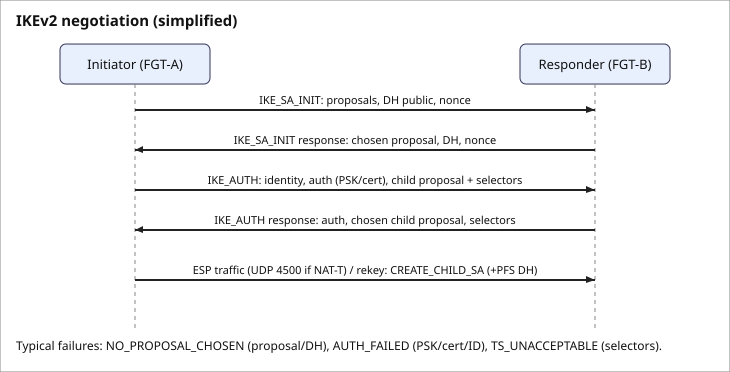

*شکل: مذاکره‌ی IKEv2 و خطاهای رایج.*

### ۵) مثال حل‌شده (Route-based S2S)

``` text
config vpn ipsec phase1-interface
    edit "TO-B"
        set interface "wan1"
        set ike-version 2
        set remote-gw 203.0.113.2
        set peertype any
        set proposal aes256gcm-prfsha256
        set dhgrp 20
        set dpd on-idle
        set dpd-retrycount 3
        set nattraversal enable
        set psksecret <PSK-LAB>
    next
end
config vpn ipsec phase2-interface
    edit "TO-B-P2"
        set phase1name "TO-B"
        set proposal aes256gcm
        set pfs enable
        set dhgrp 20
        set src-subnet 0.0.0.0 0.0.0.0
        set dst-subnet 0.0.0.0 0.0.0.0
    next
end
config router static
    edit 100
        set dst 192.168.20.0 255.255.255.0
        set device "TO-B"
    next
end
```

(مقادیر الگوریتم نمونه‌اند؛ نام دقیق Proposal/`dpd on-idle` با CLI Reference 7.0 و سیاست سازمان تطبیق شود؛ `Unverified`.)

**GUI معادل:** VPN → IPsec Tunnels → Create New → Custom → Network (Remote Gateway، Interface) → Authentication (PSK، IKE Version 2) → Phase 1 Proposal (Encryption/Authentication/DH Group) → Phase 2 Selectors (Local/Remote Address) → Phase 2 Proposal، PFS → OK؛ سپس Network → Static Routes و Policy & Objects → Firewall Policy (دو جهت).

**مثال متوسط (تحلیل):** Phase 1 بالا ولی Phase 2 شکست می‌خورد. اولین فرضیه‌ها: Proposal Phase 2 ناهمسان، PFS/DH ناهمسان، Selector ناهمسان. شاهد: `diagnose debug application ike -1` پیام NO_PROPOSAL_CHOSEN یا TS_UNACCEPTABLE.

**مثال سخت:** Tunnel Up، Bytes out بالا، in صفر. فرضیه‌ها به ترتیب: (۱) Policy سمت مقابل ندارد، (۲) Route برگشت ندارد، (۳) NAT-T/فایروال میانی UDP 4500 را نمی‌دهد (ESP نمی‌رسد)، (۴) Selector نامطابق (ترافیک Drop قبل Encrypt). تفکیک با `diagnose vpn tunnel list` (شمارنده Encrypt/Decrypt)، Sniffer روی WAN (ESP/UDP 4500)، Debug Flow در سمت مقابل.

### ۶) طراحی و تصمیم‌گیری

| سؤال | تصمیم |
|---|---|
| IKEv1 یا IKEv2؟ | IKEv2 مگر سازگاری مانع شود |
| PSK یا Certificate؟ | Certificate برای مقیاس؛ PSK قوی برای Lab/کوچک |
| Route-based یا Policy-based؟ | Route-based (توصیه‌ی FortiOS) |
| Proposal | AES-GCM + SHA2 + DH ≥ 14 یا ECP؛ حذف الگوریتم ضعیف |
| PFS | روشن؛ هزینه‌ی CPU را بسنجید |
| DPD | on-idle/on-demand؛ زمان متوازن |
| MTU/MSS | از ابتدا تنظیم و با Capture تأیید |

### ۷) Verification

``` text
diagnose vpn ike gateway list
diagnose vpn tunnel list
get vpn ipsec tunnel summary
diagnose vpn ike log filter name TO-B
diagnose debug application ike -1
diagnose debug enable
diagnose debug disable
diagnose debug reset
diagnose sniffer packet wan1 "host 203.0.113.2 and (udp port 500 or udp port 4500 or proto 50)" 4 20 l
```

(`diagnose` فرمت دقیق `Unverified`.)

### ۸) Troubleshooting لایه‌ای (جدول تصمیم)

| لایه | آزمون | علامت | رفع |
|---|---|---|---|
| ۱) شبکه | ping/Sniffer روی UDP 500 | بسته‌ی IKE به Peer نمی‌رسد | Route/ACL/NAT |
| ۲) IKE_SA/Phase 1 | Debug IKE | NO_PROPOSAL_CHOSEN، AUTH_FAILED | Proposal، DH، PSK/گواهی، Peer ID |
| ۳) Child SA/Phase 2 | Debug IKE | TS_UNACCEPTABLE، NO_PROPOSAL | Selector، PFS/DH، Proposal |
| ۴) داده | `tunnel list` Encrypt/Decrypt | Out بالا In صفر | Policy مقابل، NAT-T، Route برگشت |
| ۵) Routing | `get router info routing-table details` | مسیر به Tunnel نیست | Static/OSPF/BGP |
| ۶) Policy | Debug Flow | Denied policy 0 | Policy دوطرفه |
| ۷) MTU | ping -f، Capture | بزرگ‌ها قفل | MTU/MSS |
| ۸) پایداری | Log، `ike gateway list` | قطع دوره‌ای | Lifetime/DPD/لینک |

### ۹) نکات امنیتی

- PSK قوی و منحصربه‌فرد برای هر Peer؛ در ریپو ذخیره نکنید.
- الگوریتم‌های منسوخ (DES، MD5، DH1/2) را غیرفعال کنید.
- IKEv1 Aggressive با PSK ضعیف خطرناک است.
- `peertype any` را فقط در Lab/نیاز؛ در تولید Peer ID مشخص.
- لاگ VPN را مانیتور کنید (تلاش‌های ناموفق).

### ۱۰) جمع‌بندی مفهومی

- IPsec = IKE (مدیریت کلید) + ESP (داده)؛ IKE_SA و Child SA.
- IKEv2 مدرن‌تر؛ PFS روشن؛ DH/Proposal دو سر یکی.
- Route-based = Selector باز + Route + Policy.
- NAT-T، DPD، Rekey و MTU علت اصلی ناپایداری‌اند.
- عیب‌یابی لایه‌ای: شبکه → IKE → Selector → Routing → Policy → MTU.

### ۱۱) تمرین و ارزیابی

**ت1.** (ساده) تفاوت Phase 1 و Phase 2 را بگویید. *(پاسخ: 18-0-ت1)*

**ت2.** (ساده) PFS چه کاری می‌کند؟ *(پاسخ: 18-0-ت2)*

**ت3.** (متوسط) چرا Route-based برای Hub-and-Spoke بهتر است؟ *(پاسخ: 18-0-ت3)*

**ت4.** (متوسط) NAT-T چه مشکلی را حل می‌کند و از چه پورتی استفاده می‌کند؟ *(پاسخ: 18-0-ت4)*

**ت5.** (سخت) Tunnel بالا ولی Bytes in صفر است. فرضیه‌ها را به ترتیب و شاهد هرکدام بنویسید. *(پاسخ: 18-0-ت5)*

**ت6.** (سخت، طراحی) Proposal پیشنهادی برای سازمان (Cipher، Hash، DH، PFS، Lifetime، DPD) را با دلیل بنویسید. *(پاسخ: 18-0-ت6)*

**ت7.** (سخت) Phase 2 با TS_UNACCEPTABLE شکست می‌خورد؛ Selectorهای دو طرف را چگونه تطبیق می‌دهید؟ *(پاسخ: 18-0-ت7)*

**م1.** DPD چیست؟ *(پاسخ: 18-0-م1)*

**Q1.** Quick quiz (English): Why is PFS recommended for IPsec? *(پاسخ: 18-0-Q1)*

### ۱۲) اصطلاحات و English Corner

| مخفف | شکل کامل | معنی |
|---|---|---|
| IKE | Internet Key Exchange | تبادل کلید |
| ESP | Encapsulating Security Payload | کپسوله‌سازی امن (IP 50) |
| SA | Security Association | قرارداد امنیتی |
| SPI | Security Parameter Index | شناسه‌ی SA |
| DH | Diffie-Hellman | تبادل کلید |
| PFS | Perfect Forward Secrecy | رازداری رو به جلو |
| DPD | Dead Peer Detection | تشخیص Peer مرده |
| TS | Traffic Selector | انتخاب‌گر ترافیک |
| NAT-T | NAT Traversal | عبور از NAT |
| AEAD | Authenticated Encryption with Associated Data | رمز و یکپارچگی توأم |

- *Phase 2 usually fails because of mismatched proposals or selectors.* ← Phase 2 معمولاً به‌خاطر ناهمسانی Proposal یا Selector شکست می‌خورد.
- *Enable PFS so that a key compromise does not expose past traffic.* ← PFS را فعال کنید تا افشای کلید ترافیک گذشته را باز نکند.

### ۱۳) منابع

- Fortinet Docs: [config vpn ipsec phase1-interface](https://docs.fortinet.com/document/fortigate/7.0.5/cli-reference/371620/config-vpn-ipsec-phase1-interface)، [phase2-interface](https://docs.fortinet.com/document/fortigate/7.0.0/cli-reference/371620/config-vpn-ipsec-phase2-interface)، [Phase 1 configuration](https://docs.fortinet.com/document/fortigate/7.0.2/administration-guide/790613/phase-1-configuration).
- RFC 7296 — IKEv2؛ RFC 4303 — ESP؛ RFC 3947/3948 — NAT-T؛ RFC 3706 — DPD؛ RFC 8247 — Algorithm Requirements for IKEv2.

## درس 18-1 — IPsec در عمل: از نیاز تا طراحی — Proposal، شبکه‌ها و برگه‌ی پارامتر

**فصل 18 · بازنویسی عمیق · پیش‌نیاز: ۱۸-۰، ۵-۰ · ≈ 5 ساعت**

> **وضعیت:** FortiOS 7.0.3 (بوت‌نشده)؛ دستورها `Unverified`؛ Lab «اجرا نشده».

### ۱) هدف آموزشی

در پایان این درس باید بتوانید:

1. از نیاز کسب‌وکار به «برگه‌ی پارامتر IPsec» برسد.
2. Proposal امن و سازگار انتخاب کند و دلیل بگوید.
3. محدودیت‌های مسیر (NAT، فایروال میانی، MTU) را پیش از پیاده‌سازی بسنجد.
4. معیار پذیرش Tunnel را بنویسد.

### ۲) مفهوم پایه: چیست و چرا؟

در فصل ۱۸-۰ مفاهیم را آموختید. این درس همان مفاهیم را به **تصمیم طراحی** تبدیل می‌کند: چه Proposal، چه Selector، چه Route، چه Policy، و چه چیزی باید قبل از شروع بررسی شود.

### ۳) توضیح عمیق فنی

#### ۱) پرسش‌های پیش از طراحی

1. دو سر IP عمومی ثابت دارند یا یکی Dynamic/پشت NAT؟ (Static/Dynamic، NAT-T)
2. چه شبکه‌هایی باید ارتباط داشته باشند؟ Overlap دارند؟ (IP Plan، NAT)
3. مسیر بین دو سر چه فایروال‌هایی دارد؟ UDP 500/4500 و ESP باز است؟
4. چه سرویس‌هایی؟ حجم/Latency؟ (MTU، MSS، Offload)
5. یک مسیر یا Failover؟ (Dual-ISP، SD-WAN)
6. هویت با PSK یا گواهی؟

#### ۲) برگه‌ی پارامتر (قالب)

| پارامتر | مقدار پیشنهادی | دلیل |
|---|---|---|
| IKE | v2 | مدرن‌تر؛ پیش‌فرض 7.0 v1 است و باید صریح تغییر کند |
| Encryption | AES-256-GCM | AEAD |
| Integrity/PRF | SHA-256 | امن |
| DH | 20 (یا ≥ 14) | PFS قوی |
| PFS | Enable | رازداری رو به جلو |
| Lifetime | Phase1 86400، Phase2 43200 (پیش‌فرض‌های 7.0) | هماهنگ دو سر |
| DPD | on-idle/on-demand | کشف مرگ Peer |
| Auth | PSK قوی/گواهی | مقیاس |
| Selector | 0.0.0.0/0 (route-based) | Routing تعیین‌کننده |

#### ۳) معیار پذیرش

IKE SA Established؛ Child SA با شمارنده‌ی دوطرفه؛ ping/TCP بین شبکه‌ها؛ آزمون منفی؛ MTU بدون فرگمنت؛ Failover (در صورت وجود) در زمان هدف.

### ۴) طراحی و تصمیم‌گیری

| سؤال طراحی | گزینه‌ها و معیار انتخاب |
|---|---|
| PSK یا Cert | Cert برای مقیاس؛ PSK قوی در کوچک |
| Failover | دو Tunnel/دو ISP + SD-WAN (۲۱-۷) |
| Overlap | NAT/Re-IP |

### ۵) مثال‌های حل‌شده (ساده، متوسط، سخت)

**ساده:** دو شعبه با IP ثابت و بدون NAT: IKEv2، AES-GCM، DH 20، PFS، Route-based، دو Policy.

**متوسط:** یک سر پشت NAT: NAT-T لازم؛ UDP 4500؛ Peer ID/Local ID مشخص.

**سخت:** دو شعبه با Subnet هم‌پوشان 192.168.1.0/24: Route-based مستقیم ممکن نیست. گزینه‌ها: NAT یکطرفه/دوطرفه (VIP/IP Pool)، یا تغییر Addressing. معیار: ریسک، پیچیدگی، Log. راه‌حل: NAT به Subnetهای یکتا در Tunnel و ثبت در IP Plan.

### ۶) پیاده‌سازی از مسیر GUI

1. VPN → IPsec Wizard یا Custom: گام‌ها مطابق ۱۸-۲.

### ۷) پیاده‌سازی از مسیر CLI

``` text
show vpn ipsec phase1-interface
show vpn ipsec phase2-interface
diagnose vpn ike gateway list
```

### ۸) Verification (اثبات صحت)

- برگه‌ی پارامتر امضا‌شده توسط دو سر.
- Pre-check: ping Peer، UDP 500/4500، MTU مسیر.

### ۹) Troubleshooting

| علامت | شاهد برای بررسی | علت محتمل و رفع |
|---|---|---|
| Pre-check شکست | Sniffer/ping | فایروال میانی/Route |
| Overlap | Route | NAT/Re-IP |

### ۱۰) نکات امنیتی

- الگوریتم ضعیف را حذف کنید.
- PSK در ریپو نیست.

### ۱۱) جمع‌بندی مفهومی

- طراحی پیش از پیکربندی.
- برگه‌ی پارامتر آینه‌ای.
- معیار پذیرش قابل‌آزمایش.

### ۱۲) تمرین و ارزیابی

**ت1.** (ساده) چرا IKEv2؟ *(پاسخ: 18-1-ت1)*

**ت2.** (متوسط) چرا Pre-check شبکه؟ *(پاسخ: 18-1-ت2)*

**ت3.** (سخت) Overlap 192.168.1.0/24 را چگونه حل می‌کنید؟ *(پاسخ: 18-1-ت3)*

**ت4.** (سخت) برگه‌ی پارامتر برای دو شعبه بنویسید. *(پاسخ: 18-1-ت4)*

**ت5.** (سخت، طراحی) معیار پذیرش Tunnel را ۵ بند بنویسید. *(پاسخ: 18-1-ت5)*

**Q1.** Quick quiz (English): Why prepare a parameter sheet before configuring a tunnel? *(پاسخ: 18-1-Q1)*

### ۱۳) اصطلاحات و English Corner

| مخفف | شکل کامل | معنی |
|---|---|---|
| Peer ID | IKE peer identity | هویت همتا |

- *Mirror every parameter on both peers.* ← هر پارامتر را روی هر دو سر آینه کنید.

### ۱۴) کارت Lab

**Lab:** برگه‌ی پارامتر. **Evidence:** `02-design/ipsec-params.md`.

### ۱۵) منابع

- [phase1-interface](https://docs.fortinet.com/document/fortigate/7.0.5/cli-reference/371620/config-vpn-ipsec-phase1-interface)
- RFC 7296

<a id="l-18-2"></a>

## درس 18-2 — ساخت Tunnel Site-to-Site بین دو FortiGate: طراحی، GUI، CLI و Verification

**فصل ۱۸ · بازنویسی عمیق · پیش‌نیاز: ۱۸-۰ (IKE، Selector، PFS)، ۱۲-۰، فصل ۵ · ≈ ۷ ساعت**

> **وضعیت (FortiOS 7.0.3):** پیش‌فرض‌ها از CLI Reference 7.0؛ سینتکس `Unverified`؛ PSK نمونه؛ Lab «اجرا نشده».

### ۱) هدف آموزشی

1. برگه‌ی طراحی Tunnel (IP Plan، Proposal، Selector، Route، Policy) را قبل از پیکربندی بنویسد.
2. Tunnel Route-based را با **GUI و CLI** بسازد.
3. سه چیز لازم (Route، Policy، Selector) را جداگانه بسنجد.
4. با `diagnose vpn tunnel list`، Monitor و Ping Verification کند.
5. Rollback و Backup را اجرا کند.

### ۲) برگه‌ی طراحی

``` text
Site A: WAN 203.0.113.1  LAN 192.168.10.0/24   Tunnel if: TO-B
Site B: WAN 203.0.113.2  LAN 192.168.20.0/24   Tunnel if: TO-A
IKE: v2  Proposal: aes256gcm-prfsha256  DH 20  PFS on  DPD on-idle  NAT-T: auto
Phase2 selectors: 0.0.0.0/0 <-> 0.0.0.0/0 (route-based)
Routing: static 192.168.20.0/24 via TO-B (A) and 192.168.10.0/24 via TO-A (B)
Policies: LAN->TO-B accept ; TO-B->LAN accept (both sides)
```

اصل: **دو سر آینه‌ی هم** (Proposal، DH، PFS، Lifetime، PSK، Selector).

### ۳) پیاده‌سازی

**GUI (Site A):**

1. VPN → IPsec Tunnels → Create New → Custom: Name TO-B.
2. Network: Remote Gateway = Static IP 203.0.113.2؛ Interface = wan1؛ NAT Traversal = Enable.
3. Authentication: Method Pre-shared Key؛ IKE Version 2.
4. Phase 1 Proposal: Encryption AES256GCM؛ DH Group 20.
5. Phase 2 Selectors: Local/Remote Address = 0.0.0.0/0؛ Phase 2 Proposal AES256GCM؛ Enable PFS (DH 20).
6. Network → Static Routes → 192.168.20.0/24 → Interface TO-B.
7. Policy & Objects → Firewall Policy: LAN→TO-B و TO-B→LAN (Accept، NAT خاموش).

**CLI (Site A):**

``` text
config vpn ipsec phase1-interface
    edit "TO-B"
        set interface "wan1"
        set ike-version 2
        set remote-gw 203.0.113.2
        set proposal aes256gcm-prfsha256
        set dhgrp 20
        set dpd on-idle
        set nattraversal enable
        set psksecret <PSK-LAB>
    next
end
config vpn ipsec phase2-interface
    edit "TO-B-P2"
        set phase1name "TO-B"
        set proposal aes256gcm
        set pfs enable
        set dhgrp 20
        set src-subnet 0.0.0.0 0.0.0.0
        set dst-subnet 0.0.0.0 0.0.0.0
    next
end
config router static
    edit 100
        set dst 192.168.20.0 255.255.255.0
        set device "TO-B"
    next
end
config firewall policy
    edit 100
        set name "LAN-to-B"
        set srcintf "port2"
        set dstintf "TO-B"
        set srcaddr "all"
        set dstaddr "all"
        set action accept
        set schedule "always"
        set service "ALL"
        set logtraffic all
    next
    edit 101
        set name "B-to-LAN"
        set srcintf "TO-B"
        set dstintf "port2"
        set srcaddr "all"
        set dstaddr "all"
        set action accept
        set schedule "always"
        set service "ALL"
        set logtraffic all
    next
end
```

(در تولید `service ALL` و `all` را محدود کنید؛ اینجا برای Lab اولیه است. سینتکس `Unverified`.) Site B آینه است.

### ۴) Verification (سه سطح)

``` text
get vpn ipsec tunnel summary
diagnose vpn ike gateway list
diagnose vpn tunnel list
execute ping-options source 192.168.10.1
execute ping 192.168.20.1
get router info routing-table details 192.168.20.5
diagnose debug flow filter addr 192.168.20.5
```

- **IKE SA:** Established.
- **Child SA:** Bytes encrypt/decrypt هر دو رشد.
- **داده:** ping کلاینت‌ها؛ Log Policy.

### ۵) مثال‌ها

**ساده:** ping 192.168.10.5 → 192.168.20.5 موفق؛ `tunnel list`: Encrypt/Decrypt افزایش.

**متوسط:** فقط یک‌سو: Bytes out می‌رود، in صفر؛ بررسی Policy B→LAN و Route برگشت در B.

**سخت:** Tunnel پس از ۸ ساعت یک لحظه قطع می‌شود: Rekey؛ بررسی Lifetime دو سر (۱۸-۰)، DPD، PFS Group ناهمسان؛ شاهد: Log VPN.

### ۶) Troubleshooting

| علامت | علت |
|---|---|
| IKE برقرار نمی‌شود | Reachability، Proposal، PSK، ID |
| Phase 2 شکست | Selector/PFS/DH |
| Up ولی ping نه | Route/Policy/NAT-T |
| ping کوچک OK و بزرگ نه | MTU/MSS |

### ۷) نکات امنیتی

- PSK قوی و منحصر؛ در ریپو نیست.
- Policy حداقلی؛ ترافیک Tunnel هم Inspect شود.
- `service ALL` فقط Lab.

### ۸) جمع‌بندی

- برگه‌ی طراحی آینه‌ای.
- Route + Policy + Selector.
- Verification سه‌سطحی.
- Backup قبل از تغییر.

### ۹) تمرین و ارزیابی

**ت1.** (ساده) سه چیز لازم برای ترافیک Tunnel Route-based؟ *(پاسخ: 18-2-ت1)*

**ت2.** (متوسط) چرا Policy دوطرفه لازم است؟ *(پاسخ: 18-2-ت2)*

**ت3.** (متوسط) Verification سه‌سطحی را بنویسید. *(پاسخ: 18-2-ت3)*

**ت4.** (سخت) فقط Bytes out رشد می‌کند؛ فرضیه‌ها و آزمون. *(پاسخ: 18-2-ت4)*

**ت5.** (سخت، طراحی) Policy حداقلی برای دسترسی Site A به یک سرور در Site B. *(پاسخ: 18-2-ت5)*

**Q1.** Quick quiz (English): Which three elements must be correct for route-based VPN traffic to flow? *(پاسخ: 18-2-Q1)*

### ۱۰) اصطلاحات و English Corner

| مخفف | شکل کامل | معنی |
|---|---|---|
| Route-based | Route-based VPN | VPN مبتنی بر Interface و Route |
| Mirror | Mirrored config | پیکربندی آینه‌ای |
| Encrypt/Decrypt counters | SA counters | شمارنده‌ی SA |

- *Both peers must have mirrored proposals and selectors.* ← هر دو Peer باید Proposal و Selector آینه‌ای داشته باشند.

### ۱۱) Lab

**کارت Lab:** Tunnel S2S. **وضعیت:** اجرا نشده. **Verification:** مطابق بخش ۴. **Rollback:** حذف phase2/phase1/Route/Policy. **Evidence:** `03-ops/s2s-a-b.md`.

### ۱۲) منابع

- Fortinet Docs: [config vpn ipsec phase1-interface](https://docs.fortinet.com/document/fortigate/7.0.5/cli-reference/371620/config-vpn-ipsec-phase1-interface)، [phase2-interface](https://docs.fortinet.com/document/fortigate/7.0.0/cli-reference/371620/config-vpn-ipsec-phase2-interface).

<a id="l-18-3"></a>

## درس 18-3 — عیب‌یابی IPsec با Debug IKE: خواندن پیام‌ها و تصمیم‌گیری لایه‌ای

**فصل 18 · بازنویسی عمیق · پیش‌نیاز: ۱۸-۱، ۱۸-۲ · ≈ 11 ساعت**

> **وضعیت:** FortiOS 7.0.3 نامی (بوت‌نشده)؛ سناریو و کلید آموزشی؛ Lab «اجرا نشده»؛ دستورها `Unverified` تا اجرای Lab؛ FMG/FAZ وابسته به لایسنس (Needs-License).

### ۱) هدف آموزشی

در پایان این درس باید بتوانید:

1. مراحل IKEv2 (SA_INIT، AUTH، CREATE_CHILD_SA) را بشناسد.
2. Debug IKE را محدود و ایمن اجرا کند.
3. پیام‌های رایج (no proposal، AUTHENTICATION_FAILED، TS_UNACCEPTABLE) را تفسیر کند.
4. عیب را به Phase، Proposal، Auth، Selector یا NAT-T نگاشت کند.
5. رفع و Verify را انجام دهد.

### ۲) مفهوم پایه: چیست و چرا؟

تونل بالا نمی‌آید و Debug صدها خط می‌نویسد. بدون دانستن ساختار پیام‌ها، غرق می‌شوید؛ با دانستن، فقط به چند خط کلیدی نگاه می‌کنید: کدام مرحله شکست خورد و چرا.

### ۳) توضیح عمیق فنی

#### ۱) مراحل IKEv2

| تبادل | هدف | شکست رایج |
|---|---|---|
| IKE_SA_INIT | توافق الگوریتم و DH | no proposal chosen |
| IKE_AUTH | احراز هویت و Child SA | AUTHENTICATION_FAILED، TS_UNACCEPTABLE |
| CREATE_CHILD_SA | Rekey | عدم‌تطابق PFS/Lifetime |

#### ۲) Debug محدود

``` text
diagnose vpn ike log-filter clear
diagnose vpn ike log-filter dst-addr4 203.0.113.2
diagnose debug application ike -1
diagnose debug enable
... trigger traffic ...
diagnose debug disable
diagnose debug reset
```

#### ۳) تفسیر

| خط | معنی | اقدام |
|---|---|---|
| `no suitable proposal found` / `NO_PROPOSAL_CHOSEN` | Proposal یا DH متفاوت | یکسان‌سازی |
| `AUTHENTICATION_FAILED` | PSK/هویت متفاوت | PSK، peerid |
| `TS_UNACCEPTABLE` | Selector نامتطابق | Subnet |
| `negotiation timeout` | Reachability/UDP 500/4500 | ACL/NAT |
| `NAT-T` مشکل | UDP 4500 | بازکردن |

#### ۴) وضعیت

``` text
diagnose vpn ike gateway list
diagnose vpn tunnel list
get vpn ipsec tunnel summary
```

#### ۵) درخت تصمیم

Timeout ⇒ Reachability. NO_PROPOSAL ⇒ Proposal/DH. AUTH_FAILED ⇒ PSK/ID. TS_UNACCEPTABLE ⇒ Selector. Up ولی ترافیک نه ⇒ Route/Policy/MTU.

### ۴) طراحی و تصمیم‌گیری

| سؤال طراحی | گزینه‌ها و معیار انتخاب |
|---|---|
| Debug | فیلتر peer |
| درخت تصمیم | پایین‌به‌بالا |

### ۵) مثال‌های حل‌شده (ساده، متوسط، سخت)

**ساده (حل‌شده):** Debug: NO_PROPOSAL_CHOSEN؛ مقایسه Proposal دو سر؛ یکسان‌سازی؛ Established.

**متوسط (AUTH):** AUTHENTICATION_FAILED. مراحل: PSK دو سر و `peertype`؛ تفاوت یک کاراکتر؛ اصلاح؛ up. درس: PSK را کپی/پیست از Vault.

**سخت (Timeout):** negotiation timeout. مراحل: Sniffer UDP 500/4500: خروج هست، ورود نه؛ ACL ISP/Firewall سایت مقابل؛ رفع؛ تونل up.

### ۷) پیاده‌سازی از مسیر CLI

``` text
diagnose vpn ike log-filter dst-addr4 203.0.113.2
diagnose debug application ike -1
diagnose debug enable
diagnose debug disable
diagnose vpn ike gateway list
```

### ۸) Verification (اثبات صحت)

- Phase 1 و 2 up.
- ping.

### ۹) Troubleshooting

| علامت | شاهد برای بررسی | علت محتمل و رفع |
|---|---|---|
| NO_PROPOSAL | Proposal | یکسان |
| AUTH_FAILED | PSK | اصلاح |
| TS_UNACCEPTABLE | Selector | Subnet |
| Timeout | UDP 500/4500 | ACL |

### ۱۰) نکات امنیتی

- PSK در Vault.
- Debug را خاموش کنید.

### ۱۱) جمع‌بندی مفهومی

- IKE سه تبادل.
- خط کلیدی.
- درخت تصمیم.

### ۱۲) تمرین و ارزیابی

**ت1.** (ساده) IKE_SA_INIT چه می‌کند؟ *(پاسخ: 18-3-ت1)*

**ت2.** (ساده) TS_UNACCEPTABLE؟ *(پاسخ: 18-3-ت2)*

**ت3.** (متوسط) AUTH_FAILED؟ *(پاسخ: 18-3-ت3)*

**ت4.** (متوسط) Timeout؟ *(پاسخ: 18-3-ت4)*

**ت5.** (سخت) Timeout رفع. *(پاسخ: 18-3-ت5)*

**ت6.** (سخت، طراحی) درخت تصمیم. *(پاسخ: 18-3-ت6)*

**Q1.** Quick quiz (English): Which IKEv2 exchange negotiates algorithms and DH? *(پاسخ: 18-3-Q1)*

### ۱۳) اصطلاحات و English Corner

| مخفف | شکل کامل | معنی |
|---|---|---|
| TS | Traffic Selector | انتخابگر ترافیک |

- *Filter the IKE debug to a single peer.* ← Debug IKE را به یک peer محدود کنید.

### ۱۴) کارت Lab

**کارت Lab:** Debug IKE (اجرا نشده). **Evidence:** `03-ops/ike-debug.md`.

### ۱۵) منابع

- Fortinet FortiOS 7.0 Administration Guide: IPsec VPN troubleshooting
- RFC 7296

<a id="l-18-4"></a>

## درس 18-4 — MTU/MSS و Fragmentation در Tunnel IPsec: محاسبه‌ی سربار، آزمون DF، PMTUD و تنظیم

**فصل 18 · بازنویسی عمیق · پیش‌نیاز: ۱۸-۰، ۲۸-۲ · ≈ 8 ساعت**

> **وضعیت:** FortiOS 7.0.3 (بوت‌نشده) و CSR1000v؛ دستورها `Unverified` مگر با لینک؛ Lab «اجرا نشده».

### ۱) هدف آموزشی

در پایان این درس باید بتوانید:

1. سربار ESP/UDP-encap را برای Cipherهای مختلف تخمین بزند و MTU/MSS را محاسبه کند.
2. با ping DF و Capture MTU مؤثر را اندازه بگیرد.
3. PMTUD و Black hole را توضیح و تشخیص دهد.
4. MSS Clamp و `mtu-override` را تنظیم و اثرشان را اثبات کند.
5. رفتار UDP/ICMP/Fragmentation و DF را در Tunnel تحلیل کند.

### ۲) مفهوم پایه: چیست و چرا؟

کلاسیک‌ترین مشکل VPN: «ping کوچک OK، دانلود بزرگ قفل». علت MTU است. باید بتوانید **محاسبه، آزمون، رفع و اثبات** کنید.

### ۳) توضیح عمیق فنی

#### ۱) سربار

``` text
Outer IP header                20 B
[UDP encap (NAT-T)]             8 B   (+ non-ESP marker 4 B in some cases)
ESP header (SPI+Seq)            8 B
IV (cipher dependent)       8-16 B    (AES-GCM: 8 B IV)
ESP trailer (pad+len+next)  2+pad B
ICV (auth tag)             16 B (GCM) / 12-32 B (HMAC-SHA)
```

مجموع تقریبی: AES-GCM بدون NAT-T حدود 50–56 B؛ با NAT-T حدود 58–66 B؛ CBC+SHA-256 تا 70+ B.

``` text
Effective MTU ~= link MTU - overhead      (1500 - 60 = 1440 typical)
MSS = effective MTU - 40  (IP 20 + TCP 20) -> ~1400
```

(اعداد تقریبی؛ با آزمون واقعی تأیید کنید.)

#### ۲) آزمون

``` text
Linux : ping -M do -s 1372 10.2.0.5       (1372+28 = 1400)
Windows: ping -f -l 1372 10.2.0.5
```

اندازه را تا اولین موفقیت کم کنید؛ MTU مؤثر = اندازه + 28.

#### ۳) PMTUD

فرستنده بسته‌ی بزرگ با DF=1 می‌فرستد؛ روتر میانی که MTU کوچک‌تر دارد، ICMP «Fragmentation Needed (Type 3 Code 4)» برمی‌گرداند. اگر ICMP بلاک شود، فرستنده نمی‌فهمد ⇒ **Black hole** (قفل). رفع: اجازه‌ی ICMP 3/4، یا MSS Clamp که TCP را از ابتدا کوچک می‌کند.

#### ۴) FortiGate

``` text
config system interface
    edit "TO-B"
        set mtu-override enable
        set mtu 1400
    next
end
config firewall policy
    edit 100
        set tcp-mss-sender 1360
        set tcp-mss-receiver 1360
    next
end
```

(`Unverified`.) فرگمنت‌شدن: `ip-fragmentation` در Phase1 (`Unverified`)؛ Fragmentation افت کارایی دارد.

#### ۵) UDP و غیر TCP

MSS Clamp فقط TCP را حل می‌کند. UDP بزرگ (DNS، VoIP، QUIC) به MTU/Fragmentation حساس است؛ راه: MTU Tunnel پایین‌تر، برنامه با اندازه‌ی کوچک، یا اجازه‌ی Fragmentation.

### ۴) طراحی و تصمیم‌گیری

| سؤال طراحی | گزینه‌ها و معیار انتخاب |
|---|---|
| MSS Clamp | 1360 (یا محاسبه) |
| MTU Tunnel | 1400 |
| ICMP | Type 3/4 باز |
| Fragmentation | اجتناب |

### ۵) مثال‌های حل‌شده (ساده، متوسط، سخت)

**ساده (حل‌شده):** ping DF 1472 شکست، 1372 موفق ⇒ MTU مؤثر 1400؛ MSS 1360.

**متوسط (تحلیل):** دانلود 1 MB می‌ایستد؛ Capture: Retransmission بسته‌های 1500 B؛ هیچ ICMP 3/4. تحلیل: Black hole؛ رفع: MSS Clamp + اجازه‌ی ICMP؛ تأیید: دانلود کامل.

**سخت (چند پروتکل):** پس از Clamp، وب OK ولی DNS روی TCP/UDP بزرگ و VoIP مشکل دارند. تحلیل: UDP MSS ندارد؛ باید MTU Tunnel کمتر (1360) یا Fragmentation؛ اندازه‌گیری Loss با ping DF؛ تصمیم: MTU 1400 و آزمون VoIP؛ ثبت.

### ۶) پیاده‌سازی از مسیر GUI

1. Network → Interfaces → Tunnel → MTU.
2. Policy → CLI برای MSS.

### ۷) پیاده‌سازی از مسیر CLI

``` text
config system interface
    edit "TO-B"
        set mtu-override enable
        set mtu 1400
    next
end
config firewall policy
    edit 100
        set tcp-mss-sender 1360
        set tcp-mss-receiver 1360
    next
end
```

### ۸) Verification (اثبات صحت)

- ping DF اندازه‌ها.
- Capture: عدم Retransmission.
- دانلود بزرگ و UDP بزرگ.

### ۹) Troubleshooting

| علامت | شاهد برای بررسی | علت محتمل و رفع |
|---|---|---|
| بزرگ قفل | ping DF | MTU/ICMP |
| کند | Capture | Fragmentation |
| فقط UDP | Capture | MTU Tunnel |

### ۱۰) نکات امنیتی

- ICMP را کورکورانه نبندید.

### ۱۱) جمع‌بندی مفهومی

- سربار تقریبی؛ آزمون واقعی.
- MSS برای TCP؛ UDP نیاز MTU.
- PMTUD نیاز ICMP.

### ۱۲) تمرین و ارزیابی

**ت1.** (ساده) MSS از MTU چگونه محاسبه می‌شود؟ *(پاسخ: 18-4-ت1)*

**ت2.** (ساده) PMTUD Black hole چیست؟ *(پاسخ: 18-4-ت2)*

**ت3.** (متوسط) سربار ESP+UDP با GCM چقدر است؟ *(پاسخ: 18-4-ت3)*

**ت4.** (متوسط) ping DF 1372 موفق/1400 شکست؛ MTU مؤثر؟ *(پاسخ: 18-4-ت4)*

**ت5.** (سخت) چرا MSS Clamp برای UDP کافی نیست؟ *(پاسخ: 18-4-ت5)*

**ت6.** (سخت، طراحی) استاندارد MTU/MSS سازمان. *(پاسخ: 18-4-ت6)*

**Q1.** Quick quiz (English): Why do small pings succeed while large transfers hang when the path MTU is too small? *(پاسخ: 18-4-Q1)*

### ۱۳) اصطلاحات و English Corner

| مخفف | شکل کامل | معنی |
|---|---|---|
| PMTUD | Path MTU Discovery | کشف MTU مسیر |
| DF | Don’t Fragment bit | بیت عدم فرگمنت |
| Black hole | PMTUD black hole | حفره‌ی سیاه PMTUD |

- *Measure the effective MTU with DF-bit pings.* ← MTU مؤثر را با ping و DF-bit اندازه بگیرید.

### ۱۴) کارت Lab

**کارت Lab:** MTU. **Evidence:** `03-ops/mtu.md`.

### ۱۵) منابع

- RFC 1191
- RFC 4821
- RFC 4303 (ESP)

<a id="l-18-5"></a>

## درس 18-5 — Interop FGT–CSR: IPsec IKEv2 route-based، نگاشت، Debug دوطرفه و آزمون Rekey

**فصل 18 · بازنویسی عمیق · پیش‌نیاز: ۱۸-۰، ۲۵-۰، ۲۵-۳ · ≈ 8 ساعت**

> **وضعیت:** FortiOS 7.0.3 (بوت‌نشده) و CSR1000v؛ دستورها `Unverified` مگر با لینک؛ Lab «اجرا نشده». CSR دستورها `Unverified`.

### ۱) هدف آموزشی

در پایان این درس باید بتوانید:

1. Tunnel IKEv2 FGT–CSR را با Proposal یکسان بسازد.
2. معادل‌های دستور و پیام‌های خطا را نگاشت کند.
3. ناهمسانی Lifetime/PFS/Selector را کشف و رفع کند.
4. Rekey/DPD را آزمایش و گزارش Interop بنویسد.

### ۲) مفهوم پایه: چیست و چرا؟

Interop واقعی نیاز به «برگه‌ی پارامتر مشترک» و «Debug هم‌زمان» دارد (۲۵-۳). این درس ساخت پایه‌ی Tunnel است.

### ۳) توضیح عمیق فنی

#### ۱) برگه

``` text
IKEv2, AES-256-GCM, PRF SHA-256, DH 20, PFS group 20, lifetime P1 86400 / P2 3600, DPD on-idle
Selectors any/any (route-based), PSK <PSK-LAB>, FGT 203.0.113.1  CSR 203.0.113.2, tunnel 10.255.0.0/30
```

#### ۲) CSR

``` text
crypto ikev2 proposal PROP
 encryption aes-gcm-256
 prf sha256
 group 20
crypto ikev2 policy POL
 proposal PROP
crypto ikev2 keyring KR
 peer FGT
  address 203.0.113.1
  pre-shared-key <PSK-LAB>
crypto ikev2 profile PROF
 match identity remote address 203.0.113.1 255.255.255.255
 authentication local pre-share
 authentication remote pre-share
 keyring local KR
crypto ipsec transform-set TS esp-gcm 256
crypto ipsec profile IPS
 set transform-set TS
 set ikev2-profile PROF
 set pfs group20
 set security-association lifetime seconds 3600
interface Tunnel0
 ip address 10.255.0.2 255.255.255.252
 ip mtu 1400
 tunnel source GigabitEthernet1
 tunnel destination 203.0.113.1
 tunnel mode ipsec ipv4
 tunnel protection ipsec profile IPS
```

#### ۳) FortiGate

``` text
config vpn ipsec phase1-interface
    edit "TO-CSR"
        set interface "wan1"
        set ike-version 2
        set remote-gw 203.0.113.2
        set proposal aes256gcm-prfsha256
        set dhgrp 20
        set psksecret <PSK-LAB>
    next
end
config vpn ipsec phase2-interface
    edit "TO-CSR-P2"
        set phase1name "TO-CSR"
        set proposal aes256gcm
        set pfs enable
        set dhgrp 20
        set keylifeseconds 3600
        set src-subnet 0.0.0.0 0.0.0.0
        set dst-subnet 0.0.0.0 0.0.0.0
    next
end
```

#### ۴) نگاشت

| | CSR | FGT |
|---|---|---|
| وضعیت | `show crypto ikev2 sa` | `diagnose vpn ike gateway list` |
| Child | `show crypto ipsec sa` | `diagnose vpn tunnel list` |
| Debug | `debug crypto ikev2` | `diagnose debug application ike -1` |

### ۵) مثال‌های حل‌شده (ساده، متوسط، سخت)

**ساده (حل‌شده):** Up؛ ping 10.255.0.1↔.2؛ counters.

**متوسط (تحلیل):** Phase 2 شکست: PFS 19 روی CSR و 20 روی FGT؛ هم‌گروه‌کردن.

**سخت (Rekey):** پس از ۶۰ دقیقه قطع؛ Lifetime CSR 3600 و FGT 43200 و PFS ناهمسان در Rekey؛ یکسان‌سازی؛ آزمون ۴ ساعت.

### ۷) پیاده‌سازی از مسیر CLI

``` text
show crypto ikev2 sa
show crypto ipsec sa
diagnose vpn ike gateway list
diagnose vpn tunnel list
```

### ۸) Verification (اثبات صحت)

- دو سر Up؛ Rekey پایدار.

### ۹) Troubleshooting

| علامت | شاهد برای بررسی | علت محتمل و رفع |
|---|---|---|
| Phase1 | Debug | Proposal/PSK |
| Phase2 | Debug | PFS/Selector |
| قطع دوره‌ای | Log | Lifetime |

### ۱۰) نکات امنیتی

- PSK قوی.

### ۱۱) جمع‌بندی مفهومی

- برگه‌ی مشترک؛ Lifetime/PFS؛ Debug دو سر.

### ۱۲) تمرین و ارزیابی

**ت1.** (ساده) معادل diagnose vpn tunnel list در CSR؟ *(پاسخ: 18-5-ت1)*

**ت2.** (ساده) چرا Selector any/any؟ *(پاسخ: 18-5-ت2)*

**ت3.** (متوسط) PFS ناهمسان چه نشانه‌ای دارد؟ *(پاسخ: 18-5-ت3)*

**ت4.** (متوسط) چرا Lifetime ناهمسان خطرناک است؟ *(پاسخ: 18-5-ت4)*

**ت5.** (سخت) Tunnel هر ساعت قطع؛ تحلیل. *(پاسخ: 18-5-ت5)*

**ت6.** (سخت، طراحی) گزارش Interop. *(پاسخ: 18-5-ت6)*

**Q1.** Quick quiz (English): What is the CSR equivalent of FortiGate "diagnose vpn ike gateway list"? *(پاسخ: 18-5-Q1)*

### ۱۳) اصطلاحات و English Corner

| مخفف | شکل کامل | معنی |
|---|---|---|
| Transform set | IPsec transform set | الگوریتم‌های ESP |

- *Align lifetimes across vendors.* ← Lifetime را بین سازندگان هم‌سان کنید.

### ۱۴) کارت Lab

**کارت Lab:** FGT–CSR. **Evidence:** `03-ops/fgt-csr.md`.

### ۱۵) منابع

- Cisco IKEv2 configuration guide
- RFC 7296

<a id="l-18-6"></a>

## درس 18-6 — Gate G7: آزمون عملی IPsec — صورت مسئله، کلید پاسخ کامل و Rubric

**فصل 18 · بازنویسی عمیق · پیش‌نیاز: ۱۸-۱ تا ۱۸-۵ · ≈ 12 ساعت**

> **وضعیت:** FortiOS 7.0.3 نامی (بوت‌نشده)؛ سناریو و کلید پاسخ آموزشی‌اند؛ Lab «اجرا نشده»؛ دستورها `Unverified` تا اجرای Lab؛ ویژگی‌های وابسته به لایسنس مشخص شده‌اند.

### ۱) هدف آموزشی

در پایان این درس باید بتوانید:

1. یک تونل Site-to-Site IPsec (IKEv2) را از طراحی تا Verification مستند و پیاده‌سازی کند.
2. سه خرابی تزریق‌شده (عدم‌تطابق Proposal، Selector، NAT-T/MTU) را با شواهد تشخیص دهد.
3. هر خرابی را با Debug محدود و دستور Verification اثبات و رفع کند.
4. گزارش RCA و Evidence Index را تحویل دهد.
5. خود را با Rubric نمره‌دهی و ضعف‌ها را صادقانه ثبت کند.

### ۲) مفهوم پایه: چیست و چرا؟

Gate G7 آخرین سنجش فصل IPsec است. در دنیای واقعی تونل «بالا نمی‌آید» و مشتری فقط همین را می‌گوید؛ شما باید مرحله‌به‌مرحله ثابت کنید مشکل در Phase 1 است یا Phase 2، در Proposal است یا Selector، در NAT-T است یا MTU. این درس صورت مسئله، کلید پاسخ کامل و Rubric را یک‌جا می‌دهد تا هم تمرین کنید و هم خودتان را ارزیابی.

### ۳) توضیح عمیق فنی

#### ۱) صورت مسئله

دو سایت: HQ (FGT-HQ، WAN 198.51.100.2، LAN 10.10.0.0/16) و Branch (FGT-BR، WAN 203.0.113.2، LAN 10.20.0.0/16). نیاز: تونل IPsec IKEv2 با AES-256/SHA-256، DH Group 14، PFS فعال، DPD، فقط ترافیک LAN↔LAN، Log و Policy دوطرفه.

#### ۲) طراحی (پاسخ مرجع)

| پارامتر | مقدار |
|---|---|
| IKE | v2 |
| Phase1 Proposal | aes256-sha256 |
| DH Group | 14 |
| Lifetime P1 | 86400 s |
| Phase2 Proposal | aes256-sha256 |
| PFS | enable (DH 14) |
| Lifetime P2 | 43200 s |
| Selector | 10.10.0.0/16 ↔ 10.20.0.0/16 |
| DPD | on-idle، interval 10، retry 3 |
| NAT-T | enable |
| MTU/MSS | MSS-clamp 1350 |

#### ۳) پیکربندی مرجع HQ

``` text
config vpn ipsec phase1-interface
 edit "TO-BR"
  set interface "port1"
  set ike-version 2
  set peertype any
  set net-device disable
  set proposal aes256-sha256
  set dhgrp 14
  set remote-gw 203.0.113.2
  set psksecret <PSK-FROM-VAULT>
  set dpd on-idle
  set dpd-retrycount 3
  set dpd-retryinterval 10
  set nattraversal enable
 next
end
config vpn ipsec phase2-interface
 edit "TO-BR-P2"
  set phase1name "TO-BR"
  set proposal aes256-sha256
  set pfs enable
  set dhgrp 14
  set src-subnet 10.10.0.0 255.255.0.0
  set dst-subnet 10.20.0.0 255.255.0.0
 next
end
config router static
 edit 50
  set dst 10.20.0.0 255.255.0.0
  set device "TO-BR"
 next
end
config firewall policy
 edit 70
  set name "HQ-to-BR"
  set srcintf "port2"
  set dstintf "TO-BR"
  set srcaddr "NET-HQ"
  set dstaddr "NET-BR"
  set action accept
  set schedule "always"
  set service "ALL"
  set logtraffic all
 next
 edit 71
  set name "BR-to-HQ"
  set srcintf "TO-BR"
  set dstintf "port2"
  set srcaddr "NET-BR"
  set dstaddr "NET-HQ"
  set action accept
  set schedule "always"
  set service "ALL"
  set logtraffic all
 next
end
```

(PSK را هرگز در ریپو ننویسید؛ دستورها `Unverified` تا Lab؛ نام پارامتر `dpd` و `net-device` را با CLI help تأیید کنید.)

#### ۴) خرابی‌های تزریق‌شده و کلید پاسخ

**خرابی A: Proposal متفاوت.** Branch با aes128-sha1 پیکربندی شده. شاهد:

``` text
diagnose vpn ike gateway list
diagnose debug application ike -1
diagnose debug enable
 ... "no proposal chosen" / NO_PROPOSAL_CHOSEN
```

علت: عدم‌تطابق Phase 1 Proposal. رفع: یکسان‌سازی aes256-sha256. آزمون: `diagnose vpn ike gateway list` وضعیت established.

**خرابی B: Selector.** Phase 1 ok ولی Phase 2 نمی‌آید؛ Branch Selector 10.20.0.0/24 است. شاهد: `diagnose vpn tunnel list` بدون SA یا پیام `TS_UNACCEPTABLE`/`no matching selector`. رفع: یکسان‌سازی /16 (یا Selector دقیق در هر دو). آزمون: `get vpn ipsec tunnel summary` up و ping.

**خرابی C: MTU/NAT-T.** تونل up ولی انتقال فایل بزرگ می‌ایستد. شاهد: ping با DF: 1372 ok و 1422 fail؛ Capture: Retransmission بزرگ. رفع: MSS-clamp 1350 و اجازه‌ی ICMP؛ NAT-T فعال و UDP 4500 باز. آزمون: دانلود ۱۰۰ MB.

#### ۵) Verification مرجع

``` text
get vpn ipsec tunnel summary
diagnose vpn ike gateway list
diagnose vpn tunnel list name TO-BR
diagnose sys session filter dst 10.20.0.5
diagnose sys session list
```

#### ۶) Rubric (۱۰۰ امتیاز)

| معیار | امتیاز |
|---|---|
| طراحی و جدول پارامتر | 15 |
| پیکربندی صحیح هر دو سر | 20 |
| تشخیص سه خرابی با شواهد | 30 |
| رفع و آزمون مثبت/منفی | 20 |
| Evidence Index و RCA | 10 |
| صداقت (Unverified و محدودیت‌ها) | 5 |

نمره‌ی قبولی ۷۵ و حداقل ۲۰ در بخش «تشخیص».

### ۴) طراحی و تصمیم‌گیری

| سؤال طراحی | گزینه‌ها و معیار انتخاب |
|---|---|
| IKEv2 یا v1 | IKEv2 برای Site-to-Site جدید |
| PFS | enable |
| DPD | on-idle |
| Policy | دوطرفه با Log |

### ۵) مثال‌های حل‌شده (ساده، متوسط، سخت)

**ساده (حل‌شده: خرابی A):** ورودی: Debug IKE پیام NO_PROPOSAL_CHOSEN. مراحل: ۱) `diagnose vpn ike gateway list` تونل در حالت connecting. ۲) Debug محدود به peer: `diagnose vpn ike log-filter dst-addr4 203.0.113.2`. ۳) خط Proposal دو سر مقایسه می‌شود: HQ aes256-sha256، BR aes128-sha1. پاسخ: عدم‌تطابق Proposal؛ رفع در BR و آزمون established.

**متوسط (خرابی B):** Phase 1 established ولی ping به 10.20.0.5 ندارد. مراحل: ۱) `diagnose vpn tunnel list` تعداد SA صفر برای Phase 2. ۲) Selector HQ /16 و BR /24. ۳) رفع Selector. ۴) `get vpn ipsec tunnel summary` selectors up. پاسخ: Selector Mismatch؛ با /16 یکسان یا Subnet دقیق.

**سخت (خرابی C + RCA):** تونل up ولی فایل بزرگ می‌ایستد. مراحل: ۱) PMTU با ping DF: 1372 ok، 1422 fail ⇒ PMTU≈1400. ۲) MSS=1400−40=1360 با حاشیه 1350. ۳) `set tcp-mss-sender 1350` روی Policy تونل. ۴) ICMP frag-needed مجاز. ۵) دانلود ۱۰۰MB سه بار بدون Retransmission. RCA: سربار ESP/UDP-encap MTU مؤثر را کم کرد و MSS تنظیم نشده بود؛ پیشگیری: MSS-clamp استاندارد برای همه‌ی تونل‌ها.

### ۶) پیاده‌سازی از مسیر GUI

1. VPN → IPsec Wizard یا Custom: Phase 1 و Phase 2 را مطابق جدول بسازید.
2. Network → Static Routes: مسیر 10.20.0.0/16 به Interface تونل.
3. Policy & Objects → دو Policy (HQ→BR و BR→HQ).
4. Monitor → IPsec Monitor برای وضعیت.

### ۷) پیاده‌سازی از مسیر CLI

``` text
get vpn ipsec tunnel summary
diagnose vpn ike gateway list
diagnose vpn tunnel list name TO-BR
diagnose debug application ike -1
diagnose debug enable
diagnose debug disable
diagnose debug reset
```

### ۸) Verification (اثبات صحت)

- Phase 1 و Phase 2 در حالت up.
- ping و TCP بین LANها.
- Session با policy_id درست.
- دانلود بزرگ بدون Retransmission.
- آزمون منفی: ترافیک غیرمجاز رد.

### ۹) Troubleshooting

| علامت | شاهد برای بررسی | علت محتمل و رفع |
|---|---|---|
| NO_PROPOSAL_CHOSEN | Proposal دو سر | یکسان‌سازی |
| TS_UNACCEPTABLE | Selector | Subnet |
| فایل بزرگ می‌ایستد | PMTU | MSS-clamp |
| تونل flap | DPD/NAT-T | تایمر/UDP 4500 |

### ۱۰) نکات امنیتی

- PSK قوی و در Vault.
- Policy حداقلی.
- Debug را خاموش کنید.

### ۱۱) جمع‌بندی مفهومی

- Proposal، Selector، MTU سه خرابی رایج.
- Debug محدود به peer.
- Rubric و Evidence.

### ۱۲) تمرین و ارزیابی

**ت1.** (ساده) NO_PROPOSAL_CHOSEN یعنی چه؟ *(پاسخ: 18-6-ت1)*

**ت2.** (ساده) Selector چیست؟ *(پاسخ: 18-6-ت2)*

**ت3.** (متوسط) Phase 1 up ولی ping نه؛ بررسی‌ها؟ *(پاسخ: 18-6-ت3)*

**ت4.** (متوسط) چرا Debug محدود به peer؟ *(پاسخ: 18-6-ت4)*

**ت5.** (سخت) MSS را برای PMTU 1400 محاسبه کنید. *(پاسخ: 18-6-ت5)*

**ت6.** (سخت، طراحی) Evidence Index برای G7. *(پاسخ: 18-6-ت6)*

**Q1.** Quick quiz (English): Which command lists IKE gateways and their state? *(پاسخ: 18-6-Q1)*

### ۱۳) اصطلاحات و English Corner

| مخفف | شکل کامل | معنی |
|---|---|---|
| IKE | Internet Key Exchange | تبادل کلید اینترنت |
| PFS | Perfect Forward Secrecy | محرمانگی پیش‌رونده |
| DPD | Dead Peer Detection | تشخیص همتای مرده |
| NAT-T | NAT Traversal | عبور از NAT |

- *The tunnel is up but traffic does not flow.* ← تونل up است ولی ترافیک عبور نمی‌کند.

### ۱۴) کارت Lab

**کارت Lab:** G7 IPsec (اجرا نشده). **Evidence:** `03-ops/g7-ipsec.md`.

### ۱۵) منابع

- Fortinet FortiOS 7.0 Administration Guide: IPsec VPN
- FortiOS 7.0 IPsec troubleshooting

## پاسخ‌های فصل 18

> ابتدا بدون نگاه حل کنید. شناسه: درس-نوع+شماره (ت = تمرین، م = مرور).


### پاسخ‌های بازنویسی درس 18-1

**18-1-ت1** — مدرن‌تر؛ پیام کمتر؛ پیش‌فرض 7.0 v1 است.

IKEv2 مدرن‌تر است، پیام کمتر و ویژگی بهتر دارد؛ پیش‌فرض FortiOS 7.0 هنوز v1 است و باید صریح انتخاب شود.

**18-1-ت2** — تا خطای شبکه با خطای IPsec اشتباه نشود.

Reachability را جدا تست کنید تا خطای شبکه با خطای IPsec اشتباه نشود.

**18-1-ت3** — NAT به Subnet یکتا یا Re-IP؛ ثبت در IP Plan.

Overlap آدرس: NAT به Subnet یکتا یا Re-IP و ثبت در IP Plan.

**18-1-ت4** — جدول ۱۸-۱ کامل شده با مقادیر و دلایل.

**18-1-ت5** — IKE/Child SA، ping، TCP، MTU، Failover.

آزمون: IKE/Child SA، ping، TCP، MTU و Failover.

**18-1-Q1** — To ensure both peers use mirrored settings and to avoid trial and error.

### پاسخ‌های بازنویسی درس 18-2

**18-2-ت1** — Route به Tunnel، Policy دوطرفه و Selector سازگار.

تونل Route-based نیاز به Route به Tunnel، Policy دوطرفه و Selector سازگار دارد.

**18-2-ت2** — چون ترافیک در هر دو جهت باید اجازه داشته باشد و Stateful فقط جهت شروع را به Session می‌گذارد.

**18-2-ت3** — IKE SA Established؛ Child SA با شمارنده‌ی Encrypt/Decrypt؛ ping/Log داده.

Verify: IKE SA Established، Child SA با شمارنده‌ی Encrypt/Decrypt و ping/Log داده.

**18-2-ت4** — Policy سمت مقابل، Route برگشت، NAT-T/UDP 4500، Selector. شاهد: tunnel list، Sniffer، Debug Flow.

**18-2-ت5** — Source=Subnet/Host مجاز Site A، Destination=سرور خاص، Service=پورت لازم، Log فعال.

**18-2-Q1** — A route to the tunnel interface, policies in both directions, and compatible selectors.


### پاسخ‌های بازنویسی درس 18-3


### پاسخ‌های بازنویسی عمیق درس 18-3

**18-3-ت1** — الگوریتم و DH را توافق می‌کند.

IKE_SA_INIT الگوریتم و DH را توافق می‌کند.

**18-3-ت2** — Selector نامطابق.

TS_UNACCEPTABLE یعنی Selector نامطابق.

**18-3-ت3** — PSK/هویت.

AUTHENTICATION_FAILED یعنی PSK یا هویت متفاوت.

**18-3-ت4** — UDP 500/4500.

Timeout: UDP 500/4500 را بررسی کنید.

**18-3-ت5** — Sniffer و ACL.

Timeout را با Sniffer و ACL دو سر رفع کنید.

**18-3-ت6** — طبق متن.

**18-3-Q1** — IKE_SA_INIT.

### پاسخ‌های بازنویسی عمیق درس 18-4

**18-4-ت1** — MSS ≈ MTU − 40 (هدر IP و TCP).

MSS ≈ MTU − 40 (هدر IP و TCP)؛ در تونل MTU مؤثر کمتر است.

**18-4-ت2** — بسته‌ی بزرگ DF Drop می‌شود و ICMP Frag-Needed بلاک است؛ فرستنده اندازه را کم نمی‌کند.

**18-4-ت3** — حدود 58–66 بایت (IP 20، UDP 8، ESP 8، IV 8، trailer/pad، ICV 16).

سربار ESP حدود ۵۸ تا ۶۶ بایت (IP 20، UDP 8، ESP 8، IV 8، trailer/pad، ICV 16).

**18-4-ت4** — 1372+28 = 1400.

MTU مسیر = اندازه‌ی ping موفق + 28؛ 1372 + 28 = 1400.

**18-4-ت5** — MSS مخصوص TCP است؛ UDP باید با MTU کم/اندازه‌ی برنامه/Fragmentation حل شود.

**18-4-ت6** — MTU Tunnel 1400، MSS 1360، ICMP 3/4 باز، آزمون پس از هر تغییر.

MTU تونل 1400، MSS 1360، ICMP 3/4 باز و آزمون پس از هر تغییر.

**18-4-Q1** — Small packets fit through the tunnel, but large DF packets are dropped without ICMP feedback.


### پاسخ‌های بازنویسی عمیق درس 18-5

**18-5-ت1** — show crypto ipsec sa.

`show crypto ipsec sa` در Cisco برای Child SA و شمارنده‌ها.

**18-5-ت2** — Route-based؛ Routing تعیین می‌کند ترافیک وارد Tunnel شود.

Route-based: Routing تعیین می‌کند ترافیک وارد Tunnel شود؛ برخلاف Policy-based.

**18-5-ت3** — Phase 2/Rekey شکست؛ INVALID_KE_PAYLOAD/NO_PROPOSAL.

Phase 2/Rekey شکست: INVALID_KE_PAYLOAD یا NO_PROPOSAL (PFS/DH).

**18-5-ت4** — Rekey رفتار متفاوت دارد و ممکن است قطع/Flap شود.

Rekey در سازنده‌ها رفتار متفاوت دارد و ممکن است Flap بدهد.

**18-5-ت5** — Lifetime/PFS؛ Log دو سر؛ یکسان‌سازی؛ آزمون.

Lifetime/PFS را در دو سر یکسان کنید و Log دو سر را مقایسه کنید.

**18-5-ت6** — جدول پارامتر/نتیجه/نسخه.

**18-5-Q1** — show crypto ikev2 sa.


### پاسخ‌های بازنویسی عمیق درس 18-6


### پاسخ‌های بازنویسی عمیق درس 18-6

**18-6-ت1** — دو سر روی الگوریتم‌های Phase 1 توافق نکردند؛ Proposal هر دو سر را مقایسه و یکسان کنید.

**18-6-ت2** — شبکه‌های مبدأ و مقصدی که در Phase 2 رمز می‌شوند؛ باید در دو سر یکسان (متقارن) باشد.

**18-6-ت3** — Phase 2/Selector، Route به Interface تونل، Policy دوطرفه، سپس Debug و Session.

**18-6-ت4** — تا CPU و حجم Log کنترل شود و فقط همان تونل دیده شود.

Debug محدود به peer تا CPU و حجم Log کنترل شود.

**18-6-ت5** — MSS = 1400 − 40 = 1360؛ با حاشیه 1350 تنظیم و با دانلود بزرگ آزمون می‌شود.

**18-6-ت6** — فهرست خروجی‌ها: ike gateway، tunnel list، session، ping/TCP، Debug محدود، تصویر، زمان و نتیجه.

**18-6-Q1** — diagnose vpn ike gateway list.

### پاسخ‌های درس افزوده‌ی 18-0 (فصل 18)

**18-0-ت1** — Phase 1 کانال کنترل امن (IKE SA)؛ Phase 2 SA داده (Child SA) و Selector.

Phase 1 کانال کنترل امن (IKE SA) و Phase 2 SA داده (Child SA) با Selector.

**18-0-ت2** — با هر Rekey کلید تازه با DH جدید می‌سازد تا افشای کلید قدیمی ترافیک گذشته را باز نکند.

**18-0-ت3** — Selector باز + Routing + Policy؛ Routing پویا و مقیاس‌پذیری راحت.

Route-based: Selector باز + Routing + Policy؛ مقیاس‌پذیر و مناسب Routing پویا.

**18-0-ت4** — عبور از NAT با کپسوله‌کردن ESP در UDP؛ پورت UDP 4500.

NAT-T ESP را در UDP 4500 کپسوله می‌کند تا از NAT عبور کند.

**18-0-ت5** — ۱) Policy سمت مقابل؛ ۲) Route برگشت؛ ۳) NAT-T/UDP 4500؛ ۴) Selector. شاهد: tunnel list، Sniffer، Debug Flow سمت مقابل.

**18-0-ت6** — AES-256-GCM، SHA-256، DH 20 یا ≥ 14، PFS روشن، Lifetime حدود 8 تا 24 ساعت، DPD on-idle با retry 3؛ دلیل: امنیت و سازگاری.

**18-0-ت7** — Selectorها آینه‌ی هم باشند؛ در Route-based از 0.0.0.0/0 استفاده یا Subnetهای دقیق هم‌سان؛ بررسی Debug IKE.

**18-0-م1** — پیام دوره‌ای برای تشخیص مرگ Peer و پاک‌کردن SA.

DPD پیام دوره‌ای برای تشخیص مرگ Peer و پاک‌کردن SA است.

**18-0-Q1** — Because it gives forward secrecy: compromise of a long-term key does not expose past sessions.

# پایان بخش ۶ (فصل‌های ۱۶ تا ۱۸)

## ۱) خلاصه‌ی مهارت‌های کسب‌شده
- Security Profile و SSL Inspection؛ LDAP/RADIUS/FSSO/Captive؛ IPsec S2S با FGT و CSR، MTU/MSS و عیب‌یابی.

## ۲) آزمون پایان سه فصل
**س1** — کدام قابلیت‌های UTM بدون لایسنس کار می‌کنند؟

**س2** — چرا Deep Inspection نیاز به CA دارد؟

**س3** — Static URL در برابر Category؟

**س4** — cnid در LDAP؟

**س5** — پورت RADIUS؟

**س6** — FSSO چه می‌کند؟

**س7** — Phase 1 و 2 چیست؟

**س8** — چرا Tunnel بالا ولی ترافیک نه؟

**س9** — دستور Debug IKE؟

**س10** — MSS چیست؟

**س11** — NAT-T پورت؟

**س12** — چرا Debug را Disable می‌کنیم؟


## ۳) پاسخ آزمون
- **س1:** Static URL، File Filter، DoS Policy، Custom IPS.
- **س2:** تا مرورگر گواهی فایروال را بپذیرد.
- **س3:** Static محلی؛ Category نیاز Rating.
- **س4:** ویژگی ورود (sAMAccountName).
- **س5:** UDP 1812/1813.
- **س6:** هویت ورود ویندوز را به FGT می‌دهد.
- **س7:** IKE SA و IPsec SA.
- **س8:** Route/Policy/Selector.
- **س9:** diagnose debug application ike -1.
- **س10:** حداکثر قطعه‌ی TCP.
- **س11:** UDP 4500.
- **س12:** بار CPU و Log.

## ۴) معیارهای تسلط
| مهارت | سطح | شاهد |
|---|---|---|
| UTM | L2 | آزمون فصل ۱۶ |
| Authentication | L3 | آزمون فصل ۱۷ |
| IPsec S2S | L3 | G7 |

## ۵) مشکلات و موارد باقی‌مانده (صریح)
1. همه‌ی Labها اجرا نشده. 2. UTM به لایسنس وابسته. 3. سینتکس IPsec/CSR/MSS در 7.0.3 `Unverified`. 4. Windows DC/NPS لازم است.

## ۶) پیش‌نیازهای بخش بعد
Tunnel S2S پایدار و Backup؛ آشنایی با OSPF/BGP؛ برنامه‌ی Dual-ISP.

## ۷) فهرست Lab و منابع مرتبط
کارت‌های Lab، `03-ops/*` (خروجی دانشجو)

## ۸) وضعیت دوره
| مورد | مقدار |
|---|---|
| آخرین فصل تکمیل‌شده | ۱۸ |
| آخرین درس تکمیل‌شده | ۱۸-۶ |
| مهارت‌های تأییدشده | **هیچ‌کدام هنوز آزمون عملی واقعی نشده‌اند** (ممیزی/اجرای شما لازم است) |
| موضوعات نیازمند مرور | طبق «معیارهای تسلط» |
| فصل بعدی | ۱۹ |
| فایل تولیدشده | `course/Course_Part_06_Chapters_16-18.md` |


---

# Enterprise Network & Security Engineering — دوره‌ی تخصصی Cisco و Enterprise Firewall
## بخش ۷ از ۱۱ — فصل‌های ۱۹ تا ۲۱

| مورد | مقدار |
|---|---|
| نام دوره | Enterprise Network & Security Engineering (Cisco + FortiGate) |
| شماره بخش | ۷ از ۱۱ |
| فصل‌های این فایل | ۱۹ ، ۲۰ ، ۲۱ |
| تاریخ تولید | ۲۰۲۶-۱۱-۲۶ |
| نسخه Blueprint | v3.0 (+ بازبینی ۱٫۱) |
| نسخه‌های نرم‌افزار | FortiOS 7.0.3 (اسمی؛ بوت‌نشده؛ تأیید با `get system status`) ؛ Cisco vIOS-L2 15.2(20200924، Experimental) ؛ Cisco vIOS 15.9(3)M9 ؛ VPCS ؛ PNetLab 4.2.8 ؛ ESXi 8.0U2 ؛ CSR1000v 17.03.02 (IOS-XE؛ آزمایش‌نشده) |
| وضعیت تکمیل | **فصل‌های ۱۹–۲۱ تولید شد؛ Hub-and-Spoke، Remote Access، Dual-ISP/SD-WAN.** Labها «اجرا نشده»؛ SSL VPN فقط ایزوله به‌دلیل CVE؛ دستورها آزمایش‌نشده. |

> **قوانین خواندن:** تمرین‌ها و پرسش‌های مرور بدون پاسخ‌اند؛ پاسخ در «پاسخ‌های فصل». «اجرا نشده» یعنی خروجی‌ها **پیش‌نیاز/پیش‌بینی** هستند. «CLI-Accepted» ≠ «کار می‌کند». رمزها نمونه‌اند.

### وضعیت راستی‌آزمایی Labهای این بخش
خلاصه: اجرا نشده (فقط طراحی): 16.

| Lab | وضعیت |
|---|---|
| 19-1 | اجرا نشده (فقط طراحی) |
| 19-2 | اجرا نشده (فقط طراحی) |
| 19-3 | اجرا نشده (فقط طراحی) |
| 19-4 | اجرا نشده (فقط طراحی) |
| 19-5 | اجرا نشده (فقط طراحی) |
| 19-6 | اجرا نشده (فقط طراحی) |
| 20-1 | اجرا نشده (فقط طراحی) |
| 20-2 | اجرا نشده (فقط طراحی) |
| 20-3 | اجرا نشده (فقط طراحی) |
| 20-4 | اجرا نشده (فقط طراحی) |
| 20-5 | اجرا نشده (فقط طراحی) |
| 21-1 | اجرا نشده (فقط طراحی) |
| 21-2 | اجرا نشده (فقط طراحی) |
| 21-3 | اجرا نشده (فقط طراحی) |
| 21-4 | اجرا نشده (فقط طراحی) |
| 21-5 | اجرا نشده (فقط طراحی) |

---

<a id="ch19"></a>

> **نسخه‌ی اصلاح‌شده (v3.9):** نسخه‌ی توسعه‌یافته‌ی فایل اصلی؛ درس‌های افزوده: ۲۰-۷، ۲۱-۷ (دسته C). فایل اصلی در `course/` حفظ شده است. پاسخ‌های درس‌های افزوده در «پاسخ‌های فصل» همان فصل است.

# فصل 19 — Hub-and-Spoke، OSPF/BGP روی FortiGate و Local Breakout

**مدت:** ۳۶ ساعت | **پیش‌نیاز:** فصل ۹، ۱۸.
**اهداف:** توپولوژی Hub-and-Spoke با چند Tunnel؛ Routing پویا (OSPF/BGP) روی Tunnel؛ Local Breakout؛ معماری ۴ (چندشعبه). Gate: چهار شعبه از مسیر Hub ارتباط دارند و قطع یک Tunnel بقیه را نمی‌شکند.
**نسخه:** FortiOS 7.0.3 اسمی؛ دستورها آزمایش‌نشده؛ ADVPN در `Unverified`.
**اشتباهات رایج:** Route Overlap؛ فراموشی `net-device`/IP Tunnel؛ Policy بین Spokeها؛ Loop مسیر.

**درس‌های فصل:**
- [درس 19-1 — طراحی Hub-and-Spoke و IP Plan](#l-19-1)
- [درس 19-2 — ساخت Tunnelهای Spoke و OSPF روی Tunnel](#l-19-2)
- [درس 19-3 — BGP روی FortiGate و Failover مسیر](#l-19-3)
- [درس 19-4 — Local Breakout و Policy اینترنت شعبه](#l-19-4)
- [درس 19-5 — ADVPN (مفهومی) و مقیاس‌پذیری](#l-19-5)
- [درس 19-6 — معماری ۴: چندشعبه و آزمون فصل](#l-19-6)

---

<a id="l-19-1"></a>

## درس 19-0 — طراحی Overlay چندشعبه: Hub-and-Spoke، Routing پویا روی Tunnel و ADVPN

**فصل ۱۹ · درس افزوده (پیش‌درس ۱۹-۱) · پیش‌نیاز: ۱۸-۰، ۹-۰، ۹-۷، ۵-۷ · ≈ ۸ ساعت**

> **وضعیت (FortiOS 7.0):** نکات ADVPN/BGP از مستند رسمی ([ADVPN and shortcut paths 7.0.9](https://docs.fortinet.com/document/fortigate/7.0.9/administration-guide/985659/advpn-and-shortcut-paths)، [ADVPN with BGP](https://docs.fortinet.com/document/fortigate/7.0.1/administration-guide/820072/advpn-with-bgp-as-the-routing-protocol)) بررسی شد. سینتکس روی 7.0.3 `Unverified`؛ برخی گزینه‌ها (مثل Shortcut Override) از 7.0.4 آمده‌اند. Lab «اجرا نشده».

### ۱) هدف آموزشی

1. Overlay و Underlay را تفکیک و **توپولوژی‌های Full-mesh، Hub-and-Spoke و ADVPN** را مقایسه کند.
2. **Routing پویا** (BGP/OSPF) روی Tunnel طراحی کند و تفاوت **iBGP/eBGP** و نقش **Route Reflector** را بگوید.
3. IP Plan بدون Overlap، **Tunnel Interface IP** و **net-device** را درست تنظیم کند.
4. ADVPN را (در صورت پشتیبانی نسخه) با Sender/Receiver و Shortcut بفهمد.
5. رفتار شبکه را هنگام خرابی Tunnel/Hub تحلیل (Convergence) و Failover را طراحی کند.
6. **Local Breakout** را در برابر مسیر مرکزی (Backhaul) با معیار امنیت/Performance انتخاب کند.

### ۲) پیش‌نیازها

IPsec (۱۸-۰)، BGP (۹-۰، ۹-۷)، Convergence (۵-۷)، Packet Flow (۱۲-۰)، SD-WAN (۲۱-۷ برای ترکیب).

### ۳) مفهوم پایه

شرکتی با ۲۰ شعبه: Full-mesh یعنی ۱۹۰ Tunnel (n(n−1)/2) که مقیاس‌پذیر نیست. **Hub-and-Spoke:** هر شعبه (Spoke) فقط به مرکز (Hub) Tunnel دارد؛ ترافیک شعبه‌به‌شعبه از Hub می‌گذرد (ساده، مرکزی برای Policy/Inspection، ولی تأخیر و بار روی Hub). **ADVPN:** در Hub-and-Spoke، Spokeها در صورت نیاز **Tunnel مستقیم (Shortcut)** بین هم می‌سازند.

### ۴) توضیح عمیق فنی

#### ۴-۱) مقایسه

| الگو | تعداد Tunnel (n شعبه) | مزیت | عیب |
|---|---|---|---|
| Full-mesh | n(n−1)/2 | کمترین تأخیر | پیچیده/غیرمقیاس‌پذیر |
| Hub-and-Spoke | n (به Hub) | ساده، کنترل مرکزی | Hub گلوگاه/SPOF؛ تأخیر Spoke-to-Spoke |
| ADVPN | n + Shortcutهای پویا | ترکیب مزایا | وابسته به نسخه، پیچیده‌تر |

``` text
Full-mesh tunnels = n(n-1)/2     example: n=20 -> 190
```

#### ۴-۲) Routing روی Tunnel

- **Static** برای شعب کم؛ **OSPF** (point-to-point) یا **BGP** برای مقیاس و Failover.
- **BGP** معمولاً توصیه می‌شود: مقیاس‌پذیر، کنترل Policy. طبق مستند ADVPN: بین Hub و Spokeها **iBGP** استفاده می‌شود؛ Hub می‌تواند **Route Reflector** باشد و Neighbor-group/neighbor-range روی Subnet تونل تعریف کند تا Spokeهای جدید بدون تغییر Hub اضافه شوند.
- IP روی Tunnel: برای Peering BGP (/32 روی Tunnel یا Loopback). Loopback Peering نیاز به Route Static/IKE-installed برای رسیدن به Loopback دارد.
- **Selector** Phase 2: 0.0.0.0/0 تا Routing تصمیم بگیرد (۱۸-۰).

#### ۴-۳) نکات اجرایی

- `net-device`: طبق مستند ADVPN با BGP، روی Hub باید `set net-device disable` (Phase 1) باشد تا یک Interface برای همه‌ی Spokeها و Peering درست کار کند.
- **Route Overlap:** Subnet هر شعبه یکتا (IP Plan فصل ۲).
- **Policy:** Tunnel↔LAN دوطرفه؛ برای Spoke-to-Spoke از Hub: Policy Tunnel→Tunnel روی Hub.
- **Anti-loop:** BGP AS_PATH/Route Reflector؛ OSPF Area.

#### ۴-۴) ADVPN (7.0)

طبق مستند: Hub Phase 1: `set auto-discovery-sender enable`؛ Spoke: `set auto-discovery-receiver enable`. Spoke A→Spoke B: ترافیک اول از Hub؛ Hub به A و B اطلاع می‌دهد (Shortcut)؛ A و B Tunnel مستقیم می‌سازند و Routeها/Next-hop به‌روز می‌شوند. مستند می‌گوید **GUI برخی گزینه‌های ADVPN را ندارد** و فقط CLI. در 7.0.4 «shortcut override» و «tag-match» برای کنترل بهتر نیز آمده است.

#### ۴-۵) Local Breakout در برابر Backhaul

| | Backhaul (همه به Hub) | Local Breakout |
|---|---|---|
| امنیت | Inspection یکپارچه | هر شعبه باید UTM داشته باشد |
| Performance | تأخیر/بار Hub | سریع |
| هزینه | پهنای Hub زیاد | ISP محلی |
| سیاست | یکسان | ممکن است ناهمگون |

معمول: سازمانی ← Tunnel؛ SaaS/اینترنت ← Local Breakout با UTM و SD-WAN (۲۱-۷).

#### ۴-۶) خرابی و Convergence

- قطع Tunnel Spoke–Hub: Hub مسیر را پس از Detect (DPD/BGP Hold/BFD) حذف می‌کند.
- Spoke با دو Hub: Failover بین Hubها (Local-pref/MED).
- Hub fail: Hub دوم + HA؛ زمان Convergence ≈ Detect + BGP.

### ۵) مثال حل‌شده

**نیاز:** 1 Hub (AS 65000) + Spoke1/Spoke2؛ BGP iBGP. Hub: `set auto-discovery-sender enable`، `set net-device disable`؛ Spokeها: `set auto-discovery-receiver enable`.

``` text
# HUB (sketch)
config vpn ipsec phase1-interface
    edit "HUB-TUN"
        set type dynamic
        set auto-discovery-sender enable
        set net-device disable
        set add-route disable
    next
end
config router bgp
    set as 65000
    config neighbor-group
        edit "SPOKES"
            set remote-as 65000
            set route-reflector-client enable
        next
    end
    config neighbor-range
        edit 1
            set prefix 10.255.0.0 255.255.255.0
            set neighbor-group "SPOKES"
        next
    end
end
```

(سینتکس برگرفته از ساختار مستند 7.0.9؛ جزئیات `Unverified` روی 7.0.3.)

**مثال متوسط:** قطع Tunnel Spoke1: `get router info bgp summary` همسایه Idle؛ Route شعبه از جدول حذف؛ شعب دیگر دیگر ترافیک را به Spoke1 نمی‌فرستند.

**مثال سخت:** ترافیک Spoke1→Spoke2 از Hub می‌گذرد و کند است. با ADVPN Shortcut ساخته می‌شود؛ ولی Shortcut ساخته نشد: بررسی: Sender/Receiver، Policy Spoke→Spoke، Route Next-hop. شاهد: `diagnose vpn tunnel list`.

### ۶) طراحی و تصمیم‌گیری

| سؤال | تصمیم |
|---|---|
| تعداد شعب | ≤ ۵: Static/OSPF؛ بیشتر: BGP |
| Hub تکی/دوتایی | دوتایی برای SLA بالا |
| ADVPN | وقتی ترافیک Spoke-to-Spoke زیاد و نسخه پشتیبانی کند |
| Breakout | محلی با UTM برای SaaS |
| Subnet | Summarize و یکتا |

### ۷) GUI و CLI (Verification)

**GUI:** VPN → IPsec Tunnels؛ Network → BGP/OSPF؛ Monitor → IPsec Monitor؛ Routing Monitor. **CLI:**

``` text
get router info bgp summary
get router info routing-table all
diagnose vpn tunnel list
diagnose vpn ike gateway list
```

### ۸) Troubleshooting

| علامت | علت |
|---|---|
| BGP Active | Policy/Route Peer، AS، `net-device` |
| Route نمی‌آید | Filter/RR/Next-hop |
| Spoke-to-Spoke کند | ADVPN فعال نشده/Policy |
| شعبه‌ی جدید وصل نمی‌شود | neighbor-range/Phase 1 dynamic |

### ۹) نکات امنیتی

- Hub هدف حمله است؛ Patch و محدودیت Source.
- Policy Spoke-to-Spoke را حداقلی بنویسید.
- Local Breakout بدون UTM = حفره.

### ۱۰) جمع‌بندی مفهومی

- Full-mesh n(n−1)/2؛ Hub-and-Spoke n؛ ADVPN ترکیب.
- BGP iBGP با RR برای مقیاس.
- IP Plan یکتا؛ Selector باز؛ Policy دوطرفه.
- ADVPN وابسته به نسخه؛ GUI محدود.
- Backhaul در برابر Breakout: امنیت در برابر Performance.

### ۱۱) تمرین و ارزیابی

**ت1.** (ساده) تعداد Tunnel Full-mesh برای ۲۰ شعبه؟ *(پاسخ: 19-0-ت1)*

**ت2.** (ساده) Overlay و Underlay چیست؟ *(پاسخ: 19-0-ت2)*

**ت3.** (متوسط) چرا BGP برای شعب زیاد بهتر از Static؟ *(پاسخ: 19-0-ت3)*

**ت4.** (متوسط) نقش Route Reflector در Hub چیست؟ *(پاسخ: 19-0-ت4)*

**ت5.** (سخت) ADVPN چگونه Spoke-to-Spoke را بهینه می‌کند و چه پیش‌نیازهایی دارد؟ *(پاسخ: 19-0-ت5)*

**ت6.** (سخت، طراحی) برای ۱۰ شعبه با دو Hub، Failover و Breakout را طراحی کنید. *(پاسخ: 19-0-ت6)*

**Q1.** Quick quiz (English): What is the main drawback of pure hub-and-spoke for spoke-to-spoke traffic? *(پاسخ: 19-0-Q1)*

### ۱۲) اصطلاحات و English Corner

| مخفف | شکل کامل | معنی |
|---|---|---|
| ADVPN | Auto-Discovery VPN | Tunnel پویای Spoke-to-Spoke |
| RR | Route Reflector | بازتاب‌دهنده‌ی مسیر |
| Overlay | Overlay network | شبکه‌ی روی ISP |
| Breakout | Local internet breakout | خروج محلی |

- *Use dynamic routing over tunnels for scalability.* ← برای مقیاس‌پذیری از Routing پویا روی Tunnel استفاده کنید.
- *ADVPN builds on-demand shortcuts between spokes.* ← ADVPN بین Spokeها Shortcut سفارشی می‌سازد.

### ۱۳) منابع

- Fortinet Docs: [ADVPN and shortcut paths](https://docs.fortinet.com/document/fortigate/7.0.9/administration-guide/985659/advpn-and-shortcut-paths)، [ADVPN with BGP](https://docs.fortinet.com/document/fortigate/7.0.1/administration-guide/820072/advpn-with-bgp-as-the-routing-protocol)، [Enhanced BGP next hop updates and ADVPN shortcut override 7.0.4](https://docs.fortinet.com/document/fortigate/7.0.0/new-features/245878/enhanced-bgp-next-hop-updates-and-advpn-shortcut-override-7-0-4).

## درس 19-1 — طراحی آدرس‌دهی چندشعبه: IP Plan، Summarization با محاسبه‌ی باینری، Tunnel IP و ظرفیت Hub

**فصل 19 · بازنویسی عمیق · پیش‌نیاز: ۱۹-۰، ۲-۲ (VLSM)، ۹-۰ · ≈ 8 ساعت**

> **وضعیت:** FortiOS 7.0.3 (بوت‌نشده)؛ دستورها `Unverified` مگر با لینک مرجع؛ Lab «اجرا نشده».

### ۱) هدف آموزشی

در پایان این درس باید بتوانید:

1. IP Plan سلسله‌مراتبی برای ۴۰ شعبه بنویسد که قابل‌خلاصه‌سازی باشد.
2. Summary را با محاسبه‌ی باینری و بررسی «Black hole» تعیین کند.
3. Tunnel IP (/30، /32، Unnumbered) را با توجه به Routing پویا انتخاب کند.
4. ظرفیت Hub (تعداد Tunnel، SA، Throughput، Route) را برآورد کند.
5. تعارض‌ها (Overlap، ادغام شرکت) را شناسایی و راه‌حل بدهد.
6. طرح را با آزمون‌های قابل‌اندازه‌گیری (Route Count، Traceroute) تأیید کند.

### ۲) مفهوم پایه: چیست و چرا؟

قبل از ساخت اولین Tunnel باید دانست «هر شعبه چه آدرسی دارد و چه Prefixی در Routing اعلام می‌شود». آدرس‌دهی بد بعدها با هیچ پیکربندی جبران نمی‌شود: Overlap، Route زیاد روی Hub، ناتوانی در Summary و NAT ناخواسته. IP Plan یک **سند معماری** است، نه فهرست آدرس.

سه مسئله‌ی بنیادی:
1. **یکتایی:** هیچ دو سایت Prefix هم‌پوشان نداشته باشند.
2. **قابلیت خلاصه‌سازی (Summarization):** شعب یک منطقه با یک Prefix قابل‌اعلام باشند تا جدول مسیر کوچک و Convergence سریع بماند.
3. **رشد:** برای شعبه‌های جدید جا گذاشته شود، بدون Re-IP.

### ۳) توضیح عمیق فنی

#### ۱) الگوی سلسله‌مراتبی

``` text
10.0.0.0/8 company
  10.0.0.0/16      HQ (data center, users, mgmt)
  10.1.0.0/16      Region A  (branches 10.1.0.0/24 ... 10.1.255.0/24)
  10.2.0.0/16      Region B
  10.3.0.0/16      Region C
  10.250.0.0/16    Tunnel interconnect (p2p /30 or /32)
  10.254.0.0/24    Loopbacks (management, BGP peering)
  10.255.0.0/16    Reserved / future
```

هر منطقه یک /16 دارد ← تا ۲۵۶ شعبه‌ی /24؛ خلاصه‌ی منطقه = یک Route.

#### ۲) محاسبه‌ی Summary (باینری)

فرض: چهار شعبه 10.1.4.0/24، 10.1.5.0/24، 10.1.6.0/24، 10.1.7.0/24.

``` text
10.1.4.0 = 00001010.00000001.00000100.00000000
10.1.5.0 = 00001010.00000001.00000101.00000000
10.1.6.0 = 00001010.00000001.00000110.00000000
10.1.7.0 = 00001010.00000001.00000111.00000000
common prefix = first 22 bits  (octet3: 000001xx)
Summary = 10.1.4.0/22   covers 10.1.4.0 - 10.1.7.255
```

شرط: بلوک باید **هم‌تراز (aligned)** باشد (شروع 4 بر 4 بخش‌پذیر). اگر شعب 10.1.3..6 بودند، یک /22 تنها پوشش نمی‌داد.

#### ۳) Black hole در Summary

اگر Summary 10.1.4.0/22 را اعلام کنید ولی فقط ۳ شعبه موجود باشد، ترافیک به 10.1.7.0/24 (ناموجود) به Hub می‌آید و پس از Longest Prefix Match مسیری ندارد؛ بسته Drop می‌شود. این رفتار قابل‌قبول (Fail-closed) است؛ خطرناک وقتی است که Default Route وجود دارد و ترافیک ناموجود به اینترنت نشت می‌کند. راه‌حل: **Null route (Blackhole route)** برای Summary روی Hub:

``` text
config router static
    edit 200
        set dst 10.1.4.0 255.255.252.0
        set blackhole enable
        set distance 254
    next
end
```

(`blackhole` در Static Route FortiOS؛ `Unverified` برای جزئیات 7.0.3.) Routeهای دقیق‌تر شعب (LPM) همچنان برنده‌اند.

#### ۴) Tunnel Interface IP

| روش | توضیح | مزیت | محدودیت |
|---|---|---|---|
| /30 هر لینک | دو IP برای دو سر | استاندارد، Routing پویا ساده | مصرف آدرس (۴ به‌ازای هر Tunnel) |
| /32 دو سر | IP محلی و Remote /32 | کم‌مصرف؛ در FortiOS برای Tunnel بدون Subnet مشترک | باید Route Static/پویا به Remote /32 |
| Unnumbered | بدون IP روی Tunnel | کمترین آدرس | محدودیت پروتکل‌ها (BGP با Loopback) |

برای ۴۰ شعبه: ۴۰ × /30 = ۱۶۰ آدرس از 10.250.0.0/16؛ کاملاً کافی.

#### ۵) برآورد ظرفیت Hub

``` text
Tunnels      = number of spokes x tunnels per spoke   (e.g. 40 x 2 = 80)
IKE/IPsec SA = 2 SA per tunnel (IKE SA + Child SA)      -> ~160
Routes       = spokes x prefixes per spoke + summaries  (e.g. 40 x 3 = 120)
Throughput   = sum of expected branch traffic through hub (peak, not average)
```

باید با **Datasheet مدل** (IPsec VPN Throughput، تعداد Tunnel مجاز، Concurrent Sessions) با Profile فعال بسنجید؛ عدد Datasheet معمولاً برای بسته‌های بزرگ/بدون UTM است. اگر Hub مرکز Backhaul اینترنت هم باشد، بار چندبرابر می‌شود.

#### ۶) مهاجرت و ادغام (Overlap)

Overlap در موارد: شرکت ادغام‌شده با همان 192.168.1.0/24، شعبه‌ی قدیمی با Subnet تکراری. راه‌حل‌ها: (۱) Re-IP تدریجی (امن‌ترین، گران)؛ (۲) NAT یک‌طرفه/دوطرفه روی Tunnel (VIP/IP Pool) با جدول «آدرس واقعی ↔ آدرس مجازی»؛ (۳) VRF/VDOM جدا (مرز Routing). هر NAT = بدهی عیب‌یابی (Log آدرس مجازی).

### ۴) طراحی و تصمیم‌گیری

| سؤال طراحی | گزینه‌ها و معیار انتخاب |
|---|---|
| Summary در چه سطحی؟ | Region /16؛ نه بر پایه‌ی تعداد فعلی شعب |
| Tunnel IP | /30 برای سادگی؛ /32 برای صرفه‌جویی (با Route Remote) |
| Overlap | Re-IP > NAT > VRF/VDOM |
| ظرفیت Hub | عدد Datasheet با UTM/بسته‌ی واقعی؛ حاشیه ۳۰٪ |
| Null route | برای هر Summary روی Hub |

### ۵) مثال‌های حل‌شده (ساده، متوسط، سخت)

**ساده (حل‌شده):** ۴ شعبه در یک منطقه با 10.1.4–7.0/24: Summary 10.1.4.0/22 با Null route؛ Hub فقط یک Route منطقه را به بقیه اعلام می‌کند؛ `get router info routing-table all` باید Route /22 و ۴ Route /24 (در Hub) را نشان دهد.

**متوسط (حل‌شده):** شعبه‌ی ۵ با 10.1.8.0/24 اضافه می‌شود: /22 دیگر آن را پوشش نمی‌دهد ولی Region /16 (10.1.0.0/16) پوشش می‌دهد. نتیجه: اگر ISP/Region-level Summary استفاده شود، اضافه‌شدن شعبه نیاز به تغییر Summary ندارد؛ برای همین Summary سطح منطقه (/16) پایدارتر از Summary چهارتایی است. تصمیم: Summary را در مرز منطقه بگذارید، نه بر پایه‌ی تعداد فعلی.

**سخت (تحلیل):** شرکت ادغام‌شده 10.0.0.0/8 را به‌طور پراکنده استفاده می‌کند و ۶ شعبه با شما Overlap دارند. تحلیل: (الف) Overlap دقیق را با اسکریپت بیابید؛ (ب) برای ۶ شعبه NAT دوطرفه به بلوک 172.20.0.0/16 اختصاص دهید و جدول Mapping بسازید؛ (ج) Re-IP تدریجی را برنامه‌ریزی کنید (۱۲ ماه)؛ (د) Policy/Logging بر پایه‌ی آدرس واقعی حفظ شود (Log فقط آدرس مجازی دارد؛ لذا سیستم Log باید Mapping را بشناسد). ریسک: خرابی Route برگشت، DNS (جواب با آدرس واقعی)، Applicationهایی که IP را داخل Payload می‌گذارند (ALG).

### ۸) Verification (اثبات صحت)

- اسکریپت بررسی Overlap (مثلاً Python ipaddress) روی IP Plan بدون خطا.
- `get router info routing-table all`: Summaryها و Null routeها.
- traceroute به آدرس ناموجود داخل Summary: Drop در Hub (نه نشت به اینترنت).
- Route Count Hub مطابق برآورد.

### ۹) Troubleshooting

| علامت | شاهد برای بررسی | علت محتمل و رفع |
|---|---|---|
| Route مبهم بین دو شعبه | `get router info routing-table details <ip>` | Overlap؛ باید Re-IP/NAT |
| ترافیک آدرس ناموجود به اینترنت نشت می‌کند | traceroute/Log | نبود Null route با وجود Default Route؛ افزودن blackhole |
| Summary اعلام نمی‌شود | `get router info bgp network` / OSPF area-range | Summary در Protocol تنظیم نشده یا Prefix هم‌تراز نیست |
| Hub CPU بالا با ۴۰ Tunnel | `diagnose sys top`، IKE counters | ظرفیت/Rekey همزمان؛ توزیع Lifetime |

### ۱۰) نکات امنیتی

- IP Plan را در مخزن نسخه‌دار و با مالک ثبت کنید؛ تغییر بدون Review ممنوع.
- Null route برای جلوگیری از نشت ترافیک.
- NAT روی Tunnel را مستند کنید (Log و Audit).

### ۱۱) جمع‌بندی مفهومی

- IP Plan سلسله‌مراتبی = پایه‌ی Summary و رشد.
- Summary فقط روی بلوک هم‌تراز؛ Null route برای ایمنی.
- Tunnel IP: /30 ساده، /32 کم‌مصرف.
- ظرفیت Hub را با Profile واقعی بسنجید.
- Overlap: Re-IP بهترین؛ NAT بدهی است.

### ۱۲) تمرین و ارزیابی

**ت1.** (ساده) چرا Summary باید «هم‌تراز» باشد؟ *(پاسخ: 19-1-ت1)*

**ت2.** (ساده) Tunnel IP با /30 چند آدرس مصرف می‌کند و چرا؟ *(پاسخ: 19-1-ت2)*

**ت3.** (متوسط) Summary 10.1.0.0/16 اعلام شده ولی فقط 10.1.4.0/24 موجود است. ترافیک 10.1.9.5 چه می‌شود و چرا Null route مهم است؟ *(پاسخ: 19-1-ت3)*

**ت4.** (متوسط) برای ۴۰ شعبه با ۲ Tunnel هر کدام، تعداد SA و Tunnel Hub را حساب کنید. *(پاسخ: 19-1-ت4)*

**ت5.** (سخت) شرکت ادغام‌شده Overlap دارد. طرح گذار سه‌مرحله‌ای بنویسید. *(پاسخ: 19-1-ت5)*

**ت6.** (سخت، طراحی) IP Plan منطقه‌ای را برای ۳ منطقه × ۲۵۰ شعبه بنویسید و خلاصه‌ها را نشان دهید. *(پاسخ: 19-1-ت6)*

**Q1.** Quick quiz (English): Why must a summary prefix be aligned to its block boundary? *(پاسخ: 19-1-Q1)*

### ۱۳) اصطلاحات و English Corner

| مخفف | شکل کامل | معنی |
|---|---|---|
| Summarization | Route summarization | خلاصه‌سازی مسیر |
| Null route | Blackhole route | مسیر دور‌ریز |
| LPM | Longest Prefix Match | بلندترین Prefix مطابق |
| Aligned | Block alignment | هم‌ترازی بلوک |

- *Summarize routes at regional boundaries.* ← مسیرها را در مرز منطقه‌ها خلاصه کنید.
- *Add a null route for every summary.* ← برای هر Summary یک Null route اضافه کنید.

### ۱۴) کارت Lab

**کارت Lab:** IP Plan چندشعبه. **هدف:** طرح ۴۰ شعبه + Summary + Null route. **وضعیت:** اجرا نشده. **مراحل:** (۱) جدول IP Plan؛ (۲) اسکریپت Overlap؛ (۳) تنظیم blackhole Route؛ (۴) آزمون traceroute. **Verification:** مطابق بخش ۸. **Rollback:** حذف Routeها. **Evidence:** `02-design/hub-spoke-plan.md`.

### ۱۵) منابع

- RFC 4632 — CIDR
- RFC 1918
- Fortinet Docs: Static routes (blackhole)؛ FortiOS 7.0 Administration Guide

<a id="l-19-2"></a>

## درس 19-2 — Tunnelهای Hub–Spoke و OSPF روی Tunnel: طراحی، Network Type، Cost، Convergence و عیب‌یابی

**فصل 19 · بازنویسی عمیق · پیش‌نیاز: ۱۹-۰، ۱۹-۱، ۱۸-۲، ۶-۱ (OSPF) · ≈ 8 ساعت**

> **وضعیت:** FortiOS 7.0.3 (بوت‌نشده)؛ دستورها `Unverified` مگر با لینک مرجع؛ Lab «اجرا نشده».

### ۱) هدف آموزشی

در پایان این درس باید بتوانید:

1. Hub–Spoke را با Phase1 dynamic/Static و Selector باز بسازد.
2. OSPF را روی Tunnel Interface با Network Type درست راه بیندازد و Hello/Dead/Cost را تنظیم کند.
3. رفتار OSPF هنگام خرابی Tunnel را (Detect، LSA، SPF) تحلیل و زمان Convergence را محاسبه کند.
4. Policy و Local-in لازم برای OSPF را بنویسد.
5. Neighbor Stuck در Init/Exstart/2-Way را عیب‌یابی کند.
6. Area Design و LSA Filtering را برای مقیاس بسنجد.

### ۲) مفهوم پایه: چیست و چرا؟

OSPF روی Tunnel دو مزیت دارد: (۱) Route شعب خودکار یاد گرفته می‌شود؛ (۲) قطع Tunnel باعث حذف Route می‌شود و ترافیک به مسیر جایگزین می‌رود. ولی OSPF برای شبکه‌ی چندشعبه **فرض‌هایی** دارد (Multicast، Hello، DR/BDR) که روی Tunnel باید آگاهانه تنظیم شوند، وگرنه Neighbor ناپایدار یا Convergence کند می‌شود.

### ۳) توضیح عمیق فنی

#### ۱) Network Type روی Tunnel

- **Point-to-point:** هر Tunnel یک لینک دو‌نقطه‌ای؛ بدون DR/BDR؛ Hello 10 / Dead 40 پیش‌فرض؛ **انتخاب پیش‌فرض برای Hub–Spoke با Tunnel جدا.**
- **Broadcast:** DR/BDR انتخاب می‌شود؛ روی Tunnelهای Dynamic/چندسر مناسب نیست.
- **Point-to-multipoint:** Hub برای Spokeهای زیاد روی یک Interface؛ Neighbor هر Spoke جدا؛ نیاز به تنظیم Cost و بدون DR.

در FortiOS با Phase1 `type dynamic` و Interface واحد روی Hub، چند Spoke روی یک Tunnel Interface‌اند؛ OSPF باید point-to-multipoint باشد یا هر Spoke Interface جدا (`net-device enable`) داشته باشد (`Unverified` در جزئیات).

#### ۲) پارامترها

``` text
Hello 10 s / Dead 40 s      default; Dead = 4 x Hello
Fast failover               Hello 1 / Dead 3-4, or BFD (RFC 5880)
Cost (cost = ref-bw / bw)   set explicit cost per tunnel: primary 10, backup 100
Authentication              MD5 or SHA (RFC 5709) on tunnel interfaces
```

#### ۳) Convergence (تحلیل زمان)

``` text
Total = Detect + LSA flood + SPF delay + Install
Example: Dead 40 s, LSA flood ~50 ms, SPF throttle ~200 ms, FIB ~10 ms  -> ~40.3 s
With BFD (300 ms x 3): ~0.9 s + 0.26 s -> ~1.2 s
```

نتیجه: در Tunnelهای IPsec، Detect را با DPD/BFD کوتاه کنید؛ Hello/Dead تنها کافی نیست چون Tunnel ممکن است Up بماند در حالی که مسیر عملاً مرده است.

#### ۴) Local-in و Policy

OSPF Hello/LSA به خود FortiGate می‌رسد (Local-in). Policy عبوری برای OSPF لازم **نیست**؛ ولی (۱) اگر Local-in Policy دارید باید OSPF (proto 89) را مجاز کنید؛ (۲) Policy داده بین Tunnel↔LAN جدا لازم است. اگر Selector Phase 2 فقط Subnetهای مشخص باشد، Hello (آدرس Tunnel) ممکن است خارج از Selector باشد ⇒ Selector باز (0.0.0.0/0) توصیه می‌شود.

#### ۵) مقیاس

Area 0 در Hub؛ هر منطقه Area جدا با ABR؛ Stub/NSSA برای کاهش LSA؛ Summary روی ABR (range). Spokeهای زیاد در Area 0 = LSDB بزرگ؛ در ≥ ۵۰ شعبه BGP ترجیح داده می‌شود (۱۹-۳).

### ۴) طراحی و تصمیم‌گیری

| سؤال طراحی | گزینه‌ها و معیار انتخاب |
|---|---|
| Network type | p2p برای Tunnel جدا؛ p2mp برای Interface مشترک Hub |
| Failover | BFD یا Hello/Dead کوتاه |
| Cost | صریح؛ اصلی 10، پشتیبان 100 |
| Area | Area 0 Hub؛ منطقه‌ها Area جدا |
| Auth | MD5/SHA روی Tunnel |

### ۵) مثال‌های حل‌شده (ساده، متوسط، سخت)

**ساده (حل‌شده):** Hub و Spoke1: Phase1/2 با Selector 0.0.0.0/0؛ IP Tunnel 10.250.1.1/30 و .2؛ OSPF point-to-point؛ `get router info ospf neighbor` ⇒ Full؛ `get router info routing-table ospf` ⇒ 10.1.4.0/24 via 10.250.1.2.

**متوسط (تحلیل):** Neighbor در Init: Hub Hello Spoke را می‌بیند ولی Spoke Hello Hub را نه. اولین فرضیه: Policy/Local-in Spoke بسته OSPF را رد می‌کند؛ دوم: یک سر Hello 10 و دیگری 1؛ سوم: Auth ناهمسان. شواهد: Sniffer روی Tunnel (proto 89)، `diagnose ip ... ospf` / Debug OSPF. رفع: یکسان‌سازی Hello/Auth و مجازکردن Local-in.

**سخت (طراحی+محاسبه):** دو Tunnel (ISP1 و ISP2) از Spoke به Hub؛ می‌خواهید ISP1 اصلی باشد. Cost 10 برای Tunnel1 و 100 برای Tunnel2. هنگام قطع ISP1 با Dead 40: ۴۰ ثانیه Black hole. با BFD 300ms×3 و SPF throttle: ≈ 1.2 s. محاسبه: بدون BFD، ۴۰ ثانیه قطع برای VoIP غیرقابل‌قبول؛ با BFD قابل‌قبول. همچنین Failback: وقتی ISP1 برمی‌گردد، Cost پایین‌تر باعث بازگشت می‌شود؛ برای جلوگیری از Flap، Hold-down/Dampening در لینک ناپایدار.

### ۶) پیاده‌سازی از مسیر GUI

1. VPN → IPsec Tunnels: Tunnel Hub–Spoke با Selector 0.0.0.0/0 (طبق ۱۸-۲).
2. Network → Interfaces → Tunnel Interface: IP/Remote IP (یا /32).
3. Network → OSPF: Router ID، Areas، Networks (10.250.0.0/16)، Interfaces (Network Type=Point-to-Point، Hello/Dead، Cost، Authentication).
4. Policy & Objects: Policy Tunnel↔LAN دوطرفه.
5. Monitor → Routing Monitor و Network → OSPF Neighbors.

### ۷) پیاده‌سازی از مسیر CLI

``` text
config system interface
    edit "TO-SPOKE1"
        set ip 10.250.1.1 255.255.255.255
        set remote-ip 10.250.1.2 255.255.255.252
    next
end
config router ospf
    set router-id 10.254.0.1
    config area
        edit 0.0.0.0
        next
    end
    config network
        edit 1
            set prefix 10.250.0.0 255.255.0.0
        next
    end
    config ospf-interface
        edit "TO-SPOKE1"
            set interface "TO-SPOKE1"
            set network-type point-to-point
            set hello-interval 10
            set dead-interval 40
            set cost 10
        next
    end
end
get router info ospf neighbor
get router info ospf database
get router info routing-table ospf
diagnose sniffer packet TO-SPOKE1 "proto 89" 4 20 l
```

### ۸) Verification (اثبات صحت)

- Neighbor Full برای هر Spoke.
- Route شعب در Hub و Route Summary در Spoke.
- قطع Tunnel (Shutdown): زمان حذف Route و ping پیوسته؛ اندازه‌گیری Convergence.
- Failback: بازگشت به مسیر اصلی بدون Flap بیش از ۱ بار.

### ۹) Troubleshooting

| علامت | شاهد برای بررسی | علت محتمل و رفع |
|---|---|---|
| Neighbor Init | Sniffer proto 89؛ Local-in | Hello یک‌طرفه: Policy/Auth/Hello ناهمسان |
| Exstart/Exchange | `ospf neighbor` | MTU ناسازگار؛ هم‌سان کنید (فصل ۱۸-۴) |
| Neighbor Flap | Log OSPF؛ DPD | DPD/لینک ناپایدار؛ زمان‌ها |
| Route Spoke در Hub نیست | `ospf database` | Network statement/Area/Passive |
| Convergence کند | محاسبه Dead | BFD/Fast Hello |

### ۱۰) نکات امنیتی

- Authentication MD5/SHA روی Tunnel؛ Passive-interface روی LAN شعبه.
- OSPF Filtering تا Spoke مسیرهای نامطلوب ندهد.
- Policy حداقلی بین Spokeها.

### ۱۱) جمع‌بندی مفهومی

- OSPF روی Tunnel: Network Type مناسب (p2p/p2mp).
- Convergence = Detect + LSA + SPF؛ Detect غالب است؛ BFD.
- Selector باز و Local-in برای OSPF.
- Cost صریح برای Primary/Backup.
- در مقیاس بزرگ: Area و Summary یا BGP.

### ۱۲) تمرین و ارزیابی

**ت1.** (ساده) Hello/Dead پیش‌فرض OSPF روی Tunnel p2p چند ثانیه است و Dead چه رابطه‌ای با Hello دارد؟ *(پاسخ: 19-2-ت1)*

**ت2.** (ساده) چرا Selector 0.0.0.0/0 برای OSPF لازم است؟ *(پاسخ: 19-2-ت2)*

**ت3.** (متوسط) محاسبه کنید: Dead 40 s، BFD 300 ms×3، SPF delay 200 ms. زمان قطع در هر دو حالت؟ *(پاسخ: 19-2-ت3)*

**ت4.** (متوسط) Neighbor در Init مانده؛ سه فرضیه به ترتیب بنویسید. *(پاسخ: 19-2-ت4)*

**ت5.** (سخت) دو Tunnel با Cost 10 و 100. لینک ISP1 ناپایدار است (۳۰ ثانیه Up/۳۰ ثانیه Down). مشکل را شرح دهید و راه‌حل بدهید. *(پاسخ: 19-2-ت5)*

**ت6.** (سخت، طراحی) برای ۴۰ شعبه OSPF یا BGP؟ با ۴ معیار توجیه کنید. *(پاسخ: 19-2-ت6)*

**Q1.** Quick quiz (English): Why do tunnels often need BFD or very short dead timers for fast failover? *(پاسخ: 19-2-Q1)*

### ۱۳) اصطلاحات و English Corner

| مخفف | شکل کامل | معنی |
|---|---|---|
| p2p | Point-to-point network type | نوع شبکه‌ی نقطه‌به‌نقطه |
| p2mp | Point-to-multipoint | نقطه‌به‌چندنقطه |
| SPF | Shortest Path First | الگوریتم مسیر کوتاه |
| ABR | Area Border Router | روتر مرز Area |
| BFD | Bidirectional Forwarding Detection | تشخیص دوطرفه‌ی خرابی |

- *Set explicit OSPF costs to define primary and backup tunnels.* ← برای تعیین Tunnel اصلی و پشتیبان Cost را صریح تنظیم کنید.
- *Convergence time is dominated by failure detection.* ← زمان Convergence عمدتاً به کشف خرابی بستگی دارد.

### ۱۴) کارت Lab

**کارت Lab:** OSPF روی Tunnel. **هدف:** Neighbor Full + Failover زیر ۲ ثانیه با BFD. **وضعیت:** اجرا نشده. **مراحل:** Tunnel، OSPF، Cost، BFD، قطع لینک. **Verification:** مطابق بخش ۸. **Rollback:** حذف OSPF Interface. **Evidence:** `03-ops/ospf-tunnel.md`.

### ۱۵) منابع

- RFC 2328 — OSPFv2
- RFC 5880 — BFD
- Fortinet Docs: OSPF؛ IPsec VPN with dynamic routing (7.0)

<a id="l-19-3"></a>

## درس 19-3 — BGP روی FortiGate برای Overlay: iBGP، Route Reflector، Next-hop، Local-pref، Failover و Filtering

**فصل 19 · بازنویسی عمیق · پیش‌نیاز: ۱۹-۰، ۹-۰، ۹-۷ · ≈ 8 ساعت**

> **وضعیت:** FortiOS 7.0.3 (بوت‌نشده)؛ دستورها `Unverified` مگر با لینک مرجع؛ Lab «اجرا نشده». از مستند: ADVPN با BGP → iBGP بین Hub و Spoke، `net-device disable` روی Hub.

### ۱) هدف آموزشی

در پایان این درس باید بتوانید:

1. iBGP با Route Reflector و neighbor-group/neighbor-range را برای Spokeهای پویا بسازد.
2. Next-hop در iBGP و Reachability Loopback/Tunnel را تحلیل کند.
3. Failover دو Hub را با Local-pref/MED/Weight طراحی و اندازه‌گیری کند.
4. Route Filtering (Prefix-list، Route-map، Max-prefix) را برای جلوگیری از Leak اعمال کند.
5. Convergence BGP (Hold، BFD، MRAI) را محاسبه کند.
6. عیب‌یابی Neighbor Active/Idle/Established-no-routes را انجام دهد.

### ۲) مفهوم پایه: چیست و چرا؟

با ۴۰ شعبه و دو Hub، BGP مقیاس‌پذیرتر و قابل‌کنترل‌تر از OSPF است: Policy بر پایه‌ی Attribute، Route Reflector برای حذف Full-mesh، و جداسازی Control Plane شعب. ولی BGP به Reachability Next-hop وابسته است و Convergence پیش‌فرضش کند است؛ این دو باید آگاهانه طراحی شوند.

### ۳) توضیح عمیق فنی

#### ۱) چرا iBGP و Route Reflector؟

همه‌ی روترها در یک AS (مثلاً 65000) هستند؛ **iBGP Split-horizon:** مسیر یادگرفته‌شده از iBGP Peer به iBGP Peer دیگر داده نمی‌شود. برای n روتر Full-mesh = n(n−1)/2 Session؛ با ۴۰ Spoke + ۲ Hub ≈ ۸۶۱ Session. **Route Reflector (RR)** Hub را واسطه می‌کند: هر Spoke فقط با Hub (و Hub دوم) Peer می‌شود؛ تعداد Session ≈ ۲×۴۰ = ۸۰.

``` text
Full mesh sessions = n(n-1)/2     n=42 -> 861
Route reflector    = clients x RR count   40 x 2 = 80
```

نکات RR: Cluster-ID یکتا برای RRهای مستقل (جلوگیری از Loop)؛ ORIGINATOR_ID/CLUSTER_LIST برای Loop prevention.

#### ۲) Peering و Next-hop

- **Peering روی IP Tunnel یا Loopback.** Loopback پایدارتر است ولی نیاز به Route Static/IGP برای رسیدن به Loopback دارد (طبق مستند ADVPN: Loopback از طریق IKE نصب می‌شود).
- **Next-hop:** در iBGP، Next-hop تغییر نمی‌کند؛ Spoke باید Next-hop را از طریق IGP/Static حل کند؛ اگر Next-hop (Spoke دیگر) قابل‌دسترس نباشد، Route «Inaccessible» است (درس ۹-۰). گزینه‌ی `next-hop-self` روی RR (در 7.0 برای Client/Peer؛ `Unverified`).
- **TTL:** iBGP TTL 255؛ eBGP با GTSM.

#### ۳) Policy مسیر

``` text
Primary hub   : local-preference 200  (inbound from hub1)
Secondary hub : local-preference 100
Spokes advertise: own LAN /24 only   (prefix-list)
Hub advertises: summaries + default if needed
Max-prefix    : per spoke 20 (warning), protect memory
```

Failover: با قطع Hub1، Spoke مسیر Hub2 را (Local-pref پایین‌تر) انتخاب می‌کند. ترافیک Spoke→Spoke از Hub زنده می‌گذرد (یا ADVPN).

#### ۴) Convergence BGP

``` text
Detect: Hold 180 s default  | BFD 300ms x 3 ~ 0.9 s
Propagate: MRAI (eBGP 30 s / iBGP 5 s typical - Unverified) + RR processing
Compute/Install: best-path + FIB, ~ tens of ms
```

برای Failover سریع: BFD روی BGP، Hold/Keepalive کوتاه‌تر (مثلاً 9/3)، Soft-reconfiguration، `advertisement-interval` کم برای iBGP.

#### ۵) فیلترینگ و امنیت

Prefix-list ورودی از Spoke (فقط 10.n.x.0/24 خودش)، خروجی به Spoke (Summary + Default)، `maximum-prefix`، Password/Auth، Route-map برای Community (Tagging مسیرهای شعب).

### ۴) طراحی و تصمیم‌گیری

| سؤال طراحی | گزینه‌ها و معیار انتخاب |
|---|---|
| iBGP یا eBGP؟ | iBGP + RR در یک AS (طبق مستند ADVPN)؛ eBGP با ASN مجزا برای هر شعبه در مقیاس خیلی بزرگ |
| Peering | Tunnel IP ساده؛ Loopback پایدار‌تر |
| Failover | Local-pref + BFD + Hold کوتاه |
| Filter | Prefix-list ورودی/خروجی + Max-prefix |
| Cluster | Cluster-ID یکتا برای RRهای مستقل |

### ۵) مثال‌های حل‌شده (ساده، متوسط، سخت)

**ساده (حل‌شده):** Hub (AS 65000) با neighbor-range 10.250.0.0/16 و `route-reflector-client`؛ Spoke Neighbor به Hub؛ `get router info bgp summary` ⇒ Established، PfxRcd؛ `get router info bgp network` ⇒ Prefix شعب.

**متوسط (تحلیل):** Route شعبه‌ی 3 در Spoke 7 دیده نمی‌شود. فرضیه‌ها: (۱) Spoke3 مسیر را اعلام نمی‌کند (`network` ندارد یا Prefix-list)؛ (۲) RR `route-reflector-client` ندارد؛ (۳) Route-map Hub Filter می‌کند؛ (۴) Next-hop غیرقابل‌دسترس. آزمون: `get router info bgp neighbors <ip> advertised-routes` در Spoke3، `received-routes` در Hub، `routing-table` در Spoke7. نمونه علت: Spoke3 با Prefix-list خروجی اشتباه.

**سخت (محاسبه+طراحی):** Hub1 قطع می‌شود. با Hold 180 s ≈ ۱۸۰ ثانیه Black hole تا Session Down؛ ولی اگر Tunnel Down شود، BGP Session روی TCP روی Tunnel با Tunnel قطع می‌شود و کشف سریع‌تر است. طراحی: DPD 5s×3 + BFD روی Tunnel؛ Local-pref برای Hub2؛ Soft-reconfig. هدف RTO < 10 s؛ تحلیل: Detect ≈ 1 s (BFD)، BGP Update iBGP ≈ 5 s (MRAI)، Install ≈ 0.1 s ⇒ ≈ 6 s ✓. آزمون: قطع Hub1 و ping پیوسته. ریسک: Failback باعث Flap ⇒ Hold-down.

### ۶) پیاده‌سازی از مسیر GUI

1. Network → BGP: AS، Router ID.
2. Neighbor Groups/Neighbors (بعضی گزینه‌ها مثل neighbor-group فقط CLI).
3. Networks: Prefixهای قابل‌اعلام.
4. Network → Routing Objects → Prefix Lists/Route Maps.
5. Monitor → Routing Monitor.

### ۷) پیاده‌سازی از مسیر CLI

``` text
config router bgp
    set as 65000
    set router-id 10.254.0.1
    config neighbor-group
        edit "SPOKES"
            set remote-as 65000
            set route-reflector-client enable
            set soft-reconfiguration enable
            set maximum-prefix 20
            set maximum-prefix-warning-only enable
        next
    end
    config neighbor-range
        edit 1
            set prefix 10.250.0.0 255.255.0.0
            set neighbor-group "SPOKES"
        next
    end
    config network
        edit 1
            set prefix 10.0.0.0 255.255.0.0
        next
    end
end
get router info bgp summary
get router info bgp network
get router info bgp neighbors 10.250.1.2 advertised-routes
get router info bgp neighbors 10.250.1.2 received-routes
```

### ۸) Verification (اثبات صحت)

- همه‌ی Spokeها Established؛ تعداد Prefix دریافتی طبق برنامه.
- Route Spoke→Spoke از طریق Hub (traceroute).
- قطع Hub1: زمان بازیابی < هدف؛ مسیر Hub2 انتخاب (`get router info bgp network` Local-pref).
- Prefix-list: اعلام Prefix غیرمجاز از Spoke رد می‌شود (آزمون منفی).

### ۹) Troubleshooting

| علامت | شاهد برای بررسی | علت محتمل و رفع |
|---|---|---|
| Neighbor Active | `get router info bgp summary` | Reachability Peer/Policy/AS/neighbor-range؛ TCP 179 |
| Established ولی PfxRcd=0 | `advertised-routes` | Filter/network ندارد |
| Route نصب نمی‌شود | `bgp network` | Next-hop غیرقابل‌دسترس/AD |
| Failover کند | Hold/BFD | تنظیم Timer/BFD |
| Route Leak | `advertised-routes` Hub | Prefix-list خروجی ناقص |

### ۱۰) نکات امنیتی

- Prefix-list و Max-prefix؛ Authentication BGP.
- Route Reflector نباید Prefix ناخواسته را بین شعب پخش کند (Filter).
- Hub را از اینترنت محافظت کنید.

### ۱۱) جمع‌بندی مفهومی

- iBGP+RR جایگزین Full-mesh؛ ۸۶۱ ← ۸۰ Session.
- Next-hop باید قابل‌دسترس باشد.
- Local-pref برای Primary Hub.
- Convergence = BFD + MRAI + Compute.
- Filter و Max-prefix اجباری.

### ۱۲) تمرین و ارزیابی

**ت1.** (ساده) iBGP Split-horizon چیست؟ *(پاسخ: 19-3-ت1)*

**ت2.** (ساده) چرا RR تعداد Session را کم می‌کند؟ *(پاسخ: 19-3-ت2)*

**ت3.** (متوسط) برای Primary Hub Local-pref چه می‌دهید و چرا؟ *(پاسخ: 19-3-ت3)*

**ت4.** (متوسط) Established ولی PfxRcd=0. فرضیه‌ها را بنویسید. *(پاسخ: 19-3-ت4)*

**ت5.** (سخت) Hub1 قطع می‌شود؛ Hold 180 و BFD 300×3 وجود دارد. زمان قطع تقریبی؟ *(پاسخ: 19-3-ت5)*

**ت6.** (سخت، طراحی) Policy BGP را برای جلوگیری از Leak بین شعب بنویسید. *(پاسخ: 19-3-ت6)*

**Q1.** Quick quiz (English): How does a route reflector reduce the number of iBGP sessions? *(پاسخ: 19-3-Q1)*

### ۱۳) اصطلاحات و English Corner

| مخفف | شکل کامل | معنی |
|---|---|---|
| RR | Route Reflector | بازتاب‌دهنده‌ی مسیر |
| Cluster-ID | Route reflector cluster ID | شناسه‌ی خوشه RR |
| MRAI | Minimum Route Advertisement Interval | حداقل فاصله‌ی اعلام |
| Max-prefix | Maximum prefix limit | سقف Prefix |

- *Use route reflectors instead of a full iBGP mesh.* ← به‌جای Full-mesh iBGP از RR استفاده کنید.
- *Filter prefixes on both inbound and outbound.* ← Prefix را هم ورودی و هم خروجی فیلتر کنید.

### ۱۴) کارت Lab

**کارت Lab:** BGP Overlay. **هدف:** iBGP+RR، Failover Hub. **وضعیت:** اجرا نشده/Unverified. **Verification:** مطابق بخش ۸. **Rollback:** حذف BGP. **Evidence:** `03-ops/bgp-tunnel.md`.

### ۱۵) منابع

- [ADVPN with BGP](https://docs.fortinet.com/document/fortigate/7.0.1/administration-guide/820072/advpn-with-bgp-as-the-routing-protocol)
- [ADVPN and shortcut paths](https://docs.fortinet.com/document/fortigate/7.0.9/administration-guide/985659/advpn-and-shortcut-paths)
- RFC 4271، RFC 4456 (Route Reflection)، RFC 7454

<a id="l-19-4"></a>

## درس 19-4 — Local Breakout و Policy اینترنت شعبه: Backhaul در برابر Breakout، Split مسیر، SaaS، UTM و Failover

**فصل 19 · بازنویسی عمیق · پیش‌نیاز: ۱۹-۰، ۱۲-۰، ۱۶-۰، ۲۱-۷ · ≈ 8 ساعت**

> **وضعیت:** FortiOS 7.0.3 (بوت‌نشده)؛ دستورها `Unverified` مگر با لینک مرجع؛ Lab «اجرا نشده».

### ۱) هدف آموزشی

در پایان این درس باید بتوانید:

1. Backhaul و Breakout را با معیار Latency/امنیت/هزینه/عملیات مقایسه و تصمیم‌گیری کند.
2. Routing را طوری بنویسد که ترافیک سازمانی از Tunnel و اینترنت از ISP محلی برود (Longest Prefix Match).
3. Policy اینترنت شعبه با NAT، Web/DNS/File Filter و IPS مناسب بنویسد.
4. ترافیک SaaS را با FQDN/Internet Service Database جداسازی کند.
5. Failover اینترنت شعبه را با Dual-ISP/SD-WAN طراحی کند.
6. آزمون مثبت/منفی و Log را برای اثبات تفکیک مسیر انجام دهد.

### ۲) مفهوم پایه: چیست و چرا؟

در سازمان چندشعبه، ترافیک اینترنت دو مسیر دارد: **Backhaul** (از Tunnel به Hub و از آن‌جا به اینترنت) و **Local Breakout** (مستقیم از ISP شعبه). Backhaul کنترل متمرکز می‌دهد ولی تأخیر و بار روی Hub و لینک مرکز ایجاد می‌کند (و امروزه بیشتر ترافیک SaaS/Cloud است). Breakout سریع است ولی هر شعبه باید امنیتش را خودش تأمین کند. تصمیم باید **بر اساس نوع ترافیک** باشد، نه یک انتخاب سراسری.

### ۳) توضیح عمیق فنی

#### ۱) مقایسه‌ی کمی

``` text
Latency(branch->SaaS) backhaul = RTT(branch->hub) + RTT(hub->SaaS)
Latency breakout       = RTT(branch->SaaS)
Example: branch->hub 40 ms, hub->O365 15 ms  -> backhaul 55 ms vs breakout ~20-25 ms
Hub bandwidth need (backhaul) = sum of branches' internet peak
```

مثال: ۲۰ شعبه × 30 Mbps اینترنت = 600 Mbps فقط برای اینترنت روی Hub (+ ترافیک سازمانی).

#### ۲) ماتریس تصمیم

| ترافیک | مسیر | دلیل |
|---|---|---|
| ERP/AD/File | Tunnel→Hub | داخلی؛ نیاز Policy مرکزی |
| M365/SaaS مورد اعتماد | Breakout | Latency؛ بار Hub |
| وب عمومی کاربران | Breakout + UTM محلی یا Backhaul برای گروه پرریسک | ریسک |
| Guest | Breakout ایزوله | عدم دسترسی داخلی |
| ترافیک سنگین بکاپ | Tunnel در ساعات غیرپیک یا Breakout به Cloud | هزینه |

#### ۳) Routing: چرا کار می‌کند؟

``` text
0.0.0.0/0      via wan1 (branch ISP)         distance 10   (default)
10.0.0.0/8     via Tunnel (dynamic/static)   (more specific wins by Longest Prefix Match)
10.1.4.0/24    connected LAN
```

LPM اطمینان می‌دهد ترافیک 10.x از Tunnel و بقیه از Default می‌رود. مراقب Default Route از طریق Tunnel (Backhaul) در BGP: دو Default رقابت می‌کنند؛ Distance/Local-pref تعیین‌کننده است.

#### ۴) جداسازی SaaS

- **FQDN Address Object** (نیاز DNS صحیح؛ مشکل: IPهای متغیر).
- **Internet Service Database (ISDB)** برای سرویس‌های شناخته‌شده (Needs-License/به‌روزرسانی FortiGuard).
- **SD-WAN Rule** برای هدایت SaaS به بهترین لینک (۲۱-۷).

#### ۵) Policy و UTM شعبه

حداقل: Web Filter + DNS Filter + File Filter؛ IPS سبک (Target=Client، Severity High+)؛ SSL Inspection انتخابی؛ Log `utm`. برای شعب کوچک مدل FortiGate محدودیت CPU دارد (Profile انتخابی).

#### ۶) Failover

Dual-ISP شعبه با SD-WAN (Health-check/SLA)؛ در قطع هر دو ISP: Failover اینترنت به Tunnel (Backhaul موقت) با Policy Route/Distance بالاتر (Default از Hub پشتیبان).

### ۴) طراحی و تصمیم‌گیری

| سؤال طراحی | گزینه‌ها و معیار انتخاب |
|---|---|
| Breakout یا Backhaul | بر اساس نوع ترافیک (جدول) |
| شناسایی SaaS | ISDB (لایسنس) یا FQDN + DNS |
| UTM شعبه | حداقل Web/DNS/File؛ IPS سبک؛ طبق CPU |
| Default Route | محلی ترجیحی؛ Backhaul پشتیبان |
| Log | مرکزی reliable |

### ۵) مثال‌های حل‌شده (ساده، متوسط، سخت)

**ساده (حل‌شده):** Default Route محلی؛ Route 10.0.0.0/8 از Tunnel؛ Policy LAN→WAN با NAT و Web Filter. `traceroute` به example.com از ISP محلی؛ `traceroute` به ERP از Tunnel.

**متوسط (حل‌شده):** M365 کند است: traceroute نشان می‌دهد از Hub می‌رود (Default از BGP Hub با Distance پایین‌تر). راه‌حل: Default محلی با Distance 10 و Default BGP با Distance 20؛ یا Policy Route/SD-WAN Rule برای M365 FQDN/ISDB. تحلیل: Latency از ۵۵ به ≈ ۲۵ ms.

**سخت (تحلیل):** پس از Breakout، آلودگی بدافزار در شعبه گزارش می‌شود؛ شعبه UTM کامل نداشت. تحلیل ریسک: (۱) Profile حداقلی کافی نبود؛ (۲) Log مرکزی نداشتید؛ (۳) Hub UTM را دیده بود ولی اکنون دور زده شد. تصمیم: Breakout فقط برای SaaS مورد اعتماد (ISDB) و بقیه Backhaul یا UTM کامل محلی؛ Log مرکزی (Syslog)؛ EDR. معیار: ریسک × Latency × هزینه.

### ۶) پیاده‌سازی از مسیر GUI

1. Network → Static Routes (Default محلی) و (Tunnel Route).
2. Policy & Objects → Addresses → FQDN/Internet Service.
3. Policy & Objects → Firewall Policy: LAN→WAN (NAT ✓) با Security Profiles.
4. Network → SD-WAN → SD-WAN Rules (در صورت استفاده).
5. Log & Report → Forward Traffic.

### ۷) پیاده‌سازی از مسیر CLI

``` text
config router static
    edit 1
        set gateway 198.51.100.1
        set device "wan1"
        set distance 10
    next
end
config firewall address
    edit "FQDN-M365"
        set type fqdn
        set fqdn "outlook.office365.com"
    next
end
config firewall policy
    edit 20
        set name "BRANCH-Internet"
        set srcintf "lan"
        set dstintf "wan1"
        set srcaddr "all"
        set dstaddr "all"
        set action accept
        set schedule "always"
        set service "HTTP" "HTTPS" "DNS"
        set nat enable
        set utm-status enable
        set webfilter-profile "WF-STD"
        set ssl-ssh-profile "certificate-inspection"
        set logtraffic utm
    next
end
get router info routing-table details 8.8.8.8
get router info routing-table details 10.0.5.20
```

### ۸) Verification (اثبات صحت)

- `get router info routing-table details`: اینترنت از wan1، 10.x از Tunnel.
- traceroute به SaaS و ERP.
- Log Forward: Policy ID Breakout.
- آزمون منفی: Guest→داخل Block.
- اندازه‌گیری Latency قبل/بعد.

### ۹) Troubleshooting

| علامت | شاهد برای بررسی | علت محتمل و رفع |
|---|---|---|
| ERP از اینترنت می‌رود | `routing-table details` | Route Tunnel نیست یا LPM؛ افزودن 10.0.0.0/8 |
| SaaS هنوز از Hub | traceroute | Default BGP با Distance پایین؛ Policy Route/SD-WAN |
| اینترنت کند پس از Breakout | Sniffer/Interface Errors | لینک ISP/UTM CPU |
| Guest به داخل دسترسی دارد | nmap | Policy گسترده |
| FQDN کار نمی‌کند | DNS | Resolve/Cache |

### ۱۰) نکات امنیتی

- Breakout بدون UTM = حفره؛ حداقل Profile.
- Log مرکزی از هر شعبه.
- Guest ایزوله.

### ۱۱) جمع‌بندی مفهومی

- تصمیم بر اساس نوع ترافیک.
- LPM Tunnel/Default را تفکیک می‌کند.
- SaaS با ISDB/FQDN/SD-WAN.
- UTM محلی حداقلی.
- Failover اینترنت→Tunnel.

### ۱۲) تمرین و ارزیابی

**ت1.** (ساده) مزیت اصلی Breakout چیست؟ *(پاسخ: 19-4-ت1)*

**ت2.** (ساده) چرا ERP از Tunnel می‌رود نه Default؟ *(پاسخ: 19-4-ت2)*

**ت3.** (متوسط) Latency را برای Backhaul با 40 ms و 15 ms و Breakout 22 ms مقایسه کنید. *(پاسخ: 19-4-ت3)*

**ت4.** (متوسط) Default Route BGP از Hub و Default محلی هر دو هستند؛ کدام برنده است و چگونه کنترل می‌کنید؟ *(پاسخ: 19-4-ت4)*

**ت5.** (سخت) Breakout بدون UTM باعث آلودگی شد. طرح اصلاح با ۴ لایه بنویسید. *(پاسخ: 19-4-ت5)*

**ت6.** (سخت، طراحی) Failover وقتی هر دو ISP شعبه قطع‌اند چیست؟ *(پاسخ: 19-4-ت6)*

**Q1.** Quick quiz (English): Why does a more specific route to the headquarters win over a local default route? *(پاسخ: 19-4-Q1)*

### ۱۳) اصطلاحات و English Corner

| مخفف | شکل کامل | معنی |
|---|---|---|
| Backhaul | Traffic backhaul | بازگرداندن ترافیک به مرکز |
| ISDB | Internet Service Database | پایگاه سرویس‌های اینترنتی |
| SaaS | Software as a Service | نرم‌افزار به‌عنوان سرویس |
| FQDN | Fully Qualified Domain Name | نام کامل دامنه |

- *Break out trusted SaaS locally and keep sensitive traffic on the tunnel.* ← SaaS مورد اعتماد را محلی خارج کنید و ترافیک حساس را روی Tunnel نگه دارید.

### ۱۴) کارت Lab

**کارت Lab:** Breakout. **هدف:** تفکیک مسیر ERP/اینترنت. **وضعیت:** اجرا نشده. **Evidence:** `03-ops/breakout.md`. **Rollback:** حذف Default محلی.

### ۱۵) منابع

- Fortinet Docs: SD-WAN، Static routes، Internet Service Database (7.0)
- NIST SP 800-41

<a id="l-19-5"></a>

## درس 19-5 — ADVPN در عمل: ساخت، فرایند Shortcut، BGP/OSPF، Policy، محدودیت‌ها و عیب‌یابی

**فصل 19 · بازنویسی عمیق · پیش‌نیاز: ۱۹-۰، ۱۹-۳، ۱۸-۰ · ≈ 8 ساعت**

> **وضعیت:** FortiOS 7.0.3 (بوت‌نشده)؛ دستورها `Unverified` مگر با لینک مرجع؛ Lab «اجرا نشده». طبق مستند: Hub `auto-discovery-sender`، Spoke `auto-discovery-receiver`، GUI برخی گزینه‌ها را ندارد؛ shortcut override از 7.0.4.

### ۱) هدف آموزشی

در پایان این درس باید بتوانید:

1. ADVPN را با BGP (و مفهوماً OSPF) روی Hub و Spoke پیکربندی کند.
2. فرایند ساخت Shortcut را گام‌به‌گام و با شواهد توضیح دهد.
3. پیش‌نیازها (net-device، Selector، Policy Spoke-to-Spoke، Route) را بررسی کند.
4. محدودیت‌ها (نسخه، NAT، Failover، Offload) را بشناسد.
5. Shortcut ساخته‌نشده/Shortcut بدون اثر را عیب‌یابی کند.
6. تصمیم ADVPN یا Hub-only را با معیار کمی بگیرد.

### ۲) مفهوم پایه: چیست و چرا؟

در Hub-and-Spoke خالص، ترافیک شعبه‌به‌شعبه دو بار از Hub عبور می‌کند (Latency و بار). ADVPN به Spokeها اجازه می‌دهد برای ترافیک مورد نیاز **Tunnel مستقیم** بسازند. مزیت: Latency کمتر، بار کمتر روی Hub؛ هزینه: پیچیدگی، وابستگی به نسخه، مشکل‌های NAT و Failover.

### ۳) توضیح عمیق فنی

#### ۱) مراحل فرایند

``` text
1  Spoke A sends traffic to Spoke B's subnet -> follows route via Hub (iBGP learned)
2  Hub forwards the traffic and (auto-discovery-sender) sends a shortcut message to A and B
3  A and B negotiate an IPsec tunnel directly (shortcut); IKE between spokes
4  Routing: shortcut tunnel gets a route/next-hop override; subsequent packets A->B go direct
5  Idle shortcut times out; traffic returns via Hub
```

#### ۲) پیکربندی‌های کلیدی (ساختار مستند 7.0.9)

- **Hub Phase1:** `type dynamic`، `auto-discovery-sender enable`، `net-device disable` (با BGP طبق مستند)، `add-route disable`.
- **Spoke Phase1:** `auto-discovery-receiver enable`، `net-device enable` یا طبق مستند نسخه.
- **BGP:** Hub به‌عنوان RR با neighbor-group؛ Spokeها iBGP به Hub؛ در 7.0.4+ گزینه‌ی «shortcut override» و `tag-match`/`tag-and-best-match` برای Failover Shortcut.
- **Policy:** Tunnel→Tunnel روی Hub (برای ترافیک اولیه)، Policy Spoke→Spoke (برای Shortcut).
- **Selector:** باز.

#### ۳) محدودیت‌ها و ریسک‌ها

- GUI برخی گزینه‌ها را ندارد؛ CLI.
- وابسته به نسخه/Build؛ رفتار Shortcut Override از 7.0.4 تغییر کرده است.
- NAT بین Spokeها (Spoke پشت NAT): Shortcut سخت‌تر (NAT-T/Hole punching).
- Failover: وقتی Shortcut قطع می‌شود ترافیک باید به Hub برگردد؛ Convergence و Route.
- Offload/Performance: Tunnel مستقیم ممکن است Offload شود؛ ولی Interface پویا و Shortcut ممکن است Counters عجیب بدهد.

#### ۴) تصمیم کمی

``` text
Spoke-to-spoke traffic share = S2S bytes / total bytes
If S2S share > ~30% and hub bandwidth is constrained -> ADVPN or full mesh for selected pairs
If branches <= ~10 -> hub-only is simpler
```

### ۴) طراحی و تصمیم‌گیری

| سؤال طراحی | گزینه‌ها و معیار انتخاب |
|---|---|
| ADVPN یا Hub-only | بر اساس سهم ترافیک S2S و تعداد شعب |
| Routing | iBGP+RR (طبق مستند) |
| نسخه | Patch 7.0.4+ برای Shortcut Override |
| NAT | Spoke با IP عمومی/Port forward برای Shortcut |

### ۵) مثال‌های حل‌شده (ساده، متوسط، سخت)

**ساده (حل‌شده):** Spoke1→Spoke2: traceroute اول ۲ Hop (Hub سپس Spoke2)؛ پس از Shortcut ۱ Hop (مستقیم)؛ `diagnose vpn tunnel list` ⇒ Tunnel Shortcut با نام _0 و Peer Spoke2.

**متوسط (تحلیل):** Shortcut ساخته نمی‌شود: فرضیه‌ها: (۱) `auto-discovery-receiver` روی Spoke فعال نیست؛ (۲) Policy Hub بین Tunnelها ترافیک را Drop می‌کند؛ (۳) Spokeها Route Spoke دیگر را ندارند (BGP)؛ (۴) NAT-T/UDP 4500 مسدود. شواهد: Debug IKE روی Spoke، Log Hub، `get router info bgp network`.

**سخت (طراحی+تحلیل):** Shortcut ساخته می‌شود ولی ترافیک همچنان از Hub می‌رود: علت: Route BGP Next-hop Hub است و Shortcut Override (7.0.4+) فعال نیست؛ در 7.0.3 ممکن است نیاز به `set add-route`/Route Static یا ارتقا باشد. محدودیت 7.0.3 را در سند ثبت کنید. تصمیم: ارتقا به Patch جدیدتر (با Change) یا پذیرش Hub-only. ریسک ارتقا: CVE/Regression؛ آزمون در Lab.

### ۶) پیاده‌سازی از مسیر GUI

1. VPN → IPsec Tunnels: Tunnel Hub/Spoke (گزینه‌های ADVPN فقط CLI).
2. Network → BGP: Neighbor/Neighbor Group.
3. Policy & Objects: Policy Spoke→Spoke.
4. Monitor → IPsec Monitor: Shortcutها.

### ۷) پیاده‌سازی از مسیر CLI

``` text
# HUB (sketch from the documented structure)
config vpn ipsec phase1-interface
    edit "HUB"
        set type dynamic
        set auto-discovery-sender enable
        set net-device disable
        set add-route disable
    next
end
# SPOKE
config vpn ipsec phase1-interface
    edit "TO-HUB"
        set remote-gw 203.0.113.1
        set auto-discovery-receiver enable
    next
end
diagnose vpn tunnel list
diagnose vpn ike gateway list
get router info bgp network
```

### ۸) Verification (اثبات صحت)

- traceroute Spoke→Spoke قبل/بعد (کاهش Hop).
- `diagnose vpn tunnel list` شامل Shortcut.
- Log Hub: shortcut message.
- آزمون منفی: Policy Spoke→Spoke بسته ⇒ Shortcut بدون ترافیک.
- پایان Shortcut پس از Idle و بازگشت به Hub.

### ۹) Troubleshooting

| علامت | شاهد برای بررسی | علت محتمل و رفع |
|---|---|---|
| Shortcut ساخته نمی‌شود | Debug IKE/Phase1 flags | Sender/Receiver، Policy، NAT-T |
| Shortcut هست ولی ترافیک Hub | Routing table | Shortcut override/Next-hop؛ نسخه |
| Shortcut ناپایدار | Log | Idle Timeout/DPD/NAT |
| Hub CPU بالا | `sys top` | تعداد Tunnel/ Rekey |
| BGP Flap پس از Shortcut | Log BGP | Next-hop/Route سه‌گانه |

### ۱۰) نکات امنیتی

- Policy Spoke→Spoke حداقلی؛ UTM در Shortcut نیز لازم است (Inspection غیرمتمرکز).
- Shortcut ترافیک را از Hub دور می‌کند؛ Inspection مرکزی دور می‌شود.
- Log Shortcutها را جمع کنید.

### ۱۱) جمع‌بندی مفهومی

- ADVPN = Shortcut پویا Spoke-to-Spoke با Sender/Receiver.
- وابسته به نسخه و CLI.
- ریسک: دور زدن Inspection مرکزی.
- تصمیم بر پایه‌ی سهم ترافیک S2S.
- Failover باید طراحی و آزمون شود.

### ۱۲) تمرین و ارزیابی

**ت1.** (ساده) چه چیزی روی Hub و چه چیزی روی Spoke فعال می‌شود؟ *(پاسخ: 19-5-ت1)*

**ت2.** (ساده) ADVPN چه مشکلی را حل می‌کند؟ *(پاسخ: 19-5-ت2)*

**ت3.** (متوسط) ترافیک Spoke-to-Spoke ۴۰٪ کل است و Hub محدود پهنای‌باند دارد؛ تصمیم؟ *(پاسخ: 19-5-ت3)*

**ت4.** (متوسط) Shortcut ساخته نمی‌شود؛ ۴ علت و آزمون. *(پاسخ: 19-5-ت4)*

**ت5.** (سخت) در 7.0.3 Shortcut ترافیک را کنترل نمی‌کند. چه می‌کنید؟ *(پاسخ: 19-5-ت5)*

**ت6.** (سخت، طراحی) ریسک امنیتی Shortcut و کنترل آن. *(پاسخ: 19-5-ت6)*

**Q1.** Quick quiz (English): What security trade-off does an ADVPN shortcut introduce? *(پاسخ: 19-5-Q1)*

### ۱۳) اصطلاحات و English Corner

| مخفف | شکل کامل | معنی |
|---|---|---|
| Shortcut | ADVPN shortcut tunnel | Tunnel میان‌بر |
| Sender | auto-discovery-sender | فرستنده‌ی اعلان Shortcut (Hub) |
| Receiver | auto-discovery-receiver | گیرنده‌ی اعلان (Spoke) |

- *ADVPN builds shortcut tunnels on demand between spokes.* ← ADVPN در صورت نیاز Tunnel میان‌بر بین Spokeها می‌سازد.
- *Check the exact FortiOS patch level before relying on shortcut override.* ← پیش از اتکا به shortcut override سطح Patch را بررسی کنید.

### ۱۴) کارت Lab

**کارت Lab:** ADVPN. **وضعیت:** اجرا نشده/Unverified؛ نیاز به سه VM FortiGate. **Evidence:** `03-ops/advpn.md`. **Rollback:** غیرفعال‌کردن sender/receiver.

### ۱۵) منابع

- [ADVPN and shortcut paths](https://docs.fortinet.com/document/fortigate/7.0.9/administration-guide/985659/advpn-and-shortcut-paths)
- [ADVPN with BGP](https://docs.fortinet.com/document/fortigate/7.0.1/administration-guide/820072/advpn-with-bgp-as-the-routing-protocol)
- [Enhanced BGP next hop updates and ADVPN shortcut override 7.0.4](https://docs.fortinet.com/document/fortigate/7.0.0/new-features/245878/enhanced-bgp-next-hop-updates-and-advpn-shortcut-override-7-0-4)

<a id="l-19-6"></a>

## درس 19-6 — آزمون معماری ۴: چندشعبه با Failover — صورت مسئله، کلید پاسخ و Rubric

**فصل 19 · بازنویسی عمیق · پیش‌نیاز: ۱۹-۰ تا ۱۹-۵ · ≈ 8 ساعت**

> **وضعیت:** FortiOS 7.0.3 (بوت‌نشده)؛ دستورها `Unverified` مگر با لینک مرجع؛ Lab «اجرا نشده».

### ۱) هدف آموزشی

در پایان این درس باید بتوانید:

1. معماری ۴ (HQ + ۳ شعبه + ۲ Hub) را از نیازمندی تا Evidence تحویل دهد.
2. Convergence را اندازه‌گیری و با هدف مقایسه کند.
3. سه عیب تزریق‌شده را با روش فرضیه‌محور رفع کند.
4. گزارش RCA و Evidence Index بنویسد.

### ۲) مفهوم پایه: چیست و چرا؟

این درس آزمون عملی است: «صورت مسئله + کلید پاسخ + Rubric». کلید پاسخ پس از تلاش خودتان خوانده شود.

### ۳) توضیح عمیق فنی

#### صورت مسئله

سازمان: HQ (Data Center) + سه شعبه (A، B، C). هر شعبه دو ISP. دو Hub (HQ1، HQ2). نیازمندی‌ها:
- R1: IP Plan بدون Overlap، Summary منطقه‌ای.
- R2: Overlay IPsec IKEv2 با iBGP+RR؛ Failover Hub < ۱۰ ثانیه.
- R3: ERP از Tunnel؛ اینترنت Breakout با UTM حداقلی؛ SaaS محلی.
- R4: Guest ایزوله.
- R5: Backup/Restore و Evidence.

عیب‌های تزریق‌شده (توسط مربی): ۱) Policy یک‌طرفه Tunnel↔LAN در شعبه B؛ ۲) Prefix-list خروجی اشتباه در شعبه C؛ ۳) MTU Tunnel شعبه A.

#### کلید پاسخ (خلاصه‌ی مورد انتظار)

- IP Plan: Region /16، Tunnel /30، Loopback /32، Null route.
- Failover: BFD 300×3 + Local-pref؛ اندازه‌گیری ≈ ۶ ثانیه.
- عیب ۱: Bytes in صفر در B؛ Debug Flow «Denied policy 0»؛ رفع Policy.
- عیب ۲: Route شعبه C به بقیه نمی‌رسد؛ `advertised-routes` Prefix اشتباه؛ رفع Prefix-list.
- عیب ۳: ping بزرگ شکست؛ MSS Clamp 1360 / MTU 1400.

#### Rubric (۱۰۰)

طراحی/IP Plan ۱۵؛ پیاده‌سازی Overlay/Routing ۲۰؛ Breakout/Policy ۱۵؛ Failover و اندازه‌گیری ۲۰؛ عیب‌یابی سه‌گانه با RCA ۲۰؛ Evidence/صداقت ۱۰.

### ۵) مثال‌های حل‌شده (ساده، متوسط، سخت)

**ساده:** Tunnelها Up و BGP Established؛ Evidence: خروجی `summary`.

**متوسط:** قطع Hub1؛ ping پیوسته؛ ۶ ثانیه؛ جدول اندازه.

**سخت:** سه عیب با RCA کامل؛ هر RCA: علامت، Timeline، شواهد، علت، رفع، پیشگیری.

### ۷) پیاده‌سازی از مسیر CLI

``` text
get router info bgp summary
get router info routing-table all
diagnose vpn tunnel list
diagnose debug flow filter addr 10.2.0.10
diagnose debug flow trace start 10
```

### ۸) Verification (اثبات صحت)

- Evidence Index: فهرست دستور/خروجی/زمان برای هر نیاز.
- اندازه‌گیری Convergence با جدول.
- آزمون‌های منفی (Guest، Prefix غیرمجاز).
- Backup قبل/بعد.

### ۹) Troubleshooting

| علامت | شاهد برای بررسی | علت محتمل و رفع |
|---|---|---|
| Convergence بیش از هدف | Timeline | BFD/MRAI/Local-pref |
| Evidence ناقص | Index | تکمیل |
| عیب ۲ کشف نشد | advertised-routes | Prefix-list |

### ۱۰) نکات امنیتی

- Secret در Evidence پاک شود.
- تزریق عیب فقط در Lab.

### ۱۱) جمع‌بندی مفهومی

- آزمون = طراحی + پیاده‌سازی + اندازه‌گیری + RCA.
- Evidence جزء نمره است.
- صداقت: آنچه اجرا نشده «اجرا نشده».

### ۱۲) تمرین و ارزیابی

**ت1.** (ساده) چرا Summary و Null route در IP Plan آزمون آمده است؟ *(پاسخ: 19-6-ت1)*

**ت2.** (ساده) Evidence Index چه ستون‌هایی دارد؟ *(پاسخ: 19-6-ت2)*

**ت3.** (متوسط) Failover Hub با BFD 300 ms×3 و MRAI iBGP حدود 5 s چقدر است؟ *(پاسخ: 19-6-ت3)*

**ت4.** (متوسط) عیب ۱: Bytes in صفر در شعبه B. مراحل کشف و رفع. *(پاسخ: 19-6-ت4)*

**ت5.** (سخت) عیب ۲: Prefix-list خروجی شعبه C فقط Prefix اشتباه را اجازه می‌دهد. روش کشف و رفع. *(پاسخ: 19-6-ت5)*

**ت6.** (سخت، طراحی) برنامه‌ی بهبود پس از آزمون با ۵ اقدام. *(پاسخ: 19-6-ت6)*

**Q1.** Quick quiz (English): What is the purpose of the evidence index in an architecture exam? *(پاسخ: 19-6-Q1)*

### ۱۳) اصطلاحات و English Corner

| مخفف | شکل کامل | معنی |
|---|---|---|
| A4 | Architecture 4 (multi-branch) | معماری ۴ |
| Rubric | Scoring rubric | ماتریس ارزیابی |
| Evidence index | Evidence index | فهرست شواهد |

- *Measure convergence and compare it with the target.* ← Convergence را اندازه بگیرید و با هدف مقایسه کنید.

### ۱۴) کارت Lab

**کارت Lab:** آزمون A4. **وضعیت:** اجرا نشده. **Evidence:** `03-ops/a4.md`.

### ۱۵) منابع

- درس‌های ۱۹-۱ تا ۱۹-۵
- RFC 4271، RFC 2328

## پاسخ‌های فصل 19

> ابتدا بدون نگاه حل کنید. شناسه: درس-نوع+شماره (ت = تمرین، م = مرور).


### پاسخ‌های بازنویسی عمیق درس 19-1

**19-1-ت1** — چون Prefix یک بلوک باینری است؛ شروع بلوک باید مضرب اندازه‌ی آن باشد. 10.1.4.0/22 چهار /24 از 4 تا 7 را پوشش می‌دهد؛ 10.1.3.0–6 چنین بلوکی نمی‌سازد و باید به دو Summary شکسته شود (10.1.3.0/24 و 10.1.4.0/23 + 10.1.6.0/24 یا یک /21 بزرگ‌تر با Black hole بیشتر).

**19-1-ت2** — ۴ آدرس: شبکه، دو Host و Broadcast؛ برای ۴۰ Tunnel = ۱۶۰ آدرس. دو آدرس قابل‌استفاده برای دو سر.

**19-1-ت3** — بسته به Hub می‌رسد؛ Route دقیق‌تر برای 10.1.9.0 نیست؛ اگر Default Route (اینترنت) هست، به اینترنت می‌رود و آدرس خصوصی نشت می‌کند و Log/امنیت دچار مشکل می‌شود. Null route برای 10.1.0.0/16 (distance بالا) باعث می‌شود Longest Prefix Match آن را Drop کند ولی Routeهای دقیق‌تر شعب برنده بمانند.

**19-1-ت4** — Tunnel = 80؛ هر Tunnel یک IKE SA و حداقل یک Child SA ⇒ حدود ۱۶۰ SA (بدون Child SAهای چندگانه). این را با حد مدل مقایسه کنید.

**19-1-ت5** — مرحله ۱: کشف دقیق Overlap (اسکریپت) و ثبت Mapping آدرس واقعی↔مجازی. مرحله ۲: NAT دوطرفه موقت برای شعب Overlapدار + Log/DNS سازگار. مرحله ۳: Re-IP تدریجی هر شعبه در Change Window و حذف NAT. ریسک‌ها: ALG، DNS، Route برگشت، Log؛ برای هرکدام آزمون و Rollback.

**19-1-ت6** — Region A 10.1.0.0/16، B 10.2.0.0/16، C 10.3.0.0/16 (هر کدام تا ۲۵۶ شعبه /24)؛ Tunnel 10.250.0.0/16 (/30 ← تا ۱۶۳۸۴ Tunnel)؛ Loopback 10.254.0.0/24؛ HQ 10.0.0.0/16. Summaryها: سه /16 + HQ؛ جمعاً ۴ Route خلاصه و Null route برای هرکدام.

**19-1-Q1** — Because a prefix covers a binary block whose start address must be a multiple of the block size; otherwise it would cover addresses that are not part of the intended subnets.


### پاسخ‌های بازنویسی عمیق درس 19-2

**19-2-ت1** — Hello 10 و Dead 40 ثانیه؛ Dead چهار برابر Hello است و هر دو سر باید یکی باشند.

**19-2-ت2** — چون Hello/LSA با آدرس Tunnel ارسال می‌شود که ممکن است در Selectorهای Subnet‌های مشخص نباشد؛ Selector باز همه‌ی ترافیک Tunnel را رمز می‌کند و Routing تعیین می‌کند چه چیزی وارد شود.

**19-2-ت3** — بدون BFD ≈ 40.2 s؛ با BFD ≈ 0.9 + 0.2 ≈ 1.1 s (بدون LSA/Install چند ده میلی‌ثانیه).

**19-2-ت4** — ۱) Local-in/Policy بسته OSPF را رد می‌کند؛ ۲) Hello/Dead یا Auth ناهمسان؛ ۳) Network Type/Subnet یکسان نیست. شواهد: Sniffer proto 89، `ospf neighbor` دو سر.

**19-2-ت5** — Failback مکرر باعث Flap و Convergence پی‌درپی (CPU و قطع) می‌شود. راه‌حل: Dampening/Hold-down، افزایش recoverytime در Health-check، یا تثبیت روی پشتیبان تا پایداری، SPF throttle و BFD با Multiplier مناسب.

**19-2-ت6** — BGP: مقیاس (LSDB OSPF با ۴۰ Spoke در Area 0 بزرگ)، کنترل Policy (Local-pref/Filter)، Summary/Route Reflector ساده، Convergence قابل‌تنظیم. OSPF برای ≤ ~۱۵ شعبه یا Area منطقه‌ای قابل‌قبول است.

**19-2-Q1** — Because the tunnel can remain up while the path is broken, so default OSPF dead timers of 40 seconds create a long black hole.


### پاسخ‌های بازنویسی عمیق درس 19-3

**19-3-ت1** — مسیری که از یک iBGP Peer یاد گرفته شده به iBGP Peer دیگر داده نمی‌شود؛ برای همین Full-mesh یا RR لازم است.

**19-3-ت2** — هر Client فقط با RR صحبت می‌کند؛ ۴۲ روتر Full-mesh ۸۶۱ Session ولی RR با ۴۰ Client و ۲ RR حدود ۸۰.

**19-3-ت3** — Local-pref بالاتر (مثلاً 200) برای Hub اصلی؛ Local-pref در کل AS رعایت می‌شود و Weight فقط محلی است.

**19-3-ت4** — Peer مسیر اعلام نمی‌کند (network/redistribute)، Filter خروجی/ورودی، RR Client نبودن، Prefix-list. شاهد: advertised/received-routes و `show` Route-map.

**19-3-ت5** — با BFD ≈ 0.9 s Detect + MRAI iBGP حدود چند ثانیه + Install ≈ ۵–۷ ثانیه؛ بدون BFD تا ۱۸۰ ثانیه (یا کمتر اگر Tunnel Down شود و Session قطع شود).

**19-3-ت6** — Spoke فقط Prefix خودش را اعلام کند (Prefix-list out)؛ Hub به Spoke فقط Summary/Default بدهد؛ RR Route-map با Community برای جلوگیری از بازتاب Prefixهای ناخواسته؛ Max-prefix و Alert.

**19-3-Q1** — Clients peer only with the reflector instead of with every other router, which removes the full mesh.


### پاسخ‌های بازنویسی عمیق درس 19-4

**19-4-ت1** — کاهش Latency (حذف یک Hop تا Hub) و کاهش بار پهنای باند Hub.

Local Breakout تأخیر را کم می‌کند (حذف Hop تا Hub) و بار پهنای باند Hub را کاهش می‌دهد.

**19-4-ت2** — Longest Prefix Match: Route 10.0.0.0/8 از Tunnel دقیق‌تر از 0.0.0.0/0 است.

Longest Prefix Match: Route 10.0.0.0/8 از Tunnel دقیق‌تر از 0.0.0.0/0 است؛ پس ترافیک داخلی از Tunnel و بقیه محلی.

**19-4-ت3** — Backhaul = 55 ms؛ Breakout ≈ 22 ms؛ کاهش ≈ 33 ms (60٪).

Backhaul 55 ms در برابر Breakout 22 ms: کاهش ≈ 33 ms (حدود ۶۰٪).

**19-4-ت4** — Distance کمتر برنده است؛ iBGP پیش‌فرض 200 و Static 10؛ پس Static محلی برنده است. اگر Distance را عوض کنید یا Default محلی نباشد، Backhaul می‌شود؛ کنترل با Distance/Priority.

**19-4-ت5** — Web/DNS/File Filter و IPS سبک در شعبه، SaaS فقط با ISDB، Backhaul برای گروه پرریسک، Log و Alert مرکزی، EDR و Patch.

**19-4-ت6** — Default Route پشتیبان از Tunnel (Distance بالاتر)، Policy LAN→Tunnel→Hub→Internet با UTM مرکزی؛ هشدار؛ Failback خودکار با Hold-down؛ آزمون دوره‌ای.

**19-4-Q1** — Because routers choose the longest matching prefix, so the more specific route is used for matching destinations.


### پاسخ‌های بازنویسی عمیق درس 19-5

**19-5-ت1** — Hub: `auto-discovery-sender enable`؛ Spoke: `auto-discovery-receiver enable`.

**19-5-ت2** — ترافیک شعبه‌به‌شعبه که در Hub-and-Spoke دو بار از Hub می‌گذرد؛ با Shortcut مستقیم Latency و بار Hub کم می‌شود.

**19-5-ت3** — ADVPN یا Full-mesh انتخابی برای زوج‌های پرترافیک؛ چون سهم S2S بالا است و Hub گلوگاه می‌شود.

**19-5-ت4** — Receiver خاموش (Phase1)، Policy بین Tunnelها، Route/BGP ناقص، NAT-T؛ آزمون‌ها: Debug IKE، Log Hub، `bgp network`، Sniffer 4500.

**19-5-ت5** — محدودیت نسخه را ثبت کنید؛ بررسی release notes 7.0.4+ (shortcut override)؛ آزمون ارتقا در Lab؛ در صورت نبود امکان ارتقا: Hub-only یا Static Route برای Pairها.

**19-5-ت6** — Inspection مرکزی دور می‌شود؛ پس UTM در Spoke یا Policy حداقلی Spoke-to-Spoke، Log Shortcut مرکزی، Allow فقط Subnetهای لازم.

**19-5-Q1** — Spoke-to-spoke traffic bypasses the hub, so central inspection and logging are skipped unless the spokes enforce them.


### پاسخ‌های بازنویسی عمیق درس 19-6

**19-6-ت1** — برای کاهش Route و جلوگیری از نشت ترافیک آدرس ناموجود به اینترنت.

Summary Route تعداد Route را کم و نشت ترافیک آدرس ناموجود به اینترنت را کم می‌کند.

**19-6-ت2** — شناسه، نیازمندی، آزمون، دستور/Capture، نتیجه، فایل/زمان.

Evidence Index: شناسه، نیازمندی، آزمون، دستور/Capture، نتیجه، فایل و زمان.

**19-6-ت3** — تقریباً 0.9 s Detect + ≈ 5 s Update + Install ≈ ۶ ثانیه؛ هدف < ۱۰ ثانیه برآورده می‌شود.

**19-6-ت4** — Debug Flow در B: Denied policy 0 برای Tunnel→LAN؛ ساخت Policy؛ آزمون مثبت/منفی؛ RCA: چک‌لیست دوطرفه.

**19-6-ت5** — `advertised-routes` در C و `received-routes` در Hub؛ مقایسه با IP Plan؛ اصلاح Prefix-list (10.3.x.0/24)؛ `clear ip bgp soft`؛ تأیید Route در Spokeها.

**19-6-ت6** — BFD روی همه‌ی Tunnelها، Alert بر Prefix غیرمجاز، چک‌لیست Policy دوطرفه، استاندارد MTU/MSS، ADVPN برای زوج‌های پرترافیک.

**19-6-Q1** — It maps every requirement to the test, the raw output and the result so that the claims can be audited.

### پاسخ‌های درس افزوده‌ی 19-0 (فصل 19)

**19-0-ت1** — 20×19/2 = 190 Tunnel.

Full-mesh برای ۲۰ سایت ۱۹۰ Tunnel دارد (۲۰×۱۹/۲)؛ ADVPN/Hub-Spoke این را کم می‌کند.

**19-0-ت2** — Overlay شبکه‌ی Tunnel روی ISP؛ Underlay خود ISP و لینک‌های فیزیکی.

Overlay شبکه‌ی Tunnel روی ISP و Underlay خود ISP و لینک‌های فیزیکی است.

**19-0-ت3** — مقیاس‌پذیری، Failover خودکار و کنترل Policy؛ اضافه‌کردن شعبه بدون تغییر دستی همه‌ی مسیرها.

**19-0-ت4** — Hub Route Reflector مسیرهای iBGP را بین Spokeها بازتاب می‌دهد تا Full-mesh لازم نباشد.

**19-0-ت5** — Spoke-to-Spoke ابتدا از Hub؛ Hub به دو Spoke اطلاع می‌دهد و Shortcut مستقیم ساخته می‌شود. پیش‌نیاز: Sender روی Hub، Receiver روی Spoke، Routing/Policy مناسب و پشتیبانی نسخه.

**19-0-ت6** — دو Hub، BGP با Local-pref برای Hub اصلی، Failover خودکار، Breakout محلی با UTM برای SaaS، IP Plan یکتا.

**19-0-Q1** — Higher latency and load on the hub because spoke-to-spoke traffic must pass through it.

# فصل 20 — Remote Access VPN: SSL VPN (ایزوله) و Dial-up IPsec

**مدت:** ۳۶ ساعت | **پیش‌نیاز:** فصل ۱۷، ۱۸.
**اهداف:** دسترسی راه‌دور کاربران؛ SSL VPN Web/Tunnel؛ Dial-up IPsec؛ MFA مفهومی؛ Split Tunnel.
**هشدار امنیتی:** نسخه‌های 7.0.x دارای CVE شناخته‌شده در SSL VPN هستند (مثل CVE-2022-42475، CVE-2023-27997). **فقط در Lab ایزوله، بدون اتصال به اینترنت.** در تولید باید Patch شود. SSL VPN Tunnel ممکن است Needs-License باشد (`Unverified`).
**اشتباهات رایج:** باز گذاشتن SSL VPN روی WAN؛ بدون MFA؛ Split Tunnel بدون کنترل؛ Subnet Overlap با خانه.

**درس‌های فصل:**
- [درس 20-1 — مفاهیم Remote Access و ریسک](#l-20-1)
- [درس 20-2 — SSL VPN: Portal، Tunnel و Policy](#l-20-2)
- [درس 20-3 — Dial-up IPsec و Split Tunnel](#l-20-3)
- [درس 20-4 — MFA، ثبت رویداد و Hardening VPN](#l-20-4)
- [درس 20-5 — عیب‌یابی Remote Access و آزمون فصل](#l-20-5)

---

<a id="l-20-1"></a>

## درس 20-1 — معماری دسترسی راه‌دور: مدل تهدید، مقایسه‌ی VPN/ZTNA/Bastion، Posture و تصمیم‌گیری

**فصل 20 · بازنویسی عمیق · پیش‌نیاز: ۱۱-۰، ۱۷-۰، ۲۰-۷ · ≈ 8 ساعت**

> **وضعیت:** FortiOS 7.0.3 (بوت‌نشده)؛ دستورها `Unverified` مگر با لینک؛ Lab «اجرا نشده». SSL VPN فقط در Lab ایزوله (CVE).

### ۱) هدف آموزشی

در پایان این درس باید بتوانید:

1. مدل تهدید دسترسی راه‌دور (دارایی، مهاجم، مسیر، کنترل) را بنویسد.
2. IPsec Dial-up، SSL VPN، ZTNA/Agentless و Bastion را با معیار مقایسه و برای هر گروه کاربر انتخاب کند.
3. Posture/Device Trust، MFA و Least Privilege را در معماری وارد کند.
4. Split در برابر Full tunnel را با ریسک بسنجد.
5. معیارهای ظرفیت (کاربر هم‌زمان، Throughput) و دسترس‌پذیری را برآورد کند.
6. طرح نهایی را با Rubric ریسک ارزیابی کند.

### ۲) مفهوم پایه: چیست و چرا؟

دسترسی راه‌دور درِ ورودیِ اینترنتیِ شبکه‌ی داخلی است. بیشتر نفوذهای مهم (باج‌افزار) از VPN آسیب‌پذیر یا اعتبارنامه‌ی سرقت‌شده شروع شده‌اند. بنابراین انتخاب «چه فناوری» از سؤال «چه کسی، با چه دستگاهی، به چه چیزی، چگونه احراز و چگونه پایش» جدا نیست.

### ۳) توضیح عمیق فنی

#### ۱) مدل تهدید (چهارسؤال)

``` text
Assets    : internal servers, AD, data, management plane
Attackers : external (credential stuffing, exploit of VPN service), compromised endpoint, malicious insider
Paths     : internet-facing VPN service -> authenticated session -> flat internal access
Controls  : MFA, patching, source restriction, posture, least privilege/segmentation, logging, EDR
```

#### ۲) مقایسه (جدول کمی/کیفی)

| معیار | IPsec Dial-up IKEv2 | SSL VPN Tunnel | SSL VPN Web/Agentless | ZTNA | Bastion/Jump |
|---|---|---|---|---|---|
| لایه‌ی دسترسی | شبکه | شبکه | برنامه (Proxy) | برنامه/هویت | سرور واسط |
| سطح حمله‌ی سرویس | IKE | وب + TLS | وب | Gateway/Proxy | SSH/RDP |
| کلاینت | FortiClient/native | FortiClient | مرورگر | Agent | Client SSH/RDP |
| Least privilege | با Policy | با Policy | ذاتی (فقط اپ) | ذاتی | ذاتی |
| نیاز Posture | بله | بله | محدود | بله | — |
| وضعیت نسخه | ادامه | **در 7.6.3 حذف** | Agentless | جدید | مستقل |

#### ۳) تصمیم بر اساس گروه

- **کارمند مدیریت‌شده:** IPsec IKEv2 + گواهی/EAP + MFA + Posture + Segmentation.
- **پیمانکار/BYOD:** دسترسی اپلیکیشنی (Agentless/ZTNA) فقط به سیستم‌های لازم؛ بدون Full network.
- **مدیر:** Bastion + MFA + Session Recording + محدودیت Source.

#### ۴) Split در برابر Full tunnel

- Full tunnel: همه‌ی ترافیک از فایروال سازمان (کنترل UTM) ولی پهنای باند/Latency بیشتر.
- Split: فقط شبکه‌ی سازمانی از Tunnel؛ دستگاه کلاینت به اینترنت مستقیم (ریسک: کلاینت پل بین اینترنت و داخل).
- تصمیم: Full برای کاربران حساس/دستگاه ناشناس؛ Split برای دستگاه مدیریت‌شده با EDR.

#### ۵) ظرفیت

``` text
Peak concurrent users = users x peak concurrency (e.g. 600 x 40% = 240)
Throughput = concurrent users x avg Mbps  (e.g. 240 x 2 = 480 Mbps)
```

با Datasheet VPN Throughput مدل و حاشیه ۳۰٪ بسنجید؛ MFA/Radius باید زیر بار هم پاسخ دهد.

### ۴) طراحی و تصمیم‌گیری

| سؤال طراحی | گزینه‌ها و معیار انتخاب |
|---|---|
| VPN یا ZTNA | بر اساس گروه کاربر، دستگاه و دسترسی لازم |
| Split/Full | Posture و ریسک |
| MFA | الزامی |
| Posture | Patch/EDR/Encryption |
| ظرفیت | کاربر هم‌زمان × Throughput + حاشیه |

### ۵) مثال‌های حل‌شده (ساده، متوسط، سخت)

**ساده (حل‌شده):** ۳ گروه: کارمند/پیمانکار/مدیر؛ جدول انتخاب (بخش ۳). نتیجه: هر گروه یک «نوع دسترسی» و Least Privilege.

**متوسط (تحلیل):** کارمندی خواهان Split است چون «کند است». تحلیل: Full tunnel Latency را بالا می‌برد؛ اگر لپ‌تاپ مدیریت‌شده با EDR و DNS داخلی/Filter باشد Split قابل‌قبول است؛ در غیر این صورت Full. معیار تصمیم: وضعیت Posture. ثبت استثنا با مالک.

**سخت (ریسک):** حمله‌ی Credential stuffing به VPN با ۵۰٬۰۰۰ تلاش/ساعت. تحلیل لایه‌ای: (۱) MFA؛ (۲) Lockout/Rate limit؛ (۳) Source Restriction/Geo؛ (۴) Alert بر نسبت ناموفق/موفق؛ (۵) Credential hygiene (رمزهای نشت‌یافته). حتی اگر رمز درست باشد MFA جلوی ورود را می‌گیرد. معیار: «ورود موفق پس از N تلاش ناموفق» = رویداد بحرانی.

### ۸) Verification (اثبات صحت)

- ماتریس گروه→روش→کنترل امضا‌شده.
- برآورد ظرفیت با فرمول.
- Threat model یک‌صفحه‌ای.

### ۹) Troubleshooting

| علامت | شاهد برای بررسی | علت محتمل و رفع |
|---|---|---|
| دسترسی بیش‌ازحد پس از اتصال | Policy/Segmentation | Least Privilege؛ Policy گروهی |
| VPN کند | CPU/Throughput | Full tunnel/ظرفیت |
| حمله‌ی Brute-force | Log | Lockout/MFA/Source |

### ۱۰) نکات امنیتی

- VPN سرویس اینترنتی است؛ Patch سریع.
- MFA بدون استثنا.
- دسترسی حداقلی پس از اتصال.

### ۱۱) جمع‌بندی مفهومی

- تصمیم بر پایه‌ی گروه/دستگاه/دسترسی.
- IPsec سطح حمله‌ی کمتر؛ SSL VPN Tunnel منسوخ‌شونده.
- Split/Full بر پایه‌ی Posture.
- ظرفیت را محاسبه کنید.
- Detection ورودهای مشکوک.

### ۱۲) تمرین و ارزیابی

**ت1.** (ساده) چرا دسترسی راه‌دور پرریسک‌ترین مسیر ورود است؟ *(پاسخ: 20-1-ت1)*

**ت2.** (ساده) Split tunnel چه ریسکی دارد؟ *(پاسخ: 20-1-ت2)*

**ت3.** (متوسط) ظرفیت VPN برای ۶۰۰ کاربر با ۴۰٪ هم‌زمانی و ۲ Mbps میانگین چقدر است؟ *(پاسخ: 20-1-ت3)*

**ت4.** (متوسط) چرا پیمانکار نباید Full network access بگیرد؟ *(پاسخ: 20-1-ت4)*

**ت5.** (سخت) Credential stuffing را با ۵ کنترل لایه‌ای مهار کنید. *(پاسخ: 20-1-ت5)*

**ت6.** (سخت، طراحی) طرح دسترسی راه‌دور برای ۳ گروه با ظرفیت و کنترل‌ها. *(پاسخ: 20-1-ت6)*

**Q1.** Quick quiz (English): Why is multi-factor authentication essential for remote access? *(پاسخ: 20-1-Q1)*

### ۱۳) اصطلاحات و English Corner

| مخفف | شکل کامل | معنی |
|---|---|---|
| Posture | Device posture check | بررسی وضعیت امنیتی دستگاه |
| Bastion | Bastion/jump host | سرور واسط مدیریتی |
| ZTNA | Zero Trust Network Access | دسترسی بدون اعتماد پیش‌فرض |
| Credential stuffing | Credential stuffing | آزمون انبوه رمزهای نشت‌یافته |

- *Grant remote users only the access they need.* ← به کاربران راه‌دور فقط دسترسی لازم بدهید.

### ۱۴) کارت Lab

**کارت Lab:** ماتریس دسترسی. **وضعیت:** طراحی. **Evidence:** `02-design/remote-compare.md`.

### ۱۵) منابع

- NIST SP 800-46 Rev.2
- NIST SP 800-207 (Zero Trust)
- Fortinet Docs: IPsec/SSL VPN (7.0)

<a id="l-20-2"></a>

## درس 20-2 — SSL VPN در 7.0.3 (فقط Lab ایزوله): سازوکار، Portal، Realm، Tunnel، Split و Hardening

**فصل 20 · بازنویسی عمیق · پیش‌نیاز: ۲۰-۱، ۲۰-۷، ۱۷-۲ · ≈ 9 ساعت**

> **وضعیت:** FortiOS 7.0.3 (بوت‌نشده)؛ دستورها `Unverified` مگر با لینک؛ Lab «اجرا نشده». SSL VPN فقط در Lab ایزوله (CVE).

### ۱) هدف آموزشی

در پایان این درس باید بتوانید:

1. سازوکار SSL VPN (TLS، Web/Tunnel، Portal، IP Pool) را توضیح دهد.
2. در Lab ایزوله Portal، User Group، Policy و Route را بسازد.
3. Split tunnel، DNS و Realm را تنظیم کند.
4. Hardening (Source، MFA، Cert، Timeout، Lockout) را اجرا کند.
5. Log و مشکلات اتصال را عیب‌یابی کند.
6. ریسک CVE و راه مهاجرت (۲۰-۷) را ارزیابی کند.

### ۲) مفهوم پایه: چیست و چرا؟

SSL VPN در 7.0.3 هنوز وجود دارد ولی (۱) آسیب‌پذیری‌های شناخته‌شده‌ی بحرانی در خط 7.0.x دارد (Fortinet PSIRT)، (۲) Tunnel mode در 7.6.3 حذف شده است. پس این درس برای **درک سازوکار و مهاجرت** است و عملی‌سازی فقط در Lab ایزوله (بدون اینترنت) انجام می‌شود.

### ۳) توضیح عمیق فنی

#### ۱) سازوکار

- کلاینت به `https://fgt:port` وصل می‌شود (TLS). **Web mode:** FortiGate Proxy اپلیکیشن‌ها (HTTP/RDP/SSH) را ارائه می‌دهد. **Tunnel mode:** FortiClient یک Interface مجازی می‌سازد و بسته‌های IP را داخل TLS (و Datagram TLS در صورت UDP) کپسوله می‌کند.
- **Portal:** مجموعه‌ی تنظیم (Tunnel/Web، Split، DNS، Bookmarks).
- **IP Pool:** آدرس کلاینت‌ها.
- **Policy:** Source Interface = `ssl.root` (Interface مجازی) به LAN.
- **Realm/User Group → Portal Mapping:** هر گروه Portal متفاوت.

#### ۲) پیکربندی منطقی

``` text
1 Certificate (valid, not factory)       2 Listening interface/port
3 Tunnel IP pool + DNS                   4 Portal (tunnel mode, split networks)
5 User Group (LDAP/RADIUS + MFA)         6 Group->Portal mapping
7 Firewall policy ssl.root -> LAN (group source)
```

#### ۳) Hardening (در Lab و برای درک)

Source Restriction (Address)، MFA، Certificate معتبر، TLS minimum version، `login-attempt-limit`/Block، Idle Timeout، Realm جدا، غیرفعال‌کردن Web mode در صورت نیاز، Log، Patch.

#### ۴) ریسک‌ها

CVEهای RCE/Credential-leak روی 7.0.x؛ سرویس عمومی → اسکن/حمله؛ رفتار پیش‌فرض‌ها. **تولید:** مهاجرت به IPsec (۲۰-۷).

### ۴) طراحی و تصمیم‌گیری

| سؤال طراحی | گزینه‌ها و معیار انتخاب |
|---|---|
| SSL VPN یا مهاجرت | تولید: مهاجرت؛ Lab: درک |
| Portal | Tunnel برای مدیریت‌شده؛ Web فقط در صورت نیاز |
| Certificate | معتبر CA |
| Source | محدود |

### ۵) مثال‌های حل‌شده (ساده، متوسط، سخت)

**ساده (حل‌شده):** Portal tunnel-access، IP Pool 10.212.134.0/24، Policy ssl.root→LAN برای گروه GRP-IT؛ اتصال با FortiClient و ping به سرور LAN.

**متوسط (تحلیل):** وصل می‌شود ولی به LAN نمی‌رسد: فرضیه‌ها: (۱) Policy ssl.root→LAN نیست/Source گروه نادرست؛ (۲) Route بازگشت LAN به IP Pool (Static/Policy)؛ (۳) Split tunnel Network اشتباه؛ (۴) ترافیک به Local-in رسید ولی Selector. شواهد: Debug Flow (Policy)، `get vpn ssl monitor`، Sniffer.

**سخت (ریسک/طراحی):** یک VPN در معرض اینترنت با 7.0.x: تحلیل: اگر CVE کشف‌شده روی نسخه باشد، حتی با MFA، مهاجم می‌تواند Authentication را دور بزند. اقدام فوری: Patch/غیرفعال، محدودسازی Source، Log retrospective، بازنشانی اعتبارنامه‌ها. اقدام بلندمدت: مهاجرت IPsec، Segmentation پشت VPN، Alert.

### ۶) پیاده‌سازی از مسیر GUI

1. VPN → SSL-VPN Settings: Listen Interface/Port، Server Certificate، Tunnel IP Pool، DNS، Restrict Access.
2. VPN → SSL-VPN Portals: Tunnel Mode، Split Tunneling، Bookmarks.
3. User & Authentication → User Groups.
4. VPN → SSL-VPN Settings → Authentication/Portal Mapping.
5. Policy & Objects → Firewall Policy: Incoming `ssl.root` → LAN.
6. Monitor → SSL-VPN Monitor.

### ۷) پیاده‌سازی از مسیر CLI

``` text
config vpn ssl settings
    set servercert "LAB-CERT"
    set tunnel-ip-pools "SSLVPN_TUNNEL_ADDR1"
    set source-interface "port1"
    set default-portal "tunnel-access"
    set login-attempt-limit 3
    set login-block-time 300
    set idle-timeout 600
end
get vpn ssl monitor
diagnose debug application sslvpn -1
diagnose debug enable
diagnose debug disable
diagnose debug reset
```

### ۸) Verification (اثبات صحت)

- اتصال و IP Pool.
- دسترسی مثبت/منفی (گروه مجاز/غیرمجاز).
- Lockout بعد از ۳ تلاش.
- Monitor و Log.
- هیچ اتصال اینترنتی به Lab (ایزولاسیون).

### ۹) Troubleshooting

| علامت | شاهد برای بررسی | علت محتمل و رفع |
|---|---|---|
| Login Loop | Capture/Log | Certificate/Portal |
| وصل ولی LAN نه | Debug Flow | Policy/Route |
| وصل نمی‌شود | `sslvpn` debug | Port/Policy/Source |
| Brute-force | Log | Lockout/MFA/Source |

### ۱۰) نکات امنیتی

- فقط ایزوله؛ بدون اینترنت.
- MFA؛ Source Restriction؛ TLS قوی.
- Patch/مهاجرت.

### ۱۱) جمع‌بندی مفهومی

- SSL VPN: TLS + Portal + IP Pool + Policy ssl.root.
- 7.0.x آسیب‌پذیر؛ فقط Lab.
- Hardening لایه‌ای.
- مهاجرت به IPsec مسیر تولید.

### ۱۲) تمرین و ارزیابی

**ت1.** (ساده) Interface مجازی ssl.root چه نقشی دارد؟ *(پاسخ: 20-2-ت1)*

**ت2.** (ساده) چرا SSL VPN 7.0.3 فقط در Lab ایزوله؟ *(پاسخ: 20-2-ت2)*

**ت3.** (متوسط) وصل شده ولی به LAN نمی‌رسد؛ سه علت و آزمون. *(پاسخ: 20-2-ت3)*

**ت4.** (متوسط) تنظیم Lockout چه حمله‌ای را کم می‌کند؟ *(پاسخ: 20-2-ت4)*

**ت5.** (سخت) CVE اعلام شد؛ اقدام فوری ۵ مرحله‌ای. *(پاسخ: 20-2-ت5)*

**ت6.** (سخت، طراحی) Hardening ۸‌مورد. *(پاسخ: 20-2-ت6)*

**Q1.** Quick quiz (English): Why is an unpatched SSL VPN a critical risk? *(پاسخ: 20-2-Q1)*

### ۱۳) اصطلاحات و English Corner

| مخفف | شکل کامل | معنی |
|---|---|---|
| Portal | SSL VPN portal | پروفایل دسترسی |
| Realm | SSL VPN realm | محدوده/آدرس ورود |
| ssl.root | SSL VPN virtual interface | Interface مجازی ترافیک SSL VPN |

- *Never expose an unpatched SSL VPN to the internet.* ← هرگز SSL VPN بدون Patch را در معرض اینترنت قرار ندهید.

### ۱۴) کارت Lab

**کارت Lab:** SSL VPN ایزوله. **وضعیت:** اجرا نشده. **Evidence:** `03-ops/sslvpn.md`. **Rollback:** حذف Portal/Policy.

### ۱۵) منابع

- [SSL VPN tunnel mode replaced (7.6.3)](https://docs.fortinet.com/document/fortigate/7.6.3/fortios-release-notes/173430/ssl-vpn-tunnel-mode-no-longer-supported)
- FortiGuard PSIRT Advisories
- Fortinet Docs: SSL VPN (7.0)

<a id="l-20-3"></a>

## درس 20-3 — IPsec Dial-up (Remote Access): IKEv2، هویت، Mode Config، Split/Full، DNS و Policy

**فصل 20 · بازنویسی عمیق · پیش‌نیاز: ۱۸-۰، ۲۰-۱، ۱۷-۳ · ≈ 9 ساعت**

> **وضعیت:** FortiOS 7.0.3 (بوت‌نشده)؛ دستورها `Unverified` مگر با لینک؛ Lab «اجرا نشده». SSL VPN فقط در Lab ایزوله (CVE).

### ۱) هدف آموزشی

در پایان این درس باید بتوانید:

1. Dial-up IKEv2 را با Phase1 dynamic، Peer ID و Authentication (PSK/گواهی/EAP-RADIUS) بسازد.
2. Mode Config (IP، DNS، Split) را تنظیم کند.
3. Policy مبتنی بر گروه و Route برگشت را بنویسد.
4. MFA از طریق RADIUS/Challenge را معماری کند.
5. مشکلات اتصال/نام/دسترسی را با Debug عیب‌یابی کند.
6. ظرفیت و Rekey کلاینت‌های همزمان را بسنجد.

### ۲) مفهوم پایه: چیست و چرا؟

IPsec Dial-up سطح حمله‌ی کمتری نسبت به SSL VPN دارد و مسیر پشتیبانی‌شده‌ی آینده است. ولی چالش‌ها: Peer ناشناس (IP پویا)، هویت قوی، تخصیص آدرس و DNS، و رفتار NAT-T کلاینت پشت NAT.

### ۳) توضیح عمیق فنی

#### ۱) اجزا

- **Phase1:** `type dynamic`، `ike-version 2`، `peertype`/Peer ID، `mode-cfg enable`، Proposal قوی.
- **Authentication:** گواهی کلاینت (قوی‌ترین)، EAP با RADIUS (+MFA)، PSK گروهی (ضعیف؛ ممنوع در تولید).
- **Mode Config:** `ipv4-start-ip`/`end-ip`، DNS، Split networks.
- **Phase2:** Selector باز/ Subnet مجاز.
- **Policy:** `dialup-tunnel` → LAN، Source = User Group/Address.
- **Route:** ترافیک به IP کلاینت از Tunnel (Dynamic route add: `add-route enable`).

#### ۲) مسیر Authentication با MFA

``` text
Client -> FGT (IKEv2, EAP) -> RADIUS(NPS) -> AD + OTP challenge -> Access-Accept
FGT assigns IP/DNS via Mode Config; policy by group
```

#### ۳) Split/Full و DNS

Split: `split-include` Subnetهای سازمانی؛ DNS داخلی با Suffix؛ Full: Default از Tunnel + Policy اینترنت با UTM. مشکل رایج: «اتصال هست ولی نام داخلی resolve نمی‌شود» ⇒ DNS/Suffix.

#### ۴) ظرفیت

هر کلاینت = IKE SA + Child SA؛ Rekey همزمان بار می‌دهد؛ Lifetime را توزیع کنید؛ ظرفیت مدل را بسنجید.

### ۴) طراحی و تصمیم‌گیری

| سؤال طراحی | گزینه‌ها و معیار انتخاب |
|---|---|
| Authentication | گواهی/EAP+MFA؛ PSK فقط Lab |
| Split/Full | Posture |
| DNS | داخلی + Suffix |
| ظرفیت | SA و Rekey |
| Redundancy | دو RADIUS |

### ۵) مثال‌های حل‌شده (ساده، متوسط، سخت)

**ساده (حل‌شده):** کلاینت با گواهی وصل؛ IP 10.212.1.5 از Mode Config؛ ping به LAN و resolve `erp.lab.local`.

**متوسط (تحلیل):** وصل می‌شود ولی erp.lab.local resolve نمی‌شود: Mode Config DNS تنظیم نشده یا کلاینت Split DNS را نادیده می‌گیرد؛ آزمون: `nslookup` با DNS داخلی، Sniffer روی 53؛ رفع: DNS/Suffix.

**سخت (طراحی):** ۸۰۰ کلاینت: کلاینت‌های Windows و macOS؛ MFA؛ بعضی پشت NAT. تحلیل: IKEv2+EAP-RADIUS؛ NAT-T؛ Lifetime 8h با jitter؛ Policy گروه‌های Finance/IT؛ Posture (FortiClient EMS لایسنس) یا Certificate device؛ ظرفیت Hub: 800 SA×2؛ بحرانی‌ترین ریسک: RADIUS Availability (دو NPS) و Log.

### ۶) پیاده‌سازی از مسیر GUI

1. VPN → IPsec Wizard → Remote Access (Dial-up) → Custom.
2. Authentication: Peer Options / Mode Config (IP range، DNS، Split).
3. User Groups و Policy (Incoming `dialup`).
4. Monitor → IPsec Monitor.

### ۷) پیاده‌سازی از مسیر CLI

``` text
config vpn ipsec phase1-interface
    edit "DIALUP"
        set type dynamic
        set interface "wan1"
        set ike-version 2
        set mode-cfg enable
        set proposal aes256gcm-prfsha256
        set dhgrp 20
        set peertype any
        set ipv4-start-ip 10.212.1.1
        set ipv4-end-ip 10.212.1.254
        set ipv4-dns-server1 192.168.90.40
        set add-route enable
    next
end
config vpn ipsec phase2-interface
    edit "DIALUP-P2"
        set phase1name "DIALUP"
        set proposal aes256gcm
        set pfs enable
    next
end
diagnose vpn ike gateway list
```

### ۸) Verification (اثبات صحت)

- اتصال و IP/DNS؛ آزمون مثبت/منفی دسترسی گروهی.
- `ike gateway list` و Log.
- Rekey بدون قطع.
- آزمون NAT-T.

### ۹) Troubleshooting

| علامت | شاهد برای بررسی | علت محتمل و رفع |
|---|---|---|
| وصل نمی‌شود | Debug IKE | Proposal/Auth/ID |
| نام داخلی resolve نمی‌شود | nslookup | DNS Mode Config |
| وصل ولی LAN نه | Debug Flow | Policy/Route |
| قطع دوره‌ای | Log | Lifetime/DPD/NAT |

### ۱۰) نکات امنیتی

- PSK گروهی ممنوع؛ گواهی/EAP؛ MFA.
- Policy گروهی.
- Log ورود.

### ۱۱) جمع‌بندی مفهومی

- Dial-up: dynamic + IKEv2 + mode-cfg.
- Auth قوی + MFA.
- DNS/Split.
- ظرفیت و Rekey.

### ۱۲) تمرین و ارزیابی

**ت1.** (ساده) type dynamic یعنی چه؟ *(پاسخ: 20-3-ت1)*

**ت2.** (ساده) Mode Config چه چیزهایی به کلاینت می‌دهد؟ *(پاسخ: 20-3-ت2)*

**ت3.** (متوسط) چرا PSK گروهی در تولید ممنوع است؟ *(پاسخ: 20-3-ت3)*

**ت4.** (متوسط) وصل است ولی erp.lab.local resolve نمی‌شود؛ مراحل. *(پاسخ: 20-3-ت4)*

**ت5.** (سخت) ۸۰۰ کلاینت: ظرفیت SA و Rekey را بسنجید. *(پاسخ: 20-3-ت5)*

**ت6.** (سخت، طراحی) معماری Dial-up با MFA برای ۲ گروه. *(پاسخ: 20-3-ت6)*

**Q1.** Quick quiz (English): Why prefer certificates or EAP over a shared pre-shared key for dial-up VPN? *(پاسخ: 20-3-Q1)*

### ۱۳) اصطلاحات و English Corner

| مخفف | شکل کامل | معنی |
|---|---|---|
| EAP | Extensible Authentication Protocol | پروتکل احراز توسعه‌پذیر |
| mode-cfg | IKE mode configuration | تخصیص آدرس/DNS به کلاینت |
| NAT-T | NAT traversal | عبور از NAT |

- *Authenticate every dial-up user individually.* ← هر کاربر Dial-up را جداگانه احراز کنید.

### ۱۴) کارت Lab

**کارت Lab:** Dial-up. **وضعیت:** اجرا نشده. **Evidence:** `03-ops/dialup.md`.

### ۱۵) منابع

- RFC 7296
- Fortinet Docs: IPsec VPN — remote access (7.0)

<a id="l-20-4"></a>

## درس 20-4 — MFA، پایش و Hardening دسترسی راه‌دور: Detection، Alert، پاسخ و بازبینی

**فصل 20 · بازنویسی عمیق · پیش‌نیاز: ۲۰-۲، ۲۰-۳، ۲۷-۰، ۲۹-۰ · ≈ 8 ساعت**

> **وضعیت:** FortiOS 7.0.3 (بوت‌نشده)؛ دستورها `Unverified` مگر با لینک؛ Lab «اجرا نشده». SSL VPN فقط در Lab ایزوله (CVE).

### ۱) هدف آموزشی

در پایان این درس باید بتوانید:

1. MFA، Lockout، Source/Geo، Posture را به‌صورت لایه‌ای پیاده کند.
2. Logهای VPN را برای Detection تحلیل کند (آستانه، Baseline).
3. Alert و Playbook پاسخ به ورود مشکوک را بنویسد.
4. بازبینی دوره‌ای کاربران/گروه‌ها و دسترسی‌ها را انجام دهد.
5. معیارهای MTTD/MTTR را برای VPN اندازه بگیرد.

### ۲) مفهوم پایه: چیست و چرا؟

Hardening تنظیمات ثابت است؛ **پایش** نشان می‌دهد آیا دفاع کار می‌کند. حمله به VPN معمولاً دیده می‌شود (ناموفق‌های بسیار) ولی اگر Alert نباشد، کسی نمی‌بیند.

### ۳) توضیح عمیق فنی

#### ۱) لایه‌های Hardening

``` text
Identity : MFA, strong auth (cert/EAP), lockout, password policy
Network  : source/geo restriction, rate limit, DoS policy on WAN
Device   : posture (patch, EDR, encryption), certificate per device
Session  : idle timeout, max session, re-auth
Access   : least privilege policy by group, segmentation behind VPN
Platform : patch, minimal admin exposure
```

#### ۲) Detection

| رویداد | داده | آستانه‌ی اولیه |
|---|---|---|
| Brute-force | Event: login ناموفق | > 10 در ۵ دقیقه از یک IP |
| ورود موفق بعد از ناموفق‌ها | ترکیب | ≥ 5 ناموفق ⇒ موفق |
| ورود از کشور/ASN غیرعادی | Geo | خارج از Baseline |
| یک کاربر هم‌زمان دو IP | Session | هر وقوع |
| ورود خارج از ساعات | زمان | سیاست |

#### ۳) پاسخ

Block Source (Address+Deny)، Lock کاربر، Reset رمز/توکن، پایان Session، بررسی حرکت جانبی (Log Traffic کاربر)، RCA.

#### ۴) بازبینی دوره‌ای

ماهانه: کاربران غیرفعال، گروه‌ها، Exceptionها؛ فصلی: آزمون MFA/Lockout، Patch.

``` text
MTTD = mean(detect time - first malicious event)
MTTR = mean(restore/close time - detect time)
```

### ۴) طراحی و تصمیم‌گیری

| سؤال طراحی | گزینه‌ها و معیار انتخاب |
|---|---|
| آستانه‌ها | بر پایه‌ی Baseline |
| پاسخ خودکار | Block موقت + تأیید انسانی |
| بازبینی | ماهانه |

### ۵) مثال‌های حل‌شده (ساده، متوسط، سخت)

**ساده (حل‌شده):** Lockout بعد از ۳ تلاش؛ تست: ۴ رمز غلط ⇒ Block ۵ دقیقه.

**متوسط (تحلیل):** Alert: ۲۰ ناموفق/۵ دقیقه از یک IP؛ پاسخ: Block IP؛ بررسی: آیا موفقی بود؟ Log موفق همان IP/کاربر؛ نتیجه: نفوذ نشد؛ ثبت.

**سخت (حادثه):** ورود موفق بعد از ۱۲۰ ناموفق و دسترسی به ۱۷ سرور در ۱۰ دقیقه. Playbook: Contain (Session کاربر پایان، Block Source، Lock کاربر)، Scope (Traffic Log کاربر، سرورهای لمس‌شده)، Eradicate (چرخش اعتبارنامه‌ی کاربر و سرورها)، Recover، PIR. ریشه: نبود MFA یا Rate limit. اقدام: MFA الزامی، Alert، Segmentation.

### ۷) پیاده‌سازی از مسیر CLI

``` text
config system global
    set admin-lockout-threshold 3
    set admin-lockout-duration 300
end
execute log filter category 1
execute log filter field action tunnel-up
execute log display
```

### ۸) Verification (اثبات صحت)

- Alert آزمایشی با ۴ رمز غلط.
- Log موفق/ناموفق.
- PIR نمونه.
- MTTD/MTTR اندازه‌گیری‌شده.

### ۹) Troubleshooting

| علامت | شاهد برای بررسی | علت محتمل و رفع |
|---|---|---|
| Alert کاذب | Log | آستانه/Whitelist |
| Alert نمی‌رسد | Syslog | مسیر Log |

### ۱۰) نکات امنیتی

- Log غیرقابل‌حذف؛ NTP.
- MFA بدون استثنا.
- دسترسی پس از VPN محدود.

### ۱۱) جمع‌بندی مفهومی

- لایه‌های Hardening + Detection.
- ورود موفق پس از ناموفق‌ها = بحرانی.
- Playbook و PIR.
- بازبینی دوره‌ای.

### ۱۲) تمرین و ارزیابی

**ت1.** (ساده) Lockout چیست؟ *(پاسخ: 20-4-ت1)*

**ت2.** (ساده) چرا ورود موفق پس از ناموفق‌ها خطرناک‌تر است؟ *(پاسخ: 20-4-ت2)*

**ت3.** (متوسط) آستانه‌ی Alert را چگونه تعیین می‌کنید؟ *(پاسخ: 20-4-ت3)*

**ت4.** (متوسط) پس از Block IP چه چیزی را باید بررسی کنید؟ *(پاسخ: 20-4-ت4)*

**ت5.** (سخت) Playbook ورود مشکوک را در ۶ مرحله بنویسید. *(پاسخ: 20-4-ت5)*

**ت6.** (سخت، طراحی) برنامه‌ی بازبینی ماهانه/فصلی دسترسی VPN. *(پاسخ: 20-4-ت6)*

**Q1.** Quick quiz (English): Which VPN log pattern most strongly indicates a successful brute-force attack? *(پاسخ: 20-4-Q1)*

### ۱۳) اصطلاحات و English Corner

| مخفف | شکل کامل | معنی |
|---|---|---|
| MTTD | Mean Time To Detect | میانگین زمان کشف |
| PIR | Post-incident review | بازبینی پس از حادثه |
| Lockout | Account lockout | قفل حساب |

- *Alert on a successful login that follows many failures.* ← روی ورود موفق پس از شکست‌های متعدد هشدار بدهید.

### ۱۴) کارت Lab

**کارت Lab:** Hardening/Detection VPN. **وضعیت:** اجرا نشده. **Evidence:** `03-ops/vpn-hardening.md`.

### ۱۵) منابع

- NIST SP 800-61
- NIST SP 800-63B
- Fortinet Docs: Log and report (7.0)

<a id="l-20-5"></a>

## درس 20-5 — آزمون عملی دسترسی راه‌دور: SSL-VPN/IPsec Dial-up، MFA و Split Tunnel — صورت مسئله، کلید کامل و Rubric

**فصل 20 · بازنویسی عمیق · پیش‌نیاز: ۲۰-۱ تا ۲۰-۴ · ≈ 12 ساعت**

> **وضعیت:** FortiOS 7.0.3 نامی (بوت‌نشده)؛ سناریو و کلید پاسخ آموزشی‌اند؛ Lab «اجرا نشده»؛ دستورها `Unverified` تا اجرای Lab؛ ویژگی‌های وابسته به لایسنس مشخص شده‌اند.

### ۱) هدف آموزشی

در پایان این درس باید بتوانید:

1. دسترسی راه‌دور (Portal یا Tunnel) را با گروه کاربری، MFA و Policy حداقلی طراحی کند.
2. Split Tunnel در برابر Full Tunnel را با ریسک‌ها انتخاب و پیکربندی کند.
3. سه خرابی (Authentication، Policy/Route، DNS/Split) را با شاهد رفع کند.
4. آزمون منفی (کاربر غیرمجاز، سرویس غیرمجاز) را اجرا کند.
5. گزارش و Rubric تحویل دهد.

### ۲) مفهوم پایه: چیست و چرا؟

دورکاری یعنی در اصلی‌ترین ورودی شبکه را برای کاربران رها کرده‌اید. اگر رمز یک کاربر لو برود و MFA نباشد، مهاجم مستقیم در شبکه‌ی داخلی است. این آزمون سنجش می‌کند بتوانید دسترسی راه‌دور را هم کاربردی و هم امن بسازید و وقتی «وصل نمی‌شود» گفتند، علت را با شاهد پیدا کنید.

نکته‌ی نسخه: SSL-VPN حالت Tunnel در FortiOS 7.0.3 وجود دارد ولی در 7.6.3 حذف شده است؛ برای طراحی جدید IPsec Dial-up (IKEv2) توصیه می‌شود. Needs-License برای FortiToken و FortiClient EMS.

### ۳) توضیح عمیق فنی

#### ۱) صورت مسئله

۱۲۰ کاربر دورکار. گروه‌ها: GRP-FIN (دسترسی فقط به 10.20.0.10:443 و 10.20.0.11:445)، GRP-IT (SSH به Mgmt). الزام: MFA، لاگ همه‌ی اتصال‌ها، Split Tunnel برای اینترنت عمومی، DNS داخلی برای دامنه‌ی corp.local.

#### ۲) طراحی

| مورد | تصمیم |
|---|---|
| نوع | SSL-VPN Tunnel (7.0.3) یا IPsec Dial-up |
| احراز هویت | LDAP/AD + FortiToken |
| Tunnel IP Pool | 10.212.134.0/24 |
| Split Tunnel | بله، فقط 10.20.0.0/16 و 10.99.0.0/24 |
| DNS | 10.20.0.2 |
| Policy | یک Policy برای هر گروه با مقصد حداقلی |

``` text
config vpn ssl settings
 set servercert "Fortinet_Factory"
 set tunnel-ip-pools "SSLVPN_TUNNEL_ADDR1"
 set tunnel-ipv6-pools "SSLVPN_TUNNEL_IPv6_ADDR1"
 set dns-server1 10.20.0.2
 set port 10443
 set source-interface "port1"
 set default-portal "tunnel-access"
end
config firewall policy
 edit 80
  set name "SSLVPN-FIN"
  set srcintf "ssl.root"
  set dstintf "port3"
  set srcaddr "all"
  set dstaddr "SRV-FIN-WEB" "SRV-FIN-SMB"
  set groups "GRP-FIN"
  set action accept
  set schedule "always"
  set service "HTTPS" "SMB"
  set logtraffic all
 next
end
```

(گواهی Factory برای Production نامناسب است؛ گواهی معتبر. پارامترها `Unverified`؛ در 7.0.3 با CLI help تأیید شود.)

#### ۳) خرابی‌ها و کلید

**A: Authentication.** کاربر «Login failed». شاهد: Event Log: `ssl-login-fail` با reason. علل: LDAP Bind، رمز، عضویت گروه، یا FortiToken. رفع: `diagnose test authserver ldap AD user pass` (Unverified) و اصلاح گروه.

**B: Policy/Route.** وصل می‌شود ولی به 10.20.0.10 نمی‌رسد. شاهد: Debug flow `no matching policy`/Denied. علت: Policy فاقد گروه یا dst نادرست. رفع: Policy.

**C: DNS/Split.** با IP می‌رسد و با نام نه. علت: DNS Server به کلاینت نمی‌رسد یا Split-DNS. رفع: `set dns-server1` و Policy UDP 53 به DNS.

**آزمون منفی:** کاربر GRP-FIN به SSH Mgmt وصل نمی‌شود؛ Log deny با policyid.

#### ۴) Verification

``` text
get vpn ssl monitor
diagnose debug application sslvpn -1
diagnose debug enable
diagnose firewall iprope lookup 10.212.134.5 40000 10.20.0.10 443 tcp ssl.root
```

#### ۵) Rubric

طراحی ۱۵، پیکربندی ۲۵، تشخیص سه خرابی ۳۰، آزمون منفی ۱۵، Evidence و صداقت ۱۵. قبولی ۷۵.

### ۴) طراحی و تصمیم‌گیری

| سؤال طراحی | گزینه‌ها و معیار انتخاب |
|---|---|
| SSL-VPN یا IPsec Dial-up | طراحی جدید: IPsec |
| Split Tunnel | با EDR |
| MFA | اجباری |

### ۵) مثال‌های حل‌شده (ساده، متوسط، سخت)

**ساده (حل‌شده):** کاربر FIN با MFA وصل می‌شود؛ `get vpn ssl monitor` نشان می‌دهد Tunnel IP 10.212.134.5؛ HTTPS به 10.20.0.10 باز می‌شود.

**متوسط (خرابی B):** وصل است ولی به سرور نمی‌رسد. مراحل: ۱) Lookup برای 10.212.134.5→10.20.0.10:443 ⇒ policy 0. ۲) Policy گروه GRP-FIN نیست یا dstaddr اشتباه. ۳) تصحیح. ۴) آزمون: Allowed و Hit افزایش. پاسخ: Policy ناقص.

**سخت (Split Tunnel و نشت):** کاربر می‌گوید «اینترنت کند شد». بررسی: Full Tunnel فعال بود و ترافیک اینترنت از فایروال می‌رفت. راه: Split Tunnel با Routing Address 10.20.0.0/16؛ ریسک: ترافیک اینترنت کاربر محافظت نمی‌شود؛ جبران: FortiClient/EDR (Needs-License) و DNS امن. آزمون: traceroute به 8.8.8.8 از کلاینت مستقیم؛ به 10.20.0.10 از Tunnel.

### ۶) پیاده‌سازی از مسیر GUI

1. VPN → SSL-VPN Settings: Port، Cert، Tunnel pool، DNS.
2. VPN → SSL-VPN Portals: Split Tunneling و Routing Address.
3. User & Device: LDAP و FortiToken و گروه.
4. Policy: Source ssl.root و Group.

### ۷) پیاده‌سازی از مسیر CLI

``` text
get vpn ssl monitor
diagnose debug application sslvpn -1
diagnose debug enable
diagnose debug disable
diagnose firewall iprope lookup 10.212.134.5 40000 10.20.0.10 443 tcp ssl.root
```

### ۸) Verification (اثبات صحت)

- ورود با MFA موفق.
- دسترسی فقط به مقاصد مجاز.
- Log هر اتصال.
- آزمون منفی رد.

### ۹) Troubleshooting

| علامت | شاهد برای بررسی | علت محتمل و رفع |
|---|---|---|
| Login failed | Event log/LDAP | Bind/گروه/Token |
| به سرور نمی‌رسد | Lookup | Policy گروه |
| با نام نمی‌رسد | DNS | dns-server |
| کند | Full tunnel | Split |

### ۱۰) نکات امنیتی

- MFA.
- گواهی معتبر.
- Least privilege.

### ۱۱) جمع‌بندی مفهومی

- گروه+MFA+Policy حداقلی.
- Split Tunnel با EDR.
- آزمون منفی.

### ۱۲) تمرین و ارزیابی

**ت1.** (ساده) چرا MFA؟ *(پاسخ: 20-5-ت1)*

**ت2.** (ساده) Split Tunnel چیست؟ *(پاسخ: 20-5-ت2)*

**ت3.** (متوسط) وصل است ولی به سرور نمی‌رسد؛ مراحل. *(پاسخ: 20-5-ت3)*

**ت4.** (متوسط) چرا گواهی Factory مناسب نیست؟ *(پاسخ: 20-5-ت4)*

**ت5.** (سخت) Split Tunnel ریسک و جبران. *(پاسخ: 20-5-ت5)*

**ت6.** (سخت، طراحی) دو گروه با دسترسی متفاوت. *(پاسخ: 20-5-ت6)*

**Q1.** Quick quiz (English): Why is MFA recommended for remote access VPN? *(پاسخ: 20-5-Q1)*

### ۱۳) اصطلاحات و English Corner

| مخفف | شکل کامل | معنی |
|---|---|---|
| MFA | Multi-Factor Authentication | احراز چندعاملی |
| EDR | Endpoint Detection and Response | تشخیص و پاسخ نقطه‌ی پایانی |

- *Remote access must use multi-factor authentication.* ← دسترسی راه‌دور باید از MFA استفاده کند.

### ۱۴) کارت Lab

**کارت Lab:** آزمون دسترسی راه‌دور (اجرا نشده). **Evidence:** `03-ops/g-remote.md`.

### ۱۵) منابع

- Fortinet FortiOS 7.0 Administration Guide: SSL VPN; IPsec dial-up
- FortiOS 7.0 SSL VPN guide

## درس 20-7 — SSL VPN در برابر IPsec Remote Access: وضعیت نسخه‌ها، ریسک و مهاجرت

**فصل ۲۰ · درس افزوده (پس از ۲۰-۵) · پیش‌نیاز: ۱۸-۰، ۲۰-۱ تا ۲۰-۵ · ≈ ۵ ساعت**

> **وضعیت نسخه (تأییدشده از مستند رسمی):** در **FortiOS 7.6.3** حالت **SSL VPN Tunnel mode حذف شده** و با IPsec VPN (قابل اجرا روی TCP 443) جایگزین شده است؛ پیش از ارتقا باید تنظیمات تبدیل شود و تنظیمات پشتیبانی‌نشده پس از ارتقا حذف می‌شوند؛ **Web mode** با نام **Agentless VPN** باقی می‌ماند؛ IPsec Portal ندارد ([SSL VPN tunnel mode replaced with IPsec VPN](https://docs.fortinet.com/document/fortigate/7.6.3/fortios-release-notes/173430/ssl-vpn-tunnel-mode-no-longer-supported)، [Migration guide](https://docs.fortinet.com/document/fortigate/7.6.3/administration-guide/155142/ssl-vpn-tunnel-mode-to-ipsec-vpn-migration-new)). نسخه‌ی هدف دوره **7.0.3** است که هنوز SSL VPN Tunnel mode دارد؛ این درس «چرخه‌ی عمر» را برای تصمیم طراحی می‌گوید. Lab «اجرا نشده».

### ۱) هدف آموزشی

1. تفاوت **SSL VPN (Web/Tunnel)** و **IPsec Remote Access (Dial-up)** را از نظر سازوکار، کلاینت، عبور از فایروال و امنیت بگوید.
2. بداند چرا Fortinet مسیر را از SSL VPN Tunnel به IPsec برده و پیامد برای طراحی امروز چیست.
3. ریسک‌های امنیتی SSL VPN (CVEهای شناخته‌شده روی 7.0.x) را در تصمیم دخالت دهد.
4. طرح **مهاجرت** از SSL VPN به IPsec را بنویسد.
5. برای نیازهای مختلف (کلاینت مدیریت‌شده، BYOD، مرورگر) گزینه‌ی مناسب را انتخاب کند.

### ۲) پیش‌نیازها

IPsec (۱۸-۰)، Authentication (فصل ۱۷)، مدل تهدید (۱۱-۰).

### ۳) مفهوم پایه

دسترسی راه‌دور دو نیاز دارد: **هویت قوی** و **کانال امن**. SSL VPN روی TLS (معمولاً TCP 443) کار می‌کند و از اغلب فایروال‌ها عبور می‌کند؛ IPsec سنتی روی UDP 500/4500 و ESP است و گاهی مسدود می‌شود. محبوبیت SSL VPN از «عبور آسان» بود؛ ولی چون به‌صورت **سرویس عمومی روی اینترنت** با کد پیچیده‌ی Web در معرض است، هدف اصلی مهاجمان بوده و آسیب‌پذیری‌های متعدد داشته است.

### ۴) توضیح عمیق فنی

| معیار | SSL VPN Web mode | SSL VPN Tunnel mode | IPsec Dial-up (IKEv2) |
|---|---|---|---|
| کلاینت | مرورگر | FortiClient | FortiClient/کلاینت استاندارد IKEv2 |
| پورت | TCP 443 | TCP 443 | UDP 500/4500؛ در نسخه‌های جدید امکان TCP (طبق مستند 7.6.3) |
| لایه | کاربرد (Proxy) | لایه ۳ روی TLS | لایه ۳ |
| دسترسی | وب‌اپ‌ها/Bookmark | کل شبکه | کل شبکه |
| Portal | دارد | دارد | ندارد |
| وضعیت در 7.6.3 | باقی (Agentless VPN) | **حذف** | ادامه، جایگزین |
| سطح حمله | بالا (سرویس وب) | بالا | کمتر (سطح حمله‌ی IKE) |

نکات:

- هیچ‌یک «کاملاً ایمن» نیستند؛ مدیریت Patch، MFA و محدودسازی Source حیاتی است.
- سرور SSL VPN روی WAN همان Interface مدیریت نیست، ولی روی همان سرویس HTTPS دستگاه ممکن است باشد؛ آسیب‌پذیری‌ها (مانند CVE-2022-42475، CVE-2023-27997 در خطوط 7.0 و قبل/بعد) روی این سطح بوده‌اند (در ریپو: Lab ایزوله).
- مهاجرت به IPsec: Portalها، Realm، و برخی Bookmarkها منتقل نمی‌شوند؛ سناریوهای Web mode باید با Agentless VPN یا ZTNA بازطراحی شوند.

### ۵) مثال حل‌شده (تصمیم طراحی)

**نیاز:** ۲۰۰ کارمند، لپ‌تاپ مدیریت‌شده، MFA، دسترسی به شبکه‌ی داخلی؛ ۱۰ پیمانکار فقط به یک وب‌اپ.

| گروه | راه‌حل | دلیل |
|---|---|---|
| کارمندان | IPsec Dial-up IKEv2 + گواهی/MFA | سطح حمله کمتر، مسیر پشتیبانی‌شده‌ی آینده |
| پیمانکاران | Agentless VPN/ZTNA برای یک اپ | حداقل دسترسی |
| نسخه‌ی 7.0.3 Lab | SSL VPN فقط ایزوله برای آموزش | CVE، بدون اینترنت |

**مثال مهاجرت (چک‌لیست):** (۱) فهرست کاربران/گروه/Portal. (۲) ساخت IPsec Dial-up و آزمون با گروه کوچک. (۳) Split-tunnel و DNS. (۴) MFA. (۵) آموزش کاربران (کلاینت). (۶) نقطه‌ی بازگشت (Backup Config). (۷) خاموش‌کردن SSL VPN. (۸) آزمون منفی (دسترسی از WAN به پورت SSL VPN بسته).

### ۶) پیاده‌سازی: GUI/CLI (مفهوم)

**GUI (7.0.3):** VPN → IPsec Wizard → Remote Access (Dial-up) برای IPsec؛ VPN → SSL-VPN Settings/Portals برای SSL VPN. **CLI:** `config vpn ipsec phase1-interface` با `type dynamic`؛ `config vpn ssl settings` برای SSL VPN (`Unverified`؛ با درس‌های ۲۰-۲/۲۰-۳ و ۱۸-۰ تطبیق دهید).

### ۷) Troubleshooting

| علامت | علت |
|---|---|
| کلاینت وصل نمی‌شود | Policy/Portal/Port، Certificate |
| وصل می‌شود ولی شبکه نه | Policy/Route/Split-tunnel |
| پس از ارتقا SSL VPN کار نمی‌کند | حذف Tunnel mode در 7.6.3؛ نیاز مهاجرت |

### ۸) نکات امنیتی

- سرویس SSL VPN را به Source مجاز محدود و MFA فعال کنید.
- Patch سریع؛ نسخه‌ی 7.0.x قدیمی است.
- ثبت و هشدار ورود ناموفق.

### ۹) جمع‌بندی مفهومی

- SSL VPN Tunnel در 7.6.3 حذف شده؛ Web mode به Agentless VPN تبدیل شده؛ IPsec Portal ندارد.
- IPsec Dial-up سطح حمله‌ی کمتر و مسیر آینده است.
- طراحی را بر اساس چرخه‌ی عمر ویژگی بگذارید، نه فقط سهولت.
- نسخه‌ی Lab 7.0.3 با تولید امروز یکی نیست؛ آموزش را با یادداشت نسخه همراه کنید.

### ۱۰) تمرین و ارزیابی

**ت1.** (ساده) چه چیزی در FortiOS 7.6.3 از SSL VPN حذف شد؟ *(پاسخ: 20-7-ت1)*

**ت2.** (ساده) Agentless VPN چیست؟ *(پاسخ: 20-7-ت2)*

**ت3.** (متوسط) چرا IPsec سطح حمله‌ی کمتری دارد؟ *(پاسخ: 20-7-ت3)*

**ت4.** (سخت) چک‌لیست مهاجرت ۸ مرحله‌ای را با ریسک هر مرحله بنویسید. *(پاسخ: 20-7-ت4)*

**ت5.** (سخت، طراحی) برای ۳ گروه کاربر گزینه‌ی دسترسی راه‌دور را انتخاب و دلیل بنویسید. *(پاسخ: 20-7-ت5)*

**Q1.** Quick quiz (English): Why is the lifecycle status of a feature part of a design decision? *(پاسخ: 20-7-Q1)*

### ۱۱) اصطلاحات و English Corner

| مخفف | شکل کامل | معنی |
|---|---|---|
| Agentless VPN | Agentless VPN (web mode) | دسترسی مرورگری بدون کلاینت |
| ZTNA | Zero Trust Network Access | دسترسی بدون اعتماد پیش‌فرض |
| Split tunnel | Split tunneling | عبور بخشی از ترافیک از VPN |
| CVE | Common Vulnerabilities and Exposures | شناسه‌ی آسیب‌پذیری |

- *SSL VPN tunnel mode is no longer supported from FortiOS 7.6.3.* ← SSL VPN Tunnel mode از FortiOS 7.6.3 به بعد پشتیبانی نمی‌شود.
- *Plan the migration before upgrading.* ← قبل از ارتقا مهاجرت را برنامه‌ریزی کنید.

### ۱۲) منابع

- Fortinet Docs: [SSL VPN tunnel mode replaced with IPsec VPN (7.6.3)](https://docs.fortinet.com/document/fortigate/7.6.3/fortios-release-notes/173430/ssl-vpn-tunnel-mode-no-longer-supported)، [SSL VPN tunnel mode to IPsec VPN migration](https://docs.fortinet.com/document/fortigate/7.6.3/administration-guide/155142/ssl-vpn-tunnel-mode-to-ipsec-vpn-migration-new).
- FortiGuard PSIRT Advisories (CVE-2022-42475، CVE-2023-27997) — مراجعه‌ی مستقیم.

## پاسخ‌های فصل 20

> ابتدا بدون نگاه حل کنید. شناسه: درس-نوع+شماره (ت = تمرین، م = مرور).


### پاسخ‌های بازنویسی عمیق درس 20-1

**20-1-ت1** — چون سرویسی اینترنتی است که با اعتبارنامه‌ی کاربر باز می‌شود؛ هدف مهاجمان است و در صورت نفوذ مستقیماً به شبکه‌ی داخلی دسترسی می‌دهد.

**20-1-ت2** — دستگاه کلاینت هم‌زمان به اینترنت و شبکه‌ی داخلی وصل است و در صورت آلودگی پل نفوذ می‌شود.

**20-1-ت3** — هم‌زمان ۶۰۰×0.4 = 240؛ Throughput = 240×2 = 480 Mbps؛ با حاشیه ۳۰٪ ≈ 620 Mbps.

**20-1-ت4** — Least Privilege: فقط به سیستم لازم؛ حذف حرکت جانبی؛ Agentless/ZTNA مناسب است.

**20-1-ت5** — MFA، Lockout/Rate limit، Source/Geo Restriction، Alert نسبت ناموفق/موفق، Credential hygiene (رمز نشت‌یافته).

**20-1-ت6** — جدول گروه→روش→کنترل→ظرفیت؛ کارمند IPsec+MFA+Posture؛ پیمانکار Agentless/ZTNA؛ مدیر Bastion+MFA؛ ظرفیت ۶۲۰ Mbps؛ Log و Alert.

**20-1-Q1** — Because stolen or guessed passwords alone would otherwise grant access to the internal network.


### پاسخ‌های بازنویسی عمیق درس 20-2

**20-2-ت1** — Source Interface Policyهای ترافیک کلاینت‌های SSL VPN است.

Source Interface تعیین می‌کند SSL VPN روی کدام Interface گوش دهد (معمولاً WAN).

**20-2-ت2** — CVEهای شناخته‌شده؛ سرویس اینترنتی؛ ریسک نفوذ.

SSL VPN سرویس اینترنتی با CVEهای شناخته‌شده است؛ ریسک نفوذ دارد؛ پچ فوری و محدودکردن.

**20-2-ت3** — Policy ssl.root→LAN، Route/Policy بازگشت، Split networks؛ Debug Flow، `ssl monitor`، Sniffer.

**20-2-ت4** — Brute-force/Credential stuffing؛ با محدودیت تلاش و زمان Block.

Brute-force/Credential stuffing: محدودیت تلاش و Block زمان‌دار و MFA.

**20-2-ت5** — Patch/غیرفعال، محدودسازی Source، بررسی Log retrospective، چرخش اعتبارنامه‌ها، Alert و مهاجرت.

**20-2-ت6** — Source، MFA، Cert، TLS min، Lockout، Timeout، Realm/Portal حداقلی، Patch/Log.

**20-2-Q1** — Because it is an internet-exposed service with known vulnerabilities that can give attackers direct access to the network.


### پاسخ‌های بازنویسی عمیق درس 20-3

**20-3-ت1** — Peer مقابل IP ثابت/شناخته‌شده ندارد و Gateway هر Peer را می‌پذیرد (با Auth).

**20-3-ت2** — IP، DNS و (در صورت تنظیم) Split networks.

Mode Config IP، DNS و (در صورت تنظیم) Split networks را به کلاینت می‌دهد.

**20-3-ت3** — همه یک رمز دارند؛ افشا = دسترسی همه؛ بدون هویت فردی و MFA.

PSK گروهی: همه یک رمز دارند؛ افشا یعنی دسترسی همه، بدون هویت فردی و MFA.

**20-3-ت4** — DNS در Mode Config، Suffix، nslookup با DNS داخلی، Sniffer 53.

DNS در Mode Config، Suffix، `nslookup` با DNS داخلی و Sniffer 53 را بررسی کنید.

**20-3-ت5** — ≈ ۸۰۰ IKE SA + ۸۰۰ Child SA؛ Lifetime را jitter دهید تا Rekey همزمان نشود؛ با Datasheet مدل مقایسه.

**20-3-ت6** — IKEv2+EAP-RADIUS+OTP؛ Finance/IT Policy؛ DNS/Split؛ دو NPS؛ Log و Alert.

طرح: IKEv2+EAP-RADIUS+OTP، Policy Finance/IT، DNS/Split، دو NPS، Log و Alert.

**20-3-Q1** — Because each user is authenticated individually and a leaked shared key would expose all users.


### پاسخ‌های بازنویسی عمیق درس 20-4

**20-4-ت1** — قفل موقت حساب/IP پس از تعداد مشخص تلاش ناموفق.

Lockout قفل موقت حساب/IP پس از تعداد مشخص تلاش ناموفق است.

**20-4-ت2** — نشانه‌ی احتمالی Brute-force موفق؛ مهاجم اکنون دسترسی دارد.

ورود موفق پس از چند شکست یعنی Brute-force احتمالاً موفق شده؛ مهاجم اکنون دسترسی دارد.

**20-4-ت3** — از Baseline رفتار عادی (تعداد ناموفق‌ها به‌ازای کاربر/IP) و ضریب ایمنی؛ آزمون FP.

**20-4-ت4** — آیا از آن IP ورود موفقی بوده؛ کاربران/Sessionها؛ دسترسی‌ها؛ Log حرکت جانبی.

**20-4-ت5** — Triage، Contain، Scope، Eradicate، Recover، PIR با Owner و زمان.

پاسخ: Triage، Contain، Scope، Eradicate، Recover و PIR با Owner و زمان.

**20-4-ت6** — ماهانه کاربران غیرفعال/گروه/Exception؛ فصلی آزمون MFA/Lockout و Patch؛ ثبت.

**20-4-Q1** — Many failed logins followed by a successful login from the same source.


### پاسخ‌های بازنویسی عمیق درس 20-5


### پاسخ‌های بازنویسی عمیق درس 20-5

**20-5-ت1** — رمز لو رفته بدون عامل دوم دسترسی نمی‌دهد.

رمز لورفته بدون عامل دوم (MFA) دسترسی نمی‌دهد.

**20-5-ت2** — فقط ترافیک شبکه‌ی سازمان از Tunnel می‌رود و بقیه مستقیم.

Split Tunnel: فقط ترافیک شبکه‌ی سازمان از Tunnel می‌رود و بقیه مستقیم.

**20-5-ت3** — Policy Lookup، گروه، dstaddr، Route/Tunnel IP.

**20-5-ت4** — عمومی/نامعتبر و هشدار مرورگر و ریسک MITM.

**20-5-ت5** — ترافیک اینترنت بی‌حفاظت؛ EDR/DNS امن/FortiClient.

**20-5-ت6** — دو Policy، دو گروه، مقاصد حداقلی، آزمون منفی متقابل.

**20-5-Q1** — Because stolen passwords alone would not allow access without the second factor.

### پاسخ‌های درس افزوده‌ی 20-7 (فصل 20)

**20-7-ت1** — SSL VPN Tunnel mode حذف شد و با IPsec جایگزین شد.

SSL VPN Tunnel mode حذف شد و با IPsec جایگزین شد (7.6.3).

**20-7-ت2** — نام جدید SSL VPN Web mode (دسترسی مرورگری بدون کلاینت).

نام جدید SSL VPN Web mode: دسترسی مرورگری بدون کلاینت.

**20-7-ت3** — سرویس وب عمومی ندارد؛ سطح حمله‌ی IKE محدودتر است (و CVEهای SSL VPN متعدد بوده).

**20-7-ت4** — ۱) فهرست کاربران؛ ۲) IPsec آزمایشی؛ ۳) Split-tunnel/DNS؛ ۴) MFA؛ ۵) آموزش؛ ۶) Backup؛ ۷) خاموش‌کردن SSL VPN؛ ۸) آزمون منفی. ریسک: قطعی کاربران، ناسازگاری کلاینت.

**20-7-ت5** — کارمندان: IPsec+MFA؛ پیمانکار: Agentless/ZTNA به یک اپ؛ مهمان: بدون VPN.

کارمندان: IPsec+MFA؛ پیمانکار: Agentless/ZTNA به یک اپ؛ مهمان: بدون VPN.

**20-7-Q1** — Because the support status of a feature determines how long the design stays supported and secure.

# فصل 21 — Dual-ISP و SD-WAN (G8)

**مدت:** ۳۶ ساعت | **پیش‌نیاز:** فصل ۱۳، ۱۹.
**اهداف:** دو ISP؛ Failover با Link Monitor؛ SD-WAN Zone/Member/Rule/Health-check؛ Performance SLA؛ معماری ۳. Gate G8: قطع ISP1 بدون قطع جلسه‌ی مهم؛ SD-WAN Rule با Health-check.
**نسخه:** FortiOS 7.0.3؛ SD-WAN داخلی (`Unverified` روی Image). **اشتباهات رایج:** Route با Distance ناهمسان؛ Health-check بدون Server قابل‌اتکا؛ Policy به‌جای Zone.

**درس‌های فصل:**
- [درس 21-1 — Dual-ISP کلاسیک: Static Route و Link Monitor](#l-21-1)
- [درس 21-2 — SD-WAN: Zone، Member و Health-check](#l-21-2)
- [درس 21-3 — SD-WAN Rule و Performance SLA](#l-21-3)
- [درس 21-4 — Failover، Session و معماری ۳](#l-21-4)
- [درس 21-5 — Gate G8 و آزمون فصل](#l-21-5)

---

<a id="l-21-1"></a>

## درس 21-1 — Dual-ISP کلاسیک: Static Route، Distance/Priority، Link Monitor، NAT و تحلیل محدودیت‌ها

**فصل 21 · بازنویسی عمیق · پیش‌نیاز: ۵-۳ (Floating/IP SLA)، ۲۱-۷، ۱۳-۷ · ≈ 8 ساعت**

> **وضعیت:** FortiOS 7.0.3 (بوت‌نشده) و CSR1000v؛ دستورها `Unverified` مگر با لینک؛ Lab «اجرا نشده».

### ۱) هدف آموزشی

در پایان این درس باید بتوانید:

1. Dual-ISP را با دو Default Route، Distance/Priority و Link Monitor پیاده کند.
2. Failover و Failback را اندازه بگیرد و Session/NAT را تحلیل کند.
3. محدودیت‌ها (فقط Up/Down، بدون SLA) را بگوید.
4. Load-balancing ECMP و Policy Route را مقایسه کند.
5. معیار مهاجرت به SD-WAN را بنویسد.

### ۲) مفهوم پایه: چیست و چرا؟

قبل از SD-WAN، روش ساده‌ی Dual-ISP مفید است؛ ولی نمی‌بیند «کیفیت» لینک چطور است. باید بدانید دقیقاً چه می‌کند و کجا کم می‌آورد.

### ۳) توضیح عمیق فنی

#### ۱) Distance و Priority

- Distance کمتر ⇒ Route ترجیحی در RIB.
- Priority (در FortiOS) بین Routeهای هم‌Distance برای ECMP/ترجیح کنترل‌شده (`Unverified` در جزئیات).
- هر دو Route با Distance برابر ⇒ ECMP (توزیع Flow).

``` text
Default via wan1  distance 10   (primary)
Default via wan2  distance 20   (backup) -> inactive in RIB until primary route is removed
```

#### ۲) Link Monitor

Probe (ping/TCP/HTTP) به Server؛ شکست متوالی ⇒ Route آن Interface از RIB حذف ⇒ Backup فعال. پارامترها: `interval`, `failtime`, `recoverytime`, `server`.

#### ۳) NAT

هر WAN SNAT جدا؛ Session روی WAN قبلی با Failover قفل می‌شود (۱۳-۷)؛ سرویس با IP ثابت مشکل دارد.

#### ۴) محدودیت‌ها

- Up/Down؛ کیفیت (Latency/Loss/Jitter) دیده نمی‌شود.
- Failback بدون SLA/Hold-down.
- یک Probe Server = SPOF.
- ECMP Hash نامتقارن و Stateful (۲۳-۱).

#### ۵) معیار مهاجرت به SD-WAN

نیاز به SLA/برنامه‌محور، چند لینک، Overlay، گزارش کیفیت.

### ۴) طراحی و تصمیم‌گیری

| سؤال طراحی | گزینه‌ها و معیار انتخاب |
|---|---|
| Monitor | چند Server/Protocol |
| NAT | Pool هر WAN |
| Failback | Hold-down |

### ۵) مثال‌های حل‌شده (ساده، متوسط، سخت)

**ساده (حل‌شده):** قطع wan1 در Lab؛ پس از ≈ failtime×interval Route wan2؛ ping ادامه.

**متوسط (تحلیل):** ISP قطع ولی Interface Up: بدون Link Monitor Route می‌ماند؛ با Monitor حذف. شاهد: `get router info routing-table all`.

**سخت (طراحی):** ISP با Loss 30٪ ولی Probe Ping با Server نزدیک موفق: Link Monitor نمی‌بیند. راه: Probe چندگانه/HTTP، آستانه‌ی Loss (SD-WAN SLA)، یا Server دورتر؛ تصمیم مهاجرت به SD-WAN.

### ۶) پیاده‌سازی از مسیر GUI

1. Network → Static Routes.
2. System → Link Monitor.

### ۷) پیاده‌سازی از مسیر CLI

``` text
config router static
    edit 1
        set gateway 198.51.100.1
        set device "wan1"
        set distance 10
    next
    edit 2
        set gateway 203.0.113.1
        set device "wan2"
        set distance 20
    next
end
config system link-monitor
    edit "LM-WAN1"
        set srcintf "wan1"
        set server "8.8.8.8" "1.1.1.1"
        set protocol ping
        set interval 1000
        set failtime 5
        set recoverytime 10
    next
end
```

### ۸) Verification (اثبات صحت)

- قطع wan1 و اندازه‌گیری.
- routing-table قبل/بعد.

### ۹) Troubleshooting

| علامت | شاهد برای بررسی | علت محتمل و رفع |
|---|---|---|
| Failover نشد | Routing table | Monitor/Distance |
| Session قفل | session list | Clear |
| Flap | Log | recoverytime |

### ۱۰) نکات امنیتی

- Policy یکسان روی هر دو.

### ۱۱) جمع‌بندی مفهومی

- Distance/Priority + Monitor.
- Up/Down فقط.
- Session/NAT.
- مهاجرت به SD-WAN برای SLA.

### ۱۲) تمرین و ارزیابی

**ت1.** (ساده) Distance کمتر یعنی؟ *(پاسخ: 21-1-ت1)*

**ت2.** (ساده) Link Monitor چه می‌کند؟ *(پاسخ: 21-1-ت2)*

**ت3.** (متوسط) چرا Probe با چند Server؟ *(پاسخ: 21-1-ت3)*

**ت4.** (متوسط) Failover زمانی با interval 1 s و failtime 5؟ *(پاسخ: 21-1-ت4)*

**ت5.** (سخت) Loss 30٪ را روش کلاسیک می‌بیند؟ *(پاسخ: 21-1-ت5)*

**ت6.** (سخت، طراحی) معیار مهاجرت به SD-WAN. *(پاسخ: 21-1-ت6)*

**Q1.** Quick quiz (English): What kind of failure can a plain link monitor not detect? *(پاسخ: 21-1-Q1)*

### ۱۳) اصطلاحات و English Corner

| مخفف | شکل کامل | معنی |
|---|---|---|
| ECMP | Equal-Cost Multi-Path | چند مسیر هم‌هزینه |

- *Use multiple probe servers.* ← از چند Server برای Probe استفاده کنید.

### ۱۴) کارت Lab

**کارت Lab:** Dual-ISP. **Evidence:** `03-ops/dual-isp.md`.

### ۱۵) منابع

- Fortinet Docs: Link health monitor، Static routes

<a id="l-21-2"></a>

## درس 21-2 — ساخت SD-WAN عملی: Zone، Member، Health-check، Route و Policy

**فصل ۲۱ · بازنویسی عمیق · پیش‌نیاز: ۲۱-۷ (مفاهیم)، ۲۱-۱، ۱۲-۰ · ≈ ۶ ساعت**

> **وضعیت (FortiOS 7.0.3):** سینتکس 7.0 (`mode load-balance` برای Maximize Bandwidth)؛ `Unverified` روی Image؛ Lab «اجرا نشده».

### ۱) هدف آموزشی

SD-WAN را از صفر بسازد: انتقال Interface از Policy/Route قدیمی به Zone، تعریف Member، Health-check، Default Route، Policy روی Zone؛ و مهاجرت **بدون قطع** را برنامه‌ریزی کند.

### ۲) پیش‌نیاز مهاجرت (بسیار مهم)

Interface که عضو SD-WAN می‌شود **نباید در Policy/Route/Object دیگری** مرجع باشد؛ پس: (۱) Policyهای قدیمی که به wan1/wan2 اشاره دارند، (۲) Static Routeهای wan1/wan2، (۳) VIP/DHCP روی این Interfaceها را فهرست و به Zone منتقل کنید. Backup بگیرید.

### ۳) مراحل

1. Backup پیکربندی.
2. Network → SD-WAN → Create New Member: wan1 (Gateway)، wan2.
3. Zone: virtual-wan-link.
4. Performance SLA: HC-DNS (ping 8.8.8.8 و ۱.۱.۱.۱)، interval/failtime/recoverytime.
5. Static Route: 0.0.0.0/0 → Interface SD-WAN Zone.
6. Firewall Policy: LAN → SD-WAN Zone (NAT enable).
7. SD-WAN Rule (در ۲۱-۳).

``` text
config system sdwan
    set status enable
    config zone
        edit "virtual-wan-link"
        next
    end
    config members
        edit 1
            set interface "wan1"
            set gateway 198.51.100.1
        next
        edit 2
            set interface "wan2"
            set gateway 203.0.113.1
        next
    end
    config health-check
        edit "HC-DNS"
            set server "8.8.8.8" "1.1.1.1"
            set protocol ping
            set interval 1000
            set failtime 5
            set recoverytime 10
            set members 1 2
        next
    end
end
config router static
    edit 1
        set sdwan-zone "virtual-wan-link"
    next
end
config firewall policy
    edit 10
        set srcintf "port2"
        set dstintf "virtual-wan-link"
        set srcaddr "all"
        set dstaddr "all"
        set action accept
        set schedule "always"
        set service "ALL"
        set nat enable
    next
end
```

(نام فیلد `sdwan-zone` و ساختار `server` چندگانه با CLI Reference 7.0 تطبیق شود؛ `Unverified`.)

### ۴) Verification

``` text
diagnose sys sdwan health-check
diagnose sys sdwan member
get router info routing-table all
diagnose sys session filter dst 8.8.8.8
diagnose sys session list
```

GUI: Network → SD-WAN → Performance SLAs (نمودار Latency/Jitter/Loss).

### ۵) مثال‌ها

**ساده:** هر دو Member Alive؛ ترافیک بین هر دو بر اساس Hash (Implicit rule).

**متوسط:** قطع wan1 (Shutdown در Lab): Health-check پس از ≈ 5 ثانیه Dead؛ ترافیک جدید از wan2؛ Session قدیمی روی wan1 تا Clear می‌ماند (۱۳-۷).

**سخت:** Member همیشه Dead با اینکه اینترنت کار می‌کند: Policy Local-out Probe یا Route Probe؛ Server روی مسیر اشتباه؛ `execute ping-options source` با IP همان WAN؛ شواهد: Sniffer روی wan1: ICMP خارج می‌شود ولی پاسخ نمی‌آید (ISP Block ICMP) → از `protocol dns/http` استفاده کنید.

### ۶) Troubleshooting

| علامت | علت |
|---|---|
| Interface قابل افزودن نیست | هنوز در Policy/Route مرجع دارد |
| ترافیک از Zone نمی‌رود | Default Route روی Zone نیست |
| Member Dead | Probe/Server/Policy |
| Failover بدون اثر | Session قدیمی |

### ۷) نکات امنیتی

- Probe روی Local-out؛ Server مورد اعتماد.
- Policy روی Zone؛ همه‌ی مسیرها Inspect شوند.

### ۸) جمع‌بندی

- پیش‌نیاز: خالی‌کردن مرجع‌های Interface.
- Zone/Member/HC/Route/Policy.
- Verification: HC، Member، Routing، Session.

### ۹) تمرین و ارزیابی

**ت1.** (ساده) چرا Interface قبل از افزودن به SD-WAN باید از Policyها آزاد شود؟ *(پاسخ: 21-2-ت1)*

**ت2.** (متوسط) Default Route در SD-WAN روی چه Interface است؟ *(پاسخ: 21-2-ت2)*

**ت3.** (سخت) Member Dead با اینترنت سالم؛ تحلیل. *(پاسخ: 21-2-ت3)*

**ت4.** (سخت، طراحی) برنامه‌ی مهاجرت بدون قطع از Dual-ISP کلاسیک به SD-WAN. *(پاسخ: 21-2-ت4)*

**Q1.** Quick quiz (English): Where is the default route attached in an SD-WAN design? *(پاسخ: 21-2-Q1)*

### ۱۰) اصطلاحات و English Corner

| مخفف | شکل کامل | معنی |
|---|---|---|
| Member | SD-WAN member | عضو Zone |
| Zone | SD-WAN zone | گروه منطقی لینک‌ها |
| Probe | Health-check probe | بسته‌ی سنجش کیفیت |

- *Remove interface references before adding it to SD-WAN.* ← قبل از افزودن Interface به SD-WAN مرجع‌های آن را بردارید.

### ۱۱) Lab

**کارت Lab:** SD-WAN. **وضعیت:** اجرا نشده. **Rollback:** بازگشت Config. **Evidence:** `03-ops/sdwan.md`.

### ۱۲) منابع

- Fortinet Docs: [SD-WAN](https://docs.fortinet.com/document/fortigate/7.0.1/administration-guide/19246/sd-wan)، [config system sdwan](https://docs.fortinet.com/document/fortigate/7.0.1/cli-reference/94620/config-system-sdwan).

<a id="l-21-3"></a>

## درس 21-3 — SD-WAN Rule و Performance SLA: انتخاب مسیر بر اساس برنامه و کیفیت

**فصل ۲۱ · بازنویسی عمیق · پیش‌نیاز: ۲۱-۲، ۲۱-۷ · ≈ ۶ ساعت**

> **وضعیت (7.0.3):** `mode sla`/`load-balance`/`manual` مطابق مستند 7.0؛ سینتکس `Unverified`؛ Lab «اجرا نشده».

### ۱) هدف آموزشی

1. برای هر نوع ترافیک (VoIP، ERP، Backup) استراتژی و SLA مناسب انتخاب کند.
2. Rule ایجاد و **ترتیب Ruleها** (First Match) را درست بچیند.
3. رفتار Rule در Failover/Failback را پیش‌بینی و آزمایش کند.
4. با Log/`diagnose` اثبات کند ترافیک از کدام Member رفت.

### ۲) توضیح فنی

- Rule شامل **Match** (Source، Destination، Service، Application/Internet Service) و **Strategy** (`mode`) و **priority-members** است.
- ارزیابی **بالا به پایین**؛ اولین Rule مطابق برنده؛ اگر هیچ Rule مطابق نشد → Implicit Rule (Load-balance پیش‌فرض).
- `mode sla`: اولین Member (به ترتیب priority-members) که SLA Health-check را برآورده کند.
- `mode load-balance`: همه‌ی Memberهای دارای SLA، با Hash.
- `mode manual`: Member ثابت.

``` text
Rule order example
1 VOIP  (UDP 5060, RTP)         mode sla         members 1 2   sla HC-DNS latency<80 jitter<20
2 ERP   (dst 10.50.0.0/16)      mode sla         members 2 1
3 BACKUP(service FTP,SFTP)      mode load-balance members 1 2
4 default                       implicit
```

### ۳) پیاده‌سازی

**GUI:** Network → SD-WAN → SD-WAN Rules → Create New: Name، Source/Destination، Internet Service/Application، Strategy (Lowest Cost (SLA)/Best Quality/Maximize Bandwidth/Manual)، Interface preference، Required SLA target.

**CLI (`Unverified`):**

``` text
config system sdwan
    config health-check
        edit "HC-VOIP"
            set server "8.8.8.8"
            set protocol ping
            set interval 500
            set failtime 3
            set recoverytime 20
            set members 1 2
            config sla
                edit 1
                    set latency-threshold 80
                    set jitter-threshold 20
                    set packetloss-threshold 1
                next
            end
        next
    end
    config service
        edit 1
            set name "VOIP"
            set mode sla
            set dst "all"
            set protocol 17
            set start-port 5060
            set end-port 5060
            config sla
                edit "HC-VOIP"
                    set id 1
                next
            end
            set priority-members 1 2
        next
        edit 3
            set name "BACKUP"
            set mode load-balance
            set dst "all"
            set priority-members 1 2
        next
    end
end
```

### ۴) مثال‌ها

**ساده:** VoIP روی wan1 (Latency 30 ms)؛ wan2 رزرو.

**متوسط:** Latency wan1 به 150 ms می‌رسد؛ SLA نقض؛ VoIP به wan2؛ پس از بازگشت Latency (recoverytime ۲۰×۵۰۰ms=۱۰s) به wan1 برمی‌گردد؛ ثبت Log SLA.

**سخت:** Rule اول «all» گذاشته‌اید؛ Ruleهای VOIP/ERP هرگز Match نمی‌شوند. شاهد: `diagnose sys sdwan service`: Hit فقط Rule 1. **رفع:** ترتیب (مشخص‌ترها بالا).

### ۵) Troubleshooting

| علامت | علت |
|---|---|
| Rule Hit ندارد | ترتیب/Match |
| VoIP قطع‌ووصل | آستانه‌ی بدون Hysteresis، recoverytime کم |
| Backup همه‌ی پهنا را می‌خورد | load-balance بدون Shaping |
| Session بعد از Failover قفل | Session قدیمی (۱۳-۷) |

### ۶) نکات امنیتی

- هر مسیر پشتیبان باید Policy/UTM یکسان داشته باشد.
- Internet Service/Application نیاز FortiGuard (Needs-License).

### ۷) جمع‌بندی

- First Match؛ مشخص‌ها بالا.
- SLA برای Real-time؛ load-balance برای حجم.
- اثبات با `diagnose sys sdwan service` و Log.

### ۸) تمرین و ارزیابی

**ت1.** (ساده) ترتیب ارزیابی Ruleها؟ *(پاسخ: 21-3-ت1)*

**ت2.** (متوسط) فرق `mode sla` و `load-balance`؟ *(پاسخ: 21-3-ت2)*

**ت3.** (سخت) چرا Rule VoIP هیچ Hit ندارد؟ *(پاسخ: 21-3-ت3)*

**ت4.** (سخت، طراحی) سه Rule برای VoIP/ERP/Backup با SLA بنویسید. *(پاسخ: 21-3-ت4)*

**Q1.** Quick quiz (English): What happens when no SD-WAN rule matches? *(پاسخ: 21-3-Q1)*

### ۹) اصطلاحات و English Corner

| مخفف | شکل کامل | معنی |
|---|---|---|
| Rule/Service | SD-WAN rule (service) | قانون انتخاب مسیر |
| Implicit rule | Implicit SD-WAN rule | قانون پیش‌فرض |
| Hysteresis | Hysteresis | تأخیر برای جلوگیری از نوسان |

- *Put the most specific rules first.* ← مشخص‌ترین Ruleها را اول بگذارید.

### ۱۰) Lab

**کارت Lab:** SD-WAN Rule. **وضعیت:** اجرا نشده. **Evidence:** `03-ops/sdwan-rule.md`.

### ۱۱) منابع

- Fortinet Docs: [Maximize bandwidth (SLA) strategy](https://docs.fortinet.com/document/fortigate/7.0.1/administration-guide/708464/maximize-bandwidth-sla-strategy)، [config system sdwan](https://docs.fortinet.com/document/fortigate/7.0.1/cli-reference/94620/config-system-sdwan).

<a id="l-21-4"></a>

## درس 21-4 — Failover عملی، Session و NAT در Dual-ISP/SD-WAN: آزمون، Clear، IP ثابت و معماری ۳

**فصل 21 · بازنویسی عمیق · پیش‌نیاز: ۲۱-۱، ۲۱-۲، ۲۱-۳، ۱۳-۷ · ≈ 8 ساعت**

> **وضعیت:** FortiOS 7.0.3 (بوت‌نشده) و CSR1000v؛ دستورها `Unverified` مگر با لینک؛ Lab «اجرا نشده».

### ۱) هدف آموزشی

در پایان این درس باید بتوانید:

1. رفتار Session/NAT هنگام Failover را پیش‌بینی و اندازه بگیرد.
2. Clear فیلترشده و Timeout را درست به‌کار ببرد.
3. سرویس‌های حساس به IP (بانک/Partner) را طراحی کند.
4. Failback کنترل‌شده با Hold-down بسازد.
5. معماری ۳ را مستند و آزمون کند.

### ۲) مفهوم پایه: چیست و چرا؟

Failover ترافیک جدید را جابه‌جا می‌کند؛ Sessionهای موجود با SNAT قدیمی ممکن است قفل شوند و IP خروجی عوض می‌شود که برای Partnerهای Whitelist‌شده مشکل است.

### ۳) توضیح عمیق فنی

#### ۱) رفتار Session

Session TCP روی WAN1 با IP1؛ پس از قطع WAN1 بسته‌های برگشتی نمی‌رسند. تا Timeout یا Clear قفل. ترافیک جدید از WAN2 با IP2.

#### ۲) Clear فیلترشده

``` text
diagnose sys session filter clear
diagnose sys session filter dev <wan1-index>
diagnose sys session list
diagnose sys session clear
diagnose sys session filter clear
```

(یا فیلتر بر `src`/`dst`.) در SD-WAN تنظیماتی برای پاک‌کردن Session هنگام تغییر مسیر هست (`Unverified`).

#### ۳) سرویس‌های حساس به IP

Whitelist Partner: IP خروجی ثابت می‌خواهد. راه‌ها: IP Pool مشترک از PI/BGP، یا Failover فقط برای ترافیک غیرحساس و Policy Route برای سرویس حساس روی ISP ثابت؛ یا هماهنگی Partner برای هر دو IP.

#### ۴) Failback کنترل‌شده

recoverytime بیشتر از failtime؛ Hold-down؛ شاید Failback دستی در ساعات کم‌ترافیک.

#### ۵) ماتریس آزمون

| آزمون | انتظار | اندازه |
|---|---|---|
| قطع WAN1 | Failover ≤ هدف | ping |
| Session TCP طولانی | قفل/Clear | session list |
| بازگشت WAN1 | Failback بدون Flap | Log |
| سرویس Partner | IP صحیح/Re-login | Partner |

### ۴) طراحی و تصمیم‌گیری

| سؤال طراحی | گزینه‌ها و معیار انتخاب |
|---|---|
| Session | Clear فیلترشده |
| IP ثابت | Rule/Pool/BGP |
| Failback | Hold-down |

### ۵) مثال‌های حل‌شده (ساده، متوسط، سخت)

**ساده (حل‌شده):** قطع wan1: ping 4 ثانیه قطع؛ دانلود قدیمی قفل؛ Clear فیلترشده؛ دانلود جدید OK.

**متوسط (تحلیل):** پس از Failback کاربران قطع‌ووصل می‌شوند: Failback فوری با Session؛ راه: recoverytime بلند، Hold-down، یا ساعت‌محور.

**سخت (IP ثابت):** بانک فقط IP ISP1 را می‌پذیرد؛ Failover ISP2 Login را می‌شکند. تصمیم: Policy Route/SD-WAN Rule برای IP بانک روی ISP1 (و در قطع ISP1 پذیرش Down) یا IP Pool مشترک با BGP؛ ثبت ریسک و RTO.

### ۷) پیاده‌سازی از مسیر CLI

``` text
diagnose sys session filter dev 3
diagnose sys session list
diagnose sys session clear
diagnose sys session filter clear
```

### ۸) Verification (اثبات صحت)

- Matrix آزمون.
- Log Failover/Failback.

### ۹) Troubleshooting

| علامت | شاهد برای بررسی | علت محتمل و رفع |
|---|---|---|
| قفل | session list | Session قدیمی |
| IP عوض | NAT | Pool |
| Flap | Log | recoverytime |

### ۱۰) نکات امنیتی

- Clear بدون Filter ممنوع.

### ۱۱) جمع‌بندی مفهومی

- Failover ≠ Session ادامه.
- Clear فیلترشده.
- IP ثابت طراحی خاص.
- Failback کنترل‌شده.

### ۱۲) تمرین و ارزیابی

**ت1.** (ساده) چرا دانلود پس از Failover قفل می‌شود؟ *(پاسخ: 21-4-ت1)*

**ت2.** (ساده) Clear را چگونه فیلتر می‌کنید؟ *(پاسخ: 21-4-ت2)*

**ت3.** (متوسط) چرا recoverytime > failtime؟ *(پاسخ: 21-4-ت3)*

**ت4.** (متوسط) IP ثابت بانک؛ سه راه. *(پاسخ: 21-4-ت4)*

**ت5.** (سخت) Matrix آزمون Failover را کامل کنید. *(پاسخ: 21-4-ت5)*

**ت6.** (سخت، طراحی) معماری ۳. *(پاسخ: 21-4-ت6)*

**Q1.** Quick quiz (English): Why can an ISP failover break connections to partners that whitelist your IP? *(پاسخ: 21-4-Q1)*

### ۱۳) اصطلاحات و English Corner

| مخفف | شکل کامل | معنی |
|---|---|---|
| Whitelist | IP allowlist | فهرست IPهای مجاز |
| Hold-down | Hold-down timer | تأخیر بازگشت |

- *Clear stale sessions with a filter.* ← Sessionهای کهنه را با Filter پاک کنید.

### ۱۴) کارت Lab

**کارت Lab:** Failover. **Evidence:** `03-ops/failover.md`.

### ۱۵) منابع

- درس ۱۳-۷
- Fortinet Docs: SD-WAN

<a id="l-21-5"></a>

## درس 21-5 — Gate G8: آزمون عملی Dual-ISP و SD-WAN — صورت مسئله، کلید پاسخ کامل و Rubric

**فصل 21 · بازنویسی عمیق · پیش‌نیاز: ۲۱-۱ تا ۲۱-۴ · ≈ 12 ساعت**

> **وضعیت:** FortiOS 7.0.3 نامی (بوت‌نشده)؛ سناریو و کلید پاسخ آموزشی‌اند؛ Lab «اجرا نشده»؛ دستورها `Unverified` تا اجرای Lab؛ ویژگی‌های وابسته به لایسنس مشخص شده‌اند.

### ۱) هدف آموزشی

در پایان این درس باید بتوانید:

1. SD-WAN با دو Member (ISP-A و ISP-B)، Health-check و Service Rule را طراحی و پیاده‌سازی کند.
2. Failover و Failback را با اندازه‌گیری (Failtime/Recoverytime) آزمون کند.
3. تفاوت Mode (priority/load-balance/Best Quality) را انتخاب و توجیه کند.
4. سه خرابی (Health-check اشتباه، Policy ناهمخوان، Route) را رفع کند.
5. گزارش و Rubric را تحویل دهد.

### ۲) مفهوم پایه: چیست و چرا؟

دو ISP داریم. اگر ISP-A قطع شد، ترافیک مالی باید خودکار به ISP-B برود و پس از بازگشت A ظرف زمان مشخص برگردد. «قطع شد ولی Failover نشد» رایج‌ترین گزارش است و علتش اغلب Health-check نادرست یا Policy بدون SD-WAN است. این Gate سنجش همین است.

### ۳) توضیح عمیق فنی

#### ۱) صورت مسئله

FortiGate شعبه: port1 (ISP-A، 198.51.100.2/30، GW 198.51.100.1) و port4 (ISP-B، 203.0.113.2/30، GW 203.0.113.1). LAN 10.10.0.0/24. نیاز: ترافیک عادی از A؛ Failover به B ظرف زیر ۱۰ ثانیه؛ Failback پس از ۳۰ ثانیه پایداری A؛ ترافیک ویدئو (Microsoft Teams) ترجیحاً با کمترین Latency.

#### ۲) طراحی مرجع (FortiOS 7.0)

| مورد | مقدار |
|---|---|
| Members | port1 (seq 1)، port4 (seq 2) |
| Health-check | HC-GLOBAL: server 8.8.8.8 و 1.1.1.1، ping، interval 1000 ms |
| failtime / recoverytime | 5 / 10 |
| Rule 1 | Teams: Mode best-quality (latency) |
| Rule 2 | Default: priority-mode (member 1 اول) |

``` text
config system sdwan
 set status enable
 config zone
  edit "virtual-wan-link"
  next
 end
 config members
  edit 1
   set interface "port1"
   set gateway 198.51.100.1
  next
  edit 2
   set interface "port4"
   set gateway 203.0.113.1
  next
 end
 config health-check
  edit "HC-GLOBAL"
   set server "8.8.8.8" "1.1.1.1"
   set protocol ping
   set interval 1000
   set failtime 5
   set recoverytime 10
   set members 1 2
  next
 end
 config service
  edit 1
   set name "Teams"
   set mode sla
   set dst "Microsoft-Teams"
   config sla
    edit "HC-GLOBAL"
     set id 1
    next
   end
   set priority-members 1 2
  next
  edit 2
   set name "Default"
   set mode manual
   set dst "all"
   set priority-members 1 2
  next
 end
end
```

نکته‌ی 7.0: `mode` و گزینه‌های `sla`/`manual`/`priority`/`load-balance` با CLI help تأیید شود؛ تغییرات 7.4.1 در Failtime/Recoverytime مرتبط نیست؛ `Unverified`.

Policy باید `srcintf LAN` و `dstintf virtual-wan-link` (Zone SD-WAN) داشته باشد، نه Interface فیزیکی.

#### ۳) خرابی‌ها و کلید

**خرابی A:** Health-check فقط Gateway ISP را می‌زند؛ ISP قطع ولی Gateway زنده ⇒ Failover نمی‌شود. شاهد: `diagnose sys sdwan health-check` وضعیت alive. رفع: Server خارجی (8.8.8.8).

**خرابی B:** Policy `dstintf port1` است نه Zone SD-WAN ⇒ Service Rule اعمال نمی‌شود. شاهد: `diagnose sys sdwan service` و Session: خروجی ثابت port1. رفع: Policy به Zone.

**خرابی C:** Route Static Default هنوز با Distance کمتر از SD-WAN ⇒ ترافیک از Static. شاهد: `get router info routing-table all`. رفع: حذف Static Default یا Distance بزرگ‌تر.

#### ۴) آزمون Failover

``` text
diagnose sys sdwan health-check
diagnose sys sdwan member
diagnose sys sdwan service
# 1 ping -t to 8.8.8.8 from LAN host
# 2 disable ISP-A (cable or interface down)
# 3 measure packets lost -> time to failover
# 4 enable ISP-A; measure failback after recoverytime
```

معیار: Failover ≤ 10 s، Failback ≈ 10–30 s، بدون قطع Sessionهای فعال مهم (Session Pickup/Preserve برای Session موجود طبق Rule).

#### ۵) Rubric

طراحی ۱۵، پیکربندی ۲۵، تشخیص ۳ خرابی ۳۰، آزمون Failover/Failback با اندازه‌گیری ۲۰، Evidence و صداقت ۱۰. قبولی ۷۵.

### ۴) طراحی و تصمیم‌گیری

| سؤال طراحی | گزینه‌ها و معیار انتخاب |
|---|---|
| Mode | priority برای Failover ساده؛ SLA برای حساس به Latency |
| Health-check | Server خارجی نه Gateway |
| Policy | به Zone SD-WAN |

### ۵) مثال‌های حل‌شده (ساده، متوسط، سخت)

**ساده (حل‌شده):** Health-check به 8.8.8.8 با failtime 5 و interval 1000 ms: زمان تشخیص ≈ 5 ثانیه؛ پس Failover حدود ۵–۷ ثانیه. محاسبه: failtime × interval = 5 × 1 s = 5 s.

**متوسط (خرابی B):** Policy dstintf=port1. مراحل: ۱) `diagnose sys sdwan service` نشان می‌دهد Rule ساخته شده ولی Hit ندارد. ۲) `session list` ⇒ خروجی port1. ۳) تغییر dstintf به Zone. ۴) Hit افزایش و Session از member انتخابی. پاسخ: Policy باید Zone SD-WAN را هدف بگیرد.

**سخت (Failback ناپایدار):** A هر چند دقیقه Flap می‌کند و ترافیک مرتب بین دو ISP می‌پرد. تحلیل: recoverytime کوتاه؛ A ناپایدار برمی‌گردد. رفع: افزایش recoverytime به 30–60، Health-check با دو Server، و در صورت نیاز Hold. آزمون: ۳ بار قطع/وصل؛ حداکثر یک Failback. ریسک: Failback دیرتر ⇒ مصرف ISP گران‌تر.

### ۶) پیاده‌سازی از مسیر GUI

1. Network → SD-WAN → Interface Members: افزودن port1 و port4.
2. Performance SLA: ساخت HC-GLOBAL.
3. SD-WAN Rules: Teams و Default.
4. Policy & Objects: خروجی Zone SD-WAN.

### ۷) پیاده‌سازی از مسیر CLI

``` text
diagnose sys sdwan health-check
diagnose sys sdwan member
diagnose sys sdwan service
get router info routing-table all
diagnose sys session list
```

### ۸) Verification (اثبات صحت)

- Health-check alive برای هر دو.
- Failover ≤ 10 s.
- Failback پس از recoverytime.
- Rule Hit و Session روی member درست.

### ۹) Troubleshooting

| علامت | شاهد برای بررسی | علت محتمل و رفع |
|---|---|---|
| Failover نمی‌شود | Health-check | Server خارجی |
| Rule اثر ندارد | Policy dstintf | Zone SD-WAN |
| ترافیک از Static | routing-table | Distance/حذف Static |
| Flap | recoverytime | افزایش |

### ۱۰) نکات امنیتی

- Policy حداقلی.
- ثبت تغییرات.

### ۱۱) جمع‌بندی مفهومی

- SD-WAN=Member+Health-check+Rule.
- Policy به Zone.
- Failover/Failback اندازه‌گیری.

### ۱۲) تمرین و ارزیابی

**ت1.** (ساده) چرا Health-check به Gateway کافی نیست؟ *(پاسخ: 21-5-ت1)*

**ت2.** (ساده) Failtime و Recoverytime چیست؟ *(پاسخ: 21-5-ت2)*

**ت3.** (متوسط) زمان تقریبی Failover با failtime 5 و interval 1000 ms؟ *(پاسخ: 21-5-ت3)*

**ت4.** (متوسط) چرا Policy باید به Zone SD-WAN باشد؟ *(پاسخ: 21-5-ت4)*

**ت5.** (سخت) Flap باعث پرش ترافیک می‌شود؛ تحلیل و رفع. *(پاسخ: 21-5-ت5)*

**ت6.** (سخت، طراحی) Rule برای Teams. *(پاسخ: 21-5-ت6)*

**Q1.** Quick quiz (English): Why should the policy destination be the SD-WAN zone? *(پاسخ: 21-5-Q1)*

### ۱۳) اصطلاحات و English Corner

| مخفف | شکل کامل | معنی |
|---|---|---|
| SD-WAN | Software-Defined WAN | شبکه‌ی گسترده‌ی نرم‌افزاری |
| SLA | Service Level Agreement | توافق سطح سرویس |

- *A health check should probe a remote target.* ← Health-check باید مقصد دور را پایش کند.

### ۱۴) کارت Lab

**کارت Lab:** G8 Dual-ISP/SD-WAN (اجرا نشده). **Evidence:** `03-ops/g8-sdwan.md`.

### ۱۵) منابع

- Fortinet FortiOS 7.0 Administration Guide: SD-WAN
- FortiOS 7.0 SD-WAN guide

## درس 21-7 — SD-WAN از درون: Health-check، SLA، استراتژی‌ها، Failover/Failback و تفاوت با Routing

**فصل ۲۱ · درس افزوده (تکمیل ۲۱-۳) · پیش‌نیاز: ۱۲-۰، ۱۳-۷، ۵-۷ · ≈ ۸ ساعت**

> **وضعیت (FortiOS 7.0.3):** سینتکس و استراتژی‌ها از مستند رسمی 7.0 ([config system sdwan](https://docs.fortinet.com/document/fortigate/7.0.1/cli-reference/94620/config-system-sdwan)، [Link health monitor](https://docs.fortinet.com/document/fortigate/7.0.1/administration-guide/580649/link-health-monitor)، [Maximize bandwidth (SLA)](https://docs.fortinet.com/document/fortigate/7.0.1/administration-guide/708464/maximize-bandwidth-sla-strategy)) بررسی شد. **دقت نسخه:** مستند 7.0 استراتژی «Maximize Bandwidth» را معادل `mode load-balance` می‌داند؛ در نسخه‌های بعد از 7.4.1 این به Lowest Cost (SLA) با `load-balance enable` منتقل شده است؛ پس سینتکس 7.0 را با نسخه‌های جدید مخلوط نکنید. Failback/Preemption به‌صورت مستقل در منابع جست‌وجوشده تأیید نشد (`Unverified`). Lab «اجرا نشده».

### ۱) هدف آموزشی

دانشجو در پایان می‌تواند:

1. توضیح دهد **SD-WAN چه چیزی را به Routing معمولی اضافه می‌کند** و چه چیزی را عوض نمی‌کند.
2. **Zone، Member، Health-check (Performance SLA)، SD-WAN Rule (Service)** را تعریف و ارتباطشان را بگوید.
3. Health-check را درست طراحی کند (Server قابل‌اتکا، Protocol، `interval`، `failtime`، `recoverytime`، آستانه‌های Latency/Jitter/Packet Loss).
4. **استراتژی‌های انتخاب مسیر** (Manual، Best Quality، Lowest Cost (SLA)، Maximize Bandwidth/Load-balance) را انتخاب کند.
5. **Failover و Failback** را تحلیل کند و بگوید با Sessionهای موجود چه می‌شود.
6. تفاوت **تصمیم Routing** با **تصمیم Firewall Policy** را در SD-WAN بیان کند.

### ۲) پیش‌نیازها

Packet Flow (۱۲-۰)، Session (۱۳-۷)، Convergence (۵-۷)، Dual-ISP کلاسیک (۲۱-۱).

### ۳) مفهوم پایه

با دو ISP، Routing ساده فقط «مسیر اصلی/پشتیبان» می‌داند و لینک را تا وقتی Interface Up است سالم فرض می‌کند. اما ISP می‌تواند **Up باشد و خراب** (Latency بالا، Packet Loss، بدون پاسخ). **SD-WAN** کیفیت لینک را اندازه می‌گیرد (Health-check) و مسیر را بر اساس **کیفیت و برنامه** انتخاب می‌کند؛ همه‌ی لینک‌ها (Members) در یک **Zone منطقی** جمع می‌شوند و Policy روی Zone نوشته می‌شود.

### ۴) توضیح عمیق فنی

#### ۴-۱) اجزا

``` text
SD-WAN Zone (virtual-wan-link or custom)
  +- Member 1: wan1 (gateway, cost, priority)
  +- Member 2: wan2
Health-check (performance SLA): probes a server per member -> latency/jitter/loss
SD-WAN Rule (service): match traffic -> choose member by strategy + SLA
Firewall policy: srcintf LAN -> dstintf SD-WAN zone (NOT individual wan ports)
Static route: default route via the SD-WAN interface
```

#### ۴-۲) Health-check

طبق مستند: Performance SLA/Health-check کیفیت لینک را می‌سنجد و می‌تواند مسیرها را حذف کند یا ترافیک را جابه‌جا کند. پارامترهای مهم CLI:

- `server`: هدف Probe (باید قابل‌اتکا، مستقل از ISP؛ مثلاً DNS عمومی یا سرور سازمان).
- `protocol`: ping / tcp-echo / udp-echo / http / dns و ...
- `interval` (میلی‌ثانیه): فاصله‌ی Probe.
- `failtime`: تعداد شکست متوالی برای Dead؛ مستند حداقل ۲ را توصیه می‌کند.
- `recoverytime`: تعداد موفقیت متوالی برای بازگشت به Alive (اثر مستقیم بر **Failback**).
- `sla`: آستانه‌ها (`latency-threshold`، `jitter-threshold`، `packetloss-threshold`).
- اگر یک Member چند Health-check دارد، طبق مستند **همه** باید شکست بخورند تا مسیرهای آن از Load-balancing حذف شود.

``` text
Detect time ~= interval x failtime
Recovery time ~= interval x recoverytime
```

مثال: interval 1000 ms و failtime 5 ← Detect ≈ 5 s؛ recoverytime 10 ← Recovery ≈ 10 s. **ترکیب failtime/recoverytime** تعیین می‌کند شبکه چقدر سریع و چقدر پایدار تغییر کند: failtime بسیار کم = Flap؛ recoverytime کم = بازگشت زودهنگام به لینک ناپایدار.

#### ۴-۳) Rule و استراتژی‌ها (7.0)

| استراتژی (GUI) | `mode` CLI | رفتار |
|---|---|---|
| Manual | `manual` | عضو مشخص، بدون کیفیت |
| Best Quality | `priority`/`quality` (بسته به نسخه) | بهترین کیفیت طبق معیار (latency/jitter/loss/bandwidth) |
| Lowest Cost (SLA) | `sla` | اولین عضو (به ترتیب Priority) که SLA را برآورده کند |
| Maximize Bandwidth (SLA) | `load-balance` | همه‌ی اعضایی که SLA را برآورده می‌کنند، با Hash توزیع می‌شوند |

(نام‌های دقیق CLI/GUI در 7.0.3 با مستند تطبیق شود.) `priority-members` ترتیب اعضا را مشخص و `sla` Rule را به Health-check وصل می‌کند.

#### ۴-۴) Routing در برابر Policy در SD-WAN

- **Routing/SD-WAN Rule** تصمیم می‌گیرد **از کدام Member** بسته خارج شود.
- **Firewall Policy** تصمیم می‌گیرد **مجاز است یا نه** (و Profile/NAT).
- ترتیب (۱۲-۰): Policy Route ← SD-WAN Rule ← Routing Table. اگر Rule مطابق نباشد، Default به Implicit Rule (Load-balancing بر اساس Cost/Hash) می‌افتد.
- Policy باید روی **Zone SD-WAN** نوشته شود؛ اگر روی Interface فیزیکی بنویسید، Failover Policy را از بین می‌برد.

#### ۴-۵) Failover و Failback

- **Failover:** وقتی Health-check Member فعلی را Dead/ناقض SLA کند، Rule عضو بعدی را برمی‌گزیند.
- **Failback:** وقتی Member اصلی دوباره Alive/موفق SLA شد (بعد از `recoverytime`)، ترافیک **جدید** به آن برمی‌گردد.
- **Sessionهای موجود** معمولاً روی مسیر قبلی می‌مانند تا تمام شوند یا Clear شوند (۱۳-۷)؛ NAT/IP عوض می‌شود و ممکن است Sessionها در مقصد (مثلاً بانک با IP ثابت) بشکنند. تنظیمات مرتبط با «کشتن Session هنگام تغییر مسیر» نسخه‌ای است (`Unverified`).
- Failback می‌تواند خود Flap‌زا باشد: با `recoverytime` مناسب و Hold-down طراحی شود.

#### ۴-۶) SD-WAN و IPsec

Tunnelهای IPsec (۱۸-۰) به‌عنوان Member عضو Zone می‌شوند؛ Health-check از طریق Tunnel برای مسیرهای Overlay. ترکیب: Underlay (ISPها) + Overlay (Tunnelها).

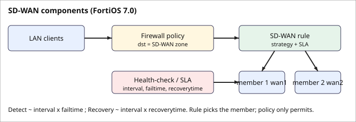

*شکل: اجزای SD-WAN و ارتباط Rule، Policy و Health-check.*

### ۵) مثال حل‌شده

**هدف:** VoIP روی لینک با Latency < 80 ms و Jitter < 20 ms؛ سایر ترافیک Load-balance.

``` text
config system sdwan
    set status enable
    config zone
        edit "virtual-wan-link"
        next
    end
    config members
        edit 1
            set interface "wan1"
            set gateway 198.51.100.1
        next
        edit 2
            set interface "wan2"
            set gateway 203.0.113.1
        next
    end
    config health-check
        edit "HC-DNS"
            set server "8.8.8.8"
            set protocol ping
            set interval 1000
            set failtime 5
            set recoverytime 10
            set members 1 2
            config sla
                edit 1
                    set latency-threshold 80
                    set jitter-threshold 20
                    set packetloss-threshold 2
                next
            end
        next
    end
    config service
        edit 1
            set name "VOIP"
            set mode sla
            set dst "all"
            set internet-service-app-ctrl 0
            config sla
                edit "HC-DNS"
                    set id 1
                next
            end
            set priority-members 1 2
        next
    end
end
```

(`internet-service-app-ctrl` در مثال بالا نمونه‌ی ساختاری است و باید با Application/Internet Service واقعی جایگزین یا حذف شود؛ سینتکس کامل `Unverified`.)

**GUI:** Network → SD-WAN → SD-WAN Zones/Members؛ Network → SD-WAN → Performance SLAs (Health-check)؛ SD-WAN Rules؛ Policy & Objects → Firewall Policy با Outgoing Interface = Zone. Static Route: مقصد 0.0.0.0/0 با Interface = SD-WAN Zone.

**مثال متوسط:** WAN1 Latency 150 ms شد: Health-check SLA را نقض می‌کند و Rule ترافیک VoIP را به WAN2 می‌برد، بقیه Load-balance؛ Log SLA: Latency.

**مثال سخت (Flap):** لینک ناپایدار هر ۳۰ ثانیه از SLA می‌افتد/برمی‌گردد. با failtime 2 و recoverytime 3 مسیر ۲۰ بار در دقیقه عوض می‌شود. راه‌حل: افزایش recoverytime (مثلاً 30)، افزودن Hysteresis در آستانه‌ی SLA (اجازه‌ی نوسان)، یا Manual برای VoIP.

### ۶) طراحی و تصمیم‌گیری

| سؤال | تصمیم |
|---|---|
| Server Health-check | مستقل از ISP، چند Server (قابل‌اتکا) |
| failtime | ≥ 2 (طبق مستند)؛ بالاتر برای لینک نویزی |
| recoverytime | بیشتر از failtime برای جلوگیری از Failback زودهنگام |
| استراتژی | SLA برای Real-time؛ load-balance برای حجم |
| Policy | روی Zone |
| Session | تصمیم درباره‌ی Clear هنگام Failover |

### ۷) Verification

``` text
diagnose sys sdwan health-check
diagnose sys sdwan member
diagnose sys sdwan service
diagnose sys session list
get router info routing-table all
```

(نام زیردستورها `Unverified`.) GUI: Network → SD-WAN → Performance SLAs (نمودار Latency/Jitter/Loss).

### ۸) Troubleshooting

| علامت | شاهد | علت |
|---|---|---|
| Member همیشه Dead | health-check | Server غیرقابل‌دسترس/Policy/Route Probe |
| Rule اثر ندارد | `diagnose sys sdwan service` | Match/Priority؛ Rule بعد از Default |
| Failover انجام شد ولی Session قفل | `session list` | Session قدیمی |
| Flap | Log SLA | failtime/recoverytime/آستانه |
| ترافیک از Interface فیزیکی می‌رود | Policy روی Interface | Policy روی Zone نیست |

### ۹) نکات امنیتی

- Health-check به سرور خارجی = ترافیک Local-out؛ Policy/Source را کنترل کنید.
- مسیر پشتیبان هم باید از Policy و Profile عبور کند.
- Failover می‌تواند ترافیک را از Inspection عبور ندهد اگر Policyها یکسان نباشند.

### ۱۰) جمع‌بندی مفهومی

- SD-WAN = Zone + Member + Health-check + Rule.
- Detect ≈ interval × failtime؛ Failback با recoverytime.
- Rule مسیر را انتخاب می‌کند؛ Policy اجازه می‌دهد؛ هر دو لازم‌اند.
- Sessionهای موجود با Failover تغییر مسیر نمی‌دهند.
- سینتکس 7.0 را با نسخه‌های جدید (۷.۴+) مخلوط نکنید.

### ۱۱) تمرین و ارزیابی

**ت1.** (ساده) Health-check برای چیست؟ *(پاسخ: 21-7-ت1)*

**ت2.** (ساده) Policy را روی کدام Interface می‌نویسیم؟ *(پاسخ: 21-7-ت2)*

**ت3.** (متوسط) Detect و Recovery با interval 500 ms، failtime 4، recoverytime 20 چقدر است؟ *(پاسخ: 21-7-ت3)*

**ت4.** (متوسط) فرق Lowest Cost (SLA) و Maximize Bandwidth؟ *(پاسخ: 21-7-ت4)*

**ت5.** (سخت) Flap لینک ناپایدار را با تنظیمات Health-check کاهش دهید. *(پاسخ: 21-7-ت5)*

**ت6.** (سخت، طراحی) برای VoIP، ERP و Backup استراتژی و SLA جداگانه طراحی کنید. *(پاسخ: 21-7-ت6)*

**م1.** چرا Server Health-check باید مستقل از ISP باشد؟ *(پاسخ: 21-7-م1)*

**Q1.** Quick quiz (English): What does recoverytime control? *(پاسخ: 21-7-Q1)*

### ۱۲) اصطلاحات و English Corner

| مخفف | شکل کامل | معنی |
|---|---|---|
| SD-WAN | Software-Defined WAN | WAN نرم‌افزاری |
| SLA | Service Level Agreement | آستانه‌ی کیفیت |
| Failback | Failback | بازگشت به مسیر اصلی |
| Jitter | Jitter | نوسان تأخیر |
| Overlay/Underlay | Overlay / Underlay | شبکه‌ی روی ISP / خود ISP |

- *Health checks decide when a member is alive and meeting its SLA.* ← Health-check تعیین می‌کند Member زنده است و SLA را رعایت می‌کند.
- *Write firewall policies on the SD-WAN zone, not on member interfaces.* ← Policy را روی Zone بنویسید نه Interface اعضا.

### ۱۳) منابع

- Fortinet Docs: [SD-WAN](https://docs.fortinet.com/document/fortigate/7.0.1/administration-guide/19246/sd-wan)، [Link health monitor](https://docs.fortinet.com/document/fortigate/7.0.1/administration-guide/580649/link-health-monitor)، [Maximize bandwidth (SLA) strategy](https://docs.fortinet.com/document/fortigate/7.0.1/administration-guide/708464/maximize-bandwidth-sla-strategy)، [config system sdwan](https://docs.fortinet.com/document/fortigate/7.0.1/cli-reference/94620/config-system-sdwan).

## پاسخ‌های فصل 21

> ابتدا بدون نگاه حل کنید. شناسه: درس-نوع+شماره (ت = تمرین، م = مرور).


### پاسخ‌های بازنویسی عمیق درس 21-1

**21-1-ت1** — Route ترجیحی.

Static با Priority/Distance بهتر Route ترجیحی است.

**21-1-ت2** — با Probe کشف قطع ISP و حذف Route.

Probe (Link-monitor/Health-check) قطع ISP را کشف و Route را حذف می‌کند.

**21-1-ت3** — تا خرابی Server با خرابی لینک اشتباه نشود.

چند Server پایش شود تا خرابی یک Server با خرابی لینک اشتباه نشود.

**21-1-ت4** — ≈ 5 ثانیه (به‌علاوه‌ی Convergence).

زمان تشخیص تقریباً failtime × interval ≈ ۵ ثانیه به‌علاوه‌ی Convergence.

**21-1-ت5** — خیر؛ SLA/Loss Threshold در SD-WAN.

خیر؛ در SD-WAN SLA/Loss Threshold برای کیفیت وجود دارد.

**21-1-ت6** — SLA، چند لینک، Overlay، گزارش کیفیت.

طرح: SLA، چند لینک، Overlay و گزارش کیفیت.

**21-1-Q1** — A degraded link with high loss or latency that still answers probes.

### پاسخ‌های بازنویسی درس 21-2

**21-2-ت1** — چون Interface عضو SD-WAN نباید مستقیم در Policy/Route/Object مرجع داشته باشد.

**21-2-ت2** — روی Zone SD-WAN.

Policy روی Zone SD-WAN نوشته می‌شود، نه Interface فیزیکی.

**21-2-ت3** — Server/Protocol Probe، ICMP توسط ISP بلاک؛ Route/Source Probe؛ شاهد Sniffer؛ رفع: dns/http Probe.

**21-2-ت4** — Backup، فهرست مرجع‌ها، ساخت Zone/Member، انتقال Policy/Route به Zone در Change Window، آزمون و Rollback.

**21-2-Q1** — On the SD-WAN zone interface.


### پاسخ‌های بازنویسی درس 21-3

**21-3-ت1** — بالا به پایین؛ اولین Rule مطابق.

SD-WAN Rule از بالا به پایین و اولین Rule مطابق اعمال می‌شود.

**21-3-ت2** — sla: اولین عضو دارای SLA؛ load-balance: توزیع بین همه‌ی اعضای دارای SLA.

Mode sla اولین عضو دارای SLA؛ load-balance توزیع بین همه‌ی اعضای دارای SLA.

**21-3-ت3** — Rule عمومی بالاتر Match می‌شود؛ ترتیب را اصلاح کنید.

Rule عمومی بالاتر Match می‌شود؛ ترتیب را اصلاح کنید.

**21-3-ت4** — VoIP: sla با Latency<80/Jitter<20؛ ERP: sla با ترجیح لینک پایدار؛ Backup: load-balance.

**21-3-Q1** — Traffic is handled by the implicit rule, which load-balances across members.


### پاسخ‌های بازنویسی عمیق درس 21-4

**21-4-ت1** — Session با SNAT/Interface قدیمی ادامه نمی‌یابد.

با Failover، Session با SNAT/Interface قدیمی ادامه نمی‌یابد؛ باید Session پاک یا Pickup شود.

**21-4-ت2** — `filter dev/src/dst` سپس `clear`.

`diagnose sys session filter dev/src/dst` سپس `clear` برای پاک‌سازی انتخابی.

**21-4-ت3** — تا بازگشت زودهنگام به لینک ناپایدار رخ ندهد.

recoverytime/Hold برای جلوگیری از بازگشت زودهنگام به لینک ناپایدار.

**21-4-ت4** — Rule روی ISP ثابت، IP Pool/BGP، هماهنگی Partner.

Rule روی ISP ثابت، IP Pool/BGP و هماهنگی Partner برای IP مبدأ.

**21-4-ت5** — قطع/Session/بازگشت/Partner با اندازه‌گیری.

Evidence Failover: قطع، Session، بازگشت و Partner با اندازه‌گیری.

**21-4-ت6** — Dual-ISP SD-WAN HA با Rule/SLA و Clear.

طرح Dual-ISP SD-WAN HA با Rule/SLA و Clear.

**21-4-Q1** — The outgoing source IP changes to the other ISP address.


### پاسخ‌های بازنویسی عمیق درس 21-5


### پاسخ‌های بازنویسی عمیق درس 21-5

**21-5-ت1** — Gateway ممکن است زنده باشد ولی ISP قطع؛ باید مقصد خارجی را پایش کرد.

**21-5-ت2** — تعداد شکست پشت‌سرهم برای Dead و تعداد موفقیت برای بازگشت (Alive).

**21-5-ت3** — حدود ۵ ثانیه (۵ × ۱ ثانیه) به‌علاوه‌ی چند صد میلی‌ثانیه.

**21-5-ت4** — Rule و انتخاب Member فقط برای ترافیک وارد Zone SD-WAN اعمال می‌شود.

**21-5-ت5** — recoverytime کوتاه؛ افزایش و Health-check دو-Server؛ آزمون ۳ قطع/وصل.

**21-5-ت6** — Mode SLA با Latency و Health-check؛ Default priority؛ آزمون اندازه‌گیری Latency.

**21-5-Q1** — Because SD-WAN rules only apply to traffic that goes to the SD-WAN zone.

### پاسخ‌های درس افزوده‌ی 21-7 (فصل 21)

**21-7-ت1** — سنجش کیفیت لینک (Latency/Jitter/Loss) و تشخیص Dead.

Performance SLA سنجش کیفیت لینک (Latency/Jitter/Loss) و تشخیص Dead است.

**21-7-ت2** — روی Zone SD-WAN.

Rule SD-WAN روی ترافیک Zone SD-WAN اعمال می‌شود.

**21-7-ت3** — Detect = 500 ms × 4 = 2 s؛ Recovery = 500 ms × 20 = 10 s.

Detect = 500 ms × 4 = 2 s؛ Recovery = 500 ms × 20 = 10 s.

``` text
Detect = 500 ms x 4 = 2 s ; Recovery = 500 ms x 20 = 10 s
```

**21-7-ت4** — Lowest Cost (SLA): اولین عضو دارای SLA؛ Maximize Bandwidth: توزیع بین همه‌ی اعضای دارای SLA.

**21-7-ت5** — افزایش recoverytime، افزودن Hysteresis در آستانه‌ها، failtime متناسب، Probe چندگانه، Manual برای ترافیک حساس.

**21-7-ت6** — VoIP: SLA با Latency/Jitter کم؛ ERP: Best Quality؛ Backup: Lowest Cost یا Load-balance با SLA آسان.

**21-7-م1** — تا خرابی ISP با خرابی خود Probe اشتباه گرفته نشود؛ مستقل بودن نتیجه‌ی قابل‌اتکا می‌دهد.

**21-7-Q1** — The number of consecutive successful probes required before a link is considered alive again (failback behavior).

# پایان بخش ۷ (فصل‌های ۱۹ تا ۲۱)

## ۱) خلاصه‌ی مهارت‌های کسب‌شده
- Hub-and-Spoke با OSPF/BGP؛ SSL VPN/Dial-up؛ Dual-ISP، SD-WAN Rule/SLA.

## ۲) آزمون پایان سه فصل
**س1** — چرا Selector 0.0.0.0/0 برای پویا؟

**س2** — network-type OSPF روی Tunnel؟

**س3** — iBGP یا eBGP؟

**س4** — Local Breakout؟

**س5** — ADVPN وضعیت؟

**س6** — چرا SSL VPN ایزوله؟

**س7** — Split Tunnel؟

**س8** — MFA چرا؟

**س9** — Link Monitor؟

**س10** — SD-WAN Zone؟

**س11** — SLA Strategy؟

**س12** — Session پس از Failover؟


## ۳) پاسخ آزمون
- **س1:** تا Routing از Tunnel عبور کند.
- **س2:** point-to-point.
- **س3:** iBGP همان AS؛ eBGP AS متفاوت.
- **س4:** خروج محلی به اینترنت.
- **س5:** Unverified.
- **س6:** CVEهای 7.0.x.
- **س7:** فقط ترافیک سازمانی.
- **س8:** لایه‌ی دوم.
- **س9:** تشخیص قطع ISP.
- **س10:** گروه منطقی Memberها.
- **س11:** انتخاب بر اساس کیفیت.
- **س12:** می‌ماند مگر Clear.

## ۴) معیارهای تسلط
| مهارت | سطح | شاهد |
|---|---|---|
| Hub-and-Spoke | L3 | آزمون فصل ۱۹ |
| Remote Access | L2 | آزمون فصل ۲۰ |
| SD-WAN | L3 | G8 |

## ۵) مشکلات و موارد باقی‌مانده (صریح)
1. Labها اجرا نشده. 2. SD-WAN/ADVPN/sslvpn سینتکس Unverified. 3. SSL VPN فقط ایزوله.

## ۶) پیش‌نیازهای بخش بعد
Dual-ISP پایدار؛ آشنایی با HA؛ لایسنس HA بررسی.

## ۷) فهرست Lab و منابع مرتبط
کارت‌های Lab، `03-ops/*`

## ۸) وضعیت دوره
| مورد | مقدار |
|---|---|
| آخرین فصل تکمیل‌شده | ۲۱ |
| آخرین درس تکمیل‌شده | ۲۱-۶ |
| مهارت‌های تأییدشده | **هیچ‌کدام هنوز آزمون عملی واقعی نشده‌اند** (ممیزی/اجرای شما لازم است) |
| موضوعات نیازمند مرور | طبق «معیارهای تسلط» |
| فصل بعدی | ۲۲ |
| فایل تولیدشده | `course/Course_Part_07_Chapters_19-21.md` |


---

# Enterprise Network & Security Engineering — دوره‌ی تخصصی Cisco و Enterprise Firewall
## بخش ۸ از ۱۱ — فصل‌های ۲۲ تا ۲۴

| مورد | مقدار |
|---|---|
| نام دوره | Enterprise Network & Security Engineering (Cisco + FortiGate) |
| شماره بخش | ۸ از ۱۱ |
| فصل‌های این فایل | ۲۲ ، ۲۳ ، ۲۴ |
| تاریخ تولید | ۲۰۲۶-۱۱-۲۶ |
| نسخه Blueprint | v3.0 (+ بازبینی ۱٫۱) |
| نسخه‌های نرم‌افزار | FortiOS 7.0.3 (اسمی؛ بوت‌نشده؛ تأیید با `get system status`) ؛ Cisco vIOS-L2 15.2(20200924، Experimental) ؛ Cisco vIOS 15.9(3)M9 ؛ VPCS ؛ PNetLab 4.2.8 ؛ ESXi 8.0U2 ؛ CSR1000v 17.03.02 (IOS-XE؛ آزمایش‌نشده) |
| وضعیت تکمیل | **فصل‌های ۲۲–۲۴ تولید شد؛ HA، Multi-Firewall/Asymmetric، Data Center.** Labها «اجرا نشده»؛ HA/VDOM به لایسنس وابسته؛ دستورها آزمایش‌نشده. |

> **قوانین خواندن:** تمرین‌ها و پرسش‌های مرور بدون پاسخ‌اند؛ پاسخ در «پاسخ‌های فصل». «اجرا نشده» یعنی خروجی‌ها **پیش‌نیاز/پیش‌بینی** هستند. «CLI-Accepted» ≠ «کار می‌کند». رمزها نمونه‌اند.

### وضعیت راستی‌آزمایی Labهای این بخش
خلاصه: اجرا نشده (فقط طراحی): 13.

| Lab | وضعیت |
|---|---|
| 22-1 | اجرا نشده (فقط طراحی) |
| 22-2 | اجرا نشده (فقط طراحی) |
| 22-3 | اجرا نشده (فقط طراحی) |
| 22-4 | اجرا نشده (فقط طراحی) |
| 22-5 | اجرا نشده (فقط طراحی) |
| 23-1 | اجرا نشده (فقط طراحی) |
| 23-2 | اجرا نشده (فقط طراحی) |
| 23-3 | اجرا نشده (فقط طراحی) |
| 23-4 | اجرا نشده (فقط طراحی) |
| 24-1 | اجرا نشده (فقط طراحی) |
| 24-2 | اجرا نشده (فقط طراحی) |
| 24-3 | اجرا نشده (فقط طراحی) |
| 24-4 | اجرا نشده (فقط طراحی) |

---

<a id="ch22"></a>

> **نسخه‌ی اصلاح‌شده (v3.9):** نسخه‌ی توسعه‌یافته‌ی فایل اصلی؛ درس‌های افزوده: ۲۲-۰، ۲۴-۰ (دسته C). فایل اصلی در `course/` حفظ شده است. پاسخ‌های درس‌های افزوده در «پاسخ‌های فصل» همان فصل است.

# فصل 22 — High Availability: FGCP، Session Sync و Failover

**مدت:** ۳۶ ساعت | **پیش‌نیاز:** فصل ۱۳، ۲۱.
**اهداف:** مفهوم HA (Active-Passive، Active-Active)؛ FGCP؛ Heartbeat؛ Priority و Override؛ Session Sync؛ Monitor Interface؛ تست Failover.
**هشدار لایسنس:** HA در VM به لایسنس مناسب نیاز دارد (`Needs-License`) و در Evaluation ممکن است محدود باشد؛ همه‌ی دستورها `Unverified`.
**اشتباهات رایج:** Heartbeat روی همان لینک داده؛ Priority/Override نادرست؛ ناهمسانی Firmware؛ نبود Monitor Interface.

**درس‌های فصل:**
- [درس 22-1 — مفاهیم HA و FGCP](#l-22-1)
- [درس 22-2 — پیکربندی HA Active-Passive](#l-22-2)
- [درس 22-3 — تست Failover و Session Sync](#l-22-3)
- [درس 22-4 — عیب‌یابی HA و Upgrade](#l-22-4)
- [درس 22-5 — آزمون فصل ۲۲](#l-22-5)

---

<a id="l-22-1"></a>

## درس 22-0 — HA در FortiGate (FGCP): Election، Heartbeat، Sync، Failover/Failback و Split-brain

**فصل ۲۲ · درس افزوده (پیش‌درس ۲۲-۱) · پیش‌نیاز: ۱۱-۷، ۱۳-۷، ۵-۷ · ≈ ۱۰ ساعت**

> **وضعیت (FortiOS 7.0.3):** مفاهیم FGCP، Split-brain و Session Pickup از مستند رسمی بررسی شد ([FGCP 7.0.3](https://docs.fortinet.com/document/fortigate/7.0.3/administration-guide/62403/fgcp)، [Troubleshoot an HA formation](https://docs.fortinet.com/document/fortigate/7.4.0/administration-guide/946059/troubleshoot-an-ha-formation)، [Session pickup](https://docs.fortinet.com/document/fortigate/7.6.0/administration-guide/955521/session-pickup)). **دقت نسخه:** بعضی ویژگی‌ها مثل `backup-hbdev` در 7.6 معرفی شده و در 7.0.3 نیست. **Needs-License/محدودیت:** HA روی VM به لایسنس مناسب و دو VM با لایسنس معتبر نیاز دارد؛ در Lab Evaluation ممکن است محدود باشد. Lab «اجرا نشده».

### ۱) هدف آموزشی

دانشجو در پایان می‌تواند:

1. تفاوت **Active-Passive** و **Active-Active** را بگوید و بداند چرا Active-Passive رایج‌تر است.
2. توضیح دهد **FGCP** چگونه عضو Primary را انتخاب می‌کند (Election) و چه چیزی هم‌گام می‌شود.
3. **Heartbeat** را درست طراحی کند (اختصاصی، Redundant) و **Split-brain** را تحلیل و پیشگیری کند.
4. **Configuration Sync** و **Session Pickup/Sync** را تفکیک و اثر هرکدام را در Failover بگوید.
5. **Interface Monitoring**، Link Failure و Device Failure را تحلیل کند.
6. **Failover/Failback** و `override` را با پیامدشان بشناسد.
7. محدودیت‌ها و وابستگی‌های نسخه/لایسنس را اعلام کند.

### ۲) پیش‌نیازها

Session/Stateful (۱۱-۷، ۱۳-۷)، Convergence (۵-۷)، Interface/VLAN FortiGate (فصل ۱۲)، ARP/MAC (فصل ۲، ۳).

### ۳) مفهوم پایه

فایروال لبه نقطه‌ی شکست واحد (SPOF) است. **HA** دو (یا بیشتر) دستگاه را در یک **Cluster** قرار می‌دهد تا با خرابی یکی، دیگری ترافیک را ادامه دهد. هدف فقط «یک Cluster ساختن» نیست؛ هدف **پیش‌بینی رفتار سیستم در انواع خرابی** است: خرابی لینک، خرابی دستگاه، قطع Heartbeat، خرابی نیمه‌کاره.

### ۴) توضیح عمیق فنی

#### ۴-۱) FGCP

**FortiGate Clustering Protocol (FGCP)** پروتکل اختصاصی Fortinet برای HA است. اعضا از طریق **Heartbeat** Interfaceها با هم صحبت می‌کنند. طبق مستند، هم‌گام‌سازی روی لینک Heartbeat با TCP/703 و UDP/703 انجام می‌شود. Cluster با **Group Name، Group ID/Password و Mode** هم‌هویت می‌شود.

| Mode | رفتار |
|---|---|
| Active-Passive (a-p) | یک Primary ترافیک می‌برد؛ Secondary آماده است |
| Active-Active (a-a) | Primary بار Inspection (UTM) را بین اعضا پخش می‌کند؛ ترافیک همچنان از Primary ورودی/خروجی می‌شود؛ پیچیده‌تر |

(Active-Active در FGCP «توزیع بار Session/UTM» است، نه ECMP واقعی؛ جزئیات مستند.)

#### ۴-۲) Election (انتخاب Primary)

به‌طور خلاصه (ترتیب دقیق و Age-difference را از مستند همان نسخه بخوانید؛ `Unverified` در جزئیات):

``` text
Default (override disabled):
 1. more monitored interfaces up
 2. longer HA uptime (age)
 3. higher priority
 4. higher serial number
With override enabled: monitored interfaces -> priority -> uptime -> serial
```

نتیجه: با `override disable` عضوی که بیشتر زنده بوده Primary می‌ماند و بعد از بازگشت دستگاه اصلی، **Failback خودکار رخ نمی‌دهد**؛ با `override enable` دستگاه با Priority بالاتر پس از بازگشت Primary می‌شود (Failback) ولی ممکن است باعث قطع کوتاه و Flap شود.

#### ۴-۳) Heartbeat

- Interfaceهای اختصاصی (`hbdev`) با Priority؛ حداقل دو لینک Redundant ترجیحاً مستقیم (Back-to-back).
- ترافیک Heartbeat شامل Hello و Sync (Config، Session). مستند توصیه می‌کند برای کاهش Split-brain: لینک Heartbeat Redundant، مستقیم، و برای سایت‌های دور زمان Lost Interval بیشتر.
- **Heartbeat را روی همان لینک داده/سوئیچ مشترک خراب نگذارید.**

#### ۴-۴) Split-brain

اگر اعضا Heartbeat را از دست بدهند ولی هر دو زنده باشند، **هر دو خود را Primary می‌پندارند**: آدرس IP/MAC تکراری، Sessionهای متناقض، قطعی شدید. طبق مستند علت‌ها: قطع/ناپایداری Heartbeat؛ راه‌های پیشگیری: لینک Back-to-back، Heartbeat Redundant، Lost Interval مناسب. (`backup-hbdev` در 7.6 اضافه شده و در 7.0.3 موجود نیست.) پس از رفع، یک عضو باید دوباره Join شود و Config Sync انجام شود؛ بررسی Config واگرا لازم است.

#### ۴-۵) Sync: Configuration و Session

- **Configuration Sync:** Primary پیکربندی را به Secondary می‌فرستد (به‌جز تنظیمات اختصاصی هر دستگاه مثل Hostname/HA priority). بررسی: `diagnose sys ha checksum cluster`.
- **Session Sync/Pickup:** طبق مستند Session Pickup جدول Session **TCP** را به Secondary هم‌گام می‌کند؛ UDP و ICMP تنظیم جداگانه‌ای دارند و پیش‌نیازشان فعال بودن Pickup TCP است. بدون Pickup، با Failover همه‌ی Sessionها قطع می‌شوند و کلاینت‌ها باید Session بسازند. با Pickup اغلب Sessionهای TCP ادامه می‌یابند. هزینه: پهنای Heartbeat و CPU.
- VPN/IPsec SA و بعضی State‌ها همگام نمی‌شوند یا بسته به نسخه متفاوت‌اند؛ پس از Failover IPsec ممکن است Rekey/Renegotiate کند (`Unverified`).

#### ۴-۶) Monitoring و انواع خرابی

| خرابی | تشخیص | رفتار |
|---|---|---|
| Link failure (Interface مانیتورشده) | Monitor Interface | تعداد Interface سالم کم می‌شود ← Failover |
| Device failure | قطع Heartbeat | Secondary Primary می‌شود |
| Heartbeat failure با دو دستگاه زنده | Split-brain | خطرناک |
| خرابی نرم‌افزار/CPU | Heartbeat/Process | Failover یا Cluster ناپایدار |
| خرابی ISP | Interface Up ولی لینک مرده | HA این را نمی‌بیند؛ نیاز Health-check/SD-WAN (۲۱-۷) |

> **درس مهم:** HA خرابی «فایروال» را پوشش می‌دهد، نه خرابی «سرویس ISP». این‌ها را با SD-WAN/Link Monitor مکمل کنید.

#### ۴-۷) Failover time

Failover معمولاً چند ثانیه (Detect + Election + ARP/MAC Update): بعد از Failover Primary جدید **Gratuitous ARP** می‌فرستد و MAC مجازی Cluster به Primary جدید منتقل می‌شود تا سوئیچ‌ها یاد بگیرند. نتیجه: چند ثانیه قطعی؛ Sessionها فقط با Pickup می‌مانند.


*شکل: HA، Heartbeat، Election و Split-brain.*

### ۵) مثال حل‌شده

**هدف:** Active-Passive با Heartbeat روی port3 و port4، Monitor روی port1 و port2.

``` text
config system ha
    set group-name "FGT-HA-LAB"
    set mode a-p
    set password <HA-PASSWORD>
    set hbdev "port3" 100 "port4" 50
    set monitor "port1" "port2"
    set priority 200
    set session-pickup enable
    set override disable
end
```

دستگاه دوم: همان `group-name/password/mode/hbdev`، `priority 100`.

**GUI:** System → HA → Mode: Active-Passive؛ Device Priority؛ Cluster Settings (Group Name، Password)؛ Heartbeat Interfaces (انتخاب و Priority)؛ Monitor Interfaces؛ Session Pickup.

**Verification:**

``` text
get system ha status
diagnose sys ha status
diagnose sys ha checksum cluster
diagnose sys ha history read
```

(`Unverified`.)

**مثال متوسط:** Failover آزمایشی: `execute ha manage` یا Shutdown Interface مانیتورشده؛ ping پیوسته از کلاینت؛ ثبت تعداد بسته‌های از دست‌رفته و زمان.

**مثال سخت (Split-brain):** کابل Heartbeat کشیده می‌شود و لینک داده‌ها سالم‌اند: دو Primary. شواهد: `get system ha status` در هر دستگاه خود را Primary نشان می‌دهد؛ ARP جدول سوئیچ دو MAC برای یک IP. راه‌حل فوری: اتصال دوباره‌ی Heartbeat و تعیین کدام عضو Primary بماند (ریست دیگری)، سپس بررسی Config Checksum. پیشگیری: Heartbeat Redundant و Back-to-back.

### ۶) طراحی و تصمیم‌گیری

| سؤال | تصمیم |
|---|---|
| a-p یا a-a؟ | a-p (سادگی)؛ a-a برای بار UTM زیاد |
| Heartbeat | ۲ لینک مجزا، مستقیم |
| `override` | خاموش (پایداری)؛ روشن فقط اگر Failback مطلوب و Flap کنترل شود |
| Session Pickup | روشن برای سرویس‌های حساس به قطع؛ هزینه‌اش را بسنجید |
| Monitor Interface | همه‌ی Interfaceهای حیاتی؛ نه Interface مدیریت |
| Firmware | یکسان؛ ارتقا طبق روال |
| لایسنس | هر دو دستگاه لایسنس معتبر |

### ۷) Troubleshooting

| علامت | شاهد | علت |
|---|---|---|
| Cluster Form نمی‌شود | Group/Password/Mode، لینک HB | ناهمسانی |
| Secondary Out-of-sync | `ha checksum cluster` | Config/Firmware |
| Failover بدون دلیل | `ha history` | Monitor/HB flap |
| دو Primary | `ha status` | Split-brain |
| Session قطع می‌شود | Pickup خاموش | فعال‌سازی/محدودیت UDP |
| بعد از Failover VPN قطع | IKE Log | Renegotiate |

### ۸) نکات امنیتی

- HA Password قوی؛ لینک HB را از شبکه‌ی کاربران جدا نگه دارید.
- Heartbeat روی سوئیچ مشترک قابل جعل/اختلال است؛ ترجیحاً مستقیم.
- نسخه‌ی 7.0.3 دارای CVE؛ HA آسیب‌پذیری را حل نمی‌کند.

### ۹) جمع‌بندی مفهومی

- FGCP: Heartbeat + Sync (Config، Session) + Election.
- Election: Monitor ← Age ← Priority ← Serial (با Override: Priority جلوتر).
- Split-brain از قطع HB با دستگاه‌های زنده؛ با HB Redundant/مستقیم پیشگیری می‌شود.
- Session Pickup TCP را حفظ می‌کند؛ UDP/ICMP جدا.
- HA ≠ حفاظت از خرابی ISP.

### ۱۰) تمرین و ارزیابی

**ت1.** (ساده) Active-Passive و Active-Active را مقایسه کنید. *(پاسخ: 22-0-ت1)*

**ت2.** (ساده) Split-brain یعنی چه؟ *(پاسخ: 22-0-ت2)*

**ت3.** (متوسط) با `override disable` پس از بازگشت Primary اصلی چه می‌شود؟ *(پاسخ: 22-0-ت3)*

**ت4.** (متوسط) چرا Heartbeat Redundant لازم است؟ *(پاسخ: 22-0-ت4)*

**ت5.** (سخت) پس از Failover کاربران باید Session TCP را دوباره بسازند؛ علت و راه‌حل؟ *(پاسخ: 22-0-ت5)*

**ت6.** (سخت، طراحی) برای سایت مرکزی با دو ISP و دو FGT، HA و SD-WAN را کنار هم طراحی و نقش هرکدام را بنویسید. *(پاسخ: 22-0-ت6)*

**م1.** `diagnose sys ha checksum cluster` برای چیست؟ *(پاسخ: 22-0-م1)*

**Q1.** Quick quiz (English): What causes a split-brain scenario in an HA cluster? *(پاسخ: 22-0-Q1)*

### ۱۱) اصطلاحات و English Corner

| مخفف | شکل کامل | معنی |
|---|---|---|
| HA | High Availability | دسترس‌پذیری بالا |
| FGCP | FortiGate Clustering Protocol | پروتکل Cluster |
| HB | Heartbeat | نبض Cluster |
| SPOF | Single Point of Failure | نقطه‌ی شکست واحد |
| GARP | Gratuitous ARP | ARP اعلام‌کننده |
| Pickup | Session pickup | حفظ Session |

- *Split-brain happens when cluster members lose heartbeat and each assumes the primary role.* ← Split-brain وقتی رخ می‌دهد که اعضا Heartbeat را از دست بدهند و هر دو نقش Primary را فرض کنند.
- *HA protects against device failure, not against upstream ISP failure.* ← HA از خرابی دستگاه محافظت می‌کند، نه از خرابی ISP بالادست.

### ۱۲) منابع

- Fortinet Docs: [FGCP](https://docs.fortinet.com/document/fortigate/7.0.3/administration-guide/62403/fgcp)، [Troubleshoot an HA formation](https://docs.fortinet.com/document/fortigate/7.4.0/administration-guide/946059/troubleshoot-an-ha-formation)، [Session pickup (7.6)](https://docs.fortinet.com/document/fortigate/7.6.0/administration-guide/955521/session-pickup) (برای مفهوم؛ تفاوت نسخه را بررسی کنید).

## درس 22-1 — مفاهیم HA برای طراحی: SPOF، سطوح افزونگی، انتخاب مدل و تحلیل خرابی‌ها

**فصل 22 · بازنویسی عمیق · پیش‌نیاز: ۲۲-۰، ۱۱-۷، ۵-۷ · ≈ 8 ساعت**

> **وضعیت:** FortiOS 7.0.3 (بوت‌نشده)؛ HA/VDOM Needs-License؛ دستورها `Unverified` مگر با لینک؛ Lab «اجرا نشده».

### ۱) هدف آموزشی

در پایان این درس باید بتوانید:

1. SPOF را در توپولوژی تشخیص دهد و ماتریس خرابی بسازد.
2. HA، Redundancy، Load-balancing و DR را تفکیک کند.
3. A-P و A-A و Session Pickup را برای نیاز مشخص انتخاب کند.
4. هزینه/ریسک/محدودیت (لایسنس، Split-brain، Firmware) را بسنجد.
5. دسترس‌پذیری را محاسبه کند (۹۹٫۹ و ...).

### ۲) مفهوم پایه: چیست و چرا؟

HA یعنی «طراحی برای خرابی»، نه «دو دستگاه». باید بدانید HA چه خرابی‌هایی را پوشش می‌دهد و کدام را نه؛ و هزینه‌ی افزونگی چیست.

### ۳) توضیح عمیق فنی

#### ۱) ماتریس خرابی

| خرابی | HA فایروال پوشش می‌دهد؟ | راه مکمل |
|---|---|---|
| دستگاه/برق | بله | — |
| لینک Interface | بله (Monitor) | LAG |
| ISP/لینک بالادست | خیر | Dual-ISP/SD-WAN |
| Config اشتباه | خیر (Sync می‌شود) | Change/Canary |
| CVE مشترک | خیر | Patch/تنوع |
| سایت | خیر | DR |

#### ۲) دسترس‌پذیری

``` text
Availability = MTBF / (MTBF + MTTR)
Serial (both needed): A = A1 x A2        Parallel (either): A = 1 - (1-A1)(1-A2)
Example: single device 99.5%  -> HA pair parallel = 1 - 0.005^2 = 99.9975%
Downtime/year at 99.9% = 8.76 h ; at 99.99% = 52.6 min
```

#### ۳) انتخاب مدل

| نیاز | پاسخ |
|---|---|
| قطع کوتاه قابل‌قبول | A-P |
| تداوم Session | A-P + Session Pickup |
| بار UTM زیاد | A-A (محدودیت) |
| سایت دوم | DR/Multi-site |

#### ۴) هزینه/ریسک

لایسنس دو دستگاه، پیچیدگی، آزمون دوره‌ای، Firmware یکسان، Split-brain، ارتقای کنترل‌شده.

### ۴) طراحی و تصمیم‌گیری

| سؤال طراحی | گزینه‌ها و معیار انتخاب |
|---|---|
| A-P/A-A | a-p مگر نیاز بار |
| Pickup | حساس |
| DR | سایت |

### ۵) مثال‌های حل‌شده (ساده، متوسط، سخت)

**ساده (حل‌شده):** ماتریس SPOF برای ISP، فایروال، سوئیچ، برق؛ اولویت.

**متوسط (محاسبه):** دستگاه تکی 99.5٪؛ جفت HA ⇒ 1−0.005²=99.9975٪؛ Downtime سالانه ≈ ۲۲ دقیقه؛ ولی با ISP تکی 99.9٪ ⇒ سقف کل 99.9٪ (حلقه ضعیف).

**سخت (قضاوت):** مدیر: «HA داریم پس قطع نداریم». چهار خرابی خارج از پوشش: ISP، Config خراب Sync‌شده، CVE مشترک/ارتقای هم‌زمان، قطع Heartbeat (Split-brain). طرح: Dual-ISP/SD-WAN، Change Canary، Patch مرحله‌ای، HB Redundant.

### ۸) Verification (اثبات صحت)

- ماتریس خرابی امضا‌شده.

### ۹) Troubleshooting

| علامت | شاهد برای بررسی | علت محتمل و رفع |
|---|---|---|
| Config خراب | HA status | Change/Rollback |

### ۱۰) نکات امنیتی

- HA آسیب‌پذیری را حل نمی‌کند.

### ۱۱) جمع‌بندی مفهومی

- HA طراحی برای خرابی؛ حلقه‌ی ضعیف سقف را تعیین می‌کند.

### ۱۲) تمرین و ارزیابی

**ت1.** (ساده) SPOF چیست؟ *(پاسخ: 22-1-ت1)*

**ت2.** (ساده) HA ISP را پوشش می‌دهد؟ *(پاسخ: 22-1-ت2)*

**ت3.** (متوسط) دستگاه 99.5٪ و جفت HA موازی؛ دسترس‌پذیری؟ *(پاسخ: 22-1-ت3)*

**ت4.** (متوسط) چرا حلقه‌ی ضعیف سقف را تعیین می‌کند؟ *(پاسخ: 22-1-ت4)*

**ت5.** (سخت) چهار خرابی خارج از HA. *(پاسخ: 22-1-ت5)*

**ت6.** (سخت، طراحی) ماتریس خرابی برای سایت مرکزی. *(پاسخ: 22-1-ت6)*

**Q1.** Quick quiz (English): Why does the weakest component limit overall availability in a serial chain? *(پاسخ: 22-1-Q1)*

### ۱۳) اصطلاحات و English Corner

| مخفف | شکل کامل | معنی |
|---|---|---|
| SPOF | Single point of failure | نقطه‌ی شکست واحد |
| MTBF | Mean time between failures | میانگین فاصله‌ی خرابی |
| DR | Disaster recovery | بازیابی از فاجعه |

- *HA is not a substitute for change control.* ← HA جایگزین کنترل تغییر نیست.

### ۱۴) کارت Lab

**کارت Lab:** نقشه HA. **Evidence:** `02-design/ha-map.md`.

### ۱۵) منابع

- [FGCP](https://docs.fortinet.com/document/fortigate/7.0.3/administration-guide/62403/fgcp)
- NIST SP 800-34

<a id="l-22-2"></a>

## درس 22-2 — پیکربندی HA Active-Passive: برگه‌ی طراحی، GUI، CLI، Heartbeat، Monitor و Verification

**فصل 22 · بازنویسی عمیق · پیش‌نیاز: ۲۲-۰، ۲۲-۱، ۱۲-۲ · ≈ 11 ساعت**

> **وضعیت:** FortiOS 7.0.3 نامی (بوت‌نشده)؛ دستورها طبق مستندات 7.0 ولی `Unverified` تا اجرای Lab؛ Lab «اجرا نشده»؛ HA/VDOM وابسته به مدل/لایسنس (Needs-License).

### ۱) هدف آموزشی

در پایان این درس باید بتوانید:

1. پیش‌نیازهای HA (هم‌مدل، هم‌نسخه، هم‌لایسنس، پورت‌ها) را بررسی کند.
2. برگه‌ی طراحی (Group، Mode، Priority، hbdev، monitor، session-pickup) را بنویسد.
3. HA را از GUI و CLI روی دو دستگاه پیکربندی کند.
4. وضعیت Cluster و Sync را با دستورهای Verification تأیید کند.
5. Management Interface اختصاصی (ha-mgmt) را تنظیم کند.
6. خطاهای رایج (Mismatch، Out-of-sync، Heartbeat) را عیب‌یابی کند.

### ۲) مفهوم پایه: چیست و چرا؟

یک فایروال تنها نقطه‌ی شکست است: اگر بسوزد، سازمان از اینترنت جدا می‌شود. HA دو فایروال را طوری به هم می‌بندد که یکی فعال و دیگری آماده باشد. اگر فعال بیفتد، دومی ظرف چند ثانیه جای آن را می‌گیرد و کاربر شاید فقط یک بار «رفرش» کند.

اما HA تنها زمانی کار می‌کند که پیکربندی دقیق باشد: دو دستگاه باید یکسان باشند، Heartbeat جدا و قابل‌اعتماد باشد و Monitor درست انتخاب شود. در این درس هر پارامتر را با دلیلش می‌نویسید. توجه: FGCP نیازمند مدل/لایسنس مناسب است؛ در Lab مجازی بدون لایسنس معتبر ممکن است ناممکن باشد (Needs-License).

### ۳) توضیح عمیق فنی

#### ۱) پیش‌نیازها

| مورد | الزام |
|---|---|
| مدل | یکسان |
| FortiOS | یکسان (مثلاً 7.0.3 Build یکسان) |
| لایسنس | معتبر روی هر دو (نرم‌افزار/سرویس) |
| پورت‌ها | Heartbeat اختصاصی، Monitor Interfaceها همنام |
| دیسک/RAM | یکسان |

#### ۲) برگه‌ی طراحی

| پارامتر | مقدار | دلیل |
|---|---|---|
| Mode | Active-Passive | ساده و قابل‌پیش‌بینی |
| Group name | FGT-HA | یکسان در هر دو |
| Password | از Vault | احراز اعضا |
| hbdev | port3 (50)، port4 (100) | دو لینک مستقل |
| Priority | A=200، B=100 | A ترجیحاً Primary |
| override | disable | جلوگیری از Flap |
| session-pickup | enable | ماندگاری TCP |
| monitor | port1 port2 | Failover با خرابی لینک |

#### ۳) CLI

``` text
config system ha
 set group-name "FGT-HA"
 set mode a-p
 set password <FROM-VAULT>
 set hbdev "port3" 50 "port4" 100
 set priority 200
 set session-pickup enable
 set monitor "port1" "port2"
 set override disable
 set ha-mgmt-status enable
 config ha-mgmt-interfaces
  edit 1
   set interface "mgmt"
   set gateway 10.99.0.1
  next
 end
end
```

روی دستگاه B همان پارامترها با priority 100. پس از Apply، اعضا شرکت می‌کنند و Config از Primary به Secondary همگام می‌شود (Hostname و ha-mgmt مستثنی). پارامترها `Unverified`.

#### ۴) GUI

System → HA: Mode = Active-Passive، Device Priority، Group Name، Password، Heartbeat Interfaces و Monitor Interfaces را تنظیم کنید.

#### ۵) Verification

``` text
get system ha status
diagnose sys ha status
diagnose sys ha checksum cluster
diagnose sys ha checksum show
execute ha manage 1 admin
```

انتظار: دو عضو، Primary=A، checksumها یکسان.

#### ۶) خطاهای رایج

| علامت | علت |
|---|---|
| عضو دوم Join نمی‌شود | Mismatch نسخه/Group/Password/لایسنس |
| Out-of-sync | تفاوت Config/HB ضعیف |
| Flap | override enable یا Monitor ناپایدار |

### ۴) طراحی و تصمیم‌گیری

| سؤال طراحی | گزینه‌ها و معیار انتخاب |
|---|---|
| Heartbeat | دو لینک |
| override | disable |
| Mgmt | ha-mgmt جدا |

### ۵) مثال‌های حل‌شده (ساده، متوسط، سخت)

**ساده (حل‌شده):** پس از پیکربندی دو دستگاه `get system ha status` نشان می‌دهد دو عضو، Primary=A. checksum یکسان؛ پس Cluster سالم.

**متوسط (Mismatch):** B Join نمی‌شود. مراحل: ۱) `get system status` نسخه‌ی B 7.0.2 و A 7.0.3. ۲) هم‌نسخه‌سازی. ۳) Join. پاسخ: نسخه‌ی یکسان لازم است.

**سخت (Out-of-sync):** `diagnose sys ha checksum cluster` تفاوت در بخش Policy. مراحل: ۱) `diagnose sys ha checksum show` بخش متفاوت. ۲) Primary را مرجع کنید؛ در B `execute ha synchronize start`(Unverified) یا Reboot. ۳) Verify. علت: تغییر مستقیم روی Secondary. درس: همیشه روی Primary تغییر دهید.

### ۶) پیاده‌سازی از مسیر GUI

1. System → HA را باز کنید.
2. Mode و Priority را تنظیم کنید.
3. Heartbeat و Monitor Interfaces را انتخاب کنید.
4. Apply و بررسی Cluster Members.

### ۷) پیاده‌سازی از مسیر CLI

``` text
get system ha status
diagnose sys ha status
diagnose sys ha checksum cluster
execute ha manage 1 admin
```

### ۸) Verification (اثبات صحت)

- دو عضو و Primary.
- checksum یکسان.
- Failover آزمون.

### ۹) Troubleshooting

| علامت | شاهد برای بررسی | علت محتمل و رفع |
|---|---|---|
| Join نمی‌شود | نسخه/Group/Password | یکسان‌سازی |
| Out-of-sync | checksum | Sync/Reboot |
| Flap | override/monitor | disable |

### ۱۰) نکات امنیتی

- رمز HA در Vault.
- HB جدا.

### ۱۱) جمع‌بندی مفهومی

- HA نیاز به یکسانی.
- HB مضاعف.
- override disable.
- Primary تغییر دهید.

### ۱۲) تمرین و ارزیابی

**ت1.** (ساده) پیش‌نیازهای HA؟ *(پاسخ: 22-2-ت1)*

**ت2.** (ساده) چرا دو hbdev؟ *(پاسخ: 22-2-ت2)*

**ت3.** (متوسط) override disable چه می‌کند؟ *(پاسخ: 22-2-ت3)*

**ت4.** (متوسط) Out-of-sync یعنی؟ *(پاسخ: 22-2-ت4)*

**ت5.** (سخت) عضو دوم Join نمی‌شود. *(پاسخ: 22-2-ت5)*

**ت6.** (سخت، طراحی) برگه‌ی HA. *(پاسخ: 22-2-ت6)*

**Q1.** Quick quiz (English): Why should changes be made on the primary unit only? *(پاسخ: 22-2-Q1)*

### ۱۳) اصطلاحات و English Corner

| مخفف | شکل کامل | معنی |
|---|---|---|
| FGCP | FortiGate Clustering Protocol | پروتکل خوشه‌بندی |

- *Heartbeat links must be dedicated.* ← لینک‌های Heartbeat باید اختصاصی باشند.

### ۱۴) کارت Lab

**کارت Lab:** پیکربندی HA (اجرا نشده؛ Needs-License). **Evidence:** `03-ops/ha-config.md`.

### ۱۵) منابع

- Fortinet FortiOS 7.0 Administration Guide: HA (FGCP)
- FortiOS 7.0 HA guide

<a id="l-22-3"></a>

## درس 22-3 — آزمون Failover/Failback و Session Pickup: طراحی تست، اندازه‌گیری و تحلیل

**فصل 22 · بازنویسی عمیق · پیش‌نیاز: ۲۲-۲ · ≈ 11 ساعت**

> **وضعیت:** FortiOS 7.0.3 نامی (بوت‌نشده)؛ دستورها طبق مستندات 7.0 ولی `Unverified` تا اجرای Lab؛ Lab «اجرا نشده»؛ HA/VDOM وابسته به مدل/لایسنس (Needs-License).

### ۱) هدف آموزشی

در پایان این درس باید بتوانید:

1. برنامه‌ی تست Failover (Reboot، قطع لینک، قطع Monitor) را طراحی کند.
2. زمان قطع را با Ping/Probe با دقت اندازه بگیرد.
3. Session Pickup را برای TCP/UDP/NAT آزمون و محدودیت‌ها را بداند.
4. Failback کنترل‌شده را انجام دهد.
5. نتایج را در جدول Evidence تحلیل کند.

### ۲) مفهوم پایه: چیست و چرا؟

«HA داریم» یعنی ادعا؛ «Failover در ۳٫۲ ثانیه با حفظ ۹۸٪ Sessionها» یعنی اثبات. بدون آزمون اندازه‌گیری‌شده نمی‌دانید HA واقعاً کار می‌کند یا فقط پیکربندی شده.

### ۳) توضیح عمیق فنی

#### ۱) ماتریس تست

| # | آزمون | روش | معیار |
|---|---|---|---|
| 1 | Reboot Primary | `execute reboot` | قطع < 5 s |
| 2 | قطع کابل Monitor | جدا کردن port1 | Failover |
| 3 | قطع یک HB | جدا کردن port3 | Cluster ثابت |
| 4 | قطع هر دو HB | جدا کردن | Split-brain (Lab کنترل‌شده) |
| 5 | Failback | بازگرداندن A | بدون Flap |

#### ۲) اندازه‌گیری

``` text
# on a client
ping -t -w 200 8.8.8.8   (interval ~ 200 ms)
# lost packets x 0.2 s = outage seconds
```

مثال: ۱۴ بسته گمشده × ۰٫۲ = ۲٫۸ ثانیه.

#### ۳) Session Pickup

``` text
config system ha
 set session-pickup enable
 set session-pickup-connectionless enable
 set session-pickup-nat enable
end
```

(`Unverified`.) TCP ماندگار می‌شود؛ بعضی Sessionهای UTM/Proxy-based یا SSL Inspection پس از Failover ممکن است ریست شوند؛ NAT با گزینه‌ی مربوط. اندازه‌گیری با SSH باز و دانلود جاری.

#### ۴) Failback

با override disable، Primary قبلی پس از بازگشت Secondary می‌ماند. برای بازگرداندن: `execute ha failover set 1` سپس `unset` (`Unverified`) در Window.

#### ۵) تحلیل

اگر قطع > 5 s: Monitor/Link Failed Threshold/HB timers. اگر Sessionها ریست: session-pickup یا نوع Session.

### ۴) طراحی و تصمیم‌گیری

| سؤال طراحی | گزینه‌ها و معیار انتخاب |
|---|---|
| آزمون | قطع واقعی |
| اندازه‌گیری | Ping 200 ms |

### ۵) مثال‌های حل‌شده (ساده، متوسط، سخت)

**ساده (حل‌شده):** Reboot Primary: ۱۲ بسته گمشده با Interval 0٫2 ⇒ ۲٫۴ ثانیه؛ پذیرفته.

**متوسط (Session):** SSH باز در Failover قطع شد. مراحل: ۱) session-pickup خاموش. ۲) فعال‌سازی. ۳) تکرار: SSH ماند. پاسخ: session-pickup لازم است.

**سخت (Failover کند):** Failover ۱۲ ثانیه. مراحل: ۱) Monitor روی port1 ولی Link Failed با تأخیر. ۲) HB interval و lost-threshold. ۳) کاهش timers با احتیاط (`hb-interval`، `hb-lost-threshold` Unverified). ۴) آزمون: ۴ ثانیه. ریسک: Timer کم ⇒ Flap؛ تست پایداری.

### ۷) پیاده‌سازی از مسیر CLI

``` text
get system ha status
execute ha failover set 1
execute ha failover unset 1
```

### ۸) Verification (اثبات صحت)

- جدول Evidence.
- Session ماندگار.

### ۹) Troubleshooting

| علامت | شاهد برای بررسی | علت محتمل و رفع |
|---|---|---|
| Failover کند | Timers/Monitor | تنظیم |
| Session ریست | pickup/UTM | pickup |

### ۱۰) نکات امنیتی

- Failover تست فقط در Window.

### ۱۱) جمع‌بندی مفهومی

- اثبات با اندازه‌گیری.
- pickup.
- Failback کنترل‌شده.

### ۱۲) تمرین و ارزیابی

**ت1.** (ساده) قطع چگونه محاسبه می‌شود؟ *(پاسخ: 22-3-ت1)*

**ت2.** (ساده) pickup؟ *(پاسخ: 22-3-ت2)*

**ت3.** (متوسط) کدام Sessionها ریست می‌شوند؟ *(پاسخ: 22-3-ت3)*

**ت4.** (متوسط) چرا Failback کنترل‌شده؟ *(پاسخ: 22-3-ت4)*

**ت5.** (سخت) Failover ۱۲ ثانیه؛ تحلیل. *(پاسخ: 22-3-ت5)*

**ت6.** (سخت، طراحی) ماتریس تست. *(پاسخ: 22-3-ت6)*

**Q1.** Quick quiz (English): How do you calculate the outage duration with a continuous ping? *(پاسخ: 22-3-Q1)*

### ۱۳) اصطلاحات و English Corner

| مخفف | شکل کامل | معنی |
|---|---|---|
| HB | Heartbeat | ضربان |

- *Measure failover time, do not assume it.* ← زمان Failover را اندازه بگیرید، فرض نکنید.

### ۱۴) کارت Lab

**کارت Lab:** تست Failover (اجرا نشده). **Evidence:** `03-ops/ha-failover.md`.

### ۱۵) منابع

- Fortinet FortiOS 7.0 Administration Guide: HA failover

<a id="l-22-4"></a>

## درس 22-4 — عیب‌یابی HA و ارتقای Cluster: Out-of-sync، Flap، Split-brain، Upgrade Path و Rollback

**فصل 22 · بازنویسی عمیق · پیش‌نیاز: ۲۲-۲، ۲۲-۳، ۱۲-۶ · ≈ 11 ساعت**

> **وضعیت:** FortiOS 7.0.3 نامی (بوت‌نشده)؛ دستورها طبق مستندات 7.0 ولی `Unverified` تا اجرای Lab؛ Lab «اجرا نشده»؛ HA/VDOM وابسته به مدل/لایسنس (Needs-License).

### ۱) هدف آموزشی

در پایان این درس باید بتوانید:

1. علائم و علل Out-of-sync، Flap و Split-brain را بشناسد.
2. با دستورهای HA (status، checksum، history) علت را بیابد.
3. Split-brain را رفع و پیشگیری کند.
4. Upgrade Cluster بدون قطع طولانی را برنامه‌ریزی کند.
5. Rollback را آزمون کند.

### ۲) مفهوم پایه: چیست و چرا؟

HA وقتی خراب شود بد خراب می‌شود: دو دستگاه فکر می‌کنند هر دو اصلی‌اند، یا مدام Primary عوض می‌شود، یا Config یکی نیست. چون HA برای افزایش پایداری است، خرابی آن بدترین نوع خرابی است: «سیستم افزونگی دارد ولی دچار قطعی شد». روش منظم لازم است.

### ۳) توضیح عمیق فنی

#### ۱) علائم و علل

| علامت | علت | شاهد |
|---|---|---|
| Out-of-sync | تغییر مستقیم Secondary، HB ضعیف | checksum متفاوت |
| Flap پیاپی | override، Monitor ناپایدار، HB | `diagnose sys ha history read` |
| Split-brain | قطع همه‌ی HB | دو Primary |
| عضو Join نمی‌شود | نسخه/Group/Password | status |

#### ۲) ابزارها

``` text
get system ha status
diagnose sys ha status
diagnose sys ha history read
diagnose sys ha checksum cluster
diagnose sys ha checksum show
diagnose sys ha checksum recalculate
```

#### ۳) Split-brain

تشخیص: روی هر دو `get system ha status` Primary. اثر: IP/MAC یکسان در شبکه، ARP ناپایدار. رفع: بازگرداندن HB؛ یک عضو را Reboot؛ Primary را تعیین؛ Re-sync. پیشگیری: دو HB مستقل، Monitor، Alert روی تغییر Primary.

#### ۴) Upgrade Cluster

1. Upgrade Path Tool و Release Notes. 2. Backup هر دو. 3. Upgrade Secondary و Boot. 4. Failover به Secondary (جدید). 5. Upgrade قبلی Primary. 6. checksum. 7. آزمون Sessionها.

در 7.0 گزینه‌ی Upgrade بدون وقفه (uninterruptible) وجود دارد (`Unverified`؛ شرایط نسخه‌ها را از مستند بخوانید).

#### ۵) Rollback

اگر پس از Upgrade مشکل: Boot از Partition قبلی هر دو؛ یا Restore Config+Firmware. زمان تصمیم Rollback را از پیش تعیین کنید.

### ۴) طراحی و تصمیم‌گیری

| سؤال طراحی | گزینه‌ها و معیار انتخاب |
|---|---|
| Upgrade | Secondary اول |
| Rollback | Partition قبلی |

### ۵) مثال‌های حل‌شده (ساده، متوسط، سخت)

**ساده (حل‌شده):** checksum متفاوت: Secondary Config دستی خورده؛ `ha checksum recalculate`/Sync و Verify.

**متوسط (Flap):** Primary هر ۲ دقیقه عوض می‌شود. شاهد: `ha history read` علت «link failure port2». مراحل: بررسی کابل/SFP و Monitor؛ تعویض؛ تثبیت. پاسخ: Monitor Interface ناپایدار.

**سخت (Split-brain و Upgrade):** هر دو Primary پس از قطع HB. مراحل رفع: ۱) وصل HB. ۲) Reboot Secondary. ۳) Re-sync. ۴) Alert. سپس Upgrade برنامه‌ریزی‌شده: Secondary اول، Failover، Primary قبلی؛ معیار: قطع < 10 s؛ Rollback آزمون شده در Lab.

### ۷) پیاده‌سازی از مسیر CLI

``` text
get system ha status
diagnose sys ha history read
diagnose sys ha checksum cluster
```

### ۸) Verification (اثبات صحت)

- Cluster سالم.
- checksum یکسان.

### ۹) Troubleshooting

| علامت | شاهد برای بررسی | علت محتمل و رفع |
|---|---|---|
| Out-of-sync | checksum | Sync |
| Flap | history | کابل/Monitor |
| Split-brain | دو Primary | HB |

### ۱۰) نکات امنیتی

- Backup پیش از Upgrade.

### ۱۱) جمع‌بندی مفهومی

- روش منظم.
- Split-brain.
- Upgrade Secondary اول.
- Rollback.

### ۱۲) تمرین و ارزیابی

**ت1.** (ساده) Split-brain چیست؟ *(پاسخ: 22-4-ت1)*

**ت2.** (ساده) ha history read؟ *(پاسخ: 22-4-ت2)*

**ت3.** (متوسط) Out-of-sync علت؟ *(پاسخ: 22-4-ت3)*

**ت4.** (متوسط) Upgrade ترتیب؟ *(پاسخ: 22-4-ت4)*

**ت5.** (سخت) Split-brain رفع. *(پاسخ: 22-4-ت5)*

**ت6.** (سخت، طراحی) برنامه Rollback. *(پاسخ: 22-4-ت6)*

**Q1.** Quick quiz (English): Which command shows the reason for a recent HA failover? *(پاسخ: 22-4-Q1)*

### ۱۳) اصطلاحات و English Corner

| مخفف | شکل کامل | معنی |
|---|---|---|
| Split-brain | Split brain | دو Primary |

- *Upgrade the secondary unit first.* ← ابتدا Secondary را ارتقا دهید.

### ۱۴) کارت Lab

**کارت Lab:** عیب‌یابی HA (اجرا نشده). **Evidence:** `03-ops/ha-troubleshoot.md`.

### ۱۵) منابع

- Fortinet FortiOS 7.0 Administration Guide: HA troubleshooting; Upgrade

<a id="l-22-5"></a>

## درس 22-5 — آزمون عملی HA: طراحی، Failover، Split-brain کنترل‌شده، Upgrade و RCA — کلید پاسخ و Rubric

**فصل 22 · بازنویسی عمیق · پیش‌نیاز: ۲۲-۱ تا ۲۲-۴ · ≈ 12 ساعت**

> **وضعیت:** FortiOS 7.0.3 نامی (بوت‌نشده)؛ سناریو و کلید پاسخ آموزشی‌اند؛ Lab «اجرا نشده»؛ دستورها `Unverified` تا اجرای Lab؛ ویژگی‌های وابسته به لایسنس مشخص شده‌اند.

### ۱) هدف آموزشی

در پایان این درس باید بتوانید:

1. Cluster Active-Passive FGCP را با پارامترهای درست طراحی و Verify کند.
2. Failover و Failback را اندازه‌گیری و Session Pickup را آزمون کند.
3. Split-brain را در Lab کنترل‌شده تولید، تشخیص و رفع کند.
4. Upgrade Cluster و Rollback را برنامه‌ریزی کند.
5. RCA و گزارش تحویل دهد.

### ۲) مفهوم پایه: چیست و چرا؟

HA مثل دو راننده‌ی هم‌ماشین است: یکی رانندگی می‌کند و دیگری آماده. اگر ارتباط بین دو راننده قطع شود (Heartbeat) و هر دو فکر کنند راننده‌اند، تصادف رخ می‌دهد: Split-brain. این Gate همین ریسک‌ها را آزمون می‌کند. HA به لایسنس/مدل وابسته است؛ در Lab VM لایسنس لازم است (Needs-License).

### ۳) توضیح عمیق فنی

#### ۱) صورت مسئله

دو FortiGate (FGT-A، FGT-B) هم‌مدل و هم‌نسخه 7.0.3. نیاز: Active-Passive؛ Failover زیر ۵ ثانیه؛ Session Pickup برای TCP؛ Heartbeat روی دو لینک جدا؛ Monitor روی WAN و LAN؛ Upgrade بدون قطع طولانی.

#### ۲) طراحی

| پارامتر | مقدار |
|---|---|
| Mode | a-p |
| Group name / password | FGT-HA / از Vault |
| hbdev | port3 (50)، port4 (100) |
| Priority | A=200، B=100 |
| override | disable (پیش‌فرض ایمن) |
| session-pickup | enable |
| monitor | port1 port2 |

``` text
config system ha
 set group-name "FGT-HA"
 set mode a-p
 set password <FROM-VAULT>
 set hbdev "port3" 50 "port4" 100
 set priority 200
 set session-pickup enable
 set monitor "port1" "port2"
 set override disable
end
```

#### ۳) Verification

``` text
get system ha status
diagnose sys ha status
diagnose sys ha checksum cluster
execute ha manage 1 admin
```

انتظار: دو عضو، Primary=A، checksum یکسان (in-sync).

#### ۴) آزمون‌ها

1. ping -t از LAN به اینترنت؛ Reboot Primary؛ شمارش بسته‌های گمشده؛ Failover.
2. Session TCP (SSH) باز؛ Failover؛ ماندگاری Session با session-pickup.
3. قطع یک لینک HB: Cluster باید هنوز یکپارچه (HB دوم).
4. Split-brain کنترل‌شده: قطع هر دو HB؛ ثبت دو Primary.
5. بازیابی: وصل HB؛ تعیین Primary؛ بررسی out-of-sync و Re-sync.

#### ۵) Upgrade Cluster

Path Tool؛ Backup هر دو؛ Upgrade Secondary؛ Failover؛ Upgrade Primary قبلی؛ تأیید checksum؛ Rollback: Partition قبلی.

#### ۶) Rubric

طراحی ۱۵، Verify ۱۵، Failover/Session ۲۵، Split-brain ۲۰، Upgrade/Rollback ۱۵، RCA ۱۰. قبولی ۷۵.

### ۴) طراحی و تصمیم‌گیری

| سؤال طراحی | گزینه‌ها و معیار انتخاب |
|---|---|
| Heartbeat | دو لینک مستقل |
| override | disable |
| Session pickup | enable برای TCP مهم |

### ۵) مثال‌های حل‌شده (ساده، متوسط، سخت)

**ساده (حل‌شده):** `get system ha status` نشان می‌دهد دو عضو، Primary=FGT-A. checksum یکسان ⇒ هماهنگ.

**متوسط (Failover):** ping -t با Interval 200 ms؛ Reboot Primary؛ ۱۲ بسته‌ی گمشده ⇒ ۲٫۴ ثانیه قطع؛ کمتر از ۵ ثانیه؛ پذیرفته. Session SSH با session-pickup باقی ماند.

**سخت (Split-brain):** دو لینک HB هم‌زمان قطع شد؛ هر دو خود را Primary دیدند و IP/MAC یکسان روی شبکه آمد؛ ARP ناپایدار. اثبات: `get system ha status` در هر دو Primary. رفع: بازگرداندن HB؛ تعیین Primary با Priority و Reboot Secondary؛ پیشگیری: دو لینک HB مستقل، Monitor Interface و Alert. درس: Heartbeat تنها نقطه‌ی هماهنگی است.

### ۶) پیاده‌سازی از مسیر GUI

1. System → HA: Mode، Group name، Password، Heartbeat Interfaces، Priority.
2. Monitor Interfaces را انتخاب کنید.
3. System → Firmware برای Upgrade.

### ۷) پیاده‌سازی از مسیر CLI

``` text
get system ha status
diagnose sys ha status
diagnose sys ha checksum cluster
execute ha manage 1 admin
```

### ۸) Verification (اثبات صحت)

- دو عضو و Primary درست.
- checksum یکسان.
- Failover < 5 s.
- Session پایدار.

### ۹) Troubleshooting

| علامت | شاهد برای بررسی | علت محتمل و رفع |
|---|---|---|
| Out-of-sync | checksum | ha sync/ریبوت Secondary |
| Split-brain | دو Primary | HB |
| Failover طولانی | Monitor/Heartbeat | Interface |

### ۱۰) نکات امنیتی

- رمز HA در Vault.
- HB را از شبکه‌ی کاربر جدا کنید.

### ۱۱) جمع‌بندی مفهومی

- HA=Heartbeat+Priority+Monitor.
- Split-brain خطرناک.
- Upgrade ثانویه اول.

### ۱۲) تمرین و ارزیابی

**ت1.** (ساده) Heartbeat چیست؟ *(پاسخ: 22-5-ت1)*

**ت2.** (ساده) override disable چه می‌کند؟ *(پاسخ: 22-5-ت2)*

**ت3.** (متوسط) چرا دو لینک HB؟ *(پاسخ: 22-5-ت3)*

**ت4.** (متوسط) Session pickup چه می‌کند؟ *(پاسخ: 22-5-ت4)*

**ت5.** (سخت) Split-brain را شرح و رفع کنید. *(پاسخ: 22-5-ت5)*

**ت6.** (سخت، طراحی) برنامه‌ی Upgrade Cluster. *(پاسخ: 22-5-ت6)*

**Q1.** Quick quiz (English): What causes a split-brain in an HA cluster? *(پاسخ: 22-5-Q1)*

### ۱۳) اصطلاحات و English Corner

| مخفف | شکل کامل | معنی |
|---|---|---|
| FGCP | FortiGate Clustering Protocol | پروتکل خوشه‌بندی |
| HB | Heartbeat | ضربان |

- *Use two independent heartbeat links.* ← از دو لینک Heartbeat مستقل استفاده کنید.

### ۱۴) کارت Lab

**کارت Lab:** آزمون HA (اجرا نشده؛ Needs-License). **Evidence:** `03-ops/g-ha.md`.

### ۱۵) منابع

- Fortinet FortiOS 7.0 Administration Guide: HA (FGCP)
- FortiOS 7.0 HA guide

## پاسخ‌های فصل 22

> ابتدا بدون نگاه حل کنید. شناسه: درس-نوع+شماره (ت = تمرین، م = مرور).


### پاسخ‌های بازنویسی عمیق درس 22-1

**22-1-ت1** — نقطه‌ی شکست واحد.

نقطه‌ی شکست واحد (SPOF) جزئی است که خرابی آن کل سرویس را قطع می‌کند؛ فایروال تکی SPOF کلاسیک است و HA آن را حذف می‌کند.

**22-1-ت2** — خیر؛ SD-WAN/Dual-ISP.

خیر؛ HA فایروال خرابی ISP را پوشش نمی‌دهد؛ برای آن Dual-ISP/SD-WAN لازم است.

**22-1-ت3** — 1−0.005×0.005 = 99.9975٪.

دو فایروال موازی با دسترس‌پذیری ۹۹٫۵٪ هر کدام: احتمال خرابی هم‌زمان 0.005×0.005=0.000025 ⇒ دسترس‌پذیری 99.9975٪ (با فرض استقلال).

``` text
A = 1 - (0.005 x 0.005) = 99.9975 %
```

**22-1-ت4** — دسترس‌پذیری سری ضرب می‌شود؛ ISP 99.9٪ کل را محدود می‌کند.

در اجزای سری دسترس‌پذیری ضرب می‌شود؛ ISP با ۹۹٫۹٪ سقف کل سیستم را محدود می‌کند، هرقدر فایروال HA باشد.

**22-1-ت5** — ISP، Config خراب، CVE مشترک، Split-brain.

HA همه‌ی خرابی‌ها را حل نمی‌کند: خرابی ISP، Config خراب (همگام می‌شود!)، CVE مشترک بین دو دستگاه و Split-brain.

**22-1-ت6** — جدول با ستون راه مکمل و RTO.

جدول SPOF: هر جزء، ریسک، راه مکمل (HA، Dual-ISP، UPS) و RTO هدف.

**22-1-Q1** — Because serial availabilities multiply, so the lowest one dominates.

### پاسخ‌های بازنویسی درس 22-2


### پاسخ‌های بازنویسی عمیق درس 22-2

**22-2-ت1** — هم‌مدل، هم‌نسخه، لایسنس، Heartbeat، پورت‌های مشابه.

پیش‌نیاز HA: هم‌مدل، هم‌نسخه (Build یکسان)، لایسنس، Heartbeat اختصاصی و پورت‌های مشابه.

**22-2-ت2** — تا خرابی یک لینک Cluster را نشکند.

دو لینک Heartbeat تا خرابی یک لینک Cluster را نشکند و Split-brain نشود.

**22-2-ت3** — پس از بازگشت عضو قوی‌تر، Primary تغییر نمی‌کند و Flap نمی‌شود.

**22-2-ت4** — Config اعضا یکی نیست؛ checksum متفاوت.

Out-of-sync یعنی Config اعضا یکی نیست و checksum متفاوت است؛ با `diagnose sys ha checksum cluster` دیده می‌شود.

**22-2-ت5** — نسخه، Group، Password، لایسنس، HB.

عضو دوم Join نمی‌شود — روش بررسی: ۱) `get system status` روی هر دو: نسخه/Build و Serial. ۲) `get system ha status` روی Primary: آیا عضو دوم دیده می‌شود؟ ۳) Group name و Password یکسان؟ ۴) Heartbeat: کابل، `hbdev` و VLAN. ۵) لایسنس هر دو. رفع معمول: هم‌نسخه‌سازی یا Group/Password یکسان؛ پس از Join checksum را مقایسه کنید.

**22-2-ت6** — جدول بالا.

برگه‌ی HA: Mode، Group، Password (Vault)، hbdev، Priority، monitor، override و session-pickup با دلیل.

**22-2-Q1** — Because configuration is synchronized from the primary to the secondary.

### پاسخ‌های بازنویسی درس 22-3


### پاسخ‌های بازنویسی عمیق درس 22-3

**22-3-ت1** — تعداد بسته‌ی گمشده × Interval.

زمان قطع = تعداد بسته‌ی گمشده × فاصله‌ی ping؛ مثال ۱۲ بسته × ۰٫۲ ثانیه = ۲٫۴ ثانیه.

**22-3-ت2** — همگام‌سازی Session.

Session pickup Sessionهای TCP را بین اعضا همگام می‌کند تا پس از Failover ادامه یابند.

**22-3-ت3** — برخی UTM/Proxy.

Sessionهای مبتنی بر UTM/Proxy یا SSL Inspection ممکن است پس از Failover ریست شوند.

**22-3-ت4** — جلوگیری از Flap.

Failback کنترل‌شده از Flap و قطع‌های پیاپی جلوگیری می‌کند.

**22-3-ت5** — Monitor/HB timers.

Failover کند (مثلاً ۱۲ ثانیه): ۱) `diagnose sys ha history read` علت و زمان را نشان می‌دهد. ۲) Monitor Interface: آیا خرابی لینک سریع دیده شد؟ ۳) Heartbeat interval و lost-threshold (پیش‌فرض‌ها را از مستند بخوانید؛ `Unverified`). ۴) کاهش محتاطانه و آزمون ۱۰ بار قطع/وصل. ریسک: Timer خیلی کم Flap می‌دهد؛ معیار: Failover < ۵ ثانیه بدون Flap.

**22-3-ت6** — ۵ آزمون.

ماتریس ۵ آزمون: Reboot، قطع Monitor، قطع یک HB، قطع هر دو HB، Failback.

**22-3-Q1** — Lost packets multiplied by the ping interval.

### پاسخ‌های بازنویسی عمیق درس 22-4


### پاسخ‌های بازنویسی عمیق درس 22-4

**22-4-ت1** — دو عضو هر دو Primary شده‌اند.

Split-brain یعنی هر دو عضو خود را Primary می‌دانند (HB قطع)؛ ARP/IP تکراری و قطعی ایجاد می‌کند.

**22-4-ت2** — تاریخچه‌ی علل تغییر Primary.

`diagnose sys ha history read` تاریخچه و علت تغییر Primary را نشان می‌دهد.

**22-4-ت3** — تغییر روی Secondary یا HB.

Out-of-sync معمولاً از تغییر مستقیم روی Secondary یا ضعف Heartbeat می‌آید.

**22-4-ت4** — Secondary، Failover، Primary.

ترتیب Upgrade: Secondary، Failover، سپس Primary قبلی؛ با checksum پس از هر مرحله.

**22-4-ت5** — HB، Reboot، Re-sync.

Split-brain رفع: ۱) تأیید: روی هر دو `get system ha status` Primary. ۲) Heartbeat را وصل کنید (دو لینک). ۳) عضوی را که نباید Primary باشد Reboot کنید. ۴) پس از Join `diagnose sys ha checksum cluster` را بررسی و در صورت نیاز Sync. ۵) Alert روی تغییر Primary. ۶) در RCA: چرا هر دو HB قطع شدند (سوییچ مشترک؟).

**22-4-ت6** — Partition قبلی.

Rollback Cluster: Boot از Partition قبلی هر دو یا Restore Config+Firmware.

**22-4-Q1** — diagnose sys ha history read.

### پاسخ‌های بازنویسی عمیق درس 22-5


### پاسخ‌های بازنویسی عمیق درس 22-5

**22-5-ت1** — ارتباط بین اعضا برای تشخیص سلامت و همگام‌سازی؛ قطع کامل آن Split-brain می‌سازد.

**22-5-ت2** — پس از بازگشت عضو قوی‌تر، Primary فعلی را تغییر نمی‌دهد و از Flap جلوگیری می‌کند.

**22-5-ت3** — تا خرابی یک لینک Cluster را Split نکند.

دو لینک HB مستقل تا خرابی یک لینک Cluster را Split نکند.

**22-5-ت4** — Sessionهای TCP را بین اعضا همگام می‌کند تا پس از Failover ادامه یابند.

**22-5-ت5** — دو Primary؛ بازگرداندن HB؛ انتخاب Primary و Re-sync؛ پیشگیری با HB مضاعف و Monitor.

**22-5-ت6** — Path، Backup، Secondary اول، Failover، Primary قبلی، checksum، Rollback.

**22-5-Q1** — Loss of all heartbeat links so both units think they are primary.

### پاسخ‌های درس افزوده‌ی 22-0 (فصل 22)

**22-0-ت1** — Active-Passive: یک دستگاه ترافیک می‌برد؛ Active-Active: بار Inspection بین اعضا پخش می‌شود؛ a-p ساده‌تر.

**22-0-ت2** — قطع Heartbeat با دو دستگاه زنده که هر دو Primary می‌شوند.

Split-brain: HB قطع ولی هر دو دستگاه زنده‌اند و هر دو Primary می‌شوند.

**22-0-ت3** — Failback خودکار نمی‌شود؛ عضو فعلی Primary می‌ماند.

با override disable، Failback خودکار انجام نمی‌شود؛ عضو فعلی Primary می‌ماند.

**22-0-ت4** — تا خرابی یک لینک باعث Split-brain نشود.

دو لینک HB تا خرابی یک لینک Split-brain نسازد.

**22-0-ت5** — Session Pickup خاموش است؛ فعال‌کردن آن (TCP) و بررسی محدودیت UDP/ICMP.

**22-0-ت6** — HA از خرابی دستگاه، SD-WAN از خرابی/افت کیفیت ISP؛ هر دو لازم‌اند؛ Heartbeat جدا و Health-check مستقل.

**22-0-م1** — بررسی هم‌خوانی Config بین اعضا.

Checksum Cluster هم‌خوانی Config بین اعضا را بررسی می‌کند.

**22-0-Q1** — Loss of heartbeat between members that are both still running, so each assumes the primary role.

# فصل 23 — Multi-Firewall و Asymmetric Routing (معماری ۵)

**مدت:** ۳۶ ساعت | **پیش‌نیاز:** فصل ۱۰، ۱۵، ۲۲.
**اهداف:** چند فایروال پشت‌سرهم/موازی؛ Asymmetric Routing و اثر آن بر Stateful؛ `asymroute`؛ Policy Routing؛ عیب‌یابی با Sniffer.
**اشتباهات رایج:** فعال‌کردن asymroute بدون درک؛ نادیده‌گرفتن Session؛ Route دوطرفه ناهمسان.

**درس‌های فصل:**
- [درس 23-1 — چرا Asymmetric برای Stateful مشکل است](#l-23-1)
- [درس 23-2 — رفع Asymmetric: Policy Routing و Source NAT](#l-23-2)
- [درس 23-3 — چند فایروال سری و موازی](#l-23-3)
- [درس 23-4 — مانیتورینگ Session و آزمون معماری ۵](#l-23-4)

---

<a id="l-23-1"></a>

## درس 23-0 — Asymmetric Routing در Stateful Firewall: تحلیل بسته‌به‌بسته، RPF و راه‌حل‌ها

**فصل ۲۳ · درس افزوده (پیش‌درس ۲۳-۱) · پیش‌نیاز: ۱۰-۶، ۱۰-۹، ۱۲-۰، ۱۱-۷ · ≈ ۶ ساعت**

> **وضعیت (FortiOS 7.0.3):** رفتار RPF و Session از مستند Packet Flow؛ دستورها `Unverified`؛ Lab «اجرا نشده».

### ۱) هدف آموزشی

1. تعریف دقیق **Asymmetric Routing** و علت‌های پیدایش آن (ISP دوگانه، ECMP، دو فایروال).
2. توضیح بسته‌به‌بسته‌ی علت Drop در فایروال Stateful (نبود Session، RPF، TCP out-of-window).
3. نشانه‌ها در Log و Debug؛ تفکیک از مشکل Policy.
4. راه‌حل‌ها و ریسک هرکدام: طراحی متقارن، Policy Route، SNAT، Session Sync، `asymroute` (بی‌ریسک نیست).
5. طراحی چندفایروال با مسیر متقارن.

### ۲) مفهوم پایه

در مسیر نامتقارن، **رفت** از فایروال A و **برگشت** از فایروال B می‌گذرد. A فقط SYN را دیده؛ B فقط SYN/ACK را. هیچ‌کدام Handshake کامل را ندیده‌اند؛ فایروال Stateful برگشتی را که Session ندارد رد می‌کند.

### ۳) توضیح عمیق فنی

#### ۳-۱) علت‌ها

- **Dual-ISP/ECMP:** مسیر رفت و برگشت بر اساس Hash/BGP متفاوت.
- **دو فایروال موازی** بدون Sync.
- **VPN + Internet:** رفت از Tunnel، برگشت از Internet.
- **Policy Routing/SD-WAN** در یک سر.
- **Route خراب:** Route برگشت به Interface دیگر.

#### ۳-۲) بسته‌به‌بسته

``` text
Client -> FW-A (SYN)            : session created on A
Server -> FW-B (SYN/ACK)        : B has no session -> DROP (or RPF fail)
Client never gets SYN/ACK       : retransmit SYN, timeout
```

دو شکل Drop:

1. **RPF (Reverse Path Check) fail:** بسته‌ی برگشتی از Interfaceای وارد شد که بهترین مسیر به مبدأ آن نیست. Debug Flow: `reverse path check fail, drop`.
2. **No session / Denied policy:** بسته‌ی برگشتی مطابق Policy جدید ارزیابی می‌شود (چون Session نیست) و اگر Policy مجاز نداشته باشد Drop می‌شود؛ یا SYN/ACK بدون SYN را ماشین حالت TCP نمی‌پذیرد.

#### ۳-۳) راه‌حل‌ها

| راه‌حل | چگونه | مزیت | ریسک |
|---|---|---|---|
| طراحی متقارن | Route/Metric برای برگشت از همان مسیر | بهترین | نیاز طراحی |
| Policy Route/SNAT | برگشت را به همان فایروال بکشید | سریع | عیب‌یابی سخت‌تر، Log مبهم |
| Session Sync/HA | Session به فایروال دیگر کپی | حفظ Session | پیچیدگی/لایسنس |
| `asymroute`/غیرفعال‌سازی بررسی‌ها | بسته‌ی بدون Session را عبور می‌دهد | رفع Drop | **امنیت کم**؛ Inspection ناقص؛ فقط موقت |
| Hash متقارن/Anycast | Flow هر دو جهت یک مسیر | مقیاس | وابسته به تجهیزات |

> **اصل:** ابتدا طراحی متقارن؛ سپس Sync؛ آخرین راه غیرفعال‌کردن بررسی.

#### ۳-۴) تشخیص

``` text
diagnose debug flow filter addr <client>
diagnose debug flow trace start 20
diagnose sys session filter src <client>
diagnose sys session list
get router info routing-table details <client>
diagnose sniffer packet any "host <client> and port <p>" 4 20 l
```

سه شاهد: Sniffer SYN فقط در A؛ SYN/ACK فقط در B؛ `session list` فقط در A.

### ۴) مثال حل‌شده

**شرایط:** دو ISP روی یک فایروال، SD-WAN با Load-balance. کاربران گزارش می‌دهند «بعضی اتصال‌ها بعد از Failover قفل می‌شوند». شواهد: Sniffer روی WAN1: SYN؛ روی WAN2: SYN/ACK؛ `session list`: Session با NAT مربوط به WAN1. **تحلیل:** پس از Failover مسیر برگشت پیش از به‌روزشدن Session تغییر کرده؛ پاسخ از Interface دیگری می‌رسد و Session روی Interface قبلی ثبت شده است. **رفع:** Clear فیلترشده‌ی Sessionهای مرتبط (۱۳-۷) و تنظیم Health-check/Timeout (۲۱-۷). **درس:** قبل از نتیجه‌گیری، شواهد را از هر دو Interface و Session جمع کنید.

**مثال متوسط:** دو فایروال موازی با ECMP: Hash رفت و برگشت متفاوت. **رفع:** Hash متقارن یا Active-Passive.

**مثال سخت:** VPN دو‌طرفه: رفت از Tunnel، برگشت از Internet (Route خراب). Debug Flow سمت مقابل: «reverse path check fail». **رفع:** Route برگشت به Tunnel.

### ۵) GUI و CLI

**GUI:** Network → Static Routes/Policy Routes؛ Log & Report → Forward Traffic (Deny)؛ Dashboard → Sessions. **CLI:** مطابق ۳-۴؛ `config router policy`.

### ۶) نکات امنیتی

- غیرفعال‌کردن بررسی‌های RPF/State باعث عبور بسته‌های جعلی می‌شود.
- هر استثنا مستند با تاریخ بازبینی.

### ۷) جمع‌بندی مفهومی

- Asymmetric = رفت و برگشت از دو مسیر؛ Stateful نمی‌پذیرد.
- شواهد: Sniffer در هر دو سمت + Session.
- طراحی متقارن بهترین راه؛ `asymroute` آخرین.
- RPF و Policy دو علت متفاوت Drop‌اند.

### ۸) تمرین و ارزیابی

**ت1.** (ساده) Asymmetric Routing چیست؟ *(پاسخ: 23-0-ت1)*

**ت2.** (ساده) چرا Stateful آن را رد می‌کند؟ *(پاسخ: 23-0-ت2)*

**ت3.** (متوسط) RPF fail چه نشانه‌ای در Debug دارد؟ *(پاسخ: 23-0-ت3)*

**ت4.** (سخت) سه راه‌حل را با ریسک مقایسه کنید. *(پاسخ: 23-0-ت4)*

**ت5.** (سخت، طراحی) دو فایروال موازی با ECMP را متقارن کنید. *(پاسخ: 23-0-ت5)*

**Q1.** Quick quiz (English): Which evidence proves asymmetric routing? *(پاسخ: 23-0-Q1)*

### ۹) اصطلاحات و English Corner

| مخفف | شکل کامل | معنی |
|---|---|---|
| RPF | Reverse Path Forwarding | بررسی مسیر معکوس |
| asymroute | Asymmetric routing allowance | اجازه‌ی مسیر نامتقارن |
| SNAT | Source NAT | تغییر مبدأ |

- *Prefer a symmetric design over disabling stateful checks.* ← طراحی متقارن را به غیرفعال‌کردن بررسی‌ها ترجیح دهید.

### ۱۰) منابع

- Fortinet Docs: [Debugging the packet flow](https://docs.fortinet.com/document/fortigate/7.0.3/administration-guide/54688/debugging-the-packet-flow)؛ FortiOS 7.0 Administration Guide — Asymmetric routing.

## درس 23-1 — Asymmetric Routing برای Stateful: تعریف دقیق، علت‌ها، تحلیل بسته‌به‌بسته و تفکیک RPF از No-session

**فصل 23 · بازنویسی عمیق · پیش‌نیاز: ۲۳-۰، ۱۰-۶، ۱۱-۷، ۱۲-۰ · ≈ 8 ساعت**

> **وضعیت:** FortiOS 7.0.3 (بوت‌نشده)؛ دستورها `Unverified`؛ Lab «اجرا نشده».

### ۱) هدف آموزشی

در پایان این درس باید بتوانید:

1. Asymmetric Routing را در توپولوژی‌های واقعی (Dual-ISP، ECMP، دو فایروال، VPN+Internet) تشخیص دهد.
2. رفتار فایروال Stateful را بسته‌به‌بسته توضیح دهد (SYN، SYN/ACK، ACK، داده).
3. دو مکانیزم Drop (RPF fail و No-session/Denied) را تفکیک کند.
4. با Sniffer دو‌نقطه‌ای و Debug Flow و Session ثابت کند.
5. اثر Asymmetric روی NAT، UTM و Log را بگوید.
6. درباره‌ی «نامتقارن مجاز» (Stateless/IPS bypass) قضاوت کند.

### ۲) مفهوم پایه: چیست و چرا؟

در شبکه‌ی ساده یک بسته از A به B می‌رود و پاسخ همان مسیر را برمی‌گردد. در شبکه‌ی واقعی با دو ISP، ECMP، دو فایروال یا ترکیب VPN و اینترنت، رفت و برگشت می‌توانند از دو مسیر مختلف بروند. روتر معمولی اهمیتی نمی‌دهد؛ **فایروال Stateful** می‌دهد، چون تصمیمش بر پایه‌ی Session است و Session فقط روی دستگاهی که اولین بسته را دیده ساخته شده است.

### ۳) توضیح عمیق فنی

#### ۱) علت‌های پیدایش

| الگو | چرا Asymmetric می‌شود |
|---|---|
| Dual-ISP | رفت ISP1 (SNAT IP1)، سرور پاسخ به IP1؛ ولی در SD-WAN/ECMP ممکن است برگشت از مسیر دیگر |
| ECMP دو فایروال | Hash رفت و برگشت متفاوت |
| VPN + Internet | رفت از Tunnel، برگشت از اینترنت (Route برگشت اشتباه) |
| PBR/SD-WAN یک‌طرفه | Policy فقط یک جهت |
| Failover وسط Session | Session روی لینک قدیمی |

#### ۲) تحلیل بسته‌به‌بسته

``` text
Client -> FW-A : SYN              A: new session (SYN_SENT) -> forwards
Server -> FW-B : SYN/ACK          B: no session for this tuple
   case 1: B routing says best path to client is via another interface -> RPF check fails -> drop
   case 2: B accepts by routing but policy lookup for a "new" SYN/ACK -> no policy -> drop (policy 0)
   case 3: B has permissive policy: creates a new session from SYN/ACK -> TCP state machine rejects ACK without SYN
Client retransmits SYN, timeout.
```

#### ۳) دو مکانیزم Drop

| مکانیزم | نشانه‌ی Debug | علت | رفع |
|---|---|---|---|
| RPF (Reverse Path Check) | `reverse path check fail, drop` | بهترین مسیر به مبدأ از Interface ورودی نمی‌گذرد | Route برگشت/Policy Route |
| No-session / Policy | `Denied by forward policy check (policy 0)` یا بدون Session | فایروال دوم Session ندارد | متقارن‌سازی/Sync |

#### ۴) اثر ثانویه

- **NAT:** SNAT روی فایروال اول؛ پاسخ به فایروال دوم می‌رسد که ترجمه را نمی‌شناسد.
- **UTM/IPS:** بازرسی فقط یک جهت را می‌بیند؛ Signatureها ناقص؛ AV/Proxy شکست.
- **Log:** نیمی از Sessionها در هر فایروال؛ تحلیل حادثه ناقص.

#### ۵) نامتقارن عمدی

بعضی طراحی‌ها (ECMP/Anycast) عمداً نامتقارن‌اند؛ آن‌جا فایروال‌ها باید Session Sync داشته باشند یا بررسی Stateful را سبک کنند (ریسک امنیتی). تصمیم آگاهانه، نه پیش‌فرض.

### ۴) طراحی و تصمیم‌گیری

| سؤال طراحی | گزینه‌ها و معیار انتخاب |
|---|---|
| Asymmetric مجاز؟ | فقط با Sync/تصمیم آگاهانه |
| متقارن‌سازی | Route/Metric، Hash، Policy Route |
| Log | هر دو فایروال مرکزی |

### ۵) مثال‌های حل‌شده (ساده، متوسط، سخت)

**ساده (حل‌شده):** دو ISP: SYN از wan1 خارج و SYN/ACK از wan2 برمی‌گردد. Sniffer: wan1 SYN؛ wan2 SYN/ACK؛ `session list` فقط یک Session با wan1. نتیجه: Asymmetric؛ Drop به‌علت RPF.

**متوسط (تحلیل):** دو فایروال موازی با ECMP: بعضی Flowها سالم، بعضی نه. علت: Hash رفت و برگشت متفاوت؛ برای Flowهایی که Hash یکسان است سالم. آزمون: ۲۰ اتصال و شمارش Success/Fail ≈ ۵۰٪. رفع: Hash متقارن/Active-Passive.

**سخت (تحلیل چندعلتی):** VPN IPsec به‌علاوه‌ی Internet: سرور از دفتر مقابل به IP شما از طریق اینترنت پاسخ می‌دهد چون Route مقصد (IP Tunnel) در سرور نیست. فایروال شما پاسخ را روی Interface wan می‌گیرد؛ RPF: بهترین مسیر به مبدأ (آدرس شبکه‌ی مقابل) Tunnel است ⇒ Drop. دو علت هم‌زمان: Route سرور و Selector. تفکیک: Capture Hop‌به‌Hop؛ Debug Flow: `reverse path check fail`. رفع: Route سرور به Tunnel + بررسی Selector.

### ۷) پیاده‌سازی از مسیر CLI

``` text
diagnose sniffer packet any "host 10.1.4.10 and port 443" 4 20 l
diagnose sys session filter src 10.1.4.10
diagnose sys session list
diagnose debug flow filter addr 10.1.4.10
diagnose debug flow trace start 20
diagnose debug enable
diagnose debug disable
diagnose debug reset
get router info routing-table details 10.1.4.10
```

### ۸) Verification (اثبات صحت)

- Sniffer در دو Interface/دو فایروال: محل SYN و SYN/ACK.
- `session list` فقط یک فایروال.
- Debug Flow: پیام RPF/Policy 0.

### ۹) Troubleshooting

| علامت | شاهد برای بررسی | علت محتمل و رفع |
|---|---|---|
| SYN بدون ACK | Sniffer | Asymmetric |
| RPF fail | Debug Flow | Route برگشت |
| فقط بعضی Flowها | شمارش | Hash/ECMP |
| VPN+Internet | Routing table | Route برگشت/Selector |

### ۱۰) نکات امنیتی

- غیرفعال‌کردن RPF/State باعث عبور بسته‌ی جعلی می‌شود.
- Asymmetric مجاز باید ثبت و بازبینی شود.

### ۱۱) جمع‌بندی مفهومی

- Asymmetric = رفت/برگشت از دو مسیر.
- Stateful بدون Session Drop می‌کند.
- دو مکانیزم: RPF و No-session.
- NAT/UTM/Log هم آسیب می‌بینند.
- اثبات با Capture دو‌نقطه‌ای.

### ۱۲) تمرین و ارزیابی

**ت1.** (ساده) چرا روتر معمولی Asymmetric را تحمل می‌کند ولی فایروال Stateful نه؟ *(پاسخ: 23-1-ت1)*

**ت2.** (ساده) دو نشانه‌ی Drop در Debug Flow را نام ببرید. *(پاسخ: 23-1-ت2)*

**ت3.** (متوسط) ECMP دو فایروال: ۵۰٪ Flowها شکست می‌خورند؛ توضیح و رفع. *(پاسخ: 23-1-ت3)*

**ت4.** (متوسط) چرا SNAT بدون Session برگشتی را خراب می‌کند؟ *(پاسخ: 23-1-ت4)*

**ت5.** (سخت) VPN+Internet نامتقارن: دو علت و روش تفکیک. *(پاسخ: 23-1-ت5)*

**ت6.** (سخت، طراحی) چه موقع Asymmetric را می‌پذیریم؟ *(پاسخ: 23-1-ت6)*

**Q1.** Quick quiz (English): What two firewall behaviors commonly cause drops under asymmetric routing? *(پاسخ: 23-1-Q1)*

### ۱۳) اصطلاحات و English Corner

| مخفف | شکل کامل | معنی |
|---|---|---|
| RPF | Reverse Path Forwarding check | بررسی مسیر معکوس |
| Session sync | Session synchronization | همگام‌سازی Session |
| Anycast | Anycast routing | مسیریابی چندمقصدی |

- *Capture at both firewalls to prove asymmetry.* ← برای اثبات Asymmetric در هر دو فایروال Capture بگیرید.

### ۱۴) کارت Lab

**کارت Lab:** تشخیص Asymmetric. **وضعیت:** اجرا نشده. **Evidence:** `03-ops/asym.md`.

### ۱۵) منابع

- [Debugging the packet flow](https://docs.fortinet.com/document/fortigate/7.0.3/administration-guide/54688/debugging-the-packet-flow)
- RFC 3704 (Ingress filtering/RPF)

<a id="l-23-2"></a>

## درس 23-2 — رفع Asymmetric: طراحی متقارن، Policy Route، SNAT، Session Sync و ریسک هر راه‌حل

**فصل 23 · بازنویسی عمیق · پیش‌نیاز: ۲۳-۰، ۲۳-۱، ۱۰-۴، ۲۲-۰ · ≈ 8 ساعت**

> **وضعیت:** FortiOS 7.0.3 (بوت‌نشده)؛ دستورها `Unverified`؛ Lab «اجرا نشده».

### ۱) هدف آموزشی

در پایان این درس باید بتوانید:

1. راه‌حل‌ها را با ریسک/هزینه مقایسه و برای سناریو انتخاب کند.
2. Policy Route و SNAT را پیاده و آزمون کند.
3. Hash متقارن/Active-Passive/Session Sync را توضیح دهد.
4. اثر هر راه‌حل را روی Log/Inspection/Troubleshooting بسنجد.
5. پیکربندی را با آزمون‌های مثبت/منفی اثبات کند.

### ۲) مفهوم پایه: چیست و چرا؟

بعد از تشخیص Asymmetric باید راه‌حل را انتخاب کرد. اشتباه رایج: سریع‌ترین راه‌حل (`asymroute`/غیرفعال‌کردن چک‌ها) که امنیت را می‌خرد. ترتیب درست: ۱) طراحی متقارن، ۲) Sync یا Active-Passive، ۳) Policy Route/SNAT، ۴) استثنا با ریسک مستند.

### ۳) توضیح عمیق فنی

#### ۱) مقایسه

| راه‌حل | چگونه | مزیت | ریسک/هزینه |
|---|---|---|---|
| متقارن‌سازی Route | Metric/Distance/BGP برای برگشت | ریشه‌ای | نیاز طراحی؛ کنترل روی Upstream |
| Policy Route | مسیر مبتنی بر مبدأ/Interface | سریع | پیچیدگی؛ عیب‌یابی |
| SNAT به IP یکتا | برگشت به همان فایروال | ساده | Log مبهم؛ Double NAT |
| Session Sync/HA | Session کپی | حفظ Session | لایسنس/پیچیدگی؛ بار |
| Hash متقارن | رفت/برگشت یک مسیر | مقیاس | وابسته به تجهیزات |
| `asymroute` | عبور بدون State | رفع Drop | امنیت کم |

#### ۲) Policy Route

``` text
config router policy
    edit 10
        set input-device "port2"
        set src "10.1.4.0/24"
        set dst "0.0.0.0/0"
        set output-device "wan1"
        set gateway 198.51.100.1
    next
end
```

اصل: Policy Route قبل از Routing Table ارزیابی می‌شود (۱۲-۰)؛ برای ترافیک برگشتی باید Interface ورودی و Source را طوری تعریف کنید که برگشت از همان مسیر برود.

#### ۳) SNAT برای متقارن‌سازی

SNAT خروجی با IP همان لینک باعث می‌شود Upstream پاسخ را به همان لینک بفرستد. در Dual-ISP: IP Pool هر WAN؛ در SD-WAN برای Sessionهای Failover Clear.

#### ۴) Session Sync

در HA A-P، Session به Secondary کپی می‌شود؛ در Active-Active/Cluster ممکن است Session را به همتا بدهند تا Asymmetric تحمل شود (محدودیت و لایسنس `Unverified`).

#### ۵) فهرست بررسی انتخاب

1. آیا می‌شود Route را متقارن کرد؟ (بله ⇒ همین.)
2. اگر نه، آیا Session Sync دارید؟
3. اگر نه، Policy Route/SNAT با مستندسازی.
4. `asymroute` فقط موقت.

### ۴) طراحی و تصمیم‌گیری

| سؤال طراحی | گزینه‌ها و معیار انتخاب |
|---|---|
| ترتیب انتخاب | متقارن→Sync→PBR/SNAT→asymroute |
| Log | مبهم نشود؛ NAT مستند |
| Sync | لایسنس/پهنا |

### ۵) مثال‌های حل‌شده (ساده، متوسط، سخت)

**ساده (حل‌شده):** Policy Route برای 10.1.4.0/24 از wan1؛ پس از آن SYN/ACK به همان فایروال/Interface برمی‌گردد؛ آزمون: Sniffer و session list.

**متوسط (تحلیل):** SNAT به IP Pool هر WAN: Dual-ISP؛ تحلیل: Session خروجی wan2 با IP ISP2 SNAT می‌شود و پاسخ به ISP2؛ مشکل: IP ثابت بانک؛ تصمیم: Pool/BGP یا پذیرش Re-login.

**سخت (طراحی):** دو فایروال Active-Active پشت ECMP با ۴۰۰۰ Flow/s؛ نیاز: بدون Drop و با Inspection کامل. تحلیل: Session Sync پهنای HB بالا؛ Hash متقارن بهتر؛ تصمیم: Switch/Router با Hash متقارن (Symmetric hash) روی سمت Upstream/Downstream یا Active-Passive. معیار: Throughput، Complexity، SPOF. اگر Hash متقارن ممکن نیست: Active-Passive.

### ۶) پیاده‌سازی از مسیر GUI

1. Network → Policy Routes → Create New.
2. Policy & Objects → IP Pools / NAT در Policy.
3. System → HA (Session pickup).
4. Log & Report → Forward Traffic.

### ۷) پیاده‌سازی از مسیر CLI

``` text
config router policy
    edit 10
        set input-device "port2"
        set src "10.1.4.0/24"
        set output-device "wan1"
        set gateway 198.51.100.1
    next
end
config firewall ippool
    edit "POOL-WAN1"
        set type overload
        set startip 198.51.100.10
        set endip 198.51.100.10
    next
end
diagnose sys session filter src 10.1.4.10
diagnose sys session list
```

### ۸) Verification (اثبات صحت)

- آزمون ۲۰ اتصال: همه موفق.
- Sniffer: رفت/برگشت روی یک مسیر.
- Log: Session کامل در یک فایروال.
- آزمون منفی: Flow نامعتبر Drop.

### ۹) Troubleshooting

| علامت | شاهد برای بررسی | علت محتمل و رفع |
|---|---|---|
| هنوز Drop | Sniffer | Policy Route/Match |
| Log مبهم | Log | SNAT مستند |
| بعضی Flowها | شمارش | Hash |

### ۱۰) نکات امنیتی

- ثبت هر استثنا.
- Policy Route را مستند و بازبینی کنید.

### ۱۱) جمع‌بندی مفهومی

- ترتیب انتخاب: متقارن اول.
- Policy Route/SNAT سریع ولی بدهی.
- Sync هزینه دارد.
- `asymroute` موقت.

### ۱۲) تمرین و ارزیابی

**ت1.** (ساده) Policy Route چه کاری می‌کند؟ *(پاسخ: 23-2-ت1)*

**ت2.** (ساده) چرا SNAT برگشت را به همان فایروال می‌کشد؟ *(پاسخ: 23-2-ت2)*

**ت3.** (متوسط) ترتیب انتخاب راه‌حل‌ها را با دلیل بنویسید. *(پاسخ: 23-2-ت3)*

**ت4.** (متوسط) SNAT چه اثر منفی روی Log دارد؟ *(پاسخ: 23-2-ت4)*

**ت5.** (سخت) دو فایروال Active-Active با ECMP؛ طرح را انتخاب کنید و دلیل بیاورید. *(پاسخ: 23-2-ت5)*

**ت6.** (سخت، طراحی) آزمون پذیرش پس از رفع Asymmetric. *(پاسخ: 23-2-ت6)*

**Q1.** Quick quiz (English): Why should symmetric routing be preferred over disabling stateful checks? *(پاسخ: 23-2-Q1)*

### ۱۳) اصطلاحات و English Corner

| مخفف | شکل کامل | معنی |
|---|---|---|
| PBR | Policy-based routing | مسیر مبتنی بر Policy |
| IP Pool | NAT IP pool | مخزن آدرس NAT |
| Symmetric hash | Symmetric hashing | Hash متقارن |

- *Prefer symmetric design over workarounds.* ← طراحی متقارن را به راه‌حل‌های موقت ترجیح دهید.

### ۱۴) کارت Lab

**کارت Lab:** رفع. **وضعیت:** اجرا نشده. **Evidence:** `03-ops/asym-fix.md`.

### ۱۵) منابع

- Fortinet Docs: Policy routes، IP pools (7.0)
- RFC 2992 (ECMP analysis)

<a id="l-23-3"></a>

## درس 23-3 — چند فایروال سری و موازی: الگوها، NAT، Session، Failure Domain و مانیتورینگ

**فصل 23 · بازنویسی عمیق · پیش‌نیاز: ۲۳-۰، ۱۵-۰، ۲۲-۰ · ≈ 8 ساعت**

> **وضعیت:** FortiOS 7.0.3 (بوت‌نشده)؛ دستورها `Unverified`؛ Lab «اجرا نشده».

### ۱) هدف آموزشی

در پایان این درس باید بتوانید:

1. الگوهای سری، موازی Active-Passive، Active-Active و N+1 را مقایسه کند.
2. NAT، Session و Policy را در هر الگو تحلیل کند.
3. Failure Domain و Blast Radius را بسنجد.
4. مانیتورینگ و عیب‌یابی چندفایروالی (Log مرکزی، Correlation) را طراحی کند.
5. Change Management بین چند فایروال (یکنواختی Policy) را بنویسد.

### ۲) مفهوم پایه: چیست و چرا؟

با رشد شبکه، «یک فایروال» به چند فایروال تبدیل می‌شود: لبه + داخلی، موازی برای ظرفیت، یا چند سایت. هر الگو مزیت و مشکلی دارد؛ اگر نفهمید، Asymmetric، Double NAT و Policy ناهمگون می‌سازید.

### ۳) توضیح عمیق فنی

#### ۱) الگوها

| الگو | هدف | الزام | ریسک |
|---|---|---|---|
| سری (Edge+Internal) | Defense in Depth | NAT فقط لبه؛ Policy هماهنگ | عیب‌یابی دو لایه |
| موازی A-P | افزونگی | HA/Sync | ظرفیت ۱× |
| موازی A-A | ظرفیت+افزونگی | Hash متقارن/Sync | پیچیدگی |
| N+1 / Pool | مقیاس | Load balancer/ECMP متقارن | Session |
| چندسایت | DR | Routing/Failover سایتی | Split-brain سایتی |

#### ۲) Failure Domain

اگر یک Policy اشتباه روی فایروال لبه بخورد: اثرش؟ (Blast radius). سری: دو لایه، لایه‌ی دوم هنوز محافظ است؛ موازی: اشتباه Sync شده روی هر دو (HA هم همین را کپی می‌کند). برای کاهش: Change مرحله‌ای (Canary)، آزمون Policy در Lab، Rollback.

#### ۳) NAT و Session

- NAT فقط در یک نقطه.
- Session Table هر فایروال را مستقل پایش کنید.
- در Active-Active مطمئن شوید هر Flow هر دو جهت یک فایروال می‌بیند.

#### ۴) مانیتورینگ

Log مرکزی (Syslog reliable) با NTP؛ Correlation بر پایه‌ی Session ID/5-tuple/Policy ID؛ داشبورد: CPU/Session/Interface هر فایروال؛ Alert بر Drift (Policy متفاوت بین جفت).

``` text
Policy drift check: diff(config firewall policy FW1, FW2) after each change window
```

### ۴) طراحی و تصمیم‌گیری

| سؤال طراحی | گزینه‌ها و معیار انتخاب |
|---|---|
| الگو | نیاز ظرفیت/افزونگی/دفاع |
| Canary | تغییر روی یک فایروال ابتدا |
| Drift | Diff دوره‌ای |

### ۵) مثال‌های حل‌شده (ساده، متوسط، سخت)

**ساده (حل‌شده):** سری: Edge Policy WAN→DMZ و Internal Policy DMZ→SRV؛ آزمون: درخواست از اینترنت تا DB؛ Log در هر دو.

**متوسط (تحلیل):** Double NAT: Log سرور همه‌ی مبدأ‌ها 10.20.0.1. رفع: NAT فقط Edge؛ Internal Routing؛ تأیید Log.

**سخت (Failure domain):** تغییر Policy اشتباه روی هر دو فایروال موازی Sync شد و Block کامل. تحلیل: HA/Sync علت کپی خطا؛ پیشگیری: Change Canary (ابتدا یک فایروال در Window)، Backup و Rollback آماده، آزمون مثبت/منفی پس از Push.

### ۸) Verification (اثبات صحت)

- Log هر دو فایروال برای یک Flow.
- Diff Policy بدون Drift.
- Failover آزمایشی.

### ۹) Troubleshooting

| علامت | شاهد برای بررسی | علت محتمل و رفع |
|---|---|---|
| Drop تصادفی | Session | Asymmetric |
| Log مبهم | Log | Double NAT |
| Drift | Diff | Sync/Change |

### ۱۰) نکات امنیتی

- Policy مشابه روی همه‌ی فایروال‌ها؛ Change هماهنگ.

### ۱۱) جمع‌بندی مفهومی

- الگو بر پایه‌ی نیاز.
- NAT یک‌بار.
- Failure domain و Canary.
- Log مرکزی + Drift.

### ۱۲) تمرین و ارزیابی

**ت1.** (ساده) چرا NAT فقط روی یک فایروال؟ *(پاسخ: 23-3-ت1)*

**ت2.** (ساده) Blast radius چیست؟ *(پاسخ: 23-3-ت2)*

**ت3.** (متوسط) تفاوت Canary و تغییر هم‌زمان؟ *(پاسخ: 23-3-ت3)*

**ت4.** (متوسط) Drift Policy را چگونه کشف می‌کنید؟ *(پاسخ: 23-3-ت4)*

**ت5.** (سخت) Active-Active: ۴ الزام برای عملکرد صحیح. *(پاسخ: 23-3-ت5)*

**ت6.** (سخت، طراحی) الگوی مناسب برای ظرفیت ۳۰ Gbps با Defense in Depth. *(پاسخ: 23-3-ت6)*

**Q1.** Quick quiz (English): What is the main benefit of a canary change on multi-firewall designs? *(پاسخ: 23-3-Q1)*

### ۱۳) اصطلاحات و English Corner

| مخفف | شکل کامل | معنی |
|---|---|---|
| Canary | Canary change | تغییر آزمایشی روی بخش کوچک |
| Blast radius | Blast radius | دامنه‌ی اثر |
| Drift | Configuration drift | انحراف پیکربندی |

- *Test changes on one firewall before rolling out.* ← تغییرات را ابتدا روی یک فایروال آزمایش کنید.

### ۱۴) کارت Lab

**کارت Lab:** سری/موازی. **Evidence:** `02-design/multi-fw.md`.

### ۱۵) منابع

- NIST SP 800-41
- Google SRE Book (Canarying)

<a id="l-23-4"></a>

## درس 23-4 — آزمون معماری ۵: چندفایروالی و مسیر نامتقارن — صورت مسئله، کلید پاسخ و Rubric

**فصل 23 · بازنویسی عمیق · پیش‌نیاز: ۲۳-۱ تا ۲۳-۳، ۱۰-۶ · ≈ 12 ساعت**

> **وضعیت:** FortiOS 7.0.3 نامی (بوت‌نشده)؛ سناریو و کلید پاسخ آموزشی‌اند؛ Lab «اجرا نشده»؛ دستورها `Unverified` تا اجرای Lab؛ ویژگی‌های وابسته به لایسنس مشخص شده‌اند.

### ۱) هدف آموزشی

در پایان این درس باید بتوانید:

1. معماری سه‌فایروالی (Edge، Internal، DR) را با جدول مسیر طراحی کند.
2. Asymmetric را تشخیص و با Capture دو سمتی اثبات کند.
3. راه‌حل‌ها (Symmetric design، Session sync، PBR) را مقایسه و انتخاب کند.
4. Failover بین فایروال‌ها را آزمون کند.
5. گزارش و Rubric تحویل دهد.

### ۲) مفهوم پایه: چیست و چرا؟

با رشد سازمان یک مسیر دوم و فایروال دوم اضافه می‌شود. اگر مسیرها طراحی نشوند، بسته‌ی رفت از فایروال ۱ می‌رود و پاسخ از ۲ برمی‌گردد و Stateful آن را Drop می‌کند. معماری ۵ همین مسئله را در مقیاس چندفایروالی می‌سنجد.

### ۳) توضیح عمیق فنی

#### ۱) صورت مسئله

سایت اصلی دو فایروال (FW1، FW2) پشت دو ISP؛ سایت DR یک فایروال. شبکه‌ی داخلی 10.0.0.0/8 با OSPF. نیاز: خروج اینترنت از FW1 (ISP-A) و FW2 (ISP-B)؛ هر Session باید Symmetric باشد؛ خرابی یک فایروال بدون قطع طولانی.

#### ۲) طراحی مرجع

| مسئله | تصمیم |
|---|---|
| تقسیم ترافیک | بر اساس Source: Users→FW1، Servers→FW2 (PBR/Policy Route) |
| Return Path | NAT مبدأ در هر فایروال با IP خودش؛ برگشت خودکار از همان |
| Failover | OSPF Default از هر دو با Cost متفاوت؛ BFD |
| Asymmetric | آزمون Capture؛ Session sync فقط برای HA جفت |

``` text
FW1 default originate cost 10 ; FW2 default originate cost 20
Users 10.10.0.0/16 -> FW1 (PBR) ; Servers 10.20.0.0/16 -> FW2 (PBR)
```

#### ۳) خرابی‌ها و کلید

**A:** برخی Sessionها قطع. شاهد: Capture FW1 فقط SYN؛ FW2 فقط SYN-ACK. علت: Hash ECMP بین دو Default. رفع: PBR و Cost.

**B:** پس از Failover FW1 همه‌ی Sessionها ریست. علت: Session sync نیست (فایروال‌ها Cluster نیستند). پذیرش: ریست قابل‌قبول؛ برای حساس‌ها FGCP A-P.

**C:** ترافیک DR از مسیر اصلی می‌رود. علت: Cost OSPF. رفع: Policy Route و Cost.

#### ۴) آزمون

``` text
diagnose sniffer packet any 'host 10.10.0.5 and tcp port 443' 4 20 l   (on FW1 and FW2)
diagnose sys session list
get router info routing-table all
```

#### ۵) Rubric

طراحی ۲۰، جدول مسیر ۲۰، تشخیص ۳۰، Failover ۱۵، گزارش و صداقت ۱۵. قبولی ۷۵.

### ۴) طراحی و تصمیم‌گیری

| سؤال طراحی | گزینه‌ها و معیار انتخاب |
|---|---|
| تقسیم | Source-based |
| Failover | BFD+OSPF |
| Session sync | فقط جفت HA |

### ۵) مثال‌های حل‌شده (ساده، متوسط، سخت)

**ساده (حل‌شده):** Users از FW1: Session در FW1 با SNAT IP-A؛ برگشت همان؛ FW2 Session ندارد.

**متوسط (Asymmetric):** Capture: FW1 SYN، FW2 SYN-ACK. رفع: PBR Users→FW1 و OSPF Cost؛ Capture بعدی روی FW1 هر دو جهت.

**سخت (Failover):** FW1 خاموش: Users باید به FW2 بروند. مراحل: BFD تشخیص ۳ ثانیه؛ OSPF Default از FW2؛ Sessionهای فعال ریست؛ Sessionهای جدید از FW2؛ معیار: بازگشت سرویس < 10 ثانیه. ریسک: SNAT IP-B؛ لیست‌های مجاز مقصد باید IP-B را هم بپذیرند.

### ۷) پیاده‌سازی از مسیر CLI

``` text
get router info routing-table all
diagnose sys session list
diagnose firewall proute list
```

### ۸) Verification (اثبات صحت)

- Capture Symmetric.
- Failover < 10 s.

### ۹) Troubleshooting

| علامت | شاهد برای بررسی | علت محتمل و رفع |
|---|---|---|
| Session قطع | Capture | PBR |
| DR از مسیر اصلی | Cost | Policy Route |

### ۱۰) نکات امنیتی

- SNAT دو IP را در لیست مجاز ثبت کنید.

### ۱۱) جمع‌بندی مفهومی

- Symmetric با طراحی.
- Failover BFD.
- Capture اثبات.

### ۱۲) تمرین و ارزیابی

**ت1.** (ساده) چرا Source-based؟ *(پاسخ: 23-4-ت1)*

**ت2.** (ساده) BFD چه می‌کند؟ *(پاسخ: 23-4-ت2)*

**ت3.** (متوسط) علت قطع Session پس از Failover؟ *(پاسخ: 23-4-ت3)*

**ت4.** (متوسط) SNAT دوم چه ریسکی دارد؟ *(پاسخ: 23-4-ت4)*

**ت5.** (سخت) Capture دو سمتی. *(پاسخ: 23-4-ت5)*

**ت6.** (سخت، طراحی) سه‌فایروالی. *(پاسخ: 23-4-ت6)*

**Q1.** Quick quiz (English): How can you prove asymmetric routing with captures? *(پاسخ: 23-4-Q1)*

### ۱۳) اصطلاحات و English Corner

| مخفف | شکل کامل | معنی |
|---|---|---|
| BFD | Bidirectional Forwarding Detection | تشخیص دوطرفه |

- *Keep each session on one firewall.* ← هر Session را روی یک فایروال نگه دارید.

### ۱۴) کارت Lab

**کارت Lab:** معماری ۵ (اجرا نشده). **Evidence:** `03-ops/arch5.md`.

### ۱۵) منابع

- Fortinet FortiOS 7.0 Administration Guide: Routing; Session

## پاسخ‌های فصل 23

> ابتدا بدون نگاه حل کنید. شناسه: درس-نوع+شماره (ت = تمرین، م = مرور).


### پاسخ‌های بازنویسی عمیق درس 23-1

**23-1-ت1** — روتر فقط بر پایه‌ی مقصد هر بسته تصمیم می‌گیرد؛ فایروال Stateful تصمیم را به Session وابسته می‌کند که فقط روی دستگاه اول ساخته شده.

**23-1-ت2** — `reverse path check fail, drop` و `Denied by forward policy check (policy 0)`.

**23-1-ت3** — Hash رفت و برگشت متفاوت؛ نیمی از Flowها هر دو جهت را از یک فایروال می‌بینند و نیمی نه. رفع: Hash متقارن (هر دو جهت یکسان)، یا Active-Passive، یا Session Sync.

**23-1-ت4** — ترجمه‌ی مبدأ فقط در Session فایروال اول ثبت شده؛ فایروال دوم نمی‌تواند پاسخ را به آدرس واقعی ترجمه کند.

**23-1-ت5** — Route سرور مقابل (پاسخ از اینترنت) و Selector/Route فایروال؛ Capture Hop‌به‌Hop و Debug Flow RPF؛ رفع Route سرور سپس بررسی Selector.

**23-1-ت6** — وقتی Session Sync/بررسی سبک مدیریت‌شده است (مثلاً Anycast)، ریسک امنیتی پذیرفته‌شده و مستند، و Inspection جای دیگر جبران می‌شود.

**23-1-Q1** — Reverse path check failure and the absence of a matching session or policy for the return packet.


### پاسخ‌های بازنویسی عمیق درس 23-2

**23-2-ت1** — مسیر را بر اساس مبدأ/Interface ورودی/سرویس تعیین می‌کند، قبل از Routing Table.

**23-2-ت2** — چون آدرس مبدأ ترجمه‌شده متعلق به همان لینک است و Upstream پاسخ را به همان مسیر می‌دهد.

**23-2-ت3** — متقارن‌سازی (ریشه‌ای)، Session Sync/Active-Passive، Policy Route/SNAT، `asymroute` (آخرین).

**23-2-ت4** — آدرس واقعی مبدأ در سرور پنهان می‌شود و تحلیل حادثه سخت‌تر می‌شود.

**23-2-ت5** — Hash متقارن یا Active-Passive؛ Session Sync پرهزینه؛ معیار: Throughput، سادگی، SPOF.

**23-2-ت6** — ۲۰ اتصال موفق، Sniffer یک‌مسیره، session list در یک فایروال، Log کامل، آزمون منفی RPF.

**23-2-Q1** — Because disabling checks weakens security, while symmetric routing solves the root cause.


### پاسخ‌های بازنویسی عمیق درس 23-3

**23-3-ت1** — Log و عیب‌یابی ساده می‌ماند و آدرس واقعی حفظ می‌شود.

NAT فقط روی Edge: Log و عیب‌یابی ساده می‌ماند و IP واقعی کاربر در Internal حفظ می‌شود.

**23-3-ت2** — دامنه‌ی اثر یک خطا/خرابی.

Blast radius دامنه‌ی اثر یک خطا یا خرابی است؛ جداسازی آن را کم می‌کند.

**23-3-ت3** — Canary ابتدا روی یک دستگاه؛ اگر سالم بود ادامه؛ تغییر هم‌زمان خطا را همه‌جا ایجاد می‌کند.

**23-3-ت4** — Diff پیکربندی دو فایروال پس از هر تغییر و به‌صورت دوره‌ای؛ Alert.

**23-3-ت5** — Hash/Routing متقارن یا Sync، Policy یکسان، Log مرکزی/زمان، Failover آزمایش‌شده.

**23-3-ت6** — سری (Edge+Internal)، هر لایه A-P؛ Edge برای ظرفیت N+1 با ECMP متقارن اگر لازم؛ معیارها: ریسک، هزینه، عملیات.

**23-3-Q1** — It limits the blast radius by testing the change on one device before applying it everywhere.


### پاسخ‌های بازنویسی عمیق درس 23-4


### پاسخ‌های بازنویسی عمیق درس 23-4

**23-4-ت1** — تا هر Session روی یک فایروال بماند.

Source-based تا هر Session روی یک فایروال بماند و Asymmetric نشود.

**23-4-ت2** — تشخیص سریع خرابی مسیر.

BFD خرابی مسیر را در حد ثانیه (یا کمتر) تشخیص می‌دهد؛ OSPF به‌تنهایی کندتر است.

**23-4-ت3** — Sync نیست.

پس از Failover Sessionها ریست می‌شوند چون فایروال‌ها Cluster نیستند و Session sync ندارند.

**23-4-ت4** — لیست مجاز مقصد.

SNAT دوم با IP متفاوت ریسک دارد: لیست مجاز مقصد باید هر دو IP را بپذیرد.

**23-4-ت5** — فیلتر Host روی هر دو.

Capture دو سمتی: Host فیلتر روی هر دو فایروال و مقایسه‌ی جهت‌ها.

**23-4-ت6** — جدول.

طرح سه‌فایروالی: جدول نقش، مسیر، Failover و آزمون Asymmetric.

**23-4-Q1** — By capturing on both firewalls and showing each sees only one direction.

### پاسخ‌های درس افزوده‌ی 23-0 (فصل 23)

**23-0-ت1** — رفت و برگشت یک ارتباط از دو مسیر/دستگاه متفاوت.

Asymmetric: رفت و برگشت یک ارتباط از دو مسیر/دستگاه متفاوت.

**23-0-ت2** — چون برگشتی بدون Session مطابق Handshake نیست (و/یا RPF fail) و رد می‌شود.

**23-0-ت3** — پیام reverse path check fail, drop.

پیام Debug flow: `reverse path check fail, drop` در ترافیک نامتقارن.

**23-0-ت4** — طراحی متقارن (کم‌ریسک)، Policy Route/SNAT (سریع ولی Log مبهم)، Session Sync/HA (حفظ Session ولی پیچیده)، asymroute (امنیت کم).

**23-0-ت5** — Hash متقارن یا Active-Passive، یا Policy Route برای برگشت از همان فایروال، یا Session Sync.

**23-0-Q1** — Sniffer shows SYN on one firewall and SYN/ACK on another, and the session exists only on the first.

# فصل 24 — معماری Data Center و Segmentation (G9)

**مدت:** ۳۶ ساعت | **پیش‌نیاز:** فصل ۱۵، ۲۲، ۲۳.
**اهداف:** Segmentation Data Center؛ VRF/VDOM (مفهومی)؛ East-West در برابر North-South؛ Micro-segmentation؛ معماری ۷. Gate G9: سه Zone Data Center با Policy حداقلی و تست Isolation.
**نسخه:** VDOM در VM ممکن است محدود به لایسنس باشد (`Needs-License`، `Unverified`).
**اشتباهات رایج:** Policy any-any داخلی؛ ناهمسانی VLAN؛ فراموشی Logging.

**درس‌های فصل:**
- [درس 24-1 — East-West و Segmentation](#l-24-1)
- [درس 24-2 — Policy حداقلی Web/App/DB](#l-24-2)
- [درس 24-3 — VDOM و VRF (مفهومی)](#l-24-3)
- [درس 24-4 — Logging و Gate G9](#l-24-4)

---

<a id="l-24-1"></a>

## درس 24-0 — معماری VDOM: Multi-tenant، Inter-VDOM Link، منابع و جداسازی مدیریتی

**فصل ۲۴ · درس افزوده (پیش‌درس ۲۴-۱) · پیش‌نیاز: ۱۲-۰، ۱۳-۷، ۱۰-۸ · ≈ ۸ ساعت**

> **وضعیت (FortiOS 7.0.x):** مفاهیم Inter-VDOM و منابع از مستند رسمی 7.0 ([Inter-VDOM routing](https://docs.fortinet.com/document/fortigate/7.0.0/administration-guide/335646/inter-vdom-routing)، [Global and per-VDOM resources](https://docs.fortinet.com/document/fortigate/7.0.0/administration-guide/538256/global-and-per-vdom-resources)) بررسی شد. **Needs-License/محدودیت:** تعداد VDOM مجاز وابسته به مدل/لایسنس است؛ روی FortiGate-VM Lab `Unverified`. Lab «اجرا نشده».

### ۱) هدف آموزشی

1. VDOM را تعریف و با Zone و VRF مقایسه کند.
2. **حالت‌ها** (No VDOM، Split-Task، Multi VDOM) و نقش **Management VDOM** را بگوید.
3. **Inter-VDOM Link** را طراحی و Routing/Policy بین VDOMها را بنویسد.
4. **منابع (Global و Per-VDOM)** را کنترل و اثر آن را بگوید.
5. **جداسازی مدیریتی (Administrative Separation)** و Multi-tenant را طراحی کند.
6. محدودیت‌ها (Offload، لایسنس، پیچیدگی) را بشناسد.

### ۲) پیش‌نیازها

Packet Flow (۱۲-۰)، VRF و Leak (۱۰-۸)، Zone/Policy.

### ۳) مفهوم پایه

**VDOM (Virtual Domain)** یک فایروال مجازی مستقل درون یک دستگاه فیزیکی است: Interface، Routing Table، Policy، Object، VPN و Admin مخصوص خود. کاربرد: Multi-tenant (چند مشتری)، جداسازی کامل واحدها، فایروال‌های متعدد با هزینه‌ی کمتر. تفاوت با **Zone**: Zoneها در یک Routing Table و یک مجموعه‌ی Policy هستند؛ VDOM Routing Table و Policy جدا دارد و **ترافیک بین VDOMها فقط از طریق Link عبور می‌کند**.

### ۴) توضیح عمیق فنی

#### ۴-۱) حالت‌ها

- **No VDOM (پیش‌فرض):** یک VDOM به نام `root`.
- **Split-Task VDOM:** یک VDOM مدیریتی جدا از VDOM ترافیکی (در برخی مدل‌ها).
- **Multi VDOM:** چند VDOM؛ یک Global برای تنظیمات سراسری (System، Admin Profile، Log، Firmware)، و هر VDOM تنظیمات خودش.

#### ۴-۲) Inter-VDOM Link

طبق مستند، **VDOM Link** یک جفت Interface مجازی است که دو VDOM را بدون پورت فیزیکی اضافی وصل می‌کند؛ نوع پیش‌فرض ppp و برای IPv6 link-local/OSPFv3 باید `ethernet` شود؛ **VDOM Link از Traffic Offload پشتیبانی نمی‌کند** و برای Offload گزینه‌ی NPU-VDOM-LINK هست (مدل‌های دارای NPU). مثال مستند: یک Link برای هر VDOM بخش به VDOM root (مدیریتی). **Policy باید در هر VDOM جدا تعریف شود** و Route/Object هم.

#### ۴-۳) منابع

طبق مستند: در Split-Task/Multi VDOM می‌توان **Global Resources** و **Per-VDOM Resources** تنظیم کرد؛ اگر تغییر ندهید، محدودیت Per-VDOM **نامحدود** است و یک VDOM می‌تواند همه‌ی منابع دستگاه (Session، Policy، ...) را بخورد؛ Fortinet توصیه می‌کند برای منابع حیاتی سقف بگذارید (GUI: System → Global Resources و System → VDOM → Override Maximum/Guaranteed). این جدا‌سازی منابع شرط Multi-tenant ایمن است.

#### ۴-۴) جداسازی مدیریتی

Admin Profile و Admin به VDOM محدود می‌شوند؛ مدیر مشتری A نباید Config مشتری B را ببیند. Super Admin فقط Global. این بخش از اصل Least Privilege است (۱۱-۰).

#### ۴-۵) VDOM در برابر Zone و VRF

| | Zone | VRF (Cisco) | VDOM |
|---|---|---|---|
| Routing Table | مشترک | جدا | جدا |
| Policy/Object | مشترک | — | جدا |
| Admin جدا | نه | نه | بله |
| منابع جدا | نه | — | بله |
| هزینه/پیچیدگی | کم | متوسط | بالا |

#### ۴-۶) الگوی Management VDOM و Transit

مرکز: VDOM `root` (اینترنت، Management). هر مشتری: VDOM جدا + Inter-VDOM Link به root. NAT/اینترنت در root. Policy در هر VDOM فقط ترافیک خود را می‌سنجد؛ ترافیک بین مشتری‌ها **فقط از root** و با Policy.

### ۵) مثال حل‌شده

``` text
config system global
    set vdom-mode multi-vdom
end
config vdom
    edit CUST-A
    next
    edit CUST-B
    next
end
config global
    config system vdom-link
        edit "A-ROOT"
            set type ethernet
        next
    end
end
config global
    config system interface
        edit "A-ROOT0"
            set vdom "CUST-A"
        next
        edit "A-ROOT1"
            set vdom "root"
        next
    end
end
```

(سینتکس `vdom-link`/`vdom-mode`/نام Interface Link با CLI Reference 7.0 تطبیق شود؛ `Unverified`. فعال‌سازی Multi VDOM در Lab با Backup قبلی.)

**GUI:** System → Settings → Virtual Domains (Enable Multi VDOM)؛ System → VDOM → Create New؛ Network → Interfaces → Create New → VDOM Link؛ Global → System → Global Resources؛ System → Administrators → Admin Profile/VDOM.

**مثال متوسط (Resource Limit):** CUST-B سیل Session می‌فرستد و جدول Session کل دستگاه پر می‌شود. با Per-VDOM Maximum Sessions برای CUST-B، فقط CUST-B متأثر می‌شود.

**مثال سخت (طراحی):** سه مشتری، هر یک Subnet 10.0.0.0/24 هم‌پوشان. VDOM جدا (Routing جدا) اجازه‌ی Overlap می‌دهد؛ NAT در root برای اینترنت. بین مشتری‌ها ارتباط ممنوع؛ سرویس مشترک DNS از root با Policy و NAT مناسب. بحث امنیتی: Leak مستقیم بین VDOMها وجود ندارد مگر Link/Policy.

### ۶) طراحی و تصمیم‌گیری

| سؤال | تصمیم |
|---|---|
| VDOM یا Zone؟ | VDOM وقتی Admin/Routing/Policy جدا و Multi-tenant لازم است؛ Zone برای تقسیم داخلی ساده |
| تعداد VDOM | مطابق لایسنس/مدل؛ ساده نگه دارید |
| منابع | سقف برای منابع حیاتی |
| Offload | VDOM Link معمولاً Offload ندارد؛ Throughput را بسنجید |
| مدیریت | Admin و Profile محدود به VDOM |

### ۷) Troubleshooting

| علامت | علت |
|---|---|
| بین VDOMها ping نمی‌رود | Link/Route/Policy یکی از VDOMها |
| Policy اثر ندارد | در VDOM اشتباه نوشته شده |
| CPU بالا با VDOM Link | بدون Offload |
| یک VDOM همه‌ی منابع را می‌خورد | Limit تنظیم نشده |

### ۸) نکات امنیتی

- VDOM جداسازی نرم‌افزاری است؛ دارای آسیب‌پذیری Global مشترک می‌ماند.
- Admin Profile Super Admin را محدود نگه دارید.
- Logging جدا و ارسال Log هر VDOM.

### ۹) جمع‌بندی مفهومی

- VDOM = فایروال مجازی با Routing/Policy/Admin/منابع جدا.
- ارتباط بین VDOMها فقط از Inter-VDOM Link.
- منابع Per-VDOM پیش‌فرض نامحدودند؛ سقف بگذارید.
- VDOM Link Offload ندارد (مستند 7.0).
- تعداد مجاز VDOM وابسته به مدل/لایسنس است.

### ۱۰) تمرین و ارزیابی

**ت1.** (ساده) VDOM چیست؟ *(پاسخ: 24-0-ت1)*

**ت2.** (ساده) Inter-VDOM Link برای چیست؟ *(پاسخ: 24-0-ت2)*

**ت3.** (متوسط) چرا Per-VDOM Resource Limit لازم است؟ *(پاسخ: 24-0-ت3)*

**ت4.** (متوسط) تفاوت VDOM و Zone؟ *(پاسخ: 24-0-ت4)*

**ت5.** (سخت) طراحی دو مشتری با Subnet هم‌پوشان و اینترنت مشترک. *(پاسخ: 24-0-ت5)*

**ت6.** (سخت، طراحی) جداسازی مدیریتی برای ۳ نقش (Super Admin، Admin مشتری، Auditor) بنویسید. *(پاسخ: 24-0-ت6)*

**Q1.** Quick quiz (English): Why can an unlimited per-VDOM resource setting be dangerous? *(پاسخ: 24-0-Q1)*

### ۱۱) اصطلاحات و English Corner

| مخفف | شکل کامل | معنی |
|---|---|---|
| VDOM | Virtual Domain | فایروال مجازی |
| root | root VDOM | VDOM پیش‌فرض/مدیریتی |
| Multi-tenant | Multi-tenancy | چندمستأجری |
| Global | Global VDOM | تنظیمات سراسری |

- *VDOM links connect virtual domains without physical ports.* ← VDOM Link بدون پورت فیزیکی VDOMها را وصل می‌کند.
- *Set per-VDOM resource limits to prevent one tenant from exhausting the device.* ← سقف منابع بگذارید تا یک مشتری دستگاه را اشباع نکند.

### ۱۲) منابع

- Fortinet Docs: [Inter-VDOM routing](https://docs.fortinet.com/document/fortigate/7.0.0/administration-guide/335646/inter-vdom-routing)، [Global and per-VDOM resources](https://docs.fortinet.com/document/fortigate/7.0.0/administration-guide/538256/global-and-per-vdom-resources).

## درس 24-1 — East-West و Segmentation: Zone، Trust Level، Flow Discovery و Policy Matrix

**فصل 24 · بازنویسی عمیق · پیش‌نیاز: ۱۱-۲، ۱۵-۴ · ≈ 11 ساعت**

> **وضعیت:** FortiOS 7.0.3 نامی (بوت‌نشده)؛ دستورها طبق مستندات 7.0 ولی `Unverified` تا اجرای Lab؛ Lab «اجرا نشده»؛ HA/VDOM وابسته به مدل/لایسنس (Needs-License).

### ۱) هدف آموزشی

در پایان این درس باید بتوانید:

1. تفاوت North-South و East-West را بگوید و ریسک East-West را توضیح دهد.
2. Zoneها و Trust Level را برای DC طراحی کند.
3. Flow Discovery را با Log و Sniffer اجرا و Matrix واقعی بسازد.
4. Policy Matrix حداقلی بنویسد و Rollout تدریجی را برنامه‌ریزی کند.
5. Evidence و ریسک‌ها را مستند کند.

### ۲) مفهوم پایه: چیست و چرا؟

بیشتر ترافیک DC شرق-غربی است (سرور به سرور)، نه از اینترنت. حمله‌های واقعی بعد از ورود از وب‌سرور به سمت سرورهای دیگر حرکت می‌کنند. Segmentation همان دیوارهای داخلی است. ولی نوشتن Policy قبل از دانستن جریان‌ها یعنی قطع سرویس؛ پس اول کشف (Flow Discovery) و بعد سیاست.

### ۳) توضیح عمیق فنی

#### ۱) North-South در برابر East-West

North-South: ورود/خروج DC. East-West: بین سرورهای داخلی. فایروال لبه East-West را نمی‌بیند؛ Segmentation داخلی لازم است.

#### ۲) Zone و Trust

| Zone | Trust | نمونه |
|---|---|---|
| WEB | کم | وب‌سرور |
| APP | متوسط | App |
| DB | بالا | پایگاه داده |
| MGMT | بالا | مدیریت |
| BACKUP | بالا | Backup |

#### ۳) Flow Discovery

``` text
# 1) turn on logging all on a permissive 'discovery' policy for 14 days
# 2) export unique src/dst/port from logs
# 3) classify: needed / unknown / suspicious
```

نمونه خروجی:

``` text
WEB -> APP : tcp/8443 (2.1M sessions)
APP -> DB  : tcp/1433 (900k)
WEB -> DB  : tcp/1433 (12)   <- suspicious, investigate
```

#### ۴) Matrix حداقلی

| از ↓ به → | WEB | APP | DB | MGMT |
|---|---|---|---|---|
| Internet | 443 | - | - | - |
| WEB | - | 8443 | - | - |
| APP | - | - | 1433 | - |
| MGMT | SSH | SSH | SSH | - |

#### ۵) Rollout

مرحله‌ای: ابتدا Policy Allow با Log (Monitor)، بعد Deny با Log فقط برای «suspicious»، سپس Default Deny. هر مرحله یک هفته و Rollback آماده.

#### ۶) ریسک

قطع سرویس ناشناخته (Batch شبانه، Backup)؛ پوشش با Log ۳۰ روزه و مشورت مالکان.

### ۴) طراحی و تصمیم‌گیری

| سؤال طراحی | گزینه‌ها و معیار انتخاب |
|---|---|
| Rollout | Monitor → Deny → Default Deny |
| Log | ۳۰ روز |

### ۵) مثال‌های حل‌شده (ساده، متوسط، سخت)

**ساده (حل‌شده):** Log: WEB→DB 12 Session؛ مشکوک؛ بررسی: اسکریپت قدیمی؛ حذف دسترسی و مستندسازی.

**متوسط (Matrix):** از Log ۱۴ روزه: ۴ مسیر مجاز؛ Matrix 4 خانه؛ بقیه Deny با Log؛ هفته‌ی اول فقط Monitor.

**سخت (Backup شبانه):** پس از Deny، Backup شبانه قطع شد. مراحل: ۱) Log deny: BACKUP→DB 445 ساعت 02:00. ۲) در Discovery ۱۴ روز ثبت نشده بود (Backup هفتگی). ۳) افزودن Policy. درس: Log حداقل ۳۰ روز و مشورت مالک.

### ۷) پیاده‌سازی از مسیر CLI

``` text
execute log filter field srcintf WEB
execute log display
```

### ۸) Verification (اثبات صحت)

- Matrix با Log.
- آزمون منفی.

### ۹) Troubleshooting

| علامت | شاهد برای بررسی | علت محتمل و رفع |
|---|---|---|
| سرویس قطع | Log deny | افزودن Policy |

### ۱۰) نکات امنیتی

- Default Deny با Log.

### ۱۱) جمع‌بندی مفهومی

- East-West ریسک اصلی.
- Flow Discovery.
- Rollout مرحله‌ای.

### ۱۲) تمرین و ارزیابی

**ت1.** (ساده) East-West چیست؟ *(پاسخ: 24-1-ت1)*

**ت2.** (ساده) چرا Flow Discovery؟ *(پاسخ: 24-1-ت2)*

**ت3.** (متوسط) چرا Rollout مرحله‌ای؟ *(پاسخ: 24-1-ت3)*

**ت4.** (متوسط) WEB→DB مشکوک؟ *(پاسخ: 24-1-ت4)*

**ت5.** (سخت) Backup شبانه قطع شد. *(پاسخ: 24-1-ت5)*

**ت6.** (سخت، طراحی) Matrix DC. *(پاسخ: 24-1-ت6)*

**Q1.** Quick quiz (English): Why is east-west traffic a major risk in data centers? *(پاسخ: 24-1-Q1)*

### ۱۳) اصطلاحات و English Corner

| مخفف | شکل کامل | معنی |
|---|---|---|
| Lateral movement | Lateral movement | حرکت جانبی |

- *Discover flows before enforcing policies.* ← قبل از اعمال Policy جریان‌ها را کشف کنید.

### ۱۴) کارت Lab

**کارت Lab:** Segmentation (اجرا نشده). **Evidence:** `02-design/dc-matrix.md`.

### ۱۵) منابع

- Fortinet FortiOS 7.0 Administration Guide: Firewall policies
- NIST SP 800-125B

<a id="l-24-2"></a>

## درس 24-2 — Policy حداقلی Web/App/DB: ماتریس، پیاده‌سازی و آزمون Isolation

**فصل 24 · بازنویسی عمیق · پیش‌نیاز: ۲۴-۱، ۱۵-۴ · ≈ 11 ساعت**

> **وضعیت:** FortiOS 7.0.3 نامی (بوت‌نشده)؛ دستورها طبق مستندات 7.0 ولی `Unverified` تا اجرای Lab؛ Lab «اجرا نشده»؛ HA/VDOM وابسته به مدل/لایسنس (Needs-License).

### ۱) هدف آموزشی

در پایان این درس باید بتوانید:

1. Policyهای حداقلی بین سه لایه را با Object و Service مشخص بنویسد.
2. Deny صریح با Log را بین لایه‌ها بسازد.
3. آزمون مثبت/منفی را اجرا و Evidence کند.
4. Hit Count و Log را برای ممیزی بخواند.
5. خطاهای رایج را عیب‌یابی کند.

### ۲) مفهوم پایه: چیست و چرا؟

ماتریس روی کاغذ تا وقتی Policy نشده تأثیری ندارد. این درس ماتریس ۲۴-۱ را به Policy تبدیل می‌کند و ثابت می‌کند Isolation واقعی است.

### ۳) توضیح عمیق فنی

#### ۱) Objectها

``` text
config firewall address
 edit "SRV-WEB"
  set subnet 10.30.1.10 255.255.255.255
 next
 edit "SRV-APP"
  set subnet 10.30.2.10 255.255.255.255
 next
 edit "SRV-DB"
  set subnet 10.30.3.10 255.255.255.255
 next
end
config firewall service custom
 edit "TCP-8443"
  set tcp-portrange 8443
 next
end
```

#### ۲) Policyها

``` text
config firewall policy
 edit 50
  set name "WEB-to-APP"
  set srcintf "ZN-WEB"
  set dstintf "ZN-APP"
  set srcaddr "SRV-WEB"
  set dstaddr "SRV-APP"
  set action accept
  set schedule "always"
  set service "TCP-8443"
  set logtraffic all
 next
 edit 60
  set name "APP-to-DB"
  set srcintf "ZN-APP"
  set dstintf "ZN-DB"
  set srcaddr "SRV-APP"
  set dstaddr "SRV-DB"
  set action accept
  set schedule "always"
  set service "MS-SQL"
  set logtraffic all
 next
 edit 61
  set name "DENY-WEB-to-DB"
  set srcintf "ZN-WEB"
  set dstintf "ZN-DB"
  set srcaddr "all"
  set dstaddr "all"
  set action deny
  set logtraffic all
 next
end
```

#### ۳) آزمون

| # | آزمون | انتظار |
|---|---|---|
| 1 | WEB→APP 8443 | Accept (50) |
| 2 | APP→DB 1433 | Accept (60) |
| 3 | WEB→DB 1433 | Deny (61) |
| 4 | WEB→APP 22 | Deny (Default) |
| 5 | DB→Internet | Deny |

``` text
diagnose firewall iprope lookup 10.30.1.10 40000 10.30.3.10 1433 tcp ZN-WEB
```

#### ۴) Evidence

برای هر آزمون: دستور، نتیجه، Log (policyid، action)، زمان.

### ۴) طراحی و تصمیم‌گیری

| سؤال طراحی | گزینه‌ها و معیار انتخاب |
|---|---|
| Deny صریح | برای Alert |
| Object | Host-level |

### ۵) مثال‌های حل‌شده (ساده، متوسط، سخت)

**ساده (حل‌شده):** WEB→DB: Lookup policy 61؛ telnet Timeout؛ Log deny.

**متوسط (Shadow):** Policy 61 زیر ALL قدیمی؛ Lookup ID قدیمی؛ جابه‌جایی؛ آزمون منفی.

**سخت (ممیزی):** Hit Count: Policy 50 با ۲M، 60 با ۹۰۰k، 61 با ۱۲ (تلاش‌ها). ۱۲ تلاش با Source مشخص بررسی؛ نتیجه: اسکریپت قدیمی؛ مستند.

### ۷) پیاده‌سازی از مسیر CLI

``` text
show firewall policy 61
diagnose firewall iprope lookup 10.30.1.10 40000 10.30.3.10 1433 tcp ZN-WEB
```

### ۸) Verification (اثبات صحت)

- آزمون ۵‌گانه.
- Log.

### ۹) Troubleshooting

| علامت | شاهد برای بررسی | علت محتمل و رفع |
|---|---|---|
| Web به DB می‌رسد | Lookup | Policy ALL |

### ۱۰) نکات امنیتی

- Least privilege.

### ۱۱) جمع‌بندی مفهومی

- Policy از ماتریس.
- Deny صریح.
- Evidence.

### ۱۲) تمرین و ارزیابی

**ت1.** (ساده) چرا Object Host-level؟ *(پاسخ: 24-2-ت1)*

**ت2.** (ساده) Deny صریح؟ *(پاسخ: 24-2-ت2)*

**ت3.** (متوسط) آزمون منفی؟ *(پاسخ: 24-2-ت3)*

**ت4.** (متوسط) Lookup؟ *(پاسخ: 24-2-ت4)*

**ت5.** (سخت) Hit Count ۱۲؟ *(پاسخ: 24-2-ت5)*

**ت6.** (سخت، طراحی) Policy سه‌لایه. *(پاسخ: 24-2-ت6)*

**Q1.** Quick quiz (English): Why use host-level address objects between tiers? *(پاسخ: 24-2-Q1)*

### ۱۳) اصطلاحات و English Corner

| مخفف | شکل کامل | معنی |
|---|---|---|
| Least privilege | Least privilege | حداقل دسترسی |

- *Test the denied flows too.* ← جریان‌های ردشده را هم آزمون کنید.

### ۱۴) کارت Lab

**کارت Lab:** Policy سه‌لایه (اجرا نشده). **Evidence:** `02-design/dc-policy.md`.

### ۱۵) منابع

- Fortinet FortiOS 7.0 Administration Guide: Firewall policies

<a id="l-24-3"></a>

### ضمیمه: پرونده‌ی کامل حل‌شده — «Policy Deny بین Web و DB اثر ندارد»

**ورودی:** Policy 61 (DENY-WEB-to-DB) ساخته شده ولی telnet از WEB به DB:1433 موفق است.

**گام ۱ — Lookup:**

``` text
diagnose firewall iprope lookup 10.30.1.10 40000 10.30.3.10 1433 tcp ZN-WEB
 -> policy 12 (ALL, accept)
```

**گام ۲ — علت:** Policy 12 قدیمی (ZN-WEB→ZN-DB ALL) بالاتر از 61 قرار دارد (Shadow).

**گام ۳ — رفع:** Policy 61 را بالاتر از 12 ببرید؛ 12 را Disable کنید؛ پس از دو هفته مشاهده حذف.

**گام ۴ — آزمون منفی:** telnet 1433 ⇒ Timeout؛ Log: action=deny policyid=61.

**گام ۵ — Evidence:** خروجی Lookup قبل/بعد، Log، زمان، نام مجری.

## درس 24-3 — Lab عملی VDOM: ساخت، Inter-VDOM Link، Policy و محدودیت منابع

**فصل 24 · بازنویسی عمیق · پیش‌نیاز: ۲۴-۱، ۲۴-۲ · ≈ 11 ساعت**

> **وضعیت:** FortiOS 7.0.3 نامی (بوت‌نشده)؛ دستورها طبق مستندات 7.0 ولی `Unverified` تا اجرای Lab؛ Lab «اجرا نشده»؛ HA/VDOM وابسته به مدل/لایسنس (Needs-License).

### ۱) هدف آموزشی

در پایان این درس باید بتوانید:

1. VDOM را فعال و VDOM جدید بسازد (Multi-VDOM).
2. Inter-VDOM Link را بسازد و Routing/Policy بین VDOMها بنویسد.
3. Resource Limit (Session، Policy) برای هر VDOM تنظیم کند.
4. Management VDOM و Global را تفکیک کند.
5. محدودیت‌های لایسنس و خطاهای رایج را بداند.

### ۲) مفهوم پایه: چیست و چرا؟

VDOM (Virtual Domain) یک فایروال فیزیکی را به چند فایروال مجازی مستقل تقسیم می‌کند؛ هر VDOM Interface، Route و Policy خودش را دارد. استفاده: جداسازی مشتری یا بخش (DMZ، Internal). هزینه: پیچیدگی و محدودیت لایسنس (Needs-License؛ پیش‌فرض ۱۰ VDOM در بسیاری مدل‌ها).

### ۳) توضیح عمیق فنی

#### ۱) فعال‌سازی

``` text
config system global
 set vdom-mode multi-vdom
end
```

فعال‌سازی سرویس را برای لحظه‌ای قطع و GUI را ریست می‌کند؛ در Window.

#### ۲) ساخت VDOM

``` text
config vdom
 edit "DMZ"
 next
 edit "INT"
 next
end
config global
 config system interface
  edit "port3"
   set vdom "DMZ"
  next
  edit "port2"
   set vdom "INT"
  next
 end
end
```

#### ۳) Inter-VDOM Link

``` text
config global
 config system vdom-link
  edit "vlk"
   set type ethernet
  next
 end
 config system interface
  edit "vlk0"
   set vdom "DMZ"
   set ip 10.255.1.1 255.255.255.252
  next
  edit "vlk1"
   set vdom "INT"
   set ip 10.255.1.2 255.255.255.252
  next
 end
end
```

(در 7.0 ساختار `vdom-link` با Type Ethernet/PPP؛ `Unverified`.)

#### ۴) Routing و Policy

در هر VDOM Route به شبکه‌ی VDOM دیگر از طریق vlk و Policy مربوطه. بین VDOMها Policy برای هر دو جهت.

#### ۵) Resource Limit

``` text
config global
 config system vdom-property
  edit "DMZ"
   set session 200000
   set policy 500
  next
 end
end
```

#### ۶) Management

Management VDOM (معمولاً root) برای Admin/FortiGuard؛ ترافیک سرویس‌ها از آن VDOM. Admin per-VDOM با Profile محدود.

#### ۷) خطاها

- Interface در VDOM اشتباه ⇒ Policy پیدا نمی‌شود.
- DNS/FortiGuard از VDOM غیر Management کار نمی‌کند.
- لایسنس VDOM محدود.

### ۴) طراحی و تصمیم‌گیری

| سؤال طراحی | گزینه‌ها و معیار انتخاب |
|---|---|
| VDOM | فقط در صورت نیاز جداسازی |
| Resource | Limit هر VDOM |

### ۵) مثال‌های حل‌شده (ساده، متوسط، سخت)

**ساده (حل‌شده):** DMZ و INT ساخته؛ port3 به DMZ، port2 به INT؛ `get system status` Virtual domain: enable.

**متوسط (Inter-VDOM):** DMZ→INT ping ندارد. مراحل: ۱) vlk0 در DMZ و vlk1 در INT IP دارند. ۲) Route در هر VDOM. ۳) Policy هر دو جهت. ۴) ping ok.

**سخت (Resource):** VDOM DMZ تمام Session را مصرف می‌کند. مراحل: ۱) `vdom-property` session 200000. ۲) آزمون بار. ۳) هشدار Resource. معیار: INT تحت‌تأثیر نیست.

### ۶) پیاده‌سازی از مسیر GUI

1. System → Settings: Virtual Domains Enable.
2. Global → Virtual Domains → Create New.
3. Network → Interfaces → Inter-VDOM Link.

### ۷) پیاده‌سازی از مسیر CLI

``` text
config global
 config system vdom-link
  edit "vlk"
  next
 end
end
get system status
```

### ۸) Verification (اثبات صحت)

- VDOMها و Interfaceها.
- ping بین VDOMها.
- Limit.

### ۹) Troubleshooting

| علامت | شاهد برای بررسی | علت محتمل و رفع |
|---|---|---|
| Policy پیدا نمی‌شود | VDOM Interface | اصلاح |
| FortiGuard کار نمی‌کند | Management VDOM | root |

### ۱۰) نکات امنیتی

- Admin per-VDOM.

### ۱۱) جمع‌بندی مفهومی

- VDOM=فایروال مجازی.
- Inter-VDOM Link.
- Limit.

### ۱۲) تمرین و ارزیابی

**ت1.** (ساده) VDOM چیست؟ *(پاسخ: 24-3-ت1)*

**ت2.** (ساده) Inter-VDOM Link؟ *(پاسخ: 24-3-ت2)*

**ت3.** (متوسط) چرا Resource Limit؟ *(پاسخ: 24-3-ت3)*

**ت4.** (متوسط) Management VDOM؟ *(پاسخ: 24-3-ت4)*

**ت5.** (سخت) ping بین VDOM ندارد. *(پاسخ: 24-3-ت5)*

**ت6.** (سخت، طراحی) دو VDOM. *(پاسخ: 24-3-ت6)*

**Q1.** Quick quiz (English): What is the purpose of an inter-VDOM link? *(پاسخ: 24-3-Q1)*

### ۱۳) اصطلاحات و English Corner

| مخفف | شکل کامل | معنی |
|---|---|---|
| VDOM | Virtual Domain | دامنه‌ی مجازی |

- *Limit the resources of each VDOM.* ← منابع هر VDOM را محدود کنید.

### ۱۴) کارت Lab

**کارت Lab:** VDOM (اجرا نشده؛ Needs-License). **Evidence:** `02-design/vdom-lab.md`.

### ۱۵) منابع

- Fortinet FortiOS 7.0 Administration Guide: Virtual Domains

<a id="l-24-4"></a>

## درس 24-4 — Logging Data Center و Gate G9: اثبات Isolation، آزمون منفی، Alert و مستندسازی

**فصل 24 · بازنویسی عمیق · پیش‌نیاز: ۲۴-۱ تا ۲۴-۳ · ≈ 12 ساعت**

> **وضعیت:** FortiOS 7.0.3 نامی (بوت‌نشده)؛ سناریو و کلید پاسخ آموزشی‌اند؛ Lab «اجرا نشده»؛ دستورها `Unverified` تا اجرای Lab؛ ویژگی‌های وابسته به لایسنس مشخص شده‌اند.

### ۱) هدف آموزشی

در پایان این درس باید بتوانید:

1. Logging Policy برای DC (Forward Traffic، Event، UTM) را طراحی کند.
2. آزمون Isolation مثبت/منفی را اجرا و از Log اثبات کند.
3. Alert برای تلاش‌های ممنوع بسازد.
4. گزارش Evidence و Rubric G9 را تحویل دهد.

### ۲) مفهوم پایه: چیست و چرا؟

امنیت Data Center بدون Log اثبات‌پذیر نیست. ادعای «وب به DB دسترسی ندارد» تا وقتی Log آزمون منفی را نشان ندهد، فقط ادعاست. G9 همین اثبات را می‌خواهد.

### ۳) توضیح عمیق فنی

#### ۱) صورت مسئله

DC با Zoneهای WEB، APP، DB و MGMT. نیاز: Policy حداقلی، آزمون Isolation، Log متمرکز (Syslog/FortiAnalyzer)، Alert روی Deny بین لایه‌ها، گزارش.

#### ۲) Logging

``` text
config log syslogd setting
 set status enable
 set server 10.99.0.20
 set port 514
 set facility local7
end
config firewall policy
 edit 61
  set logtraffic all
 next
end
```

(`Unverified`.) برای FortiAnalyzer: `config log fortianalyzer setting` (Needs-License اگر Appliance/VM).

#### ۳) ماتریس آزمون (مثبت/منفی)

| # | آزمون | انتظار | Log |
|---|---|---|---|
| 1 | Internet→WEB 443 | Accept | policyid VIP |
| 2 | WEB→APP 8443 | Accept | policy 50 |
| 3 | APP→DB 1433 | Accept | policy 60 |
| 4 | WEB→DB 1433 | Deny | policy Deny |
| 5 | DB→Internet | Deny | policy Deny |
| 6 | MGMT→WEB SSH | Accept | policy 70 |
| 7 | WEB→MGMT | Deny | policy Deny |

#### ۴) Alert

``` text
Alert: action=deny and (srcintf=WEB and dstintf=DB) count>=5 in 5 min -> notify SOC
```

#### ۵) نمونه Log

``` text
date=2026-11-26 time=11:02:10 type="traffic" subtype="forward" srcip=10.30.1.10 dstip=10.30.3.10 dstport=1433 policyid=61 action="deny"
```

#### ۶) Rubric

طراحی Log ۱۵، آزمون ۷ مورد ۳۰، Alert ۲۰، Evidence ۲۰، گزارش و صداقت ۱۵. قبولی ۷۵.

### ۴) طراحی و تصمیم‌گیری

| سؤال طراحی | گزینه‌ها و معیار انتخاب |
|---|---|
| Log | Deny همیشه؛ Accept حساس |
| Alert | روی Deny بین لایه‌ها |

### ۵) مثال‌های حل‌شده (ساده، متوسط، سخت)

**ساده (حل‌شده):** آزمون ۴: telnet 10.30.3.10 1433 از WEB؛ Timeout؛ Log: action=deny policyid=61؛ ثبت Evidence.

**متوسط (Alert):** ۶ تلاش WEB→DB در ۲ دقیقه؛ Alert ارسال؛ SOC بررسی؛ تشخیص Scan؛ Quarantine وب‌سرور؛ زمان تشخیص ۳ دقیقه.

**سخت (Log ناقص):** Log Deny DB→Internet نیست. مراحل: ۱) Policy Deny صریح با Log ندارد. ۲) Implicit Deny بی‌Log. ۳) افزودن Policy Deny با Log. ۴) آزمون ۵ دوباره Log دارد. درس: Implicit Deny Log ندارد.

### ۷) پیاده‌سازی از مسیر CLI

``` text
execute log filter field policyid 61
execute log display
```

### ۸) Verification (اثبات صحت)

- هر ۷ آزمون Log دارد.
- Alert ارسال شد.

### ۹) Troubleshooting

| علامت | شاهد برای بررسی | علت محتمل و رفع |
|---|---|---|
| Log Deny نیست | Policy Deny صریح | Log |
| Alert نمی‌آید | فیلتر/Threshold | اصلاح |

### ۱۰) نکات امنیتی

- Log را متمرکز کنید.

### ۱۱) جمع‌بندی مفهومی

- Isolation با Log اثبات می‌شود.
- Alert روی Deny.
- Evidence.

### ۱۲) تمرین و ارزیابی

**ت1.** (ساده) چرا Deny صریح با Log؟ *(پاسخ: 24-4-ت1)*

**ت2.** (ساده) Isolation را چگونه اثبات می‌کنید؟ *(پاسخ: 24-4-ت2)*

**ت3.** (متوسط) Alert چه شرطی دارد؟ *(پاسخ: 24-4-ت3)*

**ت4.** (متوسط) Log کجا؟ *(پاسخ: 24-4-ت4)*

**ت5.** (سخت) Log ناقص. *(پاسخ: 24-4-ت5)*

**ت6.** (سخت، طراحی) ماتریس آزمون DC. *(پاسخ: 24-4-ت6)*

**Q1.** Quick quiz (English): Why is a negative test needed to prove isolation? *(پاسخ: 24-4-Q1)*

### ۱۳) اصطلاحات و English Corner

| مخفف | شکل کامل | معنی |
|---|---|---|
| SOC | Security Operations Center | مرکز عملیات امنیت |

- *Isolation must be proven with logs.* ← ایزولاسیون باید با Log اثبات شود.

### ۱۴) کارت Lab

**کارت Lab:** G9 (اجرا نشده). **Evidence:** `03-ops/g9-dc.md`.

### ۱۵) منابع

- Fortinet FortiOS 7.0 Administration Guide: Logging

## پاسخ‌های فصل 24

> ابتدا بدون نگاه حل کنید. شناسه: درس-نوع+شماره (ت = تمرین، م = مرور).


### پاسخ‌های بازنویسی عمیق درس 24-1


### پاسخ‌های بازنویسی عمیق درس 24-1

**24-1-ت1** — ترافیک بین سرورهای داخلی.

East-West ترافیک بین سرورهای داخلی است و فایروال لبه آن را نمی‌بیند.

**24-1-ت2** — تا Policy روی جریان واقعی باشد.

Flow Discovery تا Policy روی جریان واقعی نوشته شود نه حدس.

**24-1-ت3** — جلوگیری از قطع سرویس ناشناخته.

Rollout مرحله‌ای از قطع سرویس ناشناخته (مثل Backup شبانه) جلوگیری می‌کند.

**24-1-ت4** — مسیر ممنوع طراحی.

WEB→DB در Log مسیر ممنوع طراحی بود و باید بررسی/مسدود شود.

**24-1-ت5** — Log طولانی‌تر و مالک.

Backup شبانه قطع شد — تحلیل: Log deny: BACKUP→DB 445 ساعت 02:00. در Discovery ۱۴ روزه دیده نشده چون Backup هفتگی بود. رفع: Policy مجزا برای BACKUP→DB با Service 445 و Schedule شبانه؛ آموزه: Log ≥ ۳۰ روز و مشورت مالک برای کارهای کم‌تکرار؛ پیش از Deny نهایی دوره‌ی Monitor.

**24-1-ت6** — جدول.

ماتریس DC: Internet→WEB 443، WEB→APP 8443، APP→DB 1433، MGMT→SSH و بقیه Deny.

**24-1-Q1** — Because attackers move laterally between servers once inside.

### پاسخ‌های بازنویسی درس 24-2


### پاسخ‌های بازنویسی عمیق درس 24-2

**24-2-ت1** — Least privilege.

Address Object در سطح Host تا Least privilege رعایت شود.

**24-2-ت2** — Log و Alert.

Deny صریح برای Log و Alert لازم است؛ Implicit Deny Log ندارد.

**24-2-ت3** — WEB→DB.

آزمون منفی WEB→DB: telnet 1433 رد و در Log Deny دیده شود.

**24-2-ت4** — Policy مطابق.

`iprope lookup` Policy مطابق جریان را نشان می‌دهد.

**24-2-ت5** — تلاش‌های ممنوع؛ بررسی.

Hit Count ۱۲ برای Deny یعنی ۱۲ تلاش ممنوع؛ Source را بررسی و مستند کنید.

**24-2-ت6** — طبق متن.

Policyهای ۵۰ (WEB→APP)، ۶۰ (APP→DB) و ۶۱ (Deny WEB→DB) با Log All.

**24-2-Q1** — To grant only the minimum necessary access.

### پاسخ‌های بازنویسی درس 24-3


### پاسخ‌های بازنویسی عمیق درس 24-3

**24-3-ت1** — فایروال مجازی مستقل.

VDOM فایروال مجازی مستقل است (Routing، Policy، Admin، منابع جدا).

**24-3-ت2** — لینک منطقی بین دو VDOM.

Inter-VDOM Link لینک منطقی بین دو VDOM بدون پورت فیزیکی است.

**24-3-ت3** — جلوگیری از مصرف همه‌ی منابع.

Resource Limit تا یک VDOM همه‌ی Sessionها و منابع را نخورد.

**24-3-ت4** — VDOM سرویس‌های سیستمی.

Management VDOM VDOM سرویس‌های سیستمی (DNS، FortiGuard) است؛ معمولاً root.

**24-3-ت5** — IP، Route، Policy دو جهت.

ping بین VDOM ندارد — بررسی به ترتیب: ۱) IP روی دو سر vlk (vlk0 در DMZ و vlk1 در INT) و Subnet یکسان. ۲) Route در هر VDOM به Subnet VDOM دیگر از طریق vlk. ۳) Policy دو جهت. ۴) `diagnose debug flow` داخل هر VDOM (`config vdom / edit X`). ۵) آزمون ping. علت رایج: Policy فقط یک‌طرفه.

**24-3-ت6** — DMZ/INT.

دو VDOM (DMZ و INT) با vlk و Policy دو جهت و Resource Limit.

**24-3-Q1** — To route traffic between two virtual domains.

### پاسخ‌های بازنویسی عمیق درس 24-4


### پاسخ‌های بازنویسی عمیق درس 24-4

**24-4-ت1** — Implicit Deny Log ندارد.

Implicit Deny Log ندارد؛ پس Deny صریح با Log لازم است.

**24-4-ت2** — آزمون منفی و Log Deny.

Isolation با آزمون منفی و Log Deny اثبات می‌شود.

**24-4-ت3** — تعداد Deny بین WEB و DB در بازه.

شرط Alert: تعداد Deny بین WEB و DB در یک بازه (مثلاً ≥۵ در ۵ دقیقه).

**24-4-ت4** — Syslog/FortiAnalyzer.

Log متمرکز در Syslog یا FortiAnalyzer ذخیره می‌شود.

**24-4-ت5** — Deny صریح با Log.

Log ناقص: Deny صریح با Log اضافه کنید.

**24-4-ت6** — ۷ آزمون.

ماتریس آزمون DC: ۷ آزمون مثبت/منفی با Log.

**24-4-Q1** — Because isolation is proven by showing that forbidden traffic is denied and logged.

### پاسخ‌های درس افزوده‌ی 24-0 (فصل 24)

**24-0-ت1** — فایروال مجازی مستقل با Routing/Policy/Admin/منابع جدا.

VDOM فایروال مجازی مستقل با Routing/Policy/Admin/منابع جدا.

**24-0-ت2** — اتصال دو VDOM بدون پورت فیزیکی.

Inter-VDOM Link اتصال دو VDOM بدون پورت فیزیکی.

**24-0-ت3** — تا یک VDOM همه‌ی منابع (Session و ...) را نخورد.

Resource Limit تا یک VDOM همه‌ی منابع را مصرف نکند.

**24-0-ت4** — Zone در یک Routing/Policy مشترک؛ VDOM جدا و با Link ارتباط.

Zone در یک Routing/Policy مشترک است؛ VDOM جدا و با Link ارتباط می‌گیرد.

**24-0-ت5** — دو VDOM با Routing جدا (Overlap مجاز)، NAT و اینترنت در root، بدون ارتباط مشتری‌ها، DNS مشترک با Policy.

**24-0-ت6** — Super Admin فقط Global؛ Admin مشتری محدود به VDOM خودش؛ Auditor فقط خواندنی.

**24-0-Q1** — Because one tenant could consume all sessions and resources and disrupt every other VDOM.

# پایان بخش ۸ (فصل‌های ۲۲ تا ۲۴)

## ۱) خلاصه‌ی مهارت‌های کسب‌شده
- HA FGCP و Failover؛ Asymmetric Routing؛ Segmentation Data Center و Policy حداقلی.

## ۲) آزمون پایان سه فصل
**س1** — Active-Passive چیست؟

**س2** — Heartbeat؟

**س3** — Session Pickup؟

**س4** — چرا Override خاموش؟

**س5** — Asymmetric چرا Drop؟

**س6** — Policy Route؟

**س7** — Double NAT؟

**س8** — East-West؟

**س9** — Least privilege؟

**س10** — VDOM؟

**س11** — VRF؟

**س12** — G9؟


## ۳) پاسخ آزمون
- **س1:** یک دستگاه فعال.
- **س2:** لینک همگام‌سازی.
- **س3:** حفظ Session هنگام Failover.
- **س4:** جلوگیری از Flap.
- **س5:** نبود Session.
- **س6:** مسیر مبتنی بر مبدأ.
- **س7:** پرهیز.
- **س8:** ترافیک داخلی.
- **س9:** حداقل دسترسی.
- **س10:** فایروال مجازی؛ لایسنس.
- **س11:** Routing جدا.
- **س12:** سه Zone با Isolation.

## ۴) معیارهای تسلط
| مهارت | سطح | شاهد |
|---|---|---|
| HA | L2 | آزمون فصل ۲۲ |
| Asymmetric | L3 | A5 |
| Segmentation | L3 | G9 |

## ۵) مشکلات و موارد باقی‌مانده (صریح)
1. Labها اجرا نشده. 2. HA/VDOM به لایسنس وابسته. 3. سینتکس Unverified.

## ۶) پیش‌نیازهای بخش بعد
Backup همه‌ی Gateها؛ آشنایی با FortiManager/Analyzer (لایسنس).

## ۷) فهرست Lab و منابع مرتبط
کارت‌های Lab، `03-ops/*`

## ۸) وضعیت دوره
| مورد | مقدار |
|---|---|
| آخرین فصل تکمیل‌شده | ۲۴ |
| آخرین درس تکمیل‌شده | ۲۴-۶ |
| مهارت‌های تأییدشده | **هیچ‌کدام هنوز آزمون عملی واقعی نشده‌اند** (ممیزی/اجرای شما لازم است) |
| موضوعات نیازمند مرور | طبق «معیارهای تسلط» |
| فصل بعدی | ۲۵ |
| فایل تولیدشده | `course/Course_Part_08_Chapters_22-24.md` |


---

# Enterprise Network & Security Engineering — دوره‌ی تخصصی Cisco و Enterprise Firewall
## بخش ۹ از ۱۱ — فصل‌های ۲۵ تا ۲۷

| مورد | مقدار |
|---|---|
| نام دوره | Enterprise Network & Security Engineering (Cisco + FortiGate) |
| شماره بخش | ۹ از ۱۱ |
| فصل‌های این فایل | ۲۵ ، ۲۶ ، ۲۷ |
| تاریخ تولید | ۲۰۲۶-۱۱-۲۶ |
| نسخه Blueprint | v3.0 (+ بازبینی ۱٫۱) |
| نسخه‌های نرم‌افزار | FortiOS 7.0.3 (اسمی؛ بوت‌نشده؛ تأیید با `get system status`) ؛ Cisco vIOS-L2 15.2(20200924، Experimental) ؛ Cisco vIOS 15.9(3)M9 ؛ VPCS ؛ PNetLab 4.2.8 ؛ ESXi 8.0U2 ؛ CSR1000v 17.03.02 (IOS-XE؛ آزمایش‌نشده) |
| وضعیت تکمیل | **فصل‌های ۲۵–۲۷ تولید شد؛ Multi-vendor، FMG/FAZ و جایگزین، Logging/Monitoring/API/Hardening.** Labها «اجرا نشده»؛ FMG/FAZ Needs-License؛ دستورها آزمایش‌نشده. |

> **قوانین خواندن:** تمرین‌ها و پرسش‌های مرور بدون پاسخ‌اند؛ پاسخ در «پاسخ‌های فصل». «اجرا نشده» یعنی خروجی‌ها **پیش‌نیاز/پیش‌بینی** هستند. «CLI-Accepted» ≠ «کار می‌کند». رمزها نمونه‌اند.

### وضعیت راستی‌آزمایی Labهای این بخش
خلاصه: اجرا نشده (فقط طراحی): 13.

| Lab | وضعیت |
|---|---|
| 25-1 | اجرا نشده (فقط طراحی) |
| 25-2 | اجرا نشده (فقط طراحی) |
| 25-3 | اجرا نشده (فقط طراحی) |
| 25-4 | اجرا نشده (فقط طراحی) |
| 26-1 | اجرا نشده (فقط طراحی) |
| 26-2 | اجرا نشده (فقط طراحی) |
| 26-3 | اجرا نشده (فقط طراحی) |
| 26-4 | اجرا نشده (فقط طراحی) |
| 27-1 | اجرا نشده (فقط طراحی) |
| 27-2 | اجرا نشده (فقط طراحی) |
| 27-3 | اجرا نشده (فقط طراحی) |
| 27-4 | اجرا نشده (فقط طراحی) |
| 27-5 | اجرا نشده (فقط طراحی) |

---

<a id="ch25"></a>

> **نسخه v3.9:** این بخش در دسته‌های B/A/C بدون تغییر محتوایی است (فشرده‌تر از فصل‌های توسعه‌یافته؛ در دسته D بازنویسی می‌شود).

# فصل 25 — Multi-Vendor: FortiGate در کنار Cisco CSR (معماری ۶)

**مدت:** ۳۶ ساعت | **پیش‌نیاز:** فصل ۹، ۱۸، ۱۹.
**اهداف:** اتصال FGT و CSR با BGP/OSPF؛ IPsec چندسازنده؛ تفاوت Terminology؛ Troubleshooting مقایسه‌ای.
**نسخه:** CSR1000v 17.03.02 (IOS-XE) و FortiOS 7.0.3 اسمی؛ آزمایش‌نشده.
**اشتباهات رایج:** پیش‌فرض‌های ناهمسان (Timer، MTU، Lifetime)؛ Router-ID؛ اختلاف Passive-interface.

**درس‌های فصل:**
- [درس 25-1 — تفاوت اصطلاحات Cisco و Fortinet](#l-25-1)
- [درس 25-2 — BGP/OSPF بین FGT و CSR](#l-25-2)
- [درس 25-3 — IPsec چندسازنده و عیب‌یابی مقایسه‌ای](#l-25-3)
- [درس 25-4 — معماری ۶ و آزمون](#l-25-4)

---

<a id="l-25-1"></a>

## درس 25-0 — Interoperability چندسازنده: نگاشت مفاهیم، پیش‌فرض‌های ناهمسان و عیب‌یابی

**فصل ۲۵ · درس افزوده (پیش‌درس ۲۵-۱) · پیش‌نیاز: ۱۸-۰، ۵-۷، ۹-۷ · ≈ ۵ ساعت**

> **وضعیت:** CSR1000v 17.03.02 (IOS-XE) و FortiOS 7.0.3؛ دستورهای CSR/FortiGate `Unverified`؛ Lab «اجرا نشده».

### ۱) هدف آموزشی

1. نگاشت اصطلاحات Cisco و Fortinet (Interface، Zone، ACL/Policy، Route-map، VRF/VDOM).
2. شناخت **پیش‌فرض‌های ناهمسان** و آثار آن (Timer، MTU، Lifetime، Authentication).
3. اتصال Cisco–FortiGate با OSPF/BGP و IPsec و عیب‌یابی مقایسه‌ای.
4. نوشتن چک‌لیست Interop.

### ۲) مفهوم پایه

پروتکل‌ها استاندارد (RFC) هستند ولی **پیش‌فرض‌ها و محدودیت‌ها** برند-به-برند فرق دارد؛ بیشتر خرابی Interop از «فرض یکسان بودن پیش‌فرض‌ها» می‌آید.

### ۳) توضیح عمیق فنی

#### ۳-۱) نگاشت مفاهیم

| مفهوم | Cisco IOS-XE | FortiOS |
|---|---|---|
| Interface L3 | `interface Gi0/1` + `ip address` | `config system interface` |
| Zone | (Zone-Based Firewall) | `config system zone` |
| ACL/Policy | ACL | Firewall Policy |
| NAT | `ip nat` | Policy NAT/VIP/IP Pool |
| Route-map | `route-map` | `config router route-map` |
| Prefix-list | `ip prefix-list` | `config router prefix-list` |
| VRF | `vrf` | VDOM/VRF |
| نمایش جدول مسیر | `show ip route` | `get router info routing-table all` |
| نمایش Session | `show ip nat translations` | `diagnose sys session list` |

#### ۳-۲) پیش‌فرض‌های ناهمسان (نمونه)

| مورد | Cisco | FortiOS | اثر |
|---|---|---|---|
| OSPF Hello/Dead | 10/40 (Broadcast/P2P) | قابل‌تنظیم؛ باید یکی باشد | Neighbor نمی‌آید |
| OSPF Network Type | Broadcast روی Ethernet | تنظیم دستی | DR/BDR یا P2P ناسازگار |
| MTU | 1500 | 1500؛ Tunnel کمتر | OSPF Exstart |
| IKEv2 | قابل‌تنظیم | IKEv1 پیش‌فرض در 7.0 (CLI Ref) | عدم توافق |
| PFS | Group تنظیم | PFS پیش‌فرض enable | Phase 2 ناسازگار |
| Lifetime | IKE 24h، IPsec 1h (پیش‌فرض‌های متداول؛ `Unverified`) | 86400/43200 | Rekey ناهمسان |
| BGP Hold | 180 | 180 (متداول؛ `Unverified`) | — |

(جدول بر پایه‌ی پیش‌فرض‌های متداول است؛ هر مقدار را در Lab بخوانید.)

#### ۳-۳) استراتژی Interop

1. هر دو سمت را **صریح** پیکربندی کنید؛ به پیش‌فرض‌ها تکیه نکنید.
2. یک «برگه‌ی پارامتر» مشترک (Proposal، DH، PFS، Timer، MTU، MSS، Auth).
3. تست مرحله‌ای: L3 → Routing → IPsec → Policy.
4. عیب‌یابی با Debug **هر دو سو** هم‌زمان.

### ۴) مثال حل‌شده

**OSPF FGT–CSR:** Neighbor در Exstart می‌ماند. شواهد: `show ip ospf neighbor` (CSR) Exstart؛ `get router info ospf neighbor` (FGT). **علت:** MTU متفاوت (Tunnel/VLAN). **رفع:** MTU یکسان یا `ip ospf mtu-ignore` (CSR؛ با ریسک؛ `Unverified`). **تأیید:** Full.

``` text
! CSR
interface Tunnel0
 ip mtu 1400
 ip ospf network point-to-point
router ospf 1
 network 10.255.0.0 0.0.0.3 area 0
```

``` text
# FortiGate
config router ospf
    config ospf-interface
        edit "TO-CSR"
            set interface "TO-CSR"
            set network-type point-to-point
        next
    end
end
```

**IPsec Interop (مثال سخت):** Phase 1 OK، Phase 2 NO_PROPOSAL_CHOSEN. فرضیه‌ها: PFS/DH Group، Transform، Selector. شاهد: Debug هر دو؛ **رفع:** تطبیق PFS Group و Proposal.

### ۵) GUI و CLI

FortiGate: Network → OSPF/BGP؛ VPN → IPsec Tunnels. CSR: CLI. **Verification:** `show ip ospf neighbor`/`get router info ospf neighbor`؛ `show crypto ikev2 sa`/`diagnose vpn ike gateway list`.

### ۶) نکات امنیتی

- Authentication OSPF/BGP هر دو سمت یکسان.
- از الگوریتم‌های قوی مشترک.

### ۷) جمع‌بندی

- پروتکل یکی؛ پیش‌فرض‌ها فرق دارد.
- پیکربندی صریح + برگه‌ی پارامتر.
- Debug دو سمتی.

### ۸) تمرین و ارزیابی

**ت1.** (ساده) معادل `show ip route` در FortiOS؟ *(پاسخ: 25-0-ت1)*

**ت2.** (متوسط) چرا OSPF در Exstart می‌ماند؟ *(پاسخ: 25-0-ت2)*

**ت3.** (سخت) یک برگه‌ی پارامتر IPsec بین FGT و CSR بنویسید. *(پاسخ: 25-0-ت3)*

**Q1.** Quick quiz (English): Why shouldn't you rely on vendor defaults in multi-vendor links? *(پاسخ: 25-0-Q1)*

### ۹) اصطلاحات و English Corner

| مخفف | شکل کامل | معنی |
|---|---|---|
| Interop | Interoperability | سازگاری |
| Exstart | OSPF ExStart state | مرحله‌ی تبادل DBD |
| mtu-ignore | OSPF MTU ignore | نادیده‌گرفتن MTU |

- *Configure parameters explicitly on both vendors.* ← پارامترها را روی هر دو سازنده صریحاً تنظیم کنید.

### ۱۰) منابع

- Cisco: IOS XE OSPF/IKEv2 Configuration Guides؛ Fortinet Docs: FortiOS 7.0 CLI Reference (`config router ospf`، `phase1-interface`)؛ RFC 2328، RFC 7296.

## درس 25-1 — نگاشت مفاهیم Cisco و Fortinet: برگه‌ی تطبیق دستورها و مدل‌های پردازش

**فصل 25 · بازنویسی عمیق · پیش‌نیاز: فصل ۲ تا ۱۵ · ≈ 11 ساعت**

> **وضعیت:** FortiOS 7.0.3 نامی (بوت‌نشده)؛ سناریو و کلید آموزشی؛ Lab «اجرا نشده»؛ دستورها `Unverified` تا اجرای Lab؛ FMG/FAZ وابسته به لایسنس (Needs-License).

### ۱) هدف آموزشی

در پایان این درس باید بتوانید:

1. مدل پردازش Cisco (ACL/Route/NAT) و Fortinet (Policy/Route/Session) را مقایسه کند.
2. برگه‌ی تطبیق دستورها (show ↔ get/diagnose) را بسازد.
3. تفاوت‌های مفهومی (Stateless ACL در برابر Stateful Policy) را درست بفهمد.
4. برای هر وظیفه دستور معادل را بنویسد.
5. خطاهای ناشی از «ترجمه‌ی کورکورانه» را بشناسد.

### ۲) مفهوم پایه: چیست و چرا؟

مهندسی که فقط Cisco بلد است FortiGate را با نگاه سیسکویی می‌خواند: «ACL کجاست؟». ولی در FortiGate مفهوم ACL جایش را به Policy داده و مسیر پردازش فرق دارد. نگاشت مفاهیم سریع‌ترین راه یادگیری است، به شرط اینکه تفاوت‌ها را هم بدانید.

### ۳) توضیح عمیق فنی

#### ۱) نگاشت مفهومی

| مفهوم | Cisco IOS | FortiGate |
|---|---|---|
| فیلتر | ACL (Stateless، ترتیبی) | Firewall Policy (Stateful) |
| NAT | `ip nat inside/outside` | NAT در Policy / VIP / IP Pool |
| Interface منطقی | Sub-interface / SVI | VLAN interface / Zone |
| مسیر | `ip route` | `config router static` |
| جدول مسیر | `show ip route` | `get router info routing-table all` |
| ARP | `show ip arp` | `diagnose ip arp list` |
| Session | NAT translations | `diagnose sys session list` |
| Debug | `debug ip ...` | `diagnose debug flow` |
| Capture | EPC/SPAN | `diagnose sniffer packet` |
| ذخیره | `copy run start` | تغییرات خودکار ذخیره می‌شود |

#### ۲) تفاوت‌های مهم

- IOS: Config در RAM تا ذخیره. FortiOS: هر تغییر بلافاصله ذخیره (Revision).
- ACL Stateless و Policy Stateful.
- Policy در FortiGate بین **جفت Interface/Zone** است.
- Default Deny ضمنی در FortiGate (Implicit Deny) و در ACL هم، ولی رفتار Log متفاوت.

#### ۳) مثال معادل

``` text
! Cisco
ip access-list extended OUT
 permit tcp 10.10.0.0 0.0.0.255 any eq 443
interface Gi0/1
 ip access-group OUT in
```

``` text
! FortiGate
config firewall policy
 edit 10
  set srcintf "port2"
  set dstintf "port1"
  set srcaddr "NET-USERS"
  set dstaddr "all"
  set action accept
  set schedule "always"
  set service "HTTPS"
  set nat enable
 next
end
```

#### ۴) خطاهای ترجمه

- فرض «ACL ورودی روی Interface» ⇒ Policy باید جفت Interface باشد.
- فراموشی `nat enable`.
- انتظار `copy run start`.

### ۴) طراحی و تصمیم‌گیری

| سؤال طراحی | گزینه‌ها و معیار انتخاب |
|---|---|
| ترجمه | مفهومی نه خط‌به‌خط |

### ۵) مثال‌های حل‌شده (ساده، متوسط، سخت)

**ساده (حل‌شده):** `show ip route` ⇒ `get router info routing-table all`.

**متوسط (تفاوت):** ACL Cisco باید برگشت را هم مجاز کند (یا established)؛ Policy Fortinet برگشت را خودکار می‌پذیرد.

**سخت (ترجمه‌ی Config):** ACL 10 خطی را به Policy تبدیل: هر خط به یک یا چند Policy با Object؛ ادغام ردیف‌های مشابه؛ Log؛ آزمون با Lookup. ریسک: ترتیب و Implicit Deny.

### ۷) پیاده‌سازی از مسیر CLI

``` text
get router info routing-table all
diagnose ip arp list
diagnose sys session list
```

### ۸) Verification (اثبات صحت)

- جدول تطبیق.
- آزمون Lookup.

### ۹) Troubleshooting

| علامت | شاهد برای بررسی | علت محتمل و رفع |
|---|---|---|
| ترافیک رد می‌شود | Policy جفت Interface | Zone/Interface |

### ۱۰) نکات امنیتی

- Default Deny در هر دو.

### ۱۱) جمع‌بندی مفهومی

- نگاشت+تفاوت.
- Stateless/Stateful.
- خودکار ذخیره.

### ۱۲) تمرین و ارزیابی

**ت1.** (ساده) معادل show ip route؟ *(پاسخ: 25-1-ت1)*

**ت2.** (ساده) ACL در FortiGate؟ *(پاسخ: 25-1-ت2)*

**ت3.** (متوسط) تفاوت ذخیره؟ *(پاسخ: 25-1-ت3)*

**ت4.** (متوسط) برگشت ترافیک؟ *(پاسخ: 25-1-ت4)*

**ت5.** (سخت) ACL را به Policy ببرید. *(پاسخ: 25-1-ت5)*

**ت6.** (سخت، طراحی) برگه‌ی تطبیق. *(پاسخ: 25-1-ت6)*

**Q1.** Quick quiz (English): What is the FortiGate equivalent of a Cisco ACL? *(پاسخ: 25-1-Q1)*

### ۱۳) اصطلاحات و English Corner

| مخفف | شکل کامل | معنی |
|---|---|---|
| ACL | Access Control List | فهرست کنترل دسترسی |

- *Do not translate configs line by line.* ← Config را خط‌به‌خط ترجمه نکنید.

### ۱۴) کارت Lab

**کارت Lab:** نگاشت Cisco–Fortinet (اجرا نشده). **Evidence:** `02-design/mapping-sheet.md`.

### ۱۵) منابع

- Cisco IOS docs
- Fortinet FortiOS 7.0 Administration Guide

<a id="l-25-2"></a>

## درس 25-2 — OSPF و BGP بین FortiGate و CSR: برگه‌ی پارامتر، پیکربندی دوطرفه، Redistribution و عیب‌یابی مقایسه‌ای

**فصل 25 · بازنویسی عمیق · پیش‌نیاز: ۲۵-۰، ۲۵-۱، ۶-۱، ۹-۷، ۱۰-۱ · ≈ 9 ساعت**

> **وضعیت:** FortiOS 7.0.3 و CSR1000v 17.03.02 (IOS-XE)؛ بوت‌نشده؛ دستورها `Unverified`؛ Lab «اجرا نشده».

### ۱) هدف آموزشی

در پایان این درس باید بتوانید:

1. OSPF و eBGP بین FGT و CSR را با برگه‌ی پارامتر مشترک بسازد.
2. تفاوت پیش‌فرض‌ها (Hello/Dead، Network Type، MTU، Timer، Auth) و اثر ناسازگاری را بگوید.
3. Redistribution دوطرفه و جلوگیری از Loop (Tag/Route-map) را پیاده کند.
4. Verification را با دستورهای هر دو سازنده انجام و مقایسه کند.
5. Neighbor Stuck (Init/Exstart/Active) را با شواهد هر دو سر عیب‌یابی کند.
6. Convergence و Failover را اندازه بگیرد.

### ۲) مفهوم پایه: چیست و چرا؟

بین دو سازنده، پروتکل یکی است ولی هر سازنده «پیش‌فرض‌ها» و «محدودیت‌ها»ی خودش را دارد. بیشتر مشکلات Interop از فرض یکسان بودن پیش‌فرض‌ها می‌آید: Hello/Dead، MTU، Network Type، یا رفتار Redistribution/Metric. روش درست: برگه‌ی پارامتر مشترک، پیکربندی صریح دو سر، و Debug هم‌زمان.

### ۳) توضیح عمیق فنی

#### ۱) برگه‌ی پارامتر (مشترک)

``` text
Link FGT port3 <-> CSR Gi2 : 10.255.0.0/30  (FGT .2, CSR .1)   MTU 1500 both
OSPF : area 0, network type point-to-point, hello 10, dead 40, auth MD5 key 1 <KEY>
BGP  : CSR AS 65001 router-id 1.1.1.1 ; FGT AS 65002 router-id 2.2.2.2
       eBGP over 10.255.0.1/.2, hold 180 (or 9/3 with BFD), prefix-lists both directions
Redistribution: OSPF<->BGP with tags; never both ways without tag
```

#### ۲) پیکربندی

``` text
! CSR (IOS-XE)
interface GigabitEthernet2
 ip address 10.255.0.1 255.255.255.252
 ip ospf network point-to-point
 ip ospf message-digest-key 1 md5 <KEY>
 ip ospf authentication message-digest
 ip mtu 1500
router ospf 1
 router-id 1.1.1.1
 network 10.255.0.0 0.0.0.3 area 0
router bgp 65001
 bgp router-id 1.1.1.1
 neighbor 10.255.0.2 remote-as 65002
 neighbor 10.255.0.2 prefix-list FROM-FGT in
 neighbor 10.255.0.2 prefix-list TO-FGT out
```

``` text
# FortiGate
config router ospf
    set router-id 2.2.2.2
    config area
        edit 0.0.0.0
        next
    end
    config network
        edit 1
            set prefix 10.255.0.0 255.255.255.252
        next
    end
    config ospf-interface
        edit "TO-CSR"
            set interface "port3"
            set network-type point-to-point
            set authentication md5
            set md5-key 1 <KEY>
        next
    end
end
config router bgp
    set as 65002
    set router-id 2.2.2.2
    config neighbor
        edit "10.255.0.1"
            set remote-as 65001
            set prefix-list-in "FROM-CSR"
            set prefix-list-out "TO-CSR"
        next
    end
end
```

(نام فیلدهای FortiOS `Unverified`؛ با CLI Reference 7.0 تطبیق شود.)

#### ۳) Redistribution امن

``` text
FGT: redistribute ospf into bgp with route-map tag 100; redistribute bgp into ospf only routes WITHOUT tag 100
CSR: same tag logic
```

بدون Tag، Prefix بین OSPF و BGP رفت‌وبرگشت می‌کند و حلقه یا Metric بی‌ثبات ایجاد می‌شود (۱۰-۲).

#### ۴) جدول Verification

| سؤال | CSR | FortiGate |
|---|---|---|
| همسایه OSPF | `show ip ospf neighbor` | `get router info ospf neighbor` |
| LSDB | `show ip ospf database` | `get router info ospf database` |
| BGP | `show ip bgp summary` | `get router info bgp summary` |
| Route | `show ip route` | `get router info routing-table all` |
| دریافتی BGP | `show ip bgp neighbors X received-routes` | `get router info bgp neighbors X received-routes` |

#### ۵) ناسازگاری‌های رایج

MTU (Exstart)، Network Type (DR/BDR در یک سر)، Auth، Hello/Dead، Timer BGP، `next-hop` و Filter، AD (eBGP 20 vs OSPF 110؛ مسیر BGP برنده می‌شود).

### ۴) طراحی و تصمیم‌گیری

| سؤال طراحی | گزینه‌ها و معیار انتخاب |
|---|---|
| OSPF یا BGP | OSPF داخلی/لینک؛ BGP برای مقیاس/Policy |
| AD | دقت AD: BGP 20 (eBGP) vs OSPF 110 |
| Auth | MD5/SHA هر دو سر |
| Tag | اجباری در Redistribution دوطرفه |

### ۵) مثال‌های حل‌شده (ساده، متوسط، سخت)

**ساده (حل‌شده):** OSPF Full و eBGP Established؛ Route 10.10.0.0/16 (CSR) در FGT با AD 20 (BGP)؛ ping از LAN CSR به LAN FGT موفق.

**متوسط (تحلیل):** OSPF در Exstart: CSR Tunnel MTU 1400 و FGT 1500؛ DBD ارسالی بزرگ‌تر از MTU همتا؛ رفع: MTU یکسان یا `ip ospf mtu-ignore` (ریسک: ناپایداری). شواهد: دو سر `neighbor` و Debug OSPF.

**سخت (Redistribution):** پس از Redistribution دوطرفه بدون Tag، Prefix 10.10.0.0/16 مدام تغییر می‌کند (BGP→OSPF→BGP). علت: Loop Redistribution. شواهد: `show ip bgp 10.10.0.0` Path عجیب و Flap؛ رفع: Tag و Route-map؛ تأیید: Route پایدار؛ آزمون: قطع لینک و بازگشت.

### ۸) Verification (اثبات صحت)

- Neighbor Full/Established.
- Route‌ها در هر دو.
- آزمون قطع لینک و Convergence.
- آزمون منفی: Prefix غیرمجاز رد می‌شود.

### ۹) Troubleshooting

| علامت | شاهد برای بررسی | علت محتمل و رفع |
|---|---|---|
| Exstart | MTU | هم‌سان |
| Init | Hello/Auth/Policy | همسان |
| BGP Active | TCP 179/AS | Policy/AS |
| Route نصب نمی‌شود | Next-hop/AD | Route/Distance |
| Flap مسیر | Redistribution | Tag |

### ۱۰) نکات امنیتی

- Authentication OSPF/BGP.
- Prefix-list ورودی/خروجی.
- Max-prefix.

### ۱۱) جمع‌بندی مفهومی

- برگه‌ی پارامتر مشترک.
- MTU/Network Type/Auth ناسازگاری‌های اصلی.
- Redistribution با Tag.
- Verification دوطرفه.

### ۱۲) تمرین و ارزیابی

**ت1.** (ساده) چرا OSPF در Exstart می‌ماند؟ *(پاسخ: 25-2-ت1)*

**ت2.** (ساده) AD پیش‌فرض eBGP و OSPF در Cisco؟ *(پاسخ: 25-2-ت2)*

**ت3.** (متوسط) مقایسه‌ی دستور Verification OSPF در دو سازنده. *(پاسخ: 25-2-ت3)*

**ت4.** (متوسط) چرا Tag در Redistribution دوطرفه؟ *(پاسخ: 25-2-ت4)*

**ت5.** (سخت) Prefix بین OSPF و BGP Flap می‌کند؛ تحلیل و رفع. *(پاسخ: 25-2-ت5)*

**ت6.** (سخت، طراحی) برگه‌ی پارامتر برای ۳ Link بین FGT و CSR. *(پاسخ: 25-2-ت6)*

**Q1.** Quick quiz (English): Why can a bidirectional redistribution without tags create a routing loop? *(پاسخ: 25-2-Q1)*

### ۱۳) اصطلاحات و English Corner

| مخفف | شکل کامل | معنی |
|---|---|---|
| DBD | Database Description packet | بسته‌ی توصیف پایگاه |
| Tag | Route tag | برچسب مسیر |
| AD | Administrative Distance | اعتبار منبع مسیر |

- *Match MTU, network type and authentication on both vendors.* ← MTU، Network Type و Auth را در هر دو سازنده یکسان کنید.

### ۱۴) کارت Lab

**کارت Lab:** OSPF/BGP FGT–CSR. **وضعیت:** اجرا نشده. **Evidence:** `03-ops/ospf-fgt-csr.md`.

### ۱۵) منابع

- RFC 2328
- RFC 4271
- Cisco IOS XE OSPF/BGP Configuration Guides
- Fortinet CLI Reference 7.0

<a id="l-25-3"></a>

## درس 25-3 — IPsec چندسازنده: روش مقایسه‌ی Debug، جدول مغایرت و Interop آزمایشی FGT–CSR

**فصل 25 · بازنویسی عمیق · پیش‌نیاز: ۱۸-۳، ۲۵-۱، ۲۵-۲ · ≈ 11 ساعت**

> **وضعیت:** FortiOS 7.0.3 نامی (بوت‌نشده)؛ سناریو و کلید آموزشی؛ Lab «اجرا نشده»؛ دستورها `Unverified` تا اجرای Lab؛ FMG/FAZ وابسته به لایسنس (Needs-License).

### ۱) هدف آموزشی

در پایان این درس باید بتوانید:

1. پارامترهای دو سازنده را در جدول مغایرت (Mismatch) مقایسه کند.
2. Debug دو سمت را هم‌زمان بخواند و خط متناظر را بیابد.
3. تفاوت پیش‌فرض‌ها (DH، Lifetime، PFS، DPD) را بشناسد.
4. Interop آزمایشی را با Test Plan اجرا کند.
5. نتیجه را مستند و سازگاری را ارزیابی کند.

### ۲) مفهوم پایه: چیست و چرا؟

وقتی دو دستگاه از دو سازنده IPsec می‌زنند، هر کدام «پیش‌فرض‌های» خودشان را دارند و Debug هرکدام به زبان خودش حرف می‌زند. مقایسه‌ی منظم دو سمت، سریع‌ترین راه برای پیدا کردن Mismatch است.

### ۳) توضیح عمیق فنی

#### ۱) جدول مغایرت

| پارامتر | FortiGate | Cisco CSR | بررسی |
|---|---|---|---|
| IKE version | `ike-version 2` | `crypto ikev2` | هر دو v2 |
| Encryption | `proposal aes256-sha256` | `encryption aes-cbc-256` | یکسان |
| Integrity | sha256 | `integrity sha256` | یکسان |
| DH | `dhgrp 14` | `group 14` | یکسان |
| PFS | `pfs enable` + dhgrp | `set pfs group14` | هر دو |
| Lifetime P1 | `keylife` 86400 | `lifetime 86400` | یکسان یا نزدیک |
| Selector | Subnet | ACL | آینه |
| DPD | `dpd on-idle` | `dpd 10 3 on-demand` | سازگار |
| NAT-T | enable | خودکار | UDP 4500 |

#### ۲) Debug دو سمت

| لحظه | FGT | CSR |
|---|---|---|
| شروع | `ike ... initiator: ... SA_INIT` | `IKEv2:Received Packet [From ...] ... IKE_SA_INIT` |
| پیشنهاد | `proposal ...` | `Proposal received` |
| خطا | `no suitable proposal` | `NO_PROPOSAL_CHOSEN` |

نکته: زمان هر دو با NTP هماهنگ باشد تا خطوط متناظر پیدا شوند.

#### ۳) Test Plan Interop

| # | آزمون | معیار |
|---|---|---|
| I-01 | Establish IKEv2 | SA ready |
| I-02 | ping LAN↔LAN | 0٪ Loss |
| I-03 | Rekey P1/P2 | بدون قطع > 1 s |
| I-04 | DPD: قطع یک سر | تشخیص < 60 s |
| I-05 | MTU/MSS | دانلود 100MB |
| I-06 | Failover (در صورت دو WAN) | بازگشت |

#### ۴) ارزیابی

اگر I-03 قطع طولانی: Lifetime/Rekey Margin. I-04 کند: DPD interval.

#### ۵) مستندسازی

برای هر Mismatch: شاهد (خط Debug هر دو سمت)، علت، رفع، تاریخ.

### ۴) طراحی و تصمیم‌گیری

| سؤال طراحی | گزینه‌ها و معیار انتخاب |
|---|---|
| Test Plan | ۶ آزمون |
| Debug | همزمان |

### ۵) مثال‌های حل‌شده (ساده، متوسط، سخت)

**ساده (حل‌شده):** Mismatch DH: FGT 14، CSR 5؛ شاهد در هر دو سمت؛ یکسان‌سازی.

**متوسط (Rekey):** پس از ۱ ساعت تونل ۸ ثانیه قطع شد. علت: Lifetime P2 در CSR 3600 و FGT 43200؛ Rekey نامتقارن. رفع: یکسان‌سازی؛ آزمون I-03.

**سخت (DPD):** قطع سر CSR؛ FGT تا ۵ دقیقه تونل را زنده می‌بیند. مراحل: DPD FGT on-idle با interval 10 و retry 3؛ CSR on-demand؛ آزمون: تشخیص ۳۰ ثانیه. درس: DPD دو سر.

### ۷) پیاده‌سازی از مسیر CLI

``` text
diagnose vpn ike gateway list
show crypto ikev2 sa
```

### ۸) Verification (اثبات صحت)

- I-01..I-06.

### ۹) Troubleshooting

| علامت | شاهد برای بررسی | علت محتمل و رفع |
|---|---|---|
| Rekey قطع | Lifetime | یکسان |

### ۱۰) نکات امنیتی

- PSK در Vault.

### ۱۱) جمع‌بندی مفهومی

- جدول مغایرت.
- Debug دو سمت.
- Test Plan.

### ۱۲) تمرین و ارزیابی

**ت1.** (ساده) Mismatch رایج؟ *(پاسخ: 25-3-ت1)*

**ت2.** (ساده) چرا NTP؟ *(پاسخ: 25-3-ت2)*

**ت3.** (متوسط) Rekey قطع؟ *(پاسخ: 25-3-ت3)*

**ت4.** (متوسط) DPD؟ *(پاسخ: 25-3-ت4)*

**ت5.** (سخت) DPD کند. *(پاسخ: 25-3-ت5)*

**ت6.** (سخت، طراحی) Test Plan. *(پاسخ: 25-3-ت6)*

**Q1.** Quick quiz (English): Why synchronize clocks when comparing debugs from two vendors? *(پاسخ: 25-3-Q1)*

### ۱۳) اصطلاحات و English Corner

| مخفف | شکل کامل | معنی |
|---|---|---|
| DPD | Dead Peer Detection | تشخیص همتای مرده |

- *Compare both sides with synchronized clocks.* ← دو سمت را با ساعت‌های هماهنگ مقایسه کنید.

### ۱۴) کارت Lab

**کارت Lab:** Interop FGT–CSR (اجرا نشده). **Evidence:** `03-ops/interop.md`.

### ۱۵) منابع

- Fortinet FortiOS 7.0 Administration Guide: IPsec
- Cisco IOS-XE IKEv2

<a id="l-25-4"></a>

## درس 25-4 — آزمون معماری ۶ (FGT+CSR): IPsec چندسازنده، مقایسه‌ی Debug و جدول مغایرت — کلید پاسخ و Rubric

**فصل 25 · بازنویسی عمیق · پیش‌نیاز: ۲۵-۱ تا ۲۵-۳ · ≈ 12 ساعت**

> **وضعیت:** FortiOS 7.0.3 نامی (بوت‌نشده)؛ سناریو و کلید پاسخ آموزشی‌اند؛ Lab «اجرا نشده»؛ دستورها `Unverified` تا اجرای Lab؛ ویژگی‌های وابسته به لایسنس مشخص شده‌اند.

### ۱) هدف آموزشی

در پایان این درس باید بتوانید:

1. تونل IKEv2 بین FortiGate و Cisco CSR1000v را طراحی کند.
2. پارامترهای معادل (Proposal، DH، PFS، Lifetime، Selector) را جدول‌بندی کند.
3. Debug هر دو سمت را مقایسه و Mismatch را بیابد.
4. سه خرابی تزریق‌شده را رفع کند.
5. گزارش و Rubric تحویل دهد.

### ۲) مفهوم پایه: چیست و چرا؟

در دنیای واقعی طرف مقابل تونل همیشه Fortinet نیست. اشتباه رایج: فرض اینکه «همه IPsec هستند». ولی نام پارامترها، پیش‌فرض‌ها و Selector (Cisco با ACL، Fortinet با Subnet) متفاوت است. این آزمون مهارت مقایسه‌ی دو CLI را می‌سنجد.

### ۳) توضیح عمیق فنی

#### ۱) صورت مسئله

FGT (198.51.100.2، LAN 10.10.0.0/16) و CSR1000v (203.0.113.2، LAN 10.20.0.0/16). IKEv2، AES-256، SHA-256، DH 14، PFS DH 14، Lifetime P1 86400، P2 3600.

#### ۲) جدول معادل

| مفهوم | FortiGate | Cisco CSR |
|---|---|---|
| Proposal P1 | `set proposal aes256-sha256` | `crypto ikev2 proposal P1 ; encryption aes-cbc-256 ; integrity sha256 ; group 14` |
| Auth | `psksecret` | `crypto ikev2 keyring` |
| Selector | `src-subnet/dst-subnet` | ACL (`access-list` crypto) |
| P2 | `phase2-interface` | `crypto ipsec transform-set esp-aes 256 esp-sha256-hmac` |
| PFS | `set pfs enable` | `set pfs group14` |
| Lifetime | `keylife` | `lifetime` |

#### ۳) CSR نمونه

``` text
crypto ikev2 proposal P1
 encryption aes-cbc-256
 integrity sha256
 group 14
crypto ikev2 policy POL1
 proposal P1
crypto ikev2 keyring KR
 peer FGT
  address 198.51.100.2
  pre-shared-key <FROM-VAULT>
crypto ikev2 profile PROF
 match identity remote address 198.51.100.2 255.255.255.255
 authentication remote pre-share
 authentication local pre-share
 keyring local KR
crypto ipsec transform-set TS esp-aes 256 esp-sha256-hmac
 mode tunnel
ip access-list extended VPN-ACL
 permit ip 10.20.0.0 0.0.255.255 10.10.0.0 0.0.255.255
crypto map CM 10 ipsec-isakmp
 set peer 198.51.100.2
 set transform-set TS
 set pfs group14
 set ikev2-profile PROF
 match address VPN-ACL
interface GigabitEthernet1
 crypto map CM
```

(`Unverified` در IOS-XE 17.03؛ نام دستورها را با help بررسی.)

#### ۴) خرابی‌ها و کلید

**A:** DH گروه 14 در FGT و 5 در CSR (پیش‌فرض). شاهد CSR: `debug crypto ikev2` NO_PROPOSAL؛ FGT: `no proposal chosen`. رفع: `group 14`.

**B:** Selector نامتقارن: ACL /24 و FGT /16. شاهد: P2 down. رفع: ACL و Selector یکسان.

**C:** Lifetime متفاوت؛ rekey با Flap کوتاه. رفع: یکسان یا Lifetime کوچک‌تر ابتکار.

#### ۵) Verification

``` text
FGT: diagnose vpn ike gateway list ; diagnose vpn tunnel list
CSR: show crypto ikev2 sa ; show crypto ipsec sa
```

#### ۶) Rubric

طراحی جدول ۲۰، پیکربندی ۲۵، تشخیص ۳ خرابی ۳۰، Verify دوطرفه ۱۵، Evidence و صداقت ۱۰. قبولی ۷۵.

### ۴) طراحی و تصمیم‌گیری

| سؤال طراحی | گزینه‌ها و معیار انتخاب |
|---|---|
| IKE | v2 |
| Selector | آینه‌ی دقیق |
| مقایسه Debug | هر دو سمت همزمان |

### ۵) مثال‌های حل‌شده (ساده، متوسط، سخت)

**ساده (حل‌شده):** جدول معادل: Proposal FGT=aes256-sha256؛ CSR=aes-cbc-256+sha256+group14؛ برابر.

**متوسط (خرابی A):** DH متفاوت: FGT group14، CSR پیش‌فرض group5. شاهد در هر دو سمت NO_PROPOSAL. با `group 14` تونل up و `show crypto ikev2 sa` READY.

**سخت (Selector):** P1 up ولی ping نه. مراحل: ۱) `diagnose vpn tunnel list` SA صفر. ۲) CSR: `show crypto ipsec sa` بدون SA. ۳) ACL /24 ≠ /16. ۴) یکسان‌سازی. ۵) ping ok. درس: Selector باید آینه‌ی دقیق باشد.

### ۷) پیاده‌سازی از مسیر CLI

``` text
diagnose vpn ike gateway list
diagnose vpn tunnel list
show crypto ikev2 sa
show crypto ipsec sa
```

### ۸) Verification (اثبات صحت)

- P1 و P2 در هر دو سمت up.
- ping بین LANها.

### ۹) Troubleshooting

| علامت | شاهد برای بررسی | علت محتمل و رفع |
|---|---|---|
| NO_PROPOSAL | DH/Proposal | group |
| P2 down | Selector/ACL | آینه‌ی دقیق |

### ۱۰) نکات امنیتی

- PSK در Vault.

### ۱۱) جمع‌بندی مفهومی

- جدول معادل.
- Selector آینه.
- Debug دو سمت.

### ۱۲) تمرین و ارزیابی

**ت1.** (ساده) Selector در Cisco چیست؟ *(پاسخ: 25-4-ت1)*

**ت2.** (ساده) DH گروه 14 یعنی؟ *(پاسخ: 25-4-ت2)*

**ت3.** (متوسط) P1 up و P2 down؛ علت؟ *(پاسخ: 25-4-ت3)*

**ت4.** (متوسط) Debug کجا؟ *(پاسخ: 25-4-ت4)*

**ت5.** (سخت) rekey Flap. *(پاسخ: 25-4-ت5)*

**ت6.** (سخت، طراحی) جدول معادل. *(پاسخ: 25-4-ت6)*

**Q1.** Quick quiz (English): Why must crypto ACL and FortiGate selectors mirror each other? *(پاسخ: 25-4-Q1)*

### ۱۳) اصطلاحات و English Corner

| مخفف | شکل کامل | معنی |
|---|---|---|
| DH | Diffie-Hellman | تبادل کلید |

- *Compare both sides debug output.* ← خروجی Debug دو سمت را مقایسه کنید.

### ۱۴) کارت Lab

**کارت Lab:** معماری ۶ (اجرا نشده). **Evidence:** `03-ops/arch6.md`.

### ۱۵) منابع

- Cisco IOS-XE IKEv2 guide
- Fortinet FortiOS 7.0 Administration Guide: IPsec

## پاسخ‌های فصل 25

> ابتدا بدون نگاه حل کنید. شناسه: درس-نوع+شماره (ت = تمرین، م = مرور).


### پاسخ‌های بازنویسی درس 25-1


### پاسخ‌های بازنویسی عمیق درس 25-1

**25-1-ت1** — get router info routing-table all.

معادل `show ip route`: `get router info routing-table all`.

**25-1-ت2** — Firewall Policy.

ACL در FortiGate: Firewall Policy.

**25-1-ت3** — Cisco دستی؛ Fortinet خودکار.

Cisco Config را دستی ذخیره می‌کند؛ FortiOS تغییرات را خودکار ذخیره می‌کند.

**25-1-ت4** — Fortinet Stateful.

FortiGate Stateful است و برگشت ترافیک را خودکار می‌پذیرد؛ ACL ساده Stateless.

**25-1-ت5** — Object، Policy، Log.

ACL را به Policy ببرید: Object، Policy، Log و آزمون Lookup.

**25-1-ت6** — جدول.

برگه‌ی تطبیق: ستون مفهوم، Cisco، FortiGate و نکته‌ی تفاوت.

**25-1-Q1** — A firewall policy.

### پاسخ‌های بازنویسی عمیق درس 25-2

**25-2-ت1** — معمولاً MTU متفاوت؛ DBD بزرگ‌تر از MTU همتا کنار گذاشته می‌شود.

**25-2-ت2** — eBGP = 20 و OSPF = 110؛ پس BGP برنده است.

eBGP با AD 20 بر OSPF با 110 برنده می‌شود.

**25-2-ت3** — CSR: `show ip ospf neighbor`؛ FGT: `get router info ospf neighbor`.

**25-2-ت4** — تا Prefix دوباره به منبعش بازگردانده نشود؛ از Loop و Flap جلوگیری می‌کند.

**25-2-ت5** — Loop Redistribution؛ افزودن Tag/Route-map، حذف Redistribute یک‌جهته در صورت نیاز؛ آزمون قطع/بازگشت.

**25-2-ت6** — جدول: IP/MTU/Area/Network Type/Auth/Timer/BGP AS/Filter برای هر Link.

**25-2-Q1** — Because routes can be redistributed back into their source protocol repeatedly.


### پاسخ‌های بازنویسی عمیق درس 25-3


### پاسخ‌های بازنویسی عمیق درس 25-3

**25-3-ت1** — DH، Selector، Lifetime.

Mismatch رایج: DH، Selector و Lifetime.

**25-3-ت2** — تطبیق خطوط Debug.

NTP تا خطوط Debug دو سازنده قابل‌تطبیق باشند.

**25-3-ت3** — Lifetime نامتقارن.

Rekey قطع: Lifetime نامتقارن؛ یکسان کنید.

**25-3-ت4** — تشخیص همتای مرده.

DPD همتای مرده را تشخیص می‌دهد و SA را پاک می‌کند.

**25-3-ت5** — interval/retry دو سر.

DPD کند: interval/retry را در دو سر هماهنگ کنید.

**25-3-ت6** — جدول.

Test Plan شش آزمون: Establish، ping، Rekey، DPD، MTU/MSS، Failover.

**25-3-Q1** — To match corresponding events across both logs.

### پاسخ‌های بازنویسی عمیق درس 25-4


### پاسخ‌های بازنویسی عمیق درس 25-4

**25-4-ت1** — ACL crypto.

Selector در Cisco ACL crypto است.

**25-4-ت2** — ۲۰۴۸ بیت MODP.

DH گروه 14 همان MODP 2048 بیت است.

**25-4-ت3** — Selector/PFS/Transform.

P1 up و P2 down: Selector، PFS یا Transform Set.

**25-4-ت4** — هر دو سمت.

Debug را در هر دو سمت هم‌زمان بگیرید.

**25-4-ت5** — Lifetime.

Rekey Flap: Lifetime را یکسان کنید.

**25-4-ت6** — طبق جدول.

جدول معادل Proposal، Auth، Selector، P2، PFS و Lifetime برای FGT و CSR.

**25-4-Q1** — Because mismatched selectors prevent phase 2 from negotiating.

### پاسخ‌های درس افزوده‌ی 25-0 (فصل 25)

**25-0-ت1** — get router info routing-table all.

`show ip route` ↔ `get router info routing-table all`.

**25-0-ت2** — اغلب MTU Mismatch بین دو سر.

اغلب MTU Mismatch بین دو سر (مثلاً در OSPF) علت گیرکردن است.

**25-0-ت3** — IKEv2، AES-256-GCM، SHA-256، DH 20 (یا ≥ 14)، PFS روشن با همان Group، Lifetime یکسان، DPD، MTU/MSS مشترک، Authentication PSK/Cert.

**25-0-Q1** — Because defaults differ between vendors and cause subtle mismatches.

# فصل 26 — FortiManager و FortiAnalyzer (معماری ۹) و جایگزین‌های بدون لایسنس

**مدت:** ۳۶ ساعت | **پیش‌نیاز:** فصل ۲۲، ۲۵.
**هشدار لایسنس:** FortiManager (FMG) و FortiAnalyzer (FAZ) VM به لایسنس/Evaluation نیاز دارند (`Needs-License`). این فصل **مفهوم و طراحی** را آموزش می‌دهد و **جایگزین عملی بدون لایسنس** (rsyslog/Zabbix و Backup خودکار) را در Lab اجرا می‌کند. هیچ ادعای اجرا روی FMG/FAZ نشده است.
**اهداف:** مدیریت مرکزی؛ Policy Package؛ Log مرکزی؛ جایگزین.
**اشتباهات رایج:** انتظار FMG/FAZ رایگان؛ نبود Backup.

**درس‌های فصل:**
- [درس 26-1 — مفهوم FMG/FAZ و لایسنس](#l-26-1)
- [درس 26-2 — Syslog مرکزی (جایگزین FAZ)](#l-26-2)
- [درس 26-3 — Backup خودکار و Config Management](#l-26-3)
- [درس 26-4 — طراحی معماری ۹ و آزمون](#l-26-4)

---

<a id="l-26-1"></a>

## درس 26-0 — مدیریت مرکزی: معماری FortiManager و FortiAnalyzer، ADOM، Policy Package و محدودیت لایسنس

**فصل ۲۶ · درس افزوده (پیش‌درس ۲۶-۱) · پیش‌نیاز: ۱۲-۰، ۱۳-۷، ۲۲-۰ · ≈ ۵ ساعت**

> **وضعیت (FortiManager/FortiAnalyzer 7.0):** مفهوم ADOM، Install Wizard، افزودن FAZ و تداخل Log Forwarding از مستند رسمی بررسی شد ([Device Manager](https://docs.fortinet.com/document/fortimanager/7.0.0/administration-guide/478145/device-manager)، [Add FortiAnalyzer](https://docs.fortinet.com/document/fortimanager/7.0.0/administration-guide/654379/add-fortianalyzer)، [Installing policy packages](https://docs.fortinet.com/document/fortimanager/7.0.7/administration-guide/153046/installing-policy-packages-and-device-settings)). **Needs-License:** FMG/FAZ VM به لایسنس/Evaluation نیاز دارند؛ **هیچ ادعای اجرا روی آن‌ها نشده است.** جزئیات لایسنس VM باید از مستند/فروشنده تأیید شود (`Unverified`). Lab: جایگزین عملی با rsyslog و Backup.

### ۱) هدف آموزشی

1. نقش **FMG** (مدیریت پیکربندی) و **FAZ** (Log/Report) را تفکیک کند.
2. **ADOM، Device Manager، Policy Package، Install** و **Revision** را توضیح دهد.
3. معماری مدیریت مرکزی برای ۱۰ تا ۱۰۰ دستگاه را طراحی و ریسک‌ها را بگوید.
4. **جایگزین بدون لایسنس** (Syslog مرکزی + Git/Backup + Ansible/API) را طراحی کند.
5. RBAC و Audit مدیریت مرکزی را بنویسد.

### ۲) مفهوم پایه

مدیریت ۲۰ فایروال یکی‌یکی = ناهمگونی، خطا، بی‌Audit. **FMG** پیکربندی/Policy را مرکزی نگه می‌دارد و به دستگاه‌ها «نصب» می‌کند؛ **FAZ** Logها را جمع و تحلیل می‌کند. مرکزی‌سازی هم **سطح حمله** و هم **نقطه‌ی شکست** جدید است.

### ۳) توضیح عمیق فنی

#### ۳-۱) اجزا

- **Device Manager:** ثبت دستگاه‌ها و گروه‌ها، وضعیت Sync.
- **ADOM (Administrative Domain):** بخش مجزا برای دستگاه‌ها/مدیران؛ هر ADOM Policy Package و Object خودش را دارد (برای Multi-tenant یا نسخه‌های مختلف).
- **Policy Package:** مجموعه‌ی Policy/Object که به یک یا چند دستگاه **نصب (Install)** می‌شود؛ مستند: Install Wizard → انتخاب Package و مقصد و زمان‌بندی اختیاری.
- **Device Settings:** تنظیمات مختص دستگاه (Interface، Route).
- **Revision History:** نسخه‌ی تنظیمات؛ بازگشت (Revert).

#### ۳-۲) FAZ

- FAZ Logهای FortiGate را جمع می‌کند (Log Forwarding/Fetching).
- طبق مستند: در FMG با ADOM فعال می‌توان یک FAZ به هر ADOM وصل کرد؛ نام ADOM باید در هر دو یکی باشد؛ و **وقتی ویژگی‌های FAZ در FMG فعال است، Log Forwarding/Fetching/Aggregation پشتیبانی نمی‌شود**؛ افزودن FAZ، قابلیت‌های FAZ را خودکار فعال می‌کند و غیرفعال‌شدنی نیست.

#### ۳-۳) ریسک‌های مرکزی‌سازی

| ریسک | کاهش |
|---|---|
| FMG هدف حمله/نقطه‌ی شکست | شبکه‌ی مدیریت جدا، HA، RBAC، MFA |
| Install اشتباه روی همه | Staging/ADOM آزمایشی، Install Preview، Revision |
| Sync نامنظم | بررسی وضعیت Sync، Install زمان‌بندی‌شده |
| لایسنس | برنامه‌ریزی/جایگزین |

#### ۳-۴) جایگزین بدون لایسنس (برای Lab)

``` text
Config backup : execute backup config tftp/sftp (daily) -> Git repo (no secrets)
Logs          : config log syslogd setting -> rsyslog -> (Zabbix/ELK)
Monitoring    : SNMPv3 + Zabbix
Automation    : REST API/Ansible (read-first)
Change record : ticket + diff of configs
```

#### ۳-۵) Syslog (جایگزین FAZ)

طبق CLI Reference 7.0: `config log syslogd setting` گزینه‌های `server`، `port` (پیش‌فرض 514)، `mode` (udp، reliable، legacy-reliable)، `facility`، `source-ip`، `format` (default، csv، cef، rfc5424) و TLS را دارد؛ **حالت reliable** برای Extended Logging لازم است (مستند Log Message Reference).

### ۴) مثال حل‌شده

**نیاز:** Log مرکزی بدون FAZ.

``` text
config log syslogd setting
    set status enable
    set server "192.168.90.20"
    set mode reliable
    set port 514
    set format rfc5424
    set facility local7
end
```

(ممکن است برای TCP/TLS پورت دیگری لازم باشد؛ سینتکس `Unverified`.) سمت rsyslog: Listener TCP، قالب RFC5424، چرخش Log. **آزمون:** تولید رویداد (Login ناموفق) و دیدن آن در سرور؛ بررسی Timestamp و NTP.

**مثال متوسط:** پس از Install Policy Package به ۳ دستگاه، یکی خطا می‌دهد؛ روش: Install Preview، Revision Diff، Rollback، بررسی وابستگی (Interface Mapping).

**مثال سخت (طراحی):** ۴ شعبه + HQ؛ ADOM برای هر واحد؟ تصمیم: ADOM بر اساس نسخه FortiOS یا مستأجر؛ نه صرفاً جغرافیا؛ Policy Package پایه + Override محلی.

### ۵) GUI و CLI

**GUI FMG:** Device Manager → Add Device؛ Policy & Objects → Policy Package → Install. **GUI FGT:** Security Fabric/Central Management. **CLI FGT:**

``` text
config system central-management
    set type fortimanager
    set fmg "192.168.90.30"
end
```

(`Unverified`.)

### ۶) نکات امنیتی

- مدیریت مرکزی فقط از شبکه‌ی مدیریت؛ Admin جدا با MFA.
- Log شامل داده‌ی حساس است؛ رمزنگاری انتقال/ذخیره.
- بدون Audit تغییرات، Change ثبت نمی‌شود.

### ۷) جمع‌بندی

- FMG پیکربندی؛ FAZ Log؛ ADOM جداسازی؛ Policy Package نصب.
- مرکزی‌سازی ریسک جدید ایجاد می‌کند.
- جایگزین بدون لایسنس: Syslog، Git، SNMPv3، API.
- ادعای اجرا بدون دستگاه ممنوع.

### ۸) تمرین و ارزیابی

**ت1.** (ساده) FMG و FAZ چه فرقی دارند؟ *(پاسخ: 26-0-ت1)*

**ت2.** (ساده) ADOM چیست؟ *(پاسخ: 26-0-ت2)*

**ت3.** (متوسط) چرا Install Preview لازم است؟ *(پاسخ: 26-0-ت3)*

**ت4.** (سخت) معماری جایگزین بدون لایسنس را برای ۱۰ فایروال بنویسید. *(پاسخ: 26-0-ت4)*

**Q1.** Quick quiz (English): What is an ADOM used for? *(پاسخ: 26-0-Q1)*

### ۹) اصطلاحات و English Corner

| مخفف | شکل کامل | معنی |
|---|---|---|
| FMG | FortiManager | مدیریت مرکزی |
| FAZ | FortiAnalyzer | تحلیل Log |
| ADOM | Administrative Domain | دامنه‌ی مدیریتی |
| RBAC | Role-Based Access Control | دسترسی نقش‌محور |

- *Preview before installing a policy package.* ← قبل از نصب Policy Package پیش‌نمایش بگیرید.

### ۱۰) منابع

- Fortinet Docs: [Device Manager](https://docs.fortinet.com/document/fortimanager/7.0.0/administration-guide/478145/device-manager)، [Add FortiAnalyzer](https://docs.fortinet.com/document/fortimanager/7.0.0/administration-guide/654379/add-fortianalyzer)، [Installing policy packages](https://docs.fortinet.com/document/fortimanager/7.0.7/administration-guide/153046/installing-policy-packages-and-device-settings)، [config log syslogd setting](https://docs.fortinet.com/document/fortigate/7.0.0/cli-reference/456620/config-log-syslogd-setting).

## درس 26-1 — FMG و FAZ: نقش‌ها، معماری، ADOM، لایسنس و تصمیم «ابزار یا جایگزین» با تحلیل هزینه و ریسک

**فصل 26 · بازنویسی عمیق · پیش‌نیاز: ۲۶-۰، ۲۲-۰، ۲۷-۰ · ≈ 8 ساعت**

> **وضعیت:** FortiOS 7.0.3 / FortiManager-FortiAnalyzer 7.0 (Needs-License؛ بوت‌نشده)؛ دستورها `Unverified` مگر با لینک؛ Lab «اجرا نشده».

### ۱) هدف آموزشی

در پایان این درس باید بتوانید:

1. نقش FortiManager (پیکربندی) و FortiAnalyzer (Log/Report) را از نظر معماری و جریان داده تفکیک کند.
2. ADOM، Policy Package، Device Manager، Install و Revision را توضیح دهد.
3. محدودیت‌های مستند (تداخل Log Forwarding با FAZ features، یک FAZ برای هر ADOM) را بگوید.
4. برای سازمان‌های با اندازه‌ی مختلف تصمیم «FMG/FAZ یا جایگزین» را با معیار کمی بگیرد.
5. ریسک مرکزی‌سازی (SPOF، هدف حمله) و کنترل آن را بنویسد.
6. سند تصمیم معماری (ADR) تولید کند.

### ۲) مفهوم پایه: چیست و چرا؟

وقتی تعداد فایروال‌ها از چند دستگاه بیشتر می‌شود، مدیریت دستی خطا، ناهمگونی و بی‌Audit می‌سازد. دو محصول مکمل وجود دارد: **FortiManager (FMG)** پیکربندی/Policy را مرکزی نگه می‌دارد و **FortiAnalyzer (FAZ)** Logها را جمع، نگه‌داری و تحلیل می‌کند. ولی این‌ها لایسنس و منابع می‌خواهند؛ و مرکزی‌سازی خود یک هدف حمله و نقطه‌ی شکست است. تصمیم «ابزار یا جایگزین» باید کمی و ریسک‌محور باشد.

### ۳) توضیح عمیق فنی

#### ۱) جریان داده و نقش‌ها

``` text
FortiGate x N  --(FGFM: config/policy install)-->  FortiManager (FMG)
FortiGate x N  --(logs: OFTP/syslog)------------>  FortiAnalyzer (FAZ)
FMG <--> FAZ   (FMG can manage FAZ; ADOM-aligned)
Admins -> FMG (RBAC, ADOM scoped) ; Analysts -> FAZ (reports, event handlers)
```

#### ۲) مفاهیم FMG (طبق مستند 7.0)

- **Device Manager:** ثبت دستگاه/گروه، وضعیت Sync، تنظیمات مختص دستگاه.
- **ADOM:** دامنه‌ی مدیریتی؛ جداسازی دستگاه‌ها/مدیران/Policy (چندمستأجر یا نسخه‌ی FortiOS).
- **Policy Package:** Policy/Object قابل‌نصب روی یک یا چند دستگاه؛ Install Wizard: انتخاب Package، هدف و زمان‌بندی اختیاری؛ **Install Preview** تغییرات را قبل از اعمال نشان می‌دهد.
- **Revision History:** نسخه‌ی تنظیمات؛ Revert.
- **Template/Provisioning:** Interface/Routing/SD-WAN Template.

#### ۳) محدودیت‌ها (از مستند)

- با ADOM فعال، **هر ADOM یک FAZ** را می‌پذیرد و نام ADOM باید در دو سو یکی باشد.
- هنگام فعال بودن ویژگی‌های FAZ روی FMG، **Log Forwarding/Fetching/Aggregation پشتیبانی نمی‌شود**؛ افزودن FAZ، ویژگی‌های FAZ را خودکار فعال می‌کند و قابل‌غیرفعال‌شدن نیست.
- ظرفیت دستگاه/لایسنس VM باید با مستند و قرارداد بررسی شود (`Unverified`).

#### ۴) تصمیم کمی

``` text
Operational cost of manual mgmt ~= N firewalls x changes per month x minutes per change x error rate x incident cost
Tool cost = license + hosting + admin time
```

معیارها: تعداد دستگاه، فراوانی تغییر، تنوع Policy، الزام انطباق/Audit، مهارت تیم، بودجه.

| وضعیت | پیشنهاد |
|---|---|
| ≤ ۳ فایروال، تغییر کم | Backup + Git + Syslog |
| ۴ تا ۱۰، Policy مشابه | Ansible/API + Git؛ FMG اختیاری |
| > ۱۰ یا چندمستأجر | FMG |
| الزام Log/گزارش انطباق | FAZ یا SIEM |

#### ۵) ریسک مرکزی‌سازی

FMG/FAZ هدف ارزشمند (دسترسی به همه‌ی فایروال‌ها) و SPOF مدیریتی‌اند. کنترل: شبکه‌ی مدیریت جدا، HA/Backup، MFA، RBAC، Patch، Audit تغییرات، و برنامه‌ی «مدیریت بدون FMG» (Break-glass).

### ۴) طراحی و تصمیم‌گیری

| سؤال طراحی | گزینه‌ها و معیار انتخاب |
|---|---|
| FMG لازم است؟ | بر اساس تعداد دستگاه/تغییر/چندمستأجر/Audit |
| ADOM | مشتری/نسخه؛ نه صرفاً جغرافیا |
| FAZ یا Syslog | الزام گزارش و ظرفیت Log |
| Break-glass | دسترسی مستقیم اضطراری |
| HA | برای FMG/FAZ تولید |

### ۵) مثال‌های حل‌شده (ساده، متوسط، سخت)

**ساده (حل‌شده):** سازمان با ۳ فایروال: نیاز اصلی Backup، Log و ثبت تغییر؛ تصمیم: rsyslog + Git + Backup روزانه؛ FMG توجیه ندارد. ثبت ADR با دلیل.

**متوسط (تحلیل):** ۱۲ فایروال با ۲۰ تغییر Policy در ماه؛ خطای دستی ۳٪. تحلیل: ۲۴۰ تغییر/سال × ۳٪ ≈ ۷ خطا/سال؛ هر خطا ۲ ساعت قطع/رفع. FMG با Install Preview و Revert خطا را کم می‌کند؛ هزینه‌ی لایسنس را با هزینه‌ی ساعت‌های رفع مقایسه کنید. تصمیم: FMG یا Ansible+Git با Review.

**سخت (معماری):** چهار مشتری مجزا با ۳۰ فایروال؛ الزام جداسازی مدیریتی و گزارش جدا. تحلیل: ADOM به ازای هر مشتری؛ هر ADOM یک FAZ (طبق مستند)؛ RBAC سطح ADOM؛ Policy Package پایه + Override؛ ریسک: FMG نقطه‌ی مرکزی؛ HA، Backup، شبکه‌ی OOB، MFA؛ Break-glass روی هر فایروال. معیار موفقیت: آزمون Revert و Install Preview در Lab.

### ۶) پیاده‌سازی از مسیر GUI

1. FMG: Device Manager → Add Device/Group.
2. FMG: Policy & Objects → Policy Package → Install Wizard (Preview).
3. FMG: System Settings → Administrators/ADOMs.
4. FGT: Security Fabric → Fabric Connectors / System → Central Management.

### ۷) پیاده‌سازی از مسیر CLI

``` text
config system central-management
    set type fortimanager
    set fmg "192.168.90.30"
end
get system central-management
```

### ۸) Verification (اثبات صحت)

- ADR امضا‌شده.
- در Lab: افزودن یک FGT، Install Preview، Revert.
- برنامه‌ی Break-glass.

### ۹) Troubleshooting

| علامت | شاهد برای بررسی | علت محتمل و رفع |
|---|---|---|
| دستگاه Out-of-sync | Device Manager وضعیت | Install/Retrieve Config |
| FAZ اضافه نمی‌شود | نام ADOM/نسخه | هم‌نام‌کردن ADOM؛ سازگاری نسخه |
| Log Forwarding کار نمی‌کند | تنظیمات FMG | تداخل با FAZ features (مستند) |

### ۱۰) نکات امنیتی

- شبکه‌ی OOB، MFA، RBAC، Audit.
- Backup رمزشده و HA.
- Patch فوری.

### ۱۱) جمع‌بندی مفهومی

- FMG = پیکربندی؛ FAZ = Log.
- ADOM، Policy Package، Install Preview، Revision.
- محدودیت‌های مستند را بشناسید.
- تصمیم بر پایه‌ی هزینه/ریسک.
- مرکزی‌سازی = ریسک جدید.

### ۱۲) تمرین و ارزیابی

**ت1.** (ساده) تفاوت FMG و FAZ؟ *(پاسخ: 26-1-ت1)*

**ت2.** (ساده) ADOM چه کاری می‌کند؟ *(پاسخ: 26-1-ت2)*

**ت3.** (متوسط) چرا Install Preview لازم است؟ *(پاسخ: 26-1-ت3)*

**ت4.** (متوسط) دو محدودیت مستند FMG/FAZ؟ *(پاسخ: 26-1-ت4)*

**ت5.** (سخت) ۱۲ فایروال و ۲۰ تغییر در ماه با ۳٪ خطا؛ هزینه‌ی خطا چقدر است و تصمیم؟ *(پاسخ: 26-1-ت5)*

**ت6.** (سخت، طراحی) معماری برای ۴ مشتری ۳۰ فایروال. *(پاسخ: 26-1-ت6)*

**Q1.** Quick quiz (English): Why is a central manager both a benefit and a risk? *(پاسخ: 26-1-Q1)*

### ۱۳) اصطلاحات و English Corner

| مخفف | شکل کامل | معنی |
|---|---|---|
| FMG | FortiManager | مدیریت مرکزی |
| FAZ | FortiAnalyzer | تحلیل Log |
| ADOM | Administrative Domain | دامنه‌ی مدیریتی |
| Break-glass | Break-glass access | دسترسی اضطراری |

- *Preview changes before installing a policy package.* ← قبل از نصب Policy Package تغییرات را پیش‌نمایش کنید.

### ۱۴) کارت Lab

**کارت Lab:** سند تصمیم FMG/FAZ. **وضعیت:** طراحی (Needs-License). **Evidence:** `02-design/fmg-faz.md`.

### ۱۵) منابع

- [Device Manager](https://docs.fortinet.com/document/fortimanager/7.0.0/administration-guide/478145/device-manager)
- [Add FortiAnalyzer](https://docs.fortinet.com/document/fortimanager/7.0.0/administration-guide/654379/add-fortianalyzer)
- [Installing policy packages](https://docs.fortinet.com/document/fortimanager/7.0.7/administration-guide/153046/installing-policy-packages-and-device-settings)

<a id="l-26-2"></a>

## درس 26-2 — Syslog مرکزی (جایگزین FAZ): FortiGate → rsyslog با TCP/TLS، قالب، Parse، Retention و آزمون

**فصل 26 · بازنویسی عمیق · پیش‌نیاز: ۲۶-۰، ۲۶-۱، ۲۷-۰ · ≈ 8 ساعت**

> **وضعیت:** FortiOS 7.0.3 / FortiManager-FortiAnalyzer 7.0 (Needs-License؛ بوت‌نشده)؛ دستورها `Unverified` مگر با لینک؛ Lab «اجرا نشده».

### ۱) هدف آموزشی

در پایان این درس باید بتوانید:

1. Syslog reliable را روی FortiGate و rsyslog پیکربندی و آزمون کند.
2. قالب (default/CSV/CEF/RFC5424)، Facility و `source-ip` را انتخاب کند.
3. Parse فیلدهای Log (key=value) و ساخت فایل‌های ساختارمند را انجام دهد.
4. Retention، چرخش، فضا و دسترسی را برنامه‌ریزی کند.
5. از دست رفتن Log (UDP، قطع TCP) را تشخیص و مدیریت کند.
6. Logهای حیاتی (Deny، Event، VPN) را مرتب و Alert بسازد.

### ۲) مفهوم پایه: چیست و چرا؟

FAZ همه‌چیز نیست؛ برای Audit، Correlation و نگهداری Log، یک Syslog مرکزی خوب (rsyslog/Elastic/Zabbix) کافی و ارزان است. ولی «Syslog خوب» یعنی: انتقال مطمئن، قالب پایدار، زمان همگام، نگهداری مشخص و دسترسی کنترل‌شده.

### ۳) توضیح عمیق فنی

#### ۱) پیکربندی FortiGate (طبق CLI Reference 7.0)

``` text
config log syslogd setting
    set status enable
    set server "192.168.90.20"
    set mode reliable
    set port 514
    set facility local7
    set source-ip 192.168.90.1
    set format rfc5424
end
```

- `mode`: udp / reliable / legacy-reliable؛ **reliable** برای Extended Logging لازم است (مستند Log Message Reference).
- `format`: default، csv، cef، rfc5424.
- `source-ip`: برای مسیر/ACL و یکتایی مبدأ.
- TLS (در صورت پشتیبانی نسخه): `enc-algorithm` و گواهی (`Unverified`).

#### ۲) rsyslog (سرور)

``` text
module(load="imtcp")
input(type="imtcp" port="514")
template(name="FGT" type="string" string="/var/log/fgt/%fromhost-ip%/%$YEAR%-%$MONTH%-%$DAY%.log")
if $fromhost-ip startswith '192.168.90.' then ?FGT
& stop
```

چرخش: `logrotate` روزانه، فشرده‌سازی، حذف پس از N روز.

#### ۳) Parse

Logهای FortiOS به‌صورت `key=value` هستند:

``` text
date=2026-11-26 time=19:20:01 devname="FGT-A" type="traffic" subtype="forward" srcip=10.1.4.10 dstip=203.0.113.80 dstport=443 action="deny" policyid=0 service="HTTPS"
```

با `grep`/`awk` یا Logstash/Fluent Bit به JSON تبدیل و فیلدها را ایندکس کنید (`srcip`, `dstip`, `action`, `policyid`).

#### ۴) اطمینان

UDP ممکن است Log از دست بدهد؛ TCP reliable؛ **صف محلی** در FortiGate هنگام قطع سرور محدود است؛ پس سرور Syslog باید HA/Monitor داشته باشد. پایش «آخرین Log دریافتی» برای هر دستگاه Alert بدهد.

#### ۵) ظرفیت

``` text
Daily volume ~= events/day x avg bytes/event    e.g. 8M x 450 B = 3.6 GB/day
Storage = daily volume x retention days x compression factor
```

مثال: ۳٫۶ GB × ۱۸۰ روز = ۶۴۸ GB؛ با فشرده‌سازی ۱۰:۱ ≈ ۶۵ GB.

### ۴) طراحی و تصمیم‌گیری

| سؤال طراحی | گزینه‌ها و معیار انتخاب |
|---|---|
| UDP یا TCP | TCP reliable (+TLS در صورت پشتیبانی) |
| قالب | RFC5424/CEF برای ابزار |
| Retention | محاسبه‌ی حجم×روز |
| HA | دو مقصد/سرور |
| زمان | NTP |

### ۵) مثال‌های حل‌شده (ساده، متوسط، سخت)

**ساده (حل‌شده):** Log Event «admin login» از FGT در `/var/log/fgt/192.168.90.1/…log` دیده می‌شود؛ `tcpdump -i eth0 port 514` TCP.

**متوسط (تحلیل):** Log نمی‌رسد: بررسی به ترتیب: Route/Local-out به 192.168.90.20؛ Firewall سرور TCP 514؛ `mode`/`port`؛ `source-ip`؛ `diagnose log test`. شواهد: Sniffer روی Interface خروجی FGT و tcpdump سرور. نمونه علت: Policy Local-out/ACL.

**سخت (از دست رفتن Log):** پس از قطع ۱۰ دقیقه‌ای سرور، Logهای آن بازه موجود نیست. تحلیل: صف محلی محدود؛ UDP؛ حل: reliable + سرور HA یا دو Syslog؛ Alert «بدون Log ۲ دقیقه»؛ برای رویدادهای حیاتی ذخیره‌ی محلی روی دیسک FGT با Retention. طراحی: دو مقصد (Primary/Secondary) و آزمون قطع.

### ۶) پیاده‌سازی از مسیر GUI

1. Log & Report → Log Settings → Remote Logging and Archiving → Send Logs to Syslog.
2. Log & Report → Forward Traffic/Events برای بررسی.

### ۷) پیاده‌سازی از مسیر CLI

``` text
config log syslogd setting
    set status enable
    set server "192.168.90.20"
    set mode reliable
    set port 514
    set format rfc5424
end
diagnose log test
execute ping-options source 192.168.90.1
execute ping 192.168.90.20
```

### ۸) Verification (اثبات صحت)

- `tcpdump` روی سرور: TCP 514 از FGT.
- فایل Log روزانه با رویداد آزمایشی.
- Alert «بدون Log».
- آزمون قطع/وصل سرور و اندازه‌گیری Loss.

### ۹) Troubleshooting

| علامت | شاهد برای بررسی | علت محتمل و رفع |
|---|---|---|
| Log نمی‌رسد | Sniffer/tcpdump | Route/Firewall/mode/port |
| Log ناقص | شمارش | UDP/قطع |
| فیلدها Parse نمی‌شوند | فرمت | format/Parser |
| دیسک پر | df | Retention/Rotate |

### ۱۰) نکات امنیتی

- TLS/شبکه‌ی مدیریت.
- دسترسی خواندنی Log محدود.
- Log تغییرناپذیر برای حادثه.

### ۱۱) جمع‌بندی مفهومی

- reliable + قالب پایدار.
- Parse key=value.
- Retention محاسبه‌شده.
- Alert «بدون Log».
- HA برای Syslog.

### ۱۲) تمرین و ارزیابی

**ت1.** (ساده) چرا `mode reliable`؟ *(پاسخ: 26-2-ت1)*

**ت2.** (ساده) `source-ip` چه کمکی می‌کند؟ *(پاسخ: 26-2-ت2)*

**ت3.** (متوسط) حجم 8M رویداد در روز با 450 B و Retention 90 روز چقدر است؟ *(پاسخ: 26-2-ت3)*

**ت4.** (متوسط) Log نمی‌رسد؛ سه آزمون به ترتیب. *(پاسخ: 26-2-ت4)*

**ت5.** (سخت) قطع ۱۰ دقیقه‌ای سرور Logهای آن بازه را از بین برد؛ راه‌حل. *(پاسخ: 26-2-ت5)*

**ت6.** (سخت، طراحی) معماری Log برای ۱۰ فایروال با ۱۸۰ روز Retention. *(پاسخ: 26-2-ت6)*

**Q1.** Quick quiz (English): Why is UDP syslog unsuitable for critical firewall logs? *(پاسخ: 26-2-Q1)*

### ۱۳) اصطلاحات و English Corner

| مخفف | شکل کامل | معنی |
|---|---|---|
| rsyslog | rsyslog | سرویس Syslog لینوکس |
| RFC5424 | Syslog protocol format | قالب استاندارد Syslog |
| CEF | Common Event Format | قالب رویداد مشترک |

- *Alert when a device stops sending logs.* ← وقتی دستگاه Log نمی‌فرستد هشدار بدهید.

### ۱۴) کارت Lab

**کارت Lab:** Syslog. **وضعیت:** اجرا نشده. **Evidence:** `03-ops/syslog.md`.

### ۱۵) منابع

- [config log syslogd setting](https://docs.fortinet.com/document/fortigate/7.0.0/cli-reference/456620/config-log-syslogd-setting)
- RFC 5424
- rsyslog documentation

<a id="l-26-3"></a>

## درس 26-3 — Backup خودکار و مدیریت Config با Git: Sanitize، Diff، Audit، Restore و Drift

**فصل 26 · بازنویسی عمیق · پیش‌نیاز: ۲۶-۰، ۲۷-۷ · ≈ 8 ساعت**

> **وضعیت:** FortiOS 7.0.3 / FortiManager-FortiAnalyzer 7.0 (Needs-License؛ بوت‌نشده)؛ دستورها `Unverified` مگر با لینک؛ Lab «اجرا نشده».

### ۱) هدف آموزشی

در پایان این درس باید بتوانید:

1. Backup دوره‌ای و ایمن (SFTP/SCP) را طراحی و اجرا کند.
2. Sanitizer برای حذف Secret بنویسد و آزمون کند.
3. Git (commit، diff، tag، branch) را برای Config به‌کار ببرد.
4. Drift بین نسخه‌ی مرجع و دستگاه را کشف کند.
5. Restore را در Lab اثبات و RTO را ثبت کند.
6. Audit تغییرات (چه کسی/چه زمانی/چرا) را پیاده کند.

### ۲) مفهوم پایه: چیست و چرا؟

Config مرجع حقیقت دستگاه است. سه خطای رایج: (۱) Backup نداریم، (۲) Backup داریم ولی Restore نشده، (۳) Backup در Git با Secret ذخیره شده. روش درست: Backup خودکار → Sanitize → Git → Diff/Audit → آزمون Restore.

### ۳) توضیح عمیق فنی

#### ۱) جریان

``` text
FGT --(execute backup config sftp)--> backup server (restricted)
  -> sanitize (remove/tokenize secrets) -> git commit (author=system, message=ticket)
  -> diff vs previous -> alert on unexpected change
  -> periodic restore test in lab (same firmware)
```

#### ۲) Backup از FortiGate

``` text
execute backup config sftp fgt-A-daily.conf 192.168.90.10 backup-user <PASSWORD>
```

(روش دقیق و رمز: کاربر محدود، کلید SSH در صورت پشتیبانی؛ `Unverified`.) Backup شامل Hash/رمزهای رمزشده است؛ **حساس** حساب کنید.

#### ۳) Sanitize

الگوها: `set password ENC ...`، `set psksecret ENC ...`، `set secret ...`، گواهی/کلید خصوصی. استراتژی: جایگزینی با `<REDACTED>` در نسخه‌ی Git، و نگهداری نسخه‌ی کامل رمزشده جداگانه (Vault).

``` text
sed -E 's/(set (password|psksecret|secret|passwd) ).*/\1<REDACTED>/' fgt.conf > fgt.sanitized.conf
```

#### ۴) Git

- Branch/Tag: `daily/YYYY-MM-DD`، Tag قبل از Change.
- Diff روزانه: تغییرات ناشناس ⇒ Alert.
- Pre-commit hook: اسکن Secret (جلوگیری از Commit).

#### ۵) Drift

Drift = تفاوت بین Config مرجع (Git) و دستگاه. Diff خودکار و اعلان؛ دلیل: تغییر مستقیم روی دستگاه بدون Ticket.

#### ۶) Restore و RTO

آزمون: Lab هم‌نسخه، Restore، مقایسه (`show full-configuration`)، اندازه‌گیری RTO. نسخه‌ی Firmware باید یکسان/سازگار باشد.

### ۴) طراحی و تصمیم‌گیری

| سؤال طراحی | گزینه‌ها و معیار انتخاب |
|---|---|
| مقصد Backup | سرور محدود+رمزنگاری |
| Secret | Sanitize + Vault |
| Retention | روزانه ۳۰، هفتگی ۱۲، ماهانه ۱۲ |
| Restore test | فصلی |

### ۵) مثال‌های حل‌شده (ساده، متوسط، سخت)

**ساده (حل‌شده):** Backup شبانه با cron؛ Sanitize؛ `git commit`؛ `git log --stat` تغییرات.

**متوسط (تحلیل):** Diff نشان می‌دهد Policy جدید ساعت ۲ بامداد اضافه شده بدون Ticket. بررسی: Log Event Admin؛ کاربر؛ مستند؛ در صورت نامجاز: Revert و تحقیق. درس: Audit و Alert Drift.

**سخت (حادثه‌ی Secret):** Backup خام با PSK به مخزن Commit شد. اقدام: (۱) حذف از تاریخچه (git filter-repo/BFG) و Force-push با تأیید، (۲) چرخش همه‌ی رمزها/PSKها/توکن‌ها، (۳) بازبینی دسترسی به مخزن، (۴) افزودن Pre-commit و اسکن Secret، (۵) PIR. توجه: حذف از تاریخچه کافی نیست؛ فرض کنید افشا شده است ⇒ چرخش اعتبارنامه‌ها اجباری.

### ۷) پیاده‌سازی از مسیر CLI

``` text
execute backup config sftp fgt-A-daily.conf 192.168.90.10 backup-user <PASSWORD>
# on backup server (shell)
sed -E 's/(set (password|psksecret|secret|passwd) ).*/\1<REDACTED>/' fgt-A-daily.conf > fgt-A.sanitized.conf
git add -A && git commit -m "fgt-A daily backup"
git diff HEAD~1 -- fgt-A.sanitized.conf
```

### ۸) Verification (اثبات صحت)

- Diff روزانه تولید و بررسی.
- Restore در Lab و RTO ثبت.
- Pre-commit Secret scan آزمایشی (باید Block کند).

### ۹) Troubleshooting

| علامت | شاهد برای بررسی | علت محتمل و رفع |
|---|---|---|
| Backup خالی | لاگ/مجوز | دسترسی/مسیر |
| Diff نویزی | Diff | Sanitize/ترتیب |
| Restore ناسازگار | نسخه | Firmware برابر |

### ۱۰) نکات امنیتی

- Secret هرگز در Git عمومی.
- Backup رمزشده و دسترسی محدود.
- چرخش رمز پس از افشا.

### ۱۱) جمع‌بندی مفهومی

- Backup خودکار + Sanitize + Git + Diff.
- Drift و Audit.
- Restore اثبات‌شده.
- افشای Secret = چرخش رمز.

### ۱۲) تمرین و ارزیابی

**ت1.** (ساده) چرا Backup بدون Restore کافی نیست؟ *(پاسخ: 26-3-ت1)*

**ت2.** (ساده) Drift یعنی چه؟ *(پاسخ: 26-3-ت2)*

**ت3.** (متوسط) Sanitizer باید چه الگوهایی را پاک کند؟ *(پاسخ: 26-3-ت3)*

**ت4.** (متوسط) چرا Tag قبل از Change؟ *(پاسخ: 26-3-ت4)*

**ت5.** (سخت) Secret در Git Commit شد؛ مراحل اقدام. *(پاسخ: 26-3-ت5)*

**ت6.** (سخت، طراحی) برنامه‌ی Backup/Restore با RTO هدف ۳۰ دقیقه. *(پاسخ: 26-3-ت6)*

**Q1.** Quick quiz (English): Why is removing a secret from Git history not enough after it was committed? *(پاسخ: 26-3-Q1)*

### ۱۳) اصطلاحات و English Corner

| مخفف | شکل کامل | معنی |
|---|---|---|
| Drift | Configuration drift | انحراف پیکربندی |
| Sanitize | Sanitize config | پاک‌سازی Secret |
| RTO | Recovery Time Objective | زمان هدف بازیابی |

- *Never commit secrets to a repository.* ← هرگز Secret را در مخزن Commit نکنید.

### ۱۴) کارت Lab

**کارت Lab:** Backup/Git. **وضعیت:** اجرا نشده. **Evidence:** `03-ops/backup.md`.

### ۱۵) منابع

- Git documentation
- NIST SP 800-53 CM-2/CM-3
- Fortinet Docs: Backup and restore (7.0)

<a id="l-26-4"></a>

## درس 26-4 — طراحی معماری ۹ (مدیریت مرکزی و عملیات): RBAC، Change، Audit و آزمون با Rubric

**فصل 26 · بازنویسی عمیق · پیش‌نیاز: ۲۶-۱ تا ۲۶-۳، ۳۲-۱ · ≈ 11 ساعت**

> **وضعیت:** FortiOS 7.0.3 نامی (بوت‌نشده)؛ سناریو و کلید آموزشی؛ Lab «اجرا نشده»؛ دستورها `Unverified` تا اجرای Lab؛ FMG/FAZ وابسته به لایسنس (Needs-License).

### ۱) هدف آموزشی

در پایان این درس باید بتوانید:

1. معماری مدیریت مرکزی (FortiManager، FortiAnalyzer، ADOM) را طراحی کند.
2. RBAC چندسطحی (Super، Network، ReadOnly، Auditor) را مدل کند.
3. فرایند Change از طریق Policy Package و Revision را بنویسد.
4. Audit و Alert روی تغییر Config را طراحی کند.
5. آزمون و Rubric را تحویل دهد.

### ۲) مفهوم پایه: چیست و چرا؟

با ۲۰ فایروال، ورود دستی به هر کدام ناممکن و ناهمگن می‌شود. مدیریت مرکزی یک منبع حقیقت می‌دهد: Policy Package، Revision و Audit. ولی همین مرکز، هدف جذاب مهاجم است؛ پس RBAC و Hardening آن حیاتی است. FMG/FAZ وابسته به لایسنس هستند (Needs-License).

### ۳) توضیح عمیق فنی

#### ۱) معماری

``` text
FortiManager (policy, device DB, revisions)  --FGFM-->  FGT-1..N
FortiAnalyzer (logs, reports, events)        <--logs--  FGT-1..N
ADOM: per region / per customer
```

#### ۲) RBAC

| نقش | دسترسی |
|---|---|
| Super | همه (۲ نفر، MFA) |
| Network Admin | Policy Package ADOM خود |
| ReadOnly (NOC) | مشاهده |
| Auditor | Log و Revision خواندنی |

#### ۳) فرایند Change

1. ایجاد Revision/Backup. 2. ویرایش Policy Package. 3. Review (Workflow Session). 4. Install Preview. 5. Install در Window. 6. Verify. 7. Close.

#### ۴) Audit

Alert: «Config changed» و «Admin login failed» ≥ 5. Retention لاگ ۱ سال.

#### ۵) Hardening مدیریت مرکزی

شبکه‌ی Mgmt جدا؛ Trusted host؛ MFA؛ Backup FMG؛ HA.

#### ۶) آزمون و Rubric

سناریو: افزودن Policy به ۵ شعبه با CHG؛ Install Preview؛ Rollback به Revision قبلی. Rubric: معماری ۲۰، RBAC ۲۰، Change ۲۰، Audit ۲۰، آزمون و صداقت ۲۰.

### ۴) طراحی و تصمیم‌گیری

| سؤال طراحی | گزینه‌ها و معیار انتخاب |
|---|---|
| ADOM | بر اساس منطقه |
| RBAC | حداقل |

### ۵) مثال‌های حل‌شده (ساده، متوسط، سخت)

**ساده (حل‌شده):** ADOM-EU و ADOM-US؛ Network Admin هر ADOM فقط ADOM خودش.

**متوسط (Change):** Install Preview نشان داد Policy ۶۲ در ۵ دستگاه؛ Install در Window؛ Verify؛ Revision ثبت.

**سخت (Rollback):** Install باعث قطع VPN شد. مراحل: Revision قبلی؛ Install مجدد؛ ۸ دقیقه؛ RCA: Object مشترک تغییر کرده بود؛ اقدام: Preview با Diff و آزمون در Lab.

### ۷) پیاده‌سازی از مسیر CLI

``` text
! FMG/FAZ operations are mostly GUI; verify license (Needs-License)
```

### ۸) Verification (اثبات صحت)

- Revision.
- Audit Alert.

### ۹) Troubleshooting

| علامت | شاهد برای بررسی | علت محتمل و رفع |
|---|---|---|
| Install شکست | Preview/Connectivity | FGFM |

### ۱۰) نکات امنیتی

- MFA.
- Mgmt جدا.

### ۱۱) جمع‌بندی مفهومی

- مرکز=منبع حقیقت.
- RBAC.
- Revision و Rollback.

### ۱۲) تمرین و ارزیابی

**ت1.** (ساده) ADOM؟ *(پاسخ: 26-4-ت1)*

**ت2.** (ساده) چرا Revision؟ *(پاسخ: 26-4-ت2)*

**ت3.** (متوسط) Install Preview؟ *(پاسخ: 26-4-ت3)*

**ت4.** (متوسط) چرا مرکز هدف است؟ *(پاسخ: 26-4-ت4)*

**ت5.** (سخت) Install قطع کرد؛ رفع. *(پاسخ: 26-4-ت5)*

**ت6.** (سخت، طراحی) RBAC چهارسطحی. *(پاسخ: 26-4-ت6)*

**Q1.** Quick quiz (English): Why use install preview before pushing a policy package? *(پاسخ: 26-4-Q1)*

### ۱۳) اصطلاحات و English Corner

| مخفف | شکل کامل | معنی |
|---|---|---|
| ADOM | Administrative Domain | دامنه‌ی مدیریتی |

- *Review the diff before installing.* ← قبل از Install تفاوت‌ها را بازبینی کنید.

### ۱۴) کارت Lab

**کارت Lab:** معماری ۹ (اجرا نشده؛ Needs-License). **Evidence:** `02-design/arch9.md`.

### ۱۵) منابع

- Fortinet FortiManager Administration Guide
- FortiAnalyzer Administration Guide

### ضمیمه: پرونده‌ی کامل حل‌شده — Install با Preview و Rollback

**سناریو:** افزودن Policy 62 به ۵ شعبه از طریق FortiManager (Needs-License).

1. **Revision:** پیش از تغییر یک Revision/Backup ثبت کنید (برچسب «before-CHG0123»).
2. **تغییر:** در Policy Package شعبه‌ها Policy 62 را اضافه کنید.
3. **Install Preview:** برای هر شعبه فقط ۱ خط تغییر (`+ policy 62`) دیده می‌شود؛ اگر Object مشترک هم تغییر کرده بود باید جدا بررسی می‌شد.
4. **Install در Window:** ساعت 22:00؛ نتیجه: ۴ موفق، ۱ شکست (FGFM).
5. **رفع شکست:** Connectivity/FGFM شعبه‌ی پنجم؛ Install مجدد.
6. **Verify:** Policy Lookup روی هر شعبه؛ Hit Count.
7. **Rollback در صورت نیاز:** نصب Revision قبلی؛ ۸ دقیقه.

``` text
Audit alert: 'Configuration changed' by user net01 at 22:03 -> ticket CHG-0123
```

## پاسخ‌های فصل 26

> ابتدا بدون نگاه حل کنید. شناسه: درس-نوع+شماره (ت = تمرین، م = مرور).


### پاسخ‌های بازنویسی عمیق درس 26-1

**26-1-ت1** — FMG پیکربندی و Policy را مرکزی مدیریت و روی دستگاه‌ها Install می‌کند؛ FAZ Log را جمع و تحلیل و گزارش می‌دهد.

**26-1-ت2** — دستگاه‌ها، مدیران و Policyها را در دامنه‌های مدیریتی جدا نگه می‌دارد (مشتری/نسخه).

**26-1-ت3** — تا دیفِ تغییرات قبل از اعمال دیده شود و خطای گسترده روی چند دستگاه رخ ندهد.

**26-1-ت4** — هر ADOM یک FAZ؛ و هنگام فعال بودن ویژگی‌های FAZ روی FMG، Log Forwarding/Fetching/Aggregation پشتیبانی نمی‌شود.

**26-1-ت5** — ۲۴۰ تغییر × ۳٪ ≈ ۷ خطا/سال؛ هر خطا مثلاً ۲ ساعت ⇒ ۱۴ ساعت قطع/رفع + اثر کسب‌وکار؛ با لایسنس/میزبانی FMG مقایسه کنید؛ اگر اثر کسب‌وکار بالا است FMG یا Ansible+Review توجیه دارد.

**26-1-ت6** — ADOM برای هر مشتری؛ FAZ برای هر ADOM؛ RBAC؛ Policy Package پایه+Override؛ HA/Backup/OOB/MFA؛ Break-glass؛ آزمون Revert.

**26-1-Q1** — It simplifies consistent management but becomes a high-value target and single point of failure.


### پاسخ‌های بازنویسی عمیق درس 26-2

**26-2-ت1** — TCP؛ از دست رفتن Log کمتر و برای Extended Logging لازم است.

Syslog روی TCP تضمین تحویل بهتر دارد و برای Extended Logging لازم است.

**26-2-ت2** — مبدأ یکتا و قابل‌کنترل برای ACL/مسیر و شناسایی دستگاه در سرور.

**26-2-ت3** — ≈ 3.6 GB/روز؛ ×90 ≈ 324 GB؛ با فشرده‌سازی 10:1 ≈ 32 GB.

حجم Log ≈ 3.6 GB/روز؛ ۹۰ روز ≈ 324 GB؛ با فشرده‌سازی ۱۰:۱ ≈ 32 GB.

``` text
3.6 GB x 90 = 324 GB ; 324 / 10 = 32.4 GB
```

**26-2-ت4** — `execute ping` با source-ip، Sniffer روی Interface خروجی FGT، tcpdump روی سرور و بررسی Firewall سرور.

**26-2-ت5** — reliable، دو مقصد/سرور HA، Alert بدون Log، ذخیره‌ی محلی Retention برای رویدادهای حیاتی، آزمون قطع.

**26-2-ت6** — TCP reliable به دو سرور، rsyslog+Parser، ایندکس، حجم و فضا محاسبه، چرخش، Alert Loss، دسترسی RBAC.

**26-2-Q1** — Because UDP does not guarantee delivery, so events can be lost during network or server problems.


### پاسخ‌های بازنویسی عمیق درس 26-3

**26-3-ت1** — چون نمی‌دانیم فایل کامل/سازگار است و RTO واقعی چقدر است.

Backup را باید Restore کرد تا مطمئن شویم فایل کامل است و RTO واقعی معلوم شود.

**26-3-ت2** — تفاوت پیکربندی واقعی دستگاه با نسخه‌ی مرجع در Git.

Drift یعنی تفاوت Config واقعی دستگاه با نسخه‌ی مرجع در Git.

**26-3-ت3** — `password`، `psksecret`، `secret`، `passwd`، گواهی/کلید خصوصی و توکن API.

**26-3-ت4** — نقطه‌ی بازگشت مشخص برای Rollback و مقایسه.

Revision/Tag نقطه‌ی بازگشت مشخص برای Rollback و مقایسه است.

**26-3-ت5** — حذف از تاریخچه، چرخش همه‌ی اعتبارنامه‌ها، بازبینی دسترسی، Pre-commit scan، PIR؛ فرض افشا.

**26-3-ت6** — Backup روزانه، Lab هم‌نسخه، Runbook Restore، آزمون فصلی، اندازه‌گیری RTO و اصلاح.

**26-3-Q1** — Because it may already have been copied or exposed, so credentials must be rotated.


### پاسخ‌های بازنویسی عمیق درس 26-4


### پاسخ‌های بازنویسی عمیق درس 26-4

**26-4-ت1** — دامنه‌ی مدیریتی جدا.

ADOM دامنه‌ی مدیریتی جدا برای گروهی از دستگاه‌ها است.

**26-4-ت2** — Rollback.

Revision امکان Rollback می‌دهد.

**26-4-ت3** — نمایش تغییرات پیش از اعمال.

Install Preview تغییرات را پیش از اعمال نشان می‌دهد.

**26-4-ت4** — دسترسی به همه‌ی دستگاه‌ها.

مرکز مدیریت هدف جذاب است چون دسترسی به همه‌ی دستگاه‌ها دارد.

**26-4-ت5** — Revision قبلی.

Install قطع کرد: به Revision قبلی برگردید و Install مجدد.

**26-4-ت6** — جدول.

RBAC چهارسطحی: Super، Network، ReadOnly، Auditor با مثال دسترسی.

**26-4-Q1** — To review the changes that will be applied and avoid unintended impact.

### پاسخ‌های درس افزوده‌ی 26-0 (فصل 26)

**26-0-ت1** — FMG پیکربندی/Policy مرکزی؛ FAZ جمع‌آوری و تحلیل Log.

FMG پیکربندی/Policy مرکزی؛ FAZ جمع‌آوری و تحلیل Log.

**26-0-ت2** — دامنه‌ی مدیریتی مجزا برای دستگاه‌ها/مدیران با Policy Package و Object خودش.

**26-0-ت3** — تا تأثیر نصب پیش از اعمال دیده شود و خطای گسترده رخ ندهد.

Install Preview تا اثر نصب پیش از اعمال دیده شود.

**26-0-ت4** — Syslog مرکزی (rsyslog)، Backup روزانه به Git/SFTP بدون Secret، SNMPv3 + Zabbix، Ansible/API خواندنی، ثبت Change با Diff.

**26-0-Q1** — To separate devices, administrators and policy sets into administrative domains (for example per tenant or version).

# فصل 27 — Logging، Monitoring، Performance، API، Hardening و Backup (G10)

**مدت:** ۳۶ ساعت | **پیش‌نیاز:** فصل ۱۴، ۲۶.
**اهداف:** Logging؛ SNMP و Zabbix؛ Performance Baseline؛ REST API؛ Hardening؛ Backup/Restore. Gate G10: مانیتورینگ+Log+Hardening+Backup با شاهد.
**اشتباهات رایج:** SNMP v2c باز؛ API Token بی‌محدودیت؛ Admin روی WAN؛ Backup بدون تست Restore.

**درس‌های فصل:**
- [درس 27-1 — Logging و Log Settings](#l-27-1)
- [درس 27-2 — SNMP و مانیتورینگ Zabbix](#l-27-2)
- [درس 27-3 — REST API و Automation](#l-27-3)
- [درس 27-4 — Hardening و Backup/Restore](#l-27-4)
- [درس 27-5 — Gate G10 و آزمون](#l-27-5)

---

<a id="l-27-1"></a>

## درس 27-0 — Logging، Monitoring و Baseline: چه چیزی را، چرا و چگونه ثبت و پایش کنیم

**فصل ۲۷ · درس افزوده (پیش‌درس ۲۷-۱) · پیش‌نیاز: ۱۴-۷، ۲۶-۰ · ≈ ۶ ساعت**

> **وضعیت (FortiOS 7.0):** انواع Log و گزینه‌های Syslog از مستند رسمی ([Sample logs by log type](https://docs.fortinet.com/document/fortigate/7.0.5/administration-guide/986892/sample-logs-by-log-type)، [syslogd setting](https://docs.fortinet.com/document/fortigate/7.0.0/cli-reference/456620/config-log-syslogd-setting)) تأیید شد. SNMPv3 و REST API روی FortiGate در این دور تأیید نشد و `Unverified` است.

### ۱) هدف آموزشی

1. انواع Log (Traffic، Event، UTM) و **سطح ثبت** را بشناسد و بر اساس هدف انتخاب کند.
2. **Baseline** عملکرد (CPU، Memory، Session، Throughput) بسازد و انحراف را تشخیص دهد.
3. معیارهای مانیتورینگ و **آستانه‌ی هشدار** معنادار تعیین کند (نه فقط «روشن/خاموش»).
4. Log را با NTP همگام و در مقصد مرکزی نگه دارد (Retention).
5. از Log به **تحلیل حادثه** برسد.

### ۲) مفهوم پایه

Log بدون هدف = انبار داده؛ Monitoring بدون Baseline = «همه چیز نرمال است» یا «همه چیز بد است» بدون مرجع. سه سؤال: **چه چیزی ثبت شود؟ برای چه تصمیمی؟ چه کسی می‌بیند و چه زمانی؟**

### ۳) توضیح عمیق فنی

#### ۳-۱) انواع Log

| نوع | محتوا | کاربرد |
|---|---|---|
| Traffic (Forward/Local) | Sessionها: Source/Dest/Service/Action/Policy | تحلیل جریان، حادثه |
| Event | Login مدیر، تغییر Config، VPN، HA، System | Audit، تغییر |
| UTM/Security | AV، Web، DNS، App، IPS، DLP | تهدید |

طبق مستند: Log امنیتی نیاز دارد که Policy دارای UTM باشد و `logtraffic` روی `utm` یا `all`. **Policyهای Deny** را هم Log کنید؛ Policy 0 (Implicit deny) با تنظیم جدا قابل Log است (`Unverified`).

#### ۳-۲) سطح Log و هزینه

`logtraffic all` همه‌ی Session‌ها (حجم زیاد)؛ `utm` فقط Sessionهای دارای رویداد UTM. تصمیم: Allow مهم و همه‌ی Deny؛ سرویس‌های پرحجم بی‌اهمیت: خاموش. **حجم Log = Session × اندازه‌ی رکورد.**

#### ۳-۳) Baseline

قبل از مشکل، در یک هفته‌ی عادی اندازه بگیرید و نگه دارید: CPU/Memory میانگین و پیک، تعداد Session، Throughput، Interface Errors، تعداد VPN، حجم Log. «CPU 70٪» بدون Baseline معنی ندارد: برای یک دستگاه عادی و برای دیگری اوج حمله.

#### ۳-۴) آستانه‌ها (نمونه؛ برای محیط خود تنظیم کنید)

| معیار | هشدار | بحرانی | دلیل |
|---|---|---|---|
| CPU | > 70٪ ۵ دقیقه | > 90٪ | ظرفیت |
| Memory | > 80٪ | > 90٪ (Conserve mode) | ظرفیت |
| Session | > 70٪ حد | > 90٪ | Exhaustion |
| Interface Error | رشد مداوم | — | کابل/Duplex |
| HA | عضو Out-of-sync | Failover | دسترس‌پذیری |
| VPN | Tunnel Down | — | وصل نبودن |
| Disk Log | > 80٪ | > 90٪ | از دست رفتن Log |

#### ۳-۵) ابزارها

- **Syslog:** ارسال Log به سرور مرکزی (UDP/TCP/TLS؛ `format rfc5424`/`cef`)؛ حالت reliable ضروری برای Extended Logging.
- **SNMP** (ترجیحاً v3): پایش Interface/CPU/Memory با Zabbix.
- **API/CLI:** جمع‌آوری وضعیت (`get system performance status`، `diagnose sys top`).
- **NTP:** بدون زمان یکسان Log چند دستگاه قابل Correlation نیست.

#### ۳-۶) از Log به حادثه

مثال تحلیل: «Deny زیاد از 198.51.100.7 به پورت‌های متعدد» ← Port Scan. Correlation: همان IP در Log DNS/Web؟ آیا موفق شد؟ اقدام: Block، بازبینی. این پایه‌ی فصل ۲۹ است.

### ۴) مثال حل‌شده

``` text
config firewall policy
    edit 10
        set logtraffic all
    next
end
config log syslogd setting
    set status enable
    set server "192.168.90.20"
    set mode reliable
    set format rfc5424
end
get system performance status
diagnose sys top 2 20
```

(`Unverified`.) **برنامه‌ی Baseline:** هر ۵ دقیقه ۷ روز؛ جدول میانگین/پیک؛ آستانه‌ها = Baseline × ضریب.

**مثال متوسط:** CPU ناگهان 85٪: تقسیم مسیر: Session جدید (حمله؟)، Profile/UTM، Local-in (Scan مدیریتی)، Log. شواهد: `sys top`، `session statistics`، Log Deny.

**مثال سخت:** Log دیسک پر و Log حادثه از دست رفت: راه‌حل: Syslog مرکزی reliable + Retention + هشدار Disk.

### ۵) GUI و CLI

**GUI:** Log & Report → Log Settings؛ Forward Traffic؛ Events؛ Dashboard → Performance؛ FortiView. **CLI:** `get log ...`، `get system performance status`.

### ۶) نکات امنیتی

- Log حاوی IP/User است؛ دسترسی محدود و رمزنگاری انتقال.
- از Log پاک نکردن برای مخفی‌کردن؛ Immutable storage.
- Timestamp دقیق (NTP) برای ارزش قانونی.

### ۷) جمع‌بندی

- ثبت هدفمند؛ Baseline قبل از مشکل؛ آستانه‌ی مبتنی بر Baseline.
- Log مرکزی reliable، NTP هماهنگ.
- Log→Correlation→حادثه.

### ۸) تمرین و ارزیابی

**ت1.** (ساده) سه نوع Log را بگویید. *(پاسخ: 27-0-ت1)*

**ت2.** (متوسط) چرا Baseline لازم است؟ *(پاسخ: 27-0-ت2)*

**ت3.** (سخت) آستانه‌های هشدار برای ۶ معیار با دلیل بنویسید. *(پاسخ: 27-0-ت3)*

**ت4.** (سخت، طراحی) برنامه‌ی Retention برای ۱۸۰ روز Log با حجم ۲ GB/روز. *(پاسخ: 27-0-ت4)*

**Q1.** Quick quiz (English): Why must firewall clocks be synchronized with NTP? *(پاسخ: 27-0-Q1)*

### ۹) اصطلاحات و English Corner

| مخفف | شکل کامل | معنی |
|---|---|---|
| Baseline | Performance baseline | مرجع وضعیت عادی |
| SNMP | Simple Network Management Protocol | پروتکل پایش |
| Retention | Log retention | مدت نگهداری |
| Correlation | Log correlation | همبستگی Log |

- *Establish a baseline before setting alert thresholds.* ← قبل از آستانه‌ها Baseline بسازید.

### ۱۰) منابع

- Fortinet Docs: [Sample logs by log type](https://docs.fortinet.com/document/fortigate/7.0.5/administration-guide/986892/sample-logs-by-log-type)، [config log syslogd setting](https://docs.fortinet.com/document/fortigate/7.0.0/cli-reference/456620/config-log-syslogd-setting)؛ NIST SP 800-92 — Guide to Log Management.

## درس 27-1 — Logging در FortiGate: انواع Log، سطح ثبت، Policy Logging، ذخیره‌ی محلی و طراحی حجم/Retention

**فصل 27 · بازنویسی عمیق · پیش‌نیاز: ۲۷-۰، ۲۶-۲، ۱۴-۷ · ≈ 8 ساعت**

> **وضعیت:** FortiOS 7.0.3 (بوت‌نشده)؛ Log/Syslog از مستند 7.0؛ SNMPv3 و REST API روی 7.0.3 `Unverified`؛ Lab «اجرا نشده».

### ۱) هدف آموزشی

در پایان این درس باید بتوانید:

1. Log انواع Traffic، Event و UTM و فیلدهای مهم هر کدام را بشناسد.
2. `logtraffic` (all/utm/disable) و Policy Logging را با هدف انتخاب کند.
3. Log Settings (Disk/Memory/FortiAnalyzer/Syslog) و رفتار هنگام پر شدن را بفهمد.
4. حجم و Retention را محاسبه و طراحی کند.
5. Log را برای عیب‌یابی و Detection فیلتر و تفسیر کند.
6. Log Deny/Implicit deny و Local traffic را مدیریت کند.

### ۲) مفهوم پایه: چیست و چرا؟

Log سه کاربرد دارد: **عیب‌یابی** (چرا بسته Drop شد؟)، **امنیت** (چه حمله‌ای دیدیم؟)، **انطباق/Audit** (چه کسی چه کرد؟). «همه چیز را Log کن» هم حجم عظیم و هم نویز می‌سازد؛ «هیچ چیز» هم کورشدن. باید بر اساس هدف تصمیم گرفت.

### ۳) توضیح عمیق فنی

#### ۱) انواع Log (طبق مستند 7.0)

| نوع | محتوا | کاربرد |
|---|---|---|
| Traffic (forward/local) | Session: src/dst/port/action/policy | جریان، حادثه |
| Event | Admin، System، VPN، HA، Router، User | Audit/تغییر |
| Security (UTM) | virus، webfilter، dns، app-ctrl، ips، DLP | تهدید |

طبق مستند نمونه‌ی Log: Log امنیتی نیاز دارد Policy دارای UTM باشد و `logtraffic` روی `utm` یا `all`.

#### ۲) سطوح `logtraffic`

- `all`: همه‌ی Sessionها (Start/End) — حجم زیاد.
- `utm`: فقط Sessionهای دارای رویداد UTM.
- `disable`: هیچ.

تصمیم: Policyهای Allow مهم (سرور حیاتی، مدیریت) `all`؛ Allow عمومی کاربران `utm`؛ Deny: Log فعال؛ Implicit deny (Policy 0) با تنظیم جدا Log (`Unverified`).

#### ۳) فیلدهای کلیدی

``` text
date time devname type subtype level srcip srcintf dstip dstintf srcport dstport proto service action policyid sentbyte rcvdbyte duration
```

`action`: accept/deny/close/timeout؛ `policyid`: همبستگی با Policy؛ `sentbyte/rcvdbyte`: Exfiltration.

#### ۴) مقصدها و رفتار پر شدن

Memory (کم، غیرپایدار)، Disk (محدود؛ Overwrite قدیمی‌ها)، FortiAnalyzer/Syslog (مرکزی). **ذخیره‌ی محلی را مرجع نگیرید.** رفتار دیسک پر: Overwrite/توقف؛ هشدار.

#### ۵) حجم و Retention

``` text
Daily volume = events/day x avg record size
Retention storage = Daily volume x days x 1.2 (headroom)
```

مثال: ۵ میلیون Session × ۰٫۵ KB = ۲٫۵ GB/روز؛ ۹۰ روز = ۲۷۰ GB (+۲۰٪ = ۳۲۴ GB).

#### ۶) خواندن Log برای عیب‌یابی

``` text
execute log filter category 0          (traffic)
execute log filter field srcip 10.1.4.10
execute log filter field dstport 443
execute log display
```

(نام زیردستورها `Unverified`؛ GUI: Log & Report → Forward Traffic با فیلتر.)

### ۴) طراحی و تصمیم‌گیری

| سؤال طراحی | گزینه‌ها و معیار انتخاب |
|---|---|
| logtraffic | بر اساس هدف: حیاتی all، عمومی utm، Deny فعال |
| مقصد | Syslog مرکزی؛ Local کوتاه |
| Retention | محاسبه و انطباق |
| NTP | اجباری |

### ۵) مثال‌های حل‌شده (ساده، متوسط، سخت)

**ساده (حل‌شده):** کاربر به `10.20.30.7:1433` نمی‌رسد؛ Log Forward Traffic: `action=deny policyid=0` ⇒ Implicit deny؛ علت: Policy نیست. رفع: Policy؛ تأیید با Log `accept policyid=31`.

**متوسط (محاسبه):** ۱۲ میلیون Session/روز، ۴۵۰ بایت/Session؛ Retention ۱۸۰ روز ⇒ ۵٫۴ GB/روز، ≈ ۹۷۲ GB؛ با فشرده‌سازی ۸:۱ ≈ ۱۲۱ GB؛ تصمیم: Syslog مرکزی و Local فقط ۷ روز.

**سخت (تحلیل):** Log پر از نویز Allow وب است و حادثه‌ی نفوذ کشف نشد. تحلیل: `logtraffic all` روی Policy کاربران؛ تصمیم: `utm` برای Allow عمومی و `all` برای مدیریت/سرور؛ Deny همیشه؛ Correlation: `policyid`/`srcip`/Bytes؛ Alert روی Deny پورت‌های مدیریتی و حجم خروجی غیرعادی. نتیجه: Log کم‌حجم‌تر و معنادارتر.

### ۶) پیاده‌سازی از مسیر GUI

1. Log & Report → Log Settings: Local logging، Disk، Remote.
2. Policy & Objects → Firewall Policy → Logging Options (Log Allowed Traffic: All/Security Events).
3. Log & Report → Forward Traffic / Events / AntiVirus / Web Filter.
4. Dashboard → Log widgets.

### ۷) پیاده‌سازی از مسیر CLI

``` text
config firewall policy
    edit 31
        set logtraffic all
    next
end
config log setting
    set local-in-allow enable
    set local-in-deny-broadcast enable
end
execute log filter category 0
execute log filter field policyid 31
execute log display
```

### ۸) Verification (اثبات صحت)

- Log رویداد آزمایشی Allow/Deny.
- حجم Log هفتگی اندازه‌گیری.
- Retention محاسبه‌شده با مقدار واقعی.

### ۹) Troubleshooting

| علامت | شاهد برای بررسی | علت محتمل و رفع |
|---|---|---|
| Log امنیتی نیست | Policy: utm-status/logtraffic | فعال‌سازی Profile و logtraffic |
| Disk پر | Dashboard | Retention/Syslog |
| Log زیاد | حجم | logtraffic all روی Allow عمومی |
| زمان اشتباه | Log timestamp | NTP |

### ۱۰) نکات امنیتی

- Log حاوی IP/User است؛ دسترسی و رمزنگاری انتقال.
- Log را محو/حذف نکنید؛ Immutable.

### ۱۱) جمع‌بندی مفهومی

- سه نوع Log و سه سطح logtraffic.
- طراحی بر اساس هدف.
- حجم=رویداد×اندازه×روز.
- Local مرجع نیست.
- NTP برای Correlation.

### ۱۲) تمرین و ارزیابی

**ت1.** (ساده) سه نوع Log در FortiOS؟ *(پاسخ: 27-1-ت1)*

**ت2.** (ساده) تفاوت `logtraffic all` و `utm`؟ *(پاسخ: 27-1-ت2)*

**ت3.** (متوسط) محاسبه کنید: 12M Session، 450 B، 180 روز. *(پاسخ: 27-1-ت3)*

**ت4.** (متوسط) چرا Deny باید Log شود؟ *(پاسخ: 27-1-ت4)*

**ت5.** (سخت) نویز Log مانع کشف نفوذ شد؛ طرح اصلاح. *(پاسخ: 27-1-ت5)*

**ت6.** (سخت، طراحی) استاندارد Logging سازمان را در ۸ بند بنویسید. *(پاسخ: 27-1-ت6)*

**Q1.** Quick quiz (English): Why should the local firewall log not be the only copy of the logs? *(پاسخ: 27-1-Q1)*

### ۱۳) اصطلاحات و English Corner

| مخفف | شکل کامل | معنی |
|---|---|---|
| Forward traffic | Forward traffic log | Log ترافیک عبوری |
| Implicit deny | Implicit deny policy | رد ضمنی |
| Retention | Log retention | مدت نگهداری |

- *Log denied traffic to detect scans.* ← Deny را برای کشف Scan Log کنید.

### ۱۴) کارت Lab

**کارت Lab:** Logging. **وضعیت:** اجرا نشده. **Evidence:** `03-ops/log.md`.

### ۱۵) منابع

- [Sample logs by log type](https://docs.fortinet.com/document/fortigate/7.0.5/administration-guide/986892/sample-logs-by-log-type)
- [Log message fields](https://docs.fortinet.com/document/fortigate/7.0.0/fortios-log-message-reference/357866/log-message-fields)
- NIST SP 800-92

<a id="l-27-2"></a>

## درس 27-2 — مانیتورینگ با SNMP و Zabbix: معیارها، Template، Trigger، Baseline و کاهش Alert نویزی

**فصل 27 · بازنویسی عمیق · پیش‌نیاز: ۲۷-۰، ۲۷-۱ · ≈ 8 ساعت**

> **وضعیت:** FortiOS 7.0.3 (بوت‌نشده)؛ Log/Syslog از مستند 7.0؛ SNMPv3 و REST API روی 7.0.3 `Unverified`؛ Lab «اجرا نشده».

### ۱) هدف آموزشی

در پایان این درس باید بتوانید:

1. SNMPv3 را (در صورت پشتیبانی) ایمن فعال و Source را محدود کند.
2. Host/Template در Zabbix بسازد و معیارهای کلیدی FortiGate را بگیرد.
3. Trigger بر پایه‌ی Baseline و Hysteresis بنویسد.
4. Alert نویزی و Flapping را کاهش دهد.
5. Dashboard عملیاتی و SLA بسازد.
6. مانیتورینگ HA/VPN/Interface/Session را پوشش دهد.

### ۲) مفهوم پایه: چیست و چرا؟

مانیتورینگ بدون آستانه‌ی معنادار فقط نمودار است. سه خطای رایج: SNMPv2c با Community ضعیف و باز، Triggerهای ثابت بدون Baseline، و Alertهای بی‌شمار که تیم را «کور» می‌کنند (Alert fatigue). هدف: **کم‌تر ولی دقیق‌تر**.

### ۳) توضیح عمیق فنی

#### ۱) SNMP

- **v2c:** Community متن آشکار؛ فقط Lab/شبکه‌ی مدیریت؛ Source محدود.
- **v3:** `authPriv` (احراز + رمزنگاری)؛ کاربر جدا. روش دقیق فیلدها در 7.0.3 `Unverified`.
- فعال‌سازی روی Interface مدیریتی (`allowaccess snmp`) و محدودسازی Host مجاز.

#### ۲) معیارها (نمونه OID/موضوع)

| معیار | موضوع | کاربرد |
|---|---|---|
| CPU/Memory | سلامت | ظرفیت |
| Session count/CPS | بار | Exhaustion |
| Interface in/out/error | لینک | کابل/ظرفیت |
| HA status/Sync | دسترس‌پذیری | Failover |
| VPN tunnel up/down | سرویس | قطع Tunnel |
| Disk/Log | Log | از دست‌رفتن Log |

#### ۳) Trigger هوشمند

``` text
CPU high:     avg(5m) > baseline_p95 x 1.3  for 10m   (not instant spike)
Interface err: delta(errors,10m) > 100  and  rate rising
Session:      > 80% of max for 5m
Tunnel down:  last(status)=down for 2 consecutive checks (avoid flap)
Hysteresis:   recover when value < 0.9 x threshold
```

#### ۴) کاهش نویز

Dependency (اگر Tunnel Down، Alert سرویس‌های پشت آن را سرکوب کن)، Maintenance window، گروه‌بندی، شدت (Warning/High)، Escalation. معیار کیفیت Alert: درصد Alertهایی که اقدام لازم داشتند (Actionable rate).

#### ۵) SLA/Dashboard

Availability = uptime/total؛ نمودار روند CPU/Session، وضعیت Tunnelها، HA، Top Interface.

### ۴) طراحی و تصمیم‌گیری

| سؤال طراحی | گزینه‌ها و معیار انتخاب |
|---|---|
| SNMP نسخه | v3 در تولید |
| Trigger | Baseline + Hysteresis |
| Dependency | برای کاهش Storm |
| Escalation | سطوح |

### ۵) مثال‌های حل‌شده (ساده، متوسط، سخت)

**ساده (حل‌شده):** Host FGT با Template SNMP؛ `snmpwalk` پاسخ؛ نمودار CPU/Interface در Zabbix.

**متوسط (تحلیل):** Trigger CPU>80٪ هر شب ساعت ۲ (Backup/Scan) Alert می‌دهد. تحلیل: الگوی عادی (Baseline)؛ راه: آستانه با ضریب Baseline و Maintenance window؛ نتیجه: Alert کاذب ≈ صفر.

**سخت (طراحی):** ۱۰ فایروال، ۴۰ Tunnel؛ Alert Storm هنگام قطع ISP (۴۰ Alert). طراحی: Dependency (ISP down → سرکوب Tunnel/Session Alerts)، یک Alert مرکزی «ISP down site X» با Escalation، Trigger Flap با ۲ بررسی متوالی، و Dashboard سایت. معیار: ≤ ۳ Alert برای یک قطع.

### ۶) پیاده‌سازی از مسیر GUI

1. System → SNMP: SNMPv3 users/Communities (Source Hosts).
2. Network → Interfaces → Administrative Access: SNMP روی Interface مدیریت.
3. Zabbix: Configuration → Hosts → Templates → Triggers.

### ۷) پیاده‌سازی از مسیر CLI

``` text
config system snmp sysinfo
    set status enable
    set description "FGT-A"
end
config system interface
    edit "mgmt"
        set allowaccess ping https ssh snmp
    next
end
# from monitoring server
snmpwalk -v3 -l authPriv -u <USER> -a SHA -A <AUTHPASS> -x AES -X <PRIVPASS> 192.168.90.1 1.3.6.1.2.1.1
```

### ۸) Verification (اثبات صحت)

- snmpwalk موفق؛ داده در Zabbix.
- Trigger آزمایشی (افزایش مصنوعی CPU در Lab).
- Dependency: Alert Storm آزمون‌شده.

### ۹) Troubleshooting

| علامت | شاهد برای بررسی | علت محتمل و رفع |
|---|---|---|
| SNMP timeout | Firewall/allowaccess/Source | ACL/Interface |
| Alert نویزی | Trigger | Baseline/Hysteresis |
| داده ناقص | Template/OID | Template صحیح |

### ۱۰) نکات امنیتی

- v3 با Source محدود؛ v2c Community ساده ممنوع.
- شبکه‌ی مدیریت.

### ۱۱) جمع‌بندی مفهومی

- SNMPv3 + Source.
- Trigger بر Baseline با Hysteresis.
- Dependency و Maintenance window.
- Actionable rate.
- Dashboard/SLA.

### ۱۲) تمرین و ارزیابی

**ت1.** (ساده) چرا v3 بهتر از v2c است؟ *(پاسخ: 27-2-ت1)*

**ت2.** (ساده) Hysteresis چیست؟ *(پاسخ: 27-2-ت2)*

**ت3.** (متوسط) CPU>80٪ هر شب Alert می‌دهد؛ چگونه کاهش می‌دهید؟ *(پاسخ: 27-2-ت3)*

**ت4.** (متوسط) Dependency در Zabbix چه می‌کند؟ *(پاسخ: 27-2-ت4)*

**ت5.** (سخت) Alert Storm هنگام قطع ISP؛ طرح. *(پاسخ: 27-2-ت5)*

**ت6.** (سخت، طراحی) ۶ Trigger کلیدی FortiGate با آستانه و دلیل. *(پاسخ: 27-2-ت6)*

**Q1.** Quick quiz (English): What is alert fatigue and how can it be reduced? *(پاسخ: 27-2-Q1)*

### ۱۳) اصطلاحات و English Corner

| مخفف | شکل کامل | معنی |
|---|---|---|
| Baseline | Performance baseline | مرجع عادی |
| Hysteresis | Hysteresis | تأخیر برگشت |
| Actionable rate | Actionable alert rate | نسبت Alertهای نیازمند اقدام |

- *Prefer SNMPv3 and restrict polling sources.* ← SNMPv3 را ترجیح دهید و منابع Poll را محدود کنید.

### ۱۴) کارت Lab

**کارت Lab:** SNMP/Zabbix. **وضعیت:** اجرا نشده (`Unverified` برای v3). **Evidence:** `03-ops/snmp.md`.

### ۱۵) منابع

- Zabbix documentation (SNMP templates)
- Fortinet Docs: SNMP (7.0)
- NIST SP 800-137 (Continuous monitoring)

<a id="l-27-3"></a>

## درس 27-3 — REST API و Automation امن: احراز هویت، Trusted Host، GET/PUT، Idempotency، Rollback و آزمون

**فصل 27 · بازنویسی عمیق · پیش‌نیاز: ۲۷-۱، ۲۶-۳، ۲۷-۷ · ≈ 8 ساعت**

> **وضعیت:** FortiOS 7.0.3 (بوت‌نشده)؛ Log/Syslog از مستند 7.0؛ SNMPv3 و REST API روی 7.0.3 `Unverified`؛ Lab «اجرا نشده». مسیر دقیق Token/Endpoint 7.0.3 `Unverified`.

### ۱) هدف آموزشی

در پایان این درس باید بتوانید:

1. اصول API امن (Token، Least Privilege، Trusted Host، TLS) را اجرا کند.
2. فراخوانی‌های GET برای مانیتورینگ و PUT/POST برای تغییر کنترل‌شده بنویسد.
3. Idempotency، Dry-run، Backup و Rollback را در Script اعمال کند.
4. خطاهای HTTP (401/403/404/424) را تفسیر کند.
5. Log/Audit تماس‌های API را بسازد.
6. ریسک‌های Automation (تغییر گسترده، Token لو رفته) را مهار کند.

### ۲) مفهوم پایه: چیست و چرا؟

Automation سرعت و تکرارپذیری می‌دهد و خطا را هم سریع و گسترده تکثیر می‌کند. اصل: **اول خواندن، بعد تغییر؛ هر تغییر با Backup و Rollback؛ هر Token با حداقل دسترسی و منبع محدود.**

### ۳) توضیح عمیق فنی

#### ۱) اصول امنیتی

``` text
1 Dedicated API admin, minimal accprofile (read-only for monitoring)
2 Trusted hosts: only the automation server IP
3 HTTPS with valid cert (verify TLS; avoid -k in production)
4 Token stored in a secret manager, never in repo/logs
5 Rotate tokens; revoke on staff change
6 Log every call (who/what/when)
```

#### ۲) الگوی فراخوانی (نمونه؛ مسیر دقیق `Unverified`)

``` text
GET  https://fgt/api/v2/monitor/system/status
GET  https://fgt/api/v2/cmdb/firewall/policy
PUT  https://fgt/api/v2/cmdb/firewall/policy/31     (change)
Header: Authorization: Bearer <API-TOKEN>
```

#### ۳) Idempotency و Dry-run

Script باید «وضعیت مطلوب» را بیان کند، نه «دنباله‌ی دستور». قبل از تغییر: بخوان، مقایسه کن، فقط اگر تفاوت بود اعمال کن. Dry-run: فقط Diff چاپ شود.

``` text
desired = {policy 31: service HTTPS, action accept}
current = GET policy 31
if current != desired: backup(current); PUT desired; verify(GET); else: no-op
```

#### ۴) خطاها

401 (Token/Trusthost)، 403 (Profile کم)، 404 (Object)، 424 (وابستگی/Reference)، 500. هرگز خطا را نادیده نگیرید؛ در Script Stop.

#### ۵) ریسک و کنترل

تغییر گسترده با یک Script اشتباه: Canary (۱ دستگاه)، Review کد، Change، Rollback خودکار، Rate limit، Scope محدود.

### ۴) طراحی و تصمیم‌گیری

| سؤال طراحی | گزینه‌ها و معیار انتخاب |
|---|---|
| Read-only یا Write | Monitoring فقط Read |
| Canary | یک دستگاه ابتدا |
| Rollback | Backup+Revert |
| TLS | تأیید گواهی |

### ۵) مثال‌های حل‌شده (ساده، متوسط، سخت)

**ساده (حل‌شده):** GET وضعیت سیستم با Token؛ خروجی JSON: version، hostname؛ ثبت در Log.

**متوسط (تحلیل):** 401 با Token درست: Trusthost IP سرور را شامل نمی‌شود؛ رفع: افزودن IP. یا Token لغو شده.

**سخت (Idempotency):** Script هر اجرا یک Address جدید می‌ساخت و ۵۰ Object تکراری شد. تحلیل: عدم بررسی وجود؛ اصلاح: GET نام، مقایسه، PUT یا POST شرطی؛ تست دو بار اجرا ⇒ بدون تغییر؛ Dry-run و Backup قبل از تغییر.

### ۶) پیاده‌سازی از مسیر GUI

1. System → Administrators → Create New → REST API Admin (Profile، Trusted Hosts، توکن).
2. Log & Report → Events → System برای Audit.

### ۷) پیاده‌سازی از مسیر CLI

``` text
config system api-user
    edit "monitor-api"
        set accprofile "readonly-api"
        config trusthost
            edit 1
                set ipv4-trusthost 192.168.90.50 255.255.255.255
            next
        end
    next
end
# from automation host (secrets from environment)
curl --cacert fgt-ca.pem -H "Authorization: Bearer $FGT_TOKEN" https://192.168.90.1/api/v2/monitor/system/status
```

### ۸) Verification (اثبات صحت)

- GET موفق و JSON.
- آزمون 401 با IP غیرمجاز (منفی).
- اجرای دو‌بارهٔ Script بدون تغییر (Idempotent).
- Log تماس‌ها.

### ۹) Troubleshooting

| علامت | شاهد برای بررسی | علت محتمل و رفع |
|---|---|---|
| 401 | Trusthost/Token | تنظیم |
| 403 | Profile | accprofile |
| 424 | Reference | وابستگی |
| Script تغییر زیاد | Dry-run | Scope/Canary |

### ۱۰) نکات امنیتی

- Token در Vault؛ TLS verify.
- Least privilege؛ Trusthost.
- Review و Canary.

### ۱۱) جمع‌بندی مفهومی

- اول بخوان بعد تغییر.
- Idempotent + Dry-run + Backup.
- Least privilege و Trusthost.
- Canary و Rollback.
- Audit تماس‌ها.

### ۱۲) تمرین و ارزیابی

**ت1.** (ساده) چرا Trusthost برای API؟ *(پاسخ: 27-3-ت1)*

**ت2.** (ساده) Idempotent یعنی چه؟ *(پاسخ: 27-3-ت2)*

**ت3.** (متوسط) 401 با Token درست؛ علل؟ *(پاسخ: 27-3-ت3)*

**ت4.** (متوسط) Dry-run چه فایده‌ای دارد؟ *(پاسخ: 27-3-ت4)*

**ت5.** (سخت) Script ۵۰ Object تکراری ساخت؛ تحلیل و اصلاح. *(پاسخ: 27-3-ت5)*

**ت6.** (سخت، طراحی) طرح امن Automation برای مانیتورینگ و تغییر Policy. *(پاسخ: 27-3-ت6)*

**Q1.** Quick quiz (English): Why should automation scripts support a dry-run mode? *(پاسخ: 27-3-Q1)*

### ۱۳) اصطلاحات و English Corner

| مخفف | شکل کامل | معنی |
|---|---|---|
| API | Application Programming Interface | رابط برنامه‌نویسی |
| Idempotent | Idempotent operation | عملیات تکرارپذیر بدون اثر اضافه |
| Canary | Canary deployment | اعمال آزمایشی روی بخش کوچک |

- *Never store API tokens in a repository.* ← هرگز توکن API را در مخزن ذخیره نکنید.

### ۱۴) کارت Lab

**کارت Lab:** API. **وضعیت:** اجرا نشده/Unverified. **Evidence:** `03-ops/api.md`.

### ۱۵) منابع

- Fortinet Docs: REST API / API user (7.0)
- OWASP API Security Top 10

<a id="l-27-4"></a>

## درس 27-4 — Hardening مدیریتی عملی و Backup/Restore: اجرای چک‌لیست، آزمون منفی و اثبات بازیابی

**فصل 27 · بازنویسی عمیق · پیش‌نیاز: ۲۷-۷، ۱۲-۸، ۲۶-۳ · ≈ 8 ساعت**

> **وضعیت:** FortiOS 7.0.3 (بوت‌نشده)؛ Log/Syslog از مستند 7.0؛ SNMPv3 و REST API روی 7.0.3 `Unverified`؛ Lab «اجرا نشده».

### ۱) هدف آموزشی

در پایان این درس باید بتوانید:

1. چک‌لیست Hardening را با دستور/GUI اجرا و برای هر مورد شاهد ثبت کند.
2. آزمون‌های منفی (دسترسی غیرمجاز) را اجرا کند.
3. Restore را در Lab اثبات و RTO ثبت کند.
4. Audit/Change را با Hardening هماهنگ کند.
5. انحراف (Drift) از استاندارد را بسنجد.

### ۲) مفهوم پایه: چیست و چرا؟

Hardening بدون آزمون «تنظیمات تزئینی» است. هر کنترل باید با یک آزمون منفی ثابت شود: «از IP غیرمجاز ورود نمی‌شود»، «Telnet بسته است»، «بعد از ۳ تلاش قفل می‌شود».

### ۳) توضیح عمیق فنی

#### ۱) چک‌لیست با آزمون

| کنترل | تنظیم | آزمون منفی |
|---|---|---|
| Admin حداقلی/Trusthost | `trusthost` | ورود از IP دیگر رد شود |
| Telnet/HTTP | `allowaccess` بدون telnet/http | `nc` به 23/80 رد |
| HTTPS/SSH | TLS/Cipher مناسب | اسکن Cipher ضعیف نداشته باشد |
| MFA | RADIUS/Token | ورود با رمز تنها رد |
| Lockout | `admin-lockout-*` | ۴ رمز غلط ⇒ قفل |
| Timeout | `admintimeout` | بعد از 10 دقیقه Logout |
| Local-in | Policy | پورت مدیریتی از WAN بسته (nmap) |
| NTP | امن | زمان درست |
| Patch | نسخه | مقایسه با PSIRT |
| Log | Event Admin | تغییر تستی ثبت شود |

#### ۲) آزمون‌ها (نمونه)

``` text
nmap -Pn -p 22,23,80,443,8443 203.0.113.1      # from outside: expect filtered/closed
ssh admin@192.168.90.1 (from non-trusted IP)    # expect refusal
```

#### ۳) Restore

``` text
1 Backup (encrypted) 2 Lab FGT same firmware 3 Restore 4 Compare interfaces/policies/routes
5 Measure RTO 6 Document gaps (certs/keys/licenses)
```

نکته: گواهی/کلید خصوصی/لایسنس/FortiGuard معمولاً جداگانه بازیابی می‌شوند.

#### ۴) Drift از استاندارد

اسکریپت مقایسه‌ی Config با «Baseline Hardening» (الگوهای مجاز) و گزارش انحراف ماهانه.

### ۴) طراحی و تصمیم‌گیری

| سؤال طراحی | گزینه‌ها و معیار انتخاب |
|---|---|
| آزمون منفی | برای هر کنترل |
| Restore test | فصلی |
| Baseline Hardening | نسخه‌دار |

### ۵) مثال‌های حل‌شده (ساده، متوسط، سخت)

**ساده (حل‌شده):** nmap از بیرون: 443/22 بسته؛ ورود از IP غیرمجاز رد؛ Log رد ثبت شد.

**متوسط (تحلیل):** Lockout کار نمی‌کند: تنظیم روی Global ولی کاربر API/Local متفاوت؛ بررسی `admin-lockout-threshold`؛ آزمون تکرار؛ ثبت.

**سخت (Restore ناقص):** Restore موفق ولی VPN کار نمی‌کند: گواهی/کلید و PSK بازیابی نشد؛ سند Gap: «Secrets جدا»؛ اصلاح Runbook: بازیابی گواهی/لایسنس. RTO واقعی ۴۵ دقیقه (هدف ۳۰) ⇒ اتوماسیون گام‌ها.

### ۷) پیاده‌سازی از مسیر CLI

``` text
config system global
    set admintimeout 10
    set admin-lockout-threshold 3
    set admin-lockout-duration 300
end
config system interface
    edit "port1"
        set allowaccess ping
    next
end
execute backup config sftp hardening-test.conf 192.168.90.10 backup-user <PASSWORD>
```

### ۸) Verification (اثبات صحت)

- جدول کنترل→آزمون→نتیجه.
- Restore و RTO ثبت.
- Drift report.

### ۹) Troubleshooting

| علامت | شاهد برای بررسی | علت محتمل و رفع |
|---|---|---|
| Lockout نه | تنظیم | Global/Per-user |
| Restore ناقص | VPN/Cert | Secrets جدا |
| Port باز | nmap | Local-in/allowaccess |

### ۱۰) نکات امنیتی

- آزمون فقط از IP مجاز/Lab.
- Evidence بدون Secret.

### ۱۱) جمع‌بندی مفهومی

- هر کنترل = تنظیم + آزمون منفی.
- Restore شامل Secrets/لایسنس.
- Drift ماهانه.

### ۱۲) تمرین و ارزیابی

**ت1.** (ساده) آزمون منفی چیست؟ *(پاسخ: 27-4-ت1)*

**ت2.** (ساده) چرا `admintimeout`؟ *(پاسخ: 27-4-ت2)*

**ت3.** (متوسط) پس از Restore VPN کار نمی‌کند؛ چرا؟ *(پاسخ: 27-4-ت3)*

**ت4.** (متوسط) چگونه RTO را اندازه می‌گیرید؟ *(پاسخ: 27-4-ت4)*

**ت5.** (سخت) ۱۰ کنترل Hardening با آزمون منفی بنویسید. *(پاسخ: 27-4-ت5)*

**ت6.** (سخت، طراحی) برنامه‌ی کاهش RTO از ۴۵ به ۳۰ دقیقه. *(پاسخ: 27-4-ت6)*

**Q1.** Quick quiz (English): Why must every hardening control be accompanied by a negative test? *(پاسخ: 27-4-Q1)*

### ۱۳) اصطلاحات و English Corner

| مخفف | شکل کامل | معنی |
|---|---|---|
| RTO | Recovery Time Objective | زمان هدف بازیابی |
| Negative test | Negative test | آزمون ممنوعیت |

- *Prove each control with a negative test.* ← هر کنترل را با آزمون منفی ثابت کنید.

### ۱۴) کارت Lab

**کارت Lab:** Hardening. **وضعیت:** اجرا نشده. **Evidence:** `03-ops/hardening.md`.

### ۱۵) منابع

- CIS FortiGate Benchmark
- NIST SP 800-53
- Fortinet: Hardening your FortiOS

<a id="l-27-5"></a>

## درس 27-5 — Gate G10: آزمون عملی Logging، Monitoring، Hardening و Backup — کلید پاسخ کامل و Rubric

**فصل 27 · بازنویسی عمیق · پیش‌نیاز: ۲۷-۱ تا ۲۷-۴ · ≈ 12 ساعت**

> **وضعیت:** FortiOS 7.0.3 نامی (بوت‌نشده)؛ سناریو و کلید پاسخ آموزشی‌اند؛ Lab «اجرا نشده»؛ دستورها `Unverified` تا اجرای Lab؛ ویژگی‌های وابسته به لایسنس مشخص شده‌اند.

### ۱) هدف آموزشی

در پایان این درس باید بتوانید:

1. Syslog/FortiAnalyzer، SNMPv3 و Alert را پیکربندی و Verify کند.
2. Hardening مدیریتی را چک‌لیست و Evidence کند.
3. Backup/Restore را اجرا و Hash ثبت کند.
4. سه خرابی (Log نمی‌رسد، SNMP، Backup) را رفع کند.
5. گزارش و Rubric تحویل دهد.

### ۲) مفهوم پایه: چیست و چرا؟

نظارت بدون Log و Hardening بدون Backup نصفه است. G10 چهار پایه‌ی عملیات را با هم می‌سنجد: دیدن (Log)، شنیدن (Monitoring)، سخت‌کردن (Hardening) و بازگشت (Backup).

### ۳) توضیح عمیق فنی

#### ۱) صورت مسئله

FortiGate Edge باید: Syslog به 10.99.0.20؛ SNMPv3 به NMS؛ Alert روی ورود ناموفق Admin؛ Hardening طبق چک‌لیست؛ Backup روزانه و آزمون Restore.

#### ۲) پیکربندی مرجع

``` text
config log syslogd setting
 set status enable
 set server 10.99.0.20
 set port 514
end
config system snmp sysinfo
 set status enable
end
config system snmp user
 edit "nms"
  set security-level auth-priv
  set auth-proto sha256
  set priv-proto aes256
  set auth-pwd <FROM-VAULT>
  set priv-pwd <FROM-VAULT>
 next
end
config system global
 set admintimeout 10
 set admin-lockout-threshold 3
end
```

(`Unverified`؛ نام پارامترهای SNMPv3 با CLI help تأیید شود.)

#### ۳) خرابی‌ها و کلید

**A: Log نمی‌رسد.** شاهد: Sniffer روی port مدیریت: UDP 514 خارج می‌شود ولی سرور نمی‌گیرد؛ Firewall سرور یا Route. رفع: Policy/Route و `source-ip`.

**B: SNMP Timeout.** شاهد: `snmpwalk` timeout؛ علت: `allowaccess snmp` روی Interface نیست یا Host مجاز نیست. رفع.

**C: Backup ناقص.** فایل ۰ بایت؛ علت: TFTP سرور/Route. رفع و Hash.

#### ۴) چک‌لیست Hardening

MFA، Trusted host، TLS 1.2+، Telnet/HTTP off، Timeout/Lockout، Backup رمزگذاری، Log خارجی.

#### ۵) آزمون

``` text
execute log filter category 1
execute log display
snmpwalk -v3 -l authPriv -u nms <fgt-ip>
execute backup config tftp f.conf 10.99.0.5
sha256sum f.conf
```

#### ۶) Rubric

Logging ۲۰، Monitoring ۲۰، Hardening ۲۰، Backup/Restore ۲۰، تشخیص ۳ خرابی و Evidence ۲۰. قبولی ۷۵.

### ۴) طراحی و تصمیم‌گیری

| سؤال طراحی | گزینه‌ها و معیار انتخاب |
|---|---|
| SNMP | v3 authPriv |
| Backup | رمزگذاری و Hash |

### ۵) مثال‌های حل‌شده (ساده، متوسط، سخت)

**ساده (حل‌شده):** Syslog: Event ورود Admin در سرور دیده می‌شود با زمان صحیح (NTP).

**متوسط (SNMP):** snmpwalk Timeout. مراحل: ۱) `show system interface mgmt` allowaccess بدون snmp. ۲) افزودن snmp و Host مجاز. ۳) snmpwalk موفق. پاسخ: allowaccess و Host.

**سخت (Restore):** Restore در Lab: Backup گرفته؛ Config عمدی خراب؛ Restore؛ بوت؛ مقایسه Policy count و Hash اولیه. معیار: همه‌ی Policyها و Routeها بازگردانده؛ زمان Restore ثبت. ریسک: Backup حاوی رمز؛ رمزگذاری.

### ۷) پیاده‌سازی از مسیر CLI

``` text
execute log filter category 1
execute log display
execute backup config tftp f.conf 10.99.0.5
```

### ۸) Verification (اثبات صحت)

- Log در سرور.
- SNMP پاسخ.
- Backup و Hash.

### ۹) Troubleshooting

| علامت | شاهد برای بررسی | علت محتمل و رفع |
|---|---|---|
| Log نمی‌رسد | Sniffer | Route/Policy |
| SNMP timeout | allowaccess | snmp |

### ۱۰) نکات امنیتی

- رمزها در Vault.

### ۱۱) جمع‌بندی مفهومی

- Log+Monitoring+Hardening+Backup.

### ۱۲) تمرین و ارزیابی

**ت1.** (ساده) چرا SNMPv3؟ *(پاسخ: 27-5-ت1)*

**ت2.** (ساده) چرا Hash Backup؟ *(پاسخ: 27-5-ت2)*

**ت3.** (متوسط) Log نمی‌رسد؛ مراحل. *(پاسخ: 27-5-ت3)*

**ت4.** (متوسط) allowaccess snmp؟ *(پاسخ: 27-5-ت4)*

**ت5.** (سخت) Restore آزمایشی. *(پاسخ: 27-5-ت5)*

**ت6.** (سخت، طراحی) چک‌لیست G10. *(پاسخ: 27-5-ت6)*

**Q1.** Quick quiz (English): Why should backups be encrypted? *(پاسخ: 27-5-Q1)*

### ۱۳) اصطلاحات و English Corner

| مخفف | شکل کامل | معنی |
|---|---|---|
| NMS | Network Management System | سامانه‌ی مدیریت |

- *Test the restore, not only the backup.* ← Restore را هم آزمون کنید نه فقط Backup.

### ۱۴) کارت Lab

**کارت Lab:** G10 (اجرا نشده). **Evidence:** `03-ops/g10.md`.

### ۱۵) منابع

- Fortinet FortiOS 7.0 Administration Guide: Logging; SNMP; Backup

## درس 27-7 — Hardening، Backup/Restore و API: امن‌سازی مدیریتی و بازیابی قابل‌اثبات

**فصل ۲۷ · درس افزوده (پس از ۲۷-۵) · پیش‌نیاز: ۱۲-۸، ۲۶-۰، ۲۷-۰ · ≈ ۶ ساعت**

> **وضعیت (FortiOS 7.0.3):** اصول از دانش عملیاتی و Local-in (۱۲-۸)؛ دستورهای `Unverified`؛ **REST API و SNMPv3 در این دور با مستند رسمی تأیید نشد** (به مرجع 7.0 مراجعه شود). Lab «اجرا نشده».

### ۱) هدف آموزشی

1. چک‌لیست Hardening مدیریتی (Admin، Access، سرویس‌ها، زمان‌بندی) را اجرا و دلیل هر مورد را بگوید.
2. **Backup/Restore** را طوری انجام دهد که «بازیابی‌شدنی بودن» اثبات شود.
3. **API/Automation** را با Least Privilege و Trusted Host محدود و ایمن به‌کار بگیرد.
4. تغییرات مدیریتی را Audit و Rollback کند.

### ۲) مفهوم پایه

فایروال لبه با پیش‌فرض‌های «راحت» ایمن نیست. Hardening یعنی کاهش سطح حمله: هر سرویس/حساب/پورت غیرضروری را ببندید و هر چه باقی ماند محافظت و پایش شود. Backup بدون **تست Restore** ادعاست، نه تضمین.

### ۳) توضیح عمیق فنی

#### ۳-۱) چک‌لیست Hardening

| حوزه | اقدام | دلیل |
|---|---|---|
| Admin | تغییر رمز/نام admin پیش‌فرض، حساب شخصی، حذف حساب مشترک | Accountability |
| دسترسی | `allowaccess` حداقل، Trusted Host، Local-in Policy | سطح حمله (۱۲-۸) |
| پروتکل | غیرفعال Telnet/HTTP؛ HTTPS/SSH با TLS/Cipher مناسب | رمزنگاری |
| MFA | برای Admin | سرقت رمز |
| Timeout/Lockout | `admintimeout`، `admin-lockout-*` | Brute-force |
| Profile | Admin Profile حداقلی (Read-only برای Audit) | Least Privilege |
| زمان | NTP امن | Log معتبر |
| Banner/Log | Log تغییر Config و Login | Audit |
| Patch | پیگیری PSIRT؛ نسخه‌ی 7.0.3 قدیمی است | CVE |

#### ۳-۲) Backup

- **چه چیزی:** Config (کامل)، Certificate/Key (جدا و رمزشده)، لیست نسخه/Serial/لایسنس.
- **کجا:** مقصد خارج از دستگاه (SFTP/Git)، رمزنگاری، Retention (روزانه/هفتگی).
- **امنیت:** فایل Config شامل Hash/رمز رمزگذاری‌شده است ولی حساس؛ هرگز در مخزن عمومی؛ پاک‌کردن Secret قبل از Git.
- **تست Restore:** در Lab با همان نسخه و Interface؛ بازیابی و مقایسه `show` پیکربندی؛ ثبت زمان RTO.

#### ۳-۳) API و Automation

اصول: حساب/Token **فقط** با Profile لازم؛ **Trusted Host** (IP مبدأ)؛ Token در Vault/متغیر محیطی؛ شروع با GET (خواندنی)؛ هر POST/PUT با Change؛ Log تماس‌های API. `Unverified`: روش ایجاد Token و مسیرهای `/api/v2/...` در 7.0.3 را با مرجع تأیید کنید.

#### ۳-۴) Audit و Rollback

- هر تغییر: Ticket، Diff Config، تأییدکننده.
- Rollback: Config قبلی + Session (۱۳-۷) + تست مثبت/منفی.
- «تغییر اضطراری» هم ثبت شود.

### ۴) مثال حل‌شده

``` text
config system global
    set admintimeout 10
    set admin-lockout-threshold 3
    set admin-lockout-duration 300
end
config system admin
    edit "mgr-hamed"
        set accprofile "super_admin_readonly"
        set trusthost1 192.168.90.0 255.255.255.0
    next
end
execute backup config sftp fgt-daily.conf 192.168.90.10 backup-user <PASSWORD>
```

(نام فیلدها/سینتکس `Unverified`.) **تست Restore:** Lab FGT هم‌نسخه، `execute restore config ...`، مقایسه Interface/Policy، ثبت RTO.

**مثال متوسط:** Backup با رمز در ریپو Commit شد. اقدام: حذف از تاریخچه، چرخش رمزها، Scan Secret (ابزار)، Prevention (pre-commit).

**مثال سخت:** پس از ارتقا Config ناسازگار؛ Rollback: Backup قبل از ارتقا، Firmware قبلی، تست.

### ۵) GUI و CLI

**GUI:** System → Administrators؛ System → Settings؛ System → Config → Backup/Restore؛ Log & Report → Events. **CLI:** مطابق مثال.

### ۶) نکات امنیتی

- حساب مشترک و رمز ضعیف ممنوع.
- Token API هرگز در Log/ریپو.
- Backup رمزشده.

### ۷) جمع‌بندی

- Hardening = کاهش سطح حمله + Least Privilege + MFA + Patch.
- Backup بدون تست Restore بی‌اعتبار.
- API با Trusted Host و Profile حداقلی.

### ۸) تمرین و ارزیابی

**ت1.** (ساده) چرا Telnet/HTTP غیرفعال شود؟ *(پاسخ: 27-7-ت1)*

**ت2.** (متوسط) تست Restore چگونه انجام می‌شود؟ *(پاسخ: 27-7-ت2)*

**ت3.** (سخت) چک‌لیست ۱۰ مورد Hardening با دلیل. *(پاسخ: 27-7-ت3)*

**ت4.** (سخت، طراحی) Token API برای مانیتورینگ را ایمن طراحی کنید. *(پاسخ: 27-7-ت4)*

**Q1.** Quick quiz (English): Why is an untested backup unreliable? *(پاسخ: 27-7-Q1)*

### ۹) اصطلاحات و English Corner

| مخفف | شکل کامل | معنی |
|---|---|---|
| RTO | Recovery Time Objective | زمان هدف بازیابی |
| Hardening | System hardening | امن‌سازی |
| Trusted host | Trusted host | IP مجاز |

- *Backups must be tested by restoring them.* ← Backupها باید با Restore تست شوند.

### ۱۰) منابع

- Fortinet: «Hardening your FortiOS» (مرجع رسمی؛ نسخه‌ی 7.0 را بررسی کنید)؛ CIS Fortinet FortiGate Benchmark؛ NIST SP 800-53 (CM، AU).

## پاسخ‌های فصل 27

> ابتدا بدون نگاه حل کنید. شناسه: درس-نوع+شماره (ت = تمرین، م = مرور).


### پاسخ‌های بازنویسی عمیق درس 27-1

**27-1-ت1** — Traffic، Event و Security/UTM.

سه نوع Log: Traffic، Event و Security/UTM.

**27-1-ت2** — all همه‌ی Sessionها را ثبت می‌کند؛ utm فقط Sessionهایی را که رویداد UTM دارند.

**27-1-ت3** — 12M×450B = 5.4 GB/روز؛ ×180 ≈ 972 GB؛ با 20٪ حاشیه ≈ 1.17 TB؛ فشرده‌سازی کاهش می‌دهد.

**27-1-ت4** — برای کشف Scan/حمله و عیب‌یابی Policy.

Log Deny برای کشف Scan/حمله و عیب‌یابی Policy.

**27-1-ت5** — Allow عمومی utm، Allow حیاتی all، Deny همیشه، Alert روی Deny مدیریتی و Bytes غیرعادی، Syslog مرکزی.

**27-1-ت6** — انواع، سطح، مقصد، قالب، Retention، NTP، دسترسی، Alert/بازبینی.

**27-1-Q1** — Because local storage is limited and may be overwritten or lost during an incident.


### پاسخ‌های بازنویسی عمیق درس 27-2

**27-2-ت1** — احراز و رمزنگاری؛ v2c Community را متن آشکار می‌فرستد.

SNMPv3 احراز و رمزنگاری دارد؛ v2c Community را متن آشکار می‌فرستد.

**27-2-ت2** — تفاوت آستانه‌ی ورود و خروج Alert برای جلوگیری از نوسان.

Hysteresis: تفاوت آستانه‌ی ورود و خروج Alert برای جلوگیری از نوسان.

**27-2-ت3** — آستانه از Baseline با ضریب، Maintenance window، Trigger مدت‌دار (10m).

**27-2-ت4** — Alert وابسته را وقتی وابستگی اصلی Down است سرکوب می‌کند.

Dependency suppression Alert وابسته را وقتی وابستگی اصلی Down است سرکوب می‌کند.

**27-2-ت5** — Dependency، Alert مرکزی سایت، Flap با بررسی متوالی، Escalation؛ هدف ≤ ۳ Alert.

**27-2-ت6** — CPU، Memory، Session، Interface error، Tunnel down، HA؛ هر کدام با Baseline/Hysteresis.

**27-2-Q1** — Excessive low-value alerts cause operators to ignore them; baselines, dependencies and hysteresis reduce them.


### پاسخ‌های بازنویسی عمیق درس 27-3

**27-3-ت1** — تا Token فقط از IP مجاز قابل‌استفاده باشد و سرقت Token کم‌اثر شود.

**27-3-ت2** — اجرای مکرر همان نتیجه را بدهد، بدون ایجاد تغییر یا Object تکراری.

**27-3-ت3** — Trusthost، Token لغو/منقضی، API user غیرفعال.

API Token: Trusthost، لغو/انقضا و غیرفعال‌کردن API user.

**27-3-ت4** — Diff تغییرات را بدون اعمال نشان می‌دهد و خطای گسترده را قبل از وقوع کشف می‌کند.

**27-3-ت5** — نبود بررسی وجود؛ GET نام، مقایسه، PUT/POST شرطی؛ تست دو بار اجرا؛ پاک‌سازی تکراری‌ها با Backup.

**27-3-ت6** — حساب Read-only برای مانیتورینگ؛ حساب Write جدا با Canary؛ Trusthost، Vault، TLS، Review، Backup/Rollback، Audit.

**27-3-Q1** — To show the planned changes without applying them and catch mistakes before they spread.


### پاسخ‌های بازنویسی عمیق درس 27-4

**27-4-ت1** — آزمونی که باید شکست بخورد تا اثبات شود دسترسی غیرمجاز بسته است.

**27-4-ت2** — کاهش خطر Session رهاشده.

Idle timeout خطر Session رهاشده را کم می‌کند.

**27-4-ت3** — گواهی/کلید/PSK یا لایسنس جداگانه بازیابی نشده؛ باید در Runbook باشد.

**27-4-ت4** — زمان از شروع Restore تا سرویس‌های حیاتی تأییدشده؛ در Lab با زمان‌سنج.

**27-4-ت5** — جدول بالا؛ هر کنترل یک آزمون منفی.

چک‌لیست Hardening با آزمون منفی برای هر کنترل.

**27-4-ت6** — اتوماسیون Restore، Runbook مرحله‌ای، Secrets از Vault، آزمون فصلی.

**27-4-Q1** — Because only a failed unauthorized attempt proves the control actually works.


### پاسخ‌های بازنویسی عمیق درس 27-5


### پاسخ‌های بازنویسی عمیق درس 27-5

**27-5-ت1** — احراز هویت و رمزگذاری.

SNMPv3 احراز هویت و رمزگذاری دارد.

**27-5-ت2** — تأیید صحت.

Hash Backup صحت فایل را تأیید می‌کند.

**27-5-ت3** — Sniffer، Route، Policy، سرور.

Log نمی‌رسد: Sniffer، Route، Policy و سرور.

**27-5-ت4** — لازم برای پاسخ SNMP.

allowaccess snmp برای پاسخ SNMP لازم است.

**27-5-ت5** — Backup، خراب، Restore، مقایسه.

Restore آزمایشی در Lab: ۱) Backup بگیرید و Hash ثبت کنید. ۲) Config را عمداً خراب کنید (مثلاً Policy حذف). ۳) Restore. ۴) پس از Boot: تعداد Policy/Route/Interface و Hash/Diff با نسخه‌ی اصلی. ۵) زمان Restore را ثبت کنید (RTO). ریسک: Backup حاوی رمز؛ رمزگذاری و محدودیت دسترسی.

**27-5-ت6** — ۷ مورد.

چک‌لیست G10: Log، SNMP، Alert، Hardening، Backup، Restore، Evidence.

**27-5-Q1** — Because they contain passwords and keys.

### پاسخ‌های درس افزوده‌ی 27-0 (فصل 27)

**27-0-ت1** — Traffic، Event، UTM/Security.

سه نوع Log: Traffic، Event، UTM.

**27-0-ت2** — تا انحراف را با مرجع عادی تشخیص دهیم و آستانه‌ی معنادار بگذاریم.

**27-0-ت3** — CPU>70٪ هشدار/90٪ بحرانی؛ Memory>80٪/90٪؛ Session>70٪/90٪ حد؛ Interface Error رشد؛ Tunnel/HA Down؛ Disk Log>80٪؛ همه بر پایه‌ی Baseline.

**27-0-ت4** — ۱۸۰ روز × ۲ GB = ۳۶۰ GB؛ + ۲۰٪ حاشیه؛ مرکزی با فشرده‌سازی و چرخش؛ هشدار فضا.

**27-0-Q1** — So events from different devices can be correlated reliably in time.


### پاسخ‌های درس افزوده‌ی 27-7 (فصل 27)

**27-7-ت1** — رمز و داده را بدون رمزنگاری می‌فرستند و قابل شنودند.

Telnet/HTTP/SNMPv1-2c رمز و داده را بدون رمزنگاری می‌فرستند و قابل شنودند.

**27-7-ت2** — در Lab هم‌نسخه Restore، مقایسه Interface/Policy/Route، اندازه‌گیری RTO و ثبت.

**27-7-ت3** — تغییر admin پیش‌فرض، حساب شخصی، Trusted Host، allowaccess حداقل، غیرفعال Telnet/HTTP، MFA، Timeout/Lockout، Profile حداقلی، NTP، Patch.

**27-7-ت4** — حساب API با Profile Read-only، Trusted Host فقط مانیتورینگ، Token در Vault، چرخش دوره‌ای، Log تماس‌ها.

**27-7-Q1** — Because a backup that was never restored may be corrupt or incomplete, so recovery is not proven.

# پایان بخش ۹ (فصل‌های ۲۵ تا ۲۷)

## ۱) خلاصه‌ی مهارت‌های کسب‌شده
- اتصال FGT-CSR؛ مدیریت مرکزی و جایگزین بدون لایسنس؛ Syslog، SNMP، API، Hardening، Backup.

## ۲) آزمون پایان سه فصل
**س1** — Exstart در OSPF؟

**س2** — معادل show در FGT؟

**س3** — FMG؟

**س4** — FAZ؟

**س5** — جایگزین FAZ؟

**س6** — Backup بدون Secret؟

**س7** — SNMP امن؟

**س8** — Trusthost؟

**س9** — API Token؟

**س10** — Hardening؟

**س11** — Restore تست؟

**س12** — G10؟


## ۳) پاسخ آزمون
- **س1:** اغلب MTU mismatch.
- **س2:** get/diagnose.
- **س3:** مدیریت مرکزی.
- **س4:** Log مرکزی.
- **س5:** rsyslog.
- **س6:** حذف رمز.
- **س7:** v3.
- **س8:** محدودسازی IP.
- **س9:** کلید دسترسی.
- **س10:** ایمن‌سازی.
- **س11:** برای اعتبار Backup.
- **س12:** Monitoring+Log+Hardening+Backup.

## ۴) معیارهای تسلط
| مهارت | سطح | شاهد |
|---|---|---|
| Multi-vendor | L3 | A6 |
| مدیریت مرکزی | L2 | A9 |
| Ops/Hardening | L3 | G10 |

## ۵) مشکلات و موارد باقی‌مانده (صریح)
1. Labها اجرا نشده. 2. FMG/FAZ لایسنس. 3. API/SNMP سینتکس Unverified.

## ۶) پیش‌نیازهای بخش بعد
Backup همه‌ی Gateها؛ Wireshark/Sniffer مسلط.

## ۷) فهرست Lab و منابع مرتبط
کارت‌های Lab، `03-ops/*`

## ۸) وضعیت دوره
| مورد | مقدار |
|---|---|
| آخرین فصل تکمیل‌شده | ۲۷ |
| آخرین درس تکمیل‌شده | ۲۷-۶ |
| مهارت‌های تأییدشده | **هیچ‌کدام هنوز آزمون عملی واقعی نشده‌اند** (ممیزی/اجرای شما لازم است) |
| موضوعات نیازمند مرور | طبق «معیارهای تسلط» |
| فصل بعدی | ۲۸ |
| فایل تولیدشده | `course/Course_Part_09_Chapters_25-27.md` |


---

# Enterprise Network & Security Engineering — دوره‌ی تخصصی Cisco و Enterprise Firewall
## بخش ۱۰ از ۱۱ — فصل‌های ۲۸ تا ۳۰

| مورد | مقدار |
|---|---|
| نام دوره | Enterprise Network & Security Engineering (Cisco + FortiGate) |
| شماره بخش | ۱۰ از ۱۱ |
| فصل‌های این فایل | ۲۸ ، ۲۹ ، ۳۰ |
| تاریخ تولید | ۲۰۲۶-۱۱-۲۶ |
| نسخه Blueprint | v3.0 (+ بازبینی ۱٫۱) |
| نسخه‌های نرم‌افزار | FortiOS 7.0.3 (اسمی؛ بوت‌نشده؛ تأیید با `get system status`) ؛ Cisco vIOS-L2 15.2(20200924، Experimental) ؛ Cisco vIOS 15.9(3)M9 ؛ VPCS ؛ PNetLab 4.2.8 ؛ ESXi 8.0U2 ؛ CSR1000v 17.03.02 (IOS-XE؛ آزمایش‌نشده) |
| وضعیت تکمیل | **فصل‌های ۲۸–۳۰ تولید شد؛ Packet Analysis، Blue Team/Lifecycle، Migration.** Labها «اجرا نشده»؛ دستورها آزمایش‌نشده. |

> **قوانین خواندن:** تمرین‌ها و پرسش‌های مرور بدون پاسخ‌اند؛ پاسخ در «پاسخ‌های فصل». «اجرا نشده» یعنی خروجی‌ها **پیش‌نیاز/پیش‌بینی** هستند. «CLI-Accepted» ≠ «کار می‌کند». رمزها نمونه‌اند.

### وضعیت راستی‌آزمایی Labهای این بخش
خلاصه: اجرا نشده (فقط طراحی): 13.

| Lab | وضعیت |
|---|---|
| 28-1 | اجرا نشده (فقط طراحی) |
| 28-2 | اجرا نشده (فقط طراحی) |
| 28-3 | اجرا نشده (فقط طراحی) |
| 28-4 | اجرا نشده (فقط طراحی) |
| 28-5 | اجرا نشده (فقط طراحی) |
| 29-1 | اجرا نشده (فقط طراحی) |
| 29-2 | اجرا نشده (فقط طراحی) |
| 29-3 | اجرا نشده (فقط طراحی) |
| 29-4 | اجرا نشده (فقط طراحی) |
| 30-1 | اجرا نشده (فقط طراحی) |
| 30-2 | اجرا نشده (فقط طراحی) |
| 30-3 | اجرا نشده (فقط طراحی) |
| 30-4 | اجرا نشده (فقط طراحی) |

---

<a id="ch28"></a>

> **نسخه v3.9:** این بخش در دسته‌های B/A/C بدون تغییر محتوایی است (فشرده‌تر از فصل‌های توسعه‌یافته؛ در دسته D بازنویسی می‌شود).

# فصل 28 — Packet Analysis و بلوک‌های عیب‌یابی

**مدت:** ۳۶ ساعت | **پیش‌نیاز:** فصل ۲، ۱۴.
**اهداف:** تحلیل بسته با Wireshark و Sniffer FortiGate؛ TCP Handshake، Retransmission، DNS، TLS؛ ده‌پرسش عیب‌یابی؛ بلوک‌های TS تکرارپذیر.
**اشتباهات رایج:** Filter بیش‌ازحد باز؛ تحلیل بدون Baseline؛ فراموشی Disable Debug.

**درس‌های فصل:**
- [درس 28-1 — Sniffer و Capture درست](#l-28-1)
- [درس 28-2 — TCP Handshake، Retransmission و DNS](#l-28-2)
- [درس 28-3 — TLS و Certificate در Capture](#l-28-3)
- [درس 28-4 — ده‌پرسش عیب‌یابی و بلوک TS](#l-28-4)
- [درس 28-5 — آزمون فصل ۲۸](#l-28-5)

---

<a id="l-28-1"></a>

## درس 28-0 — تحلیل بسته عمیق: TCP، DNS، TLS و الگوهای خرابی در Wireshark/Sniffer

**فصل ۲۸ · درس افزوده (پیش‌درس ۲۸-۱) · پیش‌نیاز: ۲-۰، ۱۴-۷، ۱۱-۷ · ≈ ۸ ساعت**

> **وضعیت:** خروجی‌ها نمونه‌ی آموزشی‌اند؛ Capture واقعی در Lab «اجرا نشده».

### ۱) هدف آموزشی

1. TCP را از روی بسته تحلیل کند: Handshake، Window، Retransmission، Dup ACK، RST، Zero Window.
2. الگوهای خرابی را تشخیص دهد: Drop، MTU/PMTUD، Asymmetric، Latency، Packet Loss.
3. DNS و TLS را در Capture بخواند (Query/Response، SNI، Alert).
4. Capture را درست بگیرد (نقطه، Filter، حجم) و با Sniffer FortiGate تکمیل کند.
5. از Capture تا RCA بنویسد.

### ۲) مفهوم پایه

بسته‌ها «حقیقت میدانی»اند: لاگ می‌گوید فایروال چه تصمیمی گرفت؛ Capture می‌گوید روی سیم چه گذشت. تحلیل = مقایسه‌ی دو نقطه‌ی Capture (قبل/بعد از دستگاه).

### ۳) توضیح عمیق فنی

#### ۳-۱) نقطه‌ی Capture

``` text
Client --[A]-- FW(in) FW(out) --[B]-- Server
A and B captures: compare which packet disappears and where
```

اگر بسته در A هست و در B نیست: دستگاه میانی (Policy/Route/Drop). اگر هست ولی پاسخ نیست: سرور/مسیر برگشت.

#### ۳-۲) الگوهای TCP

| الگو | معنی | علت‌های رایج |
|---|---|---|
| SYN بدون SYN/ACK | اتصال برقرار نمی‌شود | Policy، Route، پورت بسته، Asymmetric |
| SYN, RST | پورت بسته/رد | سرویس، Firewall |
| Retransmission | بسته‌ی گم‌شده | تلفات، MTU، Congestion |
| Dup ACK ×3 | Fast retransmit | Loss/Reordering |
| Zero Window | گیرنده پر | برنامه کند |
| ICMP Frag Needed | PMTUD | MTU کمتر در مسیر |
| فقط بزرگ‌ها قفل | PMTUD Black hole | ICMP Block/MTU |

``` text
RTT ~= time between SYN and SYN/ACK
Retransmission rate = retransmitted segments / total segments
```

#### ۳-۳) Wireshark: Filterهای مفید

``` text
tcp.analysis.retransmission
tcp.analysis.duplicate_ack
tcp.flags.syn==1 and tcp.flags.ack==0
tcp.analysis.zero_window
icmp.type==3 and icmp.code==4
dns.flags.rcode != 0
tls.alert_message
```

#### ۳-۴) DNS و TLS

- DNS: Query بدون Response (UDP Drop/سرور)، NXDOMAIN (نام)، Response کند (Latency).
- TLS: ClientHello با SNI؛ Alert `bad_certificate`/`unknown_ca` (CA/Pinning)؛ Handshake کند (RTT/CPU Inspection).

#### ۳-۵) Sniffer FortiGate

`diagnose sniffer packet <if> "<filter>" 4 <count> l` (verbose 4: IP+Interface؛ 6: Ethernet هم)؛ خروجی را به فایل و با اسکریپت به PCAP تبدیل کنید (ابزار fgt2eth)؛ روی Offloadشده ممکن است ناقص باشد (۱۲-۹).

### ۴) مثال حل‌شده

**پرونده:** دانلود ۵۰ MB از VPN در ۲٪ می‌ایستد. Capture در دو سر: بسته‌های بزرگ (1500 B) از A می‌روند و در B نمی‌رسند؛ ICMP Frag Needed بازگردانده نمی‌شود (ICMP توسط Firewall میانی Block). **RCA:** PMTUD Black hole. **رفع:** MSS Clamp (`tcp-mss`)، اجازه‌ی ICMP Type 3 Code 4. **تأیید:** Capture: بسته‌های ≤ MSS؛ دانلود کامل.

**مثال متوسط:** SYN→RST: سرور پورت را نمی‌شناسد؛ مقایسه با `telnet`. **مثال سخت:** Retransmission فقط یک جهت: مسیر برگشت تلفات دارد (Interface Error) → `get system interface physical`.

### ۵) GUI و CLI

**GUI:** Network → Diagnostics → Packet Capture؛ **CLI:** `diagnose sniffer packet any "host X and port Y" 6 100 l`.

### ۶) نکات امنیتی

- PCAP داده‌ی حساس دارد: محدود، رمزنگاری، حذف.
- Capture مجاز و مستند.

### ۷) جمع‌بندی

- دو نقطه‌ی Capture بسته‌ی گم‌شده را پیدا می‌کنند.
- الگوهای TCP علت را نشان می‌دهند.
- MTU/ICMP/Asymmetric سه علت شایع.

### ۸) تمرین و ارزیابی

**ت1.** (ساده) SYN بدون SYN/ACK یعنی چه؟ *(پاسخ: 28-0-ت1)*

**ت2.** (متوسط) PMTUD Black hole را توضیح دهید. *(پاسخ: 28-0-ت2)*

**ت3.** (سخت) Capture دو نقطه‌ای را برای یافتن Drop بنویسید. *(پاسخ: 28-0-ت3)*

**Q1.** Quick quiz (English): Which ICMP type and code signal fragmentation needed? *(پاسخ: 28-0-Q1)*

### ۹) اصطلاحات و English Corner

| مخفف | شکل کامل | معنی |
|---|---|---|
| PMTUD | Path MTU Discovery | کشف MTU مسیر |
| RTT | Round-Trip Time | زمان رفت و برگشت |
| PCAP | Packet capture | فایل بسته |
| Dup ACK | Duplicate ACK | ACK تکراری |

- *Capture at two points to locate where packets disappear.* ← در دو نقطه Capture بگیرید تا محل ناپدید شدن بسته‌ها پیدا شود.

### ۱۰) منابع

- Wireshark User's Guide (TCP analysis)؛ RFC 1191 (PMTUD)، RFC 9293 (TCP)، RFC 792 (ICMP).

## درس 28-1 — Capture درست: انتخاب نقطه، Filter، Sniffer FortiGate، PCAP، Offload و ملاحظات امنیت/قانون

**فصل 28 · بازنویسی عمیق · پیش‌نیاز: ۲۸-۰، ۱۴-۷، ۱۲-۹ · ≈ 8 ساعت**

> **وضعیت:** FortiOS 7.0.3 (بوت‌نشده)؛ خروجی‌ها نمونه‌ی آموزشی‌اند؛ دستورها `Unverified`؛ Lab «اجرا نشده».

### ۱) هدف آموزشی

در پایان این درس باید بتوانید:

1. از روی سؤال عیب‌یابی نقطه‌ی Capture (دو‌نقطه‌ای، قبل/بعد از NAT) را انتخاب کند.
2. Filter دقیق BPF و محدودیت حجم/زمان بنویسد.
3. Sniffer FortiGate (verbose، count، timestamp) را بخواند و به PCAP تبدیل کند.
4. تأثیر Offload/Interface مجازی را بر کامل بودن Capture بداند.
5. محدودیت‌های امنیتی/قانونی PCAP را رعایت کند.
6. Capture را در Wireshark با Display filter تحلیل اولیه کند.

### ۲) مفهوم پایه: چیست و چرا؟

Capture حقیقت میدانی است، ولی Capture بد (Filter باز، نقطه‌ی اشتباه، بدون زمان) مدت‌ها را هدر می‌دهد. اول سؤال، بعد نقطه، بعد Filter. و فراموش نکنید PCAP داده‌ی حساس (رمز، توکن، داده‌ی کاربر) دارد.

### ۳) توضیح عمیق فنی

#### ۱) از سؤال به نقطه

| سؤال | نقطه‌ها |
|---|---|
| بسته به فایروال می‌رسد؟ | Interface ورودی فایروال (یا SPAN بالاتر) |
| فایروال آن را عبور می‌دهد؟ | ورودی و خروجی همان فایروال |
| NAT چه کرد؟ | ورودی (آدرس اصلی) و خروجی (ترجمه‌شده) |
| سرور پاسخ می‌دهد؟ | روی سرور |
| مسیر برگشت متقارن است؟ | هر دو مسیر/فایروال |

#### ۲) Sniffer FortiGate

``` text
diagnose sniffer packet <interface|any> "<BPF filter>" <verbose> <count> <timestamp>
diagnose sniffer packet port2 "host 10.1.4.10 and tcp port 443" 4 100 l
```

- verbose: 1 هدر، 3 هدر+Hex، 4 هدر+Interface، 6 هدر+Hex+Interface+Ethernet (طبق مستند Fortinet؛ `Unverified` برای تفاوت‌ها).
- count: تعداد بسته؛ 0 تا Ctrl+C (خطرناک).
- `l` (local timestamp).

برای PCAP: خروجی verbose 3/6 را به فایل ذخیره و با ابزار تبدیل (fgt2eth.pl) به PCAP برسانید؛ یا Packet Capture GUI (Network → Diagnostics → Packet Capture) که مستقیماً PCAP می‌دهد.

#### ۳) Filter (BPF)

``` text
host 10.1.4.10
net 10.1.0.0/16
tcp port 443
udp port 53
icmp
"host 10.1.4.10 and not port 22"
"tcp[tcpflags] & (tcp-syn|tcp-rst) != 0"     # SYN or RST only
```

#### ۴) Offload و محدودیت‌ها

ترافیک Offloadشده (NPU) ممکن است در Sniffer دیده نشود/ناقص باشد (۱۲-۹). روی FortiGate-VM معمولاً NPU نیست. Capture روی Interface `any` ممکن است بسته را دو بار نشان دهد (ورود و خروج).

#### ۵) امنیت و قانون

PCAP شامل داده‌ی کاربران است: مجوز، حداقل زمان/حجم، ذخیره‌ی رمزشده، حذف پس از کار، عدم انتشار. TLS بدون Deep رمز می‌ماند ولی Header/SNI دیده می‌شود.

#### ۶) Wireshark

Display filter: `ip.addr==10.1.4.10`، `tcp.analysis.retransmission`، `tls.handshake.type==1`، `dns`. Statistics → Conversations/IO Graph/TCP Stream Graphs.

### ۴) طراحی و تصمیم‌گیری

| سؤال طراحی | گزینه‌ها و معیار انتخاب |
|---|---|
| نقطه‌ی Capture | دو‌نقطه‌ای |
| Filter | باریک؛ Count محدود |
| PCAP | موقت و رمزشده |
| Offload | آگاهی |

### ۵) مثال‌های حل‌شده (ساده، متوسط، سخت)

**ساده (حل‌شده):** Capture ping کلاینت↔سرور روی port2: `ip.addr` و `icmp`؛ Echo request/reply با زمان؛ RTT.

**متوسط (تحلیل):** وب باز نمی‌شود: Capture دو‌نقطه‌ای: روی port2 SYN دیده می‌شود؛ روی port1 نه. نتیجه: بسته داخل فایروال Drop شده (Policy/Route)؛ ادامه با Debug Flow. بدون Capture دوم فقط حدس بود.

**سخت (Offload/NAT):** Debug/Sniffer هیچ بسته‌ای نمی‌بیند ولی ترافیک جاری است: Offload. اقدام کنترل‌شده در Lab/Window: غیرفعال موقت Offload (در مدل‌های NPU) یا Capture روی نقطه‌ی بیرونی (سوئیچ/SPAN)؛ ثبت. همچنین NAT: ورودی src=10.1.4.10، خروجی src=203.0.113.10؛ تطبیق Flow با پورت مبدأ.

### ۶) پیاده‌سازی از مسیر GUI

1. Network → Diagnostics → Packet Capture: Interface، Filter، Packet count → Start → Download PCAP.
2. Wireshark: File → Open.

### ۷) پیاده‌سازی از مسیر CLI

``` text
diagnose sniffer packet port2 "host 10.1.4.10 and tcp port 443" 6 200 l
diagnose sniffer packet any "host 10.1.4.10 and port 53" 4 50 l
```

### ۸) Verification (اثبات صحت)

- PCAP قابل‌خواندن در Wireshark.
- مقایسه دو نقطه با Filter یکسان.
- حذف PCAP پس از کار.

### ۹) Troubleshooting

| علامت | شاهد برای بررسی | علت محتمل و رفع |
|---|---|---|
| Capture خالی | Filter/Interface | Offload/Filter اشتباه |
| بسته‌ی تکراری | `any` | ورود+خروج |
| Timestamp نامعتبر | NTP | NTP |

### ۱۰) نکات امنیتی

- PCAP حساس؛ مجوز و حذف.
- عدم Capture بدون اجازه.

### ۱۱) جمع‌بندی مفهومی

- سؤال→نقطه→Filter.
- دو‌نقطه‌ای برای پیدا کردن محل Drop.
- Offload و NAT را در نظر بگیرید.
- امنیت PCAP.

### ۱۲) تمرین و ارزیابی

**ت1.** (ساده) چرا Capture دو‌نقطه‌ای؟ *(پاسخ: 28-1-ت1)*

**ت2.** (ساده) verbose 4 چه نشان می‌دهد؟ *(پاسخ: 28-1-ت2)*

**ت3.** (متوسط) Filter برای فقط SYN/RST؟ *(پاسخ: 28-1-ت3)*

**ت4.** (متوسط) چرا `any` بسته‌ی تکراری نشان می‌دهد؟ *(پاسخ: 28-1-ت4)*

**ت5.** (سخت) Sniffer بسته‌ای نمی‌بیند ولی ترافیک می‌رود؛ تحلیل. *(پاسخ: 28-1-ت5)*

**ت6.** (سخت، طراحی) روش‌نامه‌ی Capture امن برای یک حادثه. *(پاسخ: 28-1-ت6)*

**Q1.** Quick quiz (English): Why should captures be taken at two points around the firewall? *(پاسخ: 28-1-Q1)*

### ۱۳) اصطلاحات و English Corner

| مخفف | شکل کامل | معنی |
|---|---|---|
| BPF | Berkeley Packet Filter | زبان Filter بسته |
| PCAP | Packet capture file | فایل Capture |
| SPAN | Switched Port Analyzer | آینه‌ی پورت |

- *Use narrow capture filters.* ← از Filter باریک استفاده کنید.

### ۱۴) کارت Lab

**کارت Lab:** Capture. **وضعیت:** اجرا نشده. **Evidence:** `03-ops/capture.md`.

### ۱۵) منابع

- Wireshark User Guide
- Fortinet Docs: Packet capture / diagnose sniffer (7.0)
- tcpdump/pcap-filter manual

<a id="l-28-2"></a>

## درس 28-2 — تحلیل TCP و DNS در Capture: Handshake، Window، Retransmission، RTT، RST و الگوهای خرابی

**فصل 28 · بازنویسی عمیق · پیش‌نیاز: ۲۸-۰، ۲۸-۱، ۲-۰ · ≈ 9 ساعت**

> **وضعیت:** FortiOS 7.0.3 (بوت‌نشده)؛ خروجی‌ها نمونه‌ی آموزشی‌اند؛ دستورها `Unverified`؛ Lab «اجرا نشده».

### ۱) هدف آموزشی

در پایان این درس باید بتوانید:

1. فازهای TCP و فیلدهای مهم (Seq/Ack، Window، Flags، Options) را بخواند.
2. RTT، Retransmission rate، Zero Window، Dup ACK و RST را تفسیر کند.
3. DNS Query/Response (rcode، TTL، Latency) را تحلیل کند.
4. الگو را به علت (Drop، MTU، Congestion، برنامه) نگاشت کند.
5. با Wireshark Graphs محاسبات کمی انجام دهد.
6. گزارش تحلیل با شواهد بنویسد.

### ۲) مفهوم پایه: چیست و چرا؟

هر الگوی بسته یک «امضای خرابی» است. مهندس باید از روی الگو به علت برسد: «SYN بدون پاسخ» با «SYN→RST» و «Retransmission» سه علت متفاوت دارند.

### ۳) توضیح عمیق فنی

#### ۱) Handshake و RTT

``` text
t0 SYN ->           t1 <- SYN/ACK           t2 ACK ->
RTT_client_side = t2 - t0 (as seen at client)  ;  RTT_server_side = t1 - t0 (as seen at server)
```

در Capture روی فایروال: فاصله‌ی SYN تا SYN/ACK = RTT سمت سرور؛ SYN/ACK تا ACK = RTT سمت کلاینت (تقریباً).

#### ۲) نقشه‌ی الگو→علت

| الگو | معنی | علت‌های رایج |
|---|---|---|
| SYN بدون SYN/ACK | اتصال برقرار نمی‌شود | Policy/Route، پورت فیلتر، Asymmetric |
| SYN→RST | پورت بسته | سرویس خاموش |
| Retransmission | بسته‌ی گم‌شده | تلفات، MTU، Congestion |
| Dup ACK ×3 | Fast retransmit | Loss/Reordering |
| Zero Window | گیرنده پر | برنامه‌ی کند |
| RST وسط جلسه | قطع | فایروال/IPS/برنامه |
| ICMP 3/4 | Frag Needed | MTU |
| TCP Window Scale ناسازگار | Throughput کم | میانی دستکاری |

``` text
Retransmission rate = retransmitted segments / total segments
Throughput limit ~= Window / RTT     (e.g. 64 KB / 100 ms = 5.2 Mbit/s)
```

#### ۳) محدودیت Throughput (BDP)

``` text
BDP = bandwidth x RTT   (bytes in flight needed)
Example: 100 Mbit/s x 80 ms = 1 MB window needed; with 64 KB window -> ~6.5 Mbit/s
```

#### ۴) DNS

- Query بدون Response: UDP Drop/سرور.
- `rcode`: 0 OK، 2 SERVFAIL، 3 NXDOMAIN.
- Latency: زمان Query→Response.
- TTL و Cache؛ بزرگ‌بودن پاسخ و Fallback به TCP (EDNS0/MTU).

#### ۵) Filterهای Wireshark

``` text
tcp.analysis.retransmission  tcp.analysis.duplicate_ack  tcp.analysis.zero_window
tcp.flags.reset==1  icmp.type==3 and icmp.code==4
dns.flags.rcode != 0   dns.time > 0.2
```

### ۴) طراحی و تصمیم‌گیری

| سؤال طراحی | گزینه‌ها و معیار انتخاب |
|---|---|
| Throughput | محاسبه‌ی BDP |
| DNS | Cache/Resolver |
| Capture | Filter+دو نقطه |

### ۵) مثال‌های حل‌شده (ساده، متوسط، سخت)

**ساده (حل‌شده):** Capture: SYN، SYN/ACK، ACK؛ RTT ≈ 22 ms؛ اتصال سالم.

**متوسط (محاسبه):** دانلود روی لینک 100 Mbps با RTT 80 ms فقط 6 Mbps. Window 64 KB ⇒ حد = 64KB/0.08 s ≈ 6.5 Mbit/s. علت: Window Scaling خاموش/دستکاری. رفع: فعال‌سازی Window Scale/بررسی میانی.

**سخت (چندعلتی):** دانلود VPN: Retransmission 3٪ و ICMP Frag Needed نیامده. تحلیل: PMTUD Black hole + Loss واقعی لینک؛ جدا‌سازی: ping DF اندازه‌ها (MTU)؛ Interface Errors (Loss)؛ رفع: MSS Clamp و رفع خطای لینک؛ اندازه‌گیری Retrans قبل/بعد.

### ۶) پیاده‌سازی از مسیر GUI

1. Wireshark: Statistics → TCP Stream Graphs (Time-Sequence، Throughput، RTT).
2. Statistics → Conversations/IO Graph.
3. Analyze → Expert Information.

### ۷) پیاده‌سازی از مسیر CLI

``` text
diagnose sniffer packet any "host 10.1.4.10 and tcp" 4 300 l
```

### ۸) Verification (اثبات صحت)

- جدول RTT/Retrans/Window.
- نمودار Time-Sequence.
- مقایسه‌ی قبل/بعد رفع.

### ۹) Troubleshooting

| علامت | شاهد برای بررسی | علت محتمل و رفع |
|---|---|---|
| SYN بی‌پاسخ | Capture | Policy/Route |
| Retransmission | Interface errors | Loss/MTU |
| کند با Window کم | Window scale | Scaling/BDP |
| DNS کند | dns.time | Resolver |

### ۱۰) نکات امنیتی

- PCAP حساس.

### ۱۱) جمع‌بندی مفهومی

- الگو→علت.
- RTT و BDP محاسبه می‌شود.
- Retrans rate شاخص کیفیت.
- DNS rcode/Latency.

### ۱۲) تمرین و ارزیابی

**ت1.** (ساده) SYN→RST یعنی چه؟ *(پاسخ: 28-2-ت1)*

**ت2.** (ساده) Zero Window چیست؟ *(پاسخ: 28-2-ت2)*

**ت3.** (متوسط) Window 64 KB و RTT 100 ms: حد Throughput؟ *(پاسخ: 28-2-ت3)*

**ت4.** (متوسط) BDP برای 100 Mbps و 80 ms؟ *(پاسخ: 28-2-ت4)*

**ت5.** (سخت) Retrans 3٪ + MTU مشکوک؛ جداسازی دو علت. *(پاسخ: 28-2-ت5)*

**ت6.** (سخت، طراحی) گزارش تحلیل Capture را با ساختار بنویسید. *(پاسخ: 28-2-ت6)*

**Q1.** Quick quiz (English): How does window size limit TCP throughput? *(پاسخ: 28-2-Q1)*

### ۱۳) اصطلاحات و English Corner

| مخفف | شکل کامل | معنی |
|---|---|---|
| BDP | Bandwidth-delay product | حاصل‌ضرب پهنای باند و تأخیر |
| RTT | Round-trip time | زمان رفت و برگشت |
| Window scaling | TCP window scaling | مقیاس Window |

- *Patterns in packets point to specific causes.* ← الگوها در بسته‌ها به علت‌های مشخص اشاره می‌کنند.

### ۱۴) کارت Lab

**کارت Lab:** TCP. **وضعیت:** اجرا نشده. **Evidence:** `03-ops/tcp.md`.

### ۱۵) منابع

- RFC 9293
- RFC 7323 (Window Scale)
- Wireshark docs

<a id="l-28-3"></a>

## درس 28-3 — TLS در Capture: Handshake، SNI، Certificate، Alert، TLS 1.3 و اثر Inspection

**فصل 28 · بازنویسی عمیق · پیش‌نیاز: ۲۸-۰، ۱۶-۰، ۱۶-۵ · ≈ 8 ساعت**

> **وضعیت:** FortiOS 7.0.3 (بوت‌نشده)؛ خروجی‌ها نمونه‌ی آموزشی‌اند؛ دستورها `Unverified`؛ Lab «اجرا نشده».

### ۱) هدف آموزشی

در پایان این درس باید بتوانید:

1. Handshake TLS 1.2/1.3 را در Capture بخواند.
2. SNI، Cipher، Certificate chain و Alertها را تفسیر کند.
3. اثر Deep Inspection را در Capture (Issuer) اثبات کند.
4. QUIC/ECH و محدودیت دید را بشناسد.
5. مشکلات Pinning/CA/Cipher را عیب‌یابی کند.

### ۲) مفهوم پایه: چیست و چرا؟

TLS اکثر ترافیک را می‌پوشاند؛ ولی Handshake اطلاعات زیادی (SNI، نسخه، Cipher، گاهی گواهی) آشکار می‌کند. Capture TLS به شما می‌گوید «کجا شکست خورد» و «چه کسی دخالت کرد».

### ۳) توضیح عمیق فنی

#### ۱) Handshake

``` text
TLS 1.2: ClientHello(SNI,versions,ciphers) -> ServerHello, Certificate, ServerKeyExchange -> ClientKeyExchange, Finished
TLS 1.3: ClientHello(SNI, key_share) -> ServerHello(key_share) + {EncryptedExtensions, Certificate, Finished} encrypted
```

در 1.3 گواهی رمز است؛ فقط SNI/ClientHello دیده می‌شود (مگر ECH).

#### ۲) Alertها

| Alert | معنی | علت |
|---|---|---|
| unknown_ca | CA ناشناخته | CA فایروال نصب نیست |
| bad_certificate | گواهی بد | Pinning/نام |
| certificate_expired | منقضی | تاریخ |
| handshake_failure | Cipher/نسخه | ناسازگاری |
| protocol_version | نسخه | قدیمی |

#### ۳) اثبات Inspection

``` text
openssl s_client -connect example.com:443 -servername example.com 2>/dev/null | openssl x509 -noout -issuer
```

Issuer = CA فایروال ⇒ Deep Inspection فعال؛ Issuer = CA عمومی ⇒ بدون رمزگشایی.

#### ۴) QUIC و ECH

QUIC (UDP 443) با TLS 1.3؛ Deep Inspection سخت؛ سیاست بلاک QUIC. ECH SNI را رمز می‌کند؛ Web Filter بر پایه‌ی SNI کور می‌شود (آینده).

#### ۵) فیلترها

``` text
tls.handshake.type == 1            # ClientHello
tls.handshake.extensions_server_name
tls.alert_message
tls.handshake.certificate
quic
```

### ۴) طراحی و تصمیم‌گیری

| سؤال طراحی | گزینه‌ها و معیار انتخاب |
|---|---|
| QUIC | بلاک تا TCP/TLS |
| Pinning | Exemption |
| Cipher | حداقل TLS 1.2 |

### ۵) مثال‌های حل‌شده (ساده، متوسط، سخت)

**ساده (حل‌شده):** ClientHello با SNI=example.com؛ ServerHello TLS1.3؛ Application Data.

**متوسط (تحلیل):** Alert `unknown_ca` فقط برای یک برنامه: CA فایروال در Trust Store آن برنامه نیست (Java/Firefox)؛ رفع: نصب CA یا Exemption.

**سخت (طراحی):** پس از فعال‌کردن Deep Inspection، برنامه‌ی بانکی Alert می‌دهد (Pinning). تحلیل: گواهی ارائه‌شده با Pin مطابق نیست؛ راه: Exemption آن FQDN/Category؛ ثبت؛ آزمون منفی: سایر سایت‌ها هنوز Inspect می‌شوند (Issuer).

### ۶) پیاده‌سازی از مسیر GUI

1. Wireshark: Filter tls؛ Statistics → Protocol Hierarchy.

### ۷) پیاده‌سازی از مسیر CLI

``` text
openssl s_client -connect example.com:443 -servername example.com
diagnose sniffer packet any "host 10.1.4.10 and tcp port 443" 4 100 l
```

### ۸) Verification (اثبات صحت)

- Issuer مقایسه.
- SNI در ClientHello.

### ۹) Troubleshooting

| علامت | شاهد برای بررسی | علت محتمل و رفع |
|---|---|---|
| unknown_ca | Alert | CA/Store |
| handshake_failure | Cipher/نسخه | سازگاری |
| QUIC دور می‌زند | UDP 443 | بلاک |

### ۱۰) نکات امنیتی

- PCAP؛ Exemption مستند.

### ۱۱) جمع‌بندی مفهومی

- TLS1.3 گواهی رمز.
- Alertها علت را می‌گویند.
- Issuer اثبات Inspection.
- QUIC/ECH محدودیت دید.

### ۱۲) تمرین و ارزیابی

**ت1.** (ساده) SNI چیست و کجا دیده می‌شود؟ *(پاسخ: 28-3-ت1)*

**ت2.** (ساده) چرا در TLS 1.3 گواهی دیده نمی‌شود؟ *(پاسخ: 28-3-ت2)*

**ت3.** (متوسط) unknown_ca چه می‌گوید؟ *(پاسخ: 28-3-ت3)*

**ت4.** (متوسط) چگونه Inspection را اثبات می‌کنید؟ *(پاسخ: 28-3-ت4)*

**ت5.** (سخت) برنامه‌ی Pinned خطا می‌دهد؛ تصمیم. *(پاسخ: 28-3-ت5)*

**ت6.** (سخت، طراحی) سیاست QUIC/ECH سازمان. *(پاسخ: 28-3-ت6)*

**Q1.** Quick quiz (English): Which command-line tool can show the issuer of the certificate presented through a firewall? *(پاسخ: 28-3-Q1)*

### ۱۳) اصطلاحات و English Corner

| مخفف | شکل کامل | معنی |
|---|---|---|
| ECH | Encrypted Client Hello | رمزکردن ClientHello |
| Pinning | Certificate pinning | پین‌کردن گواهی |
| QUIC | QUIC transport | انتقال روی UDP |

- *The certificate issuer reveals whether inspection is active.* ← Issuer گواهی نشان می‌دهد Inspection فعال است یا نه.

### ۱۴) کارت Lab

**کارت Lab:** TLS. **وضعیت:** اجرا نشده. **Evidence:** `03-ops/tls.md`.

### ۱۵) منابع

- RFC 8446
- RFC 6066
- Wireshark TLS docs

<a id="l-28-4"></a>

## درس 28-4 — ده‌پرسش عیب‌یابی و بلوک‌های TS: چارچوب، سه پرونده‌ی کامل و کتابخانه‌ی TS

**فصل 28 · بازنویسی عمیق · پیش‌نیاز: ۱۴-۷، ۲۸-۱ تا ۲۸-۳ · ≈ 9 ساعت**

> **وضعیت:** FortiOS 7.0.3 (بوت‌نشده)؛ خروجی‌ها نمونه‌ی آموزشی‌اند؛ دستورها `Unverified`؛ Lab «اجرا نشده».

### ۱) هدف آموزشی

در پایان این درس باید بتوانید:

1. چارچوب ده‌پرسش را برای هر مشکل اجرا کند.
2. بلوک TS با فرضیه‌های رتبه‌بندی‌شده و شواهد بنویسد.
3. سه پرونده‌ی کامل (VPN، HTTPS کند، MTU) را حل و RCA کند.
4. کتابخانه‌ی TS قابل‌استفاده‌ی مجدد بسازد.
5. مقایسه‌ی شواهد و رد فرضیه را تمرین کند.

### ۲) مفهوم پایه: چیست و چرا؟

چارچوب ثابت سرعت و کیفیت می‌دهد. بلوک TS = «دانش تیم» به شکل قابل‌تکرار.

### ۳) توضیح عمیق فنی

#### ۱) ده پرسش

1 چه تغییر کرد؟ 2 چه کسی/چه سرویسی؟ 3 از کی؟ 4 کدام لایه؟ 5 بسته به فایروال می‌رسد؟ 6 Route؟ 7 Policy؟ 8 NAT/Session؟ 9 Profile/Inspection؟ 10 بسته خارج می‌شود و برمی‌گردد؟

#### ۲) قالب TS

``` text
ID / Date / Owner
Symptom: ...   Scope: who/what/since   Last change: ...
Evidence log: (time, command, output snippet)
Hypotheses ranked: H1 (likelihood, cheap test) ...
Tests & results -> accepted/rejected
Root cause
Fix + verification (positive and negative)
Prevention + owner/date
```

#### ۳) رتبه‌بندی فرضیه

``` text
Priority ~= likelihood x impact / test cost
```

اول فرضیه‌های محتمل و ارزان (ping/Policy/Route) بعد گران (Capture عمیق).

#### ۴) پرونده‌ها

**پرونده A: VPN Up ولی ترافیک نه.** شواهد: Bytes out>0، in=0؛ Debug Flow سمت مقابل Denied policy 0. علت: Policy سمت مقابل. رفع: Policy؛ آزمون مثبت/منفی؛ پیشگیری: چک‌لیست دوطرفه.

**پرونده B: HTTPS کند.** شواهد: CPU 85٪، `sys top` ipsengine؛ TLS Handshake طولانی. علت: IPS+Deep روی همه. رفع: Sensor انتخابی؛ Baseline بعد.

**پرونده C: بزرگ‌ها قفل.** شواهد: ping DF 1372 شکست؛ Retrans؛ نبود ICMP 3/4. علت: MTU/PMTUD. رفع: MSS Clamp 1360 و ICMP؛ تأیید.

### ۴) طراحی و تصمیم‌گیری

| سؤال طراحی | گزینه‌ها و معیار انتخاب |
|---|---|
| قالب TS | یکسان برای تیم |
| کتابخانه | نسخه‌دار |
| بازبینی | فصلی |

### ۵) مثال‌های حل‌شده (ساده، متوسط، سخت)

**ساده (حل‌شده):** پرونده A با بلوک TS کامل؛ زمان رفع ۱۲ دقیقه.

**متوسط (تحلیل):** پرونده B: دو علت هم‌زمان: Profile و Interface errors؛ جدا‌سازی با شواهد؛ رفع جداگانه و اندازه‌گیری.

**سخت (چندلایه):** پرونده C همراه با Asymmetric جزئی (۵٪ Flow). بلوک TS: H1 MTU (آزمون ping DF)، H2 Asymmetric (Sniffer)؛ هر دو تأیید؛ رفع دو علت؛ پیشگیری: استاندارد MTU و Route متقارن.

### ۷) پیاده‌سازی از مسیر CLI

``` text
diagnose debug flow filter addr 10.1.4.10
diagnose debug flow trace start 20
diagnose debug enable
diagnose debug disable
diagnose debug reset
get system performance status
```

### ۸) Verification (اثبات صحت)

- سه TS Block کامل با Evidence.
- کتابخانه‌ی TS.

### ۹) Troubleshooting

| علامت | شاهد برای بررسی | علت محتمل و رفع |
|---|---|---|
| فرضیه ثابت نمی‌شود | آزمون | رد/بعدی |
| دو علت | شواهد جدا | رفع جدا |

### ۱۰) نکات امنیتی

- Debug را Disable کنید.
- Evidence بدون Secret.

### ۱۱) جمع‌بندی مفهومی

- ده پرسش + TS Block.
- رتبه‌بندی فرضیه.
- چندعلتی را جدا کنید.
- کتابخانه‌ی دانش.

### ۱۲) تمرین و ارزیابی

**ت1.** (ساده) ده پرسش را فهرست کنید. *(پاسخ: 28-4-ت1)*

**ت2.** (ساده) چرا Debug را Disable می‌کنیم؟ *(پاسخ: 28-4-ت2)*

**ت3.** (متوسط) فرضیه‌ها را چگونه رتبه می‌دهید؟ *(پاسخ: 28-4-ت3)*

**ت4.** (متوسط) پرونده A: Bytes in=0؛ علت‌های ممکن؟ *(پاسخ: 28-4-ت4)*

**ت5.** (سخت) پرونده با دو علت هم‌زمان؛ روش جداسازی. *(پاسخ: 28-4-ت5)*

**ت6.** (سخت، طراحی) ساختار کتابخانه‌ی TS برای تیم. *(پاسخ: 28-4-ت6)*

**Q1.** Quick quiz (English): Why rank hypotheses by likelihood and test cost? *(پاسخ: 28-4-Q1)*

### ۱۳) اصطلاحات و English Corner

| مخفف | شکل کامل | معنی |
|---|---|---|
| TS block | Troubleshooting block | قالب عیب‌یابی |
| Hypothesis | Hypothesis | فرضیه |

- *Keep an evidence log for every incident.* ← برای هر حادثه Evidence Log نگه دارید.

### ۱۴) کارت Lab

**کارت Lab:** TS. **وضعیت:** اجرا نشده. **Evidence:** `03-ops/ts.md`.

### ۱۵) منابع

- درس ۱۴-۷
- ITIL Problem Management

<a id="l-28-5"></a>

## درس 28-5 — آزمون عملی فصل ۲۸: تحلیل سه PCAP و RCA — صورت مسئله، کلید پاسخ و Rubric

**فصل 28 · بازنویسی عمیق · پیش‌نیاز: ۲۸-۱ تا ۲۸-۴، ۱۴-۲ · ≈ 12 ساعت**

> **وضعیت:** FortiOS 7.0.3 نامی (بوت‌نشده)؛ سناریو و کلید پاسخ آموزشی‌اند؛ Lab «اجرا نشده»؛ دستورها `Unverified` تا اجرای Lab؛ ویژگی‌های وابسته به لایسنس مشخص شده‌اند.

### ۱) هدف آموزشی

در پایان این درس باید بتوانید:

1. سه PCAP را با Display Filter تحلیل کند.
2. الگوهای SYN-بی‌پاسخ، Retransmission/MTU و DNS/TLS شکست را تشخیص دهد.
3. برای هر PCAP RCA بنویسد.
4. رفع پیشنهادی و آزمون تأیید را بنویسد.
5. Evidence با شماره‌ی بسته ثبت کند.

### ۲) مفهوم پایه: چیست و چرا؟

PCAP بی‌طرف‌ترین شاهد است. دو مهندس بر سر علت بحث می‌کنند؛ یک فایل PCAP حکم می‌دهد. ولی تنها وقتی که بدانید چه را در آن ببینید. این آزمون سه الگوی کلاسیک را می‌سنجد.

### ۳) توضیح عمیق فنی

#### ۱) صورت مسئله

سه فایل: `case1.pcap` (سایت باز نمی‌شود)، `case2.pcap` (دانلود می‌ایستد)، `case3.pcap` (HTTPS خطا). برای هرکدام: الگو، علت، رفع، آزمون.

#### ۲) فیلترهای پایه

``` text
tcp.flags.syn==1 && tcp.flags.ack==0
tcp.analysis.retransmission
tcp.flags.reset==1
icmp.type==3 && icmp.code==4
dns.flags.rcode != 0
tls.alert_message
```

#### ۳) کلید

**Case 1:** ۵ بسته SYN از کلاینت با Retransmit (۱، ۳، ۷ ثانیه) و هیچ SYN-ACK. علت: مقصد/Firewall سرور SYN را نمی‌پذیرد یا مسیر برگشت. رفع: بررسی Policy/Route/سرور؛ Capture در مقصد.

**Case 2:** Handshake و چند بسته‌ی کوچک ok؛ بسته‌ی بزرگ (1514 بایت) Retransmit مکرر؛ ICMP نوع 3 کد 4 در جهت مخالف یا غایب. علت: MTU مسیر کمتر. رفع: MSS-clamp/اجازه‌ی ICMP.

**Case 3:** TLS Handshake: ClientHello سپس Alert (fatal) `certificate_unknown` یا `handshake_failure`. علت: گواهی نامعتبر/Inspection/SNI. رفع: گواهی CA مورد اعتماد کلاینت، یا Exempt در SSL Inspection.

#### ۴) قالب Evidence

``` text
case: 2
frames: 41-58 (large segments retransmitted), 60 (ICMP 3/4)
finding: PMTU 1400 ; MSS 1460
fix: tcp-mss 1360 ; allow ICMP frag-needed
verify: download 100MB x3 without retransmission
```

#### ۵) Rubric

الگوی هر Case ۱۵×۳، RCA ۲۰، رفع و آزمون ۱۵، Evidence با شماره‌ی بسته ۱۵، صداقت ۵. قبولی ۷۵.

### ۴) طراحی و تصمیم‌گیری

| سؤال طراحی | گزینه‌ها و معیار انتخاب |
|---|---|
| فیلتر | دقیق |
| ثبت | شماره بسته |

### ۵) مثال‌های حل‌شده (ساده، متوسط، سخت)

**ساده (حل‌شده):** Case 1: فقط SYN. نتیجه: پاسخی نیامده؛ مسیر/سرور.

**متوسط (Case 2):** بسته‌ی ۱۵۱۴ بایتی با DF Retransmit؛ بسته‌های ≤ ۱۴۰۰ می‌رسد؛ PMTU≈1400؛ رفع MSS 1360؛ آزمون دانلود.

**سخت (Case 3):** TLS Alert certificate_unknown پس از ServerHello/Certificate. مراحل: ۱) Certificate در frame 12؛ Issuer ناشناخته. ۲) علت: SSL Inspection با CA داخلی که روی کلاینت نصب نیست. ۳) رفع: نصب CA یا Exempt. ۴) آزمون: Handshake کامل.

### ۷) پیاده‌سازی از مسیر CLI

``` text
tcp.flags.syn==1 && tcp.flags.ack==0
tcp.analysis.retransmission
tls.alert_message
```

### ۸) Verification (اثبات صحت)

- شماره بسته‌ها در Evidence.
- آزمون پس از رفع.

### ۹) Troubleshooting

| علامت | شاهد برای بررسی | علت محتمل و رفع |
|---|---|---|
| SYN بی‌پاسخ | مقصد/Firewall | Capture دو سمت |
| بزرگ می‌ایستد | MTU | MSS |
| TLS alert | گواهی | CA/Exempt |

### ۱۰) نکات امنیتی

- PCAP حاوی داده‌ی حساس است.

### ۱۱) جمع‌بندی مفهومی

- سه الگو.
- Evidence با شماره بسته.

### ۱۲) تمرین و ارزیابی

**ت1.** (ساده) SYN بدون SYN-ACK؟ *(پاسخ: 28-5-ت1)*

**ت2.** (ساده) ICMP 3/4؟ *(پاسخ: 28-5-ت2)*

**ت3.** (متوسط) Retransmission بزرگ؟ *(پاسخ: 28-5-ت3)*

**ت4.** (متوسط) TLS alert certificate_unknown؟ *(پاسخ: 28-5-ت4)*

**ت5.** (سخت) Case 3 را رفع کنید. *(پاسخ: 28-5-ت5)*

**ت6.** (سخت، طراحی) قالب Evidence. *(پاسخ: 28-5-ت6)*

**Q1.** Quick quiz (English): Which wireshark filter finds retransmissions? *(پاسخ: 28-5-Q1)*

### ۱۳) اصطلاحات و English Corner

| مخفف | شکل کامل | معنی |
|---|---|---|
| PCAP | Packet capture | فایل Capture |

- *Cite frame numbers as evidence.* ← شماره‌ی فریم‌ها را به‌عنوان Evidence ذکر کنید.

### ۱۴) کارت Lab

**کارت Lab:** آزمون PCAP (اجرا نشده). **Evidence:** `03-ops/pcap-rca.md`.

### ۱۵) منابع

- Wireshark User Guide
- RFC 1191

## پاسخ‌های فصل 28

> ابتدا بدون نگاه حل کنید. شناسه: درس-نوع+شماره (ت = تمرین، م = مرور).


### پاسخ‌های بازنویسی عمیق درس 28-1

**28-1-ت1** — تا مشخص شود بسته کجا ناپدید می‌شود: قبل یا بعد از فایروال.

Capture چند نقطه‌ای تا معلوم شود بسته قبل یا بعد از فایروال ناپدید می‌شود.

**28-1-ت2** — هدر IP به‌علاوه‌ی نام Interface.

verbosity 4: هدر IP و نام Interface.

**28-1-ت3** — `tcp[tcpflags] & (tcp-syn|tcp-rst) != 0`.

فیلتر `tcp[tcpflags] & (tcp-syn|tcp-rst) != 0` فقط SYN و RST را می‌گیرد.

**28-1-ت4** — بسته هم روی Interface ورودی و هم خروجی ثبت می‌شود.

Capture روی Interface ورودی و خروجی نشان می‌دهد بسته از فایروال عبور کرده یا نه.

**28-1-ت5** — Offload؛ Capture روی نقطه‌ی بیرونی یا غیرفعال موقت Offload در Window؛ تأیید.

**28-1-ت6** — مجوز، Filter حداقلی، زمان/حجم، رمزنگاری، Chain of custody، حذف.

**28-1-Q1** — To locate where the packet disappears relative to the firewall.


### پاسخ‌های بازنویسی عمیق درس 28-2

**28-2-ت1** — پورت مقصد بسته یا سرویس پاسخ‌گو نیست.

RST پس از SYN: پورت مقصد بسته یا سرویس پاسخ‌گو نیست.

**28-2-ت2** — گیرنده بافر پر دارد و فرستنده باید متوقف شود؛ معمولاً مشکل برنامه است.

**28-2-ت3** — 64 KB/0.1 s ≈ 640 KB/s ≈ 5.2 Mbit/s.

سرعت ≈ 64 KB / 0.1 s = 640 KB/s ≈ 5.2 Mbit/s؛ RTT بالا پنجره‌ی کوچک را محدود می‌کند.

``` text
64 KB / 0.1 s = 640 KB/s ~ 5.2 Mbit/s
```

**28-2-ت4** — 100 Mbit/s × 0.08 s = 8 Mbit = 1 MB.

BDP = 100 Mbit/s × 0.08 s = 8 Mbit = 1 MB؛ پنجره‌ی TCP باید حداقل ۱ MB باشد.

``` text
BDP = 100 Mbit/s x 0.08 s = 8 Mbit = 1 MB
```

**28-2-ت5** — ping DF اندازه‌ها برای MTU؛ Interface Errors/Loss برای لینک؛ MSS Clamp و رفع لینک؛ اندازه‌گیری مجدد.

**28-2-ت6** — سؤال، نقطه، Filter، الگوها، محاسبات، علت، رفع، تأیید.

گزارش تحلیل PCAP باید این بخش‌ها را داشته باشد: سؤال (چه مشکلی؟)، نقطه‌ی Capture، Filter، الگوهای دیده‌شده با شماره‌ی بسته، محاسبات (مثلاً RTT، BDP)، علت، رفع و تأیید. هر ادعا یک شماره‌ی بسته به‌عنوان Evidence دارد.

**28-2-Q1** — Throughput is limited to the window size divided by the round-trip time.


### پاسخ‌های بازنویسی عمیق درس 28-3

**28-3-ت1** — نام سرور در ClientHello که معمولاً رمزنشده است.

SNI نام سرور در ClientHello است و معمولاً رمزنشده.

**28-3-ت2** — چون پس از ServerHello رمز می‌شود.

پس از ServerHello بقیه‌ی Handshake رمز می‌شود.

**28-3-ت3** — کلاینت CA صادرکننده را نمی‌شناسد؛ معمولاً CA فایروال نصب نیست.

**28-3-ت4** — Issuer گواهی با `openssl s_client` از پشت فایروال برابر CA فایروال است.

**28-3-ت5** — Exemption آن مقصد؛ مستندسازی؛ آزمون منفی سایر مقصدها.

Exemption محدود برای آن مقصد، مستندسازی و آزمون منفی سایر مقصدها.

**28-3-ت6** — بلاک QUIC، پایش ECH، Exemption محدود، بازبینی.

بلاک QUIC، پایش ECH، Exemption محدود و بازبینی دوره‌ای.

**28-3-Q1** — openssl s_client combined with openssl x509 -noout -issuer.


### پاسخ‌های بازنویسی عمیق درس 28-4

**28-4-ت1** — چه تغییر کرد، چه کسی، از کی، لایه، رسیدن بسته، Route، Policy، NAT/Session، Profile، خروج/برگشت.

**28-4-ت2** — بار CPU و Log زیاد و خطر اطلاعات حساس.

Debug بار CPU و Log زیاد و ریسک اطلاعات حساس دارد.

**28-4-ت3** — احتمال×اثر÷هزینه‌ی آزمون؛ ارزان و محتمل اول.

اولویت فرضیه: احتمال × اثر ÷ هزینه‌ی آزمون؛ ارزان و محتمل اول.

**28-4-ت4** — Policy مقابل، Route برگشت، NAT-T/ESP، Selector؛ Debug Flow مقابل مشخص می‌کند.

**28-4-ت5** — شواهد مستقل برای هر علت، رفع یکی و اندازه‌گیری، سپس دیگری.

چندعلتی در PCAP: برای هر علت شاهد مستقل پیدا کنید (مثلاً Retransmission برای Loss و RST برای Policy)، یکی را رفع و اثرش را اندازه بگیرید، سپس دومی؛ اگر هر دو را هم‌زمان رفع کنید نمی‌دانید کدام اثر داشت.

**28-4-ت6** — قالب یکسان، دسته‌بندی، جستجو، نسخه‌دار، بازبینی فصلی، پیوند به Runbook.

**28-4-Q1** — To find the cause faster by testing likely and cheap hypotheses first.


### پاسخ‌های بازنویسی عمیق درس 28-5


### پاسخ‌های بازنویسی عمیق درس 28-5

**28-5-ت1** — مقصد/مسیر پاسخ نمی‌دهد.

SYN بدون SYN-ACK: مقصد/مسیر پاسخ نمی‌دهد.

**28-5-ت2** — Fragmentation needed.

ICMP نوع 3 کد 4 یعنی Fragmentation needed.

**28-5-ت3** — MTU/Loss.

Retransmission بزرگ: MTU یا Loss.

**28-5-ت4** — گواهی ناشناخته.

TLS alert certificate_unknown یعنی گواهی ناشناخته.

**28-5-ت5** — CA یا Exempt.

Case 3: CA مورد اعتماد کلاینت یا Exempt در SSL Inspection.

**28-5-ت6** — frames، finding، fix، verify.

قالب Evidence: frames، finding، fix و verify.

**28-5-Q1** — tcp.analysis.retransmission.

### پاسخ‌های درس افزوده‌ی 28-0 (فصل 28)

**28-0-ت1** — درخواست اتصال بی‌پاسخ: Drop/Policy/Route/پورت بسته یا Asymmetric.

**28-0-ت2** — بسته‌های بزرگ در مسیر با MTU کمتر نمی‌رسند و ICMP Frag Needed Block می‌شود؛ فرستنده اندازه را کم نمی‌کند و ارتباط قفل می‌شود.

**28-0-ت3** — Capture هم‌زمان قبل و بعد از دستگاه با Filter یکسان؛ مقایسه‌ی بسته‌ها؛ محل ناپدیدشدن همان نقطه‌ی مشکل است.

**28-0-Q1** — ICMP type 3 code 4.

# فصل 29 — Blue Team، Lifecycle و Vulnerability Management

**مدت:** ۳۶ ساعت | **پیش‌نیاز:** فصل ۲۷، ۲۸.
**اهداف:** تشخیص و پاسخ (Detection/Response)؛ Lifecycle دستگاه؛ Patch و Vulnerability؛ Threat Hunting ساده؛ Incident Report.
**هشدار:** فقط روی Lab ایزوله و مجاز. هیچ حمله‌ی واقعی بیرون از Lab.
**اشتباهات رایج:** Patch بدون Backup؛ Log ناقص؛ نبود Playbook.

**درس‌های فصل:**
- [درس 29-1 — Detection: Log و IOC ساده](#l-29-1)
- [درس 29-2 — Response و Playbook](#l-29-2)
- [درس 29-3 — Lifecycle، Patch و Vulnerability](#l-29-3)
- [درس 29-4 — Incident Report و آزمون](#l-29-4)

---

<a id="l-29-1"></a>

## درس 29-0 — Blue Team: Detection، Triage و چرخه‌ی پاسخ به حادثه (IR)

**فصل ۲۹ · درس افزوده (پیش‌درس ۲۹-۱) · پیش‌نیاز: ۲۷-۰، ۲۸-۰، ۱۱-۰ · ≈ ۶ ساعت**

> **وضعیت:** مفهومی؛ فقط روی Lab ایزوله و مجاز؛ هیچ حمله‌ی واقعی خارج از Lab.

### ۱) هدف آموزشی

1. چرخه‌ی **IR** (آماده‌سازی، تشخیص/تحلیل، مهار، ریشه‌کنی، بازیابی، درس‌آموخته) را اجرا کند.
2. از Log نشانه‌ی نفوذ (**IOC**) و الگوی رفتار (**TTP**) را تشخیص دهد.
3. **Triage** (اولویت‌بندی) و ثبت شواهد را انجام دهد.
4. Playbook برای سناریوهای رایج بنویسد.
5. تفاوت Detection و Prevention را در عمل بداند.

### ۲) مفهوم پایه

مهاجم باید فقط یک بار موفق شود؛ مدافع باید همیشه ببیند. Blue Team با **دید** (Log)، **هشدار**، **پاسخ** و **یادگیری** ریسک را مدیریت می‌کند. چارچوب مرجع: NIST SP 800-61 (چرخه‌ی IR) و MITRE ATT&CK (زبان مشترک TTP).

### ۳) توضیح عمیق فنی

#### ۳-۱) چرخه‌ی IR

``` text
1 Preparation        : tools, logs, playbooks, contacts, backups
2 Detection/Analysis : alerts, triage, scoping
3 Containment        : short-term (block) and long-term (isolate)
4 Eradication        : remove cause (malware, account, vulnerability)
5 Recovery           : restore, monitor
6 Lessons learned    : report, improve controls
```

#### ۳-۲) IOC و TTP

- **IOC:** IP/Domain/Hash/URL مخرب (قابل مسدودسازی ولی زودگذر).
- **TTP (Tactics, Techniques, Procedures):** رفتار (Scan، Brute-force، Lateral movement، Exfiltration) پایدارتر و ارزشمندتر.

مثال Detection از Firewall:

| الگو | داده | معنی |
|---|---|---|
| یک IP با Deny روی ده‌ها پورت | Traffic Log | Port Scan |
| Login ناموفق مکرر به VPN/Admin | Event Log | Brute-force |
| حجم بالای خروجی به یک IP ناشناس | Traffic Log (Bytes) | Exfiltration |
| DNS به دامنه‌ی نویزی/جدید | DNS Log | DGA/C2 |
| سرور DMZ به Internal (ممنوع) Deny | Traffic Log | حرکت جانبی |

#### ۳-۴) Triage

Severity = اثر × احتمال؛ پرسش‌ها: دارایی کدام است؟ موفق بود؟ داده خارج شد؟ مسیر گسترش؟ (**Scoping**).

#### ۳-۵) مهار با Firewall

Block IP (Address + Deny Policy بالای Policyها)، Quarantine، قطع VPN User، Clear Session (۱۳-۷). **قبل از مهار شواهد را ذخیره کنید** (Log، Capture).

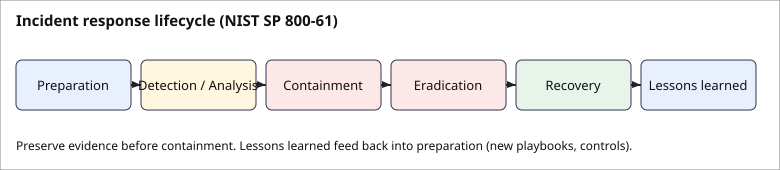

*شکل: چرخه‌ی پاسخ به حادثه.*

### ۴) مثال حل‌شده

**سناریو:** Alert: ۴۰۰ Deny از 198.51.100.7 در ۲ دقیقه به پورت‌های 22,3389,445. **Triage:** Scan؛ موفق؟ Log Allow از همان IP؟ خیر. **مهار:** Address `BLOCK-IP` + Policy Deny بالا؛ Clear Session. **تحلیل:** منبع اینترنت؛ پورت‌های Management بسته‌اند. **درس:** Local-in WAN بسته (۱۲-۸).

``` text
config firewall address
    edit "BLOCK-198.51.100.7"
        set subnet 198.51.100.7 255.255.255.255
    next
end
```

(`Unverified`.)

**مثال سخت (Lateral movement):** PC کاربر Compromise شده و سعی می‌کند به DC SMB بزند؛ Segmentation Deny+Log؛ Alert؛ جداسازی PC؛ بازبینی اعتبارنامه‌ها؛ RCA.

### ۵) GUI و CLI

**GUI:** Log & Report؛ FortiView؛ Policy & Objects → Addresses. **CLI:** `execute log filter ...`، `diagnose sys session ...`.

### ۶) نکات امنیتی

- مهار بدون Evidence = از دست رفتن مدرک.
- ارتباط مستند و محدود؛ Change اضطراری ثبت.
- پس از حادثه Policyها و Patch بازبینی.

### ۷) جمع‌بندی

- IR شش فاز؛ Detection از TTP مهم‌تر از IOC.
- Triage و Scoping قبل از مهار.
- Evidence را حفظ کنید؛ درس‌آموخته را اعمال کنید.

### ۸) تمرین و ارزیابی

**ت1.** (ساده) شش فاز IR را بنویسید. *(پاسخ: 29-0-ت1)*

**ت2.** (متوسط) IOC و TTP چه فرقی دارند؟ *(پاسخ: 29-0-ت2)*

**ت3.** (سخت) Playbook Port Scan را بنویسید. *(پاسخ: 29-0-ت3)*

**ت4.** (سخت، طراحی) از Log فایروال سه Detection بسازید. *(پاسخ: 29-0-ت4)*

**Q1.** Quick quiz (English): Why preserve evidence before containment? *(پاسخ: 29-0-Q1)*

### ۹) اصطلاحات و English Corner

| مخفف | شکل کامل | معنی |
|---|---|---|
| IR | Incident Response | پاسخ به حادثه |
| IOC | Indicator of Compromise | نشانه‌ی نفوذ |
| TTP | Tactics, Techniques, Procedures | رفتار مهاجم |
| SOC | Security Operations Center | مرکز عملیات امنیت |

- *Contain first, but preserve the evidence.* ← مهار کنید ولی شواهد را حفظ کنید.

### ۱۰) منابع

- NIST SP 800-61 Rev.2 — Computer Security Incident Handling Guide؛ MITRE ATT&CK.

## درس 29-1 — Detection عملی: از Log فایروال به IOC/TTP، Baseline، آستانه، Correlation و Alert

**فصل 29 · بازنویسی عمیق · پیش‌نیاز: ۲۹-۰، ۲۷-۰، ۲۷-۱، ۲۸-۲ · ≈ 8 ساعت**

> **وضعیت:** مفهومی؛ فقط Lab ایزوله و مجاز؛ FortiOS 7.0.3 (بوت‌نشده)؛ دستورها `Unverified`؛ Lab «اجرا نشده».

### ۱) هدف آموزشی

در پایان این درس باید بتوانید:

1. از Log فایروال Detectionهای Scan، Brute-force، Exfiltration، حرکت جانبی و DNS مشکوک بسازد.
2. Baseline و آستانه (آماری و قاعده‌محور) را با FP/FN بسنجد.
3. Correlation چندمنبعی (Traffic+Event+DNS) را انجام دهد.
4. Alert را با Severity، Owner و Runbook مستند کند.
5. Detection را با سناریوی مجاز در Lab آزمایش و تنظیم کند.
6. Coverage را با ATT&CK مفهومی نگاشت کند.

### ۲) مفهوم پایه: چیست و چرا؟

Detection بدون Baseline پر از نویز است و بدون Correlation کور. هدف: Alertهای کم، دقیق و قابل‌اقدام. IOC (آدرس/Hash) زودگذر است؛ **رفتار (TTP)** پایدارتر است: اسکن، Brute-force، حرکت جانبی، خروج داده.

### ۳) توضیح عمیق فنی

#### ۱) Detection از Log

| رفتار | داده | منطق | آستانه‌ی اولیه |
|---|---|---|---|
| Port scan | Traffic: deny | یک srcip به N پورت/مقصد | > 100 پورت در ۲ دقیقه |
| Brute-force | Event: login failed | تعداد ناموفق | > 10 در ۵ دقیقه |
| ورود موفق پس از ناموفق | Event | ترکیب | ≥ 5 ناموفق سپس موفق |
| Exfiltration | Traffic: sentbyte | حجم خروجی | > Baseline + 3σ/روز |
| حرکت جانبی | Traffic: deny/allow بین Zone | دسترسی غیرعادی داخلی | هر Deny DMZ→DB |
| DNS مشکوک | DNS Log | دامنه‌ی نویزی/طول بلند/Rate بالا | Rate/entropy |

#### ۲) Baseline و آماری

``` text
Alert if x > mean + 3 x stddev   (per host or per hour of day)
FP rate = false alarms / alerts ; Precision = TP/(TP+FP)
```

الگوی زمانی (ساعت/روز کاری) را در Baseline لحاظ کنید.

#### ۳) Correlation

یک Alert قوی‌تر: «Deny مکرر از IP X» + «ورود موفق همان IP» + «حجم خروجی بالا». Join بر پایه‌ی `srcip`، `user`، زمان.

#### ۴) Alert حرفه‌ای

``` text
Name / Severity / Data source / Logic / Threshold / Owner / Runbook link / FP notes / Tuning date
```

#### ۵) آزمون در Lab

سناریوی مجاز: nmap محدود از Attacker-Lab؛ ۲۰ ورود ناموفق؛ انتقال فایل بزرگ؛ بررسی Alert و FP.

#### ۶) نگاشت ATT&CK

Scan→Discovery (TA0007)، Brute force→Credential Access (TA0006)، Lateral→Lateral Movement (TA0008)، Exfil→Exfiltration (TA0010).

### ۴) طراحی و تصمیم‌گیری

| سؤال طراحی | گزینه‌ها و معیار انتخاب |
|---|---|
| آستانه | Baseline |
| Correlation | چندمنبعی |
| Exclusion | مستند+زمان‌دار |
| Runbook | برای هر Alert |

### ۵) مثال‌های حل‌شده (ساده، متوسط، سخت)

**ساده (حل‌شده):** Alert Scan: `srcip=198.51.100.7` Deny روی ۴۰۰ پورت در ۲ دقیقه؛ Block؛ بررسی Allow موفق (هیچ).

**متوسط (تحلیل):** Scanner داخلی مجاز FP می‌دهد: Exclusion بر پایه‌ی srcip و زمان؛ ثبت تاریخ بازبینی؛ نسبت FP از ۴۰٪ به ۵٪.

**سخت (Correlation):** ورود موفق VPN پس از ۱۲۰ ناموفق، سپس ۴۰۰ MB خروجی به IP ناشناس در ۱۰ دقیقه. Correlation سه رویداد ⇒ Severity بحرانی. اقدام: Contain، Scope، RCA. معیار: بدون Correlation سه Alert مجزا با اولویت پایین می‌ماند.

### ۷) پیاده‌سازی از مسیر CLI

``` text
execute log filter category 0
execute log filter field action deny
execute log filter field srcip 198.51.100.7
execute log display
```

### ۸) Verification (اثبات صحت)

- Alert آزمایشی (سناریوی مجاز).
- FP rate اندازه‌گیری.
- ماتریس ATT&CK.

### ۹) Troubleshooting

| علامت | شاهد برای بررسی | علت محتمل و رفع |
|---|---|---|
| FP زیاد | Log | Exclusion/آستانه |
| FN | Coverage | Detection جدید |
| Alert نمی‌رسد | Syslog | مسیر |

### ۱۰) نکات امنیتی

- آزمون فقط Lab مجاز.
- Exclusion مستند.

### ۱۱) جمع‌بندی مفهومی

- رفتار بر IOC ارجحیت دارد.
- Baseline و آماری.
- Correlation.
- Alert با Owner/Runbook.

### ۱۲) تمرین و ارزیابی

**ت1.** (ساده) IOC و TTP چه فرقی دارند؟ *(پاسخ: 29-1-ت1)*

**ت2.** (ساده) چرا Baseline لازم است؟ *(پاسخ: 29-1-ت2)*

**ت3.** (متوسط) آستانه‌ی mean+3σ یعنی چه؟ *(پاسخ: 29-1-ت3)*

**ت4.** (متوسط) چرا Exclusion باید زمان‌دار باشد؟ *(پاسخ: 29-1-ت4)*

**ت5.** (سخت) سه رویداد را Correlate و Severity بدهید. *(پاسخ: 29-1-ت5)*

**ت6.** (سخت، طراحی) ۵ Detection با داده/منطق/آستانه/Runbook. *(پاسخ: 29-1-ت6)*

**Q1.** Quick quiz (English): Why are behavior-based detections more durable than indicator-based ones? *(پاسخ: 29-1-Q1)*

### ۱۳) اصطلاحات و English Corner

| مخفف | شکل کامل | معنی |
|---|---|---|
| TTP | Tactics, Techniques and Procedures | رفتار مهاجم |
| FP | False positive | هشدار کاذب |
| ATT&CK | MITRE ATT&CK | ماتریس تکنیک‌های مهاجم |

- *Know your baseline.* ← وضعیت عادی را بشناسید.

### ۱۴) کارت Lab

**کارت Lab:** Detection. **وضعیت:** اجرا نشده. **Evidence:** `03-ops/detect.md`.

### ۱۵) منابع

- NIST SP 800-61
- MITRE ATT&CK
- NIST SP 800-92

<a id="l-29-2"></a>

## درس 29-2 — Response و Playbook: مهار، Evidence، ریشه‌کنی، بازیابی و ارتباطات با مثال‌های اجرایی

**فصل 29 · بازنویسی عمیق · پیش‌نیاز: ۲۹-۰، ۲۹-۱، ۱۳-۷ · ≈ 8 ساعت**

> **وضعیت:** مفهومی؛ فقط Lab ایزوله و مجاز؛ FortiOS 7.0.3 (بوت‌نشده)؛ دستورها `Unverified`؛ Lab «اجرا نشده».

### ۱) هدف آموزشی

در پایان این درس باید بتوانید:

1. Playbook برای سه سناریو (Scan، Compromise سرور، حساب VPN لو رفته) بنویسد.
2. مهار با فایروال (Block، Quarantine، Session) را بدون تخریب Evidence اجرا کند.
3. ریشه‌کنی و بازیابی را با آزمون تأیید کند.
4. ارتباطات و Escalation را مستند کند.
5. تفاوت مهار کوتاه‌مدت/بلندمدت را بگوید.

### ۲) مفهوم پایه: چیست و چرا؟

در حادثه فشار زیاد است؛ Playbook یعنی از قبل تصمیم‌گیری. اشتباه رایج: مهار فوری که شواهد را پاک می‌کند، یا مهار ناقص که مهاجم را آگاه می‌کند.

### ۳) توضیح عمیق فنی

#### ۱) قالب Playbook

``` text
Trigger / Severity / Owner / Approvals
1 Triage: scope? asset? success? data?
2 Evidence preservation (what/where/how)
3 Containment: short-term, long-term
4 Eradication  5 Recovery + verification  6 Communication  7 Lessons learned
```

#### ۲) مهار با فایروال

- **Block IP:** Address + Deny Policy بالاتر از همه (Policy ID/موقت با تاریخ انقضا).
- **Quarantine:** قرنطینه‌ی میزبان (Policy/VLAN/Quarantine).
- **قطع Session:** `diagnose sys session clear` با Filter (۱۳-۷).
- **قطع VPN User:** غیرفعال کاربر + پایان Session.
- **Evidence پیش از مهار:** ذخیره‌ی Log/Session/Capture (مهار ممکن است Session را از بین ببرد).

#### ۳) سناریوها

**۱) Scan خارجی:** Block IP؛ بررسی Allowهای موفق؛ Hardening Local-in.
**۲) سرور DMZ Compromise:** ایزوله (Quarantine)، Evidence، بررسی مسیرها (Log DMZ→Internal)، بازسازی از Image، چرخش Credential.
**۳) حساب VPN لو رفته:** قفل حساب، پایان Session، بررسی دسترسی‌های کاربر، Reset+MFA، Detection تکراری.

#### ۴) بازیابی و تأیید

بازگشت به سرویس با Monitoring تشدیدشده، آزمون مثبت/منفی، حذف Ruleهای موقت، بازبینی Log ۷ روز.

#### ۵) ارتباطات

Timeline، اثر، وضعیت، اقدام بعدی، مسئول؛ ارتباط به مدیریت/حقوقی (در صورت نیاز)؛ ثبت.

### ۴) طراحی و تصمیم‌گیری

| سؤال طراحی | گزینه‌ها و معیار انتخاب |
|---|---|
| Block موقت | با انقضا و Owner |
| Evidence | قبل از مهار |
| Escalation | سطوح |

### ۵) مثال‌های حل‌شده (ساده، متوسط، سخت)

**ساده (حل‌شده):** Block IP اسکنر: Address `BLOCK-198.51.100.7` و Policy Deny بالا؛ تست: ping/nc از IP مسدود (Lab) رد؛ Log.

**متوسط (تحلیل):** Block اعمال شد ولی Session قبلی مهاجم فعال است: `session list` با Filter؛ Clear؛ تأیید قطع؛ درس: Block+Clear.

**سخت (Compromise سرور):** سرور DMZ با Webshell. Playbook: Evidence (Disk image/Log/Capture)، Quarantine، Scope (Traffic Log DMZ→Internal)، تعیین Credentialهای لمس‌شده، بازسازی، چرخش، Hardening (WAF/IPS)، PIR. اگر مهار قبل از Evidence انجام شود تحلیل ریشه ناقص می‌شود.

### ۷) پیاده‌سازی از مسیر CLI

``` text
config firewall address
    edit "BLOCK-198.51.100.7"
        set subnet 198.51.100.7 255.255.255.255
    next
end
diagnose sys session filter src 198.51.100.7
diagnose sys session list
diagnose sys session clear
diagnose sys session filter clear
```

### ۸) Verification (اثبات صحت)

- آزمون Block (Lab).
- Evidence ذخیره‌شده.
- PIR.

### ۹) Troubleshooting

| علامت | شاهد برای بررسی | علت محتمل و رفع |
|---|---|---|
| Block بی‌اثر | ترتیب Policy | بالا ببرید |
| مهاجم برگشت | Credential | چرخش |

### ۱۰) نکات امنیتی

- Evidence اول؛ Rule موقت حذف شود.

### ۱۱) جمع‌بندی مفهومی

- Playbook قالب‌مند.
- Evidence پیش از مهار.
- Block+Clear.
- بازیابی با تأیید.

### ۱۲) تمرین و ارزیابی

**ت1.** (ساده) چرا Evidence قبل از مهار؟ *(پاسخ: 29-2-ت1)*

**ت2.** (ساده) تفاوت مهار کوتاه‌مدت و بلندمدت؟ *(پاسخ: 29-2-ت2)*

**ت3.** (متوسط) Block شد ولی مهاجم هنوز متصل است؛ چرا؟ *(پاسخ: 29-2-ت3)*

**ت4.** (متوسط) پس از Compromise چه Credentialهایی چرخش یابند؟ *(پاسخ: 29-2-ت4)*

**ت5.** (سخت) Playbook Compromise سرور DMZ را ۷ مرحله‌ای بنویسید. *(پاسخ: 29-2-ت5)*

**ت6.** (سخت، طراحی) سه Playbook اولویت‌دار برای سازمان شما. *(پاسخ: 29-2-ت6)*

**Q1.** Quick quiz (English): Why combine blocking an IP with clearing its existing sessions? *(پاسخ: 29-2-Q1)*

### ۱۳) اصطلاحات و English Corner

| مخفف | شکل کامل | معنی |
|---|---|---|
| Quarantine | Host quarantine | قرنطینه‌ی میزبان |
| Scoping | Incident scoping | تعیین دامنه‌ی حادثه |

- *Preserve evidence before containment.* ← پیش از مهار Evidence را حفظ کنید.

### ۱۴) کارت Lab

**کارت Lab:** Response. **وضعیت:** اجرا نشده. **Evidence:** `03-ops/response.md`.

### ۱۵) منابع

- NIST SP 800-61 Rev.2
- SANS Incident Handler Handbook

<a id="l-29-3"></a>

## درس 29-3 — Lifecycle، Patch و Vulnerability Management: Inventory، EoL، PSIRT/CVE، اولویت‌بندی و Rollback

**فصل 29 · بازنویسی عمیق · پیش‌نیاز: ۲۷-۴، ۲۹-۰ · ≈ 8 ساعت**

> **وضعیت:** مفهومی؛ فقط Lab ایزوله و مجاز؛ FortiOS 7.0.3 (بوت‌نشده)؛ دستورها `Unverified`؛ Lab «اجرا نشده».

### ۱) هدف آموزشی

در پایان این درس باید بتوانید:

1. Inventory دارایی (مدل، نسخه، لایسنس، EoL) را نگه دارد.
2. CVE را با Exposure/Exploitability/Impact اولویت‌بندی کند.
3. Plan Patch با Lab، Window، Rollback و Verification بنویسد.
4. Compensating Controls را وقتی Patch ممکن نیست طراحی کند.
5. Metrics (Time-to-patch، Coverage) را اندازه بگیرد.

### ۲) مفهوم پایه: چیست و چرا؟

نسخه‌ی 7.0.3 قدیمی است و CVEهای شناخته‌شده دارد (مثل CVE-2022-40684، CVE-2022-42475، CVE-2023-27997 که در مستند پروژه ذکر شده‌اند). مدیریت آسیب‌پذیری یعنی «بدانید چه دارید، چه آسیب‌پذیر است، چه زمانی و چگونه امن می‌شود».

### ۳) توضیح عمیق فنی

#### ۱) Inventory

``` text
Device | Model | Serial | FortiOS | Role | Exposure(internet?) | License end | EoL/EoS | Owner
```

#### ۲) اولویت‌بندی

``` text
Priority ~= Severity(CVSS) x Exposure x Exploit availability x Asset criticality
```

مثال: CVE بحرانی روی SSL VPN اینترنتی با Exploit فعال ⇒ فوری (۲۴ تا ۷۲ ساعت). CVE روی سرویس داخلی غیرقابل‌دسترس ⇒ برنامه‌ریزی‌شده.

#### ۳) چرخه

PSIRT/CVE Feed → ارزیابی تأثیر روی نسخه/ویژگی → تصمیم (Patch/Workaround/Accept) → Lab → Window → Rollback آماده → Verification → ثبت.

#### ۴) Compensating Controls

وقتی Patch فوراً ممکن نیست: محدودسازی Source، غیرفعال‌کردن ویژگی (SSL VPN)، IPS Signature، Segmentation، پایش اضافه، WAF/Reverse proxy.

#### ۵) EoL/EoS

برنامه‌ی ارتقا قبل از پایان پشتیبانی؛ نسخه‌ی هدف و مسیر ارتقا (Upgrade Path) را از مستند Fortinet بگیرید.

#### ۶) Metrics

``` text
Time-to-patch (critical) = patch date - advisory date
Coverage = patched devices / total devices
```

### ۴) طراحی و تصمیم‌گیری

| سؤال طراحی | گزینه‌ها و معیار انتخاب |
|---|---|
| اولویت | Exposure×Exploit×Criticality |
| Compensating | وقتی Patch نیست |
| Canary | برای ناوگان بزرگ |

### ۵) مثال‌های حل‌شده (ساده، متوسط، سخت)

**ساده (حل‌شده):** جدول Inventory ۳ دستگاه؛ نسخه‌ها؛ فهرست CVE مرتبط؛ اولویت.

**متوسط (تحلیل):** CVE بحرانی SSL VPN و دستگاه اینترنتی: فوری. اقدام: Lab Patch، Window، Backup، Rollback؛ اگر ۷۲ ساعت ممکن نبود: غیرفعال SSL VPN/Source Restriction موقت.

**سخت (طراحی):** ۲۰ دستگاه، ۲ شب Window در ماه، Upgrade Path چندمرحله‌ای. طرح: دسته‌بندی بر اساس Exposure؛ اینترنتی‌ها اول؛ Canary؛ HA یکی‌یکی؛ Verification و Rollback؛ Time-to-patch هدف ۷ روز برای بحرانی.

### ۷) پیاده‌سازی از مسیر CLI

``` text
get system status
execute backup config sftp pre-patch.conf 192.168.90.10 backup-user <PASSWORD>
```

### ۸) Verification (اثبات صحت)

- Inventory کامل.
- Plan Patch.
- Metrics ثبت.

### ۹) Troubleshooting

| علامت | شاهد برای بررسی | علت محتمل و رفع |
|---|---|---|
| Patch شکست | Pre/Post-check | Rollback |
| ناسازگاری ویژگی | Release notes | برنامه |

### ۱۰) نکات امنیتی

- Patch سریع برای اینترنتی؛ Backup قبل.

### ۱۱) جمع‌بندی مفهومی

- Inventory→ارزیابی→Patch→Rollback.
- اولویت ریسک‌محور.
- Compensating Controls.
- Metrics.

### ۱۲) تمرین و ارزیابی

**ت1.** (ساده) EoL یعنی چه؟ *(پاسخ: 29-3-ت1)*

**ت2.** (ساده) چرا Exposure در اولویت وزن بالا دارد؟ *(پاسخ: 29-3-ت2)*

**ت3.** (متوسط) Patch ممکن نیست؛ چه می‌کنید؟ *(پاسخ: 29-3-ت3)*

**ت4.** (متوسط) Time-to-patch چیست؟ *(پاسخ: 29-3-ت4)*

**ت5.** (سخت) طرح Patch ۲۰ دستگاه با ۲ Window ماهانه. *(پاسخ: 29-3-ت5)*

**ت6.** (سخت، طراحی) داشبورد Metrics آسیب‌پذیری. *(پاسخ: 29-3-ت6)*

**Q1.** Quick quiz (English): Which factors raise the urgency of patching a vulnerability? *(پاسخ: 29-3-Q1)*

### ۱۳) اصطلاحات و English Corner

| مخفف | شکل کامل | معنی |
|---|---|---|
| PSIRT | Product Security Incident Response Team | تیم امنیت محصول |
| CVSS | Common Vulnerability Scoring System | سامانه‌ی امتیاز آسیب‌پذیری |
| EoL | End of Life | پایان عمر |

- *Track end-of-life dates and plan upgrades early.* ← تاریخ پایان عمر را پیگیری و ارتقا را زود برنامه‌ریزی کنید.

### ۱۴) کارت Lab

**کارت Lab:** Patch. **وضعیت:** اجرا نشده. **Evidence:** `03-ops/patch.md`.

### ۱۵) منابع

- FortiGuard PSIRT
- NIST SP 800-40 Rev.4
- FIRST CVSS

<a id="l-29-4"></a>

## درس 29-4 — گزارش حادثه (PIR) و آزمون عملی Blue Team: سناریوی چندمرحله‌ای با کلید و Rubric

**فصل 29 · بازنویسی عمیق · پیش‌نیاز: ۲۹-۱ تا ۲۹-۳ · ≈ 12 ساعت**

> **وضعیت:** FortiOS 7.0.3 نامی (بوت‌نشده)؛ سناریو و کلید پاسخ آموزشی‌اند؛ Lab «اجرا نشده»؛ دستورها `Unverified` تا اجرای Lab؛ ویژگی‌های وابسته به لایسنس مشخص شده‌اند.

### ۱) هدف آموزشی

در پایان این درس باید بتوانید:

1. یک حادثه‌ی چندمرحله‌ای (Brute-force → دسترسی → حرکت جانبی) را از Log بازسازی کند.
2. Timeline، Containment، Eradication و Recovery را بنویسد.
3. MTTD/MTTR را محاسبه کند.
4. PIR بی‌ملامت (Blameless) با اقدام پیشگیرانه بنویسد.
5. آزمون را با Rubric تحویل دهد.

### ۲) مفهوم پایه: چیست و چرا؟

حادثه‌ی واقعی هیچ‌وقت با برچسب «حمله‌ی چندمرحله‌ای» نمی‌آید. چند هشدار پراکنده می‌آید و مهندس باید آن‌ها را به یک داستان وصل کند. PIR (Post-Incident Review) آموختن از آن داستان است، نه تقصیر.

### ۳) توضیح عمیق فنی

#### ۱) سناریو

ساعت 02:10 Alert: ۴۰ ورود ناموفق SSH به FGT از IP 192.0.2.77. 02:14 ورود موفق admin. 02:20 تغییر Policy و ایجاد حساب `svc-tmp`. 02:35 اتصال از FGT به 10.20.0.10:445 (Scan). 03:05 SOC متوجه می‌شود.

#### ۲) Timeline

| ساعت | رویداد | منبع |
|---|---|---|
| 02:10 | Brute-force SSH | Event log |
| 02:14 | ورود موفق | Event log |
| 02:20 | ساخت `svc-tmp` | Config change log |
| 02:35 | Scan داخلی | Forward traffic |
| 03:05 | کشف | SOC |

MTTD = 03:05 − 02:10 = 55 دقیقه.

#### ۳) پاسخ

**Containment:** Block IP با Local-in، غیرفعال کردن admin و `svc-tmp`، جدا کردن Mgmt، کنسول. **Eradication:** حذف حساب‌ها، تغییر رمزها/کلیدها، بررسی Config Diff با Backup، پچ. **Recovery:** Restore Config پاک، Monitoring تشدید.

#### ۴) ریشه

SSH روی WAN باز و بدون MFA/Trusted host؛ رمز ضعیف.

#### ۵) اقدام پیشگیرانه

حذف SSH از WAN، MFA، Trusted host، Alert بر Brute-force، بازبینی Config روزانه (Diff)، آموزش.

#### ۶) PIR (قالب)

``` text
Summary / Impact / Timeline / Root cause / What went well / What failed / Actions (owner, due) / Lessons
```

#### ۷) Rubric

Timeline ۲۰، Containment/Eradication ۲۰، ریشه ۲۰، اقدام ۲۰، PIR و MTTD/MTTR ۱۵، صداقت ۵. قبولی ۷۵.

### ۴) طراحی و تصمیم‌گیری

| سؤال طراحی | گزینه‌ها و معیار انتخاب |
|---|---|
| Containment | اول جلوگیری |
| PIR | Blameless |

### ۵) مثال‌های حل‌شده (ساده، متوسط، سخت)

**ساده (حل‌شده):** MTTD = 03:05 − 02:10 = ۵۵ دقیقه؛ MTTR (تا Containment 03:25) = ۷۵ دقیقه از شروع.

**متوسط (Containment):** اول IP مهاجم را Block و Admin/svc-tmp را غیرفعال؛ سپس Config را با Backup مقایسه؛ برای جلوگیری از حذف شواهد Log را ذخیره.

**سخت (PIR):** نوشتن PIR کامل: خلاصه، اثر (دسترسی به Config، Scan داخلی بدون نفوذ به سرور)، Timeline، ریشه (SSH WAN + رمز ضعیف)، موفق (Alert دریافت شد)، شکست (۵۵ دقیقه تأخیر)، اقدام‌ها با مالک و تاریخ.

### ۷) پیاده‌سازی از مسیر CLI

``` text
execute log filter category 1
execute log display
```

### ۸) Verification (اثبات صحت)

- Timeline با Log.
- اقدام‌ها مالک دارند.

### ۹) Troubleshooting

| علامت | شاهد برای بررسی | علت محتمل و رفع |
|---|---|---|
| Timeline ناقص | Log | NTP/Log متمرکز |

### ۱۰) نکات امنیتی

- شواهد را حفظ کنید.

### ۱۱) جمع‌بندی مفهومی

- از Alert به داستان.
- Containment.
- Blameless PIR.

### ۱۲) تمرین و ارزیابی

**ت1.** (ساده) MTTD چیست؟ *(پاسخ: 29-4-ت1)*

**ت2.** (ساده) Containment؟ *(پاسخ: 29-4-ت2)*

**ت3.** (متوسط) اولین اقدام؟ *(پاسخ: 29-4-ت3)*

**ت4.** (متوسط) ریشه؟ *(پاسخ: 29-4-ت4)*

**ت5.** (سخت) PIR بنویسید. *(پاسخ: 29-4-ت5)*

**ت6.** (سخت، طراحی) اقدام پیشگیرانه. *(پاسخ: 29-4-ت6)*

**Q1.** Quick quiz (English): What does MTTD measure? *(پاسخ: 29-4-Q1)*

### ۱۳) اصطلاحات و English Corner

| مخفف | شکل کامل | معنی |
|---|---|---|
| PIR | Post-Incident Review | بازبینی پس از حادثه |
| MTTD | Mean Time To Detect | میانگین زمان کشف |

- *A blameless review focuses on process, not people.* ← بازبینی بی‌ملامت روی فرایند است نه افراد.

### ۱۴) کارت Lab

**کارت Lab:** آزمون Blue Team (اجرا نشده). **Evidence:** `03-ops/pir-29.md`.

### ۱۵) منابع

- NIST SP 800-61 Rev.2

## پاسخ‌های فصل 29

> ابتدا بدون نگاه حل کنید. شناسه: درس-نوع+شماره (ت = تمرین، م = مرور).


### پاسخ‌های بازنویسی عمیق درس 29-1

**29-1-ت1** — IOC نشانه‌ی مشخص و زودگذر (IP/Hash)؛ TTP رفتار و روش مهاجم و پایدارتر.

**29-1-ت2** — تا انحراف از رفتار عادی تشخیص داده شود و FP کم شود.

Baseline تا انحراف از رفتار عادی تشخیص داده شود و False Positive کم شود.

**29-1-ت3** — مقداری بیش از میانگین به‌علاوه‌ی سه برابر انحراف معیار Alert می‌دهد (تقریباً رویداد نادر).

**29-1-ت4** — تا استثنا فراموش و به حفره تبدیل نشود؛ بازبینی دوره‌ای.

استثنا باید تاریخ پایان داشته باشد تا فراموش و حفره نشود؛ بازبینی دوره‌ای.

**29-1-ت5** — ناموفق مکرر + ورود موفق + خروجی بالا ⇒ احتمال نفوذ؛ Severity بحرانی؛ Contain/Scope/RCA.

**29-1-ت6** — جدول بالا بسط داده شود.

چک‌لیست تشخیص: منبع Log (Traffic/Event/UTM)، قانون (مثلاً ۱۰ ورود ناموفق در ۵ دقیقه)، آستانه، مالک، اقدام اول و تاریخ بازبینی. هر قانون با آزمون (تولید رویداد تست) تأیید شود.

**29-1-Q1** — Because attackers can change IPs and hashes easily but their behaviors change much less.


### پاسخ‌های بازنویسی عمیق درس 29-2

**29-2-ت1** — مهار ممکن است Session/حافظه/Log را تغییر دهد و تحلیل را ناقص کند.

**29-2-ت2** — کوتاه‌مدت جلوگیری فوری (Block/Quarantine)؛ بلندمدت رفع ریشه‌ای (بازسازی/Patch/چرخش).

**29-2-ت3** — Session قبلی باقی است؛ باید Clear فیلترشده انجام شود.

Session قبلی باقی است؛ Clear فیلترشده انجام شود.

**29-2-ت4** — حساب‌های موجود روی سرور، سرویس‌ها، Tokenها و Credentialهایی که سرور به آن‌ها دسترسی داشت.

**29-2-ت5** — Triage، Evidence، Quarantine، Scope، Eradicate/Rebuild، Recover/Verify، PIR با Owner/زمان.

**29-2-ت6** — Scan/Brute-force، سرور Compromise، حساب لو رفته؛ هرکدام Trigger/Approvals/دستور.

**29-2-Q1** — Because a block applies to new connections while existing sessions may continue.


### پاسخ‌های بازنویسی عمیق درس 29-3

**29-3-ت1** — پایان پشتیبانی و Patch امنیتی محصول.

EoL پایان پشتیبانی و Patch امنیتی محصول است.

**29-3-ت2** — آسیب‌پذیری قابل‌دسترس از اینترنت سریع‌تر و گسترده‌تر سوءاستفاده می‌شود.

**29-3-ت3** — Compensating Controls: Source Restriction، غیرفعال ویژگی، IPS، Segmentation، پایش.

**29-3-ت4** — فاصله‌ی انتشار Advisory تا اعمال Patch.

Exposure window فاصله‌ی انتشار Advisory تا اعمال Patch است.

**29-3-ت5** — اولویت بر Exposure، Canary، HA یکی‌یکی، Backup/Rollback، Verification، هدف Time-to-patch.

**29-3-ت6** — Coverage، Time-to-patch، تعداد EoL، Exception فعال، Trend.

شاخص‌های مدیریت آسیب‌پذیری: Coverage (درصد دارایی‌های پایش‌شده)، Time-to-patch (میانه‌ی روز)، تعداد EoL، Exception فعال با تاریخ پایان و روند ماهانه. هدف: روند رو به بهبود و Exceptionهای محدود.

**29-3-Q1** — Internet exposure, available exploits and high asset criticality.


### پاسخ‌های بازنویسی عمیق درس 29-4


### پاسخ‌های بازنویسی عمیق درس 29-4

**29-4-ت1** — زمان تا کشف.

MTTD زمان تا کشف است.

**29-4-ت2** — جلوگیری از گسترش.

Containment جلوگیری از گسترش حادثه است.

**29-4-ت3** — Block و غیرفعال حساب.

اولین اقدام: Block مهاجم و غیرفعال‌کردن حساب‌ها.

**29-4-ت4** — SSH WAN و رمز.

ریشه: SSH روی WAN و رمز ضعیف.

**29-4-ت5** — قالب.

PIR با قالب: Summary، Impact، Timeline، Root cause، Actions.

**29-4-ت6** — حذف SSH WAN، MFA، Alert.

اقدام پیشگیرانه: حذف SSH از WAN، MFA، Alert.

**29-4-Q1** — The mean time between the start of an incident and its detection.

### پاسخ‌های درس افزوده‌ی 29-0 (فصل 29)

**29-0-ت1** — Preparation، Detection/Analysis، Containment، Eradication، Recovery، Lessons learned.

**29-0-ت2** — IOC نشانه‌ی مشخص و زودگذر (IP/Hash)؛ TTP رفتار و روش مهاجم و پایدارتر.

**29-0-ت3** — تشخیص Scan از Deny زیاد، بررسی Allow موفق، Block IP، Clear Session، بررسی Local-in، ثبت Evidence، PIR.

**29-0-ت4** — ۱) Deny چندپورتی از یک IP؛ ۲) Login ناموفق مکرر؛ ۳) حجم خروجی غیرعادی به IP ناشناس.

**29-0-Q1** — Because containment actions can alter or erase logs and sessions that are needed for analysis.

# فصل 30 — Migration: از Cisco ASA/Router به FortiGate (معماری ۸، G11)

**مدت:** ۳۶ ساعت | **پیش‌نیاز:** فصل ۱۳، ۲۷.
**اهداف:** برنامه‌ریزی مهاجرت؛ Inventory و Mapping Policy؛ Cutover و Rollback؛ تست پیش و پس. Gate G11: Plan کامل با Rollback و Evidence.
**هشدار:** Migration در تولید فقط با Change Window و تأیید؛ اینجا فقط Lab.
**اشتباهات رایج:** کپی بی‌فکر Rule؛ نبود Rollback؛ فراموشی NAT/Route.

**درس‌های فصل:**
- [درس 30-1 — Inventory و Mapping](#l-30-1)
- [درس 30-2 — Plan، Cutover و Rollback](#l-30-2)
- [درس 30-3 — تست پیش/پس و Evidence](#l-30-3)
- [درس 30-4 — Gate G11 و آزمون](#l-30-4)

---

<a id="l-30-1"></a>

## درس 30-0 — روش‌شناسی Migration: Inventory، نگاشت Policy، Cutover و Rollback

**فصل ۳۰ · درس افزوده (پیش‌درس ۳۰-۱) · پیش‌نیاز: ۱۳-۷، ۲۷-۷، ۲۵-۰ · ≈ ۶ ساعت**

> **وضعیت:** روش مستقل از برند؛ نگاشت قوانین ASA→FortiGate مفهومی و `Unverified`؛ فقط Lab.

### ۱) هدف آموزشی

1. مهاجرت را به‌صورت پروژه (Discovery، Design، Build، Test، Cutover، Stabilize) برنامه‌ریزی کند.
2. **Inventory** کامل و **Rule Hygiene** (حذف قوانین مرده/تکراری با Hit Count) انجام دهد.
3. نگاشت **Object، NAT، Route، VPN، Policy** را بنویسد و تفاوت مدل (ACL→Policy، NAT-order) را بفهمد.
4. **Cutover** با Rollback قابل‌اثبات طراحی کند.
5. آزمون پیش/پس و Evidence ثبت کند.

### ۲) مفهوم پایه

مهاجرت = تغییر پرخطر روی دستگاه حیاتی. «کپی کردن Rule» خطرناک است چون مدل پردازش فرق دارد (ترتیب NAT/ACL، Interface Security-level در برابر Zone، Implicit deny). موفقیت = **برابری رفتاری** (نه برابری متن Config) + **بازگشت امن**.

### ۳) توضیح عمیق فنی

#### ۳-۱) فازها

``` text
1 Discovery : inventory interfaces, routes, NAT, ACLs, VPNs, users, logs
2 Design    : target architecture, zone mapping, IP plan, rule cleanup
3 Build     : configure target in parallel (no traffic)
4 Test      : lab/pre-prod, positive & negative tests
5 Cutover   : change window, switch traffic, monitor
6 Stabilize : post-checks, hypercare, decommission after N days
```

#### ۳-۲) Rule Hygiene

با Hit Count و Log ۹۰ روزه: Ruleهای صفر-Hit، تکراری، Shadow، و Any-Any را شناسایی. هر Rule: صاحب، دلیل، تاریخ. **قبل از مهاجرت پاکسازی** کنید تا قوانین بد به سیستم جدید منتقل نشوند.

#### ۳-۳) نگاشت مفاهیم (مثال ASA→FortiGate؛ `Unverified`)

| ASA | FortiGate |
|---|---|
| nameif/security-level | Interface/Zone + Policy |
| access-list + access-group | Firewall Policy |
| object network/group | Address/Address Group |
| NAT (auto/twice) | Policy NAT/VIP/IP Pool/Central NAT |
| route | Static Route |
| crypto map | IPsec Phase1/2 (Route-based) |
| inspect (MPF) | Session Helper/Profile |

نکته: ASA به‌طور پیش‌فرض بین Interfaceهای با Security-level بالاتر→پایین‌تر اجازه می‌دهد؛ FortiGate Implicit deny؛ پس رفتار «بدون Rule» متفاوت است.

#### ۳-۴) Cutover

- **Change Window**، تیم، Rollback Trigger (مثلاً «۳۰ دقیقه بدون سرویس X»)، تماس.
- مراحل: Backup دو سو؛ جابه‌جایی Gateway/Route یا آدرس؛ ARP/Session؛ آزمون سرویس‌های حیاتی؛ مانیتورینگ.
- **Rollback:** بازگرداندن مسیر/کابل؛ Config قبلی؛ آزمون.

#### ۳-۵) Test Matrix

| سرویس | مبدأ | مقصد | انتظار | قبل | بعد |
|---|---|---|---|---|---|
| وب | Users | Internet | OK | ✓ | ✓ |
| ERP | Users | SRV | OK | ✓ | ✓ |
| ممنوع | Guest | SRV | Block | ✓ | ✓ |

### ۴) مثال حل‌شده

**پروژه:** جایگزینی ASA با FGT. Discovery: ۲۴۰ Rule، ۱۱۰ با Hit=0؛ پاکسازی ← ۱۱۰ Policy. Build موازی در Lab. Cutover: شب جمعه ۲۲:۰۰؛ Trigger Rollback ۳۰ دقیقه. شواهد: Test Matrix قبل/بعد. یک سرویس (FTP) خراب: Helper/Session ALG؛ رفع. Hypercare ۷ روز؛ Decommission ۳۰ روز.

**مثال سخت:** پس از Cutover فقط یک اپ کار نمی‌کند؛ ASA «twice NAT» ترتیب خاصی داشت؛ در FGT Policy NAT ناقص. **رفع:** VIP/IP Pool مناسب، Debug Flow.

### ۵) GUI و CLI

**GUI:** Policy & Objects؛ Log & Report. **CLI:** `diagnose firewall iprope lookup ...`، `diagnose debug flow ...`؛ Backup: `execute backup config ...`.

### ۶) نکات امنیتی

- Rule «موقت» هنگام مهاجمت را حذف کنید.
- Secretهای Config قدیمی منتقل نشوند.
- دستگاه قدیمی پس از Decommission پاک‌سازی امن.

### ۷) جمع‌بندی

- Inventory + Hygiene قبل از ساخت؛ برابری رفتاری هدف.
- Cutover بدون Rollback مجاز نیست.
- Test Matrix و Evidence.

### ۸) تمرین و ارزیابی

**ت1.** (ساده) فازهای Migration را بنویسید. *(پاسخ: 30-0-ت1)*

**ت2.** (متوسط) چرا Rule Hygiene قبل از مهاجرت؟ *(پاسخ: 30-0-ت2)*

**ت3.** (سخت) Rollback Trigger و روش آن را طراحی کنید. *(پاسخ: 30-0-ت3)*

**ت4.** (سخت، طراحی) Test Matrix برای ۱۰ سرویس بنویسید. *(پاسخ: 30-0-ت4)*

**Q1.** Quick quiz (English): Why aim for behavioral equivalence rather than copying rules? *(پاسخ: 30-0-Q1)*

### ۹) اصطلاحات و English Corner

| مخفف | شکل کامل | معنی |
|---|---|---|
| Cutover | Cutover | سوئیچ نهایی |
| Hypercare | Hypercare | پایش ویژه پس از تغییر |
| Shadow rule | Shadowed rule | Rule پنهان‌شده |
| Hit count | Hit count | تعداد استفاده |

- *Clean up rules before migrating them.* ← قبل از مهاجرت قوانین را پاکسازی کنید.

### ۱۰) منابع

- NIST SP 800-41 Rev.1؛ ITIL 4 (Change Enablement)؛ Fortinet FortiConverter (مرجع رسمی؛ لایسنس/نسخه را بررسی کنید).

## درس 30-1 — Migration: Inventory، Rule Hygiene و نگاشت دقیق Object/NAT/Policy/VPN به FortiGate

**فصل 30 · بازنویسی عمیق · پیش‌نیاز: ۳۰-۰، ۲۵-۱، ۱۳-۱ · ≈ 8 ساعت**

> **وضعیت:** روش‌شناسی مستقل از برند؛ نگاشت ASA→FortiGate مفهومی/`Unverified`؛ فقط Lab/Change مجاز؛ FortiOS 7.0.3 (بوت‌نشده).

### ۱) هدف آموزشی

در پایان این درس باید بتوانید:

1. Inventory کامل از دستگاه مبدأ (Interface، Route، NAT، ACL، VPN، User، Log) تهیه کند.
2. Rule Hygiene (Hit Count، Shadow، Duplicate، Any-Any) را انجام دهد.
3. نگاشت مفهومی Object/Service/ACL/NAT/VPN به FortiGate را بنویسد و تفاوت مدل را تحلیل کند.
4. ریسک‌های رفتاری (ترتیب NAT/ACL، Implicit rules، Inspection) را فهرست کند.
5. Mapping Table و Gap List بسازد.
6. نیازمندی‌های ابزار خودکار (FortiConverter) و محدودیت‌ها را بداند.

### ۲) مفهوم پایه: چیست و چرا؟

مهاجرت موفق یعنی **برابری رفتاری**، نه برابری متن Config. «کپی» خطرناک است چون مدل پردازش فرق دارد: در ASA سطح امنیت و ACL و NAT ترتیب خاص دارند؛ در FortiGate Policy و Session و NAT در Policy/Central NAT. پیش‌شرط: بدانید دقیقاً چه دارید.

### ۳) توضیح عمیق فنی

#### ۱) Inventory (منابع)

``` text
show running-config            show access-list (hit counts) show nat detail
show route                     show vpn-sessiondb / crypto maps
show conn count                show xlate count    logs (90 days)
user/group, certificates, DHCP/DNS/AAA, routing protocols, SNMP/NTP/Syslog
```

#### ۲) Rule Hygiene

| مورد | تشخیص | اقدام |
|---|---|---|
| Rule بدون Hit (90 روز) | Hit count = 0 | حذف/بایگانی |
| Shadow | Rule بالاتر همه را می‌گیرد | حذف |
| Duplicate/Overlap | Object/Rule هم‌پوشان | ادغام |
| Any-Any | مبدأ/مقصد/سرویس any | محدودسازی |
| Object بی‌استفاده | بدون مرجع | حذف |

#### ۳) نگاشت مفهومی

| مبدأ (ASA) | FortiGate |
|---|---|
| nameif + security-level | Interface/Zone + Policy صریح (Implicit deny) |
| object network/service/group | Address/Service/Group |
| access-list + access-group | Firewall Policy (srcintf/dstintf) |
| NAT (object/twice) | Policy NAT/VIP/IP Pool/Central NAT |
| route/dynamic routing | Static/OSPF/BGP |
| crypto map/tunnel-group | IPsec Phase1/2 Route-based |
| MPF inspect | Session Helper/ALG/Profile |
| AAA/LDAP | User/LDAP/RADIUS |

#### ۴) تفاوت‌های رفتاری حیاتی

- **Implicit rules:** ASA ترافیک از امنیت بالا به پایین را پیش‌فرض اجازه می‌دهد؛ FortiGate هیچ‌چیز (Implicit deny).
- **ترتیب NAT:** ASA NAT را پیش از ACL (با Real IP در ACL پس از 8.3)؛ FortiGate DNAT قبل از Policy و SNAT بعد.
- **Interface:** `nameif` به Zone/Interface؛ چند Interface یک Zone.
- **Inspection:** پیش‌فرض‌ها متفاوت (ALG).

#### ۵) Mapping Table

``` text
Source object -> Target object | Rule ID -> Policy ID | NAT entry -> Policy/VIP | Gap | Test case
```

#### ۶) ابزار خودکار

FortiConverter (لایسنس/سرویس) Config را تبدیل می‌کند ولی **خروجی باید بازبینی و آزمون شود** (`Unverified` برای قابلیت‌ها).

### ۴) طراحی و تصمیم‌گیری

| سؤال طراحی | گزینه‌ها و معیار انتخاب |
|---|---|
| ابزار خودکار یا دستی | Hygiene دستی + ابزار برای حجم؛ بازبینی اجباری |
| Zone | نگاشت security-level به Zone |
| Implicit rules | صریح‌سازی |

### ۵) مثال‌های حل‌شده (ساده، متوسط، سخت)

**ساده (حل‌شده):** ۲۴۰ Rule: ۱۱۰ صفر-Hit حذف؛ ۱۳۰ باقی؛ Mapping Table ۱۳۰ سطری.

**متوسط (تحلیل):** در ASA ترافیک Inside→DMZ بدون Rule مجاز بود (security-level)؛ در FGT بدون Policy Block می‌شود. نتیجه: «قطع پس از Cutover». پیشگیری: استخراج رفتار ضمنی به Policy صریح و آزمون.

**سخت (NAT):** Twice-NAT با ترتیب خاص و Object با Real/Mapped Address. نگاشت به FGT: VIP + Policy با مقصد post-DNAT + IP Pool؛ خطای رایج: Policy با IP عمومی به‌جای داخلی. آزمون: Debug Flow و Test Matrix. ریسک: Hairpin NAT و ALG.

### ۸) Verification (اثبات صحت)

- Mapping Table کامل و Gap List.
- Hit Count ۹۰ روز.
- Test Cases قبل از Build.

### ۹) Troubleshooting

| علامت | شاهد برای بررسی | علت محتمل و رفع |
|---|---|---|
| Rule ناشناخته | Hit/Log | Owner |
| NAT نگاشت نمی‌شود | Test | VIP/Pool |
| Implicit rule | تست | Policy صریح |

### ۱۰) نکات امنیتی

- Secret/رمز منتقل نشود.
- Any-Any را منتقل نکنید.

### ۱۱) جمع‌بندی مفهومی

- برابری رفتاری هدف است.
- Hygiene قبل از نگاشت.
- Implicit rules را صریح کنید.
- Mapping/Gap Table.

### ۱۲) تمرین و ارزیابی

**ت1.** (ساده) Hit Count چیست؟ *(پاسخ: 30-1-ت1)*

**ت2.** (ساده) چرا Hygiene قبل از مهاجرت؟ *(پاسخ: 30-1-ت2)*

**ت3.** (متوسط) تفاوت Implicit در ASA و FortiGate؟ *(پاسخ: 30-1-ت3)*

**ت4.** (متوسط) Policy VIP باید مقصد را چه بگذارد؟ *(پاسخ: 30-1-ت4)*

**ت5.** (سخت) Twice-NAT را به FGT نگاشت کنید. *(پاسخ: 30-1-ت5)*

**ت6.** (سخت، طراحی) Mapping Table و Gap List برای ۱۰ Rule نمونه. *(پاسخ: 30-1-ت6)*

**Q1.** Quick quiz (English): Why is behavioral equivalence the goal rather than configuration equivalence? *(پاسخ: 30-1-Q1)*

### ۱۳) اصطلاحات و English Corner

| مخفف | شکل کامل | معنی |
|---|---|---|
| Hit count | Rule hit count | تعداد Match |
| Shadowed rule | Shadowed rule | Rule پنهان‌شده |
| security-level | ASA security level | سطح امنیت ASA |

- *Remove dead rules before migrating.* ← قبل از مهاجرت Ruleهای مرده را حذف کنید.

### ۱۴) کارت Lab

**کارت Lab:** Inventory/Mapping. **وضعیت:** اجرا نشده. **Evidence:** `02-design/mig-inventory.md`.

### ۱۵) منابع

- NIST SP 800-41
- Fortinet FortiConverter documentation
- Cisco ASA 9.x NAT reference

<a id="l-30-2"></a>

## درس 30-2 — Plan، Cutover و Rollback: برنامه‌ی تغییر، معیار Go/No-Go، Trigger و ارتباطات

**فصل 30 · بازنویسی عمیق · پیش‌نیاز: ۳۰-۰، ۳۰-۱، ۳۲-۰ · ≈ 8 ساعت**

> **وضعیت:** روش‌شناسی مستقل از برند؛ نگاشت ASA→FortiGate مفهومی/`Unverified`؛ فقط Lab/Change مجاز؛ FortiOS 7.0.3 (بوت‌نشده).

### ۱) هدف آموزشی

در پایان این درس باید بتوانید:

1. Plan Cutover ده‌مرحله‌ای را با زمان‌بندی دقیقه‌ای بنویسد.
2. معیار Go/No-Go و Rollback Trigger را تعریف کند.
3. Pre-check/Post-check و آزمون مثبت/منفی را بنویسد.
4. ارتباطات و Escalation را برنامه‌ریزی کند.
5. Cutover را در Lab اجرا و Rollback را آزمایش کند.

### ۲) مفهوم پایه: چیست و چرا؟

Cutover لحظه‌ی خطر است. Plan باید طوری باشد که یک مهندس دیگر هم بتواند اجرا کند؛ و تصمیم Rollback پیش از شروع مشخص باشد تا زیر فشار تصمیم احساسی نگیرید.

### ۳) توضیح عمیق فنی

#### ۱) اجزای Plan

``` text
Scope / Window / Team roles (executor, verifier, comms, approver)
Pre-checks: backups both, access (OOB), license, firmware, test matrix ready
Go/No-Go checklist (T-60 min)
Steps with timing: T+0 ... (each step: action, expected result, verification)
Post-checks: test matrix, Log/Session, monitoring
Rollback: trigger criteria, steps, time to complete
Communication: start, milestones, completion, escalation
```

#### ۲) Go/No-Go

همه‌ی Pre-checkها OK؛ OOB کار می‌کند؛ Backup تأیید؛ تیم کامل؛ شرایط (بدون Freeze). یک «No» ⇒ لغو.

#### ۳) Rollback Trigger (نمونه)

- سرویس حیاتی X پس از ۳۰ دقیقه برنگشت.
- ≥ ۲ آزمون مثبت حیاتی شکست.
- مشکل ناشناخته‌ی امنیتی.
Rollback باید زمان‌بندی داشته باشد (مثلاً ۱۵ دقیقه) و در Lab آزمایش شده باشد.

#### ۴) مراحل نمونه

``` text
T-60 Go/No-Go     T-30 final backups     T+0 announce
T+5 move gateway/route to new FGT        T+10 pre-defined smoke tests
T+20 full test matrix                    T+35 decision: continue / rollback
T+45 monitor + comms                     T+60 close window or hypercare
```

#### ۵) Hypercare

۷ تا ۱۴ روز پایش تشدیدشده؛ Log؛ تماس سریع؛ نگه‌داشتن دستگاه قدیمی آماده تا N روز.

### ۴) طراحی و تصمیم‌گیری

| سؤال طراحی | گزینه‌ها و معیار انتخاب |
|---|---|
| Window | کم‌ترافیک |
| Trigger | پیش‌تعریف |
| OOB | اجباری |
| Hypercare | ۷–۱۴ روز |

### ۵) مثال‌های حل‌شده (ساده، متوسط، سخت)

**ساده (حل‌شده):** Plan یک‌صفحه‌ای با ۱۰ مرحله و Rollback.

**متوسط (تحلیل):** در T+20 فقط ۲ از ۱۰ آزمون شکست می‌خورد: تصمیم بر پایه‌ی Trigger: اگر سرویس حیاتی نیست ادامه با رفع؛ اگر حیاتی ⇒ Rollback. ثبت تصمیم و دلیل.

**سخت (ریسک):** Cutover ساعت ۲ بامداد؛ دسترسی OOB قطع می‌شود. شواهد: ممنوعیت Cutover بدون OOB. طرح: Console Server/مسیر دوم؛ Go/No-Go شامل تست OOB. اگر مشکل پس از شروع: Rollback با دسترسی فیزیکی. درس: Pre-check OOB اجباری.

### ۷) پیاده‌سازی از مسیر CLI

``` text
execute backup config sftp pre-cutover.conf 192.168.90.10 backup-user <PASSWORD>
get system status
```

### ۸) Verification (اثبات صحت)

- Plan بازبینی‌شده.
- Rollback آزمایش‌شده در Lab.
- Go/No-Go امضا.

### ۹) Troubleshooting

| علامت | شاهد برای بررسی | علت محتمل و رفع |
|---|---|---|
| Cutover شکست | Post-check | Rollback |
| OOB نیست | تست | لغو |

### ۱۰) نکات امنیتی

- Change رسمی و Rollback.

### ۱۱) جمع‌بندی مفهومی

- Plan + Go/No-Go + Trigger + Rollback.
- OOB و Backup الزامی.
- Hypercare.

### ۱۲) تمرین و ارزیابی

**ت1.** (ساده) Go/No-Go چیست؟ *(پاسخ: 30-2-ت1)*

**ت2.** (ساده) Rollback Trigger چیست؟ *(پاسخ: 30-2-ت2)*

**ت3.** (متوسط) چرا OOB لازم است؟ *(پاسخ: 30-2-ت3)*

**ت4.** (متوسط) چه چیزی در Post-check؟ *(پاسخ: 30-2-ت4)*

**ت5.** (سخت) ۲ آزمون از ۱۰ شکست خورد؛ تصمیم و ثبت. *(پاسخ: 30-2-ت5)*

**ت6.** (سخت، طراحی) Plan ده‌مرحله‌ای برای Cutover فایروال لبه. *(پاسخ: 30-2-ت6)*

**Q1.** Quick quiz (English): Why must rollback criteria be defined before the change? *(پاسخ: 30-2-Q1)*

### ۱۳) اصطلاحات و English Corner

| مخفف | شکل کامل | معنی |
|---|---|---|
| OOB | Out-of-band management | مدیریت خارج از مسیر داده |
| Hypercare | Hypercare | پایش ویژه پس از تغییر |

- *Always have a tested rollback plan.* ← همیشه Rollback Plan آزمون‌شده داشته باشید.

### ۱۴) کارت Lab

**کارت Lab:** Plan. **وضعیت:** اجرا نشده. **Evidence:** `02-design/mig-plan.md`.

### ۱۵) منابع

- ITIL 4 Change Enablement
- Google SRE Book (Release engineering)

<a id="l-30-3"></a>

## درس 30-3 — تست پیش/پس Migration و Evidence: Test Matrix، مقایسه‌ی Session/Log، RCA اختلاف‌ها

**فصل 30 · بازنویسی عمیق · پیش‌نیاز: ۳۰-۱، ۳۰-۲ · ≈ 11 ساعت**

> **وضعیت:** FortiOS 7.0.3 نامی (بوت‌نشده)؛ سناریو و کلید آموزشی؛ Lab «اجرا نشده»؛ دستورها `Unverified` تا اجرای Lab؛ FMG/FAZ وابسته به لایسنس (Needs-License).

### ۱) هدف آموزشی

در پایان این درس باید بتوانید:

1. Test Matrix پیش و پس را با معیار عددی بنویسد.
2. Session، Route، Policy hit و Log را قبل/بعد مقایسه کند.
3. اختلاف‌ها را دسته‌بندی (قابل‌قبول/نیازمند رفع) و RCA کند.
4. Evidence را سازمان‌دهی کند.
5. تصمیم Go/No-Go بگیرد.

### ۲) مفهوم پایه: چیست و چرا؟

پس از Migration می‌پرسند «همه‌چیز مثل قبل است؟». بدون Baseline نمی‌توانید جواب دهید. این درس نشان می‌دهد چه چیزهایی را قبل از تغییر اندازه بگیرید تا پس از آن با عدد جواب دهید.

### ۳) توضیح عمیق فنی

#### ۱) Baseline

``` text
get system status
diagnose sys session stat
get router info routing-table all
diagnose firewall iprope list (summary)   Unverified
policy hit counts (top 20)
IPsec: get vpn ipsec tunnel summary
```

#### ۲) Test Matrix

| # | آزمون | قبل | بعد | معیار |
|---|---|---|---|---|
| 1 | ping/DNS | ok | ok | برابر |
| 2 | HTTPS خروج | ok | ok | برابر |
| 3 | VIP وب | ok | ok | برابر |
| 4 | IPsec | up | up | برابر |
| 5 | تعداد Session | 41k | 39k | ±10٪ |
| 6 | Routeها | N | N | برابر |
| 7 | Policy hit | baseline | مقایسه | روند مشابه |
| 8 | Log | ok | ok | ورود Log |

#### ۳) دسته‌بندی اختلاف

| اختلاف | دسته | اقدام |
|---|---|---|
| Session 5٪ کمتر | قابل‌قبول | ثبت |
| IPsec down | بحرانی | RCA و رفع |
| Policy hit صفر | بررسی | Mapping |

#### ۴) RCA نمونه

IPsec down: Proposal پیش‌فرض نسخه‌ی جدید تغییر کرده؛ شاهد Debug؛ رفع صریح؛ پیشگیری: Config صریح (نه اتکا به پیش‌فرض).

#### ۵) Go/No-Go

Go اگر همه‌ی بحرانی‌ها OK و اختلاف قابل‌قبول؛ No-Go ⇒ Rollback.

### ۴) طراحی و تصمیم‌گیری

| سؤال طراحی | گزینه‌ها و معیار انتخاب |
|---|---|
| Baseline | قبل از تغییر |
| Go/No-Go | معیار عددی |

### ۵) مثال‌های حل‌شده (ساده، متوسط، سخت)

**ساده (حل‌شده):** Session قبل 41k، بعد 39k ⇒ −۴٫۹٪ ⇒ قابل‌قبول.

**متوسط (Policy hit):** Policy 20 قبل Hit 1M، بعد 0. علت: Interface Mapping اشتباه (port2 ↔ port3). رفع: Mapping؛ Hit بازگشت.

**سخت (Go/No-Go):** IPsec up ولی دانلود می‌ایستد، Log ingestion قطع. تصمیم: No-Go؛ Rollback ظرف ۱۰ دقیقه؛ RCA در Lab (MTU/Log setting)؛ اقدام: آزمون کامل پیش از تلاش دوم.

### ۷) پیاده‌سازی از مسیر CLI

``` text
diagnose sys session stat
get vpn ipsec tunnel summary
```

### ۸) Verification (اثبات صحت)

- Test Matrix.
- Evidence.

### ۹) Troubleshooting

| علامت | شاهد برای بررسی | علت محتمل و رفع |
|---|---|---|
| Session کم | Timeout | session-ttl |

### ۱۰) نکات امنیتی

- Evidence بدون رمز.

### ۱۱) جمع‌بندی مفهومی

- Baseline.
- Matrix.
- RCA.
- Go/No-Go.

### ۱۲) تمرین و ارزیابی

**ت1.** (ساده) چرا Baseline؟ *(پاسخ: 30-3-ت1)*

**ت2.** (ساده) ±۱۰٪؟ *(پاسخ: 30-3-ت2)*

**ت3.** (متوسط) Policy hit صفر؟ *(پاسخ: 30-3-ت3)*

**ت4.** (متوسط) دسته‌بندی؟ *(پاسخ: 30-3-ت4)*

**ت5.** (سخت) No-Go چه می‌کنید؟ *(پاسخ: 30-3-ت5)*

**ت6.** (سخت، طراحی) Test Matrix. *(پاسخ: 30-3-ت6)*

**Q1.** Quick quiz (English): Why must you collect a baseline before migration? *(پاسخ: 30-3-Q1)*

### ۱۳) اصطلاحات و English Corner

| مخفف | شکل کامل | معنی |
|---|---|---|
| Baseline | Baseline measurement | اندازه‌ی مبنا |

- *Compare before and after with evidence.* ← قبل و بعد را با شواهد مقایسه کنید.

### ۱۴) کارت Lab

**کارت Lab:** تست Migration (اجرا نشده). **Evidence:** `03-ops/migration-tests.md`.

### ۱۵) منابع

- Fortinet FortiOS 7.0 Administration Guide: Upgrade

<a id="l-30-4"></a>

### ضمیمه: مثال کامل — مقایسه‌ی Baseline و Post-check

| معیار | قبل | بعد | تفاوت | تصمیم |
|---|---|---|---|---|
| Session count | 41000 | 39000 | −4.9٪ | قابل‌قبول (±10٪) |
| Routeها | 118 | 118 | 0 | OK |
| IPsec | up | up | - | OK |
| Policy 20 hit | 1.0M | 0 | −100٪ | بررسی (Mapping) |
| Log ingestion | ok | ok | - | OK |

**تحلیل Policy 20:** hit صفر ⇒ Interface Mapping اشتباه (port2↔port3). رفع: Mapping؛ پس از ۱۵ دقیقه Hit برگشت.

**تصمیم Go/No-Go:** همه‌ی بحرانی‌ها OK (IPsec، Routeها، Log) و اختلاف قابل‌قبول ⇒ Go. اگر IPsec down بود ⇒ No-Go و Rollback.

``` text
Evidence: E-31..E-38 (baseline, post-check, diffs, decision, timestamp, operator)
```

## درس 30-4 — Gate G11: آزمون عملی Migration — صورت مسئله، کلید پاسخ کامل و Rubric

**فصل 30 · بازنویسی عمیق · پیش‌نیاز: ۳۰-۱ تا ۳۰-۳ · ≈ 12 ساعت**

> **وضعیت:** FortiOS 7.0.3 نامی (بوت‌نشده)؛ سناریو و کلید پاسخ آموزشی‌اند؛ Lab «اجرا نشده»؛ دستورها `Unverified` تا اجرای Lab؛ ویژگی‌های وابسته به لایسنس مشخص شده‌اند.

### ۱) هدف آموزشی

در پایان این درس باید بتوانید:

1. برنامه‌ی Migration (Plan، Pre-check، Cutover، Post-check، Rollback) را بنویسد.
2. Test Matrix پیش/پس را اجرا و مقایسه کند.
3. اختلاف‌ها را با RCA تحلیل کند.
4. Rollback را در Lab آزمون کند.
5. گزارش و Rubric را تحویل دهد.

### ۲) مفهوم پایه: چیست و چرا؟

Migration یعنی تعویض فایروال قدیمی با جدید بدون قطع طولانی. خطر اصلی «کار می‌کرد، حالا نه» است؛ پس باید از قبل بدانید چه چیزی کار می‌کرد (Baseline) و پس از آن همان را اندازه بگیرید. این Gate سنجش همین انضباط است.

### ۳) توضیح عمیق فنی

#### ۱) صورت مسئله

جایگزینی FGT-OLD (v6.4) با FGT-NEW (v7.0.3) در Lab. نیاز: Config تبدیل‌شده، Policyها هم‌ارز، Cutover در Window ۶۰ دقیقه‌ای، Rollback زیر ۱۰ دقیقه.

#### ۲) Plan

``` text
T-7d  inventory, baseline, backup
T-3d  convert config, review diff, lab test
T-1d  dry run in Lab, rollback test
T0    cutover (change window 60 min)
T+1h  post-check
T+1d  monitoring review, close CHG
```

#### ۳) Test Matrix

| # | آزمون | قبل | بعد |
|---|---|---|---|
| 1 | ping GW و DNS | ok | ok |
| 2 | HTTPS خروج | ok | ok |
| 3 | VIP وب | ok | ok |
| 4 | IPsec Site-to-Site | up | up |
| 5 | Session count | N | ≈N |
| 6 | Policy hit counts | baseline | مقایسه |
| 7 | Log ingestion | ok | ok |

#### ۴) Cutover و Rollback

``` text
1 backup OLD and NEW
2 move cables or VIP in documented order
3 run test matrix (items 1-7)
4 if any critical fail within 15 min -> rollback: restore cabling/IP, verify OLD
```

#### ۵) مقایسه‌ی اختلاف‌ها

- Session count بعد ۱۰٪ کمتر: Timeout یا offload متفاوت؛ بررسی `get system session-ttl`.
- IPsec up نمی‌شود: Proposal پیش‌فرض نسخه‌ی جدید عوض شده؛ مقایسه با Release Notes.
- Policy hit صفر: ترتیب/Interface نگاشت اشتباه.

#### ۶) Rubric

Plan ۲۰، Test Matrix ۲۵، Cutover/Rollback ۲۰، اختلاف‌ها و RCA ۲۰، Evidence و صداقت ۱۵. قبولی ۷۵.

### ۴) طراحی و تصمیم‌گیری

| سؤال طراحی | گزینه‌ها و معیار انتخاب |
|---|---|
| Window | ۶۰ دقیقه با Rollback |
| Baseline | قبل از تغییر |

### ۵) مثال‌های حل‌شده (ساده، متوسط، سخت)

**ساده (حل‌شده):** Test Matrix ردیف ۱–۳ قبل از Cutover ok؛ بعد ok؛ ثبت زمان و خروجی.

**متوسط (اختلاف):** IPsec پس از Cutover down. مراحل: ۱) Debug IKE: NO_PROPOSAL. ۲) نسخه‌ی جدید Proposal پیش‌فرض متفاوت. ۳) تنظیم صریح Proposal. ۴) up. RCA: وابستگی به پیش‌فرض نسخه.

**سخت (Rollback):** ۱۵ دقیقه پس از Cutover VIP وب کار نمی‌کند و علت نامشخص. تصمیم: Rollback طبق Plan: بازگرداندن کابل/IP، تأیید Test Matrix روی OLD (۸ دقیقه). پس از آن RCA در Lab. درس: Rollback بر اساس زمان از پیش تعیین‌شده است نه عجله.

### ۷) پیاده‌سازی از مسیر CLI

``` text
diagnose sys session stat
get system session-ttl
```

### ۸) Verification (اثبات صحت)

- Test Matrix همه‌ی ردیف‌ها.
- Rollback آزمون شده.

### ۹) Troubleshooting

| علامت | شاهد برای بررسی | علت محتمل و رفع |
|---|---|---|
| Session کمتر | Timeout | session-ttl |
| IPsec down | Proposal | تنظیم صریح |

### ۱۰) نکات امنیتی

- Backup رمزگذاری.

### ۱۱) جمع‌بندی مفهومی

- Baseline.
- Test Matrix.
- Rollback زمان‌دار.

### ۱۲) تمرین و ارزیابی

**ت1.** (ساده) چرا Baseline؟ *(پاسخ: 30-4-ت1)*

**ت2.** (ساده) Rollback کی؟ *(پاسخ: 30-4-ت2)*

**ت3.** (متوسط) IPsec down پس از Cutover؛ علت؟ *(پاسخ: 30-4-ت3)*

**ت4.** (متوسط) Session کمتر؟ *(پاسخ: 30-4-ت4)*

**ت5.** (سخت) Rollback را آزمون کنید. *(پاسخ: 30-4-ت5)*

**ت6.** (سخت، طراحی) Plan T-7d تا T+1d. *(پاسخ: 30-4-ت6)*

**Q1.** Quick quiz (English): Why must the rollback plan be tested before cutover? *(پاسخ: 30-4-Q1)*

### ۱۳) اصطلاحات و English Corner

| مخفف | شکل کامل | معنی |
|---|---|---|
| CHG | Change request | درخواست تغییر |

- *Test the rollback before the cutover.* ← Rollback را پیش از Cutover آزمون کنید.

### ۱۴) کارت Lab

**کارت Lab:** G11 (اجرا نشده). **Evidence:** `03-ops/g11-migration.md`.

### ۱۵) منابع

- Fortinet FortiOS 7.0 Administration Guide: Upgrade and migration

## پاسخ‌های فصل 30

> ابتدا بدون نگاه حل کنید. شناسه: درس-نوع+شماره (ت = تمرین، م = مرور).


### پاسخ‌های بازنویسی عمیق درس 30-1

**30-1-ت1** — تعداد دفعات Match یک Rule؛ برای شناسایی Ruleهای استفاده‌نشده.

**30-1-ت2** — تا قوانین مرده/پرریسک منتقل نشوند.

قوانین مرده/پرریسک نباید منتقل شوند؛ ابتدا پاک‌سازی.

**30-1-ت3** — ASA بین سطوح امنیت پیش‌فرض اجازه می‌دهد؛ FortiGate Implicit deny.

**30-1-ت4** — IP داخلی (post-DNAT) چون DNAT قبل از Policy انجام می‌شود.

Policy با IP داخلی (post-DNAT) چون DNAT قبل از Policy انجام می‌شود.

**30-1-ت5** — VIP/Policy NAT/IP Pool، Policy با آدرس درست، Test Matrix، بررسی Hairpin/ALG.

**30-1-ت6** — ستون‌ها: مبدأ، مقصد، Policy، NAT، Gap، Test؛ ۱۰ سطر.

جدول نگاشت Migration: ستون‌ها مبدأ، مقصد، Policy قدیمی، Policy جدید، NAT، Gap، آزمون؛ حداقل ۱۰ سطر نمونه (Users→Internet، VIP وب، IPsec، ...). هر Gap (ویژگی بی‌معادل) با تصمیم و مالک ثبت شود.

**30-1-Q1** — Because the two platforms process traffic differently, so identical text can behave differently.


### پاسخ‌های بازنویسی عمیق درس 30-2

**30-2-ت1** — چک‌لیست تصمیم پیش از شروع؛ یک «No» ⇒ لغو.

Go/No-Go چک‌لیست تصمیم پیش از شروع است؛ یک «No» یعنی لغو.

**30-2-ت2** — شرط از پیش تعریف‌شده که بازگشت را الزامی می‌کند.

Rollback trigger شرط از پیش تعریف‌شده است که بازگشت را الزامی می‌کند.

**30-2-ت3** — اگر مسیر اصلی قطع شود امکان بازگرداندن/مدیریت دستگاه باشد.

Out-of-band دسترسی مستقل از مسیر اصلی تا اگر قطع شد بتوان دستگاه را مدیریت/برگرداند.

**30-2-ت4** — Test Matrix، Log/Session، Monitoring، آزمون مثبت/منفی.

Post-check: Test Matrix، Log/Session، Monitoring و آزمون مثبت/منفی.

**30-2-ت5** — اگر حیاتی: Rollback؛ وگرنه رفع محدود و ادامه؛ ثبت دلیل/زمان.

**30-2-ت6** — طبق قالب؛ با زمان‌بندی و مسئولان.

Plan: T-7d Inventory و Baseline؛ T-3d آزمون Lab و Rollback؛ T-1d اطلاع‌رسانی؛ T0 Cutover با Checkpoint؛ T+1d بازبینی. هر ردیف مسئول و زمان دارد.

**30-2-Q1** — So the decision is made objectively before pressure and emotions affect judgment.


### پاسخ‌های بازنویسی عمیق درس 30-3


### پاسخ‌های بازنویسی عمیق درس 30-3

**30-3-ت1** — برای مقایسه.

Baseline برای مقایسه‌ی قبل/بعد.

**30-3-ت2** — حد قابل‌قبول Session.

±۱۰٪ حد قابل‌قبول Session.

**30-3-ت3** — Mapping اشتباه.

Policy hit صفر معمولاً Mapping اشتباه است.

**30-3-ت4** — قابل‌قبول/بحرانی.

اختلاف‌ها: قابل‌قبول یا بحرانی.

**30-3-ت5** — Rollback و RCA.

No-Go: Rollback و RCA.

**30-3-ت6** — جدول.

Test Matrix: آزمون، قبل، بعد و معیار.

**30-3-Q1** — To compare the state before and after the change with numbers.

### پاسخ‌های بازنویسی عمیق درس 30-4


### پاسخ‌های بازنویسی عمیق درس 30-4

**30-4-ت1** — برای مقایسه‌ی قبل/بعد.

Baseline برای مقایسه‌ی قبل/بعد.

**30-4-ت2** — طبق زمان و معیار از پیش تعیین‌شده.

Rollback طبق زمان و معیار از پیش تعیین‌شده.

**30-4-ت3** — Proposal پیش‌فرض متفاوت.

IPsec down پس از Cutover: Proposal پیش‌فرض نسخه‌ی جدید تغییر کرده.

**30-4-ت4** — Timeout/Offload.

Session کمتر: Timeout یا Offload.

**30-4-ت5** — در Lab: بازگرداندن کابل/IP و Test Matrix.

Rollback آزمایشی در Lab: بازگرداندن کابل/IP و اجرای Test Matrix.

**30-4-ت6** — طبق متن.

Plan T-7d تا T+1d با Checkpoint.

**30-4-Q1** — To be sure the old state can be restored within the change window.

### پاسخ‌های درس افزوده‌ی 30-0 (فصل 30)

**30-0-ت1** — Discovery، Design، Build، Test، Cutover، Stabilize.

مراحل Migration: Discovery، Design، Build، Test، Cutover، Stabilize.

**30-0-ت2** — تا قوانین مرده/تکراری/Any-Any منتقل نشوند و پیچیدگی/ریسک کم شود.

**30-0-ت3** — Trigger: ۳۰ دقیقه بدون سرویس حیاتی؛ روش: بازگرداندن Gateway/کابل و Config قبلی و آزمون.

**30-0-ت4** — جدول سرویس/مبدأ/مقصد/انتظار/قبل/بعد برای ۱۰ سرویس شامل آزمون منفی.

**30-0-Q1** — Because the processing models differ, and the goal is the same behavior, not the same text.

# پایان بخش ۱۰ (فصل‌های ۲۸ تا ۳۰)

## ۱) خلاصه‌ی مهارت‌های کسب‌شده
- Capture و تحلیل؛ Detection/Response؛ Patch/Lifecycle؛ برنامه‌ی Migration با Rollback.

## ۲) آزمون پایان سه فصل
**س1** — Sniffer verbose؟

**س2** — RST؟

**س3** — SNI؟

**س4** — ده‌پرسش؟

**س5** — IOC؟

**س6** — Playbook؟

**س7** — EoL؟

**س8** — Rollback؟

**س9** — Hit count؟

**س10** — Cutover؟

**س11** — Test Matrix؟

**س12** — G11؟


## ۳) پاسخ آزمون
- **س1:** سطح جزئیات.
- **س2:** ریست اتصال.
- **س3:** نام سرور در TLS.
- **س4:** چارچوب عیب‌یابی.
- **س5:** نشانه‌ی نفوذ.
- **س6:** دستورالعمل پاسخ.
- **س7:** پایان عمر.
- **س8:** بازگشت.
- **س9:** تعداد استفاده Rule.
- **س10:** سوئیچ نهایی.
- **س11:** جدول تست.
- **س12:** Plan+Rollback+Evidence.

## ۴) معیارهای تسلط
| مهارت | سطح | شاهد |
|---|---|---|
| Packet Analysis | L3 | آزمون فصل ۲۸ |
| Blue Team | L2 | فصل ۲۹ |
| Migration | L3 | G11 |

## ۵) مشکلات و موارد باقی‌مانده (صریح)
1. Labها اجرا نشده. 2. سینتکس Unverified. 3. هیچ حمله‌ی واقعی بیرون از Lab.

## ۶) پیش‌نیازهای بخش بعد
تمام Gateها (G1–G11) با شاهد؛ Backup.

## ۷) فهرست Lab و منابع مرتبط
کارت‌های Lab، `03-ops/*`

## ۸) وضعیت دوره
| مورد | مقدار |
|---|---|
| آخرین فصل تکمیل‌شده | ۳۰ |
| آخرین درس تکمیل‌شده | ۳۰-۶ |
| مهارت‌های تأییدشده | **هیچ‌کدام هنوز آزمون عملی واقعی نشده‌اند** (ممیزی/اجرای شما لازم است) |
| موضوعات نیازمند مرور | طبق «معیارهای تسلط» |
| فصل بعدی | ۳۱ |
| فایل تولیدشده | `course/Course_Part_10_Chapters_28-30.md` |


---

# Enterprise Network & Security Engineering — دوره‌ی تخصصی Cisco و Enterprise Firewall
## بخش ۱۱ از ۱۱ — فصل‌های ۳۱ تا ۳۲

| مورد | مقدار |
|---|---|
| نام دوره | Enterprise Network & Security Engineering (Cisco + FortiGate) |
| شماره بخش | ۱۱ از ۱۱ |
| فصل‌های این فایل | ۳۱ ، ۳۲ |
| تاریخ تولید | ۲۰۲۶-۱۱-۲۶ |
| نسخه Blueprint | v3.0 (+ بازبینی ۱٫۱) |
| نسخه‌های نرم‌افزار | FortiOS 7.0.3 (اسمی؛ بوت‌نشده؛ تأیید با `get system status`) ؛ Cisco vIOS-L2 15.2(20200924، Experimental) ؛ Cisco vIOS 15.9(3)M9 ؛ VPCS ؛ PNetLab 4.2.8 ؛ ESXi 8.0U2 ؛ CSR1000v 17.03.02 (IOS-XE؛ آزمایش‌نشده) |
| وضعیت تکمیل | **فصل‌های ۳۱–۳۲ تولید شد؛ Capstone I تا IV.** پروژه‌ها «اجرا نشده»؛ دستورها آزمایش‌نشده؛ آزمون نهایی بدون شاهد معتبر نیست. |

> **قوانین خواندن:** تمرین‌ها و پرسش‌های مرور بدون پاسخ‌اند؛ پاسخ در «پاسخ‌های فصل». «اجرا نشده» یعنی خروجی‌ها **پیش‌نیاز/پیش‌بینی** هستند. «CLI-Accepted» ≠ «کار می‌کند». رمزها نمونه‌اند.

### وضعیت راستی‌آزمایی Labهای این بخش
خلاصه: اجرا نشده (فقط طراحی): 12.

| Lab | وضعیت |
|---|---|
| 31-1 | اجرا نشده (فقط طراحی) |
| 31-2 | اجرا نشده (فقط طراحی) |
| 31-3 | اجرا نشده (فقط طراحی) |
| 31-4 | اجرا نشده (فقط طراحی) |
| 31-5 | اجرا نشده (فقط طراحی) |
| 31-6 | اجرا نشده (فقط طراحی) |
| 32-1 | اجرا نشده (فقط طراحی) |
| 32-2 | اجرا نشده (فقط طراحی) |
| 32-3 | اجرا نشده (فقط طراحی) |
| 32-4 | اجرا نشده (فقط طراحی) |
| 32-5 | اجرا نشده (فقط طراحی) |
| 32-6 | اجرا نشده (فقط طراحی) |

---

<a id="ch31"></a>

> **نسخه v3.9:** این بخش در دسته‌های B/A/C بدون تغییر محتوایی است (فشرده‌تر از فصل‌های توسعه‌یافته؛ در دسته D بازنویسی می‌شود).

# فصل 31 — Capstone I و II: طراحی و پیاده‌سازی شبکه‌ی سازمانی

**مدت:** ۳۶ ساعت | **پیش‌نیاز:** Gateهای G1 تا G11.
**ماهیت:** پروژه‌ی جامع؛ نه درس جدید. دانشجو طراحی، پیاده‌سازی، تست و مستندسازی می‌کند.
**Capstone I:** طراحی کامل (IP Plan، VLAN، Routing، Firewall، VPN) و سند طراحی.
**Capstone II:** پیاده‌سازی در Lab و Evidence.
**هشدار صداقت:** هر بخش بدون شاهد واقعی «اجرا نشده» ثبت شود؛ ادعای تأییدنشده ممنوع.
**اشتباهات رایج:** طراحی بدون نیازمندی؛ نبود Rollback؛ مستندسازی پس از اتمام.

**درس‌های فصل:**
- [درس 31-1 — نیازمندی‌ها و سند طراحی (HLD)](#l-31-1)
- [درس 31-2 — طراحی تفصیلی (LLD)](#l-31-2)
- [درس 31-3 — پیاده‌سازی مرحله‌ای (Build)](#l-31-3)
- [درس 31-4 — تست و Evidence](#l-31-4)
- [درس 31-5 — Runbook و تحویل](#l-31-5)
- [درس 31-6 — ارزیابی Capstone I و II](#l-31-6)

---

<a id="l-31-1"></a>

## درس 31-0 — Capstone: روش طراحی، معیار پذیرش و ارزیابی قابل‌اندازه‌گیری

**فصل 31 · بازنویسی عمیق · پیش‌نیاز: فصل ۱ تا ۳۰ · ≈ 11 ساعت**

> **وضعیت:** پروژه‌ی Capstone روی Lab نظری (اجرا نشده)؛ FortiOS 7.0.3 نامی؛ همه‌ی دستورها `Unverified`؛ هیچ تجهیز واقعی تغییر نمی‌کند.

### ۱) هدف آموزشی

در پایان این درس باید بتوانید:

1. نیازمندی‌های کسب‌وکار را به نیازمندی فنی قابل‌اندازه‌گیری تبدیل کند.
2. مراحل پروژه (Requirements، HLD، LLD، Build، Test، Handover) را با خروجی هر مرحله بشناسد.
3. معیار پذیرش (Acceptance Criteria) SMART بنویسد.
4. ماتریس ردیابی نیازمندی ← طراحی ← آزمون را بسازد.
5. ریسک‌ها و محدودیت‌های Lab (اجرا نشده) را صادقانه ثبت کند.
6. Rubric ارزیابی Capstone را بفهمد.

### ۲) مفهوم پایه: چیست و چرا؟

تا اینجا هر فصل یک مهارت بود. Capstone یعنی «حالا یک سازمان کوچک را از صفر طراحی کن و ثابت کن کار می‌کند». تفاوت مهندس با کسی که فقط دستور بلد است، همین است: او می‌پرسد «چه چیزی را باید ثابت کنم؟» پیش از اینکه اولین دستور را بزند.

در این درس روش را یاد می‌گیرید، نه فقط موضوع را: چطور نیاز مبهم («اینترنت پایدار می‌خواهیم») به معیار اندازه‌گیری‌شده («Failover زیر ۱۰ ثانیه، ۹۹٫۹٪ در ماه») تبدیل می‌شود و چطور هر معیار به یک آزمون و یک Evidence وصل می‌شود.

### ۳) توضیح عمیق فنی

#### ۱) مراحل پروژه

| مرحله | خروجی | ابزار |
|---|---|---|
| Requirements | فهرست نیازمندی (R-01...) | مصاحبه، جدول |
| HLD | نمودار، Zoneها، IP Plan | draw.io، جدول |
| LLD | Interface/Route/Policy/VPN دقیق | جدول، Config |
| Build | Config و Runbook | CLI/GUI |
| Test | آزمون و Evidence | ماتریس آزمون |
| Handover | As-Built، Runbook، آموزش | سند |

#### ۲) نیاز به معیار (SMART)

| نیاز مبهم | نیازمندی SMART | معیار پذیرش |
|---|---|---|
| اینترنت پایدار | R-01: Failover ISP < 10 s | آزمون قطع ISP-A: بسته‌ی گمشده × 0.2 s < 10 |
| امنیت DMZ | R-02: DMZ→DB ممنوع | ۱۰ آزمون منفی همه Deny و Log |
| دورکاری امن | R-03: MFA برای ۱۰۰٪ کاربران | آزمون ورود بدون OTP رد |
| قابل‌نگهداری | R-04: Backup روزانه + Restore آزمون‌شده | فایل + Hash + Restore در Lab |

#### ۳) ماتریس ردیابی

``` text
R-01 -> HLD §3.2 (Dual-ISP SD-WAN) -> LLD table SDWAN -> Test T-05 -> Evidence E-05
R-02 -> HLD §4.1 (DMZ zone) -> LLD Policy 61 -> Test T-09..T-18 -> Evidence E-09..E-18
```

هر نیازمندی بدون آزمون «ادعا» است و هر آزمون بدون نیازمندی «کار اضافه».

#### ۴) صداقت در Lab

چون Labها اجرا نشده‌اند، هر آزمون در گزارش یکی از وضعیت‌ها را دارد: **طراحی‌شده**، **اجرا نشده**، **اجراشده با شاهد**. ادعای «موفق» بدون Evidence ممنوع است.

#### ۵) ریسک‌ها

| ریسک | احتمال | اثر | کاهش |
|---|---|---|---|
| ناسازگاری Image/لایسنس | متوسط | بالا | Probe پیش از Build |
| زمان ناکافی | بالا | متوسط | اولویت‌بندی R-01..R-04 |
| دستور Unverified | بالا | متوسط | تأیید در Lab پیش از ادعا |

#### ۶) Rubric کلی Capstone

نیازمندی و ردیابی ۱۵، طراحی HLD/LLD ۲۵، پیاده‌سازی/Config ۱۵، آزمون و Evidence ۲۵، Runbook و Handover ۱۰، صداقت ۱۰.

### ۴) طراحی و تصمیم‌گیری

| سؤال طراحی | گزینه‌ها و معیار انتخاب |
|---|---|
| شروع | نیازمندی نه دستور |
| ردیابی | هر R به T و E |

### ۵) مثال‌های حل‌شده (ساده، متوسط، سخت)

**ساده (حل‌شده):** نیاز «اینترنت پایدار» ⇒ R-01 Failover < 10 s؛ معیار: آزمون قطع ISP با Ping 200 ms و شمارش بسته.

**متوسط (ماتریس):** برای R-03 (MFA) جدول ردیابی بنویسید: HLD §5 دسترسی راه‌دور؛ LLD Policy گروه‌ها و FortiToken؛ Test T-12 ورود بدون OTP رد؛ Evidence E-12 Log و تصویر.

**سخت (ریسک و اولویت):** زمان ۴ هفته است و ۱۲ نیازمندی داریم. مراحل: ۱) اهمیت×ریسک. ۲) R-01..R-04 «باید» و بقیه «بهتر است». ۳) برنامه‌ی هفتگی. ۴) هر هفته Evidence. معیار پذیرش: همه‌ی «باید»ها آزمون شده، بقیه در گزارش با وضعیت صادقانه.

### ۷) پیاده‌سازی از مسیر CLI

``` text
! no CLI: process lesson; commands appear in LLD (lesson 31-2)
```

### ۸) Verification (اثبات صحت)

- ماتریس ردیابی کامل.
- معیارها قابل‌اندازه‌گیری.

### ۹) Troubleshooting

| علامت | شاهد برای بررسی | علت محتمل و رفع |
|---|---|---|
| معیار مبهم | SMART نیست | عدد و روش اندازه‌گیری |
| آزمون بی‌نیاز | ردیابی | حذف یا نیازمندی |

### ۱۰) نکات امنیتی

- اطلاعات حساس در Evidence نرود.

### ۱۱) جمع‌بندی مفهومی

- نیاز → معیار → آزمون → Evidence.
- ردیابی.
- صداقت.

### ۱۲) تمرین و ارزیابی

**ت1.** (ساده) SMART یعنی چه؟ *(پاسخ: 31-0-ت1)*

**ت2.** (ساده) چرا ماتریس ردیابی؟ *(پاسخ: 31-0-ت2)*

**ت3.** (متوسط) «امنیت خوب» را به معیار تبدیل کنید. *(پاسخ: 31-0-ت3)*

**ت4.** (متوسط) وضعیت آزمون‌های اجرانشده؟ *(پاسخ: 31-0-ت4)*

**ت5.** (سخت) ۱۲ نیازمندی در ۴ هفته؛ اولویت‌بندی. *(پاسخ: 31-0-ت5)*

**ت6.** (سخت، طراحی) Rubric خودارزیابی. *(پاسخ: 31-0-ت6)*

**Q1.** Quick quiz (English): Why must each requirement have a test and evidence? *(پاسخ: 31-0-Q1)*

### ۱۳) اصطلاحات و English Corner

| مخفف | شکل کامل | معنی |
|---|---|---|
| HLD | High-Level Design | طراحی سطح بالا |
| LLD | Low-Level Design | طراحی تفصیلی |
| SMART | SMART criteria | معیار هوشمند |

- *Every requirement must be traceable to a test.* ← هر نیازمندی باید به یک آزمون قابل‌ردیابی باشد.

### ۱۴) کارت Lab

**کارت Lab:** نیازمندی و ردیابی (اجرا نشده). **Evidence:** `02-design/capstone-requirements.md`.

### ۱۵) منابع

- درس‌های فصل ۱ تا ۳۰
- ISO/IEC/IEEE 29148

## درس 31-1 — Capstone I: نیازمندی‌ها و سند طراحی سطح بالا (HLD) — با نمونه‌ی کامل

**فصل 31 · بازنویسی عمیق · پیش‌نیاز: ۳۱-۰، همه‌ی Gateها · ≈ 8 ساعت**

> **وضعیت:** پروژه‌ی Capstone (HQ + ۳ شعبه)؛ FortiOS 7.0.3 و Cisco (بوت‌نشده)؛ بدون شاهد واقعی «اجرا نشده»؛ دستورها `Unverified`.

### ۱) هدف آموزشی

در پایان این درس باید بتوانید:

1. نیازمندی عملکردی/غیرعملکردی SMART بنویسد و ابهام را با پرسش‌های شفاف‌ساز رفع کند.
2. HLD کامل (دامنه، معماری، IP/VLAN/Zone، Routing/VPN/Firewall/HA، تصمیم‌ها، ریسک، پذیرش) تولید کند.
3. ADR برای تصمیم‌های کلیدی بنویسد.
4. معیار پذیرش و برنامه‌ی آزمون سطح بالا را تعریف کند.
5. طرح را با Rubric ارزیابی و بازبینی کند.

### ۲) مفهوم پایه: چیست و چرا؟

Capstone اثبات تسلط است. اولین قدم: نیازمندی‌ها. «شبکه‌ی چندشعبه بساز» نیازمندی نیست؛ «شعبه‌ی A باید ERP را با Latency زیر ۴۰ms و دسترس‌پذیری ۹۹٫۹٪ ببیند» نیازمندی است.

### ۳) توضیح عمیق فنی

#### ۱) پروژه‌ی مرجع

شرکت «لب»: HQ (دیتاسنتر و کاربران)، سه شعبه A/B/C. ISPهای دوگانه، Hub دوگانه، SaaS، دسترسی راه‌دور، انطباق Log ۱۸۰ روز.

#### ۲) نیازمندی‌ها (نمونه)

| ID | نوع | نیازمندی | معیار پذیرش |
|---|---|---|---|
| R1 | عملکردی | ERP از همه‌ی شعب | ping/TCP 443 موفق؛ Latency < 40 ms |
| R2 | غیرعملکردی | دسترس‌پذیری ۹۹٫۹٪ | Failover < 10 s؛ ≤ 8.76 h/سال |
| R3 | امنیتی | Guest ایزوله | nmap منفی: Guest→Internal filtered |
| R4 | امنیتی | دسترسی راه‌دور با MFA | ورود بدون OTP رد می‌شود |
| R5 | عملیاتی | Log ۱۸۰ روز و Alert | فایل Log و Alert آزمایشی |
| R6 | عملیاتی | Backup/Restore RTO ≤ 30 min | Restore Lab زمان‌سنجی‌شده |

``` text
Availability 99.9% -> downtime budget = 0.001 x 8760 h = 8.76 h/year
```

#### ۳) ساختار HLD

1) هدف/دامنه/فرض‌ها 2) نیازمندی‌ها 3) نمودار معماری 4) IP/VLAN/Zone 5) Routing/Overlay 6) Firewall/UTM/Auth 7) HA/SD-WAN 8) مانیتورینگ/Log/Backup 9) تصمیم‌ها (ADR) 10) ریسک‌ها 11) برنامه‌ی آزمون 12) پذیرش.

#### ۴) ADR (نمونه)

``` text
ADR-03: Local breakout for trusted SaaS only
Context: backhaul adds 33 ms to M365; budget limited
Options: A all-backhaul, B all-breakout, C hybrid
Decision: C; SaaS via ISDB/FQDN breakout with Web/DNS/File filter; rest via Hub
Consequences: need UTM at branch; central logging required; review quarterly
```

#### ۵) ریسک (نمونه)

| ریسک | احتمال | اثر | کنترل |
|---|---|---|---|
| CVE روی Hub | متوسط | بالا | Patch، Source Restriction |
| ISP تک‌شعبه | بالا | متوسط | Dual-ISP |
| Config خراب Sync | کم | بالا | Canary/Rollback |

### ۴) طراحی و تصمیم‌گیری

| سؤال طراحی | گزینه‌ها و معیار انتخاب |
|---|---|
| SMART | هر نیاز معیار دارد |
| ADR | تصمیم‌های بزرگ |
| ریسک | احتمال×اثر |

### ۵) مثال‌های حل‌شده (ساده، متوسط، سخت)

**ساده (حل‌شده):** نیازمندی R1 تبدیل به معیار قابل‌آزمایش؛ جدول.

**متوسط (تحلیل):** تضاد بودجه/دسترس‌پذیری: ۹۹٫۹۹٪ نیاز به HA همه‌ی سایت‌ها؛ هزینه ×۲. تصمیم: ۹۹٫۹٪ شعب، ۹۹٫۹۹٪ HQ؛ ثبت در ADR و پذیرش ریسک.

**سخت (طراحی):** HLD کامل ۱۲ بخشی برای پروژه‌ی مرجع با نمودار و ADR؛ بازبینی با Rubric؛ ردیابی هر R به عنصر طراحی.

### ۸) Verification (اثبات صحت)

- HLD امضا‌شده.
- ماتریس ردیابی ابتدایی.

### ۹) Troubleshooting

| علامت | شاهد برای بررسی | علت محتمل و رفع |
|---|---|---|
| نیاز مبهم | بازبینی | SMART |

### ۱۰) نکات امنیتی

- ریسک امنیتی در HLD.

### ۱۱) جمع‌بندی مفهومی

- HLD = نیاز + معماری + تصمیم + ریسک + پذیرش.

### ۱۲) تمرین و ارزیابی

**ت1.** (ساده) یک نیازمندی SMART مثال بزنید. *(پاسخ: 31-1-ت1)*

**ت2.** (ساده) ADR چیست؟ *(پاسخ: 31-1-ت2)*

**ت3.** (متوسط) 99.9٪ چند ساعت Downtime سالانه می‌دهد؟ *(پاسخ: 31-1-ت3)*

**ت4.** (متوسط) چرا معیار پذیرش از ابتدا؟ *(پاسخ: 31-1-ت4)*

**ت5.** (سخت) تضاد بودجه و دسترس‌پذیری را حل و ثبت کنید. *(پاسخ: 31-1-ت5)*

**ت6.** (سخت، طراحی) HLD ۱۲ بخشی را برای پروژه بنویسید. *(پاسخ: 31-1-ت6)*

**Q1.** Quick quiz (English): Why define acceptance criteria during requirements gathering? *(پاسخ: 31-1-Q1)*

### ۱۳) اصطلاحات و English Corner

| مخفف | شکل کامل | معنی |
|---|---|---|
| HLD | High-Level Design | طراحی سطح بالا |
| ADR | Architecture Decision Record | ثبت تصمیم معماری |
| SMART | Specific, Measurable, Achievable, Relevant, Time-bound | معیارهای نیاز خوب |

- *Define acceptance criteria first.* ← ابتدا معیار پذیرش را تعریف کنید.

### ۱۴) کارت Lab

**کارت Lab:** HLD. **Evidence:** `02-design/capstone-hld.md`.

### ۱۵) منابع

- ISO/IEC/IEEE 29148
- M. Nygard — ADR

<a id="l-31-2"></a>

## درس 31-2 — Capstone I: طراحی تفصیلی (LLD) — جدول Interface/Route/Policy/VPN و ماتریس ردیابی

**فصل 31 · بازنویسی عمیق · پیش‌نیاز: ۳۱-۰، ۳۱-۱ · ≈ 11 ساعت**

> **وضعیت:** پروژه‌ی Capstone روی Lab نظری (اجرا نشده)؛ FortiOS 7.0.3 نامی؛ همه‌ی دستورها `Unverified`؛ هیچ تجهیز واقعی تغییر نمی‌کند.

### ۱) هدف آموزشی

در پایان این درس باید بتوانید:

1. LLD کامل (آدرس‌دهی، Interface، Route، Policy، VPN، SD-WAN، Logging) را در جداول بنویسد.
2. هر ردیف را به نیازمندی وصل کند.
3. Configهای نمونه را بدون رمز تولید کند.
4. LLD را برای بازبینی همکار آماده کند.
5. ناسازگاری‌ها (Overlap، Asymmetric) را بیابد.

### ۲) مفهوم پایه: چیست و چرا؟

HLD می‌گوید «چه»؛ LLD می‌گوید «دقیقاً چطور»: کدام IP روی کدام Interface، کدام Policy با کدام Service. اگر LLD دقیق باشد، Build مکانیکی است و اگر مبهم باشد، هر مهندس چیزی متفاوت می‌سازد. این درس LLD نمونه‌ی Capstone را کامل می‌چیند.

### ۳) توضیح عمیق فنی

#### ۱) آدرس‌دهی

| شبکه | آدرس | استفاده |
|---|---|---|
| WAN-A | 198.51.100.0/30 | ISP-A |
| WAN-B | 203.0.113.0/30 | ISP-B |
| Transit Edge–Int | 10.255.0.0/30 | .1 Edge، .2 Internal |
| DMZ | 10.30.0.0/24 | وب |
| Users | 10.10.0.0/24 | کاربران |
| Servers | 10.20.0.0/24 | App/DB |
| Mgmt | 10.99.0.0/24 | مدیریت |
| VPN pool | 10.212.134.0/24 | دورکاری |

#### ۲) Interfaceها (Edge)

| Interface | IP | Role | allowaccess |
|---|---|---|---|
| port1 | 198.51.100.2/30 | wan | - |
| port4 | 203.0.113.2/30 | wan | - |
| port2 | 10.255.0.1/30 | lan | ping |
| port3 | 10.30.0.1/24 | dmz | ping |
| mgmt | 10.99.0.1/24 | lan | https ssh |

#### ۳) Route

| مقصد | Next-hop | Interface | توضیح |
|---|---|---|---|
| 0.0.0.0/0 | SD-WAN | virtual-wan-link | ISP-A/B |
| 10.10.0.0/24 | 10.255.0.2 | port2 | Users |
| 10.20.0.0/24 | 10.255.0.2 | port2 | Servers |

#### ۴) Policy (Edge)

| ID | از | به | Src | Dst | Service | NAT | Log | نیازمندی |
|---|---|---|---|---|---|---|---|---|
| 1 | port2 | SD-WAN | NET-INTERNAL | all | HTTP/S/DNS | بله | Sec | R-01 |
| 2 | SD-WAN | DMZ | all | VIP-WEB | HTTPS | DNAT | All | R-05 |
| 3 | DMZ | port2 | SRV-WEB | SRV-APP | TCP-8443 | - | All | R-02 |
| 99 | any | any | all | all | ALL | - | All | R-02 |

#### ۵) VPN

Site-to-Site IKEv2 AES256-SHA256 DH14 PFS؛ Dial-up با MFA (R-03).

#### ۶) Logging

Syslog 10.99.0.20؛ Retention ۹۰ روز؛ Alert: Deny WEB→DB.

#### ۷) بازبینی LLD

چک‌لیست: Overlap نیست؛ هر Interface Role و allowaccess دارد؛ هر Policy نیازمندی دارد؛ NAT فقط Edge؛ هیچ رمزی در سند.

#### ۸) Config نمونه

``` text
config system interface
 edit "port3"
  set ip 10.30.0.1 255.255.255.0
  set allowaccess ping
  set role dmz
 next
end
```

### ۴) طراحی و تصمیم‌گیری

| سؤال طراحی | گزینه‌ها و معیار انتخاب |
|---|---|
| NAT | فقط Edge |
| VPN pool | بدون Overlap |

### ۵) مثال‌های حل‌شده (ساده، متوسط، سخت)

**ساده (حل‌شده):** ردیف Policy 3: DMZ→Internal فقط TCP 8443؛ نیازمندی R-02؛ Log All؛ آزمون T-10.

**متوسط (Overlap):** VPN pool 10.20.0.0/24 با Servers هم‌پوشانی دارد. شاهد: ماتریس آدرس. رفع: Pool 10.212.134.0/24. درس: LLD را با جدول آدرس بازبینی کنید.

**سخت (ناسازگاری Asymmetric):** طراحی دو مسیر Default بدون SD-WAN باعث Asymmetric. مراحل: ۱) ماتریس Route را با Policy تطبیق. ۲) Failover با SD-WAN Zone. ۳) آزمون Capture. معیار: Symmetric و Failover<10s.

### ۷) پیاده‌سازی از مسیر CLI

``` text
config system interface
 edit "port3"
  set ip 10.30.0.1 255.255.255.0
 next
end
```

### ۸) Verification (اثبات صحت)

- بازبینی همکار.
- هر ردیف نیازمندی دارد.

### ۹) Troubleshooting

| علامت | شاهد برای بررسی | علت محتمل و رفع |
|---|---|---|
| Overlap | جدول آدرس | تغییر Pool |

### ۱۰) نکات امنیتی

- بدون رمز در LLD.

### ۱۱) جمع‌بندی مفهومی

- LLD دقیق.
- ردیابی.
- بازبینی همکار.

### ۱۲) تمرین و ارزیابی

**ت1.** (ساده) LLD چه تفاوتی با HLD؟ *(پاسخ: 31-2-ت1)*

**ت2.** (ساده) چرا ردیف Policy نیازمندی دارد؟ *(پاسخ: 31-2-ت2)*

**ت3.** (متوسط) Overlap pool VPN؟ *(پاسخ: 31-2-ت3)*

**ت4.** (متوسط) NAT کجا؟ *(پاسخ: 31-2-ت4)*

**ت5.** (سخت) Asymmetric در LLD. *(پاسخ: 31-2-ت5)*

**ت6.** (سخت، طراحی) LLD Internal. *(پاسخ: 31-2-ت6)*

**Q1.** Quick quiz (English): Why should every policy row reference a requirement? *(پاسخ: 31-2-Q1)*

### ۱۳) اصطلاحات و English Corner

| مخفف | شکل کامل | معنی |
|---|---|---|
| LLD | Low-Level Design | طراحی تفصیلی |

- *The LLD must contain exact values.* ← LLD باید مقادیر دقیق داشته باشد.

### ۱۴) کارت Lab

**کارت Lab:** LLD (اجرا نشده). **Evidence:** `02-design/capstone-lld.md`.

### ۱۵) منابع

- درس‌های ۱۵-۱ تا ۱۵-۶، ۲۱-۱

<a id="l-31-3"></a>

## درس 31-3 — Capstone II: ساخت مرحله‌ای (S1–S6) با Checkpoint، دستورهای واقعی، آزمون هر مرحله و Rollback

**فصل 31 · بازنویسی عمیق · پیش‌نیاز: ۳۱-۲ · ≈ 8 ساعت**

> **وضعیت:** پروژه‌ی Capstone (HQ + ۳ شعبه)؛ FortiOS 7.0.3 و Cisco (بوت‌نشده)؛ بدون شاهد واقعی «اجرا نشده»؛ مثال‌ها آموزشی‌اند.

### ۱) هدف آموزشی

در پایان این درس باید بتوانید:

1. Build را در شش مرحله با Checkpoint، Backup و Tag انجام دهد.
2. برای هر مرحله دستورهای پیاده‌سازی، آزمون‌های مثبت/منفی و معیار Go/No-Go را بنویسد و اجرا کند.
3. Rollback یک مرحله را اثبات و زمان آن را ثبت کند.
4. تغییرات را با Git و CHG ثبت کند.
5. خطاهای رایج هر مرحله را بشناسد.

### ۲) مفهوم پایه: چیست و چرا؟

ساخت یک‌جا یعنی وقتی خرابی دیده شد نمی‌دانید از کدام لایه است. ساخت مرحله‌ای (از پایین به بالا) و آزمون پس از هر مرحله علت را محلی نگه می‌دارد. اصل: **هیچ لایه‌ای بالا ساخته نمی‌شود تا لایه‌ی پایین‌تر آزمون نشده باشد.**

### ۳) توضیح عمیق فنی

#### جدول مراحل

| مرحله | کار | آزمون مثبت | آزمون منفی | Go/No-Go |
|---|---|---|---|---|
| S1 | L2/L3: VLAN، IP، SVI، DHCP/DNS/NTP | ping محلی، DHCP، NTP sync | VLAN Guest به LAN دسترسی ندارد | همه‌ی ping/DHCP OK |
| S2 | Routing: OSPF/BGP، Default | Route بین سایت‌ها | Prefix غیرمجاز رد | Route Count مطابق |
| S3 | Firewall: Zone، Policy، NAT، UTM پایه | Matrix مثبت | Guest→Internal block | همه‌ی T مثبت/منفی |
| S4 | IPsec/SD-WAN/Breakout | Tunnel Up، ERP OK | بدون Policy ⇒ block | Failover ≤ هدف |
| S5 | HA | Cluster، Failover | Split-brain کنترل‌شده Lab | Sync/Checksum |
| S6 | Monitoring، Log، Backup، Hardening | Alert، Restore | دسترسی غیرمجاز مدیریتی | Restore زمان‌سنجی |

#### دستورهای نمونه (S2 — روی Cisco و FortiGate)

``` text
! Cisco
router ospf 1
 router-id 1.1.1.1
 network 10.255.0.0 0.0.255.255 area 0
 passive-interface default
 no passive-interface GigabitEthernet0/1
show ip ospf neighbor ; show ip route ospf
```

``` text
# FortiGate
config router bgp
    set as 65000
    config neighbor-range
        edit 1
            set prefix 10.250.0.0 255.255.0.0
            set neighbor-group "SPOKES"
        next
    end
end
get router info bgp summary
```

#### Checkpoint

``` text
backup config -> git add/commit -m "S2 done" -> git tag s2 -> run tests T-S2 -> save evidence E-S2 -> record time
```

#### Rollback

``` text
restore config from tag s1 -> verify S1 tests -> record rollback duration (target <= 15 min)
```

#### خطاهای رایج

S1: Native/VLAN غایب؛ S2: MTU/Timer/Passive؛ S3: Policy any، Implicit rules؛ S4: Selector/MTU/Next-hop؛ S5: Heartbeat/Firmware؛ S6: Secret در Backup.

### ۴) طراحی و تصمیم‌گیری

| سؤال طراحی | گزینه‌ها و معیار انتخاب |
|---|---|
| ترتیب | پایین به بالا |
| Checkpoint | Tag+Backup |
| Rollback | ≤ ۱۵ دقیقه |

### ۵) مثال‌های حل‌شده (ساده، متوسط، سخت)

**ساده (حل‌شده):** S1: VLAN 10/20/30، SVI، DHCP؛ ping محلی؛ tag s1.

**متوسط (تحلیل):** S3 شکست: Policy Guest→Servers باز بود. آزمون منفی T2 شکست؛ Rollback به s2؛ اصلاح Source؛ تکرار S3؛ زمان Rollback ۹ دقیقه.

**سخت (RCA چندمرحله‌ای):** S4: Tunnel Up ولی ERP کند. شواهد: ping DF 1372 شکست؛ Retransmission. علت: MTU. رفع: MSS Clamp/MTU؛ همچنین Failover 14 s (>10 s) ⇒ BFD؛ دو علت جدا با دو شاهد؛ هر کدام رفع و اندازه‌گیری؛ Evidence E-S4a/b.

### ۷) پیاده‌سازی از مسیر CLI

``` text
execute backup config sftp stage-s3.conf 192.168.90.10 backup-user <PASSWORD>
git add -A && git commit -m "S3 firewall done" && git tag s3
```

### ۸) Verification (اثبات صحت)

- Evidence هر مرحله.
- زمان Rollback ثبت.

### ۹) Troubleshooting

| علامت | شاهد برای بررسی | علت محتمل و رفع |
|---|---|---|
| مرحله خراب | Test | Rollback به Tag قبلی |
| Evidence ناقص | Index | تکمیل |

### ۱۰) نکات امنیتی

- Secret پاک.
- CHG برای هر مرحله.

### ۱۱) جمع‌بندی مفهومی

- مرحله‌ای + Checkpoint.
- آزمون مثبت/منفی.
- Rollback اثبات‌شده.

### ۱۲) تمرین و ارزیابی

**ت1.** (ساده) چرا ترتیب پایین به بالا؟ *(پاسخ: 31-3-ت1)*

**ت2.** (ساده) Checkpoint چیست؟ *(پاسخ: 31-3-ت2)*

**ت3.** (متوسط) آزمون منفی S3 چیست؟ *(پاسخ: 31-3-ت3)*

**ت4.** (متوسط) هدف زمان Rollback؟ *(پاسخ: 31-3-ت4)*

**ت5.** (سخت) دو علت هم‌زمان در S4؛ روش جداسازی. *(پاسخ: 31-3-ت5)*

**ت6.** (سخت، طراحی) برنامه‌ی Build ۶ مرحله‌ای با Go/No-Go. *(پاسخ: 31-3-ت6)*

**Q1.** Quick quiz (English): Why build and test in stages from the bottom layer upward? *(پاسخ: 31-3-Q1)*

### ۱۳) اصطلاحات و English Corner

| مخفف | شکل کامل | معنی |
|---|---|---|
| Go/No-Go | Go/No-Go decision | تصمیم ادامه/توقف |

- *Do not build the next layer until the current one is verified.* ← تا لایه‌ی فعلی تأیید نشده لایه‌ی بعد را نسازید.

### ۱۴) کارت Lab

**کارت Lab:** Build S1–S6. **Evidence:** `03-ops/capstone-build.md`.

### ۱۵) منابع

- درس ۳۱-۲
- Google SRE Book (Release engineering)

<a id="l-31-4"></a>

## درس 31-4 — Capstone II: آزمون کامل، Evidence Index نمونه‌ی پر، تحلیل سه خرابی و Sign-off

**فصل 31 · بازنویسی عمیق · پیش‌نیاز: ۳۱-۰ تا ۳۱-۳ · ≈ 11 ساعت**

> **وضعیت:** پروژه‌ی Capstone روی Lab نظری (اجرا نشده)؛ FortiOS 7.0.3 نامی؛ همه‌ی دستورها `Unverified`؛ هیچ تجهیز واقعی تغییر نمی‌کند.

### ۱) هدف آموزشی

در پایان این درس باید بتوانید:

1. ماتریس آزمون کامل (مثبت/منفی/خرابی) را اجرا و Evidence Index را پر کند.
2. سه خرابی تزریق‌شده را تحلیل و RCA کند.
3. معیار Sign-off و صورت‌جلسه را بنویسد.
4. وضعیت آزمون‌ها را صادقانه گزارش کند.
5. Gap و اقدام باقی‌مانده را ثبت کند.

### ۲) مفهوم پایه: چیست و چرا؟

آزمون بدون Evidence هنگام بازرسی بی‌ارزش است. در این درس ماتریس آزمون را می‌چینید، یک Evidence Index نمونه را می‌پرید و Sign-off را شبیه مشتری واقعی می‌نویسید.

### ۳) توضیح عمیق فنی

#### ۱) ماتریس آزمون

| # | نیازمندی | آزمون | روش | معیار |
|---|---|---|---|---|
| T-01 | R-05 | Internet→VIP HTTPS | curl | 200 OK |
| T-05 | R-01 | قطع ISP-A | Ping 200 ms | قطع < 10 s |
| T-09 | R-02 | WEB→DB 1433 | telnet | Timeout، Log deny |
| T-12 | R-03 | VPN بدون OTP | کلاینت | رد |
| T-15 | R-04 | Restore | Lab | Policy count برابر |

#### ۲) Evidence Index (نمونه‌ی پر)

| E | آزمون | فایل | زمان | نتیجه | وضعیت |
|---|---|---|---|---|---|
| E-01 | T-01 | e01_curl.txt | 10:05 | 200 | اجراشده با شاهد |
| E-05 | T-05 | e05_ping.txt | 10:30 | قطع 2.4 s | اجراشده با شاهد |
| E-09 | T-09 | e09_log.txt | 10:50 | deny policyid 61 | اجراشده با شاهد |
| E-12 | T-12 | - | - | - | اجرا نشده |
| E-15 | T-15 | - | - | - | اجرا نشده |

#### ۳) سه خرابی

**F1:** VIP کار نمی‌کند (Policy dst اشتباه). **F2:** Failover ۱۲ ثانیه (Health-check روی Gateway). **F3:** MTU تونل. برای هرکدام: شاهد، علت، رفع، آزمون.

#### ۴) Sign-off

``` text
Project: Capstone I
Date: ...
Accepted: R-01, R-02, R-05 (evidence E-01, E-05, E-09)
Not accepted / deferred: R-03 (E-12 not executed), R-04 (E-15 not executed)
Known risks: commands Unverified until lab run
Signed: ___ (owner)  ___ (engineer)
```

#### ۵) Gap

آنچه اجرا نشده با دلیل و برنامه‌ی تکمیل.

### ۴) طراحی و تصمیم‌گیری

| سؤال طراحی | گزینه‌ها و معیار انتخاب |
|---|---|
| وضعیت | اجراشده با شاهد/اجرا نشده |
| Sign-off | مشروط اگر Gap |

### ۵) مثال‌های حل‌شده (ساده، متوسط، سخت)

**ساده (حل‌شده):** E-05: Ping 200 ms، ۱۲ بسته گمشده = 2٫4 s؛ معیار < 10 s ⇒ قبول.

**متوسط (F2):** Failover ۱۲ ثانیه: Health-check روی Gateway؛ تغییر به 8.8.8.8؛ اندازه‌گیری ۴ ثانیه؛ E-05 به‌روز.

**سخت (Sign-off با Gap):** دو آزمون اجرا نشده؛ تصمیم: «پذیرفته‌ی مشروط» با فهرست Gap و تاریخ؛ نه «کامل». درس: Sign-off صادقانه از اعتبار می‌سازد.

### ۷) پیاده‌سازی از مسیر CLI

``` text
diagnose firewall iprope lookup 10.30.1.10 40000 10.30.3.10 1433 tcp ZN-WEB
```

### ۸) Verification (اثبات صحت)

- Evidence Index.
- Sign-off.

### ۹) Troubleshooting

| علامت | شاهد برای بررسی | علت محتمل و رفع |
|---|---|---|
| Evidence ناقص | Index | تکمیل |

### ۱۰) نکات امنیتی

- Evidence بدون رمز.

### ۱۱) جمع‌بندی مفهومی

- ماتریس+Index+Sign-off.
- صداقت.

### ۱۲) تمرین و ارزیابی

**ت1.** (ساده) Evidence Index چیست؟ *(پاسخ: 31-4-ت1)*

**ت2.** (ساده) وضعیت اجرا نشده؟ *(پاسخ: 31-4-ت2)*

**ت3.** (متوسط) Sign-off مشروط؟ *(پاسخ: 31-4-ت3)*

**ت4.** (متوسط) F2؟ *(پاسخ: 31-4-ت4)*

**ت5.** (سخت) دو آزمون اجرا نشده. *(پاسخ: 31-4-ت5)*

**ت6.** (سخت، طراحی) Evidence Index. *(پاسخ: 31-4-ت6)*

**Q1.** Quick quiz (English): What does a conditional sign-off mean? *(پاسخ: 31-4-Q1)*

### ۱۳) اصطلاحات و English Corner

| مخفف | شکل کامل | معنی |
|---|---|---|
| Sign-off | Acceptance sign-off | تأیید نهایی |

- *Record untested items honestly.* ← موارد آزمون‌نشده را صادقانه ثبت کنید.

### ۱۴) کارت Lab

**کارت Lab:** آزمون Capstone (اجرا نشده). **Evidence:** `03-ops/capstone-evidence.md`.

### ۱۵) منابع

- درس‌های فصل ۲۱ و ۳۰

<a id="l-31-5"></a>

## درس 31-5 — Capstone II: Runbook کامل نمونه، Handover و آزمون Runbook توسط همکار

**فصل 31 · بازنویسی عمیق · پیش‌نیاز: ۳۱-۴ · ≈ 11 ساعت**

> **وضعیت:** پروژه‌ی Capstone روی Lab نظری (اجرا نشده)؛ FortiOS 7.0.3 نامی؛ همه‌ی دستورها `Unverified`؛ هیچ تجهیز واقعی تغییر نمی‌کند.

### ۱) هدف آموزشی

در پایان این درس باید بتوانید:

1. Runbook عملیاتی (روزانه، حادثه، تغییر) را با قالب استاندارد بنویسد.
2. Handover را با مستندات و آموزش انجام دهد.
3. Runbook را توسط همکار آزمون کند و بازخورد بگیرد.
4. وضعیت مستندات را به‌روز نگه دارد.
5. Runbook را برای شرایط استرس ساده کند.

### ۲) مفهوم پایه: چیست و چرا؟

ساعت ۳ شب مهندس شب‌کار با Alert «Failover رخ داد» روبه‌رو می‌شود. اگر Runbook ندارد، تصمیم می‌گیرد؛ اگر دارد، قدم‌ها را دنبال می‌کند. Runbook خوب برای «آدم خسته در ساعت ۳ شب» نوشته می‌شود.

### ۳) توضیح عمیق فنی

#### ۱) قالب Runbook

``` text
Title / Owner / Last review
Trigger: what alert or symptom
Impact: who is affected
Steps (numbered, one action each, with expected output)
Verification: how to confirm fixed
Escalation: who, when, how
Rollback
```

#### ۲) نمونه: «Failover ISP»

1. Alert دریافت: SD-WAN Member port1 Dead.
2. بررسی: `diagnose sys sdwan member` ⇒ port1 dead؟ انتظار: dead.
3. بررسی لینک: `get system interface physical` port1 up؟
4. اگر لینک up و Dead: Health-check: `diagnose sys sdwan health-check` loss.
5. تماس با ISP-A (شماره، Circuit ID).
6. Verify: ترافیک از port4؛ Ping.
7. Escalate: اگر > 30 دقیقه مدیر شبکه.
8. Failback: پس از 30 دقیقه پایداری A به‌صورت خودکار؛ بررسی.

#### ۳) Handover

- As-Built، LLD، Runbook، Inventory، Evidence Index.
- جلسه‌ی ۲ ساعته با مرور و Q&A.
- دسترسی‌ها و Vault.

#### ۴) آزمون Runbook

یک همکار که پروژه را نمی‌شناسد Runbook را روی سناریو اجرا می‌کند؛ هر جا گیر کرد = نقص Runbook.

#### ۵) نگهداری

بازبینی فصلی؛ پس از هر حادثه به‌روزرسانی.

### ۴) طراحی و تصمیم‌گیری

| سؤال طراحی | گزینه‌ها و معیار انتخاب |
|---|---|
| Runbook | یک اقدام در هر گام |
| آزمون | همکار ناآشنا |

### ۵) مثال‌های حل‌شده (ساده، متوسط، سخت)

**ساده (حل‌شده):** Runbook Failover: ۸ گام با خروجی مورد انتظار؛ همکار در ۱۲ دقیقه تمام کرد.

**متوسط (نقص):** همکار در گام ۴ گیر کرد: دستور `health-check` نبود. اصلاح و آزمون دوباره.

**سخت (Handover):** تحویل به تیم NOC: ۲ ساعت جلسه، Runbookها، دسترسی Read-only؛ ارزیابی: ۳ سناریو را موفق اجرا کردند؛ Gap: Restore نیاز به آموزش بیشتر.

### ۷) پیاده‌سازی از مسیر CLI

``` text
diagnose sys sdwan member
diagnose sys sdwan health-check
```

### ۸) Verification (اثبات صحت)

- Runbook اجراشده توسط همکار.
- Handover مستند.

### ۹) Troubleshooting

| علامت | شاهد برای بررسی | علت محتمل و رفع |
|---|---|---|
| همکار گیر کرد | گام مبهم | بازنویسی |

### ۱۰) نکات امنیتی

- Runbook بدون رمز.

### ۱۱) جمع‌بندی مفهومی

- Runbook برای ساعت ۳ شب.
- Handover.
- آزمون Runbook.

### ۱۲) تمرین و ارزیابی

**ت1.** (ساده) Runbook چیست؟ *(پاسخ: 31-5-ت1)*

**ت2.** (ساده) چرا هر گام یک اقدام؟ *(پاسخ: 31-5-ت2)*

**ت3.** (متوسط) چرا همکار ناآشنا؟ *(پاسخ: 31-5-ت3)*

**ت4.** (متوسط) محتوای Handover؟ *(پاسخ: 31-5-ت4)*

**ت5.** (سخت) Runbook Failover ISP بنویسید. *(پاسخ: 31-5-ت5)*

**ت6.** (سخت، طراحی) برنامه‌ی نگهداری Runbook. *(پاسخ: 31-5-ت6)*

**Q1.** Quick quiz (English): Why should a runbook be tested by someone who did not write it? *(پاسخ: 31-5-Q1)*

### ۱۳) اصطلاحات و English Corner

| مخفف | شکل کامل | معنی |
|---|---|---|
| Runbook | Operational runbook | راهنمای عملیاتی |

- *Write runbooks for tired people at 3 AM.* ← Runbook را برای آدم خسته‌ی ساعت ۳ شب بنویسید.

### ۱۴) کارت Lab

**کارت Lab:** Runbook (اجرا نشده). **Evidence:** `03-ops/capstone-runbook.md`.

### ۱۵) منابع

- درس‌های ۲۷-۱، ۳۱-۴

<a id="l-31-6"></a>

## درس 31-6 — ارزیابی Capstone I و II: ارائه، Q&A، سؤال‌های دفاع و Rubric تفصیلی

**فصل 31 · بازنویسی عمیق · پیش‌نیاز: ۳۱-۰ تا ۳۱-۵ · ≈ 11 ساعت**

> **وضعیت:** پروژه‌ی Capstone روی Lab نظری (اجرا نشده)؛ FortiOS 7.0.3 نامی؛ همه‌ی دستورها `Unverified`؛ هیچ تجهیز واقعی تغییر نمی‌کند.

### ۱) هدف آموزشی

در پایان این درس باید بتوانید:

1. ارائه‌ی ۱۵ دقیقه‌ای (مسئله، طراحی، آزمون، Gap) را آماده کند.
2. به سؤال‌های دفاع پاسخ قابل‌اثبات بدهد.
3. خود را با Rubric تفصیلی نمره‌دهی کند.
4. نقاط ضعف را صادقانه بپذیرد و برنامه‌ی بهبود بنویسد.
5. بازخورد را به اقدام تبدیل کند.

### ۲) مفهوم پایه: چیست و چرا؟

در ممیزی واقعی کسی دستور شما را نمی‌خواند؛ از شما می‌پرسد «چرا؟ چطور ثابت می‌کنید؟». این درس شما را برای همین مرحله آماده می‌کند.

### ۳) توضیح عمیق فنی

#### ۱) ساختار ارائه (۱۵ دقیقه)

1. مسئله و نیازمندی‌ها (۲ دقیقه). 2. HLD (۳). 3. LLD و تصمیم‌های کلیدی (۳). 4. آزمون و Evidence (۴). 5. Gap و ریسک (۲). 6. جمع‌بندی (۱).

#### ۲) سؤال‌های دفاع و پاسخ نمونه

| سؤال | پاسخ قابل‌اثبات |
|---|---|
| چرا NAT فقط Edge؟ | رد‌یابی، جلوگیری از NAT دوباره؛ Evidence Session دو فایروال |
| چرا DMZ→DB ممنوع؟ | محدود کردن حرکت جانبی؛ آزمون منفی T-09 و Log |
| Failover را چطور اندازه گرفتید؟ | Ping 200 ms و شمارش بسته؛ E-05 |
| چه چیزی را ثابت نکرده‌اید؟ | دستورهای Unverified و T-12/T-15؛ در Gap |
| اگر ISP-A و B هم‌زمان قطع شوند؟ | خارج از طراحی؛ ریسک پذیرفته؛ پیشنهاد: LTE (هزینه) |

#### ۳) Rubric تفصیلی (۱۰۰)

| معیار | امتیاز | توضیح |
|---|---|---|
| نیازمندی/ردیابی | 15 | SMART و ماتریس |
| طراحی | 25 | HLD/LLD صحیح و بدون Overlap |
| پیاده‌سازی | 15 | Config بدون رمز |
| آزمون و Evidence | 25 | مثبت/منفی/خرابی |
| Runbook/Handover | 10 | آزمون توسط همکار |
| دفاع و ارائه | 5 | روشن و صادق |
| صداقت | 5 | Unverified و Gap |

قبولی ۷۵ با حداقل ۲۰ در Evidence.

#### ۴) خودارزیابی نمونه

``` text
Requirements 13/15 ; Design 22/25 ; Build 10/15 ; Test 15/25 (2 tests not run)
Runbook 8/10 ; Defense 4/5 ; Honesty 5/5  => 77/100 (conditional)
Improvement: run T-12/T-15 in lab; verify commands
```

#### ۵) بازخورد به اقدام

هر بازخورد = اقدام با مالک و تاریخ.

### ۴) طراحی و تصمیم‌گیری

| سؤال طراحی | گزینه‌ها و معیار انتخاب |
|---|---|
| ارائه | ۱۵ دقیقه |
| دفاع | با Evidence |

### ۵) مثال‌های حل‌شده (ساده، متوسط، سخت)

**ساده (حل‌شده):** پاسخ به «چرا NAT فقط Edge؟» با Evidence Session دو فایروال.

**متوسط (خودارزیابی):** آزمون ۱۵/۲۵ چون ۲ آزمون اجرا نشده؛ نمره‌ی کل ۷۷؛ پذیرفته‌ی مشروط.

**سخت (پرسش غیرمنتظره):** «اگر دو ISP قطع شود؟» پاسخ صادقانه: خارج از طراحی؛ ریسک؛ پیشنهاد LTE با هزینه؛ تصمیم مالک.

### ۷) پیاده‌سازی از مسیر CLI

``` text
! no CLI: evaluation lesson
```

### ۸) Verification (اثبات صحت)

- Rubric نمره‌دهی شده.
- اقدام‌های بهبود.

### ۹) Troubleshooting

| علامت | شاهد برای بررسی | علت محتمل و رفع |
|---|---|---|
| پاسخ بدون Evidence | ادعا | ارجاع به E |

### ۱۰) نکات امنیتی

- در ارائه رمز نشان ندهید.

### ۱۱) جمع‌بندی مفهومی

- ارائه ساختاریافته.
- دفاع با Evidence.
- صداقت.

### ۱۲) تمرین و ارزیابی

**ت1.** (ساده) ساختار ارائه؟ *(پاسخ: 31-6-ت1)*

**ت2.** (ساده) نمره‌ی قبولی؟ *(پاسخ: 31-6-ت2)*

**ت3.** (متوسط) پاسخ به «چه چیزی ثابت نکرده‌اید؟» *(پاسخ: 31-6-ت3)*

**ت4.** (متوسط) خودارزیابی؟ *(پاسخ: 31-6-ت4)*

**ت5.** (سخت) «اگر دو ISP قطع شود؟» *(پاسخ: 31-6-ت5)*

**ت6.** (سخت، طراحی) برنامه‌ی بهبود. *(پاسخ: 31-6-ت6)*

**Q1.** Quick quiz (English): Why is honesty about unverified items part of the rubric? *(پاسخ: 31-6-Q1)*

### ۱۳) اصطلاحات و English Corner

| مخفف | شکل کامل | معنی |
|---|---|---|
| Q&A | Questions and Answers | پرسش و پاسخ |

- *Back every claim with evidence.* ← هر ادعا را با شاهد پشتیبانی کنید.

### ۱۴) کارت Lab

**کارت Lab:** ارزیابی Capstone (اجرا نشده). **Evidence:** `03-ops/capstone-eval.md`.

### ۱۵) منابع

- درس‌های ۳۱-۰ تا ۳۱-۵

## پاسخ‌های فصل 31

> ابتدا بدون نگاه حل کنید. شناسه: درس-نوع+شماره (ت = تمرین، م = مرور).


### پاسخ‌های بازنویسی عمیق درس 31-1

**31-1-ت1** — Failover شعبه A کمتر از ۱۰ ثانیه با آزمون ping پیوسته.

Failover شعبه کمتر از ۱۰ ثانیه با آزمون ping پیوسته.

**31-1-ت2** — ثبت تصمیم معماری با زمینه، گزینه‌ها، تصمیم و پیامدها.

ADR ثبت تصمیم معماری با زمینه، گزینه‌ها، تصمیم و پیامدها است.

**31-1-ت3** — 8.76 ساعت.

۹۹٫۹٪ در سال ≈ ۸٫۷۶ ساعت قطع مجاز.

``` text
(1 - 0.999) x 8760 h = 8.76 h
```

**31-1-ت4** — تا موفقیت قابل‌اندازه‌گیری باشد و بحث بعدی کم شود.

معیار پذیرش عددی تا موفقیت قابل‌اندازه‌گیری و بحث بعدی کم شود.

**31-1-ت5** — سطح‌بندی دسترس‌پذیری، ADR، پذیرش ریسک مستند.

سطح‌بندی دسترس‌پذیری، ADR و پذیرش ریسک مستند.

**31-1-ت6** — ساختار بالا با محتوای هر بخش.

سند طراحی: نیازمندی (R-xx با معیار)، HLD (نمودار و Zone)، LLD (آدرس، Interface، Route، Policy)، آزمون و ردیابی، ریسک و Gap، وضعیت (طراحی‌شده/اجرا نشده/اجراشده با شاهد).

**31-1-Q1** — So that success is measurable and can be verified objectively later.


### پاسخ‌های بازنویسی عمیق درس 31-2


### پاسخ‌های بازنویسی عمیق درس 31-2

**31-2-ت1** — HLD ساختار؛ LLD مقادیر دقیق.

HLD ساختار؛ LLD مقادیر دقیق.

**31-2-ت2** — برای ردیابی و ممیزی.

ردیف Policy نیازمندی دارد برای ردیابی و ممیزی.

**31-2-ت3** — تغییر Pool.

Overlap Pool VPN با Servers: Pool را تغییر دهید.

**31-2-ت4** — Edge.

NAT فقط روی Edge.

**31-2-ت5** — SD-WAN و Capture.

Asymmetric در LLD: SD-WAN و Capture.

**31-2-ت6** — جدول.

LLD Internal: جدول Interface، Route و Policy.

**31-2-Q1** — For traceability and audit.

### پاسخ‌های بازنویسی عمیق درس 31-3

**31-3-ت1** — تا علت خرابی محلی بماند و لایه‌ی بالا روی لایه‌ی نادرست ساخته نشود.

**31-3-ت2** — نقطه‌ی بازگشت با Backup و Tag.

Snapshot/Backup با Tag نقطه‌ی بازگشت است.

**31-3-ت3** — Guest به Internal باید Block باشد.

Guest به Internal باید Block باشد؛ آزمون منفی.

**31-3-ت4** — ≤ ۱۵ دقیقه؛ باید زمان‌سنجی شود.

Rollback ≤ ۱۵ دقیقه و باید زمان‌سنجی شود.

**31-3-ت5** — شواهد مستقل: ping DF برای MTU؛ زمان Failover برای Timer؛ رفع و اندازه‌گیری جدا.

**31-3-ت6** — جدول بالا با مسئول و زمان.

برنامه‌ی Build: ترتیب (Interface، Route، Policy، VPN، Logging)، مسئول، زمان و Checkpoint پس از هر مرحله با Evidence.

**31-3-Q1** — So a failure can be attributed to the stage just built instead of an unknown layer.


### پاسخ‌های بازنویسی عمیق درس 31-4


### پاسخ‌های بازنویسی عمیق درس 31-4

**31-4-ت1** — فهرست شاهدها با شناسه، فایل، زمان و نتیجه.

Evidence Index فهرست شاهدها با شناسه، فایل، زمان و نتیجه است.

**31-4-ت2** — صادقانه ثبت.

آزمون اجرانشده صادقانه ثبت شود.

**31-4-ت3** — با Gap و تاریخ.

Sign-off مشروط: با Gap و تاریخ.

**31-4-ت4** — Health-check.

F2 (Failover کند): Health-check را به Server خارجی تغییر دهید.

**31-4-ت5** — پذیرفته‌ی مشروط.

دو آزمون اجرانشده: پذیرفته‌ی مشروط.

**31-4-ت6** — جدول.

Evidence Index: جدول شناسه، آزمون، فایل، زمان، نتیجه، وضعیت.

**31-4-Q1** — Acceptance with documented gaps that must be closed later.

### پاسخ‌های بازنویسی عمیق درس 31-5


### پاسخ‌های بازنویسی عمیق درس 31-5

**31-5-ت1** — مجموعه‌ی گام‌های مستند برای وضعیت مشخص.

Runbook گام‌های مستند برای وضعیت مشخص است.

**31-5-ت2** — برای کاهش خطا.

هر گام یک اقدام تا خطا کم شود.

**31-5-ت3** — نقص‌های مبهم آشکار می‌شود.

همکار ناآشنا نقص‌های مبهم را آشکار می‌کند.

**31-5-ت4** — As-Built، LLD، Runbook، دسترسی.

Handover: As-Built، LLD، Runbook و دسترسی.

**31-5-ت5** — قالب بالا.

Runbook Failover ISP: ۸ گام با خروجی مورد انتظار.

**31-5-ت6** — فصلی و پس از حادثه.

نگهداری: بازبینی فصلی و پس از حادثه.

**31-5-Q1** — To reveal ambiguous or missing steps.

### پاسخ‌های بازنویسی عمیق درس 31-6


### پاسخ‌های بازنویسی عمیق درس 31-6

**31-6-ت1** — مسئله، HLD، LLD، آزمون، Gap، جمع‌بندی.

ساختار ارائه: مسئله، HLD، LLD، آزمون، Gap، جمع‌بندی.

**31-6-ت2** — ۷۵ با حداقل ۲۰ در Evidence.

نمره‌ی قبولی ۷۵ با حداقل ۲۰ در Evidence.

**31-6-ت3** — فهرست Unverified و آزمون اجرانشده.

پاسخ به «چه چیزی ثابت نکرده‌اید؟»: فهرست Unverified و آزمون اجرانشده.

**31-6-ت4** — نمره با دلیل.

خودارزیابی: نمره با دلیل برای هر معیار.

**31-6-ت5** — خارج از طراحی؛ ریسک؛ پیشنهاد.

«اگر دو ISP قطع شود؟»: خارج از طراحی؛ ریسک؛ پیشنهاد (LTE).

**31-6-ت6** — اقدام، مالک، تاریخ.

برنامه‌ی بهبود: اقدام، مالک، تاریخ.

**31-6-Q1** — Because claiming unverified results undermines trust and can cause real outages.

### پاسخ‌های درس افزوده‌ی 31-0 (فصل 31)


### پاسخ‌های بازنویسی عمیق درس 31-0

**31-0-ت1** — Specific, Measurable, Achievable, Relevant, Time-bound؛ مشخص، قابل‌اندازه‌گیری، شدنی، مرتبط، زمان‌دار.

**31-0-ت2** — تا هر نیازمندی آزمون و Evidence داشته باشد و هیچ آزمون بی‌هدف نماند.

**31-0-ت3** — مثلاً R-02: DMZ→DB ممنوع با ۱۰ آزمون منفی Deny و Log.

مثلاً R-02: DMZ→DB ممنوع با ۱۰ آزمون منفی Deny و Log.

**31-0-ت4** — «طراحی‌شده/اجرا نشده»، نه «موفق».

آزمون‌های اجرانشده «طراحی‌شده/اجرا نشده» ثبت می‌شوند نه «موفق».

**31-0-ت5** — اهمیت×ریسک؛ «باید»ها اول؛ Evidence هفتگی.

۱۲ نیازمندی در ۴ هفته: اهمیت×ریسک؛ «باید»ها اول؛ Evidence هفتگی.

**31-0-ت6** — جدول بالا با امتیاز و شواهد.

Rubric خودارزیابی: معیار، امتیاز، شاهد.

**31-0-Q1** — Because without a test and evidence the requirement is only an unverified claim.

# فصل 32 — Capstone III و IV: عملیات، حادثه و ارزیابی نهایی

**مدت:** ۳۶ ساعت | **پیش‌نیاز:** Capstone I و II.
**Capstone III:** عملیات: مانیتورینگ، Change، Incident (شبیه‌سازی).
**Capstone IV:** Migration/ارتقا و ارزیابی نهایی دوره.
**هشدار صداقت:** حوادث فقط در Lab شبیه‌سازی شوند؛ نتایج بدون شاهد «اجرا نشده».
**اشتباهات رایج:** Change بدون Rollback؛ RCA سطحی؛ ادعای تسلط بدون شاهد.

**درس‌های فصل:**
- [درس 32-1 — عملیات روزانه و Change](#l-32-1)
- [درس 32-2 — شبیه‌سازی حادثه و RCA](#l-32-2)
- [درس 32-3 — Migration/ارتقا (کاربرد G11)](#l-32-3)
- [درس 32-4 — ارزیابی نهایی و Portfolio](#l-32-4)
- [درس 32-5 — Roadmap یادگیری بعدی](#l-32-5)
- [درس 32-6 — آزمون نهایی دوره](#l-32-6)

---

<a id="l-32-1"></a>

## درس 32-0 — عملیات واقعی: Change Management، ITIL و شبیه‌سازی حادثه (مقدمه‌ی Capstone III/IV)

**فصل 32 · بازنویسی عمیق · پیش‌نیاز: فصل ۲۷ تا ۳۱ · ≈ 11 ساعت**

> **وضعیت:** عملیات و Capstone III/IV روی Lab نظری (اجرا نشده)؛ FortiOS 7.0.3 نامی؛ دستورها `Unverified`؛ هیچ تجهیز واقعی تغییر نمی‌کند.

### ۱) هدف آموزشی

در پایان این درس باید بتوانید:

1. تفاوت «ساختن شبکه» و «اداره‌ی شبکه» را بگوید.
2. فرایندهای ITIL (Incident، Problem، Change، Release) را در یک سازمان شبکه‌ای نگاشت کند.
3. انواع تغییر (Standard، Normal، Emergency) را تفکیک کند.
4. شاخص‌های عملیات (MTTD، MTTR، Change Success Rate) را محاسبه کند.
5. نقش‌ها (Owner، Implementer، Reviewer، CAB) را بشناسد.
6. مسیر چهار Capstone را بفهمد.

### ۲) مفهوم پایه: چیست و چرا؟

ساختن شبکه یک پروژه است و تمام می‌شود؛ اداره‌ی آن هر روز ادامه دارد. در سازمان‌های واقعی بیشترین قطعی‌ها بعد از «تغییر» رخ می‌دهد، نه به‌دلیل خرابی سخت‌افزار. پس مهارت اصلی مهندس عملیات این است که تغییر را کنترل‌شده، قابل‌برگشت و مستند انجام دهد و در حادثه آرام و روشمند عمل کند.

این درس چارچوب را می‌دهد و Capstone III (عملیات روزانه و Change، حادثه) و IV (Migration/Upgrade) را معرفی می‌کند.

### ۳) توضیح عمیق فنی

#### ۱) ITIL در یک نگاه

| فرایند | هدف | نمونه در شبکه |
|---|---|---|
| Incident | بازگرداندن سرویس سریع | قطع ISP |
| Problem | یافتن ریشه و جلوگیری از تکرار | Flap تکراری لینک |
| Change | تغییر کنترل‌شده | افزودن Policy |
| Release | استقرار نسخه | Upgrade FortiOS |
| Configuration Mgmt | دانستن وضعیت | As-Built، Git |

#### ۲) انواع Change

| نوع | ویژگی | مثال |
|---|---|---|
| Standard | از پیش تأییدشده، کم‌ریسک | افزودن Address Object |
| Normal | بررسی و تأیید | Policy جدید |
| Emergency | فوری، با ثبت بعدی | رفع قطعی |

#### ۳) شاخص‌ها

``` text
MTTD = detection time - incident start
MTTR = recovery time - incident start
Change Success Rate = successful changes / total changes x 100
Example: 47 / 50 = 94 %
```

#### ۴) نقش‌ها

Owner (مالک سرویس)، Implementer (مجری)، Reviewer (بازبین فنی)، CAB (هیئت تأیید تغییر) برای تغییرات پرریسک.

#### ۵) چهار Capstone

| Capstone | موضوع |
|---|---|
| I | طراحی و ساخت |
| II | آزمون و Runbook |
| III | عملیات روزانه، Change، حادثه |
| IV | Migration/Upgrade |

#### ۶) اصل مهم

«قابل‌برگشت»: هیچ تغییری بدون Rollback Plan و Backup. و «قابل‌مشاهده»: پیش‌ و پس‌ از تغییر شاخص‌ها اندازه گرفته شود.

### ۴) طراحی و تصمیم‌گیری

| سؤال طراحی | گزینه‌ها و معیار انتخاب |
|---|---|
| نوع Change | طبق ریسک |
| Rollback | اجباری |

### ۵) مثال‌های حل‌شده (ساده، متوسط، سخت)

**ساده (حل‌شده):** افزودن Address Object ⇒ Standard Change؛ ثبت در سیستم؛ بدون CAB.

**متوسط (شاخص):** ۵۰ تغییر، ۳ ناموفق: Change Success Rate = ۴۷/۵۰ = ۹۴٪. تحلیل: علت ۳ شکست؟ الگوی مشترک (مثلاً بدون Pre-check)؟ اقدام: چک‌لیست.

**سخت (Emergency):** قطع ISP ساعت ۲ بامداد؛ تغییر Emergency برای Failover دستی. مراحل: تصمیم Owner، ثبت لحظه‌ای، اجرا، Verify، ثبت رسمی تا ۲۴ ساعت، Review بعدی. ریسک: دور زدن فرایند؛ جبران: Review اجباری.

### ۷) پیاده‌سازی از مسیر CLI

``` text
! process lesson
```

### ۸) Verification (اثبات صحت)

- شاخص‌ها محاسبه شد.

### ۹) Troubleshooting

| علامت | شاهد برای بررسی | علت محتمل و رفع |
|---|---|---|
| تغییرات ناموفق | Pre-check | چک‌لیست |

### ۱۰) نکات امنیتی

- تغییر بدون تأیید ممنوع.

### ۱۱) جمع‌بندی مفهومی

- ساختن ≠ اداره.
- ITIL.
- Rollback و Verify.

### ۱۲) تمرین و ارزیابی

**ت1.** (ساده) Standard Change چیست؟ *(پاسخ: 32-0-ت1)*

**ت2.** (ساده) MTTR؟ *(پاسخ: 32-0-ت2)*

**ت3.** (متوسط) Change Success Rate برای ۴۷ از ۵۰؟ *(پاسخ: 32-0-ت3)*

**ت4.** (متوسط) CAB چیست؟ *(پاسخ: 32-0-ت4)*

**ت5.** (سخت) Emergency Change در بامداد. *(پاسخ: 32-0-ت5)*

**ت6.** (سخت، طراحی) فرایند Change. *(پاسخ: 32-0-ت6)*

**Q1.** Quick quiz (English): What is an emergency change? *(پاسخ: 32-0-Q1)*

### ۱۳) اصطلاحات و English Corner

| مخفف | شکل کامل | معنی |
|---|---|---|
| ITIL | Information Technology Infrastructure Library | چارچوب مدیریت سرویس |
| CAB | Change Advisory Board | هیئت مشاور تغییر |

- *Every change needs a rollback plan.* ← هر تغییر نیاز به Rollback Plan دارد.

### ۱۴) کارت Lab

**کارت Lab:** مقدمه‌ی عملیات (اجرا نشده). **Evidence:** `03-ops/ops-intro.md`.

### ۱۵) منابع

- ITIL 4 Foundation
- NIST SP 800-61

## درس 32-1 — Capstone III: عملیات روزانه و Change Management (ITIL) — فرایند، قالب CHG و مثال کامل

**فصل 32 · بازنویسی عمیق · پیش‌نیاز: ۳۲-۰ · ≈ 11 ساعت**

> **وضعیت:** عملیات و Capstone III/IV روی Lab نظری (اجرا نشده)؛ FortiOS 7.0.3 نامی؛ دستورها `Unverified`؛ هیچ تجهیز واقعی تغییر نمی‌کند.

### ۱) هدف آموزشی

در پایان این درس باید بتوانید:

1. فرایند Change را از ثبت تا Close اجرا کند.
2. قالب CHG کامل (دلیل، اثر، Pre/Post-check، Rollback) را بنویسد.
3. عملیات روزانه (Health Check، Backup، Review Log) را چک‌لیست کند.
4. مثال کامل CHG برای افزودن Policy را بنویسد.
5. ریسک و Window را درست انتخاب کند.

### ۲) مفهوم پایه: چیست و چرا؟

عملیات روزانه خسته‌کننده است ولی همان چیزی است که قطعی را جلوگیری می‌کند. سه چیز را هر روز می‌پرسید: «همه‌چیز سالم است؟ Backup گرفته شد؟ Log غیرعادی هست؟» و برای هر تغییر یک CHG می‌نویسید.

### ۳) توضیح عمیق فنی

#### ۱) چک‌لیست روزانه

| زمان | کار | ابزار |
|---|---|---|
| 08:00 | Health Check (CPU، Session، HA) | `get system performance status` |
| 08:15 | بررسی Alertهای شبانه | Log/FAZ |
| 08:30 | تأیید Backup دیشب | فایل + Hash |
| 09:00 | Review Deny غیرعادی | Log |
| هفتگی | Hit Count و Policy Review | GUI |

#### ۲) قالب CHG

``` text
CHG-0123
Title: Allow APP-to-DB 1433 for new reporting server
Requester / Owner / Implementer / Reviewer
Reason: business request REQ-456
Risk: Low   Impact: DB zone
Window: 2026-12-03 22:00-22:30
Pre-check: backup, policy lookup, confirm IPs
Steps: 1) create address SRV-RPT 2) policy 62 APP->DB 1433 log all 3) verify
Post-check: lookup, hit count, test connection, log
Rollback: disable policy 62 ; restore backup if needed
Approval: Owner (done) / CAB (not required, standard-low)
```

#### ۳) مثال کامل (CLI Unverified)

``` text
config firewall address
 edit "SRV-RPT"
  set subnet 10.30.2.50 255.255.255.255
 next
end
config firewall policy
 edit 62
  set name "RPT-to-DB"
  set srcintf "ZN-APP"
  set dstintf "ZN-DB"
  set srcaddr "SRV-RPT"
  set dstaddr "SRV-DB"
  set action accept
  set schedule "always"
  set service "MS-SQL"
  set logtraffic all
 next
end
```

Post-check: `diagnose firewall iprope lookup 10.30.2.50 40000 10.30.3.10 1433 tcp ZN-APP` ⇒ policy 62.

#### ۴) انتخاب Window

کمترین ترافیک؛ نه آخر هفته‌ی مالی؛ با تیم آماده؛ Rollback < 10 دقیقه.

#### ۵) بستن CHG

نتیجه (موفق/ناموفق)، زمان واقعی، شاخص‌ها، درس‌ها.

### ۴) طراحی و تصمیم‌گیری

| سؤال طراحی | گزینه‌ها و معیار انتخاب |
|---|---|
| Window | کم‌ترافیک |
| Rollback | <10 دقیقه |

### ۵) مثال‌های حل‌شده (ساده، متوسط، سخت)

**ساده (حل‌شده):** Health Check ساعت ۸: CPU 22٪، Session 41k، HA in-sync؛ ثبت.

**متوسط (CHG):** CHG برای Policy 62 نوشته شد؛ Post-check: Lookup=62، Hit افزایش؛ Close موفق؛ ثبت زمان واقعی ۱۸ دقیقه.

**سخت (ناموفق):** پس از اعمال، DB به App سرور نمی‌رسد. مراحل: Post-check Lookup=61 (Deny بالاتر)؛ Rollback: غیرفعال 62؛ تحلیل: ترتیب Policy؛ CHG بسته با «ناموفق + درس»؛ CHG جدید با ترتیب درست.

### ۷) پیاده‌سازی از مسیر CLI

``` text
get system performance status
diagnose firewall iprope lookup 10.30.2.50 40000 10.30.3.10 1433 tcp ZN-APP
```

### ۸) Verification (اثبات صحت)

- Post-check کامل.
- CHG بسته.

### ۹) Troubleshooting

| علامت | شاهد برای بررسی | علت محتمل و رفع |
|---|---|---|
| تغییر اثر ندارد | Lookup | ترتیب |

### ۱۰) نکات امنیتی

- تغییر فقط با تأیید.

### ۱۱) جمع‌بندی مفهومی

- چک‌لیست روزانه.
- CHG کامل.
- Post-check.

### ۱۲) تمرین و ارزیابی

**ت1.** (ساده) چه چیزی هر روز بررسی می‌شود؟ *(پاسخ: 32-1-ت1)*

**ت2.** (ساده) Pre-check؟ *(پاسخ: 32-1-ت2)*

**ت3.** (متوسط) CHG ناموفق چطور بسته می‌شود؟ *(پاسخ: 32-1-ت3)*

**ت4.** (متوسط) Window مناسب؟ *(پاسخ: 32-1-ت4)*

**ت5.** (سخت) Post-check Lookup=61. *(پاسخ: 32-1-ت5)*

**ت6.** (سخت، طراحی) قالب CHG. *(پاسخ: 32-1-ت6)*

**Q1.** Quick quiz (English): What should a post-check confirm after a change? *(پاسخ: 32-1-Q1)*

### ۱۳) اصطلاحات و English Corner

| مخفف | شکل کامل | معنی |
|---|---|---|
| CHG | Change request | درخواست تغییر |

- *Always verify after the change.* ← پس از تغییر همیشه تأیید کنید.

### ۱۴) کارت Lab

**کارت Lab:** عملیات روزانه (اجرا نشده). **Evidence:** `03-ops/chg-0123.md`.

### ۱۵) منابع

- ITIL 4 Change Enablement

<a id="l-32-2"></a>

## درس 32-2 — Capstone III: شبیه‌سازی حادثه کامل — سناریو، نقش‌ها، Timeline نمونه، MTTD/MTTR و PIR

**فصل 32 · بازنویسی عمیق · پیش‌نیاز: ۳۲-۰، ۲۹-۴ · ≈ 11 ساعت**

> **وضعیت:** عملیات و Capstone III/IV روی Lab نظری (اجرا نشده)؛ FortiOS 7.0.3 نامی؛ دستورها `Unverified`؛ هیچ تجهیز واقعی تغییر نمی‌کند.

### ۱) هدف آموزشی

در پایان این درس باید بتوانید:

1. سناریوی حادثه را با نقش‌ها (Incident Commander، Operator، Scribe، Communicator) اجرا کند.
2. Timeline را لحظه‌ای ثبت و MTTD/MTTR را محاسبه کند.
3. ارتباط‌رسانی (Status Update) را درست انجام دهد.
4. PIR بی‌ملامت و اقدام پیشگیرانه بنویسد.
5. درس‌ها را به Runbook برگرداند.

### ۲) مفهوم پایه: چیست و چرا؟

حادثه با آرامش حل می‌شود. در شبیه‌سازی (Game Day) تمرین می‌کنید که چه کسی تصمیم می‌گیرد، چه کسی ثبت می‌کند و چه کسی به مدیریت گزارش می‌دهد، تا در حادثه‌ی واقعی همه بدانند چه کار کنند.

### ۳) توضیح عمیق فنی

#### ۱) سناریو

ساعت 10:00 کاربران شعبه اینترنت ندارند. Alert: SD-WAN Member port1 Dead. در 10:12 مشخص می‌شود ISP-B هم کند است (Loss 30٪).

#### ۲) نقش‌ها

| نقش | وظیفه |
|---|---|
| Incident Commander | تصمیم و هماهنگی |
| Operator | اجرای دستورها |
| Scribe | ثبت Timeline |
| Communicator | به‌روزرسانی مدیریت/کاربران |

#### ۳) Timeline نمونه

| ساعت | رویداد |
|---|---|
| 10:00 | شروع قطع (طبق Log) |
| 10:04 | Alert دریافت (MTTD=4 min) |
| 10:06 | IC تعیین؛ Operator: sdwan member |
| 10:12 | ISP-A قطع؛ ISP-B Loss 30٪ |
| 10:20 | تماس ISP-A (Ticket) |
| 10:30 | تصمیم: ترافیک حیاتی با PBR به ISP-B؛ Teams از LTE (در دسترس) |
| 10:45 | سرویس حیاتی برگشت (MTTR=45 min) |
| 12:10 | ISP-A برگشت؛ Failback پس از ۳۰ دقیقه |

#### ۴) ارتباط‌رسانی

``` text
10:08 Status: investigating internet outage at branch; ETA next update 10:30
10:30 Status: ISP-A down, mitigation in progress (critical services via ISP-B)
10:45 Status: critical services restored; root cause ISP-A fiber cut (ticket 7712)
```

#### ۵) شاخص‌ها

``` text
MTTD = 10:04 - 10:00 = 4 min
MTTR (critical) = 10:45 - 10:00 = 45 min
```

#### ۶) PIR

ریشه: وابستگی به یک ISP برای Failover با کیفیت؛ ISP-B ضعیف. اقدام: ISP-B با کیفیت بهتر/LTE Backup، Alert روی Loss، Runbook به‌روز.

### ۴) طراحی و تصمیم‌گیری

| سؤال طراحی | گزینه‌ها و معیار انتخاب |
|---|---|
| نقش | چهار نقش |
| Status | دوره‌ای |

### ۵) مثال‌های حل‌شده (ساده، متوسط، سخت)

**ساده (حل‌شده):** MTTD=4 دقیقه، MTTR=45 دقیقه.

**متوسط (ارتباط‌رسانی):** Status Update هر ۲۰ تا ۳۰ دقیقه حتی بدون خبر جدید؛ مدیریت می‌داند وضعیت چیست؛ جلوگیری از تماس‌های پراکنده.

**سخت (PIR):** PIR: ریشه (وابستگی)، تصمیم‌ها (PBR برای حیاتی)، چه خوب بود (Alert سریع، نقش‌ها)، چه بد بود (ISP-B ضعیف، Runbook قدیمی)، اقدام‌ها با مالک/تاریخ؛ بدون سرزنش.

### ۷) پیاده‌سازی از مسیر CLI

``` text
diagnose sys sdwan member
diagnose sys sdwan health-check
```

### ۸) Verification (اثبات صحت)

- Timeline کامل.
- PIR.

### ۹) Troubleshooting

| علامت | شاهد برای بررسی | علت محتمل و رفع |
|---|---|---|
| بی‌نظمی | نقش مبهم | IC تعیین |

### ۱۰) نکات امنیتی

- اطلاعات حساس در Status نیاید.

### ۱۱) جمع‌بندی مفهومی

- نقش‌ها.
- Timeline.
- Status.
- PIR.

### ۱۲) تمرین و ارزیابی

**ت1.** (ساده) Incident Commander؟ *(پاسخ: 32-2-ت1)*

**ت2.** (ساده) MTTD؟ *(پاسخ: 32-2-ت2)*

**ت3.** (متوسط) چرا Status دوره‌ای؟ *(پاسخ: 32-2-ت3)*

**ت4.** (متوسط) Scribe؟ *(پاسخ: 32-2-ت4)*

**ت5.** (سخت) PIR بنویسید. *(پاسخ: 32-2-ت5)*

**ت6.** (سخت، طراحی) Game Day. *(پاسخ: 32-2-ت6)*

**Q1.** Quick quiz (English): Why do we assign explicit roles during an incident? *(پاسخ: 32-2-Q1)*

### ۱۳) اصطلاحات و English Corner

| مخفف | شکل کامل | معنی |
|---|---|---|
| IC | Incident Commander | فرمانده‌ی حادثه |

- *Communicate regularly during an incident.* ← در حادثه به‌طور منظم اطلاع‌رسانی کنید.

### ۱۴) کارت Lab

**کارت Lab:** شبیه‌سازی حادثه (اجرا نشده). **Evidence:** `03-ops/incident-sim.md`.

### ۱۵) منابع

- NIST SP 800-61 Rev.2
- Google SRE: Incident response

<a id="l-32-3"></a>

## درس 32-3 — Capstone IV: مهاجرت/ارتقای کامل در Lab — Plan زمان‌بندی‌شده، Post-check، Rollback و گزارش

**فصل 32 · بازنویسی عمیق · پیش‌نیاز: ۳۰-۱ تا ۳۰-۴، ۳۲-۱ · ≈ 11 ساعت**

> **وضعیت:** عملیات و Capstone III/IV روی Lab نظری (اجرا نشده)؛ FortiOS 7.0.3 نامی؛ دستورها `Unverified`؛ هیچ تجهیز واقعی تغییر نمی‌کند.

### ۱) هدف آموزشی

در پایان این درس باید بتوانید:

1. Plan زمان‌بندی‌شده‌ی Upgrade/Migration (T-7d تا T+1d) بنویسد.
2. Pre-check و Baseline را جمع کند.
3. Cutover را مرحله‌ای با Checkpoint اجرا (طراحی) کند.
4. Post-check و مقایسه با Baseline را انجام دهد.
5. Rollback را در Lab آزمون و گزارش نهایی بنویسد.

### ۲) مفهوم پایه: چیست و چرا؟

Upgrade یا Migration بزرگ‌ترین ریسک عملیاتی است. «قطع در ساعت ۲ بامداد برای Upgrade» داستان آشنایی است. چاره، Plan دقیق، Baseline و Rollback آزمون‌شده است.

### ۳) توضیح عمیق فنی

#### ۱) Plan زمانی

| زمان | کار |
|---|---|
| T-7d | Inventory، Baseline، Backup، Release Notes، Path |
| T-3d | Lab dry-run، Rollback test، CAB |
| T-1d | تأیید Window، اطلاع‌رسانی |
| T0 22:00 | Backup، Upgrade Secondary |
| 22:20 | Failover، Upgrade Primary |
| 22:50 | Post-check |
| T+1d | مانیتورینگ و Close |

#### ۲) Baseline

``` text
get system status
diagnose sys session stat
get router info routing-table all  (summary)
policy hit counts (top 20)
```

#### ۳) Checkpoint

| Checkpoint | شرط ادامه |
|---|---|
| C1: Backup | فایل+Hash |
| C2: Secondary upgraded | cluster in-sync |
| C3: Failover | سرویس بدون قطع طولانی |
| C4: Primary upgraded | checksum |
| C5: Post-check | معیارها OK |

اگر C3 شکست: Rollback.

#### ۴) Post-check

مقایسه‌ی Session count (±10٪)، Routeها، IPsec up، Policy hit، Log ingestion، آزمون‌های Test Matrix.

#### ۵) گزارش

``` text
Result: successful ; duration 55 min (plan 60)
Deviations: HA sync slow (6 min)
Lessons: wait for in-sync before failover
```

### ۴) طراحی و تصمیم‌گیری

| سؤال طراحی | گزینه‌ها و معیار انتخاب |
|---|---|
| Window | ۶۰ دقیقه+Rollback |
| Baseline | قبل |

### ۵) مثال‌های حل‌شده (ساده، متوسط، سخت)

**ساده (حل‌شده):** Baseline: Session 41k؛ Post: 39k (−5٪) در حد قابل‌قبول.

**متوسط (Checkpoint):** C2 رد شد (out-of-sync). تصمیم: توقف تا Sync؛ سپس ادامه؛ تأخیر ۶ دقیقه در Window.

**سخت (Rollback):** پس از C4 IPsec بالا نمی‌آید. زمان تصمیم ۱۵ دقیقه؛ Debug نشان Proposal؛ Rollback به Partition قبلی ۸ دقیقه؛ RCA در Lab؛ CHG ناموفق با درس.

### ۷) پیاده‌سازی از مسیر CLI

``` text
get system status
diagnose sys session stat
diagnose sys ha checksum cluster
```

### ۸) Verification (اثبات صحت)

- Checkpointها.
- Post-check.

### ۹) Troubleshooting

| علامت | شاهد برای بررسی | علت محتمل و رفع |
|---|---|---|
| out-of-sync | checksum | Sync |

### ۱۰) نکات امنیتی

- Backup رمزگذاری.

### ۱۱) جمع‌بندی مفهومی

- Plan.
- Checkpoint.
- Rollback.
- گزارش.

### ۱۲) تمرین و ارزیابی

**ت1.** (ساده) Baseline؟ *(پاسخ: 32-3-ت1)*

**ت2.** (ساده) Checkpoint؟ *(پاسخ: 32-3-ت2)*

**ت3.** (متوسط) چرا Rollback زمان‌دار؟ *(پاسخ: 32-3-ت3)*

**ت4.** (متوسط) Session count ±؟ *(پاسخ: 32-3-ت4)*

**ت5.** (سخت) IPsec بعد Upgrade down؛ تصمیم. *(پاسخ: 32-3-ت5)*

**ت6.** (سخت، طراحی) Plan T-7d تا T+1d. *(پاسخ: 32-3-ت6)*

**Q1.** Quick quiz (English): Why define a rollback time limit before the change window? *(پاسخ: 32-3-Q1)*

### ۱۳) اصطلاحات و English Corner

| مخفف | شکل کامل | معنی |
|---|---|---|
| Cutover | Cutover | لحظه‌ی انتقال |

- *Define checkpoints with go/no-go criteria.* ← Checkpoint با معیار ادامه/توقف تعریف کنید.

### ۱۴) کارت Lab

**کارت Lab:** Capstone IV (اجرا نشده). **Evidence:** `03-ops/capstone-iv.md`.

### ۱۵) منابع

- Fortinet Upgrade Path Tool
- FortiOS 7.0 Release Notes

<a id="l-32-4"></a>

### ضمیمه: مثال کامل — برنامه‌ی ساعت‌به‌ساعت Upgrade

| ساعت | کار | Checkpoint |
|---|---|---|
| 21:30 | Backup هر دو، Hash، تأیید checksum | C1 |
| 22:00 | Upgrade Secondary و Boot | C2: in-sync |
| 22:20 | Failover به Secondary (جدید) | C3: سرویس بدون قطع طولانی |
| 22:25 | Upgrade Primary قبلی | C4: checksum |
| 22:45 | Post-check کامل (Test Matrix) | C5 |
| 23:00 | اعلام پایان و Monitoring | - |

**نقطه‌ی تصمیم Rollback:** اگر تا 22:40 C3 یا C4 موفق نشد ⇒ Rollback (Boot از Partition قبلی).

**گزارش:** مدت ۵۵ دقیقه (Plan ۶۰)، انحراف: Sync ۶ دقیقه کند بود؛ درس: پیش از Failover منتظر in-sync بمانید.

## درس 32-4 — ارزیابی نهایی و Portfolio: ماتریس مهارت، تحلیل شکاف، نگاشت نقش و نمونه‌ی Portfolio

**فصل 32 · بازنویسی عمیق · پیش‌نیاز: کل دوره · ≈ 11 ساعت**

> **وضعیت:** عملیات و Capstone III/IV روی Lab نظری (اجرا نشده)؛ FortiOS 7.0.3 نامی؛ دستورها `Unverified`؛ هیچ تجهیز واقعی تغییر نمی‌کند.

### ۱) هدف آموزشی

در پایان این درس باید بتوانید:

1. ماتریس مهارت (سطح ۱ تا ۴) را صادقانه پر کند.
2. شکاف‌ها را با شواهد تحلیل کند.
3. مهارت‌ها را به نقش‌های شغلی نگاشت کند.
4. Portfolio حرفه‌ای (پروژه، Evidence، Runbook) بسازد.
5. برنامه‌ی تکمیل شکاف بنویسد.

### ۲) مفهوم پایه: چیست و چرا؟

پایان دوره یعنی «حالا چه کاری می‌توانم انجام دهم و چه چیزی را نمی‌دانم؟». ارزیابی صادقانه ارزشمندتر از ادعای بزرگ است؛ همان چیزی که در مصاحبه و ممیزی هم دیده می‌شود.

### ۳) توضیح عمیق فنی

#### ۱) سطح‌ها

| سطح | معنی |
|---|---|
| 1 | آشنا (می‌دانم چیست) |
| 2 | با راهنما انجام می‌دهم |
| 3 | مستقل و با شاهد |
| 4 | آموزش می‌دهم و طراحی می‌کنم |

#### ۲) ماتریس نمونه

| مهارت | سطح | شاهد |
|---|---|---|
| Subnetting/VLSM | 3 | آزمون ۲-۱ |
| STP/L2 Security | 3 | Lab 4 (طراحی) |
| OSPF | 2 | Lab 5 (اجرا نشده) |
| FortiGate Policy/NAT | 2 | طراحی؛ Lab اجرا نشده |
| IPsec/SD-WAN | 2 | طراحی |
| Troubleshooting | 3 | پرونده‌های حل‌شده |
| Automation | 2 | Netmiko read-only |

#### ۳) تحلیل شکاف

- شکاف ۱: Labهای اجرا نشده ⇒ شواهد عملی نداریم.
- شکاف ۲: دستورهای Unverified.
- برنامه: اجرای Labها با اجازه، ثبت Evidence.

#### ۴) نگاشت نقش

| نقش | مهارت کلیدی | آمادگی |
|---|---|---|
| Network Admin | VLAN، OSPF، ACL | خوب |
| Firewall Engineer | FortiGate Policy، VPN، HA | متوسط (Lab لازم) |
| NOC Engineer | عیب‌یابی، Log | خوب |
| Security Analyst (Blue) | Log، PCAP، PIR | متوسط |

#### ۵) Portfolio

شامل: ۳ پروژه (Lab A، Capstone I، Capstone III)، Evidence Index، Runbook نمونه، PIR نمونه، توضیح شکاف‌ها (صادقانه)، بدون اطلاعات حساس.

### ۴) طراحی و تصمیم‌گیری

| سؤال طراحی | گزینه‌ها و معیار انتخاب |
|---|---|
| سطح | با شاهد |
| Portfolio | صادقانه |

### ۵) مثال‌های حل‌شده (ساده، متوسط، سخت)

**ساده (حل‌شده):** OSPF سطح ۲ چون Lab اجرا نشده؛ نه ۳.

**متوسط (شکاف):** شکاف FortiGate: طراحی داریم ولی اجرا نه؛ برنامه: اجرای Lab‌ها با اجازه‌ی صریح و ثبت Evidence.

**سخت (Portfolio):** Portfolio برای نقش Firewall Engineer: Capstone I و Runbook؛ با برچسب «طراحی؛ Lab اجرا نشده»؛ مصاحبه‌گر صداقت را می‌بیند.

### ۷) پیاده‌سازی از مسیر CLI

``` text
! no CLI: evaluation lesson
```

### ۸) Verification (اثبات صحت)

- ماتریس با شاهد.

### ۹) Troubleshooting

| علامت | شاهد برای بررسی | علت محتمل و رفع |
|---|---|---|
| ادعا بدون شاهد | ماتریس | کاهش سطح |

### ۱۰) نکات امنیتی

- Portfolio بدون اطلاعات حساس.

### ۱۱) جمع‌بندی مفهومی

- صداقت.
- شکاف.
- Portfolio.

### ۱۲) تمرین و ارزیابی

**ت1.** (ساده) سطح ۳ یعنی؟ *(پاسخ: 32-4-ت1)*

**ت2.** (ساده) شکاف چیست؟ *(پاسخ: 32-4-ت2)*

**ت3.** (متوسط) چرا Lab اجرا نشده سطح را کم می‌کند؟ *(پاسخ: 32-4-ت3)*

**ت4.** (متوسط) محتوای Portfolio؟ *(پاسخ: 32-4-ت4)*

**ت5.** (سخت) Portfolio برای Firewall Engineer. *(پاسخ: 32-4-ت5)*

**ت6.** (سخت، طراحی) برنامه‌ی پر کردن شکاف. *(پاسخ: 32-4-ت6)*

**Q1.** Quick quiz (English): Why is honest self-assessment valuable? *(پاسخ: 32-4-Q1)*

### ۱۳) اصطلاحات و English Corner

| مخفف | شکل کامل | معنی |
|---|---|---|
| Portfolio | Portfolio | نمونه‌کارها |

- *Show evidence for every skill you claim.* ← برای هر مهارتی که ادعا می‌کنید شاهد نشان دهید.

### ۱۴) کارت Lab

**کارت Lab:** ارزیابی نهایی (اجرا نشده). **Evidence:** `03-ops/skill-matrix.md`.

### ۱۵) منابع

- درس‌های کل دوره

<a id="l-32-5"></a>

## درس 32-5 — Roadmap یادگیری بعدی: مسیر گواهی، Labهای اجرا نشده، Automation و برنامه‌ی ۶ ماهه

**فصل 32 · بازنویسی عمیق · پیش‌نیاز: ۳۲-۴ · ≈ 11 ساعت**

> **وضعیت:** عملیات و Capstone III/IV روی Lab نظری (اجرا نشده)؛ FortiOS 7.0.3 نامی؛ دستورها `Unverified`؛ هیچ تجهیز واقعی تغییر نمی‌کند.

### ۱) هدف آموزشی

در پایان این درس باید بتوانید:

1. مسیرهای گواهی (Cisco، Fortinet، امنیت) را با پیش‌نیاز مقایسه کند.
2. برنامه‌ی ۶ ماهه با هدف، زمان و Evidence بنویسد.
3. Labهای اجرا نشده را اولویت‌بندی کند.
4. Automation و Observability را در برنامه جای دهد.
5. معیار موفقیت اندازه‌گیری‌پذیر تعیین کند.

### ۲) مفهوم پایه: چیست و چرا؟

دوره پایان یافت ولی یادگیری نه. بدون برنامه، «بعداً Lab می‌زنم» هرگز اتفاق نمی‌افتد. این درس برنامه‌ی ۶ ماهه‌ی واقع‌بینانه می‌دهد.

### ۳) توضیح عمیق فنی

#### ۱) مسیر گواهی (نمونه؛ شرایط را از وب‌سایت رسمی تأیید کنید)

| مسیر | محتوا | پیش‌نیاز |
|---|---|---|
| Cisco CCNA | شبکه‌ی پایه تا Automation | فصل ۱ تا ۸ |
| Fortinet NSE 4 | FortiGate Security | فصل ۱۲ تا ۲۲ |
| Fortinet NSE 5/6 | FortiAnalyzer/FortiManager | فصل ۲۴، ۲۶ |
| Security (Blue Team) | Log، PCAP، PIR | فصل ۲۸، ۲۹ |

(نام و سطح گواهی‌ها ممکن است تغییر کند؛ `Unverified`.)

#### ۲) اولویت Labها

1. Phase 0B (Lab ایزوله) با اجازه.
2. FortiGate: Interface/Policy/NAT (فصل ۱۳).
3. IPsec و SD-WAN (فصل ۱۸، ۲۱).
4. HA (در صورت لایسنس).

#### ۳) برنامه‌ی ۶ ماهه

| ماه | هدف | Evidence |
|---|---|---|
| 1 | اجرای Lab فصل ۱ تا ۴ | Config + خروجی |
| 2 | OSPF/HSRP Lab | As-Built |
| 3 | FortiGate Policy/NAT/VIP | Evidence Index |
| 4 | IPsec/SD-WAN | Debug |
| 5 | Logging/Monitoring/Automation | Git repo |
| 6 | Capstone و مرور | Portfolio |

#### ۴) Automation

از Read-only (Netmiko) به Ansible `--check` و Git؛ هیچ تغییر خودکار بدون Pilot.

#### ۵) معیار موفقیت

«تا پایان ماه ۳، حداقل ۱۰ Lab با Evidence»؛ «تا پایان ماه ۶، Portfolio با ۳ پروژه».

### ۴) طراحی و تصمیم‌گیری

| سؤال طراحی | گزینه‌ها و معیار انتخاب |
|---|---|
| برنامه | ۱۰ ساعت هفتگی |
| Evidence | هر ماه |

### ۵) مثال‌های حل‌شده (ساده، متوسط، سخت)

**ساده (حل‌شده):** ماه ۱: ۴ Lab فصل ۱ تا ۴ با خروجی؛ معیار: ۴ فایل Evidence.

**متوسط (اولویت):** منابع محدود؛ FortiGate اول چون هدف شغلی؛ سپس OSPF؛ برنامه‌ی هفتگی ۱۰ ساعت.

**سخت (شکست برنامه):** ماه ۳ نیمه‌کاره ماند؛ تحلیل: ساعت ناکافی؛ برنامه‌ی ماه ۴ با ۶ ساعت هفتگی و کاهش دامنه؛ معیار جدید.

### ۷) پیاده‌سازی از مسیر CLI

``` text
! planning lesson
```

### ۸) Verification (اثبات صحت)

- برنامه با معیار.

### ۹) Troubleshooting

| علامت | شاهد برای بررسی | علت محتمل و رفع |
|---|---|---|
| عقب‌افتادن | دامنه | کاهش |

### ۱۰) نکات امنیتی

- Labها فقط در محیط ایزوله.

### ۱۱) جمع‌بندی مفهومی

- برنامه‌ی ۶ ماهه.
- Evidence.
- Automation امن.

### ۱۲) تمرین و ارزیابی

**ت1.** (ساده) چرا برنامه‌ی ۶ ماهه؟ *(پاسخ: 32-5-ت1)*

**ت2.** (ساده) معیار موفقیت؟ *(پاسخ: 32-5-ت2)*

**ت3.** (متوسط) اولویت Lab؟ *(پاسخ: 32-5-ت3)*

**ت4.** (متوسط) Automation امن؟ *(پاسخ: 32-5-ت4)*

**ت5.** (سخت) برنامه شکست خورد. *(پاسخ: 32-5-ت5)*

**ت6.** (سخت، طراحی) برنامه‌ی ۶ ماهه. *(پاسخ: 32-5-ت6)*

**Q1.** Quick quiz (English): Why should a learning plan include measurable evidence? *(پاسخ: 32-5-Q1)*

### ۱۳) اصطلاحات و English Corner

| مخفف | شکل کامل | معنی |
|---|---|---|
| NSE | Network Security Expert | برنامه‌ی گواهی Fortinet |

- *Set measurable goals for each month.* ← برای هر ماه هدف قابل‌اندازه‌گیری تعیین کنید.

### ۱۴) کارت Lab

**کارت Lab:** Roadmap (اجرا نشده). **Evidence:** `03-ops/roadmap.md`.

### ۱۵) منابع

- صفحه‌ی رسمی گواهی Cisco و Fortinet (تأیید در زمان استفاده)

<a id="l-32-6"></a>

## درس 32-6 — آزمون نهایی دوره: سناریوی جامع، صورت مسئله، کلید پاسخ و Rubric

**فصل 32 · بازنویسی عمیق · پیش‌نیاز: کل دوره · ≈ 12 ساعت**

> **وضعیت:** عملیات و Capstone III/IV روی Lab نظری (اجرا نشده)؛ FortiOS 7.0.3 نامی؛ دستورها `Unverified`؛ هیچ تجهیز واقعی تغییر نمی‌کند.

### ۱) هدف آموزشی

در پایان این درس باید بتوانید:

1. سناریوی جامع (Edge، Internal، VPN، SD-WAN، Logging) را تحلیل کند.
2. سه خرابی چندلایه را با روش ۱۰ گامی رفع کند.
3. طراحی، Policy و آزمون را با Evidence بنویسد.
4. گزارش حادثه و CHG را تحویل دهد.
5. با Rubric نمره‌دهی و صادقانه Gap را بنویسد.

### ۲) مفهوم پایه: چیست و چرا؟

آزمون نهایی همه‌ی مهارت‌ها را در یک سناریو می‌سنجد. در دنیای واقعی خرابی تک‌علتی کم است؛ معمولاً دو علت با هم می‌آیند. روش و صبر مهم‌تر از سرعت است.

### ۳) توضیح عمیق فنی

#### ۱) صورت مسئله

شعبه با Edge FW (دو ISP، SD-WAN)، Internal FW، DMZ وب، IPsec به HQ، دورکاری، Syslog. گزارش: «بعضی کاربران اینترنت ندارند، VPN به HQ گاهی قطع می‌شود، وب از بیرون باز نمی‌شود.»

#### ۲) کلید

**علت ۱ (اینترنت):** Health-check فقط Gateway ISP-A. ISP-A قطع ولی Gateway زنده ⇒ Failover نمی‌شود. رفع: Server خارجی 8.8.8.8.

**علت ۲ (VPN):** MTU/MSS تونل؛ دانلود می‌ایستد. PMTU 1400 ⇒ MSS 1360. رفع: MSS-clamp.

**علت ۳ (وب):** Policy dst=IP داخلی نه VIP. رفع: dst=VIP.

#### ۳) روش

``` text
1 define symptom 2 route 3 policy 4 NAT 5 session 6 DNS 7 MTU 8 logs 9 sniffer+debug 10 verify
```

#### ۴) خروجی‌های لازم

- جدول علت/شاهد/رفع.
- CHG برای رفع‌ها (ترتیب، Window، Rollback).
- PIR کوتاه.
- Evidence Index.

#### ۵) Rubric (۱۰۰)

| معیار | امتیاز |
|---|---|
| تشخیص ۳ علت با شاهد | 30 |
| رفع و آزمون مثبت/منفی | 20 |
| CHG و Rollback | 15 |
| PIR و شاخص‌ها | 15 |
| Evidence Index | 10 |
| صداقت (Unverified، Gap) | 10 |

قبولی ۷۵.

### ۴) طراحی و تصمیم‌گیری

| سؤال طراحی | گزینه‌ها و معیار انتخاب |
|---|---|
| ترتیب رفع | لایه‌ی پایین‌تر اول |
| CHG | یک CHG با سه مرحله |

### ۵) مثال‌های حل‌شده (ساده، متوسط، سخت)

**ساده (حل‌شده):** علت ۳: Lookup=0 (no policy)؛ Policy dst=VIP؛ آزمون: HTTPS از بیرون 200.

**متوسط (چندعلتی):** ابتدا علت ۱ (اینترنت) رفع؛ سپس علت ۳؛ هر رفع جدا آزمون؛ در پایان VPN.

**سخت (کامل):** CHG-0301: ۱) Health-check ۲) Policy VIP ۳) MSS. Window شبانه؛ Rollback: Config قبلی. Post-check: Failover 4 s، وب 200، دانلود VPN ۱۰۰MB ok. PIR: ریشه‌ها، MTTD/MTTR، اقدام: چک‌لیست Health-check و MSS استاندارد.

### ۷) پیاده‌سازی از مسیر CLI

``` text
diagnose sys sdwan health-check
diagnose firewall iprope lookup 203.0.113.10 40000 10.30.0.10 443 tcp port1
execute ping-options df-bit yes
```

### ۸) Verification (اثبات صحت)

- هر علت Evidence دارد.
- آزمون منفی.

### ۹) Troubleshooting

| علامت | شاهد برای بررسی | علت محتمل و رفع |
|---|---|---|
| چندعلتی | تفکیک | یکی‌یکی |

### ۱۰) نکات امنیتی

- رمز در گزارش نیاید.

### ۱۱) جمع‌بندی مفهومی

- روش ۱۰ گامی.
- چندعلتی.
- CHG/PIR.

### ۱۲) تمرین و ارزیابی

**ت1.** (ساده) علت ۱ چیست؟ *(پاسخ: 32-6-ت1)*

**ت2.** (ساده) علت ۳؟ *(پاسخ: 32-6-ت2)*

**ت3.** (متوسط) ترتیب رفع؟ *(پاسخ: 32-6-ت3)*

**ت4.** (متوسط) MSS؟ *(پاسخ: 32-6-ت4)*

**ت5.** (سخت) CHG بنویسید. *(پاسخ: 32-6-ت5)*

**ت6.** (سخت، طراحی) PIR. *(پاسخ: 32-6-ت6)*

**Q1.** Quick quiz (English): Why fix multi-cause failures one at a time? *(پاسخ: 32-6-Q1)*

### ۱۳) اصطلاحات و English Corner

| مخفف | شکل کامل | معنی |
|---|---|---|
| PIR | Post-Incident Review | بازبینی پس از حادثه |

- *Isolate the layers and test after each fix.* ← لایه‌ها را جدا کنید و پس از هر رفع آزمون کنید.

### ۱۴) کارت Lab

**کارت Lab:** آزمون نهایی (اجرا نشده). **Evidence:** `03-ops/final-exam.md`.

### ۱۵) منابع

- کل دوره

## پاسخ‌های فصل 32

> ابتدا بدون نگاه حل کنید. شناسه: درس-نوع+شماره (ت = تمرین، م = مرور).


### پاسخ‌های بازنویسی عمیق درس 32-1


### پاسخ‌های بازنویسی عمیق درس 32-1

**32-1-ت1** — سلامت، Alert، Backup، Log غیرعادی.

روزانه: سلامت، Alert، Backup و Log غیرعادی.

**32-1-ت2** — Backup و بررسی‌های قبل.

Pre-check: Backup و بررسی‌های قبل از تغییر.

**32-1-ت3** — Rollback، ثبت علت و درس.

CHG ناموفق: Rollback، ثبت علت و درس.

**32-1-ت4** — کم‌ترافیک با تیم آماده.

Window: زمان کم‌ترافیک با تیم آماده.

**32-1-ت5** — ترتیب Policy؛ Rollback؛ CHG جدید.

Post-check Lookup=61: ترتیب Policy؛ Rollback و CHG جدید.

**32-1-ت6** — قالب بالا.

قالب CHG: شناسه، عنوان، مالک/مجری/بازبین، دلیل، ریسک و اثر، Window، Pre-check، مراحل، Post-check، Rollback و تأیید. هر بخش یک ردیف.

**32-1-Q1** — That the change works as intended and nothing else broke.

### پاسخ‌های بازنویسی عمیق درس 32-2


### پاسخ‌های بازنویسی عمیق درس 32-2

**32-2-ت1** — تصمیم‌گیر و هماهنگ‌کننده.

Incident Commander تصمیم‌گیر و هماهنگ‌کننده است.

**32-2-ت2** — زمان تا کشف.

MTTD زمان تا کشف است.

**32-2-ت3** — اطمینان مدیریت و کاهش تماس‌ها.

Status دوره‌ای اطمینان مدیریت را می‌دهد و تماس‌ها را کم می‌کند.

**32-2-ت4** — ثبت Timeline.

Scribe Timeline را ثبت می‌کند.

**32-2-ت5** — قالب.

PIR: Summary، Impact، Timeline، Root cause، Actions.

**32-2-ت6** — سناریو و نقش‌ها.

Game Day: سناریو (قطع ISP-A و کیفیت پایین ISP-B)، نقش‌ها (IC، Operator، Scribe، Communicator)، Timeline و معیار موفقیت (MTTD < ۵ دقیقه، MTTR < ۴۵ دقیقه) و PIR.

**32-2-Q1** — To avoid confusion and ensure decisions, actions and records are handled.

### پاسخ‌های بازنویسی عمیق درس 32-3


### پاسخ‌های بازنویسی عمیق درس 32-3

**32-3-ت1** — وضعیت پیش از تغییر.

Baseline وضعیت پیش از تغییر است.

**32-3-ت2** — نقطه‌ی تصمیم.

Checkpoint نقطه‌ی تصمیم ادامه/توقف است.

**32-3-ت3** — برای تصمیم به‌موقع.

Rollback زمان‌دار برای تصمیم به‌موقع.

**32-3-ت4** — حدود ±۱۰٪.

Session count حدود ±۱۰٪.

**32-3-ت5** — Debug سریع؛ Rollback اگر در زمان.

IPsec بعد Upgrade down: Debug سریع؛ Rollback اگر در زمان.

**32-3-ت6** — جدول.

Plan: T-7d تا T+1d با Checkpoint C1 تا C5 و نقطه‌ی تصمیم Rollback (مثلاً ساعت ۲۲:۴۰). هر ردیف زمان، کار و معیار ادامه دارد.

**32-3-Q1** — To avoid delaying the decision and extending the outage.

### پاسخ‌های بازنویسی عمیق درس 32-4


### پاسخ‌های بازنویسی عمیق درس 32-4

**32-4-ت1** — مستقل و با شاهد.

سطح ۳: مستقل و با شاهد.

**32-4-ت2** — تفاوت سطح فعلی با هدف.

شکاف تفاوت سطح فعلی با هدف است.

**32-4-ت3** — شاهد عملی نیست.

Lab اجرا نشده شاهد عملی نمی‌دهد و سطح را کم می‌کند.

**32-4-ت4** — پروژه، Evidence، Runbook، PIR.

Portfolio: پروژه، Evidence، Runbook، PIR.

**32-4-ت5** — Capstone I، Runbook، برچسب صادقانه.

Portfolio Firewall Engineer: Capstone I، Runbook و برچسب صادقانه.

**32-4-ت6** — Lab، شاهد، زمان.

برنامه‌ی پر کردن شکاف: مهارت، سطح فعلی، سطح هدف، Lab لازم، Evidence و تاریخ؛ مثلاً FortiGate Policy/NAT سطح ۲→۳ با ۱۰ Lab و Evidence Index تا پایان ماه ۳.

**32-4-Q1** — It shows real skill level and guides focused improvement.

### پاسخ‌های بازنویسی عمیق درس 32-5


### پاسخ‌های بازنویسی عمیق درس 32-5

**32-5-ت1** — تا یادگیری به عمل تبدیل شود.

برنامه‌ی ۶ ماهه تا یادگیری به عمل تبدیل شود.

**32-5-ت2** — اندازه‌گیری‌پذیر.

معیار موفقیت اندازه‌گیری‌پذیر.

**32-5-ت3** — هدف شغلی.

اولویت Lab: هدف شغلی.

**32-5-ت4** — Read-only و Pilot.

Automation امن: Read-only و Pilot.

**32-5-ت5** — کاهش دامنه.

برنامه شکست خورد: دامنه را کم کنید.

**32-5-ت6** — جدول.

برنامه‌ی ۶ ماهه: ماه ۱ Lab فصل ۱ تا ۴؛ ماه ۲ OSPF/HSRP؛ ماه ۳ FortiGate Policy/NAT؛ ماه ۴ IPsec/SD-WAN؛ ماه ۵ Logging/Automation؛ ماه ۶ Capstone و Portfolio؛ هر ماه Evidence مشخص.

**32-5-Q1** — To verify real progress rather than assumed progress.

### پاسخ‌های بازنویسی عمیق درس 32-6


### پاسخ‌های بازنویسی عمیق درس 32-6

**32-6-ت1** — Health-check روی Gateway.

علت ۱: Health-check روی Gateway.

**32-6-ت2** — dst=IP داخلی.

علت ۳: Policy با dst=IP داخلی نه VIP.

**32-6-ت3** — لایه‌ی پایین‌تر اول.

ترتیب رفع: لایه‌ی پایین‌تر اول.

**32-6-ت4** — PMTU−40.

MSS = PMTU − 40.

**32-6-ت5** — سه مرحله با Rollback.

CHG سه‌مرحله‌ای: ۱) Health-check به 8.8.8.8 (Rollback: Config قبلی)، ۲) Policy VIP (Rollback: غیرفعال)، ۳) MSS-clamp (Rollback: حذف). Window شبانه، Post-check: Failover 4 s، وب 200 و دانلود VPN 100MB.

**32-6-ت6** — ریشه، شاخص، اقدام.

PIR: ریشه، شاخص، اقدام.

**32-6-Q1** — To know which change solved which problem.

### پاسخ‌های درس افزوده‌ی 32-0 (فصل 32)


### پاسخ‌های بازنویسی عمیق درس 32-0

**32-0-ت1** — تغییر کم‌ریسک و از پیش تأییدشده.

Standard Change تغییر کم‌ریسک و از پیش تأییدشده است.

**32-0-ت2** — میانگین زمان بازیابی.

MTTR میانگین زمان بازیابی است.

**32-0-ت3** — ۹۴٪.

Change Success Rate = ۴۷/۵۰ = ۹۴٪.

**32-0-ت4** — هیئت تأیید تغییرات پرریسک.

CAB هیئت تأیید تغییرات پرریسک است.

**32-0-ت5** — ثبت، تأیید Owner، اجرا، Verify، ثبت رسمی.

Emergency Change: ثبت، تأیید Owner، اجرا، Verify، ثبت رسمی.

**32-0-ت6** — ثبت، ارزیابی، تأیید، اجرا، Verify، Close.

فرایند Change: ثبت، ارزیابی، تأیید، اجرا، Verify، Close.

**32-0-Q1** — An urgent change to restore service that is documented and reviewed afterwards.

# پایان بخش ۱۱ (فصل‌های ۳۱ تا ۳۲)

## ۱) خلاصه‌ی مهارت‌های کسب‌شده
- طراحی HLD/LLD، Build مرحله‌ای، Evidence، Runbook، Change/Incident، Migration، Portfolio.

## ۲) آزمون پایان سه فصل
**س1** — HLD؟

**س2** — LLD؟

**س3** — Acceptance Criteria؟

**س4** — Checkpoint؟

**س5** — Evidence؟

**س6** — Runbook؟

**س7** — Change؟

**س8** — RCA؟

**س9** — Post-check؟

**س10** — Cutover؟

**س11** — Portfolio؟

**س12** — Gap Analysis؟


## ۳) پاسخ آزمون
- **س1:** طراحی سطح بالا.
- **س2:** طراحی تفصیلی.
- **س3:** معیار پذیرش.
- **س4:** نقطه‌ی بازگشت.
- **س5:** شاهد.
- **س6:** دستور عملیاتی.
- **س7:** تغییر کنترل‌شده.
- **س8:** علت ریشه‌ای.
- **س9:** تست پس از تغییر.
- **س10:** سوئیچ نهایی.
- **س11:** نمونه‌کارها.
- **س12:** تحلیل شکاف.

## ۴) معیارهای تسلط
| مهارت | سطح | شاهد |
|---|---|---|
| طراحی | L3 | Capstone I |
| عملیات | L3 | Capstone III |
| ارزیابی نهایی | L3 | آزمون نهایی |

## ۵) مشکلات و موارد باقی‌مانده (صریح)
1. تمام Labها و Capstoneها اجرا نشده. 2. FortiGate بوت‌نشده؛ دستورها Unverified. 3. عمق فصل‌های ۱۰ تا ۳۲ کمتر از فصل‌های ۱ تا ۸ است.

## ۶) پیش‌نیازهای بخش بعد
ممیزی کل دوره؛ سپس تکمیل Phase 0B/FortiGate Boot با تأیید کاربر.

## ۷) فهرست Lab و منابع مرتبط
کارت‌های Lab، `03-ops/*` و `02-design/*` (خروجی دانشجو)

## ۸) وضعیت دوره
| مورد | مقدار |
|---|---|
| آخرین فصل تکمیل‌شده | ۳۲ |
| آخرین درس تکمیل‌شده | ۳۲-۶ |
| مهارت‌های تأییدشده | **هیچ‌کدام هنوز آزمون عملی واقعی نشده‌اند** (ممیزی/اجرای شما لازم است) |
| موضوعات نیازمند مرور | طبق «معیارهای تسلط» |
| فصل بعدی | — |
| فایل تولیدشده | `course/Course_Part_11_Chapters_31-32.md` |
