# Enterprise Network & Security Engineering — دوره‌ی تخصصی Cisco و Enterprise Firewall
## بخش ۱ از ۱۱ — فصل‌های ۱ تا ۳

| مورد | مقدار |
|---|---|
| نام دوره | Enterprise Network & Security Engineering (Cisco + FortiGate) |
| شماره بخش | ۱ از ۱۱ |
| فصل‌های این فایل | ۱ (زیرساخت Lab) ، ۲ (IP، CLI، SSH، Wireshark) ، ۳ (Switching I) |
| تاریخ تولید | ۲۰۲۶-۱۱-۲۵ (نسخه‌ی فایل ۱٫۱، پس از بازبینی کاربر) |
| نسخه Blueprint | v3.0 (`Enterprise_Network_Security_Course_Master_Blueprint_v3.0.md`) |
| نسخه‌های نرم‌افزار | ESXi 8.0U2 ؛ PNetLab 4.2.8 ؛ Cisco vIOS-L2 15.2(20200924، Experimental) ؛ Cisco vIOS 15.9(3)M9 ؛ VPCS (PNetLab) ؛ Wireshark (نسخه‌ی کلاینت شما: ثبت‌نشده) ؛ FortiOS در این بخش استفاده نمی‌شود |
| وضعیت تکمیل | **فصل‌های ۱–۳ آماده‌ی ممیزی (محتوا کامل).** ولی از ۱۵ Lab فقط ۲ مورد با شاهد اجراشده‌اند، ۶ جزئی و ۷ اجرا نشده‌اند (جدول «وضعیت راستی‌آزمایی»). محتوای درس‌های ۱-A تا ۳-۶ از فایل HTML موجود تبدیل شد؛ درس ۱-۰، اهداف/معیار تسلط فصل‌ها، «کارت Lab» ۱۶‌فیلدی، پاسخ‌های انتهای فصل و آزمون پایان بخش جدید است. نتیجه‌ی واقعی Labها روی Image شما هنوز ثبت نشده (بند «موارد باقی‌مانده») |

> **توجه حریم خصوصی:** این فایل آدرس‌های داخلی Lab (192.168.88.x) را دارد؛ رمز و Credential ندارد. قبل از اشتراک خارجی، در صورت نیاز آدرس‌ها را جایگزین کنید.

### چگونه این فایل را بخوانیم
- هر درس: مقدمه و «چرا»، جدول اصطلاحات، مفهوم ساده، مثال ساده/متوسط/سخت، تمرین، Lab، عیب‌یابی، مرور، English Corner، چک‌لیست.
- **تمرین‌ها و پرسش‌های مرور بدون پاسخ‌اند؛ پاسخ در بخش «پاسخ‌های فصل» انتهای هر فصل** (ابتدا خودتان حل کنید).
- شکل‌ها: فایل SVG در `course/figures/` (لینک تصویر داخل متن). هر شکل زیر خودش عنوان متنی دارد.
- قوانین نگارش: فرمول و محاسبه فقط در بلوک مستقل چپ‌به‌راست؛ داخل بلوک کد حرف فارسی نیست؛ رمزها نمونه‌اند.


### وضعیت راستی‌آزمایی Labها (مهم؛ هیچ Labی بدون نتیجه‌ی واقعی «تأییدشده» اعلام نمی‌شود)
**تعریف:** «اجراشده با شاهد» = خروجی واقعی در `phase0a/` ثبت شده؛ «جزئی» = فقط بخشی از Lab در Probe شاهد دارد؛ «اجرا نشده» = دستورها و خروجی‌های مورد انتظار **پیش‌بینی** هستند، نه مشاهده‌شده. «CLI-Accepted» یعنی دستور پذیرفته شد، نه اینکه Feature کار کند.

| Lab | وضعیت | توضیح |
|---|---|---|
| 1-0 | اجراشده با شاهد | خروجی‌های `esxcli`/`ip`/`bridge` توسط شما در Phase 0A/0B اجرا و در `phase0a/Phase0A_Report.md` و `pnetlab_inventory.md` ثبت شده است. |
| 1-A | اجراشده با شاهد | اجراشده توسط شما؛ شواهد: `phase0a/Phase0A_Report.md`، `lab_inventory.md`. |
| 1-B | جزئی | Probe اجراشده؛ شواهد: `phase0a/cisco_feature_probe.md`. فقط بخشی Tested-OK است (VLAN، Trunk، PVST، RoAS، SVI، `ip default-gateway`، SSH-key)؛ DHCP Snooping، DAI، SPAN، PortFast/BPDU Guard، ACL، NTP، SNMP، IPv6، OSPF، NAT، EPC فقط CLI-Accepted. |
| 2-1 | اجرا نشده (فقط طراحی) | مرحله‌ی Mask غلط اجرا نشده. پیش‌شرط (RoAS + ping R1↔SW1) در Probe ۱-B به‌صورت Tested-OK دیده شده است. |
| 2-2 | اجرا نشده (فقط طراحی) | اجرا نشده؛ پیام «overlaps» برای Loopback هم‌پوشان پیش‌بینی است، نه مشاهده‌شده. |
| 2-3 | اجرا نشده (فقط طراحی) | اجرا نشده؛ IPv6 در Probe فقط CLI-Accepted بود؛ روی سوییچ ممکن است کار نکند. |
| 2-4 | اجرا نشده (فقط طراحی) | اجرا نشده؛ `configure replace`، `archive` و `flash:` روی vIOS-L2 در Probe نبوده‌اند (Untested). |
| 2-5 | جزئی | تولید کلید RSA و فعال‌شدن SSH دیده شده (`%SSH-5-ENABLED`)؛ ورود SSH، ACL مدیریت و رد Telnet اجرا نشده. |
| 2-6 | اجرا نشده (فقط طراحی) | اجرا نشده؛ `monitor capture` فقط CLI-Accepted؛ Capture از PNetLab آزمایش نشده. |
| 3-1 | اجرا نشده (فقط طراحی) | اجرا نشده؛ رفتار CAM/Flooding روی vIOS-L2 با VPCS دیده نشده. |
| 3-2 | جزئی | ساخت/نام‌گذاری VLAN و `show vlan brief` Tested-OK؛ Access Port + VPCS و ping بین VLAN اجرا نشده. |
| 3-3 | جزئی | Trunk 802.1Q روی یک سوییچ Tested-OK؛ Trunk بین دو سوییچ، Tag در Capture و `allowed vlan` اجرا نشده. |
| 3-4 | جزئی | Router-on-a-Stick با SVI و ping ۱۰۰٪ Tested-OK (Probe)؛ ارتباط بین دو VLAN با VPCS اجرا نشده. |
| 3-5 | جزئی | `ip routing` و SVI up/up Tested-OK؛ سناریوی TS09 و ping بین VLAN اجرا نشده. |
| 3-6 | اجرا نشده (فقط طراحی) | اجرا نشده؛ TS01 تا TS05 هنوز روی Image ساخته نشده‌اند. |

### فهرست
- [فصل ۱ — زیرساخت Lab، کشف وضع موجود و تغییر ایمن](#ch1)
  - [درس ۱-۰](#l-1-0) ، [درس ۱-A](#l-1-A) ، [درس ۱-B](#l-1-B) ، [پاسخ‌های فصل ۱](#ans-1) ، [اشتباهات ثبت‌شده](#mist-1)
- [فصل ۲ — IP، VLSM، IPv6، CLI، SSH و Wireshark](#ch2)
  - [۲-۱](#l-2-1) ، [۲-۲](#l-2-2) ، [۲-۳](#l-2-3) ، [۲-۴](#l-2-4) ، [۲-۵](#l-2-5) ، [۲-۶](#l-2-6) ، [پاسخ‌های فصل ۲](#ans-2) ، [اشتباهات ثبت‌شده](#mist-2)
- [فصل ۳ — Switching I](#ch3)
  - [۳-۱](#l-3-1) ، [۳-۲](#l-3-2) ، [۳-۳](#l-3-3) ، [۳-۴](#l-3-4) ، [۳-۵](#l-3-5) ، [۳-۶](#l-3-6) ، [پاسخ‌های فصل ۳](#ans-3)
- [پایان بخش ۱: خلاصه مهارت‌ها، آزمون، معیار تسلط، موارد باقی‌مانده](#end1)

---
<a id="ch1"></a>

> **نسخه‌ی اصلاح‌شده (v3.9):** نسخه‌ی توسعه‌یافته‌ی فایل اصلی؛ درس‌های افزوده: ۲-۰ (فصل ۲). فایل اصلی در `course/` حفظ شده است. پاسخ‌های درس‌های افزوده در «پاسخ‌های فصل» همان فصل است.

# فصل 1 — زیرساخت Lab، کشف وضع موجود و تغییر ایمن

**مدت:** ۳۶ ساعت = ۶ روز × ۶ ساعت (طبق Blueprint v3.0 §۴٫۲): درس ۱-۰ = روز ۱ (۶ ساعت)؛ درس ۱-A = روز ۲ و ۳ (۱۲ ساعت)؛ درس ۱-B = روز ۴ تا ۶ (۱۸ ساعت). جمع: ۶ + ۱۲ + ۱۸ = ۳۶ ساعت. | **پیش‌نیاز:** هیچ.
**اهداف:**
1. تفاوت Discovery (فقط‌خواندنی) و Change را توضیح دهید.
2. لایه‌های Lab (ESXi، vSwitch، PNetLab، Node) و مسیر مدیریت/ایزوله را بکشید.
3. قبل از هر تغییر: Backup، Rollback Plan، تأیید.
4. سه حالت CLI Cisco را بشناسید و «Image Validation» را با شاهد انجام دهید.
**معیار تسلط فصل:** نقشه‌ی As-Is بدون نگاه؛ ایزولاسیون با شاهد؛ فرق Snapshot/Backup؛ تشخیص مود CLI؛ ثبت وضعیت Feature با سه برچسب (Tested-OK/CLI-Accepted/Untested).
**اشتباهات رایج:** باور اینکه «فرمان پذیرفته‌شد = Feature کار می‌کند»؛ Save با Port Group خالی؛ فرض `eth0 = Adapter 1`.

**درس‌های فصل:**
- [درس ۱-۰ — مفاهیم پایه‌ی Lab برای ادمین مایکروسافت](#l-1-0)
- [درس ۱-A — کشف زیرساخت (Phase 0A، فقط مشاهده)](#l-1-A)
- [درس ۱-B — Lab ایزوله و Image Validation (Phase 0B)](#l-1-B)

---

<a id="l-1-0"></a>

## درس ۱-۰ — مفاهیم پایه‌ی Lab برای ادمین مایکروسافت

**فصل ۱ - روز ۱ (۱ روز) · ۶ ساعت** (۲ ساعت مطالعه + ۴ ساعت تمرین). **پیش‌نیاز:** آشنایی با Hyper-V/VMware و Windows Server.

#### ۱) معرفی درس
**موضوع:** تمام دوره در یک «آزمایشگاه مجازی» اجرا می‌شود. این درس توضیح می‌دهد آزمایشگاه از چه لایه‌هایی ساخته شده و چرا طوری ساخته شده که هیچ خطایی به شبکه‌ی واقعی نشت نکند.
**چرا مهم است:** اگر ندانید لایه‌ها چه هستند، با اولین خطا (مثلاً «PNetLab وب ندارد») نمی‌دانید مشکل از کجاست.
**چه مشکلی را حل می‌کند:** جلوگیری از آزمایش خطرناک روی شبکه‌ی واقعی و فهم مسیر ترافیک.
**در کدام بخش شبکه:** پایه‌ی همه‌ی Labها (Cisco، FortiGate، Windows/Linux).

#### ۲) پیش‌نیازها
دانستن VM، Virtual Switch در Hyper-V و مفهوم VLAN در حد آشنایی. اگر نمی‌دانید VLAN چیست، نگران نباشید؛ در فصل ۳ از صفر می‌آید.

#### ۳) توضیح مفهومی (با معادل مایکروسافتی)
| مفهوم در Lab | معادل در دنیای شما | کار |
|---|---|---|
| ESXi | Hyper-V Host | سرور فیزیکی که VMها روی آن اجرا می‌شوند |
| VM | VM در Hyper-V | یک سرور مجازی (مثلاً PNetLab، Windows Server) |
| vSwitch (Standard Switch) | Hyper-V Virtual Switch | سوییچ مجازی داخل ESXi |
| Port Group | شبیه «Network/VLAN ID تنظیم‌شده روی Virtual Switch Port» | گروه تنظیمات یک شبکه‌ی مجازی (VLAN، Security) |
| Uplink (vmnic) | External Network Adapter | کارت فیزیکی که vSwitch را به شبکه‌ی واقعی وصل می‌کند |
| PNetLab | یک برنامه‌ی شبیه‌ساز روی یک VM | اجرای دستگاه‌های شبکه (Cisco، FortiGate) به‌صورت Node |
| Node | VM کوچک داخل PNetLab | یک سوییچ/روتر/فایروال مجازی |
| Nested Virtualization | Hyper-V داخل Hyper-V | VM در VM؛ لازم است چون PNetLab خودش VM است و Nodeها را اجرا می‌کند |

**قانون ایزولاسیون:** یک vSwitch **بدون Uplink** به شبکه‌ی واقعی راه ندارد. بنابراین هر چیزی که روی آن باشد (در Lab ما: `vSwitch-FGT`) فقط داخل Lab می‌ماند.

**VLAN 4095 در ESXi:** مقدار ویژه‌ای است به معنی «همه‌ی VLANها را بدون برداشتن Tag عبور بده» (Trunk کامل). چون سوییچ‌ها و فایروال داخل PNetLab خودشان VLAN می‌سازند، ESXi فقط باید یک «لوله‌ی شفاف» بدهد.

#### ۴) مثال ساده
یک Windows Server با دو VM: VM-A و VM-B روی یک vSwitch **بدون Uplink**. این دو به هم ping می‌زنند ولی هیچ‌کدام به اینترنت نمی‌رسند؛ چون راهی به بیرون نیست. همین الگو در Lab ما برای PNetLab و FortiGate است.

#### ۵) مثال سازمانی
شبکه‌ی آزمایشی یک سازمان: فایروال جدید (FortiGate) قبل از جایگزینی فایروال قدیمی روی یک شبکه‌ی ایزوله (کپی VLANهای واقعی) تست می‌شود. اگر Lab به اینترنت/شبکه‌ی واقعی وصل بود و تست «Block All» اجرا می‌شد، کار سازمان متوقف می‌شد. ایزولاسیون یعنی «اشتباه فقط داخل Lab اتفاق می‌افتد».

#### ۶) تصویر/توپولوژی (ASCII)
```text
 [Your PC] --WireGuard--> [MikroTik]  --LAN 192.168.88.0/24-->
        +-------------------------------------------------------------+
        | ESXi (host)                                                 |
        |   vSwitch0 --(Uplink vmnic0)--> real network (management)    |
        |        |-- VM Network ---> [VM: PNetLab] eth1 (mgmt)             |
        |   vSwitch-FGT (NO uplink = isolated)                          |
        |        |-- PG-FGT-TRUNK (VLAN 4095) -> [VM: PNetLab] eth0     |
        |                         |                                   |
        |                [Nodes: Cisco / FortiGate inside PNetLab]      |
        +-------------------------------------------------------------+
```
مسیر مدیریت: PC ← WireGuard ← MikroTik ← vSwitch0 ← PNetLab. مسیر ترافیک Lab: فقط داخل PNetLab و `vSwitch-FGT`.

#### ۷) پیکربندی/مشاهده (فقط خواندنی؛ شما اجرا می‌کنید)
هر دستور: **چه / چرا / خروجی مورد انتظار / راستی‌آزمایی / بازگشت**.
```text
esxcli network vswitch standard list
```
- **چه:** فهرست vSwitchها و Uplinkهایشان. **چرا:** ثابت کنیم `vSwitch-FGT` Uplink ندارد. **خروجی:** برای `vSwitch-FGT` فیلد Uplinks خالی. **بازگشت:** ندارد (فقط مشاهده).
```text
esxcli network vswitch standard portgroup list
```
- **چه:** Port Groupها و VLAN هرکدام. **خروجی مورد انتظار:** `PG-FGT-TRUNK` با VLAN ID 4095. **بازگشت:** ندارد.
```text
ip -br addr        # on PNetLab
```
- **چه:** وضعیت کارت‌ها و IPها. **خروجی:** `pnet0` با آدرس مدیریت و وضعیت UP.
```text
bridge link
```
- **چه:** کدام کارت به کدام Bridge وصل است. **خروجی:** مدیریت روی `pnet0` و کارت ایزوله روی `pnet1`.
**تغییر ایمن (الگو):** وضع موجود ← Backup/Snapshot ← Rollback Plan ← تغییر ← بررسی ← مستند.

#### ۸) تست
از PC شما ping به آدرس مدیریت PNetLab موفق باشد؛ از داخل یک Node PNetLab هیچ ping به شبکه‌ی واقعی (۱۹۲٫۱۶۸٫۸۸٫x) نباید جواب بدهد (ایزولاسیون).

#### ۹) عیب‌یابی (یک خرابی واقعی)
**Symptom:** از PC شما PNetLab وب ندارد. **روش لایه‌ای:** لینک کارت (UP؟) ← Bridge (کارت درست؟) ← IP/Gateway ← پورت ۸۰/۴۴۳/۲۲. **علت واقعی در محیط شما:** کارت VM به Port Group حذف‌شده وصل بود. **رفع:** اتصال Adapter مدیریتی به `VM Network` و تطبیق با MAC. (جزئیات در درس ۱-A.)

#### ۱۰) تمرین مستقل
۱. نقشه‌ی بالا را بدون نگاه بکشید. ۲. بگویید در کدام نقطه اگر Uplink به `vSwitch-FGT` اضافه شود، ایزولاسیون از بین می‌رود و چه خطری دارد. ۳. فرق Snapshot و Backup را بنویسید. ۴. چرا RAM Nodeهای داخل PNetLab به RAM ESXi اضافه نمی‌شود؟ (پاسخ‌ها در بخش «پاسخ‌های فصل ۱»)

#### ۱۱) مرور و ارزیابی
**مفهومی:** معادل Hyper-V برای Port Group و Uplink چیست؟ **سناریو:** مدیر می‌خواهد Lab را «موقتاً» به اینترنت وصل کند؛ چه خطری دارد و راه امن چیست؟ **عملی:** خروجی `esxcli ...vswitch... list` را بخوانید و ایزولاسیون را اثبات کنید.
**معیار تسلط:** بدون نگاه، سه لایه‌ی Lab، مسیر مدیریت و مسیر ایزوله را بکشید و دلیل ایزولاسیون را بگویید.
**اشتباهات رایج:** (۱) فرض اینکه `eth0 = Adapter 1` (مرجع، MAC است). (۲) نوشتن چند دستور پشت‌سرهم بدون Enter (دستورها به‌هم می‌چسبند). (۳) Save کردن با Port Group خالی.

#### ۱۲) واژگان
| واژه | شکل کامل / معنی | کاربرد واقعی |
|---|---|---|
| ESXi | VMware ESXi hypervisor | میزبان VMهای Lab |
| vSwitch | Virtual Standard Switch | ایزوله‌سازی با نداشتن Uplink |
| Port Group | Port Group | تعیین VLAN/Security شبکه‌ی مجازی |
| Uplink | vmnic uplink | خروج به شبکه‌ی واقعی |
| Nested | Nested Virtualization | اجرای Node داخل VM |
| Node | PNetLab node | یک دستگاه مجازی (سوییچ/روتر/فایروال) |
| As-Is | As-Is state | وضعیت موجود قبل از تغییر |

#### Lab Card — درس ۱-۰
(در ادامه‌ی همین درس)


#### کارت Lab — درس ۱-۰

| # | فیلد | محتوا |
|---|---|---|
| 1 | عنوان و هدف | مشاهده‌ی لایه‌های Lab و اثبات ایزولاسیون `vSwitch-FGT` |
| 2 | پیش‌نیاز | دسترسی SSH شما به ESXi و PNetLab (Claude وصل نمی‌شود) |
| 3 | توپولوژی | نقشه‌ی ASCII درس (ESXi ← vSwitch0 و vSwitch-FGT ← PNetLab) |
| 4 | تجهیزات | VM PNetLab روی ESXi؛ بدون Node |
| 5 | نسخه نرم‌افزار | vIOS-L2 15.2(20200924، Experimental) برای SW؛ vIOS 15.9(3)M9 برای R؛ VPCS (PNetLab)؛ PNetLab 4.2.8 |
| 6 | IP Plan | مدیریت PNetLab: 192.168.88.199/24 (طبق `phase0a/lab_inventory.md`) |
| 7 | وضعیت اولیه | Lab ایزوله‌ی ساخته‌شده در CHG-0001 |
| 8 | صورت مسئله | ثابت کنید `vSwitch-FGT` Uplink ندارد و Port Group آن VLAN 4095 است |
| 9 | مراحل هدایت‌شده | همان بخش «Lab هدایت‌شده» همین درس (گام‌به‌گام) |
| 10 | تست عملکرد | `esxcli network vswitch standard list` ؛ `... portgroup list` ؛ `ip -br addr` ؛ `bridge link` |
| 11 | سناریوی خرابی | Port Group حذف‌شده (شرح در درس ۱-A) |
| 12 | روش عیب‌یابی | لایه‌ای: لینک ← Bridge/MAC ← IP ← پورت |
| 13 | نتیجه‌ی مورد انتظار | Uplinks خالی برای vSwitch-FGT؛ VLAN 4095 برای PG-FGT-TRUNK |
| 14 | معیار پذیرش | خروجی دو دستور + کشیدن نقشه بدون نگاه |
| 15 | مستندات نهایی | `01-discovery/as-is.md` |
| 16 | Cleanup و بازگردانی | فقط مشاهده؛ چیزی برای بازگردانی نیست |

> **وضعیت راستی‌آزمایی (خارج از ۱۶ فیلد):** **اجراشده با شاهد.** خروجی‌های `esxcli`/`ip`/`bridge` توسط شما در Phase 0A/0B اجرا و در `phase0a/Phase0A_Report.md` و `pnetlab_inventory.md` ثبت شده است.

---

<a id="l-1-A"></a>

## درس ۱-A — کشف زیرساخت (Phase 0A، فقط مشاهده)

**فصل ۱ - روز ۲ و ۳ (۲ روز) · Phase 0A · ۱۲ ساعت · قالب روز D**

> **قانون این درس**
>
> در این درس فقط می‌خوانیم و تحلیل می‌کنیم. هیچ Node ساخته یا روشن نمی‌شود و هیچ تنظیمی (به‌جز آنچه قبلاً در CHG-0001 ثبت شد) تغییر نمی‌کند.

### اهداف یادگیری

- تفاوت Discovery (کشف فقط‌خواندنی) و Change را توضیح دهید.
- مسیر یک Packet را از Node داخل PNetLab تا شبکه واقعی و تا سوییچ ایزوله روی کاغذ رسم کنید.
- خروجی `esxcli`، `ip` و `bridge` را بخوانید و درباره آن‌ها نتیجه بگیرید.
- یک خرابی واقعی (PNetLab بدون لینک) را با روش لایه‌ای عیب‌یابی کنید.

### ۱. چرا اول فقط مشاهده؟

قبل از هر تغییر، باید بدانیم «الان چه چیزی هست» (As-Is). بدون این، اگر چیزی خراب شود نمی‌دانیم به کدام وضعیت برگردیم. هر تغییر هم سه چیز لازم دارد: Backup، Rollback Plan و تأیید. این همان رویه‌ای است که در شبکه‌های سازمانی واقعی رعایت می‌شود.

### ۲. نقشه As-Is شما (بعد از CHG-0001)

``` text
[Your PC] --WireGuard--> [MikroTik 192.168.88.1]
                              |
                         (LAN 192.168.88.0/24)
                              |
        +---------------------+----------------------+
        |   ESXi 8.0U2  192.168.88.3  (vmk0)         |
        |   vSwitch0 --- vmnic0 (Uplink)             |
        |      |-- Management Network (vmk0)         |
        |      |-- VM Network  <--- PNETLAB Adapter A|
        |                                            |
        |   vSwitch-FGT  (NO uplink = isolated)       |
        |      |-- PG-FGT-TRUNK (VLAN 4095) <--- PNETLAB Adapter B
        +--------------------------------------------+
PNetLab VM: eth1 -> pnet0 (192.168.88.199)   eth0 -> pnet1 (isolated pipe)
```

نکته: MikroTik/WireGuard فقط مسیر مدیریتی شماست؛ با WAN شبیه‌سازی‌شده یا VPN دوره ارتباطی ندارد.

### ۳. خواندن خروجی‌ها (خط‌به‌خط)

| دستور                                            | چه می‌پرسد؟                          | نتیجه در محیط شما                                                 |
|--------------------------------------------------|-------------------------------------|-------------------------------------------------------------------|
| `esxcli network vswitch standard list`           | سوییچ‌های مجازی و Uplinkشان          | `vSwitch0` دارای `vmnic0`؛ `vSwitch-FGT` با Uplinks خالی = ایزوله |
| `esxcli network vswitch standard portgroup list` | Port Groupها، VLAN و تعداد Clientها | `PG-FGT-TRUNK` با VLAN 4095                                       |
| `esxcli network ip interface list`               | Interfaceهای مدیریتی ESXi           | `vmk0` روی Management Network                                     |
| `ip -br addr`                                    | IP و وضعیت Interfaceها در PNetLab   | `pnet0` = 192.168.88.199/24                                       |
| `bridge link` / `brctl show`                     | کدام کارت به کدام Bridge وصل است    | `eth1 → pnet0` و `eth0 → pnet1`                                   |
| `lscpu`، `/dev/kvm`                              | Nested Virtualization فعال است؟     | VT-x و `kvm_intel` فعال ⇒ QEMU Node اجرا می‌شود                    |

### ۴. مفهوم و مسیر Packet

**Port Group** (گروه پورت) در ESXi مجموعه تنظیمات یک شبکه مجازی است؛ **VLAN 4095** یعنی «همه VLANها بدون حذف برچسب (Tag)» عبور کنند. چون سوییچ‌ها و FortiGate داخل PNetLab VLANها را می‌سازند، ESXi فقط یک لوله ایزوله می‌دهد.

مسیر ترافیک مدیریتی: PC شما → WireGuard → MikroTik → LAN → `vmnic0` → `vSwitch0` → Port Group `VM Network` → کارت VM → `pnet0` → سرویس وب/SSH PNetLab. ترافیک Lab فقط روی `pnet1` و `vSwitch-FGT` می‌ماند و به شبکه واقعی نمی‌رسد (چون Uplink ندارد).

سه گزینه Security روی `PG-FGT-TRUNK` (Promiscuous، MAC address changes، Forged transmits) چون PNetLab چند MAC مجازی پشت یک کارت دارد، باید «Accept» باشند.

### ۵. Lab هدایت‌شده (آنچه انجام دادید)

1.  اسکریپت‌های فقط‌خواندنی را از طریق SSH روی ESXi و PNetLab اجرا کردید.
2.  خروجی‌ها را خواندید و منابع (CPU/RAM/Disk) را ثبت کردید.
3.  مشکل لینک را پیدا کردید و با `CHG-0001` رفع کردید.

### ۶. Lab مستقل

در draw.io نقشه بالا را خودتان از صفر بکشید (بدون نگاه به متن). سپس جدول Inventory را پر کنید: CPU، RAM، Datastoreها، vSwitchها، Port Groupها، IPها. خروجی: `01-discovery/as-is.drawio` و `inventory.md`.

### ۷. عیب‌یابی واقعی: «PNetLab روشن است ولی وب و SSH ندارم»

| بخش          | شرح                                                                                                                                         |
|--------------|---------------------------------------------------------------------------------------------------------------------------------------------|
| Symptom      | کنسول: IP درست، ولی از PC نه وب و نه SSH در دسترس                                                                                           |
| روش لایه‌ای   | L1 لینک ← L2 Bridge/MAC ← L3 IP/Gateway ← L4 پورت‌ها                                                                                         |
| شواهد        | `ip -br addr`: `pnet0` در حالت DOWN و `linkdown` در Route؛ ping به Gateway: Destination Host Unreachable؛ SSH در حال Listen ولی 80/443 نه   |
| علت          | کارت شبکه به Port Group حذف‌شده وصل بود (هشدار ESXi: «attached to a network portgroup … that doesn't exist») و کارت دیگر در Bridge دیگری بود |
| رفع          | اتصال Adapter مدیریتی به `VM Network` و Adapter ایزوله به `PG-FGT-TRUNK`؛ تطبیق با MAC                                                      |
| Verification | `pnet0` در حالت UP، ping Gateway موفق، پورت‌های 22/80/443 باز، ورود وب و SSH                                                                 |
| Rollback     | جدا کردن Adapter ایزوله و حذف `vSwitch-FGT` (در CHG-0001 ثبت شده)                                                                           |

> **درس**
>
> همیشه لایه‌به‌لایه از پایین بالا بروید و «چیزی که فرض می‌کنید» را با شواهد (MAC، bridge، state) بسنجید.

### ۸. سؤال‌های مرور (بدون نگاه)

**م1.** چرا Uplinks خالی در vSwitch-FGT مهم است؟ *(پاسخ: 1-A-م1 در بخش «پاسخ‌ها» انتهای فصل)*

**م2.** VLAN 4095 چه می‌کند؟ *(پاسخ: 1-A-م2 در بخش «پاسخ‌ها» انتهای فصل)*

**م3.** چرا نباید فرض کنیم eth0 همان Adapter 1 است؟ *(پاسخ: 1-A-م3 در بخش «پاسخ‌ها» انتهای فصل)*

**م4.** سه چیزی که هر تغییر لازم دارد؟ *(پاسخ: 1-A-م4 در بخش «پاسخ‌ها» انتهای فصل)*

### ۹. تکلیف و چک‌لیست تسلط

- [ ] نقشه As-Is را بدون راهنما بکشم.
- [ ] فرق Discovery و Change را توضیح دهم.
- [ ] خروجی `bridge link` را تفسیر کنم.
- [ ] روش عیب‌یابی لایه‌ای را روی خرابی بالا بازگو کنم.
- [ ] Inventory را در Git ذخیره کنم (بدون رمز).

### ۱۰. یادآوری اشتباهات و سؤال‌های شما

> **یادآوری ۱**
>
> Port Group حذف‌شده یعنی کارت VM بدون شبکه؛ قبل از حذف بررسی کنید چه VMهایی به آن وصل‌اند.

> **یادآوری ۲**
>
> Save با لیست خالی، کارت را بی‌صدا به Port Group دیگری می‌برد.

> **یادآوری ۳**
>
> نام `ethX` ≠ شماره Adapter؛ از MAC استفاده کنید.

> **یادآوری ۴**
>
> فرمان‌ها را جدا بزنید؛ چسباندن چند خط بدون Enter باعث خطا می‌شود. جایگذاری `<ID>` یعنی عدد واقعی.

فهرست کامل در صفحه «مرور دوره‌ای».


#### کارت Lab — درس ۱-A (Phase 0A)

| # | فیلد | محتوا |
|---|---|---|
| 1 | عنوان و هدف | کشف فقط‌خواندنی زیرساخت و تهیه‌ی Inventory |
| 2 | پیش‌نیاز | درس ۱-۰؛ اسکریپت‌های فقط‌خواندنی `phase0a/*.sh` |
| 3 | توپولوژی | ESXi + PNetLab + MikroTik (طبق درس) |
| 4 | تجهیزات | ESXi 8.0U2، PNetLab VM (16 vCPU، 48 GB، دیسک 200 GB) |
| 5 | نسخه نرم‌افزار | ESXi 8.0U2؛ PNetLab 4.2.8 |
| 6 | IP Plan | طبق `phase0a/lab_inventory.md` |
| 7 | وضعیت اولیه | هیچ Node ساخته/روشن نشده |
| 8 | صورت مسئله | Inventory کامل و نقشه‌ی As-Is بدون تغییر در زیرساخت |
| 9 | مراحل هدایت‌شده | همان بخش «Lab هدایت‌شده» همین درس (گام‌به‌گام) |
| 10 | تست عملکرد | تحلیل خروجی‌ها در جدول «دستور ← چه می‌پرسد ← نتیجه» |
| 11 | سناریوی خرابی | PNetLab روشن ولی بدون وب/SSH (کارت به Port Group حذف‌شده) |
| 12 | روش عیب‌یابی | لایه‌ای L1→L4 با شواهد MAC/bridge |
| 13 | نتیجه‌ی مورد انتظار | Inventory و نقشه‌ی As-Is درست |
| 14 | معیار پذیرش | نقشه‌ی As-Is بدون نگاه رسم شود؛ جدول Inventory کامل |
| 15 | مستندات نهایی | `01-discovery/as-is.drawio`، `inventory.md` |
| 16 | Cleanup و بازگردانی | هیچ تغییری انجام نشده؛ در صورت CHG: Rollback طبق CHG-0001 |

> **وضعیت راستی‌آزمایی (خارج از ۱۶ فیلد):** **اجراشده با شاهد.** اجراشده توسط شما؛ شواهد: `phase0a/Phase0A_Report.md`، `lab_inventory.md`.

---

<a id="l-1-B"></a>

## درس ۱-B — Lab ایزوله و Image Validation (Phase 0B)

**فصل ۱ - روز ۴ تا ۶ (۳ روز) · Phase 0B · ۱۸ ساعت**

### اهداف یادگیری

- فرق Snapshot و Backup و نقش هرکدام در Rollback را توضیح دهید.
- حسابداری منابع را در دو سطح (ESXi و داخل PNetLab) بدون شمارش مضاعف انجام دهید.
- سه حالت CLI در Cisco IOS را (User EXEC، Privileged EXEC، Global Config) تشخیص دهید و خطای «مود اشتباه» را رفع کنید.
- برای یک Image تازه، «Image Validation» انجام دهید و وضعیت هر Feature را با شاهد ثبت کنید.

### ۱. چرا قبل از هر تغییر Snapshot؟

**Snapshot** نقطه بازگشت سریع روی همان دیسک است (خوب برای «تغییر امروز را برگردان»)، ولی بکاپ نیست: اگر دیسک خراب شود Snapshot هم می‌رود. با ادامه کار، فایل تغییرات بزرگ می‌شود، پس بعد از اطمینان از پایداری حذفش می‌کنیم. **Backup** کپی مستقل روی جای دیگر است. هر تغییر سه چیز می‌خواهد: Backup، Rollback Plan، تأیید.

### ۲. حسابداری منابع: ESXi در برابر داخل PNetLab

| دید                | چه چیزی را می‌شمارد             | در محیط شما                             |
|--------------------|--------------------------------|-----------------------------------------|
| ESXi (تخصیص)       | آنچه ESXi به VMهای مستقل می‌دهد | VM PNETLAB: 16 vCPU، 48 GB، دیسک 200 GB |
| داخل PNetLab (بار) | سهم Nodeهای QEMU از همان 48 GB | IOSv/IOSvL2 هرکدام پیش‌فرض 1 GB          |

قانون: RAM Nodeهای داخل PNetLab **دوباره** به RAM ESXi اضافه نمی‌شود، چون قبلاً در 48 GB حساب شده است.

### ۳. گسترش دیسک (LVM) و زمان (NTP)

دیسک مجازی 200 GB بود ولی پارتیشن سیستم فقط 99 GB را می‌دید. مراحل: Fix جدول GPT، گسترش پارتیشن، گسترش Physical Volume و Logical Volume. نتیجه: فضای ریشه از 97 به 196 GB رسید.

``` text
growpart /dev/sda 3
pvresize /dev/sda3
lvextend -r -l +100%FREE /dev/ubuntu-vg/ubuntu-lv
df -h /
```

زمان هم مهم است: لاگ‌ها، گواهی‌ها و Kerberos به ساعت وابسته‌اند. PNetLab و ESXi هر دو با NTP به MikroTik همگام شدند.

### ۴. سه حالت CLI در Cisco IOS

| پرامپت            | حالت                 | چه می‌شود کرد                         |
|-------------------|----------------------|--------------------------------------|
| `Router>`         | User EXEC            | دستورهای مشاهده محدود                |
| `Router#`         | Privileged EXEC      | همه `show`، ذخیره، `monitor capture` |
| `Router(config)#` | Global Configuration | تغییر تنظیمات                        |

``` text
Router> enable
Router# configure terminal
Router(config)# interface gi0/0
Router(config-if)# end
Router#
```

> **دو دام رایج**
>
> در EXEC هر کلمه ناشناخته DNS Lookup می‌شود و کنسول گیر می‌کند (`no ip domain-lookup` در Config آن را خاموش می‌کند). و `end` فقط در Config معنی دارد.

### ۵. Lab هدایت‌شده: Image Validation

1.  Lab `L00-ImageValidation` با `SW1` (vIOS L2) و `R1` (vIOS)، یک لینک بین Gi0/0 دو دستگاه.
2.  VLAN، Trunk 802.1Q، Rapid-PVST، Port-Security، SVI را روی SW1 و Router-on-a-Stick را روی R1 زدید و `ping 10.10.10.2` را آزمودید.
3.  نتیجه هر Feature را با سه برچسب ثبت کردید: Tested-OK، CLI-Accepted، Untested.

> **درس**
>
> «فرمان پذیرفته شد» یعنی فقط در منو هست؛ کارکرد را باید با ترافیک واقعی دید. در این دوره هر Feature در همان درسی که به آن می‌رسیم آزمایش می‌شود.

### ۶. Lab مستقل

یک Lab جدید بسازید با دو سوئیچ و یک روتر: VLAN 10 و 20، Trunk بین دو سوئیچ، RoAS روی روتر. با `ping` و `show interfaces trunk` درستی را ثابت کنید و Config هر دستگاه را در Git ذخیره کنید.

### ۷. عیب‌یابی: «فرمان خطا می‌دهد، آیا Image ناسازگار است؟»

| بخش                | شرح                                                             |
|--------------------|-----------------------------------------------------------------|
| Symptom            | `% Invalid input detected at '^' marker` برای `monitor capture` |
| سرنخ               | همان فرمان در EXEC پذیرفته شد                                   |
| علت                | مود اشتباه (EXEC در برابر Config)                               |
| رفع و Verification | اجرای فرمان در `R1#`؛ پذیرفته شد                                |

### ۸. سؤال‌های مرور (بدون نگاه)

**م1.** فرق Snapshot و Backup؟ *(پاسخ: 1-B-م1 در بخش «پاسخ‌ها» انتهای فصل)*

**م2.** چرا RAM Nodeهای داخل PNetLab به RAM ESXi اضافه نمی‌شود؟ *(پاسخ: 1-B-م2 در بخش «پاسخ‌ها» انتهای فصل)*

**م3.** پرامپت `Router(config)#` یعنی چه؟ *(پاسخ: 1-B-م3 در بخش «پاسخ‌ها» انتهای فصل)*

**م4.** چرا ساعت (NTP) برای شبکه و امنیت مهم است؟ *(پاسخ: 1-B-م4 در بخش «پاسخ‌ها» انتهای فصل)*

### ۹. چک‌لیست تسلط

- [ ] فرق Snapshot و Backup را بگویم.
- [ ] دو سطح حسابداری منابع را بازگو کنم.
- [ ] سه حالت CLI را از پرامپت تشخیص بدهم.
- [ ] برای یک Feature برچسب Tested-OK یا CLI-Accepted را با شاهد بدهم.
- [ ] Config دستگاه‌ها را در Git بگذارم (بدون رمز).

### ۱۰. یادآوری اشتباهات شما

> **یادآوری ۱**
>
> فرمان پیکربندی در EXEC خطا می‌دهد؛ اول `enable` سپس `configure terminal`، و فقط یک‌بار.

> **یادآوری ۲**
>
> کلمه ناشناخته در EXEC = DNS Lookup؛ `no ip domain-lookup`.

> **یادآوری ۳**
>
> `monitor capture` فرمان EXEC است.

> **یادآوری ۴**
>
> چند فرمان را یک‌جا و بدون Enter نچسبانید؛ `<ID>` یعنی عدد واقعی.


#### کارت Lab — درس ۱-B (Phase 0B)

| # | فیلد | محتوا |
|---|---|---|
| 1 | عنوان و هدف | ساخت Lab ایزوله و Image Validation Cisco |
| 2 | پیش‌نیاز | تأیید صریح کاربر برای Phase 0B (انجام شده)؛ درس ۱-A |
| 3 | توپولوژی | SW1 (vIOS-L2) Gi0/0 ↔ R1 (vIOS) Gi0/0 |
| 4 | تجهیزات | SW1 و R1 (هرکدام 1 GB) |
| 5 | نسخه نرم‌افزار | vIOS-L2 15.2(20200924، Experimental) برای SW؛ vIOS 15.9(3)M9 برای R؛ VPCS (PNetLab)؛ PNetLab 4.2.8 |
| 6 | IP Plan | R1 Gi0/0.10 = 10.10.10.1/24؛ SW1 Vlan10 = 10.10.10.2/24 |
| 7 | وضعیت اولیه | Lab `L00-ImageValidation` |
| 8 | صورت مسئله | برای هر Feature وضعیت Tested-OK/CLI-Accepted/Untested با شاهد ثبت شود |
| 9 | مراحل هدایت‌شده | همان بخش «Lab هدایت‌شده» همین درس (گام‌به‌گام) |
| 10 | تست عملکرد | `ping 10.10.10.2` (انتظار ۱۰۰٪ بعد از ARP)؛ `show interfaces trunk`؛ `show vlan brief` |
| 11 | سناریوی خرابی | دستور EXEC در Config (مثلاً `monitor capture`) و بالعکس |
| 12 | روش عیب‌یابی | تشخیص مود CLI از Prompt؛ `enable` سپس `configure terminal` |
| 13 | نتیجه‌ی مورد انتظار | جدول Probe با شاهد (فایل `phase0a/cisco_feature_probe.md`) |
| 14 | معیار پذیرش | همه‌ی ردیف‌ها شاهد دارند؛ هیچ «پذیرفته‌شد = کار می‌کند» ثبت نشده |
| 15 | مستندات نهایی | `cisco_feature_probe.md`، Config در Git (بدون رمز) |
| 16 | Cleanup و بازگردانی | برگرداندن Featureهای آزمایشی (مثلاً `no ip arp inspection vlan 10`)؛ Snapshot فقط تا پایداری |

> **وضعیت راستی‌آزمایی (خارج از ۱۶ فیلد):** **جزئی.** Probe اجراشده؛ شواهد: `phase0a/cisco_feature_probe.md`. فقط بخشی Tested-OK است (VLAN، Trunk، PVST، RoAS، SVI، `ip default-gateway`، SSH-key)؛ DHCP Snooping، DAI، SPAN، PortFast/BPDU Guard، ACL، NTP، SNMP، IPv6، OSPF، NAT، EPC فقط CLI-Accepted.

---

<a id="ans-1"></a>

## پاسخ‌های فصل 1

> ابتدا بدون نگاه حل کنید. هر پاسخ با شناسه‌ی «درس-نوع+شماره» مشخص است (ت = تمرین، م = سؤال مرور، Q = Quick quiz انگلیسی).

**1-A-م1** — چرا Uplinks خالی در vSwitch-FGT مهم است؟

چون هیچ مسیر فیزیکی به شبکه واقعی وجود ندارد؛ ایزولاسیون واقعی است.

**1-A-م2** — VLAN 4095 چه می‌کند؟

همه VLANها را با Tag به VM می‌رساند (حالت Trunk در ESXi).

**1-A-م3** — چرا نباید فرض کنیم eth0 همان Adapter 1 است؟

ترتیب نام‌گذاری لینوکس ممکن است با ترتیب ESXi فرق کند؛ MAC مرجع است.

**1-A-م4** — سه چیزی که هر تغییر لازم دارد؟

Backup، Rollback Plan، تأیید صریح.

**1-B-م1** — فرق Snapshot و Backup؟

Snapshot نقطه بازگشت روی همان دیسک است و بکاپ نیست؛ Backup کپی مستقل خارج از آن است.

**1-B-م2** — چرا RAM Nodeهای داخل PNetLab به RAM ESXi اضافه نمی‌شود؟

چون از همان RAM تخصیص‌داده‌شده به VM PNetLab مصرف می‌شود.

**1-B-م3** — پرامپت `Router(config)#` یعنی چه؟

Global Configuration؛ تغییر تنظیمات.

**1-B-م4** — چرا ساعت (NTP) برای شبکه و امنیت مهم است؟

لاگ‌ها، گواهی‌ها و احراز هویت (Kerberos) به زمان وابسته‌اند.

<a id="mist-1"></a>

## اشتباهات و پرسش‌های ثبت‌شده‌ی فصل 1 (برای مرور)

- **اشتباه: دستور پیکربندی در حالت اشتباه (EXEC به‌جای Config)** (اشتباه، W1-B)
  در `Router>`/`Router#` دستورهایی مثل `interface gi0/0.10` یا `ip ssh version 2` خطا می‌دهند. اول `enable` و بعد `configure terminal`؛ `configure terminal` را وسط حالت Config دوباره نزنید.
- **اشتباه: نوشتن کلمه ناشناخته در EXEC (مثل end یا Xconf)** (اشتباه، W1-B)
  IOS هر کلمه ناشناخته را «نام میزبان» فرض می‌کند و DNS Lookup می‌زند (`Translating…`) و کنسول چند ثانیه گیر می‌کند. با `no ip domain-lookup` خاموش می‌شود. `end` فقط در Config معنی دارد.
- **اشتباه: فرمان EXEC در Config (monitor capture)** (اشتباه، W1-B)
  `monitor capture …` فرمان **Privileged EXEC** است؛ در Config خطا می‌دهد. خطای «Invalid input» همیشه به معنای ناسازگاری Image نیست؛ اول مود را بررسی کنید.
- **چرا «فرمان پذیرفته شد» به معنای کارکرد Feature نیست؟** (پرسش، W1-B)
  IOSvL2 یک شبیه‌ساز است؛ بعضی Featureها (مثل DHCP Snooping، DAI، SPAN) فقط در منوی CLI دیده می‌شوند. باید عملکرد را با ترافیک واقعی تست کرد. تصمیم دوره: همان‌جا که درس به آن می‌رسد تست می‌کنیم و در صورت نیاز جایگزین می‌دهیم.
- **چرا Claude خودش به ESXi و PNetLab با SSH وصل نمی‌شود؟** (پرسش، W1-A)
  Claude در یک کانتینر ابری کار می‌کند و آدرس‌های `192.168.88.x` روی شبکه خصوصی شما هستند. شما خودتان اسکریپت‌های فقط‌خواندنی را اجرا و خروجی را می‌دهید. رمزها هم هرگز داخل چت نوشته نمی‌شوند.
- **اشتباه: کارت شبکه VM به Port Group حذف‌شده (PG-PNET-MGMT) اشاره می‌کرد** (اشتباه، W1-A)
  نتیجه: لیست Port Group خالی، لینک پایین، نه وب و نه SSH. راه‌حل: Port Group را دوباره ساختیم یا از لیست، مقدار درست را انتخاب کردیم. درس: قبل از حذف Port Group، VMهای متصل به آن را بررسی کنید.
- **اشتباه: Save با لیست Port Group خالی** (اشتباه، W1-A)
  Host Client کارت را بی‌صدا به یک Port Group دیگر (PG-FGT-TRUNK) منتقل می‌کند. هشدار قرمز را جدی بگیرید و Save نکنید تا مقدار درست انتخاب شود.
- **اشتباه: ایده‌ی «eth0 = Adapter 1»** (اشتباه، W1-A)
  ترتیب نام `ethX` در لینوکس همیشه با ترتیب Adapterهای ESXi یکی نیست. مرجع درست **MAC** است و فرمان `bridge link` / `brctl show`.
- **اشتباه: چسباندن چند فرمان پشت‌سرهم بدون Enter** (اشتباه، W1-A)
  فرمان‌ها به‌هم چسبیدند (مثل `listsec`) و خطای Unknown command آمد. اسکریپت را با `ssh … 'sh -s' < script.sh` اجرا کنید یا هر فرمان را جدا بزنید.
- **اشتباه: نوشتن <ID> به‌جای عدد** (اشتباه، W1-A)
  در مستند، `<ID>` یعنی جایگذاری مقدار واقعی. اینجا Vmid برابر `1` بود: `vim-cmd vmsvc/get.config 1`.
- **آیا قبل از شروع، همه VLANها را روی سوییچ مجازی ESXi بسازیم؟** (پرسش، W1-A)
  نه. `PG-FGT-TRUNK` با VLAN 4095 همه VLANها را عبور می‌دهد و VLANهای دوره را سوییچ‌ها و FortiGate داخل PNetLab می‌سازند. فقط در صورت نیاز، Port Group برای VM مستقل می‌سازیم.

---

<a id="ch2"></a>

# فصل 2 — IP، VLSM، IPv6، CLI، SSH و Wireshark

**مدت:** ۳۶ ساعت = ۶ روز × ۶ ساعت (هر درس یک روز؛ روز ۶ شامل آزمون Gate G1) | **پیش‌نیاز:** فصل ۱.
**اهداف:**
1. IPv4: باینری، Mask/Prefix، Subnetting، تشخیص هم‌شبکه بودن با AND.
2. VLSM و ساخت IP Plan بدون هم‌پوشانی (مثال سازمانی: مرکز + شعبه).
3. IPv6: ساختار، کوتاه‌نویسی، انواع آدرس، NDP/SLAAC.
4. CLI سیسکو: حالت‌ها، بکاپ و Rollback، SSH امن.
5. Wireshark: ARP/ICMP و فیلترها. **Gate G1** در پایان فصل.
**معیار تسلط فصل (G1):** حل Subnetting/VLSM بدون ابزار؛ IP Plan یک سازمان؛ IPv6 پایه؛ بکاپ و Rollback موفق؛ SSH امن؛ توضیح یک Capture ARP/ICMP؛ ≥ ۶ از ۷ مورد G1.
**اشتباهات رایج:** «+۲» (شبکه و Broadcast) را فراموش کردن؛ شعبه‌ی ۳۰ نفره در /27 (حاشیه‌ی رشد/Gateway)؛ نوشتن فرمول داخل جمله‌ی فارسی (ترتیب به‌هم می‌ریزد)؛ تکیه بر حفظ‌کردن به‌جای فهم.

**درس‌های فصل:**
- [درس ۲-۱ — آدرس IPv4 از صفر تا Subnetting](#l-2-1)
- [درس ۲-۲ — VLSM و طراحی IP Plan](#l-2-2)
- [درس ۲-۳ — IPv6 از پایه](#l-2-3)
- [درس ۲-۴ — CLI سیسکو، مدیریت و بکاپ Config](#l-2-4)
- [درس ۲-۵ — مدیریت امن با SSH](#l-2-5)
- [درس ۲-۶ — Wireshark، ARP/ICMP و Gate G1](#l-2-6)

---

<a id="l-2-1"></a>

## درس 2-0 — مدل OSI و TCP/IP، Encapsulation و Decapsulation (با دیدن واقعی در Wireshark)

**فصل ۲ · درس افزوده (پیش‌درس ۲-۱) · پیش‌نیاز: ندارد · ≈ ۶ ساعت**

> **وضعیت:** مفهومی؛ فایل Capture نمونه را Lab تولید می‌کند (`اجرا نشده`).

### ۱) هدف آموزشی

1. هفت لایه‌ی **OSI** و چهار لایه‌ی **TCP/IP** را با وظیفه، PDU و مثال بگوید و نگاشت آن‌ها را بداند.
2. **Encapsulation** و **Decapsulation** را برای یک ارتباط وب گام‌به‌گام شرح دهد.
3. در Wireshark هر لایه را در یک بسته‌ی واقعی پیدا کند.
4. بداند هر دستگاه (سوئیچ، روتر، فایروال) تا کدام لایه بسته را می‌خواند.
5. عیب‌یابی لایه‌ای را اجرا کند (از L1 تا L7).

### ۲) مفهوم پایه

شبکه یک «زنجیره‌ی تقسیم کار» است: هر لایه فقط یک کار می‌کند و از لایه‌ی زیرین سرویس می‌گیرد. مدل لایه‌ای به ما زبان مشترک می‌دهد («مشکل L2 است»، «Policy L7 دارد») و عیب‌یابی را سازمان می‌دهد.

### ۳) توضیح عمیق فنی

#### ۳-۱) لایه‌ها

| OSI | نام | PDU | وظیفه | مثال |
|---|---|---|---|---|
| 7 | Application | Data | سرویس برای برنامه | HTTP، DNS، SSH |
| 6 | Presentation | Data | قالب/رمز/فشرده | TLS (در عمل) |
| 5 | Session | Data | مدیریت نشست | (در TCP/IP جذب شده) |
| 4 | Transport | Segment/Datagram | انتقال انتها به انتها، پورت | TCP، UDP |
| 3 | Network | Packet | آدرس‌دهی و مسیریابی | IP، ICMP |
| 2 | Data Link | Frame | انتقال در یک شبکه، MAC | Ethernet، VLAN |
| 1 | Physical | Bit | سیگنال | کابل، نور |

TCP/IP: Application (OSI 5–7)، Transport، Internet، Link (OSI 1–2).

#### ۳-۲) Encapsulation

``` text
App   : HTTP GET request (data)
L4    : TCP header (src port 51200, dst port 80, seq/ack, flags) + data   = segment
L3    : IP header (src 192.168.1.10, dst 172.16.5.20, TTL, proto 6) + segment = packet
L2    : Ethernet header (dst MAC, src MAC, EtherType 0x0800) + packet + FCS = frame
L1    : bits on the wire
```

**Decapsulation** در مقصد معکوس: Ethernet حذف ← IP حذف ← TCP حذف ← داده به برنامه.

نکته: در مسیر، **روتر L2 را در هر Hop دور می‌اندازد و دوباره می‌سازد** (درس ۵-۰)؛ L3 و بالاتر ثابت می‌ماند (بدون NAT).

#### ۳-۳) هر دستگاه تا کدام لایه؟

| دستگاه | لایه‌ی تصمیم |
|---|---|
| Hub | L1 |
| Switch | L2 (MAC، VLAN) |
| Router | L3 (IP) |
| Firewall (Stateful) | L3–L4 (+ L7 با UTM) |
| Load balancer/WAF | L4–L7 |

#### ۳-۴) ARP، ICMP، TCP، UDP (کار هر کدام)

- **ARP:** IP→MAC در یک شبکه‌ی L2 (بین L2 و L3).
- **ICMP:** پیام کنترل/خطا (ping، Time Exceeded).
- **TCP:** اتصال‌گرا، قابل‌اعتماد، ترتیب، کنترل جریان؛ Handshake (SYN، SYN/ACK، ACK).
- **UDP:** بدون اتصال، سبک، بدون تضمین؛ DNS، VoIP.

### ۴) مثال حل‌شده (Wireshark)

``` text
Filter: ip.addr == 172.16.5.20 and tcp.port == 80
Frame 12: 74 bytes on wire
  Ethernet II  : Src aa:bb:cc:00:00:01  Dst aa:bb:cc:00:00:02
  Internet Protocol v4 : Src 192.168.1.10 Dst 172.16.5.20  TTL 128
  Transmission Control Protocol : Src Port 51200 Dst Port 80  [SYN] Seq=0
```

تحلیل: سه هدر؛ از پایین به بالا: Ethernet (L2)، IP (L3)، TCP (L4). برای مشاهده‌ی Decapsulation روی روتر دو Capture (قبل/بعد) بگیرید و MAC را مقایسه کنید: MAC عوض، IP و Port ثابت.

**مثال متوسط:** ping به یک آدرس موفق ولی وب نه. لایه‌به‌لایه: L1/L2 (لینک)، L3 (ping)، L4 (`telnet host 80`)، L7 (curl). ping OK و TCP 80 شکست ⇒ Firewall/Service در L4، نه Routing.

**مثال سخت:** وب بعضی سایت‌ها کند، بزرگ‌ها قفل: Capture Retransmission و ICMP Fragmentation Needed ⇒ MTU (L3/L2). نشان می‌دهد لایه‌ها روی هم اثر دارند.

### ۵) عیب‌یابی لایه‌ای

| لایه | آزمون |
|---|---|
| L1 | لینک/LED/Error counters |
| L2 | ARP، MAC، VLAN |
| L3 | ping، traceroute، Route |
| L4 | `telnet/nc` به پورت، Session |
| L7 | curl، لاگ برنامه |

### ۶) نکات امنیتی

- هر لایه حمله‌ی مخصوص دارد: L2 (ARP Spoof)، L3 (IP Spoof)، L4 (SYN Flood)، L7 (Injection)؛ کنترل‌ها هم لایه‌ای‌اند (۱۱-۰).

### ۷) جمع‌بندی

- OSI زبان مشترک؛ TCP/IP پیاده‌سازی.
- Encapsulation: داده← Segment← Packet← Frame← Bit.
- هر دستگاه تا یک لایه تصمیم می‌گیرد.
- در هر Hop L2 عوض می‌شود.
- عیب‌یابی را از پایین به بالا یا تقسیم مسیر انجام دهید.

### ۸) تمرین و ارزیابی

**ت1.** (ساده) هفت لایه‌ی OSI را به ترتیب بنویسید. *(پاسخ: 2-0-ت1)*

**ت2.** (ساده) PDU هر لایه‌ی L2، L3 و L4 چه نام دارد؟ *(پاسخ: 2-0-ت2)*

**ت3.** (متوسط) روتر در هر Hop کدام هدر را تغییر می‌دهد؟ *(پاسخ: 2-0-ت3)*

**ت4.** (سخت) ping موفق و وب ناموفق است؛ فرضیه‌ها را لایه‌به‌لایه بنویسید. *(پاسخ: 2-0-ت4)*

**Q1.** Quick quiz (English): Which layer does a switch use to forward frames? *(پاسخ: 2-0-Q1)*

### ۹) اصطلاحات و English Corner

| مخفف | شکل کامل | معنی |
|---|---|---|
| OSI | Open Systems Interconnection | مدل مرجع هفت‌لایه |
| PDU | Protocol Data Unit | واحد داده‌ی لایه |
| Encapsulation | Encapsulation | افزودن هدر لایه‌ها |
| MTU | Maximum Transmission Unit | حداکثر اندازه‌ی بسته |
| EtherType | EtherType | نوع پروتکل در فریم |

- *Each layer adds its own header during encapsulation.* ← هر لایه هنگام Encapsulation هدر خود را اضافه می‌کند.
- *A switch forwards frames based on MAC addresses.* ← سوئیچ فریم را بر اساس MAC ارسال می‌کند.

### ۱۰) منابع

- ISO/IEC 7498-1 (OSI)؛ RFC 1122 (Host Requirements)؛ RFC 791 (IP)؛ RFC 9293 (TCP)؛ RFC 826 (ARP)؛ مستند Wireshark User's Guide.

## درس ۲-۱ — آدرس IPv4 از صفر تا Subnetting

**فصل ۲ - روز ۱ · پیش‌نیاز: فصل ۱ · ۶ ساعت**

### این درس درباره چیست و چرا باید یاد بگیریم؟

**چه چیزی یاد می‌گیریم:** آدرس IPv4 چطور ساخته می‌شود، Subnet Mask چه کاری می‌کند، و چطور یک شبکه را به بخش‌های کوچک‌تر تقسیم کنیم.

**چرا لازم است:** هر دستگاه در شبکه (کامپیوتر، سرور، دوربین، فایروال) بدون آدرس IP درست حرف نمی‌زند. شبکه‌ی یک سازمان را بدون برنامه‌ی آدرس‌دهی نمی‌شود طراحی کرد.

- **در کار روزانه:** وقتی کاربری می‌گوید «به سرور وصل نمی‌شوم»، اولین چیزی که چک می‌کنید IP و Mask و Gateway است. خیلی از خرابی‌ها فقط یک Mask اشتباه هستند.
- **در طراحی:** اگر برای ۵۰ نفر فقط ۳۰ آدرس بدهید، شبکه کم می‌آورد. اگر برای ۵ نفر ۱۰۰۰ آدرس بدهید، آدرس هدر می‌رود و امنیت هم ضعیف می‌شود.
- **در فایروال:** قانون‌های FortiGate همه بر پایه‌ی Subnet نوشته می‌شوند؛ بدون این درس نمی‌توانید Policy درست بنویسید.
- **در مصاحبه و آزمون:** Subnetting اولین سؤال هر مصاحبه‌ی شبکه و آزمون CCNA است.

> **مسیر درس**
>
> اول مفهوم با زبان ساده، بعد مثال ساده، متوسط و سخت، بعد تمرین روی کاغذ، و در پایان Lab روی دستگاه واقعی.

#### اصطلاحات این درس (مخفف ← شکل کامل ← معنی)

| مخفف      | شکل کامل انگلیسی                    | معنی فارسی                                      |
|-----------|-------------------------------------|-------------------------------------------------|
| IP        | Internet Protocol                   | پروتکل اینترنت؛ آدرس‌دهی دستگاه‌ها                |
| IPv4      | Internet Protocol version 4         | نسخه ۴ آدرس‌دهی (۳۲ بیتی)                        |
| Octet     | Octet (8 bits)                      | هر گروه ۸ بیتی آدرس                             |
| Subnet    | Sub-network                         | زیرشبکه؛ بخشی از یک شبکه بزرگ                   |
| Mask      | Subnet Mask                         | ماسک زیرشبکه؛ مرز شبکه و میزبان                 |
| Prefix    | Prefix Length                       | طول پیشوند؛ تعداد بیت‌های شبکه، مثل /24          |
| Host      | Host                                | میزبان؛ هر دستگاه دارای آدرس                    |
| Broadcast | Broadcast Address                   | آدرس پخش همگانی؛ آخرین آدرس Subnet              |
| Gateway   | Default Gateway                     | دروازه پیش‌فرض؛ مسیر خروج از شبکه                |
| ARP       | Address Resolution Protocol         | پروتکل تبدیل IP به MAC                          |
| DHCP      | Dynamic Host Configuration Protocol | پروتکل تخصیص خودکار آدرس                        |
| APIPA     | Automatic Private IP Addressing     | آدرس خودساخته 169.254.x.x وقتی DHCP جواب نمی‌دهد |
| AND       | Bitwise AND                         | عملگر منطقی بیتی برای یافتن آدرس شبکه           |

### اهداف یادگیری

- توضیح دهید آدرس IP چیست و چرا به دو بخش «شبکه» و «میزبان» تقسیم می‌شود.
- عدد ده‌دهی را به دودویی و برعکس تبدیل کنید.
- برای هر آدرس و Prefix: آدرس شبکه، Broadcast، اولین و آخرین Host و تعداد Host را حساب کنید.
- تشخیص دهید دو Host در یک Subnet هستند یا نه، و بگویید ترافیکشان از چه مسیری می‌رود.
- مشکل Mask اشتباه را روی یک دستگاه واقعی در PNetLab ببینید و رفع کنید.

### ۱. آدرس IP چیست؟ یک مثال روزمره

آدرس پستی «تهران، خیابان ولیعصر، پلاک ۱۲» دو بخش دارد: **خیابان** (محله‌ای که پست باید برود) و **پلاک** (کدام خانه در آن خیابان). آدرس IP هم همین‌طور است: بخشی از آن می‌گوید «کدام شبکه» (خیابان) و بخشی می‌گوید «کدام دستگاه در آن شبکه» (پلاک).

مثال: در `192.168.10.5` اگر شبکه `192.168.10.0` باشد، `.5` شماره دستگاه در آن شبکه است. **Subnet Mask** (که کمی بعد می‌خوانیم) دقیقاً می‌گوید مرز بین «خیابان» و «پلاک» کجاست.

> **چرا مهم است؟**
>
> سوییچ و روتر با همین مرز تصمیم می‌گیرند بسته را مستقیم به همسایه بدهند یا به Gateway. اگر مرز را اشتباه بدانید، شبکه «نیمه‌کاره» کار می‌کند؛ همان خرابی‌هایی که در عیب‌یابی (TS13 و TS14) می‌بینید.

### ۲. چرا باینری؟

کامپیوتر فقط 0 و 1 می‌فهمد. آدرس IPv4 یک عدد **۳۲ بیتی** است. برای خوانایی، ۳۲ بیت را به ۴ گروه ۸ بیتی (هر گروه یک Octet) تقسیم می‌کنیم و هر گروه را به‌صورت ده‌دهی (۰ تا ۲۵۵) می‌نویسیم، با نقطه بین آن‌ها.

هر Octet هشت خانه دارد با ارزش‌های زیر؛ جمع همه برابر 255 است:

| ارزش خانه | 128 | 64  | 32  | 16  | 8   | 4   | 2   | 1   |
|-----------|-----|-----|-----|-----|-----|-----|-----|-----|
| مثال: 192 | 1   | 1   | 0   | 0   | 0   | 0   | 0   | 0   |
| مثال: 168 | 1   | 0   | 1   | 0   | 1   | 0   | 0   | 0   |
| مثال: 10  | 0   | 0   | 0   | 0   | 1   | 0   | 1   | 0   |
| مثال: 5   | 0   | 0   | 0   | 0   | 0   | 1   | 0   | 1   |

#### تبدیل ده‌دهی به دودویی (گام‌به‌گام)

از چپ‌ترین خانه شروع کن و برای هر خانه یک سؤال بپرس: «آیا عدد باقی‌مانده از ارزش این خانه بزرگ‌تر یا مساوی است؟»

1.  اگر بله: بیت این خانه 1 است و ارزش خانه را از عدد کم کن.
2.  اگر نه: بیت این خانه 0 است و عدد تغییر نمی‌کند.
3.  تا خانه آخر (ارزش 1) ادامه بده.

مثال: تبدیل عدد 168 (هر سطر یک خانه است):

``` text
Place value | Question        | Bit | Remainder
128         | 168 >= 128 ?    |  1  | 168-128 = 40
 64         |  40 >=  64 ?    |  0  | 40
 32         |  40 >=  32 ?    |  1  | 40-32 = 8
 16         |   8 >=  16 ?    |  0  | 8
  8         |   8 >=   8 ?    |  1  | 8-8 = 0
  4         |   0 >=   4 ?    |  0  | 0
  2         |   0 >=   2 ?    |  0  | 0
  1         |   0 >=   1 ?    |  0  | 0

Result: 168 = 10101000
```

#### تبدیل دودویی به ده‌دهی

ارزش خانه‌هایی که بیتشان 1 است را با هم جمع کن:

``` text
11000000
= 128 + 64
= 192
```

### ۳. Subnet Mask و Prefix

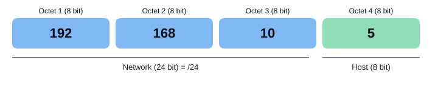

*شکل ۱: آدرس 192.168.10.5/24؛ ۳ Octet اول «شبکه» و آخری «میزبان» است.*

**Mask** هم یک عدد ۳۲ بیتی است: از چپ چند بیت 1 (قسمت شبکه) و بقیه 0 (قسمت میزبان). مثلاً Mask با ۲۴ بیت 1 برابر `255.255.255.0` است. نوشتن «تعداد بیت‌های 1» به شکل `/24` را Prefix Length می‌گویند. پس `192.168.10.5/24` یعنی: ۲۴ بیت اول = شبکه، ۸ بیت آخر = میزبان.

| Prefix | Mask            | تعداد آدرس | Host قابل‌استفاده | اندازه بلوک (Octet آخر) |
|--------|-----------------|------------|------------------|-------------------------|
| /24    | 255.255.255.0   | 256        | 254              | —                       |
| /25    | 255.255.255.128 | 128        | 126              | 128                     |
| /26    | 255.255.255.192 | 64         | 62               | 64                      |
| /27    | 255.255.255.224 | 32         | 30               | 32                      |
| /28    | 255.255.255.240 | 16         | 14               | 16                      |
| /29    | 255.255.255.248 | 8          | 6                | 8                       |
| /30    | 255.255.255.252 | 4          | 2                | 4                       |

**فرمول تعداد آدرس:** هر Subnet به‌اندازه‌ی «۲ به توان تعداد بیت‌های میزبان» آدرس دارد. دو آدرس از آن‌ها رزرو است (اولی آدرس شبکه، آخری Broadcast) و به Host داده نمی‌شود.

``` text
Total addresses = 2 ^ (32 - Prefix)
Usable hosts    = 2 ^ (32 - Prefix) - 2

Example (/26):
  Host bits = 32 - 26 = 6
  Total     = 2 ^ 6   = 64
  Usable    = 64 - 2  = 62
```

### ۴. محاسبه Subnet: روش گام‌به‌گام

برای هر آدرس/Prefix چهار پاسخ می‌خواهیم: **شبکه**، **Broadcast**، **Hostهای قابل‌استفاده (اولی تا آخری)**، **تعداد Host**.

> **روش «اندازه بلوک» (Block Size)**
>
> 1.  Octet «جالب» را پیدا کن: همان Octetی که Mask آن نه 0 است و نه 255.
> 2.  اندازه بلوک را با فرمول زیر حساب کن.
> 3.  عدد Octet آدرس را به نزدیک‌ترین مضرب بلوک (به سمت پایین) گرد کن؛ این می‌شود آدرس شبکه.
> 4.  Broadcast یک عدد کمتر از شبکه بعدی است.
> 5.  Hostها: از «شبکه + 1» تا «Broadcast - 1».

``` text
Block size = 256 - (mask value of the interesting octet)
Network    = largest multiple of Block size that is <= octet value
Broadcast  = (next network) - 1
First host = Network + 1
Last host  = Broadcast - 1
```

#### مثال ۱ (ساده): 192.168.1.10/24

``` text
Mask       = 255.255.255.0   (no interesting octet)
Network    = 192.168.1.0
Broadcast  = 192.168.1.255
Hosts      = 192.168.1.1 - 192.168.1.254
Host count = 2^8 - 2 = 254
```

چون Mask در سه Octet اول 255 است، سه Octet اول بدون تغییر می‌ماند.

#### مثال ۲ (متوسط): 10.10.20.77/26

``` text
Mask         = 255.255.255.192
Interesting  = 4th octet (192)
Block size   = 256 - 192 = 64
Blocks       = 0, 64, 128, 192
77 is between 64 and 127
Network      = 10.10.20.64
Next network = 10.10.20.128
Broadcast    = 10.10.20.127
Hosts        = 10.10.20.65 - 10.10.20.126
Host count   = 2^6 - 2 = 62
```

#### مثال ۳ (سخت): 172.16.45.200/20

``` text
/20 = 8 + 8 + 4 bits
Mask         = 255.255.240.0
Interesting  = 3rd octet (240)
Block size   = 256 - 240 = 16
Blocks       = 0, 16, 32, 48 ...
45 is between 32 and 47
Network      = 172.16.32.0
Next network = 172.16.48.0
Broadcast    = 172.16.47.255
Hosts        = 172.16.32.1 - 172.16.47.254
Host count   = 2^12 - 2 = 4094
```

#### مثال ۴ (معکوس): به ۵۰ Host نیاز دارم؛ Prefix چند؟

``` text
Need          = 50 hosts + 2 reserved = 52
Smallest 2^n >= 52  ->  n = 6  (2^6 = 64)
Host bits     = 6
Prefix        = 32 - 6 = /26
Usable hosts  = 64 - 2 = 62   (enough for 50)
```

همیشه «+2» را فراموش نکن؛ بدون آن جواب اشتباه می‌شود.

### تعداد کل IPهای یک Subnet را با «اندازه بلوک» حساب کنیم

فقط یک سؤال داریم: **یک Subnet روی‌هم چند آدرس دارد؟** فعلاً کاری با آدرس شبکه، Broadcast یا Hostها نداریم. هر Octet ۲۵۶ حالت دارد (از 0 تا 255). پس برای شمردن کل آدرس‌ها دو چیز لازم است: اندازه بلوک، و اینکه «Octet جالب» کجاست.

``` text
Total IPs = Block size x 256 ^ n

Block size = 256 - (mask value of the interesting octet)
n          = number of octets AFTER the interesting octet
```

Octet جالب همان Octetی است که Mask آن نه 0 است و نه 255. هر Octet بعد از آن، کاملاً در بخش میزبان است و ضریب ۲۵۶ می‌آورد.

#### مثال اول: تغییر در Octet چهارم

``` text
192.168.1.0/26
Mask       = 255.255.255.192
Block size = 256 - 192 = 64
n          = 0   (no octet after the 4th)
Total      = 64 x 256^0 = 64
```

#### مثال دوم: تغییر در Octet سوم

``` text
192.168.0.0/22
Mask       = 255.255.252.0
Block size = 256 - 252 = 4
n          = 1   (the 4th octet)
Total      = 4 x 256 = 1024
```

#### مثال سوم: تغییر در Octet دوم

``` text
10.0.0.0/14
Mask       = 255.252.0.0
Block size = 256 - 252 = 4
n          = 2   (the 3rd and 4th octets)
Total      = 4 x 256 x 256 = 262144
```

#### مثال چهارم: تغییر در Octet اول

``` text
0.0.0.0/6
Mask       = 252.0.0.0
Block size = 256 - 252 = 4
n          = 3   (the 2nd, 3rd and 4th octets)
Total      = 4 x 256 x 256 x 256 = 67108864
```

#### جدول خلاصه

| محل تغییر   | اندازه بلوک (نمونه) | محاسبه              | تعداد کل IP |
|-------------|---------------------|---------------------|-------------|
| Octet چهارم | 64                  | 64                  | 64          |
| Octet سوم   | 4                   | 4 × 256             | 1,024       |
| Octet دوم   | 4                   | 4 × 256 × 256       | 262,144     |
| Octet اول   | 4                   | 4 × 256 × 256 × 256 | 67,108,864  |

> **دو نکته‌ی مهم**
>
> ۱) این عدد «کل آدرس‌ها» است؛ برای Host قابل‌استفاده باید ۲ تا کم کنید (شبکه و Broadcast). ۲) اگر Mask دقیقاً روی مرز Octet بود (مثل /24 یا /16 یا /8)، Octet جالب نداریم؛ ساده‌ترین کار این است که اولین Octet صفر را «بلوک ۲۵۶» بگیرید: برای /24 می‌شود ۲۵۶ و برای /16 می‌شود ۲۵۶ × ۲۵۶ = ۶۵۵۳۶.

#### خودآزمایی (آسان تا سخت)

**م1.** سؤال ۱: Mask = 255.255.255.224؛ تعداد کل آدرس؟ *(پاسخ: 2-1-م1 در بخش «پاسخ‌ها» انتهای فصل)*

**م2.** سؤال ۲: Mask = 255.255.248.0؛ تعداد کل آدرس؟ *(پاسخ: 2-1-م2 در بخش «پاسخ‌ها» انتهای فصل)*

**م3.** سؤال ۳: Mask = 255.240.0.0؛ تعداد کل آدرس؟ *(پاسخ: 2-1-م3 در بخش «پاسخ‌ها» انتهای فصل)*

**م4.** سؤال ۴ (بررسی با روش توان ۲): آیا جواب سؤال ۳ با 2 به توان بیت‌های میزبان می‌خواند؟ *(پاسخ: 2-1-م4 در بخش «پاسخ‌ها» انتهای فصل)*

### جدول توان‌های ۲ (برای محاسبه‌ی سریع)

تمام محاسبه‌های Subnetting روی توان‌های ۲ بنا شده‌اند: تعداد آدرس‌ها، اندازه بلوک و تعداد Host. این جدول را چند بار بخوانید تا به‌خاطر بسپارید؛ الگو ساده است: هر ردیف دو برابر ردیف قبلی است.

| توان   | حاصل   |
|--------|--------|
| 2 ^ 0  | 1      |
| 2 ^ 1  | 2      |
| 2 ^ 2  | 4      |
| 2 ^ 3  | 8      |
| 2 ^ 4  | 16     |
| 2 ^ 5  | 32     |
| 2 ^ 6  | 64     |
| 2 ^ 7  | 128    |
| 2 ^ 8  | 256    |
| 2 ^ 9  | 512    |
| 2 ^ 10 | 1,024  |
| 2 ^ 11 | 2,048  |
| 2 ^ 12 | 4,096  |
| 2 ^ 13 | 8,192  |
| 2 ^ 14 | 16,384 |
| 2 ^ 15 | 32,768 |
| 2 ^ 16 | 65,536 |

> **نکته‌ی حفظ‌کردن**
>
> اگر عدد ۲ به توان ۱۰ را (۱,۰۲۴) به یاد داشته باشید، بقیه را می‌توانید از روی آن بسازید: برای هر توان بالاتر دو برابر کنید و برای هر توان پایین‌تر نصف. مثلاً ۲ به توان ۱۲ برابر ۱۰۲۴ × ۴ است، یعنی ۴۰۹۶.

مثال کاربردی: برای /20، بیت‌های میزبان ۱۲ است؛ در جدول ردیف ۲ به توان ۱۲ را نگاه می‌کنیم: ۴,۰۹۶ آدرس.

### جدول مرجع کامل: Prefix، Mask و تعداد IP

این جدول همه‌ی Prefixها را از /32 تا /0 کنار هم می‌گذارد. آن را حفظ نکنید؛ بفهمید و هر وقت لازم شد نگاه کنید. دو الگو را ببینید: با هر یک Prefix کمتر، تعداد آدرس‌ها **دو برابر** می‌شود؛ و ستون «تعداد کل IP» همان ۲ به توان «بیت‌های میزبان» است.

| Prefix | Subnet Mask     | بیت‌های میزبان | تعداد کل IP   |
|--------|-----------------|---------------|---------------|
| /32    | 255.255.255.255 | 0             | 1             |
| /31    | 255.255.255.254 | 1             | 2             |
| /30    | 255.255.255.252 | 2             | 4             |
| /29    | 255.255.255.248 | 3             | 8             |
| /28    | 255.255.255.240 | 4             | 16            |
| /27    | 255.255.255.224 | 5             | 32            |
| /26    | 255.255.255.192 | 6             | 64            |
| /25    | 255.255.255.128 | 7             | 128           |
| /24    | 255.255.255.0   | 8             | 256           |
| /23    | 255.255.254.0   | 9             | 512           |
| /22    | 255.255.252.0   | 10            | 1,024         |
| /21    | 255.255.248.0   | 11            | 2,048         |
| /20    | 255.255.240.0   | 12            | 4,096         |
| /19    | 255.255.224.0   | 13            | 8,192         |
| /18    | 255.255.192.0   | 14            | 16,384        |
| /17    | 255.255.128.0   | 15            | 32,768        |
| /16    | 255.255.0.0     | 16            | 65,536        |
| /15    | 255.254.0.0     | 17            | 131,072       |
| /14    | 255.252.0.0     | 18            | 262,144       |
| /13    | 255.248.0.0     | 19            | 524,288       |
| /12    | 255.240.0.0     | 20            | 1,048,576     |
| /11    | 255.224.0.0     | 21            | 2,097,152     |
| /10    | 255.192.0.0     | 22            | 4,194,304     |
| /9     | 255.128.0.0     | 23            | 8,388,608     |
| /8     | 255.0.0.0       | 24            | 16,777,216    |
| /7     | 254.0.0.0       | 25            | 33,554,432    |
| /6     | 252.0.0.0       | 26            | 67,108,864    |
| /5     | 248.0.0.0       | 27            | 134,217,728   |
| /4     | 240.0.0.0       | 28            | 268,435,456   |
| /3     | 224.0.0.0       | 29            | 536,870,912   |
| /2     | 192.0.0.0       | 30            | 1,073,741,824 |
| /1     | 128.0.0.0       | 31            | 2,147,483,648 |
| /0     | 0.0.0.0         | 32            | 4,294,967,296 |

> **دو حالت خاص**
>
> **/32** فقط یک آدرس است (یک Host مشخص، مثلاً Loopback یا Route برای یک دستگاه). **/31** دو آدرس دارد و طبق استاندارد RFC 3021 برای لینک نقطه‌به‌نقطه بین دو روتر می‌شود از هر دو آدرس استفاده کرد (بدون کسر ۲). برای بقیه‌ی Prefixها، Host قابل‌استفاده برابر «تعداد کل منهای ۲» است.

### کامپیوترها چطور می‌فهمند با هم در یک شبکه‌اند؟

کامپیوتر هیچ «نقشه‌ای» از شبکه ندارد؛ فقط IP و Mask خودش و IP مقصد را می‌داند. با یک عملیات ساده‌ی بیتی به نام AND تصمیم می‌گیرد:

1.  IP را به باینری تبدیل می‌کند.
2.  Mask را به باینری تبدیل می‌کند.
3.  بیت‌به‌بیت AND می‌گیرد؛ نتیجه «آدرس شبکه» (Network) است.
4.  همین کار را برای IP مقصد با Mask خودش انجام می‌دهد.
5.  اگر دو آدرس شبکه برابر بود، «هم‌شبکه» هستند و مستقیم (با ARP) ارتباط می‌گیرند؛ وگرنه بسته را به Gateway می‌دهد.

#### قانون AND (جدول درستی)

``` text
0 AND 0 = 0
0 AND 1 = 0
1 AND 0 = 0
1 AND 1 = 1
```

فقط وقتی هر دو بیت 1 باشند نتیجه 1 است. چون Mask در بخش شبکه همه 1 است، بیت‌های شبکه حفظ می‌شوند؛ و چون در بخش میزبان همه 0 است، بیت‌های میزبان صفر می‌شوند. به همین دلیل نتیجه‌ی AND همیشه «آدرس شبکه» است.

#### مثال ساده: هم‌شبکه

دو کامپیوتر: A = 192.168.1.10/24 و B = 192.168.1.20/24. سه Octet اول Mask برابر 255 (همه 1) است و بدون تغییر می‌ماند؛ فقط Octet آخر را محاسبه می‌کنیم.

``` text
Mask last octet : 0     = 00000000

A last octet    : 10    = 00001010
A AND Mask      :         00000000  = 0
A network       : 192.168.1.0

B last octet    : 20    = 00010100
B AND Mask      :         00000000  = 0
B network       : 192.168.1.0

192.168.1.0 = 192.168.1.0  ->  SAME network
```

#### مثال متوسط: شبیه‌اند ولی هم‌شبکه نیستند

A = 10.10.20.77/26 و B = 10.10.20.130/26. Mask چهارم برابر 192 است.

``` text
Mask last octet : 192   = 11000000

A last octet    : 77    = 01001101
A AND Mask      :         01000000  = 64
A network       : 10.10.20.64

B last octet    : 130   = 10000010
B AND Mask      :         10000000  = 128
B network       : 10.10.20.128

10.10.20.64 != 10.10.20.128  ->  DIFFERENT networks
Result: A sends to its Default Gateway (a router is required)
```

> **نتیجه‌ی کلیدی**
>
> «هم‌شبکه بودن» یعنی آدرس شبکه‌ی دو Host (حاصل IP AND Mask) برابر باشد؛ نه اینکه IPها شبیه هم باشند.

### ۵. Packet Flow: آیا دو Host هم‌شبکه‌اند؟

وقتی Host می‌خواهد بسته بفرستد، با Mask خودش تصمیم می‌گیرد: آدرس مقصد را با Mask AND می‌کند؛ اگر شبکه برابر شبکه خودش بود، مقصد «همین لینک» است و با ARP مستقیم می‌فرستد؛ وگرنه بسته را به Default Gateway می‌دهد.

``` text
Host A: 10.10.20.77/26    network 10.10.20.64   (range 64 .. 127)
Host B: 10.10.20.130/26   network 10.10.20.128  (range 128 .. 191)

A wants to send to B:
  Is B in A's network?   130 is greater than 127  ->  NO
  So A sends the packet to its Default Gateway (the router).
```

نکته جالب: دو آدرس `10.10.20.77` و `10.10.20.130` ظاهراً شبیه‌اند ولی در دو Subnet متفاوت‌اند، و بدون Router با هم حرف نمی‌زنند.

### اگر Default Gateway تنظیم نشده باشد چه می‌شود؟

تصمیم Host همیشه با IP و Mask خودش شروع می‌شود. سپس بسته به نتیجه، یکی از دو مسیر زیر را می‌رود. نکته‌ی مهم این است که **ARP در هر دو مسیر انجام می‌شود**، ولی برای MAC متفاوت.

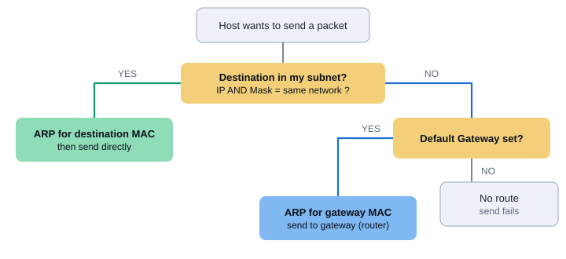

*شکل: درخت تصمیم Host هنگام ارسال بسته؛ در هر دو حالت مسیر درست با ARP کامل می‌شود.*

| حالت                                   | ARP برای چه MAC؟    | فریم به کجا می‌رود؟                          |
|----------------------------------------|---------------------|---------------------------------------------|
| مقصد در Subnet خودم است                | MAC مقصد نهایی      | مستقیم به مقصد                              |
| مقصد در Subnet دیگر است                | MAC Default Gateway | به روتر، و روتر ادامه می‌دهد                 |
| مقصد در Subnet دیگر است و Gateway نیست | —                   | ارتباط برقرار نمی‌شود (جایی برای ارسال نیست) |

پس دو کامپیوتر در دو Subnet متفاوت، بدون Default Gateway (و بدون Route دستی دیگر)، نمی‌توانند با هم ارتباط بگیرند. ARP فقط برای دستگاه‌های «روی همین لینک» جواب می‌دهد؛ هیچ دستگاهی در Subnet دیگر به ARP Request شما پاسخ نمی‌دهد.

> **قاعده‌ی خلاصه**
>
> اگر مقصد همسایه است، با ARP خودش را پیدا می‌کنیم. اگر همسایه نیست، بسته را برای دروازه می‌فرستیم و دروازه تصمیم می‌گیرد.

### ۶. آدرس‌های خاص (باید بشناسید)

| بازه            | نام                            | کاربرد                                                       |
|-----------------|--------------------------------|--------------------------------------------------------------|
| 10.0.0.0/8      | آدرس خصوصی (RFC 1918) - کلاس A | داخل سازمان؛ در اینترنت Route نمی‌شود                         |
| 172.16.0.0/12   | آدرس خصوصی (RFC 1918) - کلاس B | داخل سازمان؛ در اینترنت Route نمی‌شود                         |
| 192.168.0.0/16  | آدرس خصوصی (RFC 1918) - کلاس C | داخل سازمان؛ در اینترنت Route نمی‌شود                         |
| 127.0.0.0/8     | Loopback                       | تست خود دستگاه (`127.0.0.1`)                                 |
| 169.254.0.0/16  | APIPA (Link-Local)             | وقتی Client از DHCP آدرس نگرفت خودش می‌سازد؛ نشانه خرابی DHCP |
| 224.0.0.0/4     | Multicast                      | مثلاً OSPF و HSRP                                             |
| 203.0.113.0/24  | مستندات (TEST-NET-3)           | در Lab ما «اینترنت شبیه‌سازی‌شده» است                          |
| 198.51.100.0/24 | مستندات (TEST-NET-2)           | مثال در مستندات                                              |

> **ارتباط با دوره**
>
> اگر Client شما `169.254.x.x` دارد، یعنی DHCP جواب نداده؛ در عیب‌یابی TS10 می‌بینید.

### ۷. تمرین‌های درجه‌بندی‌شده (قبل از Lab حل کنید)

هرکدام را روی کاغذ حل کنید، بعد جواب را باز کنید.

**ت1.** ۱ (ساده): 192.168.5.130/24 *(پاسخ: 2-1-ت1 در بخش «پاسخ‌ها» انتهای فصل)*

**ت2.** ۲: 10.0.0.9/30 *(پاسخ: 2-1-ت2 در بخش «پاسخ‌ها» انتهای فصل)*

**ت3.** ۳: 192.168.1.100/27 *(پاسخ: 2-1-ت3 در بخش «پاسخ‌ها» انتهای فصل)*

**ت4.** ۴: 192.168.0.200/25 *(پاسخ: 2-1-ت4 در بخش «پاسخ‌ها» انتهای فصل)*

**ت5.** ۵: به ۸ Host نیاز دارم؛ Prefix؟ *(پاسخ: 2-1-ت5 در بخش «پاسخ‌ها» انتهای فصل)*

**ت6.** ۶ (سخت): 172.31.14.9/22 *(پاسخ: 2-1-ت6 در بخش «پاسخ‌ها» انتهای فصل)*

**ت7.** ۷ (سخت): 10.1.200.15/19 *(پاسخ: 2-1-ت7 در بخش «پاسخ‌ها» انتهای فصل)*

**ت8.** ۸: آیا 10.10.20.77/26 و 10.10.20.130/26 هم‌شبکه‌اند؟ *(پاسخ: 2-1-ت8 در بخش «پاسخ‌ها» انتهای فصل)*

### ۸. Lab هدایت‌شده: «Mask چطور تعیین می‌کند چه کسی همسایه است»

در Lab `L00-ImageValidation` می‌دانید `R1` روی `Gi0/0.10` آدرس `10.10.10.1/24` و `SW1` روی `Vlan10` آدرس `10.10.10.2/24` دارد و `ping` کار می‌کند. حالا عمداً Mask را خراب می‌کنیم تا اثرش را ببینید.

#### گام ۱: وضعیت سالم

``` text
R1# show ip interface brief
R1# show ip route connected
R1# ping 10.10.10.2
```

`show ip route connected` باید شبکه `10.10.10.0/24` را به‌عنوان Connected نشان بدهد؛ `ping` موفق.

#### گام ۲: تغییر آدرس سوییچ به یک Host «بالای نصف»

``` text
SW1# configure terminal
SW1(config)# interface vlan 10
SW1(config-if)# ip address 10.10.10.130 255.255.255.0
SW1(config-if)# end
```

#### گام ۳: تنگ‌کردن Mask روی روتر

``` text
R1# configure terminal
R1(config)# interface gi0/0.10
R1(config-subif)# ip address 10.10.10.1 255.255.255.128
R1(config-subif)# end
R1# show ip route connected
R1# ping 10.10.10.130
```

**پیش‌بینی (قبل از اجرا فکر کنید):** با Mask جدید، محدوده‌ی «همین لینک» برای روتر کوچک‌تر شده است:

``` text
R1 new mask = /25
R1 network  = 10.10.10.0 - 10.10.10.127
SW1 address = 10.10.10.130   -> outside this range
Result      : R1 has no connected route to .130 -> ping fails
```

نتیجه‌ی واقعی را بنویسید؛ اگر چیز دیگری دیدید همان را ثبت کنید. سمت سوییچ Mask قبلی (/24) را دارد و فکر می‌کند روتر همسایه است؛ پس ارتباط «نیمه‌کاره» می‌شود.

#### گام ۴: رفع

``` text
R1(config)# interface gi0/0.10
R1(config-subif)# ip address 10.10.10.1 255.255.255.0
R1(config-subif)# end
R1# ping 10.10.10.130
```

بعد از رفع، ping موفق می‌شود. سپس آدرس سوییچ را به `10.10.10.2` برگردانید.

### ۹. Lab مستقل

سه Subnet بسازید: ۴۰ Host، ۱۰ Host و یک لینک دو روتر. از `192.168.50.0/24` با روش اندازه بلوک شروع کنید و برای هرکدام Prefix، شبکه، Broadcast، اولین و آخرین Host را بنویسید. جدول را در فایل `02-design/ip-plan-drill.md` ذخیره کنید.

### ۱۰. عیب‌یابی (TS13: Mask اشتباه، TS14: Gateway اشتباه)

| بخش                | شرح                                                                                                                                              |
|--------------------|--------------------------------------------------------------------------------------------------------------------------------------------------|
| Symptom            | یک Host فقط به بعضی Hostهای همان VLAN می‌رسد                                                                                                      |
| سرنخ اول           | Hostهای «بالای» یک عدد خاص (مثلاً .128 به بالا) جواب نمی‌دهند                                                                                      |
| روش                | ۱) `ipconfig /all` یا `show ip interface brief` ۲) Mask و Gateway را با Subnet مقایسه کن ۳) `ping` هم‌سایه و Gateway ۴) `show ip route connected` |
| علت                | Mask نادرست (مثلاً /25 به‌جای /24) یا Gateway خارج Subnet                                                                                          |
| رفع و Verification | تصحیح Mask/Gateway؛ ping همه Hostها                                                                                                              |

### ۱۱. سؤال‌های مرور (Active Recall، بدون نگاه)

**م5.** آدرس شبکه و Broadcast با چه فرمولی پیدا می‌شود؟ *(پاسخ: 2-1-م5 در بخش «پاسخ‌ها» انتهای فصل)*

**م6.** چرا Host قابل‌استفاده = آدرس‌ها منهای ۲ است؟ *(پاسخ: 2-1-م6 در بخش «پاسخ‌ها» انتهای فصل)*

**م7.** /26 چند Host دارد و بلوکش چند است؟ *(پاسخ: 2-1-م7 در بخش «پاسخ‌ها» انتهای فصل)*

**م8.** Client با 169.254.x.x یعنی چه؟ *(پاسخ: 2-1-م8 در بخش «پاسخ‌ها» انتهای فصل)*

**م9.** دو Host در یک Subnet با چه روشی هم‌شبکه بودنشان را تشخیص می‌دهند؟ *(پاسخ: 2-1-م9 در بخش «پاسخ‌ها» انتهای فصل)*

### English Corner: انگلیسی تخصصی این درس

این جمله‌ها از مستندات و محیط کار واقعی‌اند. بلند بخوانید و ترجمه را بپوشانید.

| English sentence                                                             | ترجمه                                                           |
|------------------------------------------------------------------------------|-----------------------------------------------------------------|
| The subnet mask determines which part of the address identifies the network. | ماسک زیرشبکه مشخص می‌کند کدام بخش آدرس، شبکه را تعیین می‌کند.     |
| The host cannot reach devices outside its subnet without a default gateway.  | بدون Default Gateway، Host به دستگاه‌های خارج از Subnet نمی‌رسد.  |
| A /26 prefix provides 62 usable host addresses.                              | یک Prefix با طول /26 تعداد ۶۲ آدرس قابل‌استفاده برای Host می‌دهد. |
| The client self-assigned a 169.254.x.x address because DHCP failed.          | Client چون DHCP شکست خورد، خودش آدرس 169.254.x.x گرفت.          |

**Q1.** Quick quiz (answer in English): How many usable hosts are in a /27 subnet? *(پاسخ: 2-1-Q1 در بخش «پاسخ‌ها» انتهای فصل)*

### ۱۲. تکلیف و چک‌لیست تسلط

- [ ] ۸ تمرین بخش ۷ را بدون نگاه حل کنم.
- [ ] ده عدد دلخواه را به باینری و برعکس تبدیل کنم.
- [ ] آزمایش Mask (گام ۱ تا ۴) را انجام دهم و نتیجه واقعی `ping` را ثبت کنم.
- [ ] Lab مستقل را در Git (بدون رمز) ذخیره کنم.
- [ ] توضیح بدهم چرا ۲ آدرس رزرو است.

### ۱۳. یادآوری اشتباهات شما

> **یادآوری ۱**
>
> اول `enable` و بعد `configure terminal`؛ و فقط یک‌بار.

> **یادآوری ۲**
>
> دستورهای EXEC (مثل `monitor capture`) در Config خطا می‌دهند؛ خطای «Invalid input» همیشه ناسازگاری Image نیست.

> **یادآوری ۳**
>
> «فرمان پذیرفته شد» ≠ «Feature کار می‌کند»؛ با ترافیک واقعی بسنجید.


#### کارت Lab — درس ۲-۱

| # | فیلد | محتوا |
|---|---|---|
| 1 | عنوان و هدف | دیدن اثر Mask غلط روی ارتباط R1 و SW1 |
| 2 | پیش‌نیاز | درس ۱-B؛ Lab L00 سالم |
| 3 | توپولوژی | R1 Gi0/0.10 ↔ trunk ↔ SW1 Vlan10 |
| 4 | تجهیزات | R1، SW1 |
| 5 | نسخه نرم‌افزار | vIOS-L2 15.2(20200924، Experimental) برای SW؛ vIOS 15.9(3)M9 برای R؛ VPCS (PNetLab)؛ PNetLab 4.2.8 |
| 6 | IP Plan | 10.10.10.1/24 (R1)، 10.10.10.2/24 (SW1) |
| 7 | وضعیت اولیه | ping بین R1 و SW1 موفق |
| 8 | صورت مسئله | Mask را عمداً /25 کنید، نتیجه‌ی ping به 10.10.10.130 را قبل از اجرا پیش‌بینی و بعد ثبت کنید |
| 9 | مراحل هدایت‌شده | همان بخش «Lab هدایت‌شده» همین درس (گام‌به‌گام) |
| 10 | تست عملکرد | `show ip route connected` ؛ `ping 10.10.10.130` |
| 11 | سناریوی خرابی | Mask /25 روی R1 و /24 روی SW1 (نیمه‌کاره) |
| 12 | روش عیب‌یابی | مقایسه‌ی Mask دو سر، `show ip route connected` |
| 13 | نتیجه‌ی مورد انتظار | ping به .130 قبل از رفع شکست می‌خورد؛ بعد از رفع موفق |
| 14 | معیار پذیرش | پیش‌بینی ثبت‌شده با نتیجه‌ی واقعی مقایسه شود؛ رفع کامل |
| 15 | مستندات نهایی | جدول `02-design/ip-plan-drill.md` |
| 16 | Cleanup و بازگردانی | آدرس SW1 را به 10.10.10.2 و Mask R1 را به /24 برگردانید |

> **وضعیت راستی‌آزمایی (خارج از ۱۶ فیلد):** **اجرا نشده (فقط طراحی).** مرحله‌ی Mask غلط اجرا نشده. پیش‌شرط (RoAS + ping R1↔SW1) در Probe ۱-B به‌صورت Tested-OK دیده شده است.

---

<a id="l-2-2"></a>

## درس ۲-۲ — VLSM و طراحی IP Plan

**فصل ۲ - روز ۲ · پیش‌نیاز: درس ۲-۱ · ۶ ساعت**

### این درس درباره چیست و چرا باید یاد بگیریم؟

**چه چیزی یاد می‌گیریم:** چطور یک بلوک آدرس را به Subnetهای هم‌اندازه‌ی نامناسب نبُریم، بلکه برای هر بخش سازمان دقیقاً به اندازه نیازش آدرس بدهیم. این کار را VLSM (مخفف Variable Length Subnet Mask، یعنی «ماسک زیرشبکه با طول متغیر») می‌گویند. بعد، نتیجه را در یک «برنامه‌ی آدرس‌دهی» (IP Plan، مخفف IP Addressing Plan) می‌نویسیم.

**چرا لازم است:** تصور کنید یک ساختمان اداری دارید و می‌خواهید طبقه‌ها را تقسیم کنید. اگر همه‌ی اتاق‌ها را به‌اندازه‌ی بزرگ‌ترین اتاق (سالن اجتماعات) بسازید، فضای زیادی هدر می‌رود. در شبکه هم همین است: لینک بین دو روتر فقط به ۲ آدرس نیاز دارد، ولی اگر یک /24 با ۲۵۴ آدرس به آن بدهید، ۲۵۲ آدرس هدر رفته است.

- **در کار روزانه:** وقتی شعبه‌ی جدید باز می‌شود، باید بدون به‌هم‌ریختن شبکه‌ی فعلی، آدرس تازه بدهید.
- **در امنیت:** هر Subnet یک «مرز» برای فایروال است. Subnetهای درست‌اندازه یعنی قانون‌های دقیق‌تر.
- **در دوره‌ی ما:** پروژه‌ی نهایی (Capstone) یک مرکز و سه شعبه دارد؛ IP Plan آن را همین هفته می‌سازیم.

> **مسیر درس**
>
> مشکل (هدررفت) ← ایده‌ی VLSM ← مثال ساده ← مثال متوسط ← مثال سخت (سازمان واقعی) ← تمرین ← Lab ← عیب‌یابی.

#### اصطلاحات این درس (مخفف ← شکل کامل ← معنی)

| مخفف    | شکل کامل انگلیسی                    | معنی فارسی                                                    |
|---------|-------------------------------------|---------------------------------------------------------------|
| VLSM    | Variable Length Subnet Mask         | ماسک زیرشبکه با طول متغیر؛ هر بخش به اندازه نیازش آدرس می‌گیرد |
| IP Plan | IP Addressing Plan                  | برنامه و سند آدرس‌دهی سازمان                                   |
| VLAN    | Virtual Local Area Network          | شبکه محلی مجازی؛ جداسازی منطقی روی یک سوییچ                   |
| DMZ     | Demilitarized Zone                  | منطقه حائل برای سرورهای در دسترس از بیرون                     |
| Gateway | Default Gateway                     | دروازه پیش‌فرض                                                 |
| DHCP    | Dynamic Host Configuration Protocol | تخصیص خودکار آدرس                                             |
| CIDR    | Classless Inter-Domain Routing      | نمایش آدرس با Prefix بدون کلاس، مثل /26                       |

### ۱. مشکل: تقسیم هم‌اندازه و هدررفت آدرس

فرض کنید بلوک `192.168.10.0/24` (۲۵۶ آدرس) دارید و چهار بخش می‌خواهید: فروش (۱۰۰ کامپیوتر)، فنی (۵۰)، مدیریت (۱۲)، و یک لینک بین دو روتر (۲).

اگر ساده‌لوحانه همه را /26 (۶۲ Host) بسازید، فروش جا نمی‌شود (۱۰۰ \> ۶۲). اگر همه را /25 (۱۲۶ Host) بسازید، فقط ۲ Subnet می‌گیرید و چهار بخش جا نمی‌شود. یعنی با اندازه‌ی ثابت، نه هدر نمی‌دهیم و نه جا می‌شویم. راه‌حل: **اندازه‌ی متغیر**.

### سؤال مهم: در شبکه داخلی برای IP پولی نمی‌دهیم، پس چرا اینقدر مراقب هدررفت هستیم؟

حرف درستی است: آدرس‌های خصوصی (مثل 10.0.0.0/8 یا 192.168.0.0/16) هزینه ندارند و هیچ‌کس برای آن‌ها فاکتور نمی‌فرستد. اما «پول» تنها دلیل VLSM نیست. دلیل‌های اصلی این‌هاست:

| دلیل                   | توضیح                                                                                                                   |
|------------------------|-------------------------------------------------------------------------------------------------------------------------|
| ۱. بلوک شما محدود است  | معمولاً از یک بلوک مشخص (مثلاً یک /24 یا /22) استفاده می‌کنید. اگر هر لینک دو روتر یک /24 کامل بگیرد، بلوک زود تمام می‌شود. |
| ۲. رشد آینده           | شعبه‌ی جدید و VLAN جدید می‌آید. اگر فضا را هدر داده باشید، مجبور می‌شوید همه‌چیز را عوض کنید.                               |
| ۳. مدیریت و مستندسازی  | Subnetهای درست‌اندازه و منظم، IP Plan را خوانا و عیب‌یابی را سریع می‌کند.                                                  |
| ۴. خلاصه‌سازی مسیرها    | وقتی آدرس‌ها پشت‌سرهم و منظم باشند، می‌شود چند Route را در یک Route خلاصه کرد (جدول Route کوچک‌تر).                         |
| ۵. جلوگیری از هم‌پوشانی | در ادغام شرکت‌ها یا اتصال VPN بین دو سایت، بازه‌ها نباید هم‌پوشانی داشته باشند؛ مصرف بی‌حساب بازه این خطر را بالا می‌برد.    |
| ۶. امنیت و Broadcast   | Subnet خیلی بزرگ یعنی Broadcast Domain بزرگ و Policy فایروال درشت و نامحدود.                                            |

> **یک نکته‌ی صادقانه**
>
> اگر بلوک خیلی بزرگی مثل 10.0.0.0/8 دارید، کمبود آدرس معمولاً مشکل اصلی نیست. آن‌جا دلیل‌های ۳ تا ۶ (نظم، خلاصه‌سازی، هم‌پوشانی و امنیت) مهم‌ترند. VLSM در بلوک‌های کوچک‌تر و در لینک‌های بین روترها اهمیت بیشتری دارد.

#### VLSM کجا چقدر مهم است؟

| محیط                 | اهمیت VLSM                               |
|----------------------|------------------------------------------|
| شبکه‌ی خانگی کوچک     | کم                                       |
| شبکه‌ی شرکت کوچک      | متوسط                                    |
| سازمان بزرگ          | بسیار زیاد                               |
| ISP و شبکه‌های گسترده | بسیار زیاد (IPv4 عمومی محدود و گران است) |
| لینک بین روترها      | بسیار مهم (فقط ۲ آدرس لازم است)          |

#### مثال: ۳۰۰ کامپیوتر؛ یک /23 یا سه /24؟

``` text
Option 1: one /23
  Mask          = 255.255.254.0
  Total         = 2 ^ 9 = 512
  Usable        = 512 - 2 = 510
  Spare         = 510 - 300 = 210
  Broadcast domains = 1  (all 300 PCs together)

Option 2: three /24
  Usable each   = 254   (total 762)
  Broadcast domains = 3  (separated)
  Needs a router or L3 switch between them
```

از نظر ظرفیت، هر دو گزینه کافی است. انتخاب نهایی به طراحی بستگی دارد: اگر واحدهای سازمان باید از هم جدا باشند (امنیت، کاهش Broadcast، Policy جدا)، سه Subnet بهتر است؛ ولی برای ارتباط بینشان به دستگاه لایه ۳ نیاز دارید (روتر یا سوییچ لایه ۳). اگر همه یک گروه یکسان‌اند و نیازی به جداسازی نیست، یک /23 ساده‌تر است.

### ۲. ایده‌ی VLSM به زبان ساده

VLSM یعنی «Subnet Mask با طول متغیر» (Variable Length Subnet Mask). مثل برش پیتزا برای مهمان‌ها: به کسی که گرسنه‌تر است برش بزرگ‌تر می‌دهید و به بقیه کوچک‌تر. فقط یک قانون هست: برش‌ها نباید روی هم بیفتند.

> **سه قانون طلایی VLSM**
>
> ۱) **همیشه از بزرگ‌ترین نیاز شروع کن.** ۲) هر Subnet باید روی مرز مضرب اندازه‌ی خودش شروع شود (مثلاً یک /26 باید روی ۰، ۶۴، ۱۲۸ یا ۱۹۲ شروع شود). ۳) هیچ دو Subnet نباید هم‌پوشانی داشته باشند.

**مراحل کار برای هر بخش:** (۱) نیاز را بشمار و ۲ آدرس رزرو (شبکه و Broadcast) اضافه کن. (۲) کوچک‌ترین توان ۲ که کافی باشد را پیدا کن. (۳) Prefix را از آن بساز. (۴) از اولین آدرس آزاد شروع به تخصیص کن. (۵) آدرس بعدی آزاد را یادداشت کن.

### ۳. مثال ساده (دو بخش)

بلوک `10.0.0.0/24` را داریم. بخش A به ۱۰۰ Host و بخش B به ۲۰ Host نیاز دارد. اول بزرگ‌ترین (A):

``` text
A: need = 100 + 2 = 102
   2^7 = 128 >= 102  ->  Prefix = /25
   Network   = 10.0.0.0/25
   Hosts     = 10.0.0.1 - 10.0.0.126
   Broadcast = 10.0.0.127
   Next free = 10.0.0.128
```

بعد B از اولین آدرس آزاد شروع می‌شود:

``` text
B: need = 20 + 2 = 22
   2^5 = 32 >= 22   ->  Prefix = /27
   Network   = 10.0.0.128/27
   Hosts     = 10.0.0.129 - 10.0.0.158
   Broadcast = 10.0.0.159
   Next free = 10.0.0.160  (up to 10.0.0.255 stays free for growth)
```

باقی‌مانده بلوک (۱۶۰ تا ۲۵۵) برای رشد آینده خالی می‌ماند و هدررفت نیست.

### ۴. مثال متوسط (چهار بخش)

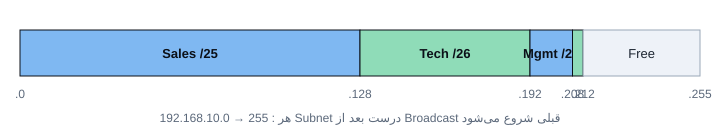

*شکل ۲: نوار آدرس VLSM؛ بخش بزرگ‌تر اول و بدون هم‌پوشانی.*

بلوک `192.168.10.0/24`؛ همان چهار بخش بخش ۱: فروش ۱۰۰، فنی ۵۰، مدیریت ۱۲، لینک روتر ۲.

| بخش       | نیاز+۲ | اندازه | Prefix | شبکه           | Hostها      | Broadcast |
|-----------|--------|--------|--------|----------------|-------------|-----------|
| فروش      | 102    | 128    | /25    | 192.168.10.0   | .1 – .126   | .127      |
| فنی       | 52     | 64     | /26    | 192.168.10.128 | .129 – .190 | .191      |
| مدیریت    | 14     | 16     | /28    | 192.168.10.192 | .193 – .206 | .207      |
| لینک روتر | 4      | 4      | /30    | 192.168.10.208 | .209 – .210 | .211      |

دقت کنید هر شروع، دقیقاً بعد از Broadcast قبلی است (۱۲۷ ← ۱۲۸، ۱۹۱ ← ۱۹۲، ۲۰۷ ← ۲۰۸). آدرس‌های `.212` تا `.255` هنوز آزادند (۴۴ آدرس).

**نکته:** اگر ترتیب را برعکس بگیرید (اول لینک /30 را در `.0` بگذارید)، بعداً /25 روی مرز ۱۲۸ می‌افتد و دیگر فروش در یک تکه جا نمی‌شود. برای همین «بزرگ‌ترین اول».

### پیش‌نیاز مثال بعدی: بلوک 10.20.0.0/22 یعنی چه؟

مثال سخت پایین با این جمله شروع می‌شود: «سازمانی بلوک `10.20.0.0/22` دارد.» اول آن را از پایه باز می‌کنیم.

#### گام ۱: معنی /22

از ۳۲ بیت آدرس، ۲۲ بیت برای «شبکه» است و ۱۰ بیت باقی‌مانده برای «میزبان». هر بیت میزبان دو حالت دارد؛ پس تعداد آدرس‌ها این‌طور حساب می‌شود:

``` text
Host bits       = 32 - 22 = 10
Total addresses = 2 ^ 10 = 1024
```

#### گام ۲: چرا آخرین آدرس 10.20.3.255 است؟

اول /22 را به Subnet Mask تبدیل می‌کنیم:

``` text
/22  = 11111111.11111111.11111100.00000000
Mask = 255.255.252.0
```

Octet سوم «جالب» است (چون 252 نه 0 است و نه 255). اندازه بلوک آن:

``` text
Block size = 256 - 252 = 4     (in the 3rd octet)
```

یعنی شبکه‌های /22 در Octet سوم هر ۴ عدد یک‌بار شروع می‌شوند:

| شماره شبکه | آدرس شروع  |
|------------|------------|
| شبکه ۱     | 10.20.0.0  |
| شبکه ۲     | 10.20.4.0  |
| شبکه ۳     | 10.20.8.0  |
| شبکه ۴     | 10.20.12.0 |

پس شبکه‌ی اول ما از `10.20.0.0` شروع می‌شود و درست قبل از شبکه‌ی بعدی (`10.20.4.0`) تمام می‌شود:

``` text
Network   = 10.20.0.0
Next net  = 10.20.4.0
Broadcast = 10.20.4.0 - 1 = 10.20.3.255
Range     = 10.20.0.0 - 10.20.3.255
```

#### گام ۳: چهار «تکه»ی داخل بلوک

Octet سوم در این بلوک چهار مقدار می‌گیرد: 0، 1، 2 و 3. هر مقدار یک تکه‌ی ۲۵۶تایی است:

``` text
10.20.0.0 - 10.20.0.255    256 addresses
10.20.1.0 - 10.20.1.255    256 addresses
10.20.2.0 - 10.20.2.255    256 addresses
10.20.3.0 - 10.20.3.255    256 addresses
Total = 4 x 256 = 1024
```

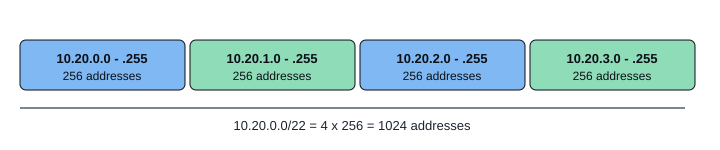

*شکل: بلوک /22 چهار تکه‌ی ۲۵۶تایی (چهار /24 پشت‌سرهم) است.*

> **نکته‌ی مهم**
>
> این چهار تکه فعلاً فقط «چهار قسمت از یک بلوک بزرگ» هستند، نه الزاماً چهار Subnet نهایی. در VLSM ما همین ۱۰۲۴ آدرس را به Subnetهایی با اندازه‌های مختلف (مثلاً /23، /25، /26، /27 و /30) تقسیم می‌کنیم؛ همان کاری که در مثال سخت پایین می‌بینید.

**سؤال خودآزمایی: در یک /22، هر تکه‌ی «Octet سوم» چند آدرس دارد؟**

``` text
Each value of the 3rd octet = 256 addresses (the last octet has 8 host bits: 2 ^ 8 = 256)
Answer: 256
```

### ۵. مثال سخت (سازمان واقعی: مرکز و سه شعبه)

سازمانی با بلوک `10.20.0.0/22` (۱۰۲۴ آدرس: `10.20.0.0` تا `10.20.3.255`). نیازها:

| بخش                   | Host |
|-----------------------|------|
| مرکز: کاربران         | 300  |
| مرکز: سرورها          | 60   |
| مرکز: مدیریت تجهیزات  | 25   |
| شعبه ۱: کاربران       | 100  |
| شعبه ۲: کاربران       | 50   |
| شعبه ۳: کاربران       | 20   |
| سه لینک روتر (هرکدام) | 2    |

**گام ۱ - اندازه هر بخش** (هر بخش یک سطر؛ مرتب از بزرگ به کوچک):

``` text
Center users    : 300 + 2 = 302 -> 512 -> /23
Branch 1        : 100 + 2 = 102 -> 128 -> /25
Center servers  :  60 + 2 =  62 ->  64 -> /26
Branch 2        :  50 + 2 =  52 ->  64 -> /26
Center mgmt     :  25 + 2 =  27 ->  32 -> /27
Branch 3        :  20 + 2 =  22 ->  32 -> /27
3 links         :   2 + 2 =   4 ->   4 -> /30 (each)
```

**گام ۲ - آیا بلوک کافی است؟**

``` text
Total needed = 512 + 128 + 64 + 64 + 32 + 32 + (3 x 4)
             = 844
Available    = 1024  (a /22)
844 <= 1024  ->  OK
```

**گام ۳ - تخصیص پشت‌سرهم:**

| بخش          | Prefix | شبکه        | Broadcast   |
|--------------|--------|-------------|-------------|
| مرکز-کاربران | /23    | 10.20.0.0   | 10.20.1.255 |
| شعبه ۱       | /25    | 10.20.2.0   | 10.20.2.127 |
| مرکز-سرورها  | /26    | 10.20.2.128 | 10.20.2.191 |
| شعبه ۲       | /26    | 10.20.2.192 | 10.20.2.255 |
| مرکز-مدیریت  | /27    | 10.20.3.0   | 10.20.3.31  |
| شعبه ۳       | /27    | 10.20.3.32  | 10.20.3.63  |
| لینک ۱       | /30    | 10.20.3.64  | 10.20.3.67  |
| لینک ۲       | /30    | 10.20.3.68  | 10.20.3.71  |
| لینک ۳       | /30    | 10.20.3.72  | 10.20.3.75  |

**گام ۴ - بررسی:** هر شروع باید دقیقاً یک عدد بعد از Broadcast قبلی باشد.

``` text
Last used address = 10.20.3.75
Free space        = 10.20.3.76 - 10.20.3.255  (180 addresses, for growth)
Overlap check     : every start = previous broadcast + 1  ->  no overlap
```

### ۶. IP Plan: سند زنده‌ی شبکه

جدول بالا هنوز «محاسبه» است. IP Plan سندی است که تیم نگه می‌دارد و این ستون‌ها را دارد: نام بخش، VLAN، شبکه/Prefix، Gateway، بازه‌ی DHCP، آدرس‌های ثابت، مالک، توضیح. قاعده‌ی تجربی: **Gateway را همیشه اولین Host (.1) بگذارید** و سرورها/تجهیزات را از انتهای بازه یا بازه‌ی ثابت جدا کنید، تا همه بدانند «.1 یعنی Gateway».

نمونه برای Lab دوره (در Capstone استفاده می‌شود؛ همین هفته در `02-design/ip-plan.md` ثبتش کنید):

| VLAN | نام     | شبکه          | Gateway    |
|------|---------|---------------|------------|
| 10   | مدیریت  | 10.10.10.0/24 | 10.10.10.1 |
| 20   | کاربران | 10.10.20.0/24 | 10.10.20.1 |
| 30   | سرورها  | 10.10.30.0/24 | 10.10.30.1 |

### ۷. تمرین‌های درجه‌بندی‌شده

**ت1.** ۱ (ساده): از 192.168.1.0/24 دو Subnet بساز: ۱۲۰ Host و ۱۰ Host *(پاسخ: 2-2-ت1 در بخش «پاسخ‌ها» انتهای فصل)*

**ت2.** ۲ (ساده): لینک بین دو روتر از 10.1.1.0/24 *(پاسخ: 2-2-ت2 در بخش «پاسخ‌ها» انتهای فصل)*

**ت3.** ۳ (متوسط): از 172.16.0.0/24: ۶۰، ۳۰، ۱۰ Host *(پاسخ: 2-2-ت3 در بخش «پاسخ‌ها» انتهای فصل)*

**ت4.** ۴ (متوسط): چرا نباید اول Subnet کوچک را بگذاریم؟ *(پاسخ: 2-2-ت4 در بخش «پاسخ‌ها» انتهای فصل)*

**ت5.** ۵ (سخت): از 10.5.0.0/23: ۲۰۰ Host، ۷۰ Host، ۳۰ Host، دو لینک *(پاسخ: 2-2-ت5 در بخش «پاسخ‌ها» انتهای فصل)*

**ت6.** ۶ (سخت): آیا 192.168.1.64/26 و 192.168.1.100/27 هم‌پوشانی دارند؟ *(پاسخ: 2-2-ت6 در بخش «پاسخ‌ها» انتهای فصل)*

### ۸. Lab هدایت‌شده: اجرای IP Plan روی روتر

برای دیدن اینکه روتر Subnetها را «می‌شناسد»، روی `R1` چند Loopback به‌عنوان Subnet مجازی می‌سازیم.

#### گام ۱: ساخت سه Subnet از مثال متوسط

``` text
R1# configure terminal
R1(config)# interface loopback 1
R1(config-if)# ip address 192.168.10.1 255.255.255.128
R1(config-if)# interface loopback 2
R1(config-if)# ip address 192.168.10.129 255.255.255.192
R1(config-if)# interface loopback 3
R1(config-if)# ip address 192.168.10.193 255.255.255.240
R1(config-if)# end
```

#### گام ۲: بررسی

``` text
R1# show ip interface brief
R1# show ip route connected
```

باید سه Route از نوع `C` ببینید: `192.168.10.0/25`، `192.168.10.128/26`، `192.168.10.192/28`. دقت کنید روتر خودش «آدرس شبکه» را از Mask محاسبه کرده است؛ همان‌طور که شما محاسبه کردید.

#### گام ۳: ایجاد عمدی هم‌پوشانی

``` text
R1(config)# interface loopback 4
R1(config-if)# ip address 192.168.10.100 255.255.255.192
```

پیش‌بینی: IOS معمولاً خطای `% 192.168.10.64 overlaps with Loopback1` می‌دهد و دستور را نمی‌پذیرد (نتیجه‌ی واقعی را ثبت کنید). همین است که از هم‌پوشانی در یک روتر جلوگیری می‌کند.

#### گام ۴: پاک‌سازی

``` text
R1(config)# no interface loopback 1
R1(config)# no interface loopback 2
R1(config)# no interface loopback 3
R1(config)# no interface loopback 4
R1(config)# end
```

### ۹. Lab مستقل

برای Capstone یک بلوک `10.50.0.0/22` انتخاب کنید و برای مرکز (کاربران ۱۵۰، سرورها ۴۰، مدیریت ۲۰، DMZ ۱۰) و سه شعبه (هرکدام ۳۰ کاربر) به‌علاوه ۳ لینک، IP Plan کامل بسازید. خروجی: `02-design/ip-plan.md` با ستون‌های گفته‌شده. بدون رمز.

### ۱۰. عیب‌یابی

|         |                                                           |
|---------|-----------------------------------------------------------|
| Symptom | بعد از اضافه‌کردن Subnet جدید، بخشی از شبکه ناگهان قطع شد  |
| سرنخ    | دو Subnet هم‌پوشان؛ روتر برای یک آدرس دو مسیر دارد         |
| روش     | `show ip route`، مقایسه‌ی Prefixها، رسم نوار آدرس روی کاغذ |
| رفع     | تغییر یکی از Subnetها به بازه‌ی آزاد و به‌روزرسانی IP Plan  |
| پیشگیری | هر آدرس جدید را اول در IP Plan ثبت کن، بعد روی دستگاه بزن |

### ۱۱. سؤال‌های مرور

**م1.** VLSM چیست و چرا به آن نیاز داریم؟ *(پاسخ: 2-2-م1 در بخش «پاسخ‌ها» انتهای فصل)*

**م2.** چرا از بزرگ‌ترین نیاز شروع می‌کنیم؟ *(پاسخ: 2-2-م2 در بخش «پاسخ‌ها» انتهای فصل)*

**م3.** بهترین Prefix برای لینک بین دو روتر چیست؟ *(پاسخ: 2-2-م3 در بخش «پاسخ‌ها» انتهای فصل)*

### English Corner: انگلیسی تخصصی این درس

این جمله‌ها از مستندات و محیط کار واقعی‌اند. بلند بخوانید و ترجمه را بپوشانید.

| English sentence                                                        | ترجمه                                                      |
|-------------------------------------------------------------------------|------------------------------------------------------------|
| VLSM lets us allocate address space according to actual need.           | VLSM اجازه می‌دهد فضای آدرس را مطابق نیاز واقعی تخصیص دهیم. |
| Always start with the largest subnet to avoid fragmentation.            | همیشه از بزرگ‌ترین Subnet شروع کنید تا فضا تکه‌تکه نشود.     |
| The two subnets overlap, so the router rejected the second address.     | دو Subnet هم‌پوشانی دارند، پس روتر آدرس دوم را رد کرد.      |
| Document every allocation in the IP plan before configuring the device. | قبل از تنظیم دستگاه، هر تخصیص را در IP Plan مستند کنید.    |

**Q1.** Quick quiz (answer in English): Why do we sort requirements from largest to smallest in VLSM? *(پاسخ: 2-2-Q1 در بخش «پاسخ‌ها» انتهای فصل)*

### ۱۲. تکلیف و چک‌لیست تسلط

- [ ] ۶ تمرین بخش ۷ را حل کنم.
- [ ] Lab هدایت‌شده را اجرا و خروجی `show ip route connected` را ذخیره کنم.
- [ ] IP Plan Capstone را بنویسم و بدون هم‌پوشانی بودنش را وارسی کنم.
- [ ] بتوانم بدون نگاه VLSM را برای ۴ بخش انجام دهم.

### ۱۳. یادآوری اشتباهات شما

> **یادآوری**
>
> «+۲» (شبکه و Broadcast) را در هر محاسبه فراموش نکنید؛ و قبل از اجرا، پیش‌بینی کنید و بعد نتیجه‌ی واقعی را مقایسه کنید.


#### کارت Lab — درس ۲-۲

| # | فیلد | محتوا |
|---|---|---|
| 1 | عنوان و هدف | اجرای VLSM روی روتر با Loopback و دیدن Route های Connected |
| 2 | پیش‌نیاز | درس ۲-۱ |
| 3 | توپولوژی | R1 با Loopback 1 تا 4 |
| 4 | تجهیزات | R1 |
| 5 | نسخه نرم‌افزار | vIOS-L2 15.2(20200924، Experimental) برای SW؛ vIOS 15.9(3)M9 برای R؛ VPCS (PNetLab)؛ PNetLab 4.2.8 |
| 6 | IP Plan | 192.168.10.1/25، 192.168.10.129/26، 192.168.10.193/28 |
| 7 | وضعیت اولیه | R1 بدون Loopback |
| 8 | صورت مسئله | سه Subnet از مثال متوسط را بسازید و هم‌پوشانی را عمداً ایجاد کنید |
| 9 | مراحل هدایت‌شده | همان بخش «Lab هدایت‌شده» همین درس (گام‌به‌گام) |
| 10 | تست عملکرد | `show ip route connected` سه Route C |
| 11 | سناریوی خرابی | Loopback 4 هم‌پوشان |
| 12 | روش عیب‌یابی | محاسبه‌ی دستی شبکه‌ی هر Interface |
| 13 | نتیجه‌ی مورد انتظار | سه Route C؛ پیام overlaps برای Loopback 4 |
| 14 | معیار پذیرش | هم‌پوشانی دیده و ثبت شود |
| 15 | مستندات نهایی | `02-design/ip-plan.md` |
| 16 | Cleanup و بازگردانی | حذف Loopbackها (`no interface loopback N`) |

> **وضعیت راستی‌آزمایی (خارج از ۱۶ فیلد):** **اجرا نشده (فقط طراحی).** اجرا نشده؛ پیام «overlaps» برای Loopback هم‌پوشان پیش‌بینی است، نه مشاهده‌شده.

---

<a id="l-2-3"></a>

## درس ۲-۳ — IPv6 از پایه

**فصل ۲ - روز ۳ · پیش‌نیاز: درس ۲-۱ و ۲-۲ · ۶ ساعت**

### این درس درباره چیست و چرا باید یاد بگیریم؟

**چه چیزی یاد می‌گیریم:** نسل جدید آدرس‌دهی اینترنت یعنی IPv6: شکل آدرس، قوانین کوتاه‌نویسی، انواع آدرس، و اینکه دستگاه‌ها چطور بدون DHCP هم آدرس می‌گیرند.

**چرا لازم است:** آدرس‌های IPv4 حدود ۴.۳ میلیارد تا هستند و از سال‌ها پیش تمام شده‌اند. برای همین مدتی است که شبکه‌ها با ترفندهایی مثل NAT سرپا مانده‌اند. IPv6 با ۱۲۸ بیت آن‌قدر آدرس دارد که می‌شود به هر ذره‌ی شن روی زمین چند آدرس داد.

- **در کار روزانه:** بسیاری از ISPها، سرویس‌های ابری و Windows Server 2022 به‌طور پیش‌فرض IPv6 فعال دارند. اگر آن را نشناسید، یک پورت باز IPv6 در فایروال را نمی‌بینید و این یک حفره‌ی امنیتی می‌شود.
- **در امنیت:** مهاجم می‌تواند از مسیر IPv6 که فراموش کرده‌اید ببندید وارد شود. Blue Team باید هر دو پروتکل را ببیند.
- **در FortiGate:** Policyهای IPv6 جداگانه‌اند؛ در هفته‌های بعد از آن‌ها استفاده می‌کنیم.

> **مسیر درس**
>
> چرا IPv6 ← ساختار و کوتاه‌نویسی ← انواع آدرس ← کشف همسایه و SLAAC ← مثال ساده/متوسط/سخت ← تمرین ← Lab ← عیب‌یابی.

#### اصطلاحات این درس (مخفف ← شکل کامل ← معنی)

| مخفف       | شکل کامل انگلیسی                           | معنی فارسی                            |
|------------|--------------------------------------------|---------------------------------------|
| IPv6       | Internet Protocol version 6                | نسخه ۶ آدرس‌دهی (۱۲۸ بیتی)             |
| Hex        | Hexadecimal                                | شانزده‌شانزدهی؛ ارقام 0-9 و a-f        |
| GUA        | Global Unicast Address                     | آدرس عمومی قابل مسیریابی در اینترنت   |
| ULA        | Unique Local Address                       | آدرس محلی یکتا؛ معادل آدرس خصوصی IPv4 |
| Link-Local | Link-Local Address                         | آدرس محدود به یک لینک (fe80::)        |
| EUI-64     | Extended Unique Identifier 64-bit          | ساخت Interface ID ۶۴ بیتی از MAC      |
| SLAAC      | Stateless Address Auto-Configuration       | آدرس‌دهی خودکار بدون سرور DHCP         |
| NDP        | Neighbor Discovery Protocol                | پروتکل کشف همسایه؛ جایگزین ARP        |
| RA         | Router Advertisement                       | اعلان روتر؛ اعلام Prefix              |
| RS         | Router Solicitation                        | درخواست Host از روتر                  |
| NS         | Neighbor Solicitation                      | درخواست MAC همسایه                    |
| NA         | Neighbor Advertisement                     | پاسخ MAC همسایه                       |
| ICMPv6     | Internet Control Message Protocol for IPv6 | پیام‌های کنترلی IPv6؛ زیربنای NDP      |
| MAC        | Media Access Control address               | آدرس فیزیکی کارت شبکه                 |

### ۱. ساختار آدرس IPv6

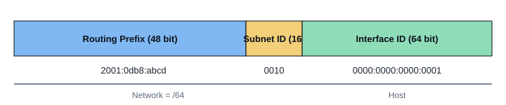

*شکل ۳: ساختار آدرس IPv6؛ ۶۴ بیت اول شبکه (Prefix + Subnet) و ۶۴ بیت آخر دستگاه.*

آدرس IPv6 یک عدد ۱۲۸ بیتی است. آن را به ۸ گروه ۱۶ بیتی تقسیم می‌کنیم و هر گروه را با ۴ رقم شانزده‌شانزدهی (Hex: ارقام ۰ تا ۹ و a تا f) می‌نویسیم، با دونقطه بین گروه‌ها:

``` text
2001:0db8:0010:0010:0000:0000:0000:0001
```

هر رقم Hex معادل ۴ بیت است. پس حساب کل بیت‌ها این‌طور می‌شود:

``` text
1 hex digit = 4 bits      (f = 1111 , a = 1010)
1 group     = 4 digits = 16 bits
8 groups    = 8 x 16   = 128 bits
```

مثل IPv4، آدرس دو بخش دارد: **Prefix** (شبکه) و **Interface ID** (دستگاه). در بیشتر شبکه‌ها Prefix برابر `/64` است: ۶۴ بیت اول شبکه و ۶۴ بیت آخر دستگاه. در IPv6 به‌جای «Subnet Mask» همیشه Prefix می‌نویسیم.

### ۲. دو قانون کوتاه‌نویسی

**قانون ۱: صفرهای ابتدای هر گروه را حذف کن.** مثال: `0db8` ← `db8` و `0010` ← `10` و `0000` ← `0`.

**قانون ۲: یک (فقط یک) رشته‌ی متوالی از گروه‌های تماماً صفر را با `::` جایگزین کن.**

``` text
Full   : 2001:0db8:0010:0010:0000:0000:0000:0001
Rule 1 : 2001:db8:10:10:0:0:0:1
Rule 2 : 2001:db8:10:10::1
```

> **چرا فقط یک بار ::؟**
>
> اگر دو بار بنویسید، معلوم نیست هرکدام چند گروه صفر را نشان می‌دهند. پس `2001::5::1` غلط است. اگر دو رشته‌ی صفر داشتید، `::` را روی **بلندترین** رشته بگذارید.

### ۳. مثال‌های کوتاه‌نویسی (ساده تا سخت)

#### مثال ساده

``` text
Full  : fe80:0000:0000:0000:0000:0000:0000:0001
Step 1: fe80:0:0:0:0:0:0:1
Step 2: fe80::1
```

#### مثال متوسط (دو رشته صفر)

``` text
Full  : 2001:0db8:0000:0000:0001:0000:0000:0005
Step 1: 2001:db8:0:0:1:0:0:5
Step 2: two zero-runs of equal length -> shorten the FIRST one
Result: 2001:db8::1:0:0:5
```

#### مثال سخت (برعکس: باز کردن)

``` text
Short  : 2001:db8:a::1:2
Groups written = 5  (2001, db8, a, 1, 2)
Missing groups = 8 - 5 = 3   (the :: is 3 zero groups)
Full   : 2001:0db8:000a:0000:0000:0000:0001:0002
```

### ۴. انواع آدرس IPv6

| نوع                | Prefix                   | کاربرد                                  | معادل در IPv4                  |
|--------------------|--------------------------|-----------------------------------------|--------------------------------|
| Global Unicast     | 2000::/3                 | آدرس قابل Route در اینترنت              | آدرس عمومی                     |
| Unique Local (ULA) | fc00::/7 (عملاً fd00::/8) | داخل سازمان                             | RFC 1918                       |
| Link-Local         | fe80::/10                | فقط روی یک لینک؛ هر Interface حتماً دارد | APIPA (ولی همیشه فعال و ضروری) |
| Multicast          | ff00::/8                 | ارسال به گروهی از دستگاه‌ها              | 224.0.0.0/4                    |
| Loopback           | ::1/128                  | خود دستگاه                              | 127.0.0.1                      |
| مستندات            | 2001:db8::/32            | در آموزش و Lab                          | TEST-NET                       |

**نکته‌ی مهم:** IPv6 **Broadcast ندارد**. کارهایی که Broadcast می‌کرد (مثل ARP) با Multicast انجام می‌شود. آدرس‌های ff02::1 (همه‌ی گره‌ها) و ff02::2 (همه‌ی روترها) را بشناسید.

### ۵. دستگاه‌ها چطور آدرس می‌گیرند؟

#### ۵-۱. Link-Local خودکار

همین که Interface بالا بیاید، دستگاه خودش یک آدرس `fe80::` می‌سازد. نیازی به DHCP و تنظیم دستی ندارد. تمام ارتباط‌های همسایگی (و Next-Hop روتینگ) با همین آدرس انجام می‌شود.

#### ۵-۲. EUI-64: ساخت Interface ID از MAC

MAC آدرس ۴۸ بیتی است؛ ۶۴ بیت لازم داریم. روش: وسط MAC عدد `fffe` را بگذار و بیت هفتم بایت اول را وارونه کن. مثال: MAC = `aabb.cc00.0100`:

``` text
MAC:            aa bb cc 00 01 00
Step 1 (insert fffe) : aa bb cc ff fe 00 01 00
Step 2 (flip U/L bit) : first byte aa XOR 02 = a8
Interface ID:   a8bb:ccff:fe00:0100
```

پس آدرس Link-Local می‌شود `fe80::a8bb:ccff:fe00:100`. (فقط ایده را بدانید: MAC در آدرس «نشت» می‌کند و برای حریم خصوصی، سیستم‌عامل‌های جدید به‌جای EUI-64 مقدار تصادفی می‌سازند.)

#### ۵-۳. SLAAC و کشف همسایه (NDP)

روتر هر چند ثانیه (یا به درخواست) پیام Router Advertisement (RA) می‌فرستد که می‌گوید «Prefix این لینک 2001:db8:10:10::/64 است». Host خودش Interface ID می‌سازد و آدرس می‌شود. به این روش SLAAC می‌گویند: بدون DHCP.

| پیام NDP                    | معادل       | کار                                   |
|-----------------------------|-------------|---------------------------------------|
| Router Solicitation (RS)    | —           | Host: «روتر هست؟»                     |
| Router Advertisement (RA)   | DHCP قسمتی  | روتر: Prefix و Gateway را اعلام می‌کند |
| Neighbor Solicitation (NS)  | ARP Request | «MAC فلان IPv6 چیست؟» (با Multicast)  |
| Neighbor Advertisement (NA) | ARP Reply   | پاسخ با MAC                           |

NDP از ICMPv6 استفاده می‌کند؛ بنابراین **نباید ICMPv6 را در فایروال کاملاً ببندید** وگرنه IPv6 کار نمی‌کند (اشتباه رایج).

### ۶. مثال کاربردی: Prefix و Subnet در IPv6

سازمان بلوک `2001:db8:abcd::/48` دارد. با ۱۶ بیت باقیمانده تا /64 می‌توانیم ۶۵۵۳۶ Subnet /64 بسازیم. محاسبه‌ی Host ندارد! هر VLAN را یک /64 می‌دهیم: `2001:db8:abcd:`**`10`**`::/64` برای VLAN10، `2001:db8:abcd:`**`20`**`::/64` برای VLAN20 و غیره. گروه چهارم را همان شماره‌ی VLAN بگذارید تا خوانا باشد.

مقایسه: در IPv4 باید هر بار محاسبه‌ی VLSM کنیم. در IPv6 همه /64 هستند و زندگی ساده است.

### ۷. تمرین‌ها

**ت1.** ۱. (ساده) کوتاه کن: 2001:0db8:0000:0000:0000:0000:0000:0001 *(پاسخ: 2-3-ت1 در بخش «پاسخ‌ها» انتهای فصل)*

**ت2.** ۲. (ساده) این چه نوع آدرسی است: fe80::1 ؟ fd12:3456::5 ؟ ff02::1 ؟ 2001:db8::5 ؟ *(پاسخ: 2-3-ت2 در بخش «پاسخ‌ها» انتهای فصل)*

**ت3.** ۳. (متوسط) باز کن: 2001:db8:0:1::5 *(پاسخ: 2-3-ت3 در بخش «پاسخ‌ها» انتهای فصل)*

**ت4.** ۴. (متوسط) آیا 2001:db8::1 و 2001:db8:0:0:1::1 در یک /64 هستند؟ *(پاسخ: 2-3-ت4 در بخش «پاسخ‌ها» انتهای فصل)*

**ت5.** ۵. (سخت) چرا نمی‌توان 2001::1::2 نوشت؟ *(پاسخ: 2-3-ت5 در بخش «پاسخ‌ها» انتهای فصل)*

**ت6.** ۶. (سخت) از 2001:db8:abcd::/48 برای ۴ VLAN (۱۰، ۲۰، ۳۰، ۹۹) Prefix بساز. *(پاسخ: 2-3-ت6 در بخش «پاسخ‌ها» انتهای فصل)*

### ۸. Lab هدایت‌شده: IPv6 بین R1 و SW1

شرط: در Lab `L00` هنوز VLAN10 روی R1 (`Gi0/0.10`) و SW1 (`Vlan10`) سالم است.

#### گام ۱: فعال‌کردن IPv6 روی روتر

``` text
R1# configure terminal
R1(config)# ipv6 unicast-routing
R1(config)# interface gi0/0.10
R1(config-subif)# ipv6 address 2001:db8:10:10::1/64
R1(config-subif)# end
R1# show ipv6 interface brief
```

باید دو آدرس ببینید: Link-Local (`FE80::...`) و آدرسی که دادید. فرمان `ipv6 unicast-routing` روتر را از «Host» به «روتر IPv6» تبدیل می‌کند و RA می‌فرستد.

#### گام ۲: سمت سوییچ

``` text
SW1# configure terminal
SW1(config)# interface vlan 10
SW1(config-if)# ipv6 address 2001:db8:10:10::2/64
SW1(config-if)# end
SW1# show ipv6 interface brief
```

در سوییچ‌های L2 ممکن است IPv6 فقط در CLI دیده شود. اگر دستور رد شد یا ping نشد، دقیقاً همان را ثبت کنید؛ این همان درس «پذیرفته‌شدن ≠ کارکردن» است.

#### گام ۳: Ping و NDP

``` text
R1# ping 2001:db8:10:10::2
R1# show ipv6 neighbors
R1# ping FE80::<LL-SW1>%GigabitEthernet0/0.10
```

در Ping با Link-Local باید Interface خروجی را مشخص کنید (چون fe80:: روی هر Interface تکراری است). جدول `show ipv6 neighbors` معادل `show ip arp` است.

#### گام ۴: دیدن RA

``` text
R1# show ipv6 interface gi0/0.10
```

در خروجی دنبال خط «ND advertised reachable time» و «Hosts use stateless autoconfig» بگردید؛ یعنی روتر Prefix را برای SLAAC اعلام می‌کند.

### ۹. Lab مستقل

برای VLANهای ۱۰ و ۲۰ و ۳۰ Capstone یک Prefix مثل `2001:db8:abcd::/48` انتخاب و در `02-design/ipv6-plan.md` بنویسید. روی R1 هر زیرواسط را یک /64 بدهید و `show ipv6 route connected` را ثبت کنید.

### ۱۰. عیب‌یابی

|         |                                                                                                                                    |
|---------|------------------------------------------------------------------------------------------------------------------------------------|
| Symptom | Ping IPv6 جواب نمی‌دهد ولی IPv4 کار می‌کند                                                                                           |
| سرنخ‌ها  | ۱) `ipv6 unicast-routing` فعال است؟ ؛ ۲) Prefix دو طرف یکی است؟ ؛ ۳) ACL یا فایروال ICMPv6 را بسته؟ ؛ ۴) فقط Link-Local کار می‌کند؟ |
| رفع     | تصحیح Prefix یا اجازه‌ی ICMPv6                                                                                                      |

### ۱۱. سؤال‌های مرور

**م1.** چرا IPv6 Broadcast ندارد؟ *(پاسخ: 2-3-م1 در بخش «پاسخ‌ها» انتهای فصل)*

**م2.** NS/NA معادل چه چیزی در IPv4 است؟ *(پاسخ: 2-3-م2 در بخش «پاسخ‌ها» انتهای فصل)*

**م3.** چرا ICMPv6 را نباید بست؟ *(پاسخ: 2-3-م3 در بخش «پاسخ‌ها» انتهای فصل)*

**م4.** /64 برای یک VLAN یعنی چه؟ *(پاسخ: 2-3-م4 در بخش «پاسخ‌ها» انتهای فصل)*

### English Corner: انگلیسی تخصصی این درس

این جمله‌ها از مستندات و محیط کار واقعی‌اند. بلند بخوانید و ترجمه را بپوشانید.

| English sentence                                                         | ترجمه                                                            |
|--------------------------------------------------------------------------|------------------------------------------------------------------|
| IPv6 has no broadcast; it uses multicast instead.                        | IPv6 Broadcast ندارد؛ به‌جای آن از Multicast استفاده می‌کند.       |
| Every IPv6 interface automatically gets a link-local address.            | هر Interface در IPv6 به‌طور خودکار یک Link-Local می‌گیرد.          |
| Hosts build their own address from the router advertisement using SLAAC. | Hostها با SLAAC از روی Router Advertisement آدرس خود را می‌سازند. |
| Do not block ICMPv6, or neighbor discovery will break.                   | ICMPv6 را نبندید، وگرنه Neighbor Discovery از کار می‌افتد.        |

**Q1.** Quick quiz (answer in English): Which IPv6 messages replace ARP? *(پاسخ: 2-3-Q1 در بخش «پاسخ‌ها» انتهای فصل)*

### ۱۲. تکلیف و چک‌لیست تسلط

- [ ] ۶ تمرین را حل کنم.
- [ ] Lab IPv6 را انجام و نتیجه‌ی واقعی (موفق/ناموفق) را ثبت کنم.
- [ ] IPv6 Plan را بنویسم.
- [ ] قوانین کوتاه‌نویسی را بدون نگاه بگویم.

### ۱۳. یادآوری اشتباهات شما

> **یادآوری**
>
> خروجی قبل از اجرا را پیش‌بینی کنید؛ و «Invalid input» همیشه به معنای ناسازگاری Image نیست.


#### کارت Lab — درس ۲-۳

| # | فیلد | محتوا |
|---|---|---|
| 1 | عنوان و هدف | برقراری IPv6 بین R1 و SW1 |
| 2 | پیش‌نیاز | درس ۲-۲ |
| 3 | توپولوژی | R1 Gi0/0.10 ↔ SW1 Vlan10 |
| 4 | تجهیزات | R1، SW1 |
| 5 | نسخه نرم‌افزار | vIOS-L2 15.2(20200924، Experimental) برای SW؛ vIOS 15.9(3)M9 برای R؛ VPCS (PNetLab)؛ PNetLab 4.2.8 |
| 6 | IP Plan | 2001:db8:10:10::1/64 و ::2/64 |
| 7 | وضعیت اولیه | IPv4 سالم |
| 8 | صورت مسئله | IPv6 بدهید، ping بزنید و جدول همسایه را ببینید |
| 9 | مراحل هدایت‌شده | همان بخش «Lab هدایت‌شده» همین درس (گام‌به‌گام) |
| 10 | تست عملکرد | `ping 2001:db8:10:10::2` ؛ `show ipv6 neighbors` |
| 11 | سناریوی خرابی | `ipv6 unicast-routing` فراموش شود |
| 12 | روش عیب‌یابی | `show ipv6 interface brief` و مقایسه‌ی Prefix |
| 13 | نتیجه‌ی مورد انتظار | ping موفق و دو ورودی همسایه |
| 14 | معیار پذیرش | ثبت نتیجه‌ی واقعی (موفق/ناموفق) از سوییچ |
| 15 | مستندات نهایی | `02-design/ipv6-plan.md` |
| 16 | Cleanup و بازگردانی | حذف آدرس‌های IPv6 |

> **وضعیت راستی‌آزمایی (خارج از ۱۶ فیلد):** **اجرا نشده (فقط طراحی).** اجرا نشده؛ IPv6 در Probe فقط CLI-Accepted بود؛ روی سوییچ ممکن است کار نکند.

---

<a id="l-2-4"></a>

## درس ۲-۴ — CLI سیسکو، مدیریت و بکاپ Config

**فصل ۲ - روز ۴ · پیش‌نیاز: فصل ۱ · ۶ ساعت**

### این درس درباره چیست و چرا باید یاد بگیریم؟

**چه چیزی یاد می‌گیریم:** کار حرفه‌ای با خط فرمان سیسکو (CLI): حالت‌ها، کمک‌گیری، تفاوت پیکربندی در حال اجرا و ذخیره‌شده، و مهم‌تر از همه **پشتیبان‌گیری و بازگشت (Rollback)**.

**چرا لازم است:** در دنیای واقعی بزرگ‌ترین ترس هر مدیر شبکه این است: «یک دستور زدم و ارتباط همه قطع شد، حالا چه کنم؟». کسی که بکاپ و Rollback بلد است، با آرامش کار می‌کند؛ کسی که بلد نیست، ساعت‌ها در قطعی می‌ماند.

- **در کار روزانه:** قبل از هر تغییر، نسخه‌ی فعلی را ذخیره می‌کنید و بعد از تغییر اگر خراب شد، در چند ثانیه برمی‌گردید.
- **در امنیت:** پیکربندی بکاپ‌شده سند حسابرسی است؛ می‌توانید ثابت کنید «چه چیزی، کی تغییر کرد».
- **در دوره:** Capstone مرحله‌ی «CHG (درخواست تغییر)» دارد که بدون Rollback پذیرفته نمی‌شود.

> **مسیر درس**
>
> حالت‌های CLI ← کمک‌گیری و میان‌بُرها ← Running و Startup ← بکاپ و Rollback ← مثال ساده/متوسط/سخت ← Lab ← عیب‌یابی.

#### اصطلاحات این درس (مخفف ← شکل کامل ← معنی)

| مخفف     | شکل کامل انگلیسی               | معنی فارسی                                          |
|----------|--------------------------------|-----------------------------------------------------|
| CLI      | Command Line Interface         | محیط خط فرمان                                       |
| EXEC     | Executive mode                 | حالت اجرایی دستورها                                 |
| NVRAM    | Non-Volatile RAM               | حافظه‌ای که با خاموشی پاک نمی‌شود؛ محل startup-config |
| RAM      | Random Access Memory           | حافظه موقت؛ محل running-config                      |
| TFTP     | Trivial File Transfer Protocol | انتقال فایل ساده و بدون رمزگذاری                    |
| SCP      | Secure Copy Protocol           | انتقال فایل امن روی SSH                             |
| DNS      | Domain Name System             | سیستم نام دامنه                                     |
| CHG      | Change Request                 | درخواست تغییر رسمی                                  |
| Rollback | Rollback                       | بازگشت به وضعیت سالم قبلی                           |
| MOTD     | Message Of The Day             | پیام نمایشی هنگام ورود                              |

### ۱. حالت‌های CLI (چهار اتاق یک ساختمان)

CLI سیسکو مثل ساختمانی با چند اتاق است که هرکدام اجازه‌ی کار متفاوتی دارد:

| حالت                  | Prompt           | چه کاری می‌شود کرد           | ورود/خروج                                          |
|-----------------------|------------------|-----------------------------|----------------------------------------------------|
| User EXEC             | `R1>`            | مشاهده‌ی محدود، ping         | ورود: `enable`                                     |
| Privileged EXEC       | `R1#`            | همه‌ی show، کپی فایل، reload | خروج: `disable`                                    |
| Global Config         | `R1(config)#`    | تغییر تنظیمات کل دستگاه     | ورود: `configure terminal` ؛ خروج: `end` یا `exit` |
| Interface/Line Config | `R1(config-if)#` | تنظیم یک Interface یا Line  | ورود: `interface ...`                              |

> **قاعده‌ی طلایی**
>
> دستورهای `show`، `ping`، `copy`، `monitor capture` و `reload` در EXEC هستند. دستورهای تنظیمی در Config. اگر در Config دستور show بزنید، با `do` جلو آن می‌توانید اجرا کنید: `do show ip route`.

### ۲. کمک‌گیری و میان‌بُرها (سرعت یک مهندس)

- `?` بعد از هر کلمه: گزینه‌های ممکن. مثال: `show ip ?`
- `Tab`: کامل‌کردن. `sh run` هم کافی است (مخفف یکتا).
- `show running-config | section interface`: فیلتر خروجی. `| include` و `| begin` هم داریم.
- فلش بالا: دستور قبلی. `Ctrl+A` ابتدای خط و `Ctrl+E` انتهای خط. `Ctrl+Shift+6` قطع دستور گیرکرده.

مثال: به‌جای خواندن ۲۰۰ خط config فقط این را بزنید:

``` text
R1# show running-config | section interface Gi0/0
R1# show ip interface brief | include up
```

### ۳. تنظیمات پایه‌ی یک دستگاه حرفه‌ای

``` text
R1(config)# hostname R1
R1(config)# no ip domain-lookup
R1(config)# service timestamps log datetime msec
R1(config)# line console 0
R1(config-line)# logging synchronous
R1(config-line)# exec-timeout 10 0
R1(config-line)# exit
R1(config)# banner motd # Authorized access only #
R1(config)# enable secret <PASSWORD>
R1(config)# end
```

خط‌به‌خط:

- `no ip domain-lookup`: جلوی «Translating…» را می‌گیرد (اشتباهی که قبلاً دیدید).
- `logging synchronous`: پیام‌های Log وسط تایپ شما نمی‌پرند.
- `exec-timeout 10 0`: بعد از ۱۰ دقیقه بی‌کاری Session بسته می‌شود (امنیت).
- `enable secret`: رمز ورود به Privileged با Hash قوی. **هرگز** `enable password` (متن ساده) نه. رمز واقعی را در Git نگذارید؛ اینجا فقط جانگهدار است.

### ۴. Running-config و Startup-config

دو نسخه از تنظیمات در دستگاه هست:

- **running-config**: در RAM، همین الان فعال است؛ با خاموش‌شدن می‌پرد.
- **startup-config**: در NVRAM، در بوت بعدی بارگذاری می‌شود.

تشبیه: running مثل «متنی که در Word تایپ کرده‌اید و ذخیره نکرده‌اید»؛ startup همان فایل ذخیره‌شده است.

``` text
R1# show running-config
R1# show startup-config
R1# copy running-config startup-config      (or: write memory)
R1# show archive                              (if supported)
```

اشتباه رایج: بعد از تغییر ذخیره نمی‌کنید و بعد از Reload همه‌چیز می‌پرد. جلوگیری: عادت کنید هر تغییر موفق ← `copy run start`.

### ۵. بکاپ و Rollback (قلب درس)

#### ۵-۱. بکاپ محلی روی Flash

``` text
R1# copy running-config flash:R1-before-change.cfg
R1# dir flash:
```

#### ۵-۲. بکاپ روی سرور (TFTP/SCP)

``` text
R1# copy running-config tftp://10.10.10.50/R1-2026-11-07.cfg
```

برای سرور بکاپ از یک VM لینوکسی استفاده می‌کنیم (در درس‌های بعد، با SCP امن). نام فایل = نام دستگاه + تاریخ. فایل‌های بکاپ **رمزِ هش‌شده** دارند ولی باز هم در جای امن (خارج از Git) نگه‌دارید.

#### ۵-۳. Rollback با Configure Replace

اگر Image شما قابلیت Archive دارد، می‌توانید کل تنظیمات را با یک فایل بکاپ جایگزین کنید (فقط تفاوت‌ها اعمال می‌شود):

``` text
R1# configure replace flash:R1-before-change.cfg list
R1# configure replace flash:R1-before-change.cfg force
```

گزینه‌ی `list` فقط تفاوت‌ها را نشان می‌دهد (Dry-run). اگر دستور در Image شما نبود، روش جایگزین: `copy flash:R1-before-change.cfg startup-config` و سپس `reload`.

#### ۵-۴. «Reload in»: شبکه‌ی ایمنی

``` text
R1# reload in 10
... risky change ...
R1# reload cancel        (if it worked)
```

مثل ماشین‌هایی که ده دقیقه بعد خودشان خاموش می‌شوند. اگر تغییر ارتباط شما را قطع کرد، دستگاه بعد از ۱۰ دقیقه به startup-config قبلی بر می‌گردد. این تکنیک نجات‌بخش است؛ مخصوصاً در تغییرات راه دور.

### ۶. مثال‌ها (ساده تا سخت)

**ساده**

اسم دستگاه را عوض کنید و ذخیره کنید: `hostname R1-HQ` ← `end` ← `copy run start` ← `show startup-config | include hostname`.

**متوسط**

قبل از تغییر IP یک Interface، بکاپ به Flash بگیرید؛ آدرس را تغییر دهید؛ ping کنید؛ اگر قطع شد با `configure replace` برگردید.

**سخت**

تغییر راه دور: با `reload in 5` شبکه‌ی ایمنی بگذارید؛ Mask یک Subinterface را تغییر دهید؛ اگر ارتباط قطع شد، ۵ دقیقه صبر می‌کنید و دستگاه با startup قبلی بالا می‌آید؛ اگر موفق بود `reload cancel` و `copy run start`.

### ۷. تمرین‌ها

**ت1.** ۱. Prompt زیر در کدام حالت است؟ R1(config-if)# *(پاسخ: 2-4-ت1 در بخش «پاسخ‌ها» انتهای فصل)*

**ت2.** ۲. تفاوت running و startup چیست؟ *(پاسخ: 2-4-ت2 در بخش «پاسخ‌ها» انتهای فصل)*

**ت3.** ۳. چطور در Config دستور show ip route را اجرا کنیم؟ *(پاسخ: 2-4-ت3 در بخش «پاسخ‌ها» انتهای فصل)*

**ت4.** ۴. چرا enable secret بهتر از enable password است؟ *(پاسخ: 2-4-ت4 در بخش «پاسخ‌ها» انتهای فصل)*

**ت5.** ۵. فایده‌ی reload in چیست؟ *(پاسخ: 2-4-ت5 در بخش «پاسخ‌ها» انتهای فصل)*

### ۸. Lab هدایت‌شده: تغییر، خراب‌کردن و Rollback

#### گام ۱: تنظیمات پایه (بخش ۳) را روی R1 و SW1 بزنید و ذخیره کنید

#### گام ۲: بکاپ

``` text
R1# copy running-config flash:R1-good.cfg
R1# copy running-config startup-config
R1# dir flash:
```

#### گام ۳: خراب‌کردن عمدی

``` text
R1(config)# interface gi0/0.10
R1(config-subif)# ip address 10.10.99.1 255.255.255.0
R1(config-subif)# end
R1# ping 10.10.10.2
```

پیش‌بینی: ping شکست می‌خورد چون Subnet عوض شد.

#### گام ۴: Rollback

``` text
R1# configure replace flash:R1-good.cfg force
R1# ping 10.10.10.2
```

اگر `configure replace` در Image شما پشتیبانی نشد (ثبت کنید)، با `copy flash:R1-good.cfg running-config` ادغام کنید و Interface را دستی اصلاح نمایید.

#### گام ۵: تمرین reload in

``` text
R1# reload in 5
(make a harmless change)
R1# reload cancel
```

### ۹. Lab مستقل

یک Runbook یک‌صفحه‌ای `03-ops/change-and-rollback.md` بنویسید: چک‌لیست قبل/حین/بعد تغییر، دستورهای بکاپ، Rollback، و Verification. بدون رمز.

### ۱۰. عیب‌یابی

|           |                                                  |
|-----------|--------------------------------------------------|
| Symptom   | بعد از Reload تنظیمات پرید                       |
| علت       | ذخیره نشده بود (فقط running)                     |
| رفع       | بازسازی از بکاپ؛ از این به بعد `copy run start`  |
| Symptom 2 | Rollback خطا می‌دهد                               |
| علت       | فایل بکاپ ناقص یا Archive پشتیبانی نمی‌شود        |
| رفع       | روش جایگزین: `copy file startup-config` + reload |

### ۱۱. سؤال‌های مرور

**م1.** سه حالت اصلی CLI؟ *(پاسخ: 2-4-م1 در بخش «پاسخ‌ها» انتهای فصل)*

**م2.** چرا بکاپ قبل از تغییر؟ *(پاسخ: 2-4-م2 در بخش «پاسخ‌ها» انتهای فصل)*

### English Corner: انگلیسی تخصصی این درس

این جمله‌ها از مستندات و محیط کار واقعی‌اند. بلند بخوانید و ترجمه را بپوشانید.

| English sentence                                                                     | ترجمه                                                                            |
|--------------------------------------------------------------------------------------|----------------------------------------------------------------------------------|
| Save the running configuration to NVRAM, or the changes will be lost after a reload. | running-config را در NVRAM ذخیره کنید، وگرنه بعد از Reload تغییرها از بین می‌رود. |
| Take a backup before every change so you can roll back quickly.                      | قبل از هر تغییر بکاپ بگیرید تا سریع Rollback کنید.                               |
| Use reload in 10 as a safety net during remote changes.                              | در تغییرهای راه دور از reload in 10 به‌عنوان شبکه‌ی ایمنی استفاده کنید.            |
| The enable secret is stored as a hash, unlike a plain-text enable password.          | enable secret به‌صورت Hash ذخیره می‌شود، برخلاف enable password متن ساده.          |

**Q1.** Quick quiz (answer in English): What is the difference between running-config and startup-config? *(پاسخ: 2-4-Q1 در بخش «پاسخ‌ها» انتهای فصل)*

### ۱۲. تکلیف و چک‌لیست تسلط

- [ ] تنظیمات پایه را روی همه‌ی دستگاه‌ها بزنم.
- [ ] بکاپ و Rollback را عملی انجام دهم و نتیجه را ثبت کنم.
- [ ] Runbook تغییر را بنویسم.

### ۱۳. یادآوری اشتباهات شما

> **یادآوری**
>
> دستور EXEC را در Config نزنید؛ کلمه‌ی ناشناخته نزنید (DNS Lookup)؛ بعد از هر تغییر موفق ذخیره کنید.


#### کارت Lab — درس ۲-۴

| # | فیلد | محتوا |
|---|---|---|
| 1 | عنوان و هدف | بکاپ، خراب‌کردن عمدی و Rollback |
| 2 | پیش‌نیاز | درس ۲-۳ |
| 3 | توپولوژی | R1 ↔ SW1 |
| 4 | تجهیزات | R1، SW1 |
| 5 | نسخه نرم‌افزار | vIOS-L2 15.2(20200924، Experimental) برای SW؛ vIOS 15.9(3)M9 برای R؛ VPCS (PNetLab)؛ PNetLab 4.2.8 |
| 6 | IP Plan | 10.10.10.0/24 |
| 7 | وضعیت اولیه | تنظیمات پایه ذخیره‌شده |
| 8 | صورت مسئله | قبل از تغییر بکاپ بگیرید، IP را خراب و با `configure replace` برگردانید |
| 9 | مراحل هدایت‌شده | همان بخش «Lab هدایت‌شده» همین درس (گام‌به‌گام) |
| 10 | تست عملکرد | ping پس از Rollback |
| 11 | سناریوی خرابی | تغییر IP Sub-interface |
| 12 | روش عیب‌یابی | مقایسه‌ی running با بکاپ |
| 13 | نتیجه‌ی مورد انتظار | ping بعد از Rollback موفق |
| 14 | معیار پذیرش | نتیجه‌ی `configure replace` (یا جایگزین) ثبت شود |
| 15 | مستندات نهایی | `03-ops/change-and-rollback.md` |
| 16 | Cleanup و بازگردانی | حذف فایل‌های بکاپ؛ `reload cancel` |

> **وضعیت راستی‌آزمایی (خارج از ۱۶ فیلد):** **اجرا نشده (فقط طراحی).** اجرا نشده؛ `configure replace`، `archive` و `flash:` روی vIOS-L2 در Probe نبوده‌اند (Untested).

---

<a id="l-2-5"></a>

## درس ۲-۵ — مدیریت امن با SSH

**فصل ۲ - روز ۵ · پیش‌نیاز: درس ۲-۴ · ۶ ساعت**

### این درس درباره چیست و چرا باید یاد بگیریم؟

**چه چیزی یاد می‌گیریم:** مدیریت امن دستگاه‌ها از راه دور با SSH، جایگزین قدیمی و ناامن Telnet. یاد می‌گیریم SSH چطور کار می‌کند، چطور روی روتر و سوییچ فعالش کنیم و چطور دسترسی را فقط به سیستم‌های مجاز محدود کنیم.

**چرا لازم است:** Telnet همه‌چیز (از جمله رمز) را به‌صورت متن ساده می‌فرستد. هر کسی در مسیر با Wireshark می‌تواند رمز ادمین را بخواند. SSH همین ارتباط را رمزگذاری می‌کند. در هر ممیزی امنیتی، فعال‌بودن Telnet یک «یافته‌ی جدی» است.

- **در کار روزانه:** ۹۹٪ مدیریت از راه دور با SSH انجام می‌شود.
- **در امنیت:** رمزگذاری، احراز هویت با کاربر و محدودیت مبدأ، سه لایه‌ی اولیه‌ی ایمنی مدیریت هستند.
- **در FortiGate:** همین مفاهیم برای مدیریت فایروال (فقط HTTPS و SSH از Subnet مدیریت) به‌کار می‌رود.

> **مسیر درس**
>
> چرا Telnet ناامن است ← SSH چطور کار می‌کند ← پیکربندی گام‌به‌گام ← محدودکردن دسترسی ← مثال ساده/متوسط/سخت ← Lab ← عیب‌یابی.

#### اصطلاحات این درس (مخفف ← شکل کامل ← معنی)

| مخفف          | شکل کامل انگلیسی            | معنی فارسی                               |
|---------------|-----------------------------|------------------------------------------|
| SSH           | Secure Shell                | پوسته امن؛ مدیریت رمزگذاری‌شده از راه دور |
| Telnet        | Teletype Network            | مدیریت از راه دور بدون رمزگذاری          |
| RSA           | Rivest-Shamir-Adleman       | الگوریتم کلید عمومی                      |
| VTY           | Virtual Teletype            | خطوط مجازی ورود از راه دور               |
| ACL           | Access Control List         | فهرست کنترل دسترسی                       |
| FQDN          | Fully Qualified Domain Name | نام کامل دامنه، مثل r1.lab.local         |
| MITM          | Man-In-The-Middle           | حمله مرد میانی                           |
| Wildcard Mask | Wildcard Mask               | معکوس Mask؛ بیت 0 یعنی باید یکسان باشد   |
| Fingerprint   | Host Key Fingerprint        | اثرانگشت کلید سرور برای تأیید هویت       |

### ۱. Telnet در برابر SSH

| ویژگی             | Telnet           | SSH             |
|-------------------|------------------|-----------------|
| رمزگذاری          | ندارد (متن ساده) | دارد            |
| پورت              | TCP 23           | TCP 22          |
| احراز هویت دستگاه | ندارد            | دارد (Host Key) |
| استفاده‌ی امروزی   | ممنوع            | استاندارد       |

مثال ملموس: Telnet مثل فریاد زدن رمز کارت بانکی وسط بازار است؛ SSH مثل گفتن آن در یک اتاق قفل‌شده.

### ۲. SSH چطور کار می‌کند؟ (ساده)

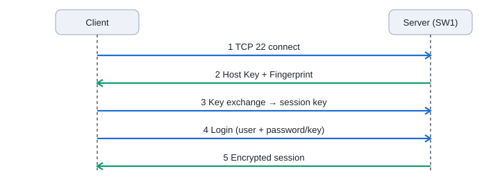

*شکل ۵: مراحل برقراری SSH؛ مرحله ۲ همان جایی است که «Host key changed» نشان می‌دهد.*

1.  **اتصال:** Client به پورت ۲۲ سرور وصل می‌شود.
2.  **هویت سرور:** سرور Host Key خود را نشان می‌دهد. Client اولین بار از شما می‌پرسد «اعتماد دارید؟» و اثرانگشت (Fingerprint) را ذخیره می‌کند. دفعه‌های بعد اگر عوض شد، هشدار می‌دهد (احتمال حمله‌ی Man-in-the-Middle).
3.  **کلید جلسه:** دو طرف با یک الگوریتم تبادل کلید (مثل Diffie-Hellman) یک کلید مشترک می‌سازند که هیچ‌کس در مسیر نمی‌داند.
4.  **احراز هویت کاربر:** رمز یا کلید عمومی.
5.  **ارتباط رمزشده** شروع می‌شود.

> **یادآوری از فصل ۱**
>
> هشدار «Host key changed» در برنامه‌ی SSH را قبلاً دیدید. آن‌جا هویت را با `ssh-keyscan` از یک مسیر مستقل تأیید کردیم. این دقیقاً همین مکانیزم است.

### ۳. پیکربندی SSH روی روتر/سوییچ (گام‌به‌گام)

``` text
R1(config)# hostname R1
R1(config)# ip domain-name lab.local
R1(config)# crypto key generate rsa modulus 2048
R1(config)# ip ssh version 2
R1(config)# username admin privilege 15 secret <PASSWORD>
R1(config)# line vty 0 4
R1(config-line)# login local
R1(config-line)# transport input ssh
R1(config-line)# exec-timeout 10 0
R1(config-line)# end
```

چرا هرکدام؟

- `hostname` و `ip domain-name`: بدون این دو، کلید RSA ساخته نمی‌شود (خطای رایج: «Please define a hostname other than Router»).
- `crypto key generate rsa modulus 2048`: ساخت جفت‌کلید. ۱۰۲۴ ضعیف است؛ حداقل ۲۰۴۸.
- `ip ssh version 2`: نسخه‌ی ۱ آسیب‌پذیر است.
- `username ... secret`: کاربر محلی با Hash. رمز واقعی را در Git نگذارید.
- `login local`: ورود با نام‌کاربری و رمز (نه فقط رمز Line).
- `transport input ssh`: Telnet را می‌بندد.

بررسی:

``` text
R1# show ip ssh
R1# show ssh
R1# show crypto key mypubkey rsa
```

در `show ip ssh` باید «SSH Enabled - version 2.0» ببینید.

### ۴. محدودکردن دسترسی (امنیت لایه‌ای)

فقط Subnet مدیریت (VLAN10) اجازه‌ی SSH داشته باشد:

``` text
R1(config)# ip access-list standard MGMT-ONLY
R1(config-std-nacl)# permit 10.10.10.0 0.0.0.255
R1(config-std-nacl)# deny any log
R1(config-std-nacl)# exit
R1(config)# line vty 0 4
R1(config-line)# access-class MGMT-ONLY in
R1(config-line)# end
```

`0.0.0.255` یک Wildcard Mask است؛ یعنی معکوسِ Subnet Mask. بیت 0 یعنی «باید مطابقت داشته باشد» و بیت 1 یعنی «مهم نیست».

``` text
Subnet mask   : 255.255.255.0
Wildcard mask : 0.0.0.255     (= 255.255.255.255 - 255.255.255.0)
```

`access-class` فقط ترافیک ورودی به VTY (دسترسی مدیریتی) را فیلتر می‌کند، نه ترافیک عبوری.

تنظیمات تکمیلی مفید: `ip ssh time-out 60` و `ip ssh authentication-retries 3`.

> **هشدار: قفل‌شدن از دستگاه**
>
> قبل از `access-class`، مطمئن شوید آدرس خودتان در ACL مجاز است؛ وگرنه خودتان بیرون می‌مانید. از `reload in 5` (درس قبل) به‌عنوان شبکه‌ی ایمنی استفاده کنید.

### ۵. مثال‌ها

**ساده**

از R1 به SW1 وصل شوید: `ssh -l admin 10.10.10.2`؛ اگر پرسید «Are you sure», بله.

**متوسط**

Telnet را غیرفعال کنید (`transport input ssh`) و ثابت کنید با `telnet 10.10.10.2` از R1 رد می‌شود (Connection refused).

**سخت**

ACL را طوری بنویسید که فقط ۲ آدرس مشخص (۱۰.۱۰.۱۰.۵۰ و ۱۰.۱۰.۱۰.۶۰) اجازه داشته باشند؛ و تست کنید از آدرس دیگر رد می‌شود. نکته: مبدأ تست را از Loopback روتر با `ssh -l admin -source-interface loopback0 ...` عوض کنید.

### ۶. تمرین‌ها

**ت1.** ۱. چرا Telnet ناامن است؟ *(پاسخ: 2-5-ت1 در بخش «پاسخ‌ها» انتهای فصل)*

**ت2.** ۲. چرا ip domain-name لازم است؟ *(پاسخ: 2-5-ت2 در بخش «پاسخ‌ها» انتهای فصل)*

**ت3.** ۳. Wildcard Mask برای 10.10.10.0/24؟ *(پاسخ: 2-5-ت3 در بخش «پاسخ‌ها» انتهای فصل)*

**ت4.** ۴. Wildcard Mask برای یک میزبان 10.10.10.50؟ *(پاسخ: 2-5-ت4 در بخش «پاسخ‌ها» انتهای فصل)*

**ت5.** ۵. Wildcard Mask برای 10.10.8.0/22؟ *(پاسخ: 2-5-ت5 در بخش «پاسخ‌ها» انتهای فصل)*

### ۷. Lab هدایت‌شده

#### گام ۱: SSH روی SW1

``` text
SW1(config)# ip domain-name lab.local
SW1(config)# crypto key generate rsa modulus 2048
SW1(config)# ip ssh version 2
SW1(config)# username admin privilege 15 secret <PASSWORD>
SW1(config)# line vty 0 4
SW1(config-line)# login local
SW1(config-line)# transport input ssh
SW1(config-line)# end
SW1# show ip ssh
```

#### گام ۲: اتصال از R1

``` text
R1# ssh -l admin 10.10.10.2
```

اگر خطای «no matching key exchange method» دیدید، Image قدیمی است؛ موقتاً در Lab با `ssh -o KexAlgorithms=...` (روی کلاینت) یا فعال‌کردن الگوریتم روی سرور حل می‌شود. در Lab مهم است بدانید چرا. در تولید، Image را به‌روز کنید.

#### گام ۳: بستن Telnet و تست

``` text
R1# telnet 10.10.10.2
```

باید رد شود (refused).

#### گام ۴: ACL مدیریت (با شبکه‌ی ایمنی)

``` text
SW1# reload in 5
SW1(config)# ip access-list standard MGMT-ONLY
SW1(config-std-nacl)# permit 10.10.10.0 0.0.0.255
SW1(config-std-nacl)# deny any log
SW1(config)# line vty 0 4
SW1(config-line)# access-class MGMT-ONLY in
(test SSH again; if OK:)
SW1# reload cancel
```

### ۸. Lab مستقل

برای هر ۳ دستگاه Lab یک «استاندارد مدیریت امن» بنویسید (`03-ops/secure-mgmt-standard.md`): SSH v2، RSA 2048، Telnet بسته، ACL مدیریت، Timeout. و روی هر دستگاه با یک چک‌لیست بسنجید.

### ۹. عیب‌یابی

|           |                                                                                                                                                                                                 |
|-----------|-------------------------------------------------------------------------------------------------------------------------------------------------------------------------------------------------|
| Symptom   | SSH وصل نمی‌شود                                                                                                                                                                                  |
| چک‌لیست    | ۱) `show ip ssh` فعال است؟ ؛ ۲) `transport input ssh` تنظیم است؟ ؛ ۳) نام‌کاربری وجود دارد؟ ؛ ۴) ACL مبدأ را بسته؟ ؛ ۵) مسیر و Gateway درست است؟ ؛ ۶) ping جواب می‌دهد؟ ؛ ۷) الگوریتم‌ها سازگارند؟ |
| Symptom 2 | کلید ساخته نمی‌شود                                                                                                                                                                               |
| رفع       | hostname و domain-name را بزنید.                                                                                                                                                                |

### ۱۰. سؤال‌های مرور

**م1.** Host Key برای چیست؟ *(پاسخ: 2-5-م1 در بخش «پاسخ‌ها» انتهای فصل)*

**م2.** access-class روی VTY چه فیلتر می‌کند؟ *(پاسخ: 2-5-م2 در بخش «پاسخ‌ها» انتهای فصل)*

### English Corner: انگلیسی تخصصی این درس

این جمله‌ها از مستندات و محیط کار واقعی‌اند. بلند بخوانید و ترجمه را بپوشانید.

| English sentence                                                                      | ترجمه                                                                      |
|---------------------------------------------------------------------------------------|----------------------------------------------------------------------------|
| Telnet sends credentials in clear text; SSH encrypts the whole session.               | Telnet اعتبارنامه‌ها را متن ساده می‌فرستد؛ SSH کل Session را رمزگذاری می‌کند. |
| Generate a 2048-bit RSA key pair before enabling SSH version 2.                       | قبل از فعال‌کردن SSH نسخه ۲، یک جفت‌کلید RSA ۲۰۴۸ بیتی بسازید.               |
| Restrict VTY access to the management subnet with an access class.                    | دسترسی VTY را با access-class به Subnet مدیریت محدود کنید.                 |
| The host key changed, so the client warned about a possible man-in-the-middle attack. | Host Key تغییر کرد، پس Client درباره‌ی احتمال حمله‌ی مرد میانی هشدار داد.    |

**Q1.** Quick quiz (answer in English): Why is Telnet considered insecure? *(پاسخ: 2-5-Q1 در بخش «پاسخ‌ها» انتهای فصل)*

### ۱۱. تکلیف و چک‌لیست تسلط

- [ ] SSH روی هر ۳ دستگاه فعال و تست شده.
- [ ] Telnet بسته شده و ثابت شده.
- [ ] ACL مدیریت با شبکه‌ی ایمنی تست شده.
- [ ] هیچ رمزی در Git نیست.

### ۱۲. یادآوری اشتباهات شما

> **یادآوری**
>
> قبل از تغییر راه دور، بکاپ و `reload in` بگذارید؛ خروجی را پیش‌بینی کنید؛ رمز در ریپو نریزید.


#### کارت Lab — درس ۲-۵

| # | فیلد | محتوا |
|---|---|---|
| 1 | عنوان و هدف | SSH امن و بستن Telnet |
| 2 | پیش‌نیاز | درس ۲-۴ |
| 3 | توپولوژی | R1 → SW1 (SSH) |
| 4 | تجهیزات | R1، SW1 |
| 5 | نسخه نرم‌افزار | vIOS-L2 15.2(20200924، Experimental) برای SW؛ vIOS 15.9(3)M9 برای R؛ VPCS (PNetLab)؛ PNetLab 4.2.8 |
| 6 | IP Plan | 10.10.10.1 و .2 |
| 7 | وضعیت اولیه | SSH فعال نیست |
| 8 | صورت مسئله | SSHv2، RSA 2048، Telnet بسته، ACL مدیریت با `reload in` |
| 9 | مراحل هدایت‌شده | همان بخش «Lab هدایت‌شده» همین درس (گام‌به‌گام) |
| 10 | تست عملکرد | `ssh -l admin 10.10.10.2` ؛ `telnet` رد شود |
| 11 | سناریوی خرابی | نبود `ip domain-name` یا ACL که خودتان را بیرون بگذارد |
| 12 | روش عیب‌یابی | `show ip ssh` ؛ `show running-config \| section line vty` |
| 13 | نتیجه‌ی مورد انتظار | SSH v2.0 فعال؛ Telnet refused |
| 14 | معیار پذیرش | Telnet واقعاً رد شود |
| 15 | مستندات نهایی | `03-ops/secure-mgmt-standard.md` (بدون رمز) |
| 16 | Cleanup و بازگردانی | برداشتن ACL تست؛ `reload cancel` |

> **وضعیت راستی‌آزمایی (خارج از ۱۶ فیلد):** **جزئی.** تولید کلید RSA و فعال‌شدن SSH دیده شده (`%SSH-5-ENABLED`)؛ ورود SSH، ACL مدیریت و رد Telnet اجرا نشده.

---

<a id="l-2-6"></a>

## درس ۲-۶ — Wireshark، ARP/ICMP و Gate G1

**فصل ۲ - روز ۶ · پیش‌نیاز: درس‌های ۲-۱ تا ۲-۵ · ۶ ساعت**

### این درس درباره چیست و چرا باید یاد بگیریم؟

**چه چیزی یاد می‌گیریم:** دیدن بسته‌ها روی سیم با Wireshark و فهمیدن ARP و ICMP. در پایان، آزمون عملی هفته (Gate G1) را می‌دهیم.

**چرا لازم است:** تا اینجا فقط «نتیجه» را دیدیم (ping موفق/ناموفق). Wireshark به شما «چشم» می‌دهد تا ببینید واقعاً چه اتفاقی افتاد. مثل پزشکی که به‌جای حدس‌زدن، عکس رادیولوژی می‌گیرد.

- **در کار روزانه:** وقتی «شبکه کند است» یا «اتصال قطع می‌شود»، فقط Capture می‌تواند ثابت کند مشکل از کجاست.
- **در امنیت:** تشخیص ARP Spoofing، اسکن پورت و ترافیک مشکوک.
- **در دوره:** از هفته‌های بعد، همه‌ی عیب‌یابی‌ها با Capture اثبات می‌شود.

> **مسیر درس**
>
> مفهوم فریم و بسته ← ARP ← ICMP ← گرفتن Capture ← فیلترها ← مثال ساده/متوسط/سخت ← Lab ← Gate G1.

#### اصطلاحات این درس (مخفف ← شکل کامل ← معنی)

| مخفف     | شکل کامل انگلیسی                  | معنی فارسی                            |
|----------|-----------------------------------|---------------------------------------|
| ARP      | Address Resolution Protocol       | تبدیل IP به MAC                       |
| ICMP     | Internet Control Message Protocol | پیام‌های کنترلی/تشخیصی مثل ping        |
| TTL      | Time To Live                      | عمر بسته؛ با هر روتر یک واحد کم می‌شود |
| MAC      | Media Access Control address      | آدرس فیزیکی کارت شبکه                 |
| BPF      | Berkeley Packet Filter            | سینتکس فیلتر هنگام Capture            |
| pcap     | Packet Capture                    | فایل ضبط بسته‌ها                       |
| MITM     | Man-In-The-Middle                 | حمله مرد میانی                        |
| Spoofing | Spoofing                          | جعل هویت (آدرس) در شبکه               |
| G1       | Gate 1                            | نقطه کنترل کیفیت پایان فصل ۲         |

### ۱. فریم، بسته و لایه‌ها (ساده)

مثل نامه‌ای که داخل پاکت و آن داخل یک بسته‌ی پستی است. داده را لایه‌به‌لایه می‌پیچند:

``` text
[ Ethernet: dst MAC | src MAC ]   Layer 2 (frame)
   [ IP: src IP | dst IP ]          Layer 3 (packet)
      [ ICMP or TCP/UDP ]           Layer 4 and above
         [ data ]
```

سوییچ با **MAC** تصمیم می‌گیرد (فریم)، روتر با **IP** (بسته). این تفاوت را همیشه به یاد داشته باشید.

### ۲. ARP: «این IP مال کیست؟»

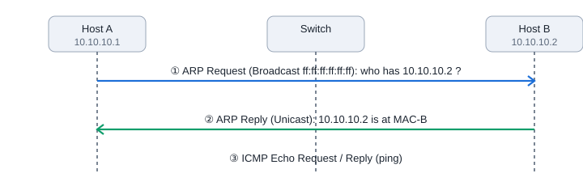

*شکل ۴: ping اول چرا کندتر است؟ چون اول ARP انجام می‌شود.*

Host فقط IP مقصد را می‌داند ولی فریم به MAC نیاز دارد. ARP این نگاشت را پیدا می‌کند:

1.  **ARP Request** (Broadcast به `ff:ff:ff:ff:ff:ff`): «چه کسی 10.10.10.2 را دارد؟ به 10.10.10.1 بگو.»
2.  همه‌ی دستگاه‌های VLAN دریافت می‌کنند؛ فقط صاحب IP جواب می‌دهد.
3.  **ARP Reply** (Unicast): «10.10.10.2 در MAC فلان است.»
4.  جواب در ARP Cache ذخیره می‌شود (چند دقیقه).

به همین دلیل اولین ping همیشه کندتر است یا گاهی یک بسته از دست می‌رود (`.!!!!`): اول باید ARP انجام شود.

مشاهده روی روتر: `show ip arp`

### ۳. ICMP: ابزار تشخیص

| Type | معنی                    | کجا می‌بینیم                              |
|------|-------------------------|------------------------------------------|
| 8    | Echo Request            | ping رفت                                 |
| 0    | Echo Reply              | ping برگشت                               |
| 3    | Destination Unreachable | مسیر/پورت وجود ندارد (`U` در ping سیسکو) |
| 11   | Time Exceeded           | TTL تمام شد (traceroute)                 |

**TTL:** هر روتر آن را ۱ کم می‌کند؛ اگر صفر شد بسته دور ریخته می‌شود تا در حلقه نماند. Windows معمولاً ۱۲۸ و لینوکس ۶۴ می‌فرستد؛ از روی TTL دریافتی می‌توان حدس زد بسته چند روتر رد شده.

### ۴. گرفتن Capture در PNetLab

- روی لینک بین دو دستگاه کلیک راست کنید (یا روی Interface) و **Capture** را بزنید؛ Wireshark روی سیستم شما باز می‌شود (PNetLab از مسیر وب و پروتکل مخصوص این کار را می‌کند).
- جایگزین روی خود IOS (در حالت EXEC، نه Config):

``` text
R1# monitor capture CAP1 interface gi0/0 both
R1# monitor capture CAP1 match any
R1# monitor capture CAP1 start
... ping ...
R1# monitor capture CAP1 stop
R1# show monitor capture CAP1 buffer brief
```

اگر دستور روی Image شما فقط «پذیرفته می‌شود ولی بسته‌ای نمی‌گیرد» (در Probe فصل ۱ دیدیم)، از Capture لینک PNetLab استفاده کنید. باز هم: پذیرفته‌شدن ≠ کارکردن.

### ۵. فیلترهای Wireshark (مهم‌ترین مهارت)

| فیلتر                           | معنی                     |
|---------------------------------|--------------------------|
| `arp`                           | فقط ARP                  |
| `icmp`                          | فقط ping                 |
| `ip.addr == 10.10.10.2`         | هر بسته‌ی مربوط به این IP |
| `eth.addr == aa:bb:cc:00:01:00` | بر اساس MAC              |
| `icmp.type == 8`                | فقط Echo Request         |
| `arp or icmp`                   | ترکیب با or/and          |
| `!arp`                          | همه به‌جز ARP             |

> **دو نوع فیلتر**
>
> **Capture Filter** (قبل از شروع، سبک‌تر، سینتکس BPF مثل `host 10.10.10.2`) و **Display Filter** (بعد از گرفتن، قدرتمندتر؛ جدول بالا).

### ۶. مثال‌ها

**ساده: ping اول**

Capture را شروع کنید، `clear arp` بزنید، `ping 10.10.10.2`. با فیلتر `arp or icmp` ببینید: اول ARP Request (Broadcast) و ARP Reply، بعد ۵ جفت Echo Request/Reply.

**متوسط: ping بیرون از Subnet**

از R1 به آدرسی در Subnet دیگر بزنید و ببینید MAC مقصد فریم، MAC Gateway است، نه MAC مقصد نهایی (ولی IP مقصد همان مقصد نهایی است). این مهم‌ترین نکته‌ی روتینگ است.

**سخت: عیب‌یابی با Capture**

Mask یک طرف را عمداً اشتباه کنید (درس ۲-۱) و Capture بگیرید: خواهید دید ARP Requestهای بدون جواب یا Echo Requestهای بدون Reply. یعنی مشکل در لایه ۲/۳ همان‌جاست و نه در برنامه.

### ۷. تمرین‌ها

**ت1.** ۱. ARP Request به چه MAC مقصدی فرستاده می‌شود؟ *(پاسخ: 2-6-ت1 در بخش «پاسخ‌ها» انتهای فصل)*

**ت2.** ۲. چرا اولین ping گاهی یک بسته از دست می‌دهد؟ *(پاسخ: 2-6-ت2 در بخش «پاسخ‌ها» انتهای فصل)*

**ت3.** ۳. در ping به مقصد بیرون از Subnet، MAC مقصد چیست؟ *(پاسخ: 2-6-ت3 در بخش «پاسخ‌ها» انتهای فصل)*

**ت4.** ۴. فیلتر برای دیدن فقط ping از 10.10.10.1؟ *(پاسخ: 2-6-ت4 در بخش «پاسخ‌ها» انتهای فصل)*

**ت5.** ۵. TTL=127 در جواب یعنی چه؟ *(پاسخ: 2-6-ت5 در بخش «پاسخ‌ها» انتهای فصل)*

### ۸. Lab هدایت‌شده

1.  در PNetLab روی لینک R1-SW1 Capture شروع کنید.
2.  روی R1: `clear arp` سپس `ping 10.10.10.2`.
3.  فیلتر `arp or icmp`: فریم‌ها را مشخص کنید و MAC/IPها را در جدولی یادداشت کنید.
4.  زمان بین ARP Request و Reply را بخوانید.
5.  Capture را به نام `pcap/ping-first.pcapng` ذخیره کنید (فایل را در Git نگذارید؛ ممکن است اطلاعات داشته باشد، فقط جدول خلاصه را بنویسید).

### ۹. Lab مستقل

یک سناریو: Gateway اشتباه روی یک Host (مثلاً `10.10.10.254` به‌جای `.1`). Capture بگیرید و در گزارش یک‌صفحه‌ای (`03-ops/ts14-gateway-wrong.md`) بنویسید: علامت چیست، چه بسته‌ای دیدید، چطور رفع کردید.

### ۱۰. Gate G1: آزمون عملی پایان فصل ۲

موارد زیر را بدون نگاه به درس انجام دهید و برای هر مورد یک «مدرک» (خروجی دستور) داشته باشید:

| \#  | وظیفه                                              | مدرک                                      |
|-----|----------------------------------------------------|-------------------------------------------|
| ۱   | Subnet کردن: ۴ مثال تصادفی (شبکه/Broadcast/Hostها) | جدول جواب‌ها                               |
| ۲   | VLSM برای ۴ بخش و ثبت در IP Plan                   | `02-design/ip-plan.md`                    |
| ۳   | IPv6: Prefix به VLANها، ping و جدول همسایه         | `show ipv6 neighbors`                     |
| ۴   | تنظیمات پایه + بکاپ + Rollback موفق                | خروجی `dir flash:` و ping بعد از Rollback |
| ۵   | SSH v2، Telnet بسته، ACL مدیریت                    | `show ip ssh` و تست رد Telnet             |
| ۶   | Capture ARP+ICMP و توضیح هر فریم                   | جدول MAC/IP                               |
| ۷   | رفع یک خرابی (Mask یا Gateway) با Capture          | گزارش یک‌صفحه‌ای                            |

**معیار قبولی:** حداقل ۶ از ۷ مورد با مدرک. هر مورد ناقص، بازبینی می‌شود و در «مرور اشتباهات» ثبت می‌گردد. وقتی تمام شد بگویید «G1 انجام شد» تا بررسی کنیم و فصل ۳ را شروع کنیم.

### ۱۱. سؤال‌های مرور

**م1.** تفاوت تصمیم سوییچ و روتر؟ *(پاسخ: 2-6-م1 در بخش «پاسخ‌ها» انتهای فصل)*

**م2.** ARP چرا Broadcast است؟ *(پاسخ: 2-6-م2 در بخش «پاسخ‌ها» انتهای فصل)*

**م3.** Echo Request و Reply چه Typeهایی هستند؟ *(پاسخ: 2-6-م3 در بخش «پاسخ‌ها» انتهای فصل)*

### English Corner: انگلیسی تخصصی این درس

این جمله‌ها از مستندات و محیط کار واقعی‌اند. بلند بخوانید و ترجمه را بپوشانید.

| English sentence                                                                     | ترجمه                                                                |
|--------------------------------------------------------------------------------------|----------------------------------------------------------------------|
| The first ping is slower because the host must resolve the MAC address with ARP.     | اولین ping کندتر است چون Host باید MAC را با ARP پیدا کند.           |
| Apply a display filter to isolate ICMP echo requests.                                | یک Display Filter بزنید تا فقط Echo Requestهای ICMP را جدا کنید.     |
| The destination MAC is the gateway's, while the destination IP stays the final host. | MAC مقصد، مال Gateway است در حالی که IP مقصد همان Host نهایی می‌ماند. |
| A packet is dropped when its TTL reaches zero.                                       | وقتی TTL به صفر برسد بسته دور ریخته می‌شود.                           |

**Q1.** Quick quiz (answer in English): Which Ethernet destination address does an ARP request use? *(پاسخ: 2-6-Q1 در بخش «پاسخ‌ها» انتهای فصل)*

### ۱۲. تکلیف و چک‌لیست تسلط

- [ ] Capture ping را انجام و توضیح دهم.
- [ ] ۵ فیلتر Wireshark را بدون نگاه بنویسم.
- [ ] Gate G1 را کامل کنم.

### ۱۳. یادآوری اشتباهات شما

> **یادآوری**
>
> دستور `monitor capture` در EXEC است؛ پذیرفته‌شدن دستور ≠ کار کردن آن؛ و فایل Capture را در Git نگذارید.


#### کارت Lab — درس ۲-۶ (Gate G1)

| # | فیلد | محتوا |
|---|---|---|
| 1 | عنوان و هدف | مشاهده‌ی ARP و ICMP با Wireshark و آزمون G1 |
| 2 | پیش‌نیاز | درس‌های ۲-۱ تا ۲-۵ |
| 3 | توپولوژی | Capture روی لینک R1-SW1 |
| 4 | تجهیزات | R1، SW1، Wireshark |
| 5 | نسخه نرم‌افزار | vIOS-L2 15.2(20200924، Experimental) برای SW؛ vIOS 15.9(3)M9 برای R؛ VPCS (PNetLab)؛ PNetLab 4.2.8 |
| 6 | IP Plan | 10.10.10.0/24 |
| 7 | وضعیت اولیه | ARP Cache خالی (`clear arp`) |
| 8 | صورت مسئله | ARP و ICMP را ببینید و MAC/IP هر فریم را جدول کنید؛ G1 را کامل کنید |
| 9 | مراحل هدایت‌شده | همان بخش «Lab هدایت‌شده» همین درس (گام‌به‌گام) |
| 10 | تست عملکرد | فیلتر `arp or icmp` |
| 11 | سناریوی خرابی | Gateway اشتباه روی یک Host |
| 12 | روش عیب‌یابی | Capture: ARP بدون پاسخ/ Echo بدون Reply |
| 13 | نتیجه‌ی مورد انتظار | ARP Request Broadcast و Reply Unicast؛ Echo Request/Reply |
| 14 | معیار پذیرش | جدول MAC/IP؛ G1 ≥ ۶ از ۷ |
| 15 | مستندات نهایی | جدول Capture؛ گزارش `03-ops/ts14-gateway-wrong.md` (فایل pcap در Git نباشد) |
| 16 | Cleanup و بازگردانی | `clear arp`؛ حذف فایل‌های Capture |

> **وضعیت راستی‌آزمایی (خارج از ۱۶ فیلد):** **اجرا نشده (فقط طراحی).** اجرا نشده؛ `monitor capture` فقط CLI-Accepted؛ Capture از PNetLab آزمایش نشده.

---

<a id="ans-2"></a>

## پاسخ‌های فصل 2

> ابتدا بدون نگاه حل کنید. هر پاسخ با شناسه‌ی «درس-نوع+شماره» مشخص است (ت = تمرین، م = سؤال مرور، Q = Quick quiz انگلیسی).

**2-1-م1** — سؤال ۱: Mask = 255.255.255.224؛ تعداد کل آدرس؟

``` text
Block size = 256 - 224 = 32
n = 0
Total = 32
```

**2-1-م2** — سؤال ۲: Mask = 255.255.248.0؛ تعداد کل آدرس؟

``` text
Block size = 256 - 248 = 8
n = 1
Total = 8 x 256 = 2048
```

**2-1-م3** — سؤال ۳: Mask = 255.240.0.0؛ تعداد کل آدرس؟

``` text
Block size = 256 - 240 = 16
n = 2
Total = 16 x 256 x 256 = 1048576
```

**2-1-م4** — سؤال ۴ (بررسی با روش توان ۲): آیا جواب سؤال ۳ با 2 به توان بیت‌های میزبان می‌خواند؟

``` text
Mask 255.240.0.0 = /12
Host bits = 32 - 12 = 20
Total = 2 ^ 20 = 1048576   (same answer)
```

**2-1-ت1** — ۱ (ساده): 192.168.5.130/24

``` text
Network   = 192.168.5.0
Broadcast = 192.168.5.255
Hosts     = 254
```

**2-1-ت2** — ۲: 10.0.0.9/30

``` text
Block size = 256 - 252 = 4
9 is between 8 and 11
Network   = 10.0.0.8
Broadcast = 10.0.0.11
Hosts     = 10.0.0.9 - 10.0.0.10   (router-to-router link)
```

**2-1-ت3** — ۳: 192.168.1.100/27

``` text
Block size = 256 - 224 = 32
100 is between 96 and 127
Network   = 192.168.1.96
Broadcast = 192.168.1.127
Hosts     = 192.168.1.97 - 192.168.1.126  (30 hosts)
```

**2-1-ت4** — ۴: 192.168.0.200/25

``` text
Block size = 256 - 128 = 128
200 is in block 128..255
Network   = 192.168.0.128
Broadcast = 192.168.0.255
Hosts     = 126
```

**2-1-ت5** — ۵: به ۸ Host نیاز دارم؛ Prefix؟

``` text
Need   = 8 + 2 = 10
2^4 = 16 >= 10   (2^3 = 8 is not enough)
Prefix = 32 - 4 = /28   (14 usable hosts)
```

**2-1-ت6** — ۶ (سخت): 172.31.14.9/22

``` text
Mask       = 255.255.252.0
Block size = 256 - 252 = 4   (3rd octet)
14 is between 12 and 15
Network    = 172.31.12.0
Broadcast  = 172.31.15.255
Host count = 2^10 - 2 = 1022
```

**2-1-ت7** — ۷ (سخت): 10.1.200.15/19

``` text
Mask       = 255.255.224.0
Block size = 256 - 224 = 32   (3rd octet)
200 is in block 192..223
Network    = 10.1.192.0
Broadcast  = 10.1.223.255
Host count = 2^13 - 2 = 8190
```

**2-1-ت8** — ۸: آیا 10.10.20.77/26 و 10.10.20.130/26 هم‌شبکه‌اند؟

``` text
10.10.20.77  -> network 10.10.20.64   (64..127)
10.10.20.130 -> network 10.10.20.128  (128..191)
Different networks -> traffic must pass through a router
```

**2-1-م5** — آدرس شبکه و Broadcast با چه فرمولی پیدا می‌شود؟

شبکه: آدرس AND Mask (یا گرد به پایین به مضرب بلوک). Broadcast: شبکه بعدی منهای ۱.

**2-1-م6** — چرا Host قابل‌استفاده = آدرس‌ها منهای ۲ است؟

یکی آدرس شبکه و یکی Broadcast است و به Host داده نمی‌شود.

**2-1-م7** — /26 چند Host دارد و بلوکش چند است؟

62 Host؛ بلوک 64.

**2-1-م8** — Client با 169.254.x.x یعنی چه؟

DHCP جواب نداده؛ Client خودش آدرس Link-Local ساخته.

**2-1-م9** — دو Host در یک Subnet با چه روشی هم‌شبکه بودنشان را تشخیص می‌دهند؟

آدرس مقصد را با Mask خود AND می‌کنند و با شبکه خودشان مقایسه می‌کنند.

**2-1-Q1** — Quick quiz (answer in English): How many usable hosts are in a /27 subnet?

30 (2^5 - 2).

**2-2-ت1** — ۱ (ساده): از 192.168.1.0/24 دو Subnet بساز: ۱۲۰ Host و ۱۰ Host

``` text
120 + 2 = 122 -> 128 -> /25
  192.168.1.0/25     hosts .1 - .126
10 + 2 = 12 -> 16 -> /28
  192.168.1.128/28   hosts .129 - .142
```

**2-2-ت2** — ۲ (ساده): لینک بین دو روتر از 10.1.1.0/24

``` text
Prefix    = /30
Network   = 10.1.1.0/30
Hosts     = 10.1.1.1 - 10.1.1.2
Broadcast = 10.1.1.3
```

**2-2-ت3** — ۳ (متوسط): از 172.16.0.0/24: ۶۰، ۳۰، ۱۰ Host

``` text
60 + 2 = 62 -> 64 -> /26
  172.16.0.0/26    hosts .1 - .62
30 + 2 = 32 -> /27
  172.16.0.64/27   hosts .65 - .94
10 + 2 = 12 -> 16 -> /28
  172.16.0.96/28   hosts .97 - .110
```

**2-2-ت4** — ۴ (متوسط): چرا نباید اول Subnet کوچک را بگذاریم؟

Subnet بزرگ باید روی مرز مضرب اندازه‌ی خودش شروع شود. اگر کوچک‌ها اول بیایند، «سوراخ‌هایی» می‌ماند که بزرگ‌ترها در آن جا نمی‌شوند.

**2-2-ت5** — ۵ (سخت): از 10.5.0.0/23: ۲۰۰ Host، ۷۰ Host، ۳۰ Host، دو لینک

``` text
200 + 2 = 202 -> 256 -> /24
  10.5.0.0/24
70 + 2 = 72 -> 128 -> /25
  10.5.1.0/25      hosts .1 - .126
30 + 2 = 32 -> /27
  10.5.1.128/27
Link 1 -> 10.5.1.160/30
Link 2 -> 10.5.1.164/30
Next free = 10.5.1.168
```

**2-2-ت6** — ۶ (سخت): آیا 192.168.1.64/26 و 192.168.1.100/27 هم‌پوشانی دارند؟

``` text
192.168.1.64/26   covers .64  - .127
192.168.1.100/27  covers .96  - .127   (network .96)
The second range is inside the first -> OVERLAP (design error)
```

**2-2-م1** — VLSM چیست و چرا به آن نیاز داریم؟

تقسیم بلوک به Subnetهایی با اندازه‌های مختلف، تا هدررفت آدرس نداشته باشیم.

**2-2-م2** — چرا از بزرگ‌ترین نیاز شروع می‌کنیم؟

برای اینکه هر Subnet روی مرز درست بیفتد و سوراخ ایجاد نشود.

**2-2-م3** — بهترین Prefix برای لینک بین دو روتر چیست؟

/30 (دو Host). (در IPv6 یا لینک‌های ویژه /31 هم استفاده می‌شود.)

**2-2-Q1** — Quick quiz (answer in English): Why do we sort requirements from largest to smallest in VLSM?

So each block aligns on its boundary and no gaps or overlaps appear.

**2-3-ت1** — ۱. (ساده) کوتاه کن: 2001:0db8:0000:0000:0000:0000:0000:0001

`2001:db8::1`

**2-3-ت2** — ۲. (ساده) این چه نوع آدرسی است: fe80::1 ؟ fd12:3456::5 ؟ ff02::1 ؟ 2001:db8::5 ؟

Link-Local؛ ULA؛ Multicast (همه‌ی گره‌ها)؛ مستندات/Global.

**2-3-ت3** — ۳. (متوسط) باز کن: 2001:db8:0:1::5

`2001:0db8:0000:0001:0000:0000:0000:0005`

**2-3-ت4** — ۴. (متوسط) آیا 2001:db8::1 و 2001:db8:0:0:1::1 در یک /64 هستند؟

``` text
A = 2001:0db8:0000:0000:0000:0000:0000:0001
B = 2001:0db8:0000:0000:0001:0000:0000:0001
First 64 bits of A = 2001:0db8:0000:0000
First 64 bits of B = 2001:0db8:0000:0000
Equal -> same /64
```

**2-3-ت5** — ۵. (سخت) چرا نمی‌توان 2001::1::2 نوشت؟

دو بار :: ابهام می‌سازد؛ نمی‌دانیم هر کدام چند گروه صفر هستند.

**2-3-ت6** — ۶. (سخت) از 2001:db8:abcd::/48 برای ۴ VLAN (۱۰، ۲۰، ۳۰، ۹۹) Prefix بساز.

2001:db8:abcd:10::/64، 2001:db8:abcd:20::/64، 2001:db8:abcd:30::/64، 2001:db8:abcd:99::/64.

**2-3-م1** — چرا IPv6 Broadcast ندارد؟

با Multicast جایگزین شده تا فقط دستگاه‌های مربوطه پردازش کنند.

**2-3-م2** — NS/NA معادل چه چیزی در IPv4 است؟

ARP Request/Reply.

**2-3-م3** — چرا ICMPv6 را نباید بست؟

NDP و SLAAC به آن وابسته‌اند.

**2-3-م4** — /64 برای یک VLAN یعنی چه؟

۶۴ بیت شبکه و ۶۴ بیت دستگاه؛ استاندارد SLAAC.

**2-3-Q1** — Quick quiz (answer in English): Which IPv6 messages replace ARP?

Neighbor Solicitation and Neighbor Advertisement (NDP).

**2-4-ت1** — ۱. Prompt زیر در کدام حالت است؟ R1(config-if)#

Interface Config (زیرمجموعه‌ی Global Config).

**2-4-ت2** — ۲. تفاوت running و startup چیست؟

running در RAM و فعال؛ startup در NVRAM و برای بوت بعدی.

**2-4-ت3** — ۳. چطور در Config دستور show ip route را اجرا کنیم؟

`do show ip route`

**2-4-ت4** — ۴. چرا enable secret بهتر از enable password است؟

secret با Hash قوی ذخیره می‌شود؛ password متن ساده یا Type 7 (ضعیف و قابل برگشت) است.

**2-4-ت5** — ۵. فایده‌ی reload in چیست؟

اگر تغییر باعث قطع شد، دستگاه خودش به تنظیمات ذخیره‌شده‌ی قبلی بر می‌گردد.

**2-4-م1** — سه حالت اصلی CLI؟

User EXEC، Privileged EXEC، Config (و زیرحالت‌ها).

**2-4-م2** — چرا بکاپ قبل از تغییر؟

برای بازگشت سریع در صورت خرابی.

**2-4-Q1** — Quick quiz (answer in English): What is the difference between running-config and startup-config?

Running-config is active in RAM; startup-config is saved in NVRAM and loaded at boot.

**2-5-ت1** — ۱. چرا Telnet ناامن است؟

رمز و دستورها را بدون رمزگذاری می‌فرستد.

**2-5-ت2** — ۲. چرا ip domain-name لازم است؟

برای ساخت کلید RSA، نام کامل (FQDN) لازم است.

**2-5-ت3** — ۳. Wildcard Mask برای 10.10.10.0/24؟

`0.0.0.255`

**2-5-ت4** — ۴. Wildcard Mask برای یک میزبان 10.10.10.50؟

`0.0.0.0` یا ساده‌تر `host 10.10.10.50`.

**2-5-ت5** — ۵. Wildcard Mask برای 10.10.8.0/22؟

`0.0.3.255`

**2-5-م1** — Host Key برای چیست؟

اثبات هویت سرور و جلوگیری از حمله‌ی Man-in-the-Middle.

**2-5-م2** — access-class روی VTY چه فیلتر می‌کند؟

فقط ارتباط‌های مدیریتی ورودی به دستگاه را.

**2-5-Q1** — Quick quiz (answer in English): Why is Telnet considered insecure?

It transmits usernames and passwords unencrypted, so anyone on the path can read them.

**2-6-ت1** — ۱. ARP Request به چه MAC مقصدی فرستاده می‌شود؟

Broadcast: ff:ff:ff:ff:ff:ff

**2-6-ت2** — ۲. چرا اولین ping گاهی یک بسته از دست می‌دهد؟

چون ARP هنوز حل نشده؛ بسته‌ی اول صبر می‌کند یا تایم‌اوت می‌شود.

**2-6-ت3** — ۳. در ping به مقصد بیرون از Subnet، MAC مقصد چیست؟

MAC Default Gateway.

**2-6-ت4** — ۴. فیلتر برای دیدن فقط ping از 10.10.10.1؟

`icmp and ip.src == 10.10.10.1`

**2-6-ت5** — ۵. TTL=127 در جواب یعنی چه؟

احتمالاً مبدأ Windows (۱۲۸) بوده و از یک روتر عبور کرده.

**2-6-م1** — تفاوت تصمیم سوییچ و روتر؟

سوییچ با MAC (لایه ۲)، روتر با IP (لایه ۳).

**2-6-م2** — ARP چرا Broadcast است؟

چون MAC مقصد را نمی‌دانیم؛ همه را می‌پرسیم.

**2-6-م3** — Echo Request و Reply چه Typeهایی هستند؟

۸ و ۰.

**2-6-Q1** — Quick quiz (answer in English): Which Ethernet destination address does an ARP request use?

The broadcast address ff:ff:ff:ff:ff:ff.

<a id="mist-2"></a>


### پاسخ‌های درس افزوده‌ی 2-0 (فصل 2)

**2-0-ت1** — Application، Presentation، Session، Transport، Network، Data Link، Physical.

**2-0-ت2** — L2: Frame؛ L3: Packet؛ L4: Segment (TCP) یا Datagram (UDP).

**2-0-ت3** — هدر L2 (MAC)؛ IP و بالاتر بدون NAT ثابت می‌ماند و TTL یکی کم می‌شود.

**2-0-ت4** — L1/L2 سالم (ping OK)؛ L3 OK؛ مشکل L4/L7: پورت 80 بسته/Policy/سرویس؛ آزمون با telnet/nc/curl.

**2-0-Q1** — The data link layer (layer 2), using MAC addresses.

## اشتباهات و پرسش‌های ثبت‌شده‌ی فصل 2 (برای مرور)

- **نکته‌ی طراحی: شعبه با ۳۰ کاربر در /27 (Capstone IP Plan)** (پرسش، W2)
  /27 دقیقاً ۳۰ Host می‌دهد ولی Gateway هم یک آدرس مصرف می‌کند؛ پس برای ۳۰ کاربر حاشیه‌ی رشد نیست. بهتر است /26 (۶۲ Host) بگیریم. جدول بازنگری‌شده در 02-design/ip-plan.md است. قاعده: نیاز واقعی = کاربران + Gateway + حاشیه‌ی رشد.
- **بلوک 10.20.0.0/22 یعنی چه و عدد بلوک ۴ از کجا آمد؟** (پرسش، W2)
  /22 یعنی ۱۰ بیت میزبان و ۱۰۲۴ آدرس. Mask برابر 255.255.252.0 است و اندازه بلوک Octet سوم برابر ۲۵۶ منهای ۲۵۲ یعنی ۴ است؛ پس شبکه‌ها در Octet سوم هر ۴ عدد شروع می‌شوند و بلوک اول تا 10.20.3.255 می‌رود. شرح کامل در درس ۲-۲.
- **اشتباه Claude: فرمول و مراحل عددی داخل جمله‌ی فارسی** (اشتباه، W2)
  ترکیب فارسی، عدد و انگلیسی در متن راست‌به‌چپ ترتیب را به‌هم می‌ریزد. از این به بعد فرمول و محاسبه در بلوک مستقل چپ‌به‌راست و مراحل در فهرست شماره‌دار می‌آید.
- **اشتباه Claude: درس خیلی کوتاه و بدون مقدمه** (اشتباه، W2)
  هر درس باید با «چه چیزی و چرا» شروع شود، بعد توضیح ساده، مثال ساده/متوسط/سخت، تمرین و Lab. این قانون در CLAUDE.md ثبت شد.
- **نظم جدول‌ها و فهرست‌ها** (پرسش، W2)
  هر مورد از یک فهرست (مثلاً انواع IP خصوصی) در یک سطر جدا می‌آید و متن فارسی/انگلیسی در جدول درست نمایش داده می‌شود.

---

<a id="ch3"></a>

# فصل 3 — Switching I: MAC، VLAN، Trunk، Router-on-a-Stick و SVI

**مدت:** ۳۶ ساعت = ۶ روز × ۶ ساعت (هر درس یک روز؛ روز ۶ شامل آزمون کوچک) | **پیش‌نیاز:** فصل ۲.
**اهداف:**
1. رفتار سوییچ: Learning، Flooding، Forwarding، Aging.
2. VLAN/Access Port و VLAN Matrix.
3. Trunk 802.1Q، Native و Allowed (خطای `add`).
4. Inter-VLAN با Router-on-a-Stick و SVI (و تفاوت‌شان).
5. عیب‌یابی لایه‌ای (TS01 تا TS05).
**معیار تسلط فصل:** مسیر فریم را بدون نگاه توضیح دهید؛ VLAN Matrix بسازید؛ Trunk امن تنظیم کنید؛ دو روش Inter-VLAN را مقایسه و پیاده کنید؛ ≥ ۴ از ۵ TS با RCA.
**اشتباهات رایج:** `allowed vlan` بدون `add`؛ دو Gateway برای یک VLAN؛ فراموشی `ip routing`؛ فراموشی بکاپ قبل از تغییر Trunk.

**درس‌های فصل:**
- [درس ۳-۱ — سوییچ و جدول MAC](#l-3-1)
- [درس ۳-۲ — VLAN و Access Port](#l-3-2)
- [درس ۳-۳ — Trunk و 802.1Q](#l-3-3)
- [درس ۳-۴ — Router-on-a-Stick](#l-3-4)
- [درس ۳-۵ — SVI و سوییچ لایه ۳](#l-3-5)
- [درس ۳-۶ — عیب‌یابی و آزمون هفته](#l-3-6)

---

<a id="l-3-1"></a>

## درس 3-0 — Ethernet از پایه: فریم، Collision/Broadcast Domain، Duplex، الگوریتم یادگیری MAC و ارسال سوئیچ

**فصل 3 · بازنویسی عمیق · پیش‌نیاز: فصل ۲ (OSI و Encapsulation) · ≈ 8 ساعت**

> **وضعیت:** Cisco IOSv/IOSvL2 (vIOS 15.x)؛ خروجی‌ها نمونه‌ی آموزشی؛ Lab «اجرا نشده»؛ برخی ویژگی‌ها روی vIOS `Unverified`.

### ۱) هدف آموزشی

در پایان این درس باید بتوانید:

1. ساختار فریم Ethernet II و 802.1Q را فیلد‌به‌فیلد توضیح دهد.
2. CSMA/CD، Collision Domain و Broadcast Domain را تفسیر و تفاوت Hub/Bridge/Switch/Router را بگوید.
3. Duplex/Speed و اثر ناسازگاری (Duplex mismatch) را تحلیل کند.
4. الگوریتم Learning، Flooding، Forwarding و Filtering سوئیچ و Aging را گام‌به‌گام بنویسد.
5. ظرفیت جدول MAC و حمله‌ی MAC flooding را بفهمد.
6. مشکلات لایه‌ی ۱ و ۲ را با شمارنده‌های Interface کشف کند.

### ۲) مفهوم پایه: چیست و چرا؟

سوئیچ جادو نیست؛ یک «جدول» و چند قاعده است. اگر قواعد Learning/Flooding را دقیق ندانید، رفتار VLAN، STP، Port Security و حمله‌ها را نمی‌فهمید. این درس پایه‌ی کل فصل ۳ و ۴ است.

### ۳) توضیح عمیق فنی

#### ۱) فریم Ethernet II

``` text
| Preamble 7 | SFD 1 | Dst MAC 6 | Src MAC 6 | [802.1Q tag 4] | EtherType 2 | Payload 46-1500 | FCS 4 |
```

- حداقل فریم 64 بایت (بدون Preamble)، حداکثر 1518 (1522 با Tag).
- EtherType: 0x0800 IPv4، 0x86DD IPv6، 0x0806 ARP، 0x8100 VLAN Tag.
- FCS (CRC32) خطای بیت را کشف می‌کند؛ فریم خراب Drop می‌شود (و در Counter `CRC` ثبت).

#### ۲) CSMA/CD و Domainها

در Ethernet نیمه‌دوطرفه (Half-duplex، Hub) چند ایستگاه یک رسانه را به اشتراک می‌گذارند؛ CSMA/CD: گوش بده، اگر آزاد بود بفرست، اگر Collision شد Backoff. در Full-duplex (سوئیچ مدرن) Collision وجود ندارد.

| دستگاه | Collision Domain | Broadcast Domain |
|---|---|---|
| Hub | یکی برای همه | یکی |
| Switch (بدون VLAN) | هر پورت جدا | یکی برای همه‌ی پورت‌ها |
| Switch با VLAN | هر پورت جدا | هر VLAN جدا |
| Router | هر Interface جدا | هر Interface جدا |

#### ۳) Speed/Duplex و Mismatch

Auto-negotiation دو سر را هماهنگ می‌کند. اگر یک سر Fixed Full و دیگری Auto، سر Auto روی Half می‌افتد: **Duplex mismatch** ⇒ Collision/Late Collision/CRC، کندی شدید ولی لینک Up. شاهد: `show interfaces` شمارنده‌های `late collision`, `CRC`, `runts`.

#### ۴) الگوریتم سوئیچ

``` text
On frame arrival on port P in VLAN V:
 1 LEARN : table[V, SrcMAC] = (P, now)        (refresh aging timer)
 2 LOOKUP: dst unicast known?  yes -> FORWARD to table port (if != P)
                              no  -> FLOOD to all ports in V except P
 3 dst broadcast/multicast (unknown) -> FLOOD in V
 4 dst on same port P -> FILTER (drop)
Aging default 300 s (mac address-table aging-time)
```

#### ۵) ظرفیت و حمله

جدول MAC (CAM) محدود است (هزاران تا صدها هزار). **MAC flooding:** مهاجم هزاران فریم با MAC جعلی می‌فرستد؛ جدول پر می‌شود؛ سوئیچ برای مقصدهای جدید Flood می‌کند (شنود). دفاع: Port Security (۴-۴)، محدودیت MAC.

#### ۶) ابزارهای عیب‌یابی

``` text
show interfaces GigabitEthernet0/1       (duplex, speed, errors: CRC, runts, giants, collisions)
show mac address-table dynamic
show mac address-table count
show mac address-table aging-time
clear mac address-table dynamic
```

### ۴) طراحی و تصمیم‌گیری

| سؤال طراحی | گزینه‌ها و معیار انتخاب |
|---|---|
| Duplex | Auto در هر دو سر یا صریح در هر دو |
| Aging | 300 s پیش‌فرض؛ برای Mobility کمتر |
| Port Security | روی پورت‌های دسترسی |

### ۵) مثال‌های حل‌شده (ساده، متوسط، سخت)

**ساده (حل‌شده):** PC1→PC2: اولین فریم Unicast: PC2 ناشناخته ⇒ Flood؛ PC2 پاسخ می‌دهد ⇒ Learn؛ فریم‌های بعدی مستقیم.

**متوسط (تحلیل):** کاربری گزارش «لینک Up ولی بسیار کند». `show interfaces`: `late collision` و `CRC` بالا؛ یک سر auto و دیگری 100/full. رفع: هر دو auto یا هر دو صریح؛ شمارنده‌ها پاک و پایش.

**سخت (امنیت):** سوئیچ در VLAN 10 شنود را نشان می‌دهد: ترافیک Unicast دیگران روی پورت مهاجم دیده می‌شود. شواهد: `show mac address-table count` نزدیک سقف و MACهای تصادفی. علت: MAC flooding. رفع: Port Security با maximum 2، `violation restrict/shutdown`، Alert. آزمون: ارسال MAC جعلی از Lab ⇒ پورت Err-disable.

### ۷) پیاده‌سازی از مسیر CLI

``` text
show interfaces GigabitEthernet0/1
show mac address-table dynamic
show mac address-table count
mac address-table aging-time 300
```

### ۸) Verification (اثبات صحت)

- شمارنده‌های خطا صفر/ثابت.
- جدول MAC مطابق توپولوژی.

### ۹) Troubleshooting

| علامت | شاهد برای بررسی | علت محتمل و رفع |
|---|---|---|
| کند با لینک Up | `show interfaces` (collision/CRC) | Duplex mismatch |
| Flood زیاد | `show mac count` | MAC flooding/Aging کوتاه |
| MAC جابه‌جا می‌شود | Log MACFLAP | Loop/دو مسیر |

### ۱۰) نکات امنیتی

- Port Security و محدودیت MAC.
- Native VLAN/DTP را غیرفعال کنید.

### ۱۱) جمع‌بندی مفهومی

- فریم Ethernet: Dst/Src/Type/Payload/FCS.
- Collision Domain به‌ازای پورت؛ Broadcast Domain به‌ازای VLAN.
- Learn/Flood/Forward/Filter.
- Duplex mismatch علت کندی.
- MAC flooding و دفاع.

### ۱۲) تمرین و ارزیابی

**ت1.** (ساده) حداقل و حداکثر اندازه‌ی فریم Ethernet؟ *(پاسخ: 3-0-ت1)*

**ت2.** (ساده) سوئیچ برای مقصد ناشناخته چه می‌کند؟ *(پاسخ: 3-0-ت2)*

**ت3.** (متوسط) چند Collision و Broadcast Domain دارد سوئیچ ۴۸ پورتی با ۳ VLAN؟ *(پاسخ: 3-0-ت3)*

**ت4.** (متوسط) Duplex mismatch چه علائمی دارد؟ *(پاسخ: 3-0-ت4)*

**ت5.** (سخت) MAC flooding را شرح و دفاع کنید. *(پاسخ: 3-0-ت5)*

**ت6.** (سخت، طراحی) Aging را برای شبکه‌ی با Mobility زیاد تنظیم و دلیل بگویید. *(پاسخ: 3-0-ت6)*

**Q1.** Quick quiz (English): What does a switch do with a frame whose destination MAC is not in its table? *(پاسخ: 3-0-Q1)*

### ۱۳) اصطلاحات و English Corner

| مخفف | شکل کامل | معنی |
|---|---|---|
| CSMA/CD | Carrier Sense Multiple Access/Collision Detection | دسترسی چندگانه با تشخیص برخورد |
| CAM | Content Addressable Memory | حافظه‌ی جدول MAC |
| FCS | Frame Check Sequence | دنباله‌ی بررسی فریم |
| Aging | MAC aging | پیرشدن ورودی |

- *A switch learns source addresses and forwards by destination.* ← سوئیچ مبدأ را یاد می‌گیرد و بر اساس مقصد ارسال می‌کند.

### ۱۴) کارت Lab

**کارت Lab:** Ethernet/MAC. **وضعیت:** اجرا نشده. **Evidence:** `03-ops/ethernet-mac.md`.

### ۱۵) منابع

- IEEE 802.3
- IEEE 802.1Q
- Cisco Catalyst switching guides

## درس ۳-۱ — سوییچ و جدول MAC

**فصل ۳ - روز ۱ · پیش‌نیاز: فصل ۲ · ۶ ساعت**

### این درس درباره چیست و چرا باید یاد بگیریم؟

**چه چیزی یاد می‌گیریم:** سوییچ چطور تصمیم می‌گیرد فریم را از کدام پورت بفرستد؛ یعنی جدول MAC Address Table (که به آن CAM Table هم می‌گویند)، و چهار رفتار اصلی سوییچ: یاد‌گرفتن، پخش‌کردن، ارسال هدفمند و پاک‌کردن.

**چرا لازم است:** تمام ایده‌ی VLAN، Trunk و STP که در دو هفته‌ی آینده می‌خوانید، روی همین جدول بنا شده است. کسی که نداند سوییچ چطور فکر می‌کند، مشکلاتی مثل «ترافیک روی پورت‌های بی‌ربط دیده می‌شود» یا «MAC بین دو پورت پرش می‌کند» را نمی‌فهمد.

- **در کار روزانه:** پیدا کردن اینکه یک کامپیوتر به کدام پورت وصل است (`show mac address-table`) روزانه‌ترین کار یک ادمین شبکه است.
- **در امنیت:** حمله‌های MAC Flooding و MAC Spoofing همین جدول را هدف می‌گیرند؛ فهمیدنش پایه‌ی Port Security (فصل ۴) است.
- **در عیب‌یابی:** «Unknown Unicast Flooding» یکی از دلایل کندی شبکه است و فقط با فهم CAM قابل تشخیص است.

> **مسیر درس**
>
> سوییچ در برابر هاب ← چهار رفتار سوییچ ← مثال ساده/متوسط/سخت ← دستورها ← تمرین ← Lab ← عیب‌یابی ← English Corner.

#### اصطلاحات این درس (مخفف ← شکل کامل ← معنی)

| مخفف      | شکل کامل انگلیسی                   | معنی فارسی                                     |
|-----------|------------------------------------|------------------------------------------------|
| MAC       | Media Access Control address       | آدرس ۴۸ بیتی فیزیکی کارت شبکه                  |
| CAM       | Content Addressable Memory         | حافظه‌ی سریع جدول MAC سوییچ                     |
| Frame     | Ethernet Frame                     | بسته‌ی لایه ۲                                   |
| Unicast   | Unicast                            | ارسال به یک مقصد مشخص                          |
| Broadcast | Broadcast                          | ارسال به همه (ff:ff:ff:ff:ff:ff)               |
| Flooding  | Flooding                           | ارسال فریم از همه‌ی پورت‌ها به‌جز پورت ورودی      |
| Aging     | MAC Aging Time                     | زمان فراموشی ردیف بی‌استفاده (پیش‌فرض ۳۰۰ ثانیه) |
| OUI       | Organizationally Unique Identifier | ۳ بایت اول MAC؛ شناسه‌ی سازنده                  |
| VPCS      | Virtual PC Simulator               | کامپیوتر ساده‌ی PNetLab برای تست                |

### ۱. هاب در برابر سوییچ (یک مثال روزمره)

فرض کنید در یک سالن، یک نفر می‌خواهد با شخصی در آن صحبت کند. **هاب (Hub)** مثل داد زدن وسط سالن است: همه می‌شنوند، حتی کسانی که ربطی ندارند. **سوییچ (Switch)** مثل منشی‌ای است که اول یاد می‌گیرد هر شخص کجا نشسته و بعد پیام را فقط به همان میز می‌برد.

هاب‌ها امروز منسوخ‌اند. سوییچ این کار را با یک جدول انجام می‌دهد: «هر MAC پشت کدام پورت است؟»

### ۲. چهار رفتار سوییچ

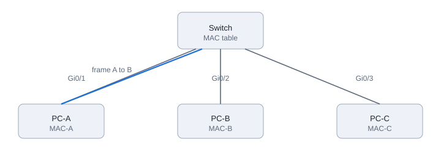

*شکل ۱: سوییچ و سه کامپیوتر؛ هر کامپیوتر به یک پورت وصل است.*

1.  **Learning (یادگیری):** هر فریمی که وارد می‌شود، سوییچ به MAC مبدأ آن نگاه می‌کند و در جدول می‌نویسد «این MAC پشت این پورت است».
2.  **Flooding (پخش):** اگر MAC مقصد در جدول نبود (یا Broadcast بود)، فریم از همه‌ی پورت‌ها به‌جز پورت ورودی فرستاده می‌شود.
3.  **Forwarding (ارسال هدفمند):** اگر MAC مقصد در جدول بود، فریم فقط از همان پورت می‌رود.
4.  **Aging (فراموشی):** ردیفی که ۳۰۰ ثانیه فریم جدیدی از آن نیامد، پاک می‌شود تا جدول پر و کهنه نشود.

> **یک قاعده‌ی مهم**
>
> سوییچ فقط MAC **مبدأ** را یاد می‌گیرد، هرگز MAC مقصد را. و Broadcast هیچ‌وقت مبدأ نیست؛ پس هرگز در جدول نمی‌آید.

### ۳. مثال ساده: اولین ارتباط A با B

جدول سوییچ در ابتدا خالی است. A (پورت Gi0/1) به B (پورت Gi0/2) فریم می‌فرستد:

``` text
Step 1: frame arrives on Gi0/1, src = MAC-A, dst = MAC-B
Step 2: learn  -> table: MAC-A = Gi0/1
Step 3: MAC-B is unknown -> FLOOD to Gi0/2 and Gi0/3
Step 4: B answers: src = MAC-B, dst = MAC-A  (arrives on Gi0/2)
Step 5: learn  -> table: MAC-B = Gi0/2
Step 6: MAC-A is known -> FORWARD only to Gi0/1
```

نتیجه: PC-C فقط فریم اول را می‌بیند. از پیام دوم به بعد، ارتباط A و B خصوصی می‌شود.

### ۴. مثال متوسط: ARP و Broadcast

در عمل، قبل از ping باید ARP انجام شود (درس ۲-۶). ARP Request یک Broadcast است:

``` text
ARP Request : dst = ff:ff:ff:ff:ff:ff  -> always flooded to all ports
ARP Reply   : dst = MAC-A (unicast)     -> forwarded only to Gi0/1
Then ping   : unicast both directions   -> no flooding anymore
```

یعنی هر ارتباط تازه با یک موج Flooding شروع می‌شود و بعد آرام می‌گیرد.

### ۵. مثال سخت: چند MAC پشت یک پورت و پرش MAC

سناریو ۱: پورت Gi0/3 به یک سوییچ دیگر وصل است. پشت آن ۲۰ کامپیوتر هست. نتیجه:

``` text
show mac address-table dynamic
  VLAN  Mac Address       Type     Ports
  1     aaaa.0000.0001    DYNAMIC  Gi0/3
  1     aaaa.0000.0002    DYNAMIC  Gi0/3
  ... 20 MACs on the same port (normal on an uplink)
```

سناریو ۲ (خطرناک): اگر یک MAC یک ثانیه از پورت Gi0/1 و ثانیه‌ی بعد از Gi0/2 بیاید، سوییچ پیام `%SW_MATM-4-MACFLAP_NOTIF` می‌دهد. این تقریباً همیشه نشانه‌ی **Loop** (حلقه) در شبکه است. در فصل ۴ (STP) می‌فهمید چرا و چطور جلویش را بگیریم.

### ۶. دستورهای کلیدی (خط‌به‌خط)

``` text
SW1# show mac address-table
SW1# show mac address-table dynamic
SW1# show mac address-table address aaaa.0000.0001
SW1# show mac address-table interface gi0/1
SW1# show mac address-table aging-time
SW1# clear mac address-table dynamic
```

- `dynamic`: فقط ردیف‌هایی که سوییچ خودش یاد گرفته (در برابر `static` که دستی نوشته می‌شود).
- `address` و `interface`: جستجو برای یک MAC یا یک پورت، مثل «پیدا کردن کامپیوتر گم‌شده».
- `clear ... dynamic`: جدول را پاک می‌کند (در Lab برای دیدن دوباره‌ی یادگیری). در شبکه‌ی واقعی با احتیاط، چون Flooding موقت ایجاد می‌کند.

### ۷. تمرین‌ها

**ت1.** ۱ (ساده): سوییچ کدام MAC را یاد می‌گیرد: مبدأ یا مقصد؟ *(پاسخ: 3-1-ت1 در بخش «پاسخ‌ها» انتهای فصل)*

**ت2.** ۲ (ساده): فریم با مقصد ff:ff:ff:ff:ff:ff چطور پخش می‌شود؟ *(پاسخ: 3-1-ت2 در بخش «پاسخ‌ها» انتهای فصل)*

**ت3.** ۳ (متوسط): جدول خالی است. A (Gi0/1) به B (Gi0/2) و بعد B به A می‌فرستد. چند Flood رخ می‌دهد؟ *(پاسخ: 3-1-ت3 در بخش «پاسخ‌ها» انتهای فصل)*

**ت4.** ۴ (متوسط): چرا ردیف یک MAC بعد از ۵ دقیقه ناپدید می‌شود؟ *(پاسخ: 3-1-ت4 در بخش «پاسخ‌ها» انتهای فصل)*

**ت5.** ۵ (سخت): MACFLAP روی MAC-X بین Gi0/1 و Gi0/2؛ محتمل‌ترین علت؟ *(پاسخ: 3-1-ت5 در بخش «پاسخ‌ها» انتهای فصل)*

### ۸. Lab هدایت‌شده: دیدن یادگیری و Flooding

توپولوژی: سوییچ `SW1` با سه کامپیوتر ساده‌ی VPCS در PNetLab. اگر ندارید، از منوی Add Object سه گره‌ی VPCS (`PC1` تا `PC3`) بسازید و به پورت‌های `Gi0/1` تا `Gi0/3` وصل کنید. همه در VLAN 1 (پیش‌فرض) هستند.

#### گام ۱: آدرس‌دهی VPCS

``` text
PC1> ip 10.10.1.11/24
PC2> ip 10.10.1.12/24
PC3> ip 10.10.1.13/24
```

#### گام ۲: جدول خالی

``` text
SW1# clear mac address-table dynamic
SW1# show mac address-table dynamic
```

#### گام ۳: ایجاد ترافیک و دیدن یادگیری

``` text
PC1> ping 10.10.1.12
SW1# show mac address-table dynamic
```

باید MAC دو VPCS را روی پورت‌های درست ببینید. MAC هر VPCS را با `show ip` روی خودش می‌بینید.

#### گام ۴: دیدن Flooding با Capture

1.  روی لینک PC3 به SW1 کلیک راست و Capture را شروع کنید.
2.  روی SW1: `clear mac address-table dynamic`.
3.  روی PC1: `ping 10.10.1.12`.
4.  در Wireshark فیلتر `arp or icmp`: ARP Request را می‌بینید (چون Broadcast است) ولی Echo Request بین PC1 و PC2 را **نباید** ببینید.

پیش‌بینی کنید و بعد با واقعیت مقایسه کنید. اگر Echo را روی PC3 دیدید، یعنی سوییچ هنوز MAC را یاد نگرفته بود.

#### گام ۵: Aging

``` text
SW1# show mac address-table aging-time
SW1(config)# mac address-table aging-time 60
```

یک دقیقه ترافیک نفرستید و دوباره `show mac address-table dynamic` را بزنید. بعد زمان را به 300 برگردانید.

### ۹. Lab مستقل

MAC یک VPCS را از روی جدول به پورتش ربط دهید، بدون نگاه به توپولوژی. بعد کابل PC2 را به پورت دیگر منتقل کنید و ثبت کنید چه مدت طول می‌کشد جدول درست شود. گزارش را در `03-ops/l2-cam-notes.md` بنویسید.

### ۱۰. عیب‌یابی

|           |                                                                          |
|-----------|--------------------------------------------------------------------------|
| Symptom   | ترافیک یک ارتباط روی پورت‌های بی‌ربط دیده می‌شود                            |
| علت محتمل | MAC مقصد در جدول نیست (Unknown Unicast Flooding) یا Aging خیلی کوتاه است |
| روش       | show mac address-table address ، Capture روی پورت سوم                    |
| Symptom 2 | پیام MACFLAP                                                             |
| علت       | Loop یا MAC تکراری                                                       |
| رفع       | پیدا کردن و قطع Loop (فصل ۴: STP)                                       |

### ۱۱. سؤال‌های مرور

**م1.** سوییچ چه چیزی را یاد می‌گیرد و از کجا؟ *(پاسخ: 3-1-م1 در بخش «پاسخ‌ها» انتهای فصل)*

**م2.** چرا Broadcast هیچ‌وقت در جدول MAC دیده نمی‌شود؟ *(پاسخ: 3-1-م2 در بخش «پاسخ‌ها» انتهای فصل)*

**م3.** Flooding یعنی چه؟ *(پاسخ: 3-1-م3 در بخش «پاسخ‌ها» انتهای فصل)*

### English Corner: انگلیسی تخصصی این درس

این جمله‌ها از مستندات و محیط کار واقعی‌اند. بلند بخوانید و ترجمه را بپوشانید.

| English sentence                                                          | ترجمه                                                               |
|---------------------------------------------------------------------------|---------------------------------------------------------------------|
| The switch learns the source MAC address of every incoming frame.         | سوییچ MAC مبدأ هر فریم ورودی را یاد می‌گیرد.                         |
| Unknown unicast frames are flooded out all ports except the ingress port. | فریم‌های Unicast ناشناخته از همه‌ی پورت‌ها به‌جز پورت ورودی پخش می‌شوند. |
| A MAC flap usually indicates a layer-2 loop.                              | MAC Flap معمولاً نشانه‌ی Loop در لایه ۲ است.                          |
| Entries age out after 300 seconds of inactivity.                          | ردیف‌ها بعد از ۳۰۰ ثانیه بی‌فعالیتی حذف می‌شوند.                       |

**Q1.** Quick quiz (answer in English): What does a switch do when the destination MAC is not in its table? *(پاسخ: 3-1-Q1 در بخش «پاسخ‌ها» انتهای فصل)*

### ۱۲. تکلیف و چک‌لیست تسلط

- [ ] ۵ تمرین را بدون نگاه حل کنم.
- [ ] Lab را انجام دهم و Flooding را با Capture ببینم.
- [ ] چهار رفتار سوییچ را بدون نگاه توضیح دهم.

### ۱۳. یادآوری اشتباهات شما

> **یادآوری**
>
> پیش‌بینی را قبل از اجرا بنویسید؛ دستور EXEC را در Config نزنید؛ فرمول و محاسبه را در بلوک مستقل بنویسید.


#### کارت Lab — درس ۳-۱

| # | فیلد | محتوا |
|---|---|---|
| 1 | عنوان و هدف | دیدن Learning/Flooding/Forwarding/Aging |
| 2 | پیش‌نیاز | فصل ۲ |
| 3 | توپولوژی | SW1 با PC1..PC3 (VPCS) روی Gi0/1..Gi0/3 |
| 4 | تجهیزات | SW1، ۳ VPCS |
| 5 | نسخه نرم‌افزار | vIOS-L2 15.2(20200924، Experimental) برای SW؛ vIOS 15.9(3)M9 برای R؛ VPCS (PNetLab)؛ PNetLab 4.2.8 |
| 6 | IP Plan | 10.10.1.11-13/24 (VLAN 1) |
| 7 | وضعیت اولیه | جدول MAC خالی (`clear mac address-table dynamic`) |
| 8 | صورت مسئله | ثابت کنید سوییچ MAC مبدأ را یاد می‌گیرد و Unknown Unicast پخش می‌شود |
| 9 | مراحل هدایت‌شده | همان بخش «Lab هدایت‌شده» همین درس (گام‌به‌گام) |
| 10 | تست عملکرد | `show mac address-table dynamic` ؛ Capture روی PC3 |
| 11 | سناریوی خرابی | Aging کوتاه (`mac address-table aging-time 60`) |
| 12 | روش عیب‌یابی | Capture روی پورت سوم |
| 13 | نتیجه‌ی مورد انتظار | MAC دو PC روی پورت درست؛ Echo بین PC1 و PC2 روی PC3 دیده نشود |
| 14 | معیار پذیرش | پیش‌بینی با نتیجه تطبیق داده شود |
| 15 | مستندات نهایی | `03-ops/l2-cam-notes.md` |
| 16 | Cleanup و بازگردانی | Aging را 300 کنید |

> **وضعیت راستی‌آزمایی (خارج از ۱۶ فیلد):** **اجرا نشده (فقط طراحی).** اجرا نشده؛ رفتار CAM/Flooding روی vIOS-L2 با VPCS دیده نشده.

---

<a id="l-3-2"></a>

## درس ۳-۲ — VLAN و Access Port

**فصل ۳ - روز ۲ · پیش‌نیاز: درس ۳-۱ · ۶ ساعت**

### این درس درباره چیست و چرا باید یاد بگیریم؟

**چه چیزی یاد می‌گیریم:** چطور یک سوییچ فیزیکی را به چند «شبکه‌ی مجازی جدا» یعنی VLAN تقسیم کنیم، پورت‌ها را به VLANها اختصاص دهیم (Access Port) و جدولی منظم به نام VLAN Matrix بسازیم.

**چرا لازم است:** بدون VLAN، همه‌ی دستگاه‌های سازمان در یک Broadcast Domain هستند: ترافیک حسابداری، دوربین‌ها و مهمان‌ها با هم قاطی می‌شود و یک کامپیوتر آلوده می‌تواند همه را ببیند. VLAN جداسازی را بدون خرید سوییچ جدا ممکن می‌کند.

- **در کار روزانه:** هر بار که کارمند جدید یا پرینتر جدید وصل می‌شود، باید پورتش را به VLAN درست ببرید.
- **در امنیت:** VLAN اولین لایه‌ی «Segmentation» است؛ در FortiGate بین VLANها Policy می‌نویسید.
- **در Capstone:** VLAN10 مدیریت، VLAN20 کاربران و VLAN30 سرورها همین هفته ساخته می‌شوند.

> **مسیر درس**
>
> Broadcast Domain ← VLAN چیست ← Access Port ← VLAN Matrix ← مثال ساده/متوسط/سخت ← دستورها ← تمرین ← Lab ← عیب‌یابی.

#### اصطلاحات این درس (مخفف ← شکل کامل ← معنی)

| مخفف             | شکل کامل انگلیسی                    | معنی فارسی                                     |
|------------------|-------------------------------------|------------------------------------------------|
| VLAN             | Virtual Local Area Network          | شبکه محلی مجازی؛ جداسازی منطقی در لایه ۲       |
| Broadcast Domain | Broadcast Domain                    | محدوده‌ای که Broadcast در آن می‌رسد              |
| Access Port      | Access Port                         | پورتی که فقط به یک VLAN تعلق دارد و Tag نمی‌زند |
| Native           | Native VLAN                         | VLAN بدون Tag روی Trunk (درس بعد)              |
| VLAN ID          | VLAN Identifier                     | شماره‌ی VLAN (۱ تا ۴۰۹۴)                        |
| SVI              | Switch Virtual Interface            | Interface مجازی L3 برای یک VLAN                |
| DHCP             | Dynamic Host Configuration Protocol | تخصیص خودکار آدرس                              |

### ۱. مشکل: یک Broadcast Domain بزرگ

یک ساختمان اداری را در نظر بگیرید که همه‌ی طبقه‌ها یک راه‌پله‌ی مشترک و بدون در دارند. هر صدایی که در یک طبقه بلند شود، همه‌ی ساختمان می‌شنوند. Broadcast در شبکه همین است: هر بار که یک دستگاه ARP یا DHCP می‌فرستد، همه‌ی دستگاه‌های سوییچ آن را دریافت می‌کنند.

هرچه دستگاه‌ها بیشتر شوند، Broadcast بیشتر و شبکه کندتر می‌شود؛ و از نظر امنیت، همه همسایه‌ی هم هستند.

### ۲. VLAN: در گذاشتن بین طبقه‌ها

VLAN سوییچ را به چند «سوییچ مجازی» تقسیم می‌کند. هر پورت عضو یک VLAN است و فریم‌ها فقط بین پورت‌های همان VLAN رد می‌شوند. دستگاه‌های VLAN متفاوت نه Broadcast یکدیگر را می‌بینند و نه بدون روتر با هم صحبت می‌کنند.

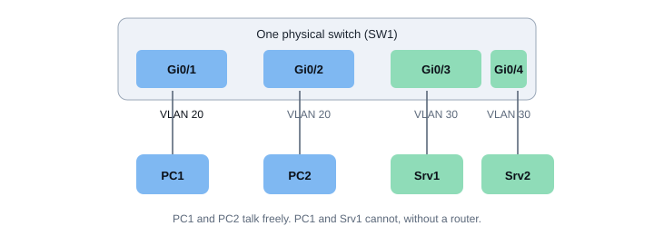

*شکل ۱: یک سوییچ فیزیکی، دو VLAN مجزا.*

#### قوانین VLAN

- VLAN با شماره شناخته می‌شود: ۱ تا ۴۰۹۴ (جزئیات در درس بعد).
- VLAN 1 پیش‌فرض است و بهتر است برای کاربران استفاده نشود.
- هر VLAN معمولاً یک Subnet IP جدا دارد: VLAN20 همان 10.10.20.0/24 در IP Plan ماست.
- Access Port فقط عضو یک VLAN است و دستگاه انتهایی (PC، پرینتر) به آن وصل می‌شود.

### ۳. VLAN Matrix: سند طراحی

قبل از تایپ هر دستور، یک جدول بسازید. ستون‌ها: شماره، نام، Subnet، Gateway، پورت‌ها. این جدول مرجع شماست:

| VLAN | Name    | Subnet        | Gateway    | Access Ports     |
|------|---------|---------------|------------|------------------|
| 10   | MGMT    | 10.10.10.0/24 | 10.10.10.1 | (مدیریت تجهیزات) |
| 20   | USERS   | 10.10.20.0/24 | 10.10.20.1 | Gi0/1, Gi0/2     |
| 30   | SERVERS | 10.10.30.0/24 | 10.10.30.1 | Gi0/3            |

### ۴. دستورها (خط‌به‌خط)

``` text
SW1(config)# vlan 20
SW1(config-vlan)# name USERS
SW1(config-vlan)# exit
SW1(config)# interface gi0/1
SW1(config-if)# switchport mode access
SW1(config-if)# switchport access vlan 20
SW1(config-if)# exit
```

- `vlan 20` + `name`: VLAN را می‌سازد و نام می‌دهد (نام فقط برای خوانایی است).
- `switchport mode access`: پورت را صریحاً Access می‌کند (نه خودکار).
- `switchport access vlan 20`: پورت را عضو VLAN 20 می‌کند. اگر VLAN وجود نداشته باشد، IOS آن را خودکار می‌سازد (خطای رایج: VLAN بدون نام).
- برای چند پورت: `interface range gi0/1 - 2`.

``` text
SW1# show vlan brief
SW1# show interfaces gi0/1 switchport
SW1# show running-config interface gi0/1
```

### ۵. مثال ساده: دو کامپیوتر در یک VLAN

``` text
PC1> ip 10.10.20.11/24 10.10.20.1
PC2> ip 10.10.20.12/24 10.10.20.1
PC1> ping 10.10.20.12     -> success (same VLAN 20)
```

### ۶. مثال متوسط: دو VLAN، بدون روتر

``` text
Srv1 (VLAN 30): 10.10.30.11/24
PC1  (VLAN 20): ping 10.10.30.11   -> FAILS
```

دلیل: دو Broadcast Domain جدا هستند و بدون Gateway (روتر یا SVI) بسته نمی‌تواند رد شود. در درس‌های ۳-۴ و ۳-۵ این مشکل را حل می‌کنیم.

### ۷. مثال سخت: پورت در VLAN اشتباه (TS03)

کاربری شکایت دارد «اینترنت ندارم». IP او 10.10.20.50/24 است ولی ping به Gateway جواب نمی‌دهد. روش عیب‌یابی:

1.  پورت او را پیدا کن: `show mac address-table address <MAC>`.
2.  VLAN آن پورت را ببین: `show vlan brief`.
3.  مقایسه کن: Subnet کامپیوتر با VLAN پورت یکی است؟
4.  اگر نه، پورت را به VLAN درست ببر و دوباره تست کن.

``` text
Symptom   : IP 10.10.20.x but port is in VLAN 30
Evidence  : show vlan brief -> Gi0/5 in VLAN 30
Fix       : switchport access vlan 20
Verify    : ping gateway success
```

### ۸. تمرین‌ها

**ت1.** ۱ (ساده): چرا VLAN باعث کاهش Broadcast می‌شود؟ *(پاسخ: 3-2-ت1 در بخش «پاسخ‌ها» انتهای فصل)*

**ت2.** ۲ (ساده): دو کامپیوتر در VLAN های 20 و 30 بدون روتر ping می‌کنند؛ نتیجه؟ *(پاسخ: 3-2-ت2 در بخش «پاسخ‌ها» انتهای فصل)*

**ت3.** ۳ (متوسط): دستورهای لازم برای ساختن VLAN 40 با نام GUEST و قراردادن Gi0/6 در آن *(پاسخ: 3-2-ت3 در بخش «پاسخ‌ها» انتهای فصل)*

**ت4.** ۴ (متوسط): خروجی show vlan brief چه چیزی نشان می‌دهد؟ *(پاسخ: 3-2-ت4 در بخش «پاسخ‌ها» انتهای فصل)*

**ت5.** ۵ (سخت): کاربر در VLAN 20 است ولی به Gateway نمی‌رسد؛ سه علت محتمل *(پاسخ: 3-2-ت5 در بخش «پاسخ‌ها» انتهای فصل)*

### ۹. Lab هدایت‌شده

#### گام ۱: ساخت VLANها (طبق VLAN Matrix)

``` text
SW1(config)# vlan 20
SW1(config-vlan)# name USERS
SW1(config-vlan)# vlan 30
SW1(config-vlan)# name SERVERS
SW1(config-vlan)# exit
```

#### گام ۲: اختصاص پورت‌ها

``` text
SW1(config)# interface range gi0/1 - 2
SW1(config-if-range)# switchport mode access
SW1(config-if-range)# switchport access vlan 20
SW1(config-if-range)# exit
SW1(config)# interface gi0/3
SW1(config-if)# switchport mode access
SW1(config-if)# switchport access vlan 30
SW1(config-if)# end
SW1# show vlan brief
```

#### گام ۳: تست

``` text
PC1> ip 10.10.20.11/24 10.10.20.1
PC2> ip 10.10.20.12/24 10.10.20.1
PC3> ip 10.10.30.11/24 10.10.30.1
PC1> ping 10.10.20.12     (expect: success)
PC1> ping 10.10.30.11     (expect: fail)
```

#### گام ۴: خراب‌کردن عمدی و رفع

``` text
SW1(config)# interface gi0/2
SW1(config-if)# switchport access vlan 30
(PC1 ping PC2 now fails)
SW1(config-if)# switchport access vlan 20
(ping works again)
```

#### گام ۵: ذخیره

``` text
SW1# copy running-config startup-config
```

### ۱۰. Lab مستقل

VLAN Matrix مفصل Capstone (مرکز) را با ۵ VLAN بنویسید و فایل `02-design/vlan-matrix.md` را بسازید: شماره، نام، Subnet، Gateway، پورت‌ها، توضیح.

### ۱۱. عیب‌یابی

|         |                                                                                                        |
|---------|--------------------------------------------------------------------------------------------------------|
| Symptom | PC به Gateway نمی‌رسد                                                                                   |
| چک‌لیست  | ۱) پورت در VLAN درست است؟ ؛ ۲) VLAN وجود دارد؟ ؛ ۳) پورت UP است؟ (TS01) ؛ ۴) IP/Mask/Gateway درست است؟ |
| ابزار   | show vlan brief ، show interfaces status                                                               |

### ۱۲. سؤال‌های مرور

**م1.** VLAN چه فایده‌ای دارد؟ *(پاسخ: 3-2-م1 در بخش «پاسخ‌ها» انتهای فصل)*

**م2.** Access Port چیست؟ *(پاسخ: 3-2-م2 در بخش «پاسخ‌ها» انتهای فصل)*

### English Corner: انگلیسی تخصصی این درس

این جمله‌ها از مستندات و محیط کار واقعی‌اند. بلند بخوانید و ترجمه را بپوشانید.

| English sentence                                       | ترجمه                                                    |
|--------------------------------------------------------|----------------------------------------------------------|
| A VLAN is a logical broadcast domain on a switch.      | VLAN یک Broadcast Domain منطقی روی سوییچ است.            |
| Assign the port to VLAN 20 as an access port.          | پورت را به‌عنوان Access Port به VLAN 20 اختصاص بدهید.     |
| Hosts in different VLANs need a router to communicate. | Hostها در VLANهای متفاوت برای ارتباط به روتر نیاز دارند. |
| Verify the VLAN membership with show vlan brief.       | عضویت VLAN را با show vlan brief بررسی کنید.             |

**Q1.** Quick quiz (answer in English): Why do hosts in different VLANs need a router? *(پاسخ: 3-2-Q1 در بخش «پاسخ‌ها» انتهای فصل)*

### ۱۳. تکلیف و چک‌لیست تسلط

- [ ] VLAN Matrix را کامل بنویسم.
- [ ] Lab را اجرا کنم و ping موفق و ناموفق را ثبت کنم.
- [ ] TS03 را عمداً بسازم و رفع کنم.

### ۱۴. یادآوری اشتباهات شما

> **یادآوری**
>
> «پذیرفته شدن دستور ≠ کار کردن»؛ همیشه با ping و show تأیید کنید. بعد از هر تغییر موفق ذخیره کنید.


#### کارت Lab — درس ۳-۲

| # | فیلد | محتوا |
|---|---|---|
| 1 | عنوان و هدف | ساخت VLAN و Access Port طبق VLAN Matrix |
| 2 | پیش‌نیاز | درس ۳-۱ |
| 3 | توپولوژی | SW1 با PC1..PC3 (VLAN 20/30) |
| 4 | تجهیزات | SW1، ۳ VPCS |
| 5 | نسخه نرم‌افزار | vIOS-L2 15.2(20200924، Experimental) برای SW؛ vIOS 15.9(3)M9 برای R؛ VPCS (PNetLab)؛ PNetLab 4.2.8 |
| 6 | IP Plan | VLAN20 10.10.20.0/24؛ VLAN30 10.10.30.0/24 |
| 7 | وضعیت اولیه | VLAN فقط 1 |
| 8 | صورت مسئله | VLAN 20 و 30 بسازید؛ ping داخل VLAN موفق و بین VLAN شکست |
| 9 | مراحل هدایت‌شده | همان بخش «Lab هدایت‌شده» همین درس (گام‌به‌گام) |
| 10 | تست عملکرد | `show vlan brief` ؛ ping |
| 11 | سناریوی خرابی | پورت PC2 در VLAN اشتباه |
| 12 | روش عیب‌یابی | مقایسه‌ی Subnet کامپیوتر با VLAN پورت |
| 13 | نتیجه‌ی مورد انتظار | ping هم‌VLAN موفق؛ بین‌VLAN شکست |
| 14 | معیار پذیرش | VLAN Matrix |
| 15 | مستندات نهایی | `02-design/vlan-matrix.md` |
| 16 | Cleanup و بازگردانی | حذف VLANها؛ پورت‌ها به VLAN 1 |

> **وضعیت راستی‌آزمایی (خارج از ۱۶ فیلد):** **جزئی.** ساخت/نام‌گذاری VLAN و `show vlan brief` Tested-OK؛ Access Port + VPCS و ping بین VLAN اجرا نشده.

---

<a id="l-3-3"></a>

## درس ۳-۳ — Trunk و 802.1Q

**فصل ۳ - روز ۳ · پیش‌نیاز: درس ۳-۲ · ۶ ساعت**

### این درس درباره چیست و چرا باید یاد بگیریم؟

**چه چیزی یاد می‌گیریم:** چطور چند VLAN را روی «یک کابل» بین دو سوییچ (یا سوییچ و روتر) عبور بدهیم. این کار با Trunk و استاندارد 802.1Q انجام می‌شود که به هر فریم یک برچسب (Tag) اضافه می‌کند.

**چرا لازم است:** بدون Trunk باید برای هر VLAN یک کابل جدا بین سوییچ‌ها بکشید. Trunk همه را در یک کابل جا می‌دهد؛ ولی یک اشتباه کوچک در آن (مثلاً پاک‌کردن لیست VLANهای مجاز) می‌تواند کل شعبه را قطع کند.

- **در کار روزانه:** تقریباً هر لینک بین سوییچ‌ها و بین سوییچ و فایروال Trunk است.
- **در امنیت:** Trunk نادرست راه حمله‌ی VLAN Hopping است؛ باید Native و Allowed را سفت کنید.
- **در FortiGate:** پورت فایروال که به سوییچ وصل می‌شود، همین Trunk را می‌بیند (VLAN Interface).

> **مسیر درس**
>
> مشکل: یک کابل برای هر VLAN ← Tag 802.1Q ← Native VLAN ← Allowed List ← مثال ساده/متوسط/سخت ← دستورها ← تمرین ← Lab ← عیب‌یابی.

#### اصطلاحات این درس (مخفف ← شکل کامل ← معنی)

| مخفف        | شکل کامل انگلیسی          | معنی فارسی                             |
|-------------|---------------------------|----------------------------------------|
| Trunk       | Trunk Port                | پورتی که چند VLAN را با Tag عبور می‌دهد |
| 802.1Q      | IEEE 802.1Q               | استاندارد Tag کردن VLAN در فریم اترنت  |
| Tag         | VLAN Tag                  | ۴ بایت اضافه به فریم؛ شامل VLAN ID     |
| TPID        | Tag Protocol Identifier   | مقدار 0x8100؛ نشان‌دهنده‌ی وجود Tag      |
| VID         | VLAN Identifier           | ۱۲ بیت شماره VLAN                      |
| PCP         | Priority Code Point       | ۳ بیت اولویت (QoS)                     |
| DTP         | Dynamic Trunking Protocol | پروتکل سیسکو برای مذاکره خودکار Trunk  |
| Native VLAN | Native VLAN               | VLANی که روی Trunk بدون Tag می‌رود      |

### ۱. مشکل: یک کابل برای هر VLAN؟

فرض کنید دو سوییچ در دو طبقه دارید و ۵ VLAN. بدون Trunk باید ۵ کابل بکشید. تصور کنید یک اتوبوس بین دو شهر. به‌جای ۵ ماشین جدا برای ۵ شرکت، یک اتوبوس مسافران همه‌ی شرکت‌ها را می‌برد؛ فقط باید روی هر مسافر یک برچسب بزنید تا در مقصد معلوم باشد مال کدام شرکت است.

### ۲. Tag 802.1Q چیست؟

سوییچ هنگام ورود فریم به Trunk، یک برچسب ۴ بایتی بین MAC مبدأ و نوع فریم می‌گذارد. سوییچ آن‌طرف، برچسب را می‌خواند و فریم را فقط در همان VLAN پخش می‌کند.

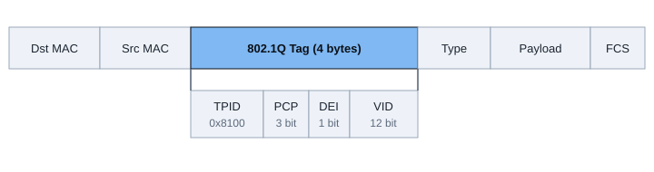

*شکل ۱: فریم اترنت با Tag ۴ بایتی 802.1Q؛ ۱۲ بیت آن شماره‌ی VLAN است.*

چون VID دوازده بیت است، تعداد VLANها محدود می‌شود:

``` text
VID bits         = 12
Total values     = 2 ^ 12 = 4096   (0 .. 4095)
Reserved         = 0 and 4095
Usable VLAN IDs  = 4096 - 2 = 4094   (1 .. 4094)
```

### ۳. Native VLAN: ترافیک بدون برچسب

یک VLAN روی Trunk بدون Tag می‌رود؛ به آن **Native VLAN** می‌گویند (پیش‌فرض VLAN 1). اگر دو سر Trunk Native متفاوت داشته باشند، ترافیک VLANها قاطی می‌شود و CDP پیام `Native VLAN mismatch` می‌دهد. همین امر راهی برای VLAN Hopping است.

> **توصیه‌ی امنیتی**
>
> Native را روی یک VLAN بدون استفاده (مثلاً 999) بگذارید و دو سر لینک یکی باشد.

### ۴. Allowed VLAN List: چه VLANهایی اجازه‌ی عبور دارند

پیش‌فرض Trunk همه‌ی VLANها (1 تا 4094) را عبور می‌دهد. بهتر است فقط VLANهای لازم مجاز باشند. اینجا یک اشتباه بسیار رایج هست:

``` text
switchport trunk allowed vlan 20,30        (REPLACES the whole list!)
switchport trunk allowed vlan add 40        (ADDS 40 to the existing list)
switchport trunk allowed vlan remove 30     (REMOVES 30 only)
```

> **هشدار (TS05: Human Error)**
>
> اگر برای افزودن VLAN جدید فقط بنویسید `allowed vlan 40` (بدون کلمه‌ی add)، کل لیست قبلی پاک می‌شود و فقط VLAN 40 می‌ماند. باقی VLANها بلافاصله قطع می‌شوند. همیشه از `add` استفاده کنید و قبلش `show interfaces trunk` را ببینید.

### ۵. دستورها (خط‌به‌خط)

``` text
SW1(config)# interface gi0/0
SW1(config-if)# switchport trunk encapsulation dot1q
SW1(config-if)# switchport mode trunk
SW1(config-if)# switchport trunk native vlan 999
SW1(config-if)# switchport trunk allowed vlan 10,20,30
SW1(config-if)# switchport nonegotiate
SW1(config-if)# end
```

- `trunk encapsulation dot1q`: روی بعضی سوییچ‌ها لازم است (اگر خطا داد، سوییچ فقط dot1q را پشتیبانی می‌کند و نیازی نیست).
- `mode trunk`: پورت را صریحاً Trunk می‌کند.
- `native vlan 999`: VLAN بدون Tag.
- `allowed vlan`: فهرست مجاز (اینجا برای اولین بار از فرم کامل استفاده شده).
- `nonegotiate`: DTP را خاموش می‌کند تا مذاکره‌ی ناخواسته رخ ندهد.

``` text
SW1# show interfaces trunk
SW1# show interfaces gi0/0 switchport
```

خروجی `show interfaces trunk` چهار بخش دارد: Mode و Status، Vlans allowed، Vlans allowed and active، و Vlans in spanning tree forwarding state. اگر VLANی در بخش اول هست ولی در دوم نیست، یعنی هنوز روی سوییچ ساخته نشده.

### ۶. مثال ساده: Trunk بین SW1 و SW2

``` text
SW1(config)# interface gi0/1
SW1(config-if)# switchport trunk encapsulation dot1q
SW1(config-if)# switchport mode trunk
(same on SW2)
SW1# show interfaces trunk       -> Gi0/1 trunking, allowed 1-4094
```

### ۷. مثال متوسط: دو سوییچ، دو VLAN

``` text
SW1: PC1 (VLAN 20) on Gi0/2        SW2: PC4 (VLAN 20) on Gi0/2
Trunk Gi0/1 between SW1 and SW2 carries VLAN 20 and 30
PC1 ping PC4 (same VLAN 20) -> success through the trunk
```

شرط: هر دو سوییچ باید VLAN 20 را داشته باشند و در لیست مجاز Trunk باشد.

### ۸. مثال سخت: عیب‌یابی TS04 و TS05

``` text
TS04 symptom : VLAN 30 hosts lost connectivity across the trunk
Evidence     : show interfaces trunk -> VLAN 30 missing from "allowed"
Fix          : switchport trunk allowed vlan add 30

TS05 cause   : someone typed "allowed vlan 40" (without add)
Result       : only VLAN 40 remains, 10/20/30 down
Prevention   : always use "add", always review show interfaces trunk
               before and after, keep a backup (lesson 2-4)
```

### ۹. تمرین‌ها

**ت1.** ۱ (ساده): چند بیت از Tag مخصوص VLAN ID است و چند VLAN قابل‌استفاده داریم؟ *(پاسخ: 3-3-ت1 در بخش «پاسخ‌ها» انتهای فصل)*

**ت2.** ۲ (ساده): تفاوت allowed vlan 40 با allowed vlan add 40؟ *(پاسخ: 3-3-ت2 در بخش «پاسخ‌ها» انتهای فصل)*

**ت3.** ۳ (متوسط): Native Mismatch چه عارضه‌ای دارد؟ *(پاسخ: 3-3-ت3 در بخش «پاسخ‌ها» انتهای فصل)*

**ت4.** ۴ (متوسط): چرا nonegotiate را می‌زنیم؟ *(پاسخ: 3-3-ت4 در بخش «پاسخ‌ها» انتهای فصل)*

**ت5.** ۵ (سخت): روی Trunk هستید و VLAN 30 در show interfaces trunk در ستون allowed نیست؛ ۳ دستور رفع *(پاسخ: 3-3-ت5 در بخش «پاسخ‌ها» انتهای فصل)*

### ۱۰. Lab هدایت‌شده

توپولوژی: `SW1` و `SW2` (گره دوم vIOSL2) با کابل بین `Gi0/1` هر دو. PC1 روی SW1 و PC4 روی SW2 هر دو در VLAN 20.

#### گام ۱: بکاپ

``` text
SW1# copy running-config flash:SW1-before-trunk.cfg
SW2# copy running-config flash:SW2-before-trunk.cfg
```

#### گام ۲: VLANها روی هر دو سوییچ

``` text
SW2(config)# vlan 20
SW2(config-vlan)# name USERS
SW2(config-vlan)# vlan 30
SW2(config-vlan)# name SERVERS
```

#### گام ۳: Trunk روی هر دو سر

``` text
SWx(config)# interface gi0/1
SWx(config-if)# switchport trunk encapsulation dot1q
SWx(config-if)# switchport mode trunk
SWx(config-if)# switchport trunk native vlan 999
SWx(config-if)# switchport trunk allowed vlan 20,30
SWx(config-if)# switchport nonegotiate
SWx# show interfaces trunk
```

#### گام ۴: تست

``` text
PC1> ip 10.10.20.11/24 10.10.20.1
PC4> ip 10.10.20.14/24 10.10.20.1
PC1> ping 10.10.20.14      (expect: success)
```

#### گام ۵: Capture و دیدن Tag

روی لینک بین SW1 و SW2 Capture بگیرید. فریم‌ها را باز کنید: در Wireshark باید «802.1Q Virtual LAN، ID: 20» ببینید. روی لینک PC1 همان فریم **بدون** Tag است (چون Access Port است).

#### گام ۶: ایجاد عمدی TS05 و رفع

``` text
SW1(config-if)# switchport trunk allowed vlan 30     (WRONG, replaces list)
PC1 ping PC4 -> fails
SW1(config-if)# switchport trunk allowed vlan add 20
PC1 ping PC4 -> works
```

### ۱۱. Lab مستقل

یک Runbook کوتاه `03-ops/trunk-change.md` بنویسید: «قبل از هر تغییر Trunk چه چیزی بررسی/بکاپ شود و چطور برگردیم». از `reload in` هم استفاده کنید.

### ۱۲. عیب‌یابی

|         |                                                                                                                          |
|---------|--------------------------------------------------------------------------------------------------------------------------|
| Symptom | یک VLAN از Trunk رد نمی‌شود                                                                                               |
| چک‌لیست  | ۱) VLAN در Allowed هست؟ ؛ ۲) VLAN روی هر دو سوییچ ساخته شده؟ ؛ ۳) Native دو سر یکی است؟ ؛ ۴) Trunk در حالت trunking است؟ |
| ابزار   | show interfaces trunk ، show vlan brief ، show cdp neighbors                                                             |

### ۱۳. سؤال‌های مرور

**م1.** Trunk چه کاری می‌کند؟ *(پاسخ: 3-3-م1 در بخش «پاسخ‌ها» انتهای فصل)*

**م2.** Native VLAN چیست؟ *(پاسخ: 3-3-م2 در بخش «پاسخ‌ها» انتهای فصل)*

### English Corner: انگلیسی تخصصی این درس

این جمله‌ها از مستندات و محیط کار واقعی‌اند. بلند بخوانید و ترجمه را بپوشانید.

| English sentence                                                   | ترجمه                                                         |
|--------------------------------------------------------------------|---------------------------------------------------------------|
| The trunk carries traffic for multiple VLANs using 802.1Q tagging. | Trunk ترافیک چند VLAN را با Tag 802.1Q عبور می‌دهد.            |
| A native VLAN mismatch can lead to VLAN hopping.                   | عدم تطابق Native VLAN می‌تواند به VLAN Hopping منجر شود.       |
| Use the add keyword to avoid overwriting the allowed VLAN list.    | از کلمه‌ی add استفاده کنید تا لیست VLANهای مجاز بازنویسی نشود. |
| Disable DTP with switchport nonegotiate.                           | DTP را با switchport nonegotiate خاموش کنید.                  |

**Q1.** Quick quiz (answer in English): Why is "switchport trunk allowed vlan 40" dangerous on a live trunk? *(پاسخ: 3-3-Q1 در بخش «پاسخ‌ها» انتهای فصل)*

### ۱۴. تکلیف و چک‌لیست تسلط

- [ ] Trunk را راه بیندازم و Tag را در Capture ببینم.
- [ ] TS04 و TS05 را بسازم و رفع کنم.
- [ ] جدول allowed/native هر لینک را در IP Plan ثبت کنم.

### ۱۵. یادآوری اشتباهات شما

> **یادآوری**
>
> قبل از تغییر Trunk بکاپ بگیرید؛ بعد از تغییر show را ببینید؛ فرمول‌ها و مراحل را در بلوک مستقل بنویسید.


#### کارت Lab — درس ۳-۳

| # | فیلد | محتوا |
|---|---|---|
| 1 | عنوان و هدف | Trunk 802.1Q با Native و Allowed و دیدن Tag |
| 2 | پیش‌نیاز | درس ۳-۲ |
| 3 | توپولوژی | SW1 Gi0/1 ↔ SW2 Gi0/1 |
| 4 | تجهیزات | SW1، SW2، PC1، PC4 |
| 5 | نسخه نرم‌افزار | vIOS-L2 15.2(20200924، Experimental) برای SW؛ vIOS 15.9(3)M9 برای R؛ VPCS (PNetLab)؛ PNetLab 4.2.8 |
| 6 | IP Plan | VLAN 20 و 30؛ 10.10.20.0/24 |
| 7 | وضعیت اولیه | VLANها روی هر دو ساخته شده |
| 8 | صورت مسئله | Trunk بسازید و خطای فراموشی `add` را ایجاد و رفع کنید |
| 9 | مراحل هدایت‌شده | همان بخش «Lab هدایت‌شده» همین درس (گام‌به‌گام) |
| 10 | تست عملکرد | `show interfaces trunk` ؛ Capture Tag 802.1Q |
| 11 | سناریوی خرابی | `allowed vlan 30` بدون add |
| 12 | روش عیب‌یابی | `show interfaces trunk` قبل/بعد |
| 13 | نتیجه‌ی مورد انتظار | VLAN 20 از Trunk رد شود؛ Tag در Capture |
| 14 | معیار پذیرش | بعد از رفع ping PC1↔PC4 موفق |
| 15 | مستندات نهایی | `03-ops/trunk-change.md` |
| 16 | Cleanup و بازگردانی | Allowed را به 20,30 و Native 999 برگردانید |

> **وضعیت راستی‌آزمایی (خارج از ۱۶ فیلد):** **جزئی.** Trunk 802.1Q روی یک سوییچ Tested-OK؛ Trunk بین دو سوییچ، Tag در Capture و `allowed vlan` اجرا نشده.

---

<a id="l-3-4"></a>

## درس ۳-۴ — Router-on-a-Stick

**فصل ۳ - روز ۴ · پیش‌نیاز: درس ۳-۳ · ۶ ساعت**

### این درس درباره چیست و چرا باید یاد بگیریم؟

**چه چیزی یاد می‌گیریم:** چطور VLANهای مختلف را به هم وصل کنیم. روش اول: یک روتر با یک کابل Trunk و چند Sub-interface؛ معروف به Router-on-a-Stick (RoAS).

**چرا لازم است:** همان‌طور که دیدید دو VLAN بدون روتر با هم صحبت نمی‌کنند. این درس کلید فهم «Inter-VLAN Routing» است و همین مفهوم در FortiGate با VLAN Interface تکرار می‌شود. کسی که RoAS را بفهمد، Gateway در FortiGate را هم می‌فهمد.

- **در کار روزانه:** شعبه‌های کوچک بدون سوییچ لایه ۳ از همین روش استفاده می‌کنند.
- **در امنیت:** وقتی ترافیک بین VLANها از روتر یا فایروال می‌گذرد، می‌شود ACL یا Policy گذاشت.
- **در Capstone:** فایروال FortiGate همین نقش را برای همه‌ی VLANها دارد.

> **مسیر درس**
>
> مشکل: ارتباط بین VLANها ← ایده‌ی Sub-interface ← مسیر بسته (Packet Flow) ← دستورها ← مثال ساده/متوسط/سخت ← تمرین ← Lab ← عیب‌یابی.

#### اصطلاحات این درس (مخفف ← شکل کامل ← معنی)

| مخفف                | شکل کامل انگلیسی          | معنی فارسی                                |
|---------------------|---------------------------|-------------------------------------------|
| RoAS                | Router on a Stick         | روتر با یک لینک Trunk و چند Sub-interface |
| Sub-interface       | Sub-interface             | Interface منطقی روی یک Interface فیزیکی   |
| Inter-VLAN          | Inter-VLAN Routing        | مسیریابی بین VLANها                       |
| Gateway             | Default Gateway           | دروازه‌ی پیش‌فرض هر VLAN                    |
| encapsulation dot1Q | IEEE 802.1Q encapsulation | دستور اتصال Sub-interface به یک VLAN      |
| L3                  | Layer 3                   | لایه شبکه (IP)                            |

### ۱. مشکل

PC1 در VLAN 20 و Srv1 در VLAN 30. هر کدام Subnet خودش را دارد؛ دو شبکه‌ی جدا که بدون «پل» به هم نمی‌رسند. این پل یک **روتر** است: وقتی PC1 بخواهد به Srv1 بفرستد، بسته را به Gateway خودش می‌دهد و روتر آن را به VLAN 30 می‌فرستد.

ساده‌ترین راه: برای هر VLAN یک پورت فیزیکی روتر. ولی روتر پورت زیادی ندارد. راه‌حل هوشمندانه: یک پورت و یک Trunk؛ و روی روتر برای هر VLAN یک «Interface مجازی» می‌سازیم.

### ۲. ایده‌ی Router-on-a-Stick

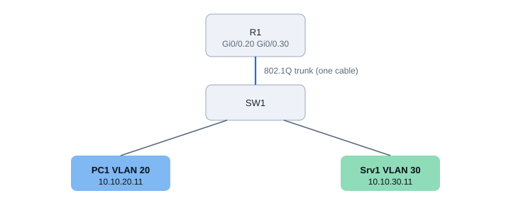

*شکل ۱: یک کابل Trunk بین روتر و سوییچ؛ روتر برای هر VLAN یک Sub-interface دارد.*

Sub-interface مثل چند میز در یک ساختمان است: یک در (کابل فیزیکی) دارد ولی هر میز برای یک شرکت (VLAN) کار می‌کند. هر Sub-interface یک آدرس IP دارد که همان Gateway آن VLAN است.

### ۳. مسیر بسته (Packet Flow)

PC1 (10.10.20.11، VLAN 20) به Srv1 (10.10.30.11، VLAN 30) ping می‌زند:

1.  PC1 می‌بیند Srv1 در Subnet دیگری است و بسته را به Gateway (10.10.20.1) می‌دهد؛ پس MAC مقصد فریم، MAC روتر است.
2.  سوییچ فریم را با Tag VLAN 20 روی Trunk به روتر می‌فرستد.
3.  روتر روی Gi0/0.20 دریافت می‌کند، جدول Route را می‌بیند (Connected: 10.10.30.0/24 روی Gi0/0.30).
4.  روتر فریم جدید با MAC مقصد Srv1 می‌سازد و با Tag VLAN 30 از همان کابل برمی‌گرداند.
5.  سوییچ Tag را برمی‌دارد و فریم را فقط به پورت Srv1 می‌دهد.

``` text
IP src/dst stay the same : 10.10.20.11 -> 10.10.30.11
MAC dst changes          : router MAC (hop 1) -> Srv1 MAC (hop 2)
VLAN tag changes         : 20 (in) -> 30 (out)
TTL                      : decreased by 1 at the router
```

> **نکته‌ی مهم**
>
> IP مبدأ و مقصد تغییر نمی‌کنند، ولی MAC و Tag در هر Hop عوض می‌شوند. این همان نکته‌ی «Routing» است که در Capture (درس ۲-۶) دیدید.

### ۴. دستورها (خط‌به‌خط)

``` text
SW1(config)# interface gi0/0
SW1(config-if)# switchport trunk encapsulation dot1q
SW1(config-if)# switchport mode trunk
SW1(config-if)# switchport trunk allowed vlan 10,20,30

R1(config)# interface gi0/0
R1(config-if)# no shutdown
R1(config-if)# no ip address
R1(config-if)# interface gi0/0.20
R1(config-subif)# encapsulation dot1Q 20
R1(config-subif)# ip address 10.10.20.1 255.255.255.0
R1(config-subif)# interface gi0/0.30
R1(config-subif)# encapsulation dot1Q 30
R1(config-subif)# ip address 10.10.30.1 255.255.255.0
R1(config-subif)# end
```

- Interface فیزیکی بدون IP و روشن (`no shutdown`) می‌ماند؛ فقط Sub-interfaceها آدرس دارند.
- `encapsulation dot1Q 20`: این Sub-interface فقط فریم‌های Tag 20 را می‌گیرد/می‌فرستد. شماره‌ی Sub-interface (.20) فقط یک نام است؛ ولی عرف این است که با VLAN یکی باشد.
- اگر Native VLAN داشتید، `encapsulation dot1Q 10 native`.

``` text
R1# show ip interface brief
R1# show ip route connected
R1# show interfaces gi0/0.20
R1# ping 10.10.30.11
```

### ۵. مثال ساده: ping به Gateway

``` text
PC1> ping 10.10.20.1     -> success (R1 Gi0/0.20)
```

### ۶. مثال متوسط: ping بین دو VLAN

``` text
PC1> ping 10.10.30.11    -> success through R1
PC1> trace 10.10.30.11   -> hop 1 = 10.10.20.1 (router), hop 2 = 10.10.30.11
```

### ۷. مثال سخت: عیب‌یابی

|            |                                                                                                                                                                                                   |
|------------|---------------------------------------------------------------------------------------------------------------------------------------------------------------------------------------------------|
| Symptom    | PC1 به Gateway می‌رسد ولی به VLAN 30 نه                                                                                                                                                            |
| چک‌لیست     | ۱) Sub-interface .30 بالا است؟ ؛ ۲) `encapsulation dot1Q 30` درست است؟ ؛ ۳) VLAN 30 در Allowed ترانک است؟ ؛ ۴) Srv1 Gateway 10.10.30.1 دارد؟ ؛ ۵) `show ip route connected` هر دو Subnet را دارد؟ |
| علت متداول | Encapsulation اشتباه (مثلاً 3 به‌جای 30) یا فراموشی VLAN در Trunk (TS04)                                                                                                                            |

### ۸. تمرین‌ها

**ت1.** ۱ (ساده): چرا فقط یک کابل فیزیکی کافی است؟ *(پاسخ: 3-4-ت1 در بخش «پاسخ‌ها» انتهای فصل)*

**ت2.** ۲ (ساده): کدام آدرس IP روی Gi0/0.20 می‌نشیند؟ *(پاسخ: 3-4-ت2 در بخش «پاسخ‌ها» انتهای فصل)*

**ت3.** ۳ (متوسط): در مسیر PC1 به Srv1 کدام فیلدها عوض می‌شوند و کدام نه؟ *(پاسخ: 3-4-ت3 در بخش «پاسخ‌ها» انتهای فصل)*

**ت4.** ۴ (متوسط): اگر encapsulation dot1Q 3 به‌جای 30 بزنیم چه می‌شود؟ *(پاسخ: 3-4-ت4 در بخش «پاسخ‌ها» انتهای فصل)*

**ت5.** ۵ (سخت): نقطه‌ضعف RoAS چیست؟ *(پاسخ: 3-4-ت5 در بخش «پاسخ‌ها» انتهای فصل)*

### ۹. Lab هدایت‌شده

توپولوژی درس ۳-۲ را ادامه می‌دهیم: `R1` به `SW1` (Gi0/0 ↔ Gi0/0). VLAN 20 و 30 روی SW1 دارید.

#### گام ۱: بکاپ و Trunk

``` text
SW1# copy running-config flash:SW1-before-roas.cfg
SW1(config)# interface gi0/0
SW1(config-if)# switchport trunk encapsulation dot1q
SW1(config-if)# switchport mode trunk
SW1(config-if)# switchport trunk allowed vlan 10,20,30
```

#### گام ۲: Sub-interface روی R1

دستورهای بخش ۴ را بزنید (VLAN 10 همان Sub-interface قبلی L00 است و دست نمی‌خورد).

#### گام ۳: تست

``` text
PC1> ip 10.10.20.11/24 10.10.20.1
PC3> ip 10.10.30.11/24 10.10.30.1
PC1> ping 10.10.30.11    (expect: success)
R1# show ip route connected
```

#### گام ۴: Capture روی لینک R1-SW1

1.  PC1 ping به PC3 بزند.
2.  در Wireshark فریم‌ها را ببینید: Echo Request با VLAN 20 و MAC مقصد R1، و بعد همان بسته با VLAN 30 و MAC مقصد PC3.
3.  جدول تغییرات (IP/MAC/Tag/TTL) را بنویسید.

#### گام ۵: خراب‌کردن عمدی

``` text
R1(config)# interface gi0/0.30
R1(config-subif)# encapsulation dot1Q 3
PC1 ping PC3 -> fails
R1(config-subif)# encapsulation dot1Q 30
PC1 ping PC3 -> works
```

### ۱۰. Lab مستقل

یک VLAN جدید (مثلاً 40 GUEST) اضافه کنید: VLAN روی SW1، لیست Trunk (با `add`!)، Sub-interface روی R1، تست. مراحل را در `03-ops/add-vlan-runbook.md` بنویسید.

### ۱۱. سؤال‌های مرور

**م1.** Sub-interface چیست؟ *(پاسخ: 3-4-م1 در بخش «پاسخ‌ها» انتهای فصل)*

**م2.** چرا Interface فیزیکی IP ندارد؟ *(پاسخ: 3-4-م2 در بخش «پاسخ‌ها» انتهای فصل)*

### English Corner: انگلیسی تخصصی این درس

این جمله‌ها از مستندات و محیط کار واقعی‌اند. بلند بخوانید و ترجمه را بپوشانید.

| English sentence                                                                | ترجمه                                                                    |
|---------------------------------------------------------------------------------|--------------------------------------------------------------------------|
| The router uses sub-interfaces to route between VLANs over a single trunk link. | روتر با Sub-interfaceها از طریق یک لینک Trunk بین VLANها مسیریابی می‌کند. |
| Each sub-interface is the default gateway for its VLAN.                         | هر Sub-interface Gateway پیش‌فرض VLAN خودش است.                           |
| The VLAN tag changes at the router, but the IP addresses stay the same.         | Tag در روتر عوض می‌شود ولی آدرس‌های IP ثابت می‌مانند.                       |
| A wrong encapsulation ID breaks routing for that VLAN.                          | شناسه‌ی Encapsulation اشتباه، مسیریابی آن VLAN را خراب می‌کند.             |

**Q1.** Quick quiz (answer in English): What is the main drawback of router-on-a-stick? *(پاسخ: 3-4-Q1 در بخش «پاسخ‌ها» انتهای فصل)*

### ۱۲. تکلیف و چک‌لیست تسلط

- [ ] RoAS را راه بیندازم و ping بین VLANها را بگیرم.
- [ ] جدول تغییرات IP/MAC/Tag را از Capture بنویسم.
- [ ] یک VLAN جدید را با Runbook اضافه کنم.

### ۱۳. یادآوری اشتباهات شما

> **یادآوری**
>
> پیش‌بینی قبل از اجرا؛ بکاپ قبل از تغییر Trunk؛ خروجی واقعی را ثبت کنید.


#### کارت Lab — درس ۳-۴

| # | فیلد | محتوا |
|---|---|---|
| 1 | عنوان و هدف | Inter-VLAN با Router-on-a-Stick |
| 2 | پیش‌نیاز | درس ۳-۳ |
| 3 | توپولوژی | R1 Gi0/0 ↔ SW1 Gi0/0 (trunk) |
| 4 | تجهیزات | R1، SW1، ۲ VPCS |
| 5 | نسخه نرم‌افزار | vIOS-L2 15.2(20200924، Experimental) برای SW؛ vIOS 15.9(3)M9 برای R؛ VPCS (PNetLab)؛ PNetLab 4.2.8 |
| 6 | IP Plan | Gateway 10.10.20.1 و 10.10.30.1 |
| 7 | وضعیت اولیه | VLAN 20/30 روی SW1 |
| 8 | صورت مسئله | ping بین VLAN 20 و 30 از طریق R1 و تحلیل تغییر MAC/Tag |
| 9 | مراحل هدایت‌شده | همان بخش «Lab هدایت‌شده» همین درس (گام‌به‌گام) |
| 10 | تست عملکرد | `ping` ؛ `show ip route connected` ؛ Capture |
| 11 | سناریوی خرابی | `encapsulation dot1Q 3` به‌جای 30 |
| 12 | روش عیب‌یابی | مقایسه‌ی Encapsulation و Tag |
| 13 | نتیجه‌ی مورد انتظار | ping موفق؛ جدول IP/MAC/Tag/TTL |
| 14 | معیار پذیرش | تغییر Tag/MAC در Capture ثبت شود |
| 15 | مستندات نهایی | `03-ops/add-vlan-runbook.md` |
| 16 | Cleanup و بازگردانی | Shutdown زیرواسط‌ها |

> **وضعیت راستی‌آزمایی (خارج از ۱۶ فیلد):** **جزئی.** Router-on-a-Stick با SVI و ping ۱۰۰٪ Tested-OK (Probe)؛ ارتباط بین دو VLAN با VPCS اجرا نشده.

---

<a id="l-3-5"></a>

## درس ۳-۵ — SVI و سوییچ لایه ۳

**فصل ۳ - روز ۵ · پیش‌نیاز: درس ۳-۴ · ۶ ساعت**

### این درس درباره چیست و چرا باید یاد بگیریم؟

**چه چیزی یاد می‌گیریم:** روش دوم Inter-VLAN: سوییچ لایه ۳ با Interfaceهای مجازی به نام SVI. شرط بالا آمدن SVI، تفاوت با RoAS، و اینکه در Capstone ما چرا SVI فقط برای مدیریت استفاده می‌شود.

**چرا لازم است:** در شبکه‌های واقعی سازمانی، مسیریابی بین VLANها اغلب روی خود سوییچ انجام می‌شود، چون سریع‌تر است و به یک کابل واحد وابسته نیست. همچنین «SVI Down/Down» (TS09) از شایع‌ترین دلایل «Gateway جواب نمی‌دهد» است.

- **در کار روزانه:** هر سوییچ هسته (Core) در سازمان‌ها SVI دارد.
- **در امنیت:** Gateway روی سوییچ یعنی ACL می‌تواند روی SVI اعمال شود.
- **در Capstone:** Gateway همه‌ی VLANها فایروال است؛ SVI فقط برای مدیریت (VLAN10). «Lab A» (Gateway روی سوییچ هسته) جدا و جایگزین است.

> **مسیر درس**
>
> SVI چیست ← شرط Up بودن ← مقایسه با RoAS ← دستورها ← مثال ساده/متوسط/سخت ← تمرین ← Lab ← عیب‌یابی.

#### اصطلاحات این درس (مخفف ← شکل کامل ← معنی)

| مخفف       | شکل کامل انگلیسی                | معنی فارسی                                |
|------------|---------------------------------|-------------------------------------------|
| SVI        | Switch Virtual Interface        | Interface مجازی L3 برای یک VLAN روی سوییچ |
| L3 Switch  | Layer 3 Switch                  | سوییچی که مسیریابی IP هم انجام می‌دهد      |
| ip routing | ip routing                      | دستور فعال‌کردن مسیریابی روی سوییچ         |
| Up/Up      | Line protocol up / Interface up | وضعیت سالم Interface                      |
| Core       | Core Layer                      | هسته‌ی شبکه                                |
| ACL        | Access Control List             | فهرست کنترل دسترسی                        |

### ۱. SVI چیست؟

در RoAS روتر بیرون از سوییچ بود. در SVI، خود سوییچ یک «پای مجازی» داخل هر VLAN دارد؛ مثل اینکه یک نفر مستقیم داخل هر اتاق نشسته باشد. هر SVI یک آدرس IP دارد که Gateway آن VLAN است، و سوییچ با `ip routing` بین SVIها مسیریابی می‌کند.

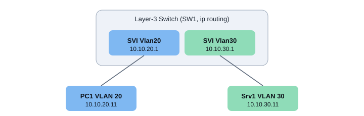

*شکل ۱: Gateway داخل خود سوییچ؛ ترافیک بین VLANها هیچ‌وقت سوییچ را ترک نمی‌کند.*

### ۲. شرط Up شدن SVI (مهم‌ترین نکته)

SVI فقط وقتی `up/up` می‌شود که همه‌ی شرط‌های زیر برقرار باشند:

1.  VLAN روی سوییچ ساخته شده باشد (`show vlan brief`).
2.  حداقل یک پورت در آن VLAN فعال باشد (Access Port بالا، یا Trunk که VLAN را عبور می‌دهد).
3.  SVI با `no shutdown` روشن شده باشد.

> **TS09: SVI Down/Down**
>
> اگر VLAN 30 هیچ پورت فعالی ندارد، `Vlan30` در حالت down/down می‌ماند و Gateway آن VLAN کار نمی‌کند، حتی اگر آدرس درست باشد. اول پورت را بالا بیاورید.

### ۳. مقایسه‌ی RoAS و SVI

| معیار       | Router-on-a-Stick        | SVI (L3 Switch) |
|-------------|--------------------------|-----------------|
| محل Gateway | روتر بیرونی              | خود سوییچ       |
| تعداد کابل  | یک Trunk                 | بدون کابل اضافه |
| سرعت        | محدود به لینک و CPU روتر | سخت‌افزاری، سریع |
| گلوگاه      | دارد (یک لینک)           | ندارد           |
| مناسب برای  | شعبه‌ی کوچک               | هسته‌ی سازمان    |

### ۴. دستورها (خط‌به‌خط)

``` text
SW1(config)# ip routing
SW1(config)# interface vlan 20
SW1(config-if)# ip address 10.10.20.1 255.255.255.0
SW1(config-if)# no shutdown
SW1(config-if)# interface vlan 30
SW1(config-if)# ip address 10.10.30.1 255.255.255.0
SW1(config-if)# no shutdown
SW1(config-if)# end
SW1# show ip interface brief
SW1# show ip route connected
```

- `ip routing`: سوییچ را از «فقط لایه ۲» به «مسیریاب» تبدیل می‌کند. بدون آن SVI آدرس دارد ولی بین VLANها Route نمی‌کند.
- `interface vlan 20`: SVI همان VLAN را می‌سازد (VLAN باید از قبل موجود باشد).
- `no shutdown`: SVI به‌طور پیش‌فرض خاموش است در بعضی نسخه‌ها؛ حتماً بزنید.

### ۵. مثال ساده: ping به SVI

``` text
PC1> ping 10.10.20.1    -> success (SVI Vlan20)
```

### ۶. مثال متوسط: ping بین VLAN

``` text
PC1> ping 10.10.30.11   -> success (routed inside SW1)
SW1# show ip route connected  -> 10.10.20.0/24 via Vlan20, 10.10.30.0/24 via Vlan30
```

### ۷. مثال سخت: TS09 و دو Gateway همزمان

``` text
Symptom   : Vlan30 shows down/down
Check     : show vlan brief          -> VLAN 30 has no active port
            show ip interface brief  -> Vlan30 down/down
Fix       : bring up Gi0/3 (the server port) or allow VLAN 30 on the trunk
Verify    : Vlan30 up/up, ping works

Conflict  : R1 Gi0/0.30 AND SW1 Vlan30 both = 10.10.30.1
Result    : duplicate IP, intermittent failures
Rule      : exactly one gateway per VLAN (shut down the other)
```

### ۸. تمرین‌ها

**ت1.** ۱ (ساده): ip routing برای چیست؟ *(پاسخ: 3-5-ت1 در بخش «پاسخ‌ها» انتهای فصل)*

**ت2.** ۲ (ساده): سه شرط Up شدن SVI *(پاسخ: 3-5-ت2 در بخش «پاسخ‌ها» انتهای فصل)*

**ت3.** ۳ (متوسط): VLAN 40 ساخته‌ایم و SVI دارد ولی down/down است؛ علت؟ *(پاسخ: 3-5-ت3 در بخش «پاسخ‌ها» انتهای فصل)*

**ت4.** ۴ (متوسط): چرا دو Gateway برای یک VLAN مشکل می‌سازد؟ *(پاسخ: 3-5-ت4 در بخش «پاسخ‌ها» انتهای فصل)*

**ت5.** ۵ (سخت): کدام روش برای ۱۰ گیگ ترافیک بین VLANها بهتر است و چرا؟ *(پاسخ: 3-5-ت5 در بخش «پاسخ‌ها» انتهای فصل)*

### ۹. Lab هدایت‌شده (Lab A: Gateway روی سوییچ)

#### گام ۱: خاموش‌کردن Gateway روتر برای VLAN 20 و 30

``` text
R1(config)# interface gi0/0.20
R1(config-subif)# shutdown
R1(config-subif)# interface gi0/0.30
R1(config-subif)# shutdown
```

#### گام ۲: SVIها روی SW1

دستورهای بخش ۴ را اجرا کنید و `show ip interface brief` را بگیرید؛ دو SVI باید up/up باشند.

#### گام ۳: تست

``` text
PC1> ping 10.10.20.1
PC1> ping 10.10.30.11    (routed inside SW1)
```

#### گام ۴: دیدن TS09

``` text
SW1(config)# interface gi0/3
SW1(config-if)# shutdown
SW1# show ip interface brief      -> Vlan30 down/down
SW1(config)# interface gi0/3
SW1(config-if)# no shutdown       -> Vlan30 up/up
```

#### گام ۵: برگشت به Capstone

برای Capstone اصلی (Gateway = فایروال) SVIهای 20 و 30 را `shutdown` کنید یا حذف کنید و فقط SVI مدیریت (VLAN10) بماند. تنظیمات را با `copy run start` ذخیره کنید.

### ۱۰. Lab مستقل

جدول مقایسه‌ی RoAS و SVI را از نتایج Lab خودتان (سرعت ping، Capture، تعداد Hop در trace) بسازید و در `03-ops/roas-vs-svi.md` ذخیره کنید.

### ۱۱. عیب‌یابی

|         |                                                                                                                                              |
|---------|----------------------------------------------------------------------------------------------------------------------------------------------|
| Symptom | Gateway جواب نمی‌دهد                                                                                                                          |
| چک‌لیست  | ۱) `ip routing` فعال است؟ ؛ ۲) SVI up/up است؟ ؛ ۳) VLAN پورت فعال دارد؟ ؛ ۴) Gateway تکراری روی روتر نیست؟ ؛ ۵) PC آدرس و Gateway درست دارد؟ |

### ۱۲. سؤال‌های مرور

**م1.** SVI چیست؟ *(پاسخ: 3-5-م1 در بخش «پاسخ‌ها» انتهای فصل)*

**م2.** چرا SVI down/down می‌شود؟ *(پاسخ: 3-5-م2 در بخش «پاسخ‌ها» انتهای فصل)*

### English Corner: انگلیسی تخصصی این درس

این جمله‌ها از مستندات و محیط کار واقعی‌اند. بلند بخوانید و ترجمه را بپوشانید.

| English sentence                                                  | ترجمه                                                        |
|-------------------------------------------------------------------|--------------------------------------------------------------|
| An SVI is the layer-3 gateway for a VLAN on a multilayer switch.  | SVI گیت‌وی لایه ۳ یک VLAN روی سوییچ چندلایه است.              |
| The SVI stays down until at least one port in the VLAN is active. | SVI تا وقتی دست‌کم یک پورت فعال در VLAN نباشد down می‌ماند.    |
| Enable ip routing to route between VLANs on the switch.           | برای مسیریابی بین VLANها روی سوییچ، ip routing را فعال کنید. |
| Never configure two gateways for the same VLAN.                   | هرگز دو Gateway برای یک VLAN تنظیم نکنید.                    |

**Q1.** Quick quiz (answer in English): When does an SVI come up? *(پاسخ: 3-5-Q1 در بخش «پاسخ‌ها» انتهای فصل)*

### ۱۳. تکلیف و چک‌لیست تسلط

- [ ] SVI را بالا بیاورم و ping بین VLANها بگیرم.
- [ ] TS09 را بسازم و رفع کنم.
- [ ] پیکربندی را به حالت Capstone اصلی برگردانم.

### ۱۴. یادآوری اشتباهات شما

> **یادآوری**
>
> دو Gateway هم‌زمان ممنوع؛ بکاپ قبل از تغییر؛ پذیرفته‌شدن دستور ≠ کار کردن.


#### کارت Lab — درس ۳-۵ (Lab A مقدماتی)

| # | فیلد | محتوا |
|---|---|---|
| 1 | عنوان و هدف | Gateway روی SVI و شرط Up |
| 2 | پیش‌نیاز | درس ۳-۴ |
| 3 | توپولوژی | SW1 با SVI 20/30 |
| 4 | تجهیزات | SW1، ۲ VPCS |
| 5 | نسخه نرم‌افزار | vIOS-L2 15.2(20200924، Experimental) برای SW؛ vIOS 15.9(3)M9 برای R؛ VPCS (PNetLab)؛ PNetLab 4.2.8 |
| 6 | IP Plan | 10.10.20.1/24 و 10.10.30.1/24 |
| 7 | وضعیت اولیه | Sub-interfaceهای R1 shutdown |
| 8 | صورت مسئله | `ip routing`، SVI و ping بین VLAN؛ ایجاد SVI Down/Down |
| 9 | مراحل هدایت‌شده | همان بخش «Lab هدایت‌شده» همین درس (گام‌به‌گام) |
| 10 | تست عملکرد | `show ip interface brief` ؛ ping |
| 11 | سناریوی خرابی | shutdown پورت‌های VLAN 30 (TS09) |
| 12 | روش عیب‌یابی | `show vlan brief` و پورت فعال VLAN |
| 13 | نتیجه‌ی مورد انتظار | Vlan up/up؛ ping موفق |
| 14 | معیار پذیرش | TS09 ساخته و رفع شود |
| 15 | مستندات نهایی | `03-ops/roas-vs-svi.md` |
| 16 | Cleanup و بازگردانی | برگشت به معماری اصلی (Gateway روی FortiGate): SVI 20/30 shutdown |

> **وضعیت راستی‌آزمایی (خارج از ۱۶ فیلد):** **جزئی.** `ip routing` و SVI up/up Tested-OK؛ سناریوی TS09 و ping بین VLAN اجرا نشده.

---

<a id="l-3-6"></a>

## درس ۳-۶ — عیب‌یابی و آزمون هفته

**فصل ۳ - روز ۶ · پیش‌نیاز: درس‌های ۳-۱ تا ۳-۵ · ۶ ساعت**

### این درس درباره چیست و چرا باید یاد بگیریم؟

**چه چیزی یاد می‌گیریم:** روش سیستماتیک عیب‌یابی شبکه (از لایه ۱ به بالا)، پنج سناریوی خرابی TS01 تا TS05، و آزمون عملی کوچک پایان هفته‌ی ۳.

**چرا لازم است:** ادمین خوب کسی نیست که همه‌چیز را حفظ است، کسی است که با روش، خرابی را سریع پیدا می‌کند. اگر «حدس» بزنید، ساعت‌ها هدر می‌دهید؛ اگر «لایه‌به‌لایه» بروید، اغلب در چند دقیقه علت را پیدا می‌کنید.

- **در کار روزانه:** ۸۰٪ تماس‌های پشتیبانی شبکه از لایه ۱ و ۲ است: کابل، پورت، VLAN.
- **در امنیت:** روش سیستماتیک جلوی «تغییر عجولانه» را می‌گیرد که خودش سبب خرابی جدید می‌شود.
- **در مصاحبه:** «چطور عیب‌یابی می‌کنید؟» سؤال ثابت هر مصاحبه است.

> **مسیر درس**
>
> روش لایه‌به‌لایه ← پنج سناریوی TS ← مثال ساده/متوسط/سخت ← تمرین ← Lab عیب‌یابی ← آزمون کوچک.

#### اصطلاحات این درس (مخفف ← شکل کامل ← معنی)

| مخفف        | شکل کامل انگلیسی         | معنی فارسی                                 |
|-------------|--------------------------|--------------------------------------------|
| TS          | Troubleshooting Scenario | سناریوی عیب‌یابی شماره‌دار دوره              |
| RCA         | Root Cause Analysis      | تحلیل علت ریشه‌ای                           |
| Duplex      | Duplex mode              | Half یا Full؛ حالت ارسال/دریافت همزمان     |
| Err-disable | Error-disabled           | پورتی که سوییچ آن را به‌خاطر خطا خاموش کرده |
| CDP         | Cisco Discovery Protocol | کشف همسایه‌های سیسکو                        |
| L1/L2/L3    | Layer 1/2/3              | فیزیکی / پیوند داده / شبکه                 |

### ۱. روش سیستماتیک: از پایین به بالا

مثل بررسی خرابی یک ماشین: اول ببین بنزین دارد (لایه ۱)، بعد استارت می‌خورد (لایه ۲)، بعد جاده را بلد است (لایه ۳). از پایین شروع کنید چون اگر کابل قطع باشد، بقیه‌ی چیزها بی‌معنی است.

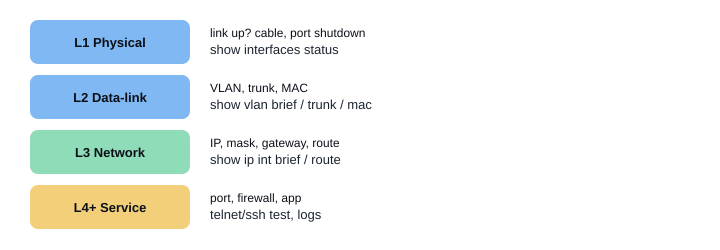

*شکل ۱: نردبان عیب‌یابی؛ از لایه ۱ شروع کنید و فقط وقتی لایه پایین سالم بود بالاتر بروید.*

#### چارچوب پنج‌مرحله‌ای

1.  **Symptom:** دقیقاً چه چیزی خراب است و برای چه کسی؟ (علامت، نه حدس)
2.  **Scope:** چند نفر؟ یک VLAN؟ همه؟
3.  **Hypothesis:** از پایین‌ترین لایه، یک فرضیه بساز.
4.  **Test:** با یک دستور show آن را بسنج.
5.  **Fix and Verify:** رفع، تأیید، ثبت در گزارش (RCA).

### ۲. پنج سناریوی این هفته

#### TS01: Interface Shutdown (ساده)

``` text
Symptom  : PC on Gi0/1 has no link
Evidence : show interfaces status -> Gi0/1 disabled / administratively down
Fix      : interface gi0/1 / no shutdown
Verify   : link up, ping works
```

#### TS02: Duplex/Speed Mismatch (مفهومی)

``` text
Symptom  : link is up but very slow, many CRC/late collisions
Cause    : one side half-duplex, the other full-duplex
Check    : show interfaces gi0/1 -> duplex, speed, errors
Fix      : set both sides to auto (or both manually identical)
```

در شبیه‌ساز، تنظیم Duplex ممکن است اثر واقعی نداشته باشد؛ این سناریو را مفهومی بدانید و در تجهیز واقعی تمرین کنید.

#### TS03: VLAN اشتباه روی Access Port

``` text
Symptom  : PC cannot reach its gateway
Evidence : show vlan brief -> port is in the wrong VLAN
Fix      : switchport access vlan 20
```

#### TS04: Allowed VLAN حذف‌شده روی Trunk

``` text
Symptom  : one VLAN lost across the trunk
Evidence : show interfaces trunk -> VLAN missing in "allowed"
Fix      : switchport trunk allowed vlan add 30
```

#### TS05: Human Error — جایگزینی Allowed List

``` text
Cause    : "allowed vlan 40" typed without "add"
Impact   : all VLANs except 40 are down on the trunk
Fix      : restore from backup or re-add: allowed vlan 10,20,30,40
Lesson   : always "add"; backup + review show before and after
```

### ۳. مثال ساده/متوسط/سخت

#### ساده

کاربر می‌گوید «شبکه قطع است». اول `show interfaces status`: اگر پورت `disabled` است، TS01.

#### متوسط

کاربر به سرور نمی‌رسد ولی به Gateway می‌رسد. لایه ۱ و ۲ سالم است؛ پس `show ip route` و Gateway سرور را ببینید (لایه ۳).

#### سخت

«فقط VLAN 30 از شعبه قطع است، بقیه خوب». نردبان: لینک Trunk up است (L1)، VLAN 30 در allowed نیست (L2) ⇒ TS04. در RCA: چه کسی/کی/چرا تغییر داد؟ چطور جلوگیری شود؟

### ۴. تمرین‌ها

**ت1.** ۱ (ساده): اولین لایه‌ای که چک می‌کنیم چیست؟ *(پاسخ: 3-6-ت1 در بخش «پاسخ‌ها» انتهای فصل)*

**ت2.** ۲ (ساده): پنج مرحله‌ی چارچوب عیب‌یابی را بنویس *(پاسخ: 3-6-ت2 در بخش «پاسخ‌ها» انتهای فصل)*

**ت3.** ۳ (متوسط): «ping به Gateway OK ولی به اینترنت نه»؛ کدام لایه؟ *(پاسخ: 3-6-ت3 در بخش «پاسخ‌ها» انتهای فصل)*

**ت4.** ۴ (سخت): یک Trunk بعد از «allowed vlan 40» همه را قطع کرد؛ سه اقدام بعدی *(پاسخ: 3-6-ت4 در بخش «پاسخ‌ها» انتهای فصل)*

### ۵. Lab هدایت‌شده: همه‌ی TSها را بسازید و رفع کنید

برای هر سناریو: (۱) بکاپ، (۲) خراب‌کردن عمدی، (۳) نوشتن Symptom و Evidence، (۴) رفع، (۵) Verify.

1.  TS01: `shutdown` روی پورت PC1 و رفع.
2.  TS03: بردن پورت PC2 به VLAN اشتباه و رفع.
3.  TS04: `allowed vlan remove 30` روی Trunk و رفع با `add 30`.
4.  TS05: `allowed vlan 40` (بدون add)، سپس برگرداندن از بکاپ.
5.  TS09: `shutdown` پورت سرور و دیدن SVI down/down.

### ۶. آزمون کوچک پایان هفته‌ی ۳ (بدون نگاه به درس)

| \#  | وظیفه                                | مدرک                      |
|-----|--------------------------------------|---------------------------|
| ۱   | MAC یک PC را به پورتش ربط بده        | show mac address-table    |
| ۲   | VLAN Matrix با ۳ VLAN و تنظیم پورت‌ها | show vlan brief           |
| ۳   | Trunk با Native 999 و Allowed        | show interfaces trunk     |
| ۴   | Inter-VLAN با RoAS یا SVI            | ping بین VLANها + Capture |
| ۵   | ۳ سناریو از TS01 تا TS05 با RCA      | گزارش یک‌صفحه‌ای            |

معیار قبولی: حداقل ۴ از ۵ مورد با مدرک. وقتی تمام شد بگویید «فصل ۳ انجام شد».

(آزمون رسمی Gate G2 در پایان فصل ۴ بعد از STP و EtherChannel است.)

### ۷. سؤال‌های مرور

**م1.** چرا از لایه ۱ شروع می‌کنیم؟ *(پاسخ: 3-6-م1 در بخش «پاسخ‌ها» انتهای فصل)*

**م2.** تفاوت TS04 و TS05؟ *(پاسخ: 3-6-م2 در بخش «پاسخ‌ها» انتهای فصل)*

### English Corner: انگلیسی تخصصی این درس

این جمله‌ها از مستندات و محیط کار واقعی‌اند. بلند بخوانید و ترجمه را بپوشانید.

| English sentence                                               | ترجمه                                                                    |
|----------------------------------------------------------------|--------------------------------------------------------------------------|
| Always start troubleshooting at layer 1 and work your way up.  | عیب‌یابی را همیشه از لایه ۱ شروع کنید و بالا بروید.                       |
| The interface is administratively down.                        | Interface به‌صورت مدیریتی خاموش است.                                      |
| Document the root cause and the fix in the RCA.                | علت ریشه‌ای و راه‌حل را در RCA مستند کنید.                                 |
| A typo in the allowed VLAN list can take down the whole trunk. | یک اشتباه تایپی در لیست VLANهای مجاز می‌تواند کل Trunk را از کار بیندازد. |

**Q1.** Quick quiz (answer in English): What are the five steps of the troubleshooting framework? *(پاسخ: 3-6-Q1 در بخش «پاسخ‌ها» انتهای فصل)*

### ۸. تکلیف و چک‌لیست تسلط

- [ ] پنج TS را ساخته و رفع کنم و گزارش RCA بنویسم.
- [ ] آزمون کوچک را کامل کنم.
- [ ] پیکربندی پایانی را ذخیره و بکاپ بگیرم.

### ۹. یادآوری اشتباهات شما

> **یادآوری**
>
> حدس نزنید؛ لایه‌به‌لایه بروید. بکاپ قبل از تغییر. هر نتیجه‌ی واقعی را ثبت کنید.


#### کارت Lab — درس ۳-۶

| # | فیلد | محتوا |
|---|---|---|
| 1 | عنوان و هدف | عیب‌یابی TS01..TS05 و آزمون کوچک |
| 2 | پیش‌نیاز | درس‌های ۳-۱ تا ۳-۵ |
| 3 | توپولوژی | همان توپولوژی درس‌های قبل |
| 4 | تجهیزات | SW1، SW2، R1، VPCS |
| 5 | نسخه نرم‌افزار | vIOS-L2 15.2(20200924، Experimental) برای SW؛ vIOS 15.9(3)M9 برای R؛ VPCS (PNetLab)؛ PNetLab 4.2.8 |
| 6 | IP Plan | طبق درس‌های قبل |
| 7 | وضعیت اولیه | بکاپ تنظیمات سالم |
| 8 | صورت مسئله | هر TS را بسازید، Symptom/Evidence/Fix/Verify/RCA بنویسید |
| 9 | مراحل هدایت‌شده | همان بخش «Lab هدایت‌شده» همین درس (گام‌به‌گام) |
| 10 | تست عملکرد | ping، show vlan/trunk، show ip route |
| 11 | سناریوی خرابی | پنج TS (shutdown، VLAN اشتباه، allowed حذف‌شده، allowed بدون add، SVI down) |
| 12 | روش عیب‌یابی | لایه‌ای L1→L3 |
| 13 | نتیجه‌ی مورد انتظار | هر TS با RCA رفع |
| 14 | معیار پذیرش | حداقل ۴ از ۵ مورد با مدرک |
| 15 | مستندات نهایی | `03-ops/rca-w3.md` |
| 16 | Cleanup و بازگردانی | بازگردانی از بکاپ سالم |

> **وضعیت راستی‌آزمایی (خارج از ۱۶ فیلد):** **اجرا نشده (فقط طراحی).** اجرا نشده؛ TS01 تا TS05 هنوز روی Image ساخته نشده‌اند.

---

<a id="ans-3"></a>

## پاسخ‌های فصل 3

> ابتدا بدون نگاه حل کنید. هر پاسخ با شناسه‌ی «درس-نوع+شماره» مشخص است (ت = تمرین، م = سؤال مرور، Q = Quick quiz انگلیسی).

**3-1-ت1** — ۱ (ساده): سوییچ کدام MAC را یاد می‌گیرد: مبدأ یا مقصد؟

``` text
Source MAC only.
Destination MAC is only looked up, never learned.
```

**3-1-ت2** — ۲ (ساده): فریم با مقصد ff:ff:ff:ff:ff:ff چطور پخش می‌شود؟

``` text
Flooded out of all ports except the ingress port.
```

**3-1-ت3** — ۳ (متوسط): جدول خالی است. A (Gi0/1) به B (Gi0/2) و بعد B به A می‌فرستد. چند Flood رخ می‌دهد؟

``` text
1 flood  (A -> B: B unknown)
0 floods (B -> A: A already learned)
```

**3-1-ت4** — ۴ (متوسط): چرا ردیف یک MAC بعد از ۵ دقیقه ناپدید می‌شود؟

``` text
Aging time = 300 s. No frames from that MAC refresh the entry.
```

**3-1-ت5** — ۵ (سخت): MACFLAP روی MAC-X بین Gi0/1 و Gi0/2؛ محتمل‌ترین علت؟

``` text
A layer-2 loop (or a duplicated MAC).
First action: find the loop and cut it, not clear the table.
```

**3-1-م1** — سوییچ چه چیزی را یاد می‌گیرد و از کجا؟

MAC مبدأ فریم و پورتی که فریم از آن وارد شد.

**3-1-م2** — چرا Broadcast هیچ‌وقت در جدول MAC دیده نمی‌شود؟

چون Broadcast فقط مقصد است، نه مبدأ.

**3-1-م3** — Flooding یعنی چه؟

ارسال فریم از همه‌ی پورت‌ها به‌جز پورت ورودی.

**3-1-Q1** — Quick quiz (answer in English): What does a switch do when the destination MAC is not in its table?

It floods the frame out of all ports except the one it arrived on.

**3-2-ت1** — ۱ (ساده): چرا VLAN باعث کاهش Broadcast می‌شود؟

``` text
Each VLAN is a separate broadcast domain.
Broadcasts stay inside their VLAN.
```

**3-2-ت2** — ۲ (ساده): دو کامپیوتر در VLAN های 20 و 30 بدون روتر ping می‌کنند؛ نتیجه؟

``` text
Fails: different broadcast domains, no gateway.
```

**3-2-ت3** — ۳ (متوسط): دستورهای لازم برای ساختن VLAN 40 با نام GUEST و قراردادن Gi0/6 در آن

``` text
vlan 40
 name GUEST
interface gi0/6
 switchport mode access
 switchport access vlan 40
```

**3-2-ت4** — ۴ (متوسط): خروجی show vlan brief چه چیزی نشان می‌دهد؟

``` text
VLAN ID, Name, Status and the access ports of each VLAN.
```

**3-2-ت5** — ۵ (سخت): کاربر در VLAN 20 است ولی به Gateway نمی‌رسد؛ سه علت محتمل

``` text
1) Port is in the wrong VLAN
2) VLAN does not exist or is shut down
3) Wrong IP/mask/gateway on the PC
```

**3-2-م1** — VLAN چه فایده‌ای دارد؟

جداسازی Broadcast Domain و امنیت بیشتر.

**3-2-م2** — Access Port چیست؟

پورتی که فقط عضو یک VLAN است و دستگاه انتهایی به آن وصل می‌شود.

**3-2-Q1** — Quick quiz (answer in English): Why do hosts in different VLANs need a router?

Because each VLAN is a separate broadcast domain (separate subnet), so traffic must be routed between them.

**3-3-ت1** — ۱ (ساده): چند بیت از Tag مخصوص VLAN ID است و چند VLAN قابل‌استفاده داریم؟

``` text
12 bits -> 4096 values -> minus 2 reserved -> 4094 usable IDs (1..4094)
```

**3-3-ت2** — ۲ (ساده): تفاوت allowed vlan 40 با allowed vlan add 40؟

``` text
Without add: replaces the list.
With add: appends VLAN 40 to the existing list.
```

**3-3-ت3** — ۳ (متوسط): Native Mismatch چه عارضه‌ای دارد؟

``` text
CDP warning and traffic of the native VLAN leaks into another VLAN (VLAN hopping risk).
```

**3-3-ت4** — ۴ (متوسط): چرا nonegotiate را می‌زنیم؟

``` text
It disables DTP negotiation so the port cannot become a trunk unexpectedly.
```

**3-3-ت5** — ۵ (سخت): روی Trunk هستید و VLAN 30 در show interfaces trunk در ستون allowed نیست؛ ۳ دستور رفع

``` text
show interfaces trunk
switchport trunk allowed vlan add 30
show interfaces trunk   (verify)
```

**3-3-م1** — Trunk چه کاری می‌کند؟

چند VLAN را با Tag روی یک لینک عبور می‌دهد.

**3-3-م2** — Native VLAN چیست؟

VLANی که روی Trunk بدون Tag می‌رود.

**3-3-Q1** — Quick quiz (answer in English): Why is "switchport trunk allowed vlan 40" dangerous on a live trunk?

It replaces the entire allowed list, so all other VLANs lose connectivity.

**3-4-ت1** — ۱ (ساده): چرا فقط یک کابل فیزیکی کافی است؟

``` text
The trunk carries all VLANs tagged; the router splits them into logical sub-interfaces.
```

**3-4-ت2** — ۲ (ساده): کدام آدرس IP روی Gi0/0.20 می‌نشیند؟

``` text
The default gateway of VLAN 20, e.g. 10.10.20.1/24 (first host of the subnet).
```

**3-4-ت3** — ۳ (متوسط): در مسیر PC1 به Srv1 کدام فیلدها عوض می‌شوند و کدام نه؟

``` text
Unchanged: source IP, destination IP
Changed: destination MAC, source MAC, VLAN tag, TTL (-1)
```

**3-4-ت4** — ۴ (متوسط): اگر encapsulation dot1Q 3 به‌جای 30 بزنیم چه می‌شود؟

``` text
R1 expects tag 3, but the switch sends tag 30 -> frames ignored -> VLAN 30 hosts cannot reach the gateway.
```

**3-4-ت5** — ۵ (سخت): نقطه‌ضعف RoAS چیست؟

``` text
All inter-VLAN traffic crosses the single link both ways (bandwidth bottleneck) and the router is a single point of failure.
```

**3-4-م1** — Sub-interface چیست؟

Interface منطقی روی یک Interface فیزیکی که به یک VLAN وصل است.

**3-4-م2** — چرا Interface فیزیکی IP ندارد؟

چون فقط Trunk را حمل می‌کند؛ آدرس‌ها روی Sub-interfaceها هستند.

**3-4-Q1** — Quick quiz (answer in English): What is the main drawback of router-on-a-stick?

All inter-VLAN traffic shares one link, creating a bandwidth bottleneck and a single point of failure.

**3-5-ت1** — ۱ (ساده): ip routing برای چیست؟

``` text
It enables layer-3 routing on the switch so it can route between SVIs.
```

**3-5-ت2** — ۲ (ساده): سه شرط Up شدن SVI

``` text
1) VLAN exists
2) at least one active port in the VLAN
3) SVI is not shut down
```

**3-5-ت3** — ۳ (متوسط): VLAN 40 ساخته‌ایم و SVI دارد ولی down/down است؛ علت؟

``` text
No active (up) port in VLAN 40 and it is not allowed on a trunk to an up port.
```

**3-5-ت4** — ۴ (متوسط): چرا دو Gateway برای یک VLAN مشکل می‌سازد؟

``` text
Duplicate IP/MAC confusion: hosts get inconsistent replies; traffic flaps.
```

**3-5-ت5** — ۵ (سخت): کدام روش برای ۱۰ گیگ ترافیک بین VLANها بهتر است و چرا؟

``` text
SVI on a layer-3 switch: hardware routing, no single-link bottleneck.
```

**3-5-م1** — SVI چیست؟

Interface مجازی لایه ۳ برای یک VLAN روی سوییچ.

**3-5-م2** — چرا SVI down/down می‌شود؟

چون VLAN پورت فعالی ندارد یا ساخته نشده یا SVI خاموش است.

**3-5-Q1** — Quick quiz (answer in English): When does an SVI come up?

When the VLAN exists, at least one port in the VLAN is up, and the SVI is not shut down.

**3-6-ت1** — ۱ (ساده): اولین لایه‌ای که چک می‌کنیم چیست؟

``` text
Layer 1 (physical): cable, link, shutdown.
```

**3-6-ت2** — ۲ (ساده): پنج مرحله‌ی چارچوب عیب‌یابی را بنویس

``` text
Symptom, Scope, Hypothesis, Test, Fix and Verify.
```

**3-6-ت3** — ۳ (متوسط): «ping به Gateway OK ولی به اینترنت نه»؛ کدام لایه؟

``` text
Layer 3 or above: routing/default route/NAT/firewall (L1 and L2 are fine).
```

**3-6-ت4** — ۴ (سخت): یک Trunk بعد از «allowed vlan 40» همه را قطع کرد؛ سه اقدام بعدی

``` text
1) restore from backup
2) allowed vlan add 10,20,30
3) verify with show interfaces trunk and ping, then write the RCA
```

**3-6-م1** — چرا از لایه ۱ شروع می‌کنیم؟

چون لایه‌های بالاتر به آن وابسته‌اند.

**3-6-م2** — تفاوت TS04 و TS05؟

TS04 حذف یک VLAN از لیست است؛ TS05 جایگزینی کل لیست به‌خاطر اشتباه انسانی (فراموشی add).

**3-6-Q1** — Quick quiz (answer in English): What are the five steps of the troubleshooting framework?

Symptom, Scope, Hypothesis, Test, Fix and Verify.

---

<a id="end1"></a>


### پاسخ‌های درس افزوده‌ی 3-0 (فصل 3)

**3-0-ت1** — حداقل 64 بایت، حداکثر 1518 بایت (1522 با 802.1Q).

**3-0-ت2** — Flood به همه‌ی پورت‌های همان VLAN به‌جز ورودی.

**3-0-ت3** — 48 Collision Domain (هر پورت)؛ 3 Broadcast Domain.

**3-0-ت4** — لینک Up، کندی، late collision/CRC/runts.

**3-0-ت5** — پر کردن CAM با MAC جعلی؛ سوئیچ Flood می‌کند؛ دفاع: Port Security max MAC، violation، Alert.

**3-0-ت6** — Aging کمتر (مثلاً 60–120 s) تا MAC جابه‌جاشده زودتر پاک شود؛ هزینه: Flood بیشتر؛ بر اساس اندازه‌گیری.

**3-0-Q1** — It floods the frame out of all ports in the same VLAN except the ingress port.

# پایان بخش ۱ (فصل‌های ۱ تا ۳)

## ۱) خلاصه‌ی مهارت‌های کسب‌شده
- **زیرساخت/روش:** لایه‌های Lab، ایزولاسیون، Snapshot در برابر Backup، تغییر ایمن، Image Validation با شاهد.
- **IP:** باینری، Prefix/Mask، Subnetting، AND، VLSM، IP Plan؛ IPv6 (نمایش، انواع، NDP/SLAAC).
- **CLI و مدیریت:** حالت‌ها، بکاپ/Rollback، SSH امن، ACL مدیریت.
- **تحلیل بسته:** ARP/ICMP با Wireshark.
- **Switching:** CAM، VLAN، Trunk/802.1Q، RoAS، SVI، عیب‌یابی لایه‌ای.

## ۲) آزمون پایان سه فصل (۲۰ سؤال؛ پاسخ را پایین‌تر ببینید)
**س1** (مفهومی) — فرق Discovery و Change را در دو جمله بگویید و یک مثال بزنید.

**س2** (مفهومی) — چرا vSwitch بدون Uplink ایزولاسیون واقعی می‌دهد؟

**س3** (محاسبه) — 10.10.20.77/26: شبکه، Broadcast، Hostها و تعداد Host؟

**س4** (محاسبه) — به ۵۰ Host نیاز داریم؛ کوچک‌ترین Prefix؟

**س5** (محاسبه) — تعداد کل IP در 172.16.0.0/20 و Mask آن؟

**س6** (تحلیل) — 10.10.20.77/26 و 10.10.20.130/26 هم‌شبکه‌اند؟ چرا؟

**س7** (طراحی) — برای ۴ بخش (۱۰۰، ۵۰، ۱۲، لینک ۲) از 192.168.10.0/24 VLSM بسازید.

**س8** (IPv6) — `2001:0db8:0000:0000:0001:0000:0000:0005` را کوتاه کنید.

**س9** (IPv6) — چرا ICMPv6 را نباید کامل بست؟

**س10** (CLI) — تفاوت running-config و startup-config و دستور ذخیره؟

**س11** (CLI) — چرا قبل از تغییر راه دور `reload in 5` می‌گذاریم؟

**س12** (امنیت) — سه کنترل لازم برای SSH امن؟

**س13** (Wireshark) — ARP Request به چه MAC مقصدی فرستاده می‌شود و چرا؟

**س14** (سوییچ) — سوییچ MAC مبدأ را یاد می‌گیرد یا مقصد؟

**س15** (VLAN) — چرا دو Host در VLANهای مختلف بدون Gateway ارتباط نمی‌گیرند؟

**س16** (Trunk) — تفاوت `allowed vlan 40` و `allowed vlan add 40` و خطر اولی؟

**س17** (Inter-VLAN) — نقطه‌ضعف Router-on-a-Stick نسبت به SVI؟

**س18** (عیب‌یابی) — SVI `Vlan30` down/down است؛ سه شرط Up بودن و اقدام؟

**س19** (سناریو) — کاربر VLAN 20 به Gateway نمی‌رسد؛ پنج بررسی به ترتیب؟

**س20** (طراحی) — چرا مثال «شعبه با ۳۰ کاربر در /27» طراحی خوبی نیست؟


## ۳) پاسخ آزمون
- **س1:** Discovery فقط می‌خواند و وضع موجود (As-Is) را ثبت می‌کند؛ Change چیزی را تغییر می‌دهد و Backup/Rollback/تأیید می‌خواهد. مثال: `esxcli ... list` در برابر حذف یک Port Group.
- **س2:** چون هیچ مسیر فیزیکی به شبکه‌ی واقعی ندارد؛ ترافیک فقط بین VMهای متصل به همان vSwitch می‌ماند.
- **س3:** Block=64؛ شبکه 10.10.20.64؛ Broadcast 10.10.20.127؛ Hostها .65 تا .126؛ 62 Host.
- **س4:** ۵۰+۲=۵۲ ← ۶۴ ← /26 (۶۲ Host).
- **س5:** Mask 255.255.240.0؛ 2^12 = 4096 آدرس (۴۰۹۴ Host).
- **س6:** خیر؛ شبکه‌ها 10.10.20.64 و 10.10.20.128 هستند؛ ارتباط از Gateway می‌گذرد.
- **س7:** فروش /25 (.0)، فنی /26 (.128)، مدیریت /28 (.192)، لینک /30 (.208)؛ بزرگ‌ترین اول، بدون هم‌پوشانی.
- **س8:** `2001:db8::1:0:0:5` (:: روی اولین رشته‌ی صفر).
- **س9:** NDP/SLAAC به آن وابسته‌اند.
- **س10:** running در RAM و فعال؛ startup در NVRAM برای بوت بعدی؛ `copy running-config startup-config`.
- **س11:** اگر تغییر دسترسی را قطع کرد، دستگاه خودش به تنظیمات ذخیره‌شده برمی‌گردد.
- **س12:** SSH v2 با RSA ≥ 2048، Telnet بسته (`transport input ssh`)، ACL مدیریت روی VTY (+ کاربر محلی).
- **س13:** ff:ff:ff:ff:ff:ff (Broadcast)؛ چون MAC مقصد را نمی‌دانیم.
- **س14:** مبدأ؛ مقصد فقط جستجو می‌شود.
- **س15:** دو Broadcast Domain/Subnet جدا؛ مسیر بین آن‌ها لایه ۳ می‌خواهد.
- **س16:** اولی کل لیست را جایگزین می‌کند و بقیه‌ی VLANها قطع می‌شوند؛ دومی فقط اضافه می‌کند.
- **س17:** همه‌ی ترافیک بین VLANها از یک لینک Trunk می‌گذرد؛ گلوگاه و نقطه‌ی شکست واحد.
- **س18:** VLAN ساخته‌شده؛ حداقل یک پورت فعال در VLAN؛ SVI بدون shutdown. اقدام: پورت سرور را بالا بیاورید.
- **س19:** پورت UP؛ پورت در VLAN درست؛ VLAN وجود دارد؛ VLAN در Trunk مجاز؛ IP/Mask/Gateway کلاینت.
- **س20:** /27 دقیقاً ۳۰ Host می‌دهد ولی Gateway هم یک آدرس می‌گیرد؛ حاشیه‌ی رشد ندارد؛ /26 بهتر است.

## ۴) معیارهای تسلط (برای رفتن به بخش ۲)
| مهارت | سطح لازم | شاهد |
|---|---|---|
| Subnetting/VLSM | بدون ابزار، L3 | ۸ تمرین فصل ۲ + IP Plan مستقل |
| IPv6 پایه | L2 | کوتاه‌نویسی، انواع آدرس |
| CLI، بکاپ و Rollback، SSH | L3 | Lab Card ۲-۴ و ۲-۵ |
| Wireshark ARP/ICMP | L3 | Lab Card ۲-۶ (G1 ≥ ۶ از ۷) |
| VLAN/Trunk/Inter-VLAN | L3 | VLAN Matrix، Lab Card ۳-۲ تا ۳-۵ |
| عیب‌یابی لایه‌ای | L3 | ≥ ۴ از ۵ TS با RCA (۳-۶) |
| توضیح «چرا» (Route/VLAN/Gateway) | الزامی | پاسخ آزمون س۱۴ تا س۱۹ را با کلمات خودتان بنویسید |

## ۵) مشکلات و موارد باقی‌مانده (صریح)
1. **نتیجه‌ی واقعی Lab روی Image شما ثبت‌نشده** برای: CAM/VLAN/Trunk/SVI روی vIOS-L2 (طبق Probe: VLAN و Trunk و PVST Tested-OK؛ اما Violation Port-Security، DHCP Snooping، ACL و QoS فقط CLI-Accepted). از شما می‌خواهیم خروجی واقعی را بیاورید.
2. درس‌های ۱-A و ۱-B **قالب ۱۲ بخشی** را کامل ندارند (Runbook عملیاتی‌اند)؛ برای ممیزی: آیا بازنویسی لازم است؟
3. «مثال سازمانی» در همه‌ی درس‌ها صریح و جدا نیست؛ در درس‌های ۲-۲ و ۳-۵ موجود است و بقیه «مثال سخت» دارند.
4. ستون «کاربرد واقعی» در جدول اصطلاحات فقط در درس ۱-۰ هست.
5. شکل‌ها SVG هستند (در Markdown فقط از طریق فایل جدا دیده می‌شوند). اگر ChatGPT شکل را نمی‌خواند، متن زیر هر شکل کافی است.
6. اسکریپت‌های `phase0a/*.sh` در این فایل بازنویسی نشده‌اند (منبع: `phase0a/`).
7. Linux Image در PNetLab و Wireshark کلاینت: نسخه‌ها ثبت نشده است.

## ۶) پیش‌نیازهای بخش ۲ (فصل‌های ۴ تا ۶)
تسلط بر VLAN/Trunk/SVI؛ Lab سه‌روتری و سه‌سوییچی (RAM کافی: هر Node حدود 1 GB)؛ بکاپ سالم از SW1/SW2/R1؛ تأیید اینکه PVST/Rapid-PVST روی Image کار می‌کند (Probe).

## ۷) فهرست فایل‌های Lab و منابع مرتبط
| فایل | محتوا |
|---|---|
| `02-design/ip-plan-drill.md` | پاسخ Lab مستقل ۲-۱ (بررسی‌شده) |
| `02-design/ip-plan.md` | IP Plan Capstone (دو نسخه) |
| `phase0a/lab_inventory.md` ، `pnetlab_inventory.md` ، `cisco_feature_probe.md` | Inventory و Probe |
| `phase0a/FortiGate_Backup_Restore_Runbook.md` ، `fortigate_eval_tracker.md` | راهنمای بکاپ FortiGate و ردیاب لایسنس |
| `course/figures/ch*.svg` | شکل‌های این بخش |
| `course/Enterprise_Network_Course_Lessons.html` | منبع HTML (فصل‌های ۱–۸) |
| `course/Part01_MANIFEST.md` | فهرست دقیق وابستگی‌ها و فایل‌های هنوز ناموجود |
| Labهای ۳ فصل | «کارت Lab» انتهای هر درس |

## ۸) وضعیت دوره (برای ادامه)
| مورد | مقدار |
|---|---|
| آخرین فصل تکمیل‌شده | ۳ |
| آخرین درس تکمیل‌شده | ۳-۶ |
| مهارت‌های تأییدشده | هنوز ممیزی/آزمون واقعی انجام نشده |
| موضوعات نیازمند مرور | Subnetting بدون ابزار؛ خطای `allowed vlan` بدون add؛ مود CLI |
| موضوعات باقی‌مانده | فصل‌های ۴ تا ۳۲ |
| فصل بعدی | ۴ (Switching II) در بخش ۲ |
| فایل‌های تولیدشده | `Course_Part_01_Chapters_01-03.md` ، `Enterprise_Network_Security_Course_Master_Blueprint_v3.0.md` ، `course/figures/*.svg` |
| اصلاحات انجام‌شده | افزودن درس ۱-۰؛ جابه‌جایی پاسخ‌ها به انتهای فصل؛ کارت Lab؛ اهداف/معیار تسلط؛ آزمون بخش |


## ۹) ماتریس انطباق با قالب ۱۲ بخشی و استثناها
**راهنما:** ✔ کامل | ◐ جزئی | ✖ ندارد. بخش‌ها: ۱ معرفی، ۲ پیش‌نیاز، ۳ مفهوم، ۴ مثال ساده، ۵ مثال سازمانی، ۶ تصویر/توپولوژی، ۷ پیکربندی با توضیح (چه/چرا/خروجی/راستی‌آزمایی/بازگشت)، ۸ تست، ۹ عیب‌یابی، ۱۰ تمرین مستقل (پاسخ جدا)، ۱۱ مرور و معیار تسلط، ۱۲ واژگان.

| درس | ۱ | ۲ | ۳ | ۴ | ۵ | ۶ | ۷ | ۸ | ۹ | ۱۰ | ۱۱ | ۱۲ |
|---|---|---|---|---|---|---|---|---|---|---|---|---|
| 1-0 | ✔ | ✔ | ✔ | ✔ | ✔ | ◐ | ✔ | ✔ | ✔ | ✔ | ✔ | ✔ |
| 1-A | ✔ | ◐ | ◐ | ✖ | ◐ | ◐ | ◐ | ◐ | ✔ | ◐ | ◐ | ✖ |
| 1-B | ✔ | ◐ | ◐ | ✖ | ✖ | ✖ | ◐ | ◐ | ✔ | ◐ | ✔ | ✖ |
| 2-1 | ✔ | ✔ | ✔ | ✔ | ◐ | ✔ | ◐ | ✔ | ✔ | ✔ | ✔ | ◐ |
| 2-2 | ✔ | ✔ | ✔ | ✔ | ✔ | ✔ | ◐ | ◐ | ✔ | ✔ | ✔ | ◐ |
| 2-3 | ✔ | ✔ | ✔ | ✔ | ◐ | ✔ | ◐ | ◐ | ✔ | ✔ | ✔ | ◐ |
| 2-4 | ✔ | ✔ | ✔ | ✔ | ◐ | ✖ | ✔ | ✔ | ✔ | ✔ | ✔ | ◐ |
| 2-5 | ✔ | ✔ | ✔ | ✔ | ◐ | ✔ | ✔ | ✔ | ✔ | ✔ | ✔ | ◐ |
| 2-6 | ✔ | ✔ | ✔ | ✔ | ◐ | ✔ | ◐ | ✔ | ✔ | ✔ | ✔ | ◐ |
| 3-1 | ✔ | ✔ | ✔ | ✔ | ◐ | ✔ | ◐ | ✔ | ✔ | ✔ | ✔ | ◐ |
| 3-2 | ✔ | ✔ | ✔ | ✔ | ✔ | ✔ | ◐ | ✔ | ✔ | ✔ | ✔ | ◐ |
| 3-3 | ✔ | ✔ | ✔ | ✔ | ◐ | ✔ | ✔ | ✔ | ✔ | ✔ | ✔ | ◐ |
| 3-4 | ✔ | ✔ | ✔ | ✔ | ◐ | ✔ | ◐ | ✔ | ✔ | ✔ | ✔ | ◐ |
| 3-5 | ✔ | ✔ | ✔ | ✔ | ◐ | ✔ | ✔ | ✔ | ✔ | ✔ | ✔ | ◐ |
| 3-6 | ✔ | ✔ | ✔ | ✔ | ◐ | ✔ | ◐ | ◐ | ✔ | ✔ | ✔ | ◐ |

**استثناهای رسمی از قالب ۱۲ بخشی (دو درس):**
| درس | چه چیزی کم است | دلیل | برنامه |
|---|---|---|---|
| 1-A | مثال ساده، مثال سازمانی صریح، واژگان | Runbook عملیاتی «فقط‌خواندنی» برای محیط **خاص** شماست؛ مفاهیم آن در درس ۱-۰ آمده است | حفظ؛ درس ۱-۰ نقش مفهومی را دارد |
| 1-B | مثال ساده/سازمانی، شکل، واژگان | Runbook ساخت Lab و Probe؛ بیشتر ثبت شواهد است تا آموزش مفهوم | حفظ؛ در صورت نظر ممیز، بازنویسی با قالب کامل |
**انحراف‌های جزئی (در درس‌های ۲-۱ تا ۳-۶):** (الف) «مثال سازمانی» جدا و صریح همه‌جا نیست (✔ فقط ۲-۲ و ۳-۲)؛ (ب) ستون «کاربرد واقعی» در جدول واژگان نیست (فقط ۱-۰)؛ (ج) «خروجی مورد انتظار + بازگشت» برای هر دستور یکنواخت نیست؛ (د) درس ۲-۴ شکل ندارد. این‌ها **استثنا نیستند؛ بدهی اصلاحی‌اند** و بعد از ممیزی (در صورت تأیید) رفع می‌شوند.

## ۱۰) گزارش اصلاحات نسخه ۱٫۱ (پس از بازبینی کاربر)
| # | درخواست | اقدام | وضعیت |
|---|---|---|---|
| ۱ | تناقض زمان فصل ۱ | مدت فصل ۱ = ۳۶ ساعت: ۱-۰ (۶h) + ۱-A (۱۲h) + ۱-B (**۱۸h**، نه ۱۲) = ۳۶؛ روز هر درس در سرآیند و متای درس‌ها اصلاح شد | انجام شد |
| ۲ | وضعیت Labها | جدول «وضعیت راستی‌آزمایی» + یک خط وضعیت در هر کارت Lab؛ ۲ اجراشده، ۶ جزئی، ۷ اجرا نشده | انجام شد |
| ۳ | لینک‌ها/SVG/وابستگی‌ها | بررسی با `tools/check_part.py`؛ فهرست دقیق وابستگی در `course/Part01_MANIFEST.md`؛ بسته‌ی ZIP حسابرسی | انجام شد |
| ۴ | استثناهای قالب | بند ۹ همین فایل | انجام شد |
| ۵ | زمان‌بندی در Blueprint | Blueprint v3.0 §۴٫۲ (۳۶ ساعت هر فصل، قالب روز، روز آزمون) | انجام شد |
| ۶ | تأیید آمادگی | بند ۱۱ | انجام شد |
اصلاح اصطلاح: «هفته N» در متن فصل‌های ۱–۳ به «فصل N» تغییر کرد (هر فصل = یک هفته).

## ۱۱) تأیید آمادگی برای ممیزی
فصل‌های ۱ تا ۳ از نظر **ساختار و محتوا** برای ممیزی آماده‌اند. محدودیت‌ها که ممیز باید بداند: (۱) فقط ۲ از ۱۵ Lab اجراشده با شاهد است؛ بقیه پیش‌بینی‌اند؛ (۲) دو درس استثنا و چند انحراف جزئی (بند ۹)؛ (۳) شکل‌ها SVG جدا هستند (لینک در `course/figures/`)؛ (۴) نسخه‌ی کلاینت Wireshark و Image لینوکس ثبت نشده است.

**توقف برای ممیزی:** تدریس فصل ۴ تا دریافت نتیجه‌ی ممیزی شما شروع نمی‌شود.
