# Enterprise Network & Security Engineering — دوره‌ی تخصصی Cisco و Enterprise Firewall
## بخش ۲ از ۱۱ — فصل‌های ۴ تا ۶

| مورد | مقدار |
|---|---|
| نام دوره | Enterprise Network & Security Engineering (Cisco + FortiGate) |
| شماره بخش | ۲ از ۱۱ |
| فصل‌های این فایل | ۴ ، ۵ ، ۶ |
| تاریخ تولید | ۲۰۲۶-۱۱-۲۶ |
| نسخه Blueprint | v3.0 (+ بازبینی ۱٫۱) |
| نسخه‌های نرم‌افزار | Cisco vIOS-L2 15.2(20200924، Experimental) ؛ Cisco vIOS 15.9(3)M9 ؛ VPCS ؛ PNetLab 4.2.8 ؛ ESXi 8.0U2 |
| وضعیت تکمیل | **فصل‌های ۴–۶ آماده‌ی ممیزی (محتوا از درس‌های موجود تبدیل شد).** Labها عمدتاً اجرا نشده‌اند (جدول وضعیت). |

> **قوانین خواندن:** تمرین‌ها و پرسش‌های مرور بدون پاسخ‌اند؛ پاسخ در «پاسخ‌های فصل». «اجرا نشده» یعنی خروجی‌ها **پیش‌نیاز/پیش‌بینی** هستند. «CLI-Accepted» ≠ «کار می‌کند». رمزها نمونه‌اند.

### وضعیت راستی‌آزمایی Labهای این بخش
خلاصه: جزئی: 7, اجرا نشده (فقط طراحی): 11.

| Lab | وضعیت |
|---|---|
| 4-1 | جزئی |
| 4-2 | جزئی |
| 4-3 | جزئی |
| 4-4 | جزئی |
| 4-5 | اجرا نشده (فقط طراحی) |
| 4-6 | اجرا نشده (فقط طراحی) |
| 5-1 | اجرا نشده (فقط طراحی) |
| 5-2 | اجرا نشده (فقط طراحی) |
| 5-3 | جزئی |
| 5-4 | اجرا نشده (فقط طراحی) |
| 5-5 | اجرا نشده (فقط طراحی) |
| 5-6 | اجرا نشده (فقط طراحی) |
| 6-1 | اجرا نشده (فقط طراحی) |
| 6-2 | اجرا نشده (فقط طراحی) |
| 6-3 | اجرا نشده (فقط طراحی) |
| 6-4 | جزئی |
| 6-5 | جزئی |
| 6-6 | اجرا نشده (فقط طراحی) |

---

<a id="ch4"></a>

> **نسخه‌ی اصلاح‌شده (v3.9؛ شامل دسته B):** این فایل نسخه‌ی توسعه‌یافته‌ی `course/Course_Part_02_Chapters_04-06.md` است؛ فایل اصلی حفظ شده است. درس‌های افزوده: ۵-۰ و ۵-۷ (فصل ۵). پاسخ‌های آن‌ها در «پاسخ‌های فصل» همان فصل است.

# فصل 4 — Switching II: STP، EtherChannel و امنیت L2

**مدت:** ۳۶ ساعت | **پیش‌نیاز:** فصل ۳.
**اهداف:** STP/RSTP، Root، PortFast/BPDU Guard، EtherChannel/LACP، Port-Security، DHCP Snooping/DAI، طراحی سه‌لایه؛ **Gate G2**.
**معیار تسلط:** Root عمدی؛ جلوگیری از Loop؛ Channel بدون Mismatch؛ ≥ ۶ از ۷ مورد G2.
**اشتباهات رایج:** Root روی سوییچ دسترسی؛ PortFast روی لینک سوییچ؛ Mismatch در Channel؛ `maximum` کم.

**درس‌های فصل:**
- [درس 4-1 — حلقه در لایه ۲ و STP](#l-4-1)
- [درس 4-2 — Rapid-PVST، Root، PortFast و BPDU Guard](#l-4-2)
- [درس 4-3 — EtherChannel و LACP](#l-4-3)
- [درس 4-4 — Port Security](#l-4-4)
- [درس 4-5 — DHCP، Snooping و DAI](#l-4-5)
- [درس 4-6 — طراحی سه‌لایه و آزمون G2](#l-4-6)

---

<a id="l-4-1"></a>

## درس 4-1 — حلقه در لایه ۲ و STP

**فصل ۴ - روز ۱ · پیش‌نیاز: فصل ۳ · ۶ ساعت**

### این درس درباره چیست و چرا باید یاد بگیریم؟

**چه چیزی یاد می‌گیریم:** چرا یک «حلقه» (Loop) در لایه ۲ شبکه را در چند ثانیه از کار می‌اندازد، و پروتکل STP چطور با «بستن» بعضی پورت‌ها جلوی آن را می‌گیرد.

**چرا لازم است:** در لایه ۲ بسته‌ها TTL ندارند. اگر دو سوییچ با دو کابل به هم وصل شوند، یک Broadcast تا ابد بین آن‌ها می‌چرخد و هر دور بیشتر می‌شود (طوفان Broadcast). بدون STP، یک کابل اضافه که اشتباهاً وصل شود کل شعبه را قطع می‌کند.

- **در کار روزانه:** هر شبکه‌ی سازمانی لینک‌های اضافه (Redundant) دارد و باید بدون Loop باشد.
- **در امنیت:** مهاجم می‌تواند با BPDU جعلی خود را Root کند و ترافیک را از خودش عبور دهد.
- **در عیب‌یابی:** پیام MACFLAP و CPU ۱۰۰٪ سوییچ نشانه‌ی کلاسیک Loop است.

> **مسیر درس**
>
> مشکل Loop ← ایده‌ی STP ← BPDU و Root Bridge ← نقش و حالت پورت‌ها ← مثال ساده/متوسط/سخت ← Lab ← عیب‌یابی.

#### اصطلاحات این درس (مخفف ← شکل کامل ← معنی)

| مخفف            | شکل کامل انگلیسی          | معنی فارسی                                      |
|-----------------|---------------------------|-------------------------------------------------|
| STP             | Spanning Tree Protocol    | پروتکل درخت پوشا؛ جلوگیری از Loop در لایه ۲     |
| BPDU            | Bridge Protocol Data Unit | پیام کنترلی که سوییچ‌ها برای STP رد و بدل می‌کنند |
| Root Bridge     | Root Bridge               | سوییچ مرجع (ریشه‌ی درخت)                         |
| Bridge ID       | Bridge Identifier         | اولویت + MAC؛ کوچک‌تر برنده است                  |
| Root Port       | Root Port                 | پورتی که بهترین مسیر به Root را دارد            |
| Designated Port | Designated Port           | پورت فعال روی هر Segment که به Root نزدیک‌تر است |
| Blocking        | Blocking state            | پورت بسته برای جلوگیری از Loop                  |
| Path Cost       | Path Cost                 | هزینه‌ی مسیر بر اساس سرعت لینک                   |
| Storm           | Broadcast Storm           | طوفان Broadcast ناشی از Loop                    |

### ۱. مشکل: لینک اضافه یعنی Loop

برای اینکه با خراب‌شدن یک کابل شبکه قطع نشود، بین سوییچ‌ها لینک اضافه (Redundancy) می‌کشیم. اما در اترنت، فریم Broadcast از همه‌ی پورت‌ها به‌جز ورودی پخش می‌شود. اگر مسیر حلقه‌ای وجود داشته باشد، فریم بارها و بارها می‌چرخد.

مثال روزمره: یک چهارراه با خیابان‌های دایره‌ای که ماشین‌ها هیچ‌وقت خارج نمی‌شوند و هر دقیقه ماشین‌های بیشتری وارد می‌شود؛ خیلی زود کل شهر قفل می‌شود.

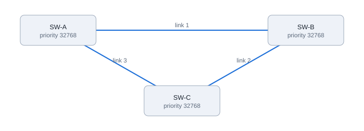

*شکل ۱: سه سوییچ با سه لینک؛ مثلثی که اگر STP نباشد Loop می‌سازد.*

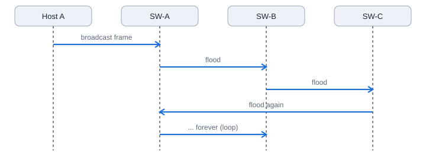

*شکل ۲: یک Broadcast بین سوییچ‌ها می‌چرخد و هیچ‌وقت تمام نمی‌شود.*

#### سه عارضه‌ی Loop

1.  **Broadcast Storm:** ترافیک تکراری پهنای باند را کامل مصرف می‌کند.
2.  **MAC Table Instability:** یک MAC مدام بین دو پورت پرش می‌کند (MACFLAP).
3.  **CPU بالا:** سوییچ مجبور است همین فریم‌ها را پردازش کند و دیگر جواب نمی‌دهد.

### ۲. ایده‌ی STP: یک درخت، بدون حلقه

STP از روی گراف شبکه یک «درخت» می‌سازد: یک ریشه (Root) انتخاب می‌کند و برای هر سوییچ فقط یک مسیر فعال به ریشه نگه می‌دارد. لینک‌های اضافه به‌صورت Blocking در حالت آماده‌باش می‌مانند و اگر لینک اصلی خراب شد، فعال می‌شوند.

#### مراحل کار STP (سه تصمیم)

1.  **انتخاب Root Bridge:** سوییچی با کوچک‌ترین Bridge ID برنده است.
2.  **انتخاب Root Port:** هر سوییچ غیر Root، پورتی را انتخاب می‌کند که کمترین هزینه تا Root را دارد.
3.  **انتخاب Designated Port:** روی هر Segment، پورتی که به Root نزدیک‌تر است فعال می‌ماند؛ پورت‌های باقی‌مانده Blocking می‌شوند.

#### Bridge ID چیست؟

Bridge ID از دو بخش ساخته می‌شود: اولویت (Priority) و MAC سوییچ. اولویت پیش‌فرض ۳۲۷۶۸ است. در PVST+ برای هر VLAN یک نمونه از STP اجرا می‌شود و شماره‌ی VLAN به اولویت اضافه می‌شود:

``` text
Bridge ID = Priority + VLAN ID + MAC address
Example (VLAN 10): 32768 + 10 = 32778 , MAC 0001.aaaa.0001
Lowest Bridge ID wins the Root election
```

اگر اولویت‌ها برابر بود، MAC کوچک‌تر برنده است. چون MAC معمولاً به سن سوییچ بستگی دارد، سوییچ «قدیمی‌ترین» ممکن است Root شود؛ همین یک اشتباه رایج طراحی است. باید Root را عمداً انتخاب کنیم (درس ۴-۲).

#### هزینه‌ی مسیر (Path Cost)

سوییچ‌ها هزینه‌ی مسیر تا Root را با جمع‌کردن هزینه‌ی لینک‌ها حساب می‌کنند. لینک سریع‌تر هزینه‌ی کمتر دارد:

| سرعت لینک | هزینه (روش کوتاه، Short) | هزینه (روش بلند، Long) |
|-----------|--------------------------|------------------------|
| 10 Mbps   | 100                      | 2,000,000              |
| 100 Mbps  | 19                       | 200,000                |
| 1 Gbps    | 4                        | 20,000                 |
| 10 Gbps   | 2                        | 2,000                  |

#### حالت‌ها و نقش پورت‌ها

| STP کلاسیک (802.1D) | کار پورت                                    |
|---------------------|---------------------------------------------|
| Blocking            | فریم داده نمی‌فرستد، فقط BPDU می‌شنود         |
| Listening           | BPDU می‌شنود و پردازش می‌کند، MAC یاد نمی‌گیرد |
| Learning            | MAC یاد می‌گیرد، هنوز داده نمی‌فرستد          |
| Forwarding          | کار عادی                                    |
| Disabled            | خاموش                                       |

در STP کلاسیک، تا Forwarding شدن یک پورت ۳۰ تا ۵۰ ثانیه طول می‌کشد. این تأخیر در شبکه‌ی امروز قابل‌قبول نیست؛ پس از RSTP استفاده می‌کنیم (درس بعد).

``` text
Blocking (20 s max age) -> Listening (15 s) -> Learning (15 s) -> Forwarding
Worst-case convergence = 20 + 15 + 15 = 50 seconds
```

### ۳. مثال ساده: دو سوییچ، دو لینک

SW-A و SW-B با دو کابل به هم وصل‌اند. هر دو با اولویت ۳۲۷۶۸. MAC سوییچ A کوچک‌تر است.

``` text
Election: priority equal (32768) -> lower MAC wins
Root Bridge = SW-A
On SW-B: both uplinks lead to Root with the same cost
  -> choose the lower port ID (Gi0/1) as Root Port
  -> Gi0/2 becomes Blocking (Alternate)
```

### ۴. مثال متوسط: سه سوییچ، مثلث

``` text
Bridge IDs: SW-A 32769.0001.aaaa.0001 (VLAN1)
            SW-B 32769.0001.aaaa.0002
            SW-C 32769.0001.aaaa.0003
Root Bridge = SW-A (lowest MAC)

SW-B -> Root: direct link, cost 4 (1G)          -> Root Port = link A-B
SW-C -> Root: direct link, cost 4 (1G)          -> Root Port = link A-C
Segment B-C: both sides cost 4 to Root; tie -> lower Bridge ID
  SW-B has lower ID than SW-C -> SW-B port is Designated (Forwarding)
  SW-C port on B-C is Alternate (Blocking)
```

نتیجه: فقط پورت SW-C سمت لینک B-C بسته می‌شود؛ مثلث به یک درخت (A در ریشه، B و C فرزند) تبدیل شد.

### ۵. مثال سخت: چرا Root اشتباه خطرناک است؟

در یک شعبه، یک سوییچ قدیمی دسترسی در انتهای شبکه، چون MAC کوچک دارد، Root می‌شود. حالا همه‌ی ترافیک بین سرورها و کاربران از لینک ۱۰۰ مگابیتی آن سوییچ عبور می‌کند.

``` text
Symptom  : network slow, traffic path goes through an old access switch
Check    : show spanning-tree vlan 10  -> "This bridge is the root" on the wrong switch
Cause    : default priority + lowest MAC
Fix      : set core switch priority lower (e.g. 4096) or "root primary"
```

### ۶. دستورهای مشاهده

``` text
SW1# show spanning-tree
SW1# show spanning-tree vlan 10
SW1# show spanning-tree summary
SW1# show spanning-tree root
SW1# show spanning-tree interface gi0/1 detail
```

- `show spanning-tree vlan 10`: Root، Bridge ID خودش، نقش هر پورت (Root/Desg/Altn) و حالت آن.
- `show spanning-tree root`: خلاصه‌ی Root هر VLAN.
- `show spanning-tree summary`: حالت STP و تعداد پورت‌ها به‌تفکیک.

### تمرین‌ها

**ت1.** ۱ (ساده): چرا Loop در لایه ۲ خطرناک‌تر از لایه ۳ است؟ *(پاسخ: 4-1-ت1 در بخش «پاسخ‌ها» انتهای فصل)*

**ت2.** ۲ (ساده): Root Bridge را چطور انتخاب می‌کنند؟ *(پاسخ: 4-1-ت2 در بخش «پاسخ‌ها» انتهای فصل)*

**ت3.** ۳ (متوسط): دو سوییچ با اولویت 32768 و 4096؛ کدام Root است؟ *(پاسخ: 4-1-ت3 در بخش «پاسخ‌ها» انتهای فصل)*

**ت4.** ۴ (متوسط): هزینه‌ی مسیر سه لینک ۱ گیگ پشت‌سرهم تا Root با روش Short؟ *(پاسخ: 4-1-ت4 در بخش «پاسخ‌ها» انتهای فصل)*

**ت5.** ۵ (سخت): در مثلث A (Root)، B، C با لینک‌های 1G، اگر لینک A-C خراب شود، SW-C از کدام مسیر Root را می‌بیند و هزینه چقدر است؟ *(پاسخ: 4-1-ت5 در بخش «پاسخ‌ها» انتهای فصل)*

### Lab هدایت‌شده

توپولوژی: سه سوییچ vIOSL2 به نام‌های `SW1`، `SW2` و `SW3` که مثلث می‌سازند (SW1-SW2، SW2-SW3، SW1-SW3). همه‌ی لینک‌ها Trunk هستند. اگر SW3 ندارید، یک گره‌ی سوم از همان Image اضافه کنید. **هشدار:** قبل از وصل‌کردن لینک سوم، STP باید فعال باشد؛ در Lab ما STP پیش‌فرض روشن است ولی همین را با `show spanning-tree summary` تأیید کنید.

#### گام ۱: بکاپ و حالت STP

``` text
SW1# copy running-config flash:SW1-before-stp.cfg
SW1# show spanning-tree summary
```

#### گام ۲: دیدن Root

``` text
SW1# show spanning-tree vlan 1
SW2# show spanning-tree vlan 1
SW3# show spanning-tree vlan 1
```

در سه خروجی، Bridge ID و Root را مقایسه کنید. روی کدام سوییچ نوشته «This bridge is the root»؟ پیش‌بینی کنید چه سوییچی است و بعد بسنجید.

#### گام ۳: پیدا کردن پورت Blocking

``` text
SWx# show spanning-tree vlan 1 | include Altn|Desg|Root
```

یک پورت Altn (Alternate) باید در مثلث پیدا کنید. آن را یادداشت کنید و نقش همه‌ی پورت‌ها را در یک جدول بنویسید.

#### گام ۴: شکستن لینک و دیدن Failover

``` text
SW2(config)# interface gi0/1
SW2(config-if)# shutdown
SW3# show spanning-tree vlan 1
```

پورت Alternate چقدر زود Forwarding شد؟ (در Rapid-PVST کمتر از چند ثانیه؛ در PVST کلاسیک ۳۰ تا ۵۰ ثانیه.) بعد پورت را `no shutdown` کنید.

### Lab مستقل

جدول «Bridge ID هر سوییچ، Root، نقش پورت‌ها» را برای VLAN 1 بسازید و در `03-ops/stp-baseline.md` ذخیره کنید. بدون رمز.

### عیب‌یابی

|         |                                                                                                                                  |
|---------|----------------------------------------------------------------------------------------------------------------------------------|
| Symptom | شبکه ناگهان بسیار کند شد و LEDهای لینک‌ها مدام چشمک می‌زنند                                                                        |
| سرنخ    | CPU بالا، پیام MACFLAP، ترافیک Broadcast زیاد                                                                                    |
| چک‌لیست  | ۱) show spanning-tree summary ؛ ۲) آیا کابل جدیدی وصل شده؟ ؛ ۳) آیا STP روی همه‌ی سوییچ‌ها فعال است؟ ؛ ۴) پورت Blocking وجود دارد؟ |
| رفع     | کابل اضافه را جدا کنید، STP را فعال کنید، سپس علت را مستند کنید                                                                  |

### سؤال‌های مرور

**م1.** چرا لایه ۲ به STP نیاز دارد؟ *(پاسخ: 4-1-م1 در بخش «پاسخ‌ها» انتهای فصل)*

**م2.** Root Bridge چه کسی است؟ *(پاسخ: 4-1-م2 در بخش «پاسخ‌ها» انتهای فصل)*

**م3.** Root Port و Designated Port چه فرقی دارند؟ *(پاسخ: 4-1-م3 در بخش «پاسخ‌ها» انتهای فصل)*

### English Corner: انگلیسی تخصصی این درس

این جمله‌ها از مستندات و محیط کار واقعی‌اند. بلند بخوانید و ترجمه را بپوشانید.

| English sentence                                              | ترجمه                                                 |
|---------------------------------------------------------------|-------------------------------------------------------|
| STP prevents layer-2 loops by blocking redundant links.       | STP با بستن لینک‌های اضافه جلوی Loop لایه ۲ را می‌گیرد. |
| The switch with the lowest bridge ID becomes the root bridge. | سوییچ با کوچک‌ترین Bridge ID Root می‌شود.               |
| A blocked port still receives BPDUs.                          | پورت Blocking هنوز BPDU دریافت می‌کند.                 |
| A broadcast storm can bring down the entire network.          | طوفان Broadcast می‌تواند کل شبکه را از کار بیندازد.    |

**Q1.** Quick quiz (answer in English): What does STP do with a redundant link? *(پاسخ: 4-1-Q1 در بخش «پاسخ‌ها» انتهای فصل)*

### تکلیف و چک‌لیست تسلط

- [ ] سه عارضه‌ی Loop را بگویم.
- [ ] Root را برای مثلث به‌دست آورم و نقش پورت‌ها را بنویسم.
- [ ] Lab را انجام دهم و Failover را ثبت کنم.

### یادآوری اشتباهات شما

> **یادآوری**
>
> پیش‌بینی قبل از اجرا؛ بکاپ قبل از تغییر؛ پذیرفته‌شدن دستور ≠ کار کردن؛ فرمول‌ها در بلوک مستقل.


#### کارت Lab — حلقه در لایه ۲ و STP

| # | فیلد | محتوا |
|---|---|---|
| 1 | عنوان و هدف | دیدن Root و نقش پورت‌ها در مثلث سه‌سوییچی |
| 2 | پیش‌نیاز | فصل 3 |
| 3 | توپولوژی | SW1-SW2-SW3 مثلث (Trunk) |
| 4 | تجهیزات | ۳ سوییچ vIOS-L2 |
| 5 | نسخه نرم‌افزار | vIOS-L2 15.2(20200924، Experimental) برای SW؛ vIOS 15.9(3)M9 برای R؛ VPCS؛ PNetLab 4.2.8 |
| 6 | IP Plan | VLAN 1 |
| 7 | وضعیت اولیه | PVST پیش‌فرض |
| 8 | صورت مسئله | Root/Port Role را بنویسید و Failover را ببینید |
| 9 | مراحل هدایت‌شده | همان بخش «Lab هدایت‌شده» همین درس |
| 10 | تست عملکرد | `show spanning-tree vlan 1` (Root، Altn) |
| 11 | سناریوی خرابی | Loop بدون STP (آموزشی) |
| 12 | روش عیب‌یابی | لایه‌ای/با شواهد (بخش عیب‌یابی همین درس) |
| 13 | نتیجه‌ی مورد انتظار | Root مشخص؛ یک پورت Altn |
| 14 | معیار پذیرش | جدول Role صحیح |
| 15 | مستندات نهایی | `03-ops/stp-baseline.md` |
| 16 | Cleanup و بازگردانی | `no shutdown` لینک‌ها |

> **وضعیت راستی‌آزمایی (خارج از ۱۶ فیلد):** **جزئی.** `show spanning-tree summary` در Probe Tested-OK (PVST)؛ Failover و مثلث اجرا نشده.

---

<a id="l-4-2"></a>

## درس 4-2 — Rapid-PVST، Root، PortFast و BPDU Guard

**فصل ۴ - روز ۲ · پیش‌نیاز: درس ۴-۱ · ۶ ساعت**

### این درس درباره چیست و چرا باید یاد بگیریم؟

**چه چیزی یاد می‌گیریم:** نسخه‌ی سریع STP یعنی RSTP و پیاده‌سازی سیسکو Rapid-PVST+؛ انتخاب عمدی Root؛ و محافظ‌های PortFast و BPDU Guard و Root Guard.

**چرا لازم است:** STP کلاسیک تا ۵۰ ثانیه همگرا می‌شود و Root را به‌صورت تصادفی انتخاب می‌کند. در شبکه‌ی واقعی باید همگرایی چند ثانیه‌ای و Root از پیش‌تعیین‌شده داشته باشیم، و باید جلوی اتصال سوییچ یا BPDU ناخواسته به پورت کاربر را بگیریم.

- **در کار روزانه:** تقریباً همه‌ی سوییچ‌های سازمانی Rapid-PVST اجرا می‌کنند.
- **در امنیت:** BPDU Guard جلوی اتصال سوییچ جعلی (Rogue) را می‌گیرد؛ Root Guard جلوی Root شدن سوییچ ناخواسته را.
- **در عیب‌یابی:** پورت err-disabled بعد از وصل‌کردن یک سوییچ، کار BPDU Guard است.

> **مسیر درس**
>
> RSTP چه فرقی دارد ← تنظیم Root ← PortFast ← BPDU Guard و Root Guard ← مثال ساده/متوسط/سخت ← Lab ← عیب‌یابی.

#### اصطلاحات این درس (مخفف ← شکل کامل ← معنی)

| مخفف        | شکل کامل انگلیسی                      | معنی فارسی                                        |
|-------------|---------------------------------------|---------------------------------------------------|
| RSTP        | Rapid Spanning Tree Protocol (802.1w) | نسخه‌ی سریع STP                                    |
| PVST+       | Per-VLAN Spanning Tree Plus           | یک STP جدا برای هر VLAN (سیسکو)                   |
| Rapid-PVST+ | Rapid Per-VLAN Spanning Tree Plus     | RSTP به‌صورت Per-VLAN                              |
| PortFast    | PortFast                              | پورت لبه‌ای که فوراً Forwarding می‌شود               |
| BPDU Guard  | BPDU Guard                            | پورت را با دریافت BPDU خاموش می‌کند                |
| Root Guard  | Root Guard                            | جلوی Root شدن سوییچ ناخواسته از یک پورت را می‌گیرد |
| Alternate   | Alternate Port                        | پورت جایگزین سریع برای Root Port                  |
| Edge Port   | Edge Port                             | پورتی که به دستگاه انتهایی وصل است                |

### ۱. RSTP چه چیزی را سریع کرد؟

RSTP همان ایده‌ی STP است ولی به‌جای انتظار با تایمرها، سوییچ‌ها با هم «مذاکره» می‌کنند (Proposal/Agreement). حالت‌ها هم ساده‌تر شده‌اند:

| STP کلاسیک | RSTP       |
|------------|------------|
| Blocking   | Discarding |
| Listening  | Discarding |
| Learning   | Learning   |
| Forwarding | Forwarding |

نقش‌ها هم یک نقش جدید دارند:

| نقش             | معنی                                     |
|-----------------|------------------------------------------|
| Root Port       | بهترین مسیر به Root                      |
| Designated Port | پورت فعال هر Segment                     |
| Alternate Port  | پشتیبان Root Port (همگرایی در حد ثانیه)  |
| Backup Port     | پشتیبان Designated Port روی همان Segment |

``` text
STP  : 30-50 seconds to converge
RSTP : usually 1-2 seconds (link failure with alternate port)
```

### ۲. فعال‌کردن Rapid-PVST+

``` text
SW1(config)# spanning-tree mode rapid-pvst
SW1# show spanning-tree summary
```

در خروجی باید بنویسد `Switch is in rapid-pvst mode`. این دستور باید روی همه‌ی سوییچ‌ها یکسان زده شود؛ ترکیب حالت‌ها سازگار است ولی همگرایی سریع از دست می‌رود.

### ۳. تعیین عمدی Root

دو روش داریم. روش اول Macro است و خودش اولویت را کم می‌کند؛ روش دوم دستی است و دقیق‌تر:

``` text
SW1(config)# spanning-tree vlan 1,10,20,30 root primary
SW2(config)# spanning-tree vlan 1,10,20,30 root secondary

! manual equivalent:
SW1(config)# spanning-tree vlan 10 priority 4096
SW2(config)# spanning-tree vlan 10 priority 8192
```

- `root primary`: اولویت را به اندازه‌ای کم می‌کند که Root شود (معمولاً 24576 یا کمتر).
- `root secondary`: اولویت 28672 برای نقش Root پشتیبان.
- اولویت باید مضرب 4096 باشد (چون ۱۲ بیت دیگر برای شماره‌ی VLAN رزرو است).

``` text
Priority values allowed: 0, 4096, 8192, ... 61440 (multiples of 4096)
Default priority : 32768
Bridge priority in BPDU = Priority + VLAN ID  (e.g. 4096 + 10 = 4106)
```

> **قانون طراحی**
>
> Root را همیشه روی سوییچ هسته (Core / Distribution) بگذارید و Root پشتیبان را روی هم‌ترازش. هرگز نگذارید یک سوییچ دسترسی Root شود.

### ۴. PortFast: پورت کاربر را سریع بالا بیاور

پورتی که به کامپیوتر یا پرینتر وصل است نمی‌تواند Loop بسازد. پس نیازی نیست منتظر مراحل STP بماند. PortFast آن را فوراً Forwarding می‌کند:

``` text
SW1(config)# interface range gi0/1 - 4
SW1(config-if-range)# switchport mode access
SW1(config-if-range)# spanning-tree portfast

! or enable globally for all access ports:
SW1(config)# spanning-tree portfast default
```

> **هشدار**
>
> PortFast فقط روی پورت‌های دستگاه انتهایی. روی لینک بین سوییچ‌ها خطرناک است، چون ممکن است Loop بسازد. برای همین حتماً با BPDU Guard همراه می‌شود.

### ۵. BPDU Guard: اگر BPDU آمد، پورت را خاموش کن

پورت کاربر هرگز نباید BPDU دریافت کند. اگر دریافت کرد، یعنی کسی سوییچ وصل کرده. BPDU Guard پورت را به حالت err-disabled می‌برد:

``` text
SW1(config)# interface gi0/1
SW1(config-if)# spanning-tree bpduguard enable

! global default for PortFast ports:
SW1(config)# spanning-tree portfast bpduguard default

! recovery (optional, careful):
SW1(config)# errdisable recovery cause bpduguard
SW1(config)# errdisable recovery interval 300
```

``` text
SW1# show interfaces status err-disabled
SW1# show spanning-tree summary
SW1# show spanning-tree interface gi0/1 detail
```

بعد از رفع علت، پورت را دستی روشن کنید: `shutdown` سپس `no shutdown`. اگر `errdisable recovery` تنظیم شده باشد، بعد از ۳۰۰ ثانیه خودکار برمی‌گردد (ولی اگر علت هنوز هست، دوباره خاموش می‌شود).

### ۶. Root Guard: جلوی Root ناخواسته

روی پورت‌هایی که به سمت سوییچ‌های «مشتری» یا بیرون از کنترل شما می‌روند، اگر BPDU بهتر (ادعای Root) رسید، پورت وارد حالت `root-inconsistent` می‌شود و ترافیک را نمی‌پذیرد:

``` text
SW1(config)# interface gi0/10
SW1(config-if)# spanning-tree guard root
SW1# show spanning-tree inconsistentports
```

| ابزار      | روی کدام پورت                 | عکس‌العمل                       |
|------------|-------------------------------|--------------------------------|
| PortFast   | پورت دستگاه انتهایی           | فوراً Forwarding                |
| BPDU Guard | پورت دستگاه انتهایی           | err-disabled با دریافت BPDU    |
| Root Guard | پورت به سمت خارج از کنترل شما | root-inconsistent با BPDU برتر |

### ۷. مثال ساده/متوسط/سخت

#### ساده

``` text
Task  : make SW1 the root for VLAN 10
Cmd   : spanning-tree vlan 10 root primary
Verify: show spanning-tree vlan 10  -> "This bridge is the root"
```

#### متوسط

کاربری یک سوییچ کوچک خانگی را به پورت دیوار وصل می‌کند. بدون BPDU Guard ممکن است Loop بسازد یا Root شود؛ با BPDU Guard پورت خاموش می‌شود:

``` text
Log: %SPANTREE-2-BLOCK_BPDUGUARD: Received BPDU on port Gi0/3 with BPDU Guard enabled
Show: show interfaces status err-disabled -> Gi0/3 err-disabled bpduguard
```

#### سخت

در شبکه‌ی ۳ سوییچی، Root را روی SW1 و Root پشتیبان را روی SW2 بگذارید، روی پورت‌های دسترسی SW3 PortFast و BPDU Guard فعال کنید، روی پورت اتصال به شبکه‌ی خارجی Root Guard؛ سپس نشان دهید با قطع SW1 همگرایی کمتر از چند ثانیه است.

### تمرین‌ها

**ت1.** ۱ (ساده): چرا RSTP سریع‌تر است؟ *(پاسخ: 4-2-ت1 در بخش «پاسخ‌ها» انتهای فصل)*

**ت2.** ۲ (ساده): اولویت‌های مجاز؟ *(پاسخ: 4-2-ت2 در بخش «پاسخ‌ها» انتهای فصل)*

**ت3.** ۳ (متوسط): PortFast بدون BPDU Guard چه خطری دارد؟ *(پاسخ: 4-2-ت3 در بخش «پاسخ‌ها» انتهای فصل)*

**ت4.** ۴ (متوسط): پورت err-disabled شد؛ مراحل رفع؟ *(پاسخ: 4-2-ت4 در بخش «پاسخ‌ها» انتهای فصل)*

**ت5.** ۵ (سخت): Root Guard را روی کدام پورت‌ها می‌گذاریم و چرا؟ *(پاسخ: 4-2-ت5 در بخش «پاسخ‌ها» انتهای فصل)*

### Lab هدایت‌شده

همان مثلث SW1-SW2-SW3 از درس قبل. SW1 باید Root باشد.

#### گام ۱: Rapid-PVST روی هر سه

``` text
SWx(config)# spanning-tree mode rapid-pvst
SWx# show spanning-tree summary
```

#### گام ۲: Root و Root پشتیبان

``` text
SW1(config)# spanning-tree vlan 1 root primary
SW2(config)# spanning-tree vlan 1 root secondary
SW3# show spanning-tree root
```

#### گام ۳: PortFast و BPDU Guard روی پورت PC

``` text
SW3(config)# interface gi0/3
SW3(config-if)# switchport mode access
SW3(config-if)# spanning-tree portfast
SW3(config-if)# spanning-tree bpduguard enable
```

#### گام ۴: ایجاد عمدی تخلف

به پورت Gi0/3 به‌جای PC، یک سوییچ (SW4) وصل کنید. باید پیام BPDU Guard را ببینید:

``` text
SW3# show interfaces status err-disabled
SW3# show logging | include BPDUGUARD
```

اگر شبیه‌ساز BPDU Guard را اجرا نکرد (طبق Probe فقط پذیرفته شده بود)، دقیقاً همان را ثبت کنید و در Lab واقعی تکرار کنید.

#### گام ۵: رفع

``` text
SW3(config)# interface gi0/3
SW3(config-if)# shutdown
SW3(config-if)# no shutdown
```

### Lab مستقل

یک چک‌لیست «Hardening لایه ۲» یک‌صفحه‌ای بنویسید (Rapid-PVST، Root/Secondary، PortFast، BPDU Guard، Root Guard) در `03-ops/l2-hardening.md`.

### عیب‌یابی

|            |                                                              |
|------------|--------------------------------------------------------------|
| Symptom    | پورت کاربر خاموش شده و کاربر قطع است                         |
| سرنخ       | show interfaces status -\> err-disabled                      |
| علت متداول | BPDU Guard: سوییچ یا دستگاهی که BPDU می‌فرستد به پورت وصل شده |
| رفع        | دستگاه را جدا کنید و پورت را بالا بیاورید؛ علت را مستند کنید |

### سؤال‌های مرور

**م1.** PortFast برای چه پورتی؟ *(پاسخ: 4-2-م1 در بخش «پاسخ‌ها» انتهای فصل)*

**م2.** تفاوت BPDU Guard و Root Guard؟ *(پاسخ: 4-2-م2 در بخش «پاسخ‌ها» انتهای فصل)*

**م3.** چرا Root را دستی تعیین می‌کنیم؟ *(پاسخ: 4-2-م3 در بخش «پاسخ‌ها» انتهای فصل)*

### English Corner: انگلیسی تخصصی این درس

این جمله‌ها از مستندات و محیط کار واقعی‌اند. بلند بخوانید و ترجمه را بپوشانید.

| English sentence                                                           | ترجمه                                                                             |
|----------------------------------------------------------------------------|-----------------------------------------------------------------------------------|
| Enable PortFast on access ports to skip the listening and learning states. | PortFast را روی پورت‌های Access فعال کنید تا حالت‌های Listening و Learning رد شوند. |
| BPDU Guard puts the port in err-disabled state when a BPDU is received.    | BPDU Guard با دریافت BPDU پورت را به حالت err-disabled می‌برد.                     |
| Set the core switch as the root bridge for all VLANs.                      | سوییچ هسته را Root همه‌ی VLANها کنید.                                              |
| Root Guard prevents an unauthorized switch from becoming root.             | Root Guard جلوی Root شدن سوییچ غیرمجاز را می‌گیرد.                                 |

**Q1.** Quick quiz (answer in English): When should you not enable PortFast? *(پاسخ: 4-2-Q1 در بخش «پاسخ‌ها» انتهای فصل)*

### تکلیف و چک‌لیست تسلط

- [ ] Rapid-PVST و Root را تنظیم و تأیید کنم.
- [ ] BPDU Guard را بسازم، تخلف را ببینم و رفع کنم.
- [ ] چک‌لیست Hardening L2 را بنویسم.

### یادآوری اشتباهات شما

> **یادآوری**
>
> پیش‌بینی قبل از اجرا؛ بکاپ قبل از تغییر؛ پذیرفته‌شدن دستور ≠ کار کردن؛ فرمول‌ها در بلوک مستقل.


#### کارت Lab — Rapid-PVST، Root، PortFast و BPDU Guard

| # | فیلد | محتوا |
|---|---|---|
| 1 | عنوان و هدف | Rapid-PVST، Root، PortFast، BPDU Guard |
| 2 | پیش‌نیاز | درس 4-1 |
| 3 | توپولوژی | مثلث + PC |
| 4 | تجهیزات | ۳ سوییچ + VPCS |
| 5 | نسخه نرم‌افزار | vIOS-L2 15.2(20200924، Experimental) برای SW؛ vIOS 15.9(3)M9 برای R؛ VPCS؛ PNetLab 4.2.8 |
| 6 | IP Plan | PVST |
| 7 | وضعیت اولیه | Rapid-PVST |
| 8 | صورت مسئله | Root/Secondary و محافظت پورت |
| 9 | مراحل هدایت‌شده | همان بخش «Lab هدایت‌شده» همین درس |
| 10 | تست عملکرد | `show spanning-tree summary` |
| 11 | سناریوی خرابی | سوییچ جعلی به پورت BPDU Guard |
| 12 | روش عیب‌یابی | لایه‌ای/با شواهد (بخش عیب‌یابی همین درس) |
| 13 | نتیجه‌ی مورد انتظار | Rapid-PVST؛ پورت err-disabled با BPDU |
| 14 | معیار پذیرش | تخلف دیده/ثبت شود |
| 15 | مستندات نهایی | `03-ops/l2-hardening.md` |
| 16 | Cleanup و بازگردانی | shutdown/no shutdown پورت |

> **وضعیت راستی‌آزمایی (خارج از ۱۶ فیلد):** **جزئی.** Rapid-PVST در Config دیده شد؛ PortFast/BPDU Guard فقط CLI-Accepted؛ اجرای واقعی Guard آزمایش نشده.

---

<a id="l-4-3"></a>

## درس 4-3 — EtherChannel و LACP

**فصل ۴ - روز ۳ · پیش‌نیاز: درس ۴-۲ · ۶ ساعت**

### این درس درباره چیست و چرا باید یاد بگیریم؟

**چه چیزی یاد می‌گیریم:** چطور چند کابل فیزیکی بین دو سوییچ را به‌صورت یک لینک منطقی (EtherChannel) در بیاوریم، با پروتکل LACP؛ و چرا دو سر لینک باید تنظیمات یکسان داشته باشند.

**چرا لازم است:** اگر بین دو سوییچ دو کابل بکشید، STP یکی را می‌بندد و نیمی از پهنای باند هدر می‌رود. EtherChannel دو (تا هشت) کابل را یکی می‌کند: پهنای باند جمع می‌شود و با قطع یک کابل ارتباط قطع نمی‌شود.

- **در کار روزانه:** لینک بین سوییچ‌های Core و Distribution تقریباً همیشه EtherChannel است.
- **در امنیت:** EtherChannel نادرست باعث Loop یا قطع ناگهانی می‌شود؛ کنترل Mismatch ضروری است.
- **در FortiGate:** همین مفهوم با «Aggregate Interface» در فایروال تکرار می‌شود.

> **مسیر درس**
>
> مشکل لینک‌های موازی ← Port-Channel ← LACP در برابر PAgP ← Load Balancing ← مثال ساده/متوسط/سخت ← Lab ← عیب‌یابی.

#### اصطلاحات این درس (مخفف ← شکل کامل ← معنی)

| مخفف         | شکل کامل انگلیسی                            | معنی فارسی                             |
|--------------|---------------------------------------------|----------------------------------------|
| EtherChannel | EtherChannel                                | تجمیع چند لینک فیزیکی در یک لینک منطقی |
| Port-Channel | Port-Channel                                | Interface منطقی حاصل از تجمیع          |
| LACP         | Link Aggregation Control Protocol (802.3ad) | پروتکل استاندارد مذاکره‌ی تجمیع         |
| PAgP         | Port Aggregation Protocol                   | پروتکل اختصاصی سیسکو برای تجمیع        |
| Active       | LACP Active                                 | پورت فعالانه مذاکره را شروع می‌کند      |
| Passive      | LACP Passive                                | پورت فقط منتظر مذاکره می‌ماند           |
| Hash         | Load-balancing hash                         | الگوریتم انتخاب لینک برای هر جریان     |

### ۱. مشکل: دو کابل، یک کابل کار می‌کند

دو سوییچ را با دو کابل ۱ گیگ وصل می‌کنیم تا هم پهنای باند بیشتر داشته باشیم و هم تحمل خطا. اما STP دو لینک موازی را «Loop» می‌داند و یکی را Block می‌کند. نتیجه: فقط ۱ گیگ، نه ۲ گیگ.

مثال روزمره: دو باند موازی در یک جاده که یکی را بسته‌اند چون فکر می‌کنند دور می‌زند. EtherChannel به STP می‌گوید این دو باند «یک جاده‌ی دوبانده» هستند.

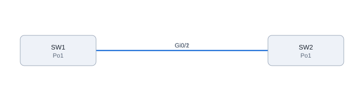

*شکل ۱: دو لینک فیزیکی که STP آن‌ها را یک لینک منطقی (Po1) می‌بیند.*

### ۲. EtherChannel چطور کار می‌کند؟

- چند پورت فیزیکی عضو یک **Port-Channel** می‌شوند.
- STP و Trunk فقط Port-Channel را می‌بینند، نه پورت‌های عضو.
- توزیع ترافیک به‌صورت Hash است: هر جریان (مثلاً یک جفت IP) یک لینک را می‌گیرد؛ پس یک جریان تنها از یک لینک می‌رود و ۱ گیگ می‌ماند، ولی چند جریان روی لینک‌ها پخش می‌شود.
- اگر یک لینک قطع شود، ترافیک به لینک‌های دیگر منتقل می‌شود.

> **نکته‌ی مهم**
>
> EtherChannel سرعت یک ارتباط تکی را بیشتر نمی‌کند؛ ظرفیت کل را بالا می‌برد و تحمل خطا می‌دهد.

### ۳. LACP یا PAgP یا ثابت؟

| حالت   | پروتکل                                  | Modeهای مجاز     |
|--------|-----------------------------------------|------------------|
| LACP   | استاندارد 802.3ad، با تجهیزات هر سازنده | active / passive |
| PAgP   | اختصاصی سیسکو                           | desirable / auto |
| Static | بدون مذاکره (خطرناک)                    | on               |

| ترکیب دو سر       | نتیجه                        |
|-------------------|------------------------------|
| active — active   | Channel تشکیل می‌شود          |
| active — passive  | Channel تشکیل می‌شود          |
| passive — passive | تشکیل نمی‌شود (هر دو منتظرند) |
| on — active       | تشکیل نمی‌شود (Mismatch)      |
| LACP — PAgP       | تشکیل نمی‌شود                 |

توصیه: همیشه LACP با `active` در هر دو سر.

### ۴. شرط‌های یکسان بودن پورت‌ها

همه‌ی پورت‌های عضو باید این‌ها را یکسان داشته باشند، وگرنه Channel بالا نمی‌آید یا Suspend می‌شود:

- سرعت و Duplex
- حالت Trunk/Access و VLANهای مجاز و Native
- VLAN دسترسی (برای Access)
- تنظیمات STP پورت

### ۵. دستورها (خط‌به‌خط)

``` text
SW1(config)# interface range gi0/1 - 2
SW1(config-if-range)# switchport trunk encapsulation dot1q
SW1(config-if-range)# switchport mode trunk
SW1(config-if-range)# channel-group 1 mode active
SW1(config-if-range)# exit
SW1(config)# interface port-channel 1
SW1(config-if)# switchport trunk allowed vlan 10,20,30
SW1(config-if)# switchport trunk native vlan 999
```

- `channel-group 1 mode active`: پورت را عضو Port-Channel شماره‌ی ۱ می‌کند و LACP را فعال.
- تنظیمات Trunk را هم روی Port-Channel بزنید (نه فقط پورت‌ها)، تا تغییرات یکجا اعمال شود.

``` text
SW1# show etherchannel summary
SW1# show etherchannel port-channel
SW1# show interfaces port-channel 1
SW1# show lacp neighbor
SW1# show etherchannel load-balance
```

در `show etherchannel summary` حروف داخل پرانتز مهم‌اند:

| علامت | معنی                         |
|-------|------------------------------|
| P     | پورت در Bundle است (سالم)    |
| I     | پورت مستقل (Stand-alone) است |
| D     | Down                         |
| s     | Suspended (Mismatch)         |
| SU    | Port-channel: L2 و In-use    |
| SD    | Port-channel: L2 و Down      |

### ۶. مثال‌ها

#### ساده

``` text
Po1(SU)  Gi0/1(P)  Gi0/2(P)
Meaning: Layer-2 port-channel in use, both members bundled
```

#### متوسط: Mismatch

``` text
Po1(SD)  Gi0/1(s)  Gi0/2(D)
Cause: native VLAN or allowed VLAN list differs on the two ports/sides
Fix  : make all member ports identical, then shutdown/no shutdown the ports
```

#### سخت: توزیع ترافیک (Load Balancing)

سوییچ با Hash روی مبدأ و مقصد MAC یا IP، لینک را انتخاب می‌کند. اگر فقط یک سرور به یک کلاینت ترافیک بفرستد، همیشه یک لینک پر می‌شود. راه‌حل: Hash بر اساس IP و پورت (در تجهیزات پشتیبان) یا افزایش تنوع جریان‌ها.

``` text
SW1(config)# port-channel load-balance src-dst-ip
SW1# show etherchannel load-balance
```

> **صادقانه درباره‌ی Lab**
>
> در شبیه‌ساز vIOSL2 موتور LACP روشن است ولی در Probe اولیه دیدیم Po1 بدون همتای واقعی در حالت `SD` می‌ماند (پیام «LACP currently not enabled on remote port»). پس Lab را با دو سوییچ شبیه‌سازی‌شده انجام دهید و اگر Bundle تشکیل نشد، ثبت کنید؛ این بخش در Lab واقعی (سخت‌افزار) کاملاً تمرین می‌شود.

### تمرین‌ها

**ت1.** ۱ (ساده): چرا EtherChannel لازم است؟ *(پاسخ: 4-3-ت1 در بخش «پاسخ‌ها» انتهای فصل)*

**ت2.** ۲ (ساده): LACP با کدام Modeها؟ *(پاسخ: 4-3-ت2 در بخش «پاسخ‌ها» انتهای فصل)*

**ت3.** ۳ (متوسط): کدام ترکیب Channel نمی‌سازد؟ *(پاسخ: 4-3-ت3 در بخش «پاسخ‌ها» انتهای فصل)*

**ت4.** ۴ (متوسط): تفسیر Po1(SD) Gi0/1(D) Gi0/2(D) *(پاسخ: 4-3-ت4 در بخش «پاسخ‌ها» انتهای فصل)*

**ت5.** ۵ (سخت): چرا ۲ لینک ۱G برای یک انتقال فایل تکی ۲G سرعت نمی‌دهد؟ *(پاسخ: 4-3-ت5 در بخش «پاسخ‌ها» انتهای فصل)*

### Lab هدایت‌شده

توپولوژی: SW1 و SW2 با دو کابل: `Gi0/1` و `Gi0/2` هر سمت. VLANها از درس ۳-۲.

#### گام ۱: بکاپ و تنظیم هر دو سر

``` text
SWx# copy running-config flash:SWx-before-ec.cfg
SWx(config)# interface range gi0/1 - 2
SWx(config-if-range)# switchport trunk encapsulation dot1q
SWx(config-if-range)# switchport mode trunk
SWx(config-if-range)# channel-group 1 mode active
```

#### گام ۲: بررسی

``` text
SWx# show etherchannel summary
SWx# show interfaces trunk
SWx# show spanning-tree vlan 1
```

در STP باید فقط Po1 را ببینید (نه Gi0/1 و Gi0/2 جداگانه).

#### گام ۳: خراب‌کردن عمدی (Mismatch)

``` text
SW2(config)# interface gi0/2
SW2(config-if)# switchport trunk native vlan 5
SW2# show etherchannel summary
```

وضعیت پورت را ببینید و سپس رفع کنید (Native را مثل بقیه کنید و پورت را `shutdown` / `no shutdown`).

#### گام ۴: تحمل خطا

``` text
SW1(config)# interface gi0/1
SW1(config-if)# shutdown
PC1> ping 10.10.20.14 -t   (should keep working over Gi0/2)
```

### Lab مستقل

در `03-ops/etherchannel-runbook.md` چک‌لیست «قبل از ساخت Channel» (یکسان‌بودن سرعت/VLAN/Native/Allowed) را بنویسید.

### عیب‌یابی

|         |                                                                                                                                 |
|---------|---------------------------------------------------------------------------------------------------------------------------------|
| Symptom | Port-channel بالا نمی‌آید (SD) یا پورت‌ها s هستند                                                                                 |
| چک‌لیست  | ۱) Modeها سازگارند؟ ؛ ۲) Native/Allowed/Trunk دو سر یکی است؟ ؛ ۳) سرعت/Duplex یکی است؟ ؛ ۴) کابل‌ها به همان پورت‌های درست وصل‌اند؟ |
| ابزار   | show etherchannel summary ، show lacp neighbor                                                                                  |
| رفع     | یکسان‌سازی پیکربندی، سپس shutdown و no shutdown پورت‌ها                                                                           |

### سؤال‌های مرور

**م1.** EtherChannel چه مشکلی را حل می‌کند؟ *(پاسخ: 4-3-م1 در بخش «پاسخ‌ها» انتهای فصل)*

**م2.** چرا LACP را ترجیح می‌دهیم؟ *(پاسخ: 4-3-م2 در بخش «پاسخ‌ها» انتهای فصل)*

### English Corner: انگلیسی تخصصی این درس

این جمله‌ها از مستندات و محیط کار واقعی‌اند. بلند بخوانید و ترجمه را بپوشانید.

| English sentence                                          | ترجمه                                                    |
|-----------------------------------------------------------|----------------------------------------------------------|
| Bundle the physical ports into a port-channel using LACP. | پورت‌های فیزیکی را با LACP در یک Port-Channel تجمیع کنید. |
| All member ports must have identical settings.            | همه‌ی پورت‌های عضو باید تنظیمات یکسان داشته باشند.         |
| Traffic is distributed across links using a hash.         | ترافیک با Hash بین لینک‌ها توزیع می‌شود.                   |
| The port-channel stays up if one member link fails.       | با قطع یک لینک عضو، Port-Channel بالا می‌ماند.            |

**Q1.** Quick quiz (answer in English): Why does a single file transfer not use the full bundled bandwidth? *(پاسخ: 4-3-Q1 در بخش «پاسخ‌ها» انتهای فصل)*

### تکلیف و چک‌لیست تسلط

- [ ] Channel را بسازم و در STP یک لینک ببینم.
- [ ] Mismatch را بسازم و رفع کنم.
- [ ] نتیجه‌ی واقعی Lab (SU یا SD) را ثبت کنم.

### یادآوری اشتباهات شما

> **یادآوری**
>
> پیش‌بینی قبل از اجرا؛ بکاپ قبل از تغییر؛ پذیرفته‌شدن دستور ≠ کار کردن؛ فرمول‌ها در بلوک مستقل.


#### کارت Lab — EtherChannel و LACP

| # | فیلد | محتوا |
|---|---|---|
| 1 | عنوان و هدف | EtherChannel (LACP) و عیب‌یابی Mismatch |
| 2 | پیش‌نیاز | درس 4-2 |
| 3 | توپولوژی | SW1 ⇄ SW2 (دو لینک) |
| 4 | تجهیزات | ۲ سوییچ |
| 5 | نسخه نرم‌افزار | vIOS-L2 15.2(20200924، Experimental) برای SW؛ vIOS 15.9(3)M9 برای R؛ VPCS؛ PNetLab 4.2.8 |
| 6 | IP Plan | Trunk تک‌لینک |
| 7 | وضعیت اولیه | Port-channel 1 |
| 8 | صورت مسئله | Bundle و تحمل خطا |
| 9 | مراحل هدایت‌شده | همان بخش «Lab هدایت‌شده» همین درس |
| 10 | تست عملکرد | `show etherchannel summary` |
| 11 | سناریوی خرابی | Native نامتقارن |
| 12 | روش عیب‌یابی | لایه‌ای/با شواهد (بخش عیب‌یابی همین درس) |
| 13 | نتیجه‌ی مورد انتظار | Po1(SU)؛ با قطع یک لینک ارتباط ادامه |
| 14 | معیار پذیرش | نتیجه‌ی واقعی (SU یا SD) ثبت شود |
| 15 | مستندات نهایی | `03-ops/etherchannel-runbook.md` |
| 16 | Cleanup و بازگردانی | حذف channel-group |

> **وضعیت راستی‌آزمایی (خارج از ۱۶ فیلد):** **جزئی.** LACP engine فعال (Po1(SD) تا همتای دوم)؛ Bundle کامل آزمایش نشده.

---

<a id="l-4-4"></a>

## درس 4-4 — Port Security

**فصل ۴ - روز ۴ · پیش‌نیاز: درس ۴-۳ · ۶ ساعت**

### این درس درباره چیست و چرا باید یاد بگیریم؟

**چه چیزی یاد می‌گیریم:** چطور هر پورت دسترسی را به تعداد مشخصی از MACهای مجاز محدود کنیم (Port Security)، سه نوع واکنش (Violation) و بازیابی از err-disabled.

**چرا لازم است:** هر کسی با یک کابل و لپ‌تاپ می‌تواند به پورت خالی وصل شود. Port Security جلوی دستگاه‌های ناشناس را می‌گیرد و حمله‌ی پر‌کردن جدول MAC (MAC Flooding) را بی‌اثر می‌کند.

- **در کار روزانه:** برای پورت‌های میز کار و پرینتر در اکثر سازمان‌ها استفاده می‌شود.
- **در امنیت:** لایه‌ی اول کنترل دسترسی فیزیکی و جلوگیری از MAC Flooding.
- **در عیب‌یابی:** پورتی که ناگهان err-disabled شد، اغلب Violation است.

> **مسیر درس**
>
> تهدید ← Port Security ← انواع Violation ← Sticky MAC ← مثال ساده/متوسط/سخت ← Lab ← عیب‌یابی.

#### اصطلاحات این درس (مخفف ← شکل کامل ← معنی)

| مخفف          | شکل کامل انگلیسی    | معنی فارسی                             |
|---------------|---------------------|----------------------------------------|
| Port Security | Port Security       | محدودکردن MACهای مجاز روی پورت         |
| Violation     | Security Violation  | تخلف: MAC غیرمجاز یا بیش از حد         |
| Sticky        | Sticky MAC          | یادگیری و ذخیره‌ی خودکار MAC مجاز       |
| Shutdown      | Violation shutdown  | پورت را err-disabled می‌کند             |
| Restrict      | Violation restrict  | فریم غیرمجاز را دور می‌ریزد و لاگ می‌دهد |
| Protect       | Violation protect   | فریم غیرمجاز را بی‌صدا دور می‌ریزد       |
| MAC Flooding  | MAC Flooding attack | پرکردن جدول MAC با MACهای جعلی         |

### ۱. تهدید: «کسی کابل را به پورت خالی زد»

سوییچ پورت‌های متعددی دارد و معمولاً بعضی از آن‌ها در دیوار سالن آزاد هستند. مهمان یا مهاجم لپ‌تاپ را وصل می‌کند و به شبکه می‌رسد. تهدید دوم: مهاجم هزاران MAC جعلی می‌فرستد تا جدول MAC پر شود و سوییچ شروع به Flooding کند؛ آنگاه ترافیک را می‌شنود.

### ۲. ایده‌ی Port Security

روی هر پورت می‌گوییم: «فقط N تا MAC مجاز است، و آن‌ها این‌ها هستند». اگر MAC دیگری آمد، واکنش تعریف‌شده اجرا می‌شود. سه چیز باید تعیین کنیم:

1.  **حداکثر MAC** (Maximum): معمولاً ۱ برای کامپیوتر، ۲ برای کامپیوتر+IP Phone.
2.  **MACهای مجاز:** دستی (static)، یا یادگیری خودکار (sticky).
3.  **واکنش (Violation):** shutdown، restrict یا protect.

| Violation         | فریم غیرمجاز | پورت         | لاگ/شمارنده |
|-------------------|--------------|--------------|-------------|
| shutdown (پیش‌فرض) | دور ریخته    | err-disabled | بله         |
| restrict          | دور ریخته    | فعال می‌ماند  | بله         |
| protect           | دور ریخته    | فعال می‌ماند  | خیر         |

### ۳. دستورها (خط‌به‌خط)

``` text
SW1(config)# interface gi0/1
SW1(config-if)# switchport mode access
SW1(config-if)# switchport access vlan 20
SW1(config-if)# switchport port-security
SW1(config-if)# switchport port-security maximum 2
SW1(config-if)# switchport port-security violation restrict
SW1(config-if)# switchport port-security mac-address sticky
SW1(config-if)# switchport port-security aging time 10
SW1(config-if)# switchport port-security aging type inactivity
```

- `switchport port-security`: قابلیت را روشن می‌کند (فقط روی پورت Access/Trunk ثابت، نه Dynamic).
- `maximum 2`: حداکثر دو MAC.
- `violation restrict`: واکنش (پیش‌فرض shutdown).
- `mac-address sticky`: MACهای یادگرفته‌شده به running-config اضافه می‌شوند (با `copy run start` دائمی می‌شوند).
- `aging`: بعد از ۱۰ دقیقه بی‌فعالیتی، MAC ثابت‌نشده حذف می‌شود.

``` text
SW1# show port-security
SW1# show port-security interface gi0/1
SW1# show port-security address
SW1# show interfaces status err-disabled
```

مهم‌ترین خطوط `show port-security interface`:

| فیلد                     | معنی                                      |
|--------------------------|-------------------------------------------|
| Port Status              | Secure-up / Secure-down / Secure-shutdown |
| Violation Mode           | نوع واکنش                                 |
| Maximum MAC Addresses    | سقف                                       |
| Total MAC Addresses      | تعداد فعلی                                |
| Last Source Address      | آخرین MAC متخلف                           |
| Security Violation Count | تعداد تخلف‌ها                              |

### ۴. مثال‌ها

#### ساده: یک کامپیوتر، یک MAC

``` text
maximum 1 , sticky
PC1 connects -> its MAC is learned and stored
Another laptop plugged in -> violation
```

#### متوسط: Violation shutdown

``` text
Log: %PM-4-ERR_DISABLE: psecure-violation error detected on Gi0/1, putting Gi0/1 in err-disable state
show port-security interface gi0/1 -> Port Status: Secure-shutdown
```

رفع: دستگاه غیرمجاز را جدا کنید، سپس `shutdown` و `no shutdown`. یا برای رفع خودکار: `errdisable recovery cause psecure-violation`.

#### سخت: IP Phone و کامپیوتر

در میز کار، IP Phone به پورت وصل است و کامپیوتر پشت آن. پس دو MAC لازم است (یا Voice VLAN). maximum را ۳ بگذارید تا یک MAC برای Phone، یکی برای PC و یکی حاشیه برای تعویض دستگاه باشد.

``` text
Rule of thumb: maximum = number of expected devices + 1 spare
Too low -> user complaints; too high -> weaker protection
```

> **صادقانه درباره‌ی Lab**
>
> در Probe اولیه، دستور Port Security در vIOSL2 «پذیرفته» شد، ولی ممکن است تخلف واقعاً شناسایی نشود (شبیه‌ساز). برای هر گام، نتیجه‌ی واقعی را ثبت کنید. اگر کار نکرد، مفهوم را با خروجی نمونه یاد بگیرید و در تجهیز واقعی تمرین کنید.

### تمرین‌ها

**ت1.** ۱ (ساده): سه نوع Violation؟ *(پاسخ: 4-4-ت1 در بخش «پاسخ‌ها» انتهای فصل)*

**ت2.** ۲ (ساده): sticky یعنی چه؟ *(پاسخ: 4-4-ت2 در بخش «پاسخ‌ها» انتهای فصل)*

**ت3.** ۳ (متوسط): چرا بعد از reload ممکن است sticky پاک شود؟ *(پاسخ: 4-4-ت3 در بخش «پاسخ‌ها» انتهای فصل)*

**ت4.** ۴ (متوسط): پورت err-disabled شد؛ مراحل؟ *(پاسخ: 4-4-ت4 در بخش «پاسخ‌ها» انتهای فصل)*

**ت5.** ۵ (سخت): maximum را برای پورت Phone+PC چند می‌گذاریم و چرا؟ *(پاسخ: 4-4-ت5 در بخش «پاسخ‌ها» انتهای فصل)*

### Lab هدایت‌شده

#### گام ۱: فعال‌سازی روی پورت PC1

``` text
SW1(config)# interface gi0/1
SW1(config-if)# switchport mode access
SW1(config-if)# switchport access vlan 20
SW1(config-if)# switchport port-security
SW1(config-if)# switchport port-security maximum 1
SW1(config-if)# switchport port-security violation shutdown
SW1(config-if)# switchport port-security mac-address sticky
```

#### گام ۲: بررسی

``` text
PC1> ping 10.10.20.1
SW1# show port-security interface gi0/1
SW1# show running-config interface gi0/1
```

باید MAC یادگرفته‌شده را به‌صورت `sticky` در پیکربندی ببینید.

#### گام ۳: تخلف عمدی

PC1 را جدا کنید و PC2 (MAC متفاوت) را به همان پورت وصل کنید. نتیجه را با `show interfaces status err-disabled` و `show logging` بررسی کنید.

#### گام ۴: رفع

``` text
SW1(config)# interface gi0/1
SW1(config-if)# shutdown
SW1(config-if)# no shutdown
SW1# clear port-security sticky interface gi0/1
```

### Lab مستقل

استاندارد Port Security (حداکثر، Violation، Sticky، Recovery) را برای پورت‌های کاربر، پرینتر و Phone در `03-ops/port-security-standard.md` بنویسید.

### عیب‌یابی

|         |                                                                                                        |
|---------|--------------------------------------------------------------------------------------------------------|
| Symptom | کاربر مجاز قطع شد                                                                                      |
| چک‌لیست  | ۱) پورت err-disabled است؟ ؛ ۲) MAC جدیدی دیده شده؟ ؛ ۳) Maximum کم است؟ ؛ ۴) Sticky قدیمی تغییر نکرده؟ |
| ابزار   | show port-security interface ، show logging                                                            |
| رفع     | پاک‌کردن MAC قدیمی، تنظیم maximum، و بالا آوردن پورت                                                    |

### سؤال‌های مرور

**م1.** Port Security چه چیزی را کنترل می‌کند؟ *(پاسخ: 4-4-م1 در بخش «پاسخ‌ها» انتهای فصل)*

**م2.** تفاوت restrict و shutdown؟ *(پاسخ: 4-4-م2 در بخش «پاسخ‌ها» انتهای فصل)*

### English Corner: انگلیسی تخصصی این درس

این جمله‌ها از مستندات و محیط کار واقعی‌اند. بلند بخوانید و ترجمه را بپوشانید.

| English sentence                                                            | ترجمه                                                           |
|-----------------------------------------------------------------------------|-----------------------------------------------------------------|
| Port security limits the number of MAC addresses allowed on an access port. | Port Security تعداد MACهای مجاز روی پورت Access را محدود می‌کند. |
| Sticky MAC addresses are saved to the running configuration.                | MACهای Sticky در running-config ذخیره می‌شوند.                   |
| The port goes into the err-disabled state on a violation.                   | در صورت تخلف، پورت به حالت err-disabled می‌رود.                  |
| Always allow one spare MAC for device replacement.                          | همیشه یک MAC اضافه برای تعویض دستگاه در نظر بگیرید.             |

**Q1.** Quick quiz (answer in English): What is the default violation mode? *(پاسخ: 4-4-Q1 در بخش «پاسخ‌ها» انتهای فصل)*

### تکلیف و چک‌لیست تسلط

- [ ] Port Security را فعال و تخلف را تست کنم.
- [ ] نتیجه‌ی واقعی Lab را ثبت کنم.
- [ ] استاندارد را بنویسم.

### یادآوری اشتباهات شما

> **یادآوری**
>
> پیش‌بینی قبل از اجرا؛ بکاپ قبل از تغییر؛ پذیرفته‌شدن دستور ≠ کار کردن؛ فرمول‌ها در بلوک مستقل.


#### کارت Lab — Port Security

| # | فیلد | محتوا |
|---|---|---|
| 1 | عنوان و هدف | Port Security (maximum/sticky/violation) |
| 2 | پیش‌نیاز | درس 4-3 |
| 3 | توپولوژی | SW1 + PC1..PC3 |
| 4 | تجهیزات | SW1 + ۳ VPCS |
| 5 | نسخه نرم‌افزار | vIOS-L2 15.2(20200924، Experimental) برای SW؛ vIOS 15.9(3)M9 برای R؛ VPCS؛ PNetLab 4.2.8 |
| 6 | IP Plan | Access VLAN 20 |
| 7 | وضعیت اولیه | max 2/3 sticky |
| 8 | صورت مسئله | تخلف عمدی و بازیابی |
| 9 | مراحل هدایت‌شده | همان بخش «Lab هدایت‌شده» همین درس |
| 10 | تست عملکرد | `show port-security interface` |
| 11 | سناریوی خرابی | MAC سوم |
| 12 | روش عیب‌یابی | لایه‌ای/با شواهد (بخش عیب‌یابی همین درس) |
| 13 | نتیجه‌ی مورد انتظار | err-disabled؛ بازیابی |
| 14 | معیار پذیرش | Violation واقعی دیده یا محدودیت ثبت |
| 15 | مستندات نهایی | `03-ops/port-security-standard.md` |
| 16 | Cleanup و بازگردانی | shutdown/no shutdown |

> **وضعیت راستی‌آزمایی (خارج از ۱۶ فیلد):** **جزئی.** پیکربندی Port-Security Tested-OK (Max=2/Restrict)؛ اجرای Violation آزمایش نشده.

---

<a id="l-4-5"></a>

## درس 4-5 — DHCP، Snooping و DAI

**فصل ۴ - روز ۵ · پیش‌نیاز: درس ۴-۴ · ۶ ساعت**

### این درس درباره چیست و چرا باید یاد بگیریم؟

**چه چیزی یاد می‌گیریم:** چطور کلاینت از DHCP آدرس می‌گیرد (چهار مرحله‌ی DORA)، و دو سپر امنیتی لایه ۲ یعنی DHCP Snooping و DAI چطور جلوی سرور جعلی و جعل ARP را می‌گیرند.

**چرا لازم است:** اگر کسی یک مودم یا روتر خانگی را به شبکه وصل کند و DHCP Server جعلی راه بیندازد، کلاینت‌ها Gateway و DNS اشتباه می‌گیرند و ترافیک از مسیر مهاجم می‌گذرد (حمله‌ی Man-in-the-Middle). این یکی از رایج‌ترین حمله‌های داخلی است.

- **در کار روزانه:** «کاربر IP نمی‌گیرد» یا «IP اشتباه گرفته» مشکل روزانه‌ی پشتیبانی است.
- **در امنیت:** Snooping و DAI دو لایه‌ی استاندارد Hardening هستند.
- **در Capstone:** Windows Server DHCP همین هفته در W4 مطرح می‌شود؛ سوییچ باید فقط پورت آن را Trusted کند.

> **مسیر درس**
>
> DORA ← حمله‌ی DHCP جعلی ← DHCP Snooping ← DAI ← مثال ساده/متوسط/سخت ← Lab ← عیب‌یابی.

#### اصطلاحات این درس (مخفف ← شکل کامل ← معنی)

| مخفف         | شکل کامل انگلیسی                    | معنی فارسی                             |
|--------------|-------------------------------------|----------------------------------------|
| DHCP         | Dynamic Host Configuration Protocol | تخصیص خودکار IP، Mask، Gateway و DNS   |
| DORA         | Discover Offer Request Acknowledge  | چهار پیام DHCP                         |
| Rogue DHCP   | Rogue DHCP server                   | سرور DHCP جعلی                         |
| Snooping     | DHCP Snooping                       | تحلیل پیام‌های DHCP و جداکردن پورت مجاز |
| Trusted      | Trusted port                        | پورتی که اجازه‌ی عبور OFFER/ACK دارد    |
| Binding      | DHCP Snooping Binding table         | جدول MAC-IP-VLAN-Port                  |
| DAI          | Dynamic ARP Inspection              | بازرسی ARP بر اساس جدول Binding        |
| ARP Spoofing | ARP Spoofing                        | جعل پاسخ ARP برای شنود                 |

### ۱. DHCP چطور کار می‌کند؟ (DORA)

کلاینت تازه‌وارد IP ندارد و نمی‌داند سرور کجاست؛ پس فریاد می‌زند (Broadcast) و سرور جواب می‌دهد. چهار پیام داریم:

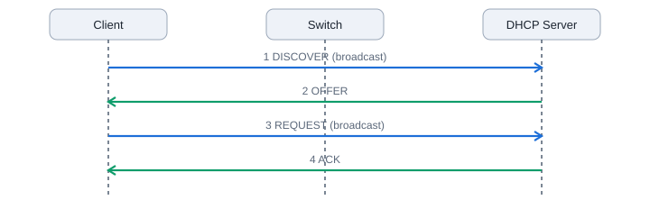

*شکل ۱: چهار مرحله‌ی DORA بین کلاینت و سرور.*

| مرحله | پیام        | نوع               | محتوا                            |
|-------|-------------|-------------------|----------------------------------|
| D     | Discover    | Broadcast         | کلاینت: «سرور DHCP هست؟»         |
| O     | Offer       | Unicast/Broadcast | سرور: «این IP را پیشنهاد می‌کنم»  |
| R     | Request     | Broadcast         | کلاینت: «همین IP را می‌خواهم»     |
| A     | Acknowledge | Unicast/Broadcast | سرور: «تأیید؛ مدت Lease این است» |

در پاسخ، سرور IP، Mask، Gateway، DNS و زمان اجاره (Lease) را می‌دهد. اگر هیچ پاسخی نرسد، کلاینت Windows خودش آدرس `169.254.x.x` می‌سازد (درس ۲-۱).

### ۲. تهدید: DHCP جعلی

چون Discover یک Broadcast است، هر سرور DHCP در شبکه می‌تواند جواب دهد؛ و کلاینت معمولاً اولین پاسخ را می‌پذیرد. مهاجم با یک سرور جعلی، Gateway را آدرس خودش می‌گذارد و همه‌ی ترافیک را می‌بیند.

### ۳. DHCP Snooping: فقط پورت مجاز OFFER بدهد

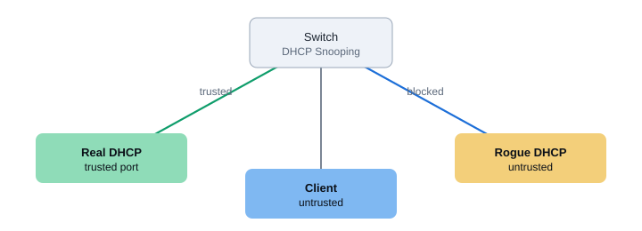

*شکل ۲: پورت سرور واقعی Trusted است؛ OFFER از پورت Untrusted مسدود می‌شود.*

سوییچ هر پورت را «Trusted» یا «Untrusted» می‌داند. پیام‌های سرور (Offer/ACK) فقط از پورت Trusted عبور می‌کنند. پورت کاربر Untrusted است؛ اگر DHCP Server روی آن دیده شود، مسدود می‌شود. سوییچ همچنین جدول Binding می‌سازد (MAC، IP، VLAN، پورت).

``` text
SW1(config)# ip dhcp snooping
SW1(config)# ip dhcp snooping vlan 20,30
SW1(config)# no ip dhcp snooping information option
SW1(config)# interface gi0/10
SW1(config-if)# ip dhcp snooping trust
SW1(config-if)# exit
SW1(config)# interface range gi0/1 - 4
SW1(config-if-range)# ip dhcp snooping limit rate 15
```

- `ip dhcp snooping` و `vlan`: قابلیت را عمومی و برای VLANهای مشخص فعال می‌کند.
- `trust`: فقط روی پورت به سمت DHCP Server (یا Uplink به سمت آن) و Trunkهای بین سوییچ‌ها.
- `limit rate`: سقف تعداد بسته‌ی DHCP در ثانیه برای جلوگیری از حمله‌ی Starvation.
- `no ... information option`: جلوگیری از Option 82 در بعضی سناریوها (مشکل رایج وقتی سرور Option 82 را قبول نمی‌کند).

``` text
SW1# show ip dhcp snooping
SW1# show ip dhcp snooping binding
SW1# show ip dhcp snooping statistics
```

### ۴. DAI: جعل ARP را متوقف کن

در ARP Spoofing مهاجم پاسخ ARP جعلی می‌فرستد: «IP Gateway مال MAC من است». DAI هر ARP را با جدول Binding مقایسه می‌کند؛ اگر IP و MAC با هم نخواند، بسته را می‌اندازد.

``` text
SW1(config)# ip arp inspection vlan 20,30
SW1(config)# interface gi0/10
SW1(config-if)# ip arp inspection trust
SW1# show ip arp inspection
SW1# show ip arp inspection statistics
```

> **شرط DAI**
>
> DAI به جدول Binding وابسته است؛ پس Snooping باید فعال باشد. برای دستگاه‌هایی با IP ثابت (سرور، پرینتر) باید ورودی دستی در Binding یا ARP ACL بنویسید، وگرنه DAI ترافیکشان را می‌اندازد.

### ۵. مثال‌ها

#### ساده

``` text
Client sends DISCOVER on Gi0/1 (untrusted)
Real server replies via Gi0/10 (trusted) -> OFFER passes
Binding: MAC aaaa.0000.0005  IP 10.10.20.50  VLAN 20  Gi0/1
```

#### متوسط: سرور جعلی

``` text
Rogue router on Gi0/3 (untrusted) sends OFFER
Switch drops it  -> client only hears the real server
Log: %DHCP_SNOOPING-5-DHCP_SNOOPING_UNTRUSTED_PORT
```

#### سخت: چرا بعد از فعال‌کردن Snooping هیچ‌کس IP نمی‌گیرد؟

``` text
Cause 1: the port to the DHCP server is NOT trusted -> OFFERs dropped
Cause 2: trunk between switches not trusted
Cause 3: Option 82 inserted and the server rejects it
Fix    : trust server/uplink ports; no ip dhcp snooping information option
```

> **صادقانه درباره‌ی Lab**
>
> طبق Probe اولیه، در vIOSL2 دستورهای DHCP Snooping و DAI فقط «پذیرفته» می‌شوند و ممکن است واقعاً بسته‌ها را بلوک نکنند. در Lab ما، Windows Server DHCP یک VM در ESXi است که در Capstone اصلی کامل می‌شود. اینجا نتیجه‌ی واقعی هر گام را ثبت کنید؛ و مفهوم و دستورها را کامل بدانید.

### تمرین‌ها

**ت1.** ۱ (ساده): نام چهار پیام DORA؟ *(پاسخ: 4-5-ت1 در بخش «پاسخ‌ها» انتهای فصل)*

**ت2.** ۲ (ساده): کدام پورت‌ها Trusted می‌شوند؟ *(پاسخ: 4-5-ت2 در بخش «پاسخ‌ها» انتهای فصل)*

**ت3.** ۳ (متوسط): DAI به چه چیزی وابسته است؟ *(پاسخ: 4-5-ت3 در بخش «پاسخ‌ها» انتهای فصل)*

**ت4.** ۴ (متوسط): کلاینت 169.254.x.x گرفته؛ دو علت محتمل؟ *(پاسخ: 4-5-ت4 در بخش «پاسخ‌ها» انتهای فصل)*

**ت5.** ۵ (سخت): چرا سرور با IP ثابت بعد از DAI قطع می‌شود؟ *(پاسخ: 4-5-ت5 در بخش «پاسخ‌ها» انتهای فصل)*

### Lab هدایت‌شده

سرور DHCP: یا یک VM ویندوزی/لینوکسی که بعداً می‌سازیم، یا موقتاً یک روتر با DHCP Pool. در این Lab، روی R1 یک Pool تست می‌سازیم.

#### گام ۱: DHCP موقت روی R1

``` text
R1(config)# ip dhcp excluded-address 10.10.20.1 10.10.20.10
R1(config)# ip dhcp pool USERS20
R1(dhcp-config)# network 10.10.20.0 255.255.255.0
R1(dhcp-config)# default-router 10.10.20.1
R1(dhcp-config)# dns-server 10.10.10.53
R1(dhcp-config)# lease 0 8
```

#### گام ۲: کلاینت VPCS آدرس بگیرد

``` text
PC1> ip dhcp
PC1> show ip
```

#### گام ۳: Snooping

``` text
SW1(config)# ip dhcp snooping
SW1(config)# ip dhcp snooping vlan 20
SW1(config)# interface gi0/0
SW1(config-if)# ip dhcp snooping trust
SW1# show ip dhcp snooping binding
```

#### گام ۴: DAI

``` text
SW1(config)# ip arp inspection vlan 20
SW1(config)# interface gi0/0
SW1(config-if)# ip arp inspection trust
```

نتیجه‌ی هر گام را ثبت کنید؛ اگر Binding ساخته نشد، همین را به‌عنوان محدودیت شبیه‌ساز ثبت کنید.

### Lab مستقل

یک «تحلیل خطر DHCP» یک‌صفحه‌ای بنویسید: ۳ تهدید، ۳ کنترل (Snooping، DAI، Port Security)، و ۳ دستور Verification در `03-ops/dhcp-l2-security.md`.

### عیب‌یابی

|         |                                                                                                                                                                  |
|---------|------------------------------------------------------------------------------------------------------------------------------------------------------------------|
| Symptom | بعد از Snooping کلاینت‌ها IP نمی‌گیرند                                                                                                                             |
| چک‌لیست  | ۱) پورت سرور Trusted است؟ ؛ ۲) Trunkهای بین سوییچ‌ها Trusted هستند؟ ؛ ۳) VLAN درست در لیست Snooping است؟ ؛ ۴) Option 82 مشکل می‌سازد؟ ؛ ۵) Rate Limit خیلی کم است؟ |
| ابزار   | show ip dhcp snooping ، show ip dhcp snooping binding                                                                                                            |
| رفع     | Trust صحیح و حذف Option 82                                                                                                                                       |

### سؤال‌های مرور

**م1.** DHCP Snooping چه مشکلی را حل می‌کند؟ *(پاسخ: 4-5-م1 در بخش «پاسخ‌ها» انتهای فصل)*

**م2.** DAI چطور کار می‌کند؟ *(پاسخ: 4-5-م2 در بخش «پاسخ‌ها» انتهای فصل)*

### English Corner: انگلیسی تخصصی این درس

این جمله‌ها از مستندات و محیط کار واقعی‌اند. بلند بخوانید و ترجمه را بپوشانید.

| English sentence                                                        | ترجمه                                                                |
|-------------------------------------------------------------------------|----------------------------------------------------------------------|
| Enable DHCP snooping on the access VLANs and trust only the uplink.     | DHCP Snooping را روی VLANهای Access فعال و فقط Uplink را Trust کنید. |
| A rogue DHCP server can redirect clients to a malicious gateway.        | سرور DHCP جعلی می‌تواند کلاینت‌ها را به Gateway مخرب هدایت کند.        |
| Dynamic ARP inspection validates ARP packets against the binding table. | DAI بسته‌های ARP را با جدول Binding اعتبارسنجی می‌کند.                 |
| The client fell back to an APIPA address.                               | کلاینت به آدرس APIPA برگشت.                                          |

**Q1.** Quick quiz (answer in English): Why must the trunk between switches be trusted for DHCP snooping? *(پاسخ: 4-5-Q1 در بخش «پاسخ‌ها» انتهای فصل)*

### تکلیف و چک‌لیست تسلط

- [ ] DORA را بدون نگاه توضیح دهم.
- [ ] Snooping و DAI را بنویسم و نتیجه‌ی واقعی را ثبت کنم.
- [ ] تحلیل خطر را بنویسم.

### یادآوری اشتباهات شما

> **یادآوری**
>
> پیش‌بینی قبل از اجرا؛ بکاپ قبل از تغییر؛ پذیرفته‌شدن دستور ≠ کار کردن؛ فرمول‌ها در بلوک مستقل.


#### کارت Lab — DHCP، Snooping و DAI

| # | فیلد | محتوا |
|---|---|---|
| 1 | عنوان و هدف | DHCP DORA، Snooping و DAI |
| 2 | پیش‌نیاز | درس 4-4 |
| 3 | توپولوژی | SW1 + DHCP (R1) + PC |
| 4 | تجهیزات | R1،SW1،VPCS |
| 5 | نسخه نرم‌افزار | vIOS-L2 15.2(20200924، Experimental) برای SW؛ vIOS 15.9(3)M9 برای R؛ VPCS؛ PNetLab 4.2.8 |
| 6 | IP Plan | VLAN 20 |
| 7 | وضعیت اولیه | Pool 10.10.20.0/24 |
| 8 | صورت مسئله | Binding و Trusted |
| 9 | مراحل هدایت‌شده | همان بخش «Lab هدایت‌شده» همین درس |
| 10 | تست عملکرد | `show ip dhcp snooping binding` |
| 11 | سناریوی خرابی | DHCP جعلی |
| 12 | روش عیب‌یابی | لایه‌ای/با شواهد (بخش عیب‌یابی همین درس) |
| 13 | نتیجه‌ی مورد انتظار | Binding ساخته شود؛ سرور جعلی بسته |
| 14 | معیار پذیرش | نتیجه‌ی واقعی ثبت |
| 15 | مستندات نهایی | `03-ops/dhcp-l2-security.md` |
| 16 | Cleanup و بازگردانی | no ip dhcp snooping |

> **وضعیت راستی‌آزمایی (خارج از ۱۶ فیلد):** **اجرا نشده (فقط طراحی).** DHCP Snooping/DAI در Probe فقط CLI-Accepted.

---

<a id="l-4-6"></a>

## درس 4-6 — طراحی سه‌لایه و آزمون G2

**فصل ۴ - روز ۶ · پیش‌نیاز: درس‌های ۴-۱ تا ۴-۵ · ۶ ساعت**

### این درس درباره چیست و چرا باید یاد بگیریم؟

**چه چیزی یاد می‌گیریم:** چطور شبکه‌ی سازمانی را در سه لایه (Access، Distribution، Core) طراحی می‌کنیم، چه زمانی «Collapsed Core» کافی است، عیب‌یابی خرابی‌های فصل ۴ (TS06 تا TS08)، و آزمون عملی Gate G2.

**چرا لازم است:** طراحی بد یعنی گسترش‌ناپذیری و عیب‌یابی سخت. طراحی لایه‌ای (Hierarchical) برای هر سازمان استانداردی است که جواب سؤال «این سوییچ را کجا بگذارم؟» را می‌دهد؛ و Gate G2 تضمین می‌کند Switching را عملی یاد گرفته‌اید.

- **در کار روزانه:** هر ساختمان یا شعبه با یکی از دو الگوی ۳لایه یا Collapsed Core طراحی می‌شود.
- **در امنیت:** لایه‌بندی یعنی نقاط کنترل مشخص (Policy روی Distribution/Core).
- **در Capstone:** شعبه‌ی کوچک Collapsed Core و مرکز ۳لایه‌ی ساده دارد.

> **مسیر درس**
>
> سه لایه ← Collapsed Core ← طراحی برای Capstone ← عیب‌یابی TS06-TS08 ← Lab ← Gate G2.

#### اصطلاحات این درس (مخفف ← شکل کامل ← معنی)

| مخفف           | شکل کامل انگلیسی   | معنی فارسی                                 |
|----------------|--------------------|--------------------------------------------|
| Access         | Access layer       | لایه‌ی اتصال کاربران و دستگاه‌ها             |
| Distribution   | Distribution layer | تجمیع Accessها، Policy و مسیریابی بین VLAN |
| Core           | Core layer         | هسته‌ی سریع شبکه                            |
| Collapsed Core | Collapsed Core     | ادغام Distribution و Core در یک لایه       |
| HLD            | High-Level Design  | طراحی سطح بالا                             |
| G2             | Gate 2             | آزمون عملی پایان فصل ۴                    |

### ۱. چرا سه لایه؟

شهری را تصور کنید که هر خانه مستقیماً به همه‌ی خانه‌ها خیابان دارد؛ ۱۰۰ خانه یعنی ۴۹۵۰ خیابان! لایه‌بندی مثل «کوچه، خیابان، بزرگراه» است: هر لایه کار مشخصی دارد و تعداد اتصال‌ها کم می‌ماند.

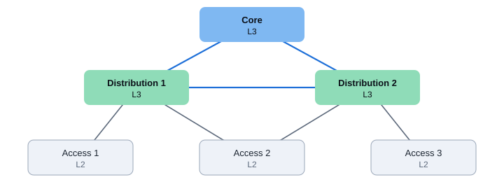

*شکل ۱: شبکه‌ی سه‌لایه؛ هر Access به دو Distribution وصل است (Redundancy).*

| لایه         | کار                                              | دستگاه نمونه  | ویژگی                    |
|--------------|--------------------------------------------------|---------------|--------------------------|
| Access       | اتصال کاربران، PortFast، Port Security، Snooping | سوییچ L2      | تعداد پورت زیاد، ساده    |
| Distribution | تجمیع، Gateway VLANها، ACL/Policy                | سوییچ L3      | Redundancy، EtherChannel |
| Core         | انتقال سریع بین Distributionها                   | سوییچ/روتر L3 | فقط سرعت و پایداری       |

### ۲. Collapsed Core: وقتی دو لایه کافی است

در شعبه‌ی کوچک، Distribution و Core را یکی می‌کنیم (دو سوییچ L3 که هم Gateway‌اند و هم هسته). این ارزان‌تر است و برای ۵۰ تا ۲۰۰ کاربر کافی.

| معیار   | سه‌لایه                  | Collapsed Core |
|---------|-------------------------|----------------|
| اندازه  | سازمان بزرگ/چند ساختمان | شعبه‌ی کوچک     |
| هزینه   | بیشتر                   | کمتر           |
| پیچیدگی | بیشتر                   | کمتر           |
| گسترش   | آسان‌تر                  | محدودتر        |

> **در Capstone ما**
>
> مرکز: Core/Distribution ساده روی یک جفت سوییچ؛ شعبه‌ها: Collapsed Core. Gateway اصلی همه‌ی VLANها FortiGate است و سوییچ‌ها L2 هستند (طبق تصمیم معماری).

### ۳. سه خرابی این هفته (TS06 تا TS08)

#### TS06: Root اشتباه

``` text
Symptom : slow network, traffic path goes through an old switch
Evidence: show spanning-tree -> wrong bridge is root
Fix     : spanning-tree vlan X root primary on the core switch
Verify  : show spanning-tree root
```

#### TS07: پورت err-disabled با BPDU Guard یا Port Security

``` text
Symptom : user port down, link light on
Evidence: show interfaces status err-disabled
Fix     : remove cause, shutdown / no shutdown
Verify  : port up, user online
```

#### TS08: EtherChannel Mismatch

``` text
Symptom : Po1(SD) or member ports (s)
Evidence: show etherchannel summary, show interfaces trunk
Fix     : make allowed/native/speed identical, bounce the ports
Verify  : Po1(SU), members (P)
```

### ۴. طراحی خودتان: HLD کوتاه

برای یک شعبه با ۱۵۰ کاربر، ۱۰ سرور و ۲۰ دستگاه مدیریتی، یک طراحی Collapsed Core بنویسید: چند سوییچ، چه VLANهایی، کجا Root، چه لینک‌هایی EtherChannel.

``` text
Branch (Collapsed Core)
- 2 x L3 core/distribution switches (EtherChannel between them)
- 3 x access switches, each uplinked to both cores
- VLAN 20 users, 30 servers, 10 management
- STP root: core 1 (secondary: core 2)
- Access: PortFast + BPDU Guard + Port Security + DHCP Snooping
```

### ۵. آزمون عملی Gate G2 (پایان فصل ۴)

بدون نگاه به درس، با مدرک (خروجی دستورها):

| \#  | وظیفه                                               | مدرک                                |
|-----|-----------------------------------------------------|-------------------------------------|
| ۱   | Rapid-PVST و Root/Secondary برای ۳ VLAN             | show spanning-tree root             |
| ۲   | PortFast + BPDU Guard روی پورت‌های کاربر و ساخت تخلف | show interfaces status err-disabled |
| ۳   | EtherChannel با LACP بین دو سوییچ                   | show etherchannel summary           |
| ۴   | Port Security با Sticky و ثبت تخلف                  | show port-security interface        |
| ۵   | DHCP Snooping + DAI (یا ثبت محدودیت شبیه‌ساز)        | show ip dhcp snooping               |
| ۶   | سه عیب TS06 تا TS08 با RCA                          | گزارش یک‌صفحه‌ای                      |
| ۷   | HLD شعبه‌ی Collapsed Core                            | فایل طراحی                          |

**معیار قبولی:** حداقل ۶ از ۷ مورد با مدرک (طبق Blueprint G2). وقتی تمام شد بگویید «G2 انجام شد».

### تمرین‌ها

**ت1.** ۱ (ساده): سه لایه‌ی شبکه؟ *(پاسخ: 4-6-ت1 در بخش «پاسخ‌ها» انتهای فصل)*

**ت2.** ۲ (ساده): Collapsed Core یعنی چه؟ *(پاسخ: 4-6-ت2 در بخش «پاسخ‌ها» انتهای فصل)*

**ت3.** ۳ (متوسط): چرا Access به دو Distribution وصل است؟ *(پاسخ: 4-6-ت3 در بخش «پاسخ‌ها» انتهای فصل)*

**ت4.** ۴ (سخت): در طراحی سه‌لایه، Root STP کجا باشد؟ *(پاسخ: 4-6-ت4 در بخش «پاسخ‌ها» انتهای فصل)*

### Lab هدایت‌شده

این Lab یک «مرور کل فصل ۴» است: روی مثلث SW1-SW2-SW3 همه‌ی تنظیمات را اعمال کنید.

1.  Rapid-PVST و Root/Secondary (درس ۴-۲).
2.  PortFast و BPDU Guard روی پورت کاربر (درس ۴-۲).
3.  EtherChannel بین SW1 و SW2 (درس ۴-۳).
4.  Port Security روی پورت PC (درس ۴-۴).
5.  Snooping و DAI (درس ۴-۵).
6.  پیکربندی را بکاپ و در Git (بدون رمز) ذخیره کنید.

``` text
SWx# show spanning-tree summary
SWx# show etherchannel summary
SWx# show port-security
SWx# show ip dhcp snooping
SWx# copy running-config flash:SWx-w4-final.cfg
```

### Lab مستقل

سه سناریوی TS06 تا TS08 را بسازید و هرکدام را با RCA یک‌صفحه‌ای در `03-ops/rca-w4.md` ثبت کنید.

### عیب‌یابی

|         |                                                                         |
|---------|-------------------------------------------------------------------------|
| Symptom | بعد از تغییرات فصل ۴ شبکه ناپایدار است                                 |
| روش     | لایه‌به‌لایه: لینک و STP و Channel و Port Security و DHCP                 |
| ابزار   | show spanning-tree ، show etherchannel summary ، show interfaces status |
| پیشگیری | تغییر مرحله‌ای با بکاپ و reload in                                       |

### سؤال‌های مرور

**م1.** چرا لایه‌بندی؟ *(پاسخ: 4-6-م1 در بخش «پاسخ‌ها» انتهای فصل)*

**م2.** Collapsed Core کی مناسب است؟ *(پاسخ: 4-6-م2 در بخش «پاسخ‌ها» انتهای فصل)*

### English Corner: انگلیسی تخصصی این درس

این جمله‌ها از مستندات و محیط کار واقعی‌اند. بلند بخوانید و ترجمه را بپوشانید.

| English sentence                                                     | ترجمه                                                      |
|----------------------------------------------------------------------|------------------------------------------------------------|
| A hierarchical design simplifies troubleshooting and scaling.        | طراحی سلسله‌مراتبی عیب‌یابی و مقیاس‌پذیری را ساده می‌کند.      |
| Every access switch has redundant uplinks to the distribution layer. | هر سوییچ Access Uplink پشتیبان به لایه‌ی Distribution دارد. |
| Collapsed core merges the core and distribution layers.              | Collapsed Core لایه‌های Core و Distribution را ادغام می‌کند. |
| Document the design before you configure.                            | پیش از پیکربندی، طراحی را مستند کنید.                      |

**Q1.** Quick quiz (answer in English): Why should the STP root never be an access switch? *(پاسخ: 4-6-Q1 در بخش «پاسخ‌ها» انتهای فصل)*

### تکلیف و چک‌لیست تسلط

- [ ] HLD شعبه را بنویسم.
- [ ] TS06 تا TS08 را با RCA ثبت کنم.
- [ ] Gate G2 را کامل کنم.

### یادآوری اشتباهات شما

> **یادآوری**
>
> پیش‌بینی قبل از اجرا؛ بکاپ قبل از تغییر؛ پذیرفته‌شدن دستور ≠ کار کردن؛ فرمول‌ها در بلوک مستقل.


#### کارت Lab — طراحی سه‌لایه و آزمون G2

| # | فیلد | محتوا |
|---|---|---|
| 1 | عنوان و هدف | طراحی سه‌لایه و TS06..TS08 + G2 |
| 2 | پیش‌نیاز | درس 4-5 |
| 3 | توپولوژی | مثلث + EtherChannel |
| 4 | تجهیزات | ۳ سوییچ + VPCS |
| 5 | نسخه نرم‌افزار | vIOS-L2 15.2(20200924، Experimental) برای SW؛ vIOS 15.9(3)M9 برای R؛ VPCS؛ PNetLab 4.2.8 |
| 6 | IP Plan | Baseline ف۴ |
| 7 | وضعیت اولیه | HLD شعبه |
| 8 | صورت مسئله | سه خرابی با RCA |
| 9 | مراحل هدایت‌شده | همان بخش «Lab هدایت‌شده» همین درس |
| 10 | تست عملکرد | show spanning-tree/etherchannel |
| 11 | سناریوی خرابی | TS06-08 |
| 12 | روش عیب‌یابی | لایه‌ای/با شواهد (بخش عیب‌یابی همین درس) |
| 13 | نتیجه‌ی مورد انتظار | هر خرابی RCA |
| 14 | معیار پذیرش | G2 ≥ ۶ از ۷ |
| 15 | مستندات نهایی | `03-ops/rca-w4.md` |
| 16 | Cleanup و بازگردانی | بازگشت به بکاپ |

> **وضعیت راستی‌آزمایی (خارج از ۱۶ فیلد):** **اجرا نشده (فقط طراحی).** اجرا نشده.

---

<a id="ans-4"></a>

## درس 4-7 — STP در عمق: تایمرها، محاسبه‌ی Convergence، RSTP، Loop Guard/UDLD/Root Guard و عیب‌یابی

**فصل 4 · بازنویسی عمیق · پیش‌نیاز: ۴-۱، ۴-۲، ۴-۶ · ≈ 8 ساعت**

> **وضعیت:** Cisco IOSv/IOSvL2 (vIOS 15.x)؛ خروجی‌ها نمونه‌ی آموزشی؛ Lab «اجرا نشده»؛ برخی ویژگی‌ها روی vIOS `Unverified`.

### ۱) هدف آموزشی

در پایان این درس باید بتوانید:

1. تایمرهای STP (Hello 2، Forward Delay 15، Max Age 20) و محاسبه‌ی Convergence 802.1D را انجام دهد.
2. تفاوت 802.1D و RSTP (Proposal/Agreement، Edge، Alternate/Backup) را توضیح دهد.
3. Root Guard، BPDU Guard، Loop Guard، UDLD را با سناریو انتخاب کند.
4. STP را با دستورهای `show spanning-tree` عیب‌یابی کند.
5. Root Placement و Priority را طراحی کند.

### ۲) مفهوم پایه: چیست و چرا؟

حلقه‌ی لایه‌ی ۲ شبکه را در ثانیه‌ها می‌کشد (Broadcast Storm). STP حلقه را می‌شکند، ولی تایمرها و رفتار هنگام خرابی را باید بدانید وگرنه «۵۰ ثانیه قطعی» و «Root اشتباه» می‌بینید.

### ۳) توضیح عمیق فنی

#### ۱) تایمرها (802.1D)

``` text
Hello = 2 s (BPDU from root)   Forward Delay = 15 s   Max Age = 20 s
Port states: Blocking -> Listening (15 s) -> Learning (15 s) -> Forwarding
Convergence after direct link failure ~= 30 s (FwdDelay x 2)
Convergence after indirect failure ~= MaxAge + 2 x FwdDelay = 20 + 30 = 50 s
```

#### ۲) RSTP (802.1w)

حالت‌ها: Discarding، Learning، Forwarding. نقش‌ها: Root، Designated، Alternate، Backup. **Proposal/Agreement** بین دو سوئیچ، Forwarding را در کمتر از ۱ ثانیه برقرار می‌کند. **Edge Port** (PortFast) بلافاصله Forwarding. Convergence معمولاً < ۱–۲ ثانیه.

#### ۳) محافظت‌ها

| ابزار | کار | سناریو |
|---|---|---|
| Root Guard | پورت را اگر BPDU بهتر آمد Root-inconsistent می‌کند | جلوگیری از Root شدن سوئیچ غیرمجاز |
| BPDU Guard | پورت Edge که BPDU دریافت کند Err-disable | سوئیچ/حلقه به پورت کاربر |
| Loop Guard | پورت Non-designated که BPDU را از دست بدهد Forward نمی‌شود | لینک یک‌طرفه |
| UDLD | لینک یک‌طرفه (Fiber) را کشف و پورت را می‌بندد | Fiber |
| BPDU Filter | BPDU را فیلتر (خطرناک) | موارد خاص |

#### ۴) طراحی Root

Root را عمداً روی Core بگذارید: Priority 4096 (Primary) و 8192 (Secondary) با `spanning-tree vlan X root primary`. Root اتفاقی (Priority پیش‌فرض 32768+VLAN و کوچک‌ترین MAC) ممکن است قدیمی‌ترین سوئیچ Access باشد.

#### ۵) عیب‌یابی

``` text
show spanning-tree vlan 10
show spanning-tree root
show spanning-tree interface Gi0/1 detail
show spanning-tree inconsistentports
debug spanning-tree events (lab only)
```

### ۴) طراحی و تصمیم‌گیری

| سؤال طراحی | گزینه‌ها و معیار انتخاب |
|---|---|
| Root | Core با priority صریح |
| Edge | PortFast + BPDU Guard |
| Fiber | UDLD+Loop Guard |
| STP mode | Rapid-PVST |

### ۵) مثال‌های حل‌شده (ساده، متوسط، سخت)

**ساده (حل‌شده):** Root Primary روی Core با Priority 4096؛ `show spanning-tree root` Root مورد انتظار.

**متوسط (محاسبه):** 802.1D: قطع کابل مستقیم روی Root Port ⇒ ≈ 30 s؛ قطع غیرمستقیم (سوئیچ میانی) ⇒ ≈ 50 s. با RSTP < 2 s.

**سخت (سناریو):** کاربر سوئیچ کوچک وصل کرد؛ Root جابه‌جا شد و ترافیک مسیر عوض شد. علت: Root Guard نبود. رفع: Root Guard روی پورت‌های رو به پایین Core؛ BPDU Guard روی Access؛ Alert بر `ROOTGUARD`/`BPDUGUARD`. آزمون: اتصال سوئیچ تست ⇒ پورت inconsistent/err-disable.

### ۷) پیاده‌سازی از مسیر CLI

``` text
spanning-tree mode rapid-pvst
spanning-tree vlan 1-4094 root primary
interface range GigabitEthernet0/10 - 24
 spanning-tree portfast
 spanning-tree bpduguard enable
interface GigabitEthernet0/1
 spanning-tree guard root
spanning-tree loopguard default
udld enable
```

### ۸) Verification (اثبات صحت)

- `show spanning-tree root`.
- آزمون Root Guard/BPDU Guard با سوئیچ تست.
- اندازه‌گیری Convergence با ping.

### ۹) Troubleshooting

| علامت | شاهد برای بررسی | علت محتمل و رفع |
|---|---|---|
| Root اشتباه | `show spanning-tree root` | Priority |
| Port err-disabled | Log | BPDU Guard/UDLD |
| Convergence کند | mode | pvst به rapid-pvst |

### ۱۰) نکات امنیتی

- BPDU/Root Guard در مرز.
- BPDU Filter با احتیاط.

### ۱۱) جمع‌بندی مفهومی

- تایمرها و Convergence 30/50 s در 802.1D.
- RSTP سریع.
- Guardها هرکدام یک تهدید.
- Root عمدی.

### ۱۲) تمرین و ارزیابی

**ت1.** (ساده) Hello/Forward Delay/Max Age پیش‌فرض؟ *(پاسخ: 4-7-ت1)*

**ت2.** (ساده) PortFast کجا استفاده می‌شود؟ *(پاسخ: 4-7-ت2)*

**ت3.** (متوسط) Convergence غیرمستقیم 802.1D؟ *(پاسخ: 4-7-ت3)*

**ت4.** (متوسط) Root Guard و BPDU Guard فرقشان؟ *(پاسخ: 4-7-ت4)*

**ت5.** (سخت) سوئیچ کاربر Root شد؛ تحلیل و رفع. *(پاسخ: 4-7-ت5)*

**ت6.** (سخت، طراحی) استاندارد STP برای دانشگاه. *(پاسخ: 4-7-ت6)*

**Q1.** Quick quiz (English): What does BPDU guard do when an edge port receives a BPDU? *(پاسخ: 4-7-Q1)*

### ۱۳) اصطلاحات و English Corner

| مخفف | شکل کامل | معنی |
|---|---|---|
| BPDU | Bridge Protocol Data Unit | بسته‌ی STP |
| UDLD | UniDirectional Link Detection | تشخیص لینک یک‌طرفه |
| RSTP | Rapid Spanning Tree Protocol | STP سریع |

- *Place the root bridge deliberately at the core.* ← Root Bridge را عمداً در Core قرار دهید.

### ۱۴) کارت Lab

**کارت Lab:** STP عمیق. **وضعیت:** اجرا نشده. **Evidence:** `03-ops/stp-deep.md`.

### ۱۵) منابع

- IEEE 802.1D/802.1w
- Cisco Spanning Tree Protocol guides

## پاسخ‌های فصل 4

> ابتدا بدون نگاه حل کنید. شناسه: درس-نوع+شماره (ت = تمرین، م = مرور، Q = Quick quiz).

**4-1-ت1** — ۱ (ساده): چرا Loop در لایه ۲ خطرناک‌تر از لایه ۳ است؟

``` text
Layer-2 frames have no TTL, so they never expire.
Layer-3 packets have a TTL and are dropped when it reaches 0.
```

**4-1-ت2** — ۲ (ساده): Root Bridge را چطور انتخاب می‌کنند؟

``` text
Lowest Bridge ID = lowest (Priority + VLAN ID), then lowest MAC address.
```

**4-1-ت3** — ۳ (متوسط): دو سوییچ با اولویت 32768 و 4096؛ کدام Root است؟

``` text
The switch with priority 4096 (lower value wins).
```

**4-1-ت4** — ۴ (متوسط): هزینه‌ی مسیر سه لینک ۱ گیگ پشت‌سرهم تا Root با روش Short؟

``` text
Cost = 4 + 4 + 4 = 12
```

**4-1-ت5** — ۵ (سخت): در مثلث A (Root)، B، C با لینک‌های 1G، اگر لینک A-C خراب شود، SW-C از کدام مسیر Root را می‌بیند و هزینه چقدر است؟

``` text
New path: C -> B -> A
Cost = 4 (C-B) + 4 (B-A) = 8
The previously blocked port on C (towards B) becomes the Root Port.
```

**4-1-م1** — چرا لایه ۲ به STP نیاز دارد؟

چون فریم TTL ندارد و در صورت وجود حلقه تا ابد می‌چرخد.

**4-1-م2** — Root Bridge چه کسی است؟

سوییچی با کوچک‌ترین Bridge ID؛ یعنی کوچک‌ترین اولویت و سپس کوچک‌ترین MAC.

**4-1-م3** — Root Port و Designated Port چه فرقی دارند؟

Root Port پورت غیر Root به سمت Root است؛ Designated Port پورت فعال هر Segment به سمت دورتر از Root.

**4-1-Q1** — Quick quiz (answer in English): What does STP do with a redundant link?

It places one of the ports in a blocking (alternate) state to prevent a loop, and unblocks it if the active link fails.

**4-2-ت1** — ۱ (ساده): چرا RSTP سریع‌تر است؟

``` text
Switches negotiate (proposal/agreement) instead of waiting for timers; alternate ports are ready.
```

**4-2-ت2** — ۲ (ساده): اولویت‌های مجاز؟

``` text
Multiples of 4096 (0, 4096, 8192, ... 61440). Default 32768.
```

**4-2-ت3** — ۳ (متوسط): PortFast بدون BPDU Guard چه خطری دارد؟

``` text
A switch plugged into a PortFast port can create a loop before STP reacts; BPDU Guard shuts the port.
```

**4-2-ت4** — ۴ (متوسط): پورت err-disabled شد؛ مراحل رفع؟

``` text
1) show interfaces status err-disabled
2) remove the cause (rogue switch)
3) shutdown, then no shutdown
4) verify
```

**4-2-ت5** — ۵ (سخت): Root Guard را روی کدام پورت‌ها می‌گذاریم و چرا؟

``` text
On ports that face switches you do not control (customer/edge); a superior BPDU there puts the port in root-inconsistent state so no foreign switch becomes root.
```

**4-2-م1** — PortFast برای چه پورتی؟

فقط پورت دستگاه انتهایی (PC، پرینتر)، نه لینک بین سوییچ‌ها.

**4-2-م2** — تفاوت BPDU Guard و Root Guard؟

BPDU Guard با هر BPDU پورت را خاموش می‌کند؛ Root Guard فقط BPDUهای برتر (ادعای Root) را بلوک می‌کند.

**4-2-م3** — چرا Root را دستی تعیین می‌کنیم؟

تا سوییچ قدیمی یا ضعیف تصادفاً Root نشود و مسیر ترافیک قابل‌پیش‌بینی باشد.

**4-2-Q1** — Quick quiz (answer in English): When should you not enable PortFast?

On trunk or switch-to-switch links, because it can create temporary loops.

**4-3-ت1** — ۱ (ساده): چرا EtherChannel لازم است؟

``` text
Without it STP blocks the parallel link; with it the links are bundled into one logical link.
```

**4-3-ت2** — ۲ (ساده): LACP با کدام Modeها؟

``` text
active and passive
```

**4-3-ت3** — ۳ (متوسط): کدام ترکیب Channel نمی‌سازد؟

``` text
passive-passive, on-active, LACP-PAgP
```

**4-3-ت4** — ۴ (متوسط): تفسیر Po1(SD) Gi0/1(D) Gi0/2(D)

``` text
Port-channel is down; both member ports are down (cable or remote side down).
```

**4-3-ت5** — ۵ (سخت): چرا ۲ لینک ۱G برای یک انتقال فایل تکی ۲G سرعت نمی‌دهد؟

``` text
A single flow is hashed to one member link, so one flow is limited to 1G; many flows spread across links.
```

**4-3-م1** — EtherChannel چه مشکلی را حل می‌کند؟

پهنای باند و تحمل خطا برای لینک‌های موازی که STP آن‌ها را نمی‌بندد.

**4-3-م2** — چرا LACP را ترجیح می‌دهیم؟

استاندارد است و با تجهیزات سازنده‌های مختلف کار می‌کند.

**4-3-Q1** — Quick quiz (answer in English): Why does a single file transfer not use the full bundled bandwidth?

Because one flow is hashed onto a single member link.

**4-4-ت1** — ۱ (ساده): سه نوع Violation؟

``` text
shutdown, restrict, protect
```

**4-4-ت2** — ۲ (ساده): sticky یعنی چه؟

``` text
The switch learns MAC addresses dynamically and stores them in the running-config.
```

**4-4-ت3** — ۳ (متوسط): چرا بعد از reload ممکن است sticky پاک شود؟

``` text
Sticky MACs are only in running-config; without copy running-config startup-config they are lost.
```

**4-4-ت4** — ۴ (متوسط): پورت err-disabled شد؛ مراحل؟

``` text
1) find the offending MAC
2) remove the device
3) shutdown / no shutdown
4) verify
```

**4-4-ت5** — ۵ (سخت): maximum را برای پورت Phone+PC چند می‌گذاریم و چرا؟

``` text
3 (Phone + PC + one spare), to avoid unnecessary lockouts.
```

**4-4-م1** — Port Security چه چیزی را کنترل می‌کند؟

تعداد و هویت MACهای مجاز روی یک پورت.

**4-4-م2** — تفاوت restrict و shutdown؟

restrict فریم را دور می‌ریزد و لاگ می‌دهد ولی پورت فعال می‌ماند؛ shutdown پورت را err-disabled می‌کند.

**4-4-Q1** — Quick quiz (answer in English): What is the default violation mode?

Shutdown: the port goes into err-disabled state.

**4-5-ت1** — ۱ (ساده): نام چهار پیام DORA؟

``` text
Discover, Offer, Request, Acknowledge
```

**4-5-ت2** — ۲ (ساده): کدام پورت‌ها Trusted می‌شوند؟

``` text
Ports toward the legitimate DHCP server and inter-switch trunks. Never user ports.
```

**4-5-ت3** — ۳ (متوسط): DAI به چه چیزی وابسته است؟

``` text
The DHCP Snooping binding table (or static ARP ACL entries).
```

**4-5-ت4** — ۴ (متوسط): کلاینت 169.254.x.x گرفته؛ دو علت محتمل؟

``` text
1) DHCP server unreachable/down
2) Snooping drops the OFFER (server port not trusted)
```

**4-5-ت5** — ۵ (سخت): چرا سرور با IP ثابت بعد از DAI قطع می‌شود؟

``` text
It has no DHCP binding entry; DAI drops its ARP packets. Fix: add a static binding / ARP ACL.
```

**4-5-م1** — DHCP Snooping چه مشکلی را حل می‌کند؟

مسدودکردن سرور DHCP جعلی و ساخت جدول Binding.

**4-5-م2** — DAI چطور کار می‌کند؟

هر ARP را با جدول Binding مقایسه می‌کند و ARP نامعتبر را می‌اندازد.

**4-5-Q1** — Quick quiz (answer in English): Why must the trunk between switches be trusted for DHCP snooping?

Otherwise legitimate DHCP replies arriving over the trunk are dropped.

**4-6-ت1** — ۱ (ساده): سه لایه‌ی شبکه؟

``` text
Access, Distribution, Core
```

**4-6-ت2** — ۲ (ساده): Collapsed Core یعنی چه؟

``` text
Distribution and Core are merged into one layer (two layer-3 switches).
```

**4-6-ت3** — ۳ (متوسط): چرا Access به دو Distribution وصل است؟

``` text
Redundancy: if one uplink or distribution switch fails, the other keeps the access switch online.
```

**4-6-ت4** — ۴ (سخت): در طراحی سه‌لایه، Root STP کجا باشد؟

``` text
On the Distribution/Core switches, never on access switches.
```

**4-6-م1** — چرا لایه‌بندی؟

برای مقیاس‌پذیری و کنترل: هر لایه کار مشخصی دارد.

**4-6-م2** — Collapsed Core کی مناسب است؟

شعبه‌ی کوچک با کاربران کم.

**4-6-Q1** — Quick quiz (answer in English): Why should the STP root never be an access switch?

Because all traffic would flow through a low-capacity edge device instead of the core.

---

<a id="ch5"></a>


### پاسخ‌های درس افزوده‌ی 4-7 (فصل 4)

**4-7-ت1** — 2 s، 15 s، 20 s.

**4-7-ت2** — پورت‌های Edge (کاربر/سرور) تا بلافاصله Forwarding شوند.

**4-7-ت3** — Max Age + 2×Forward Delay = 50 s.

**4-7-ت4** — Root Guard Root شدن را در پورت مرزی جلو می‌گیرد؛ BPDU Guard پورت Edge را با دریافت BPDU می‌بندد.

**4-7-ت5** — Root Guard نبود؛ Root Guard روی Core و BPDU Guard روی Access؛ آزمون.

**4-7-ت6** — Rapid-PVST، Root Primary/Secondary، PortFast+BPDU Guard، Root Guard، UDLD روی Fiber.

**4-7-Q1** — It places the port in err-disabled state to protect the spanning tree.

# فصل 5 — Routing I: Static، Floating و OSPF

**مدت:** ۳۶ ساعت | **پیش‌نیاز:** فصل ۴.
**اهداف:** Route Table/LPM/AD، Static، Default/Floating/IP SLA، OSPF (مفهوم + پیاده‌سازی)، عیب‌یابی Adjacency.
**معیار تسلط:** پیش‌بینی مسیر بسته؛ مسیر برگشت؛ OSPF سه‌روتری؛ ≥ ۴ از ۵ خطای OSPF.
**اشتباهات رایج:** «Static همیشه برنده است»؛ مسیر برگشت فراموش‌شده؛ Reference-Bandwidth ناهمسان.

**درس‌های فصل:**
- [درس 5-1 — جدول مسیریابی، LPM و AD](#l-5-1)
- [درس 5-2 — Static Route و مسیر برگشت](#l-5-2)
- [درس 5-3 — Default، Floating و IP SLA](#l-5-3)
- [درس 5-4 — مفهوم OSPF](#l-5-4)
- [درس 5-5 — پیاده‌سازی OSPF](#l-5-5)
- [درس 5-6 — عیب‌یابی مسیریابی و آزمون](#l-5-6)

---

<a id="l-5-1"></a>

## درس 5-0 — Control Plane و Data Plane: روتر چگونه یک بسته را واقعاً عبور می‌دهد؟

**فصل ۵ · درس افزوده (پیش‌درس ۵-۱) · پیش‌نیاز: فصل ۲ (ARP، ICMP، TTL) و فصل ۳ (MAC و Switching) · ≈ ۴ ساعت**

> **وضعیت:** محتوای مفهومی با منابع رسمی؛ دستورهای Cisco در Lab «اجرا نشده» و `Unverified` روی vIOS (برخی خروجی‌ها در Image نمونه ممکن است متفاوت باشد).

### ۱) هدف آموزشی

در پایان این درس باید بتوانید:

1. تفاوت **Control Plane**، **Data Plane** و **Management Plane** را با مثال توضیح دهید.
2. بگویید **RIB** و **FIB** چه هستند و چرا دو جدول جدا لازم است.
3. برای یک بسته‌ی واقعی بنویسید روتر چه مراحلی را انجام می‌دهد: دریافت، بررسی، Route Lookup، پیدا کردن MAC بعدی، بازنویسی هدر لایه ۲، کاهش TTL و ارسال.
4. توضیح دهید چرا «Route در جدول هست» با «بسته عبور می‌کند» یکی نیست.
5. با ابزارهای `show ip route`، `show ip cef` و `show adjacency` شواهد جمع کنید.

### ۲) پیش‌نیازها

- ساختار هدر IPv4 (فیلد TTL، آدرس مبدأ/مقصد) و تفاوت فریم لایه ۲ با بسته‌ی لایه ۳ (فصل ۲).
- ARP: چگونه IP به MAC تبدیل می‌شود (فصل ۲).
- Longest Prefix Match و AD در درس ۵-۱ (پس از این درس می‌آید؛ اینجا فقط به «جدول Route» نیاز دارید).

### ۳) مفهوم پایه: چرا این تفکیک به وجود آمد؟

روتر دو وظیفه‌ی کاملاً متفاوت دارد:

- **یادگیری مسیرها:** با دیگر روترها صحبت می‌کند (OSPF Hello، BGP Update)، الگوریتم اجرا می‌کند (SPF، انتخاب بهترین مسیر) و نتیجه را در جدول می‌نویسد. این کار نسبتاً کند و «هوشمند» است.
- **عبور دادن بسته‌ها:** میلیون‌ها بسته در ثانیه باید با کمترین تأخیر رد شوند. برای هر بسته نباید الگوریتم پیچیده اجرا شود؛ فقط یک جست‌وجوی سریع و بازنویسی هدر.

اگر هر دو کار با یک ساختار انجام می‌شد، هر بسته باید منتظر پردازش پروتکل مسیریابی می‌ماند. پس معماری مدرن آن‌ها را جدا می‌کند:

| صفحه (Plane) | وظیفه | مثال |
|---|---|---|
| Management Plane | مدیریت و پایش دستگاه | SSH، SNMP، Syslog، `show` |
| Control Plane | ساخت جدول‌ها و تصمیم‌ها | OSPF، BGP، ARP (پر کردن Cache)، STP |
| Data Plane (Forwarding Plane) | عبور سریع بسته‌های عبوری | Route Lookup، بازنویسی هدر، ACL، NAT |

> **یک تشبیه:** Control Plane مثل اداره‌ی نقشه‌برداری است که نقشه‌ی راه‌ها را می‌کشد و به‌روز می‌کند. Data Plane مثل پلیس راهنمایی است که فقط نقشه‌ی آماده را نگاه می‌کند و هر ماشین را سریع به سمت درست می‌فرستد. اگر پلیس هر بار منتظر نقشه‌کشی بماند، ترافیک قفل می‌شود.

### ۴) توضیح عمیق فنی

#### ۴-۱) RIB و FIB

- **RIB (Routing Information Base):** جدول مسیریابی که با `show ip route` می‌بینید. همه‌ی پروتکل‌ها (Connected، Static، OSPF، BGP) مسیرهای خود را می‌دهند و **بهترین مسیر هر Prefix** (بر اساس AD و Metric) در RIB می‌نشیند. RIB محصول Control Plane است.
- **FIB (Forwarding Information Base):** نسخه‌ی بهینه‌شده‌ی RIB برای جست‌وجوی سریع (در Cisco با **CEF** = Cisco Express Forwarding ساخته می‌شود). FIB ساختار درختی (Trie) است تا Longest Prefix Match سریع انجام شود. FIB محصول RIB است، نه جایگزین آن.
- **Adjacency Table:** برای هر Next-hop اطلاعات لایه ۲ آماده دارد (MAC مقصد بعدی، Interface خروجی). این جدول از ARP پر می‌شود. با آن، روتر هدر لایه ۲ جدید را از قبل آماده دارد.

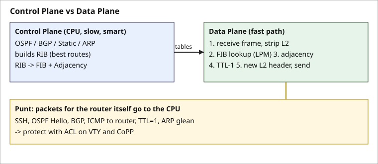

*شکل ۱: Control Plane جدول‌ها را می‌سازد؛ Data Plane فقط از جدول‌های آماده استفاده می‌کند.*

#### ۴-۲) Recursive Lookup (جست‌وجوی بازگشتی)

وقتی یک Static Route فقط Next-hop (نه Interface) دارد:

``` text
ip route 192.168.50.0 255.255.255.0 10.0.12.2
```

روتر باید بداند 10.0.12.2 از کدام Interface قابل‌دسترس است. پس یک جست‌وجوی دوم انجام می‌دهد: «10.0.12.2 در RIB به کدام Interface وصل است؟» جواب (Connected 10.0.12.0/30 روی Gi0/1) را می‌گیرد. این همان Recursive Lookup است. اگر Next-hop از طریق مسیری برسد که خودش به این Route وابسته است، حلقه یا Route ناپایدار می‌شود (نمونه در درس ۵-۳ آمده).

> **نکته‌ی عیب‌یابی:** اگر Next-hop قابل‌دسترس نباشد، Route در RIB **نصب نمی‌شود** (Static Route بدون Interface و بدون Next-hop معتبر نمی‌ماند). پس «Route را نوشتم ولی در جدول نیست» اغلب یعنی Next-hop حل‌نشدنی است.

#### ۴-۳) مراحل عبور یک بسته (Step by step)

برای بسته‌ای که از Client (192.168.1.10) به Server (172.16.5.20) می‌رود و از روتر R1 عبور می‌کند:

``` text
1. Frame arrives on Gi0/0: destination MAC = R1 Gi0/0 MAC  -> accepted
2. FCS check; strip L2 header (de-encapsulate) -> IP packet
3. Validate IP header (version, header checksum, TTL > 1)
4. Inbound features: ACL in, NAT inside->outside (if configured)
5. FIB lookup for 172.16.5.20 (Longest Prefix Match)
   result: next-hop 10.0.12.2, out interface Gi0/1
6. Adjacency lookup: next-hop 10.0.12.2 -> MAC aa:bb:cc:00:00:02
   (if missing: send ARP, packet waits / dropped, "glean" state)
7. TTL = TTL - 1; recompute IP header checksum
8. Outbound features: ACL out, QoS, NAT
9. Build new L2 header: src MAC = R1 Gi0/1, dst MAC = next-hop MAC
10. Transmit on Gi0/1
```

نکته‌های کلیدی این جریان:

- **MAC در هر Hop عوض می‌شود، IP نه** (بدون NAT). روتر هدر لایه ۲ را دور می‌اندازد و هدر جدید می‌سازد.
- **TTL در هر Hop یکی کم می‌شود.** اگر به ۰ برسد، روتر بسته را رها می‌کند و ICMP «Time Exceeded» می‌فرستد. traceroute همین را به کار می‌گیرد.
- **ARP برای Next-hop لازم است، نه برای مقصد نهایی** (اگر مقصد در شبکه‌ی مستقیماً متصل نباشد).
- اگر FIB مسیری نداشته باشد: بسته Drop و ICMP «Destination Unreachable» برمی‌گردد.

#### ۴-۴) مسیر «Punt»: وقتی Data Plane به Control Plane می‌دهد

بعضی بسته‌ها نباید در Data Plane (سریع) پردازش شوند و به CPU (Control Plane) فرستاده می‌شوند. به این **Punt** می‌گویند:

- بسته‌ای که مقصدش خود روتر است (SSH به روتر، OSPF Hello، BGP، ICMP به روتر).
- بسته‌ای با TTL = ۱ که باید ICMP Time Exceeded تولید شود.
- بسته‌ی اول برای مقصدی که ARP ندارد (Glean).
- بسته‌های با Option IP یا Fragmentation خاص.

چرا مهم است؟ CPU ظرفیت محدودی دارد. اگر مهاجم هزاران بسته به خود روتر بفرستد، CPU پر می‌شود و **Control Plane می‌میرد** (OSPF همسایه را از دست می‌دهد). برای همین Control Plane Policing و فهرست‌های محدودکننده وجود دارد (فصل ۸). همین منطق در FortiGate هم هست: ترافیک «Local-in» به CPU می‌رسد (فصل ۱۲).

### ۵) مثال حل‌شده

**شرایط:** R1 دو Interface دارد: Gi0/0 = 192.168.1.1/24 (LAN)، Gi0/1 = 10.0.12.1/30. جدول مسیرها شامل `172.16.5.0/24 via 10.0.12.2`. کلاینت 192.168.1.10 به 172.16.5.20 ping می‌زند. ARP برای 10.0.12.2 هنوز نداریم.

``` text
t0: Client sends frame: dst MAC = R1-Gi0/0, src IP .1.10, dst IP 172.16.5.20, TTL 128
t1: R1 FIB hit: 172.16.5.0/24 -> 10.0.12.2 via Gi0/1; adjacency incomplete
t2: R1 sends ARP "who has 10.0.12.2?" on Gi0/1 (first ping may be dropped)
t3: R2 replies ARP; adjacency complete
t4: second ping: TTL 128 -> 127, new L2 header dst = R2 MAC, forwarded
```

**تحلیل:** این توضیح می‌دهد چرا در Lab اغلب «اولین ping از ۵ ping تایم‌اوت می‌شود (نقطه .!!!!)». ARP هنوز کامل نبوده. این رفتار عادی است، نه خطا.

**مثال سخت (تحلیل خطا):** روتر R1 در جدول خود Route صحیح دارد (`show ip route 172.16.5.20` درست است) ولی ping موفق نمی‌شود. اولین فرضیه‌ها را بر اساس مراحل بالا مرتب کنید:

1. FIB با RIB ناهماهنگ است (نادر؛ `show ip cef 172.16.5.20` را بررسی کنید).
2. Adjacency ناقص است (`show adjacency` → Incomplete؛ ARP پاسخ نمی‌گیرد، مشکل لایه ۲ یا VLAN).
3. ACL خروجی یا ورودی بسته را می‌ریزد.
4. روتر مقصد Route برگشت ندارد (مشکل در جهت برگشت).

### ۶) طراحی و تصمیم‌گیری

| سؤال طراحی | گزینه‌ها | معیار انتخاب |
|---|---|---|
| Static Route با Next-hop یا Interface؟ | Next-hop / Interface / هر دو | روی Ethernet **حتماً Next-hop** (یا هر دو)، چون فقط Interface یعنی ARP برای هر مقصد (Proxy-ARP مصرفی) |
| ارسال Per-destination یا Per-packet؟ | CEF پیش‌فرض Per-destination | Per-packet ترتیب بسته‌ها را به‌هم می‌ریزد؛ به‌ندرت لازم است |
| CPU را چگونه محافظت کنیم؟ | ACL روی VTY، CoPP | هر سرویس مدیریتی فقط از شبکه‌ی مدیریت |

### ۷) پیاده‌سازی و Verification (CLI Cisco)

``` text
R1# show ip route 172.16.5.20
R1# show ip cef 172.16.5.20
R1# show ip cef 172.16.5.20 detail
R1# show adjacency detail
R1# show ip arp
R1# show ip traffic | include ICMP
R1# traceroute 172.16.5.20
```

نکات:

- `show ip cef` باید با `show ip route` هم‌خوان باشد (همان Next-hop و Interface).
- در `show adjacency` وضعیت `incomplete` یعنی MAC بعدی را نداریم.
- `show ip cef exact-route <src> <dst>` (در IOS-XE/IOS؛ `Unverified` روی vIOS) مسیر دقیق یک Flow را نشان می‌دهد.

### ۸) Troubleshooting (مبتنی بر شواهد)

| علامت | بررسی | تفسیر |
|---|---|---|
| Route هست ولی ping نمی‌رود | `show adjacency` | Incomplete = ARP حل نشده |
| فقط اولین ping Timeout است | بسته‌ی اول ARP | رفتار عادی |
| `Destination host unreachable` از R1 | `show ip route` | Route ندارد |
| `TTL expired in transit` | traceroute | حلقه‌ی مسیریابی |
| CPU روتر بالا ولی ترافیک عبوری کم | `show processes cpu sorted`، `show ip traffic` | بسته‌های Punt؛ حمله یا ICMP به روتر |

### ۹) نکات امنیتی

- ترافیک به **خود روتر** (Control/Management Plane) باید جدا کنترل شود، نه فقط ترافیک عبوری.
- ICMP Redirect و IP Source Route را در مرز غیرفعال کنید (`no ip redirects`، `no ip source-route`).
- هرگز SSH/SNMP روی همه‌ی Interfaceها باز نباشد.
- همین مفهوم در FortiGate: `allowaccess` روی Interface و Local-in Policy (فصل ۱۲ و ۱۳).

### ۱۰) جمع‌بندی مفهومی

- Control Plane جدول می‌سازد؛ Data Plane با جدول بسته را عبور می‌دهد.
- RIB بهترین مسیرها؛ FIB نسخه‌ی سریع آن؛ Adjacency اطلاعات L2 بعدی.
- در هر Hop: هدر L2 عوض، TTL یکی کم، IP (بدون NAT) ثابت.
- «Route هست» شرط لازم است، کافی نیست: FIB، Adjacency، ACL و Route برگشت هم لازم‌اند.
- بسته‌ی مقصد روتر به CPU می‌رود (Punt) و آسیب‌پذیر است.

### ۱۱) تمرین و ارزیابی

**ت1.** (ساده) تفاوت RIB و FIB چیست؟ *(پاسخ: 5-0-ت1)*

**ت2.** (ساده) در هر Hop کدام فیلد تغییر می‌کند: MAC مقصد، IP مقصد، TTL؟ *(پاسخ: 5-0-ت2)*

**ت3.** (متوسط) چرا Static Route فقط با Interface خروجی روی Ethernet مناسب نیست؟ *(پاسخ: 5-0-ت3)*

**ت4.** (متوسط) روی R1 مسیر 10.9.9.0/24 via 10.0.0.9 هست ولی 10.0.0.9 در هیچ Connected نیست. Route در جدول دیده می‌شود؟ توضیح دهید. *(پاسخ: 5-0-ت4)*

**ت5.** (سخت) در یک Lab ping از R1 به R3 اولین بار Timeout و بعد موفق است. بر پایه‌ی مراحل بسته توضیح دهید، سپس بگویید چه شواهدی ثابت می‌کند علت ARP است نه Route. *(پاسخ: 5-0-ت5)*

**ت6.** (سخت، طراحی) یک Control Plane Policing ساده را برای محافظت از CPU روتر شرح دهید: چه چیزی را فقط از شبکه‌ی مدیریت می‌پذیرید؟ *(پاسخ: 5-0-ت6)*

**م1.** Punt یعنی چه؟ *(پاسخ: 5-0-م1)*

**م2.** چرا اولین ping معمولاً از دست می‌رود؟ *(پاسخ: 5-0-م2)*

**Q1.** Quick quiz (English): Which plane builds the FIB, and which uses it to forward packets? *(پاسخ: 5-0-Q1)*

### ۱۲) اصطلاحات و English Corner

| مخفف | شکل کامل | معنی |
|---|---|---|
| RIB | Routing Information Base | جدول مسیرهای انتخاب‌شده |
| FIB | Forwarding Information Base | جدول سریع ارسال |
| CEF | Cisco Express Forwarding | ساز و کار ارسال سریع Cisco |
| Punt | Punt to CPU | فرستادن بسته به CPU |
| Glean | Glean adjacency | Adjacency ناقص که ARP لازم دارد |
| CoPP | Control Plane Policing | محدودسازی ترافیک به Control Plane |
| TTL | Time To Live | شمارنده‌ی عمر بسته |

- *The control plane builds the routing table; the data plane forwards packets using it.* ← Control Plane جدول را می‌سازد؛ Data Plane با آن بسته‌ها را ارسال می‌کند.
- *A route in the RIB does not guarantee that packets are forwarded.* ← وجود Route در RIB ارسال را تضمین نمی‌کند.

### ۱۳) منابع

- Cisco: «Cisco Express Forwarding Overview» (IP Switching Configuration Guide، IOS XE).
- RFC 1812 — Requirements for IP Version 4 Routers (فصل ۵: Forwarding).
- RFC 792 — ICMP (Time Exceeded و Destination Unreachable).
- RFC 6192 — Protecting the Router Control Plane.


## درس 5-1 — جدول مسیریابی، LPM و AD

**فصل ۵ - روز ۱ · پیش‌نیاز: فصل ۴ · ۶ ساعت**

### این درس درباره چیست و چرا باید یاد بگیریم؟

**چه چیزی یاد می‌گیریم:** روتر چطور تصمیم می‌گیرد هر بسته را به کدام سمت بفرستد: خواندن Routing Table، معنی کدها، قانون Longest Prefix Match، و دو معیار انتخاب بین مسیرها یعنی Administrative Distance و Metric.

**چرا لازم است:** تمام ارتباط بین شبکه‌ها (و بین VLANها، شعبه‌ها و اینترنت) به جدول مسیریابی بستگی دارد. اگر آن را درست نخوانید، نمی‌توانید بفهمید چرا یک بسته از مسیر غلط رفت یا اصلاً رد نشد. این درس پایه‌ی کل هفته‌های ۵ و ۶ و فایروال است.

- **در کار روزانه:** اولین دستور عیب‌یابی هر ارتباط بین شبکه‌ای `show ip route` است.
- **در امنیت:** Route اشتباه یعنی ترافیک از مسیر ناخواسته (مثلاً دور زدن فایروال) می‌رود.
- **در FortiGate:** Routing Table فایروال دقیقاً همین منطق را دارد (`get router info routing-table all`).

> **مسیر درس**
>
> روتر چیست ← جدول مسیریابی ← کدها ← Longest Prefix Match ← AD و Metric ← مثال ساده/متوسط/سخت ← Lab ← عیب‌یابی.

#### اصطلاحات این درس (مخفف ← شکل کامل ← معنی)

| مخفف                   | شکل کامل انگلیسی        | معنی فارسی                              |
|------------------------|-------------------------|-----------------------------------------|
| Routing Table          | Routing Table           | جدول مسیرهای شناخته‌شده‌ی روتر            |
| Next-hop               | Next-hop                | آدرس روتر بعدی در مسیر                  |
| LPM                    | Longest Prefix Match    | انتخاب Route با طولانی‌ترین Prefix مطابق |
| AD                     | Administrative Distance | اعتبار منبع Route؛ کمتر بهتر است        |
| Metric                 | Metric                  | هزینه‌ی مسیر در یک پروتکل                |
| Connected              | Connected route         | شبکه‌ای که مستقیماً به Interface وصل است  |
| Local                  | Local route             | آدرس خود Interface (/32)                |
| Static                 | Static route            | مسیر دستی                               |
| Gateway of last resort | Gateway of last resort  | مسیر پیش‌فرض                             |

### ۱. روتر چه کاری می‌کند؟

روتر مثل یک اداره‌ی پست است. نامه (بسته) می‌رسد؛ منشی فقط به آدرس مقصد نگاه می‌کند و در دفتر خود می‌بیند «برای این منطقه به کدام اداره بفرستم؟». او کل مسیر را نمی‌داند، فقط «قدم بعدی» (Next-hop) را می‌داند.

> **دو کار روتر**
>
> ۱) یاد گرفتن مسیرها (دستی یا با پروتکل). ۲) ارسال هر بسته بر اساس جدول مسیرها (Forwarding).

### ۲. جدول مسیریابی را بخوانیم

``` text
R1# show ip route
Codes: C - connected, L - local, S - static, O - OSPF

Gateway of last resort is 10.0.12.2 to network 0.0.0.0

S*    0.0.0.0/0 [1/0] via 10.0.12.2
      10.0.0.0/8 is variably subnetted, 4 subnets, 2 masks
C        10.0.12.0/30 is directly connected, GigabitEthernet0/1
L        10.0.12.1/32 is directly connected, GigabitEthernet0/1
O        10.0.23.0/30 [110/2] via 10.0.12.2, 00:05:10, GigabitEthernet0/1
C        192.168.1.0/24 is directly connected, Loopback10
```

هر خط یک Route است. با یک خط نمونه آشنا می‌شویم:

``` text
O   10.0.23.0/30 [110/2] via 10.0.12.2, 00:05:10, GigabitEthernet0/1
|   |            |  |     |          |         |
|   |            |  |     |          |         +-- exit interface
|   |            |  |     |          +-- age of the route
|   |            |  |     +-- next-hop address
|   |            |  +-- metric (OSPF cost)
|   |            +-- administrative distance
|   +-- destination prefix
+-- source code (O = OSPF)
```

| کد  | معنی                            |
|-----|---------------------------------|
| C   | Connected؛ شبکه‌ی مستقیماً وصل‌شده |
| L   | Local؛ آدرس خود Interface (/32) |
| S   | Static؛ دستی                    |
| S\* | Static به‌عنوان مسیر پیش‌فرض      |
| O   | OSPF                            |
| D   | EIGRP                           |
| R   | RIP                             |

### ۳. قانون اول: Longest Prefix Match

اگر چند Route با مقصد جور باشد، آن که Prefix بلندتر دارد (دقیق‌تر است) برنده است. مثل نشانی پستی: «تهران، ولیعصر، پلاک ۱۲» از «تهران» دقیق‌تر است.

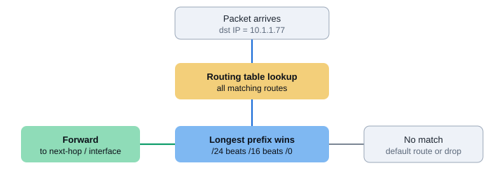

*شکل ۱: مراحل تصمیم روتر برای هر بسته.*

``` text
Routing table:
  10.0.0.0/8      via R-A
  10.1.0.0/16     via R-B
  10.1.1.0/24     via R-C
  0.0.0.0/0       via R-D (default)

Packet to 10.1.1.77:
  matches /0, /8, /16, /24  -> longest = /24  -> via R-C
Packet to 10.1.9.5:
  matches /0, /8, /16       -> longest = /16  -> via R-B
Packet to 8.8.8.8:
  matches /0 only           -> via R-D
```

> **نکته**
>
> اول طول Prefix تعیین می‌کند. فقط وقتی دو Route هم‌طول بودند، AD و Metric وارد می‌شوند.

### ۴. قانون دوم: Administrative Distance و Metric

فرض کنید همان شبکه را دو منبع مختلف (مثلاً Static و OSPF) به روتر معرفی کنند. روتر به منبعی که «معتبرتر» است اعتماد می‌کند. این اعتبار را AD می‌گویند و هرچه کمتر باشد بهتر است:

| منبع          | AD  |
|---------------|-----|
| Connected     | 0   |
| Static        | 1   |
| EIGRP (داخلی) | 90  |
| OSPF          | 110 |
| RIP           | 120 |

Metric هزینه‌ی مسیر **داخل یک پروتکل** است (مثلاً Cost در OSPF). Metricهای پروتکل‌های مختلف قابل مقایسه با هم نیستند؛ برای همین AD وجود دارد.

``` text
Decision order for the same destination:
1) Longest prefix       (most specific wins)
2) Lowest AD             (most trusted source)
3) Lowest metric         (best path inside one protocol)
4) ECMP                  (equal metric -> load share)
```

### ۵. مثال‌ها (ساده تا سخت)

#### ساده: بسته به شبکه‌ی Connected

``` text
Dest 192.168.1.50 -> matches C 192.168.1.0/24
Router ARPs for the host and delivers directly
```

#### متوسط: Static یا OSPF؟

``` text
Both learn 10.0.23.0/30:
  S  10.0.23.0/30 [1/0]   via 10.0.12.2
  O  10.0.23.0/30 [110/2] via 10.0.12.2
Same prefix -> lower AD (1) wins -> Static is installed
```

#### سخت: دو Route با Prefixهای مختلف

``` text
S  10.0.0.0/8   [1/0]   via 10.9.9.9   (static, AD 1)
O  10.0.23.0/30 [110/2] via 10.0.12.2   (OSPF, AD 110)
Packet to 10.0.23.5:
  both match; /30 is longer than /8 -> OSPF route wins
  (AD is NOT compared here; prefix length decides first)
```

این خطای ذهنی بسیار رایج است: «Static همیشه برنده است». نه! اول طول Prefix است.

### ۶. دستورهای مشاهده

``` text
R1# show ip route
R1# show ip route 10.1.1.77
R1# show ip route connected
R1# show ip route static
R1# show ip route ospf
R1# show ip protocols
R1# show ip cef 10.1.1.77
```

- `show ip route 10.1.1.77`: دقیقاً می‌گوید کدام Route برای این مقصد انتخاب می‌شود (بهترین ابزار عیب‌یابی).
- `show ip protocols`: پروتکل‌های مسیریابی فعال و تنظیماتشان.
- `show ip cef ...`: مسیر واقعی Forwarding (CEF).

### تمرین‌ها

**ت1.** ۱ (ساده): L و C چه فرقی دارند؟ *(پاسخ: 5-1-ت1 در بخش «پاسخ‌ها» انتهای فصل)*

**ت2.** ۲ (ساده): AD برای Static و OSPF؟ *(پاسخ: 5-1-ت2 در بخش «پاسخ‌ها» انتهای فصل)*

**ت3.** ۳ (متوسط): بسته به 10.1.1.77؛ Routeهای /8، /16 و /0 موجودند. کدام؟ *(پاسخ: 5-1-ت3 در بخش «پاسخ‌ها» انتهای فصل)*

**ت4.** ۴ (متوسط): آیا Metric یک Route در OSPF با RIP قابل مقایسه است؟ *(پاسخ: 5-1-ت4 در بخش «پاسخ‌ها» انتهای فصل)*

**ت5.** ۵ (سخت): Static 10.0.0.0/8 و OSPF 10.0.23.0/30 هر دو موجود؛ بسته به 10.0.23.5 از کجا می‌رود؟ *(پاسخ: 5-1-ت5 در بخش «پاسخ‌ها» انتهای فصل)*

### Lab هدایت‌شده

توپولوژی این هفته: سه روتر vIOS به نام‌های `R1`، `R2`، `R3` به‌صورت خطی. اتصال‌ها: `R1 Gi0/1 ↔ R2 Gi0/0` و `R2 Gi0/1 ↔ R3 Gi0/0`. اگر RAM روتر زیاد است، می‌توانید vIOS را ۵۱۲ مگابایت کنید (راهنمای CML). برای فعلاً فقط Connected داریم.

#### گام ۱: آدرس‌دهی

``` text
R1(config)# interface gi0/1
R1(config-if)# ip address 10.0.12.1 255.255.255.252
R1(config-if)# no shutdown
R1(config)# interface loopback 10
R1(config-if)# ip address 192.168.1.1 255.255.255.0

R2(config)# interface gi0/0
R2(config-if)# ip address 10.0.12.2 255.255.255.252
R2(config-if)# no shutdown
R2(config)# interface gi0/1
R2(config-if)# ip address 10.0.23.1 255.255.255.252
R2(config-if)# no shutdown

R3(config)# interface gi0/0
R3(config-if)# ip address 10.0.23.2 255.255.255.252
R3(config-if)# no shutdown
R3(config)# interface loopback 30
R3(config-if)# ip address 192.168.3.1 255.255.255.0
```

#### گام ۲: مشاهده

``` text
R1# show ip interface brief
R1# show ip route
R1# ping 10.0.12.2
R1# ping 192.168.3.1
```

پیش‌بینی: ping به همسایه OK، ولی به 192.168.3.1 شکست؛ چون R1 مسیری به آن ندارد. جدول R1 فقط C و L دارد؛ آن را یادداشت کنید.

#### گام ۳: LPM را خودتان بسنجید

از روی جدول بالا، با `show ip route 10.0.23.5` ببینید چه Routeی انتخاب می‌شود (هنوز هیچ؛ در درس بعد Static اضافه می‌کنیم).

### Lab مستقل

جدول مسیریابی هر سه روتر را (فقط C و L) در `03-ops/routing-baseline-w5.md` ذخیره و هر کد را توضیح دهید.

### عیب‌یابی

|         |                                                                                |
|---------|--------------------------------------------------------------------------------|
| Symptom | ping به شبکه‌ی دور شکست می‌خورد                                                  |
| روش     | show ip route \<destination\>؛ اگر «Network not in table» بود، مسیر وجود ندارد |
| چک‌لیست  | ۱) Route هست؟ ؛ ۲) Next-hop قابل‌دسترس است؟ ؛ ۳) مسیر برگشت هم دارد؟            |
| نکته    | برگشت (Return Path) را همیشه چک کنید؛ مسیر یک‌طرفه کار نمی‌کند                   |

### سؤال‌های مرور

**م1.** اولین چیزی که روتر برای انتخاب Route نگاه می‌کند؟ *(پاسخ: 5-1-م1 در بخش «پاسخ‌ها» انتهای فصل)*

**م2.** AD برای چیست؟ *(پاسخ: 5-1-م2 در بخش «پاسخ‌ها» انتهای فصل)*

### English Corner: انگلیسی تخصصی این درس

این جمله‌ها از مستندات و محیط کار واقعی‌اند. بلند بخوانید و ترجمه را بپوشانید.

| English sentence                                                       | ترجمه                                                  |
|------------------------------------------------------------------------|--------------------------------------------------------|
| The router selects the route with the longest matching prefix.         | روتر Route با طولانی‌ترین Prefix مطابق را انتخاب می‌کند. |
| Administrative distance expresses how trustworthy a routing source is. | AD نشان می‌دهد منبع Route چقدر قابل‌اعتماد است.          |
| There is no route to the destination network.                          | مسیری به شبکه‌ی مقصد وجود ندارد.                        |
| Check the return path as well.                                         | مسیر برگشت را هم بررسی کنید.                           |

**Q1.** Quick quiz (answer in English): Which is compared first: administrative distance or prefix length? *(پاسخ: 5-1-Q1 در بخش «پاسخ‌ها» انتهای فصل)*

### تکلیف و چک‌لیست تسلط

- [ ] خط‌به‌خط یک Route را توضیح دهم.
- [ ] LPM را با ۳ مثال حل کنم.
- [ ] Lab را انجام دهم.

### یادآوری اشتباهات شما

> **یادآوری**
>
> پیش‌بینی قبل از اجرا؛ بکاپ قبل از تغییر؛ پذیرفته‌شدن دستور ≠ کار کردن؛ فرمول‌ها در بلوک مستقل.


#### کارت Lab — جدول مسیریابی، LPM و AD

| # | فیلد | محتوا |
|---|---|---|
| 1 | عنوان و هدف | خواندن Route Table و LPM |
| 2 | پیش‌نیاز | فصل 4 |
| 3 | توپولوژی | R1-R2-R3 خطی |
| 4 | تجهیزات | ۳ vIOS |
| 5 | نسخه نرم‌افزار | vIOS-L2 15.2(20200924، Experimental) برای SW؛ vIOS 15.9(3)M9 برای R؛ VPCS؛ PNetLab 4.2.8 |
| 6 | IP Plan | Connected |
| 7 | وضعیت اولیه | Loopbackها |
| 8 | صورت مسئله | LPM و AD را پیش‌بینی کنید |
| 9 | مراحل هدایت‌شده | همان بخش «Lab هدایت‌شده» همین درس |
| 10 | تست عملکرد | `show ip route <dst>` |
| 11 | سناریوی خرابی | Route نبود |
| 12 | روش عیب‌یابی | لایه‌ای/با شواهد (بخش عیب‌یابی همین درس) |
| 13 | نتیجه‌ی مورد انتظار | جدول C/L |
| 14 | معیار پذیرش | پیش‌بینی با واقعیت تطبیق |
| 15 | مستندات نهایی | `03-ops/routing-baseline-w5.md` |
| 16 | Cleanup و بازگردانی | — |

> **وضعیت راستی‌آزمایی (خارج از ۱۶ فیلد):** **اجرا نشده (فقط طراحی).** اجرا نشده.

---

<a id="l-5-2"></a>

## درس 5-2 — Static Route و مسیر برگشت

**فصل ۵ - روز ۲ · پیش‌نیاز: درس ۵-۱ · ۶ ساعت**

### این درس درباره چیست و چرا باید یاد بگیریم؟

**چه چیزی یاد می‌گیریم:** ساخت مسیر دستی (Static Route) با Next-hop، تفاوت Next-hop و Exit-interface، اهمیت مسیر برگشت (Return Path) و خلاصه‌سازی با Static.

**چرا لازم است:** ساده‌ترین و قابل‌پیش‌بینی‌ترین مسیریابی است و در شعبه‌های کوچک و لینک اینترنت هنوز پرکاربرد است. اکثر «شبکه‌ی دور قابل‌دسترس نیست» ها به مسیر برگشت فراموش‌شده برمی‌گردد.

- **در کار روزانه:** Default Route به سمت ISP یا فایروال در ۹۰٪ شعبه‌ها Static است.
- **در امنیت:** Static Route قابل‌پیش‌بینی است و از تزریق مسیر جعلی جلوگیری می‌کند.
- **در FortiGate:** `config router static` دقیقاً همین مفهوم است.

> **مسیر درس**
>
> Static چیست ← Next-hop در برابر Interface ← مسیر برگشت ← خلاصه‌سازی ← مثال ساده/متوسط/سخت ← Lab ← عیب‌یابی.

#### اصطلاحات این درس (مخفف ← شکل کامل ← معنی)

| مخفف           | شکل کامل انگلیسی    | معنی فارسی                           |
|----------------|---------------------|--------------------------------------|
| Static Route   | Static Route        | مسیر دستی                            |
| Next-hop       | Next-hop IP         | آدرس روتر بعدی                       |
| Exit Interface | Exit Interface      | Interface خروجی                      |
| Return Path    | Return Path         | مسیر برگشت بسته                      |
| Recursive      | Recursive lookup    | جستجوی دوباره برای رسیدن به Next-hop |
| Null0          | Null0               | Interface مجازی دورریز               |
| Summary        | Route Summarization | خلاصه‌سازی چند Route در یکی           |

### ۱. Static Route چیست؟

یعنی خودتان به روتر می‌گویید: «برای رسیدن به شبکه X، بسته را به روتر Y بده». مثل اینکه به راننده‌ی تاکسی بگویید «برای رفتن به فرودگاه از این خیابان برو»؛ خودش تصمیم نمی‌گیرد، شما گفته‌اید.

فرمت:

``` text
ip route <destination network> <mask> <next-hop | exit-interface> [AD]

Example:
R1(config)# ip route 192.168.3.0 255.255.255.0 10.0.12.2
```

یعنی «برای شبکه‌ی 192.168.3.0/24، بسته را به 10.0.12.2 بده».

### ۲. Next-hop در برابر Exit-interface

| روش            | مثال                                               | کاربرد                                                   |
|----------------|----------------------------------------------------|----------------------------------------------------------|
| Next-hop       | ip route 192.168.3.0 255.255.255.0 10.0.12.2       | پیشنهاد اصلی؛ روی اترنت امن است                          |
| Exit-interface | ip route 192.168.3.0 255.255.255.0 gi0/1           | فقط لینک نقطه‌به‌نقطه (Serial)؛ روی اترنت ARP برای هر مقصد |
| هر دو          | ip route 192.168.3.0 255.255.255.0 gi0/1 10.0.12.2 | دقیق‌ترین (توصیه برای اترنت)                              |

> **قانون**
>
> روی اترنت فقط Exit-interface ننویسید؛ روتر برای هر مقصد ARP می‌زند و به Proxy-ARP وابسته می‌شود. Next-hop (یا هر دو) بنویسید.

«Recursive»: اگر Next-hop را بنویسید، روتر یک جستجوی دوم می‌کند تا Next-hop را از Connected/Route دیگری پیدا کند. به همین دلیل Next-hop باید حتماً در یک شبکه‌ی Connected یا شناخته‌شده باشد.

### ۳. مسیر برگشت: مهم‌ترین نکته

ارتباط دوطرفه است. اگر فقط R1 مسیر رفت را بداند، ولی R3 راه برگشت به 192.168.1.0/24 را نداند، پاسخ هرگز نمی‌رسد و ping شکست می‌خورد.

``` text
PC (192.168.1.10) -> R1 -> R2 -> R3 -> Server (192.168.3.10)
Forward path : R1 needs route to 192.168.3.0/24, R2 as well
Return path  : R3 needs route to 192.168.1.0/24, R2 as well
If any hop lacks the return route -> ping fails (one-way)
```

### ۴. خلاصه‌سازی با Static و Null0

به‌جای چند Route ریز، یک Route کلی می‌نویسیم. مثال: چهار شبکه‌ی 10.1.0.0/24 تا 10.1.3.0/24 را می‌توان با یک /22 خلاصه کرد:

``` text
10.1.0.0/24, 10.1.1.0/24, 10.1.2.0/24, 10.1.3.0/24
Third octet: 0,1,2,3 -> block size 4 -> /22
Summary = 10.1.0.0/22
```

برای جلوگیری از Loop هنگام خلاصه‌سازی روی مرز، گاهی یک Route به Null0 می‌گذارند تا بسته‌ی بی‌صاحب دور ریخته شود:

``` text
R2(config)# ip route 10.1.0.0 255.255.252.0 null0 200
```

AD برابر 200 است تا Routeهای واقعی (دقیق‌تر یا با AD کمتر) را بلوک نکند.

### ۵. مثال‌ها

#### ساده: یک مسیر

``` text
R1(config)# ip route 192.168.3.0 255.255.255.0 10.0.12.2
R1# show ip route static
S  192.168.3.0/24 [1/0] via 10.0.12.2
```

#### متوسط: مسیر رفت و برگشت

``` text
R1(config)# ip route 192.168.3.0 255.255.255.0 10.0.12.2
R1(config)# ip route 10.0.23.0 255.255.255.252 10.0.12.2
R2(config)# ip route 192.168.3.0 255.255.255.0 10.0.23.2
R2(config)# ip route 192.168.1.0 255.255.255.0 10.0.12.1
R3(config)# ip route 192.168.1.0 255.255.255.0 10.0.23.1
R3(config)# ip route 10.0.12.0 255.255.255.252 10.0.23.1
```

#### سخت: Next-hop غیرقابل‌دسترس

``` text
R1(config)# ip route 192.168.3.0 255.255.255.0 10.9.9.9
R1# show ip route 192.168.3.0
  -> Route is NOT installed: next-hop 10.9.9.9 is not reachable
Fix: use a next-hop inside a connected network (10.0.12.2)
```

### تمرین‌ها

**ت1.** ۱ (ساده): Static برای شبکه‌ی 172.16.5.0/24 با Next-hop 10.0.0.2 *(پاسخ: 5-2-ت1 در بخش «پاسخ‌ها» انتهای فصل)*

**ت2.** ۲ (ساده): چرا روی اترنت Next-hop می‌نویسیم؟ *(پاسخ: 5-2-ت2 در بخش «پاسخ‌ها» انتهای فصل)*

**ت3.** ۳ (متوسط): Summary چهار شبکه‌ی 10.2.4.0/24 تا 10.2.7.0/24؟ *(پاسخ: 5-2-ت3 در بخش «پاسخ‌ها» انتهای فصل)*

**ت4.** ۴ (متوسط): ping یک‌طرفه شکست می‌خورد؛ علت؟ *(پاسخ: 5-2-ت4 در بخش «پاسخ‌ها» انتهای فصل)*

**ت5.** ۵ (سخت): چرا Route به Null0 با AD 200؟ *(پاسخ: 5-2-ت5 در بخش «پاسخ‌ها» انتهای فصل)*

### Lab هدایت‌شده

#### گام ۱: مسیرهای رفت

``` text
R1(config)# ip route 10.0.23.0 255.255.255.252 10.0.12.2
R1(config)# ip route 192.168.3.0 255.255.255.0 10.0.12.2
R3(config)# ip route 10.0.12.0 255.255.255.252 10.0.23.1
R3(config)# ip route 192.168.1.0 255.255.255.0 10.0.23.1
R2(config)# ip route 192.168.1.0 255.255.255.0 10.0.12.1
R2(config)# ip route 192.168.3.0 255.255.255.0 10.0.23.2
```

#### گام ۲: تست

``` text
R1# ping 192.168.3.1 source 192.168.1.1
R1# traceroute 192.168.3.1 source 192.168.1.1
```

با `source` مبدأ را Loopback می‌کنیم تا شبکه‌ی LAN شبیه‌سازی شود.

#### گام ۳: خراب‌کردن عمدی مسیر برگشت

``` text
R3(config)# no ip route 192.168.1.0 255.255.255.0 10.0.23.1
R1# ping 192.168.3.1 source 192.168.1.1   (fails: no return)
R3(config)# ip route 192.168.1.0 255.255.255.0 10.0.23.1
```

Capture روی لینک R2-R3: Echo Request می‌رسد ولی Reply برنمی‌گردد.

### Lab مستقل

یک جدول «Static Route Plan» بنویسید: هر روتر، شبکه‌های مقصد، Next-hop و مسیر برگشت در `02-design/static-plan.md`.

### عیب‌یابی

|         |                                                                                                   |
|---------|---------------------------------------------------------------------------------------------------|
| Symptom | ping به شبکه‌ی دور شکست                                                                            |
| چک‌لیست  | ۱) Route رفت؟ ؛ ۲) Next-hop Connected است؟ ؛ ۳) Route برگشت؟ ؛ ۴) Mask درست؟ ؛ ۵) ACL یا فایروال؟ |
| ابزار   | show ip route \<destination\> ، traceroute ، Capture                                              |
| رفع     | افزودن مسیر گم‌شده                                                                                 |

### سؤال‌های مرور

**م1.** Static Route کی مناسب است؟ *(پاسخ: 5-2-م1 در بخش «پاسخ‌ها» انتهای فصل)*

**م2.** چرا مسیر برگشت مهم است؟ *(پاسخ: 5-2-م2 در بخش «پاسخ‌ها» انتهای فصل)*

### English Corner: انگلیسی تخصصی این درس

این جمله‌ها از مستندات و محیط کار واقعی‌اند. بلند بخوانید و ترجمه را بپوشانید.

| English sentence                                                | ترجمه                                        |
|-----------------------------------------------------------------|----------------------------------------------|
| Configure a static route pointing to the next-hop address.      | یک Static Route به آدرس Next-hop تنظیم کنید. |
| The route is not installed because the next-hop is unreachable. | Route نصب نشده چون Next-hop در دسترس نیست.   |
| Ping fails because there is no return route.                    | ping شکست می‌خورد چون Route برگشت وجود ندارد. |
| Summarize contiguous networks into a single route.              | شبکه‌های متوالی را در یک Route خلاصه کنید.    |

**Q1.** Quick quiz (answer in English): Why do we avoid exit-interface-only static routes on Ethernet? *(پاسخ: 5-2-Q1 در بخش «پاسخ‌ها» انتهای فصل)*

### تکلیف و چک‌لیست تسلط

- [ ] Static رفت و برگشت را بزنم و ping موفق بگیرم.
- [ ] مسیر برگشت را عمداً حذف کنم و Capture ببینم.
- [ ] Summary را بنویسم.

### یادآوری اشتباهات شما

> **یادآوری**
>
> پیش‌بینی قبل از اجرا؛ بکاپ قبل از تغییر؛ پذیرفته‌شدن دستور ≠ کار کردن؛ فرمول‌ها در بلوک مستقل.


#### کارت Lab — Static Route و مسیر برگشت

| # | فیلد | محتوا |
|---|---|---|
| 1 | عنوان و هدف | Static Route با مسیر رفت/برگشت |
| 2 | پیش‌نیاز | درس 5-1 |
| 3 | توپولوژی | R1-R2-R3 |
| 4 | تجهیزات | ۳ vIOS |
| 5 | نسخه نرم‌افزار | vIOS-L2 15.2(20200924، Experimental) برای SW؛ vIOS 15.9(3)M9 برای R؛ VPCS؛ PNetLab 4.2.8 |
| 6 | IP Plan | Connected |
| 7 | وضعیت اولیه | Static + برگشت |
| 8 | صورت مسئله | ping LAN1↔LAN3 |
| 9 | مراحل هدایت‌شده | همان بخش «Lab هدایت‌شده» همین درس |
| 10 | تست عملکرد | `ping ... source` |
| 11 | سناریوی خرابی | حذف مسیر برگشت |
| 12 | روش عیب‌یابی | لایه‌ای/با شواهد (بخش عیب‌یابی همین درس) |
| 13 | نتیجه‌ی مورد انتظار | ping موفق |
| 14 | معیار پذیرش | Return Path اثبات |
| 15 | مستندات نهایی | `02-design/static-plan.md` |
| 16 | Cleanup و بازگردانی | حذف Static |

> **وضعیت راستی‌آزمایی (خارج از ۱۶ فیلد):** **اجرا نشده (فقط طراحی).** اجرا نشده.

---

<a id="l-5-3"></a>

## درس 5-3 — Default، Floating و IP SLA

**فصل ۵ - روز ۳ · پیش‌نیاز: درس ۵-۲ · ۶ ساعت**

### این درس درباره چیست و چرا باید یاد بگیریم؟

**چه چیزی یاد می‌گیریم:** Default Route (0.0.0.0/0)، Route پشتیبان با AD بالا (Floating Static)، و رصد سلامت لینک با IP SLA برای Failover واقعی.

**چرا لازم است:** هر شعبه یک «در خروج» (اینترنت یا فایروال) دارد. اگر لینک اصلی خراب شود، باید ترافیک به لینک پشتیبان برود. Floating Static ساده‌ترین راه است؛ ولی بدون Tracking ممکن است Failover رخ ندهد چون لینک «بالا» است ولی اینترنت قطع.

- **در کار روزانه:** تقریباً هر شعبه Default Route دارد و بعضی یک لینک پشتیبان (4G/ISP دوم).
- **در امنیت:** Default Route تنها راه خروج است؛ اشتباه آن همه‌ی شبکه را ایزوله می‌کند.
- **در FortiGate:** Failover دو ISP با Distance/Priority و Link Monitor همین منطق است.

> **مسیر درس**
>
> Default Route ← Floating Static ← IP SLA و Track ← مثال ساده/متوسط/سخت ← Lab ← عیب‌یابی.

#### اصطلاحات این درس (مخفف ← شکل کامل ← معنی)

| مخفف            | شکل کامل انگلیسی           | معنی فارسی                           |
|-----------------|----------------------------|--------------------------------------|
| Default Route   | Default Route              | مسیر 0.0.0.0/0 برای هر مقصد ناشناخته |
| Floating Static | Floating Static Route      | Route پشتیبان با AD بالاتر           |
| IP SLA          | IP Service Level Agreement | پروب سلامت مسیر با ping              |
| Track           | Object Tracking            | وابستگی Route به وضعیت یک شیء        |
| Failover        | Failover                   | سوییچ خودکار به مسیر پشتیبان         |
| Reachability    | Reachability               | قابل‌دسترس بودن                       |

### ۱. Default Route: «هرجا نمی‌دانی، از اینجا برو»

Default Route همان آدرس ناشناخته در جدول است: مثل تابلوی «بقیه‌ی مسیرها» در بزرگراه. شبکه‌ی /0 همه‌ی آدرس‌ها را می‌پوشاند و چون کوتاه‌ترین Prefix است، فقط وقتی استفاده می‌شود که Route دقیق‌تری نباشد (LPM).

``` text
R1(config)# ip route 0.0.0.0 0.0.0.0 10.0.12.2
R1# show ip route
Gateway of last resort is 10.0.12.2 to network 0.0.0.0
S*   0.0.0.0/0 [1/0] via 10.0.12.2
```

### ۲. Floating Static: پشتیبان که «شناور» است

دو Default Route با دو AD متفاوت می‌نویسیم: اصلی با AD پیش‌فرض (1) و پشتیبان با AD بالاتر (مثلاً 200). روتر فقط Route با AD کمتر را نصب می‌کند؛ اگر آن حذف شد، پشتیبان «بالا می‌آید».

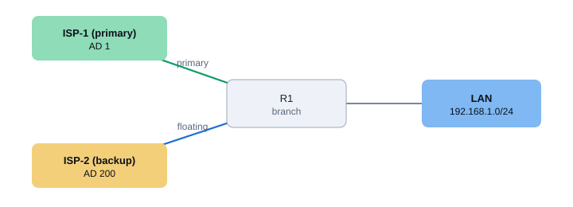

*شکل ۱: لینک اصلی با AD 1 و پشتیبان با AD 200.*

``` text
R1(config)# ip route 0.0.0.0 0.0.0.0 203.0.113.1
R1(config)# ip route 0.0.0.0 0.0.0.0 198.51.100.1 200
R1# show ip route 0.0.0.0
  -> only the AD 1 route is in the table
```

### ۳. مشکل: لینک «بالا» است ولی اینترنت نیست

Route Static تا وقتی Interface خروجی up/up است در جدول می‌ماند؛ حتی اگر Next-hop (ISP) خراب باشد. پس Floating به‌تنهایی Failover واقعی نیست. باید «سلامت واقعی» مسیر را بسنجیم: IP SLA با ping به Next-hop یا یک آدرس دور.

``` text
Interface up/up + ISP dead -> Static route still installed -> no failover
Solution: IP SLA probe + track -> route removed when probe fails
```

### ۴. IP SLA و Track (دستورها خط‌به‌خط)

``` text
R1(config)# ip sla 1
R1(config-ip-sla)# icmp-echo 203.0.113.1 source-interface gi0/1
R1(config-ip-sla-echo)# frequency 5
R1(config-ip-sla-echo)# exit
R1(config)# ip sla schedule 1 life forever start-time now
R1(config)# track 1 ip sla 1 reachability
R1(config)# ip route 0.0.0.0 0.0.0.0 203.0.113.1 track 1
R1(config)# ip route 0.0.0.0 0.0.0.0 198.51.100.1 200
```

- `ip sla 1` + `icmp-echo`: هر ۵ ثانیه ping به Next-hop اول.
- `schedule ... start-time now`: پروب را همین الان و برای همیشه شروع می‌کند.
- `track 1 ip sla 1 reachability`: شیء Track که وضعیت پروب را می‌داند.
- `ip route ... track 1`: این Route فقط وقتی در جدول است که Track بالا باشد.

``` text
R1# show ip sla statistics
R1# show track 1
R1# show ip route 0.0.0.0
```

### ۵. مثال‌ها

#### ساده

``` text
Single ISP: ip route 0.0.0.0 0.0.0.0 <ISP gateway>
```

#### متوسط: Floating

``` text
Primary link fails (interface down)
-> AD 1 route removed
-> AD 200 route installed automatically
```

#### سخت: ISP خراب ولی Interface بالا

``` text
Probe to 203.0.113.1 times out
-> track 1 goes Down
-> primary static removed
-> backup (AD 200) installed
Probe recovers -> primary returns (preempt)
```

> **صادقانه درباره‌ی Lab**
>
> طبق Probe اولیه، IP SLA روی IOS ما کار می‌کند. در Lab، لینک ISP را با قطع کابل (shutdown رو Interface دور) یا حذف Route همسایه شبیه‌سازی کنید و نتیجه‌ی واقعی را ثبت کنید.

### تمرین‌ها

**ت1.** ۱ (ساده): AD پیش‌فرض Static و Floating معمول؟ *(پاسخ: 5-3-ت1 در بخش «پاسخ‌ها» انتهای فصل)*

**ت2.** ۲ (ساده): چرا 0.0.0.0 0.0.0.0 همه‌ی مقاصد را می‌پوشاند؟ *(پاسخ: 5-3-ت2 در بخش «پاسخ‌ها» انتهای فصل)*

**ت3.** ۳ (متوسط): چرا Floating به‌تنهایی کافی نیست؟ *(پاسخ: 5-3-ت3 در بخش «پاسخ‌ها» انتهای فصل)*

**ت4.** ۴ (متوسط): دستور Route وابسته به Track؟ *(پاسخ: 5-3-ت4 در بخش «پاسخ‌ها» انتهای فصل)*

**ت5.** ۵ (سخت): چه چیزی را باید پروب کنیم؟ *(پاسخ: 5-3-ت5 در بخش «پاسخ‌ها» انتهای فصل)*

### Lab هدایت‌شده

روی R1 یک Interface دوم به R2 فرض می‌کنیم (یا Loopback). اگر ندارید، با `Loopback` هم می‌شود مسیر را شبیه‌سازی کرد.

#### گام ۱: Default اصلی و پشتیبان

``` text
R1(config)# ip route 0.0.0.0 0.0.0.0 10.0.12.2
R1(config)# ip route 0.0.0.0 0.0.0.0 10.0.99.2 200
R1# show ip route
```

#### گام ۲: IP SLA و Track

``` text
R1(config)# ip sla 1
R1(config-ip-sla)# icmp-echo 10.0.12.2 source-interface gi0/1
R1(config-ip-sla-echo)# frequency 5
R1(config)# ip sla schedule 1 life forever start-time now
R1(config)# track 1 ip sla 1 reachability
R1(config)# no ip route 0.0.0.0 0.0.0.0 10.0.12.2
R1(config)# ip route 0.0.0.0 0.0.0.0 10.0.12.2 track 1
R1# show track 1
```

#### گام ۳: شبیه‌سازی خرابی

``` text
R2(config)# interface gi0/0
R2(config-if)# shutdown
R1# show track 1
R1# show ip route 0.0.0.0
```

ثبت کنید چند ثانیه طول کشید تا Track پایین بیاید و Route پشتیبان نصب شود، و بعد از `no shutdown` چه شد.

### Lab مستقل

یک Runbook «Failover دو ISP» در `03-ops/dual-isp-failover.md` بنویسید: تنظیم، Verification، و آزمون خرابی.

### عیب‌یابی

|         |                                                                                                                      |
|---------|----------------------------------------------------------------------------------------------------------------------|
| Symptom | Failover رخ نمی‌دهد                                                                                                   |
| چک‌لیست  | ۱) AD پشتیبان بیشتر است؟ ؛ ۲) Track روی Route اصلی است؟ ؛ ۳) پروب به آدرس درست می‌رود؟ ؛ ۴) Interface هنوز up/up است؟ |
| ابزار   | show track ، show ip sla statistics ، show ip route                                                                  |
| رفع     | اصلاح پروب و AD                                                                                                      |

### سؤال‌های مرور

**م1.** Floating Static چیست؟ *(پاسخ: 5-3-م1 در بخش «پاسخ‌ها» انتهای فصل)*

**م2.** IP SLA برای چیست؟ *(پاسخ: 5-3-م2 در بخش «پاسخ‌ها» انتهای فصل)*

### English Corner: انگلیسی تخصصی این درس

این جمله‌ها از مستندات و محیط کار واقعی‌اند. بلند بخوانید و ترجمه را بپوشانید.

| English sentence                                                         | ترجمه                                         |
|--------------------------------------------------------------------------|-----------------------------------------------|
| Configure a floating static route with a higher administrative distance. | Floating Static با AD بالاتر تنظیم کنید.      |
| The track object goes down when the probe fails.                         | وقتی پروب شکست بخورد، شیء Track پایین می‌رود.  |
| The backup route is installed automatically.                             | Route پشتیبان خودکار نصب می‌شود.               |
| Always test failover before production.                                  | Failover را همیشه قبل از Production تست کنید. |

**Q1.** Quick quiz (answer in English): Why can a static route stay in the table even if the ISP is down? *(پاسخ: 5-3-Q1 در بخش «پاسخ‌ها» انتهای فصل)*

### تکلیف و چک‌لیست تسلط

- [ ] Floating و Track را تنظیم کنم.
- [ ] خرابی را شبیه‌سازی و زمان Failover را ثبت کنم.
- [ ] Runbook را بنویسم.

### یادآوری اشتباهات شما

> **یادآوری**
>
> پیش‌بینی قبل از اجرا؛ بکاپ قبل از تغییر؛ پذیرفته‌شدن دستور ≠ کار کردن؛ فرمول‌ها در بلوک مستقل.


#### کارت Lab — Default، Floating و IP SLA

| # | فیلد | محتوا |
|---|---|---|
| 1 | عنوان و هدف | Default، Floating و IP SLA/Track |
| 2 | پیش‌نیاز | درس 5-2 |
| 3 | توپولوژی | R1 + دو مسیر |
| 4 | تجهیزات | ۳ vIOS |
| 5 | نسخه نرم‌افزار | vIOS-L2 15.2(20200924، Experimental) برای SW؛ vIOS 15.9(3)M9 برای R؛ VPCS؛ PNetLab 4.2.8 |
| 6 | IP Plan | Static |
| 7 | وضعیت اولیه | Floating AD 200 |
| 8 | صورت مسئله | Failover با Track |
| 9 | مراحل هدایت‌شده | همان بخش «Lab هدایت‌شده» همین درس |
| 10 | تست عملکرد | `show track` |
| 11 | سناریوی خرابی | ISP خراب ولی لینک up |
| 12 | روش عیب‌یابی | لایه‌ای/با شواهد (بخش عیب‌یابی همین درس) |
| 13 | نتیجه‌ی مورد انتظار | Route پشتیبان نصب |
| 14 | معیار پذیرش | زمان Failover ثبت |
| 15 | مستندات نهایی | `03-ops/dual-isp-failover.md` |
| 16 | Cleanup و بازگردانی | حذف track |

> **وضعیت راستی‌آزمایی (خارج از ۱۶ فیلد):** **جزئی.** IP SLA icmp-echo در Probe Tested-OK؛ Failover کامل و Floating اجرا نشده.

---

<a id="l-5-4"></a>

## درس 5-4 — مفهوم OSPF

**فصل ۵ - روز ۴ · پیش‌نیاز: درس‌های ۵-۱ تا ۵-۳ · ۶ ساعت**

### این درس درباره چیست و چرا باید یاد بگیریم؟

**چه چیزی یاد می‌گیریم:** مفهوم پروتکل مسیریابی پویا OSPF: چرا Static در شبکه‌ی بزرگ جواب نمی‌دهد، چطور روترها همسایه می‌شوند، پایگاه داده‌ی مشترک (LSDB) چیست، و هزینه (Cost) چطور مسیر را انتخاب می‌کند.

**چرا لازم است:** در شبکه‌ای با ۵۰ روتر، نوشتن دستی هزاران Static غیرممکن است و با هر تغییر باید همه را اصلاح کنید. OSPF خودش مسیرها را پیدا می‌کند، با خرابی لینک در چند ثانیه مسیر جایگزین می‌سازد و استاندارد سازمان‌هاست.

- **در کار روزانه:** OSPF رایج‌ترین IGP در سازمان‌هاست.
- **در امنیت:** Adjacency بدون Authentication یعنی هر روتر جعلی می‌تواند مسیر تزریق کند.
- **در FortiGate:** FortiGate هم OSPF می‌فهمد و در Capstone با Cisco هم‌نشین می‌شود.

> **مسیر درس**
>
> چرا مسیریابی پویا ← OSPF چطور کار می‌کند ← حالت‌های همسایگی ← Cost و SPF ← مثال ساده/متوسط/سخت ← Lab ← عیب‌یابی.

#### اصطلاحات این درس (مخفف ← شکل کامل ← معنی)

| مخفف      | شکل کامل انگلیسی               | معنی فارسی                              |
|-----------|--------------------------------|-----------------------------------------|
| OSPF      | Open Shortest Path First       | پروتکل مسیریابی Link-State داخلی        |
| IGP       | Interior Gateway Protocol      | پروتکل مسیریابی داخل یک سازمان          |
| LSA       | Link-State Advertisement       | اعلان وضعیت لینک                        |
| LSDB      | Link-State Database            | پایگاه داده‌ی مشترک همه‌ی روترهای یک Area |
| SPF       | Shortest Path First (Dijkstra) | الگوریتم محاسبه‌ی کوتاه‌ترین مسیر         |
| Router ID | Router Identifier              | شناسه‌ی یکتای روتر (مثل IP)              |
| Adjacency | Adjacency                      | همسایگی کامل بین دو روتر                |
| Area      | OSPF Area                      | ناحیه؛ بخش‌بندی شبکه                     |
| Cost      | OSPF Cost                      | هزینه‌ی لینک بر اساس پهنای باند          |

### ۱. چرا مسیریابی پویا؟

فرض کنید ۱۰ روتر دارید. Static یعنی به هر روتر درباره‌ی هر شبکه بگویید؛ با اضافه‌شدن یک شبکه همه را عوض می‌کنید، و اگر لینکی خراب شود هیچ‌چیز خودکار تغییر نمی‌کند. مسیریابی پویا مثل گوگل‌مپ است: هر روتر وضعیت خودش را اعلام می‌کند و همه با هم نقشه‌ی یکسان می‌سازند.

### ۲. OSPF چطور کار می‌کند؟ (سه مرحله)

1.  **همسایه‌یابی:** روترها با پیام Hello همدیگر را پیدا می‌کنند.
2.  **تبادل نقشه:** هر روتر وضعیت لینک‌های خودش (LSA) را با همه‌ی روترهای Area به اشتراک می‌گذارد؛ نتیجه LSDB یکسان در همه است.
3.  **محاسبه‌ی مسیر:** هر روتر با الگوریتم SPF از روی LSDB کوتاه‌ترین مسیر به هر شبکه را حساب می‌کند.

> **تفاوت با RIP**
>
> OSPF «نقشه‌ی کامل» را دارد (Link-State)، نه فقط «شنیده‌های همسایه» (Distance Vector). برای همین سریع‌تر همگرا می‌شود و حلقه نمی‌سازد.

### ۳. همسایگی: از Down تا Full

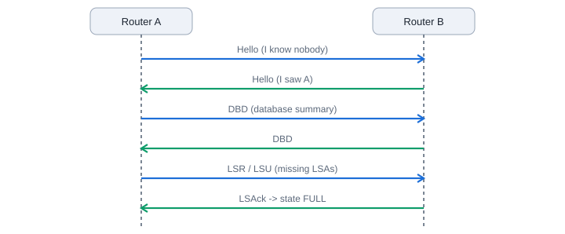

*شکل ۱: ساده‌شده‌ی تبادل پیام‌ها تا رسیدن به حالت Full.*

| حالت     | معنی                                              |
|----------|---------------------------------------------------|
| Down     | Hello نرسیده                                      |
| Init     | Hello دریافت شد ولی همسایه هنوز ما را ندیده       |
| 2-Way    | دوطرفه دیدیم (روی Broadcast: DR/BDR انتخاب می‌شود) |
| ExStart  | انتخاب Master/Slave برای تبادل                    |
| Exchange | تبادل خلاصه‌ی پایگاه داده (DBD)                    |
| Loading  | دریافت LSAهای مفقود                               |
| Full     | پایگاه‌ها یکسان؛ Adjacency کامل                    |

اگر روتری در ExStart یا Exchange گیر کرد، معمولاً MTU یا مشکل پایگاه داده است. اگر در Init می‌ماند، یکی از دو طرف Hello را نمی‌بیند (ACL، Hello/Dead، Subnet).

### ۴. شرط‌های تشکیل Adjacency

برای اینکه دو روتر همسایه شوند، این مقادیر باید یکی باشند:

- هر دو Interface در یک Subnet با Mask یکسان.
- Area یکسان.
- Hello و Dead Interval یکسان (پیش‌فرض اترنت: 10 و 40 ثانیه).
- Authentication یکسان.
- MTU برابر (یا `ip ospf mtu-ignore` در موارد خاص).
- Router ID یکتا.

``` text
Hello interval (Ethernet) = 10 s
Dead interval  (Ethernet) = 4 x Hello = 40 s
(Non-broadcast: Hello 30 s, Dead 120 s)
```

### ۵. Router ID

هر روتر یک شناسه‌ی ۳۲ بیتی شبیه IP دارد. اگر دستی تنظیم نکنید، بزرگ‌ترین IP روی Loopbackها، و در نبود Loopback بزرگ‌ترین IP روی Interfaceهای فعال انتخاب می‌شود. توصیه: همیشه دستی تنظیم کنید تا پایدار و قابل‌پیش‌بینی باشد:

``` text
R1(config)# router ospf 1
R1(config-router)# router-id 1.1.1.1
```

### ۶. Cost: چطور مسیر انتخاب می‌شود؟

هر لینک یک هزینه دارد که از پهنای باند به‌دست می‌آید. هزینه‌ی کل یک مسیر مجموع هزینه‌ی لینک‌های خروجی تا مقصد است و کمترین برنده می‌شود:

``` text
Cost = Reference bandwidth / Interface bandwidth
Default reference bandwidth = 100 Mbps

 10 Mbps  -> 100 / 10   = 10
100 Mbps  -> 100 / 100  = 1
  1 Gbps  -> 100 / 1000 = 0.1 -> rounded up to 1   (problem!)
 10 Gbps  -> also 1
```

> **مشکل شناخته‌شده**
>
> با مرجع ۱۰۰ مگابیت، لینک‌های ۱ و ۱۰ گیگابیت هزینه‌ی یکسان (۱) دارند؛ پس OSPF سریع‌تر را از کندتر تشخیص نمی‌دهد. راه‌حل: مرجع را بالا ببرید و در همه‌ی روترها یکسان کنید: `auto-cost reference-bandwidth 10000` (ده گیگ).

``` text
Reference 10000 Mbps:
  1 Gbps  -> 10000 / 1000  = 10
 10 Gbps  -> 10000 / 10000 = 1
100 Mbps  -> 10000 / 100   = 100
```

### ۷. مثال‌ها

#### ساده: دو روتر

``` text
R1 Gi0/1 10.0.12.1/30  <->  R2 Gi0/0 10.0.12.2/30, area 0
Hello exchanged -> neighbors -> state FULL
Each learns the other LANs automatically
```

#### متوسط: کدام مسیر؟

``` text
Path A: R1 -> R2 -> R3     cost 10 + 10 = 20
Path B: R1 -> R3 direct     cost 30
SPF picks Path A (20 < 30)
```

#### سخت: چرا Adjacency نمی‌شود؟

``` text
R1: ip ospf hello-interval 5   (dead 20)
R2: default (hello 10, dead 40)
Result: neighbors never reach 2-Way; hello/dead mismatch
Fix: make both sides identical
```

### تمرین‌ها

**ت1.** ۱ (ساده): سه مرحله‌ی کار OSPF؟ *(پاسخ: 5-4-ت1 در بخش «پاسخ‌ها» انتهای فصل)*

**ت2.** ۲ (ساده): Hello/Dead پیش‌فرض اترنت؟ *(پاسخ: 5-4-ت2 در بخش «پاسخ‌ها» انتهای فصل)*

**ت3.** ۳ (متوسط): Cost لینک 1 Gbps با Reference 100 Mbps؟ *(پاسخ: 5-4-ت3 در بخش «پاسخ‌ها» انتهای فصل)*

**ت4.** ۴ (متوسط): Cost لینک 100 Mbps با Reference 10000؟ *(پاسخ: 5-4-ت4 در بخش «پاسخ‌ها» انتهای فصل)*

**ت5.** ۵ (سخت): دو روتر در Init مانده‌اند؛ علت‌های محتمل؟ *(پاسخ: 5-4-ت5 در بخش «پاسخ‌ها» انتهای فصل)*

### Lab هدایت‌شده

در این درس فقط مشاهده‌ی مفهوم؛ پیکربندی کامل در درس بعد. ولی Router ID را می‌توانیم از الان برنامه‌ریزی کنیم:

| روتر | Router ID | Loopback               |
|------|-----------|------------------------|
| R1   | 1.1.1.1   | Loopback0 = 1.1.1.1/32 |
| R2   | 2.2.2.2   | Loopback0 = 2.2.2.2/32 |
| R3   | 3.3.3.3   | Loopback0 = 3.3.3.3/32 |

#### گام: ساخت Loopback0 روی هر روتر

``` text
R1(config)# interface loopback 0
R1(config-if)# ip address 1.1.1.1 255.255.255.255
R2(config)# interface loopback 0
R2(config-if)# ip address 2.2.2.2 255.255.255.255
R3(config)# interface loopback 0
R3(config-if)# ip address 3.3.3.3 255.255.255.255
```

سپس با Static قبلی، دسترسی به این Loopbackها را برقرار کنید (یا صبر کنید تا OSPF در درس بعد انجامش دهد).

### Lab مستقل

ترسیم دستی LSDB یک مثلث سه‌روتری روی کاغذ: هر روتر چه LSAهایی می‌سازد؟ و جدول Cost هر لینک را با Reference 10000 بنویسید.

### عیب‌یابی

|         |                                                                                                                           |
|---------|---------------------------------------------------------------------------------------------------------------------------|
| Symptom | دو روتر همسایه نمی‌شوند                                                                                                    |
| چک‌لیست  | ۱) Subnet و Mask یکی؟ ؛ ۲) Area یکی؟ ؛ ۳) Hello/Dead یکی؟ ؛ ۴) Authentication؟ ؛ ۵) MTU؟ ؛ ۶) Router ID تکراری؟ ؛ ۷) ACL؟ |
| ابزار   | show ip ospf neighbor ، show ip ospf interface ، debug ip ospf adj (با احتیاط)                                            |
| رفع     | یکسان‌سازی پارامتر ناسازگار                                                                                                |

### سؤال‌های مرور

**م1.** OSPF چه نوع پروتکلی است؟ *(پاسخ: 5-4-م1 در بخش «پاسخ‌ها» انتهای فصل)*

**م2.** Hello و Dead چیست؟ *(پاسخ: 5-4-م2 در بخش «پاسخ‌ها» انتهای فصل)*

### English Corner: انگلیسی تخصصی این درس

این جمله‌ها از مستندات و محیط کار واقعی‌اند. بلند بخوانید و ترجمه را بپوشانید.

| English sentence                                                                | ترجمه                                                           |
|---------------------------------------------------------------------------------|-----------------------------------------------------------------|
| OSPF routers exchange link-state advertisements to build an identical database. | روترهای OSPF با تبادل LSA پایگاه داده‌ی یکسان می‌سازند.           |
| Neighbors must agree on area, hello and dead timers.                            | همسایه‌ها باید روی Area و تایمرهای Hello/Dead توافق داشته باشند. |
| The lowest total cost path is selected.                                         | مسیر با کمترین هزینه‌ی کل انتخاب می‌شود.                          |
| Set the router ID manually for stability.                                       | Router ID را برای پایداری دستی تنظیم کنید.                      |

**Q1.** Quick quiz (answer in English): What are the three steps of OSPF operation? *(پاسخ: 5-4-Q1 در بخش «پاسخ‌ها» انتهای فصل)*

### تکلیف و چک‌لیست تسلط

- [ ] وضعیت‌های همسایگی را بدون نگاه بگویم.
- [ ] Cost را با دو Reference حساب کنم.
- [ ] Loopbackها را بسازم.

### یادآوری اشتباهات شما

> **یادآوری**
>
> پیش‌بینی قبل از اجرا؛ بکاپ قبل از تغییر؛ پذیرفته‌شدن دستور ≠ کار کردن؛ فرمول‌ها در بلوک مستقل.


#### کارت Lab — مفهوم OSPF

| # | فیلد | محتوا |
|---|---|---|
| 1 | عنوان و هدف | برنامه‌ریزی OSPF (Router-ID، Loopback) |
| 2 | پیش‌نیاز | درس 5-3 |
| 3 | توپولوژی | R1-R2-R3 |
| 4 | تجهیزات | ۳ vIOS |
| 5 | نسخه نرم‌افزار | vIOS-L2 15.2(20200924، Experimental) برای SW؛ vIOS 15.9(3)M9 برای R؛ VPCS؛ PNetLab 4.2.8 |
| 6 | IP Plan | Static |
| 7 | وضعیت اولیه | Loopback0 |
| 8 | صورت مسئله | Cost روی کاغذ |
| 9 | مراحل هدایت‌شده | همان بخش «Lab هدایت‌شده» همین درس |
| 10 | تست عملکرد | `show ip interface brief` |
| 11 | سناریوی خرابی | — |
| 12 | روش عیب‌یابی | لایه‌ای/با شواهد (بخش عیب‌یابی همین درس) |
| 13 | نتیجه‌ی مورد انتظار | Loopbackها بالا |
| 14 | معیار پذیرش | جدول Cost |
| 15 | مستندات نهایی | — |
| 16 | Cleanup و بازگردانی | حذف Loopback |

> **وضعیت راستی‌آزمایی (خارج از ۱۶ فیلد):** **اجرا نشده (فقط طراحی).** اجرا نشده.

---

<a id="l-5-5"></a>

## درس 5-5 — پیاده‌سازی OSPF

**فصل ۵ - روز ۵ · پیش‌نیاز: درس ۵-۴ · ۶ ساعت**

### این درس درباره چیست و چرا باید یاد بگیریم؟

**چه چیزی یاد می‌گیریم:** پیاده‌سازی OSPF تک‌ناحیه‌ای روی سه روتر: router ospf، معرفی شبکه‌ها، passive-interface، پخش Default Route، تنظیم Cost و بررسی با دستورهای show.

**چرا لازم است:** تا اینجا مفهوم را فهمیدید؛ حالا باید بتوانید یک شبکه‌ی چندروتری را در کمتر از ده دقیقه با OSPF بالا بیاورید و درستی‌اش را اثبات کنید. این مهارت در مصاحبه و کار روزانه مستقیماً سنجیده می‌شود.

- **در کار روزانه:** تنظیم OSPF برای شبکه‌ی جدید و عیب‌یابی همسایگی.
- **در امنیت:** Passive-interface جلوی ارسال Hello به سمت کاربران را می‌گیرد.
- **در Capstone:** Lab A (Cisco L3 Core) و ارتباط با FortiGate از همین مبانی استفاده می‌کند.

> **مسیر درس**
>
> طراحی ← دستورها خط‌به‌خط ← passive-interface ← default-information ← مثال ساده/متوسط/سخت ← Lab ← عیب‌یابی.

#### اصطلاحات این درس (مخفف ← شکل کامل ← معنی)

| مخفف                          | شکل کامل انگلیسی              | معنی فارسی                                         |
|-------------------------------|-------------------------------|----------------------------------------------------|
| network                       | OSPF network statement        | Interfaceها را با Wildcard به OSPF معرفی می‌کند     |
| Wildcard                      | Wildcard mask                 | معکوس Mask                                         |
| passive-interface             | Passive interface             | Interface که Hello نمی‌فرستد ولی شبکه‌اش اعلام می‌شود |
| default-information originate | Default information originate | پخش Default Route                                  |
| reference-bandwidth           | Auto-cost reference bandwidth | پهنای مرجع برای Cost                               |
| E2                            | OSPF External Type 2          | Route خارجی با Cost ثابت                           |

### ۱. طراحی Lab

``` text
R1 --10.0.12.0/30-- R2 --10.0.23.0/30-- R3
R1 LAN: 192.168.1.0/24 (Loopback10)
R3 LAN: 192.168.3.0/24 (Loopback30)
Router IDs: 1.1.1.1 , 2.2.2.2 , 3.3.3.3
All in area 0
```

اول Static درس قبل را حذف کنید تا نتیجه‌ی OSPF را درست ببینید.

``` text
R1(config)# no ip route 192.168.3.0 255.255.255.0 10.0.12.2
R1(config)# no ip route 10.0.23.0 255.255.255.252 10.0.12.2
(similarly remove statics on R2 and R3)
```

### ۲. دستورها (خط‌به‌خط)

``` text
R1(config)# router ospf 1
R1(config-router)# router-id 1.1.1.1
R1(config-router)# auto-cost reference-bandwidth 10000
R1(config-router)# network 10.0.12.0 0.0.0.3 area 0
R1(config-router)# network 192.168.1.0 0.0.0.255 area 0
R1(config-router)# passive-interface loopback 10
R1(config-router)# end
```

- `router ospf 1`: شماره‌ی Process فقط محلی است و لازم نیست با همسایه یکی باشد.
- `network ... area 0`: هر Interface که آدرسش در این بازه بیفتد در OSPF شرکت می‌کند. از Wildcard استفاده می‌شود: برای /30 برابر 0.0.0.3 و برای /24 برابر 0.0.0.255.
- `passive-interface`: روی Interface مربوط به LAN کاربران؛ شبکه‌اش اعلام می‌شود ولی Hello نمی‌رود (کاربر نمی‌تواند همسایه جعلی بسازد).
- `reference-bandwidth 10000`: باید در همه‌ی روترها یکسان باشد.

``` text
Wildcard = 255.255.255.255 - Mask
/30: 255.255.255.255 - 255.255.255.252 = 0.0.0.3
/24: 255.255.255.255 - 255.255.255.0   = 0.0.0.255
```

روش جایگزین (مدرن): فعال‌سازی روی خود Interface بدون `network`:

``` text
R1(config)# interface gi0/1
R1(config-if)# ip ospf 1 area 0
R1(config)# interface loopback 10
R1(config-if)# ip ospf 1 area 0
```

### ۳. Verification (چهار دستور اصلی)

``` text
R1# show ip ospf neighbor
R1# show ip ospf interface brief
R1# show ip route ospf
R1# show ip protocols
```

نمونه‌ی خروجی سالم:

``` text
R1# show ip ospf neighbor
Neighbor ID   Pri  State     Dead Time  Address     Interface
2.2.2.2         1  FULL/BDR  00:00:35   10.0.12.2   Gi0/1

R1# show ip route ospf
O   10.0.23.0/30 [110/20] via 10.0.12.2, Gi0/1
O   192.168.3.0/24 [110/21] via 10.0.12.2, Gi0/1
```

خوانش: State باید `FULL` باشد. مقدار Cost به‌صورت زیر حساب می‌شود (با Reference 10000 و لینک 1 گیگ):

``` text
Reference 10000, each 1G link = 10, Loopback = 1
R1 -> 10.0.23.0/30 : 10 (R1-R2) + 10 (R2-R3)        = 20
R1 -> 192.168.3.0/24: 10 + 10 + 1 (Loopback30)        = 21
```

### ۴. پخش Default Route

R1 به اینترنت (یا فایروال) وصل است و Default دارد. می‌خواهیم R2 و R3 هم بدانند:

``` text
R1(config)# ip route 0.0.0.0 0.0.0.0 203.0.113.1
R1(config)# router ospf 1
R1(config-router)# default-information originate
```

در R2 و R3 مسیر `O*E2 0.0.0.0/0` می‌بینید؛ E2 یعنی Route خارجی با Cost ثابت. اگر Default روی R1 نباشد، دستور بی‌اثر است (مگر با `always`).

### ۵. مثال‌ها

#### ساده

``` text
R1 and R2: both "network 10.0.12.0 0.0.0.3 area 0"
show ip ospf neighbor -> FULL
```

#### متوسط: ping سراسری

``` text
R1# ping 192.168.3.1 source 192.168.1.1
R3# ping 192.168.1.1 source 192.168.3.1
Both succeed through OSPF-learned routes
```

#### سخت: تغییر Cost برای هدایت مسیر

``` text
R2(config)# interface gi0/1
R2(config-if)# ip ospf cost 500
R1# show ip route 192.168.3.0   -> cost increases accordingly
Used to steer traffic to a preferred path
```

### تمرین‌ها

**ت1.** ۱ (ساده): Wildcard برای /27؟ *(پاسخ: 5-5-ت1 در بخش «پاسخ‌ها» انتهای فصل)*

**ت2.** ۲ (ساده): چرا Loopback را passive می‌کنیم؟ *(پاسخ: 5-5-ت2 در بخش «پاسخ‌ها» انتهای فصل)*

**ت3.** ۳ (متوسط): Cost 21 در R1 برای شبکه‌ی R3 را توضیح بده *(پاسخ: 5-5-ت3 در بخش «پاسخ‌ها» انتهای فصل)*

**ت4.** ۴ (متوسط): state ExStart گیر کرده؛ علت؟ *(پاسخ: 5-5-ت4 در بخش «پاسخ‌ها» انتهای فصل)*

**ت5.** ۵ (سخت): default-information originate بدون Default روی روتر چه می‌شود؟ *(پاسخ: 5-5-ت5 در بخش «پاسخ‌ها» انتهای فصل)*

### Lab هدایت‌شده

#### گام ۱: بکاپ و حذف Static

``` text
Rx# copy running-config flash:Rx-before-ospf.cfg
```

#### گام ۲: OSPF روی هر سه

``` text
R2(config)# router ospf 1
R2(config-router)# router-id 2.2.2.2
R2(config-router)# auto-cost reference-bandwidth 10000
R2(config-router)# network 10.0.12.0 0.0.0.3 area 0
R2(config-router)# network 10.0.23.0 0.0.0.3 area 0

R3(config)# router ospf 1
R3(config-router)# router-id 3.3.3.3
R3(config-router)# auto-cost reference-bandwidth 10000
R3(config-router)# network 10.0.23.0 0.0.0.3 area 0
R3(config-router)# network 192.168.3.0 0.0.0.255 area 0
R3(config-router)# passive-interface loopback 30
```

#### گام ۳: بررسی

``` text
Rx# show ip ospf neighbor
Rx# show ip route ospf
R1# ping 192.168.3.1 source 192.168.1.1
```

#### گام ۴: Capture Hello

روی لینک R1-R2 Capture بگیرید و فیلتر `ospf` بزنید. بسته‌های Hello را ببینید: هر ۱۰ ثانیه، به مقصد Multicast `224.0.0.5` (همه‌ی روترهای OSPF).

#### گام ۵: Failover

``` text
R2(config)# interface gi0/1
R2(config-if)# shutdown
R1# show ip route ospf   (route to R3 LAN disappears)
R2(config-if)# no shutdown
```

### Lab مستقل

یک «OSPF As-Built» در `03-ops/ospf-as-built.md` بنویسید: Router IDها، شبکه‌ها، Cost، خروجی show ip ospf neighbor و جدول Route.

### عیب‌یابی

|         |                                                                                                                                                   |
|---------|---------------------------------------------------------------------------------------------------------------------------------------------------|
| Symptom | Neighbor نیست یا Route نیامده                                                                                                                     |
| چک‌لیست  | ۱) network statement شامل Interface هست؟ ؛ ۲) Area یکی؟ ؛ ۳) passive-interface اشتباهی روی لینک؟ ؛ ۴) Hello/Dead؟ ؛ ۵) Reference bandwidth یکسان؟ |
| ابزار   | show ip ospf interface ، show ip protocols                                                                                                        |
| رفع     | اصلاح network یا حذف passive از لینک اتصال                                                                                                        |

### سؤال‌های مرور

**م1.** network statement چه می‌کند؟ *(پاسخ: 5-5-م1 در بخش «پاسخ‌ها» انتهای فصل)*

**م2.** passive-interface چه فایده‌ای دارد؟ *(پاسخ: 5-5-م2 در بخش «پاسخ‌ها» انتهای فصل)*

### English Corner: انگلیسی تخصصی این درس

این جمله‌ها از مستندات و محیط کار واقعی‌اند. بلند بخوانید و ترجمه را بپوشانید.

| English sentence                                                     | ترجمه                                                       |
|----------------------------------------------------------------------|-------------------------------------------------------------|
| Advertise the networks with the network command and a wildcard mask. | شبکه‌ها را با دستور network و Wildcard Mask اعلام کنید.      |
| Make user-facing interfaces passive.                                 | Interfaceهای سمت کاربر را Passive کنید.                     |
| The neighbor reached the FULL state.                                 | همسایه به حالت FULL رسید.                                   |
| The default route is injected into OSPF as an external type 2 route. | Default Route به‌صورت Route خارجی نوع ۲ در OSPF تزریق می‌شود. |

**Q1.** Quick quiz (answer in English): Which command verifies that neighbors reached FULL? *(پاسخ: 5-5-Q1 در بخش «پاسخ‌ها» انتهای فصل)*

### تکلیف و چک‌لیست تسلط

- [ ] OSPF را روی سه روتر بالا بیاورم و FULL ببینم.
- [ ] Hello را در Capture ببینم.
- [ ] OSPF As-Built را بنویسم.

### یادآوری اشتباهات شما

> **یادآوری**
>
> پیش‌بینی قبل از اجرا؛ بکاپ قبل از تغییر؛ پذیرفته‌شدن دستور ≠ کار کردن؛ فرمول‌ها در بلوک مستقل.


#### کارت Lab — پیاده‌سازی OSPF

| # | فیلد | محتوا |
|---|---|---|
| 1 | عنوان و هدف | OSPF تک‌ناحیه‌ای |
| 2 | پیش‌نیاز | درس 5-4 |
| 3 | توپولوژی | R1-R2-R3 |
| 4 | تجهیزات | ۳ vIOS |
| 5 | نسخه نرم‌افزار | vIOS-L2 15.2(20200924، Experimental) برای SW؛ vIOS 15.9(3)M9 برای R؛ VPCS؛ PNetLab 4.2.8 |
| 6 | IP Plan | Static حذف |
| 7 | وضعیت اولیه | OSPF area 0 |
| 8 | صورت مسئله | FULL و ping |
| 9 | مراحل هدایت‌شده | همان بخش «Lab هدایت‌شده» همین درس |
| 10 | تست عملکرد | `show ip ospf neighbor` |
| 11 | سناریوی خرابی | Hello/Area mismatch |
| 12 | روش عیب‌یابی | لایه‌ای/با شواهد (بخش عیب‌یابی همین درس) |
| 13 | نتیجه‌ی مورد انتظار | FULL؛ Route O |
| 14 | معیار پذیرش | OSPF As-Built |
| 15 | مستندات نهایی | `03-ops/ospf-as-built.md` |
| 16 | Cleanup و بازگردانی | حذف OSPF |

> **وضعیت راستی‌آزمایی (خارج از ۱۶ فیلد):** **اجرا نشده (فقط طراحی).** OSPF در Probe فقط CLI-Accepted.

---

<a id="l-5-6"></a>

## درس 5-6 — عیب‌یابی مسیریابی و آزمون

**فصل ۵ - روز ۶ · پیش‌نیاز: درس‌های ۵-۱ تا ۵-۵ · ۶ ساعت**

### این درس درباره چیست و چرا باید یاد بگیریم؟

**چه چیزی یاد می‌گیریم:** روش عیب‌یابی مسیریابی و پنج دلیل رایج تشکیل‌نشدن همسایگی OSPF؛ و آزمون کوچک پایان هفته‌ی ۵.

**چرا لازم است:** «شبکه‌ی دور در دسترس نیست» پرتکرارترین شکایت است و علتش یکی از چند مورد محدود است. اگر روش داشته باشید، ریشه را در چند دقیقه پیدا می‌کنید.

- **در کار روزانه:** عیب‌یابی مسیریابی مهارت پایه‌ی هر ادمین شبکه است.
- **در امنیت:** اشتباه مسیر یعنی ترافیک از مسیر ناخواسته یا نامشخص می‌رود.
- **در مصاحبه:** سناریوی «دو روتر همسایه نمی‌شوند» سؤال تکراری مصاحبه‌هاست.

> **مسیر درس**
>
> روش ۵ مرحله‌ای ← پنج خرابی OSPF ← مثال‌ها ← Lab عیب‌یابی ← آزمون کوچک.

#### اصطلاحات این درس (مخفف ← شکل کامل ← معنی)

| مخفف       | شکل کامل انگلیسی          | معنی فارسی                     |
|------------|---------------------------|--------------------------------|
| TS         | Troubleshooting Scenario  | سناریوی عیب‌یابی                |
| MTU        | Maximum Transmission Unit | بزرگ‌ترین اندازه‌ی بسته روی لینک |
| Mismatch   | Mismatch                  | عدم تطابق پارامتر دو طرف       |
| Asymmetric | Asymmetric routing        | مسیر رفت و برگشت متفاوت        |
| RCA        | Root Cause Analysis       | علت ریشه‌ای                     |
| Traceroute | traceroute                | نمایش مسیر Hop به Hop          |

### ۱. روش سیستماتیک مسیریابی

1.  **Symptom:** از کجا به کجا نمی‌رسد؟ (مبدأ و مقصد دقیق)
2.  **ping و traceroute:** تا کدام Hop می‌رسد؟
3.  **Route رفت:** `show ip route <مقصد>` روی هر روتر مسیر.
4.  **Route برگشت:** همان کار از سمت مقصد.
5.  **پروتکل:** همسایگی OSPF (`show ip ospf neighbor`) و فیلتر/ACL.

مهم‌ترین قاعده: Hop به Hop بروید و هر روتر را بررسی کنید؛ حدس ممنوع.

### ۲. پنج دلیل رایج Adjacency نشدن OSPF

#### ۱: Hello/Dead Mismatch

``` text
Symptom : neighbor stuck / flapping
Evidence: show ip ospf interface -> Hello 5 vs 10
Fix     : set the same hello/dead on both ends
```

#### ۲: Area Mismatch

``` text
Symptom : no neighbor; log "Mismatched area"
Evidence: show ip ospf interface -> Area 0 vs Area 1
Fix     : use the same area
```

#### ۳: Subnet/Mask Mismatch

``` text
Symptom : no neighbor
Evidence: 10.0.12.1/30 vs 10.0.12.2/29 (different masks)
Fix     : same subnet and mask
```

#### ۴: Authentication Mismatch

``` text
Symptom : neighbor does not form; log auth failure
Evidence: show ip ospf interface -> auth type/key differs
Fix     : same auth mode and key
```

#### ۵: MTU Mismatch

``` text
Symptom : stuck in ExStart/Exchange
Evidence: show interfaces -> MTU 1500 vs 1400
Fix     : same MTU (or ip ospf mtu-ignore as a temporary workaround)
```

### ۳. مسیر برگشت و مسیر نامتقارن

اگر رفت از R2 و برگشت از R3 باشد (Asymmetric)، فایروال‌ها و NAT اغلب ارتباط را قطع می‌کنند چون Stateful هستند. همیشه مسیر رفت و برگشت را جدا بررسی کنید.

### ۴. آزمون کوچک پایان هفته‌ی ۵ (بدون نگاه به درس)

| \#  | وظیفه                            | مدرک                          |
|-----|----------------------------------|-------------------------------|
| ۱   | LPM را برای ۳ بسته حل کنید       | جدول جواب                     |
| ۲   | Static رفت و برگشت بین دو LAN    | ping موفق                     |
| ۳   | Default + Floating + Track       | show track                    |
| ۴   | OSPF سه‌روتری و ping سراسری       | show ip ospf neighbor / route |
| ۵   | سه عیب OSPF را بسازید و رفع کنید | گزارش RCA                     |

معیار: حداقل ۴ از ۵ مورد. وقتی تمام شد بگویید «فصل ۵ انجام شد».

### تمرین‌ها

**ت1.** ۱ (ساده): اولین ابزار عیب‌یابی مسیریابی؟ *(پاسخ: 5-6-ت1 در بخش «پاسخ‌ها» انتهای فصل)*

**ت2.** ۲ (ساده): پنج دلیل Adjacency نشدن؟ *(پاسخ: 5-6-ت2 در بخش «پاسخ‌ها» انتهای فصل)*

**ت3.** ۳ (متوسط): در ExStart گیر کرده؛ اول چه چیزی را بررسی می‌کنی؟ *(پاسخ: 5-6-ت3 در بخش «پاسخ‌ها» انتهای فصل)*

**ت4.** ۴ (سخت): ping از A به B شکست می‌خورد ولی traceroute تا Hop آخر پیش می‌رود؛ حدس؟ *(پاسخ: 5-6-ت4 در بخش «پاسخ‌ها» انتهای فصل)*

### Lab هدایت‌شده

روی OSPF سه‌روتری، هر پنج خرابی را به ترتیب بسازید و رفع کنید:

1.  Hello: `ip ospf hello-interval 3` روی یک سمت.
2.  Area: network statement با area 1 روی یک سمت.
3.  Mask: Mask متفاوت روی Interface یک سمت.
4.  Authentication: `ip ospf authentication message-digest` فقط یک سمت.
5.  MTU: `ip mtu 1400` روی یک سمت.

``` text
Rx# show ip ospf neighbor
Rx# show ip ospf interface gi0/1
Rx# debug ip ospf adj   (use briefly; then: undebug all)
```

برای هر مورد Symptom، Evidence، Fix و Verify را یادداشت کنید. در شبیه‌ساز اگر رفتار با واقعیت فرق داشت، همان را ثبت کنید.

### Lab مستقل

گزارش RCA پنج‌گانه را در `03-ops/rca-ospf.md` بنویسید.

### عیب‌یابی

|         |                                                           |
|---------|-----------------------------------------------------------|
| Symptom | ارتباط به شبکه‌ی دور نیست                                  |
| روش     | Hop به Hop: Route رفت، Route برگشت، همسایگی، ACL          |
| ابزار   | ping ، traceroute ، show ip route ، show ip ospf neighbor |
| پیشگیری | مستندسازی As-Built و بکاپ قبل از تغییر                    |

### سؤال‌های مرور

**م1.** قدم اول عیب‌یابی مسیریابی؟ *(پاسخ: 5-6-م1 در بخش «پاسخ‌ها» انتهای فصل)*

**م2.** MTU Mismatch چه علامتی دارد؟ *(پاسخ: 5-6-م2 در بخش «پاسخ‌ها» انتهای فصل)*

### English Corner: انگلیسی تخصصی این درس

این جمله‌ها از مستندات و محیط کار واقعی‌اند. بلند بخوانید و ترجمه را بپوشانید.

| English sentence                                          | ترجمه                                                  |
|-----------------------------------------------------------|--------------------------------------------------------|
| Verify the route in both directions.                      | Route را در هر دو جهت بررسی کنید.                      |
| The adjacency is stuck in ExStart due to an MTU mismatch. | Adjacency به‌خاطر MTU Mismatch در ExStart گیر کرده است. |
| Use traceroute to find where the path breaks.             | با traceroute نقطه‌ی قطع مسیر را پیدا کنید.             |
| Document the root cause and the fix.                      | علت ریشه‌ای و راه‌حل را مستند کنید.                      |

**Q1.** Quick quiz (answer in English): A neighbor is stuck in ExStart. What is the most likely cause? *(پاسخ: 5-6-Q1 در بخش «پاسخ‌ها» انتهای فصل)*

### تکلیف و چک‌لیست تسلط

- [ ] پنج عیب OSPF را بسازم و رفع کنم.
- [ ] آزمون کوچک را کامل کنم.
- [ ] RCA را بنویسم.

### یادآوری اشتباهات شما

> **یادآوری**
>
> پیش‌بینی قبل از اجرا؛ بکاپ قبل از تغییر؛ پذیرفته‌شدن دستور ≠ کار کردن؛ فرمول‌ها در بلوک مستقل.


#### کارت Lab — عیب‌یابی مسیریابی و آزمون

| # | فیلد | محتوا |
|---|---|---|
| 1 | عنوان و هدف | عیب‌یابی مسیریابی و ۵ خطای OSPF |
| 2 | پیش‌نیاز | درس 5-5 |
| 3 | توپولوژی | R1-R2-R3 |
| 4 | تجهیزات | ۳ vIOS |
| 5 | نسخه نرم‌افزار | vIOS-L2 15.2(20200924، Experimental) برای SW؛ vIOS 15.9(3)M9 برای R؛ VPCS؛ PNetLab 4.2.8 |
| 6 | IP Plan | OSPF سالم |
| 7 | وضعیت اولیه | پنج خرابی |
| 8 | صورت مسئله | هر خرابی RCA |
| 9 | مراحل هدایت‌شده | همان بخش «Lab هدایت‌شده» همین درس |
| 10 | تست عملکرد | show ip ospf … |
| 11 | سناریوی خرابی | Hello/Area/Mask/Auth/MTU |
| 12 | روش عیب‌یابی | لایه‌ای/با شواهد (بخش عیب‌یابی همین درس) |
| 13 | نتیجه‌ی مورد انتظار | رفع هر پنج |
| 14 | معیار پذیرش | ≥ ۴ از ۵ |
| 15 | مستندات نهایی | `03-ops/rca-ospf.md` |
| 16 | Cleanup و بازگردانی | بازگشت Baseline |

> **وضعیت راستی‌آزمایی (خارج از ۱۶ فیلد):** **اجرا نشده (فقط طراحی).** اجرا نشده.

---

<a id="ans-5"></a>

## درس 5-7 — Convergence: وقتی لینک می‌میرد شبکه چه می‌کند؟

**فصل ۵ · درس افزوده (پس از ۵-۶) · پیش‌نیاز: درس‌های ۵-۱ تا ۵-۵ · ≈ ۶ ساعت**

> **وضعیت:** تحلیل مفهومی با منبع؛ اعداد زمان‌بندی نمونه‌اند و در Lab با vIOS «اجرا نشده» و `Unverified` هستند.

### ۱) هدف آموزشی

دانشجو در پایان می‌تواند:

1. مراحل چهارگانه‌ی Convergence را نام ببرد و برای هر مرحله زمان تقریبی بدهد.
2. زمان Detection در OSPF را با Hello/Dead و با BFD مقایسه و محاسبه کند.
3. توضیح دهد چرا سوئیچ لایه ۲ میانی «خرابی را پنهان می‌کند».
4. تأثیر Static Floating، IP SLA، Fast Hello و BFD را بسنجد و میان آن‌ها انتخاب کند.
5. پیامد قطع شدن را روی Session فایروال و کاربر توضیح دهد.

### ۲) پیش‌نیازها

OSPF (درس ۵-۴ و ۵-۵)، Floating Static و IP SLA (۵-۳)، Neighbor States، LSDB/SPF.

### ۳) مفهوم پایه: Convergence چیست و چرا مهم است؟

**Convergence (همگرایی)** یعنی بعد از یک تغییر (خرابی لینک، افتادن روتر، افزودن مسیر) همه‌ی روترها دوباره به یک تصویر هماهنگ و درست از شبکه برسند. تا آن لحظه، بعضی روترها هنوز بسته‌ها را به سمت مسیر خراب می‌فرستند (**Black Hole**) یا بسته‌ها بین دو روتر ناهماهنگ رفت‌وبرگشت می‌کنند (**Micro-loop**).

چرا برای ما مهم است؟

- در شبکه‌ی سازمانی، ۳۰ ثانیه قطعی یعنی Sessionهای TCP تایم‌اوت می‌شوند، تماس VoIP قطع می‌شود، و در فایروال Sessionهای Stateful باید دوباره ساخته شوند.
- Convergence کند یعنی «افزونگی (Redundancy) داریم ولی عملاً بی‌فایده است».
- تمام Failover در HA، SD-WAN و VPN (فصل‌های ۱۸ تا ۲۲) همین منطق «تشخیص + تصمیم + جایگزینی» را دارند.

### ۴) توضیح عمیق فنی

#### ۴-۱) چهار مرحله‌ی Convergence

``` text
Total convergence time =
    T_detect + T_propagate + T_compute + T_install
```

| مرحله | کار | عامل زمان |
|---|---|---|
| Detect | روتر می‌فهمد همسایه/لینک خراب است | Dead Timer، قطع Carrier، BFD |
| Propagate | خبر تغییر به بقیه می‌رسد | OSPF: Flooding LSA؛ BGP: Update + MRAI |
| Compute | جدول مجدد محاسبه می‌شود | OSPF: SPF (با Throttle) |
| Install | RIB و FIB به‌روز می‌شود | سرعت CPU/سخت‌افزار |

در شبکه‌های کوچک Lab، سه مرحله‌ی آخر معمولاً چند ده میلی‌ثانیه‌اند؛ **Detect بیشترین سهم را دارد**. پس بهینه‌سازی از Detect شروع می‌شود.

#### ۴-۲) Detection در OSPF

پیش‌فرض OSPF روی Ethernet (Broadcast/Point-to-Point): Hello = 10 ثانیه، Dead = 40 ثانیه (۴ برابر Hello).

``` text
Detect time (worst case) = Dead interval
OSPF default: Dead = 40 s
```

یعنی اگر لینک «بی‌صدا» خراب شود (بسته‌ها فقط گم شوند)، تا ۴۰ ثانیه همسایه Up می‌ماند و ترافیک به سمت مسیر خراب می‌رود.

**دو حالت مهم:**

- **قطع مستقیم لینک (Carrier Loss):** کابل مستقیم بین دو روتر قطع شود. Interface فوراً Down می‌شود و OSPF در چند ده میلی‌ثانیه همسایه را می‌بندد؛ بدون انتظار Dead.
- **قطع غیرمستقیم:** بین دو روتر یک **سوئیچ لایه ۲** است. قطع لینک سوئیچ تا آن طرف روتر، Interface روتر را Down نمی‌کند (چون پورتش به سوئیچ هنوز Up است). این‌جا **فقط Dead Timer** خرابی را کشف می‌کند. این یکی از رایج‌ترین دلایل «Failover ما ۴۰ ثانیه طول می‌کشد».

#### ۴-۳) سه راه کوتاه‌کردن Detect

| روش | سازوکار | حداقل زمان معمول | هزینه/ریسک |
|---|---|---|---|
| Fast Hello | Hello 1 s، Dead 3–4 s (`ip ospf hello-interval` / `dead-interval`) | چند ثانیه | بار CPU و ریسک Flap با لینک ناپایدار |
| Sub-second Hello | `ip ospf dead-interval minimal hello-multiplier N` | کمتر از ۱ ثانیه | CPU بالاتر |
| BFD | پروتکل سبک جداگانه برای تشخیص خرابی (RFC 5880) | چند ده تا چند صد میلی‌ثانیه | نیاز به پشتیبانی دو سر؛ روی سخت‌افزار بهتر |

BFD = Bidirectional Forwarding Detection. OSPF/BGP از BFD می‌خواهند «اگر BFD قطع شد فوراً همسایه را ببند». مزیت: یک مکانیزم برای همه‌ی پروتکل‌ها، سبک‌تر از Hello سریع.

``` text
BFD detect time = interval x multiplier
Example: 300 ms x 3 = 900 ms
```

#### ۴-۴) Compute: SPF Throttle

اگر لینکی مدام قطع/وصل شود (Flap)، SPF پشت‌سرهم اجرا می‌شود و CPU پر می‌شود. پس OSPF محدودکننده دارد: `timers throttle spf <start> <hold> <max-wait>` (میلی‌ثانیه). اولین SPF سریع، بعدی‌ها با تأخیر فزاینده. تنظیم بیش از حد کند، Convergence را کند می‌کند؛ بیش از حد سریع، شبکه را ناپایدار.

#### ۴-۵) Black Hole و Micro-loop

- **Black Hole:** مسیر خراب هنوز در جدول است و بسته‌ها در آن ناپدید می‌شوند. زمانش = تا پایان Detect.
- **Micro-loop:** در مرحله‌ی گذار، R1 به R2 و R2 به R1 مسیر می‌دهد چون به‌روزرسانی‌ها هم‌زمان نرسیده‌اند. TTL این حلقه را در نهایت می‌کشد. در شبکه‌های حساس راه‌حل‌های پیشرفته (LFA) وجود دارد که خارج از این دوره است.

#### ۴-۶) Floating Static و IP SLA (مرور و پیوند)

- Floating Static با AD بیشتر مسیر پشتیبان می‌دهد، ولی اگر Detect نباشد (لینک Up ولی ISP قطع)، Route اصلی در جدول می‌ماند. **IP SLA + Track** این «قطع پنهان» را کشف می‌کند (درس ۵-۳).
- زمان Failover = (تعداد شکست لازم × فاصله‌ی Probe) + زمان Track.

``` text
IP SLA detect time ~= frequency x consecutive failures
Example: 5 s x 3 = 15 s
```

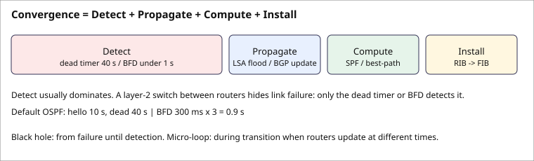

*شکل: چهار مرحله‌ی Convergence؛ Detect معمولاً غالب است.*

### ۵) مثال حل‌شده

**شرایط:** R1—SW—R2 (سوئیچ لایه ۲ بین آن‌ها)، OSPF Area 0، Hello 10/Dead 40. پورت سوئیچ سمت R2 کابلش کشیده می‌شود. R1 همچنان Up می‌بیند.

``` text
t=0 s     cable on SW->R2 pulled; R1 Gi0/0 still up (link to SW is up)
t=0..40 s R1 keeps sending packets to R2 via the dead path (black hole)
t=40 s    Dead timer expires on R1: neighbor Down
t=40.05   SPF recalculated; backup route (via R3) installed
t=40.1    traffic flows via backup path
Outage ~= 40 s
```

**راه‌حل‌ها و مقایسه:**

| راه‌حل | زمان قطعی تقریبی | یادداشت |
|---|---|---|
| پیش‌فرض | ~40 s | بدون هزینه |
| Fast Hello 1/4 | ~4 s | بار Hello 10 برابر |
| BFD 300×3 | ~1 s | نیاز به پشتیبانی دو سر |
| لینک مستقیم بدون سوئیچ | ~0.1 s (Carrier) | تغییر طراحی |

**مثال سخت:** در شبکه‌ی دو فایروال (فصل ۱۵)، Active/Standby با OSPF و لینک از طریق سوئیچ‌های L2 وصل است. تیم می‌گوید «Failover ما ۴۰ ثانیه است». با اعداد بالا بگویید دقیقاً چه چیزی مقصر است و دو راه اصلاح با ریسک هر کدام.

### ۶) طراحی و تصمیم‌گیری

| نیاز | پیشنهاد | دلیل |
|---|---|---|
| لینک بین روتر و فایروال از سوئیچ می‌گذرد | BFD یا Fast Hello | Carrier Loss دیده نمی‌شود |
| لینک WAN/ISP | IP SLA/Track یا BFD (اگر ISP پشتیبانی کند) | Up بودن Interface کافی نیست |
| شبکه‌ی پرنوسان (لینک ناپایدار) | زمان‌های محافظه‌کارانه + Dampening | جلوگیری از Flap |
| VoIP/Real-time | زیر ۱ ثانیه (BFD) | حساسیت Jitter |

اصل طراحی: **سریع‌ترین Convergence همیشه بهترین نیست؛ سریع‌ترین ممکنِ پایدار بهترین است.**

### ۷) پیاده‌سازی (CLI Cisco، نمونه)

``` text
R1(config)# interface GigabitEthernet0/0
R1(config-if)# ip ospf hello-interval 1
R1(config-if)# ip ospf dead-interval 4

! BFD (example, requires support on both ends and platform)
R1(config-if)# bfd interval 300 min_rx 300 multiplier 3
R1(config)# router ospf 1
R1(config-router)# bfd all-interfaces

R1# show ip ospf interface GigabitEthernet0/0
R1# show bfd neighbors
R1# show ip ospf neighbor
```

> **هشدار:** Hello/Dead باید در دو سر یکی باشد؛ در غیر این صورت همسایگی برقرار نمی‌شود. روی vIOS پشتیبانی BFD `Unverified` است.

### ۸) Troubleshooting

| علامت | شاهد | علت محتمل |
|---|---|---|
| Failover ~40 ثانیه | `show ip ospf neighbor` Dead Time | Detect فقط با Dead Timer |
| همسایگی Flap می‌شود | `%OSPF-5-ADJCHG` مکرر | زمان‌ها خیلی تهاجمی/لینک ناپایدار |
| Route پشتیبان نصب نمی‌شود | `show ip route`، `show ip ospf database` | AD/Cost/LSDB ناقص |
| بعد از Failover بعضی Sessionها نمی‌آیند | Session Table فایروال | State قبلی/NAT (فصل ۱۳، ۲۲) |

### ۹) نکات امنیتی

- BFD و Hello سریع را روی لینک‌های غیرقابل‌اعتماد با Authentication محافظت کنید (OSPF Authentication، بخش‌های فصل ۸).
- Timerهای تهاجمی می‌توانند در حمله‌ی DoS روی لینک، شبکه را ناپایدار کنند.
- Failover بی‌شواهد می‌تواند ترافیک را از مسیر «بازرسی‌نشده» (دور از فایروال) عبور دهد؛ پس مسیر پشتیبان هم باید از Policy امنیتی عبور کند.

### ۱۰) جمع‌بندی مفهومی

- Convergence = Detect + Propagate + Compute + Install؛ Detect معمولاً غالب است.
- پیش‌فرض OSPF: Dead 40 s؛ سوئیچ L2 میانی خرابی لینک را پنهان می‌کند.
- BFD و Fast Hello زمان Detect را کم می‌کنند، با هزینه‌ی پایداری.
- Floating Static بدون Track قطع پنهان ISP را نمی‌بیند.
- Convergence را باید در Lab اندازه گرفت (با ping پیوسته و timestamp)، نه حدس زد.

### ۱۱) تمرین و ارزیابی

**ت1.** (ساده) چهار مرحله‌ی Convergence را نام ببرید. *(پاسخ: 5-7-ت1)*

**ت2.** (ساده) Dead interval پیش‌فرض OSPF روی Ethernet چند ثانیه است؟ *(پاسخ: 5-7-ت2)*

**ت3.** (متوسط) BFD با interval 200 ms و multiplier 4 چه زمان Detect دارد؟ *(پاسخ: 5-7-ت3)*

**ت4.** (متوسط) چرا قطع کابل بین سوئیچ و روتر، Interface روتر مقابل را Down نمی‌کند؟ *(پاسخ: 5-7-ت4)*

**ت5.** (سخت) یک IP SLA با frequency 10 ثانیه و آستانه‌ی ۳ شکست متوالی دارید. بدترین زمان Detect را حساب کنید و بگویید برای VoIP قابل‌قبول است؟ *(پاسخ: 5-7-ت5)*

**ت6.** (سخت، طراحی) برای دو فایروال Active/Standby که با دو سوئیچ به روترها وصل‌اند، سه گزینه‌ی کاهش زمان Failover را با مزایا و ریسک مقایسه کنید. *(پاسخ: 5-7-ت6)*

**م1.** Black Hole چیست؟ *(پاسخ: 5-7-م1)*

**م2.** چرا Timer تهاجمی ممکن است شبکه را بی‌ثبات کند؟ *(پاسخ: 5-7-م2)*

**Q1.** Quick quiz (English): Which convergence phase usually dominates, and why? *(پاسخ: 5-7-Q1)*

### ۱۲) اصطلاحات و English Corner

| مخفف | شکل کامل | معنی |
|---|---|---|
| BFD | Bidirectional Forwarding Detection | تشخیص سریع خرابی مسیر |
| SPF | Shortest Path First | الگوریتم محاسبه‌ی مسیر |
| LSA | Link-State Advertisement | بسته‌ی اعلام وضعیت لینک |
| MRAI | Minimum Route Advertisement Interval | حداقل فاصله‌ی ارسال تغییر مسیر در BGP |
| Flap | Route/Link flap | قطع/وصل مکرر |
| Micro-loop | Micro-loop | حلقه‌ی کوتاه‌مدت هنگام همگرایی |

- *Convergence is complete when all routers have a consistent view of the topology.* ← وقتی همه‌ی روترها تصویر یکسانی از توپولوژی داشته باشند، Convergence کامل است.
- *Detection time dominates failover when a switch masks link failures.* ← وقتی سوئیچ خرابی لینک را پنهان کند، زمان تشخیص بر Failover غالب می‌شود.

### ۱۳) منابع

- RFC 2328 — OSPF Version 2 (Hello/Dead، SPF).
- RFC 5880 — Bidirectional Forwarding Detection (BFD).
- Cisco: «OSPF Support for Fast Hello Packets» و «Bidirectional Forwarding Detection» (IOS XE Configuration Guides).


## پاسخ‌های فصل 5

> ابتدا بدون نگاه حل کنید. شناسه: درس-نوع+شماره (ت = تمرین، م = مرور، Q = Quick quiz).

**5-1-ت1** — ۱ (ساده): L و C چه فرقی دارند؟

``` text
C = the connected network (prefix); L = the local router address on it (/32).
```

**5-1-ت2** — ۲ (ساده): AD برای Static و OSPF؟

``` text
Static 1, OSPF 110
```

**5-1-ت3** — ۳ (متوسط): بسته به 10.1.1.77؛ Routeهای /8، /16 و /0 موجودند. کدام؟

``` text
/16 (longest matching prefix among those that match).
```

**5-1-ت4** — ۴ (متوسط): آیا Metric یک Route در OSPF با RIP قابل مقایسه است؟

``` text
No. Different protocols use different metrics; AD decides between sources.
```

**5-1-ت5** — ۵ (سخت): Static 10.0.0.0/8 و OSPF 10.0.23.0/30 هر دو موجود؛ بسته به 10.0.23.5 از کجا می‌رود؟

``` text
Via the OSPF route: /30 is the longest prefix. AD is only used for identical prefixes.
```

**5-1-م1** — اولین چیزی که روتر برای انتخاب Route نگاه می‌کند؟

طول Prefix (Longest Prefix Match).

**5-1-م2** — AD برای چیست؟

انتخاب بین منابع مختلف Route برای یک Prefix یکسان.

**5-1-Q1** — Quick quiz (answer in English): Which is compared first: administrative distance or prefix length?

Prefix length (longest match) is compared first; AD only breaks ties between equal prefixes.

**5-2-ت1** — ۱ (ساده): Static برای شبکه‌ی 172.16.5.0/24 با Next-hop 10.0.0.2

``` text
ip route 172.16.5.0 255.255.255.0 10.0.0.2
```

**5-2-ت2** — ۲ (ساده): چرا روی اترنت Next-hop می‌نویسیم؟

``` text
Interface-only routes make the router ARP for every destination; next-hop is deterministic.
```

**5-2-ت3** — ۳ (متوسط): Summary چهار شبکه‌ی 10.2.4.0/24 تا 10.2.7.0/24؟

``` text
Third octet 4..7 -> block 4 -> 10.2.4.0/22
```

**5-2-ت4** — ۴ (متوسط): ping یک‌طرفه شکست می‌خورد؛ علت؟

``` text
Missing return route on one of the hops.
```

**5-2-ت5** — ۵ (سخت): چرا Route به Null0 با AD 200؟

``` text
To drop unmatched traffic inside a summary without overriding real (more specific or lower AD) routes.
```

**5-2-م1** — Static Route کی مناسب است؟

شبکه‌ی کوچک یا لینک‌های ثابت مثل Default به ISP.

**5-2-م2** — چرا مسیر برگشت مهم است؟

ارتباط دوطرفه است؛ بدون Route برگشت پاسخ نمی‌رسد.

**5-2-Q1** — Quick quiz (answer in English): Why do we avoid exit-interface-only static routes on Ethernet?

The router must ARP for every destination, relying on proxy ARP.

**5-3-ت1** — ۱ (ساده): AD پیش‌فرض Static و Floating معمول؟

``` text
Static default AD = 1; floating backup typically 200 (any value higher than the primary).
```

**5-3-ت2** — ۲ (ساده): چرا 0.0.0.0 0.0.0.0 همه‌ی مقاصد را می‌پوشاند؟

``` text
Prefix length 0 matches every address; it is only used when nothing longer matches.
```

**5-3-ت3** — ۳ (متوسط): چرا Floating به‌تنهایی کافی نیست؟

``` text
The static route stays installed while the interface is up, even if the ISP is dead.
```

**5-3-ت4** — ۴ (متوسط): دستور Route وابسته به Track؟

``` text
ip route 0.0.0.0 0.0.0.0 203.0.113.1 track 1
```

**5-3-ت5** — ۵ (سخت): چه چیزی را باید پروب کنیم؟

``` text
The next-hop and ideally something beyond it (a reliable remote address) to detect upstream failure.
```

**5-3-م1** — Floating Static چیست؟

Route پشتیبان با AD بالاتر که فقط با حذف Route اصلی فعال می‌شود.

**5-3-م2** — IP SLA برای چیست؟

سنجش سلامت واقعی مسیر تا Failover درست انجام شود.

**5-3-Q1** — Quick quiz (answer in English): Why can a static route stay in the table even if the ISP is down?

Because it depends on the local interface state, not on end-to-end reachability.

**5-4-ت1** — ۱ (ساده): سه مرحله‌ی کار OSPF؟

``` text
1) discover neighbors 2) exchange LSAs to build the same LSDB 3) run SPF to compute best paths
```

**5-4-ت2** — ۲ (ساده): Hello/Dead پیش‌فرض اترنت؟

``` text
10 s / 40 s
```

**5-4-ت3** — ۳ (متوسط): Cost لینک 1 Gbps با Reference 100 Mbps؟

``` text
100 / 1000 = 0.1 -> rounded up to 1
```

**5-4-ت4** — ۴ (متوسط): Cost لینک 100 Mbps با Reference 10000؟

``` text
10000 / 100 = 100
```

**5-4-ت5** — ۵ (سخت): دو روتر در Init مانده‌اند؛ علت‌های محتمل؟

``` text
Hello not received on one side: ACL blocking, hello/dead mismatch, subnet/mask mismatch, wrong interface in OSPF.
```

**5-4-م1** — OSPF چه نوع پروتکلی است؟

Link-State؛ هر روتر نقشه‌ی کامل Area را دارد.

**5-4-م2** — Hello و Dead چیست؟

Hello برای معرفی دوره‌ای؛ Dead زمان انتظار قبل از اعلام قطع همسایه.

**5-4-Q1** — Quick quiz (answer in English): What are the three steps of OSPF operation?

Form neighbor adjacencies, exchange LSAs to build the LSDB, and run SPF to calculate best paths.

**5-5-ت1** — ۱ (ساده): Wildcard برای /27؟

``` text
255.255.255.255 - 255.255.255.224 = 0.0.0.31
```

**5-5-ت2** — ۲ (ساده): چرا Loopback را passive می‌کنیم؟

``` text
It does not need to form neighbors but its network must be advertised.
```

**5-5-ت3** — ۳ (متوسط): Cost 21 در R1 برای شبکه‌ی R3 را توضیح بده

``` text
Two links of 10 each (R1-R2, R2-R3) plus 1 for the Loopback = 21.
```

**5-5-ت4** — ۴ (متوسط): state ExStart گیر کرده؛ علت؟

``` text
Typically an MTU mismatch (or duplicate router ID).
```

**5-5-ت5** — ۵ (سخت): default-information originate بدون Default روی روتر چه می‌شود؟

``` text
Nothing is advertised unless "always" is used; the router needs its own default route.
```

**5-5-م1** — network statement چه می‌کند؟

Interfaceهایی که آدرسشان در بازه است را وارد OSPF می‌کند.

**5-5-م2** — passive-interface چه فایده‌ای دارد؟

Hello نمی‌فرستد؛ امنیت و کاهش ترافیک، ولی شبکه همچنان اعلام می‌شود.

**5-5-Q1** — Quick quiz (answer in English): Which command verifies that neighbors reached FULL?

show ip ospf neighbor

**5-6-ت1** — ۱ (ساده): اولین ابزار عیب‌یابی مسیریابی؟

``` text
show ip route <destination> and ping/traceroute.
```

**5-6-ت2** — ۲ (ساده): پنج دلیل Adjacency نشدن؟

``` text
Hello/Dead, Area, Subnet/Mask, Authentication, MTU.
```

**5-6-ت3** — ۳ (متوسط): در ExStart گیر کرده؛ اول چه چیزی را بررسی می‌کنی؟

``` text
MTU mismatch between the two interfaces.
```

**5-6-ت4** — ۴ (سخت): ping از A به B شکست می‌خورد ولی traceroute تا Hop آخر پیش می‌رود؛ حدس؟

``` text
Return path issue at the destination or an ACL/firewall on the destination side.
```

**5-6-م1** — قدم اول عیب‌یابی مسیریابی؟

تعیین مبدأ و مقصد دقیق و بررسی Route رفت و برگشت.

**5-6-م2** — MTU Mismatch چه علامتی دارد؟

همسایه در ExStart/Exchange می‌ماند.

**5-6-Q1** — Quick quiz (answer in English): A neighbor is stuck in ExStart. What is the most likely cause?

An MTU mismatch between the two interfaces.

---

<a id="ch6"></a>


### پاسخ‌های درس‌های افزوده‌ی فصل 5 (۵-۰ و ۵-۷)

**5-0-ت1** — RIB جدول مسیرهای انتخاب‌شده‌ی Control Plane است؛ FIB نسخه‌ی بهینه‌ی آن برای جست‌وجوی سریع در Data Plane. RIB را پروتکل‌ها می‌سازند و FIB از RIB ساخته می‌شود.

**5-0-ت2** — MAC مقصد تغییر می‌کند (هدر L2 دوباره ساخته می‌شود) و TTL یکی کم می‌شود. IP مقصد بدون NAT ثابت می‌ماند.

**5-0-ت3** — با فقط Interface خروجی روی Ethernet، روتر برای هر مقصد جداگانه ARP می‌فرستد و به Proxy ARP طرف مقابل وابسته می‌شود؛ جدول ARP بزرگ و شکننده می‌شود. Next-hop (یا هر دو) درست‌تر است.

**5-0-ت4** — خیر، نصب نمی‌شود. Next-hop 10.0.0.9 قابل Recursive Lookup نیست (در هیچ Connected یا مسیر دیگر نیست)، پس Route معتبر نیست و در RIB دیده نمی‌شود (در پیکربندی هست، در جدول نه).

**5-0-ت5** — بسته‌ی اول چون Adjacency ناقص است ARP می‌فرستد و Drop می‌شود؛ پس از پاسخ ARP، بسته‌های بعدی ارسال می‌شوند. شاهد: `show ip route` Route درست را نشان می‌دهد؛ `show adjacency` قبلاً Incomplete و بعداً کامل است؛ `show ip arp` ورودی بعد از ping اول ساخته می‌شود.

**5-0-ت6** — CoPP/محدودسازی: SSH/SNMP/NTP فقط از شبکه‌ی مدیریت (ACL روی VTY و Class برای ترافیک مدیریتی)، پروتکل‌های مسیریابی فقط از همسایه‌های شناخته‌شده، ICMP به روتر نرخ‌محدود؛ بقیه‌ی ترافیک Punt محدود یا رد شود. هدف: CPU با ترافیک مهاجم اشباع نشود و Control Plane زنده بماند.

**5-0-م1** — Punt یعنی بسته‌ای که باید در CPU (Control Plane) پردازش شود، نه در مسیر سریع؛ مثل ترافیک مقصد‌ روتر یا TTL=1.

**5-0-م2** — چون ARP برای Next-hop هنوز حل نشده؛ بسته‌ی اول معمولاً Drop می‌شود و ARP می‌رود.

**5-0-Q1** — The control plane builds the RIB and FIB; the data plane uses the FIB (and adjacency table) to forward packets.

**5-7-ت1** — Detect، Propagate، Compute (SPF)، Install (RIB/FIB).

**5-7-ت2** — 40 ثانیه (Hello 10 ثانیه، Dead چهار برابر آن).

**5-7-ت3** — 200 ms × 4 = 800 ms.

**5-7-ت4** — چون لینک روتر به سوئیچ هنوز برقرار است؛ Carrier روتر قطع نشده. فقط Dead Timer یا BFD خرابی را می‌فهمد.

**5-7-ت5** — بدترین حالت حدود 10 × 3 = 30 ثانیه (به‌علاوه‌ی تا یک فاصله‌ی Probe برای شروع). برای VoIP قابل‌قبول نیست؛ BFD یا Probe سریع‌تر لازم است.

**5-7-ت6** — (۱) Fast Hello/Dead: ساده، بار CPU و ریسک Flap. (۲) BFD: Detect زیر یک ثانیه، نیاز به پشتیبانی دو سر و پیکربندی بیشتر. (۳) حذف سوئیچ میانی/Link-state tracking: Carrier Loss فوری، ولی تغییر طراحی. انتخاب بر پایه‌ی پشتیبانی پلتفرم و تحمل Flap.

**5-7-م1** — دوره‌ای که مسیر خراب هنوز در جدول است و بسته‌ها در آن ناپدید می‌شوند.

**5-7-م2** — چون خرابی‌های کوتاه (Jitter لینک) را «قطع» می‌گیرند و Flap و محاسبات پیاپی SPF رخ می‌دهد.

**5-7-Q1** — Detection usually dominates, because dead timers or probes take seconds while propagation, SPF and installation take milliseconds.


# فصل 6 — Routing II: OSPF پیشرفته، IPv6 و FHRP (Lab A)

**مدت:** ۳۶ ساعت | **پیش‌نیاز:** فصل ۵.
**اهداف:** DR/BDR، OSPF چندناحیه‌ای، OSPFv3، HSRP، Lab A کامل؛ **Gate G3**.
**معیار تسلط:** Failover با Track؛ ABR و خلاصه‌سازی؛ As-Built Lab A.
**اشتباهات رایج:** دو Gateway برای یک VLAN؛ Preempt خاموش؛ Track فراموش‌شده.

**درس‌های فصل:**
- [درس 6-1 — DR/BDR، Network Type و Cost](#l-6-1)
- [درس 6-2 — OSPF چندناحیه‌ای](#l-6-2)
- [درس 6-3 — OSPFv3 و IPv6](#l-6-3)
- [درس 6-4 — HSRP و FHRP](#l-6-4)
- [درس 6-5 — پیاده‌سازی Lab A](#l-6-5)
- [درس 6-6 — عیب‌یابی و آزمون G3](#l-6-6)

---

<a id="l-6-1"></a>

## درس 6-1 — DR/BDR، Network Type و Cost

**فصل ۶ - روز ۱ · پیش‌نیاز: فصل ۵ · ۶ ساعت**

### این درس درباره چیست و چرا باید یاد بگیریم؟

**چه چیزی یاد می‌گیریم:** رفتار OSPF روی لینک‌های اشتراکی (اترنت): انتخاب DR و BDR، انواع شبکه (Network Type)، تنظیم Cost و سرعت شناسایی قطع (Timer، BFD به‌صورت مفهومی).

**چرا لازم است:** روی یک سوییچ با ۱۰ روتر، اگر همه با همه همسایه شوند ۴۵ همسایگی داریم. DR این را به ۱۰ ساده می‌کند. ولی اگر ندانید DR چیست، نمی‌توانید بفهمید چرا «همسایه‌ها در 2-Way مانده‌اند» که کاملاً عادی است.

- **در کار روزانه:** وقتی در show ip ospf neighbor حالت 2WAY/DROTHER می‌بینید، باید بدانید خطا نیست.
- **در امنیت:** Priority مناسب جلوی DR شدن روتر ناخواسته را می‌گیرد.
- **در Capstone:** لینک‌های نقطه‌به‌نقطه را point-to-point می‌کنیم تا DR لازم نشود.

> **مسیر درس**
>
> مشکل ← DR/BDR ← انتخاب ← Network Type ← Cost و Timer ← مثال ساده/متوسط/سخت ← Lab ← عیب‌یابی.

#### اصطلاحات این درس (مخفف ← شکل کامل ← معنی)

| مخفف         | شکل کامل انگلیسی                   | معنی فارسی                            |
|--------------|------------------------------------|---------------------------------------|
| DR           | Designated Router                  | روتر هماهنگ‌کننده‌ی یک Segment          |
| BDR          | Backup Designated Router           | DR پشتیبان                            |
| DROther      | DROther                            | روتر غیر DR/BDR                       |
| Priority     | OSPF Priority                      | اولویت انتخاب DR (پیش‌فرض ۱)           |
| Network Type | OSPF Network Type                  | نوع لینک: broadcast یا point-to-point |
| 224.0.0.5    | AllSPFRouters                      | Multicast همه‌ی روترهای OSPF           |
| 224.0.0.6    | AllDRouters                        | Multicast ویژه‌ی DR/BDR                |
| BFD          | Bidirectional Forwarding Detection | شناسایی سریع قطع لینک                 |

### ۱. مشکل: همه با همه

فرض کنید ۵ روتر روی یک سوییچ هستند. اگر هر روتر با هر روتر دیگر «همسایه‌ی کامل» (Full) شود، تعداد Adjacency می‌شود:

``` text
n routers, full mesh adjacencies = n x (n - 1) / 2
n = 5  -> 5 x 4 / 2   = 10
n = 10 -> 10 x 9 / 2  = 45
```

و هر تغییر، همه را درگیر می‌کند. راه‌حل: یک «سخنگو» انتخاب کنیم.

### ۲. DR و BDR

روی هر شبکه‌ی Broadcast (مثل اترنت) OSPF یک **DR** و یک **BDR** انتخاب می‌کند. هر روتر فقط با DR و BDR به حالت Full می‌رسد؛ با بقیه‌ی روترها (DROther) فقط تا 2-Way می‌ماند و این کاملاً طبیعی است.

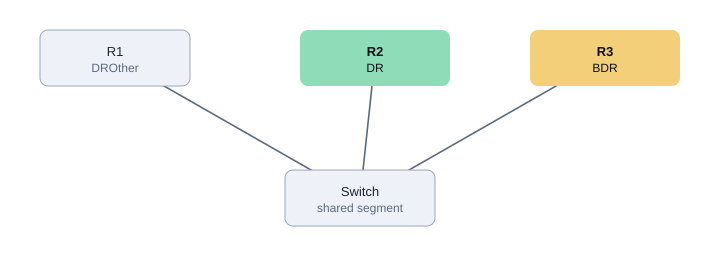

*شکل ۱: روی Segment مشترک، R2 DR و R3 BDR است؛ R1 فقط با این دو Full می‌شود.*

| رابطه             | حالت         |
|-------------------|--------------|
| DROther ↔ DROther | 2-Way (عادی) |
| DROther ↔ DR      | Full         |
| DROther ↔ BDR     | Full         |
| DR ↔ BDR          | Full         |

#### انتخاب DR

1.  بالاترین Priority (پیش‌فرض ۱؛ ۰ یعنی هرگز DR نشو).
2.  اگر برابر بود، بالاترین Router ID.

> **نکته‌ی مهم**
>
> انتخاب DR «غیرقابل‌پس‌گرفتن» است (Non-preemptive): اگر روتری با Priority بالاتر بعد از انتخاب وارد شود، DR فعلی کنار نمی‌رود، تا زمانی که OSPF Process دوباره راه بیفتد.

``` text
R2(config)# interface gi0/0
R2(config-if)# ip ospf priority 100
R1(config)# interface gi0/0
R1(config-if)# ip ospf priority 0      ! never become DR
R1# clear ip ospf process               ! re-run the election (careful)
```

### ۳. Network Type

روی لینک نقطه‌به‌نقطه (فقط دو روتر)، DR بی‌معنی است. با تغییر نوع به point-to-point، DR انتخاب نمی‌شود و همگرایی هم سریع‌تر است:

| نوع               | DR؟ | Hello/Dead | کاربرد               |
|-------------------|-----|------------|----------------------|
| broadcast (اترنت) | بله | 10/40      | پیش‌فرض اترنت         |
| point-to-point    | خیر | 10/40      | لینک دو روتر (توصیه) |
| non-broadcast     | بله | 30/120     | Frame Relay قدیمی    |

``` text
R1(config)# interface gi0/1
R1(config-if)# ip ospf network point-to-point
R2(config)# interface gi0/0
R2(config-if)# ip ospf network point-to-point   ! both ends the same
```

اگر یک سر broadcast و سر دیگر point-to-point باشد، همسایگی بالا می‌آید ولی Routeها نامعتبر می‌شود (مشکل رایج). همیشه دو سر را هم‌نوع کنید.

### ۴. تنظیم Cost برای هدایت ترافیک

``` text
R1(config)# interface gi0/1
R1(config-if)# ip ospf cost 50
Cost = Reference / bandwidth, or any manual value 1..65535
SPF picks the path with the lowest TOTAL cost
```

مثال: دو مسیر به یک مقصد داریم؛ لینک ۱ گیگی (Cost 10) و لینک پشتیبان ۱۰۰ مگی (Cost 100). روتر مسیر ۱ گیگ را انتخاب می‌کند. اگر بخواهید پشتیبان نباشد، با Cost دستی مسیر را عوض کنید.

### ۵. سرعت شناسایی قطع

با تایمر پیش‌فرض (Dead = 40 ثانیه)، قطع یک همسایه تا ۴۰ ثانیه دیر شناخته می‌شود. دو راه: کاهش Hello/Dead (تا ۱ ثانیه با `fast-hello`) یا BFD که در میلی‌ثانیه تشخیص می‌دهد. BFD فقط مفهومی و Unverified در Lab ماست.

``` text
R1(config-if)# ip ospf hello-interval 1
R1(config-if)# ip ospf dead-interval 4
(both ends must match; too aggressive timers cause flapping)
```

### ۶. مثال‌ها

#### ساده

``` text
show ip ospf neighbor
3.3.3.3  1  FULL/BDR   ...
2.2.2.2  1  FULL/DR    ...
```

#### متوسط: چرا 2WAY/DROTHER؟

``` text
R1 neighbor R4: state 2WAY/DROTHER
Both are DROthers -> normal, not an error
```

#### سخت: DR اشتباه

``` text
Old switch router became DR (highest router ID)
Fix: set priority 100 on the core router, priority 0 on edge routers,
     then clear ip ospf process (maintenance window)
```

### تمرین‌ها

**ت1.** ۱ (ساده): چند Adjacency برای ۶ روتر در Full Mesh؟ *(پاسخ: 6-1-ت1 در بخش «پاسخ‌ها» انتهای فصل)*

**ت2.** ۲ (ساده): DROther با DROther چه حالتی؟ *(پاسخ: 6-1-ت2 در بخش «پاسخ‌ها» انتهای فصل)*

**ت3.** ۳ (متوسط): انتخاب DR بر چه اساسی؟ *(پاسخ: 6-1-ت3 در بخش «پاسخ‌ها» انتهای فصل)*

**ت4.** ۴ (متوسط): چه زمانی point-to-point؟ *(پاسخ: 6-1-ت4 در بخش «پاسخ‌ها» انتهای فصل)*

**ت5.** ۵ (سخت): چرا بعد از تغییر Priority، DR عوض نشد؟ *(پاسخ: 6-1-ت5 در بخش «پاسخ‌ها» انتهای فصل)*

### Lab هدایت‌شده

سه روتر روی یک سوییچ (SW1) در یک Segment مشترک: R1، R2، R3 با Gi0/0 به SW1 وصل‌اند، شبکه‌ی 10.10.100.0/24 (آدرس‌ها .1 .2 .3).

#### گام ۱: OSPF روی Segment مشترک

``` text
Rx(config)# router ospf 1
Rx(config-router)# network 10.10.100.0 0.0.0.255 area 0
Rx# show ip ospf neighbor
```

DR و BDR را بخوانید (Router ID بالاتر DR می‌شود). نتیجه را یادداشت کنید.

#### گام ۲: تغییر Priority

``` text
R1(config)# interface gi0/0
R1(config-if)# ip ospf priority 100
R1# clear ip ospf process
```

دوباره show ip ospf neighbor: آیا R1 DR شد؟

#### گام ۳: point-to-point روی لینک دو روتر

یک لینک مستقیم R1-R2 با `ip ospf network point-to-point` در هر دو سر؛ مشاهده کنید حالت FULL/- بدون DR است.

### Lab مستقل

جدول «DR/BDR/DROther هر Segment» و Priorityها را در `03-ops/ospf-dr-plan.md` بنویسید.

### عیب‌یابی

|         |                                                                            |
|---------|----------------------------------------------------------------------------|
| Symptom | همسایه‌ها 2WAY مانده‌اند                                                     |
| تحلیل   | اگر هر دو DROther هستند، طبیعی است                                         |
| چک‌لیست  | ۱) DR/BDR موجود است؟ ؛ ۲) Priority دو طرف؟ ؛ ۳) نوع شبکه دو سر هم‌خوان است؟ |
| رفع     | تنظیم Priority یا point-to-point                                           |

### سؤال‌های مرور

**م1.** DR چرا لازم است؟ *(پاسخ: 6-1-م1 در بخش «پاسخ‌ها» انتهای فصل)*

**م2.** Network Type چه تأثیری دارد؟ *(پاسخ: 6-1-م2 در بخش «پاسخ‌ها» انتهای فصل)*

### English Corner: انگلیسی تخصصی این درس

این جمله‌ها از مستندات و محیط کار واقعی‌اند. بلند بخوانید و ترجمه را بپوشانید.

| English sentence                                                    | ترجمه                                                 |
|---------------------------------------------------------------------|-------------------------------------------------------|
| The DR reduces the number of adjacencies on a multi-access segment. | DR تعداد Adjacency را در Segment چندمسیره کم می‌کند.   |
| DROther routers stay in 2-Way with each other.                      | روترهای DROther با هم در 2-Way می‌مانند.               |
| Set the network type to point-to-point on two-router links.         | روی لینک دو روتر، نوع شبکه را point-to-point بگذارید. |
| DR election is non-preemptive.                                      | انتخاب DR غیرقابل‌پس‌گیری (Non-preemptive) است.         |

**Q1.** Quick quiz (answer in English): Why is 2-Way between two DROthers normal? *(پاسخ: 6-1-Q1 در بخش «پاسخ‌ها» انتهای فصل)*

### تکلیف و چک‌لیست تسلط

- [ ] DR/BDR را در Lab ببینم و تغییر دهم.
- [ ] point-to-point را تست کنم.
- [ ] جدول Priority را بنویسم.

### یادآوری اشتباهات شما

> **یادآوری**
>
> پیش‌بینی قبل از اجرا؛ بکاپ قبل از تغییر؛ پذیرفته‌شدن دستور ≠ کار کردن؛ فرمول‌ها در بلوک مستقل.


#### کارت Lab — DR/BDR، Network Type و Cost

| # | فیلد | محتوا |
|---|---|---|
| 1 | عنوان و هدف | DR/BDR و Network Type |
| 2 | پیش‌نیاز | فصل 5 |
| 3 | توپولوژی | ۳ روتر + سوییچ |
| 4 | تجهیزات | R1-R3 + SW1 |
| 5 | نسخه نرم‌افزار | vIOS-L2 15.2(20200924، Experimental) برای SW؛ vIOS 15.9(3)M9 برای R؛ VPCS؛ PNetLab 4.2.8 |
| 6 | IP Plan | OSPF area 0 |
| 7 | وضعیت اولیه | Segment مشترک |
| 8 | صورت مسئله | Priority و p2p |
| 9 | مراحل هدایت‌شده | همان بخش «Lab هدایت‌شده» همین درس |
| 10 | تست عملکرد | `show ip ospf neighbor` |
| 11 | سناریوی خرابی | DROther 2WAY |
| 12 | روش عیب‌یابی | لایه‌ای/با شواهد (بخش عیب‌یابی همین درس) |
| 13 | نتیجه‌ی مورد انتظار | DR/BDR تعیین |
| 14 | معیار پذیرش | ثبت نقش‌ها |
| 15 | مستندات نهایی | `03-ops/ospf-dr-plan.md` |
| 16 | Cleanup و بازگردانی | — |

> **وضعیت راستی‌آزمایی (خارج از ۱۶ فیلد):** **اجرا نشده (فقط طراحی).** اجرا نشده.

---

<a id="l-6-2"></a>

## درس 6-2 — OSPF چندناحیه‌ای

**فصل ۶ - روز ۲ · پیش‌نیاز: درس ۶-۱ · ۶ ساعت**

### این درس درباره چیست و چرا باید یاد بگیریم؟

**چه چیزی یاد می‌گیریم:** چرا OSPF را به چند ناحیه (Area) تقسیم می‌کنیم، نقش ABR و ASBR، انواع LSA به‌صورت خلاصه، خلاصه‌سازی بین ناحیه‌ها و انواع Stub Area.

**چرا لازم است:** در شبکه‌ی بزرگ، یک Area واحد یعنی هر تغییر کوچک در یک شعبه همه‌ی روترها را وادار به اجرای SPF می‌کند و جداول بزرگ می‌شوند. Areaها این تغییرات را محلی نگه می‌دارند و پایداری و مقیاس را بالا می‌برند.

- **در کار روزانه:** سازمان‌های چندشعبه‌ای از Area برای هر شعبه یا هر منطقه استفاده می‌کنند.
- **در امنیت:** Area مرز دسترسی نیز هست؛ می‌توان Routeهای ناخواسته را جلوی ورود به Area گرفت.
- **در Capstone:** Lab A می‌تواند ۲ Area (مرکز و شعبه) داشته باشد.

> **مسیر درس**
>
> چرا Area ← قانون Area 0 ← ABR/ASBR ← LSAها ← خلاصه‌سازی ← Stub ← Lab ← عیب‌یابی.

#### اصطلاحات این درس (مخفف ← شکل کامل ← معنی)

| مخفف     | شکل کامل انگلیسی                  | معنی فارسی                                       |
|----------|-----------------------------------|--------------------------------------------------|
| Area     | OSPF Area                         | ناحیه‌ی OSPF                                      |
| Backbone | Backbone Area 0                   | ناحیه‌ی مرکزی که همه‌ی Areaها باید به آن وصل باشند |
| ABR      | Area Border Router                | روتر مرزی بین دو Area                            |
| ASBR     | Autonomous System Boundary Router | روتر مرز با دنیای خارج OSPF                      |
| LSA      | Link-State Advertisement          | اعلان وضعیت لینک                                 |
| Stub     | Stub Area                         | ناحیه‌ای که Routeهای خارجی را نمی‌گیرد             |
| Summary  | Inter-area summary                | خلاصه‌سازی در ABR                                 |

### ۱. چرا Area؟

یک شهر بزرگ را به محله تقسیم می‌کنند؛ هر محله نقشه‌ی دقیق خودش را دارد و برای بقیه‌ی شهر فقط «خلاصه» می‌داند. OSPF هم همین‌طور: داخل هر Area نقشه‌ی کامل، و بین Areaها فقط خلاصه.

- تغییر لینک در یک Area فقط همان Area را به SPF می‌اندازد.
- جدول LSDB کوچک‌تر می‌شود.
- امکان خلاصه‌سازی مسیرها.

### ۲. قانون مهم: همه‌ی Areaها به Area 0 وصل

ترافیک بین دو Area معمولی باید از Area 0 (Backbone) بگذرد. Area 0 مثل بزرگراه مرکزی است و همه‌ی محله‌ها به آن راه دارند.

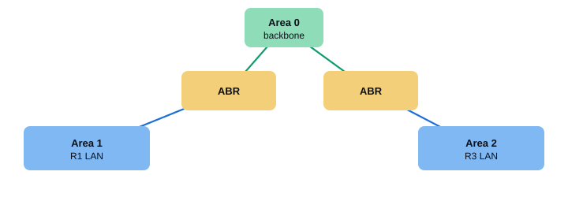

*شکل ۱: Area 1 و Area 2 از طریق ABRها به Area 0 وصل‌اند.*

### ۳. ABR و ASBR

| نقش             | تعریف                                                         | کار                              |
|-----------------|---------------------------------------------------------------|----------------------------------|
| Internal Router | همه‌ی Interfaceها در یک Area                                   | فقط LSDB همان Area               |
| ABR             | Interfaceها در دو Area یا بیشتر (یکی Area 0)                  | خلاصه و جابه‌جایی مسیر بین Areaها |
| ASBR            | Route را از پروتکل/منبع دیگر وارد OSPF می‌کند (Static، BGP...) | تزریق Route خارجی                |

``` text
R2(config)# router ospf 1
R2(config-router)# network 10.0.12.0 0.0.0.3 area 1
R2(config-router)# network 10.0.23.0 0.0.0.3 area 0
-> R2 has interfaces in area 1 and area 0 = ABR
```

### ۴. LSAها (به‌صورت خلاصه)

| نوع | نام          | کجا پخش می‌شود    | محتوا                           |
|-----|--------------|------------------|---------------------------------|
| 1   | Router LSA   | داخل Area        | لینک‌های یک روتر                 |
| 2   | Network LSA  | داخل Area        | Segment و روترهایش (توسط DR)    |
| 3   | Summary LSA  | بین Areaها (ABR) | Routeهای یک Area برای Area دیگر |
| 4   | ASBR Summary | بین Areaها       | مسیر رسیدن به ASBR              |
| 5   | External LSA | کل Domain        | Route خارجی (از ASBR)           |

در جدول مسیریابی: `O` یعنی Intra-area، `O IA` یعنی Inter-area (از LSA نوع ۳)، `O E1/E2` یعنی Route خارجی.

### ۵. خلاصه‌سازی در ABR

ABR می‌تواند چند شبکه‌ی ریز یک Area را به یک خلاصه تبدیل کند:

``` text
Area 1 networks: 10.1.0.0/24, 10.1.1.0/24, 10.1.2.0/24, 10.1.3.0/24
Summary: 10.1.0.0/22
```

``` text
R2(config)# router ospf 1
R2(config-router)# area 1 range 10.1.0.0 255.255.252.0
```

اثر: بقیه‌ی Areaها فقط یک Route (10.1.0.0/22) می‌بینند؛ تغییر یک شبکه‌ی ریز دیگر در سراسر شبکه پخش نمی‌شود.

### ۶. Stub Area

شعبه‌ای که فقط یک راه خروج دارد، نیازی ندارد همه‌ی Routeهای خارجی را بداند؛ کافی است یک Default Route از ABR بگیرد:

| نوع            | Routeهای خارجی (LSA 5)       | Default از ABR |
|----------------|------------------------------|----------------|
| Stub           | بلوک                         | بله            |
| Totally Stubby | بلوک (و Inter-area هم)       | بله            |
| NSSA           | Routeهای خارجی محلی با LSA 7 | اختیاری        |

``` text
! on all routers of the area:
R3(config-router)# area 2 stub
! totally stubby (only on the ABR add "no-summary"):
R2(config-router)# area 2 stub no-summary
```

> **قانون**
>
> همه‌ی روترهای یک Area باید نوع Stub یکسان داشته باشند (flag در Hello)، وگرنه همسایه نمی‌شوند.

### ۷. مثال‌ها

#### ساده: دو Area

``` text
R1 (area 1) -- R2 (ABR) -- R3 (area 0)
R3 shows: O IA 192.168.1.0/24 via R2
```

#### متوسط: چرا نمی‌شود Area 1 را مستقیم به Area 2 وصل کرد؟

همه‌ی Areaها باید به Area 0 وصل باشند؛ بین Areaهای غیر صفر Routeها مستقیماً رد نمی‌شود (باید از ABR و Area 0 بگذرد). اگر Area 2 فقط به Area 1 وصل باشد، مسیرها به Area 2 نمی‌رسد؛ برای رفع، Virtual Link (مفهومی) یا طراحی مجدد.

#### سخت: طراحی

سازمان با مرکز و ۳ شعبه: Area 0 = مرکز، هر شعبه یک Area (۱ تا ۳)، ABR روی روتر مرز شعبه. خلاصه‌ی هر شعبه یک /22.

### تمرین‌ها

**ت1.** ۱ (ساده): ABR چیست؟ *(پاسخ: 6-2-ت1 در بخش «پاسخ‌ها» انتهای فصل)*

**ت2.** ۲ (ساده): O IA یعنی؟ *(پاسخ: 6-2-ت2 در بخش «پاسخ‌ها» انتهای فصل)*

**ت3.** ۳ (متوسط): خلاصه‌ی 10.1.4.0/24 تا 10.1.7.0/24؟ *(پاسخ: 6-2-ت3 در بخش «پاسخ‌ها» انتهای فصل)*

**ت4.** ۴ (متوسط): چرا Stub باید روی همه‌ی روترهای Area باشد؟ *(پاسخ: 6-2-ت4 در بخش «پاسخ‌ها» انتهای فصل)*

**ت5.** ۵ (سخت): مزیت Totally Stubby؟ *(پاسخ: 6-2-ت5 در بخش «پاسخ‌ها» انتهای فصل)*

### Lab هدایت‌شده

سه روتر خطی R1—R2—R3 مثل فصل ۵. حالا R1 را در Area 1 و R3 را در Area 0 می‌گذاریم و R2 ABR می‌شود.

#### گام ۱: Areaها

``` text
R1(config)# router ospf 1
R1(config-router)# network 10.0.12.0 0.0.0.3 area 1
R1(config-router)# network 192.168.1.0 0.0.0.255 area 1

R2(config)# router ospf 1
R2(config-router)# network 10.0.12.0 0.0.0.3 area 1
R2(config-router)# network 10.0.23.0 0.0.0.3 area 0

R3(config)# router ospf 1
R3(config-router)# network 10.0.23.0 0.0.0.3 area 0
R3(config-router)# network 192.168.3.0 0.0.0.255 area 0
```

#### گام ۲: مشاهده

``` text
R3# show ip route ospf        (O IA for area 1 networks)
R2# show ip ospf database
R2# show ip ospf
```

#### گام ۳: خلاصه‌سازی

``` text
R2(config)# router ospf 1
R2(config-router)# area 1 range 192.168.0.0 255.255.252.0
R3# show ip route ospf
```

#### گام ۴: Stub

Area 1 را stub کنید (روی R1 و R2) و ببینید Default از ABR می‌آید.

### Lab مستقل

یک «OSPF Area Design» برای Capstone (مرکز + ۳ شعبه) بنویسید: Areaها، ABRها، خلاصه‌ها در `02-design/ospf-areas.md`.

### عیب‌یابی

|         |                                                                                    |
|---------|------------------------------------------------------------------------------------|
| Symptom | Route به یک Area دیگر نمی‌رسد                                                       |
| چک‌لیست  | ۱) Area 0 متصل است؟ ؛ ۲) ABR درست است؟ ؛ ۳) Stub یکسان است؟ ؛ ۴) خلاصه‌سازی نادرست؟ |
| ابزار   | show ip ospf ، show ip ospf database                                               |
| رفع     | اصلاح Area/Stub یا خلاصه‌سازی                                                       |

### سؤال‌های مرور

**م1.** چرا به Area 0 همه وصل‌اند؟ *(پاسخ: 6-2-م1 در بخش «پاسخ‌ها» انتهای فصل)*

**م2.** ASBR چه می‌کند؟ *(پاسخ: 6-2-م2 در بخش «پاسخ‌ها» انتهای فصل)*

### English Corner: انگلیسی تخصصی این درس

این جمله‌ها از مستندات و محیط کار واقعی‌اند. بلند بخوانید و ترجمه را بپوشانید.

| English sentence                                                         | ترجمه                                                 |
|--------------------------------------------------------------------------|-------------------------------------------------------|
| Segmenting the network into areas limits the scope of SPF recalculation. | تقسیم شبکه به Area دامنه‌ی محاسبه‌ی SPF را محدود می‌کند. |
| Every area must connect to the backbone area.                            | هر Area باید به Backbone وصل باشد.                    |
| The ABR summarizes routes between areas.                                 | ABR بین Areaها خلاصه‌سازی می‌کند.                       |
| A stub area receives a default route instead of external routes.         | Stub Area به‌جای Routeهای خارجی Default می‌گیرد.        |

**Q1.** Quick quiz (answer in English): What does an ABR do? *(پاسخ: 6-2-Q1 در بخش «پاسخ‌ها» انتهای فصل)*

### تکلیف و چک‌لیست تسلط

- [ ] دو Area بسازم و O IA ببینم.
- [ ] خلاصه‌سازی را تست کنم.
- [ ] طراحی Area Capstone را بنویسم.

### یادآوری اشتباهات شما

> **یادآوری**
>
> پیش‌بینی قبل از اجرا؛ بکاپ قبل از تغییر؛ پذیرفته‌شدن دستور ≠ کار کردن؛ فرمول‌ها در بلوک مستقل.


#### کارت Lab — OSPF چندناحیه‌ای

| # | فیلد | محتوا |
|---|---|---|
| 1 | عنوان و هدف | OSPF چندناحیه‌ای و خلاصه‌سازی |
| 2 | پیش‌نیاز | درس 6-1 |
| 3 | توپولوژی | R1-R2(ABR)-R3 |
| 4 | تجهیزات | ۳ vIOS |
| 5 | نسخه نرم‌افزار | vIOS-L2 15.2(20200924، Experimental) برای SW؛ vIOS 15.9(3)M9 برای R؛ VPCS؛ PNetLab 4.2.8 |
| 6 | IP Plan | Area 0 |
| 7 | وضعیت اولیه | Area 1 |
| 8 | صورت مسئله | O IA و Summary |
| 9 | مراحل هدایت‌شده | همان بخش «Lab هدایت‌شده» همین درس |
| 10 | تست عملکرد | `show ip route ospf` |
| 11 | سناریوی خرابی | Area mismatch |
| 12 | روش عیب‌یابی | لایه‌ای/با شواهد (بخش عیب‌یابی همین درس) |
| 13 | نتیجه‌ی مورد انتظار | O IA دیده شود |
| 14 | معیار پذیرش | طراحی Area |
| 15 | مستندات نهایی | `02-design/ospf-areas.md` |
| 16 | Cleanup و بازگردانی | حذف area |

> **وضعیت راستی‌آزمایی (خارج از ۱۶ فیلد):** **اجرا نشده (فقط طراحی).** اجرا نشده.

---

<a id="l-6-3"></a>

## درس 6-3 — OSPFv3 و IPv6

**فصل ۶ - روز ۳ · پیش‌نیاز: درس‌های ۲-۳ و ۶-۲ · ۶ ساعت**

### این درس درباره چیست و چرا باید یاد بگیریم؟

**چه چیزی یاد می‌گیریم:** مسیریابی IPv6 با OSPFv3: تفاوت با OSPFv2، فعال‌سازی روی Interface، Router ID، و استفاده از آدرس Link-Local برای Next-hop.

**چرا لازم است:** شبکه‌های امروز Dual-Stack هستند. اگر IPv6 را فقط «روشن» کنید ولی مسیریابی‌اش را ندانید، ارتباط بین VLANها و شعبه‌ها در IPv6 کار نمی‌کند و ترافیک از مسیر غیرکنترل‌شده می‌رود.

- **در کار روزانه:** سازمان‌های جدید IPv6 را همراه IPv4 اجرا می‌کنند.
- **در امنیت:** فراموش‌کردن IPv6 یک سطح حمله‌ی بدون پایش ایجاد می‌کند.
- **در Capstone:** Dual-Stack در بخشی از Lab و Policy فایروال بررسی می‌شود.

> **مسیر درس**
>
> تفاوت v2 و v3 ← فعال‌سازی ← Router ID ← Link-Local Next-hop ← مثال ساده/متوسط/سخت ← Lab ← عیب‌یابی.

#### اصطلاحات این درس (مخفف ← شکل کامل ← معنی)

| مخفف                 | شکل کامل انگلیسی     | معنی فارسی                           |
|----------------------|----------------------|--------------------------------------|
| OSPFv3               | OSPF version 3       | OSPF برای IPv6 (و Address Family)    |
| Link-Local           | Link-Local address   | آدرس fe80:: روی هر Interface         |
| Dual-Stack           | Dual-Stack           | اجرای هم‌زمان IPv4 و IPv6             |
| Address Family       | Address Family       | OSPFv3 با پشتیبانی IPv4 و IPv6       |
| ipv6 unicast-routing | ipv6 unicast-routing | فعال‌سازی مسیریابی IPv6 روی روتر      |
| Next-hop             | Next-hop             | روتر بعدی؛ در IPv6 معمولاً Link-Local |

### ۱. OSPFv3 چه فرقی دارد؟

ایده‌ی OSPF همان است (Area، LSDB، SPF). تفاوت‌ها:

| موضوع          | OSPFv2 (IPv4)    | OSPFv3 (IPv6)                        |
|----------------|------------------|--------------------------------------|
| آدرس           | IPv4             | IPv6 (و با Address Family هر دو)     |
| فعال‌سازی       | دستور network    | روی خود Interface (ipv6 ospf)        |
| Router ID      | از IPv4 Loopback | همچنان ۳۲ بیتی و باید دستی تنظیم شود |
| Next-hop       | IP همسایه        | Link-Local همسایه (fe80::)           |
| Authentication | بخشی از پروتکل   | با IPsec (یا Authentication Trailer) |
| Multicast      | 224.0.0.5/6      | ff02::5 / ff02::6                    |

> **نکته‌ی مهم**
>
> OSPFv3 حتی در شبکه‌ی «فقط IPv6» به یک Router ID ۳۲ بیتی (شکل IPv4) نیاز دارد. اگر روتر هیچ آدرس IPv4 نداشته باشد، باید دستی بدهید وگرنه فرایند بالا نمی‌آید.

### ۲. دستورها (خط‌به‌خط)

ابتدا مسیریابی IPv6 را روشن کنید (درس ۲-۳). بعد روی روتر:

``` text
R1(config)# ipv6 unicast-routing
R1(config)# ipv6 router ospf 1
R1(config-rtr)# router-id 1.1.1.1
R1(config-rtr)# exit
R1(config)# interface gi0/1
R1(config-if)# ipv6 address 2001:db8:12::1/64
R1(config-if)# ipv6 ospf 1 area 0
R1(config)# interface loopback 10
R1(config-if)# ipv6 address 2001:db8:1::1/64
R1(config-if)# ipv6 ospf 1 area 0
```

- `ipv6 router ospf 1`: Process (مثل v2، فقط محلی).
- `ipv6 ospf 1 area 0`: روی هر Interface (جایگزین network).
- آدرس Link-Local خودکار ساخته می‌شود و OSPFv3 با آن همسایه می‌شود.

``` text
R1# show ipv6 ospf neighbor
R1# show ipv6 route ospf
R1# show ipv6 ospf interface brief
```

### ۳. Next-hop با Link-Local

در جدول IPv6 Route، Next-hop آدرس Link-Local همسایه است (مثلاً FE80::2). چون Link-Local فقط روی همان لینک معنی دارد، Interface خروجی هم نوشته می‌شود:

``` text
O   2001:db8:3::/64 [110/20]
     via FE80::2, GigabitEthernet0/1
```

در Staticهای IPv6 هم اگر Next-hop را Link-Local بنویسید، باید Interface هم بدهید: `ipv6 route ... FE80::2 gi0/1`.

### ۴. مثال‌ها

#### ساده

``` text
Two routers, one /64 link, both: ipv6 ospf 1 area 0
show ipv6 ospf neighbor -> FULL
```

#### متوسط: ping IPv6 سراسری

``` text
R1# ping 2001:db8:3::1 source loopback10
```

#### سخت: چرا همسایه بالا نمی‌آید؟

``` text
Cause 1: ipv6 unicast-routing not enabled
Cause 2: no router-id and no IPv4 address -> process cannot start
Cause 3: different area or mismatched hello/dead
Cause 4: ACL blocking ff02::5 / OSPFv3 (protocol 89)
```

> **صادقانه درباره‌ی Lab**
>
> روی روتر vIOS، IPv6 و OSPFv3 تحت IOS واقعی اجرا می‌شود و باید کار کند. اگر روی SW (vIOSL2) IPv6 کامل نبود، همان محدودیت قبلی شبیه‌ساز است؛ نتیجه را ثبت کنید.

### تمرین‌ها

**ت1.** ۱ (ساده): OSPFv3 چطور فعال می‌شود؟ *(پاسخ: 6-3-ت1 در بخش «پاسخ‌ها» انتهای فصل)*

**ت2.** ۲ (ساده): Next-hop در IPv6 چه آدرسی است؟ *(پاسخ: 6-3-ت2 در بخش «پاسخ‌ها» انتهای فصل)*

**ت3.** ۳ (متوسط): چرا Router ID لازم است؟ *(پاسخ: 6-3-ت3 در بخش «پاسخ‌ها» انتهای فصل)*

**ت4.** ۴ (سخت): چرا Static IPv6 با Next-hop Link-Local به Interface هم نیاز دارد؟ *(پاسخ: 6-3-ت4 در بخش «پاسخ‌ها» انتهای فصل)*

### Lab هدایت‌شده

#### گام ۱: روی مثلث R1-R2-R3 (فصل ۵)

``` text
Rx(config)# ipv6 unicast-routing
Rx(config)# ipv6 router ospf 1
Rx(config-rtr)# router-id x.x.x.x
```

#### گام ۲: آدرس‌دهی و فعال‌سازی

برای لینک‌ها از 2001:db8:12::/64 و 2001:db8:23::/64 و برای LAN از 2001:db8:1::/64 و 2001:db8:3::/64 استفاده کنید؛ روی هر Interface `ipv6 ospf 1 area 0`.

#### گام ۳: بررسی

``` text
Rx# show ipv6 ospf neighbor
R1# show ipv6 route ospf
R1# ping 2001:db8:3::1 source loopback10
```

### Lab مستقل

یک «Dual-Stack Plan» (IPv4 و IPv6 هر VLAN و هر لینک) در `02-design/dual-stack-plan.md` بنویسید.

### عیب‌یابی

|         |                                                                                                          |
|---------|----------------------------------------------------------------------------------------------------------|
| Symptom | همسایگی OSPFv3 بالا نمی‌آید یا ping IPv6 شکست می‌خورد                                                      |
| چک‌لیست  | ۱) ipv6 unicast-routing؟ ؛ ۲) Router ID؟ ؛ ۳) ipv6 ospf روی Interface؟ ؛ ۴) Link-Local OK است؟ ؛ ۵) ACL؟ |
| ابزار   | show ipv6 ospf neighbor ، show ipv6 interface brief                                                      |
| رفع     | اصلاح مورد ناقص                                                                                          |

### سؤال‌های مرور

**م1.** تفاوت اصلی فعال‌سازی v2 و v3؟ *(پاسخ: 6-3-م1 در بخش «پاسخ‌ها» انتهای فصل)*

**م2.** چرا Router ID دستی؟ *(پاسخ: 6-3-م2 در بخش «پاسخ‌ها» انتهای فصل)*

### English Corner: انگلیسی تخصصی این درس

این جمله‌ها از مستندات و محیط کار واقعی‌اند. بلند بخوانید و ترجمه را بپوشانید.

| English sentence                                    | ترجمه                                                 |
|-----------------------------------------------------|-------------------------------------------------------|
| Enable IPv6 routing before configuring OSPFv3.      | پیش از OSPFv3 مسیریابی IPv6 را فعال کنید.             |
| OSPFv3 uses link-local addresses to form neighbors. | OSPFv3 با آدرس Link-Local همسایه می‌شود.               |
| Run dual-stack to support both IPv4 and IPv6.       | Dual-Stack را اجرا کنید تا هر دو پروتکل پشتیبانی شود. |
| Configure the router ID manually.                   | Router ID را دستی تنظیم کنید.                         |

**Q1.** Quick quiz (answer in English): Why does OSPFv3 still need an IPv4-style router ID? *(پاسخ: 6-3-Q1 در بخش «پاسخ‌ها» انتهای فصل)*

### تکلیف و چک‌لیست تسلط

- [ ] OSPFv3 را بالا بیاورم.
- [ ] Next-hop Link-Local را در Route ببینم.
- [ ] Dual-Stack Plan را بنویسم.

### یادآوری اشتباهات شما

> **یادآوری**
>
> پیش‌بینی قبل از اجرا؛ بکاپ قبل از تغییر؛ پذیرفته‌شدن دستور ≠ کار کردن؛ فرمول‌ها در بلوک مستقل.


#### کارت Lab — OSPFv3 و IPv6

| # | فیلد | محتوا |
|---|---|---|
| 1 | عنوان و هدف | OSPFv3 / IPv6 Routing |
| 2 | پیش‌نیاز | درس 6-2 |
| 3 | توپولوژی | R1-R2-R3 |
| 4 | تجهیزات | ۳ vIOS |
| 5 | نسخه نرم‌افزار | vIOS-L2 15.2(20200924، Experimental) برای SW؛ vIOS 15.9(3)M9 برای R؛ VPCS؛ PNetLab 4.2.8 |
| 6 | IP Plan | IPv4 سالم |
| 7 | وضعیت اولیه | 2001:db8::/48 |
| 8 | صورت مسئله | همسایگی v3 |
| 9 | مراحل هدایت‌شده | همان بخش «Lab هدایت‌شده» همین درس |
| 10 | تست عملکرد | `show ipv6 ospf neighbor` |
| 11 | سناریوی خرابی | بدون router-id |
| 12 | روش عیب‌یابی | لایه‌ای/با شواهد (بخش عیب‌یابی همین درس) |
| 13 | نتیجه‌ی مورد انتظار | FULL |
| 14 | معیار پذیرش | Dual-Stack Plan |
| 15 | مستندات نهایی | `02-design/dual-stack-plan.md` |
| 16 | Cleanup و بازگردانی | — |

> **وضعیت راستی‌آزمایی (خارج از ۱۶ فیلد):** **اجرا نشده (فقط طراحی).** IPv6 فقط CLI-Accepted.

---

<a id="l-6-4"></a>

## درس 6-4 — HSRP و FHRP

**فصل ۶ - روز ۴ · پیش‌نیاز: درس ۳-۵ · ۶ ساعت**

### این درس درباره چیست و چرا باید یاد بگیریم؟

**چه چیزی یاد می‌گیریم:** چطور برای Default Gateway هر VLAN «پشتیبان» بگذاریم: پروتکل HSRP (و مقایسه با VRRP و GLBP)، آدرس مجازی، Priority، Preempt و Tracking.

**چرا لازم است:** Gateway نقطه‌ی شکست واحد (SPOF) است: اگر آن سوییچ یا روتر خاموش شود، تمام کاربران VLAN از شبکه بیرون می‌مانند حتی اگر روتر دوم سالم باشد، چون روی کلاینت‌ها فقط یک Gateway تنظیم شده است. FHRP این مشکل را حل می‌کند.

- **در کار روزانه:** تقریباً همه‌ی Coreهای سازمانی HSRP یا VRRP دارند.
- **در امنیت:** Authentication HSRP جلوی تصاحب نقش Active توسط دستگاه جعلی را می‌گیرد.
- **در Capstone:** Lab A-HA از HSRP برای Gateway دوگانه استفاده می‌کند.

> **مسیر درس**
>
> مشکل Gateway واحد ← ایده‌ی آدرس مجازی ← انتخاب Active ← Preempt و Track ← مثال ساده/متوسط/سخت ← Lab ← عیب‌یابی.

#### اصطلاحات این درس (مخفف ← شکل کامل ← معنی)

| مخفف       | شکل کامل انگلیسی                   | معنی فارسی                                  |
|------------|------------------------------------|---------------------------------------------|
| FHRP       | First Hop Redundancy Protocol      | خانواده‌ی پروتکل‌های پشتیبان Gateway          |
| HSRP       | Hot Standby Router Protocol        | پروتکل سیسکو برای Gateway پشتیبان           |
| VRRP       | Virtual Router Redundancy Protocol | نسخه‌ی استاندارد                             |
| GLBP       | Gateway Load Balancing Protocol    | نسخه‌ی سیسکو با تقسیم بار                    |
| Virtual IP | Virtual IP (VIP)                   | آدرس مشترک که کلاینت به‌عنوان Gateway می‌گیرد |
| Active     | Active router                      | روتری که ترافیک را عبور می‌دهد               |
| Standby    | Standby router                     | روتر آماده‌باش                               |
| Preempt    | Preempt                            | پس‌گرفتن نقش Active توسط روتر قوی‌تر          |
| SPOF       | Single Point Of Failure            | نقطه‌ی شکست واحد                             |

### ۱. مشکل: یک Gateway یعنی یک نقطه‌ی شکست

کلاینت‌ها فقط یک Default Gateway دارند. اگر دو Core بگذارید ولی کلاینت‌ها به Core-1 اشاره کنند، با خاموشی Core-1 همه قطع می‌شوند، حتی با وجود Core-2.

مثال روزمره: یک شرکت که فقط یک شماره‌ی تلفن دارد و اگر منشی نباشد کسی جواب نمی‌دهد. راه‌حل: یک «شماره‌ی مشترک» که هر کدام از دو منشی حاضر باشند پاسخ می‌دهند.

### ۲. ایده‌ی HSRP

دو (یا چند) روتر یک «روتر مجازی» می‌سازند با یک آدرس IP مجازی (VIP) و یک MAC مجازی. کلاینت‌ها VIP را به‌عنوان Gateway می‌گیرند. فقط یکی از روترها «Active» است و جواب ARP و ترافیک را می‌دهد. دیگری «Standby» است و Hello می‌شنود؛ اگر Active ساکت شد، فوراً Active می‌شود.

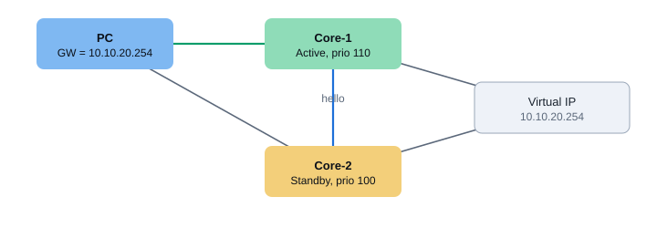

*شکل ۱: کلاینت VIP را Gateway می‌داند؛ Core-1 Active است و Core-2 در آماده‌باش.*

| موضوع       | HSRP v1        | HSRP v2        |
|-------------|----------------|----------------|
| Multicast   | 224.0.0.2      | 224.0.0.102    |
| Virtual MAC | 0000.0c07.acXX | 0000.0c9f.fXXX |
| تعداد Group | 0 تا 255       | 0 تا 4095      |
| IPv6        | ندارد          | دارد           |

XX یا XXX شماره‌ی Group به‌صورت Hex است. Hello پیش‌فرض ۳ ثانیه و Hold ۱۰ ثانیه است.

``` text
Default hello = 3 s, hold = 10 s -> failover up to ~10 s
Tuned (hello 1, hold 3) -> failover ~3 s
```

### ۳. انتخاب Active

1.  بالاترین Priority (پیش‌فرض ۱۰۰).
2.  اگر برابر بود، بالاترین IP روی Interface.

> **نکته‌ی مهم**
>
> پیش‌فرض Preempt خاموش است. اگر Core-1 (Priority بالاتر) خراب شود و بعد برگردد، نقش Active را پس نمی‌گیرد مگر اینکه `preempt` بزنید. معمولاً در طراحی می‌خواهیم Core اصلی دوباره Active شود، پس Preempt را روشن می‌کنیم.

### ۴. دستورها (خط‌به‌خط)

``` text
Core-1(config)# interface vlan 20
Core-1(config-if)# ip address 10.10.20.2 255.255.255.0
Core-1(config-if)# standby version 2
Core-1(config-if)# standby 20 ip 10.10.20.254
Core-1(config-if)# standby 20 priority 110
Core-1(config-if)# standby 20 preempt
Core-1(config-if)# standby 20 authentication md5 key-string <KEY>

Core-2(config)# interface vlan 20
Core-2(config-if)# ip address 10.10.20.3 255.255.255.0
Core-2(config-if)# standby version 2
Core-2(config-if)# standby 20 ip 10.10.20.254
Core-2(config-if)# standby 20 priority 100
Core-2(config-if)# standby 20 preempt
```

- هر Core آدرس واقعی خودش (.2 و .3) و یک VIP مشترک (.254) دارد.
- شماره‌ی Group (اینجا 20) هم‌شماره‌ی VLAN انتخاب می‌شود تا خوانا باشد.
- کلاینت‌ها Gateway را **.254** می‌گیرند، نه .2 یا .3.
- کلید Authentication را در ریپو نگذارید؛ اینجا فقط جانگهدار است.

``` text
Core-1# show standby brief
Core-1# show standby vlan 20
Core-1# show standby
```

``` text
Interface   Grp  Pri P State   Active    Standby    Virtual IP
Vl20         20  110 P Active  local     10.10.20.3 10.10.20.254
```

### ۵. Tracking: وقتی لینک بالادست خراب شد

اگر Core-1 Active است ولی لینک اصلی‌اش به بیرون خراب شود، همچنان Active می‌ماند و ترافیک را «سیاه‌چاله» می‌کند. با Track، Priority را در صورت خرابی لینک کم می‌کنیم تا Core-2 بگیرد:

``` text
Core-1(config)# track 10 interface gi0/3 line-protocol
Core-1(config)# interface vlan 20
Core-1(config-if)# standby 20 track 10 decrement 20
Effect: priority 110 - 20 = 90 < 100 -> Core-2 becomes Active (needs preempt on Core-2)
```

### ۶. VRRP و GLBP

| پروتکل | تعریف              | ویژگی                                  |
|--------|--------------------|----------------------------------------|
| HSRP   | سیسکو              | یک Active؛ رایج در Cisco               |
| VRRP   | استاندارد RFC 5798 | چند سازنده؛ مشابه HSRP (Master/Backup) |
| GLBP   | سیسکو              | چند Forwarder؛ تقسیم بار بین Gatewayها |

FortiGate از VRRP و FGCP (HA اختصاصی) پشتیبانی می‌کند. مفهوم همین است.

### ۷. مثال‌ها

#### ساده

``` text
Two cores, VIP .254, Core-1 priority 110 -> Active
PC gateway = .254 , ping works
```

#### متوسط: Failover

``` text
Core-1 shut down -> Core-2 becomes Active after hold time
PC keeps pinging with only a few lost packets
```

#### سخت: Failover بدون Track

``` text
Core-1 uplink fails but Core-1 stays Active (its VLAN interface is up)
Traffic is black-holed
Fix: track the uplink and decrement priority, or use routing protocol awareness
```

> **صادقانه درباره‌ی Lab**
>
> طبق Probe، «HSRP state» روی vIOSL2 تست شد و کار می‌کند. Failover واقعی (Virtual MAC) را با Capture بررسی کنید و اگر شبیه‌ساز رفتار متفاوتی داشت ثبت کنید.

### تمرین‌ها

**ت1.** ۱ (ساده): VIP چیست؟ *(پاسخ: 6-4-ت1 در بخش «پاسخ‌ها» انتهای فصل)*

**ت2.** ۲ (ساده): Active چطور انتخاب می‌شود؟ *(پاسخ: 6-4-ت2 در بخش «پاسخ‌ها» انتهای فصل)*

**ت3.** ۳ (متوسط): چرا Preempt؟ *(پاسخ: 6-4-ت3 در بخش «پاسخ‌ها» انتهای فصل)*

**ت4.** ۴ (متوسط): Failover پیش‌فرض چند ثانیه؟ *(پاسخ: 6-4-ت4 در بخش «پاسخ‌ها» انتهای فصل)*

**ت5.** ۵ (سخت): نقش Track چیست؟ *(پاسخ: 6-4-ت5 در بخش «پاسخ‌ها» انتهای فصل)*

### Lab هدایت‌شده

دو سوییچ L3: `Core-1` و `Core-2` (vIOSL2 با `ip routing`)، یک سوییچ دسترسی `Acc-1` که به هر دو Trunk است، و PC1 در VLAN 20.

#### گام ۱: SVI روی هر دو Core

``` text
Core-x(config)# ip routing
Core-x(config)# vlan 20
Core-1(config)# interface vlan 20
Core-1(config-if)# ip address 10.10.20.2 255.255.255.0
Core-1(config-if)# no shutdown
Core-2(config)# interface vlan 20
Core-2(config-if)# ip address 10.10.20.3 255.255.255.0
Core-2(config-if)# no shutdown
```

#### گام ۲: HSRP

``` text
Core-1(config-if)# standby version 2
Core-1(config-if)# standby 20 ip 10.10.20.254
Core-1(config-if)# standby 20 priority 110
Core-1(config-if)# standby 20 preempt
Core-2(config-if)# standby version 2
Core-2(config-if)# standby 20 ip 10.10.20.254
Core-2(config-if)# standby 20 preempt
Core-x# show standby brief
```

#### گام ۳: تست

``` text
PC1> ip 10.10.20.11/24 10.10.20.254
PC1> ping 10.10.20.254 -t
```

#### گام ۴: Failover

``` text
Core-1(config)# interface vlan 20
Core-1(config-if)# shutdown
Core-2# show standby brief
Core-1(config-if)# no shutdown   (preempt: Core-1 returns)
```

تعداد پکت گم‌شده و زمان Failover را ثبت کنید.

### Lab مستقل

یک «HSRP Plan» (Groupها، VIPها، Priorityها، Track) برای ۳ VLAN در `02-design/hsrp-plan.md` بنویسید.

### عیب‌یابی

|         |                                                                                                                              |
|---------|------------------------------------------------------------------------------------------------------------------------------|
| Symptom | Failover نمی‌شود یا هر دو Active هستند                                                                                        |
| چک‌لیست  | ۱) VIP و Group دو سر یکی؟ ؛ ۲) Version یکسان؟ ؛ ۳) Authentication مشابه؟ ؛ ۴) ارتباط L2 بین Coreها OK؟ ؛ ۵) Preempt/Priority |
| ابزار   | show standby brief ، show standby                                                                                            |
| نکته    | «دو Active» یعنی Hello به هم نمی‌رسد (قطع L2)                                                                                 |

### سؤال‌های مرور

**م1.** HSRP چه مشکلی را حل می‌کند؟ *(پاسخ: 6-4-م1 در بخش «پاسخ‌ها» انتهای فصل)*

**م2.** تفاوت HSRP و VRRP؟ *(پاسخ: 6-4-م2 در بخش «پاسخ‌ها» انتهای فصل)*

### English Corner: انگلیسی تخصصی این درس

این جمله‌ها از مستندات و محیط کار واقعی‌اند. بلند بخوانید و ترجمه را بپوشانید.

| English sentence                                               | ترجمه                                                     |
|----------------------------------------------------------------|-----------------------------------------------------------|
| HSRP provides a virtual gateway address shared by two routers. | HSRP یک آدرس Gateway مجازی بین دو روتر ارائه می‌کند.       |
| The router with the highest priority becomes active.           | روتر با بالاترین Priority Active می‌شود.                   |
| Enable preempt so the primary router regains the active role.  | Preempt را روشن کنید تا روتر اصلی نقش Active را پس بگیرد. |
| Track the uplink to trigger failover when it goes down.        | برای فعال‌شدن Failover هنگام قطع Uplink آن را Track کنید.  |

**Q1.** Quick quiz (answer in English): What happens to clients if the active HSRP router fails? *(پاسخ: 6-4-Q1 در بخش «پاسخ‌ها» انتهای فصل)*

### تکلیف و چک‌لیست تسلط

- [ ] HSRP را بسازم و Failover را ثبت کنم.
- [ ] Track را توضیح دهم.
- [ ] HSRP Plan را بنویسم.

### یادآوری اشتباهات شما

> **یادآوری**
>
> پیش‌بینی قبل از اجرا؛ بکاپ قبل از تغییر؛ پذیرفته‌شدن دستور ≠ کار کردن؛ فرمول‌ها در بلوک مستقل.


#### کارت Lab — HSRP و FHRP

| # | فیلد | محتوا |
|---|---|---|
| 1 | عنوان و هدف | HSRP: Active/Standby و Track |
| 2 | پیش‌نیاز | درس 6-3 |
| 3 | توپولوژی | Core-1/Core-2 + Acc |
| 4 | تجهیزات | ۳ سوییچ L3/L2 |
| 5 | نسخه نرم‌افزار | vIOS-L2 15.2(20200924، Experimental) برای SW؛ vIOS 15.9(3)M9 برای R؛ VPCS؛ PNetLab 4.2.8 |
| 6 | IP Plan | VLAN 20 |
| 7 | وضعیت اولیه | VIP .254 |
| 8 | صورت مسئله | Failover |
| 9 | مراحل هدایت‌شده | همان بخش «Lab هدایت‌شده» همین درس |
| 10 | تست عملکرد | `show standby brief` |
| 11 | سناریوی خرابی | Preempt خاموش |
| 12 | روش عیب‌یابی | لایه‌ای/با شواهد (بخش عیب‌یابی همین درس) |
| 13 | نتیجه‌ی مورد انتظار | Failover؛ بازگشت |
| 14 | معیار پذیرش | زمان Failover |
| 15 | مستندات نهایی | `02-design/hsrp-plan.md` |
| 16 | Cleanup و بازگردانی | — |

> **وضعیت راستی‌آزمایی (خارج از ۱۶ فیلد):** **جزئی.** HSRP State Tested-OK (Active)؛ Failover با روتر دوم آزمایش نشده.

---

<a id="l-6-5"></a>

## درس 6-5 — پیاده‌سازی Lab A

**فصل ۶ - روز ۵ · پیش‌نیاز: درس‌های ۶-۱ تا ۶-۴ · ۶ ساعت**

### این درس درباره چیست و چرا باید یاد بگیریم؟

**چه چیزی یاد می‌گیریم:** پیاده‌سازی کامل Lab A: Gateway روی Core با SVI و HSRP، OSPF به سمت Edge (که بعداً FortiGate می‌شود)، و تأیید مسیر رفت و برگشت.

**چرا لازم است:** این Lab تمام مباحث فصل ۳ تا ۶ را در یک طراحی واقعی کنار هم می‌گذارد: VLAN، Trunk، STP، EtherChannel، SVI، HSRP و OSPF. اگر این Lab را درست بسازید، یعنی شبکه‌ی Campus سیسکو را فهمیده‌اید. (یادآوری: Capstone اصلی ما الگوی B است؛ Lab A جدا و مکمل است.)

- **در کار روزانه:** این همان چیدمان معمول Campus سازمانی است.
- **در امنیت:** Return Path و Gateway مشخص، پایه‌ی هر Policy است.
- **در FortiGate:** در W9/W10 همین Lab با FGT به‌جای EDGE-R1 کامل می‌شود.

> **مسیر درس**
>
> طراحی ← جدول آدرس ← پیاده‌سازی مرحله‌ای ← Verification Matrix ← تست Failover ← عیب‌یابی.

#### اصطلاحات این درس (مخفف ← شکل کامل ← معنی)

| مخفف        | شکل کامل انگلیسی              | معنی فارسی                    |
|-------------|-------------------------------|-------------------------------|
| Lab A       | Lab A (Cisco L3 Core Gateway) | Gateway روی Core سیسکو        |
| Perimeter   | Perimeter firewall            | فایروال لبه‌ی شبکه             |
| Transit     | Transit link                  | لینک نقطه‌به‌نقطه به فایروال    |
| Return Path | Return Path                   | مسیر برگشت                    |
| As-Built    | As-Built documentation        | مستند وضعیت نهایی             |
| ECMP        | Equal-Cost Multi-Path         | تقسیم بار بین مسیرهای هم‌هزینه |

### ۱. طراحی

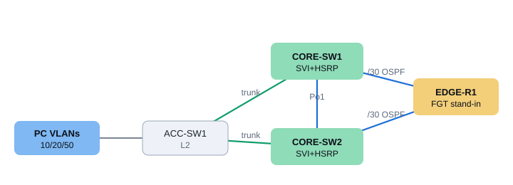

*شکل ۱: Lab A؛ VLANها روی Core (SVI + HSRP) و OSPF با Edge.*

``` text
VLAN 10 MGMT   10.10.10.0/24   VIP .254   Core-1 .2  Core-2 .3
VLAN 20 USERS  10.10.20.0/24   VIP .254   Core-1 .2  Core-2 .3
VLAN 50 GUEST  10.10.50.0/24   VIP .254   Core-1 .2  Core-2 .3

Core-1 <-> EDGE-R1 : 10.0.1.0/30   (.1 .2)
Core-2 <-> EDGE-R1 : 10.0.2.0/30   (.1 .2)
Core-1 <-> Core-2  : EtherChannel Po1 (trunk)
OSPF area 0 on Cores and Edge
EDGE-R1 loopback 0 = 8.8.8.8/32 (stand-in for "internet")
```

> **قاعده**
>
> هر VLAN دقیقاً یک Gateway دارد: VIP روی Core. هرگز دو Gateway همزمان (مثل SVI و Sub-interface روی R1).

### ۲. گام‌های پیاده‌سازی

#### گام ۱: VLAN و Trunk

``` text
! on Core-1, Core-2, ACC-SW1
vlan 10
 name MGMT
vlan 20
 name USERS
vlan 50
 name GUEST
! trunks: ACC <-> Core-1, ACC <-> Core-2, Core-1 <-> Core-2
interface gi0/x
 switchport trunk encapsulation dot1q
 switchport mode trunk
 switchport trunk allowed vlan 10,20,50
 switchport trunk native vlan 999
```

#### گام ۲: STP

``` text
Core-1(config)# spanning-tree mode rapid-pvst
Core-1(config)# spanning-tree vlan 10,20,50 root primary
Core-2(config)# spanning-tree vlan 10,20,50 root secondary
ACC-SW1(config)# interface range gi0/1 - 3
ACC-SW1(config-if-range)# spanning-tree portfast
ACC-SW1(config-if-range)# spanning-tree bpduguard enable
```

#### گام ۳: SVI و HSRP

``` text
Core-1(config)# ip routing
Core-1(config)# interface vlan 20
Core-1(config-if)# ip address 10.10.20.2 255.255.255.0
Core-1(config-if)# standby version 2
Core-1(config-if)# standby 20 ip 10.10.20.254
Core-1(config-if)# standby 20 priority 110
Core-1(config-if)# standby 20 preempt
! repeat for VLAN 10 and 50; Core-2 uses .3 and default priority
```

#### گام ۴: لینک‌های Routed به Edge

``` text
Core-1(config)# interface gi0/3
Core-1(config-if)# no switchport
Core-1(config-if)# ip address 10.0.1.1 255.255.255.252
Core-2(config)# interface gi0/3
Core-2(config-if)# no switchport
Core-2(config-if)# ip address 10.0.2.1 255.255.255.252
EDGE-R1(config)# interface gi0/0
EDGE-R1(config-if)# ip address 10.0.1.2 255.255.255.252
EDGE-R1(config)# interface gi0/1
EDGE-R1(config-if)# ip address 10.0.2.2 255.255.255.252
EDGE-R1(config)# interface loopback 0
EDGE-R1(config-if)# ip address 8.8.8.8 255.255.255.255
```

#### گام ۵: OSPF

``` text
Core-1(config)# router ospf 1
Core-1(config-router)# router-id 11.11.11.11
Core-1(config-router)# network 10.0.1.0 0.0.0.3 area 0
Core-1(config-router)# network 10.10.10.0 0.0.0.255 area 0
Core-1(config-router)# network 10.10.20.0 0.0.0.255 area 0
Core-1(config-router)# network 10.10.50.0 0.0.0.255 area 0
Core-1(config-router)# passive-interface default
Core-1(config-router)# no passive-interface gi0/3
! Core-2 same with its own link and router-id 12.12.12.12
EDGE-R1(config)# router ospf 1
EDGE-R1(config-router)# router-id 1.1.1.1
EDGE-R1(config-router)# network 10.0.1.0 0.0.0.3 area 0
EDGE-R1(config-router)# network 10.0.2.0 0.0.0.3 area 0
EDGE-R1(config-router)# network 8.8.8.8 0.0.0.0 area 0
EDGE-R1(config-router)# default-information originate always
```

OSPF Default از Edge می‌آید و Coreها خودشان Default را یاد می‌گیرند. EDGE-R1 باید مسیر برگشت به سه VLAN را از OSPF یاد بگیرد (Return Path).

### ۳. Verification Matrix

| تست         | دستور                                    | انتظار                                      |
|-------------|------------------------------------------|---------------------------------------------|
| VLAN/Trunk  | show interfaces trunk                    | VLAN 10,20,50 allowed                       |
| Root        | show spanning-tree root                  | Core-1 root                                 |
| HSRP        | show standby brief                       | Core-1 Active هر سه VLAN                    |
| OSPF        | show ip ospf neighbor                    | FULL با Edge و (اگر طراحی کردید) بین Coreها |
| Route       | show ip route ospf                       | Default و Routeهای VLAN روی Edge            |
| End-to-end  | PC ping 8.8.8.8                          | موفق                                        |
| Return Path | EDGE-R1# ping 10.10.20.11 source 8.8.8.8 | موفق                                        |

### ۴. آزمون Failover

۳ آزمایش، هرکدام را ثبت کنید:

1.  Core-1 را خاموش کنید: HSRP به Core-2 می‌رود؛ ping پایدار می‌ماند.
2.  لینک Core-1 به Edge را قطع کنید: OSPF مسیر را از Core-2 می‌گیرد.
3.  لینک ACC به Core-1 را قطع کنید: Rapid-PVST به مسیر جایگزین می‌رود.

``` text
Measure: lost packets and seconds to recover for each test.
Typical: HSRP ~10 s (tunable), OSPF dead 40 s (tunable), RSTP ~1-2 s
```

> **Asymmetric Routing**
>
> چون دو Core و دو لینک به Edge داریم، ممکن است رفت از Core-1 و برگشت از Core-2 باشد. در Lab ساده بی‌اثر است، ولی وقتی FortiGate Stateful بیاید (W9/W10) باید مسیرها را متقارن کنید؛ ریسکی که در طراحی نوشته‌ایم.

> **صادقانه درباره‌ی Lab**
>
> چند قابلیت (EtherChannel و برخی امنیت‌های L2) روی vIOSL2 ممکن است فقط پذیرفته شوند. اگر Po1 بالا نیامد، یک لینک عادی Trunk بگذارید و محدودیت را ثبت کنید. SVI، HSRP و OSPF روی این Imageها طبق Probe و درس‌های قبل قابل‌اجراست.

### تمرین‌ها

**ت1.** ۱ (ساده): Gateway هر VLAN در Lab A کدام آدرس است؟ *(پاسخ: 6-5-ت1 در بخش «پاسخ‌ها» انتهای فصل)*

**ت2.** ۲ (ساده): چرا لینک Core به Edge Routed است؟ *(پاسخ: 6-5-ت2 در بخش «پاسخ‌ها» انتهای فصل)*

**ت3.** ۳ (متوسط): Return Path برای 8.8.8.8 به VLAN 20 چطور ساخته می‌شود؟ *(پاسخ: 6-5-ت3 در بخش «پاسخ‌ها» انتهای فصل)*

**ت4.** ۴ (سخت): چه خطری در Dual Core + Dual Link برای فایروال Stateful هست؟ *(پاسخ: 6-5-ت4 در بخش «پاسخ‌ها» انتهای فصل)*

### Lab هدایت‌شده

همه‌ی گام‌های بخش ۲ را اجرا کنید، بعد ماتریس Verification و سه آزمون Failover. از هر مرحله بکاپ بگیرید:

``` text
Rx# copy running-config flash:Rx-labA-final.cfg
```

خروجی‌ها (بدون رمز) را در `03-ops/labA-as-built.md` ذخیره کنید.

### Lab مستقل

نمودار Packet Flow برای «PC به 8.8.8.8» و «8.8.8.8 به PC» را روی کاغذ بکشید و با Capture صحت را تأیید کنید.

### عیب‌یابی

|         |                                                                                                     |
|---------|-----------------------------------------------------------------------------------------------------|
| Symptom | PC به 8.8.8.8 نمی‌رسد                                                                                |
| روش     | از PC شروع کنید: Gateway ← Core Active ← OSPF ← Edge ← برگشت                                        |
| چک‌لیست  | ۱) VIP؟ ؛ ۲) Default روی Core؟ ؛ ۳) Edge مسیر برگشت دارد؟ ؛ ۴) HSRP Active درست؟ ؛ ۵) Trunk/Allowed |
| ابزار   | show standby brief ، show ip route ، traceroute                                                     |

### سؤال‌های مرور

**م1.** چرا Lab A و Capstone جدا هستند؟ *(پاسخ: 6-5-م1 در بخش «پاسخ‌ها» انتهای فصل)*

**م2.** Return Path چیست؟ *(پاسخ: 6-5-م2 در بخش «پاسخ‌ها» انتهای فصل)*

### English Corner: انگلیسی تخصصی این درس

این جمله‌ها از مستندات و محیط کار واقعی‌اند. بلند بخوانید و ترجمه را بپوشانید.

| English sentence                                            | ترجمه                                                      |
|-------------------------------------------------------------|------------------------------------------------------------|
| The core switches act as the default gateway for all VLANs. | سوییچ‌های Core Gateway پیش‌فرض همه‌ی VLANها هستند.            |
| OSPF advertises the VLAN subnets to the edge router.        | OSPF زیرشبکه‌های VLAN را به روتر Edge اعلام می‌کند.          |
| Verify the return path from the edge router.                | مسیر برگشت را از روتر Edge تأیید کنید.                     |
| Asymmetric routing can break stateful firewalls.            | مسیریابی نامتقارن می‌تواند فایروال‌های Stateful را مختل کند. |

**Q1.** Quick quiz (answer in English): Why must there be exactly one gateway per VLAN? *(پاسخ: 6-5-Q1 در بخش «پاسخ‌ها» انتهای فصل)*

### تکلیف و چک‌لیست تسلط

- [ ] Lab A را کامل بسازم.
- [ ] ماتریس Verification را پر کنم.
- [ ] سه Failover را ثبت کنم و As-Built را بنویسم.

### یادآوری اشتباهات شما

> **یادآوری**
>
> پیش‌بینی قبل از اجرا؛ بکاپ قبل از تغییر؛ پذیرفته‌شدن دستور ≠ کار کردن؛ فرمول‌ها در بلوک مستقل.


#### کارت Lab — پیاده‌سازی Lab A

| # | فیلد | محتوا |
|---|---|---|
| 1 | عنوان و هدف | Lab A: Core با SVI+HSRP+OSPF |
| 2 | پیش‌نیاز | درس 6-4 |
| 3 | توپولوژی | Acc-Core1/2-Edge |
| 4 | تجهیزات | ۴ سوییچ + Edge |
| 5 | نسخه نرم‌افزار | vIOS-L2 15.2(20200924، Experimental) برای SW؛ vIOS 15.9(3)M9 برای R؛ VPCS؛ PNetLab 4.2.8 |
| 6 | IP Plan | VLAN 10/20/50 |
| 7 | وضعیت اولیه | VIP .254 |
| 8 | صورت مسئله | ping 8.8.8.8 و Failover |
| 9 | مراحل هدایت‌شده | همان بخش «Lab هدایت‌شده» همین درس |
| 10 | تست عملکرد | ماتریس Verification |
| 11 | سناریوی خرابی | Route برگشت حذف |
| 12 | روش عیب‌یابی | لایه‌ای/با شواهد (بخش عیب‌یابی همین درس) |
| 13 | نتیجه‌ی مورد انتظار | Failover سه‌گانه |
| 14 | معیار پذیرش | As-Built |
| 15 | مستندات نهایی | `03-ops/labA-as-built.md` |
| 16 | Cleanup و بازگردانی | بازگشت Baseline |

> **وضعیت راستی‌آزمایی (خارج از ۱۶ فیلد):** **جزئی.** SVI/HSRP state Tested-OK؛ EtherChannel/OSPF و Failover کامل اجرا نشده.

---

<a id="l-6-6"></a>

## درس 6-6 — عیب‌یابی و آزمون G3

**فصل ۶ - روز ۶ · پیش‌نیاز: درس‌های ۶-۱ تا ۶-۵ · ۶ ساعت**

### این درس درباره چیست و چرا باید یاد بگیریم؟

**چه چیزی یاد می‌گیریم:** عیب‌یابی سناریوهای Routing و FHRP (TS15 تا TS18 و TS09) با روش Hop به Hop، و آزمون عملی Gate G3.

**چرا لازم است:** بعد از ساخت Lab A، مهارت اصلی «پیدا کردن خرابی» است. G3 تضمین می‌کند Routing و HSRP را عملی و با مدرک اثبات می‌کنید.

- **در کار روزانه:** سناریوی «بعضی VLANها قطع‌اند» همین الگو را دارد.
- **در امنیت:** RCA مکتوب مستندات حسابرسی است.
- **در مصاحبه:** سناریو و گزارش RCA سؤال تکراری هستند.

> **مسیر درس**
>
> روش Hop به Hop ← پنج خرابی ← Lab عیب‌یابی ← Gate G3.

#### اصطلاحات این درس (مخفف ← شکل کامل ← معنی)

| مخفف       | شکل کامل انگلیسی         | معنی فارسی              |
|------------|--------------------------|-------------------------|
| TS         | Troubleshooting Scenario | سناریوی عیب‌یابی         |
| RCA        | Root Cause Analysis      | تحلیل علت ریشه‌ای        |
| Black hole | Black hole               | سیاه‌چاله؛ ترافیک بی‌پاسخ |
| Flap       | Flapping                 | قطع و وصل مکرر          |
| G3         | Gate 3                   | آزمون عملی پایان فصل ۶ |
| As-Built   | As-Built                 | مستند وضعیت نهایی       |

### ۱. روش Hop به Hop

1.  مبدأ و مقصد دقیق را مشخص کنید.
2.  از مبدأ به Gateway: HSRP و VLAN.
3.  Gateway تا Edge: OSPF و Route.
4.  Edge تا مقصد.
5.  مسیر برگشت را جدا بررسی کنید.

در هر Hop یک سؤال: «این روتر Route دارد؟ بسته را به کجا می‌دهد؟ برگشت چطور؟»

### ۲. پنج سناریو

#### TS15: Route برگشت نبود

``` text
Symptom : PC reaches the Edge hop but not 8.8.8.8 replies
Evidence: EDGE-R1 has no route to 10.10.20.0/24 (not advertised)
Fix     : add network statement or static route on Edge
Verify  : ping from Edge to the VLAN IP works
```

#### TS16: OSPF Adjacency (Hello/MTU/Area)

``` text
Symptom : no neighbor between Core and Edge
Evidence: show ip ospf interface -> hello/area mismatch
Fix     : align the parameters
```

#### TS17: دو Gateway (HSRP) یا Preempt خاموش

``` text
Symptom : after recovery, old core does not become Active again
Cause   : preempt not enabled
Fix     : standby <grp> preempt
```

#### TS18: Track فراموش‌شده (Black hole)

``` text
Symptom : Core-1 is Active but its uplink is down -> traffic lost
Fix     : track the uplink and decrement priority
```

#### TS09: SVI Down/Down

``` text
Symptom : Vlan interface down/down -> gateway unreachable
Cause   : VLAN has no active port
Fix     : bring a port up in the VLAN / allow it on a trunk
```

### ۳. آزمون Gate G3 (پایان فصل ۶)

با مدرک و بدون نگاه به درس:

| \#  | وظیفه                                 | مدرک                            |
|-----|---------------------------------------|---------------------------------|
| ۱   | OSPF سه روتر (تک Area) + DR/BDR توضیح | show ip ospf neighbor           |
| ۲   | دو Area با ABR و خلاصه‌سازی            | show ip route (O IA)            |
| ۳   | OSPFv3 دو روتر (Dual-Stack)           | show ipv6 ospf neighbor         |
| ۴   | HSRP + Preempt + Track و Failover     | show standby brief + اندازه‌گیری |
| ۵   | Lab A کامل (ping تا 8.8.8.8 و برگشت)  | As-Built                        |
| ۶   | سه TS با RCA از TS15 تا TS18/TS09     | گزارش                           |
| ۷   | Packet Flow رفت و برگشت Lab A         | نمودار + Capture                |

**معیار قبولی:** حداقل ۶ از ۷ مورد با مدرک. وقتی تمام شد بگویید «G3 انجام شد».

### تمرین‌ها

**ت1.** ۱ (ساده): اولین قدم عیب‌یابی؟ *(پاسخ: 6-6-ت1 در بخش «پاسخ‌ها» انتهای فصل)*

**ت2.** ۲ (ساده): Black hole یعنی چه؟ *(پاسخ: 6-6-ت2 در بخش «پاسخ‌ها» انتهای فصل)*

**ت3.** ۳ (متوسط): HSRP Active است ولی Uplink قطع؛ راه‌حل؟ *(پاسخ: 6-6-ت3 در بخش «پاسخ‌ها» انتهای فصل)*

**ت4.** ۴ (سخت): چرا مسیر نامتقارن با فایروال Stateful مشکل می‌سازد؟ *(پاسخ: 6-6-ت4 در بخش «پاسخ‌ها» انتهای فصل)*

### Lab هدایت‌شده

در Lab A پنج خرابی را به ترتیب بسازید و رفع کنید؛ برای هر مورد Symptom، Evidence، Fix، Verify و RCA بنویسید.

1.  Route برگشت را از Edge حذف کنید.
2.  Hello interval یک سمت OSPF را تغییر دهید.
3.  Preempt را از Core-1 حذف کنید و Failover/Failback را ببینید.
4.  لینک Uplink را قطع کنید بدون Track.
5.  همه‌ی پورت‌های یک VLAN را shutdown کنید و SVI را ببینید.

### Lab مستقل

گزارش RCA پنج‌گانه را در `03-ops/rca-w6.md` بنویسید و Gate G3 را کامل کنید.

### عیب‌یابی

|         |                                                            |
|---------|------------------------------------------------------------|
| Symptom | بعد از تغییر، بخشی از شبکه قطع شد                          |
| روش     | Hop به Hop + مقایسه با As-Built                            |
| ابزار   | show standby brief ، show ip ospf neighbor ، show ip route |
| پیشگیری | بکاپ، تغییر مرحله‌ای و reload in                            |

### سؤال‌های مرور

**م1.** چرا Hop به Hop؟ *(پاسخ: 6-6-م1 در بخش «پاسخ‌ها» انتهای فصل)*

**م2.** چرا As-Built لازم است؟ *(پاسخ: 6-6-م2 در بخش «پاسخ‌ها» انتهای فصل)*

### English Corner: انگلیسی تخصصی این درس

این جمله‌ها از مستندات و محیط کار واقعی‌اند. بلند بخوانید و ترجمه را بپوشانید.

| English sentence                                                   | ترجمه                                             |
|--------------------------------------------------------------------|---------------------------------------------------|
| Troubleshoot hop by hop, starting from the source.                 | عیب‌یابی را Hop به Hop و از مبدأ شروع کنید.        |
| The standby router did not take over because preempt was disabled. | Standby چون Preempt خاموش بود نقش را نگرفت.       |
| Document each failure as an RCA.                                   | هر خرابی را به‌صورت RCA مستند کنید.                |
| Gate three covers routing and gateway redundancy.                  | Gate سوم Routing و پشتیبان Gateway را پوشش می‌دهد. |

**Q1.** Quick quiz (answer in English): What is the first thing to define when troubleshooting a connectivity issue? *(پاسخ: 6-6-Q1 در بخش «پاسخ‌ها» انتهای فصل)*

### تکلیف و چک‌لیست تسلط

- [ ] پنج TS را با RCA ثبت کنم.
- [ ] Gate G3 را کامل کنم.
- [ ] As-Built را به‌روز کنم.

### یادآوری اشتباهات شما

> **یادآوری**
>
> پیش‌بینی قبل از اجرا؛ بکاپ قبل از تغییر؛ پذیرفته‌شدن دستور ≠ کار کردن؛ فرمول‌ها در بلوک مستقل.


#### کارت Lab — عیب‌یابی و آزمون G3

| # | فیلد | محتوا |
|---|---|---|
| 1 | عنوان و هدف | عیب‌یابی Routing/FHRP و G3 |
| 2 | پیش‌نیاز | درس 6-5 |
| 3 | توپولوژی | Lab A |
| 4 | تجهیزات | Lab A |
| 5 | نسخه نرم‌افزار | vIOS-L2 15.2(20200924، Experimental) برای SW؛ vIOS 15.9(3)M9 برای R؛ VPCS؛ PNetLab 4.2.8 |
| 6 | IP Plan | Baseline |
| 7 | وضعیت اولیه | پنج خرابی |
| 8 | صورت مسئله | RCA |
| 9 | مراحل هدایت‌شده | همان بخش «Lab هدایت‌شده» همین درس |
| 10 | تست عملکرد | show standby/ospf |
| 11 | سناریوی خرابی | TS15-18،TS09 |
| 12 | روش عیب‌یابی | لایه‌ای/با شواهد (بخش عیب‌یابی همین درس) |
| 13 | نتیجه‌ی مورد انتظار | رفع |
| 14 | معیار پذیرش | G3 ≥ ۶ از ۷ |
| 15 | مستندات نهایی | `03-ops/rca-w6.md` |
| 16 | Cleanup و بازگردانی | — |

> **وضعیت راستی‌آزمایی (خارج از ۱۶ فیلد):** **اجرا نشده (فقط طراحی).** اجرا نشده.

---

<a id="ans-6"></a>

## درس 6-7 — OSPF در عمق: LSAهای Type 1–5/7، LSDB، SPF، انواع Area، Virtual-link و Summarization/Filtering

**فصل 6 · بازنویسی عمیق · پیش‌نیاز: ۵-۴، ۶-۱، ۶-۲ · ≈ 9 ساعت**

> **وضعیت:** Cisco IOSv/IOSvL2 (vIOS 15.x)؛ خروجی‌ها نمونه‌ی آموزشی؛ Lab «اجرا نشده»؛ برخی ویژگی‌ها روی vIOS `Unverified`.

### ۱) هدف آموزشی

در پایان این درس باید بتوانید:

1. انواع LSA (1، 2، 3، 4، 5، 7) و محتوا/دامنه‌ی هرکدام را توضیح دهد.
2. LSDB و الگوریتم SPF را (Cost، Tree) بفهمد و مسیر را دستی محاسبه کند.
3. Area typeها (Backbone، Standard، Stub، Totally Stubby، NSSA) و Virtual-link را با دلیل انتخاب کند.
4. Summarization (ABR/ASBR) و Filtering را طراحی کند.
5. LSDB را برای عیب‌یابی بخواند.
6. Convergence و SPF throttle را تحلیل کند.

### ۲) مفهوم پایه: چیست و چرا؟

OSPF را با «Neighbor Full» نمی‌توان فهمید؛ باید دانست چه چیزی در LSDB است و SPF چه می‌کند. تفاوت Router با DR/ABR/ASBR و اینکه LSA نوع ۳ چه کاری می‌کند برای طراحی چندناحیه‌ای حیاتی است.

### ۳) توضیح عمیق فنی

#### ۱) LSAها

| Type | نام | تولیدکننده | دامنه | محتوا |
|---|---|---|---|---|
| 1 | Router | هر روتر | Area | لینک‌ها و Cost |
| 2 | Network | DR | Area | روترهای متصل به Segment |
| 3 | Summary | ABR | بین Area | Prefix مقصدهای Area دیگر |
| 4 | ASBR Summary | ABR | بین Area | آدرس ASBR |
| 5 | External | ASBR | کل (جز Stub) | مسیرهای خارجی |
| 7 | NSSA External | ASBR در NSSA | Area | خارجی در NSSA؛ ABR به 5 تبدیل |

نشانه‌ی Route: `O` (Intra-area)، `O IA` (Type 3)، `O E1/E2` (Type 5)، `O N1/N2` (Type 7).

#### ۲) SPF

هر روتر LSDB Area را دارد و با Dijkstra درخت کوتاه‌ترین مسیر از خودش می‌سازد.

``` text
Cost = reference-bandwidth / interface bandwidth     (default ref 100 Mbps; Gi -> 1 -> change ref!)
E2 metric = external cost only; E1 = external + internal cost
```

`auto-cost reference-bandwidth 100000` (در همه‌ی روترها یکسان) برای لینک‌های Gigabit/10G ضروری است.

#### ۳) Area typeها

| نوع | LSA مجاز | مزیت |
|---|---|---|
| Backbone (0) | همه | مرکز |
| Standard | 1,2,3,4,5 | عمومی |
| Stub | بدون 5 (Default Route از ABR) | LSDB کوچک |
| Totally Stubby | بدون 3،4،5 (فقط Default) | حداقل LSDB |
| NSSA | بدون 5 ولی 7 | Stub با ASBR داخلی |

#### ۴) Virtual-link

Area بدون اتصال فیزیکی به Area 0 از طریق Virtual-link (در Transit Area) متصل می‌شود؛ **راه‌حل موقت** (پس از ادغام/مهاجرت)؛ طراحی دائمی نیست.

#### ۵) Summarization و Filtering

- **Inter-area:** `area X range 10.1.0.0 255.255.0.0` روی ABR.
- **External:** `summary-address` روی ASBR.
- Filtering: `area X filter-list prefix` (Type 3)، `distribute-list in` (محلی؛ LSDB را عوض نمی‌کند).

#### ۶) عیب‌یابی LSDB

``` text
show ip ospf database
show ip ospf database router self-originate
show ip ospf database summary
show ip ospf database external
show ip ospf border-routers
```

#### ۷) Convergence

SPF throttle (`timers throttle spf 50 200 5000`): تأخیر اولیه، Hold، حداکثر؛ LSA arrival throttle؛ BFD برای Detect.

### ۴) طراحی و تصمیم‌گیری

| سؤال طراحی | گزینه‌ها و معیار انتخاب |
|---|---|
| Area type | Stub/Totally Stubby برای شعب بدون خروج خارجی |
| Reference BW | بالا و یکسان |
| Summary | در ABR |
| Virtual-link | موقت |

### ۵) مثال‌های حل‌شده (ساده، متوسط، سخت)

**ساده (حل‌شده):** Route `O IA 10.2.0.0/16` در R1 ⇒ از LSA Type 3 توسط ABR؛ Cost = Cost تا ABR + Cost Summary.

**متوسط (محاسبه):** Gigabit و reference پیش‌فرض: Cost هر لینک 1 ⇒ OSPF بین 1G و 10G فرق نمی‌گذارد؛ با reference 100000 ⇒ 1G=100، 10G=10. آزمون: `show ip ospf interface` Cost.

**سخت (طراحی):** شعب ۲۰۰ Prefix دارند و LSDB بزرگ است. طرح: Area هر منطقه، Totally Stubby برای شعب بدون ASBR، Summary در ABR، Default از ABR؛ ASBR در NSSA. نتیجه: LSDB شعب از ۲۰۰۰ به ≈ ۱۰ LSA. ریسک: Suboptimal routing؛ آزمون.

### ۷) پیاده‌سازی از مسیر CLI

``` text
router ospf 1
 auto-cost reference-bandwidth 100000
 area 10 stub no-summary
 area 10 range 10.10.0.0 255.255.0.0
 timers throttle spf 50 200 5000
show ip ospf database
show ip ospf database summary
show ip route ospf
```

### ۸) Verification (اثبات صحت)

- LSDB مطابق Area type.
- Cost صحیح.
- Summary در ABR.

### ۹) Troubleshooting

| علامت | شاهد برای بررسی | علت محتمل و رفع |
|---|---|---|
| Route Inter-area نیست | database summary | Stub/Filter/Range |
| E2 مسیر غیربهینه | metric-type | E1/E2 |
| LSDB بزرگ | database | Area/Summary |

### ۱۰) نکات امنیتی

- OSPF Authentication.
- Filtering کنترل‌شده.

### ۱۱) جمع‌بندی مفهومی

- LSA 1–5/7.
- SPF/Cost/Reference BW.
- Area types.
- Virtual-link موقت.
- Summary/Filter.

### ۱۲) تمرین و ارزیابی

**ت1.** (ساده) LSA Type 3 را کدام روتر می‌سازد؟ *(پاسخ: 6-7-ت1)*

**ت2.** (ساده) `O IA` یعنی چه؟ *(پاسخ: 6-7-ت2)*

**ت3.** (متوسط) چرا reference-bandwidth باید تغییر کند؟ *(پاسخ: 6-7-ت3)*

**ت4.** (متوسط) Stub و Totally Stubby؟ *(پاسخ: 6-7-ت4)*

**ت5.** (سخت) LSDB شعب بزرگ؛ طرح. *(پاسخ: 6-7-ت5)*

**ت6.** (سخت، طراحی) چه موقع Virtual-link و چرا موقت؟ *(پاسخ: 6-7-ت6)*

**Q1.** Quick quiz (English): Which LSA type carries inter-area prefixes? *(پاسخ: 6-7-Q1)*

### ۱۳) اصطلاحات و English Corner

| مخفف | شکل کامل | معنی |
|---|---|---|
| LSA | Link-State Advertisement | بسته‌ی وضعیت لینک |
| LSDB | Link-State Database | پایگاه وضعیت لینک |
| ASBR | Autonomous System Boundary Router | روتر مرز AS |
| NSSA | Not-So-Stubby Area | Area نیمه‌Stub |

- *Use stub areas to reduce the link-state database.* ← برای کاهش LSDB از Area Stub استفاده کنید.

### ۱۴) کارت Lab

**کارت Lab:** OSPF عمیق. **وضعیت:** اجرا نشده. **Evidence:** `03-ops/ospf-deep.md`.

### ۱۵) منابع

- RFC 2328
- RFC 3101 (NSSA)
- Cisco OSPF design guide

## پاسخ‌های فصل 6

> ابتدا بدون نگاه حل کنید. شناسه: درس-نوع+شماره (ت = تمرین، م = مرور، Q = Quick quiz).

**6-1-ت1** — ۱ (ساده): چند Adjacency برای ۶ روتر در Full Mesh؟

در Full Mesh هر روتر با همه‌ی روترهای دیگر Adjacency می‌سازد. برای n روتر هر جفت یک بار شمرده می‌شود، پس تعداد جفت‌ها همان فرمول ترکیب است (محاسبه در بلوک زیر). برای شش روتر هر روتر با پنج روتر دیگر ارتباط دارد؛ چون هر ارتباط دو بار شمرده می‌شود، نتیجه نصف می‌شود: پانزده Adjacency. اگر روتر هفتم اضافه شود می‌شود بیست‌ویک؛ رشد درجه‌ی دوم است و همین دلیل وجود DR است: روی Segment مشترک با DR فقط هر روتر با DR و BDR (دو Adjacency) Full می‌شود.

``` text
Adjacencies = n x (n - 1) / 2 = 6 x 5 / 2 = 15
```

``` text
6 x 5 / 2 = 15
```

**6-1-ت2** — ۲ (ساده): DROther با DROther چه حالتی؟

دو DROther روی یک Segment چندگانه‌دسترسی به حالت 2-Way می‌رسند و Full نمی‌شوند. این رفتار «عادی» است نه خطا: آن‌ها LSDB را فقط از DR/BDR همگام می‌کنند. اگر `show ip ospf neighbor` دو DROther را در 2-Way نشان داد، مشکلی نیست؛ ولی اگر یک روتر با DR در 2-Way ماند، باید به دنبال عدم‌تطابق MTU، تایمر یا Authentication باشید.

``` text
2-Way (normal)
```

**6-1-ت3** — ۳ (متوسط): انتخاب DR بر چه اساسی؟

DR با بالاترین Priority (پیش‌فرض ۱) انتخاب می‌شود و در صورت برابری، بالاترین Router ID. Priority صفر یعنی «هرگز DR نشو». انتخاب غیر-Preemptive است: روتری که بعداً با Priority بالاتر برسد DR فعلی را کنار نمی‌زند. در طراحی عملی Priority را روی روترهای قوی‌تر (مثلاً Core) بالا می‌برند و روی روترهای کوچک ۰ می‌گذارند تا اتفاقی DR نشوند.

``` text
Highest priority, then highest router ID.
```

**6-1-ت4** — ۴ (متوسط): چه زمانی point-to-point؟

Network Type به‌صورت point-to-point برای لینک‌های دو‌روتره مناسب است: انتخاب DR/BDR انجام نمی‌شود، Adjacency سریع‌تر Full می‌شود و Hello/Dead تایمرها (۱۰/۴۰) پیش‌فرض می‌مانند. روی Ethernet دو‌روتره با `ip ospf network point-to-point` زمان همگرایی کم می‌شود. هر دو سر باید همان نوع را داشته باشند، وگرنه Adjacency ناپایدار یا ناقص می‌شود.

``` text
On links with exactly two routers; avoids DR election and speeds convergence.
```

**6-1-ت5** — ۵ (سخت): چرا بعد از تغییر Priority، DR عوض نشد؟

علت این است که انتخابات DR غیر-Preemptive است؛ تغییر Priority تا وقتی DR فعلی زنده است اثری ندارد. برای اعمال: فرایند OSPF را روی روترها دوباره راه‌اندازی می‌کنید (`clear ip ospf process`) یا Interface را shut/no shut می‌کنید. در Production این کار قطع کوتاه ایجاد می‌کند؛ پس در Maintenance Window و با آگاهی از اثر روی Adjacencyها انجام شود.

``` text
DR election is non-preemptive; the OSPF process must be cleared.
```

**6-1-م1** — DR چرا لازم است؟

روی Segment مشترک با n روتر، بدون DR تعداد Adjacency حدود n(n−1)/2 است و هر تغییر LSA به همه‌ی آن‌ها Flood می‌شود. DR نقطه‌ی مرکزی است: هر روتر LSA را فقط به DR (و BDR) می‌فرستد و DR آن را برای همه پخش می‌کند. نتیجه کاهش Adjacency، کاهش ترافیک Flood و پایداری بهتر. BDR یدک‌کش آماده است تا اگر DR افتاد، بدون انتخابات طولانی جایگزین شود.

تعداد Adjacency را در Segment مشترک کم می‌کند.

**6-1-م2** — Network Type چه تأثیری دارد؟

Network Type تعیین می‌کند آیا DR/BDR انتخاب شود، Hello/Dead چند ثانیه باشد و Next-hopها چگونه کشف شوند. مثال: Broadcast (Ethernet) انتخابات و تایمر ۱۰/۴۰؛ point-to-point بدون انتخابات؛ NBMA/Frame Relay قدیمی با Neighbor دستی. عدم‌تطابق Network Type بین دو سر یکی از علل رایج «Adjacency ناپایدار» است؛ شاهد: `show ip ospf interface` نوع و تایمرها را نشان می‌دهد.

انتخاب DR، تایمرها و رفتار همسایگی را تعیین می‌کند.

**6-1-Q1** — Quick quiz (answer in English): Why is 2-Way between two DROthers normal?

Only DR and BDR form full adjacencies with everyone; DROthers exchange LSAs via the DR.

**6-2-ت1** — ۱ (ساده): ABR چیست؟

ABR (Area Border Router) روتری است که حداقل یک Interface در Area 0 و Interface دیگر در Area دیگر دارد. LSDB جدا برای هر Area نگه می‌دارد، مسیرهای هر Area را به‌صورت LSA نوع ۳ خلاصه برای Areaهای دیگر می‌فرستد و محل خلاصه‌سازی (`area X range`) است. اگر ABR بخواهد کار کند باید به Backbone وصل باشد؛ در غیر این صورت از Virtual Link استفاده می‌شود.

``` text
A router with interfaces in two or more areas, one of which is area 0.
```

**6-2-ت2** — ۲ (ساده): O IA یعنی؟

`O IA` یعنی مسیر بین‌Area (Inter-Area): مقصد در Area دیگری است و مسیرش از LSA نوع ۳ آمده که ABR ساخته است. `O` یعنی داخل همان Area. در جدول مسیر، O IA با Metric مجموع هزینه‌ی تا ABR و هزینه‌ی ABR تا مقصد دیده می‌شود. اگر انتظار O IA داشتید ولی ندیدید، ABR/Area 0/Summary را بررسی کنید.

``` text
An inter-area route (from a type 3 LSA).
```

**6-2-ت3** — ۳ (متوسط): خلاصه‌ی 10.1.4.0/24 تا 10.1.7.0/24؟

محدوده‌ی 10.1.4.0/24 تا 10.1.7.0/24 چهار شبکه‌ی /24 پیاپی است. چهار شبکه یعنی ۲ بیت از octet سوم تغییر می‌کند؛ پس طول Prefix 24−2=22 و شروع بلوک عدد ۴ (چون ۴ مضرب ۴ است). نتیجه 10.1.4.0/22 که دقیقاً 10.1.4.0 تا 10.1.7.255 را پوشش می‌دهد. روی ABR: `area 1 range 10.1.4.0 255.255.252.0`. اگر شبکه‌ای مثل 10.1.5.0/24 در آن بازه موجود نباشد، Black-hole ممکن است ایجاد شود؛ Null0 محافظ است.

``` text
Block size = 4 (third octet) -> 10.1.4.0/22 covers 10.1.4.0-10.1.7.255
```

``` text
Third octet 4..7 -> block 4 -> 10.1.4.0/22
```

**6-2-ت4** — ۴ (متوسط): چرا Stub باید روی همه‌ی روترهای Area باشد؟

پرچم Stub در Hello بسته‌ها حمل می‌شود (E-bit). اگر یک روتر Stub باشد و دیگری نه، Hello نامطابق است و Adjacency ساخته نمی‌شود. به همین دلیل پیکربندی Stub باید روی همه‌ی روترهای Area انجام شود. در عیب‌یابی `show ip ospf` پرچم Area را نشان می‌دهد و `debug ip ospf adj` پیام «mismatch stub/transit area option» می‌دهد (فقط Lab).

``` text
The stub flag is carried in Hellos; a mismatch prevents adjacency.
```

**6-2-ت5** — ۵ (سخت): مزیت Totally Stubby؟

در Totally Stubby Area روترها فقط مسیرهای داخل Area به‌علاوه‌ی یک Default (از ABR) دارند؛ LSA نوع ۳ و ۴ و ۵ فیلتر می‌شود. مزیت: جدول مسیر و LSDB کوچک و همگرایی سریع‌تر برای روترهای ضعیف (شعبه). عیب: دید کمتر؛ مسیر خروج بهینه‌ی خارجی ممکن نیست و Default همه‌چیز است. پیکربندی: `area X stub no-summary` روی ABR و `area X stub` روی بقیه.

``` text
Routers in the area keep only intra-area routes plus one default route, minimizing tables.
```

**6-2-م1** — چرا به Area 0 همه وصل‌اند؟

قاعده‌ی OSPF چندناحیه‌ای: همه‌ی Areaها باید به Area 0 (Backbone) وصل باشند و ترافیک بین Areaها از آن عبور می‌کند. این طراحی از حلقه‌ی مسیریابی بین Areaها جلوگیری می‌کند (مدل Distance-Vector بین Area). اگر Area بدون اتصال فیزیکی به Backbone باشد، Virtual Link موقت است نه طراحی دائمی.

ترافیک بین Areaها از Backbone عبور می‌کند.

**6-2-م2** — ASBR چه می‌کند؟

ASBR (Autonomous System Boundary Router) مسیر خارجی را (از پروتکل دیگر یا Static) وارد OSPF می‌کند و آن را به‌صورت LSA نوع ۵ (یا ۷ در NSSA) پخش می‌کند. بقیه‌ی روترها با LSA نوع ۴ آدرس ASBR را می‌شناسند. این مسیرها با E1/E2 در جدول مسیر دیده می‌شوند. پیش‌نیاز Redistribution کنترل‌شده با Route-map است.

Route خارجی را وارد OSPF می‌کند.

**6-2-Q1** — Quick quiz (answer in English): What does an ABR do?

It connects areas to the backbone and exchanges (summarized) routes between them.

**6-3-ت1** — ۱ (ساده): OSPFv3 چطور فعال می‌شود؟

در OSPFv3 فعال‌سازی روی Interface انجام می‌شود نه با دستور network: ابتدا `ipv6 unicast-routing`، سپس `ipv6 router ospf N` برای تعریف فرایند و Router ID، و سپس روی هر Interface `ipv6 ospf N area A`. چون Adjacency روی Link-local ساخته می‌شود، حتی بدون آدرس Global هم همسایگی شکل می‌گیرد؛ ولی برای Reachability سراسری آدرس Global لازم است.

``` text
ipv6 unicast-routing, ipv6 router ospf N, and "ipv6 ospf N area A" on each interface.
```

**6-3-ت2** — ۲ (ساده): Next-hop در IPv6 چه آدرسی است؟

Next-hop در IPv6 آدرس Link-local همسایه (fe80::/10) است، نه آدرس Global؛ چون پروتکل‌های مسیریابی از Link-local برای ارتباط روی لینک استفاده می‌کنند. دلیل: Link-local ثابت و مستقل از Prefix Global است؛ تغییر Prefix Global ارتباط را قطع نمی‌کند. در `show ipv6 route` Next-hop به‌صورت fe80::... همراه Interface نمایش داده می‌شود.

``` text
The neighbor link-local address (fe80::).
```

**6-3-ت3** — ۳ (متوسط): چرا Router ID لازم است؟

OSPFv3 هم Router ID ۳۲بیتی دارد (قالب IPv4). اگر روتر هیچ آدرس IPv4 نداشته باشد، انتخاب خودکار ممکن نیست و Process شروع نمی‌شود یا هشدار می‌دهد. پس باید `router-id 1.1.1.1` را دستی تنظیم کرد. Router ID باید در کل Domain یکتا باشد.

``` text
OSPFv3 uses a 32-bit router ID; without any IPv4 address it must be set manually.
```

**6-3-ت4** — ۴ (سخت): چرا Static IPv6 با Next-hop Link-Local به Interface هم نیاز دارد؟

آدرس Link-local فقط در یک لینک یکتاست؛ دو لینک مختلف ممکن است همان fe80::1 را داشته باشند. بنابراین برای Static Route با Next-hop Link-local باید Interface خروجی هم ذکر شود تا روتر بداند آن آدرس روی کدام لینک است: `ipv6 route 2001:db8:2::/64 GigabitEthernet0/1 fe80::2`. بدون Interface فرمان رد می‌شود.

``` text
Link-local addresses are only unique per link, so the exit interface is required.
```

**6-3-م1** — تفاوت اصلی فعال‌سازی v2 و v3؟

در OSPFv2 با دستور network و Wildcard Interfaceها انتخاب می‌شوند؛ در OSPFv3 دستور مستقیم روی Interface است (`ipv6 ospf N area A`). یعنی تعریف Area روی Interface؛ این رفتار خطای Wildcard را حذف می‌کند و دقت بیشتری می‌دهد.

v3 روی Interface فعال می‌شود، نه با network.

**6-3-م2** — چرا Router ID دستی؟

چون OSPFv3 هم Router ID ۳۲بیتی IPv4 می‌خواهد و ممکن است روتر فقط IPv6 داشته باشد (شبکه‌ی IPv6-only). در چنین روتری بدون تنظیم دستی، Router ID ساخته نمی‌شود. ثبات Router ID هم مهم است: Loopback با آدرس ثابت و مستند.

چون ممکن است روتر IPv4 نداشته باشد.

**6-3-Q1** — Quick quiz (answer in English): Why does OSPFv3 still need an IPv4-style router ID?

Router IDs are 32-bit values in both versions, independent of the address family.

**6-4-ت1** — ۱ (ساده): VIP چیست؟

VIP (Virtual IP) آدرسی مشترک بین دو یا چند روتر است که کلاینت‌ها آن را به‌عنوان Default Gateway تنظیم می‌کنند. روتر Active صاحب VIP و MAC مجازی (در HSRP v1 الگوی 0000.0c07.acXX) است. اگر Active بیفتد، Standby همان VIP و MAC را می‌گیرد و کلاینت‌ها بدون تغییر تنظیمات ادامه می‌دهند. مثال: VLAN 10 با روترهای 10.10.10.2 و 10.10.10.3 و VIP 10.10.10.1؛ کلاینت‌ها فقط 10.10.10.1 را می‌شناسند.

``` text
A shared virtual IP address used as the clients' default gateway.
```

**6-4-ت2** — ۲ (ساده): Active چطور انتخاب می‌شود؟

Active با بالاترین Priority (پیش‌فرض ۱۰۰) انتخاب می‌شود؛ در صورت برابری، آدرس IP بالاتر روی همان Interface. این قاعده را برای طراحی می‌توانید دستی کنترل کنید: روتر ترجیحی را با Priority ۱۱۰ و `preempt` تنظیم می‌کنید. اگر دو روتر هم‌زمان بالا بیایند و Preempt نباشد، اولین روتری که بالا آمده Active می‌ماند حتی با Priority کمتر؛ پس Preempt را فراموش نکنید.

``` text
Highest priority, then highest IP address.
```

**6-4-ت3** — ۳ (متوسط): چرا Preempt؟

بدون Preempt، روتری با Priority بالاتر که پس از خرابی برمی‌گردد نقش Active را پس نمی‌گیرد؛ در نتیجه طراحی (مثلاً Core1 اصلی) بعد از هر Failover بهم می‌ریزد و ترافیک روی روتر ضعیف‌تر می‌ماند. با `standby 1 preempt delay minimum 60` نقش را با تأخیر امن پس می‌گیرد تا مسیرها/OSPF همگرا شوند و دوباره Flap نکند.

``` text
So the higher-priority router regains the Active role after it recovers.
```

**6-4-ت4** — ۴ (متوسط): Failover پیش‌فرض چند ثانیه؟

با Hello ۳ ثانیه و Hold ۱۰ ثانیه، Standby وقتی ۱۰ ثانیه Hello از Active نشنود آن را مرده فرض می‌کند؛ پس Failover حدود ۱۰ ثانیه است. برای سرویس‌های حساس تایمرها را کوتاه می‌کنند (`standby 1 timers msec 250 msec 750`) یا BFD می‌گذارند. هزینه: بار CPU و ریسک Flap با Loss کوتاه.

``` text
Default: hello 3 s, hold 10 s -> failover ~ 10 s
Fast   : hello 250 ms, hold 750 ms -> failover < 1 s (CPU cost)
```

``` text
About 10 s (hold time) with hello 3 / hold 10.
```

**6-4-ت5** — ۵ (سخت): نقش Track چیست؟

اگر Active باشد ولی Uplink آن قطع شود، HSRP هنوز Active است و Gateway ترافیک را می‌پذیرد ولی راه خروج ندارد: Black-hole. Track با `standby 1 track GigabitEthernet0/0 20` وقتی Uplink Down می‌شود Priority را ۲۰ واحد کم می‌کند؛ اگر Priority کمتر از Standby شود و Preempt فعال باشد، Standby Active می‌شود. نتیجه: قطع لینک → Failover خودکار. بدون Track یا SLA، شبکه «سالم ولی ناکارآمد» می‌ماند.

``` text
Lower the priority when an uplink fails so the standby takes over; otherwise traffic black-holes.
```

**6-4-م1** — HSRP چه مشکلی را حل می‌کند؟

Default Gateway واحد یک Single Point of Failure است: اگر روتر بیفتد همه‌ی کلاینت‌های آن VLAN اینترنت ندارند. FHRP (First Hop Redundancy Protocol) با VIP مشترک این SPOF را حذف می‌کند: دو روتر یک Gateway منطقی می‌سازند و کلاینت‌ها مطلع نمی‌شوند که Failover رخ داده.

وجود Gateway واحد به‌عنوان SPOF.

**6-4-م2** — تفاوت HSRP و VRRP؟

HSRP اختصاصی سیسکو (Active/Standby) است؛ VRRP استاندارد RFC (Master/Backup) و بین سازندگان قابل استفاده؛ GLBP (سیسکو) علاوه بر Redundancy بار را هم تقسیم می‌کند. در شبکه‌ی چندسازنده (مثلاً Cisco+FortiGate) VRRP انتخاب منطقی‌تر است؛ در Cisco‌-only HSRP رایج است. رفتارها مشابه‌اند ولی نام‌ها و تایمر پیش‌فرض متفاوت است.

HSRP اختصاصی سیسکو؛ VRRP استاندارد.

**6-4-Q1** — Quick quiz (answer in English): What happens to clients if the active HSRP router fails?

پاسخ انگلیسی اصلی در پایین آمده است؛ نکته‌ی عملی: چون Standby همان VIP و MAC مجازی را می‌گیرد، جدول ARP کلاینت‌ها معتبر می‌ماند و فقط چند ثانیه قطع ترافیک رخ می‌دهد (زمان تشخیص). Gratuitous ARP سوییچ‌ها را به‌روز می‌کند.

The standby router becomes active and answers for the same virtual IP and MAC, so clients keep their gateway.

**6-5-ت1** — ۱ (ساده): Gateway هر VLAN در Lab A کدام آدرس است؟

در Lab A هر VLAN آدرس Gateway مجازی HSRP دارد (الگوی 10.10.X.254) و کلاینت‌ها فقط همان را می‌شناسند، نه آدرس واقعی روترها. مزیت: با Failover Core، Gateway کلاینت تغییر نمی‌کند. آدرس واقعی هر Core مثلاً .252 و .253 و VIP .254 است؛ ثبت این جدول در As-Built لازم است.

``` text
The HSRP virtual IP (10.10.x.254).
```

**6-5-ت2** — ۲ (ساده): چرا لینک Core به Edge Routed است؟

لینک Routed بین Core و Edge از حلقه‌ی لایه‌ی ۲ (STP) جلوگیری می‌کند، بلوک‌شدن پورت توسط STP را حذف می‌کند و اجازه‌ی ECMP بین دو Core را می‌دهد: دو لینک هم‌زمان فعال. همگرایی با OSPF سریع‌تر از STP و محدوده‌ی خرابی (Blast radius) کوچک‌تر است. هزینه: پیچیدگی مسیریابی و خطر مسیر نامتقارن با فایروال Stateful.

``` text
To avoid layer-2 loops and use routing (OSPF) with ECMP between the two cores.
```

**6-5-ت3** — ۳ (متوسط): Return Path برای 8.8.8.8 به VLAN 20 چطور ساخته می‌شود؟

ترافیک VLAN 20 به 8.8.8.8 از Gateway می‌رود؛ برای برگشت، Edge باید بداند VLAN 20 پشت کدام Core است. Coreها Subnet VLANها را با OSPF به EDGE-R1 اعلام می‌کنند؛ در Edge یک Route O 10.10.20.0/24 دو Next-hop (ECMP) دارد. بدون این اعلام یا Static برگشتی، بسته‌ی برگشت Drop می‌شود: «Return Path». آزمون: `show ip route 10.10.20.0` در Edge و traceroute از VLAN 20.

``` text
OSPF advertises the VLAN subnets from the cores to EDGE-R1.
```

**6-5-ت4** — ۴ (سخت): چه خطری در Dual Core + Dual Link برای فایروال Stateful هست؟

با دو Core و دو لینک ECMP، بسته‌ی رفت ممکن است از Core1 برود و پاسخ از Core2 برگردد. فایروال Stateful فقط یک جهت را می‌بیند: برای بسته‌ی برگشت Session ندارد و آن را Drop می‌کند. راه‌حل‌ها: طراحی Symmetric (Cost/Weight)، Active-Standby به‌جای ECMP، Session sync در Cluster، یا Policy Route. این همان خطر اصلی فصل ۱۰ (مسیر نامتقارن) است.

``` text
Asymmetric routing: forward and return paths differ, and the stateful firewall drops the unmatched return.
```

**6-5-م1** — چرا Lab A و Capstone جدا هستند؟

Lab A تمرین پایه‌ی شبکه‌ی Cisco خالص (Gateway روی Cisco با HSRP) است تا مفاهیم L2/L3 را بدون فایروال بیاموزید. Capstone یک پروژه‌ی کامل است که Gateway روی FortiGate است تا Policy، NAT و Log در یک نقطه جمع شوند. جداسازی باعث می‌شود اول مبانی محکم شود و بعد با Security ترکیب گردد.

Lab A Gateway روی Cisco است؛ Capstone Gateway روی FortiGate تا Policy و Log در یک نقطه باشد.

**6-5-م2** — Return Path چیست؟

Return Path مسیر بسته‌ی پاسخ از مقصد تا کلاینت است. ارتباط دوطرفه شرط دارد: هم Forward و هم Return باید مسیر معتبر داشته باشند. شایع‌ترین علت «ping فقط یک‌طرفه» نبود Route برگشتی روی مقصد/Edge است. هنگام عیب‌یابی همیشه هر دو جهت را بررسی کنید.

مسیر برگشت پاسخ؛ بدون آن ارتباط دوطرفه نمی‌شود.

**6-5-Q1** — Quick quiz (answer in English): Why must there be exactly one gateway per VLAN?

پاسخ انگلیسی در پایین آمده است. نکته‌ی عملی: در HSRP فقط یک روتر همزمان به ARP پاسخ می‌دهد؛ اگر دو Gateway واقعی با یک IP پیکربندی شوند، IP Conflict و جدول ARP ناپایدار رخ می‌دهد و بسته‌ها بی‌نظم بین دو دستگاه می‌روند.

Two gateways cause duplicate IPs/MACs and inconsistent forwarding.

**6-6-ت1** — ۱ (ساده): اولین قدم عیب‌یابی؟

اولین قدم، تعریف دقیق مبدأ و مقصد مشکل است: چه کسی، به چه سرویسی، از کی، چه پیامی می‌بیند. سپس Hop به Hop از Source: لینک، VLAN، Gateway، Route، ACL/Policy، NAT، مقصد. بدون تعریف دقیق، ساعت‌ها صرف بررسی چیزهای نامربوط می‌شود. در Ticket بنویسید: Source IP، Dest IP/پورت، زمان، خطا، تغییر اخیر.

``` text
Define the exact source and destination, then check hop by hop.
```

**6-6-ت2** — ۲ (ساده): Black hole یعنی چه؟

Black-hole یعنی دستگاهی بسته را می‌پذیرد ولی هیچ مسیر معتبری برای ادامه ندارد و بی‌صدا آن را دور می‌اندازد؛ مثل Active HSRP با Uplink قطع. علامت: لینک‌ها up ولی ترافیک قطع و بدون پیام خطا. ابزار: traceroute که در یک Hop متوقف می‌شود، Track/IP SLA و مقایسه‌ی جدول مسیر.

``` text
Traffic is accepted by a device but silently dropped/has no valid path.
```

**6-6-ت3** — ۳ (متوسط): HSRP Active است ولی Uplink قطع؛ راه‌حل؟

با Track روی Uplink: وقتی Uplink قطع می‌شود Priority کم می‌شود و Standby Active می‌شود (با Preempt). مراحل: ۱) `standby 1 track Gi0/0 20`. ۲) `standby 1 preempt`. ۳) آزمون: قطع Uplink و دیدن `show standby brief`. معیار: Failover < ۱۵ ثانیه و بدون قطع طولانی.

``` text
Track the uplink and decrement priority.
```

**6-6-ت4** — ۴ (سخت): چرا مسیر نامتقارن با فایروال Stateful مشکل می‌سازد؟

فایروال Stateful جدول Session را با دیدن SYN می‌سازد. اگر مسیر برگشت از فایروال دیگر یا مسیر دیگر رد شود، فایروال اول فقط رفت را و فایروال دوم فقط برگشت را می‌بیند: برای برگشت Session نیست و Drop می‌کند. اثبات: Capture دو سمت (فقط SYN در یکی، فقط SYN-ACK در دیگری). رفع: مسیر Symmetric یا Session sync.

``` text
The firewall sees only one direction of a flow, no state entry exists, and drops the other direction.
```

**6-6-م1** — چرا Hop به Hop؟

Hop به Hop یعنی مسیر را از مبدأ تا مقصد به بخش‌های کوچک تقسیم کنید و هر بخش را آزمون کنید تا نقطه‌ی دقیق خرابی پیدا شود؛ حدس‌زدن جای آن را می‌گیرد و هم‌زمان چند متغیر را تغییر نمی‌دهید. ابزار: ping، traceroute، show route، show arp، log.

تا نقطه‌ی دقیق خرابی بدون حدس پیدا شود.

**6-6-م2** — چرا As-Built لازم است؟

As-Built سند وضعیت واقعی پس از پیاده‌سازی است: آدرس‌ها، VLANها، Route، نسخه‌ها و Config. هنگام عیب‌یابی، مرجع مقایسه است («چه چیزی تغییر کرده؟») و برای Rollback مرجع بازگشت. بدون آن، هر مشکل با «انگار قبلاً این‌طور بود» حل می‌شود.

مرجع مقایسه برای عیب‌یابی و Rollback.

**6-6-Q1** — Quick quiz (answer in English): What is the first thing to define when troubleshooting a connectivity issue?

پاسخ انگلیسی در پایین آمده است؛ نکته‌ی عملی: قبل از هر دستور، مشکل را با سه مورد تعریف کنید: Source، Destination و سرویس/پورت؛ این سه مورد جهت Capture و Policy Lookup را هم تعیین می‌کنند.

The exact source and destination of the failing traffic.

---

<a id="end2"></a>

### پاسخ‌های درس افزوده‌ی 6-7 (فصل 6)

**6-7-ت1** — ABR؛ Prefixهای Area دیگر را خلاصه می‌دهد.

ABR (Area Border Router) روتر مرزی بین Area‌هاست: LSDB هر Area را جدا نگه می‌دارد و Prefixهای Area را به‌صورت LSA نوع ۳ خلاصه برای Areaهای دیگر می‌فرستد. محل خلاصه‌سازی `area X range` و نقطه‌ی فیلتر LSA است. خرابی ABR بین Areaها ارتباط را قطع می‌کند؛ پس در طراحی دو ABR می‌گذارند.


**6-7-ت2** — مسیر Inter-area (Type 3).

LSA نوع ۳ (Summary) را ABR می‌سازد و مسیر را به‌عنوان Inter-area (O IA) به Areaهای دیگر اعلام می‌کند؛ Metric شامل هزینه‌ی تا ABR است. روتر داخلی مسیر کامل Area دیگر را نمی‌داند، فقط Prefix و هزینه‌ی رسیدن به ABR را.


**6-7-ت3** — پیش‌فرض 100 Mbps باعث Cost برابر 1 برای ≥ 100 Mbps می‌شود.

Cost = Reference Bandwidth / Bandwidth. با Reference پیش‌فرض ۱۰۰ Mbps، همه‌ی لینک‌های ≥۱۰۰ Mbps (Fast/Gigabit/10G) Cost برابر ۱ می‌گیرند و OSPF نمی‌تواند لینک سریع‌تر را ترجیح دهد. راه: `auto-cost reference-bandwidth 100000` روی همه‌ی روترها.

``` text
Cost = 100 Mbps / BW
1 Gbps -> 100/1000 = 0.1 -> rounded to 1 (same as 100 Mbps)
```


**6-7-ت4** — Stub بدون Type 5؛ Totally Stubby بدون Type 3/4/5 (فقط Default).

Stub: LSA نوع ۵ (خارجی) فیلتر می‌شود و یک Default از ABR داده می‌شود. Totally Stubby: علاوه بر نوع ۵، نوع ۳ و ۴ هم فیلتر می‌شود و فقط Default و مسیرهای داخل Area می‌ماند. هر چه Area کوچک‌تر باشد، LSDB کم‌تر و همگرایی سریع‌تر؛ ولی دید مسیر و انتخاب خروجی بهینه کمتر می‌شود.


**6-7-ت5** — Area منطقه‌ای، Totally Stubby، Summary، Default.

برای شعبه‌ی کوچک با یک ABR: Area جدا، Totally Stubby برای کوچک‌ترین جدول، Summary روی ABR برای محدودکردن LSA و Default Originate برای خروج. ترتیب تصمیم: ابتدا Areaبندی منطقه‌ای، بعد نوع Area، بعد Summary و Default. هر مرحله را با `show ip ospf database` تأیید کنید.


**6-7-ت6** — Area بی‌اتصال به 0؛ ناپایدار/پیچیده؛ باید با طراحی Area اصلاح شود.

Area بدون اتصال به Area 0 Virtual Link می‌خواهد که ناپایدار و پیچیده است و به لینک Transit Area وابسته است. اصلاح: اتصال فیزیکی/منطقی Area به Backbone یا ادغام/بازطراحی Areaها. Virtual Link فقط راه‌حل موقت (مثلاً در ادغام شرکت‌ها) است.


**6-7-Q1** — Type 3 summary LSAs generated by area border routers.

پاسخ انگلیسی در پایین آمده است؛ جمع‌بندی: LSA نوع ۳ توسط ABR تولید می‌شود، در Area مبدأ ساخته و در Areaهای دیگر Flood می‌شود؛ جدول مسیر آن را با O IA نشان می‌دهد.


# پایان بخش ۲ (فصل‌های ۴ تا ۶)

## ۱) خلاصه‌ی مهارت‌های کسب‌شده
- STP/RSTP و Root عمدی؛ PortFast/BPDU Guard؛ EtherChannel/LACP؛ Port-Security؛ DHCP Snooping/DAI؛ طراحی سه‌لایه.
- Route Table، LPM، AD؛ Static/Floating/IP SLA؛ OSPF تک‌ و چندناحیه‌ای؛ OSPFv3؛ HSRP؛ Lab A.

## ۲) آزمون پایان سه فصل
**س1** — Root Bridge چگونه انتخاب می‌شود و Bridge ID در PVST برای VLAN 10 با اولویت 32768 چیست؟

**س2** — PortFast بدون BPDU Guard چه خطری دارد؟

**س3** — کدام ترکیب Mode در LACP Channel نمی‌سازد؟

**س4** — سه نوع Violation در Port-Security و تفاوت shutdown/restrict؟

**س5** — DAI به چه چیزی وابسته است؟

**س6** — بسته به 10.1.1.77 و Routeهای /8 و /16 و /24 و /0؛ کدام؟

**س7** — Static (AD 1) برای 10.0.0.0/8 و OSPF برای 10.0.23.0/30؛ بسته به 10.0.23.5 کجا می‌رود؟

**س8** — پنج شرط Adjacency در OSPF؟

**س9** — Cost لینک 1 Gbps با Reference 10000 Mbps؟

**س10** — DR چگونه انتخاب می‌شود و غیرقابل‌پس‌گیری یعنی چه؟

**س11** — چرا HSRP به Preempt و Track نیاز دارد؟

**س12** — چرا Lab A دو Gateway برای یک VLAN را ممنوع می‌کند؟


## ۳) پاسخ آزمون
- **س1:** کوچک‌ترین Bridge ID؛ 32768+10 = 32778 و بعد MAC.
- **س2:** سوییچ متصل به پورت می‌تواند قبل از واکنش STP حلقه بسازد.
- **س3:** passive-passive، on-active، LACP-PAgP.
- **س4:** shutdown/restrict/protect؛ shutdown پورت را err-disabled می‌کند؛ restrict فریم را می‌اندازد و لاگ می‌دهد.
- **س5:** جدول Binding (DHCP Snooping) یا ARP ACL.
- **س6:** /24 (طولانی‌ترین Prefix).
- **س7:** OSPF؛ اول طول Prefix است نه AD.
- **س8:** Subnet/Mask، Area، Hello/Dead، Authentication، MTU (و Router-ID یکتا).
- **س9:** 10000/1000 = 10.
- **س10:** بالاترین Priority سپس Router-ID؛ با ورود روتر قوی‌تر DR عوض نمی‌شود مگر Process ریست شود.
- **س11:** Preempt: بازگشت Active؛ Track: کاهش Priority با خرابی Uplink.
- **س12:** IP/MAC تکراری و Forwarding ناسازگار.

## ۴) معیارهای تسلط
| مهارت | سطح | شاهد |
|---|---|---|
| STP/L2 امن | L3 | G2 (≥ ۶ از ۷) |
| Static/OSPF | L3-L4 | آزمون کوچک ف۵ |
| HSRP/Lab A | L3 | G3 |

## ۵) مشکلات و موارد باقی‌مانده (صریح)
1. اغلب Labها اجرا نشده‌اند؛ DHCP Snooping/DAI/PortFast/OSPF فقط CLI-Accepted. 2. درس‌ها از HTML تبدیل شدند و بدهی «مثال سازمانی/کاربرد واقعی واژگان» را دارند. 3. EtherChannel LACP نیازمند سوییچ دوم است.

## ۶) پیش‌نیازهای بخش بعد
Lab A و سوییچ‌ها؛ OSPF؛ آماده‌بودن Image CSR/IOSv برای BGP؛ تأیید Rapid-PVST/OSPF روی Image.

## ۷) فهرست Lab و منابع مرتبط
`phase0a/cisco_feature_probe.md` ، کارت‌های Lab همین فایل ، `02-design/*.md`

## ۸) وضعیت دوره
| مورد | مقدار |
|---|---|
| آخرین فصل تکمیل‌شده | ۶ |
| آخرین درس تکمیل‌شده | ۶-۶ |
| مهارت‌های تأییدشده | **هیچ‌کدام هنوز آزمون عملی واقعی نشده‌اند** (ممیزی/اجرای شما لازم است) |
| موضوعات نیازمند مرور | طبق «معیارهای تسلط» |
| فصل بعدی | ۷ |
| فایل تولیدشده | `course/Course_Part_02_Chapters_04-06.md` |
