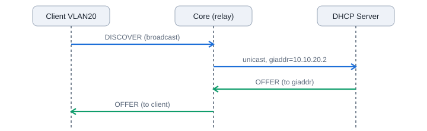
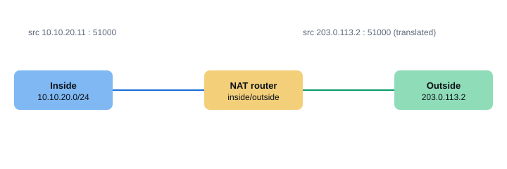
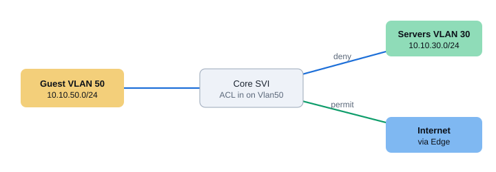
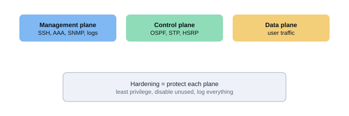
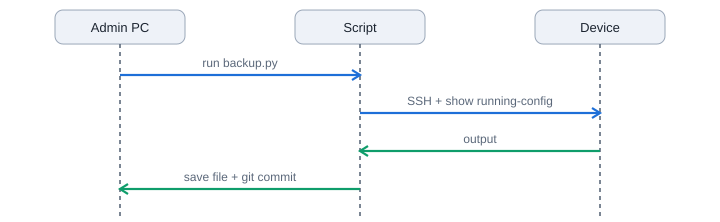
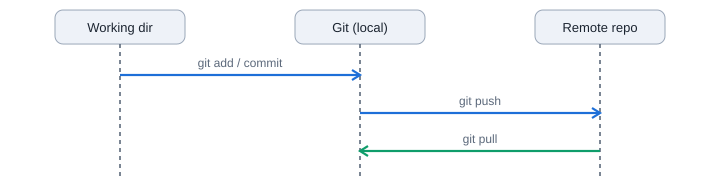
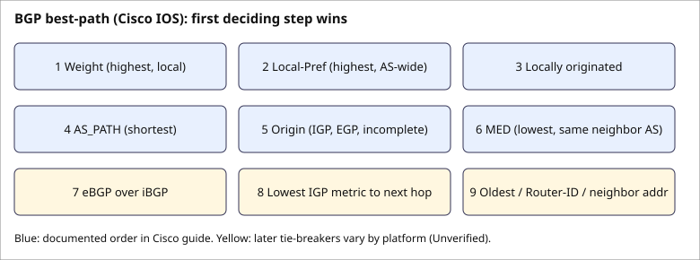

# Enterprise Network & Security Engineering — دوره‌ی تخصصی Cisco و Enterprise Firewall
## بخش ۳ از ۱۱ — فصل‌های ۷ تا ۹

| مورد | مقدار |
|---|---|
| نام دوره | Enterprise Network & Security Engineering (Cisco + FortiGate) |
| شماره بخش | ۳ از ۱۱ |
| فصل‌های این فایل | ۷ ، ۸ ، ۹ |
| تاریخ تولید | ۲۰۲۶-۱۱-۲۶ |
| نسخه Blueprint | v3.0 (+ بازبینی ۱٫۱) |
| نسخه‌های نرم‌افزار | Cisco vIOS-L2 15.2(20200924، Experimental) ؛ Cisco vIOS 15.9(3)M9 ؛ VPCS ؛ PNetLab 4.2.8 ؛ ESXi 8.0U2 |
| وضعیت تکمیل | **فصل‌های ۷–۹: ۷ و ۸ از درس‌های موجود تبدیل شد؛ فصل ۹ (BGP) جدید.** Labها عمدتاً اجرا نشده‌اند. |

> **قوانین خواندن:** تمرین‌ها و پرسش‌های مرور بدون پاسخ‌اند؛ پاسخ در «پاسخ‌های فصل». «اجرا نشده» یعنی خروجی‌ها **پیش‌نیاز/پیش‌بینی** هستند. «CLI-Accepted» ≠ «کار می‌کند». رمزها نمونه‌اند.

### وضعیت راستی‌آزمایی Labهای این بخش
خلاصه: اجرا نشده (فقط طراحی): 17, جزئی: 1.

| Lab | وضعیت |
|---|---|
| 7-1 | اجرا نشده (فقط طراحی) |
| 7-2 | اجرا نشده (فقط طراحی) |
| 7-3 | اجرا نشده (فقط طراحی) |
| 7-4 | اجرا نشده (فقط طراحی) |
| 7-5 | جزئی |
| 7-6 | اجرا نشده (فقط طراحی) |
| 8-1 | اجرا نشده (فقط طراحی) |
| 8-2 | اجرا نشده (فقط طراحی) |
| 8-3 | اجرا نشده (فقط طراحی) |
| 8-4 | اجرا نشده (فقط طراحی) |
| 8-5 | اجرا نشده (فقط طراحی) |
| 8-6 | اجرا نشده (فقط طراحی) |
| 9-1 | اجرا نشده (فقط طراحی) |
| 9-2 | اجرا نشده (فقط طراحی) |
| 9-3 | اجرا نشده (فقط طراحی) |
| 9-4 | اجرا نشده (فقط طراحی) |
| 9-5 | اجرا نشده (فقط طراحی) |
| 9-6 | اجرا نشده (فقط طراحی) |

---

<a id="ch7"></a>

> **نسخه‌ی اصلاح‌شده (v3.9؛ شامل دسته B):** این فایل نسخه‌ی توسعه‌یافته‌ی `course/Course_Part_03_Chapters_07-09.md` است؛ فایل اصلی حفظ شده است. درس‌های افزوده: ۹-۰ و ۹-۷ (فصل ۹). پاسخ‌های آن‌ها در «پاسخ‌های فصل» همان فصل است.

# فصل 7 — IP Services: DHCP، DNS، NTP، NAT، ACL، Syslog و QoS

**مدت:** ۳۶ ساعت | **پیش‌نیاز:** فصل ۶.
**اهداف:** DHCP/Relay، DNS/NTP، NAT/PAT، ACL، Syslog/SNMP، QoS، Service Matrix.
**معیار تسلط:** Relay و Scope؛ NAT قابل‌اثبات؛ ACL با ترتیب درست؛ لاگ با ساعت درست.
**اشتباهات رایج:** فراموشی helper-address؛ ACL بدون permit؛ SNMP v2c در تولید.

**درس‌های فصل:**
- [درس 7-1 — DHCP و Relay](#l-7-1)
- [درس 7-2 — DNS و NTP](#l-7-2)
- [درس 7-3 — NAT و PAT](#l-7-3)
- [درس 7-4 — ACL](#l-7-4)
- [درس 7-5 — Syslog و SNMP](#l-7-5)
- [درس 7-6 — QoS و Service Matrix](#l-7-6)

---

<a id="l-7-1"></a>

## درس 7-1 — DHCP و Relay

**فصل ۷ - روز ۱ · پیش‌نیاز: درس ۴-۵ · ۶ ساعت**

### این درس درباره چیست و چرا باید یاد بگیریم؟

**چه چیزی یاد می‌گیریم:** راه‌اندازی DHCP Server روی روتر/سوییچ سیسکو، رزرو آدرس، و DHCP Relay (ip helper-address) برای زمانی که سرور در VLAN دیگری است.

**چرا لازم است:** هیچ سازمانی آدرس‌ها را دستی روی صدها کامپیوتر نمی‌زند. DHCP این کار را خودکار می‌کند؛ ولی چون Discover یک Broadcast است و Broadcast از VLAN خارج نمی‌شود، بدون Relay هر VLAN باید سرور جدا داشته باشد. فراموش‌کردن Relay از رایج‌ترین خطاهاست.

- **در کار روزانه:** «کاربر آدرس نمی‌گیرد» پرتکرارترین تیکت است.
- **در امنیت:** Reservation و Snooping از آدرس‌های غیرمجاز جلوگیری می‌کنند.
- **در Capstone:** Windows Server DHCP مرکز برای همه‌ی VLANها Relay می‌شود.

> **مسیر درس**
>
> DHCP Pool ← آدرس‌های مستثنا ← Lease و Reservation ← Relay ← مثال ساده/متوسط/سخت ← Lab ← عیب‌یابی.

#### اصطلاحات این درس (مخفف ← شکل کامل ← معنی)

| مخفف        | شکل کامل انگلیسی                    | معنی فارسی                              |
|-------------|-------------------------------------|-----------------------------------------|
| DHCP        | Dynamic Host Configuration Protocol | تخصیص خودکار IP                         |
| Pool        | DHCP Pool                           | محدوده‌ی آدرس قابل‌واگذاری                |
| Lease       | Lease time                          | مدت اجاره‌ی آدرس                         |
| Reservation | DHCP Reservation                    | اختصاص آدرس ثابت به یک MAC              |
| Relay       | DHCP Relay Agent                    | انتقال Discover به سرور در VLAN دیگر    |
| giaddr      | Gateway IP address                  | آدرس Interface Relay داخل پیام          |
| Scope       | DHCP Scope                          | معادل Pool در Windows Server            |
| Option      | DHCP Option                         | اطلاعات اضافه مثل DNS (۶) و Gateway (۳) |

### ۱. DHCP روی روتر یا سوییچ

یک Pool تعریف می‌کنیم: بازه‌ی آدرس، Gateway، DNS و مدت اجاره. آدرس‌های ثابت (Gateway، سرورها، پرینترها) را «مستثنا» می‌کنیم تا به کسی داده نشود.

``` text
R1(config)# ip dhcp excluded-address 10.10.20.1 10.10.20.20
R1(config)# ip dhcp pool USERS20
R1(dhcp-config)# network 10.10.20.0 255.255.255.0
R1(dhcp-config)# default-router 10.10.20.1
R1(dhcp-config)# dns-server 10.10.10.53
R1(dhcp-config)# domain-name lab.local
R1(dhcp-config)# lease 0 8 0
```

- `excluded-address`: بازه‌ی .1 تا .20 هرگز داده نمی‌شود.
- `lease 0 8 0`: روز، ساعت، دقیقه؛ یعنی ۸ ساعت. برای Wi-Fi مهمان کوتاه‌تر، برای کاربران ثابت بلندتر.
- `dns-server` و `default-router`: Optionهای ۶ و ۳ که به کلاینت می‌رسند.

### ۲. Reservation: آدرس ثابت برای یک دستگاه

پرینتر باید همیشه یک IP داشته باشد ولی تنظیم دستی روی آن ممکن نیست. با MAC آن یک رزرو می‌سازیم:

``` text
R1(config)# ip dhcp pool PRINTER1
R1(dhcp-config)# host 10.10.20.50 255.255.255.0
R1(dhcp-config)# client-identifier 01aa.bbcc.0001.00
R1(dhcp-config)# default-router 10.10.20.1
```

نکته: `client-identifier` با 01 شروع می‌شود (نوع Ethernet) و بعد MAC می‌آید.

### ۳. مشکل: سرور در VLAN دیگر

DHCP Server معمولاً در VLAN سرورهاست، نه در VLAN کاربران. Discover یک Broadcast است و Router/Core آن را عبور نمی‌دهد. **DHCP Relay** روی Interface Gateway کاربران، Broadcast را می‌گیرد و به‌صورت Unicast به سرور می‌فرستد:



*شکل ۱: Relay، Discover را Unicast می‌کند و آدرس Interface خودش را در giaddr می‌گذارد تا سرور Pool درست را انتخاب کند.*

``` text
Core(config)# interface vlan 20
Core(config-if)# ip helper-address 10.10.30.10
! 10.10.30.10 = DHCP server in VLAN 30
```

سرور با **giaddr** می‌فهمد Discover از کدام Subnet آمده و Pool مربوط (VLAN 20) را به کلاینت می‌دهد. پس سرور باید Scope برای هر Subnet داشته باشد.

> **هشدار**
>
> `ip helper-address` علاوه بر DHCP، ۸ سرویس UDP دیگر را هم Forward می‌کند (TFTP، DNS، NetBIOS، TACACS و ...). در Hardening با `no ip forward-protocol udp ...` محدودشان می‌کنیم.

### ۴. دستورهای مشاهده

``` text
R1# show ip dhcp pool
R1# show ip dhcp binding
R1# show ip dhcp conflict
R1# show ip dhcp server statistics
R1# debug ip dhcp server events   (briefly)
```

- `binding`: کدام MAC چه IP گرفته و تا کی.
- `conflict`: آدرسی که قبل از واگذاری Ping داده شد و کسی جواب داد (تداخل).
- `pool`: تعداد آدرس‌های مصرف‌شده و باقی‌مانده.

### ۵. مثال‌ها

#### ساده

``` text
PC1> ip dhcp
DDORA IP 10.10.20.21/24 GW 10.10.20.1
```

#### متوسط: Relay

``` text
Server in VLAN 30, clients in VLAN 20
ip helper-address on Vlan20 -> clients get 10.10.20.x from the right scope
```

#### سخت: Pool تمام شد

``` text
Symptom : new clients get 169.254.x.x
Check   : show ip dhcp pool -> 0 free addresses
Cause   : lease too long + many short-lived devices (e.g. guest Wi-Fi)
Fix     : shorten the lease, enlarge the pool, clear stale bindings
```

### تمرین‌ها

**ت1.** ۱ (ساده): چرا آدرس Gateway را exclude می‌کنیم؟ *(پاسخ: 7-1-ت1 در بخش «پاسخ‌ها» انتهای فصل)*

**ت2.** ۲ (ساده): DHCP Relay چه می‌کند؟ *(پاسخ: 7-1-ت2 در بخش «پاسخ‌ها» انتهای فصل)*

**ت3.** ۳ (متوسط): giaddr برای چیست؟ *(پاسخ: 7-1-ت3 در بخش «پاسخ‌ها» انتهای فصل)*

**ت4.** ۴ (متوسط): ۲۵۴ آدرس، ۲۰ مستثنا؛ حداکثر کلاینت؟ *(پاسخ: 7-1-ت4 در بخش «پاسخ‌ها» انتهای فصل)*

**ت5.** ۵ (سخت): کاربران VLAN 20 آدرس نمی‌گیرند ولی VLAN 10 می‌گیرد؛ علت محتمل؟ *(پاسخ: 7-1-ت5 در بخش «پاسخ‌ها» انتهای فصل)*

### Lab هدایت‌شده

#### گام ۱: DHCP روی Core

``` text
Core(config)# ip dhcp excluded-address 10.10.20.1 10.10.20.20
Core(config)# ip dhcp pool USERS20
Core(dhcp-config)# network 10.10.20.0 255.255.255.0
Core(dhcp-config)# default-router 10.10.20.254
Core(dhcp-config)# dns-server 10.10.10.53
```

#### گام ۲: تست با VPCS

``` text
PC1> ip dhcp
PC1> show ip
Core# show ip dhcp binding
```

#### گام ۳: Relay

DHCP Pool را روی یک روتر دیگر (مثلاً R-SRV در VLAN 30) بسازید و روی `interface vlan 20` دستور helper-address بزنید؛ از VPCS دوباره آدرس بگیرید و Capture را ببینید: Discover Broadcast روی لینک PC، Unicast روی لینک سرور.

#### گام ۴: Reservation

یک رزرو برای MAC یکی از VPCSها بسازید و تأیید کنید همیشه همان IP را می‌گیرد.

### Lab مستقل

جدول «Scope Plan» (VLAN، Subnet، بازه، Excluded، Lease، DNS، Reservationها) را در `02-design/dhcp-plan.md` بنویسید.

### عیب‌یابی

|         |                                                                                                                                  |
|---------|----------------------------------------------------------------------------------------------------------------------------------|
| Symptom | کلاینت 169.254.x.x می‌گیرد                                                                                                        |
| چک‌لیست  | ۱) Relay تنظیم است؟ ؛ ۲) Scope برای آن Subnet هست؟ ؛ ۳) Pool پر نشده؟ ؛ ۴) Snooping/ACL جلوی Offer را نمی‌گیرد؟ ؛ ۵) مسیر به سرور |
| ابزار   | show ip dhcp binding ، show ip dhcp pool ، Capture                                                                               |
| رفع     | افزودن Relay یا Scope                                                                                                            |

### سؤال‌های مرور

**م1.** DHCP Relay کی لازم است؟ *(پاسخ: 7-1-م1 در بخش «پاسخ‌ها» انتهای فصل)*

**م2.** Reservation چیست؟ *(پاسخ: 7-1-م2 در بخش «پاسخ‌ها» انتهای فصل)*

### English Corner: انگلیسی تخصصی این درس

این جمله‌ها از مستندات و محیط کار واقعی‌اند. بلند بخوانید و ترجمه را بپوشانید.

| English sentence                                     | ترجمه                                                 |
|------------------------------------------------------|-------------------------------------------------------|
| Exclude the static addresses from the DHCP pool.     | آدرس‌های ثابت را از Pool DHCP مستثنا کنید.             |
| The relay agent forwards the broadcast as a unicast. | Relay Agent، Broadcast را به‌صورت Unicast ارسال می‌کند. |
| The client received an APIPA address.                | کلاینت آدرس APIPA گرفت.                               |
| Create a reservation for the printer.                | برای پرینتر یک Reservation بسازید.                    |

**Q1.** Quick quiz (answer in English): Why does a DHCP request not cross a router by default? *(پاسخ: 7-1-Q1 در بخش «پاسخ‌ها» انتهای فصل)*

### تکلیف و چک‌لیست تسلط

- [ ] DHCP و Reservation را بسازم.
- [ ] Relay را تست و Capture را تحلیل کنم.
- [ ] Scope Plan را بنویسم.

### یادآوری اشتباهات شما

> **یادآوری**
>
> پیش‌بینی قبل از اجرا؛ بکاپ قبل از تغییر؛ پذیرفته‌شدن دستور ≠ کار کردن؛ فرمول‌ها در بلوک مستقل.


#### کارت Lab — DHCP و Relay

| # | فیلد | محتوا |
|---|---|---|
| 1 | عنوان و هدف | DHCP Server و Relay |
| 2 | پیش‌نیاز | فصل 6 |
| 3 | توپولوژی | Core + R-SRV |
| 4 | تجهیزات | Core، روتر |
| 5 | نسخه نرم‌افزار | vIOS-L2 15.2(20200924، Experimental) برای SW؛ vIOS 15.9(3)M9 برای R؛ VPCS؛ PNetLab 4.2.8 |
| 6 | IP Plan | VLAN 20/30 |
| 7 | وضعیت اولیه | Pool/Relay |
| 8 | صورت مسئله | IP از VLAN دیگر |
| 9 | مراحل هدایت‌شده | همان بخش «Lab هدایت‌شده» همین درس |
| 10 | تست عملکرد | `show ip dhcp binding` |
| 11 | سناریوی خرابی | بدون helper |
| 12 | روش عیب‌یابی | لایه‌ای/با شواهد (بخش عیب‌یابی همین درس) |
| 13 | نتیجه‌ی مورد انتظار | Lease |
| 14 | معیار پذیرش | Scope Plan |
| 15 | مستندات نهایی | `02-design/dhcp-plan.md` |
| 16 | Cleanup و بازگردانی | — |

> **وضعیت راستی‌آزمایی (خارج از ۱۶ فیلد):** **اجرا نشده (فقط طراحی).** DHCP pool فقط CLI-Accepted.

---

<a id="l-7-2"></a>

## درس 7-2 — DNS و NTP

**فصل ۷ - روز ۲ · پیش‌نیاز: درس ۷-۱ · ۶ ساعت**

### این درس درباره چیست و چرا باید یاد بگیریم؟

**چه چیزی یاد می‌گیریم:** دو سرویس پایه که همه‌چیز به آن‌ها وابسته است: DNS (تبدیل نام به IP) و NTP (هماهنگی ساعت). چطور کار می‌کنند، چطور روی سیسکو تنظیم و بررسی می‌شوند، و چرا خرابی‌شان شبکه را «عجیب» می‌کند.

**چرا لازم است:** بیشتر شکایت‌های «اینترنت قطع است» در واقع «DNS خراب است». و Logها، Certificateها، Kerberos و Active Directory بدون ساعت درست بی‌معنی یا خراب می‌شوند؛ اختلاف بیش از ۵ دقیقه، ورود به دامنه را ناممکن می‌کند.

- **در کار روزانه:** ping به IP جواب می‌دهد ولی به نام نه؟ DNS است.
- **در امنیت:** Log با ساعت اشتباه برای تحلیل حادثه بی‌ارزش است.
- **در Capstone:** DNS و NTP مرکز روی Windows Server است و همه‌ی تجهیزات به آن اشاره می‌کنند.

> **مسیر درس**
>
> DNS چطور کار می‌کند ← رکوردها ← تنظیم روی سیسکو ← NTP و Stratum ← مثال ساده/متوسط/سخت ← Lab ← عیب‌یابی.

#### اصطلاحات این درس (مخفف ← شکل کامل ← معنی)

| مخفف     | شکل کامل انگلیسی            | معنی فارسی                                 |
|----------|-----------------------------|--------------------------------------------|
| DNS      | Domain Name System          | سیستم نام دامنه                            |
| Resolver | DNS Resolver                | سرویس‌دهنده‌ای که پرس‌وجوی کلاینت را حل می‌کند |
| A        | A record                    | نام به IPv4                                |
| AAAA     | AAAA record                 | نام به IPv6                                |
| PTR      | Pointer record              | IP به نام                                  |
| CNAME    | Canonical Name              | نام مستعار                                 |
| NTP      | Network Time Protocol       | پروتکل هماهنگی ساعت                        |
| Stratum  | Stratum                     | فاصله از منبع زمان دقیق                    |
| UTC      | Coordinated Universal Time  | زمان هماهنگ جهانی                          |
| FQDN     | Fully Qualified Domain Name | نام کامل دامنه                             |

### ۱. DNS چطور کار می‌کند؟

دفترچه‌ی تلفن را تصور کنید: شما نام «example.com» را می‌دانید و DNS «شماره» (IP) آن را می‌دهد. کلاینت از سرور DNS خودش می‌پرسد؛ اگر سرور پاسخ را نداشت، از سرورهای بالاتر می‌پرسد و در پایان جواب را می‌گیرد و برای مدتی نگه می‌دارد (Cache).

``` text
Client -> local DNS server : www.example.com ?
Local DNS -> root / TLD / authoritative servers (if not cached)
Local DNS -> client : 203.0.113.10   (cached for TTL seconds)
```

| رکورد | کار                 | مثال                             |
|-------|---------------------|----------------------------------|
| A     | نام به IPv4         | srv1.lab.local = 10.10.30.10     |
| AAAA  | نام به IPv6         | srv1.lab.local = 2001:db8:30::10 |
| PTR   | IP به نام (Reverse) | 10.10.30.10 = srv1.lab.local     |
| CNAME | نام مستعار          | www = srv1                       |
| MX    | سرور ایمیل          | mail.lab.local                   |
| NS    | سرور DNS یک Zone    | dns1.lab.local                   |

### ۲. تنظیم DNS روی سیسکو

``` text
R1(config)# ip domain-name lab.local
R1(config)# ip name-server 10.10.10.53
R1(config)# ip domain lookup
R1# ping srv1
R1# nslookup srv1  (not on all images)
```

> **یادآوری از دوره**
>
> در درس ۲-۴ گفتیم `no ip domain-lookup` برای جلوگیری از «Translating...». اگر DNS واقعی دارید و می‌خواهید روی دستگاه از نام استفاده کنید، `ip domain lookup` و `ip name-server` را بزنید.

روی کلاینت Windows: `nslookup srv1.lab.local` و `ipconfig /flushdns`.

### ۳. NTP: همه‌ی ساعت‌ها یکی

ساعت کامپیوترها کم‌کم از هم فاصله می‌گیرد (Drift). NTP آن‌ها را با یک منبع دقیق هماهنگ می‌کند. سلسله‌مراتب Stratum: منبع اتمی/GPS ‏Stratum 0، سروری که مستقیم به آن وصل است Stratum 1، و هر مرحله پایین‌تر یک عدد بیشتر.

``` text
Stratum 0 : atomic clock / GPS
Stratum 1 : server directly attached
Stratum 2 : synchronizes from stratum 1
...
Stratum 16 : unsynchronized (invalid)
```

#### تنظیم NTP روی سیسکو

``` text
R1(config)# clock timezone IRST 3 30
R1(config)# ntp server 10.10.10.53
R1(config)# ntp server 192.168.88.1 prefer
R1(config)# service timestamps log datetime msec localtime
R1(config)# service timestamps debug datetime msec localtime
R1# show ntp status
R1# show ntp associations
R1# show clock detail
```

- `clock timezone IRST 3 30`: ایران +۳:۳۰ (UTC). منطقه‌ی زمانی را در نظر بگیرید.
- `ntp server ... prefer`: منبع ترجیحی. چند منبع برای تحمل خطا.
- `show ntp status`: باید `Clock is synchronized` باشد.

``` text
R1# show ntp associations
  address        ref clock   st  when  poll reach  delay  offset
*~10.10.10.53   .GPS.       2   18    64   377    1.2   0.3

* = synchronized   ~ = configured   reach 377 = all last 8 polls succeeded
```

در Lab ما ESXi از MikroTik (192.168.88.1) NTP می‌گیرد؛ همان منبع می‌تواند ریشه‌ی Stratum کل Lab باشد.

### ۴. مثال‌ها

#### ساده

``` text
ping 10.10.30.10 works but ping srv1 fails
-> DNS problem (name resolution), not connectivity
```

#### متوسط: ساعت اشتباه

``` text
Syslog entries from R1 show 2000-01-01 and from SW1 2026-11-08
-> logs cannot be correlated; configure NTP on all devices
```

#### سخت: Kerberos و Windows

اگر ساعت یک کلاینت بیش از ۵ دقیقه با Domain Controller اختلاف داشته باشد، ورود به دامنه یا دسترسی به فایل‌سرور شکست می‌خورد، با پیام‌های مبهم احراز هویت. همیشه اول ساعت را بررسی کنید.

### تمرین‌ها

**ت1.** ۱ (ساده): A و PTR چه فرقی دارند؟ *(پاسخ: 7-2-ت1 در بخش «پاسخ‌ها» انتهای فصل)*

**ت2.** ۲ (ساده): Stratum 16 یعنی؟ *(پاسخ: 7-2-ت2 در بخش «پاسخ‌ها» انتهای فصل)*

**ت3.** ۳ (متوسط): ping به IP می‌رسد ولی به نام نه؛ علت؟ *(پاسخ: 7-2-ت3 در بخش «پاسخ‌ها» انتهای فصل)*

**ت4.** ۴ (متوسط): ساعت Windows 6 دقیقه عقب است؛ اثر؟ *(پاسخ: 7-2-ت4 در بخش «پاسخ‌ها» انتهای فصل)*

**ت5.** ۵ (سخت): reach 0 در show ntp associations یعنی؟ *(پاسخ: 7-2-ت5 در بخش «پاسخ‌ها» انتهای فصل)*

### Lab هدایت‌شده

#### گام ۱: NTP روی روترها

``` text
R1(config)# clock timezone IRST 3 30
R1(config)# ntp server 192.168.88.1
R1# show ntp status
R1# show ntp associations
```

اگر IP مسیر نداشت، در Lab ایزوله NTP محلی را روی یک روتر (`ntp master 3`) بسازید و بقیه را به آن وصل کنید:

``` text
R1(config)# ntp master 3
R2(config)# ntp server 10.0.12.1
R2# show ntp status
```

#### گام ۲: DNS

در PNetLab یک VM سبک (مثلاً لینوکس) به‌عنوان DNS بسازید یا فعلاً روی سیسکو یک نگاشت محلی بنویسید:

``` text
R1(config)# ip host srv1 10.10.30.10
R1# ping srv1
```

#### گام ۳: Syslog با ساعت درست

``` text
R1(config)# service timestamps log datetime msec localtime
R1# show logging | include %
```

### Lab مستقل

«Service Dependency Map» بنویسید: چه تجهیزی به DNS/NTP کدام سرور اشاره می‌کند؛ در `02-design/dns-ntp-map.md`.

### عیب‌یابی

|         |                                                                                                         |
|---------|---------------------------------------------------------------------------------------------------------|
| Symptom | IP کار می‌کند، نام نه (یا ساعت اشتباه)                                                                   |
| چک‌لیست  | ۱) DNS Server درست روی کلاینت؟ ؛ ۲) رکورد A هست؟ ؛ ۳) NTP reach؟ ؛ ۴) Timezone؟ ؛ ۵) فایروال UDP 53/123 |
| ابزار   | nslookup ، show ntp associations ، show clock detail                                                    |
| رفع     | اصلاح DNS/NTP                                                                                           |

### سؤال‌های مرور

**م1.** DNS چه می‌کند؟ *(پاسخ: 7-2-م1 در بخش «پاسخ‌ها» انتهای فصل)*

**م2.** چرا NTP برای امنیت مهم است؟ *(پاسخ: 7-2-م2 در بخش «پاسخ‌ها» انتهای فصل)*

### English Corner: انگلیسی تخصصی این درس

این جمله‌ها از مستندات و محیط کار واقعی‌اند. بلند بخوانید و ترجمه را بپوشانید.

| English sentence                                       | ترجمه                                                |
|--------------------------------------------------------|------------------------------------------------------|
| The device synchronizes its clock with the NTP server. | دستگاه ساعتش را با سرور NTP هماهنگ می‌کند.            |
| DNS resolves hostnames to IP addresses.                | DNS نام میزبان را به IP تبدیل می‌کند.                 |
| A time skew of more than five minutes breaks Kerberos. | اختلاف ساعت بیش از پنج دقیقه Kerberos را خراب می‌کند. |
| Flush the DNS cache on the client.                     | Cache DNS کلاینت را پاک کنید.                        |

**Q1.** Quick quiz (answer in English): Why do all devices need the same NTP source? *(پاسخ: 7-2-Q1 در بخش «پاسخ‌ها» انتهای فصل)*

### تکلیف و چک‌لیست تسلط

- [ ] NTP را بالا بیاورم و Synchronized ببینم.
- [ ] فرق خرابی DNS و اتصال را توضیح دهم.
- [ ] Dependency Map را بنویسم.

### یادآوری اشتباهات شما

> **یادآوری**
>
> پیش‌بینی قبل از اجرا؛ بکاپ قبل از تغییر؛ پذیرفته‌شدن دستور ≠ کار کردن؛ فرمول‌ها در بلوک مستقل.


#### کارت Lab — DNS و NTP

| # | فیلد | محتوا |
|---|---|---|
| 1 | عنوان و هدف | DNS و NTP |
| 2 | پیش‌نیاز | درس 7-1 |
| 3 | توپولوژی | R1,R2 + سرور |
| 4 | تجهیزات | R1،R2 |
| 5 | نسخه نرم‌افزار | vIOS-L2 15.2(20200924، Experimental) برای SW؛ vIOS 15.9(3)M9 برای R؛ VPCS؛ PNetLab 4.2.8 |
| 6 | IP Plan | — |
| 7 | وضعیت اولیه | ntp/ip host |
| 8 | صورت مسئله | Sync |
| 9 | مراحل هدایت‌شده | همان بخش «Lab هدایت‌شده» همین درس |
| 10 | تست عملکرد | `show ntp status` |
| 11 | سناریوی خرابی | reach 0 |
| 12 | روش عیب‌یابی | لایه‌ای/با شواهد (بخش عیب‌یابی همین درس) |
| 13 | نتیجه‌ی مورد انتظار | Synchronized |
| 14 | معیار پذیرش | Dependency Map |
| 15 | مستندات نهایی | `02-design/dns-ntp-map.md` |
| 16 | Cleanup و بازگردانی | — |

> **وضعیت راستی‌آزمایی (خارج از ۱۶ فیلد):** **اجرا نشده (فقط طراحی).** NTP فقط CLI-Accepted (Sync آزمایش نشده).

---

<a id="l-7-3"></a>

## درس 7-3 — NAT و PAT

**فصل ۷ - روز ۳ · پیش‌نیاز: درس‌های ۲-۱ و ۷-۱ · ۶ ساعت**

### این درس درباره چیست و چرا باید یاد بگیریم؟

**چه چیزی یاد می‌گیریم:** NAT و PAT: چطور آدرس‌های خصوصی با یک (یا چند) آدرس عمومی به اینترنت می‌روند؛ انواع Static، Dynamic و Overload؛ Inside/Outside؛ و جدول Translation.

**چرا لازم است:** آدرس‌های خصوصی (10.x، 192.168.x) در اینترنت Route نمی‌شوند. NAT مبدأ بسته را در لبه عوض می‌کند تا پاسخ برگردد. هر شبکه‌ی داخلی که به اینترنت وصل است NAT دارد؛ و خرابی آن (مثلاً NAT دوگانه) مبهم‌ترین مشکلات را می‌سازد.

- **در کار روزانه:** تقریباً همه‌ی اینترنت‌ها PAT هستند.
- **در امنیت:** NAT امنیت نیست؛ فقط پنهان‌سازی آدرس است. محافظ اصلی Policy فایروال است.
- **در FortiGate:** Policy NAT، IP Pool و VIP همین مفاهیم را در فایروال دارند (W10).

> **مسیر درس**
>
> چرا NAT ← Inside/Outside ← Static ← Dynamic ← PAT/Overload ← مثال ساده/متوسط/سخت ← Lab ← عیب‌یابی.

#### اصطلاحات این درس (مخفف ← شکل کامل ← معنی)

| مخفف          | شکل کامل انگلیسی            | معنی فارسی                      |
|---------------|-----------------------------|---------------------------------|
| NAT           | Network Address Translation | ترجمه‌ی آدرس                     |
| PAT           | Port Address Translation    | ترجمه‌ی آدرس و پورت (Overload)   |
| Inside Local  | Inside Local                | آدرس داخلی قبل از ترجمه         |
| Inside Global | Inside Global               | آدرس عمومی بعد از ترجمه         |
| Overload      | NAT Overload                | چند آدرس داخلی با یک آدرس عمومی |
| VIP           | Virtual IP                  | Port Forward در فایروال (DNAT)  |
| DNAT          | Destination NAT             | تغییر آدرس مقصد                 |
| SNAT          | Source NAT                  | تغییر آدرس مبدأ                 |

### ۱. NAT چرا و چطور؟

فرض کنید یک ساختمان اداری یک شماره‌ی تلفن بیرونی دارد و داخل داخلی‌ها (۱۰۱، ۱۰۲...). وقتی کارمند ۱۰۲ تماس می‌گیرد، گیرنده شماره‌ی بیرونی را می‌بیند؛ منشی (NAT) می‌داند پاسخ را به کدام داخلی بدهد. NAT هم همین جدول را نگه می‌دارد.



*شکل ۱: NAT مبدأ بسته را از آدرس داخلی به آدرس عمومی تبدیل می‌کند و در جدول نگه می‌دارد.*

| اصطلاح         | معنی                                   | مثال        |
|----------------|----------------------------------------|-------------|
| Inside Local   | آدرس داخلی (قبل از ترجمه)              | 10.10.20.11 |
| Inside Global  | آدرس داخلی از دید بیرون (بعد از ترجمه) | 203.0.113.2 |
| Outside Global | آدرس مقصد در اینترنت                   | 8.8.8.8     |

### ۲. سه نوع NAT

| نوع            | نگاشت                                   | کاربرد                         |
|----------------|-----------------------------------------|--------------------------------|
| Static NAT     | یک به یک ثابت                           | انتشار سرور (مثلاً وب) به بیرون |
| Dynamic NAT    | داخلی به Pool از چند آدرس عمومی         | نادر؛ وقتی چند IP عمومی داریم  |
| PAT / Overload | چند داخلی به یک IP عمومی با پورت متفاوت | اینترنت عادی                   |

PAT چطور؟ برای هر ارتباط، علاوه بر آدرس، شماره‌ی پورت مبدأ هم عوض می‌شود تا ارتباط‌ها از هم جدا بمانند:

``` text
10.10.20.11:51000 -> 203.0.113.2:51000
10.10.20.12:51000 -> 203.0.113.2:51001   (port changed to stay unique)
```

### ۳. دستورها (خط‌به‌خط)

#### PAT (Overload) با ACL

``` text
R1(config)# access-list 10 permit 10.10.20.0 0.0.0.255
R1(config)# interface gi0/0
R1(config-if)# ip nat inside
R1(config)# interface gi0/1
R1(config-if)# ip nat outside
R1(config)# ip nat inside source list 10 interface gi0/1 overload
```

- `ip nat inside / outside`: هر Interface را نقش می‌دهد؛ بدون این‌ها NAT کار نمی‌کند.
- `access-list 10`: مشخص می‌کند کدام ترافیک ترجمه شود (چه کسی «داخل» است).
- `overload`: PAT. `interface gi0/1`: از IP همان Interface خروجی استفاده شود.

#### Static NAT (انتشار سرور)

``` text
R1(config)# ip nat inside source static 10.10.30.10 203.0.113.10
! port forward only HTTPS:
R1(config)# ip nat inside source static tcp 10.10.30.10 443 203.0.113.10 443
```

#### مشاهده

``` text
R1# show ip nat translations
R1# show ip nat statistics
R1# clear ip nat translation *
R1# debug ip nat   (briefly)
```

``` text
Pro Inside global        Inside local        Outside local    Outside global
icmp 203.0.113.2:1       10.10.20.11:1       8.8.8.8:1        8.8.8.8:1
tcp  203.0.113.2:51000   10.10.20.12:51000   93.184.216.34:443 93.184.216.34:443
```

### ۴. مثال‌ها

#### ساده

``` text
PC (10.10.20.11) pings 8.8.8.8
show ip nat translations shows the entry with inside global 203.0.113.2
```

#### متوسط: Static برای سرور

``` text
Outside client -> 203.0.113.10:443
Router translates the destination to 10.10.30.10:443 (inbound)
Return traffic is translated back automatically
```

#### سخت: چرا NAT کار نمی‌کند؟

``` text
Cause 1: ip nat inside/outside missing or on the wrong interface
Cause 2: ACL does not match the inside subnet
Cause 3: missing default route to the ISP
Cause 4: double NAT (router and firewall both translate)
Check : show ip nat translations (empty?) , show ip nat statistics (misses)
```

### تمرین‌ها

**ت1.** ۱ (ساده): PAT چه چیزی را علاوه بر IP تغییر می‌دهد؟ *(پاسخ: 7-3-ت1 در بخش «پاسخ‌ها» انتهای فصل)*

**ت2.** ۲ (ساده): Inside Global چیست؟ *(پاسخ: 7-3-ت2 در بخش «پاسخ‌ها» انتهای فصل)*

**ت3.** ۳ (متوسط): دو دستور لازم برای NAT روی یک Interface؟ *(پاسخ: 7-3-ت3 در بخش «پاسخ‌ها» انتهای فصل)*

**ت4.** ۴ (متوسط): چرا NAT امنیت نیست؟ *(پاسخ: 7-3-ت4 در بخش «پاسخ‌ها» انتهای فصل)*

**ت5.** ۵ (سخت): NAT دوگانه (Double NAT) چه مشکلی می‌سازد؟ *(پاسخ: 7-3-ت5 در بخش «پاسخ‌ها» انتهای فصل)*

### Lab هدایت‌شده

روتر EDGE-R1 با Inside = لینک به Core و Outside = Loopback شبیه اینترنت (یا یک روتر دیگر).

#### گام ۱: PAT

``` text
EDGE-R1(config)# access-list 10 permit 10.10.0.0 0.0.255.255
EDGE-R1(config)# interface gi0/0
EDGE-R1(config-if)# ip nat inside
EDGE-R1(config)# interface gi0/2
EDGE-R1(config-if)# ip address 203.0.113.2 255.255.255.0
EDGE-R1(config-if)# ip nat outside
EDGE-R1(config)# ip nat inside source list 10 interface gi0/2 overload
```

#### گام ۲: تست

``` text
PC1> ping 203.0.113.1
EDGE-R1# show ip nat translations
EDGE-R1# show ip nat statistics
```

طبق Probe اولیه، دستور NAT در vIOSL2 «پذیرفته» می‌شود؛ روی روتر vIOS (IOS واقعی) باید کار کند. نتیجه‌ی واقعی را ثبت کنید.

#### گام ۳: Static NAT

یک سرور Inside را با Static منتشر کنید و از «بیرون» تست کنید.

#### گام ۴: قبل/بعد Capture

روی لینک Inside و Outside Capture بگیرید و آدرس مبدأ را مقایسه کنید.

### Lab مستقل

جدول «NAT Matrix» (Inside Local، Inside Global، نوع، سرویس) و تصویر Packet Flow قبل/بعد NAT را در `02-design/nat-matrix.md` بنویسید.

### عیب‌یابی

|         |                                                                                                                  |
|---------|------------------------------------------------------------------------------------------------------------------|
| Symptom | اینترنت ندارم؛ ping داخلی OK                                                                                     |
| چک‌لیست  | ۱) show ip nat translations خالی؟ ؛ ۲) inside/outside درست؟ ؛ ۳) ACL مطابق؟ ؛ ۴) Default route؟ ؛ ۵) Double NAT؟ |
| ابزار   | show ip nat statistics ، debug ip nat                                                                            |
| رفع     | اصلاح نقش Interface یا ACL                                                                                       |

### سؤال‌های مرور

**م1.** PAT چطور چند کاربر را با یک IP می‌برد؟ *(پاسخ: 7-3-م1 در بخش «پاسخ‌ها» انتهای فصل)*

**م2.** Static NAT برای چیست؟ *(پاسخ: 7-3-م2 در بخش «پاسخ‌ها» انتهای فصل)*

### English Corner: انگلیسی تخصصی این درس

این جمله‌ها از مستندات و محیط کار واقعی‌اند. بلند بخوانید و ترجمه را بپوشانید.

| English sentence                                                          | ترجمه                                                                 |
|---------------------------------------------------------------------------|-----------------------------------------------------------------------|
| Configure NAT overload on the outside interface.                          | NAT Overload را روی Interface خارجی تنظیم کنید.                       |
| The translation table shows the inside local and inside global addresses. | جدول Translation، آدرس‌های Inside Local و Inside Global را نشان می‌دهد. |
| NAT is not a security feature.                                            | NAT ویژگی امنیتی نیست.                                                |
| Double NAT breaks inbound port forwarding.                                | Double NAT ارسال پورت ورودی را خراب می‌کند.                            |

**Q1.** Quick quiz (answer in English): What does PAT add to the translation to keep sessions unique? *(پاسخ: 7-3-Q1 در بخش «پاسخ‌ها» انتهای فصل)*

### تکلیف و چک‌لیست تسلط

- [ ] PAT را بسازم و Translation را ببینم.
- [ ] Static NAT را تست کنم.
- [ ] NAT Matrix را بنویسم.

### یادآوری اشتباهات شما

> **یادآوری**
>
> پیش‌بینی قبل از اجرا؛ بکاپ قبل از تغییر؛ پذیرفته‌شدن دستور ≠ کار کردن؛ فرمول‌ها در بلوک مستقل.


#### کارت Lab — NAT و PAT

| # | فیلد | محتوا |
|---|---|---|
| 1 | عنوان و هدف | NAT/PAT |
| 2 | پیش‌نیاز | درس 7-2 |
| 3 | توپولوژی | Edge |
| 4 | تجهیزات | EDGE-R1 |
| 5 | نسخه نرم‌افزار | vIOS-L2 15.2(20200924، Experimental) برای SW؛ vIOS 15.9(3)M9 برای R؛ VPCS؛ PNetLab 4.2.8 |
| 6 | IP Plan | Inside/Outside |
| 7 | وضعیت اولیه | overload |
| 8 | صورت مسئله | Translation |
| 9 | مراحل هدایت‌شده | همان بخش «Lab هدایت‌شده» همین درس |
| 10 | تست عملکرد | `show ip nat translations` |
| 11 | سناریوی خرابی | inside/outside غلط |
| 12 | روش عیب‌یابی | لایه‌ای/با شواهد (بخش عیب‌یابی همین درس) |
| 13 | نتیجه‌ی مورد انتظار | Translation |
| 14 | معیار پذیرش | NAT Matrix |
| 15 | مستندات نهایی | `02-design/nat-matrix.md` |
| 16 | Cleanup و بازگردانی | — |

> **وضعیت راستی‌آزمایی (خارج از ۱۶ فیلد):** **اجرا نشده (فقط طراحی).** NAT فقط CLI-Accepted.

---

<a id="l-7-4"></a>

## درس 7-4 — ACL

**فصل ۷ - روز ۴ · پیش‌نیاز: درس‌های ۲-۵ و ۶-۵ · ۶ ساعت**

### این درس درباره چیست و چرا باید یاد بگیریم؟

**چه چیزی یاد می‌گیریم:** فهرست کنترل دسترسی (ACL): انواع Standard و Extended، قاعده‌ی «اولین تطابق» و Implicit Deny، جای درست گذاشتن ACL، و نوشتن Policy بین VLANها.

**چرا لازم است:** ACL اولین ابزار کنترل ترافیک روی سیسکوست و پایه‌ی فهم Policy فایروال است. ترتیب اشتباه یک قاعده یا فراموشی Implicit Deny می‌تواند کل شبکه را قطع کند یا درِ امنیت را باز بگذارد.

- **در کار روزانه:** جداکردن مهمان از شبکه‌ی داخلی و محدودکردن مدیریت (SSH).
- **در امنیت:** ACL، Least Privilege را در لایه‌ی شبکه پیاده می‌کند.
- **در FortiGate:** Policy فایروال همان منطق Top-Down و First Match را دارد (با Stateful بودن).

> **مسیر درس**
>
> ACL چیست ← First Match و Implicit Deny ← Standard در برابر Extended ← جای ACL ← مثال ساده/متوسط/سخت ← Lab ← عیب‌یابی.

#### اصطلاحات این درس (مخفف ← شکل کامل ← معنی)

| مخفف          | شکل کامل انگلیسی     | معنی فارسی                 |
|---------------|----------------------|----------------------------|
| ACL           | Access Control List  | فهرست قوانین permit/deny   |
| Standard      | Standard ACL         | فقط آدرس مبدأ              |
| Extended      | Extended ACL         | مبدأ، مقصد، پروتکل، پورت   |
| Implicit Deny | Implicit Deny        | انکار ضمنی در پایان هر ACL |
| Wildcard      | Wildcard mask        | معکوس Mask                 |
| ACE           | Access Control Entry | یک خط ACL                  |
| Stateless     | Stateless            | بدون حافظه‌ی وضعیت ارتباط   |
| established   | TCP established      | بسته‌های بعد از برقراری TCP |

### ۱. ACL چیست؟

ACL فهرستی از قوانین است. هر قانون می‌گوید: «اگر بسته با این مشخصات بود، اجازه بده (permit) یا ببند (deny)». مثل لیست مهمانان در ورودی یک سالن؛ نگهبان از بالای لیست شروع می‌کند و هر نامی را پیدا کرد همان‌جا تصمیم می‌گیرد.

> **دو قانون اصلی**
>
> ۱) **اولین تطابق** (First Match): از بالا به پایین؛ به محض اولین قانونی که جور شد، بقیه خوانده نمی‌شود. ۲) **Implicit Deny**: در انتهای هر ACL یک `deny any` نامرئی هست؛ پس هر چه صریحاً permit نشده، بسته می‌شود.



*شکل ۱: ACL روی ورودی SVI مهمان: دسترسی به سرورها بسته و اینترنت باز است.*

### ۲. Standard در برابر Extended

| معیار   | Standard             | Extended                 |
|---------|----------------------|--------------------------|
| شماره   | 1-99 و 1300-1999     | 100-199 و 2000-2699      |
| معیار   | فقط IP مبدأ          | مبدأ، مقصد، پروتکل، پورت |
| جای نصب | نزدیک مقصد           | نزدیک مبدأ               |
| کاربرد  | فیلتر ساده (مثل VTY) | Policy دقیق بین VLANها   |

(نکته: جای‌گذاری Standard نزدیک مقصد و Extended نزدیک مبدأ «قاعده‌ی عملی/آموزشی» است که در منابع آموزشی Cisco Community و CCNA آمده؛ مستند رسمی پیکربندی Cisco آن را الزام نکرده است.) چرا Standard نزدیک مقصد؟ چون فقط مبدأ را می‌شناسد؛ اگر نزدیک مبدأ بگذارید، ترافیک آن مبدأ به همه‌ی مقصدها بسته می‌شود. Extended را نزدیک مبدأ می‌گذارند تا ترافیک ناخواسته زودتر از شبکه خارج شود.

### ۳. دستورها (خط‌به‌خط)

روش Named که قابل‌ویرایش و خواناست:

``` text
Core(config)# ip access-list extended GUEST-IN
Core(config-ext-nacl)# remark block guests from internal networks
Core(config-ext-nacl)# deny ip 10.10.50.0 0.0.0.255 10.10.0.0 0.0.255.255
Core(config-ext-nacl)# permit udp 10.10.50.0 0.0.0.255 any eq 53
Core(config-ext-nacl)# permit tcp 10.10.50.0 0.0.0.255 any eq 80
Core(config-ext-nacl)# permit tcp 10.10.50.0 0.0.0.255 any eq 443
Core(config-ext-nacl)# deny ip any any log
Core(config-ext-nacl)# exit
Core(config)# interface vlan 50
Core(config-if)# ip access-group GUEST-IN in
```

- `remark`: توضیح خط‌به‌خط (حتماً بنویسید).
- اول `deny` برای شبکه‌ی داخلی (10.10.0.0/16)؛ بعد permitهای لازم (DNS، وب).
- `log`: برای دیدن Hit در Log (روی خطوط deny مفید است).
- `ip access-group NAME in`: ACL را روی ورودی Interface اعمال می‌کند.

``` text
Core# show access-lists
Core# show ip interface vlan 50 | include access list
Core# show running-config | section ip access-list
```

``` text
Extended IP access list GUEST-IN
    10 deny ip 10.10.50.0 0.0.0.255 10.10.0.0 0.0.255.255 (12 matches)
    20 permit udp 10.10.50.0 0.0.0.255 any eq domain (45 matches)
    30 permit tcp 10.10.50.0 0.0.0.255 any eq www
    40 permit tcp 10.10.50.0 0.0.0.255 any eq 443
    50 deny ip any any log (3 matches)
```

### ۴. نکته‌های حرفه‌ای

- **ترتیب مهم است:** اگر permit کلی را بالای deny بگذارید، deny هرگز اجرا نمی‌شود.
- **ACL فقط ترافیک عبوری را فیلتر می‌کند،** نه ترافیکی که خود روتر می‌سازد.
- **Stateless است:** برگشت ترافیک باید صراحتاً مجاز شود (مثلاً `established` برای TCP)؛ فایروال Stateful این را خودکار می‌کند.
- **جهت (in/out) را درست انتخاب کنید:** in = ورودی به Interface از بیرون؛ out = خروجی.
- **قبل از اعمال،** مطمئن شوید قانون مدیریت (SSH) شما را قطع نمی‌کند.

``` text
Return traffic example (TCP, stateless ACL):
  permit tcp any 10.10.20.0 0.0.0.255 established
matches only packets with ACK/RST bits set (replies), not new connections
```

### ۵. مثال‌ها

#### ساده: SSH فقط از مدیریت (Standard)

``` text
Core(config)# ip access-list standard MGMT-ONLY
Core(config-std-nacl)# permit 10.10.10.0 0.0.0.255
Core(config)# line vty 0 4
Core(config-line)# access-class MGMT-ONLY in
```

#### متوسط: کاربران فقط HTTPS و DNS به سرور

``` text
ip access-list extended USERS-TO-SRV
 permit tcp 10.10.20.0 0.0.0.255 host 10.10.30.10 eq 443
 permit udp 10.10.20.0 0.0.0.255 host 10.10.30.53 eq 53
 deny ip 10.10.20.0 0.0.0.255 10.10.30.0 0.0.0.255 log
 permit ip any any
```

#### سخت: چرا Ping کار می‌کند ولی HTTPS نه؟

``` text
Cause 1: ACL has permit icmp above, no permit for tcp 443
Cause 2: ACL applied in the wrong direction or on the wrong interface
Cause 3: implicit deny (no permit for the traffic)
Cause 4: return path ACL blocks the replies (stateless)
Check : show access-lists (hit counters), show ip interface ... | include access
```

### تمرین‌ها

**ت1.** ۱ (ساده): Implicit Deny چیست؟ *(پاسخ: 7-4-ت1 در بخش «پاسخ‌ها» انتهای فصل)*

**ت2.** ۲ (ساده): Extended را کجا می‌گذاریم؟ *(پاسخ: 7-4-ت2 در بخش «پاسخ‌ها» انتهای فصل)*

**ت3.** ۳ (متوسط): Wildcard برای 10.10.20.0/24؟ *(پاسخ: 7-4-ت3 در بخش «پاسخ‌ها» انتهای فصل)*

**ت4.** ۴ (متوسط): چرا ترتیب مهم است؟ *(پاسخ: 7-4-ت4 در بخش «پاسخ‌ها» انتهای فصل)*

**ت5.** ۵ (سخت): ACL روی VLAN مهمان هر چیزی را می‌بندد؛ چه چیزی فراموش شده؟ *(پاسخ: 7-4-ت5 در بخش «پاسخ‌ها» انتهای فصل)*

### Lab هدایت‌شده

روی Core از Lab A (یا هر روتر با دو VLAN):

#### گام ۱: Baseline

``` text
PC-guest> ping 10.10.30.10   (before ACL: success)
```

#### گام ۲: ACL و اعمال

ACL بخش ۳ را بسازید و روی `interface vlan 50` اعمال کنید (in). قبل از آن بکاپ بگیرید.

#### گام ۳: Verify

``` text
PC-guest> ping 10.10.30.10   (expect: fail)
PC-guest> ping 8.8.8.8        (expect: success via edge)
Core# show access-lists       (hit counters rise)
```

طبق Probe، ACL روی vIOSL2 «پذیرفته» می‌شود و ممکن است عملاً اعمال نشود؛ روی روتر vIOS (L3) تست کنید و نتیجه‌ی واقعی را ثبت کنید.

#### گام ۴: خراب‌کردن عمدی ترتیب

یک `permit ip any any` بالای deny بگذارید و ببینید deny بی‌اثر می‌شود؛ سپس با شماره‌ی خط ترتیب را اصلاح کنید.

### Lab مستقل

یک «Policy Matrix» (مبدأ VLAN، مقصد VLAN، سرویس، اجازه/انکار) برای ۳ VLAN در `02-design/policy-matrix.md` بنویسید.

### عیب‌یابی

|         |                                                                                                         |
|---------|---------------------------------------------------------------------------------------------------------|
| Symptom | ترافیک مجاز بسته شده یا ترافیک ممنوع رد می‌شود                                                           |
| چک‌لیست  | ۱) ACL روی کدام Interface و جهت؟ ؛ ۲) ترتیب خطوط؟ ؛ ۳) Hit Count؟ ؛ ۴) Implicit Deny؟ ؛ ۵) برگشت ترافیک |
| ابزار   | show access-lists ، show ip interface                                                                   |
| رفع     | اصلاح ترتیب یا افزودن permit                                                                            |

### سؤال‌های مرور

**م1.** اولین تطابق یعنی چه؟ *(پاسخ: 7-4-م1 در بخش «پاسخ‌ها» انتهای فصل)*

**م2.** تفاوت Stateless و Stateful؟ *(پاسخ: 7-4-م2 در بخش «پاسخ‌ها» انتهای فصل)*

### English Corner: انگلیسی تخصصی این درس

این جمله‌ها از مستندات و محیط کار واقعی‌اند. بلند بخوانید و ترجمه را بپوشانید.

| English sentence                                                     | ترجمه                                                          |
|----------------------------------------------------------------------|----------------------------------------------------------------|
| Apply the ACL inbound on the VLAN interface.                         | ACL را روی ورودی Interface مربوط به VLAN اعمال کنید.           |
| Rules are evaluated top-down, first match wins.                      | قوانین از بالا به پایین ارزیابی می‌شوند؛ اولین تطابق برنده است. |
| Add a remark to document the purpose of each entry.                  | برای مستندسازی هدف هر خط یک remark بگذارید.                    |
| The implicit deny drops everything that is not explicitly permitted. | Implicit Deny هر چه صریحاً مجاز نشده را می‌اندازد.               |

**Q1.** Quick quiz (answer in English): Where should a standard ACL be placed and why? *(پاسخ: 7-4-Q1 در بخش «پاسخ‌ها» انتهای فصل)*

### تکلیف و چک‌لیست تسلط

- [ ] ACL را بسازم و Hit Count ببینم.
- [ ] ترتیب اشتباه را بسازم و رفع کنم.
- [ ] Policy Matrix را بنویسم.

### یادآوری اشتباهات شما

> **یادآوری**
>
> پیش‌بینی قبل از اجرا؛ بکاپ قبل از تغییر؛ پذیرفته‌شدن دستور ≠ کار کردن؛ فرمول‌ها در بلوک مستقل.


#### کارت Lab — ACL

| # | فیلد | محتوا |
|---|---|---|
| 1 | عنوان و هدف | ACL استاندارد/Extended |
| 2 | پیش‌نیاز | درس 7-3 |
| 3 | توپولوژی | Core |
| 4 | تجهیزات | Core |
| 5 | نسخه نرم‌افزار | vIOS-L2 15.2(20200924، Experimental) برای SW؛ vIOS 15.9(3)M9 برای R؛ VPCS؛ PNetLab 4.2.8 |
| 6 | IP Plan | VLAN 50 |
| 7 | وضعیت اولیه | GUEST-IN |
| 8 | صورت مسئله | Hit Count |
| 9 | مراحل هدایت‌شده | همان بخش «Lab هدایت‌شده» همین درس |
| 10 | تست عملکرد | `show access-lists` |
| 11 | سناریوی خرابی | ترتیب غلط |
| 12 | روش عیب‌یابی | لایه‌ای/با شواهد (بخش عیب‌یابی همین درس) |
| 13 | نتیجه‌ی مورد انتظار | deny مهمان→سرور |
| 14 | معیار پذیرش | Policy Matrix |
| 15 | مستندات نهایی | `02-design/policy-matrix.md` |
| 16 | Cleanup و بازگردانی | — |

> **وضعیت راستی‌آزمایی (خارج از ۱۶ فیلد):** **اجرا نشده (فقط طراحی).** ACL فقط CLI-Accepted.

---

<a id="l-7-5"></a>

## درس 7-5 — Syslog و SNMP

**فصل ۷ - روز ۵ · پیش‌نیاز: درس ۷-۲ · ۶ ساعت**

### این درس درباره چیست و چرا باید یاد بگیریم؟

**چه چیزی یاد می‌گیریم:** پایش دستگاه‌ها: ارسال Log به سرور مرکزی با Syslog (سطح‌های ۰ تا ۷)، تنظیم سرور rsyslog، و پرس‌وجوی وضعیت با SNMP (v2c فقط در Lab و v3 امن).

**چرا لازم است:** وقتی شبکه خراب شد، اولین سؤال این است: «چه چیزی تغییر کرد؟». Log مرکزی با ساعت درست جواب می‌دهد. SNMP هم داده‌ی عددی (CPU، ترافیک، Interface) برای مانیتورینگ و هشدار می‌دهد. بدون این دو، مدیریت شبکه کور است.

- **در کار روزانه:** هر Interface که قطع/وصل می‌شود در Log دیده می‌شود.
- **در امنیت:** Log مرکزی پایه‌ی SIEM و تحلیل حادثه است؛ Community لو رفته یعنی نفوذ.
- **در Capstone:** Zabbix و rsyslog در Phase مانیتورینگ همین داده‌ها را می‌گیرند.

> **مسیر درس**
>
> Syslog و سطح‌ها ← سرور rsyslog ← SNMP v2c و v3 ← امنیت ← مثال ساده/متوسط/سخت ← Lab ← عیب‌یابی.

#### اصطلاحات این درس (مخفف ← شکل کامل ← معنی)

| مخفف      | شکل کامل انگلیسی                          | معنی فارسی               |
|-----------|-------------------------------------------|--------------------------|
| Syslog    | System Logging Protocol                   | ارسال پیام Log به سرور   |
| Severity  | Syslog severity                           | سطح اهمیت ۰ تا ۷         |
| rsyslog   | rsyslog                                   | سرور Syslog در لینوکس    |
| SNMP      | Simple Network Management Protocol        | پروتکل پایش و مدیریت     |
| MIB       | Management Information Base               | پایگاه اشیاء قابل‌پایش    |
| OID       | Object Identifier                         | شناسه‌ی هر شیء            |
| Community | SNMP Community                            | رمز ساده‌ی v2c (متن ساده) |
| Trap      | SNMP Trap                                 | اعلان غیرهم‌زمان دستگاه   |
| SIEM      | Security Information and Event Management | تحلیل متمرکز Log         |

### ۱. Syslog: دفتر ثبت وقایع

دستگاه هر رویداد مهم را به‌صورت یک خط پیام می‌نویسد: لینک بالا رفت، کاربر وارد شد، ACL بسته را رد کرد. هر پیام یک سطح اهمیت (Severity) دارد:

| سطح | نام           | معنی                |
|-----|---------------|---------------------|
| 0   | Emergency     | سیستم از کار افتاده |
| 1   | Alert         | نیاز به اقدام فوری  |
| 2   | Critical      | وضعیت بحرانی        |
| 3   | Error         | خطا                 |
| 4   | Warning       | هشدار               |
| 5   | Notice        | رویداد معمولی مهم   |
| 6   | Informational | اطلاعات             |
| 7   | Debug         | اشکال‌زدایی          |

قاعده: عدد کمتر یعنی مهم‌تر. اگر روی «سطح ۶» تنظیم کنید، سطح‌های ۰ تا ۶ ارسال می‌شود.

### ۲. تنظیم سیسکو برای ارسال Log

``` text
R1(config)# service timestamps log datetime msec localtime
R1(config)# logging host 10.10.10.60
R1(config)# logging trap informational
R1(config)# logging source-interface loopback 0
R1(config)# logging buffered 16384
R1(config)# logging console warnings
R1# show logging
```

- `logging host`: آدرس سرور rsyslog (UDP 514).
- `logging trap informational`: سطح ارسال (تا ۶).
- `source-interface loopback 0`: همه‌ی Logها با آدرس ثابت دستگاه می‌آیند.
- `buffered`: نگه‌داری در حافظه‌ی خود دستگاه (برای وقتی سرور نیست).

> **ساعت!**
>
> بدون NTP (درس ۷-۲)، Log بی‌ارزش است. اول NTP، بعد Syslog.

### ۳. سرور rsyslog (لینوکس)

روی VM مانیتورینگ (`MON`) rsyslog را برای دریافت UDP 514 فعال می‌کنیم و Log هر دستگاه را در فایل جدا می‌نویسیم:

``` text
# /etc/rsyslog.d/10-network.conf
module(load="imudp")
input(type="imudp" port="514")

template(name="PerHost" type="string"
  string="/var/log/network/%HOSTNAME%.log")
if ($fromhost-ip startswith "10.10.") then {
  action(type="omfile" dynaFile="PerHost")
  stop
}
```

``` text
sudo mkdir -p /var/log/network
sudo systemctl restart rsyslog
sudo ss -ulnp | grep 514
sudo tail -f /var/log/network/R1.log
```

این دستورها را شما روی VM اجرا می‌کنید؛ من فقط فرمان می‌دهم. VM هنوز ساخته نشده؛ در Phase مانیتورینگ ساخته می‌شود، اینجا مفهوم و پیکربندی را بشناسید.

### ۴. SNMP: سؤال‌وجواب با دستگاه

سرور مانیتورینگ هر چند ثانیه از دستگاه می‌پرسد (Poll): «CPU چند درصد؟ ترافیک Interface؟». هر مقدار با یک OID مشخص می‌شود. دستگاه می‌تواند خودش هم رویداد اعلام کند (Trap).

| نسخه | احراز هویت           | رمزگذاری       | توصیه   |
|------|----------------------|----------------|---------|
| v1   | Community (متن ساده) | ندارد          | ممنوع   |
| v2c  | Community (متن ساده) | ندارد          | فقط Lab |
| v3   | نام‌کاربری + SHA      | AES (authPriv) | تولید   |

#### v2c فقط برای Lab

``` text
R1(config)# ip access-list standard SNMP-MGR
R1(config-std-nacl)# permit host 10.10.10.60
R1(config)# snmp-server community <LAB-COMMUNITY> RO SNMP-MGR
R1(config)# snmp-server location LAB-HQ
R1(config)# snmp-server contact netadmin@lab.local
```

#### v3 امن

``` text
R1(config)# snmp-server group MON-GRP v3 priv
R1(config)# snmp-server user monitor MON-GRP v3 auth sha <AUTH-PASS> priv aes 128 <PRIV-PASS>
R1(config)# snmp-server host 10.10.10.60 version 3 priv monitor
R1(config)# snmp-server enable traps
```

> **نکته‌ی امنیتی**
>
> رمزها و Communityها را در ریپو و اسناد ننویسید؛ جانگهدار بگذارید و مقدار واقعی را در مدیریت رمز نگه دارید. Community پیش‌فرض (public/private) ممنوع است. دسترسی SNMP را با ACL به آدرس سرور مانیتورینگ محدود کنید. سینتکس v3 روی Image شما باید تأیید شود (Unverified).

``` text
R1# show snmp
R1# show snmp user
R1# show snmp host
! from the monitoring VM (Linux):
snmpwalk -v2c -c <LAB-COMMUNITY> 10.0.12.1 1.3.6.1.2.1.1.1.0
```

### ۵. مثال‌ها

#### ساده

``` text
Interface flaps -> log line on the server:
Nov  8 10:12:01 R1 %LINK-3-UPDOWN: Interface GigabitEthernet0/1, changed state to down
```

#### متوسط: تحلیل رویداد

``` text
10:12:01 %LINK-3-UPDOWN gi0/1 down
10:12:02 %OSPF-5-ADJCHG neighbor 2.2.2.2 Full -> Down
10:12:32 %LINK-3-UPDOWN gi0/1 up
10:12:40 %OSPF-5-ADJCHG neighbor 2.2.2.2 Down -> Full
Conclusion: a 31 s link outage caused an OSPF flap
```

#### سخت: چرا Log نمی‌رسد؟

``` text
Cause 1: no route to the log server
Cause 2: ACL/firewall blocks UDP 514
Cause 3: wrong logging trap level
Cause 4: server not listening (ss -ulnp)
Cause 5: wrong time makes entries look missing
```

### تمرین‌ها

**ت1.** ۱ (ساده): سطح Syslog برای «خطا»؟ *(پاسخ: 7-5-ت1 در بخش «پاسخ‌ها» انتهای فصل)*

**ت2.** ۲ (ساده): چرا v2c خطرناک است؟ *(پاسخ: 7-5-ت2 در بخش «پاسخ‌ها» انتهای فصل)*

**ت3.** ۳ (متوسط): logging trap warnings چه سطح‌هایی را می‌فرستد؟ *(پاسخ: 7-5-ت3 در بخش «پاسخ‌ها» انتهای فصل)*

**ت4.** ۴ (متوسط): چرا source-interface loopback؟ *(پاسخ: 7-5-ت4 در بخش «پاسخ‌ها» انتهای فصل)*

**ت5.** ۵ (سخت): Poll در برابر Trap؟ *(پاسخ: 7-5-ت5 در بخش «پاسخ‌ها» انتهای فصل)*

### Lab هدایت‌شده

#### گام ۱: Syslog روی روتر

``` text
R1(config)# service timestamps log datetime msec localtime
R1(config)# logging buffered 16384
R1(config)# logging host 10.10.10.60
R1(config)# logging trap informational
R1# show logging
```

#### گام ۲: تولید رویداد

``` text
R1(config)# interface loopback 99
R1(config-if)# shutdown
R1(config-if)# no shutdown
R1# show logging | include LINEPROTO
```

اگر سرور rsyslog ندارید، فقط `show logging` (Buffer) را بررسی کنید؛ بعداً سرور را می‌سازیم.

#### گام ۳: SNMP (فقط ساخت و Verify)

``` text
R1# show snmp
R1# show snmp community
```

طبق Probe، SNMP روی vIOSL2 فقط «پذیرفته» بود؛ روی روتر نتیجه را ثبت کنید.

### Lab مستقل

یک «Monitoring Matrix» بنویسید: هر دستگاه، ارسال Syslog (سطح)، SNMP (نسخه/ACL)، منبع NTP، در `02-design/monitoring-matrix.md`.

### عیب‌یابی

|         |                                                                                      |
|---------|--------------------------------------------------------------------------------------|
| Symptom | Log روی سرور نمی‌رسد                                                                  |
| چک‌لیست  | ۱) logging host درست؟ ؛ ۲) مسیر و ACL؟ ؛ ۳) سطح trap؟ ؛ ۴) سرور گوش می‌دهد؟ ؛ ۵) ساعت |
| ابزار   | show logging ، tcpdump روی سرور                                                      |
| رفع     | اصلاح مسیر یا سطح                                                                    |

### سؤال‌های مرور

**م1.** Syslog چیست؟ *(پاسخ: 7-5-م1 در بخش «پاسخ‌ها» انتهای فصل)*

**م2.** چرا SNMPv3؟ *(پاسخ: 7-5-م2 در بخش «پاسخ‌ها» انتهای فصل)*

### English Corner: انگلیسی تخصصی این درس

این جمله‌ها از مستندات و محیط کار واقعی‌اند. بلند بخوانید و ترجمه را بپوشانید.

| English sentence                                             | ترجمه                                               |
|--------------------------------------------------------------|-----------------------------------------------------|
| Send logs to a central syslog server for correlation.        | Logها را برای همبستگی به سرور Syslog مرکزی بفرستید. |
| SNMPv3 provides authentication and encryption.               | SNMPv3 احراز هویت و رمزگذاری دارد.                  |
| Never use the default community strings.                     | هرگز از Community پیش‌فرض استفاده نکنید.             |
| Make sure the clocks are synchronized before analyzing logs. | قبل از تحلیل Log مطمئن شوید ساعت‌ها هماهنگ‌اند.       |

**Q1.** Quick quiz (answer in English): What does a lower syslog severity number mean? *(پاسخ: 7-5-Q1 در بخش «پاسخ‌ها» انتهای فصل)*

### تکلیف و چک‌لیست تسلط

- [ ] Syslog را تنظیم و رویداد تولید کنم.
- [ ] تفاوت v2c و v3 را بگویم.
- [ ] Monitoring Matrix را بنویسم.

### یادآوری اشتباهات شما

> **یادآوری**
>
> پیش‌بینی قبل از اجرا؛ بکاپ قبل از تغییر؛ پذیرفته‌شدن دستور ≠ کار کردن؛ فرمول‌ها در بلوک مستقل.


#### کارت Lab — Syslog و SNMP

| # | فیلد | محتوا |
|---|---|---|
| 1 | عنوان و هدف | Syslog و SNMP |
| 2 | پیش‌نیاز | درس 7-4 |
| 3 | توپولوژی | R1 + MON |
| 4 | تجهیزات | R1 |
| 5 | نسخه نرم‌افزار | vIOS-L2 15.2(20200924، Experimental) برای SW؛ vIOS 15.9(3)M9 برای R؛ VPCS؛ PNetLab 4.2.8 |
| 6 | IP Plan | — |
| 7 | وضعیت اولیه | logging host |
| 8 | صورت مسئله | لاگ |
| 9 | مراحل هدایت‌شده | همان بخش «Lab هدایت‌شده» همین درس |
| 10 | تست عملکرد | `show logging` |
| 11 | سناریوی خرابی | سطح غلط |
| 12 | روش عیب‌یابی | لایه‌ای/با شواهد (بخش عیب‌یابی همین درس) |
| 13 | نتیجه‌ی مورد انتظار | لاگ رویداد |
| 14 | معیار پذیرش | Monitoring Matrix |
| 15 | مستندات نهایی | `02-design/monitoring-matrix.md` |
| 16 | Cleanup و بازگردانی | — |

> **وضعیت راستی‌آزمایی (خارج از ۱۶ فیلد):** **جزئی.** شروع Syslog Tested-OK؛ دریافت در سرور و SNMP آزمایش نشده.

---

<a id="l-7-6"></a>

## درس 7-6 — QoS و Service Matrix

**فصل ۷ - روز ۶ · پیش‌نیاز: درس‌های ۷-۱ تا ۷-۵ · ۶ ساعت**

### این درس درباره چیست و چرا باید یاد بگیریم؟

**چه چیزی یاد می‌گیریم:** مفهوم کیفیت سرویس (QoS): دسته‌بندی، علامت‌گذاری (DSCP)، صف‌بندی و محدودسازی؛ و جمع‌بندی هفته با «Service Matrix» و آزمون کوچک.

**چرا لازم است:** وقتی پهنای باند کم است، صدا و تصویر زنده (VoIP) باید جلوتر از دانلود فایل بروند وگرنه قطع‌وصل می‌شوند. QoS تعیین می‌کند چه ترافیکی اولویت دارد. حتی اگر روزانه استفاده نکنید، باید مفهومش را بدانید.

- **در کار روزانه:** تماس صوتی/ویدیویی و پشتیبان‌گیری هم‌زمان؛ QoS راه‌حل است.
- **در امنیت:** محدودسازی ترافیک مشکوک و جلوگیری از اشباع لینک.
- **در FortiGate:** Traffic Shaper همین مفاهیم را دارد.

> **مسیر درس**
>
> مشکل رقابت ترافیک ← چهار ابزار QoS ← DSCP ← مثال ساده/متوسط/سخت ← Lab ← Service Matrix ← آزمون.

#### اصطلاحات این درس (مخفف ← شکل کامل ← معنی)

| مخفف       | شکل کامل انگلیسی                   | معنی فارسی                       |
|------------|------------------------------------|----------------------------------|
| QoS        | Quality of Service                 | کیفیت سرویس؛ اولویت‌دهی ترافیک    |
| DSCP       | Differentiated Services Code Point | علامت ۶ بیتی اولویت در IP        |
| EF         | Expedited Forwarding (DSCP 46)     | اولویت بالا برای صدا             |
| AF         | Assured Forwarding                 | کلاس‌های تضمین‌شده                 |
| Policing   | Policing                           | قطع/کاهش ترافیک اضافی            |
| Shaping    | Shaping                            | کند کردن و صف‌کردن برای رعایت نرخ |
| Queuing    | Queuing                            | صف‌بندی بر اساس کلاس              |
| Class-map  | Class-map                          | تعریف کلاس ترافیک                |
| Policy-map | Policy-map                         | تعریف رفتار هر کلاس              |

### ۱. مشکل: رقابت روی یک لینک

جاده‌ای را تصور کنید که آمبولانس و کامیون باری هر دو در آن گرفتار ترافیک‌اند. آمبولانس (صدا) باید جلو برود؛ کامیون (دانلود) می‌تواند صبر کند. QoS همان «لاین ویژه» است.

### ۲. چهار ابزار QoS

| ابزار            | کار                                                 |
|------------------|-----------------------------------------------------|
| Classification   | تشخیص نوع ترافیک (با ACL یا DSCP)                   |
| Marking          | علامت‌گذاری اولویت (DSCP/CoS)                        |
| Queuing          | صف‌بندی؛ ترافیک مهم زودتر خارج می‌شود                 |
| Policing/Shaping | محدودکردن نرخ؛ Policing قطع می‌کند، Shaping صف می‌کند |

#### DSCP چیست؟

یک فیلد ۶ بیتی در هدر IP که اولویت را نشان می‌دهد؛ ۶ بیت یعنی ۶۴ مقدار:

``` text
DSCP bits = 6 -> 2 ^ 6 = 64 values (0 .. 63)
```

| کلاس         | DSCP | کاربرد              |
|--------------|------|---------------------|
| EF           | 46   | صدا (VoIP)          |
| AF41         | 34   | ویدیو               |
| AF31         | 26   | داده‌ی مهم           |
| BE (Default) | 0    | ترافیک عادی         |
| CS1          | 8    | کم‌اهمیت (Scavenger) |

### ۳. دستورها (MQC)

سیسکو QoS را با «Modular QoS CLI» می‌سازد: سه قدم Class-map، Policy-map، Service-policy:

``` text
R1(config)# ip access-list extended VOICE
R1(config-ext-nacl)# permit udp any any range 16384 32767
R1(config-ext-nacl)# exit
R1(config)# class-map match-any VOICE-CLASS
R1(config-cmap)# match access-group name VOICE
R1(config-cmap)# exit
R1(config)# policy-map WAN-OUT
R1(config-pmap)# class VOICE-CLASS
R1(config-pmap-c)# priority percent 20
R1(config-pmap-c)# set dscp ef
R1(config-pmap)# class class-default
R1(config-pmap-c)# fair-queue
R1(config-pmap-c)# exit
R1(config)# interface gi0/1
R1(config-if)# service-policy output WAN-OUT
```

- `priority percent 20`: ۲۰٪ پهنای باند برای صدا با اولویت مطلق (صف LLQ).
- `set dscp ef`: علامت‌گذاری EF.
- `class-default`: بقیه‌ی ترافیک.
- `service-policy output`: روی Interface خروجی اعمال می‌شود (QoS معمولاً روی خروجی صف می‌سازد).

``` text
R1# show policy-map interface gi0/1
R1# show class-map
R1# show policy-map
```

> **صادقانه**
>
> QoS در شبیه‌ساز vIOS ممکن است فقط پیکربندی را بپذیرد بدون صف‌بندی واقعی. هدف این درس فهم مفهوم و دستورهاست؛ نتیجه‌ی واقعی Lab را ثبت کنید.

### ۴. Service Matrix: جمع‌بندی فصل ۷

یک جدول که برای هر سرویس مشخص می‌کند «چه کسی، کجا، با چه تنظیمی»:

| سرویس  | سرور/دستگاه      | Client        | تنظیم کلیدی            | Verification             |
|--------|------------------|---------------|------------------------|--------------------------|
| DHCP   | Core/Windows     | همه‌ی VLANها   | Scope + helper-address | show ip dhcp binding     |
| DNS    | Windows          | همه           | ip name-server         | nslookup                 |
| NTP    | MikroTik/Windows | همه تجهیزات   | ntp server             | show ntp status          |
| NAT    | Edge/FGT         | VLANهای کاربر | overload               | show ip nat translations |
| ACL    | Core/FGT         | VLAN مهمان    | access-group           | show access-lists        |
| Syslog | MON VM           | همه تجهیزات   | logging host           | tail log                 |
| SNMP   | MON VM           | همه تجهیزات   | v3 + ACL               | snmpwalk                 |

### ۵. آزمون کوچک پایان هفته‌ی ۷ (بدون نگاه به درس)

| \#  | وظیفه                          | مدرک                     |
|-----|--------------------------------|--------------------------|
| ۱   | DHCP + Relay برای VLAN دیگر    | show ip dhcp binding     |
| ۲   | NTP روی همه‌ی تجهیزات           | show ntp status          |
| ۳   | PAT و Static NAT               | show ip nat translations |
| ۴   | ACL برای مهمان (Policy Matrix) | show access-lists        |
| ۵   | Syslog + مفهوم SNMPv3          | show logging             |
| ۶   | Service Matrix کامل            | فایل طراحی               |

معیار: حداقل ۵ از ۶ مورد. وقتی تمام شد بگویید «فصل ۷ انجام شد».

### تمرین‌ها

**ت1.** ۱ (ساده): DSCP چند بیت و چند مقدار؟ *(پاسخ: 7-6-ت1 در بخش «پاسخ‌ها» انتهای فصل)*

**ت2.** ۲ (ساده): فرق Policing و Shaping؟ *(پاسخ: 7-6-ت2 در بخش «پاسخ‌ها» انتهای فصل)*

**ت3.** ۳ (متوسط): سه قدم MQC؟ *(پاسخ: 7-6-ت3 در بخش «پاسخ‌ها» انتهای فصل)*

**ت4.** ۴ (متوسط): DSCP صدا؟ *(پاسخ: 7-6-ت4 در بخش «پاسخ‌ها» انتهای فصل)*

**ت5.** ۵ (سخت): چرا QoS را معمولاً روی خروجی اعمال می‌کنیم؟ *(پاسخ: 7-6-ت5 در بخش «پاسخ‌ها» انتهای فصل)*

### Lab هدایت‌شده

#### گام ۱: ساخت MQC

Class-map و Policy-map بخش ۳ را بسازید.

#### گام ۲: Verify

``` text
R1# show policy-map interface gi0/1
R1# show class-map
```

#### گام ۳: تولید ترافیک

ping با اندازه‌ی بزرگ و ترافیک ساده تولید کنید و شمارنده‌ی کلاس را ببینید؛ اگر شمارنده بالا نرفت، همان را به‌عنوان محدودیت شبیه‌ساز ثبت کنید.

### Lab مستقل

Service Matrix فصل ۷ را در `02-design/service-matrix.md` بنویسید و آزمون کوچک را کامل کنید.

### عیب‌یابی

|         |                                                                                               |
|---------|-----------------------------------------------------------------------------------------------|
| Symptom | صدا قطع‌وصل می‌شود                                                                              |
| چک‌لیست  | ۱) لینک اشباع است؟ ؛ ۲) کلاس صدا مطابق؟ ؛ ۳) policy روی Interface خروجی؟ ؛ ۴) DSCP حفظ می‌شود؟ |
| ابزار   | show policy-map interface                                                                     |
| رفع     | افزودن کلاس اولویت                                                                            |

### سؤال‌های مرور

**م1.** QoS برای چیست؟ *(پاسخ: 7-6-م1 در بخش «پاسخ‌ها» انتهای فصل)*

**م2.** DSCP چه می‌کند؟ *(پاسخ: 7-6-م2 در بخش «پاسخ‌ها» انتهای فصل)*

### English Corner: انگلیسی تخصصی این درس

این جمله‌ها از مستندات و محیط کار واقعی‌اند. بلند بخوانید و ترجمه را بپوشانید.

| English sentence                                        | ترجمه                                                         |
|---------------------------------------------------------|---------------------------------------------------------------|
| Classify the voice traffic and give it strict priority. | ترافیک صدا را دسته‌بندی کنید و اولویت مطلق بدهید.              |
| Apply the service policy in the outbound direction.     | Service Policy را روی جهت خروجی اعمال کنید.                   |
| Shaping buffers excess traffic while policing drops it. | Shaping ترافیک اضافه را بافر می‌کند، Policing آن را حذف می‌کند. |
| QoS only matters when the link is congested.            | QoS فقط هنگام ازدحام لینک اهمیت دارد.                         |

**Q1.** Quick quiz (answer in English): When does QoS actually make a difference? *(پاسخ: 7-6-Q1 در بخش «پاسخ‌ها» انتهای فصل)*

### تکلیف و چک‌لیست تسلط

- [ ] MQC را بسازم و Verify کنم.
- [ ] Service Matrix را بنویسم.
- [ ] آزمون کوچک را کامل کنم.

### یادآوری اشتباهات شما

> **یادآوری**
>
> پیش‌بینی قبل از اجرا؛ بکاپ قبل از تغییر؛ پذیرفته‌شدن دستور ≠ کار کردن؛ فرمول‌ها در بلوک مستقل.


#### کارت Lab — QoS و Service Matrix

| # | فیلد | محتوا |
|---|---|---|
| 1 | عنوان و هدف | QoS مقدماتی و Service Matrix |
| 2 | پیش‌نیاز | درس 7-5 |
| 3 | توپولوژی | R1 |
| 4 | تجهیزات | R1 |
| 5 | نسخه نرم‌افزار | vIOS-L2 15.2(20200924، Experimental) برای SW؛ vIOS 15.9(3)M9 برای R؛ VPCS؛ PNetLab 4.2.8 |
| 6 | IP Plan | — |
| 7 | وضعیت اولیه | MQC |
| 8 | صورت مسئله | شمارنده کلاس |
| 9 | مراحل هدایت‌شده | همان بخش «Lab هدایت‌شده» همین درس |
| 10 | تست عملکرد | `show policy-map interface` |
| 11 | سناریوی خرابی | Interface ورودی |
| 12 | روش عیب‌یابی | لایه‌ای/با شواهد (بخش عیب‌یابی همین درس) |
| 13 | نتیجه‌ی مورد انتظار | شمارنده |
| 14 | معیار پذیرش | Service Matrix |
| 15 | مستندات نهایی | `02-design/service-matrix.md` |
| 16 | Cleanup و بازگردانی | — |

> **وضعیت راستی‌آزمایی (خارج از ۱۶ فیلد):** **اجرا نشده (فقط طراحی).** QoS اجرا نشده.

---

<a id="ans-7"></a>

## درس 7-7 — امنیت سرویس‌های زیرساخت: DHCP Starvation/Rogue، DNS Poisoning/DNSSEC، NTP و راهکارهای دفاعی

**فصل 7 · بازنویسی عمیق · پیش‌نیاز: ۷-۱، ۷-۲، ۴-۵ · ≈ 8 ساعت**

> **وضعیت:** Cisco IOSv/IOSvL2 (vIOS 15.x)؛ خروجی‌ها نمونه‌ی آموزشی؛ Lab «اجرا نشده»؛ برخی ویژگی‌ها روی vIOS `Unverified`.

### ۱) هدف آموزشی

در پایان این درس باید بتوانید:

1. حمله‌های DHCP (Starvation، Rogue Server) و دفاع (Snooping، Rate Limit، Port Security) را توضیح دهد.
2. DNS Cache Poisoning، DNS Tunneling و DNSSEC را بفهمد و Resolver امن طراحی کند.
3. NTP Spoofing و Authentication را بداند.
4. Logging/Detection برای این سرویس‌ها طراحی کند.
5. سناریوهای واقعی را تحلیل و کنترل‌ها را اولویت‌بندی کند.

### ۲) مفهوم پایه: چیست و چرا؟

DHCP، DNS و NTP «سرویس‌های اعتماد» هستند: اگر مهاجم کنترلشان کند، شبکه را بدون هیچ Exploit پیچیده‌ای هدایت می‌کند: Gateway جعلی، DNS جعلی، زمان تغییریافته (Kerberos/Certificate خراب).

### ۳) توضیح عمیق فنی

#### ۱) DHCP

- **Starvation:** مهاجم با MACهای جعلی همه‌ی IPها را می‌گیرد ⇒ DoS.
- **Rogue DHCP:** سرور جعلی Gateway/DNS مهاجم را می‌دهد ⇒ MITM.

دفاع:

``` text
ip dhcp snooping
ip dhcp snooping vlan 10,20
interface Gi0/24 (uplink to legit DHCP)
 ip dhcp snooping trust
interface range Gi0/1-23
 ip dhcp snooping limit rate 15
 switchport port-security maximum 3
```

(+DAI مبتنی بر Binding، ۴-۵.)

#### ۲) DNS

| حمله | توضیح | دفاع |
|---|---|---|
| Cache Poisoning | پاسخ جعلی در Cache Resolver | DNSSEC، Source port randomization، Resolver به‌روز |
| DNS Spoofing لوکال | MITM | DAI، Snooping |
| DNS Tunneling | خروج داده در Query | Rate/Length/Entropy Detection، DNS Filter |
| DDoS Amplification | Open Resolver | بستن Recursion خارجی |

**DNSSEC:** امضای دیجیتال رکوردها؛ زنجیره‌ی اعتماد از Root؛ Validating Resolver جعل را رد می‌کند (SERVFAIL). محدودیت: پیچیدگی، پاسخ بزرگ‌تر (MTU/TCP).

#### ۳) NTP

حمله: Spoof/Reflection (monlist)، زمان اشتباه ⇒ Kerberos/Certificate/Log مختل. دفاع: `ntp authenticate` + کلید، ACL (`ntp access-group peer/serve-only`)، چند منبع، بستن Monlist/Control Query.

``` text
ntp authenticate
ntp authentication-key 1 md5 <KEY>
ntp trusted-key 1
ntp server 192.168.90.5 key 1
ntp access-group peer 10
```

#### ۴) Detection

DHCP: Rogue Offer از پورت Untrusted (Log Snooping)، افزایش Discover؛ DNS: Query طولانی/بی‌شمار/دامنه‌ی تازه؛ NTP: تغییر ناگهانی Offset.

#### ۵) اولویت

۱) DHCP Snooping+DAI (ارزان، مؤثر)؛ ۲) Resolver امن؛ ۳) NTP Auth؛ ۴) Detection.

### ۴) طراحی و تصمیم‌گیری

| سؤال طراحی | گزینه‌ها و معیار انتخاب |
|---|---|
| DHCP | Snooping+DAI+Rate |
| DNS | Resolver داخلی+DNSSEC+Filter |
| NTP | Auth+ACL+چند منبع |

### ۵) مثال‌های حل‌شده (ساده، متوسط، سخت)

**ساده (حل‌شده):** DHCP Snooping با Uplink Trust و Rate 15؛ Rogue Offer از پورت کاربر ⇒ Drop و Log.

**متوسط (تحلیل):** کاربران Gateway اشتباه می‌گیرند: Rogue DHCP؛ `show ip dhcp snooping binding`/Log؛ پورت مهاجم را یافتن؛ رفع.

**سخت (DNS Tunneling):** ترافیک DNS حجیم با Query طولانی به یک دامنه‌ی عجیب؛ تحلیل: Entropy/طول؛ شواهد: Log DNS؛ مهار: Block دامنه، DNS Filter، Rate limit؛ بررسی میزبان آلوده؛ PIR.

### ۷) پیاده‌سازی از مسیر CLI

``` text
ip dhcp snooping
ip dhcp snooping vlan 10
show ip dhcp snooping
show ip dhcp snooping binding
ntp authenticate
ntp authentication-key 1 md5 <KEY>
ntp trusted-key 1
show ntp associations
```

### ۸) Verification (اثبات صحت)

- Rogue DHCP آزمایشی (Lab) Drop.
- DNSSEC validation (dig +dnssec).
- NTP synchronized با Auth.

### ۹) Troubleshooting

| علامت | شاهد برای بررسی | علت محتمل و رفع |
|---|---|---|
| Gateway جعلی | Binding | Rogue |
| DNS SERVFAIL | dig +dnssec | DNSSEC/Trust |
| زمان اشتباه | ntp assoc | Spoof/Auth |

### ۱۰) نکات امنیتی

- سه سرویس اعتماد را محافظت کنید.
- Open Resolver ممنوع.

### ۱۱) جمع‌بندی مفهومی

- DHCP: Starvation/Rogue ⇒ Snooping.
- DNS: Poisoning/Tunneling ⇒ DNSSEC/Filter.
- NTP: Auth.
- Detection.

### ۱۲) تمرین و ارزیابی

**ت1.** (ساده) Rogue DHCP چه می‌کند؟ *(پاسخ: 7-7-ت1)*

**ت2.** (ساده) DHCP Snooping Trust روی کدام پورت؟ *(پاسخ: 7-7-ت2)*

**ت3.** (متوسط) DNSSEC چه چیزی را تضمین می‌کند؟ *(پاسخ: 7-7-ت3)*

**ت4.** (متوسط) چرا NTP Authentication؟ *(پاسخ: 7-7-ت4)*

**ت5.** (سخت) DNS Tunneling را چگونه تشخیص و مهار می‌کنید؟ *(پاسخ: 7-7-ت5)*

**ت6.** (سخت، طراحی) برنامه‌ی دفاع سه‌سرویس با اولویت. *(پاسخ: 7-7-ت6)*

**Q1.** Quick quiz (English): Which switch feature prevents rogue DHCP servers? *(پاسخ: 7-7-Q1)*

### ۱۳) اصطلاحات و English Corner

| مخفف | شکل کامل | معنی |
|---|---|---|
| DNSSEC | DNS Security Extensions | افزونه‌ی امنیتی DNS |
| Starvation | DHCP starvation | تخلیه‌ی Pool DHCP |
| Snooping | DHCP snooping | پایش DHCP روی سوئیچ |

- *Protect DHCP, DNS and NTP as trust services.* ← DHCP، DNS و NTP را به‌عنوان سرویس‌های اعتماد محافظت کنید.

### ۱۴) کارت Lab

**کارت Lab:** امنیت سرویس‌ها. **وضعیت:** اجرا نشده. **Evidence:** `03-ops/infra-security.md`.

### ۱۵) منابع

- RFC 4033 (DNSSEC)
- RFC 5905 (NTPv4)
- Cisco DHCP snooping/DAI guides

<a id="l-7-8"></a>

## درس 7-8 — انواع رکورد DNS و عیب‌یابی نام‌ها: A، AAAA، CNAME، MX، NS، PTR

**فصل 7 · درس افزوده برای انطباق با سرفصل رسمی CCNA 200-301 (مورد 4.4: Diagnose issues with DNS records — A, AAAA, CNAME, MX, NS, PTR) · پیش‌نیاز: ۷-۲**

> **وضعیت:** نظری/مستندی؛ دستورها `Unverified`؛ Lab اجرا نشده. دامنه‌های مثال همه `example.com` هستند.

### ۱) این درس درباره چیست و چرا باید یاد بگیریم؟

**چه چیزی یاد می‌گیریم:** هر نوع رکورد DNS چه چیزی را می‌گوید و وقتی «سایت باز نمی‌شود» یا «ایمیل نمی‌رسد» کدام رکورد را باید بررسی کنیم.

**چرا لازم است؟** DNS دفترچه‌ی تلفن اینترنت است. ولی دفترچه چند ستون دارد: شماره‌ی وب‌سایت، شماره‌ی صندوق ایمیل، شماره‌ی دفتر مرکزی، و حتی «از شماره به نام». ادمینی که فقط `nslookup` ساده می‌زند، علت «ایمیل نمی‌رسد» را نمی‌یابد چون ایمیل رکورد دیگری (MX) استفاده می‌کند.

### ۲) توضیح از پایه

| رکورد | معنی | مثال |
|---|---|---|
| A | نام ⇒ آدرس IPv4 | `www.example.com. A 198.51.100.10` |
| AAAA | نام ⇒ آدرس IPv6 | `www.example.com. AAAA 2001:db8::10` |
| CNAME | نام مستعار (Alias) به نام دیگر | `shop.example.com. CNAME www.example.com.` |
| MX | سرور ایمیل دامنه + اولویت | `example.com. MX 10 mail1.example.com.` |
| NS | سرورهای مرجع (Authoritative) دامنه | `example.com. NS ns1.example.com.` |
| PTR | آدرس ⇒ نام (معکوس) | `10.100.51.198.in-addr.arpa. PTR www.example.com.` |
| SOA | مشخصات Zone (سریال، Refresh، ...) | — |
| TXT | متن آزاد (مثلاً SPF) | — |

**قواعد مهم**

1. **CNAME** نمی‌تواند همراه رکورد دیگر روی همان نام باشد و برای ریشه‌ی دامنه (Apex) مجاز نیست.
2. **MX** عدد کمتر = اولویت بیشتر. MX باید به نام اشاره کند که رکورد A/AAAA دارد، نه CNAME.
3. **PTR** در Zone معکوس است: بایت‌های IPv4 برعکس + `in-addr.arpa`. برای IPv6: نیبل‌ها برعکس + `ip6.arpa`.
4. **TTL** مدت نگهداری در Cache است؛ تغییر رکورد تا پایان TTL در Cacheها دیده نمی‌شود.

#### ترتیب ترجمه‌ی نام در کلاینت

``` text
1 local hosts file
2 local resolver cache
3 configured DNS server (recursive resolver)
4 root -> TLD -> authoritative server (if not cached)
```

### ۳) دستورها

``` text
nslookup -type=A www.example.com
nslookup -type=AAAA www.example.com
nslookup -type=MX example.com
nslookup -type=NS example.com
nslookup -type=PTR 10.100.51.198.in-addr.arpa
nslookup www.example.com 8.8.8.8

dig www.example.com A +short
dig example.com MX +short
dig -x 198.51.100.10 +short
dig example.com NS +trace
```

روی IOS (برای خود روتر):

``` text
ip domain name example.com
ip name-server 10.20.0.5
ip domain lookup
show hosts
ping www.example.com
```

### ۴) مثال‌های حل‌شده از ساده به سخت

**ساده — نام به IP.** `dig www.example.com A +short` ⇒ `198.51.100.10`. اگر پاسخ نیامد: `dig @8.8.8.8` برای مقایسه (DNS داخلی یا خارجی؟).

**متوسط — PTR.** IP `198.51.100.10` ⇒ نام Zone معکوس:

``` text
IP            : 198.51.100.10
Reverse the 4 octets : 10.100.51.198
Query name    : 10.100.51.198.in-addr.arpa
```

مراحل: ۱) بایت‌ها را برعکس کنید ۲) `.in-addr.arpa` اضافه کنید ۳) نوع PTR را بپرسید. بسیاری از سرورهای ایمیل بدون PTR درست، پیام را رد می‌کنند.

**سخت — «ایمیل به example.com نمی‌رسد ولی سایت باز می‌شود».**

1. `dig example.com MX +short` ⇒ هیچ پاسخ. (وب با A کار می‌کند؛ ایمیل با MX.)
2. اگر MX هست: `10 mail1.example.com.` ⇒ `dig mail1.example.com A +short`. اگر MX به CNAME اشاره کند، برخی سرورها مشکل دارند.
3. `dig example.com NS +short` و سپس هر NS را مستقیماً بپرسید؛ اگر یک NS پاسخ متفاوت بدهد (Lame/Out-of-sync)، نتیجه‌ی متناوب می‌گیرید.
4. SOA Serial را بین NSها مقایسه کنید.
5. TTL قدیمی: پس از اصلاح، منتظر پایان TTL بمانید یا Cache را پاک کنید (`ipconfig /flushdns`).

مثال خطای CNAME ریشه:

``` text
example.com.  CNAME  other.net.     <-- invalid at the zone apex (conflicts with SOA/NS/MX)
```

رفع: A/AAAA یا ALIAS/ANAME (قابلیت ارائه‌دهنده‌ی DNS).

### ۵) Lab (اجرا نشده)

با یک سرور DNS آزمایشی (BIND یا Windows DNS) هر شش رکورد را بسازید و با nslookup/dig بپرسید.

### ۶) اصطلاحات این درس

| اصطلاح | شکل کامل | معنی |
|---|---|---|
| DNS | Domain Name System | سیستم نام دامنه |
| A / AAAA | Address record | رکورد آدرس IPv4/IPv6 |
| CNAME | Canonical Name | نام مستعار |
| MX | Mail Exchanger | سرور ایمیل |
| NS | Name Server | سرور نام مرجع |
| PTR | Pointer | نگاشت معکوس |
| SOA | Start of Authority | مشخصات Zone |
| TTL | Time To Live | مدت نگهداری در Cache |

### ۷) تمرین‌ها

**ت1.** (ساده) کدام رکورد برای نشانی IPv6 است؟ *(پاسخ: 7-8-ت1 در بخش «پاسخ‌ها» انتهای فصل)*

**ت2.** (ساده) نام Zone معکوس برای 192.0.2.25 چیست؟ *(پاسخ: 7-8-ت2 در بخش «پاسخ‌ها» انتهای فصل)*

**ت3.** (متوسط) دو MX با اولویت 10 و 20 داریم؛ ایمیل ابتدا به کدام ارسال می‌شود؟ *(پاسخ: 7-8-ت3 در بخش «پاسخ‌ها» انتهای فصل)*

**ت4.** (سخت) سایت باز می‌شود ولی ایمیل نمی‌رسد؛ چهار گام عیب‌یابی. *(پاسخ: 7-8-ت4 در بخش «پاسخ‌ها» انتهای فصل)*

### ۸) English Corner

- *A CNAME record maps an alias name to a canonical name.*
- *The MX record with the lowest preference value is tried first.*
- **Q1.** Which record type is used for reverse lookups? *(پاسخ: 7-8-Q1 در بخش «پاسخ‌ها» انتهای فصل)*

---

<a id="l-7-9"></a>

## درس 7-9 — DHCPv4 روی IOS: Server، Relay، کشف خطا و عیب‌یابی

**فصل 7 · درس افزوده برای سرفصل رسمی CCNA 200-301 (مورد 1.7: Troubleshoot DHCPv4 client, server, and relay on IOS devices) · پیش‌نیاز: ۷-۱**

> **وضعیت:** نظری/مستندی؛ دستورها `Unverified`؛ خروجی‌ها نمونه‌ی آموزشی‌اند؛ Lab اجرا نشده.

### ۱) این درس درباره چیست و چرا باید یاد بگیریم؟

**چه چیزی یاد می‌گیریم:** DHCP روی روتر/سوییچ Cisco چطور Server و Relay می‌شود، فرایند DORA، و نقشه‌ی عیب‌یابی از سمت Client، Server و Relay.

**چرا لازم است؟** DHCP مثل متصدی «شماره‌ی پذیرش» است: هر کس می‌آید، شماره‌ی شبکه (IP) می‌گیرد. اگر متصدی نباشد یا در طبقه‌ی دیگر باشد و کسی راهنمایی نکند، همه با آدرس 169.254 می‌مانند. شکایت «اینترنت ندارم» اغلب همین است.

### ۲) توضیح از پایه

#### ۲-۱) DORA

``` text
1 Discover : client broadcast (src 0.0.0.0:68 -> 255.255.255.255:67) "any DHCP server?"
2 Offer    : server offers an address + options
3 Request  : client accepts one offer (broadcast, names the server)
4 Ack      : server confirms the lease
```

Client UDP/68، Server UDP/67. چون Discover Broadcast است، از روتر عبور نمی‌کند؛ برای Server در VLAN دیگر **Relay** لازم است.

#### ۲-۲) Relay

Relay Broadcast کلاینت را به Unicast تبدیل و به سرور می‌فرستد و فیلد **giaddr** (آدرس Interface خود) را درج می‌کند. سرور با giaddr تشخیص می‌دهد کدام Pool را بدهد.

#### ۲-۳) پارامترها

Lease (مدت اجاره)، Default Gateway، DNS، Domain، (اختیاری) Option 43/66/150 برای AP/تلفن. Client در 50٪ Lease (T1) تمدید و در 87.5٪ (T2) Rebinding می‌کند.

### ۳) دستورها (Unverified)

**Server روی IOS**

``` text
ip dhcp excluded-address 10.10.0.1 10.10.0.10
ip dhcp pool USERS
 network 10.10.0.0 255.255.255.0
 default-router 10.10.0.1
 dns-server 10.20.0.5
 domain-name example.com
 lease 1 0 0
```

`lease 1 0 0` یعنی ۱ روز، ۰ ساعت، ۰ دقیقه.

**Relay**

``` text
interface Vlan10
 ip address 10.10.0.1 255.255.255.0
 ip helper-address 10.20.0.5
```

`ip helper-address` به‌صورت پیش‌فرض چند سرویس UDP (از جمله DHCP/BOOTP، DNS، TFTP، TACACS، NetBIOS، Time) را Forward می‌کند.

**Client روی IOS**

``` text
interface GigabitEthernet0/1
 ip address dhcp
```

**بررسی**

``` text
show ip dhcp pool
show ip dhcp binding
show ip dhcp conflict
show ip dhcp server statistics
debug ip dhcp server packet
undebug all
```

### ۴) مثال‌های حل‌شده از ساده به سخت

**ساده — محاسبه‌ی ظرفیت Pool.** شبکه 10.10.0.0/24: ۲۵۴ آدرس قابل‌استفاده؛ استثنا ۱۰ آدرس.

``` text
Usable hosts = 254
Excluded     = 10  (10.10.0.1 - 10.10.0.10)
Available    = 254 - 10 = 244 leases
```

اگر ۲۶۰ دستگاه داشته باشید، Pool خالی می‌شود ⇒ Pool بزرگ‌تر (/23) یا Lease کوتاه‌تر.

**متوسط — Relay ندارد.** VLAN10 در سوییچ لایه‌ی ۳ و Server در 10.20.0.5. کلاینت‌ها 169.254. روش:

1. `show running-config interface Vlan10` ⇒ `ip helper-address` نیست.
2. افزودن helper.
3. `debug ip dhcp server packet` روی Server: Discover دریافت می‌شود؟
4. Server Pool برای `10.10.0.0/24` دارد؟ (انتخاب Pool با giaddr)
5. مسیر برگشت به 10.10.0.1.

**سخت — «Pool تمام شد ولی دستگاه کم است».**

``` text
show ip dhcp binding   (lots of entries for phones that reconnect)
show ip dhcp conflict  (addresses detected as in use)
```

علل: Lease طولانی برای دستگاه‌های موقت (مهمان)، آدرس‌های Static داخل Pool (Conflict). رفع: Lease کوتاه برای Guest، افزودن آدرس Static به `excluded-address`، `clear ip dhcp conflict *` پس از رفع.

**سخت — DHCP Snooping.** اگر DHCP Snooping فعال باشد و Uplink به سمت Server `trust` نباشد، Offer حذف می‌شود. `show ip dhcp snooping`؛ رفع: `ip dhcp snooping trust` روی Uplink. (درس ۴-۵)

#### نقشه‌ی عیب‌یابی

| سمت | بررسی |
|---|---|
| Client | `ipconfig /all`، 169.254؟ ، کابل/VLAN |
| Relay | helper، IP Interface، Route به Server |
| Server | Pool، excluded، Lease خالی؟ ، debug |
| امنیت | Snooping Trust، ACL UDP 67/68 |

### ۵) Lab (اجرا نشده)

سه دستگاه: Client، روتر Relay، Server؛ ابتدا بدون helper، سپس با helper.

### ۶) اصطلاحات این درس

| اصطلاح | شکل کامل | معنی |
|---|---|---|
| DHCP | Dynamic Host Configuration Protocol | تخصیص خودکار IP |
| DORA | Discover, Offer, Request, Acknowledge | چهار مرحله |
| giaddr | Gateway IP address | آدرس Relay در پیام |
| BOOTP | Bootstrap Protocol | پیش‌ساز DHCP |

### ۷) تمرین‌ها

**ت1.** (ساده) چهار مرحله‌ی DORA. *(پاسخ: 7-9-ت1 در بخش «پاسخ‌ها» انتهای فصل)*

**ت2.** (ساده) چرا Relay لازم است؟ *(پاسخ: 7-9-ت2 در بخش «پاسخ‌ها» انتهای فصل)*

**ت3.** (متوسط) شبکه /23 و ۲۰ آدرس excluded؛ ظرفیت Pool؟ *(پاسخ: 7-9-ت3 در بخش «پاسخ‌ها» انتهای فصل)*

**ت4.** (سخت) کلاینت‌ها 169.254 دارند؛ پنج گام. *(پاسخ: 7-9-ت4 در بخش «پاسخ‌ها» انتهای فصل)*

### ۸) English Corner

- *The relay agent inserts its own address in the giaddr field.*
- *If clients receive 169.254.x.x addresses, they did not get a DHCP offer.*
- **Q1.** Which UDP ports does DHCP use? *(پاسخ: 7-9-Q1 در بخش «پاسخ‌ها» انتهای فصل)*

---

<a id="l-7-10"></a>

## درس 7-10 — NAT روی IOS XE: Static، Dynamic با Pool، PAT و چهار آدرس NAT

**فصل 7 · درس افزوده برای سرفصل رسمی CCNA 200-301 (مورد 4.3: Configure NAT/PAT on IOS XE routers) · پیش‌نیاز: ۷-۳**

> **وضعیت:** نظری/مستندی؛ دستورها `Unverified`؛ خروجی‌ها نمونه‌ی آموزشی‌اند؛ Lab اجرا نشده.

### ۱) این درس درباره چیست و چرا باید یاد بگیریم؟

**چه چیزی یاد می‌گیریم:** سه نوع NAT (Static، Dynamic با Pool، PAT/Overload)، چهار اصطلاح آدرس (Inside/Outside Local/Global)، و اینکه NAT در چه ترتیبی نسبت به Routing انجام می‌شود. در درس ۷-۳ Static و PAT را دیدید؛ اینجا Dynamic با Pool و عیب‌یابی عمیق را کامل می‌کنیم.

**چرا لازم است؟** ۲۰۰ کامپیوتر دارید و فقط ۵ آدرس عمومی. NAT مثل یک «میز پذیرش» است که نام داخلی را به یک شماره‌ی بیرونی تبدیل می‌کند. تصمیم اینکه کدام نوع NAT را به‌کار ببرید یعنی بدانید چند کاربر هم‌زمان خارج می‌شوند و آیا سرور داخلی باید از بیرون در دسترس باشد.

### ۲) توضیح از پایه

#### ۲-۱) چهار آدرس

| اصطلاح | معنی | مثال |
|---|---|---|
| Inside Local | آدرس واقعی میزبان داخلی | 10.10.0.5 |
| Inside Global | آدرس عمومی میزبان داخلی (پس از NAT) | 203.0.113.2 |
| Outside Global | آدرس واقعی مقصد بیرونی | 198.51.100.8 |
| Outside Local | آدرس مقصد بیرونی آن‌طور که داخل می‌بیند (معمولاً برابر Outside Global) | 198.51.100.8 |

حفظ: «Inside» = دستگاه ما؛ «Local» = آنچه داخل می‌بیند؛ «Global» = آنچه اینترنت می‌بیند.

#### ۲-۲) سه نوع

| نوع | نگاشت | ظرفیت | کاربرد |
|---|---|---|---|
| Static | یک‌به‌یک ثابت | یک Inside ↔ یک Global | انتشار سرور |
| Dynamic | یک‌به‌یک از Pool | به‌اندازه‌ی Pool | چند IP عمومی، هر کاربر یک IP |
| PAT (Overload) | چند به یک با پورت | هزاران | استفاده‌ی عمومی |

PAT = Port Address Translation؛ تفاوت کاربران با شماره‌ی پورت Source ساخته می‌شود.

#### ۲-۳) ترتیب عملیات

- **Inside → Outside:** ابتدا Routing، سپس NAT. (روتر برای مقصد مسیر پیدا می‌کند و سپس آدرس مبدأ را عوض می‌کند.)
- **Outside → Inside:** ابتدا NAT، سپس Routing. (آدرس مقصد ترجمه می‌شود و سپس مسیر یافته می‌شود.)

این ترتیب توضیح می‌دهد چرا ACL روی Interface Outside باید آدرس **Inside Global** را ببیند و ACL Inside آدرس **Inside Local** را.

### ۳) دستورها (Unverified)

**Interfaceها**

``` text
interface GigabitEthernet0/0
 ip nat inside
interface GigabitEthernet0/1
 ip nat outside
```

**Dynamic NAT (بدون Overload)**

``` text
access-list 10 permit 10.10.0.0 0.0.0.255
ip nat pool PUB 203.0.113.10 203.0.113.14 netmask 255.255.255.248
ip nat inside source list 10 pool PUB
```

پنج آدرس (۱۰ تا ۱۴). پنج کاربر هم‌زمان می‌توانند خارج شوند؛ کاربر ششم تا آزادشدن یک نگاشت (Timeout پیش‌فرض ۲۴ ساعت) نمی‌تواند.

**PAT با Pool**

``` text
ip nat inside source list 10 pool PUB overload
```

**PAT با آدرس Interface**

``` text
ip nat inside source list 10 interface GigabitEthernet0/1 overload
```

**Static**

``` text
ip nat inside source static 10.30.0.10 203.0.113.20
ip nat inside source static tcp 10.30.0.10 443 203.0.113.20 443
```

**مشاهده و پاک‌سازی**

``` text
show ip nat translations
show ip nat statistics
clear ip nat translation *
clear ip nat translation inside 10.10.0.5
debug ip nat
undebug all
```

خروجی نمونه:

``` text
Pro Inside global        Inside local       Outside local      Outside global
tcp 203.0.113.2:1024     10.10.0.5:49152    198.51.100.8:443   198.51.100.8:443
```

### ۴) مثال‌های حل‌شده از ساده به سخت

**ساده — ظرفیت Dynamic.** Pool از 203.0.113.10 تا 203.0.113.14.

``` text
Addresses in pool = 14 - 10 + 1 = 5
```

پس حداکثر ۵ میزبان هم‌زمان. با `show ip nat statistics` عدد `misses` افزایش می‌یابد وقتی Pool پر شود.

**متوسط — PAT و ظرفیت.** با یک IP عمومی و PAT، هر Inside Global تا حدود ۶۴ هزار نگاشت پورت می‌دهد (پورت‌های بالا). اگر ۲۰۰ کاربر هر کدام ۵۰۰ اتصال داشته باشند:

``` text
Total translations = 200 x 500 = 100,000
Capacity per IP ~ 64,000
Needed IPs = ceil(100000 / 64000) = 2
```

پس یک IP کافی نیست؛ دو IP در Pool با Overload.

**متوسط — Static برای سرور وب.** `ip nat inside source static tcp 10.30.0.10 443 203.0.113.20 443`؛ از بیرون به `203.0.113.20:443` ⇒ ترجمه به سرور داخلی. حتماً ACL بیرونی باید 443 را به **203.0.113.20** (Inside Global) اجازه دهد.

**سخت — «NAT برای بعضی کاربران کار می‌کند».** `access-list 10 permit 10.10.0.0 0.0.0.127` فقط /25 اول را می‌پوشاند؛ کاربران 10.10.0.128 تا .255 ترجمه نمی‌شوند. اشتباه Wildcard. `show ip nat statistics` و `show access-lists 10` (Match count). رفع: `0.0.0.255`.

**سخت — دو علت هم‌زمان.** NAT ترجمه نمی‌کند و `show ip nat translations` خالی است.

1. `ip nat inside`/`outside` روی Interface اشتباه یا ناقص؟
2. ACL تطبیق دارد؟
3. Default Route به سمت Outside؟
4. اگر ترجمه ایجاد می‌شود ولی پاسخ نمی‌آید: ISP آدرس Inside Global را Route نکرده یا ACL Outside آن را می‌بندد.
5. `debug ip nat` (فقط لحظه‌ای): خط‌های `NAT*: s=10.10.0.5->203.0.113.2` را ببینید.

### ۵) Lab (اجرا نشده)

یک روتر با سه Interface (Inside، Outside، سرور)؛ Dynamic با Pool سه‌آدرسی، سپس PAT و Static؛ ظرفیت را با ۴ کلاینت بیازمایید.

### ۶) اصطلاحات این درس

| اصطلاح | شکل کامل | معنی |
|---|---|---|
| NAT | Network Address Translation | ترجمه‌ی آدرس |
| PAT | Port Address Translation | ترجمه با پورت |
| ACL | Access Control List | فهرست کنترل دسترسی |
| Wildcard | — | ماسک معکوس ACL |
| ISP | Internet Service Provider | ارائه‌دهنده‌ی اینترنت |

### ۷) تمرین‌ها

**ت1.** (ساده) Inside Local و Inside Global را تعریف کنید. *(پاسخ: 7-10-ت1 در بخش «پاسخ‌ها» انتهای فصل)*

**ت2.** (ساده) تفاوت Dynamic NAT و PAT؟ *(پاسخ: 7-10-ت2 در بخش «پاسخ‌ها» انتهای فصل)*

**ت3.** (متوسط) Pool از 198.51.100.20 تا 198.51.100.29؛ چند میزبان هم‌زمان؟ *(پاسخ: 7-10-ت3 در بخش «پاسخ‌ها» انتهای فصل)*

**ت4.** (متوسط) ACL `permit 10.10.4.0 0.0.0.255` کدام شبکه را می‌پوشاند؟ *(پاسخ: 7-10-ت4 در بخش «پاسخ‌ها» انتهای فصل)*

**ت5.** (سخت) NAT ترجمه می‌کند ولی پاسخ برنمی‌گردد؛ چهار علت. *(پاسخ: 7-10-ت5 در بخش «پاسخ‌ها» انتهای فصل)*

### ۸) English Corner

- *Dynamic NAT maps each inside host to a unique address from a pool.*
- *PAT uses unique source port numbers to share one global address.*
- **Q1.** Which address does the internet see for an inside host? *(پاسخ: 7-10-Q1 در بخش «پاسخ‌ها» انتهای فصل)*

---

## پاسخ‌های فصل 7

> ابتدا بدون نگاه حل کنید. شناسه: درس-نوع+شماره (ت = تمرین، م = مرور، Q = Quick quiz).

**7-1-ت1** — ۱ (ساده): چرا آدرس Gateway را exclude می‌کنیم؟

آدرس Gateway (مثلاً 10.10.20.1) به روتر/Interface اختصاص دارد. اگر DHCP همان را به کلاینتی بدهد، Conflict IP رخ می‌دهد: Gateway و کلاینت هر دو ARP پاسخ می‌دهند و ارتباط ناپایدار می‌شود. پس با `ip dhcp excluded-address 10.10.20.1 10.10.20.20` بازه‌ی ثابت‌ها (Gateway، سرورها، چاپگر) را از Pool خارج می‌کنیم.

``` text
So the DHCP server never hands out the gateway address to a client.
```

**7-1-ت2** — ۲ (ساده): DHCP Relay چه می‌کند؟

DHCP Discover یک Broadcast است و روتر Broadcast را عبور نمی‌دهد. DHCP Relay (`ip helper-address 10.99.0.5` روی Interface/SVI کلاینت) درخواست را به Unicast به سرور تبدیل می‌کند و giaddr را با آدرس Interface خود پر می‌کند. نتیجه: یک سرور مرکزی برای چند VLAN.

``` text
It converts the client broadcast into a unicast to a DHCP server on another subnet.
```

**7-1-ت3** — ۳ (متوسط): giaddr برای چیست؟

giaddr (Gateway IP Address) آدرس Interface Relay را در بسته‌ی DHCP می‌گذارد. سرور از giaddr می‌فهمد درخواست از کدام Subnet آمده و Scope مناسب را انتخاب می‌کند. اگر برای آن Subnet Scope تعریف نشده باشد، سرور جواب نمی‌دهد. پس Scope هر VLAN باید دقیقاً با Subnet Interface Relay هماهنگ باشد.

``` text
It tells the server which subnet the request came from, so it picks the right scope.
```

**7-1-ت4** — ۴ (متوسط): ۲۵۴ آدرس، ۲۰ مستثنا؛ حداکثر کلاینت؟

از ۲۵۴ آدرس قابل‌استفاده‌ی یک /24، ۲۰ آدرس مستثنا (Gateway، سرورها) کم می‌شود و ۲۳۴ آدرس برای کلاینت می‌ماند. در طراحی واقعی حاشیه‌ی ۲۰٪ برای رشد بگذارید و Lease کوتاه (مثلاً ۸ ساعت) برای شبکه‌ی مهمان.

``` text
Usable = 254 - 20 = 234 clients
```

``` text
254 - 20 = 234
```

**7-1-ت5** — ۵ (سخت): کاربران VLAN 20 آدرس نمی‌گیرند ولی VLAN 10 می‌گیرد؛ علت محتمل؟

VLAN 10 آدرس می‌گیرد ولی VLAN 20 نه: دو علت اصلی: ۱) `ip helper-address` روی SVI Vlan20 نیست، ۲) برای Subnet VLAN 20 Scope روی سرور وجود ندارد یا پر است. بررسی: `show run interface Vlan20`، `show ip dhcp pool`، و Capture. رفع: افزودن helper و Scope؛ آزمون `ipconfig /renew`.

``` text
Missing ip helper-address on Vlan20 (or no scope for that subnet on the server).
```

**7-1-م1** — DHCP Relay کی لازم است؟

DHCP Relay وقتی لازم است که سرور DHCP در Subnet دیگری از کلاینت باشد؛ در معماری سازمانی تقریباً همیشه. در شبکه‌ی کوچک که روتر خودش DHCP Server است Relay لازم نیست.

وقتی سرور DHCP در Subnet دیگری است.

**7-1-م2** — Reservation چیست؟

Reservation یعنی اختصاص دائمی یک آدرس به MAC مشخص داخل Pool: دستگاه همیشه همان IP را می‌گیرد ولی مدیریت مرکزی روی DHCP می‌ماند (مثلاً چاپگر). مزیت بر IP ثابت دستی: تغییر آدرس در یک نقطه و بدون Config دستگاه.

اختصاص آدرس ثابت به یک MAC در Pool.

**7-1-Q1** — Quick quiz (answer in English): Why does a DHCP request not cross a router by default?

پاسخ انگلیسی در پایین آمده است. نکته‌ی عملی: Discover با مقصد 255.255.255.255 و Source 0.0.0.0 است؛ روتر Broadcast را Forward نمی‌کند، بنابراین Relay (helper) لازم است.

Because it is a broadcast and routers do not forward broadcasts.

**7-2-ت1** — ۱ (ساده): A و PTR چه فرقی دارند؟

رکورد A نام را به IPv4 تبدیل می‌کند (www.example.com → 203.0.113.10)؛ AAAA برای IPv6؛ PTR برعکس (IP → نام) در ناحیه‌ی in-addr.arpa برای Reverse Lookup است. Logها، SSH و ابزارهای امنیتی از PTR برای نمایش نام استفاده می‌کنند. نبود PTR باعث کندی برخی سرویس‌ها (مثل SSH/Mail) می‌شود.

``` text
A maps a name to an IP; PTR maps an IP back to a name (reverse lookup).
```

**7-2-ت2** — ۲ (ساده): Stratum 16 یعنی؟

Stratum تعداد Hop تا منبع زمان مرجع است (۰ = ساعت اتمی/GPS، ۱ = سرور مستقیم به آن). Stratum 16 یعنی «Unsynchronized»: دستگاه هیچ منبع معتبر ندارد. در `show ntp status` پیام Clock is unsynchronized دیده می‌شود. بررسی: دسترسی UDP 123، Server درست، Authentication.

``` text
The device is not synchronized (invalid time source).
```

**7-2-ت3** — ۳ (متوسط): ping به IP می‌رسد ولی به نام نه؛ علت؟

اگر ping IP موفق ولی ping نام ناموفق است: مشکل Resolve نام: DNS Server تنظیم‌نشده یا اشتباه، رکورد نبود، Policy/ACL که UDP/TCP 53 را می‌بندد، Suffix اشتباه. بررسی: `nslookup name`، `ipconfig /all`، تغییر DNS برای تست. این از «مشکل شبکه» جداست.

``` text
DNS resolution failure (no/wrong DNS server, missing record).
```

**7-2-ت4** — ۴ (متوسط): ساعت Windows 6 دقیقه عقب است؛ اثر؟

Kerberos حداکثر اختلاف ساعت (Clock Skew) پیش‌فرض ۵ دقیقه را تحمل می‌کند. ساعت ۶ دقیقه عقب یعنی Ticket نامعتبر و ورود به دامنه/سرویس‌ها شکست می‌خورد (خطای KRB_AP_ERR_SKEW). راه: همگام‌سازی NTP (`w32tm /resync`)، تنظیم NTP Server درست و بررسی PDC Emulator.

``` text
Kerberos authentication to the domain fails (allowed skew is about 5 minutes).
```

**7-2-ت5** — ۵ (سخت): reach 0 در show ntp associations یعنی؟

Reach مقدار هشت‌بیتی (octal) از آخرین هشت Poll است؛ reach 0 یعنی هیچ‌کدام موفق نبوده: سرور در دسترس نیست، UDP 123 فیلتر است، ACL/Firewall، یا Source اشتباه. رفع: ping/Route، Policy 123، `ntp source`. reach 377 یعنی هر هشت Poll موفق.

``` text
None of the recent polls succeeded: server unreachable or filtered.
```

**7-2-م1** — DNS چه می‌کند؟

DNS نام قابل‌خواندن را به IP (و برعکس) تبدیل می‌کند؛ همه‌ی سرویس‌ها از آن استفاده می‌کنند. Resolver محلی، Forwarder و Authoritative نقش‌های مختلف دارند؛ خرابی DNS شبیه «قطع اینترنت» دیده می‌شود.

نام را به IP تبدیل می‌کند.

**7-2-م2** — چرا NTP برای امنیت مهم است؟

برای تحلیل Log و شناسایی حمله باید ترتیب رویدادها در همه‌ی دستگاه‌ها قابل‌مقایسه باشد؛ و Kerberos، گواهی TLS و احراز هویت به ساعت صحیح وابسته‌اند. همه‌ی دستگاه‌ها باید یک منبع NTP واحد و مطمئن داشته باشند.

تحلیل Log و احراز هویت به ساعت صحیح وابسته است.

**7-2-Q1** — Quick quiz (answer in English): Why do all devices need the same NTP source?

پاسخ انگلیسی در پایین آمده است. نکته‌ی عملی: منبع مشترک Timestamp Correlation در SIEM را ممکن می‌کند؛ اختلاف چند ثانیه‌ای هم ترتیب رویدادها را به‌هم می‌ریزد.

So timestamps in logs and certificates are consistent and events can be correlated.

**7-3-ت1** — ۱ (ساده): PAT چه چیزی را علاوه بر IP تغییر می‌دهد؟

PAT علاوه بر IP، پورت مبدأ را (و گاهی ICMP ID) تغییر می‌دهد تا چند Host داخلی با یک IP عمومی یکتا شناخته شوند؛ جدول NAT جفت (IP:Port داخلی ↔ IP:Port عمومی) نگه می‌دارد. ظرفیت حدود ۶۴ هزار پورت به‌ازای هر IP و مقصد است.

``` text
The source port, so many hosts can share one public IP.
```

**7-3-ت2** — ۲ (ساده): Inside Global چیست؟

Inside Global آدرس Host داخلی پس از ترجمه، آن‌طور که از بیرون دیده می‌شود (مثلاً 203.0.113.10)؛ Inside Local آدرس واقعی داخلی (10.10.0.5). Outside Local/Global برای مقصد. فهمیدن این چهار اصطلاح برای خواندن `show ip nat translations` ضروری است.

``` text
The inside host's address as seen from outside after translation.
```

**7-3-ت3** — ۳ (متوسط): دو دستور لازم برای NAT روی یک Interface؟

دو دستور: `ip nat inside` روی Interface LAN و `ip nat outside` روی Interface WAN، به‌علاوه‌ی دستور `ip nat inside source list ACL interface WAN overload`. اگر Interface inside/outside را اشتباه بگذارید ترجمه رخ نمی‌دهد یا مسیر معکوس می‌شود.

``` text
ip nat inside on the LAN interface and ip nat outside on the WAN interface.
```

**7-3-ت4** — ۴ (متوسط): چرا NAT امنیت نیست؟

NAT فقط آدرس‌ها را پنهان می‌کند و ترافیک را فیلتر نمی‌کند؛ یعنی «امنیت از روی ابهام». حفاظت واقعی از ACL/Firewall Policy و Stateful Inspection می‌آید. به‌علاوه در IPv6 NAT معمولاً لازم نیست ولی Firewall لازم است. باور رایج «NAT = فایروال» اشتباه و خطرناک است.

``` text
It only hides addresses; it does not filter traffic. A firewall policy provides the protection.
```

**7-3-ت5** — ۵ (سخت): NAT دوگانه (Double NAT) چه مشکلی می‌سازد؟

Double NAT یعنی ترجمه در دو دستگاه پشت‌سرهم (مثلاً روتر خانگی و روتر ISP): Port Forward ورودی از دستگاه بیرونی نمی‌رسد، IP واقعی کاربر در Log گم می‌شود، VPN/SIP/بازی دچار مشکل می‌شود و عیب‌یابی دشوار است. راه: NAT فقط یک نقطه (Edge) یا حالت Bridge روی دستگاه اول.

``` text
Translations at two devices break inbound port forwards and complicate troubleshooting.
```

**7-3-م1** — PAT چطور چند کاربر را با یک IP می‌برد؟

PAT با تغییر پورت مبدأ برای هر ارتباط، چند کاربر را روی یک IP می‌برد؛ جدول ترجمه پاسخ برگشتی را به کاربر درست نگاشت می‌کند. محدودیت: تعداد پورت‌ها و Timeout جدول.

با تغییر پورت مبدأ برای هر ارتباط.

**7-3-م2** — Static NAT برای چیست؟

Static NAT یک آدرس داخلی را به یک آدرس عمومی ثابت نگاشت می‌کند تا سرور (وب، Mail) از بیرون در دسترس باشد؛ ترجمه دوطرفه و پایدار است. حتماً با ACL/Policy همراه شود تا فقط پورت‌های لازم باز باشد.

انتشار یک سرور داخلی با آدرس ثابت به بیرون.

**7-3-Q1** — Quick quiz (answer in English): What does PAT add to the translation to keep sessions unique?

پاسخ انگلیسی در پایین آمده است؛ شماره‌ی پورت مبدأ در جدول ترجمه ذخیره می‌شود و بسته‌ی برگشتی با همان پورت به کاربر درست نگاشت می‌شود.

The source port number.

**7-4-ت1** — ۱ (ساده): Implicit Deny چیست؟

Implicit Deny یک «deny any» نامرئی در انتهای هر ACL است. اگر بسته با هیچ ردیفی مطابقت نکند رد می‌شود. پس ACLی که فقط deny دارد همه چیز را می‌بندد و باید permit صریح برای ترافیک لازم (مثلاً `permit ip any any` یا سرویس‌های مشخص) داشت.

``` text
An invisible "deny any" at the end of every ACL.
```

**7-4-ت2** — ۲ (ساده): Extended را کجا می‌گذاریم؟

Extended ACL (Source/Dest/Protocol/Port) نزدیک به مبدأ گذاشته می‌شود تا ترافیک نامطلوب زود بسته شود و پهنای باند هدر نرود. Standard ACL فقط Source را می‌بیند و نزدیک مقصد می‌گذارند تا ترافیک مشروع دیگر را از همان Source نبندد.

``` text
Close to the source of the traffic.
```

**7-4-ت3** — ۳ (متوسط): Wildcard برای 10.10.20.0/24؟

Wildcard Mask معکوس Subnet Mask است: برای /24، Mask 255.255.255.0 و Wildcard برابر 0.0.0.255. از آن در `permit ip 10.10.20.0 0.0.0.255 any` استفاده می‌شود؛ صفر یعنی «باید مطابق باشد» و یک یعنی «اهمیت ندارد».

``` text
Wildcard = 255.255.255.255 - 255.255.255.0 = 0.0.0.255
```

``` text
0.0.0.255
```

**7-4-ت4** — ۴ (متوسط): چرا ترتیب مهم است؟

ACL از بالا به پایین بررسی می‌شود و در اولین تطابق متوقف می‌شود. اگر یک permit کلی بالای deny خاص باشد، deny هرگز اجرا نمی‌شود. بنابراین قواعد خاص‌تر بالا و عام‌تر پایین؛ و بررسی ترتیب با `show access-lists` و شمارنده‌ی Match.

``` text
Evaluation stops at the first match; a broad permit above a deny makes the deny unreachable.
```

**7-4-ت5** — ۵ (سخت): ACL روی VLAN مهمان هر چیزی را می‌بندد؛ چه چیزی فراموش شده؟

ACL مهمان همه چیز را می‌بندد چون permit برای سرویس‌های لازم نداشته: DNS (UDP/53) و وب (TCP 80/443) و DHCP (UDP 67/68). به‌خاطر Implicit Deny هر چه صریحاً مجاز نشده رد می‌شود. رفع: permit برای DNS و وب و deny برای شبکه‌ی داخلی و permit نهایی برای اینترنت.

``` text
A permit for DNS (udp/53) and required web ports, because of the implicit deny.
```

**7-4-م1** — اولین تطابق یعنی چه؟

«اولین تطابق» یعنی بررسی از بالا به پایین و توقف در اولین ردیف مطابق؛ ردیف‌های بعدی نادیده گرفته می‌شود. ترتیب قواعد منطق ACL را تعیین می‌کند.

بررسی از بالا به پایین و توقف در اولین قانون مطابق.

**7-4-م2** — تفاوت Stateless و Stateful؟

ACL استاندارد/Extended Stateless است: هر بسته را مستقل بررسی می‌کند و بسته‌ی برگشتی هم باید صریحاً مجاز شود (مگر `established`). Firewall Stateful وضعیت اتصال را نگه می‌دارد و برگشت را خودکار می‌پذیرد.

Stateless هر بسته را مستقل بررسی می‌کند؛ Stateful وضعیت ارتباط را نگه می‌دارد.

**7-4-Q1** — Quick quiz (answer in English): Where should a standard ACL be placed and why?

پاسخ انگلیسی در پایین آمده است. توضیح: Standard ACL فقط Source را می‌سنجد؛ اگر نزدیک مبدأ باشد، ترافیک آن Source به مقاصد مشروع دیگر هم بسته می‌شود؛ پس نزدیک مقصد.

Close to the destination, because it matches only the source address.

**7-5-ت1** — ۱ (ساده): سطح Syslog برای «خطا»؟

سطوح Syslog از ۰ تا ۷: 0 Emergency، 1 Alert، 2 Critical، 3 Error، 4 Warning، 5 Notice، 6 Informational، 7 Debug. سطح «خطا» برابر ۳ است. عدد کوچک‌تر یعنی شدیدتر.

``` text
3 (Error)
```

**7-5-ت2** — ۲ (ساده): چرا v2c خطرناک است؟

SNMP v2c رشته‌ی Community را به‌صورت متن ساده می‌فرستد و رمزگذاری و احراز هویت واقعی ندارد؛ هر کسی که Capture کند، Community را می‌بیند و می‌تواند (با write) Config را تغییر دهد. از v3 با authPriv (SHA/AES) استفاده کنید و ACL برای Managerها بگذارید.

``` text
The community string is sent in clear text and there is no encryption.
```

**7-5-ت3** — ۳ (متوسط): logging trap warnings چه سطح‌هایی را می‌فرستد؟

`logging trap warnings` پیام‌های سطح ۰ تا ۴ (Emergency تا Warning) را به Syslog Server می‌فرستد؛ سطح ۵ تا ۷ نمی‌رود. انتخاب سطح تعادل بین اطلاعات و حجم Log است؛ Debug فقط برای Lab.

``` text
Levels 0 to 4 (emergencies to warnings).
```

**7-5-ت4** — ۴ (متوسط): چرا source-interface loopback؟

`logging source-interface Loopback0` باعث می‌شود Source IP پیام‌ها همیشه یکی و پایدار باشد حتی اگر Interface فیزیکی خراب شود؛ SIEM و ACL سرور بر اساس آن آدرس کار می‌کنند. این رویه برای SNMP، NTP و TACACS+ هم توصیه می‌شود.

``` text
The log source address stays stable even if a physical interface fails.
```

**7-5-ت5** — ۵ (سخت): Poll در برابر Trap؟

Poll: سرور مدیریت (NMS) به‌صورت دوره‌ای از دستگاه می‌پرسد (مثلاً هر ۵ دقیقه)؛ Trap: دستگاه خودش هنگام رویداد (قطع لینک) پیام می‌فرستد. Poll پایش مداوم و روند را می‌دهد؛ Trap سرعت. بهترین حالت ترکیب هر دو.

``` text
Poll: the server asks periodically. Trap: the device sends an event on its own.
```

**7-5-م1** — Syslog چیست؟

Syslog ارسال پیام‌های رویداد دستگاه‌ها به یک سرور مرکزی است تا ذخیره، جست‌وجو، هشدار و ممیزی ممکن شود؛ بدون آن Log در خود دستگاه با Reload پاک می‌شود.

ارسال پیام رویدادها به سرور مرکزی.

**7-5-م2** — چرا SNMPv3؟

SNMPv3 احراز هویت (کاربر/SHA) و رمزگذاری (AES) دارد و از Replay/Spoofing جلوگیری می‌کند؛ v2c فقط Community متنی دارد.

احراز هویت و رمزگذاری دارد، برخلاف v2c.

**7-5-Q1** — Quick quiz (answer in English): What does a lower syslog severity number mean?

پاسخ انگلیسی در پایین آمده است؛ سطح ۰ شدیدترین و ۷ کم‌اهمیت‌ترین است؛ در `logging trap warnings` همه‌ی سطح‌های ≤۴ ارسال می‌شود.

A more severe event (0 = emergency, 7 = debug).

**7-6-ت1** — ۱ (ساده): DSCP چند بیت و چند مقدار؟

DSCP شش بیت (۶ بیت) در فیلد ToS هدر IP است و ۶۴ مقدار (۰ تا ۶۳) دارد؛ مثال EF=46، AF41=34، CS1=8. دو بیت باقی‌مانده ECN است. Markرا باید در لبه‌ی اعتماد انجام داد و در شبکه Trust کرد.

``` text
6 bits, 64 values.
```

**7-6-ت2** — ۲ (ساده): فرق Policing و Shaping؟

Policing ترافیک مازاد بر نرخ را Drop یا Re-mark می‌کند؛ Shaping آن را در صف نگه می‌دارد و با تأخیر می‌فرستد تا نرخ هموار شود. Policing معمولاً ورودی و برای محافظت؛ Shaping خروجی و برای تطبیق با نرخ ISP.

``` text
Policing drops/marks excess traffic; shaping buffers and delays it to smooth the rate.
```

**7-6-ت3** — ۳ (متوسط): سه قدم MQC؟

سه قدم MQC: `class-map` برای شناسایی ترافیک، `policy-map` برای تعیین عمل (priority، bandwidth، police)، و `service-policy` برای اعمال روی Interface (input/output). ترتیب را رعایت کنید و با `show policy-map interface` بررسی کنید.

``` text
class-map, policy-map, service-policy
```

**7-6-ت4** — ۴ (متوسط): DSCP صدا؟

ترافیک صدای IP با DSCP برابر EF (۴۶) علامت‌گذاری می‌شود و در صف Priority (LLQ) قرار می‌گیرد تا تأخیر و Jitter کم باشد. سیگنالینگ (SIP) معمولاً CS3 و ویدئو AF41.

``` text
EF (46).
```

**7-6-ت5** — ۵ (سخت): چرا QoS را معمولاً روی خروجی اعمال می‌کنیم؟

صف و ازدحام وقتی شکل می‌گیرد که ترافیک بیشتر از ظرفیت Interface خروجی باشد (مثلاً LAN سریع به WAN کند)؛ بنابراین Queuing و Shaping روی خروجی اعمال می‌شود. ورودی فقط Classification/Marking/Policing.

``` text
Congestion (queues) forms when sending out a slower/limited interface, so queuing is applied on egress.
```

**7-6-م1** — QoS برای چیست؟

QoS هنگام کمبود پهنای باند ترافیک حساس (صدا، ویدئو، کنترل) را اولویت می‌دهد و ترافیک کم‌اهمیت (دانلود) را محدود می‌کند؛ ظرفیت اضافه نمی‌سازد.

اولویت‌دهی ترافیک حساس هنگام کمبود پهنای باند.

**7-6-م2** — DSCP چه می‌کند؟

DSCP اولویت/کلاس سرویس بسته را در هدر IP علامت می‌زند تا تجهیزات مسیر بر اساس آن صف و Drop را تعیین کنند.

اولویت ترافیک را در هدر IP علامت می‌زند.

**7-6-Q1** — Quick quiz (answer in English): When does QoS actually make a difference?

پاسخ انگلیسی در پایین آمده است؛ در لینک خالی QoS اثری ندارد؛ فقط وقتی ازدحام باشد صف‌بندی و اولویت معنی پیدا می‌کند.

Only when there is congestion on a link.

---

<a id="ch8"></a>

### پاسخ‌های درس افزوده‌ی 7-7 (فصل 7)

**7-7-ت1** — Gateway/DNS مهاجم را به کلاینت‌ها می‌دهد و ترافیک را منحرف می‌کند.

**7-7-ت2** — پورت رو به DHCP Server/Uplink مجاز.

**7-7-ت3** — اصالت و یکپارچگی پاسخ DNS با امضای دیجیتال.

**7-7-ت4** — جلوگیری از Spoof زمان که Kerberos/Certificate/Log را مختل می‌کند.

**7-7-ت5** — Query طولانی/Entropy/حجم، Log DNS، Block دامنه، DNS Filter، بررسی میزبان.

**7-7-ت6** — Snooping+DAI، Resolver امن، NTP Auth، Detection.

**7-7-Q1** — DHCP snooping, which only allows DHCP server messages from trusted ports.

### پاسخ‌های درس افزوده‌ی 7-8 (فصل 7)

**7-8-ت1** — AAAA.

**7-8-ت2** — بایت‌ها برعکس: 25.2.0.192 ⇒ `25.2.0.192.in-addr.arpa`.

**7-8-ت3** — به MX با اولویت 10 (عدد کمتر ترجیح دارد)؛ اگر در دسترس نبود، MX با 20.

**7-8-ت4** — ۱) `dig example.com MX +short` ۲) بررسی A/AAAA نام MX ۳) مقایسه‌ی پاسخ NSها و SOA Serial ۴) بررسی TTL/Cache و پاک‌سازی.

**7-8-Q1** — PTR.

### پاسخ‌های درس افزوده‌ی 7-9 (فصل 7)

**7-9-ت1** — Discover، Offer، Request، Acknowledge.

**7-9-ت2** — چون Discover Broadcast است و از روتر عبور نمی‌کند؛ Relay آن را به Unicast سمت سرور تبدیل می‌کند و giaddr می‌گذارد.

**7-9-ت3** — /23 دارای 510 آدرس قابل‌استفاده است (512 − 2)؛ 510 − 20 = 490.

**7-9-ت4** — ۱) VLAN/کابل کلاینت ۲) `ip helper-address` روی Interface ۳) مسیر Relay به Server ۴) Pool مناسب giaddr و آدرس‌های excluded ۵) DHCP Snooping Trust و ACL پورت 67/68.

**7-9-Q1** — UDP 67 (server) and 68 (client).

### پاسخ‌های درس افزوده‌ی 7-10 (فصل 7)

**7-10-ت1** — Inside Local آدرس واقعی (خصوصی) میزبان داخلی؛ Inside Global آدرس عمومی همان میزبان پس از NAT.

**7-10-ت2** — Dynamic هر میزبان را به یک آدرس یکتا از Pool نگاشت می‌کند (ظرفیت = تعداد آدرس‌ها)؛ PAT چند میزبان را با شماره‌ی پورت روی یک (یا چند) آدرس مشترک می‌کند (ظرفیت بسیار بیشتر).

**7-10-ت3** — 29 − 20 + 1 = 10 آدرس ⇒ حداکثر ۱۰ میزبان هم‌زمان.

**7-10-ت4** — شبکه‌ی 10.10.4.0/24 (آدرس‌های 10.10.4.0 تا 10.10.4.255).

**7-10-ت5** — ۱) ISP آدرس Inside Global را Route نکرده ۲) ACL Outside آن را می‌بندد ۳) Route برگشت/Default ناقص ۴) تعارض Pool با Interface یا آدرس تکراری.

**7-10-Q1** — The inside global address.

---

# فصل 8 — Hardening، AAA، Automation و As-Built (CP1)

**مدت:** ۳۶ ساعت | **پیش‌نیاز:** فصل ۷.
**اهداف:** Hardening، AAA، JSON/YAML/REST، Netmiko، Ansible، Git، As-Built؛ **CP1**.
**معیار تسلط:** Baseline امن؛ بکاپ خودکار read-only؛ As-Built کامل.
**اشتباهات رایج:** قفل‌شدن با AAA؛ رمز در Git؛ اجرای خودکار بدون `--check`.

**درس‌های فصل:**
- [درس 8-1 — Hardening تجهیزات](#l-8-1)
- [درس 8-2 — AAA و سطح‌های دسترسی](#l-8-2)
- [درس 8-3 — JSON، YAML و REST](#l-8-3)
- [درس 8-4 — Python و Netmiko](#l-8-4)
- [درس 8-5 — Ansible](#l-8-5)
- [درس 8-6 — Git، As-Built و CP1](#l-8-6)

---

<a id="l-8-1"></a>

## درس 8-1 — Hardening تجهیزات

**فصل ۸ - روز ۱ · پیش‌نیاز: درس‌های ۲-۵، ۴-۲ و ۷-۴ · ۶ ساعت**

### این درس درباره چیست و چرا باید یاد بگیریم؟

**چه چیزی یاد می‌گیریم:** سخت‌سازی (Hardening) تجهیزات سیسکو: بستن سرویس‌های غیرضروری، محافظت از سه صفحه‌ی دستگاه (مدیریت، کنترل، داده)، و تهیه‌ی یک چک‌لیست استاندارد قابل‌اجرا روی همه‌ی دستگاه‌ها.

**چرا لازم است:** تجهیز شبکه‌ی «روشن‌شده و کار می‌کند» با تنظیمات پیش‌فرض آسیب‌پذیر است: سرویس‌های اضافه، رمزهای ضعیف، Telnet و پورت‌های باز. بیشتر نفوذها از پیکربندی ضعیف است، نه ضعف الگوریتم. Hardening ارزان‌ترین کنترل امنیتی است.

- **در کار روزانه:** هر دستگاه جدید قبل از ورود به Production باید طبق چک‌لیست سخت‌سازی شود.
- **در امنیت:** کاهش سطح حمله (Attack Surface).
- **در Capstone:** CP1 (نقطه‌ی بازبینی ۱) بر اساس همین استاندارد ارزیابی می‌شود.

> **مسیر درس**
>
> سه صفحه‌ی دستگاه ← چک‌لیست مدیریت ← کنترل ← داده ← مثال ساده/متوسط/سخت ← Lab ← عیب‌یابی.

#### اصطلاحات این درس (مخفف ← شکل کامل ← معنی)

| مخفف             | شکل کامل انگلیسی              | معنی فارسی                |
|------------------|-------------------------------|---------------------------|
| Hardening        | Device hardening              | سخت‌سازی؛ کاهش سطح حمله    |
| Attack Surface   | Attack Surface                | مجموع نقاط قابل‌حمله       |
| Management Plane | Management Plane              | مدیریت دستگاه (SSH، SNMP) |
| Control Plane    | Control Plane                 | پروتکل‌های مسیریابی/STP    |
| Data Plane       | Data Plane                    | ترافیک کاربران            |
| CDP              | Cisco Discovery Protocol      | کشف همسایه (اطلاعات‌افشا)  |
| LLDP             | Link Layer Discovery Protocol | نسخه‌ی استاندارد CDP       |
| CoPP             | Control Plane Policing        | محدودسازی ترافیک به CPU   |

### ۱. سه صفحه‌ی هر دستگاه

یک تجهیز شبکه سه «لایه‌ی کار» دارد؛ هر کدام راه حمله‌ی خودش را دارد:



*شکل ۱: سه صفحه‌ی دستگاه و هدف Hardening.*

| صفحه       | کار                   | خطر                      | کنترل                           |
|------------|-----------------------|--------------------------|---------------------------------|
| Management | ورود ادمین، SNMP، Log | دسترسی غیرمجاز           | SSH، ACL، AAA، رمز قوی          |
| Control    | OSPF، STP، HSRP       | تزریق مسیر/Root جعلی     | Authentication، BPDU/Root Guard |
| Data       | ترافیک کاربران        | اسکن، Spoofing، Flooding | ACL، Port Security، Snooping    |

### ۲. چک‌لیست Management Plane

``` text
! 1. strong local credentials, hashed
enable secret <SECRET>
username admin privilege 15 secret <PASSWORD>
service password-encryption
no enable password

! 2. SSH only, version 2, key >= 2048
ip domain-name lab.local
crypto key generate rsa modulus 2048
ip ssh version 2
ip ssh time-out 60
ip ssh authentication-retries 3
line vty 0 4
 transport input ssh
 login local
 exec-timeout 10 0
 access-class MGMT-ONLY in
line console 0
 exec-timeout 10 0
 logging synchronous

! 3. brute-force protection
login block-for 120 attempts 5 within 60
login on-failure log
login on-success log

! 4. banners
banner login # Authorized access only #

! 5. turn off unneeded management
no ip http server
no ip http secure-server
no service pad
no service finger
no ip bootp server
```

- `service password-encryption`: رمزهای Type 7 را مخفی می‌کند ولی ضعیف است؛ رمز واقعی را فقط با `secret` بگذارید.
- `login block-for`: بعد از ۵ تلاش ناموفق در ۶۰ ثانیه، ۱۲۰ ثانیه ورود بسته می‌شود.
- `no ip http server`: وب‌مدیریت بدون نیاز را می‌بندد.

> **هشدار**
>
> رمز واقعی را در ریپو نگذارید (جانگهدار). و قبل از اعمال ACL/تغییر VTY از راه دور، `reload in 5` بگذارید تا قفل نشوید (درس ۲-۴).

### ۳. چک‌لیست Control Plane

``` text
! Layer 2
spanning-tree mode rapid-pvst
spanning-tree portfast bpduguard default
spanning-tree guard root     (on edge facing ports)

! Neighbor discovery: only where needed
no cdp run                   (or: no cdp enable on user-facing ports)
lldp run                     (only on trusted links)

! Routing: passive interfaces and authentication
router ospf 1
 passive-interface default
 no passive-interface gi0/1
interface gi0/1
 ip ospf authentication message-digest
 ip ospf message-digest-key 1 md5 <OSPF-KEY>
```

CDP/LLDP اطلاعات دستگاه (نام، IP، Image) را برای هر همسایه می‌گوید. روی پورت‌های کاربر باید خاموش باشد، چون مهاجم اطلاعات ارزشمند می‌گیرد.

### ۴. چک‌لیست Data Plane

``` text
! unused access ports: shut down and park in an unused VLAN
interface range gi0/10 - 24
 switchport mode access
 switchport access vlan 999
 shutdown

! disable negotiation, avoid VLAN hopping
interface range gi0/1 - 24
 switchport nonegotiate

! trunks: explicit native + allowed
interface gi0/0
 switchport trunk native vlan 999
 switchport trunk allowed vlan 10,20,50

! anti-spoofing basics
no ip source-route
no ip proxy-arp     (on user-facing interfaces)
no ip redirects
no ip unreachables  (on untrusted interfaces)
```

«VLAN 999 بدون استفاده» جای پارک پورت‌های خالی است؛ حتی اگر کسی کابل بزند، به شبکه‌ی خالی می‌رسد.

### ۵. مثال‌ها

#### ساده: بستن وب‌مدیریت

``` text
Core# show ip http server status
HTTP server status: Enabled
Core(config)# no ip http server
```

#### متوسط: پورت‌های خالی

``` text
Before: 18 unused ports, all in VLAN 1, no shutdown (open door)
After : shutdown + VLAN 999 for all unused ports
```

#### سخت: کنترل خودکار

``` text
Compare each device against the golden baseline:
  show running-config | include http|telnet|cdp|snmp
Any deviation = finding; record it and fix with a CHG.
```

> **صادقانه**
>
> بعضی دستورها (مثل `login block-for` یا `service-policy`) روی Imageهای شبیه‌ساز ممکن است محدود باشند. نتیجه‌ی واقعی را ثبت کنید و در تجهیز واقعی تکرار کنید.

### تمرین‌ها

**ت1.** ۱ (ساده): سه صفحه‌ی دستگاه؟ *(پاسخ: 8-1-ت1 در بخش «پاسخ‌ها» انتهای فصل)*

**ت2.** ۲ (ساده): چرا no ip http server؟ *(پاسخ: 8-1-ت2 در بخش «پاسخ‌ها» انتهای فصل)*

**ت3.** ۳ (متوسط): چرا پورت‌های خالی shutdown و VLAN 999؟ *(پاسخ: 8-1-ت3 در بخش «پاسخ‌ها» انتهای فصل)*

**ت4.** ۴ (متوسط): چرا CDP روی پورت کاربر خاموش؟ *(پاسخ: 8-1-ت4 در بخش «پاسخ‌ها» انتهای فصل)*

**ت5.** ۵ (سخت): قبل از Hardening VTY از راه دور چه شبکه‌ی ایمنی می‌گذاریم؟ *(پاسخ: 8-1-ت5 در بخش «پاسخ‌ها» انتهای فصل)*

### Lab هدایت‌شده

یک دستگاه (مثلاً Core-1) را با چک‌لیست سخت‌سازی کنید، مرحله‌ای و با بکاپ:

#### گام ۱: بکاپ و Baseline

``` text
Core-1# copy running-config flash:Core1-before-hardening.cfg
Core-1# show running-config | include http|telnet|cdp|snmp|password
```

#### گام ۲: Management Plane

بخش ۲ را اعمال کنید (با `reload in 5`).

#### گام ۳: Control/Data Plane

بخش‌های ۳ و ۴ را اعمال و `reload cancel` کنید.

#### گام ۴: بازبینی

``` text
Core-1# show running-config | include http|telnet|cdp|password
Core-1# show ip ssh
Core-1# show login
```

### Lab مستقل

«Hardening Baseline» (چک‌لیست ≥ ۲۰ بند با Verification) را در `03-ops/hardening-baseline.md` بنویسید.

### عیب‌یابی

|         |                                                                                                               |
|---------|---------------------------------------------------------------------------------------------------------------|
| Symptom | بعد از Hardening دسترسی SSH قطع شد                                                                            |
| چک‌لیست  | ۱) ACL VTY شامل آدرس شما؟ ؛ ۲) transport input ssh؟ ؛ ۳) کلید RSA و نام‌کاربری؟ ؛ ۴) login block-for فعال شده؟ |
| رفع     | از Console وارد شوید و اصلاح کنید یا reload in منتظر بماند                                                    |
| پیشگیری | بکاپ + reload in                                                                                              |

### سؤال‌های مرور

**م1.** Hardening چیست؟ *(پاسخ: 8-1-م1 در بخش «پاسخ‌ها» انتهای فصل)*

**م2.** چرا Management Plane مهم‌ترین است؟ *(پاسخ: 8-1-م2 در بخش «پاسخ‌ها» انتهای فصل)*

### English Corner: انگلیسی تخصصی این درس

این جمله‌ها از مستندات و محیط کار واقعی‌اند. بلند بخوانید و ترجمه را بپوشانید.

| English sentence                                       | ترجمه                                                       |
|--------------------------------------------------------|-------------------------------------------------------------|
| Disable all unused services and ports.                 | همه‌ی سرویس‌ها و پورت‌های بلااستفاده را غیرفعال کنید.          |
| Restrict management access to a dedicated subnet.      | دسترسی مدیریتی را به یک Subnet اختصاصی محدود کنید.          |
| Use secret instead of password for stored credentials. | برای رمزهای ذخیره‌شده به‌جای password از secret استفاده کنید. |
| Compare every device against a hardening baseline.     | هر دستگاه را با Baseline سخت‌سازی مقایسه کنید.               |

**Q1.** Quick quiz (answer in English): Why is "enable secret" preferred over "enable password"? *(پاسخ: 8-1-Q1 در بخش «پاسخ‌ها» انتهای فصل)*

### تکلیف و چک‌لیست تسلط

- [ ] Hardening را روی یک دستگاه اجرا و Verify کنم.
- [ ] Baseline را بنویسم.
- [ ] بکاپ قبل/بعد را نگه دارم.

### یادآوری اشتباهات شما

> **یادآوری**
>
> پیش‌بینی قبل از اجرا؛ بکاپ قبل از تغییر؛ پذیرفته‌شدن دستور ≠ کار کردن؛ فرمول‌ها در بلوک مستقل.


#### کارت Lab — Hardening تجهیزات

| # | فیلد | محتوا |
|---|---|---|
| 1 | عنوان و هدف | Hardening سه صفحه‌ی دستگاه |
| 2 | پیش‌نیاز | فصل 7 |
| 3 | توپولوژی | Core-1 |
| 4 | تجهیزات | Core-1 |
| 5 | نسخه نرم‌افزار | vIOS-L2 15.2(20200924، Experimental) برای SW؛ vIOS 15.9(3)M9 برای R؛ VPCS؛ PNetLab 4.2.8 |
| 6 | IP Plan | Baseline |
| 7 | وضعیت اولیه | چک‌لیست |
| 8 | صورت مسئله | Verify |
| 9 | مراحل هدایت‌شده | همان بخش «Lab هدایت‌شده» همین درس |
| 10 | تست عملکرد | `show running-config \| include http\|telnet` |
| 11 | سناریوی خرابی | قفل شدن از VTY |
| 12 | روش عیب‌یابی | لایه‌ای/با شواهد (بخش عیب‌یابی همین درس) |
| 13 | نتیجه‌ی مورد انتظار | بدون http/telnet |
| 14 | معیار پذیرش | Baseline Hardening |
| 15 | مستندات نهایی | `03-ops/hardening-baseline.md` |
| 16 | Cleanup و بازگردانی | reload cancel |

> **وضعیت راستی‌آزمایی (خارج از ۱۶ فیلد):** **اجرا نشده (فقط طراحی).** اجرا نشده.

---

<a id="l-8-2"></a>

## درس 8-2 — AAA و سطح‌های دسترسی

**فصل ۸ - روز ۲ · پیش‌نیاز: درس ۸-۱ · ۶ ساعت**

### این درس درباره چیست و چرا باید یاد بگیریم؟

**چه چیزی یاد می‌گیریم:** کنترل «چه کسی، چه کاری، چه زمانی» روی دستگاه: AAA (احراز هویت، مجوز، حسابداری)، سطح‌های دسترسی (Privilege Level)، و مفهوم TACACS+ و RADIUS.

**چرا لازم است:** اگر همه‌ی ادمین‌ها یک رمز مشترک بدانند، نمی‌توانید بگویید «چه کسی این تغییر را داد». AAA هر ادمین را جدا می‌شناسد، دسترسی را به نیاز او محدود می‌کند (Least Privilege) و ثبت می‌کند چه دستوری زد.

- **در کار روزانه:** کارمند کمک‌حال فقط show می‌بیند؛ ارشد تنظیم می‌کند.
- **در امنیت:** مسئولیت‌پذیری (Accountability) و اصل Least Privilege.
- **در Capstone:** Admin FortiGate هم با Profile و Trusted Host همین منطق را دارد.

> **مسیر درس**
>
> سه A ← Local AAA ← Privilege Level ← TACACS+ و RADIUS ← مثال ساده/متوسط/سخت ← Lab ← عیب‌یابی.

#### اصطلاحات این درس (مخفف ← شکل کامل ← معنی)

| مخفف      | شکل کامل انگلیسی                                      | معنی فارسی                              |
|-----------|-------------------------------------------------------|-----------------------------------------|
| AAA       | Authentication, Authorization, Accounting             | احراز هویت، مجوز، حسابداری              |
| TACACS+   | Terminal Access Controller Access-Control System Plus | پروتکل AAA سیسکو برای مدیریت دستگاه     |
| RADIUS    | Remote Authentication Dial-In User Service            | پروتکل AAA برای دسترسی شبکه             |
| Privilege | Privilege level                                       | سطح دسترسی 0 تا 15                      |
| RBAC      | Role-Based Access Control                             | دسترسی بر اساس نقش                      |
| Fallback  | Fallback                                              | روش جایگزین وقتی سرور AAA در دسترس نیست |

### ۱. سه A

| حرف            | معنی       | سؤال                     |
|----------------|------------|--------------------------|
| Authentication | احراز هویت | تو کیستی؟                |
| Authorization  | مجوز       | چه کاری مجازی انجام دهی؟ |
| Accounting     | حسابداری   | چه کاری انجام دادی؟      |

مثال: ورود به ساختمان: کارت (هویت)، دسترسی فقط به طبقه‌ی خودت (مجوز)، و دفتر ورود و خروج (ثبت).

### ۲. Local AAA (بدون سرور)

``` text
R1(config)# username netadmin privilege 15 secret <PASSWORD1>
R1(config)# username helpdesk privilege 5 secret <PASSWORD2>
R1(config)# aaa new-model
R1(config)# aaa authentication login default local
R1(config)# aaa authorization exec default local
R1(config)# aaa accounting exec default start-stop group tacacs+
R1(config)# line vty 0 4
R1(config-line)# login authentication default
```

> **هشدار قفل‌شدن**
>
> `aaa new-model` رفتار ورود را عوض می‌کند. قبل از آن حتماً یک کاربر محلی بسازید، با `reload in 5` کار کنید، و همیشه یک روش Fallback (Local) بگذارید.

### ۳. سطح‌های دسترسی (Privilege Level)

| سطح        | معنی                              |
|------------|-----------------------------------|
| 0          | دستورهای حداقلی (logout، exit...) |
| 1          | User EXEC (مشاهده‌ی محدود)         |
| 5 (سفارشی) | مثلاً show و ping برای کمک‌حال      |
| 15         | دسترسی کامل (Privileged EXEC)     |

``` text
R1(config)# privilege exec level 5 show running-config
R1(config)# privilege exec level 5 show ip interface brief
R1(config)# privilege exec level 5 ping
R1(config)# privilege exec level 5 traceroute
```

کاربر helpdesk با سطح ۵ فقط دستورهایی که به سطح ۵ داده‌اید را می‌بیند. راه امن‌تر و مدرن‌تر: Role-Based CLI (Parser View).

### ۴. TACACS+ و RADIUS

به‌جای ساختن کاربر روی ۵۰ دستگاه، یک سرور مرکزی کاربران را نگه می‌دارد؛ دستگاه از سرور می‌پرسد.

| ویژگی                              | TACACS+       | RADIUS             |
|------------------------------------|---------------|--------------------|
| سازنده                             | سیسکو         | استاندارد          |
| پورت                               | TCP 49        | UDP 1812/1813      |
| رمزگذاری                           | کل بسته       | فقط رمز            |
| مجوز دستور (Command Authorization) | بله، دقیق     | محدود              |
| کاربرد معمول                       | مدیریت دستگاه | VPN، Wi-Fi، 802.1X |

``` text
R1(config)# tacacs server TAC1
R1(config-server-tacacs)# address ipv4 10.10.10.70
R1(config-server-tacacs)# key <TACACS-KEY>
R1(config)# aaa group server tacacs+ TAC-GRP
R1(config-sg-tacacs+)# server name TAC1
R1(config)# aaa authentication login default group TAC-GRP local
R1(config)# aaa authorization exec default group TAC-GRP local
```

ترتیب در انتها یعنی: اول سرور، اگر در دسترس نبود Local (Fallback). این دستورها نیاز به سرور واقعی دارند؛ در Lab فقط ساخت و مفهوم را می‌بینیم و بعداً در FortiGate با RADIUS/LDAP کار می‌کنیم.

### ۵. مثال‌ها

#### ساده

``` text
Two users: netadmin (priv 15) and helpdesk (priv 5)
helpdesk logs in via SSH and can only run show and ping
```

#### متوسط: ثبت فعالیت

``` text
Accounting on: every exec session and command is logged to the AAA server
Audit question "who changed the ACL at 14:05?" is answerable
```

#### سخت: سرور AAA از کار افتاد

``` text
Config: group TAC-GRP local
TAC server down  -> login falls back to the local user (still works)
Without "local" -> everyone is locked out (only console recovery)
```

### تمرین‌ها

**ت1.** ۱ (ساده): سه A؟ *(پاسخ: 8-2-ت1 در بخش «پاسخ‌ها» انتهای فصل)*

**ت2.** ۲ (ساده): TACACS+ چه پورتی؟ *(پاسخ: 8-2-ت2 در بخش «پاسخ‌ها» انتهای فصل)*

**ت3.** ۳ (متوسط): چرا Local را Fallback می‌گذاریم؟ *(پاسخ: 8-2-ت3 در بخش «پاسخ‌ها» انتهای فصل)*

**ت4.** ۴ (متوسط): Privilege 15 یعنی؟ *(پاسخ: 8-2-ت4 در بخش «پاسخ‌ها» انتهای فصل)*

**ت5.** ۵ (سخت): TACACS+ در برابر RADIUS برای مدیریت دستگاه؟ *(پاسخ: 8-2-ت5 در بخش «پاسخ‌ها» انتهای فصل)*

### Lab هدایت‌شده

#### گام ۱: بکاپ و شبکه‌ی ایمنی

``` text
R1# copy running-config flash:R1-before-aaa.cfg
R1# reload in 10
```

#### گام ۲: کاربران و AAA محلی

بخش ۲ را اجرا کنید.

#### گام ۳: تست

از R2 با `ssh -l helpdesk` وارد شوید و ببینید فقط دستورهای سطح ۵ کار می‌کنند. با netadmin وارد شوید و تنظیم بزنید.

#### گام ۴: برداشتن reload

``` text
R1# reload cancel
R1# copy running-config startup-config
```

### Lab مستقل

یک «Access Matrix» (نقش‌ها، سطح، دستورها، دستگاه‌ها) در `03-ops/access-matrix.md` بنویسید.

### عیب‌یابی

|         |                                                                                                    |
|---------|----------------------------------------------------------------------------------------------------|
| Symptom | بعد از aaa new-model هیچ‌کس وارد نمی‌شود                                                             |
| چک‌لیست  | ۱) کاربر محلی وجود دارد؟ ؛ ۲) login authentication روی VTY؟ ؛ ۳) Fallback؟ ؛ ۴) سرور AAA در دسترس؟ |
| رفع     | Console + اصلاح؛ یا انتظار برای reload in                                                          |
| پیشگیری | همیشه شبکه‌ی ایمنی                                                                                  |

### سؤال‌های مرور

**م1.** Authorization چیست؟ *(پاسخ: 8-2-م1 در بخش «پاسخ‌ها» انتهای فصل)*

**م2.** چرا Accounting؟ *(پاسخ: 8-2-م2 در بخش «پاسخ‌ها» انتهای فصل)*

### English Corner: انگلیسی تخصصی این درس

این جمله‌ها از مستندات و محیط کار واقعی‌اند. بلند بخوانید و ترجمه را بپوشانید.

| English sentence                                                 | ترجمه                                                       |
|------------------------------------------------------------------|-------------------------------------------------------------|
| AAA controls who can log in, what they can do and what they did. | AAA تعیین می‌کند چه کسی وارد شود، چه کاری کند و چه کرده است. |
| Configure a local fallback in case the AAA server is down.       | برای زمانی که سرور AAA قطع است Fallback محلی بگذارید.       |
| Apply least privilege to each role.                              | برای هر نقش اصل حداقل دسترسی را رعایت کنید.                 |
| TACACS+ encrypts the entire payload.                             | TACACS+ کل بار بسته را رمز می‌کند.                           |

**Q1.** Quick quiz (answer in English): What happens if you configure AAA with no local fallback and the server is down? *(پاسخ: 8-2-Q1 در بخش «پاسخ‌ها» انتهای فصل)*

### تکلیف و چک‌لیست تسلط

- [ ] AAA محلی را با دو سطح بسازم.
- [ ] Fallback را توضیح دهم.
- [ ] Access Matrix را بنویسم.

### یادآوری اشتباهات شما

> **یادآوری**
>
> پیش‌بینی قبل از اجرا؛ بکاپ قبل از تغییر؛ پذیرفته‌شدن دستور ≠ کار کردن؛ فرمول‌ها در بلوک مستقل.


#### کارت Lab — AAA و سطح‌های دسترسی

| # | فیلد | محتوا |
|---|---|---|
| 1 | عنوان و هدف | AAA محلی و Privilege |
| 2 | پیش‌نیاز | درس 8-1 |
| 3 | توپولوژی | R1 |
| 4 | تجهیزات | R1،R2 |
| 5 | نسخه نرم‌افزار | vIOS-L2 15.2(20200924، Experimental) برای SW؛ vIOS 15.9(3)M9 برای R؛ VPCS؛ PNetLab 4.2.8 |
| 6 | IP Plan | — |
| 7 | وضعیت اولیه | دو کاربر |
| 8 | صورت مسئله | ورود helpdesk |
| 9 | مراحل هدایت‌شده | همان بخش «Lab هدایت‌شده» همین درس |
| 10 | تست عملکرد | `show privilege` |
| 11 | سناریوی خرابی | بدون fallback |
| 12 | روش عیب‌یابی | لایه‌ای/با شواهد (بخش عیب‌یابی همین درس) |
| 13 | نتیجه‌ی مورد انتظار | دسترسی سطحی |
| 14 | معیار پذیرش | Access Matrix |
| 15 | مستندات نهایی | `03-ops/access-matrix.md` |
| 16 | Cleanup و بازگردانی | reload cancel |

> **وضعیت راستی‌آزمایی (خارج از ۱۶ فیلد):** **اجرا نشده (فقط طراحی).** اجرا نشده.

---

<a id="l-8-3"></a>

## درس 8-3 — JSON، YAML و REST

**فصل ۸ - روز ۳ · پیش‌نیاز: فصل ۷ · ۶ ساعت**

### این درس درباره چیست و چرا باید یاد بگیریم؟

**چه چیزی یاد می‌گیریم:** زبان مشترک اتوماسیون: JSON و YAML، مفهوم REST API (متدها و کدهای وضعیت)، و ابزار curl؛ همراه با تمرین خواندن داده‌ی ساختاریافته.

**چرا لازم است:** دستگاه‌ها و سرویس‌های امروزی (FortiGate، Zabbix، Ansible، ابزارهای ابری) همه با API و JSON صحبت می‌کنند. اگر نتوانید JSON بخوانید و یک درخواست API بفرستید، از بخش بزرگی از کار مدرن بیرون می‌مانید.

- **در کار روزانه:** API فایروال برای گرفتن لیست Policy یا اضافه‌کردن Object.
- **در امنیت:** اتوماسیون ایمن (Token، Least Privilege) و جلوگیری از افشای رمز.
- **در FortiGate:** REST API فایروال با Token (W9 به بعد).

> **مسیر درس**
>
> داده ساختاریافته ← JSON ← YAML ← REST ← curl ← مثال ساده/متوسط/سخت ← Lab ← عیب‌یابی.

#### اصطلاحات این درس (مخفف ← شکل کامل ← معنی)

| مخفف     | شکل کامل انگلیسی                  | معنی فارسی                     |
|----------|-----------------------------------|--------------------------------|
| JSON     | JavaScript Object Notation        | قالب داده‌ی کلید-مقدار          |
| YAML     | YAML Ain't Markup Language        | قالب خوانای انسان برای تنظیمات |
| API      | Application Programming Interface | رابط برنامه‌نویسی               |
| REST     | Representational State Transfer   | سبک API مبتنی بر HTTP          |
| HTTP     | HyperText Transfer Protocol       | پروتکل وب                      |
| Token    | API token                         | کلید دسترسی به API             |
| Endpoint | API endpoint                      | آدرس یک منبع API               |
| jq       | jq                                | ابزار خط فرمان برای JSON       |

### ۱. چرا داده «ساختاریافته»؟

خروجی `show ip interface brief` برای انسان خوانا و برای برنامه دشوار است؛ باید ستون‌ها را جدا کرد و هر نسخه فرق می‌کند. اگر دستگاه همین اطلاعات را به‌صورت «کلید و مقدار» بدهد، برنامه مستقیم می‌خواند.

### ۲. JSON

JSON از دو ساختار ساخته می‌شود: شیء (Object) داخل آکولاد و آرایه (Array) داخل کروشه. مقدارها: رشته، عدد، true/false، null:

``` text
{
  "hostname": "R1",
  "interfaces": [
    { "name": "Gi0/0", "ip": "10.0.12.1", "status": "up" },
    { "name": "Gi0/1", "ip": null,        "status": "down" }
  ],
  "ospf_enabled": true,
  "uptime_days": 42
}
```

خواندن: `hostname` کلید است و `"R1"` مقدار. `interfaces` آرایه‌ای از دو شیء است. قواعد: کلیدها با دابل‌کوتیشن، بین عناصر ویرگول، بدون ویرگول آخر.

``` text
Path examples:
  hostname            -> "R1"
  interfaces[0].ip    -> "10.0.12.1"
  interfaces[1].status-> "down"
```

### ۳. YAML

همان داده، بدون آکولاد، با تورفتگی (فاصله‌ها، نه Tab):

``` text
hostname: R1
interfaces:
  - name: Gi0/0
    ip: 10.0.12.1
    status: up
  - name: Gi0/1
    ip: null
    status: down
ospf_enabled: true
uptime_days: 42
```

> **قانون YAML**
>
> تورفتگی معنی دارد. دو فاصله برای هر سطح؛ هرگز Tab. یک فاصله‌ی اضافه ساختار را خراب می‌کند. Ansible با YAML کار می‌کند.

### ۴. REST API و HTTP

REST یعنی هر «منبع» (مثلاً یک Interface) یک آدرس (URL) دارد و با متدهای HTTP روی آن کار می‌کنیم:

| متد    | کار           | مثال             |
|--------|---------------|------------------|
| GET    | خواندن        | لیست Interfaceها |
| POST   | ساختن         | Object جدید      |
| PUT    | جایگزینی کامل | به‌روزرسانی کامل  |
| PATCH  | تغییر جزئی    | یک فیلد          |
| DELETE | حذف           | حذف Object       |

| کد وضعیت | معنی            |
|----------|-----------------|
| 200      | موفق            |
| 201      | ساخته شد        |
| 400      | درخواست نامعتبر |
| 401      | احراز هویت نشده |
| 403      | دسترسی ممنوع    |
| 404      | یافت نشد        |
| 500      | خطای سرور       |

### ۵. curl و jq

ابزار خط فرمان برای ارسال درخواست HTTP. در Lab ما، سرویس API لوکال و Token نمونه استفاده می‌شود (بدون رمز واقعی):

``` text
# GET request with a token header (token comes from an environment variable)
curl -s -H "Authorization: Bearer $LAB_TOKEN" https://10.10.10.80/api/v2/monitor/system/status

# pretty print and pick a field with jq
curl -s -H "Authorization: Bearer $LAB_TOKEN" https://10.10.10.80/api/v2/monitor/system/status | jq ".results.hostname"

# POST a JSON body
curl -s -X POST -H "Content-Type: application/json" -d "{\"name\":\"web1\"}" https://10.10.10.80/api/v2/cmdb/firewall/address
```

> **امنیت**
>
> Token را در دستور یا فایل ذخیره‌شده در Git ننویسید؛ از متغیر محیطی یا مدیر رمز استفاده کنید. `-k` (نادیده‌گرفتن Certificate) فقط در Lab و با علم به خطر.

### ۶. مثال‌ها

#### ساده: خواندن JSON

``` text
From the JSON above: what is the IP of Gi0/0?  -> 10.0.12.1
```

#### متوسط: تبدیل به YAML

همان شیء Gi0/1 را به YAML بنویسید (بخش ۳).

#### سخت: خطای 401

``` text
curl returns HTTP 401
Causes: missing/expired token, wrong header name, wrong scheme (Bearer vs api_key),
        token tied to a different source IP (trusted host)
Do not retry blindly: fix auth first
```

### تمرین‌ها

**ت1.** ۱ (ساده): تفاوت Object و Array؟ *(پاسخ: 8-3-ت1 در بخش «پاسخ‌ها» انتهای فصل)*

**ت2.** ۲ (ساده): GET چه می‌کند؟ *(پاسخ: 8-3-ت2 در بخش «پاسخ‌ها» انتهای فصل)*

**ت3.** ۳ (متوسط): کد 403 یعنی؟ *(پاسخ: 8-3-ت3 در بخش «پاسخ‌ها» انتهای فصل)*

**ت4.** ۴ (متوسط): چرا YAML با Tab خراب می‌شود؟ *(پاسخ: 8-3-ت4 در بخش «پاسخ‌ها» انتهای فصل)*

**ت5.** ۵ (سخت): چرا Token در Git ممنوع؟ *(پاسخ: 8-3-ت5 در بخش «پاسخ‌ها» انتهای فصل)*

### Lab هدایت‌شده

این Lab روی لپ‌تاپ/VM شماست و به تجهیزات دست نمی‌زند.

#### گام ۱: فایل JSON بسازید

با یک ویرایشگر، JSON بخش ۲ را در `interfaces.json` ذخیره کنید.

#### گام ۲: خواندن با jq

``` text
jq ".hostname" interfaces.json
jq ".interfaces[].name" interfaces.json
jq ".interfaces[] | select(.status==\"down\")" interfaces.json
```

#### گام ۳: تبدیل به YAML

همان داده را دستی به YAML بنویسید و با یک ابزار آنلاین/محلی اعتبارسنجی کنید.

#### گام ۴: درخواست API آزمایشی

اگر API لوکال ندارید، با یک سرویس عمومی تست (مثلاً یک API نمونه) یک GET بزنید و کد وضعیت را بخوانید؛ بعداً با FortiGate تکرار می‌کنیم.

### Lab مستقل

سه خروجی show را (دستی) به JSON ساختاریافته تبدیل کنید و در `04-automation/data-samples/` ذخیره کنید.

### عیب‌یابی

|         |                                                         |
|---------|---------------------------------------------------------|
| Symptom | JSON خطای Parse می‌دهد                                   |
| چک‌لیست  | ۱) دابل‌کوتیشن؟ ؛ ۲) ویرگول آخر؟ ؛ ۳) آکولاد/کروشه بسته؟ |
| ابزار   | jq ، validator                                          |
| رفع     | اصلاح دستور نگارشی                                      |

### سؤال‌های مرور

**م1.** REST چیست؟ *(پاسخ: 8-3-م1 در بخش «پاسخ‌ها» انتهای فصل)*

**م2.** چرا YAML برای Ansible؟ *(پاسخ: 8-3-م2 در بخش «پاسخ‌ها» انتهای فصل)*

### English Corner: انگلیسی تخصصی این درس

این جمله‌ها از مستندات و محیط کار واقعی‌اند. بلند بخوانید و ترجمه را بپوشانید.

| English sentence                                             | ترجمه                                           |
|--------------------------------------------------------------|-------------------------------------------------|
| The API returns the data in JSON format.                     | API داده را به قالب JSON برمی‌گرداند.            |
| Send a GET request with the authorization header.            | یک درخواست GET با هدر Authorization بفرستید.    |
| The server responded with HTTP 401, so the token is invalid. | سرور HTTP 401 داد، پس Token نامعتبر است.        |
| Keep tokens in environment variables, not in the repository. | Tokenها را در متغیر محیطی نگه دارید نه در ریپو. |

**Q1.** Quick quiz (answer in English): What is the difference between PUT and PATCH? *(پاسخ: 8-3-Q1 در بخش «پاسخ‌ها» انتهای فصل)*

### تکلیف و چک‌لیست تسلط

- [ ] JSON را بخوانم و بنویسم.
- [ ] YAML را بنویسم.
- [ ] curl/jq را تمرین کنم.

### یادآوری اشتباهات شما

> **یادآوری**
>
> پیش‌بینی قبل از اجرا؛ بکاپ قبل از تغییر؛ پذیرفته‌شدن دستور ≠ کار کردن؛ فرمول‌ها در بلوک مستقل.


#### کارت Lab — JSON، YAML و REST

| # | فیلد | محتوا |
|---|---|---|
| 1 | عنوان و هدف | JSON/YAML/REST |
| 2 | پیش‌نیاز | درس 8-2 |
| 3 | توپولوژی | PC |
| 4 | تجهیزات | PC شما |
| 5 | نسخه نرم‌افزار | vIOS-L2 15.2(20200924، Experimental) برای SW؛ vIOS 15.9(3)M9 برای R؛ VPCS؛ PNetLab 4.2.8 |
| 6 | IP Plan | — |
| 7 | وضعیت اولیه | نمونه فایل |
| 8 | صورت مسئله | jq |
| 9 | مراحل هدایت‌شده | همان بخش «Lab هدایت‌شده» همین درس |
| 10 | تست عملکرد | `jq` |
| 11 | سناریوی خرابی | Parse error |
| 12 | روش عیب‌یابی | لایه‌ای/با شواهد (بخش عیب‌یابی همین درس) |
| 13 | نتیجه‌ی مورد انتظار | خواندن مقدار |
| 14 | معیار پذیرش | نمونه‌ها |
| 15 | مستندات نهایی | `04-automation/data-samples/` |
| 16 | Cleanup و بازگردانی | — |

> **وضعیت راستی‌آزمایی (خارج از ۱۶ فیلد):** **اجرا نشده (فقط طراحی).** روی PC شما؛ اجرا نشده.

---

<a id="l-8-4"></a>

## درس 8-4 — Python و Netmiko

**فصل ۸ - روز ۴ · پیش‌نیاز: درس‌های ۸-۱ و ۸-۳ · ۶ ساعت**

### این درس درباره چیست و چرا باید یاد بگیریم؟

**چه چیزی یاد می‌گیریم:** نوشتن یک اسکریپت Python با کتابخانه‌ی Netmiko که به چند دستگاه با SSH وصل شود، فقط دستورهای مشاهده (`show`) اجرا کند و پیکربندی را بکاپ بگیرد؛ بدون ذخیره‌ی رمز در کد.

**چرا لازم است:** گرفتن بکاپ از ۵۰ سوییچ به‌صورت دستی ساعت‌ها طول می‌کشد و فراموش می‌شود. یک اسکریپت ساده همین کار را در دقیقه‌ها و هر شب انجام می‌دهد و یک «تاریخچه‌ی تغییرات» می‌سازد. این اولین قدم عملی اتوماسیون است و ریسکش (چون فقط read است) پایین است.

- **در کار روزانه:** بکاپ شبانه و گزارش Inventory.
- **در امنیت:** اسکریپت اشتباه می‌تواند همه‌ی دستگاه‌ها را همزمان خراب کند؛ برای همین فقط read-only و تست روی یک دستگاه.
- **در Capstone:** بکاپ خودکار Config همه‌ی تجهیزات در Git.

> **مسیر درس**
>
> چرا Netmiko ← محیط امن ← اسکریپت قدم‌به‌قدم ← خطاها ← مثال ساده/متوسط/سخت ← Lab ← عیب‌یابی.

#### اصطلاحات این درس (مخفف ← شکل کامل ← معنی)

| مخفف                 | شکل کامل انگلیسی           | معنی فارسی                                |
|----------------------|----------------------------|-------------------------------------------|
| Python               | Python                     | زبان برنامه‌نویسی                          |
| Netmiko              | Netmiko                    | کتابخانه‌ی Python برای SSH به تجهیزات شبکه |
| venv                 | Python virtual environment | محیط جدا برای بسته‌ها                      |
| Idempotent           | Idempotent                 | اجرای چندباره = نتیجه‌ی یکسان              |
| Read-only            | Read-only                  | فقط خواندن؛ بدون تغییر                    |
| Inventory            | Device inventory           | فهرست دستگاه‌ها                            |
| Environment variable | Environment variable       | متغیر محیطی برای نگه‌داری رمز              |

### ۱. ایده

Netmiko یک «کاربر خودکار» است: با SSH وارد دستگاه می‌شود، دستور می‌زند و خروجی را برمی‌گرداند.



*شکل ۱: اسکریپت با SSH به دستگاه وصل می‌شود، show می‌زند و خروجی را ذخیره می‌کند.*

### ۲. آماده‌سازی محیط (روی PC/VM شما)

این دستورها را شما روی دستگاه خودتان اجرا می‌کنید (من فقط فرمان می‌دهم و به شبکه‌ی شما متصل نمی‌شوم):

``` text
python3 -m venv netauto
source netauto/bin/activate          # Windows: netauto\Scripts\activate
pip install netmiko
pip freeze > requirements.txt
```

رمز را در متغیر محیطی می‌گذاریم، نه در کد:

``` text
export NET_USER=netadmin
export NET_PASS='<your-password>'
# Windows PowerShell:  $env:NET_USER="netadmin"; $env:NET_PASS="<your-password>"
```

### ۳. Inventory

فایل `inventory.yaml` فقط آدرس‌ها و نوع دستگاه را دارد؛ رمز ندارد:

``` text
devices:
  - name: CORE-SW1
    host: 10.10.10.2
    device_type: cisco_ios
  - name: CORE-SW2
    host: 10.10.10.3
    device_type: cisco_ios
  - name: EDGE-R1
    host: 10.10.10.1
    device_type: cisco_ios
```

### ۴. اسکریپت (Read-only)

``` text
import os, sys, datetime, pathlib
import yaml
from netmiko import ConnectHandler
from netmiko.exceptions import NetmikoTimeoutException, NetmikoAuthenticationException

USER = os.environ.get("NET_USER")
PASS = os.environ.get("NET_PASS")
if not USER or not PASS:
    sys.exit("Set NET_USER and NET_PASS first")

# read-only: only show commands are allowed
ALLOWED = ("show ",)
COMMANDS = ["show running-config", "show version", "show ip interface brief"]
for c in COMMANDS:
    assert c.startswith(ALLOWED), "only show commands are allowed"

out_dir = pathlib.Path("backups")
out_dir.mkdir(exist_ok=True)
stamp = datetime.date.today().isoformat()

with open("inventory.yaml") as f:
    inventory = yaml.safe_load(f)["devices"]

for dev in inventory:
    params = {"device_type": dev["device_type"], "host": dev["host"],
              "username": USER, "password": PASS, "timeout": 20}
    try:
        with ConnectHandler(**params) as conn:
            for cmd in COMMANDS:
                text = conn.send_command(cmd)
                name = cmd.replace(" ", "_")
                (out_dir / f"{dev['name']}_{name}_{stamp}.txt").write_text(text)
        print(f"OK   {dev['name']}")
    except NetmikoTimeoutException:
        print(f"FAIL {dev['name']}: timeout")
    except NetmikoAuthenticationException:
        print(f"FAIL {dev['name']}: authentication")
    except Exception as e:
        print(f"FAIL {dev['name']}: {e}")
```

توضیح بخش‌ها:

- رمز از متغیر محیطی خوانده می‌شود، نه از کد.
- `ALLOWED`: اسکریپت فقط اجازه‌ی show دارد؛ اگر دستور دیگری اضافه شود برنامه می‌ایستد.
- `try/except`: خرابی یک دستگاه بقیه را متوقف نمی‌کند.
- فایل خروجی هر دستگاه و تاریخ دارد؛ در Git نگه‌داری می‌شود (درس ۸-۶).

### ۵. قبل از اجرا: چک‌لیست ایمنی

1.  اول روی **یک** دستگاه تست کنید.
2.  فقط دستورهای show.
3.  رمز در متغیر محیطی؛ فایل خروجی هم ممکن است Hash رمز داشته باشد؛ خروجی را در Git عمومی نگذارید.
4.  حد تعداد اتصال همزمان؛ در Lab ما یکی‌یکی.
5.  لاگ اجرا را نگه دارید.

### ۶. مثال‌ها

#### ساده: یک دستگاه

``` text
Inventory has 1 device -> script prints "OK CORE-SW1" and one file per command
```

#### متوسط: خطای SSH

``` text
FAIL CORE-SW2: timeout
Check: ping, SSH enabled, VTY ACL allows the automation host, route
```

#### سخت: تغییرات امن

وقتی بخواهید پیکربندی هم بزنید (`send_config_set`)، اول `--check` یا Dry-run، تغییر روی یک دستگاه، تأیید، بعد بقیه؛ و بکاپ قبل از تغییر. اتوماسیون خطا را سریع‌تر و گسترده‌تر پخش می‌کند.

> **دسترسی در PNetLab**
>
> گره‌های PNetLab به‌طور پیش‌فرض از بیرون SSH ندارند. یا مدیریت را به Lab وصل می‌کنید (VLAN10 مدیریت با آدرس قابل‌دسترس از VM اتوماسیون)، یا از `cisco_ios_telnet` روی پورت Console PNetLab استفاده می‌کنید. این تصمیم را قبل از اجرا با هم می‌گیریم؛ من به تجهیزات شما وصل نمی‌شوم.

### تمرین‌ها

**ت1.** ۱ (ساده): چرا رمز در متغیر محیطی؟ *(پاسخ: 8-4-ت1 در بخش «پاسخ‌ها» انتهای فصل)*

**ت2.** ۲ (ساده): read-only یعنی چه؟ *(پاسخ: 8-4-ت2 در بخش «پاسخ‌ها» انتهای فصل)*

**ت3.** ۳ (متوسط): چرا try/except؟ *(پاسخ: 8-4-ت3 در بخش «پاسخ‌ها» انتهای فصل)*

**ت4.** ۴ (متوسط): چرا اول روی یک دستگاه؟ *(پاسخ: 8-4-ت4 در بخش «پاسخ‌ها» انتهای فصل)*

**ت5.** ۵ (سخت): چه چیزی در خروجی show running-config حساس است؟ *(پاسخ: 8-4-ت5 در بخش «پاسخ‌ها» انتهای فصل)*

### Lab هدایت‌شده

این Lab روی PC/VM شماست؛ هر گام را خودتان اجرا و نتیجه را گزارش می‌کنید:

1.  محیط و بسته‌ها را بسازید (بخش ۲).
2.  `inventory.yaml` را با یک دستگاه بسازید.
3.  اسکریپت را اجرا کنید و فایل خروجی را ببینید.
4.  یک دستگاه را عمداً با آدرس اشتباه بگذارید و خطا را ببینید.
5.  سپس با ۳ دستگاه اجرا کنید.

### Lab مستقل

اسکریپت را به «گزارش Inventory» (hostname، Version، Interfaceهای down) گسترش دهید؛ بدون هیچ تغییر روی دستگاه. در `04-automation/backup.py` (بدون رمز) ذخیره کنید.

### عیب‌یابی

|         |                                                                        |
|---------|------------------------------------------------------------------------|
| Symptom | اسکریپت به دستگاه وصل نمی‌شود                                           |
| چک‌لیست  | ۱) ping؟ ؛ ۲) SSH روشن؟ ؛ ۳) ACL VTY؟ ؛ ۴) رمز/کاربر؟ ؛ ۵) device_type |
| ابزار   | ssh دستی ، debug Netmiko با session_log                                |
| رفع     | اصلاح اتصال                                                            |

### سؤال‌های مرور

**م1.** Netmiko چه می‌کند؟ *(پاسخ: 8-4-م1 در بخش «پاسخ‌ها» انتهای فصل)*

**م2.** چرا Read-only برای شروع؟ *(پاسخ: 8-4-م2 در بخش «پاسخ‌ها» انتهای فصل)*

### English Corner: انگلیسی تخصصی این درس

این جمله‌ها از مستندات و محیط کار واقعی‌اند. بلند بخوانید و ترجمه را بپوشانید.

| English sentence                                                    | ترجمه                                                     |
|---------------------------------------------------------------------|-----------------------------------------------------------|
| The script connects over SSH and saves the running configuration.   | اسکریپت با SSH وصل می‌شود و running-config را ذخیره می‌کند. |
| Store credentials in environment variables.                         | اعتبارنامه‌ها را در متغیر محیطی نگه دارید.                 |
| Test on a single device before running against the whole inventory. | قبل از اجرا روی کل Inventory روی یک دستگاه تست کنید.      |
| Handle exceptions so one failure does not stop the run.             | خطاها را مدیریت کنید تا یک شکست اجرا را متوقف نکند.       |

**Q1.** Quick quiz (answer in English): Why is a read-only script a safe first step in network automation? *(پاسخ: 8-4-Q1 در بخش «پاسخ‌ها» انتهای فصل)*

### تکلیف و چک‌لیست تسلط

- [ ] اسکریپت را روی یک دستگاه اجرا کنم.
- [ ] هیچ رمزی در کد یا ریپو نباشد.
- [ ] خروجی بکاپ را ذخیره کنم.

### یادآوری اشتباهات شما

> **یادآوری**
>
> پیش‌بینی قبل از اجرا؛ بکاپ قبل از تغییر؛ پذیرفته‌شدن دستور ≠ کار کردن؛ فرمول‌ها در بلوک مستقل.


#### کارت Lab — Python و Netmiko

| # | فیلد | محتوا |
|---|---|---|
| 1 | عنوان و هدف | Python/Netmiko بکاپ read-only |
| 2 | پیش‌نیاز | درس 8-3 |
| 3 | توپولوژی | PC + SW |
| 4 | تجهیزات | PC،SW |
| 5 | نسخه نرم‌افزار | vIOS-L2 15.2(20200924، Experimental) برای SW؛ vIOS 15.9(3)M9 برای R؛ VPCS؛ PNetLab 4.2.8 |
| 6 | IP Plan | SSH فعال |
| 7 | وضعیت اولیه | inventory.yaml |
| 8 | صورت مسئله | بکاپ |
| 9 | مراحل هدایت‌شده | همان بخش «Lab هدایت‌شده» همین درس |
| 10 | تست عملکرد | اجرای اسکریپت |
| 11 | سناریوی خرابی | timeout |
| 12 | روش عیب‌یابی | لایه‌ای/با شواهد (بخش عیب‌یابی همین درس) |
| 13 | نتیجه‌ی مورد انتظار | فایل بکاپ |
| 14 | معیار پذیرش | backup.py |
| 15 | مستندات نهایی | `04-automation/backup.py` |
| 16 | Cleanup و بازگردانی | — |

> **وضعیت راستی‌آزمایی (خارج از ۱۶ فیلد):** **اجرا نشده (فقط طراحی).** اجرا نشده؛ مسیر SSH به Node بررسی نشده.

---

<a id="l-8-5"></a>

## درس 8-5 — Ansible

**فصل ۸ - روز ۵ · پیش‌نیاز: درس‌های ۸-۳ و ۸-۴ · ۶ ساعت**

### این درس درباره چیست و چرا باید یاد بگیریم؟

**چه چیزی یاد می‌گیریم:** ابزار Ansible برای مدیریت پیکربندی چند دستگاه: Inventory، Playbook، ماژول‌های `ios_command` و `ios_config`، مفهوم Idempotency، و حالت‌های امن `--check` و `--diff`.

**چرا لازم است:** Python به شما آزادی کامل می‌دهد ولی همه‌چیز را خودتان باید بنویسید. Ansible تنظیمات را «توصیفی» می‌کند: بگویید «این Banner و این NTP روی همه‌ی ۵ دستگاه باشد»، و خودش فقط تفاوت‌ها را اعمال می‌کند. نتیجه یکنواختی تنظیمات و سرعت است.

- **در کار روزانه:** استقرار استاندارد (Banner، NTP، Syslog) روی ده‌ها دستگاه.
- **در امنیت:** Playbook = سند قابل‌بازبینی و Rollback؛ Vault برای رمزها.
- **در Capstone:** اعمال Baseline سخت‌سازی روی همه‌ی تجهیزات Cisco.

> **مسیر درس**
>
> چرا Ansible ← Inventory ← Playbook ← Idempotency ← Check/Diff ← مثال ساده/متوسط/سخت ← Lab ← عیب‌یابی.

#### اصطلاحات این درس (مخفف ← شکل کامل ← معنی)

| مخفف        | شکل کامل انگلیسی | معنی فارسی                 |
|-------------|------------------|----------------------------|
| Ansible     | Ansible          | ابزار اتوماسیون بدون Agent |
| Playbook    | Playbook         | فایل YAML مراحل کار        |
| Module      | Ansible module   | واحد عمل مثل ios_config    |
| Inventory   | Inventory        | فهرست دستگاه‌ها و گروه‌ها    |
| Idempotency | Idempotency      | اجرای مکرر، نتیجه‌ی یکسان   |
| Vault       | Ansible Vault    | رمزگذاری فایل‌های حساس      |
| Check mode  | --check          | اجرای آزمایشی بدون تغییر   |
| Diff        | --diff           | نمایش تفاوت                |

> **محدودیت‌های مستند/تجربی `ios_config`:** در Check mode ماژول `cisco.ios.ios_config` اغلب نمی‌تواند Diff در برابر running-config بسازد (هشدار «unable to perform diff against running-config due to check mode»)؛ برای مقایسه از `diff_against: intended` با فایل `intended_config` استفاده کنید. دستورهای مخفف Idempotent نیستند، و ACLها چون IOS شماره‌ی Sequence را در running-config نمی‌گذارد ممکن است همیشه `changed` بشوند؛ پس نتیجه‌ی اجرای دوم را (باید `changed=0` باشد) حتماً آزمون کنید. (منبع: مستند collection و گزارش‌های جامعه‌ی Ansible؛ نسخه‌ی خود را بسنجید.)

### ۱. تفاوت اسکریپت و Ansible

| موضوع      | اسکریپت Python             | Ansible                            |
|------------|----------------------------|------------------------------------|
| سبک        | دستوری: «این کارها را بکن» | توصیفی: «وضعیت باید این باشد»      |
| اجرای مکرر | ممکن است دوباره اعمال شود  | فقط تفاوت اعمال می‌شود (Idempotent) |
| تنظیم      | کد                         | YAML                               |
| یادگیری    | نیاز به برنامه‌نویسی        | ساده‌تر برای ادمین                  |

### ۲. نصب و Inventory

``` text
python3 -m venv ansenv && source ansenv/bin/activate
pip install ansible ansible-pylibssh
ansible-galaxy collection install cisco.ios
ansible --version
```

``` text
# inventory.ini
[cisco]
CORE-SW1 ansible_host=10.10.10.2
CORE-SW2 ansible_host=10.10.10.3
EDGE-R1  ansible_host=10.10.10.1

[cisco:vars]
ansible_network_os=cisco.ios.ios
ansible_connection=ansible.netcommon.network_cli
ansible_user={{ lookup('env','NET_USER') }}
ansible_password={{ lookup('env','NET_PASS') }}
```

رمز دوباره از متغیر محیطی می‌آید؛ در فایل ننویسید.

### ۳. Playbook اول: فقط خواندن

``` text
# show_version.yml
- name: Collect version
  hosts: cisco
  gather_facts: false
  tasks:
    - name: Run show version
      cisco.ios.ios_command:
        commands:
          - show version
      register: out

    - name: Print first lines
      ansible.builtin.debug:
        msg: "{{ out.stdout_lines[0][:3] }}"
```

``` text
ansible-playbook -i inventory.ini show_version.yml
```

### ۴. Playbook تنظیم: Banner و NTP

``` text
# baseline.yml
- name: Apply baseline
  hosts: cisco
  gather_facts: false
  tasks:
    - name: Set login banner
      cisco.ios.ios_banner:
        banner: login
        text: "Authorized access only"
        state: present

    - name: Set NTP and syslog
      cisco.ios.ios_config:
        lines:
          - ntp server 10.10.10.53
          - logging host 10.10.10.60
          - service timestamps log datetime msec localtime
```

#### اجرای امن (سه قدم)

1.  **Check:** `ansible-playbook baseline.yml --check --diff --limit CORE-SW1` فقط نشان می‌دهد چه تغییر می‌کند.
2.  **یک دستگاه:** بدون `--check` ولی با `--limit CORE-SW1`.
3.  **همه:** بعد از تأیید، بدون `--limit`.

> **Idempotency**
>
> اگر Banner و NTP قبلاً تنظیم شده باشند، اجرای دوباره `changed=0` می‌دهد. این یعنی Playbook «حالت مطلوب» را می‌گوید، نه «کار».

``` text
PLAY RECAP
CORE-SW1 : ok=2 changed=1 unreachable=0 failed=0   (first run)
CORE-SW1 : ok=2 changed=0 unreachable=0 failed=0   (second run: idempotent)
```

### ۵. Vault: رمز امن

اگر مجبور شدید رمز در فایل بگذارید، با Vault رمزگذاری کنید:

``` text
ansible-vault create secrets.yml
ansible-playbook -i inventory.ini baseline.yml --ask-vault-pass
```

فایل Vault هم نباید به‌همراه کلیدش در Git عمومی برود.

### ۶. مثال‌ها

#### ساده

``` text
ios_command: show version on all hosts -> read-only, safe
```

#### متوسط: همگن‌سازی

``` text
Baseline applied to 5 devices -> all have the same NTP/syslog/banner
Second run -> changed=0
```

#### سخت: تغییر خطرناک

``` text
Wrong ios_config line (e.g. removing the VTY ACL) pushed to ALL devices at once
-> everyone loses SSH
Prevention: --check/--diff first, --limit to one device, backup before, reload in on critical changes
```

> **صادقانه**
>
> اجرای Ansible روی IOS شبیه‌ساز ممکن است به‌خاطر نسخه‌ی SSH یا الگوریتم‌ها خطا بدهد. اگر شد، خطا را ثبت کنید؛ این هم بخشی از یادگیری است.

### تمرین‌ها

**ت1.** ۱ (ساده): Idempotency چیست؟ *(پاسخ: 8-5-ت1 در بخش «پاسخ‌ها» انتهای فصل)*

**ت2.** ۲ (ساده): --check چه می‌کند؟ *(پاسخ: 8-5-ت2 در بخش «پاسخ‌ها» انتهای فصل)*

**ت3.** ۳ (متوسط): چرا --limit؟ *(پاسخ: 8-5-ت3 در بخش «پاسخ‌ها» انتهای فصل)*

**ت4.** ۴ (متوسط): رمز را کجا نگه می‌داریم؟ *(پاسخ: 8-5-ت4 در بخش «پاسخ‌ها» انتهای فصل)*

**ت5.** ۵ (سخت): تفاوت ios_command و ios_config؟ *(پاسخ: 8-5-ت5 در بخش «پاسخ‌ها» انتهای فصل)*

### Lab هدایت‌شده

روی PC/VM شما:

1.  Inventory با ۲ دستگاه بسازید.
2.  Playbook `show_version.yml` را اجرا کنید.
3.  `baseline.yml` را با `--check --diff --limit` اجرا کنید.
4.  روی یک دستگاه اعمال و سپس روی همه.
5.  دوباره اجرا کنید و `changed=0` را تأیید کنید.

### Lab مستقل

یک Playbook «hardening-lite» (Banner، no ip http server، NTP، Syslog) در `04-automation/baseline.yml` بنویسید؛ بدون رمز.

### عیب‌یابی

|         |                                                                                                 |
|---------|-------------------------------------------------------------------------------------------------|
| Symptom | Playbook خطای اتصال می‌دهد                                                                       |
| چک‌لیست  | ۱) network_cli و network_os؟ ؛ ۲) collection نصب است؟ ؛ ۳) SSH کار می‌کند؟ ؛ ۴) رمز/متغیر محیطی؟ |
| ابزار   | ansible -m ping ، -vvv                                                                          |
| رفع     | اصلاح Inventory یا اتصال                                                                        |

### سؤال‌های مرور

**م1.** Ansible در چه چیزی بهتر از اسکریپت است؟ *(پاسخ: 8-5-م1 در بخش «پاسخ‌ها» انتهای فصل)*

**م2.** --diff چه نشان می‌دهد؟ *(پاسخ: 8-5-م2 در بخش «پاسخ‌ها» انتهای فصل)*

### English Corner: انگلیسی تخصصی این درس

این جمله‌ها از مستندات و محیط کار واقعی‌اند. بلند بخوانید و ترجمه را بپوشانید.

| English sentence                                              | ترجمه                                                     |
|---------------------------------------------------------------|-----------------------------------------------------------|
| Run the playbook in check mode before applying changes.       | قبل از اعمال تغییرات Playbook را در Check Mode اجرا کنید. |
| The task is idempotent, so the second run reports no changes. | Task Idempotent است، پس اجرای دوم تغییری گزارش نمی‌کند.    |
| Limit the run to a single host first.                         | ابتدا اجرا را به یک میزبان محدود کنید.                    |
| Encrypt secrets with Ansible Vault.                           | رمزها را با Ansible Vault رمز کنید.                       |

**Q1.** Quick quiz (answer in English): What does changed=0 on a second run tell you? *(پاسخ: 8-5-Q1 در بخش «پاسخ‌ها» انتهای فصل)*

### تکلیف و چک‌لیست تسلط

- [ ] Playbook را با Check/Diff اجرا کنم.
- [ ] Idempotency را ببینم.
- [ ] هیچ رمزی در Git نباشد.

### یادآوری اشتباهات شما

> **یادآوری**
>
> پیش‌بینی قبل از اجرا؛ بکاپ قبل از تغییر؛ پذیرفته‌شدن دستور ≠ کار کردن؛ فرمول‌ها در بلوک مستقل.


#### کارت Lab — Ansible

| # | فیلد | محتوا |
|---|---|---|
| 1 | عنوان و هدف | Ansible Baseline |
| 2 | پیش‌نیاز | درس 8-4 |
| 3 | توپولوژی | PC + SW |
| 4 | تجهیزات | PC،SW |
| 5 | نسخه نرم‌افزار | vIOS-L2 15.2(20200924، Experimental) برای SW؛ vIOS 15.9(3)M9 برای R؛ VPCS؛ PNetLab 4.2.8 |
| 6 | IP Plan | SSH فعال |
| 7 | وضعیت اولیه | baseline.yml |
| 8 | صورت مسئله | changed=0 دوم |
| 9 | مراحل هدایت‌شده | همان بخش «Lab هدایت‌شده» همین درس |
| 10 | تست عملکرد | `ansible-playbook --check` |
| 11 | سناریوی خرابی | خطای اتصال |
| 12 | روش عیب‌یابی | لایه‌ای/با شواهد (بخش عیب‌یابی همین درس) |
| 13 | نتیجه‌ی مورد انتظار | Idempotent |
| 14 | معیار پذیرش | Playbook |
| 15 | مستندات نهایی | `04-automation/baseline.yml` |
| 16 | Cleanup و بازگردانی | — |

> **وضعیت راستی‌آزمایی (خارج از ۱۶ فیلد):** **اجرا نشده (فقط طراحی).** اجرا نشده.

---

<a id="l-8-6"></a>

## درس 8-6 — Git، As-Built و CP1

**فصل ۸ - روز ۶ · پیش‌نیاز: درس‌های ۸-۴ و ۸-۵ · ۶ ساعت**

### این درس درباره چیست و چرا باید یاد بگیریم؟

**چه چیزی یاد می‌گیریم:** نسخه‌بندی پیکربندی‌ها با Git (commit، diff، branch)، جلوگیری از ورود رمز به ریپو، مقایسه‌ی روش دستی و خودکار، و تکمیل مستند Cisco Campus As-Built برای نقطه‌ی بازبینی CP1.

**چرا لازم است:** وقتی شبکه خراب شد، سؤال اول «چه چیزی تغییر کرد؟» است. Git هر تغییر را با زمان و دلیل نگه می‌دارد و با `git diff` تفاوت را نشان می‌دهد. As-Built هم تصویر دقیق شبکه‌ی ساخته‌شده است و بدون آن هیچ‌چیز قابل‌نگه‌داری نیست.

- **در کار روزانه:** تاریخچه‌ی Config و بازگشت به نسخه‌ی قبل.
- **در امنیت:** جلوگیری از افشای رمز در Git و ثبت تغییرات برای حسابرسی.
- **در Capstone:** CP1 پایان فاز Cisco و آغاز FortiGate است.

> **مسیر درس**
>
> Git چیست ← دستورها ← فایل‌های حساس ← مقایسه‌ی دستی و خودکار ← As-Built ← CP1 ← عیب‌یابی.

#### اصطلاحات این درس (مخفف ← شکل کامل ← معنی)

| مخفف            | شکل کامل انگلیسی       | معنی فارسی                    |
|-----------------|------------------------|-------------------------------|
| Git             | Git                    | سیستم کنترل نسخه              |
| Commit          | Commit                 | ثبت یک نسخه با پیام           |
| Diff            | Diff                   | تفاوت دو نسخه                 |
| Branch          | Branch                 | شاخه‌ی موازی کار               |
| Remote          | Remote repository      | ریپوی راه دور                 |
| .gitignore      | .gitignore             | فهرست فایل‌هایی که ثبت نمی‌شوند |
| As-Built        | As-Built documentation | مستند وضعیت نهایی             |
| CP1             | Checkpoint 1           | نقطه‌ی بازبینی پایان فاز Cisco |
| Secret scanning | Secret scanning        | جست‌وجوی رمز در ریپو           |

### ۱. Git به زبان ساده

Git مثل «Ctrl+Z با حافظه‌ی نامحدود» است: هر بار که چیزی را مهم می‌دانید، یک «عکس» (commit) می‌گیرید با یک پیام؛ بعداً هر عکس را می‌بینید و تفاوت‌ها را مقایسه می‌کنید.



*شکل ۱: جریان کار Git؛ تغییر ← commit محلی ← push به ریپو.*

### ۲. دستورهای اصلی

``` text
git init                                   # create a repository
git status                                 # what changed?
git add configs/CORE-SW1.cfg               # stage a file
git commit -m "CORE-SW1: add NTP and syslog (CHG-0012)"
git log --oneline                          # history
git diff                                   # unstaged changes
git diff HEAD~1 HEAD -- configs/CORE-SW1.cfg   # compare two versions
git checkout -b feature/hardening          # new branch
git restore configs/CORE-SW1.cfg           # undo local changes to a file
```

- پیام commit باید بگوید «چه کسی/چرا» (شماره‌ی CHG).
- `git diff` بعد از هر بکاپ: اگر تفاوتی هست، یعنی کسی تغییر داده؛ بدون تفاوت = شبکه تغییر نکرده.

### ۳. رمز در Git: خط قرمز

``` text
# .gitignore
backups/*.raw
*.vault
secrets*.yml
.env
*.pcap
*.pcapng
```

قبل از commit فایل‌های Config را از رمزها پاک‌سازی (Sanitize) کنید:

``` text
# redact secrets from a config before committing
sed -E -e "s/(secret [0-9] ).*/\1<REDACTED>/" \
       -e "s/(password [0-9] ).*/\1<REDACTED>/" \
       -e "s/(snmp-server community ).*/\1<REDACTED>/" \
       CORE-SW1.raw > configs/CORE-SW1.cfg
```

> **اگر رمز اشتباهی commit شد**
>
> ۱) فوراً رمز را عوض کنید (فرض کنید لو رفته). ۲) تاریخچه را پاک‌سازی کنید (فقط با راهنمایی؛ حذف از commit‌های قبلی ساده نیست). ۳) Secret Scanning را فعال کنید. هرگز فقط «پاک‌کردن فایل در commit بعدی» را کافی ندانید.

### ۴. دستی در برابر خودکار: قضاوت مستدل

| معیار            | دستی               | خودکار                     |
|------------------|--------------------|----------------------------|
| سرعت (۵۰ دستگاه) | ساعت‌ها             | دقیقه‌ها                    |
| خطای تایپی       | محتمل              | کم                         |
| یکنواختی         | کم                 | زیاد                       |
| ریسک خطای گسترده | محدود به یک دستگاه | همه‌ی دستگاه‌ها همزمان       |
| ردپا/Audit       | دستی               | Playbook + Git             |
| یادگیری          | کم                 | نیاز به مهارت              |
| مناسب برای       | تغییر یک‌باره/خاص   | تغییرات تکراری و استاندارد |

نتیجه: اتوماسیون ابزار است، نه جایگزین قضاوت. تغییر پرریسک را با Check، یک دستگاه، سپس همه و همیشه با بکاپ انجام دهید.

### ۵. Cisco Campus As-Built (محصول CP1)

مستند نهایی بخش Cisco باید این‌ها را داشته باشد:

| بخش              | محتوا                                      | منبع                         |
|------------------|--------------------------------------------|------------------------------|
| ۱. توپولوژی      | نمودار فیزیکی و منطقی                      | Lab A و PNetLab              |
| ۲. IP Plan       | VLAN، Subnet، Gateway                      | 02-design/ip-plan.md         |
| ۳. VLAN Matrix   | VLAN، پورت‌ها                               | 02-design/vlan-matrix.md     |
| ۴. L2            | STP، EtherChannel، Port Security، Snooping | تنظیمات و show               |
| ۵. L3            | OSPF، HSRP، Default                        | As-Built Lab A               |
| ۶. سرویس‌ها       | DHCP، DNS، NTP، NAT، ACL، Syslog، SNMP     | Service Matrix               |
| ۷. Hardening     | Baseline و نتیجه‌ی بازبینی                  | 03-ops/hardening-baseline.md |
| ۸. Runbookها     | Change/Rollback و TSها                     | 03-ops                       |
| ۹. Config Backup | نسخه‌های Git (Sanitize‌شده)                  | Git                          |
| ۱۰. محدودیت‌ها    | موارد Unverified و نتیجه‌ی واقعی Lab        | یادداشت Lab                  |

### ۶. نقطه‌ی بازبینی CP1

CP1 پایان فاز Cisco (فصل ۱ تا ۸) است. چک‌لیست قبولی:

| \#  | معیار                               | مدرک                  |
|-----|-------------------------------------|-----------------------|
| ۱   | IP Plan و VLAN Matrix کامل          | فایل‌های طراحی         |
| ۲   | Lab A کامل و Failover تست‌شده        | As-Built + نتیجه‌ی تست |
| ۳   | Hardening Baseline روی همه‌ی تجهیزات | گزارش مقایسه          |
| ۴   | Service Matrix و سرویس‌ها            | فایل Matrix           |
| ۵   | بکاپ Git (بدون رمز)                 | git log               |
| ۶   | Gate G1، G2، G3 گذرانده             | سوابق                 |
| ۷   | لیست درس‌آموخته‌ها و اشتباهات         | صفحه‌ی مرور            |

**معیار قبولی:** هر ۷ مورد. با پایان CP1 و تأیید شما، فاز FortiGate (فصل ۹ به بعد) شروع می‌شود. تا آن زمان FortiGate را بوت نمی‌کنیم تا ساعت Evaluation مصرف نشود.

### ۷. مثال‌ها

#### ساده

``` text
git add backups/CORE-SW1.cfg && git commit -m "baseline backup"
```

#### متوسط: پیدا کردن تغییر

``` text
git diff HEAD~1 HEAD -- backups/CORE-SW1.cfg
+ no ip http server        (someone hardened the device)
```

#### سخت: رمز لو رفته

``` text
A SNMP community appeared in a committed config
Action: rotate the community immediately, sanitize history, enable secret scanning, add sanitize step before commit
```

### تمرین‌ها

**ت1.** ۱ (ساده): commit چیست؟ *(پاسخ: 8-6-ت1 در بخش «پاسخ‌ها» انتهای فصل)*

**ت2.** ۲ (ساده): git diff چه می‌کند؟ *(پاسخ: 8-6-ت2 در بخش «پاسخ‌ها» انتهای فصل)*

**ت3.** ۳ (متوسط): چرا رمز را بعد از commit اشتباهی باید عوض کنیم؟ *(پاسخ: 8-6-ت3 در بخش «پاسخ‌ها» انتهای فصل)*

**ت4.** ۴ (متوسط): دستی یا خودکار برای ۵۰ دستگاه؟ *(پاسخ: 8-6-ت4 در بخش «پاسخ‌ها» انتهای فصل)*

**ت5.** ۵ (سخت): CP1 چه چیزی را می‌سنجد؟ *(پاسخ: 8-6-ت5 در بخش «پاسخ‌ها» انتهای فصل)*

### Lab هدایت‌شده

روی PC/VM شما:

1.  یک ریپوی جدید برای Config بسازید (`git init`).
2.  بکاپ‌های فصل ۸-۴ را با اسکریپت Sanitize کنید و commit کنید.
3.  یک تغییر کوچک روی یک دستگاه بدهید، دوباره بکاپ بگیرید و `git diff` را ببینید.
4.  `.gitignore` را بسازید و تأیید کنید فایل‌های حساس commit نمی‌شوند.
5.  As-Built را بنویسید و چک‌لیست CP1 را پر کنید.

### Lab مستقل

مستند «Cisco Campus As-Built» (۱۰ بخش) را در `03-ops/campus-as-built.md` کامل کنید. این محصول CP1 است.

### عیب‌یابی

|         |                                                                             |
|---------|-----------------------------------------------------------------------------|
| Symptom | git push رد می‌شود یا رمز در ریپو است                                        |
| چک‌لیست  | ۱) .gitignore؟ ؛ ۲) Sanitize انجام شده؟ ؛ ۳) Secret scan؟ ؛ ۴) Remote درست؟ |
| ابزار   | git status ، git log ، grep برای الگوهای رمز                                |
| رفع     | عوض‌کردن رمز و پاک‌سازی                                                       |

### سؤال‌های مرور

**م1.** Git برای Config چه فایده‌ای دارد؟ *(پاسخ: 8-6-م1 در بخش «پاسخ‌ها» انتهای فصل)*

**م2.** CP1 چیست؟ *(پاسخ: 8-6-م2 در بخش «پاسخ‌ها» انتهای فصل)*

### English Corner: انگلیسی تخصصی این درس

این جمله‌ها از مستندات و محیط کار واقعی‌اند. بلند بخوانید و ترجمه را بپوشانید.

| English sentence                                                      | ترجمه                                                          |
|-----------------------------------------------------------------------|----------------------------------------------------------------|
| Commit every configuration change with a meaningful message.          | هر تغییر پیکربندی را با پیام معنادار commit کنید.              |
| Use git diff to see what changed between two backups.                 | با git diff ببینید بین دو بکاپ چه تغییر کرده است.              |
| Never commit passwords or API tokens.                                 | هرگز رمز یا Token را commit نکنید.                             |
| The as-built document describes the network as it was actually built. | مستند As-Built شبکه را همان‌طور که واقعاً ساخته شده توصیف می‌کند. |

**Q1.** Quick quiz (answer in English): What should you do if a secret was committed to the repository? *(پاسخ: 8-6-Q1 در بخش «پاسخ‌ها» انتهای فصل)*

### تکلیف و چک‌لیست تسلط

- [ ] ریپوی Config را بسازم و diff ببینم.
- [ ] As-Built را کامل کنم.
- [ ] چک‌لیست CP1 را پر کنم.

### یادآوری اشتباهات شما

> **یادآوری**
>
> پیش‌بینی قبل از اجرا؛ بکاپ قبل از تغییر؛ پذیرفته‌شدن دستور ≠ کار کردن؛ فرمول‌ها در بلوک مستقل.


#### کارت Lab — Git، As-Built و CP1

| # | فیلد | محتوا |
|---|---|---|
| 1 | عنوان و هدف | Git/As-Built/CP1 |
| 2 | پیش‌نیاز | درس 8-5 |
| 3 | توپولوژی | PC |
| 4 | تجهیزات | PC |
| 5 | نسخه نرم‌افزار | vIOS-L2 15.2(20200924، Experimental) برای SW؛ vIOS 15.9(3)M9 برای R؛ VPCS؛ PNetLab 4.2.8 |
| 6 | IP Plan | — |
| 7 | وضعیت اولیه | Repo Config |
| 8 | صورت مسئله | git diff |
| 9 | مراحل هدایت‌شده | همان بخش «Lab هدایت‌شده» همین درس |
| 10 | تست عملکرد | `git log` |
| 11 | سناریوی خرابی | رمز در commit |
| 12 | روش عیب‌یابی | لایه‌ای/با شواهد (بخش عیب‌یابی همین درس) |
| 13 | نتیجه‌ی مورد انتظار | As-Built کامل |
| 14 | معیار پذیرش | چک‌لیست CP1 |
| 15 | مستندات نهایی | `03-ops/campus-as-built.md` |
| 16 | Cleanup و بازگردانی | — |

> **وضعیت راستی‌آزمایی (خارج از ۱۶ فیلد):** **اجرا نشده (فقط طراحی).** اجرا نشده.

---

<a id="ans-8"></a>

<a id="l-8-10"></a>

## درس 8-10 — هوش مصنوعی در عملیات شبکه: Agentic AI، نوشتن Prompt و ارزیابی خروجی

**فصل 8 · درس افزوده برای انطباق با سرفصل رسمی CCNA 200-301 نسخه‌ی v2.0 (مورد 5.1: Describe the role of agentic AI in network operations؛ 5.2: Select a prompt for generative AI … data classification, output format, persona, instructions) · پیش‌نیاز: ۸-۱ تا ۸-۶**

> **وضعیت:** نظری؛ این بخش مهارت کار با ابزار است، نه دستور تجهیز. هیچ داده‌ی واقعی یا رمز نباید در ابزار AI خارجی گذاشته شود.

### ۱) این درس درباره چیست و چرا باید یاد بگیریم؟

**چه چیزی یاد می‌گیریم:** AI تولیدی (Generative AI) و AI عامل‌محور (Agentic AI) چیست، چه کارهایی در عملیات شبکه برایشان مناسب است، یک Prompt خوب چه اجزایی دارد و چطور خروجی AI را قبل از اجرا راستی‌آزمایی می‌کنیم.

**چرا لازم است؟** AI مثل یک همکار تازه‌کار بسیار سریع و بسیار مطمئن‌به‌خود است: گاهی عالی کمک می‌کند و گاهی با اعتمادبه‌نفس کامل چیز غلط می‌گوید (توهم/Hallucination). مهندسی که بلد باشد درست سؤال بپرسد و جواب را درست وارسی کند، چند برابر سریع‌تر می‌شود؛ مهندسی که کورکورانه دستور را کپی کند، شبکه را از کار می‌اندازد. و سرنوشت داده‌ی محرمانه‌ای که در یک ابزار خارجی چسبانده شود، قابل‌بازگشت نیست.

### ۲) توضیح از پایه

#### ۲-۱) دو مفهوم

| مفهوم | شرح | مثال در شبکه |
|---|---|---|
| Generative AI | به یک درخواست پاسخ متنی/کد می‌دهد | توضیح خروجی `show ip ospf neighbor` |
| Agentic AI | هدف می‌گیرد، چند گام برنامه می‌ریزد و با ابزارها اقدام می‌کند | بررسی خودکار آلارم، جمع‌آوری `show`ها، پیشنهاد علت، ارسال تیکت |

عامل‌محور بودن یعنی AI خودش چند قدم برمی‌دارد؛ پس **کنترل انسان (Human-in-the-loop)** و محدودکردن دسترسی (فقط خواندن) اهمیت بیشتری دارد.

#### ۲-۲) کاربردهای مناسب

1. خلاصه‌سازی Log و Syslog.
2. توضیح Config/خروجی دستور برای تازه‌کارها.
3. پیش‌نویس CHG، Runbook و گزارش PIR.
4. تولید پیش‌نویس اسکریپت (Ansible/Python) که انسان بازبینی می‌کند.
5. پیشنهاد فرضیه برای عیب‌یابی.

#### ۲-۳) خطرها

- **Hallucination:** دستور یا ویژگی ناموجود.
- **نشت داده:** چسباندن Config با رمز/IP واقعی.
- **تعصب به نسخه:** پاسخ برای نسخه‌ی دیگر.
- **اقدام خودکار خطرناک:** Agent با دسترسی نوشتن.

#### ۲-۴) طبقه‌بندی داده (Data Classification)

| سطح | مثال | قاعده |
|---|---|---|
| عمومی | مستندات رسمی | آزاد |
| داخلی | توپولوژی بدون رمز | فقط ابزار تأییدشده |
| محرمانه | Config با Secret، IP مشتری | ممنوع در ابزار خارجی؛ ابتدا Sanitize |
| بسیار محرمانه | کلید، رمز، داده‌ی کاربر | ممنوع |

#### ۲-۵) اجزای یک Prompt خوب

``` text
Persona      : who the AI should act as (senior network engineer)
Context/Data : sanitized input + data classification note
Instructions : the task, step by step, constraints
Output format: table / bullet list / commands with verification steps
Constraints  : version (IOS XE 17.x), do not suggest destructive commands
```

### ۳) مثال‌های حل‌شده از ساده به سخت

**ساده — Prompt ضعیف و قوی.**

ضعیف: «OSPF من کار نمی‌کند.»

قوی:

``` text
Act as a senior network engineer.
Context: two Cisco IOS XE routers, single-area OSPF; neighbor stuck in EXSTART.
Data (sanitized, no passwords): output of "show ip ospf neighbor" and "show interface Gi0/0 | include MTU" from both routers.
Task: list the three most likely causes in order of probability and the show command that confirms each.
Output: a table with columns Cause, Evidence to check, Command.
Do not suggest changes that restart the routing process.
```

**متوسط — پاک‌سازی Config.** قبل از ارسال: حذف `password`، `secret`، `snmp community`، IPهای واقعی (جایگزین `10.x.x.x` نمونه). فهرست جایگزینی را نگه دارید تا پاسخ را برگردانید.

``` text
sed -E 's/(password|secret|community) .*/\1 REDACTED/' running.cfg > clean.cfg
```

**سخت — ارزیابی خروجی عامل (Agent).** Agent پیشنهاد می‌دهد: «برای رفع قطعی `no router ospf 1` را اجرا کن». روش ارزیابی:

1. آیا دستور مخرب است؟ بله؛ OSPF حذف می‌شود ⇒ رد.
2. آیا مدارک پشتیبان دارد؟ نه (فقط ادعا).
3. جایگزین: ابتدا `show`های فقط‌خواندنی، سپس تغییر کوچک با CHG و Rollback.
4. ثبت: «پیشنهاد AI رد شد؛ علت: عدم Evidence و ریسک بالا».

قانون: **هر دستور پیشنهادی AI را قبل از اجرا با مستند رسمی و در Lab راستی‌آزمایی کنید.**

### ۴) Lab (اجرا نشده)

یک Log نمونه را Sanitize کنید، Prompt بنویسید، پاسخ را با مستند Cisco بسنجید و موارد نادرست را فهرست کنید.

### ۵) اصطلاحات این درس

| اصطلاح | شکل کامل | معنی |
|---|---|---|
| AI | Artificial Intelligence | هوش مصنوعی |
| LLM | Large Language Model | مدل زبانی بزرگ |
| Prompt | — | دستور/سؤال ورودی |
| Hallucination | — | پاسخ ساختگی با اطمینان |
| HITL | Human-in-the-loop | انسان در چرخه‌ی تصمیم |

### ۶) تمرین‌ها

**ت1.** (ساده) تفاوت Generative و Agentic AI؟ *(پاسخ: 8-10-ت1 در بخش «پاسخ‌ها» انتهای فصل)*

**ت2.** (ساده) اجزای یک Prompt خوب را نام ببرید. *(پاسخ: 8-10-ت2 در بخش «پاسخ‌ها» انتهای فصل)*

**ت3.** (متوسط) کدام داده نباید در ابزار AI خارجی قرار گیرد؟ *(پاسخ: 8-10-ت3 در بخش «پاسخ‌ها» انتهای فصل)*

**ت4.** (سخت) AI دستوری مخرب پیشنهاد داد؛ چهار گام ارزیابی. *(پاسخ: 8-10-ت4 در بخش «پاسخ‌ها» انتهای فصل)*

### ۷) English Corner

- *Always verify AI-generated commands against vendor documentation before applying them.*
- *Keep a human in the loop for any change on production devices.*
- **Q1.** Name the four components of a good prompt mentioned in this lesson. *(پاسخ: 8-10-Q1 در بخش «پاسخ‌ها» انتهای فصل)*

---

## پاسخ‌های فصل 8

> ابتدا بدون نگاه حل کنید. شناسه: درس-نوع+شماره (ت = تمرین، م = مرور، Q = Quick quiz).

**8-1-ت1** — ۱ (ساده): سه صفحه‌ی دستگاه؟

هر دستگاه شبکه سه صفحه (Plane) دارد: Management (دسترسی مدیر: SSH، SNMP، Syslog)، Control (پروتکل‌های مسیریابی، STP، ARP)، Data (عبور ترافیک کاربر). Hardening باید هر سه را پوشش دهد: ACL روی VTY و CoPP برای Control و فیلتر/Port Security برای Data. مدیریت مهم‌ترین است چون کنترل کامل می‌دهد.

``` text
Management, control and data plane.
```

**8-1-ت2** — ۲ (ساده): چرا no ip http server؟

`no ip http server` سرویس HTTP بدون رمزگذاری را می‌بندد و سطح حمله را کم می‌کند؛ هر سرویس اضافه آسیب‌پذیری بالقوه است. اگر GUI لازم است `ip http secure-server` با ACL و گواهی. قاعده: هر سرویس بی‌استفاده را خاموش کنید.

``` text
To close an unnecessary management service and reduce the attack surface.
```

**8-1-ت3** — ۳ (متوسط): چرا پورت‌های خالی shutdown و VLAN 999؟

پورت خالی با Shutdown و عضویت در VLAN بلااستفاده (مثلاً 999 بدون SVI) مانع می‌شود دستگاه جعلی با اتصال به پورت آزاد به شبکه دسترسی یابد. ترکیب: shutdown، VLAN مرده، BPDU Guard و Port Security. هنگام نیاز پورت با CHG فعال می‌شود.

``` text
So that a rogue device plugged into an unused port gets no access.
```

**8-1-ت4** — ۴ (متوسط): چرا CDP روی پورت کاربر خاموش؟

CDP نام دستگاه، IP، نسخه‌ی IOS و Interface را برای هر Host مجاور افشا می‌کند؛ مهاجم می‌تواند از آن برای شناسایی هدف و آسیب‌پذیری استفاده کند. روی پورت کاربر `no cdp enable` (و LLDP مشابه) بگذارید؛ روی Uplink بین سوییچ‌ها لازم است.

``` text
It leaks device information (name, IP, software) to any host.
```

**8-1-ت5** — ۵ (سخت): قبل از Hardening VTY از راه دور چه شبکه‌ی ایمنی می‌گذاریم؟

پیش از Hardening از راه دور (مثلاً محدودکردن VTY) Backup بگیرید و `reload in 5` را اجرا کنید: اگر قفل شدید، پس از ۵ دقیقه دستگاه به Config ذخیره‌شده برمی‌گردد. پس از تأیید `reload cancel` و ذخیره. همچنین کنسول آماده نگه دارید.

``` text
Backup the config and use "reload in 5" so a mistake does not lock you out.
```

**8-1-م1** — Hardening چیست؟

Hardening کاهش سطح حمله با بستن سرویس‌های اضافه، رمزنگاری مدیریت، ACL، AAA، Banner، Timeout و غیرفعال‌سازی پروتکل‌های ناامن (Telnet، HTTP، v2c) است. هدف: دستگاهی که حتی اگر در معرض شبکه باشد، سطح حمله‌ی کمی دارد.

کاهش سطح حمله با بستن سرویس‌های اضافه و تنظیم امن.

**8-1-م2** — چرا Management Plane مهم‌ترین است؟

Management Plane دسترسی کامل به Config و کنترل دستگاه می‌دهد؛ مهاجمی که آن را بگیرد می‌تواند مسیر، ACL، VLAN و Log را تغییر دهد. پس پیش از هر چیز باید SSH، AAA، ACL مدیریت و Logging کنترل شود.

کنترل کامل دستگاه را می‌دهد.

**8-1-Q1** — Quick quiz (answer in English): Why is "enable secret" preferred over "enable password"?

پاسخ انگلیسی در پایین آمده است. نکته‌ی عملی: `enable secret` از الگوریتم قوی (Type 5/8/9) و `enable password` متن ساده/Type 7 (قابل‌برگشت) استفاده می‌کند؛ هرگز password.

Secret is stored as a strong hash; password is clear text or weak Type 7.

**8-2-ت1** — ۱ (ساده): سه A؟

AAA: Authentication (کیستی؟)، Authorization (چه کارهایی مجاز است؟)، Accounting (چه کرد؟ ثبت). با هم احراز هویت مرکزی، کنترل دسترسی دقیق و Audit را فراهم می‌کنند.

``` text
Authentication, Authorization, Accounting.
```

**8-2-ت2** — ۲ (ساده): TACACS+ چه پورتی؟

TACACS+ روی TCP/49 کار می‌کند و کل Payload را محافظت (obfuscate) می‌کند؛ RADIUS روی UDP (1812/1813) و فقط فیلد رمز را. دقت: طبق RFC 8907 محافظت TACACS+ «Obfuscation» است نه رمزنگاری مدرن؛ برای الزامات سخت‌گیرانه آن را داخل شبکه‌ی مدیریت جدا یا تونل امن ببرید. TCP به TACACS+ قابلیت اطمینان و Timeout واضح می‌دهد.

``` text
TCP 49
```

**8-2-ت3** — ۳ (متوسط): چرا Local را Fallback می‌گذاریم؟

اگر AAA Server در دسترس نباشد، بدون Fallback محلی هیچ‌کس نمی‌تواند وارد دستگاه شود. با `aaa authentication login default group tacacs+ local` وقتی سرور پاسخ ندهد حساب محلی (Break-glass) استفاده می‌شود. حساب محلی باید رمز قوی و استفاده‌ی نادر داشته باشد.

``` text
If the AAA server is unreachable you can still log in with a local account.
```

**8-2-ت4** — ۴ (متوسط): Privilege 15 یعنی؟

Privilege 15 دسترسی کامل مدیریتی (همه‌ی دستورها شامل Config) است؛ 1 فقط User EXEC. در عمل سطح‌های میانی (مثلاً 5 برای NOC با show و ping) تعریف و با TACACS+ Command Authorization کنترل می‌شود. اصل Least Privilege.

``` text
Full administrative access.
```

**8-2-ت5** — ۵ (سخت): TACACS+ در برابر RADIUS برای مدیریت دستگاه؟

TACACS+ کل Payload را رمز می‌کند و Authorization دستور-به‌دستور (Command Authorization) دارد؛ RADIUS فقط رمز را رمز می‌کند و Authorization آن مناسب Network Access (VPN/802.1X). برای مدیریت دستگاه TACACS+ ترجیح داده می‌شود و برای VPN/Wi-Fi RADIUS.

``` text
TACACS+ encrypts the whole packet and supports granular command authorization.
```

**8-2-م1** — Authorization چیست؟

Authorization تعیین می‌کند کاربر احراز‌شده چه کارهایی (دستور، Privilege، شبکه) مجاز است. مثال: کاربر NOC فقط show، مهندس شبکه Config، ممیز فقط خواندنی.

تعیین اینکه کاربر چه کارهایی مجاز است.

**8-2-م2** — چرا Accounting؟

Accounting ثبت می‌کند چه کسی، چه زمانی، چه دستوری یا چه Session اجرا کرد؛ برای مسئولیت‌پذیری، Audit و تحقیق پس از حادثه ضروری است. بدون آن «کار چه کسی بود؟» جواب ندارد.

ثبت اینکه چه کسی چه کرده؛ برای مسئولیت‌پذیری.

**8-2-Q1** — Quick quiz (answer in English): What happens if you configure AAA with no local fallback and the server is down?

پاسخ انگلیسی در پایین آمده است؛ بدون Fallback و با سرور قطع، همه قفل می‌شوند و فقط از کنسول با بازیابی رمز (Password Recovery) وارد می‌شوید؛ پس همیشه Local Fallback و Backup کنسول.

Everyone is locked out of the device, except via console recovery.

**8-3-ت1** — ۱ (ساده): تفاوت Object و Array؟

Object مجموعه‌ی کلید/مقدار داخل { } است (مثل یک رکورد)، Array فهرست مرتب داخل [ ] (مثل چند دستگاه). JSON ترکیب این دو است؛ در YAML Object با «کلید: مقدار» و Array با «- » نمایش داده می‌شود.

``` text
Object = key/value pairs in { }; Array = ordered list in [ ].
```

**8-3-ت2** — ۲ (ساده): GET چه می‌کند؟

GET منبع را بدون تغییر می‌خواند؛ Safe و Idempotent است. POST ایجاد، PUT جایگزینی کامل، PATCH تغییر جزئی، DELETE حذف. در API دستگاه شبکه ابتدا GET برای آزمون بگیرید.

``` text
Reads a resource without changing it.
```

**8-3-ت3** — ۳ (متوسط): کد 403 یعنی؟

403 Forbidden یعنی هویت شما شناخته شد ولی اجازه‌ی دسترسی ندارید (Authorization)؛ 401 یعنی احراز هویت نشدید. 404 منبع نیست، 5xx خطای سرور. در API Fortinet/Cisco تفکیک 401/403 برای رفع مهم است.

``` text
Forbidden: authenticated but not allowed.
```

**8-3-ت4** — ۴ (متوسط): چرا YAML با Tab خراب می‌شود؟

در YAML ساختار با Indentation (فاصله) تعیین می‌شود و Tab مجاز نیست؛ استفاده از Tab Parser را خراب می‌کند یا ساختار را اشتباه می‌خواند. استاندارد: ۲ فاصله و ویرایشگر با نمایش Whitespace و Linter.

``` text
Indentation defines structure and tabs are not allowed.
```

**8-3-ت5** — ۵ (سخت): چرا Token در Git ممنوع؟

Token/Password اگر در Git باشد، هر کس به Repo دسترسی دارد (و تاریخچه حتی پس از حذف) می‌تواند از آن استفاده کند. باید در متغیر محیطی یا Secret Store/Vault باشد و در `.gitignore`؛ و اگر لو رفت فوراً Rotate شود.

``` text
Anyone with repo access could use it; it must come from a secret store or environment variable.
```

**8-3-م1** — REST چیست؟

REST معماری API مبتنی بر HTTP است: هر منبع URL دارد و عمل با Method (GET/POST/PUT/DELETE) و نتیجه با کد وضعیت و بدنه‌ی JSON. بیشتر تجهیزات مدرن (FortiGate، Cisco DNA/RESTCONF) API مشابه دارند.

API مبتنی بر HTTP که هر منبع یک URL دارد.

**8-3-م2** — چرا YAML برای Ansible؟

YAML خوانا، مناسب برای Config‌های انسانی و پایه‌ی Ansible (Playbook، Inventory) است. ولی به Indentation حساس است؛ پس Lint کنید.

خوانا و برای تنظیمات مناسب است.

**8-3-Q1** — Quick quiz (answer in English): What is the difference between PUT and PATCH?

پاسخ انگلیسی در پایین آمده است؛ PUT منبع را کامل جایگزین می‌کند (فیلد جاافتاده حذف می‌شود)، PATCH فقط فیلدهای ارسالی را تغییر می‌دهد؛ برای تغییر کوچک PATCH امن‌تر است.

PUT replaces the whole resource; PATCH modifies part of it.

**8-4-ت1** — ۱ (ساده): چرا رمز در متغیر محیطی؟

رمز در متغیر محیطی (`os.environ`) می‌ماند و در کد و Git نمی‌رود؛ با تغییر رمز فقط محیط عوض می‌شود. بهتر: Vault. هرگز رمز در اسکریپت، لاگ یا خروجی نمایش داده نشود.

``` text
So the password never ends up in the source code or in Git.
```

**8-4-ت2** — ۲ (ساده): read-only یعنی چه؟

Read-only یعنی اسکریپت فقط دستور show اجرا می‌کند و هیچ تغییری روی دستگاه نمی‌دهد؛ خطا فقط روی خروجی اثر دارد. شروع Automation از Read-only (Inventory، Backup، Audit) ریسک را کم می‌کند.

``` text
The script only runs show commands and never changes the device.
```

**8-4-ت3** — ۳ (متوسط): چرا try/except؟

try/except اجازه می‌دهد اگر یک دستگاه خاموش/کند/Auth Fail باشد، اسکریپت برای بقیه‌ی دستگاه‌ها ادامه دهد و خطا را Log کند؛ وگرنه یک خطا کل اجرا را قطع می‌کند و نتیجه ناقص می‌ماند.

``` text
So a failing device does not stop the run for the remaining devices.
```

**8-4-ت4** — ۴ (متوسط): چرا اول روی یک دستگاه؟

اجرا ابتدا روی یک دستگاه (Pilot) دامنه‌ی خطا (Blast radius) را کوچک می‌کند؛ اگر دستور اشتباه باشد فقط یک دستگاه آسیب می‌بیند. پس از تأیید، گروهی کوچک و سپس همه.

``` text
To limit the blast radius of a mistake.
```

**8-4-ت5** — ۵ (سخت): چه چیزی در خروجی show running-config حساس است؟

`show running-config` شامل Hash رمزها، SNMP Community، کلیدهای TACACS/RADIUS، IPهای داخلی و ACL است؛ انتشار یا Commit آن در Git عمومی خطرناک است. فایل‌ها را رمزگذاری یا Sanitize کنید و دسترسی محدود.

``` text
Password hashes, SNMP communities, keys; do not publish the files.
```

**8-4-م1** — Netmiko چه می‌کند؟

Netmiko کتابخانه‌ی پایتون است که با SSH به تجهیز شبکه وصل می‌شود، دستور اجرا می‌کند و خروجی را برمی‌گرداند؛ تفاوت Promptها و Paging را مدیریت می‌کند.

با SSH به تجهیز شبکه وصل شده و دستور اجرا می‌کند.

**8-4-م2** — چرا Read-only برای شروع؟

Read-only ریسک کم و قابل‌برگشت دارد و ارزش بالا (Inventory، Backup، Audit) می‌دهد؛ اعتماد تیم را برای Automation تغییردهنده می‌سازد.

ریسک کم و قابل‌بازگشت.

**8-4-Q1** — Quick quiz (answer in English): Why is a read-only script a safe first step in network automation?

پاسخ انگلیسی در پایین آمده است؛ اسکریپت Read-only حتی با باگ هم قطعی ایجاد نمی‌کند، پس برای شروع Automation امن‌ترین انتخاب است.

It cannot change any device, so a bug cannot cause an outage.

**8-5-ت1** — ۱ (ساده): Idempotency چیست؟

Idempotency یعنی اجرای مجدد Playbook اگر وضعیت مطلوب برقرار باشد هیچ تغییری نمی‌دهد (changed=0). مزیت Ansible بر اسکریپت: امن برای تکرار و هم‌ترازکردن (Drift correction).

``` text
Running the same playbook again changes nothing if the desired state is already in place.
```

**8-5-ت2** — ۲ (ساده): --check چه می‌کند؟

`--check` حالت Dry-run است: نشان می‌دهد چه چیزی تغییر می‌کرد بدون اعمال. همراه `--diff` تفاوت دقیق را می‌بینید. پیش از اجرای واقعی همیشه `--check` بزنید.

``` text
A dry run: shows what would change without changing anything.
```

**8-5-ت3** — ۳ (متوسط): چرا --limit؟

`--limit sw-lab-01` اجرا را روی یک دستگاه (Pilot) محدود می‌کند تا خطا گسترده نشود. پس از اطمینان، `--limit` گروهی و سپس همه.

``` text
To run on a single device first and limit the blast radius.
```

**8-5-ت4** — ۴ (متوسط): رمز را کجا نگه می‌داریم؟

رمز در متغیر محیطی یا Ansible Vault (رمزگذاری‌شده) نگه داشته می‌شود، نه متن ساده در Git. Vault Password نیز جدا و محافظت‌شده باشد.

``` text
Environment variables or Ansible Vault, never plain text in Git.
```

**8-5-ت5** — ۵ (سخت): تفاوت ios_command و ios_config؟

`ios_command` دستورهای Exec/show را اجرا می‌کند (خواندن)؛ `ios_config` خطوط پیکربندی را اعمال می‌کند (تغییر). برای Audit از ios_command و برای تغییر از ios_config (با `--check`).

``` text
ios_command runs exec/show commands; ios_config pushes configuration lines.
```

**8-5-م1** — Ansible در چه چیزی بهتر از اسکریپت است؟

Ansible برای تنظیم توصیفی (Desired State) و Idempotent روی چند دستگاه بهتر از اسکریپت است: Inventory، متغیرها، Roleها و گزارش changed.

تنظیم توصیفی و Idempotent برای چند دستگاه.

**8-5-م2** — --diff چه نشان می‌دهد؟

`--diff` تفاوت پیکربندی قبل و بعد را نشان می‌دهد؛ برای ممیزی و تأیید تغییر پیش از اعمال.

تفاوت پیکربندی قبل و بعد.

**8-5-Q1** — Quick quiz (answer in English): What does changed=0 on a second run tell you?

پاسخ انگلیسی در پایین آمده است؛ changed=0 در اجرای دوم یعنی دستگاه از قبل مطابق وضعیت مطلوب است و Playbook Idempotent است.

The device already matches the desired state; the playbook is idempotent.

**8-6-ت1** — ۱ (ساده): commit چیست؟

commit یک Snapshot ثبت‌شده از فایل‌ها با پیام و شناسه است؛ تاریخچه و بازگشت را ممکن می‌کند. پیام باید دلیل را بگوید («اضافه‌کردن ACL مهمان – CHG123»).

``` text
A recorded snapshot of the files with a message.
```

**8-6-ت2** — ۲ (ساده): git diff چه می‌کند؟

`git diff` تفاوت بین نسخه‌ها (یا Working tree و Commit) را نشان می‌دهد؛ برای بازبینی Config قبل از Commit/Push و مقایسه‌ی As-Built با وضعیت فعلی.

``` text
Shows the differences between versions.
```

**8-6-ت3** — ۳ (متوسط): چرا رمز را بعد از commit اشتباهی باید عوض کنیم؟

پس از Commit اشتباه رمز، هر کس به Repo/تاریخچه دسترسی دارد می‌تواند آن را بخواند؛ حذف از Commit بعدی کافی نیست. باید رمز فوراً عوض (Rotate)، تاریخچه پاک‌سازی (filter-repo) و Secret Scanning فعال شود.

``` text
Anyone with repository access (or history) could have already read it.
```

**8-6-ت4** — ۴ (متوسط): دستی یا خودکار برای ۵۰ دستگاه؟

برای ۵۰ دستگاه و تغییر استاندارد تکرارشونده، خودکار (Ansible) با Check Mode و Pilot روی یک دستگاه بهتر است؛ دستی خطا و ناهمگونی می‌سازد. تغییرات یک‌باره و پیچیده را می‌توان دستی با CHG انجام داد.

``` text
Automated for repeated standard changes, with check mode and a single-device pilot.
```

**8-6-ت5** — ۵ (سخت): CP1 چه چیزی را می‌سنجد؟

CP1 (Checkpoint 1) کامل‌بودن طراحی کمپوس سیسکو را می‌سنجد: اسناد (As-Built)، Lab A، Hardening، سرویس‌ها، Backup و Gateهای قبلی. هدف: آماده‌بودن برای ورود به فاز FortiGate.

``` text
Completeness of the Cisco campus design: documents, Lab A, hardening, services, backup and gates.
```

**8-6-م1** — Git برای Config چه فایده‌ای دارد؟

Git برای Config تاریخچه، Diff و Rollback می‌دهد؛ می‌توانید ببینید چه کسی چه چیز را کی تغییر داد و در صورت خطا نسخه‌ی قبل را بازگردانید.

تاریخچه، Diff و Rollback.

**8-6-م2** — CP1 چیست؟

CP1 نقطه‌ی بازبینی پایان فاز Cisco قبل از ورود به FortiGate است؛ مرزی برای اطمینان از کامل‌بودن مبانی.

نقطه‌ی بازبینی پایان فاز Cisco قبل از FortiGate.

**8-6-Q1** — Quick quiz (answer in English): What should you do if a secret was committed to the repository?

پاسخ انگلیسی در پایین آمده است؛ ترتیب: Rotate، پاک‌سازی تاریخچه، Secret Scanning، بررسی لاگ دسترسی.

Rotate the secret immediately, clean the history and enable secret scanning.

---

<a id="ch9"></a>

### پاسخ‌های درس افزوده‌ی 8-10 (فصل 8)

**8-10-ت1** — Generative AI به یک درخواست پاسخ می‌دهد؛ Agentic AI هدف می‌گیرد، چند گام برنامه می‌ریزد و با ابزارها اقدام می‌کند؛ پس به کنترل انسانی و دسترسی محدود نیاز دارد.

**8-10-ت2** — Persona، Context/Data (با طبقه‌بندی)، Instructions، Output format (و Constraints).

**8-10-ت3** — Config با رمز/Secret/Community، کلیدها، داده‌ی کاربران و IP مشتری؛ داده‌ی محرمانه فقط پس از Sanitize و در ابزار تأییدشده.

**8-10-ت4** — ۱) مخرب‌بودن دستور ۲) مدرک پشتیبان ۳) جایگزین کم‌ریسک (show سپس تغییر کوچک با CHG/Rollback) ۴) ثبت دلیل رد/پذیرش.

**8-10-Q1** — Persona, data/context, instructions, output format.

---

# فصل 9 — BGP عملی و Route Filtering

**مدت:** ۳۶ ساعت (۶ روز × ۶ ساعت) | **پیش‌نیاز:** فصل ۶ (OSPF)، فصل ۷ (ACL/NAT).
**اهداف:** ۱) مفهوم BGP و تفاوت eBGP/iBGP. ۲) برپایی Peering و اعلام شبکه. ۳) iBGP با Loopback و `next-hop-self`. ۴) کنترل مسیر با Local Preference، AS-Path Prepend و MED. ۵) فیلتر مسیر با Prefix-List و Route-Map. ۶) عیب‌یابی BGP.
**چرا برای فایروال؟** FortiGate در شبکه‌ی دو ISP و Hub-and-Spoke BGP صحبت می‌کند؛ بدون فهم BGP نمی‌توان مسیر برگشت و Failover را تحلیل کرد. **عمق:** نه CCNP؛ فقط آنچه فایروال لازم دارد.
**معیار تسلط فصل:** برپایی eBGP/iBGP بدون راهنما؛ توضیح انتخاب بهترین مسیر؛ ساخت یک فیلتر؛ پیدا کردن علت «Peer در Active/Idle».
**اشتباهات رایج:** فراموشی `next-hop-self` در iBGP؛ `network` بدون Route دقیق در جدول؛ نبود مسیر TCP 179 بین Peerها؛ Route-Map بدون `permit` پایانی.

**درس‌های فصل:**
- [درس 9-1 — مفهوم BGP: AS، eBGP/iBGP و حالت‌های Peer](#l-9-1)
- [درس 9-2 — eBGP عملی: Peering و اعلام شبکه](#l-9-2)
- [درس 9-3 — iBGP: Loopback Peering و next-hop-self](#l-9-3)
- [درس 9-4 — انتخاب بهترین مسیر: Weight، Local-Pref، AS-Path، MED](#l-9-4)
- [درس 9-5 — Route Filtering: Prefix-List، Route-Map و Community](#l-9-5)
- [درس 9-6 — عیب‌یابی BGP و آزمون کوچک فصل](#l-9-6)

---

<a id="l-9-1"></a>

## درس 9-0 — چرا BGP؟ مسیریابی میان سازمان‌ها و اینترنت از پایه

**فصل ۹ · درس افزوده (پیش‌درس ۹-۱) · پیش‌نیاز: فصل ۵ و ۶ (Routing، OSPF)، درس ۵-۷ · ≈ ۴ ساعت**

> **وضعیت:** مفهومی و مبتنی بر RFC 4271 و مستند Cisco؛ Labها «اجرا نشده».

### ۱) هدف آموزشی

در پایان می‌توانید:

1. توضیح دهید چرا IGPهایی مثل OSPF برای اینترنت مناسب نیستند و BGP چه مشکلی را حل می‌کند.
2. **Autonomous System (AS)** را تعریف کنید و AS خصوصی/عمومی را بشناسید.
3. بگویید BGP یک پروتکل **Path Vector** است و از این ویژگی چه نتیجه‌ای می‌گیریم (جلوگیری از Loop، اعمال Policy).
4. تفاوت eBGP و iBGP را در رفتار، AD و Loop Prevention بگویید.
5. بگویید BGP به‌جای «کوتاه‌ترین مسیر» «**Policy**» را مبنای انتخاب می‌گیرد و پیامد آن را در طراحی با ISP و فایروال توضیح دهید.

### ۲) پیش‌نیازها

OSPF و Link-State (فصل ۵ و ۶)، Administrative Distance، Redistribution مقدماتی (فصل ۱۰ در ادامه)، TCP (فصل ۲).

### ۳) مفهوم پایه: چرا IGP کافی نیست؟

OSPF فرض می‌کند همه‌ی روترها زیر یک مدیریت‌اند و از همه‌ی لینک‌ها اطلاع کامل دارند (LSDB). این فرض در اینترنت غلط است:

- **مقیاس:** اینترنت صدها هزار Prefix دارد؛ Flooding LSA در این مقیاس غیرممکن است.
- **اعتماد:** هر سازمان قوانین و منافع خود را دارد؛ نمی‌خواهیم توپولوژی داخلی‌مان را به رقیب نشان دهیم.
- **سیاست:** سازمان می‌خواهد بگوید «ترافیک را از ISP-A بفرست، چون ارزان‌تر است» (نه صرفاً «کوتاه‌ترین»).

BGP برای همین ساخته شد: مسیریابی میان **سیستم‌های خودمختار**، با کنترل Policy و مقیاس‌پذیری بالا.

> **تشبیه:** OSPF مثل نقشه‌ی راه داخل یک شهر است که همه‌ی خیابان‌ها را می‌دانید. BGP مثل «توافق‌نامه‌ی گمرکی بین کشورها» است: هر کشور فقط می‌گوید «از طریق من به این مقصدها می‌رسید» و بقیه‌ی جزئیات داخلی را نمی‌گوید.

### ۴) توضیح عمیق فنی

#### ۴-۱) AS و ASN

**AS (Autonomous System)** مجموعه‌ای از شبکه‌ها و روترها زیر یک سیاست مسیریابی واحد است. هر AS یک شماره دارد (ASN):

| محدوده | نوع | کاربرد |
|---|---|---|
| 1 تا 64495 (تقریباً) | عمومی (۲ بایتی) | اینترنت |
| 64512 تا 65534 | خصوصی (۲ بایتی) | Lab و داخلی؛ **در دوره از این‌ها استفاده می‌کنیم** |
| ۴ بایتی (تا ~4.29 میلیارد) | عمومی/خصوصی | RFC 6793 |

(جزئیات دقیق رزرو ASN را از IANA بررسی کنید؛ این جدول تقریبی است و `Unverified` تا تطبیق با ثبت IANA.)

#### ۴-۲) Path Vector

BGP برای هر Prefix **فهرست ASهای عبوری (AS_PATH)** را حمل می‌کند:

``` text
Prefix 203.0.113.0/24  AS_PATH = 65002 65003 65004
```

نتیجه:

- **جلوگیری از Loop:** اگر روتری ASN خودش را در AS_PATH ببیند، آن Update را رد می‌کند. بنابراین BGP بدون LSDB و بدون الگوریتم SPF هم حلقه نمی‌سازد (در سطح AS).
- **انتخاب با Policy:** می‌توان روی AS_PATH فیلتر یا طول مسیر را به‌عنوان معیار گذاشت.
- **Metric عددی ندارد:** BGP «Metric» واحدی مثل Cost ندارد؛ مجموعه‌ای از **Attribute**ها (Weight، Local-Pref، AS_PATH، Origin، MED ...) است که الگوریتم انتخاب بهترین مسیر آن‌ها را به ترتیب می‌سنجد (درس ۹-۴ و ۹-۷).

#### ۴-۳) Session و TCP

BGP با **TCP پورت 179** بین دو Neighbor (Peer) برقرار می‌شود؛ پس پایداری و Reachability لایه ۳ پیش‌شرط است. دو Peer باید آدرس یکدیگر را صریحاً تنظیم کنند (BGP Neighbor را کشف نمی‌کند؛ برخلاف OSPF Hello Multicast). پیام‌ها: **OPEN، KEEPALIVE، UPDATE، NOTIFICATION** (RFC 4271).

- OPEN: ASN، Hold Time، BGP Identifier (Router-ID) و قابلیت‌ها.
- KEEPALIVE: زنده بودن.
- UPDATE: اعلام یا پس‌گرفتن Prefix و Attributeها.
- NOTIFICATION: خطا و بستن Session.

زمان‌های پیش‌فرض Cisco: Keepalive 60 s و Hold 180 s (RFC پیشنهاد 30 و 90 دارد؛ Hold نهایی میان دو Peer کوچک‌تر دو مقدار می‌شود). پس Detect پیش‌فرض خرابی BGP تا ۱۸۰ ثانیه است؛ با BFD یا Timer کوتاه‌تر کم می‌شود (مرتبط با درس ۵-۷).

#### ۴-۴) eBGP و iBGP

| ویژگی | eBGP | iBGP |
|---|---|---|
| Peer | AS متفاوت | AS یکسان |
| AD پیش‌فرض Cisco | 20 | 200 |
| TTL پیش‌فرض Session | 1 (مستقیم‌ متصل) | 255 |
| افزودن ASN به AS_PATH | بله، هنگام خروج | خیر |
| Next-hop | تغییر به آدرس خود روتر | **بدون تغییر** (باید `next-hop-self` بگذاریم، درس ۹-۳) |
| قانون Loop | رد Update با ASN خودی | **Split Horizon iBGP**: مسیر یادگرفته‌شده از iBGP Peer به iBGP Peer دیگر داده نمی‌شود |

قانون iBGP Split Horizon دلیل لزوم **Full Mesh** در iBGP یا استفاده از **Route Reflector/Confederation** است (مقیاس).

> **چرا iBGP لازم است؟** تا مسیرهایی که از ISP یاد گرفته‌ایم به همه‌ی روترهای مرزی AS خودمان برسد و همه یک تصمیم یکسان بگیرند، بدون این‌که BGP را به IGP تبدیل (Redistribute) کنیم (فصل ۱۰ خطرات آن را می‌گوید).

#### ۴-۵) BGP و IGP: تقسیم کار

- **IGP (OSPF):** Reachability داخل AS (Loopbackها، لینک‌ها).
- **BGP:** مسیرهای خارجی و Policy.
- BGP برای رسیدن به Next-hop از IGP کمک می‌گیرد (Recursive Lookup؛ درس ۵-۰). اگر IGP Next-hop را نداشته باشد، مسیر BGP «Inaccessible» و غیرقابل‌استفاده است.

### ۵) مثال حل‌شده

**سازمان ما: AS 65010** با دو ISP: ISP-A (AS 65100) و ISP-B (AS 65200). هر دو مسیر پیش‌فرض و Prefixهای اینترنتی می‌دهند. می‌خواهیم ترافیک خروجی از A برود و B پشتیبان باشد.

``` text
Our AS 65010 ---- eBGP ---- ISP-A (AS 65100)  (preferred)
              \--- eBGP ---- ISP-B (AS 65200)  (backup)
```

- چرا BGP؟ چون هر دو ISP به یک Prefix می‌رسند و تصمیم «کدام ISP» Policy است، نه Metric.
- با OSPF نمی‌توان از ISP پیش‌فرض مسیر انتخابی ساخت و AS_PATH/Policy را حمل کرد.
- ما Local-Preference بالاتری برای مسیرهای ISP-A می‌گذاریم (درس ۹-۴).

**مثال سخت (تحلیل):** Prefix 198.51.100.0/24 از ISP-A با AS_PATH `65100 65300` و از ISP-B با AS_PATH `65200` می‌رسد. بدون هیچ Policy کدام انتخاب می‌شود؟ جواب: AS_PATH کوتاه‌تر (ISP-B) برنده است؛ مگر Weight/Local-Pref بالاتری برای A تنظیم کنیم، چون آن‌ها پیش از AS_PATH سنجیده می‌شوند (درس ۹-۷).

### ۶) طراحی و تصمیم‌گیری

| سؤال | گزینه | معیار |
|---|---|---|
| آیا اصلاً BGP لازم است؟ | بله / فقط Static Default | بیش از یک ISP، نیاز به Policy، یا اتصال به AS دیگر؛ برای تک‌ISP معمولاً Default Static کافی است |
| eBGP یا Static برای شعب؟ | هر دو ممکن | تعداد شعب و نیاز به Failover خودکار |
| iBGP Full Mesh یا RR؟ | Full Mesh / Route Reflector | تعداد روتر؛ بالای ~۵–۶ روتر RR |
| ASN خصوصی؟ | در Lab بله؛ در تولید معمولاً ASN خود یا ASN خصوصی ISP | سیاست ISP |

### ۷) پیاده‌سازی مقدماتی و Verification

پیکربندی کامل در درس ۹-۲ می‌آید. در این‌جا فقط شواهد را بشناسید:

``` text
R1# show ip bgp summary
R1# show ip bgp neighbors 10.0.12.2
R1# show ip bgp
R1# show ip route bgp
```

- `show ip bgp summary`: وضعیت Neighbor و تعداد Prefix دریافتی (State/PfxRcd).
- وضعیت‌های Session: Idle → Connect → Active → OpenSent → OpenConfirm → **Established** (درس ۹-۱).

### ۸) Troubleshooting اولیه

| علامت | شاهد | علت محتمل |
|---|---|---|
| Session بالا نمی‌آید (Active/Idle) | `show ip bgp summary`، ping Neighbor | Reachability، ASN/آدرس Neighbor اشتباه، ACL TCP 179 |
| Established ولی Prefix نمی‌آید | `show ip bgp neighbors ... received-routes`/PfxRcd | Policy/Filter، `network` نادرست |
| Route در BGP هست ولی در RIB نه | `show ip bgp` | Next-hop غیرقابل‌دسترس یا AD/مسیر بهتر از منبع دیگر |

### ۹) نکات امنیتی

- BGP پروتکلی با اعتماد ضمنی است؛ اعلان نادرست (Route Leak/Hijack) می‌تواند ترافیک را منحرف کند. در مرز با ISP **همیشه Prefix-List ورودی/خروجی** بگذارید (درس ۹-۵ و ۹-۷).
- Session را با TTL Security/Authentication محافظت کنید (درس ۹-۷).
- ISP نباید Prefix خصوصی یا Bogon از ما بپذیرد و ما هم نباید بپذیریم (RFC 7454).

### ۱۰) جمع‌بندی مفهومی

- BGP برای مقیاس و Policy میان ASها ساخته شد؛ OSPF برای داخل AS.
- BGP Path Vector است؛ AS_PATH هم Loop را می‌گیرد و هم ابزار Policy است.
- Metric یگانه ندارد؛ مجموعه‌ی Attributeها به ترتیب سنجیده می‌شوند.
- Session روی TCP/179 و با Neighbor دستی است؛ iBGP Split Horizon دارد.
- BGP به IGP برای Next-hop وابسته است.

### ۱۱) تمرین و ارزیابی

**ت1.** (ساده) AS چیست؟ *(پاسخ: 9-0-ت1)*

**ت2.** (ساده) BGP روی کدام پروتکل و پورت کار می‌کند؟ *(پاسخ: 9-0-ت2)*

**ت3.** (متوسط) AD پیش‌فرض eBGP و iBGP در Cisco چند است و چرا فرق دارد؟ *(پاسخ: 9-0-ت3)*

**ت4.** (متوسط) چرا Loop در BGP با AS_PATH کشف می‌شود؟ *(پاسخ: 9-0-ت4)*

**ت5.** (سخت) سازمان دو ISP دارد. چه زمانی Static Default کافی است و چه زمانی BGP لازم است؟ سه معیار بدهید. *(پاسخ: 9-0-ت5)*

**ت6.** (سخت، طراحی) برای ۸ روتر مرزی AS چرا Full Mesh iBGP مشکل‌ساز است؟ تعداد Sessionها را حساب کنید و راه‌حل را بگویید. *(پاسخ: 9-0-ت6)*

**م1.** چهار پیام BGP را نام ببرید. *(پاسخ: 9-0-م1)*

**م2.** چرا BGP بدون IGP کار کامل نمی‌کند؟ *(پاسخ: 9-0-م2)*

**Q1.** Quick quiz (English): Why is BGP called a path vector protocol? *(پاسخ: 9-0-Q1)*

### ۱۲) اصطلاحات و English Corner

| مخفف | شکل کامل | معنی |
|---|---|---|
| AS | Autonomous System | سیستم خودمختار |
| ASN | AS Number | شماره‌ی AS |
| eBGP | External BGP | BGP میان ASهای مختلف |
| iBGP | Internal BGP | BGP داخل یک AS |
| RR | Route Reflector | بازتاب‌دهنده‌ی مسیر |
| Path Vector | Path vector protocol | پروتکل مبتنی بر فهرست مسیر |

- *BGP selects routes by policy, not only by shortest path.* ← BGP مسیر را بر اساس Policy انتخاب می‌کند، نه فقط کوتاه‌ترین.
- *An AS_PATH containing my own ASN means a loop.* ← وجود ASN خودم در AS_PATH یعنی حلقه.

### ۱۳) منابع

- RFC 4271 — A Border Gateway Protocol 4 (BGP-4).
- RFC 6793 — BGP Support for Four-Octet AS Numbers.
- RFC 7454 (BCP 194) — BGP Operations and Security.
- Cisco: [Select BGP Best-path Algorithm](https://www.cisco.com/c/en/us/support/docs/ip/border-gateway-protocol-bgp/13753-25.html).


## درس 9-1 — BGP از درون: ماشین حالت Session، پیام‌ها، Capabilities، Timerها و تفسیر `show ip bgp summary`

**فصل 9 · بازنویسی عمیق · پیش‌نیاز: ۹-۰، ۵-۷ · ≈ 8 ساعت**

> **وضعیت:** Cisco IOSv 15.9/CSR1000v 17.03؛ خروجی‌ها نمونه‌ی آموزشی؛ Lab «اجرا نشده»؛ برخی ویژگی‌ها روی vIOS `Unverified`.

### ۱) هدف آموزشی

در پایان این درس باید بتوانید:

1. حالت‌های Session BGP (Idle، Connect، Active، OpenSent، OpenConfirm، Established) و گذار بین آن‌ها را توضیح دهد.
2. پیام‌های OPEN/UPDATE/KEEPALIVE/NOTIFICATION و فیلدهای مهم را بخواند.
3. Timerها (Keepalive/Hold) و رفتار هنگام خرابی را محاسبه کند.
4. `show ip bgp summary` و `neighbors` را تفسیر و علت گیرکردن در Active/Idle را بیابد.
5. Capabilities (4-byte ASN، Route Refresh، MP-BGP) را بشناسد.

### ۲) مفهوم پایه: چیست و چرا؟

BGP روی TCP/179 کار می‌کند ولی «Session»ی دارد که مثل ماشین حالت است. وقتی Session بالا نمی‌آید، باید بدانید در کدام حالت متوقف شده تا علت را بیابید: Idle (TCP ساخته نمی‌شود) با Active (تلاش TCP ناموفق) با OpenSent (OPEN رفت و پاسخ نیامد) متفاوت‌اند.

### ۳) توضیح عمیق فنی

#### ۱) ماشین حالت

``` text
Idle      : waiting to start (no route to peer / admin down / backoff after failure)
Connect   : TCP connection attempt in progress
Active    : TCP failed, retrying (common "stuck" state: peer unreachable or TCP 179 blocked)
OpenSent  : TCP up, our OPEN sent, waiting for peer OPEN
OpenConfirm: OPEN received, waiting KEEPALIVE
Established: session up, UPDATEs exchanged
```

نکته: «Active» یعنی «فعالانه تلاش می‌کنم وصل شوم» نه «فعال و سالم».

#### ۲) پیام‌ها

| پیام | محتوا |
|---|---|
| OPEN | نسخه، ASN، Hold Time، BGP Identifier، Capabilities |
| UPDATE | Prefixهای جدید/حذف‌شده + Attributeها |
| KEEPALIVE | زنده بودن (هر Keepalive) |
| NOTIFICATION | خطا؛ Session بسته می‌شود (مثلاً Bad Peer AS، Hold Timer Expired) |

Hold Time نهایی = کوچک‌ترین مقدار دو سر؛ Keepalive = Hold/3.

``` text
Cisco default: keepalive 60 s, hold 180 s
Detect of silent failure <= Hold time (180 s) ; with BFD ~ 1 s
```

#### ۳) Capabilities

4-byte ASN (RFC 6793)، Route Refresh (Soft reconfig بدون ریست)، Multiprotocol (IPv6/VPN)، Graceful Restart.

#### ۴) تفسیر `show ip bgp summary`

``` text
Neighbor     V  AS  MsgRcvd MsgSent TblVer InQ OutQ Up/Down  State/PfxRcd
10.0.12.2    4  65002  120    118      8    0    0 00:35:02          3
10.0.13.3    4  65003    0      0      0    0    0 never    Active
```

- ستون آخر: عدد = Established و تعداد Prefix دریافتی؛ نام حالت = Established نیست.
- `Up/Down never` + Active: هرگز برقرار نشده.
- `MsgRcvd=0`: هیچ پیامی نیامده ⇒ TCP/Reachability.

#### ۵) علل گیرکردن

| حالت | علت‌ها |
|---|---|
| Idle | Route به Peer ندارد؛ neighbor shutdown؛ Backoff |
| Active | TCP 179 بسته (ACL/Firewall)، IP Neighbor اشتباه، Source اشتباه (update-source)، AS خطا قبل از OPEN |
| OpenSent | Peer جواب OPEN نمی‌دهد؛ ACL یک‌طرفه؛ MTU |
| بالا و پایین (flap) | Hold/لینک/MD5 mismatch/Max-prefix |

#### ۶) تغییر مهم: `update-source`

eBGP/iBGP با Loopback نیاز به `neighbor X update-source Loopback0` دارد تا TCP از آدرس درست برقرار شود؛ و برای eBGP چندگامی `ebgp-multihop`.

### ۴) طراحی و تصمیم‌گیری

| سؤال طراحی | گزینه‌ها و معیار انتخاب |
|---|---|
| Timer | پیش‌فرض یا کوتاه‌تر با BFD |
| update-source | Loopback برای iBGP |
| Max-prefix | محافظ |

### ۵) مثال‌های حل‌شده (ساده، متوسط، سخت)

**ساده (حل‌شده):** `show ip bgp summary`: Neighbor 10.0.12.2 State/PfxRcd = 3 ⇒ Established با ۳ Prefix؛ Up/Down 00:35:02.

**متوسط (تحلیل):** Neighbor 10.0.13.3 در Active و `never`: بررسی: `ping 10.0.13.3`، `show ip route 10.0.13.3`، ACL/Firewall TCP 179 (`telnet 10.0.13.3 179`)؛ علت: ACL روی R3. رفع: مجازکردن 179؛ حالت به Established.

**سخت (محاسبه+تحلیل):** Session هر ~۳ دقیقه می‌افتد: NOTIFICATION «Hold Timer Expired»؛ لینک Packet-loss ۴۰٪ و Keepalive 60/Hold 180؛ تحلیل: ۳ Keepalive متوالی گم می‌شود؛ Detect ≤ 180 s. راه: کاهش Loss/QoS برای Control Plane (Keepalive)، BFD برای Detect سریع‌تر؛ یا Timer 20/60 (با ریسک Flap). آزمون: ping با Loss؛ لاگ.

### ۷) پیاده‌سازی از مسیر CLI

``` text
show ip bgp summary
show ip bgp neighbors 10.0.12.2
show ip bgp neighbors 10.0.12.2 | include BGP state|Last reset|Hold
telnet 10.0.13.3 179
debug ip bgp events   ! lab only
```

### ۸) Verification (اثبات صحت)

- State=Established.
- `Last reset` مناسب.
- TCP 179 reachability.

### ۹) Troubleshooting

| علامت | شاهد برای بررسی | علت محتمل و رفع |
|---|---|---|
| Active | `telnet X 179` | TCP/ACL/Source |
| OpenSent گیر | Capture | OPEN/MTU/ACL |
| Flap | Last reset reason | Hold/لینک/MD5 |

### ۱۰) نکات امنیتی

- MD5/TTL security.
- Max-prefix.

### ۱۱) جمع‌بندی مفهومی

- ماشین حالت BGP.
- Active ≠ سالم.
- Hold/Keepalive.
- `summary` ستون آخر.

### ۱۲) تمرین و ارزیابی

**ت1.** (ساده) در `State/PfxRcd` عدد 5 یعنی چه؟ *(پاسخ: 9-1-ت1)*

**ت2.** (ساده) Active یعنی چه؟ *(پاسخ: 9-1-ت2)*

**ت3.** (متوسط) Hold نهایی بین 180 و 90؟ *(پاسخ: 9-1-ت3)*

**ت4.** (متوسط) چرا update-source لازم است؟ *(پاسخ: 9-1-ت4)*

**ت5.** (سخت) Session هر ۳ دقیقه می‌افتد؛ تحلیل. *(پاسخ: 9-1-ت5)*

**ت6.** (سخت، طراحی) تنظیم Timer برای Failover سریع با ریسک Flap. *(پاسخ: 9-1-ت6)*

**Q1.** Quick quiz (English): Which BGP state indicates that the TCP connection has failed and is being retried? *(پاسخ: 9-1-Q1)*

### ۱۳) اصطلاحات و English Corner

| مخفف | شکل کامل | معنی |
|---|---|---|
| FSM | Finite State Machine | ماشین حالت |
| Hold time | BGP hold timer | تایمر نگه‌داشتن |
| Capability | BGP capability | قابلیت اعلام‌شده |

- *Read the neighbor state to locate the failure.* ← از حالت Neighbor برای مکان‌یابی خرابی استفاده کنید.

### ۱۴) کارت Lab

**کارت Lab:** BGP FSM. **Evidence:** `03-ops/bgp-fsm.md`.

### ۱۵) منابع

- RFC 4271
- RFC 5492 (Capabilities)
- Cisco BGP configuration guide

<a id="l-9-2"></a>

### تعمیق: سناریوی واقعی «Session هر شب ساعت ۲ می‌افتد» و پرسش‌های مصاحبه

**سناریو.** شعبه‌ی تهران با ISP-A (AS 65100) روی لینک 10.0.12.0/30 eBGP دارد. هر شب حدود ساعت ۲ بامداد Log می‌گوید «%BGP-5-ADJCHANGE: neighbor 10.0.12.2 Down - BGP Notification received: hold time expired» و ۴۰ ثانیه بعد دوباره Up می‌شود. تیم می‌پرسد «ISP مشکل دارد یا ما؟».

**گام ۱ — دیدن علامت دقیق.**

``` text
R1# show ip bgp neighbors 10.0.12.2 | include BGP state|Last reset|Hold|Keepalive|Connections
  BGP state = Established, up for 00:41:12
  Last reset 00:41:12, due to BGP Notification received: hold time expired
  Hold time is 180, keepalive interval is 60 seconds
```

«Hold time expired» یعنی طی ۱۸۰ ثانیه از آن سو نه Keepalive نه Update دریافت نشده است.

**گام ۲ — کدام سمت مقصر است؟** اگر ما NOTIFICATION «received» دیده‌ایم، همسایه Hold Timer خودش را تمام‌شده دید و Session را بست؛ یعنی بسته‌های ما به او نرسیده یا بسته‌های او نیامده. شمارنده‌ها را بخوانید:

``` text
R1# show interfaces gi0/1 | include input errors|CRC|drops|rate
R1# show policy-map interface gi0/1      ! if QoS exists: are BGP packets dropped in a class?
```

در این پرونده `output drops` ساعت ۲ بالا می‌رود: Backup شبانه‌ی شعبه لینک ۱۰۰ Mbps را اشباع می‌کند و صف خروجی Keepalive BGP (TCP 179) را Drop می‌کند.

**گام ۳ — رفع.** ترافیک کنترلی BGP باید در صف اولویت باشد: BGP با DSCP CS6 مارک می‌شود (Cisco پیش‌فرض Control-plane را CS6 می‌گذارد) و در Policy خروجی کلاس اولویت دارد؛ Backup هم Shape می‌شود.

``` text
class-map match-any BGP-CTRL
 match dscp cs6
policy-map WAN-OUT
 class BGP-CTRL
  priority percent 5
 class class-default
  fair-queue
interface GigabitEthernet0/1
 service-policy output WAN-OUT
```

**گام ۴ — آزمون.** شب بعد Backup را اجرا کنید و `show policy-map interface` را ببینید: کلاس BGP-CTRL بدون Drop و Session Up بماند. معیار پذیرش: ۷ شب پیاپی بدون Flap.

**اشتباهات رایج این درس**
- **کاهش Hold Timer برای «تشخیص سریع‌تر» بدون رفع علت:** با Loss واقعی فقط Flap بیشتر می‌شود؛ برای تشخیص سریع از BFD استفاده کنید.
- **خواندن ستون آخر summary به‌عنوان «تعداد Session»:** عدد، تعداد Prefix دریافتی است؛ حالت‌های Idle/Active اسم‌اند نه عدد.
- **فراموشی `update-source` در Peering با Loopback:** Session در Active می‌ماند و مدیر تصور می‌کند ISP مشکل دارد.

**پرسش‌های مصاحبه**
1. *تفاوت Active و Idle؟* Idle یعنی هنوز تلاشی نیست (مثلاً Route به Peer نیست یا Shutdown است)؛ Active یعنی TCP در حال تلاش است و موفق نشده.
2. *Hold Time چطور بین دو سر تعیین می‌شود؟* در OPEN هر دو سر مقدار پیشنهاد می‌دهند و کوچک‌تر برنده می‌شود؛ Keepalive معمولاً یک‌سوم آن است.
3. *چرا TCP برقرار است ولی Session Established نمی‌شود؟* OPEN رد شده است (ASN اشتباه، Capability ناسازگار، MD5 متفاوت)؛ NOTIFICATION علت را در Log می‌دهد.

### تکمیل عمیق: ماشین حالت BGP و پیام‌ها — از Idle تا Established

#### چرا؟

وقتی BGP در حالتی گیر می‌کند، نام حالت دقیقاً می‌گوید کجا مشکل است. حفظ مراحل عیب‌یابی را ساده می‌کند.

#### حالت‌ها

``` text
Idle -> Connect -> Active -> OpenSent -> OpenConfirm -> Established
```

| حالت | معنی | علت گیر |
|---|---|---|
| Idle | تلاش نمی‌کند | پیکربندی/Policy |
| Connect | TCP در حال برقراری | TCP/179 |
| Active | تلاش مجدد TCP | ناموفق بودن TCP |
| OpenSent | Open ارسال شد | پارامتر ناهمخوان |
| OpenConfirm | Keepalive منتظر | تایمر |
| Established | آماده | — |

#### پیام‌ها

Open، Keepalive، Update، Notification. Notification علت قطع را می‌گوید (مثلاً Bad Peer AS).

#### مثال ساده — تایمر

``` text
Keepalive = 60 s ; Hold = 180 s (typical defaults, verify)
```

اگر Hold بدون Keepalive تمام شود، Session قطع می‌شود.

#### مثال متوسط — Capability

در Open، پشتیبانی از 4-byte AS، Route Refresh و Address Family مذاکره می‌شود؛ ناهمخوانی باعث رد Open می‌شود.

#### مثال سخت — Active مداوم

TCP به 179 برقرار نمی‌شود؛ بررسی: Route، ACL/Policy، `update-source`، رمز MD5 ناهمخوان (پیام بی‌پاسخ).

``` text
show ip bgp summary
show ip bgp neighbors 10.99.0.2
```

#### Lab

یک پارامتر را عمداً ناهمخوان کنید (AS اشتباه) و Notification را ببینید.

#### عیب‌یابی

| علامت | علت | رفع |
|---|---|---|
| Active | TCP | Policy/Route |
| OpenSent گیر | پارامتر | AS/ID |
| Notification | پارامتر | خواندن کد |

#### پرسش‌ها با پاسخ

**۱. Active یعنی؟** TCP برقرار نیست.
**۲. Hold timer؟** مهلت Keepalive.
**۳. Notification؟** علت قطع.

#### English Corner

- *A BGP session stuck in Active usually means the TCP connection cannot be established.*
- Q: What messages does BGP use?

## درس 9-2 — eBGP عملی: Peering، اعلام Prefix با `network`/Redistribute، AD، Verification و خطاهای رایج

**فصل 9 · بازنویسی عمیق · پیش‌نیاز: ۹-۰، ۹-۱ · ≈ 8 ساعت**

> **وضعیت:** Cisco IOSv 15.9/CSR1000v 17.03؛ خروجی‌ها نمونه‌ی آموزشی؛ Lab «اجرا نشده»؛ برخی ویژگی‌ها روی vIOS `Unverified`.

### ۱) هدف آموزشی

در پایان این درس باید بتوانید:

1. eBGP بین دو AS را با آدرس Interface و با Loopback (`ebgp-multihop`) پیکربندی کند.
2. `network` (با Route دقیق در RIB) و `redistribute` را مقایسه و صحیح به‌کار ببرد.
3. AD eBGP (20) و اثر آن را بداند.
4. Verification سه‌سطحی (Session، Table، RIB) را اجرا کند.
5. خطاهای رایج (network بدون Route، next-hop، ASN) را عیب‌یابی کند.

### ۲) مفهوم پایه: چیست و چرا؟

eBGP ساده‌ترین حالت BGP است ولی ۴ اشتباه رایج دارد: Prefix در BGP اعلام نمی‌شود چون `network` دقیق نیست، Route در BGP هست ولی در RIB نیست، Next-hop غیرقابل‌دسترس، یا ASN/Neighbor اشتباه.

### ۳) توضیح عمیق فنی

#### ۱) توپولوژی

``` text
R1 (AS 65001) 10.0.12.1/30 ---- 10.0.12.2/30 R2 (AS 65002)
R1 LAN 10.10.0.0/16     R2 LAN 10.20.0.0/16
```

#### ۲) پیکربندی

``` text
! R1
router bgp 65001
 bgp router-id 1.1.1.1
 bgp log-neighbor-changes
 neighbor 10.0.12.2 remote-as 65002
 network 10.10.0.0 mask 255.255.0.0
! requires an exact matching route in the RIB:
ip route 10.10.0.0 255.255.0.0 Null0
```

``` text
! R2
router bgp 65002
 neighbor 10.0.12.1 remote-as 65001
 network 10.20.0.0 mask 255.255.0.0
ip route 10.20.0.0 255.255.0.0 Null0
```

قاعده‌ی `network`: Prefix و Mask باید **دقیقاً** با Route موجود در RIB مطابق باشد؛ وگرنه اعلام نمی‌شود. Null0 برای Summary رایج (Anchor).

#### ۳) `redistribute`

`redistribute connected/static/ospf` همه‌ی مسیرها را (با Origin Incomplete) وارد BGP می‌کند؛ کنترل کمتر و ریسک Leak؛ ترجیحاً `network` یا Route-map.

#### ۴) eBGP با Loopback

``` text
neighbor 2.2.2.2 remote-as 65002
neighbor 2.2.2.2 update-source Loopback0
neighbor 2.2.2.2 ebgp-multihop 2
ip route 2.2.2.2 255.255.255.255 10.0.12.2
```

eBGP پیش‌فرض TTL=1 است؛ Peer غیرمستقیم نیاز به `ebgp-multihop`. 

#### ۵) AD و جدول

eBGP AD=20 (بهتر از OSPF 110) ⇒ مسیر BGP RIB را می‌گیرد. `show ip bgp` Table؛ `show ip route bgp` RIB.

#### ۶) Verification

``` text
show ip bgp summary
show ip bgp
show ip bgp 10.20.0.0
show ip route 10.20.0.0
show ip bgp neighbors 10.0.12.2 advertised-routes
show ip bgp neighbors 10.0.12.2 received-routes
```

### ۴) طراحی و تصمیم‌گیری

| سؤال طراحی | گزینه‌ها و معیار انتخاب |
|---|---|
| network یا redistribute | network؛ Redistribute فقط با Route-map |
| Loopback | با update-source+multihop |
| Summary | Null0 Anchor |

### ۵) مثال‌های حل‌شده (ساده، متوسط، سخت)

**ساده (حل‌شده):** Established؛ R1 Prefix 10.20.0.0/16 را از R2 می‌بیند و در RIB با [20/0].

**متوسط (تحلیل):** `network 10.10.0.0 mask 255.255.0.0` ولی در RIB فقط 10.10.1.0/24 هست ⇒ اعلام نمی‌شود؛ `show ip bgp` Prefix ندارد. رفع: Route Null0 دقیق یا `network` درست.

**سخت (RIB failure):** Prefix در BGP Table با `r` (RIB-failure): مسیر بهتری با AD کمتر (Static AD 1) از منبع دیگر هست؛ شاهد: `show ip bgp rib-failure`. تحلیل: AD؛ راه: تنظیم Static/`distance bgp` یا حذف Static. درس: BGP Table ≠ RIB.

### ۷) پیاده‌سازی از مسیر CLI

``` text
router bgp 65001
 neighbor 10.0.12.2 remote-as 65002
 network 10.10.0.0 mask 255.255.0.0
ip route 10.10.0.0 255.255.0.0 Null0
show ip bgp summary
show ip bgp
show ip route bgp
show ip bgp rib-failure
```

### ۸) Verification (اثبات صحت)

- Established و Prefix دریافتی.
- Route در RIB و ping بین LANها.
- advertised-routes مطابق انتظار.

### ۹) Troubleshooting

| علامت | شاهد برای بررسی | علت محتمل و رفع |
|---|---|---|
| Prefix اعلام نمی‌شود | `show ip route` دقیق؟ | network/mask دقیق + Anchor |
| در BGP هست در RIB نه | `rib-failure` | AD/مسیر بهتر |
| Next-hop inaccessible | `show ip bgp X` | Route به Next-hop |
| Active | telnet 179 | ACL/Source |

### ۱۰) نکات امنیتی

- Prefix-list و Max-prefix.

### ۱۱) جمع‌بندی مفهومی

- network نیاز به Route دقیق.
- RIB ≠ BGP Table.
- eBGP TTL=1.
- AD 20.

### ۱۲) تمرین و ارزیابی

**ت1.** (ساده) چرا `network` باید با RIB دقیقاً مطابق باشد؟ *(پاسخ: 9-2-ت1)*

**ت2.** (ساده) AD پیش‌فرض eBGP؟ *(پاسخ: 9-2-ت2)*

**ت3.** (متوسط) eBGP با Loopback چه دستورهایی می‌خواهد؟ *(پاسخ: 9-2-ت3)*

**ت4.** (متوسط) `redistribute connected` چه ریسکی دارد؟ *(پاسخ: 9-2-ت4)*

**ت5.** (سخت) Prefix با `r` در Table یعنی چه؟ *(پاسخ: 9-2-ت5)*

**ت6.** (سخت، طراحی) برگه‌ی eBGP دو سازمان. *(پاسخ: 9-2-ت6)*

**Q1.** Quick quiz (English): Why might a prefix configured with the network command not be advertised? *(پاسخ: 9-2-Q1)*

### ۱۳) اصطلاحات و English Corner

| مخفف | شکل کامل | معنی |
|---|---|---|
| RIB failure | BGP RIB failure | نصب‌نشدن مسیر BGP در RIB |
| multihop | eBGP multihop | eBGP چندگامی |

- *The network command requires an exact route in the routing table.* ← دستور network یک Route دقیق در جدول مسیریابی می‌خواهد.

### ۱۴) کارت Lab

**کارت Lab:** eBGP. **Evidence:** `03-ops/ebgp.md`.

### ۱۵) منابع

- RFC 4271
- Cisco BGP guide

<a id="l-9-3"></a>

### تعمیق: پرونده‌ی کامل «Prefix اعلام می‌شود ولی ISP نمی‌بیند»

**سناریو.** سازمان 203.0.113.0/24 از ISP گرفته است. روی R1 دستور `network 203.0.113.0 mask 255.255.255.0` زده و Session با ISP Established است ولی ISP می‌گوید «Prefix شما را دریافت نکردیم».

**گام ۱ — Prefix در BGP Table هست؟**

``` text
R1# show ip bgp 203.0.113.0/24
% Network not in table
```

یعنی اصلاً Originate نشده؛ پس مشکل قبل از Policy و ISP است.

**گام ۲ — شرط دستور network.** طبق مستند Cisco باید Route دقیقاً با همان Prefix و Mask در RIB باشد:

``` text
R1# show ip route 203.0.113.0 255.255.255.0
% Subnet not in table
R1# show ip route 203.0.113.0
203.0.113.0/25 is subnetted ... via 10.10.0.2   ! only two /25 specifics exist
```

سازمان /24 را در داخل به دو /25 شکسته است؛ پس /24 در RIB نیست و BGP آن را اعلام نمی‌کند.

**گام ۳ — رفع طراحی‌شده.** برای اعلام Summary یک Route Anchor با Null0 می‌سازیم تا /24 در RIB باشد و ترافیک ناموجود Black-hole شود نه اینکه از اینترنت برگردد (حلقه‌ی Default):

``` text
ip route 203.0.113.0 255.255.255.0 Null0
router bgp 65010
 network 203.0.113.0 mask 255.255.255.0
```

/25های واقعی با Distance کمتر (OSPF/Connected) در RIB می‌مانند؛ Longest Prefix Match ترافیک را به مقصد درست می‌برد.

**گام ۴ — Verification سه‌سطحی.**

``` text
R1# show ip bgp 203.0.113.0/24            ! in table, valid, local
R1# show ip bgp neighbors 10.0.12.2 advertised-routes   ! visible to ISP
ISP-LG# show route 203.0.113.0/24         ! at the ISP side (Looking Glass)
```

**اشتباهات رایج**
- `redistribute connected` به‌جای `network`: مسیرهای لینک‌های داخلی (RFC1918) به ISP می‌رود؛ Prefix-list خروجی لازم است.
- eBGP با Loopback بدون `ebgp-multihop`: TTL=1 است و Session بالا نمی‌آید.
- انتظار اینکه Prefix «در Table هست» یعنی «در RIB هست»: `r` (RIB-failure) را بشناسید.

**پرسش‌های مصاحبه**
1. *AD در eBGP چند است و چرا اهمیت دارد؟* ۲۰؛ باعث می‌شود BGP از OSPF (110) ترجیح داده شود و گاهی ناخواسته مسیر داخلی را بدزدد.
2. *تفاوت network و redistribute؟* network فقط Prefix دقیق را و با Origin IGP اعلام می‌کند؛ redistribute همه‌ی مسیرها را با Origin Incomplete.
3. *Null0 چه می‌کند؟* Summary را در RIB نگه می‌دارد تا BGP اعلام کند و ترافیک بی‌مقصد را دور می‌ریزد.

### تکمیل عمیق: eBGP عملی — Peering و اعلام Prefix

#### چرا؟

eBGP بین سازمان و ISP است؛ کوچک‌ترین خطا یعنی اعلام Prefix نادرست به اینترنت.

#### مثال ساده — Peering

``` text
router bgp 65001
 neighbor 203.0.113.1 remote-as 64500
 network 198.51.100.0 mask 255.255.255.0
```

`network` فقط وقتی مسیر دقیقاً همان Prefix در جدول Routing هست اعلام می‌کند (Route به Null0 برای Summary).

#### مثال متوسط — بررسی

``` text
show ip bgp summary
show ip bgp neighbors 203.0.113.1 advertised-routes
show ip bgp neighbors 203.0.113.1 received-routes
```

PfxRcd عدد باشد و Advertised فقط Prefix خودتان.

#### مثال سخت — اعلام اشتباه

اعلام `0.0.0.0/0` یا Prefixهای ISP به ISP دیگر (Transit Leak). جلوگیری: Outbound Prefix-list فقط Prefix خودتان.

#### eBGP پیش‌فرض‌ها

TTL=1 (مستقیم)؛ برای Loopback Peering `ebgp-multihop`. Admin Distance eBGP = 20.

#### Lab

دو روتر با دو AS بسازید.

#### عیب‌یابی

| علامت | علت | رفع |
|---|---|---|
| Prefix اعلام نمی‌شود | Route نیست | Null0 |
| Idle | TCP | Policy |
| Leak | بدون Filter | Prefix-list |

#### پرسش‌ها با پاسخ

**۱. network شرط؟** Route دقیق.
**۲. چرا Outbound filter؟** جلوگیری از Leak.
**۳. AD eBGP؟** 20.

#### English Corner

- *Always filter outbound BGP advertisements to your own prefixes only.*
- Q: Why must the network statement match a route in the routing table?

## درس 9-3 — iBGP: Full-mesh/RR، Loopback Peering، `next-hop-self`، Synchronization و Split-horizon

**فصل 9 · بازنویسی عمیق · پیش‌نیاز: ۹-۱، ۹-۲، ۶-۱ · ≈ 8 ساعت**

> **وضعیت:** Cisco IOSv 15.9/CSR1000v 17.03؛ خروجی‌ها نمونه‌ی آموزشی؛ Lab «اجرا نشده»؛ برخی ویژگی‌ها روی vIOS `Unverified`.

### ۱) هدف آموزشی

در پایان این درس باید بتوانید:

1. iBGP Split-horizon و لزوم Full-mesh/Route Reflector را توضیح دهد.
2. iBGP با Loopback و IGP (OSPF) برای Reachability را پیکربندی کند.
3. `next-hop-self` را درست به‌کار ببرد و دلیلش را بگوید.
4. Route Reflector (Client/Non-client، Cluster-ID) را پیکربندی کند.
5. عیب‌یابی Next-hop inaccessible و عدم انتشار را انجام دهد.

### ۲) مفهوم پایه: چیست و چرا؟

iBGP مسیرهای خارجی را بین روترهای AS پخش می‌کند، ولی دو قاعده‌ی مهم دارد: (۱) مسیر iBGP را به iBGP Peer دیگر ندهید (Split-horizon)، (۲) Next-hop تغییر نمی‌کند. بدون درک این دو، «Route هست ولی استفاده نمی‌شود».

### ۳) توضیح عمیق فنی

#### ۱) Split-horizon و راه‌حل‌ها

n روتر Full-mesh: n(n−1)/2 Session. یا **Route Reflector:** RR مسیر Client را به Clientهای دیگر بازتاب می‌دهد.

``` text
router bgp 65001
 neighbor 1.1.1.1 remote-as 65001
 neighbor 1.1.1.1 update-source Loopback0
 neighbor 1.1.1.1 route-reflector-client      ! on RR
```

Cluster-ID/Originator-ID برای جلوگیری از Loop.

#### ۲) Peering با Loopback

``` text
interface Loopback0
 ip address 10.254.0.1 255.255.255.255
router ospf 1
 network 10.254.0.1 0.0.0.0 area 0
router bgp 65001
 neighbor 10.254.0.2 remote-as 65001
 neighbor 10.254.0.2 update-source Loopback0
```

IGP Reachability Loopback را فراهم می‌کند؛ Session با خرابی یک لینک نمی‌افتد (مسیر جایگزین).

#### ۳) `next-hop-self`

R1 (Border) مسیر خارجی را با Next-hop = IP Peer خارجی (10.0.12.2) به iBGP Peerها می‌دهد؛ اگر آن آدرس در IGP نباشد ⇒ **Inaccessible**. راه: `neighbor X next-hop-self` روی Border یا Redistribute شبکه‌ی لینک خارجی در IGP (Passive).

#### ۴) Synchronization

قدیمی (فعلاً خاموش در IOS جدید)؛ نیاز IGP-BGP همگام بود؛ امروز BGP Full-mesh/RR کافی است.

#### ۵) تفاوت‌ها

| | eBGP | iBGP |
|---|---|---|
| AD | 20 | 200 |
| Next-hop | تغییر می‌کند | تغییر نمی‌کند |
| TTL | 1 | 255 |
| AS_PATH | افزوده می‌شود | نه |

### ۴) طراحی و تصمیم‌گیری

| سؤال طراحی | گزینه‌ها و معیار انتخاب |
|---|---|
| Full-mesh یا RR | >5 روتر ⇒ RR |
| next-hop-self | روی Border |
| Peering | Loopback+IGP |

### ۵) مثال‌های حل‌شده (ساده، متوسط، سخت)

**ساده (حل‌شده):** R1,R2,R3 در AS 65001 با RR=R2؛ `show ip bgp summary` در R3 Established با R2.

**متوسط (تحلیل):** R3 مسیر خارجی را دارد ولی با `i` و Next-hop 10.0.12.2 (`inaccessible`): `next-hop-self` روی R1؛ پس از ریست نرم، `>` و RIB.

**سخت (طراحی):** ۲۰ روتر Full-mesh = 190 Session؛ RR دوتایی با **همان Cluster-ID روی هر دو RR** (طبق مستند Cisco برای RRهای یک Cluster) ⇒ ≈ 40 Session؛ ریسک RR: SPOF → دو RR؛ Loop: Cluster-list؛ Policy RR روی Prefix. آزمون: قطع RR1 و Convergence.

### ۷) پیاده‌سازی از مسیر CLI

``` text
router bgp 65001
 neighbor 10.254.0.2 remote-as 65001
 neighbor 10.254.0.2 update-source Loopback0
 neighbor 10.254.0.2 next-hop-self
 neighbor 10.254.0.3 route-reflector-client
show ip bgp
show ip bgp 10.20.0.0
```

### ۸) Verification (اثبات صحت)

- Established.
- Next-hop قابل‌دسترس.
- Prefix `>` و در RIB.

### ۹) Troubleshooting

| علامت | شاهد برای بررسی | علت محتمل و رفع |
|---|---|---|
| inaccessible | `show ip bgp X` | next-hop-self/IGP |
| Route به همه نمی‌رسد | RR/Client | route-reflector-client |
| Session flap | IGP | Loopback Reachability |

### ۱۰) نکات امنیتی

- Auth.

### ۱۱) جمع‌بندی مفهومی

- Split-horizon ⇒ Full-mesh/RR.
- next-hop-self.
- Loopback+IGP.

### ۱۲) تمرین و ارزیابی

**ت1.** (ساده) چرا iBGP Full-mesh می‌خواهد؟ *(پاسخ: 9-3-ت1)*

**ت2.** (ساده) next-hop-self چیست؟ *(پاسخ: 9-3-ت2)*

**ت3.** (متوسط) تعداد Session Full-mesh برای ۲۰ روتر؟ *(پاسخ: 9-3-ت3)*

**ت4.** (متوسط) چرا Peering با Loopback؟ *(پاسخ: 9-3-ت4)*

**ت5.** (سخت) Next-hop inaccessible؛ رفع. *(پاسخ: 9-3-ت5)*

**ت6.** (سخت، طراحی) RR دوتایی با Cluster-ID. *(پاسخ: 9-3-ت6)*

**Q1.** Quick quiz (English): Why does iBGP not change the next hop by default? *(پاسخ: 9-3-Q1)*

### ۱۳) اصطلاحات و English Corner

| مخفف | شکل کامل | معنی |
|---|---|---|
| RR | Route Reflector | بازتاب‌دهنده |
| Split-horizon | Split horizon | قاعده‌ی عدم بازگرداندن مسیر |

- *Use next-hop-self on border routers.* ← روی روترهای مرزی next-hop-self بگذارید.

### ۱۴) کارت Lab

**کارت Lab:** iBGP. **Evidence:** `03-ops/ibgp.md`.

### ۱۵) منابع

- RFC 4271
- RFC 4456

<a id="l-9-4"></a>

### تعمیق: طراحی iBGP برای ۶ روتر و عیب‌یابی «مسیر هست ولی استفاده نمی‌شود»

**سناریو.** AS 65010 شش روتر دارد: دو Edge (E1،E2) به دو ISP و چهار Core/Distribution. تیم می‌خواهد از Full-mesh به Route Reflector برود.

**محاسبه‌ی Session**

``` text
Full-mesh : 6 x 5 / 2 = 15 sessions
RR (2 RRs, 4 clients each to both RRs, RRs peer with each other):
  clients: 4 x 2 = 8 ; RR-RR: 1 ; edges as clients: 2 x 2 = 4 -> 13 in total
```

برای ۶ روتر صرفه‌ی کمی است؛ مزیت اصلی در ۲۰+ روتر است (۱۹۰ در برابر حدود ۴۲). یعنی RR را برای مقیاس و سادگی عملیات انتخاب می‌کنیم نه صرفاً کم‌کردن Session.

**پیکربندی RR (روی RR1، Cluster-ID یکسان با RR2)**

``` text
router bgp 65010
 bgp cluster-id 10.254.0.100
 neighbor CLIENTS peer-group
 neighbor CLIENTS remote-as 65010
 neighbor CLIENTS update-source Loopback0
 neighbor CLIENTS route-reflector-client
 neighbor 10.254.0.1 peer-group CLIENTS
 neighbor 10.254.0.2 peer-group CLIENTS
```

**عیب‌یابی نمونه.** روی Core3 مسیر 8.8.8.0/24 در Table است ولی `>` ندارد و Next-hop برابر 192.0.2.1 (آدرس ISP) است:

``` text
Core3# show ip bgp 8.8.8.0/24
  192.0.2.1 (inaccessible) from 10.254.0.100 ...
```

علت: E1 مسیر خارجی را بدون تغییر Next-hop به iBGP می‌دهد و لینک ISP در OSPF نیست. دو راه:
1. `neighbor 10.254.0.100 next-hop-self` روی E1 (ترجیح برای Edgeها).
2. لینک ISP را Passive در OSPF اعلام کنید (آدرس‌دهی لینک ISP وارد IGP می‌شود).

بعد از تغییر `clear ip bgp * soft in` و آزمون `show ip bgp 8.8.8.0/24` که `>` بگیرد و `show ip route 8.8.8.0` که [200/0] نشان دهد (AD iBGP برابر ۲۰۰).

**نکات طراحی**
- RR باید روی مسیر داده (Data path) نباشد؛ فقط Control Plane (یا مسیرش مستقل باشد).
- RRهای یک Cluster: Cluster-ID یکسان؛ در Cluster جدا Router-ID هر RR بود.
- با RR، Loop را ORIGINATOR_ID و CLUSTER_LIST می‌گیرند.

**پرسش‌های مصاحبه**
1. *چرا iBGP Full-mesh می‌خواهد؟* چون AS_PATH در iBGP تغییر نمی‌کند و Split-horizon از Loop جلوگیری می‌کند.
2. *Next-hop-self کجا گذاشته می‌شود؟* روی روتر مرزی که مسیر خارجی را به iBGP می‌دهد.
3. *Synchronization چیست؟* قدیمی و در IOS جدید پیش‌فرض خاموش است.

### تکمیل عمیق: iBGP — Full-mesh، RR و next-hop-self

#### چرا؟

iBGP قواعد ویژه‌ای دارد که مبتدیان را گیج می‌کند: مسیر از iBGP به iBGP دیگر داده نمی‌شود، Next-hop عوض نمی‌شود.

#### قاعده‌ی کلیدی

مسیر یادگرفته‌شده از iBGP Peer به iBGP Peer دیگر ارسال نمی‌شود (برای جلوگیری از حلقه). بنابراین باید Full-mesh یا Route Reflector.

#### مثال ساده — شمارش

``` text
Full mesh peers = N x (N - 1) / 2
N = 10 -> 45 ; with RR -> 9 (clients to RR)
```

#### مثال متوسط — next-hop-self

eBGP Next-hop را به iBGP حفظ می‌کند؛ اگر داخلی به آن Next-hop Route نداشته باشد، مسیر Inactive می‌شود.

``` text
neighbor 10.0.0.2 next-hop-self
```

#### مثال سخت — Loopback Peering

Peering روی Loopback برای افزونگی: `update-source Loopback0` و IGP برای رسیدن به Loopback.

#### Synchronization

قدیمی؛ در نسخه‌های جدید غیرفعال.

#### Lab

سه روتر iBGP با RR بسازید.

#### عیب‌یابی

| علامت | علت | رفع |
|---|---|---|
| مسیر Inactive | Next-hop | next-hop-self |
| مسیر نمی‌رسد | iBGP rule | RR |
| Idle | Loopback | IGP |

#### پرسش‌ها با پاسخ

**۱. چرا iBGP Full mesh؟** قاعده‌ی حلقه.
**۲. RR؟** بازتاب.
**۳. update-source؟** منبع TCP.

#### English Corner

- *iBGP does not re-advertise routes learned from another iBGP peer.*
- Q: Why is next-hop-self often needed on iBGP edges?

## درس 9-4 — کنترل مسیر BGP: Weight، Local-Pref، AS-Path Prepend، MED، Community — طراحی ورودی/خروجی با مثال

**فصل 9 · بازنویسی عمیق · پیش‌نیاز: ۹-۱ تا ۹-۳، ۹-۷ · ≈ 9 ساعت**

> **وضعیت:** Cisco IOSv 15.9/CSR1000v 17.03؛ خروجی‌ها نمونه‌ی آموزشی؛ Lab «اجرا نشده»؛ برخی ویژگی‌ها روی vIOS `Unverified`.

### ۱) هدف آموزشی

در پایان این درس باید بتوانید:

1. هر Attribute را برای هدف درست (ورودی/خروجی) به‌کار ببرد.
2. Route-map برای Local-Pref/Prepend/MED/Community بنویسد و Soft reset اعمال کند.
3. اثر را با `show ip bgp` (Best/ترتیب) تحلیل کند.
4. Community (Well-known/Custom) را برای Policy بین AS به‌کار ببرد.
5. خطاهای رایج (Route-map غلط، Soft reset فراموش) را رفع کند.

### ۲) مفهوم پایه: چیست و چرا؟

کنترل مسیر BGP یعنی: «ترافیک خروجی از ISP-A، ورودی ترجیحاً از ISP-A». ابزارها فرق دارند و خطا در انتخاب ابزار نتیجه‌ی معکوس می‌دهد.

### ۳) توضیح عمیق فنی

#### ۱) نقشه‌ی ابزار

| هدف | ابزار | محدوده |
|---|---|---|
| خروج از ISP-A | Local-Pref بالاتر | کل AS (iBGP) |
| خروج روی یک روتر | Weight | محلی |
| ترجیح ورود از ISP-A | AS-Path Prepend روی B، MED، Community | تأثیر نه کنترل |
| علامت‌گذاری مسیر | Community | بین AS |

#### ۲) Route-map نمونه

``` text
ip prefix-list ALL permit 0.0.0.0/0 le 24
route-map FROM-ISPA permit 10
 set local-preference 200
route-map TO-ISPB permit 10
 set as-path prepend 65010 65010 65010
router bgp 65010
 neighbor 192.0.2.1 route-map FROM-ISPA in
 neighbor 192.0.2.5 route-map TO-ISPB out
clear ip bgp 192.0.2.1 soft in
clear ip bgp 192.0.2.5 soft out
```

#### ۳) MED

Metric برای همسایه‌ی AS دیگر: «از این لینک وارد شو». کمتر بهتر؛ فقط بین Pathهای همان AS همسایه مقایسه می‌شود.

#### ۴) Community

``` text
route-map SET-COMM permit 10
 set community 65010:100 additive
neighbor X send-community
```

Well-known: `no-export`، `no-advertise`، `local-AS`. ISPها Communityهای Action (Prepend/Blackhole) را مستند می‌کنند.

#### ۵) تحلیل

``` text
show ip bgp 198.51.100.0/24
 *> best, with local-pref/weight/as-path shown
```

#### ۶) اشتباه رایج

Prepend روی Inbound برای کنترل خروج (بی‌اثر)؛ MED برای AS مختلف (مقایسه نمی‌شود)؛ فراموشی `soft` ⇒ تغییر اعمال نمی‌شود.

### ۴) طراحی و تصمیم‌گیری

| سؤال طراحی | گزینه‌ها و معیار انتخاب |
|---|---|
| خروجی | Local-Pref |
| ورودی | Prepend/MED/Community/Prefix splitting |
| Soft reset | اجباری |

### ۵) مثال‌های حل‌شده (ساده، متوسط، سخت)

**ساده (حل‌شده):** Local-Pref 200 برای ISP-A؛ `show ip bgp` Best از A.

**متوسط (تحلیل):** ورودی هنوز از B: Prepend 3× روی B؛ بعضی ISPها اهمیت نمی‌دهند؛ Community ISP را بررسی؛ اندازه‌گیری Traffic ورودی.

**سخت (طراحی):** دو ISP؛ ترافیک ورودی ۷۰٪ A و ۳۰٪ B؛ اعلام نیمی از Prefixها (/24 بالا) از A و نیمه‌ی دیگر از B؛ Prefix کل از هر دو با Prepend؛ ریسک Failover؛ آزمون با Looking Glass. معیار: Traffic Share.

### ۷) پیاده‌سازی از مسیر CLI

``` text
route-map FROM-ISPA permit 10
 set local-preference 200
router bgp 65010
 neighbor 192.0.2.1 route-map FROM-ISPA in
clear ip bgp 192.0.2.1 soft in
show ip bgp
```

### ۸) Verification (اثبات صحت)

- Best Path مطابق Policy.
- Traffic ورودی/خروجی اندازه‌گیری.

### ۹) Troubleshooting

| علامت | شاهد برای بررسی | علت محتمل و رفع |
|---|---|---|
| تغییر اثر نکرد | soft reset؟ | clear soft |
| MED اثر ندارد | AS همسایه | مقایسه فقط یک AS |
| Prepend بی‌اثر | ISP | Community/Prefix |

### ۱۰) نکات امنیتی

- Community غیرمجاز را فیلتر کنید.

### ۱۱) جمع‌بندی مفهومی

- خروجی Local-Pref؛ ورودی نشانه‌دهی.
- Soft reset.
- Community.

### ۱۲) تمرین و ارزیابی

**ت1.** (ساده) خروج را با چه کنترل می‌کنیم؟ *(پاسخ: 9-4-ت1)*

**ت2.** (ساده) Prepend چه می‌کند؟ *(پاسخ: 9-4-ت2)*

**ت3.** (متوسط) چرا Prepend روی Inbound برای خروج بی‌اثر است؟ *(پاسخ: 9-4-ت3)*

**ت4.** (متوسط) MED چه زمانی مقایسه می‌شود؟ *(پاسخ: 9-4-ت4)*

**ت5.** (سخت) ورودی ۷۰/۳۰ را چگونه طراحی می‌کنید؟ *(پاسخ: 9-4-ت5)*

**ت6.** (سخت، طراحی) Policy کامل دو ISP. *(پاسخ: 9-4-ت6)*

**Q1.** Quick quiz (English): Which BGP attribute is best for influencing outbound traffic within an AS? *(پاسخ: 9-4-Q1)*

### ۱۳) اصطلاحات و English Corner

| مخفف | شکل کامل | معنی |
|---|---|---|
| Community | BGP community | برچسب مسیر |
| MED | Multi-Exit Discriminator | نشانه‌ی ترجیح ورود |

- *Local preference controls outbound; prepending only influences inbound.* ← Local-Pref خروجی را کنترل می‌کند؛ Prepend فقط ورودی را تحت‌تأثیر می‌گذارد.

### ۱۴) کارت Lab

**کارت Lab:** کنترل مسیر. **Evidence:** `03-ops/bgp-policy.md`.

### ۱۵) منابع

- Cisco BGP best path
- RFC 1997 (Communities)

<a id="l-9-5"></a>

### تعمیق: طراحی کامل Policy دو ISP با اعداد و آزمون

**نیازمندی.** AS 65010 با ISP-A (گران، پایدار) و ISP-B (ارزان). هدف: ۱) خروج ترجیحاً از A، ۲) ورود ۷۰٪ از A و ۳۰٪ از B، ۳) Failover خودکار، ۴) جلوگیری از Transit شدن.

**گام ۱ — خروج (Local-Pref).**

``` text
route-map FROM-A permit 10
 set local-preference 200
route-map FROM-B permit 10
 set local-preference 100
router bgp 65010
 neighbor 192.0.2.1 route-map FROM-A in
 neighbor 192.0.2.5 route-map FROM-B in
```

**گام ۲ — ورود (تقسیم Prefix).** دو Prefix /24 داریم: 203.0.113.0/24 (ترافیک سنگین‌تر) و 203.0.114.0/24. از A هر دو را با AS_PATH عادی اعلام می‌کنیم؛ از B اولی را با Prepend ۳تایی (کم‌ترجیح) و دومی را عادی:

``` text
route-map TO-B permit 10
 match ip address prefix-list HEAVY
 set as-path prepend 65010 65010 65010
route-map TO-B permit 20
```

نتیجه‌ی مورد انتظار: ترافیک ورودی /24 سنگین ترجیحاً از A و سبک‌تر از B می‌آید. چون ISPها Policy خودشان را اعمال می‌کنند، نتیجه تضمینی نیست؛ اندازه‌گیری لازم است.

**گام ۳ — Community برای کنترل دقیق‌تر.** بسیاری از ISPها Communityهای Action منتشر می‌کنند (مثلاً Local-Pref پایین‌تر یا Prepend از طرف ISP). بدون خواندن مستند ISP عدد نزنید.

**گام ۴ — Failover.** Prefix هر دو از هر دو ISP اعلام می‌شود (با Prepend برای پشتیبان)؛ اگر A بیفتد B جایگزین می‌شود؛ آزمون: shutdown Session A و بررسی `show ip bgp` + traceroute.

**گام ۵ — اندازه‌گیری.** `show interfaces` شمارنده‌ی ورودی دو لینک در ۲۴ ساعت: اگر نسبت 55/45 شد، Prefix را بازتقسیم یا Prepend را تنظیم کنید.

**اشتباهات رایج**
- Prepend خیلی زیاد (۱۰ بار): بعضی ISPها فیلتر می‌کنند یا بی‌اثر می‌شود.
- MED برای کنترل بین دو ISP مختلف: مقایسه نمی‌شود مگر `always-compare-med`.
- فراموشی `clear ip bgp soft`: Policy جدید اعمال نمی‌شود.

**پرسش‌های مصاحبه**
1. *Weight در برابر Local-Pref؟* Weight فقط روی همان روتر (Cisco)، Local-Pref در کل AS.
2. *چرا ورود کنترل‌پذیر نیست؟* تصمیم دست ISPهای دیگر است؛ فقط «تأثیر» می‌گذاریم.
3. *Community no-export چه می‌کند؟* مسیر را به eBGP Peerها نمی‌دهد.

### تکمیل عمیق: کنترل مسیر BGP — Weight، Local-Pref، AS-Path، MED

#### چرا؟

BGP سیاست‌محور است؛ مهندس تعیین می‌کند ترافیک از کدام ISP خارج و از کدام وارد شود.

#### کنترل خروجی

| ویژگی | دامنه | جهت |
|---|---|---|
| Weight (Cisco) | محلی روتر | خروجی |
| Local-Pref | داخل AS | خروجی |

مقدار بالاتر ترجیح دارد.

#### کنترل ورودی

| ویژگی | اثر |
|---|---|
| AS-Path Prepend | AS-Path بلندتر ⇒ کمتر ترجیح |
| MED | به همسایه پیشنهاد (کمتر بهتر) |
| Community | درخواست از ISP |

#### مثال ساده — Local-Pref

``` text
route-map FROM-ISP1 permit 10
 set local-preference 200
neighbor 203.0.113.1 route-map FROM-ISP1 in
```

#### مثال متوسط — Prepend

``` text
route-map TO-ISP2 permit 10
 set as-path prepend 65001 65001 65001
```

ISP2 مسیر طولانی‌تر می‌بیند ⇒ ترافیک ورودی ترجیحاً از ISP1.

#### مثال سخت — محدودیت

Prepend فقط یک «پیشنهاد» است؛ ISP می‌تواند Local-pref بالاتر بدهد و آن را نادیده بگیرد. Community قابل‌اعتمادتر (طبق مستند ISP).

#### Lab

دو ISP با Local-pref و Prepend.

#### عیب‌یابی

| علامت | علت | رفع |
|---|---|---|
| ورودی عوض نمی‌شود | ISP Local-pref | Community |
| خروجی عوض نمی‌شود | Weight/Local-pref | تصحیح |
| MED نادیده | AS متفاوت | همان AS |

#### پرسش‌ها با پاسخ

**۱. Local-pref بر چه؟** خروجی.
**۲. Prepend بر چه؟** ورودی.
**۳. MED؟** پیشنهاد به همسایه.

#### English Corner

- *Local preference influences outbound traffic; AS-path prepending influences inbound traffic.*
- Q: Why is AS-path prepending only a suggestion?

## درس 9-5 — Route Filtering در BGP: Prefix-List، AS-Path ACL، Route-map، Max-prefix و دفاع از Route Leak

**فصل 9 · بازنویسی عمیق · پیش‌نیاز: ۹-۴، ۹-۷، ۱۰-۱ · ≈ 9 ساعت**

> **وضعیت:** Cisco IOSv 15.9/CSR1000v 17.03؛ خروجی‌ها نمونه‌ی آموزشی؛ Lab «اجرا نشده»؛ برخی ویژگی‌ها روی vIOS `Unverified`.

### ۱) هدف آموزشی

در پایان این درس باید بتوانید:

1. Prefix-list (ge/le) و AS-path access-list را بنویسد و آزمایش کند.
2. Route-map ترکیبی (Match/Set) را برای Inbound/Outbound طراحی کند.
3. Bogon و Prefixهای نامعتبر را فیلتر و Default را کنترل کند.
4. Max-prefix و Alert را تنظیم کند.
5. Route Leak را شناسایی و رفع کند.

### ۲) مفهوم پایه: چیست و چرا؟

BGP بدون فیلتر خطرناک است: یک اشتباه ISP یا خودتان می‌تواند Prefix خصوصی را به اینترنت بدهد یا خودتان را Transit کند. فیلتر ورودی/خروجی «حداقل لازم» است.

### ۳) توضیح عمیق فنی

#### ۱) Prefix-list

``` text
ip prefix-list MY-PFX seq 5 permit 203.0.113.0/24
ip prefix-list BOGON seq 5 deny 10.0.0.0/8 le 32
ip prefix-list BOGON seq 10 deny 172.16.0.0/12 le 32
ip prefix-list BOGON seq 15 deny 192.168.0.0/16 le 32
ip prefix-list BOGON seq 20 deny 0.0.0.0/0
ip prefix-list BOGON seq 25 permit 0.0.0.0/0 le 24
```

`ge/le` طول Prefix را محدود می‌کند: `10.0.0.0/8 le 32` یعنی 10/8 و همه‌ی زیرمجموعه‌ها.

#### ۲) AS-path ACL

``` text
ip as-path access-list 10 permit ^$                 ! only locally originated
ip as-path access-list 20 permit ^65100_            ! learned from ISP-A directly
ip as-path access-list 30 deny _65300_              ! block routes through AS 65300
route-map TO-ISPB permit 10
 match as-path 10
```

`^$` فقط مسیرهای خودمان را اعلام (جلوگیری از Transit).

#### ۳) اعمال

``` text
router bgp 65010
 neighbor 192.0.2.1 prefix-list BOGON in
 neighbor 192.0.2.1 prefix-list MY-PFX out
 neighbor 192.0.2.1 maximum-prefix 1000 80 warning-only
 neighbor 192.0.2.1 filter-list 10 out
clear ip bgp 192.0.2.1 soft
```

#### ۴) Route Leak

Leak: Prefixهای ISP-A به ISP-B اعلام شود (ما Transit شویم). علائم: ترافیک اضافی روی لینک؛ ISPها شکایت. رفع: `filter-list ^$ out` یا Prefix-list خروجی.

#### ۵) آزمون

``` text
show ip bgp neighbors X advertised-routes
show ip bgp regexp ^65100_
show ip prefix-list MY-PFX
```

### ۴) طراحی و تصمیم‌گیری

| سؤال طراحی | گزینه‌ها و معیار انتخاب |
|---|---|
| In | Bogon+Max-prefix |
| Out | Prefix خودمان+^$ |
| Default | فقط در صورت نیاز |

### ۵) مثال‌های حل‌شده (ساده، متوسط، سخت)

**ساده (حل‌شده):** Prefix-list خروجی فقط 203.0.113.0/24؛ `advertised-routes` فقط همان.

**متوسط (تحلیل):** ISP-B ترافیک ISP-A را از ما عبور می‌دهد: Leak؛ شاهد: `advertised-routes` به B شامل Prefixهای A؛ رفع `filter-list ^$ out`؛ `soft out`.

**سخت (Max-prefix):** ISP به‌اشتباه ۲۰۰ هزار Prefix فرستاد و جدول پر می‌شود: Max-prefix 1000 قطع/هشدار؛ آزمون در Lab؛ Alert؛ ارتباط با ISP.

### ۷) پیاده‌سازی از مسیر CLI

``` text
ip prefix-list MY-PFX seq 5 permit 203.0.113.0/24
router bgp 65010
 neighbor 192.0.2.1 prefix-list MY-PFX out
 neighbor 192.0.2.1 maximum-prefix 1000 80
show ip bgp neighbors 192.0.2.1 advertised-routes
```

### ۸) Verification (اثبات صحت)

- advertised-routes مطابق.
- آزمون منفی: Prefix غیرمجاز رد.

### ۹) Troubleshooting

| علامت | شاهد برای بررسی | علت محتمل و رفع |
|---|---|---|
| Leak | advertised-routes | Prefix-list/filter-list |
| Prefix غایب | received-routes | Filter ورودی |
| Session قطع | Max-prefix log | سقف |

### ۱۰) نکات امنیتی

- RFC 7454.

### ۱۱) جمع‌بندی مفهومی

- فیلتر ورودی/خروجی.
- Bogon.
- Max-prefix.
- ^$ ضد Transit.

### ۱۲) تمرین و ارزیابی

**ت1.** (ساده) `le 24` یعنی چه؟ *(پاسخ: 9-5-ت1)*

**ت2.** (ساده) `^$` چیست؟ *(پاسخ: 9-5-ت2)*

**ت3.** (متوسط) Route Leak چیست؟ *(پاسخ: 9-5-ت3)*

**ت4.** (متوسط) چرا Max-prefix؟ *(پاسخ: 9-5-ت4)*

**ت5.** (سخت) Leak را کشف و رفع کنید. *(پاسخ: 9-5-ت5)*

**ت6.** (سخت، طراحی) استاندارد فیلتر ISP. *(پاسخ: 9-5-ت6)*

**Q1.** Quick quiz (English): What does the AS-path regex ^$ match? *(پاسخ: 9-5-Q1)*

### ۱۳) اصطلاحات و English Corner

| مخفف | شکل کامل | معنی |
|---|---|---|
| Bogon | Bogon prefix | Prefix نامعتبر |
| Route leak | Route leak | نشت مسیر |

- *Filter both inbound and outbound BGP prefixes.* ← Prefixهای BGP را هم ورودی و هم خروجی فیلتر کنید.

### ۱۴) کارت Lab

**کارت Lab:** فیلتر BGP. **Evidence:** `03-ops/bgp-filter.md`.

### ۱۵) منابع

- RFC 7454
- Cisco BGP filtering guide

<a id="l-9-6"></a>

### تعمیق: استاندارد فیلتر ISP و آزمون Leak در Lab

**هدف.** Template فیلتر برای هر eBGP Peer که بتوان بدون تغییر در همه‌ی شعبه‌ها استفاده کرد (الهام‌گرفته از RFC 7454).

**ورودی (Inbound)**

``` text
ip prefix-list BOGONS seq 5  deny 0.0.0.0/8 le 32
ip prefix-list BOGONS seq 10 deny 10.0.0.0/8 le 32
ip prefix-list BOGONS seq 15 deny 127.0.0.0/8 le 32
ip prefix-list BOGONS seq 20 deny 169.254.0.0/16 le 32
ip prefix-list BOGONS seq 25 deny 172.16.0.0/12 le 32
ip prefix-list BOGONS seq 30 deny 192.168.0.0/16 le 32
ip prefix-list BOGONS seq 35 deny 224.0.0.0/3 le 32
ip prefix-list BOGONS seq 40 deny 0.0.0.0/0 ge 25
ip prefix-list BOGONS seq 45 permit 0.0.0.0/0 le 24
```

ردیف `ge 25` Prefixهای خیلی ریز (/25 تا /32) را که نباید در اینترنت دیده شوند حذف می‌کند.

**خروجی (Outbound)** — فقط Prefix خودمان و فقط مسیرهای با AS_PATH خالی:

``` text
ip prefix-list OURS seq 5 permit 203.0.113.0/24
ip as-path access-list 10 permit ^$
router bgp 65010
 neighbor 192.0.2.1 prefix-list BOGONS in
 neighbor 192.0.2.1 prefix-list OURS out
 neighbor 192.0.2.1 filter-list 10 out
 neighbor 192.0.2.1 maximum-prefix 1000 80
```

(حد Max-prefix از ISP پرسیده شود.)

**آزمون Leak در Lab.** سه روتر: R1 (ما)، ISP-A، ISP-B. ISP-A مسیر 198.51.100.0/24 می‌فرستد.
1. بدون `filter-list` / `prefix-list` خروجی: `show ip bgp neighbors <ISP-B> advertised-routes` مسیر ISP-A را نشان می‌دهد ⇒ Leak (ما Transit شده‌ایم).
2. با فیلتر: مسیر ISP-A در advertised-routes به ISP-B نیست.
3. آزمون Max-prefix: ISP-A را وادار به ارسال ۱۲۰۰ Prefix کنید و Warning ۸۰٪ و سپس قطع/هشدار را ببینید.

**اشتباهات رایج**
- Prefix-list با Mask اشتباه (مثلاً `le 32` روی Prefix سازمان): Prefixهای ریز ناخواسته هم مجاز می‌شود.
- Max-prefix بدون Alert: Session می‌افتد و کسی نمی‌داند.
- Default Route را بی‌فیلتر پذیرفتن: ISP ممکن است Default بدهد؛ اگر می‌خواهید فقط 0.0.0.0/0 را بپذیرید صریح بنویسید.

**پرسش‌های مصاحبه**
1. *چرا فیلتر ورودی هم لازم است؟* ISP اشتباه می‌کند؛ ما نباید Prefix خصوصی یا Prefix خودمان را از بیرون بپذیریم.
2. *`^$` چیست؟* AS_PATH خالی؛ یعنی فقط Prefixهای خودمان.
3. *RPKI چه کمکی می‌کند؟* مبدأ Prefix (ASN) را اعتبارسنجی می‌کند و Hijack را کم می‌کند.

### تکمیل عمیق: Route Filtering در BGP

#### چرا؟

بدون فیلتر، یک اشتباه شما می‌تواند اینترنت را مختل کند (Route Leak) یا یک ISP مسیر نادرست به شما بدهد.

#### ابزارها

| ابزار | استفاده |
|---|---|
| Prefix-list | فیلتر بر اساس Prefix |
| AS-path ACL | فیلتر بر اساس مسیر AS |
| Route-map | منطق ترکیبی |
| Max-prefix | محافظت از تعداد |

#### مثال ساده — Outbound

``` text
ip prefix-list MY-NETS permit 198.51.100.0/24
neighbor 203.0.113.1 prefix-list MY-NETS out
```

#### مثال متوسط — Inbound

پذیرش فقط Default یا Prefixهای مشخص از ISP؛ رد Prefixهای خصوصی (Bogons).

``` text
ip prefix-list BOGONS deny 10.0.0.0/8 le 32
ip prefix-list BOGONS deny 192.168.0.0/16 le 32
ip prefix-list BOGONS permit 0.0.0.0/0 le 24
```

#### مثال سخت — Max-prefix

``` text
neighbor 203.0.113.1 maximum-prefix 1000 80 restart 5
```

اگر تعداد Prefix از ۱۰۰۰ گذشت Session قطع (هشدار در ۸۰٪).

#### Lab

فیلتر Outbound/Inbound بسازید.

#### عیب‌یابی

| علامت | علت | رفع |
|---|---|---|
| Prefix رد می‌شود | Prefix-list | بررسی |
| Session قطع | Max-prefix | تنظیم |
| Leak | بدون Filter | افزودن |

#### پرسش‌ها با پاسخ

**۱. چرا Outbound filter؟** جلوگیری از Leak.
**۲. Bogon؟** آدرس‌های نامعتبر عمومی.
**۳. Max-prefix؟** محافظت.

#### English Corner

- *Filter both directions and set a maximum-prefix limit on every external peer.*
- Q: What is a route leak?

## درس 9-6 — عیب‌یابی BGP و آزمون فصل ۹: روش لایه‌ای، پنج پرونده‌ی کامل، کلید و Rubric

**فصل 9 · بازنویسی عمیق · پیش‌نیاز: ۹-۰ تا ۹-۵، ۹-۷ · ≈ 12 ساعت**

> **وضعیت:** Cisco IOSv 15.9/CSR1000v 17.03؛ خروجی‌ها نمونه‌ی آموزشی؛ Lab «اجرا نشده»؛ دستورهای vIOS `Unverified` تا اجرای Lab.

### ۱) هدف آموزشی

در پایان این درس باید بتوانید:

1. روش عیب‌یابی BGP (Session، Reachability، Prefix، Policy، RIB، Forwarding) را مرحله‌به‌مرحله اجرا کند.
2. پنج پرونده‌ی رایج را با دستور، شاهد، علت و رفع حل کند.
3. هر رفع را با آزمون مثبت و منفی تأیید کند.
4. RCA و گزارش کوتاه برای هر پرونده بنویسد.
5. آزمون عملی فصل ۹ را با Rubric تحویل دهد.

### ۲) مفهوم پایه: چیست و چرا؟

BGP دیر یاد گرفته می‌شود ولی زود خراب می‌شود: یک Prefix گم می‌شود و کل سازمان می‌پرسد «چرا اینترنت کند است؟». عیب‌یاب خوب حدس نمی‌زند؛ از پایین به بالا می‌رود: آیا TCP برقرار است؟ Session Established است؟ Prefix دریافت شد؟ Policy چه کرد؟ در RIB نشست؟ بسته ارسال می‌شود؟ هر پاسخ «نه» محل خرابی را نشان می‌دهد.

### ۳) توضیح عمیق فنی

#### ۱) روش هفت‌گامی

``` text
1 Session  : show ip bgp summary          (state / PfxRcd / Up-Down)
2 Reach/TCP: ping, telnet <peer> 179, ACL/firewall
3 Received : show ip bgp neighbors X received-routes (needs soft-reconfig) / show ip bgp
4 Policy   : route-map / prefix-list / filter-list in/out
5 Best path: show ip bgp <prefix>  (attributes, next-hop, valid/best)
6 RIB      : show ip route <prefix> ; show ip bgp rib-failure
7 Forward  : traceroute, CEF, return path
```

#### ۲) پرونده ۱: Active

``` text
R1# show ip bgp summary
10.0.13.3  4 65003  0 0 0 0 0 never Active
```

شاهد: `telnet 10.0.13.3 179` شکست. علت: ACL روی R3 پورت 179 را می‌بندد. رفع: permit tcp host 10.0.13.1 host 10.0.13.3 eq 179. آزمون: Established.

#### ۳) پرونده ۲: Established ولی PfxRcd=0

شاهد: `show ip bgp neighbors X advertised-routes` در طرف مقابل خالی. علت: Prefix-list خروجی طرف مقابل یا `network` بدون Route دقیق. رفع: Route Null0 دقیق. آزمون: PfxRcd>0.

#### ۴) پرونده ۳: در BGP Table ولی نه در RIB

شاهد: `show ip bgp rib-failure`. علت: مسیر Static با AD کمتر. رفع: حذف Static یا `distance bgp`. آزمون: `show ip route bgp`.

#### ۵) پرونده ۴: Next-hop inaccessible

شاهد: `show ip bgp 10.20.0.0` : `inaccessible`. علت: iBGP و Next-hop خارجی در IGP نیست. رفع: `next-hop-self`. آزمون: `>` و RIB.

#### ۶) پرونده ۵: Best Path اشتباه

شاهد: `show ip bgp 198.51.100.0/24` Local-pref/Weight. علت: Weight روی Neighbor اشتباه. رفع: اصلاح Route-map و `clear ip bgp X soft in`. آزمون: traceroute.

#### ۷) آزمون عملی

سه عیب تزریق‌شده؛ برای هرکدام: شواهد، علت، رفع، آزمون منفی. Rubric: کشف ۳۰، رفع ۳۰، شواهد ۲۰، آزمون منفی ۱۰، صداقت ۱۰.

### ۵) مثال‌های حل‌شده (ساده، متوسط، سخت)

**ساده (حل‌شده):** Active: `telnet 10.0.13.3 179` شکست؛ ACL R3؛ رفع؛ Established؛ PfxRcd=2.

**متوسط (PfxRcd=0):** R1 Established با R2 و PfxRcd=0. مراحل: ۱) `advertised-routes` در R2 خالی. ۲) `show ip route 10.20.0.0` فقط /24؛ network /16. ۳) افزودن Null0 /16. ۴) PfxRcd=1. درس: network دقیق.

**سخت (دو عیب):** Prefix 10.20.0.0/16 در R1 با `r` (RIB-failure) و Next-hop inaccessible روی R3. مراحل: ۱) rib-failure: Static AD1. ۲) حذف Static. ۳) R3 next-hop-self روی R1. ۴) آزمون ping از R3. درس: یک رفع، یک آزمون.

### ۷) پیاده‌سازی از مسیر CLI

``` text
show ip bgp summary
show ip bgp neighbors 10.0.12.2 advertised-routes
show ip bgp 10.20.0.0/16
show ip bgp rib-failure
show ip route bgp
traceroute 10.20.0.1
```

### ۸) Verification (اثبات صحت)

- Evidence هر گام.
- آزمون منفی.
- RCA.

### ۹) Troubleshooting

| علامت | شاهد برای بررسی | علت محتمل و رفع |
|---|---|---|
| Active | telnet 179 | ACL |
| PfxRcd=0 | advertised-routes | Prefix-list/network |
| rib-failure | AD | Static |

### ۱۰) نکات امنیتی

- debug ip bgp فقط Lab.

### ۱۱) جمع‌بندی مفهومی

- روش هفت‌گامی.
- Active/PfxRcd/RIB/Next-hop/Best Path.
- یک رفع، یک آزمون.

### ۱۲) تمرین و ارزیابی

**ت1.** (ساده) Active یعنی چه و اولین بررسی؟ *(پاسخ: 9-6-ت1)*

**ت2.** (ساده) PfxRcd=0 یعنی چه؟ *(پاسخ: 9-6-ت2)*

**ت3.** (متوسط) rib-failure چیست و رفعش؟ *(پاسخ: 9-6-ت3)*

**ت4.** (متوسط) Next-hop inaccessible در iBGP؟ *(پاسخ: 9-6-ت4)*

**ت5.** (سخت) دو عیب هم‌زمان را چگونه جدا می‌کنید؟ *(پاسخ: 9-6-ت5)*

**ت6.** (سخت، طراحی) چک‌لیست یک‌صفحه‌ای BGP. *(پاسخ: 9-6-ت6)*

**Q1.** Quick quiz (English): Which command shows prefixes that BGP could not install in the RIB? *(پاسخ: 9-6-Q1)*

### ۱۳) اصطلاحات و English Corner

| مخفف | شکل کامل | معنی |
|---|---|---|
| RIB | Routing Information Base | جدول مسیر |

- *Troubleshoot BGP layer by layer.* ← BGP را لایه‌به‌لایه عیب‌یابی کنید.

### ۱۴) کارت Lab

**کارت Lab:** آزمون BGP (اجرا نشده). **Evidence:** `03-ops/rca-bgp.md`.

### ۱۵) منابع

- درس‌های ۹-۱ تا ۹-۵
- Cisco BGP troubleshooting guide

### تعمیق: پرونده‌ی عملی از اول تا آخر با Timeline و RCA

**گزارش:** ساعت ۱۴:۰۰ «اینترنت قطع است». Edge R1 با ISP-A و ISP-B BGP دارد.

``` text
14:02 show ip bgp summary
  192.0.2.1  AS65100 Established, 612000 PfxRcd
  192.0.2.5  AS65200 Active, never   <- ISP-B is down
14:04 ping 192.0.2.5 source gi0/2 -> ok ; telnet 192.0.2.5 179 -> timeout
14:06 show access-lists -> 'deny tcp any any eq bgp' hit counter growing (new ACL from 13:30 change)
14:08 remove deny line; Session Established; PfxRcd 611800
14:10 traceroute 8.8.8.8 -> via ISP-A (Local-pref 200): users were never down, only backup lost
```

**تحلیل:** کاربران قطع نبودند (A زنده بود)؛ پشتیبان B بی‌خبر افتاده بود. اگر A هم می‌افتاد قطعی واقعی رخ می‌داد؛ پس ریسک پنهان بود.

**RCA کوتاه**

``` text
Cause     : change at 13:30 added ACL deny tcp any any eq 179 on Gi0/2
Detection : manual (no alert on BGP neighbor down)
Fix       : remove ACL line, add permit for peer
Prevent   : post-change checklist (show ip bgp summary), SNMP/Syslog alert on neighbor down
```

**نکته‌ی آموزشی:** Alert باید روی «Neighbor Down» باشد نه روی «اینترنت قطع است»؛ چون با Redundancy کاربر قطعی نمی‌بیند ولی سیستم در ریسک است. این همان تفاوت پایش «سلامت» با پایش «تجربه‌ی کاربر» است.

**چک‌لیست تکرارشونده‌ی ۷ گامی**
1. `show ip bgp summary` (حالت و PfxRcd)
2. Reachability و TCP 179
3. `advertised-routes` و `received-routes`
4. `show ip bgp <prefix>` (Attributeها)
5. `show ip route <prefix>` و `rib-failure`
6. traceroute دو جهته
7. Policy (Route-map/Prefix-list/ACL)

**پرسش‌های مصاحبه**
1. *Session Established ولی ترافیک نمی‌آید؟* Prefix دریافت نشده/فیلتر شده یا RIB نصب نشده یا Forwarding (CEF/ARP).
2. *PfxRcd=0 را چطور بررسی می‌کنید؟* `received-routes` (با soft-reconfig) یا Log طرف مقابل؛ فیلتر ورودی را ببینید.
3. *دو عیب هم‌زمان را چطور جدا می‌کنید؟* لایه‌ی پایین‌تر اول؛ هر رفع یک آزمون.

### تکمیل عمیق: عیب‌یابی BGP — روش لایه‌ای و آزمون

#### چرا؟

عیب‌یابی BGP را لایه‌لایه انجام دهید: TCP، Session، Prefix، Policy، Forwarding.

#### لایه‌ها

``` text
L1 TCP/179 reachable?           telnet x 179 / policy / route
L2 Session Established?         show ip bgp summary
L3 Prefix received/advertised?  received-routes / advertised-routes
L4 Best path & policy?          show ip bgp <prefix>
L5 Forwarding?                  traceroute / CEF / firewall
```

#### مثال ساده

State=Active ⇒ L1. State=Established و PfxRcd=0 ⇒ فیلتر/ISP.

#### مثال متوسط — Prefix دریافت می‌شود ولی استفاده نمی‌شود

مسیر Inactive: Next-hop دسترسی‌پذیر نیست. یا مسیر بهتر دیگری (AD) وجود دارد.

#### مثال سخت — پنج پرونده

1. Idle: ACL 179.
2. Active: MD5.
3. Established بدون Prefix: Outbound filter ISP.
4. Prefix هست ولی ترافیک نمی‌رود: Next-hop.
5. نشت: Prefix-list.

#### Lab

پنج پرونده را شبیه‌سازی کنید.

#### Rubric

``` text
Layered method 30 | Evidence 30 | Fix 20 | Verify 10 | Report 10
```

#### عیب‌یابی

| علامت | علت | رفع |
|---|---|---|
| Active | TCP | Policy |
| PfxRcd 0 | فیلتر | ISP |
| Inactive | Next-hop | Route |

#### پرسش‌ها با پاسخ

**۱. اولین لایه؟** TCP/179.
**۲. Inactive؟** Next-hop.
**۳. PfxRcd 0؟** فیلتر.

#### English Corner

- *Troubleshoot BGP layer by layer: TCP, session, prefixes, policy, forwarding.*
- Q: What does PfxRcd 0 on an established session suggest?

## درس 9-7 — انتخاب بهترین مسیر BGP (کامل)، پایداری و امنیت Session

**فصل ۹ · درس افزوده (تکمیل ۹-۴ و ۹-۵) · پیش‌نیاز: درس‌های ۹-۰ تا ۹-۵ · ≈ ۷ ساعت**

> **وضعیت:** ترتیب انتخاب مسیر از مستند رسمی Cisco ([لینک](https://www.cisco.com/c/en/us/support/docs/ip/border-gateway-protocol-bgp/13753-25.html)) و RFC 4271؛ ترتیب Tie-breakerهای انتهایی بسته به پلتفرم/نسخه فرق دارد؛ Labها «اجرا نشده».

### ۱) هدف آموزشی

دانشجو در پایان می‌تواند:

1. ترتیب سنجش Attributeها در الگوریتم انتخاب بهترین مسیر Cisco را به‌درستی بنویسد.
2. برای دو یا سه مسیر نمونه گام‌به‌گام برنده را تعیین و دلیل را توضیح دهد.
3. تفاوت اثر Weight، Local-Pref، AS-Path Prepend و MED را بداند و ابزار مناسب هر هدف (ورودی/خروجی ترافیک) را انتخاب کند.
4. پایداری Session (Timer، BFD، Graceful Restart) و Convergence BGP را توضیح دهد.
5. اقدام‌های امنیتی پایه‌ی BGP را پیاده و بسنجد: Prefix-List، Max-Prefix، TTL Security، Authentication.

### ۲) پیش‌نیازها

درس‌های ۹-۰ (Path Vector)، ۹-۴ (Attributeها)، ۹-۵ (Prefix-List و Route-Map)، ۵-۷ (Convergence).

### ۳) مفهوم پایه: چرا ترتیب مهم است؟

BGP چند مسیر برای یک Prefix دریافت می‌کند ولی فقط **یکی** را بهترین می‌داند و در RIB می‌گذارد (و به Peerها اعلام می‌کند). انتخاب با مقایسه‌ی پشت‌سرهم Attributeها انجام می‌شود: **اگر یک مرحله برنده را مشخص کند، مراحل بعد اصلاً سنجیده نمی‌شوند.** پس «Weight 0 و AS_PATH کوتاه‌تر» هرگز بر «Local-Pref بالاتر» غلبه نمی‌کند. اشتباه در ترتیب = اشتباه در پیش‌بینی مسیر = قطعی یا مسیر نامطلوب.

### ۴) توضیح عمیق فنی

#### ۴-۱) ترتیب مراحل (Cisco IOS، خلاصه‌ی مستند رسمی)

``` text
Order (highest priority first), Cisco IOS:
1. Weight           : highest wins (Cisco-specific, local to the router)
2. Local Preference : highest wins (default 100; shared inside the AS)
3. Locally originated (network/aggregate/redistribute) preferred
4. AS_PATH length   : shortest wins
5. Origin           : IGP < EGP < Incomplete (lowest wins)
6. MED              : lowest wins (compared only between paths from the same neighbor AS by default)
7. Prefer eBGP over iBGP
8. Lowest IGP metric to the next hop
9. Oldest path / lowest Router-ID / shortest cluster list / lowest neighbor address (tie-breakers)
```

نکات دقیق:

- **پیش از این مراحل**، مسیری که Next-hop آن غیرقابل‌دسترس است حذف می‌شود (در IOS-XR صراحتاً ذکر شده؛ در IOS هم Next-hop نامعتبر مسیر را «Inaccessible» می‌کند).
- Weight فقط روی همان روتر معنا دارد و به Peerها اعلام نمی‌شود.
- Local-Pref در کل AS (iBGP) پخش می‌شود و برای **انتخاب خروجی ترافیک** است.
- MED به‌صورت پیش‌فرض فقط بین مسیرهای یک AS همسایه مقایسه می‌شود. اگر برای چند AS مقایسه کنیم باید `bgp always-compare-med` را آگاهانه فعال کنیم (ریسک ناسازگاری).
- Tie-breakerهای انتهایی بسته به پلتفرم/نسخه کمی متفاوت است؛ فهرست بالا برای مرحله‌های ۷ به بعد «خلاصه» است. برای دقت در تولید به مستند همان نسخه رجوع کنید (`Unverified` برای vIOS/CSR).

#### ۴-۲) کدام Attribute برای چه هدفی؟

| هدف | کنترل ورودی یا خروجی؟ | ابزار | محدوده |
|---|---|---|---|
| ترجیح یک ISP برای **خروج** ترافیک | خروجی | Local-Pref (یا Weight روی یک روتر) | کل AS |
| ترجیح یک لینک برای **ورود** ترافیک از اینترنت | ورودی | AS-Path Prepend (برای ISPها)، MED (برای یک ISP مشخص)، Community (اگر ISP بپذیرد) | غیرقطعی؛ تصمیم نهایی با ISP است |
| فقط یک روتر مرزی | محلی | Weight | همان روتر |

> **نکته‌ی بسیار مهم:** ما فقط روی **ترافیک خروجی** کنترل کامل داریم. برای ترافیک ورودی فقط «نشانه می‌دهیم» (Prepend/MED) و ISP تصمیم می‌گیرد. این یکی از اشتباهات رایج طراحی است.

#### ۴-۳) مثال محاسبه‌ی گام‌به‌گام

مسیرها به Prefix 198.51.100.0/24:

``` text
Path A: via ISP-A, Weight 0,   LocalPref 100, AS_PATH 65100 65300 (2 hops), Origin IGP, MED 50
Path B: via ISP-B, Weight 0,   LocalPref 200, AS_PATH 65200 65301 65302 (3 hops), Origin IGP, MED 10
```

مراحل: Weight هر دو 0 ← تساوی. Local-Pref: B (200) از A (100) بزرگ‌تر ← **B برنده**؛ AS_PATH و MED سنجیده نمی‌شوند.

اگر هر دو Local-Pref 100 بودند: AS_PATH کوتاه‌تر ← **A برنده**. اگر AS_PATH هم برابر بود: Origin، سپس MED (در صورت یکسان‌بودن AS همسایه).

#### ۴-۴) AS-Path Prepend و MED در عمل

- **Prepend:** ASN خودمان را چند بار در AS_PATH Outbound تکرار می‌کنیم تا مسیر «بلندتر و بدتر» به نظر برسد (برای کاهش جذب ترافیک ورودی از یک ISP).
- **MED:** پیشنهاد به همسایه‌ی AS دیگر که «از کدام لینک وارد شو». کمتر بهتر. دوطرفه نیست؛ همسایه ممکن است نادیده بگیرد.

#### ۴-۵) پایداری Session و Convergence BGP

| عامل | رفتار پیش‌فرض | نکته |
|---|---|---|
| Keepalive/Hold | 60 / 180 s (Cisco) | Detect خرابی تا ۱۸۰ ثانیه؛ با `neighbor timers` یا BFD کم می‌شود |
| BFD | اختیاری | زیر ثانیه؛ نیاز دو سر |
| MRAI | eBGP ~30 s، iBGP ~5 s (پیش‌فرض‌های متداول؛ `Unverified` روی vIOS) | فاصله‌ی ارسال به‌روزرسانی؛ Convergence را کند می‌کند |
| Graceful Restart | اختیاری | حفظ ارسال هنگام ریستارت Control Plane؛ ریسک نگه‌داشتن مسیر کهنه |
| Soft Reconfiguration / Route Refresh | — | اعمال Policy جدید بدون ریست Session |

``` text
BGP failure detect (default) <= Hold time = 180 s
BGP failure detect with BFD 300 ms x 3 ~= 0.9 s
```

تغییر Policy: بعد از تغییر Route-map/Prefix-List باید `clear ip bgp <neighbor> soft in|out` (یا Route Refresh) بزنید؛ ریست کامل Session (`clear ip bgp *`) در تولید ممنوع است مگر با Change.

#### ۴-۶) امنیت BGP (RFC 7454)

``` text
Router(config-router)# neighbor 203.0.113.1 password <BGP-MD5-LAB>
Router(config-router)# neighbor 203.0.113.1 ttl-security hops 1
Router(config-router)# neighbor 203.0.113.1 maximum-prefix 1000 80 warning-only
Router(config-router)# neighbor 203.0.113.1 prefix-list FROM-ISP in
Router(config-router)# neighbor 203.0.113.1 prefix-list TO-ISP out
```

- **Prefix-List ورودی:** رد Bogon (آدرس‌های خصوصی RFC 1918، Loopback، Link-local، Multicast و ...)، رد Default اگر نخواستیم، رد Prefixهای خودمان از بیرون.
- **Prefix-List خروجی:** فقط Prefixهای متعلق به خودمان؛ جلوگیری از Route Leak (عبوردادن مسیر ISP-A به ISP-B و تبدیل ما به Transit ناخواسته).
- **Max-Prefix:** اگر Peer ناگهان تعداد غیرعادی Prefix فرستاد، هشدار یا قطع Session (محافظت از حافظه و جدول).
- **TTL Security (GTSM):** Session eBGP مستقیم؛ Session با TTL برابر 255 فرستاده می‌شود و بسته‌ای که TTL آن کمتر از 255 منهای تعداد Hop مجاز باشد رد می‌شود؛ پس جعل از راه دور (چند Hop آن‌طرف‌تر) ممکن نیست.
- **Authentication:** MD5 (قدیمی) یا TCP-AO (جدیدتر) در صورت پشتیبانی.
- **RPKI/ROA:** اعتبارسنجی مبدأ Prefix (مفهومی؛ فراتر از Lab).

> **توجه:** رمزها در مثال‌ها فرضی‌اند و در ریپو ذخیره نمی‌شوند.



*شکل: ترتیب انتخاب بهترین مسیر BGP؛ اولین مرحله‌ی تعیین‌کننده برنده است.*

### ۵) مثال حل‌شده (سناریوی Route Leak)

سازمان ما (AS 65010) به ISP-A و ISP-B وصل است. بدون Prefix-List خروجی، همه‌ی مسیرهایی که از ISP-A یاد می‌گیریم به ISP-B هم اعلام می‌شود (به‌شرطی که پیش‌فرض‌های BGP و Policy آن را بدهند).

``` text
ISP-A routes -> our router -> advertised to ISP-B   (we become a transit AS)
Result: ISP-B may send transit traffic through our small links -> congestion/outage
```

**اصلاح:** Prefix-List خروجی فقط Prefixهای خودمان (مثلاً 203.0.113.0/24) را اجازه می‌دهد.

**مثال سخت:** پس از اعمال Local-Pref 200 برای ISP-A، ترافیک خروجی به A می‌رود ولی ترافیک ورودی مشتریان هنوز از B می‌آید. توضیح دهید چرا و راه‌حل (Prepend + هماهنگی با ISP).

### ۶) طراحی و تصمیم‌گیری

| سؤال | تصمیم پیشنهادی |
|---|---|
| ISP اصلی/پشتیبان خروجی | Local-Pref (نه Weight) تا همه‌ی روترهای AS یکسان تصمیم بگیرند |
| ورود ترافیک | Prepend + MED + (در صورت پشتیبانی) Community؛ انتظار کنترل کامل نداشته باشید |
| محافظت Session | TTL Security + Authentication + Max-Prefix |
| Filter | همیشه Prefix-List ورودی/خروجی در مرز ISP |
| تغییر Policy | Soft reconfiguration، نه ریست کامل |

### ۷) پیاده‌سازی (CLI Cisco، نمونه)

``` text
ip prefix-list MY-PFX seq 5 permit 203.0.113.0/24
ip prefix-list BOGONS seq 5 deny 10.0.0.0/8 le 32
ip prefix-list BOGONS seq 10 deny 172.16.0.0/12 le 32
ip prefix-list BOGONS seq 15 deny 192.168.0.0/16 le 32
ip prefix-list BOGONS seq 20 deny 0.0.0.0/0
ip prefix-list BOGONS seq 25 permit 0.0.0.0/0 le 24

route-map SET-LP-A permit 10
 set local-preference 200

router bgp 65010
 neighbor 192.0.2.1 remote-as 65100
 neighbor 192.0.2.1 route-map SET-LP-A in
 neighbor 192.0.2.1 prefix-list BOGONS in
 neighbor 192.0.2.1 prefix-list MY-PFX out
 neighbor 192.0.2.1 maximum-prefix 1000 80 warning-only
```

Verification:

``` text
R1# show ip bgp 198.51.100.0/24
R1# show ip bgp neighbors 192.0.2.1 advertised-routes
R1# show ip bgp neighbors 192.0.2.1 received-routes
R1# show ip bgp summary
R1# clear ip bgp 192.0.2.1 soft in
```

(`received-routes` نیاز به `soft-reconfiguration inbound` دارد؛ `Unverified` روی vIOS.)

### ۸) Troubleshooting

| علامت | شاهد | علت محتمل |
|---|---|---|
| مسیر غیرمنتظره انتخاب شد | `show ip bgp <prefix>` با Best | Attribute بالاتر در ترتیب |
| Prefix نمی‌آید | `received-routes`، Prefix-List | Filter ورودی/Bogon |
| ISP-B ترافیک ناخواسته می‌فرستد | `advertised-routes` | نبودن Prefix-List خروجی |
| Session ناپایدار | Log، Hold، `show ip bgp neighbors` | Timer، لینک، Max-prefix |
| Route نصب نشد | Next-hop در RIB | Next-hop غیرقابل‌دسترس |

### ۹) نکات امنیتی

- BGP Hijack و Route Leak سابقه‌ی واقعی در حوادث بزرگ اینترنت دارند؛ فیلتر ورودی/خروجی حداقل دفاع است.
- Max-Prefix در برابر «سرریز Table» یا اشتباه ISP محافظت می‌کند.
- TTL Security و Authentication Session را در برابر جعل TCP/RST محافظت می‌کنند.
- در Lab ایزوله بدون اینترنت حمله‌ی واقعی تست نمی‌شود؛ فقط رفتار با Peer مجاز.

### ۱۰) جمع‌بندی مفهومی

- ترتیب: Weight → Local-Pref → Local → AS_PATH → Origin → MED → eBGP/iBGP → IGP metric → Tie-break.
- اولین مرحله‌ی تعیین‌کننده برنده است؛ مراحل بعدی سنجیده نمی‌شوند.
- خروجی را با Local-Pref کنترل می‌کنیم؛ ورودی را فقط می‌توانیم تحت تأثیر قرار دهیم.
- Hold پیش‌فرض ۱۸۰ ثانیه است؛ با BFD سریع‌تر.
- امنیت: Prefix-List ورودی/خروجی، Max-Prefix، TTL Security، Authentication.

### ۱۱) تمرین و ارزیابی

**ت1.** (ساده) پنج مرحله‌ی اول انتخاب مسیر Cisco را به ترتیب بنویسید. *(پاسخ: 9-7-ت1)*

**ت2.** (ساده) Weight در کجا معتبر است؟ *(پاسخ: 9-7-ت2)*

**ت3.** (متوسط) دو مسیر: A (LP 150، AS_PATH طول 3) و B (LP 100، AS_PATH طول 1). کدام انتخاب می‌شود؟ چرا؟ *(پاسخ: 9-7-ت3)*

**ت4.** (متوسط) چرا برای کنترل خروج ترافیک Local-Pref بهتر از Weight است؟ *(پاسخ: 9-7-ت4)*

**ت5.** (سخت) دو مسیر با LP، Weight و AS_PATH برابر؛ A: Origin IGP، B: Origin Incomplete، MED A=100 و B=10. کدام برنده است؟ *(پاسخ: 9-7-ت5)*

**ت6.** (سخت، طراحی) سازمان می‌خواهد ترافیک ورودی را از ISP-A بگیرد و B پشتیبان باشد. چه ابزارهایی دارد و محدودیت چیست؟ *(پاسخ: 9-7-ت6)*

**ت7.** (سخت، امنیت) پنج خط محافظ Session eBGP با ISP را فهرست کنید و دلیل هر کدام. *(پاسخ: 9-7-ت7)*

**م1.** Max-Prefix برای چیست؟ *(پاسخ: 9-7-م1)*

**م2.** Soft reset چرا بهتر از ریست کامل است؟ *(پاسخ: 9-7-م2)*

**Q1.** Quick quiz (English): Which attribute is evaluated first on Cisco routers, and is it advertised to peers? *(پاسخ: 9-7-Q1)*

### ۱۲) اصطلاحات و English Corner

| مخفف | شکل کامل | معنی |
|---|---|---|
| LP | Local Preference | اولویت محلی (در کل AS) |
| MED | Multi-Exit Discriminator | نشانه‌ی ترجیح ورود برای همسایه |
| MRAI | Minimum Route Advertisement Interval | حداقل فاصله‌ی ارسال تغییر |
| GTSM | Generalized TTL Security Mechanism | حفاظت TTL Session |
| RPKI | Resource Public Key Infrastructure | اعتبارسنجی مالکیت Prefix |
| ROA | Route Origin Authorization | مجوز مبدأ مسیر |

- *Local preference influences outbound traffic; AS-path prepending only influences inbound traffic.* ← Local-Pref خروج را تحت تأثیر می‌گذارد؛ Prepend فقط ورود.
- *Always filter prefixes on eBGP sessions.* ← در Sessionهای eBGP همیشه Prefix را فیلتر کنید.

### ۱۳) منابع

- Cisco: [Select BGP Best-path Algorithm](https://www.cisco.com/c/en/us/support/docs/ip/border-gateway-protocol-bgp/13753-25.html).
- RFC 4271 — BGP-4 (§9.1: Decision Process).
- RFC 7454 (BCP 194) — BGP Operations and Security (Max-prefix، TTL Security، فیلتر Prefix).
- RFC 5880 — BFD.


## پاسخ‌های فصل 9

> ابتدا بدون نگاه حل کنید. شناسه: درس-نوع+شماره (ت = تمرین، م = مرور).


### پاسخ‌های بازنویسی عمیق درس 9-1

**9-1-ت1** — Session Established و ۵ Prefix دریافت شده.

ستون آخر `show ip bgp summary` یا حالت (Idle/Active/...) را نشان می‌دهد یا اگر Session برقرار باشد، تعداد Prefix دریافتی را. عدد ۵ یعنی Session در حالت Established است و ۵ Prefix از این Neighbor دریافت و پذیرفته شده است. ستون Up/Down مدت برقراری را می‌گوید. اگر عدد ۰ بود Session بالاست ولی Prefixی دریافت نشده: به سراغ فیلتر ورودی یا اعلام‌نکردن Peer بروید (درس ۹-۶).

**9-1-ت2** — TCP برقرار نشده و تلاش دوباره می‌شود.

Active در BGP یعنی «روتر فعالانه در حال تلاش برای ساختن اتصال TCP به Peer است ولی موفق نشده». این حالت سالم نیست و نباید با «فعال و سالم» اشتباه شود. علل: Peer در دسترس نیست، پورت 179 بسته است، آدرس Neighbor یا update-source اشتباه است، یا ACL/Firewall. اولین بررسی: `ping`، `show ip route <peer>` و `telnet <peer> 179`.

**9-1-ت3** — کوچک‌تر: 90 ثانیه (Keepalive 30).

Hold Time نهایی کوچک‌ترین مقدار پیشنهادی دو سر است؛ پس بین ۱۸۰ و ۹۰، مقدار ۹۰ ثانیه اعمال می‌شود و Keepalive معمولاً یک‌سوم Hold یعنی ۳۰ ثانیه. نتیجه: اگر Peer ۹۰ ثانیه چیزی نفرستد Session با NOTIFICATION بسته می‌شود. هماهنگ‌کردن تایمر دو سر برای پیش‌بینی‌پذیری بهتر است.

``` text
Hold = min(180, 90) = 90 s ; Keepalive = 90 / 3 = 30 s
```

**9-1-ت4** — تا TCP از Loopback/آدرس درست ساخته شود و با Neighbor دیگر مطابق باشد.

Session BGP روی TCP است و آدرس Source بسته را Neighbor با دستور neighbor خودش می‌شناسد. وقتی از Loopback Peer می‌کنید، باید `update-source Loopback0` بگذارید تا TCP از آدرس Loopback ساخته شود؛ وگرنه بسته با آدرس Interface خروجی می‌رود و Neighbor آن را به‌عنوان Peer ناشناخته رد می‌کند. در iBGP Loopback به‌همراه IGP پایداری را بالا می‌برد چون Session با خرابی یک لینک نمی‌افتد.

**9-1-ت5** — Loss باعث Hold Timer Expired؛ رفع Loss/QoS/BFD.

Session هر چند دقیقه می‌افتد و NOTIFICATION «Hold Timer Expired» می‌دهد: ۴۰٪ Loss باعث می‌شود چند Keepalive پشت‌سرهم گم شود و Hold (۱۸۰ ثانیه) تمام شود. رفع علت: کاهش Loss (کابل، QoS برای ترافیک کنترل)، یا BFD برای تشخیص سریع‌تر. تنظیم Timer کوتاه‌تر فقط سرعت تشخیص را زیاد می‌کند و ریسک Flap را هم؛ ریشه‌ی Loss باید رفع شود.

**9-1-ت6** — Timer کوتاه+BFD؛ آزمون لینک ناپایدار؛ Dampening.

Failover سریع BGP: Timer را کوتاه یا BFD (تشخیص زیر ثانیه) فعال می‌کنند. ریسک: لینک ناپایدار با هر Loss کوتاه Session را می‌اندازد و Flap پیاپی ایجاد می‌کند. راه کاهش: آزمون روی لینک ناپایدار، Dampening/Hold-down، و سنجش میزان Loss واقعی پیش از کاهش Timer. معیار: Failover < ۳ ثانیه بدون Flap در آزمون ۲۴ ساعته.

**9-1-Q1** — Active.

در حالت Active، TCP به Peer برقرار نشده و روتر دوباره تلاش می‌کند. بررسی اولیه: Reachability، پورت 179 و ACL.

### پاسخ‌های بازنویسی عمیق درس 9-2

**9-2-ت1** — BGP فقط Prefixی را اعلام می‌کند که Route دقیق در RIB دارد.

دستور `network` فقط Prefixی را اعلام می‌کند که در RIB با همان Mask دقیق وجود داشته باشد. اگر Route /16 داشته باشید و `network` برای /24 بنویسید، اعلام نمی‌شود. راه: Route Null0 دقیق برای Summary یا نوشتن Prefix واقعی. این رایج‌ترین علت «Prefix در BGP نیست» است.

**9-2-ت2** — 20.

Administrative Distance پیش‌فرض eBGP برابر ۲۰ است (iBGP ۲۰۰). یعنی در رقابت با OSPF (110) مسیر eBGP وارد RIB می‌شود. اگر Static با AD 1 همان Prefix را داشته باشد، BGP در RIB نمی‌نشیند و در `show ip bgp` با علامت r (RIB-failure) دیده می‌شود.

**9-2-ت3** — update-source، ebgp-multihop و Route به Loopback Peer.

برای eBGP با Loopback باید سه چیز باشد: `neighbor X update-source Loopback0` برای آدرس Source، `neighbor X ebgp-multihop 2` چون TTL پیش‌فرض eBGP برابر ۱ است و Loopback یک Hop بیشتر فاصله دارد، و Route Static/IGP به Loopback Peer. بدون هر یک Session بالا نمی‌آید.

**9-2-ت4** — نشت مسیرهای ناخواسته و Origin Incomplete؛ کنترل کم.

`redistribute connected/static` همه‌ی مسیرهای موجود را با Origin Incomplete وارد BGP می‌کند؛ ریسک: نشت مسیرهای ناخواسته (آدرس‌های داخلی یا لینک‌ها) به اینترنت و کنترل کم. ترجیح: `network` با Route-map/Prefix-list برای کنترل دقیق.

**9-2-ت5** — RIB-failure؛ مسیر با AD بهتر از منبع دیگر در RIB است.

`r` در `show ip bgp` یعنی RIB-failure: مسیر BGP معتبر است ولی مسیر بهتری با AD کمتر از منبع دیگر (مثلاً Static) در RIB نشسته؛ پس BGP نصب نمی‌شود. با `show ip bgp rib-failure` علت را ببینید و AD/Static را اصلاح کنید.

**9-2-ت6** — ASN، Peer IP، Prefix-list، Max-prefix، Auth.

برگه‌ی eBGP دو سازمان شامل: ASN هر دو، آدرس Peer، Prefixهای مجاز اعلام و دریافت (Prefix-list)، Max-prefix، Authentication (MD5)، TTL Security، تماس NOC و Timer/BFD. این برگه پیش از فعال‌سازی امضا می‌شود تا اشتباه کانفیگ ISP یا خودمان به Leak نرسد.

**9-2-Q1** — Because there is no exactly matching route in the routing table.

چون BGP فقط Prefixی را اعلام می‌کند که Route دقیقاً مطابق در RIB باشد؛ برای Summary باید Route Null0 با همان Mask ساخت.

### پاسخ‌های بازنویسی عمیق درس 9-3

**9-3-ت1** — Split-horizon: مسیر iBGP به iBGP Peer داده نمی‌شود.

قاعده‌ی Split-horizon در iBGP: مسیری که از یک iBGP Peer یاد گرفته شده به iBGP Peer دیگر داده نمی‌شود تا حلقه‌ی AS_PATH-بدون-تغییر ایجاد نشود (در iBGP AS_PATH تغییر نمی‌کند). نتیجه: همه‌ی روترهای iBGP باید Full-mesh باشند یا از Route Reflector استفاده شود.

**9-3-ت2** — Next-hop را آدرس خود روتر قرار می‌دهد.

`next-hop-self` Next-hop مسیرهایی را که به iBGP Peer می‌دهد آدرس خود روتر قرار می‌دهد. چون پیش‌فرض iBGP تغییر Next-hop نمی‌دهد و Next-hop خارجی (آدرس ISP) ممکن است در IGP نباشد، روتر داخلی آن را Inaccessible می‌بیند. با next-hop-self مسیر قابل‌استفاده می‌شود.

**9-3-ت3** — 20×19/2 = 190.

Full-mesh برای n روتر n(n−1)/2 Session دارد. برای ۲۰ روتر ۱۹۰ Session؛ مدیریت و CPU سخت می‌شود. راه: Route Reflector با تعداد Session تقریباً خطی (هر Client با RR).

``` text
Sessions = 20 x 19 / 2 = 190
```

**9-3-ت4** — پایداری با وجود چند مسیر؛ نیاز IGP.

Peering iBGP با Loopback باعث می‌شود Session با خرابی یک لینک نیفتد (IGP مسیر جایگزین به Loopback می‌دهد) و Session مستقل از Interface فیزیکی باشد. پیش‌نیاز: IGP (OSPF) Reachability Loopback را بدهد و `update-source Loopback0`.

**9-3-ت5** — next-hop-self یا IGP Reachability؛ ریست نرم.

Next-hop inaccessible: مسیر BGP در Table است ولی Next-hop (خارجی) در RIB نیست. راه: `neighbor X next-hop-self` روی روتر مرزی یا Redistribute/Passive کردن شبکه‌ی لینک خارجی در IGP. پس از تغییر `clear ip bgp X soft` و تأیید `>` و Route در RIB.

**9-3-ت6** — طرح.

طرح Route Reflector دوتایی: RR1 و RR2 طبق مستند Cisco اگر در یک Cluster‌اند باید Cluster-ID یکسان و Client/Non-client یکسان داشته باشند (در غیر این صورت هر RR با Router ID خودش Cluster-ID می‌گیرد)، Clientها با هر دو Session دارند؛ در خرابی RR1، RR2 جایگزین می‌شود. Session شمار حدود 2×n به‌جای n(n−1)/2. آزمون: قطع RR1 و دیدن Convergence و نبود حلقه.

**9-3-Q1** — To preserve the original exit point information; hence the next hop must be reachable via the IGP.

iBGP عمداً Next-hop را عوض نمی‌کند تا اطلاعات خروج اصلی حفظ شود؛ بنابراین Next-hop باید از طریق IGP قابل‌دسترس باشد.

### پاسخ‌های بازنویسی عمیق درس 9-4

**9-4-ت1** — Local-Pref (کل AS) یا Weight (محلی).

برای کنترل خروج: Local-Preference در کل AS (مقدار بزرگ‌تر بهتر) و Weight فقط محلی روی همان روتر (سیسکو). در طراحی دو ISP معمولاً Local-Pref 200 برای ISP ترجیحی ست می‌شود و `clear ip bgp soft in` اعمال می‌شود.

**9-4-ت2** — AS_PATH را بلندتر نشان می‌دهد تا کم‌ترجیح شود.

AS-Path Prepend شماره‌ی AS خودمان را چند بار به مسیرهای ارسالی اضافه می‌کند تا مسیر بلندتر و کم‌ترجیح دیده شود. برای تأثیر روی ورود ترافیک استفاده می‌شود؛ تضمینی نیست چون ISP می‌تواند Local-Pref خودش را اعمال کند.

**9-4-ت3** — Prepend مسیرهای ارسالی را تغییر می‌دهد نه ترجیح خودمان برای دریافتی.

Prepend روی ورودی برای کنترل خروج بی‌اثر است چون Prepend مسیرهای ارسالی را تغییر می‌دهد، نه ترجیح ما برای مسیرهای دریافتی. برای خروج باید Local-Pref/Weight روی مسیرهای دریافتی گذاشت.

**9-4-ت4** — فقط بین Pathهای همان AS همسایه.

MED فقط بین مسیرهای دریافتی از همان AS همسایه مقایسه می‌شود (پیش‌فرض)؛ بین دو AS مختلف مقایسه نمی‌شود مگر با `bgp always-compare-med`. کم‌تر بهتر است و برای پیشنهاد نقطه‌ی ورود به همسایه به‌کار می‌رود.

**9-4-ت5** — تقسیم Prefix، Prepend، Community، اندازه‌گیری.

برای تقسیم ورودی ۷۰/۳۰ بین دو ISP: Prefix را به دو نیمه تقسیم کنید و هر نیمه را با اولویت متفاوت اعلام کنید (نیمه‌ی بالا ترجیحاً از A، نیمه‌ی پایین از B)، Prepend برای مسیر پشتیبان، Community طبق مستند ISP و اندازه‌گیری ترافیک ورودی با Looking Glass/NetFlow. نتیجه تضمینی نیست؛ آزمون و تنظیم تکراری لازم است.

**9-4-ت6** — Local-Pref+Prefix-list+Prepend+Community.

Policy کامل دو ISP: Local-Pref 200 برای ISP-A (خروج)، Prefix-list خروجی فقط Prefixهای خودمان، Prepend 3× روی ISP-B برای ورودی، Community Action طبق ISP، Max-prefix و `soft` پس از هر تغییر. آزمون: traceroute خروجی و مشاهده‌ی ترافیک ورودی.

**9-4-Q1** — Local preference.

Local Preference ویژگی‌ای است که کل AS (iBGP) می‌بیند و مسیر خروج را تعیین می‌کند؛ Prepend فقط ورودی را تحت تأثیر می‌گذارد.

### پاسخ‌های بازنویسی عمیق درس 9-5

**9-5-ت1** — طول Prefix حداکثر 24.

در Prefix-list، `le 24` یعنی طول Prefix حداکثر ۲۴ (مثلاً 10.0.0.0/8 le 24 همه‌ی زیرمجموعه‌های تا /24)، و `ge` حداقل طول. این برای فیلتر Prefixهای خیلی طولانی (/25 تا /32) که نباید در اینترنت دیده شوند کاربرد دارد.

**9-5-ت2** — AS_PATH خالی؛ مسیرهای خودمان.

عبارت `^$` در AS-path access-list یعنی AS_PATH خالی؛ مسیرهایی که خودمان مبدأ آن‌ها هستیم. با `filter-list ... out` فقط Prefixهای خودمان اعلام می‌شود و از Transit شدن جلوگیری می‌کند.

**9-5-ت3** — اعلام مسیرهای یک ISP به ISP دیگر و تبدیل ما به Transit.

Route Leak یعنی مسیرهای یک ISP (مثلاً A) به ISP دیگر (B) اعلام شود و ما به‌ناخواسته Transit شویم؛ ترافیک اضافی و شکایت ISPها. جلوگیری: فیلتر خروجی با `^$` و Prefix-list، و فیلتر ورودی.

**9-5-ت4** — محافظت جدول/حافظه در برابر اشتباه یا حمله.

Max-prefix تعداد Prefixهای دریافتی از Neighbor را محدود می‌کند و در اشتباه/حمله (ارسال ۲۰۰ هزار Prefix) از پر شدن RIB و حافظه جلوگیری می‌کند؛ با هشدار در ۸۰٪ و قطع یا Warning-only. مقدار را از واقعیت ISP بگیرید.

**9-5-ت5** — advertised-routes، filter-list ^$ out، soft out.

کشف و رفع Leak: ۱) `show ip bgp neighbors X advertised-routes` Prefixهای اضافه را نشان می‌دهد. ۲) `filter-list ^$ out` و Prefix-list خروجی. ۳) `clear ip bgp X soft out`. ۴) آزمون: دوباره advertised-routes. ۵) اطلاع ISP.

**9-5-ت6** — Bogon in، Prefix out، Max-prefix، RPKI مفهومی.

استاندارد فیلتر ISP: ورودی Bogon و Prefixهای خصوصی/طولانی را رد کند و Max-prefix بگذارد؛ خروجی فقط Prefixهای خود. RPKI/ROA (اعتبارسنجی مبدأ) به‌عنوان لایه‌ی بعدی مفهومی. RFC 7454 مرجع بهترین رویه است.

**9-5-Q1** — Routes with an empty AS path, i.e., locally originated routes.

`^$` مسیرهای با AS_PATH خالی را تطبیق می‌دهد؛ یعنی مسیرهایی که خودمان مبدأ هستیم.

### پاسخ‌های بازنویسی عمیق درس 9-6


### پاسخ‌های بازنویسی عمیق درس 9-6

**9-6-ت1** — TCP برقرار نشده و تلاش دوباره می‌شود؛ ابتدا `telnet peer 179` و ACL/Reachability.

Active یعنی TCP برقرار نشده و تلاش تکرار می‌شود؛ ابتدا `telnet peer 179` و بررسی ACL/Reachability.

**9-6-ت2** — Session برقرار است ولی Prefixی دریافت نشده؛ فیلتر ورودی یا Peer اعلام نمی‌کند.

**9-6-ت3** — مسیر BGP در Table است ولی مسیر بهتر (AD کمتر) در RIB نشسته؛ رفع با حذف/تنظیم AD.

**9-6-ت4** — Next-hop خارجی در IGP نیست؛ `next-hop-self` یا Redistribute شبکه‌ی لینک.

**9-6-ت5** — اول لایه‌ی پایین‌تر را رفع و آزمون کنید، بعد بالاتر؛ ثبت اثر هر تغییر.

**9-6-ت6** — هفت گام، دستور هر گام، خروجی مورد انتظار، اقدام.

چک‌لیست BGP: هفت گام (Session، TCP، Received، Policy، Best path، RIB، Forwarding) با دستور و خروجی مورد انتظار.

**9-6-Q1** — show ip bgp rib-failure.

### پاسخ‌های درس‌های افزوده‌ی فصل 9 (۹-۰ و ۹-۷)

**9-0-ت1** — AS مجموعه‌ای از شبکه‌ها و روترها زیر یک مدیریت و سیاست مسیریابی واحد است که با یک ASN شناخته می‌شود.

**9-0-ت2** — TCP پورت 179.

**9-0-ت3** — eBGP = 20 و iBGP = 200. مسیر خارجی (eBGP) معتبرتر از مسیری است که از داخل AS یاد گرفته‌ایم؛ و iBGP نباید جلوی IGP را بگیرد.

**9-0-ت4** — هر AS هنگام عبور ASN خود را به AS_PATH اضافه می‌کند. اگر روتری ASN خودش را در AS_PATH ببیند، یعنی مسیر قبلاً از AS او گذشته و Update را رد می‌کند.

**9-0-ت5** — Static Default کافی است وقتی یک ISP، نیاز به Policy نیست و Failover خودکار لازم نیست. BGP لازم است وقتی: بیش از یک ISP با Policy انتخاب مسیر، نیاز به اعلام Prefix خودمان به اینترنت، یا اتصال به ASهای دیگر/شعب با Failover خودکار.

**9-0-ت6** — تعداد Sessionها n(n−1)/2 = 8×7/2 = 28. با رشد n به‌صورت درجه‌ی دو زیاد می‌شود؛ راه‌حل: Route Reflector (هر Client فقط با RR) یا Confederation.

**9-0-م1** — OPEN، KEEPALIVE، UPDATE، NOTIFICATION.

**9-0-م2** — چون BGP برای رسیدن به Next-hop (Recursive Lookup) به Reachability داخلی از IGP یا Static نیاز دارد؛ بدون آن مسیر BGP غیرقابل‌استفاده است.

**9-0-Q1** — Because each route carries the list of ASes it has passed through (the AS_PATH), which is used for loop prevention and policy.

**9-7-ت1** — Weight، Local Preference، مسیرهای Locally originated، AS_PATH کوتاه‌تر، Origin (IGP < EGP < Incomplete).

**9-7-ت2** — فقط روی همان روتر؛ به Peerها اعلام نمی‌شود.

**9-7-ت3** — A برنده است. Local-Pref قبل از AS_PATH سنجیده می‌شود (150 > 100) و مرحله‌ی AS_PATH اصلاً بررسی نمی‌شود.

**9-7-ت4** — Local-Pref در کل AS (iBGP) پخش می‌شود و همه‌ی روترهای AS یکسان تصمیم می‌گیرند؛ Weight فقط محلی است و ناسازگاری ایجاد می‌کند.

**9-7-ت5** — Weight/LP/AS_PATH برابرند؛ مرحله‌ی Origin: IGP (A) از Incomplete (B) بهتر است؛ پس A برنده می‌شود و MED سنجیده نمی‌شود (MED بعد از Origin می‌آید).

**9-7-ت6** — ابزارها: AS-Path Prepend روی B، MED، و Community (اگر ISP بپذیرد). محدودیت: ورودی را ISPها و دیگر ASها تعیین می‌کنند؛ ما فقط «پیشنهاد» می‌دهیم و کنترل کامل نداریم.

**9-7-ت7** — (۱) Prefix-List ورودی: رد Bogon و Prefixهای نامعتبر. (۲) Prefix-List خروجی: فقط Prefixهای خودمان تا Route Leak نشود. (۳) Max-Prefix: محافظت از حافظه/جدول. (۴) TTL Security (GTSM): جلوگیری از جعل از راه دور. (۵) Authentication (MD5/TCP-AO): جلوگیری از تزریق به Session.

**9-7-م1** — محدود کردن تعداد Prefix دریافتی از یک Peer؛ هشدار یا قطع Session هنگام تعداد غیرعادی.

**9-7-م2** — بدون قطع Session و بدون قطع ترافیک، Policy جدید اعمال می‌شود؛ ریست کامل همه‌ی مسیرها را موقتاً از بین می‌برد.

**9-7-Q1** — Weight is evaluated first; it is Cisco-specific, local to the router and is not advertised to peers.


# پایان بخش ۳ (فصل‌های ۷ تا ۹)

## ۱) خلاصه‌ی مهارت‌های کسب‌شده
- DHCP/Relay، DNS/NTP، NAT/PAT، ACL، Syslog/SNMP، QoS؛ Hardening، AAA، JSON/YAML/REST، Netmiko، Ansible، Git، As-Built.
- BGP: eBGP/iBGP، انتخاب مسیر، فیلتر، عیب‌یابی.

## ۲) آزمون پایان سه فصل
**س1** — giaddr در DHCP Relay چیست؟

**س2** — Stratum 16 یعنی چه؟

**س3** — PAT چه چیزی را علاوه بر IP تغییر می‌دهد؟

**س4** — Implicit deny در ACL؟

**س5** — Syslog severity 3 و 6؟

**س6** — چرا SNMPv3؟

**س7** — سه کنترل Management Plane در Hardening؟

**س8** — چرا AAA Fallback محلی؟

**س9** — Idempotency در Ansible؟

**س10** — حالت سالم Peer BGP؟

**س11** — Local-Pref در برابر MED؟

**س12** — چرا Prefix-List روی eBGP؟


## ۳) پاسخ آزمون
- **س1:** آدرس Interface Relay؛ سرور از آن Scope را تشخیص می‌دهد.
- **س2:** ناهمگام (نامعتبر).
- **س3:** پورت مبدأ.
- **س4:** deny any نامرئی در پایان؛ هر چه permit نشده بسته می‌شود.
- **س5:** Error و Informational.
- **س6:** احراز هویت و رمزگذاری دارد؛ v2c متن ساده است.
- **س7:** SSH v2/ACL VTY/AAA یا secret؛ بستن http/telnet.
- **س8:** اگر سرور AAA قطع شد قفل نشویم.
- **س9:** اجرای دوباره بدون تغییر اگر حالت مطلوب برقرار است.
- **س10:** Established.
- **س11:** LocPrf داخل AS و بالاتر بهتر؛ MED برای همسایه و کمتر بهتر.
- **س12:** جلوگیری از نشت/پذیرش مسیر ناخواسته.

## ۴) معیارهای تسلط
| مهارت | سطح | شاهد |
|---|---|---|
| IP Services | L3 | Service Matrix |
| Hardening/Automation | L2-L3 | CP1 As-Built |
| BGP پایه | L3 | رفع ۵ خرابی |

## ۵) مشکلات و موارد باقی‌مانده (صریح)
1. Labهای ۷ و ۸ اجرا نشده. 2. فصل ۹ جدید و بدون تجربه‌ی Image (BGP روی vIOS باید کار کند ولی آزمایش نشده). 3. SNMPv3/AAA/TACACS سینتکس `Unverified`.

## ۶) پیش‌نیازهای بخش بعد
BGP عملی روی دو vIOS؛ آماده‌بودن Image دوم برای ISP-Sim.

## ۷) فهرست Lab و منابع مرتبط
کارت‌های Lab همین فایل ، `03-ops/*.md` (خروجی دانشجو)

## ۸) وضعیت دوره
| مورد | مقدار |
|---|---|
| آخرین فصل تکمیل‌شده | ۹ |
| آخرین درس تکمیل‌شده | ۹-۶ |
| مهارت‌های تأییدشده | **هیچ‌کدام هنوز آزمون عملی واقعی نشده‌اند** (ممیزی/اجرای شما لازم است) |
| موضوعات نیازمند مرور | طبق «معیارهای تسلط» |
| فصل بعدی | ۱۰ |
| فایل تولیدشده | `course/Course_Part_03_Chapters_07-09.md` |
