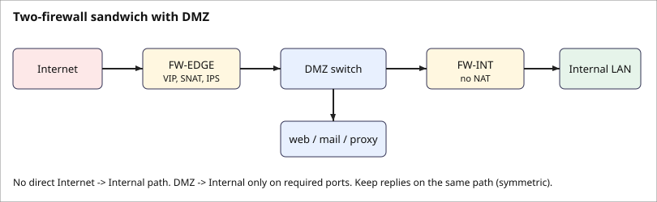

# Enterprise Network & Security Engineering — دوره‌ی تخصصی Cisco و Enterprise Firewall
## بخش ۵ از ۱۱ — فصل‌های ۱۳ تا ۱۵

| مورد | مقدار |
|---|---|
| نام دوره | Enterprise Network & Security Engineering (Cisco + FortiGate) |
| شماره بخش | ۵ از ۱۱ |
| فصل‌های این فایل | ۱۳ ، ۱۴ ، ۱۵ |
| تاریخ تولید | ۲۰۲۶-۱۱-۲۶ |
| نسخه Blueprint | v3.0 (+ بازبینی ۱٫۱) |
| نسخه‌های نرم‌افزار | FortiOS 7.0.3 (اسمی؛ بوت‌نشده؛ تأیید با `get system status`) ؛ Cisco vIOS-L2 15.2(20200924، Experimental) ؛ Cisco vIOS 15.9(3)M9 ؛ VPCS ؛ PNetLab 4.2.8 ؛ ESXi 8.0U2 ؛ CSR1000v 17.03.02 (IOS-XE؛ آزمایش‌نشده) |
| وضعیت تکمیل | **فصل‌های ۱۳–۱۵ تولید شد؛ Policy/NAT، ابزارهای عیب‌یابی، معماری دوفایروالی.** Labها «اجرا نشده»؛ دستورها آزمایش‌نشده. |

> **قوانین خواندن:** تمرین‌ها و پرسش‌های مرور بدون پاسخ‌اند؛ پاسخ در «پاسخ‌های فصل». «اجرا نشده» یعنی خروجی‌ها **پیش‌نیاز/پیش‌بینی** هستند. «CLI-Accepted» ≠ «کار می‌کند». رمزها نمونه‌اند.

### وضعیت راستی‌آزمایی Labهای این بخش
خلاصه: اجرا نشده (فقط طراحی): 18.

| Lab | وضعیت |
|---|---|
| 13-1 | اجرا نشده (فقط طراحی) |
| 13-2 | اجرا نشده (فقط طراحی) |
| 13-3 | اجرا نشده (فقط طراحی) |
| 13-4 | اجرا نشده (فقط طراحی) |
| 13-5 | اجرا نشده (فقط طراحی) |
| 13-6 | اجرا نشده (فقط طراحی) |
| 14-1 | اجرا نشده (فقط طراحی) |
| 14-2 | اجرا نشده (فقط طراحی) |
| 14-3 | اجرا نشده (فقط طراحی) |
| 14-4 | اجرا نشده (فقط طراحی) |
| 14-5 | اجرا نشده (فقط طراحی) |
| 14-6 | اجرا نشده (فقط طراحی) |
| 15-1 | اجرا نشده (فقط طراحی) |
| 15-2 | اجرا نشده (فقط طراحی) |
| 15-3 | اجرا نشده (فقط طراحی) |
| 15-4 | اجرا نشده (فقط طراحی) |
| 15-5 | اجرا نشده (فقط طراحی) |
| 15-6 | اجرا نشده (فقط طراحی) |

---

<a id="ch13"></a>

> **نسخه‌ی اصلاح‌شده (v3.9):** نسخه‌ی توسعه‌یافته‌ی فایل اصلی؛ درس‌های افزوده: ۱۳-۷، ۱۴-۷ (دسته A). فایل اصلی در `course/` حفظ شده است. پاسخ‌های درس‌های افزوده در «پاسخ‌های فصل» همان فصل است.

# فصل 13 — FortiGate II: Policy، Session، NAT، VIP، IP Pool و Central NAT (تک‌فایروالی کامل)

**مدت:** ۳۶ ساعت | **پیش‌نیاز:** فصل ۱۲ (Baseline)، فصل ۱۱ (G4).
**اهداف:** Firewall Policy (اجزا، ترتیب، Log)؛ NAT (Policy NAT، IP Pool، Central NAT)؛ VIP/Port-forward و Hairpin؛ Session Table؛ مدیریت Policy (Shadow، تداخل Object، Hit Count)؛ سناریوهای خرابی؛ **Gate G5**. هر موضوع با GUI و CLI.
**نسخه:** FortiOS 7.0.3 اسمی؛ همه‌ی دستورها آزمایش‌نشده روی Image شما (در بوت اول مقایسه شوند).
**معیار تسلط:** سناریوی تک‌فایروالی (اینترنت، VIP، Policy محدود) کامل و با Packet Walk اثبات؛ پیدا کردن Policy اشتباه، NAT اشتباه و Shadow با شواهد.
**اشتباهات رایج:** ترتیب Policy؛ `set nat enable` فراموش‌شده؛ VIP بدون Policy؛ Policy «all/all»؛ Log خاموش.

**درس‌های فصل:**
- [درس 13-1 — اجزای Firewall Policy، ترتیب و Log](#l-13-1)
- [درس 13-2 — NAT: Policy NAT، IP Pool و Central NAT](#l-13-2)
- [درس 13-3 — VIP، Port-Forward و Hairpin NAT](#l-13-3)
- [درس 13-4 — Session Table، Timeout و ابزارهای Session](#l-13-4)
- [درس 13-5 — مدیریت Policy: Shadow، تداخل Object، Hit Count و Schedule](#l-13-5)
- [درس 13-6 — سناریوهای خرابی (Policy/NAT/Route) و آزمون G5](#l-13-6)

---

<a id="l-13-1"></a>

## درس 13-1 — Firewall Policy: اجزا، قاعده‌ی First Match، Implicit Deny و Log

**فصل 13 · بازنویسی عمیق · پیش‌نیاز: ۱۱-۲، ۱۲-۳، ۱۲-۴ · ≈ 10 ساعت**

> **وضعیت:** FortiOS 7.0.3 نامی (بوت‌نشده)؛ دستورها طبق مستندات 7.0 ولی `Unverified` تا اجرای Lab؛ Lab «اجرا نشده».

<!--deep-->

### هدف آموزشی

در پایان این درس باید بتوانید:

1. اجزای یک Firewall Policy و نقش هرکدام را بگویید.
2. قاعده‌ی First Match، Implicit Deny و Policy 0 را توضیح دهید.
3. ترتیب Policyها را از خاص به عام و بدون Shadow بنویسید.
4. با `iprope lookup` بدون ترافیک Policy مطابق را پیدا کنید.
5. Logging را در سطح Policy و Implicit Deny تنظیم کنید.
6. یک مجموعه‌ی Policy کامل را با آزمون مثبت و منفی اثبات کنید.

### چرا باید یاد بگیریم؟

Policy قلب فایروال است. تقریباً هر حادثه‌ی امنیتی یا قطعی در فایروال به یک Policy برمی‌گردد: یا بیش‌ازحد باز (امنیت)، یا اشتباه/به‌ترتیب نادرست (قطعی). باید Policy را مثل یک جمله‌ی دقیق بخوانید و بنویسید: «چه کسی، از کجا، به کجا، چه سرویسی، چه کاری، چه زمانی، با چه بازرسی و آیا ثبت شود». مثل نگهبانی که فهرست مهمانان را از بالا به پایین می‌خواند و اولین سطر مطابق را اجرا می‌کند؛ اگر نامی نبود، رد می‌کند. جابه‌جایی دو سطر می‌تواند همه را داخل کند یا همه را بیرون.

### اجزای Policy

| جزء | نقش | مثال |
|---|---|---|
| Incoming Interface/Zone | ورودی | port2 / ZN-USERS |
| Outgoing Interface/Zone | خروجی | port1 / ZN-INET |
| Source | چه کسی (آدرس، گروه، کاربر) | NET-USERS |
| Destination | به چه کسی | SRV-ERP / VIP-WEB / all |
| Schedule | چه زمانی | always / WORK-HOURS |
| Service | پورت/پروتکل | HTTPS، DNS |
| Action | عمل | accept / deny |
| NAT | ترجمه | enable + IP Pool |
| Security Profiles | بازرسی | AV، IPS، Web |
| Log | ثبت | all / utm / disable |

### First Match و Implicit Deny

``` text
packet -> Policy 10? match -> apply, stop
       -> Policy 20? match -> apply, stop
       -> ...
       -> no match -> Implicit Deny (policy 0)
```

- **First Match:** از بالا به پایین؛ اولین مطابقت اعمال می‌شود.
- **Implicit Deny (Policy 0):** اگر هیچ Policy مطابق نباشد، بسته رد می‌شود. این قاعده در GUI دیده نمی‌شود و **به‌صورت پیش‌فرض Log ندارد.**
- **Shadow:** Policy که هرگز اجرا نمی‌شود چون Policy بالاتر همه‌ی ترافیکش را می‌گیرد.

### ترتیب درست: از خاص به عام

``` text
10 USERS -> SERVERS  svc HTTPS,SMB       accept log all
20 GUEST -> INTERNET svc HTTP,HTTPS,DNS  accept nat log utm
30 USERS -> INTERNET svc HTTP,HTTPS,DNS  accept nat log utm
90 any   -> any      svc ALL             deny   log all
```

اگر Policy 30 با `dstaddr all` قبل از 10 بود، ترافیک USERS→SERVERS (اگر در Zone اینترنت هم می‌شد دید) را می‌گرفت؛ و اگر 90 (Deny) بالاتر بود، هیچ‌چیز کار نمی‌کرد.

### Lookup بدون ترافیک

``` text
diagnose firewall iprope lookup <src> <sport> <dst> <dport> <proto> <srcintf>
diagnose firewall iprope lookup 10.10.0.5 40000 10.20.0.10 445 tcp port2
 -> policy 10
diagnose firewall iprope lookup 10.10.0.5 40000 203.0.113.10 22 tcp port2
 -> policy 90 (deny)
```

Lookup بسته‌ی فرضی را مثل بسته‌ی واقعی Policy می‌سنجد بدون اینکه ترافیک بفرستد؛ ابزار اصلی آزمون قبل/بعد از تغییر.

### Logging

سه حالت `logtraffic`: `all` (همه‌ی Sessionها)، `utm` (فقط رویدادهای UTM)، `disable`. Deny ضمنی:

``` text
config log setting
 set fwpolicy-implicit-log enable
end
```

یا بهتر: Policy Deny صریح با `logtraffic all` در انتها.

### مثال‌های حل‌شده

#### مثال ساده — خواندن یک Policy

``` text
edit 30
 set srcintf "port2"
 set dstintf "port1"
 set srcaddr "NET-USERS"
 set dstaddr "all"
 set service "HTTP" "HTTPS" "DNS"
 set action accept
 set nat enable
 set logtraffic all
```

«کاربران NET-USERS که از port2 وارد می‌شوند، به هر مقصد از port1 با HTTP/HTTPS/DNS اجازه دارند، با NAT و ثبت کامل».

#### مثال متوسط — Shadow

``` text
ID 30 USERS -> any  svc ALL  accept
ID 10 USERS -> SRV  svc HTTPS accept log
```

Policy 10 هرگز اجرا نمی‌شود (Hit Count صفر). رفع: `move 10 before 30` و تنگ‌کردن 30 (service محدود).

#### مثال متوسط — اثبات با Lookup

۱) آزمون مثبت: Users→ERP:443 ⇒ policy 10 ۲) آزمون منفی: Users→Mgmt:22 ⇒ policy 90 ۳) آزمون Guest→Servers ⇒ 90. ثبت خروجی‌ها در Evidence.

#### مثال سخت — اسکن دیده نمی‌شود

اسکن پورت از اینترنت: Log ندارد. علت: Deny ضمنی بی‌Log. رفع: `fwpolicy-implicit-log enable` یا Policy 90. شاهد: Log با `policyid=90` و `action=deny` برای هر پورت اسکن‌شده. حجم Log هم مدیریت شود (Rate).

#### مثال سخت — تغییر امن

افزودن Policy جدید: ۱) Backup ۲) Lookup قبل ۳) ایجاد با Disable ۴) Lookup بعد (باید مطابق شود) ۵) Enable ۶) آزمون واقعی و Log ۷) Hit Count افزایش ۸) CHG بسته. اگر Lookup بعد policy 0 دهد، Interface/Address/Service را بازبینی.

### Lab هدایت‌شده (اجرا نشده)

1. چهار Policy بالا را بسازید.
2. چهار Lookup (دو مثبت، دو منفی).
3. Shadow عمدی و مشاهده‌ی Hit Count.
4. Deny بی‌Log و فعال‌سازی Log.

### عیب‌یابی سریع

| علامت | علت | رفع |
|---|---|---|
| Policy اجرا نمی‌شود | Shadow | ترتیب |
| Deny بی‌Log | implicit | Deny صریح |
| ترافیک رد می‌شود | Interface/Address | Lookup |
| همه باز است | Policy ALL | تنگ‌کردن |

### جمع‌بندی

Policy: Interface، Source، Destination، Service، Schedule، Action، NAT، Profile، Log. First Match از بالا؛ Implicit Deny بی‌Log. خاص به عام، Lookup برای اثبات، Deny صریح با Log در انتها.

### تمرین و ارزیابی

**ت1.** (ساده) First Match یعنی چه؟ *(پاسخ: 13-1-ت1)*

**ت2.** (ساده) چرا Outgoing Interface را خود ما انتخاب می‌کنیم ولی Route تعیین می‌کند؟ *(پاسخ: 13-1-ت2)*

**ت3.** (متوسط) Policy 3 (Deny all) بالای Policy 2 است. چه می‌شود و چطور کشف می‌کنید؟ *(پاسخ: 13-1-ت3)*

**ت4.** (متوسط) تفاوت Log All Sessions و Security Events؟ *(پاسخ: 13-1-ت4)*

**ت5.** (سخت) برای DB فقط از App مجاز باشد. Policyها را بنویسید و آزمون منفی را شرح دهید. *(پاسخ: 13-1-ت5)*

**ت6.** (سخت، طراحی) استاندارد Policy برای سازمان ۳ شعبه‌ای. *(پاسخ: 13-1-ت6)*

**Q1.** Quick quiz (English): Why does an explicit deny rule with logging help compared to the implicit deny? *(پاسخ: 13-1-Q1)*

### اصطلاحات و English Corner

| مخفف | شکل کامل | معنی |
|---|---|---|
| Policy | Firewall policy | قاعده‌ی فایروال |
| Shadow | Shadowed rule | قاعده‌ی پنهان‌شده |
| Hit count | Policy hit count | شمارنده‌ی تطابق |

- *The first matching policy wins.* ← اولین Policy مطابق برنده است.
- *Always log denied traffic.* ← ترافیک ردشده را همیشه Log کنید.

### کارت Lab

**کارت Lab:** سه Policy و آزمون ترتیب (اجرا نشده). **Evidence:** `03-ops/policy-review.md`.

### منابع

- Fortinet FortiOS 7.0 Administration Guide: Firewall policies
- FortiOS 7.0 CLI Reference: config firewall policy

<a id="l-13-2"></a>

## درس 13-2 — NAT در FortiGate: Policy NAT، IP Pool، Central NAT و انتخاب درست

**فصل 13 · بازنویسی عمیق · پیش‌نیاز: ۱۱-۴، ۱۳-۱ · ≈ 10 ساعت**

> **وضعیت:** FortiOS 7.0.3 نامی (بوت‌نشده)؛ دستورها طبق مستندات 7.0 ولی `Unverified` تا اجرای Lab؛ Lab «اجرا نشده».

<!--deep-->

### هدف آموزشی

در پایان این درس باید بتوانید:

1. انواع NAT در FortiGate (Interface NAT، IP Pool انواع، Central NAT) را تمایز دهید.
2. ظرفیت NAT/IP Pool را محاسبه کنید.
3. Policy NAT را با IP Pool بسازید و تأیید کنید.
4. Central NAT و تفاوت رفتار آن را بدانید.
5. Pool Exhaustion را تشخیص و رفع کنید.
6. NAT را با Session و Sniffer اثبات کنید.

### چرا باید یاد بگیریم؟

آدرس‌های خصوصی (10.x، 192.168.x) در اینترنت مسیر ندارند. NAT آنها را به آدرس عمومی ترجمه می‌کند. تصمیم اینکه چه نوع NAT، با چند IP عمومی و چطور ردیابی شود، بر ظرفیت، تجربه‌ی کاربر و ممیزی اثر مستقیم دارد. مثل میز پذیرش شرکت که نام داخلی را به شماره‌ی بیرونی تبدیل می‌کند: اگر شماره‌ها کم باشد، صف می‌شود.

### انواع NAT

| نوع | شرح | کاربرد |
|---|---|---|
| Interface NAT | با IP Interface خروجی | ساده‌ترین |
| IP Pool Overload (PAT) | چند IP عمومی با تغییر پورت | ظرفیت بالا |
| IP Pool One-to-One | هر کاربر یک IP | نیاز IP اختصاصی |
| Fixed Port Range | هر کاربر بازه‌ی پورت ثابت | ردیابی |
| Port Block Allocation (PBA) | بلوک پورت به هر کاربر | Log کم‌حجم (CGN) |
| Central NAT | ترجمه از Policy جدا | مدیریت متمرکز |

### ظرفیت

یک IP عمومی حدود ۶۴ هزار پورت دارد (۱۰۲۴ تا ۶۵۵۳۵). پورت **به‌ازای هر مقصد** (IP:Port) جدا شمرده می‌شود؛ پس مقصدهای متنوع فشار را کم می‌کنند و مقصد واحد (CDN) بدترین حالت است.

``` text
Users 1200 x sessions per user 60 = 72000 sessions
Ports per IP ~ 64500
Worst case (one destination): 72000 / 64500 = 1.12 -> 2 IPs
With 50 % headroom: 3 IPs
```

### IP Pool

``` text
config firewall ippool
 edit "POOL-INET"
  set type overload
  set startip 203.0.113.20
  set endip 203.0.113.22
 next
end
config firewall policy
 edit 30
  set nat enable
  set ippool enable
  set poolname "POOL-INET"
 next
end
```

IP Poolها باید توسط ISP به فایروال Route شوند؛ و برای `one-to-one` تعداد IP ≥ تعداد کاربران هم‌زمان.

### Central NAT

وقتی فعال شود (`set central-nat enable` در `config system settings`)، `nat enable` در Policy اثر ندارد و ترجمه با `central-snat-map` انجام می‌شود:

``` text
config firewall central-snat-map
 edit 1
  set srcintf "port2"
  set dstintf "port1"
  set orig-addr "NET-USERS"
  set dst-addr "all"
  set nat-ippool "POOL-INET"
 next
end
```

مزیت: ترجمه از Policy جدا و یک‌جا. اشتباه رایج: پس از فعال‌سازی، «NAT ناگهان کار نمی‌کند» چون map ندارید.

### مشاهده

``` text
diagnose sys session list     (snat field)
diagnose sys session filter src 10.10.0.5
diagnose firewall ippool-all list
diagnose firewall ippool-all stats   (exhaustion)
```

### مثال‌های حل‌شده

#### مثال ساده — Interface NAT

Policy `set nat enable` بدون Pool: Src IP با آدرس port1 ترجمه می‌شود. Session: `snat 10.10.0.5:40000->203.0.113.2:40000`.

#### مثال متوسط — محاسبه‌ی Pool

۱۲۰۰ کاربر؛ هر کدام ۶۰ Session؛ مقصدها متنوع (۵۰۰۰ مقصد متفاوت). کل 72000؛ با مقصد متنوع هر IP عملاً ظرفیت بسیار بیشتر دارد. ولی برای بدترین حالت ۳ IP. شاهد: `ippool-all stats` برای عدد واقعی.

#### مثال متوسط — Central NAT

پس از فعال‌سازی Central NAT کاربران اینترنت ندارند. علت: map ندارد. رفع: `central-snat-map` برای NET-USERS. Lookup و Session تأیید.

#### مثال سخت — «پاسخ نمی‌آید»

Session SNAT به 203.0.113.21 ساخته می‌شود ولی پاسخی نیست. Sniffer WAN: فقط خروج. علت: ISP آن IP را Route نکرده. رفع: هماهنگی ISP/IP Interface. آزمون: `curl --interface` و Session.

#### مثال سخت — Pool Exhaustion

Log: «IP pool exhausted». `ippool-all stats`: Pool پر. علل: Pool کوچک، مقصد واحد، اتصال‌های بی‌پایان (UDP)، DoS. رفع: افزایش IP، PBA، کاهش Timeout، بررسی مبدأ پرمصرف. شاهد: کاهش `exhausted`.

### Lab هدایت‌شده (اجرا نشده)

1. Interface NAT و مشاهده‌ی snat.
2. Pool با دو IP و مشاهده‌ی چرخش.
3. Central NAT و خطای «بدون map».
4. محاسبه‌ی ظرفیت و آزمون بار.

### عیب‌یابی سریع

| علامت | علت | رفع |
|---|---|---|
| پاسخ نمی‌آید | Pool Route نشده | ISP |
| NAT اعمال نمی‌شود | Central NAT/Policy | map/enable |
| Pool پر | ظرفیت | افزایش/PBA |
| IP ثابت لازم | overload | one-to-one |

### جمع‌بندی

NAT انواع دارد؛ Pool با Overload، One-to-One یا PBA. ظرفیت = Session/پورت به‌ازای مقصد. Central NAT جدول جدا دارد. ISP باید Pool را Route کند.

### تمرین و ارزیابی

**ت1.** (ساده) PAT چیست؟ *(پاسخ: 13-2-ت1)*

**ت2.** (ساده) تفاوت Overload و One-to-One؟ *(پاسخ: 13-2-ت2)*

**ت3.** (متوسط) برآورد ظرفیت یک IP؟ *(پاسخ: 13-2-ت3)*

**ت4.** (متوسط) چرا پس از Central NAT اینترنت قطع شد؟ *(پاسخ: 13-2-ت4)*

**ت5.** (سخت) ۱۰۰۰ کاربر، ۸۰ Session هر نفر. *(پاسخ: 13-2-ت5)*

**ت6.** (سخت، طراحی) NAT برای سه Zone با Poolهای متفاوت. *(پاسخ: 13-2-ت6)*

**Q1.** Quick quiz (English): What happens to the NAT option in policies after Central NAT is enabled? *(پاسخ: 13-2-Q1)*

### اصطلاحات و English Corner

| مخفف | شکل کامل | معنی |
|---|---|---|
| PAT | Port Address Translation | ترجمه‌ی پورت |
| PBA | Port Block Allocation | تخصیص بلوک پورت |
| CGN | Carrier-Grade NAT | NAT مقیاس اپراتور |

- *The pool must be routed to you by the ISP.* ← ISP باید Pool را به شما Route کند.

### کارت Lab

**کارت Lab:** NAT و Pool (اجرا نشده). **Evidence:** `02-design/fgt-nat.md`.

### منابع

- Fortinet FortiOS 7.0 Administration Guide: NAT
- FortiOS 7.0: IP pools
- FortiOS 7.0: Central NAT

<a id="l-13-3"></a>

## درس 13-3 — VIP، Port-Forward و Hairpin NAT: انتشار امن سرویس داخلی

**فصل 13 · بازنویسی عمیق · پیش‌نیاز: ۱۳-۱، ۱۳-۲ · ≈ 10 ساعت**

> **وضعیت:** FortiOS 7.0.3 نامی (بوت‌نشده)؛ دستورها طبق مستندات 7.0 ولی `Unverified` تا اجرای Lab؛ Lab «اجرا نشده».

<!--deep-->

### هدف آموزشی

در پایان این درس باید بتوانید:

1. VIP و DNAT را توضیح دهید و فرق One-to-One و Port-forward را بگویید.
2. VIP و Policy ورودی را بسازید.
3. آزمون مثبت و منفی انتشار سرویس را اجرا کنید.
4. مشکل Hairpin و راه‌حل‌های آن را بدانید.
5. نیازمندی‌های Route/ARP برای IP عمومی را بشناسید.
6. امنیت سرویس منتشرشده (WAF/IPS/DoS) را اعمال کنید.

### چرا باید یاد بگیریم؟

برای انتشار سرویس داخلی (وب‌سرور DMZ) به اینترنت، ترافیکی که به **آدرس عمومی** می‌رسد باید به آدرس داخلی ترجمه شود (DNAT). VIP (Virtual IP) این کار را می‌کند: مثل منشی‌ای که تماس را به داخلی مناسب وصل می‌کند. اشتباه در VIP یا Policy یا Route یک سرویس را از دسترس خارج یا بیش‌ازحد در معرض می‌گذارد.

### VIP

``` text
config firewall vip
 edit "VIP-WEB-443"
  set extintf "port1"
  set extip 203.0.113.10
  set mappedip "10.30.0.10"
  set portforward enable
  set extport 443
  set mappedport 443
 next
end
```

- **One-to-One (بدون portforward):** همه‌ی پورت‌ها به سرور داخلی؛ سطح حمله بزرگ.
- **Port-forward:** فقط پورت مشخص؛ توصیه‌شده.

### Policy ورودی

``` text
config firewall policy
 edit 40
  set name "INET-to-WEB"
  set srcintf "port1"
  set dstintf "port3"
  set srcaddr "all"
  set dstaddr "VIP-WEB-443"
  set service "HTTPS"
  set action accept
  set logtraffic all
 next
end
```

`dstaddr` باید خود VIP باشد، نه IP داخلی. VIP بدون Policy ترافیکی را عبور نمی‌دهد.

### پیش‌نیازهای شبکه

- IP عمومی VIP باید به فایروال برسد: ISP آن را Route کند یا (در یک زیرشبکه‌ی مشترک) فایروال به ARP پاسخ دهد (Proxy ARP خودکار برای VIP).
- سرور داخلی Default Gateway را فایروال داشته باشد (برگشت از فایروال).
- DNS خارجی نام را به IP عمومی ببرد.

### Hairpin

کاربر LAN با آدرس/نام عمومی سایت (https://203.0.113.10) می‌رود. ترافیک از Interface داخلی وارد و باید به DMZ برود؛ پاسخ ممکن است مستقیم به کاربر برگردد و Session ناقص بماند.

راه‌ها (ترجیحی ⇒ جایگزین):

1. **Split DNS:** نام داخلی به IP داخلی (ساده‌ترین و کم‌ریسک‌ترین).
2. VIP با `extintf any` و Policy از Interface داخلی + (در صورت لزوم) SNAT.
3. توجه: `nat-source-vip` تنظیم Hairpin نیست و برای SNAT ترافیک خروجی سرور است.

### امنیت

فقط پورت لازم؛ UTM (IPS، AV، WAF، درس 16-8)؛ DoS Policy برای VIP؛ Log کامل؛ Rate Limit؛ Patch سرور.

### مثال‌های حل‌شده

#### مثال ساده — انتشار وب

VIP-WEB-443 + Policy 40. آزمون: `curl -vk https://203.0.113.10` ⇒ 200. Session: DNAT به 10.30.0.10:443.

#### مثال متوسط — آزمون مثبت/منفی

``` text
curl -vk https://203.0.113.10        -> 200 (policy 40)
nmap -p 22,80,3389 203.0.113.10      -> filtered (only 443 exposed)
diagnose sys session list            -> dnat 203.0.113.10:443 -> 10.30.0.10:443
```

#### مثال متوسط — VIP One-to-One در برابر Port-forward

با One-to-One تمام پورت‌های سرور (مثلاً 3389) به اینترنت باز می‌شود (اگر Policy اجازه دهد). با Port-forward فقط 443. محاسبه‌ی سطح حمله: 65535 پورت در برابر 1.

#### مثال سخت — VIP بدون پاسخ

1. Policy با dst=VIP؟ (نه IP داخلی)
2. Default Gateway سرور؟
3. IP عمومی به فایروال Route می‌شود؟ (`diagnose sniffer packet port1 'host 203.0.113.10'`)
4. Debug Flow: «DNAT» دیده می‌شود؟
5. فایروال سرور (Host) 443 را می‌پذیرد؟
6. ISP/ACL بالادست؟

#### مثال سخت — Hairpin

کاربر داخلی به https://203.0.113.10 می‌رود و کار نمی‌کند. روش: Split DNS (ترجیح). اگر ممکن نبود: VIP با extintf any، Policy `ZN-USERS -> ZN-DMZ` و در صورت نیاز SNAT تا پاسخ از فایروال برگردد. آزمون: curl از LAN.

### Lab هدایت‌شده (اجرا نشده)

1. VIP و Policy بسازید.
2. آزمون مثبت/منفی با curl/nmap.
3. Policy با IP داخلی بنویسید و خطا را ببینید.
4. Hairpin و Split DNS.

### عیب‌یابی سریع

| علامت | علت | رفع |
|---|---|---|
| VIP کار نمی‌کند | Policy dst | VIP |
| پاسخ برنمی‌گردد | GW سرور | تنظیم |
| IP عمومی نمی‌رسد | Route ISP | هماهنگی |
| Hairpin | هم‌شبکه | Split DNS |

### جمع‌بندی

VIP آدرس عمومی را DNAT می‌کند؛ Port-forward امن‌تر از One-to-One است. Policy باید به VIP اشاره کند؛ Route/GW برگشت لازم است. Hairpin با Split DNS حل می‌شود.

### تمرین و ارزیابی

**ت1.** (ساده) VIP چیست؟ *(پاسخ: 13-3-ت1)*

**ت2.** (ساده) Policy باید به چه مقصدی اشاره کند؟ *(پاسخ: 13-3-ت2)*

**ت3.** (متوسط) چرا Port Forward امن‌تر است؟ *(پاسخ: 13-3-ت3)*

**ت4.** (متوسط) علت Hairpin؟ *(پاسخ: 13-3-ت4)*

**ت5.** (سخت) VIP کار نمی‌کند؛ مراحل بررسی. *(پاسخ: 13-3-ت5)*

**ت6.** (سخت، طراحی) انتشار سه سرویس. *(پاسخ: 13-3-ت6)*

**Q1.** Quick quiz (English): Why must the policy destination reference the VIP object? *(پاسخ: 13-3-Q1)*

### اصطلاحات و English Corner

| مخفف | شکل کامل | معنی |
|---|---|---|
| VIP | Virtual IP | آدرس مجازی |
| DNAT | Destination NAT | ترجمه‌ی مقصد |

- *Publish only the required port.* ← فقط پورت لازم را منتشر کنید.

### کارت Lab

**کارت Lab:** VIP (اجرا نشده). **Evidence:** `02-design/fgt-vip.md`.

### منابع

- Fortinet FortiOS 7.0 Administration Guide: Virtual IPs

<a id="l-13-4"></a>

## درس 13-4 — Session Table: ساختار، Timeout، فیلتر و پاک‌سازی

**فصل 13 · بازنویسی عمیق · پیش‌نیاز: ۱۱-۱، ۱۱-۷، ۱۳-۱ · ≈ 10 ساعت**

> **وضعیت:** FortiOS 7.0.3 نامی (بوت‌نشده)؛ دستورها طبق مستندات 7.0 ولی `Unverified` تا اجرای Lab؛ Lab «اجرا نشده».

<!--deep-->

### هدف آموزشی

در پایان این درس باید بتوانید:

1. ساختار Session Table و فیلدهای مهم `session list` را بخوانید.
2. Timeout و expire را تفسیر کنید.
3. با `session filter` Sessionهای خاص را پیدا و پاک کنید.
4. علت «Policy را حذف کردم ولی کار می‌کند» را توضیح دهید.
5. تعداد Session و نشت را پایش کنید.
6. Offload و Session را مرتبط بفهمید.

### چرا باید یاد بگیریم؟

Session نشان می‌دهد «در این لحظه چه چیزی باز است». بسیاری از رفتارهای عجیب (تغییر Policy اثر نمی‌کند، مسیر قدیمی می‌ماند، اتصال بعد از ساعت‌ها قطع می‌شود) با دیدن Session روشن می‌شود. Session Table مثل دفتر نگهبان است: هر ورودی یک اتصال فعال.

### خواندن Session

``` text
session info: proto=6 proto_state=01 duration=35 expire=3565 timeout=3600 flags=00000000
statistic(bytes/packets/allow_err): org=5320/42/1 reply=48200/55/1 tuples=2
orgin->sink: org pre->post, reply pre->post dev=5->3/3->5 gwy=198.51.100.1/10.10.0.5
hook=post dir=org act=snat 10.10.0.5:40000->203.0.113.10:443(198.51.100.2:40000)
hook=pre  dir=reply act=dnat 203.0.113.10:443->198.51.100.2:40000(10.10.0.5:40000)
policy_id=10 auth_info=0 chk_client_info=0 vd=0
```

| فیلد | معنی |
|---|---|
| proto=6 | TCP (17=UDP، 1=ICMP) |
| proto_state=01 | حالت (01 = Established) |
| duration | عمر (ثانیه) |
| expire / timeout | زمان باقی‌مانده / Timeout کل |
| org / reply | بایت/بسته رفت و برگشت |
| act=snat/dnat | ترجمه‌ها (قبل و بعد) |
| policy_id | Policy مجازکننده |
| dev | Interface ورودی/خروجی |

### فیلتر و پاک‌سازی

``` text
diagnose sys session filter clear
diagnose sys session filter src 10.10.0.5
diagnose sys session filter dport 443
diagnose sys session list
diagnose sys session clear
diagnose sys session filter clear
diagnose sys session stat
diagnose sys session full-stat
```

**هشدار:** `clear` بدون فیلتر همه‌ی Sessionها را می‌بندد.

### Timeout

مقدار سراسری TCP ۳۶۰۰ ثانیه (پیش‌فرض)؛ UDP حدود ۶۰ ثانیه. Timeout هر Service/Policy می‌تواند آن را بازنویسی کند؛ برای SSH طولانی یا برنامه‌ی ویژه:

``` text
config system session-ttl
 config port
  edit 22
   set protocol 6
   set timeout 14400
  next
 end
end
```

### Session و تغییر Policy

Session موجود با تغییر Policy/Route خودبه‌خود تغییر نمی‌کند؛ تا انقضا یا پاک‌سازی همان می‌ماند. پس پس از تغییر، آزمون را با اتصال **جدید** انجام دهید، یا Session‌های مربوط را با فیلتر پاک کنید.

### نشت و پایش

`diagnose sys session stat` تعداد کل/جدید/رد‌شده. روند افزایش بی‌انقطاع ⇒ نشت (DoS، Timeout طولانی، UDP بی‌پایان). بررسی Top مبدأ: `diagnose sys session list | grep ...` یا Log.

### مثال‌های حل‌شده

#### مثال ساده — خواندن

از Session بالا: TCP، Established، ۳۵ ثانیه عمر، Policy 10، SNAT به 198.51.100.2:40000، ۴۲ بسته رفت و ۵۵ بسته برگشت.

#### مثال متوسط — حذف Policy ولی کار می‌کند

FTP (Policy 5) را حذف کردید ولی کاربری هنوز FTP دارد.

``` text
diagnose sys session filter dport 21
diagnose sys session list     -> policy_id=5, expire=3200
diagnose sys session clear
diagnose sys session filter clear
```

پس از پاک‌سازی اتصال جدید رد و Log `policyid=90`.

#### مثال متوسط — محاسبه‌ی Timeout

``` text
expire 3565 s of timeout 3600 -> 35 s since last packet
```

#### مثال سخت — نشت Session

`session stat` تعداد 120,000 (ظرفیت 200,000) و رو به رشد. بررسی: ۱) Top مبدأ ۲) UDP DNS به 8.8.8.8 از یک کلاینت (۳۰ هزار Session؛ DoS ناخواسته/بدافزار) ۳) Timeout UDP ۴) DoS Policy `udp_flood`. اقدام: مهار کلاینت، Policy، و پایش. شاهد: کاهش Session.

#### مثال سخت — SSH قطع می‌شود

SSH بعد از ۱ ساعت بی‌کاری قطع می‌شود: Timeout ۳۶۰۰. راه: Keepalive یا `session-ttl` برای پورت 22 (۴ ساعت) با CHG. شاهد: expire جدید.

### Lab هدایت‌شده (اجرا نشده)

1. یک اتصال بسازید و Session را بخوانید.
2. Policy را حذف و Session را مشاهده؛ سپس Clear با فیلتر.
3. `session-ttl` سفارشی.
4. نشت آزمایشی UDP و `stat`.

### عیب‌یابی سریع

| علامت | علت | رفع |
|---|---|---|
| تغییر بی‌اثر | Session قدیم | Clear با فیلتر |
| قطع بعد از ساعت | Timeout | Keepalive/ttl |
| Session زیاد | DoS/UDP | بررسی/Policy |
| clear همه | بی‌فیلتر | فیلتر |

### جمع‌بندی

Session رکورد اتصال است: حالت، Timeout، NAT، Policy و شمارنده. تغییر Policy Session موجود را عوض نمی‌کند؛ با فیلتر پاک کنید. Timeout و نشت را پایش کنید.

### تمرین و ارزیابی

**ت1.** (ساده) proto=6 یعنی؟ *(پاسخ: 13-4-ت1)*

**ت2.** (ساده) چرا clear فیلترشده؟ *(پاسخ: 13-4-ت2)*

**ت3.** (متوسط) Policy حذف شد ولی ترافیک می‌گذرد؛ چرا؟ *(پاسخ: 13-4-ت3)*

**ت4.** (متوسط) timeout پیش‌فرض TCP؟ *(پاسخ: 13-4-ت4)*

**ت5.** (سخت) SSH قطع می‌شود. *(پاسخ: 13-4-ت5)*

**ت6.** (سخت، طراحی) جدول timeout سازمان. *(پاسخ: 13-4-ت6)*

**Q1.** Quick quiz (English): Why should a session filter be set before running clear? *(پاسخ: 13-4-Q1)*

### اصطلاحات و English Corner

| مخفف | شکل کامل | معنی |
|---|---|---|
| TTL | Time To Live | زمان زنده‌ماندن |
| NPU | Network Processing Unit | پردازنده‌ی شبکه |

- *Never clear all sessions in production.* ← هرگز همه‌ی Sessionها را در Production پاک نکنید.

### کارت Lab

**کارت Lab:** Session (اجرا نشده). **Evidence:** `03-ops/session-notes.md`.

### منابع

- Fortinet FortiOS 7.0 Administration Guide: Session table
- FortiOS 7.0 CLI: diagnose sys session

<a id="l-13-5"></a>

## درس 13-5 — مدیریت Policy در طول زمان: Shadow، Overlap، Hit Count، Schedule و بازبینی فصلی

**فصل 13 · بازنویسی عمیق · پیش‌نیاز: ۱۳-۱، ۱۳-۴ · ≈ 10 ساعت**

> **وضعیت:** FortiOS 7.0.3 نامی (بوت‌نشده)؛ دستورها طبق مستندات 7.0 ولی `Unverified` تا اجرای Lab؛ Lab «اجرا نشده».

<!--deep-->

### هدف آموزشی

در پایان این درس باید بتوانید:

1. Shadow، Overlap، تکراری و Policy بی‌استفاده را تشخیص دهید.
2. Hit Count را درست تفسیر کنید و محدودیت‌های آن را بدانید.
3. Policy را به‌صورت ایمن (Disable، مشاهده، حذف) پاک‌سازی کنید.
4. Policy بیش‌ازحد باز (ALL) را تدریجی تنگ کنید.
5. گزارش ممیز بنویسید و بازبینی فصلی برنامه‌ریزی کنید.
6. Comment و مالک را الزامی کنید.

### چرا باید یاد بگیریم؟

Policy مثل لباس‌های کمد جمع می‌شود: ۸۰ تا ۸۰۰ Policy که کسی نمی‌داند چرا هستند. هر Policy اضافه یعنی سطح حمله، پیچیدگی عیب‌یابی و ریسک تغییر. ممیزان (Audit) دقیقاً همین را می‌پرسند: «چه کسی مالک این Policy است؟ چرا باز است؟ آخرین استفاده چه زمانی بود؟». بازبینی دوره‌ای مثل مرتب‌کردن کمد است: لازم، ولی باید با احتیاط انجام شود تا لباس مهمی دور ریخته نشود.

### مشکلات رایج

| مشکل | معنی | خطر |
|---|---|---|
| Shadow | Policy هرگز اجرا نمی‌شود چون بالاتر همه را می‌گیرد | بی‌فایده، گمراه‌کننده |
| Overlap | دو Policy ترافیک مشترک دارند | رفتار غیرمنتظره |
| تکراری | دو Policy یکسان | نگهداری |
| بی‌استفاده | Hit=0 | سطح حمله |
| بیش‌ازحد باز | ALL/ALL | ریسک امنیتی |
| بی‌Log | `logtraffic disable` | کوری در حادثه |
| بی‌مالک | بدون comment | ممیزی |

### Hit Count

`Hit Count` تعداد دفعات تطبیق و «آخرین استفاده». ابزار تشخیص بی‌استفاده. محدودیت‌ها:

- با Reset شمارنده یا Reboot (در بعضی نسخه‌ها) صفر می‌شود.
- استفاده‌ی **فصلی** (پایان سال مالی) را در بازه‌ی کوتاه نمی‌بیند.
- پس Log ۱۲ ماهه را هم بررسی کنید.

``` text
diagnose firewall iprope show 100004 <policyid>   (model/version dependent)
```

### روش ایمن پاک‌سازی

``` text
1 Backup + Hash
2 Classify (A: hit 0 & old, B: ALL, C: no log, D: duplicate/shadow)
3 Ask owners (ticket/email) for class A
4 Disable (not delete) approved ones
5 Observe 2 weeks (deny logs, user complaints)
6 Delete after sign-off
7 Report
```

### تنگ‌کردن Policy بیش‌ازحد باز

1. Log ۳۰ روزه روی Policy ALL (`logtraffic all`).
2. فهرست مقصد/سرویس‌های واقعی.
3. Policy خاص برای هر جریان بالاتر از ALL.
4. ALL را Disable.
5. مشاهده؛ سپس حذف.

### گزارش ممیز

| ID | نام | مالک | دلیل | Hit | ریسک | تصمیم |
|---|---|---|---|---|---|---|
| 47 | LEGACY-FTP | NOC | پروژه‌ی تمام‌شده | 0 | متوسط | حذف |
| 55 | USERS-ALL | IT | تنگ‌سازی | 1.2M | بالا | جایگزینی |

### مثال‌های حل‌شده

#### مثال ساده — طبقه‌بندی

Export: ۸۰ Policy؛ ۱۲ با Hit=0؛ ۳ ALL؛ ۵ بی‌Log؛ ۴ تکراری. فهرست کار: A=12، B=3، C=5، D=4.

#### مثال متوسط — اجرای ایمن

مالکان: ۹ مورد حذف تأیید؛ ۳ مورد (فصلی) باقی. Disable ۹ مورد ⇒ دو هفته مشاهده‌ی Deny Log؛ هیچ شکایتی ⇒ حذف. ثبت: CHG-120.

#### مثال متوسط — شناسایی Shadow

``` text
Policy 20: USERS -> any ALL accept (Hit 1.2M)
Policy 30: USERS -> SRV HTTPS accept (Hit 0)
```

30 Shadow است. رفع: جابه‌جایی 30 قبل از 20 یا حذف 30.

#### مثال سخت — تنگ‌کردن ALL

Policy `USERS-ALL` همه‌ی ترافیک را مجاز می‌کند. Log ۳۰ روزه: مقصدها: ۱۴ سرور داخلی، اینترنت (443/80/53)، یک سرویس ناشناخته (tcp/8080 به 10.60.0.5). اقدام: ۱) Policyهای خاص ۲) تماس با مالک 10.60.0.5 ۳) ALL غیرفعال ۴) مشاهده ۱ هفته ۵) حذف. اگر برنامه‌ی فصلی شکست خورد، Rollback (Enable).

#### مثال سخت — Hit Count گمراه‌کننده

Policy «YEAR-END-REPORT» Hit=0 در ۶ ماه؛ حذف شد؛ پایان سال گزارش مالی قطع. درس: Log ۱۲ ماهه و پرسش از مالک؛ برچسب «فصلی» در comment.

### Lab هدایت‌شده (اجرا نشده)

1. Export Policy و طبقه‌بندی.
2. Shadow عمدی و تشخیص.
3. Disable/مشاهده/حذف.
4. گزارش ممیز.

### عیب‌یابی سریع

| علامت | علت | رفع |
|---|---|---|
| حذف و قطع | استفاده‌ی فصلی | Disable اول |
| Policy بی‌مالک | comment نیست | ثبت |
| Shadow | ترتیب | مرتب |
| Hit عجیب | Reset | Log |

### جمع‌بندی

بازبینی دوره‌ای: Shadow، Overlap، بی‌استفاده، ALL، بی‌Log. Disable قبل از حذف، مالک و comment، Log ۱۲ ماهه. گزارش ممیز شفاف.

### تمرین و ارزیابی

**ت1.** (ساده) Shadowed Policy چیست؟ *(پاسخ: 13-5-ت1)*

**ت2.** (ساده) چرا Hit Count به‌تنهایی کافی نیست؟ *(پاسخ: 13-5-ت2)*

**ت3.** (متوسط) Schedule تمام شد؛ Session باز چه می‌شود؟ *(پاسخ: 13-5-ت3)*

**ت4.** (متوسط) چرا ابتدا غیرفعال و بعد حذف؟ *(پاسخ: 13-5-ت4)*

**ت5.** (سخت) Policy ALL کاربران→سرورها را تنگ کنید. *(پاسخ: 13-5-ت5)*

**ت6.** (سخت، طراحی) فرایند بازبینی فصلی ۴ هفته‌ای با گزارش. *(پاسخ: 13-5-ت6)*

**Q1.** Quick quiz (English): Why is it safer to disable a policy before deleting it? *(پاسخ: 13-5-Q1)*

### اصطلاحات و English Corner

| مخفف | شکل کامل | معنی |
|---|---|---|
| Shadowed | Shadowed policy | Policy پنهان‌شده |
| Owner | Policy owner | مالک Policy |

- *Review policies quarterly with the business owner.* ← Policyها را فصلی با مالک کسب‌وکار بازبینی کنید.

### کارت Lab

**کارت Lab:** بازبینی Policy (اجرا نشده). **Evidence:** `03-ops/policy-review.md`.

### منابع

- Fortinet FortiOS 7.0 Administration Guide: Firewall policies; Schedules
- NIST SP 800-41 Rev.1 §4.4

<a id="l-13-6"></a>

## درس 13-6 — سناریوهای خرابی Policy/NAT/Route، روش ۱۰ گامی و آزمون G5

**فصل 13 · بازنویسی عمیق · پیش‌نیاز: ۱۳-۱ تا ۱۳-۵، ۱۴-۱ · ≈ 10 ساعت**

> **وضعیت:** FortiOS 7.0.3 نامی (بوت‌نشده)؛ دستورها طبق مستندات 7.0 ولی `Unverified` تا اجرای Lab؛ Lab «اجرا نشده».

<!--deep-->

### هدف آموزشی

در پایان این درس باید بتوانید:

1. سه خانواده‌ی خرابی (Policy، NAT، Route/RPF) را تمایز دهید.
2. روش ده‌گامی عیب‌یابی را اجرا کنید.
3. هر خانواده را با Lookup، Session و Debug Flow اثبات کنید.
4. RCA بنویسید.
5. آزمون G5 را با Rubric بشناسید.
6. دو خرابی هم‌زمان را یکی‌یکی رفع کنید.

### چرا باید یاد بگیریم؟

بیشتر خرابی‌های فایروال در سه خانواده‌اند: Policy (مجوز)، NAT (ترجمه)، Route (مسیر). تشخیص «کدام خانواده» نصف کار است. مثل پزشکی که ابتدا می‌پرسد «قلب؟ ریه؟ معده؟» و سپس آزمایش مناسب را درخواست می‌کند. G5 این مهارت را با سه خرابی تزریقی می‌سنجد.

### روش ده‌گامی

1. **علامت:** دقیق (چه، کی، برای چه کسی).
2. **Scope:** یک نفر یا همه؟
3. **Route:** `get router info routing-table details <dst>`.
4. **Policy:** `diagnose firewall iprope lookup ...`.
5. **NAT:** Session (snat/dnat)؛ Pool.
6. **Session:** `diagnose sys session filter ...`.
7. **DNS:** نام درست حل می‌شود؟
8. **MTU:** ping با DF.
9. **Wire:** Sniffer + Debug Flow.
10. **تأیید:** آزمون مثبت و منفی.

### نشانه‌های هر خانواده

| نشانه | خانواده |
|---|---|
| `policy 0` در Lookup/Debug | Policy |
| Session SNAT ولی SYN بی‌پاسخ | NAT/بالادست |
| `reverse path check fail` | Route/RPF |
| `no route to host` | Route |
| فقط بعضی کاربران | Policy منبع/Address |

### سه پرونده‌ی کامل

**پرونده ۱ — Policy:** «کاربران به پورتال داخلی نمی‌رسند». Lookup: `10.10.0.5 → 10.20.0.30:443` ⇒ policy 0. بررسی: Policy 15 با srcintf=port5 (پس از Migration عوض شده). رفع: srcintf=ZN-USERS. تأیید: Lookup ⇒ policy 15؛ `curl -vk https://10.20.0.30` ⇒ 200.

**پرونده ۲ — NAT:** «نیمی از سایت‌ها باز نمی‌شود». Session: SNAT به 203.0.113.21؛ پاسخ نمی‌آید. علت: IP Pool که ISP Route نکرده. رفع: IP درست یا Interface Address. تأیید: Sniffer پاسخ برمی‌گردد.

**پرونده ۳ — Route/RPF:** «پس از افزودن لینک دوم Sessionها قطع می‌شوند». Debug: `reverse path check fail, drop`. Route به مبدأ از port3 در حالی که بسته از port4 آمده. رفع: Route برگشت/Policy Route. تأیید: Debug Flow Allowed.

### قالب RCA

``` text
Title   : Users cannot reach portal 2026-11-27
Impact  : 60 users, 12 min
Cause   : policy 15 srcintf wrong after migration
Fix     : srcintf corrected
Prevent : pre/post-change lookup test list, review of migrated policies
```

### مثال‌های حل‌شده

#### مثال ساده — Lookup

``` text
diagnose firewall iprope lookup 10.10.0.5 40000 10.20.0.30 443 tcp port2
 -> policy 0 (deny)
```

Policy نیست/Interface نامنطبق. با بررسی GUI: Policy 15 با port5.

#### مثال متوسط — جدا کردن NAT از Route

Sniffer port1: SYN با Src SNAT خروجی؛ SYN-ACK نمی‌آید. نتیجه: Route و Policy و NAT درست؛ مشکل بالادست (Pool/ISP). تأیید: ping از IP Pool به 8.8.8.8 (`execute ping-options source`).

#### مثال متوسط — RPF

Debug `reverse path check fail`. `get router info routing-table details 10.10.0.5` ⇒ via port3؛ بسته از port4. رفع: Route یا Interface صحیح.

#### مثال سخت — دو خرابی هم‌زمان

Policy اشتباه + Route ناقص. اگر هر دو را هم‌زمان تغییر دهید، نمی‌دانید کدام اثر داشت. روش: ۱) ابتدا Route؛ آزمون ۲) سپس Policy؛ آزمون ۳) ثبت. بعد از هر رفع Lookup/Session تازه.

#### مثال سخت — آزمون G5

سه خرابی تزریقی؛ برای هرکدام: Evidence (Lookup/Debug/Session)، علت، رفع، آزمون منفی. **Rubric:** کشف ۳۰، رفع ۳۰، Evidence ۲۰، آزمون ۱۰، صداقت ۱۰.

### Lab هدایت‌شده (اجرا نشده)

1. سه خرابی را بسازید.
2. ده‌گامی را اجرا و Evidence جمع کنید.
3. RCA بنویسید.

### عیب‌یابی سریع

| علامت | علت | رفع |
|---|---|---|
| policy 0 | Policy | Interface/Address |
| SYN بی‌پاسخ | NAT/بالادست | Pool/ISP |
| RPF fail | Route | تصحیح |
| چند خطا | هم‌زمان | یکی‌یکی |

### جمع‌بندی

سه خانواده: Policy، NAT، Route. ده‌گامی علامت تا تأیید. هر خرابی Evidence و RCA می‌خواهد؛ یک رفع در هر زمان.

### تمرین و ارزیابی

**ت1.** (ساده) اولین گام عیب‌یابی؟ *(پاسخ: 13-6-ت1)*

**ت2.** (ساده) no reply یعنی؟ *(پاسخ: 13-6-ت2)*

**ت3.** (متوسط) RPF fail چیست؟ *(پاسخ: 13-6-ت3)*

**ت4.** (متوسط) چرا یک تغییر هر بار؟ *(پاسخ: 13-6-ت4)*

**ت5.** (سخت) دو عیب هم‌زمان را چگونه جدا می‌کنید؟ *(پاسخ: 13-6-ت5)*

**ت6.** (سخت، طراحی) قالب گزارش حادثه. *(پاسخ: 13-6-ت6)*

**Q1.** Quick quiz (English): Which tool shows the policy that would match a given flow? *(پاسخ: 13-6-Q1)*

### اصطلاحات و English Corner

| مخفف | شکل کامل | معنی |
|---|---|---|
| RCA | Root Cause Analysis | تحلیل ریشه‌ای |

- *Change one variable at a time.* ← هر بار فقط یک متغیر را تغییر دهید.

### کارت Lab

**کارت Lab:** G5 (اجرا نشده). **Evidence:** `03-ops/rca-fgt-1.md`.

### منابع

- Fortinet FortiOS 7.0 Administration Guide: Troubleshooting

## درس 13-7 — Session، تغییر Policy/Route و NAT در برابر Routing: چرا «تنظیم را عوض کردم ولی اثر نکرد»؟

**فصل ۱۳ · درس افزوده (تکمیل ۱۳-۶) · پیش‌نیاز: ۱۲-۰، ۱۱-۷، ۱۳-۱ تا ۱۳-۶ · ≈ ۶ ساعت**

> **وضعیت (FortiOS 7.0.3، `Unverified` روی Image):** رفتارها از مستند Fortinet و دانش عملیاتی است؛ نام دقیق پارامترها با CLI Reference 7.0 تطبیق داده شود. Lab «اجرا نشده».

<!--deep-->

### هدف آموزشی

در پایان این درس باید بتوانید:

1. شش علت «تنظیم را عوض کردم ولی اثر نکرد» را بشناسید.
2. فرق نقش Route و NAT (Interface در برابر IP) را بدانید.
3. اثر Session، Offload، DNS/ARP Cache را بفهمید.
4. روش آزمون صحیح پس از تغییر را اجرا کنید.
5. Distance/Priority و `routing-table database` را بخوانید.
6. Central NAT را در این زمینه بشناسید.

### چرا باید یاد بگیریم؟

«تنظیم را عوض کردم ولی اثر نکرد» پرتکرارترین شکایت است. علت‌ها محدودند و قابل‌فهرست‌اند؛ اگر بدانید، به‌جای تغییر بیشتر (و خراب‌تر) علت را پیدا می‌کنید. مثل کلید که می‌چرخانید و ماشین روشن نمی‌شود: اول چک می‌کنید باتری یا دنده، نه اینکه موتور را باز کنید.

### شش علت

1. **Session قدیمی** مسیر/Policy قبلی را نگه داشته.
2. **Shadow:** Policy بالاتر ترافیک را می‌گیرد.
3. **Route بهتر** هنوز فعال است (Distance/Priority).
4. **Central NAT** فعال و تنظیم NAT Policy بی‌اثر.
5. **Offload (NPU):** Sessionهای شتاب‌داده.
6. **Cache:** DNS/ARP/مرورگر.

### نقش Route و NAT

Route **Interface/Next-hop** را تعیین می‌کند؛ NAT فقط **آدرس** را عوض می‌کند. اگر Pool B تنظیم شد ولی خروج هنوز از Interface A است، باید Route/Policy Route عوض شود. بالعکس، تغییر Route بدون NAT متناسب پاسخ را برنمی‌گرداند.

### روش آزمون صحیح پس از تغییر

1. اتصال **جدید** (نه Session قدیمی).
2. `iprope lookup` برای پیش‌بینی.
3. `session list` برای تأیید Policy/NAT.
4. Log.
5. اگر لازم، Clear با فیلتر.

### بررسی Route

``` text
get router info routing-table all
get router info routing-table database
get router info routing-table details 198.51.100.8
```

`all` فعال‌ها؛ `database` همه‌ی Routeها با Distance/Priority. Route جدید با Distance بیشتر فعال نمی‌شود چون قدیمی بهتر است.

### مثال‌های حل‌شده

#### مثال ساده — Session

Policy FTP حذف شد ولی کار می‌کند ⇒ `session list` (policy_id=5) ⇒ Clear با فیلتر.

#### مثال متوسط — Route

Default جدید (Distance 20) اضافه شد ولی خروج هنوز ISP قدیمی (Distance 10). `routing-table database` هر دو؛ `all` فقط قدیمی. رفع: Distance جدید کمتر یا قدیمی حذف/Priority.

#### مثال متوسط — Central NAT

Policy NAT را به Pool B تغییر دادید و بی‌اثر. `config system settings` ⇒ `central-nat enable`. رفع: `central-snat-map`.

#### مثال سخت — NAT در برابر Route

Policy NAT به Pool B (IP ISP-B) ولی ترافیک از Interface ISP-A خارج می‌شود (Route). ISP-A بسته با IP ISP-B را (Spoofed) رد می‌کند. باید Route/Policy Route هم به ISP-B بروند. اثبات: Sniffer port1 (ISP-A) بسته با Src اشتباه.

#### مثال سخت — Offload

پس از تغییر Policy بسته‌ها هنوز از Session شتاب‌داده می‌روند. `session list` ⇒ npu info؛ Clear Session برای اعمال Policy جدید.

#### مثال سخت — Cache

DNS قدیمی (TTL بالا) ⇒ کاربر هنوز IP قدیمی. `ipconfig /flushdns` و بررسی TTL؛ ARP قدیمی پس از تغییر IP/MAC ⇒ `arp -d`.

### Lab هدایت‌شده (اجرا نشده)

1. شش سناریو را بسازید و ببینید.
2. روش آزمون صحیح را تمرین کنید.
3. جدول «تغییر ← انتظار ← مشاهده».

### عیب‌یابی سریع

| علامت | علت | رفع |
|---|---|---|
| بی‌اثر | Session | Clear |
| بی‌اثر | Route بهتر | Priority/Distance |
| بی‌اثر | Central NAT | map |
| NAT درست ولی خروج اشتباه | Route | Policy Route |

### جمع‌بندی

شش علت: Session، Shadow، Route بهتر، Central NAT، Offload، Cache. Route Interface را تعیین می‌کند و NAT آدرس را. آزمون با اتصال جدید و Lookup/Session.

### تمرین و ارزیابی

**ت1.** (ساده) چرا تغییر Policy روی Session موجود فوراً اثر نمی‌کند؟ *(پاسخ: 13-7-ت1)*

**ت2.** (ساده) چرا Filter قبل از Clear لازم است؟ *(پاسخ: 13-7-ت2)*

**ت3.** (متوسط) تفاوت DNAT و Routing را با مثال VIP بگویید. *(پاسخ: 13-7-ت3)*

**ت4.** (متوسط) از `act=snat` در خروجی session چه می‌فهمید؟ *(پاسخ: 13-7-ت4)*

**ت5.** (سخت) پس از Failover ISP بعضی دانلودها قفل‌اند؛ علت و راه‌حل با شواهد. *(پاسخ: 13-7-ت5)*

**ت6.** (سخت، طراحی) چک‌لیست ۵ مرحله‌ای تغییر Policy در تولید بنویسید. *(پاسخ: 13-7-ت6)*

**م1.** Timeout پیش‌فرض TCP Established به چه قابل تنظیم است؟ *(پاسخ: 13-7-م1)*

**Q1.** Quick quiz (English): Why must you apply a filter before clearing sessions? *(پاسخ: 13-7-Q1)*

### اصطلاحات و English Corner

| مخفف | شکل کامل | معنی |
|---|---|---|
| Session TTL | Session time-to-live | عمر Session |
| act=snat | NAT action in session | عمل ترجمه ثبت‌شده |
| Clear | Clear session | حذف Session |
| Pickup | Session pickup | حفظ Session هنگام Failover |

- *Changing a policy does not affect established sessions until they expire or are cleared.* ← تغییر Policy تا پایان یا پاک‌شدن Session روی Sessionهای برقرار اثر ندارد.
- *Never clear all sessions in production without a change window.* ← هرگز در تولید بدون Change Window همه‌ی Sessionها را پاک نکنید.

### منابع

- Fortinet Docs: FortiOS 7.0 Administration Guide — Session table، NAT؛ CLI Reference `diagnose sys session`.
- Fortinet Community: «Troubleshooting Tip: Central NAT Packet processing» (غیررسمی؛ `Unverified`).

## پاسخ‌های فصل 13

> ابتدا بدون نگاه حل کنید. شناسه: درس-نوع+شماره (ت = تمرین، م = مرور).


### پاسخ‌های بازنویسی عمیق درس 13-1

**13-1-ت1** — FortiGate Policyها را از بالا بررسی می‌کند و اولین Policyای که با Interface، Source، Destination، Service و Schedule جور شود اعمال می‌شود؛ بقیه بررسی نمی‌شوند.

**13-1-ت2** — در Policy باید جفت ورودی/خروجی را بنویسیم؛ ولی بسته فقط وقتی به آن Policy می‌رسد که Route همان خروجی را انتخاب کرده باشد؛ اگر Route خروجی دیگری بدهد، Policy تطابق نمی‌کند.

**13-1-ت3** — Policy 2 هرگز اجرا نمی‌شود (Shadowed). Hit Count آن صفر می‌ماند و Policy Lookup ID 3 را نشان می‌دهد؛ رفع با جابه‌جایی.

**13-1-ت4** — All Sessions شروع و پایان هر Session را ثبت می‌کند (مناسب عیب‌یابی، حجم زیاد)؛ Security Events فقط رویدادهای UTM را (حجم کم).

**13-1-ت5** — Policy A: ZN-APP→ZN-DB، Source SRV-APP، Service TCP-1433، ACCEPT، Log All. Policy پایین‌تر: ZN-USERS→ZN-DB Deny با Log. آزمون منفی: از یک کاربر telnet به 1433 ⇒ رد، و در Log action=deny و policyid Deny دیده می‌شود.

**13-1-ت6** — نام‌گذاری یکسان، Comment/Owner، ترتیب خاص→عام، Deny صریح با Log، بازبینی فصلی Hit Count ۰، حذف Policy ALL/ALL، ثبت تغییرات و Backup قبل از تغییر.

**13-1-Q1** — Because the implicit deny does not log by default, while an explicit deny creates auditable log entries.


### پاسخ‌های بازنویسی عمیق درس 13-2

**13-2-ت1** — ترجمه‌ی چند آدرس داخلی به یک آدرس عمومی با استفاده از پورت مبدأ متفاوت.

**13-2-ت2** — Overload چند Host را روی یک/چند IP اشتراکی می‌برد؛ One-to-One هر IP داخلی را به یک IP عمومی ثابت می‌نگارد.

**13-2-ت3** — حدود ۶۴۵۰۰ پورت قابل‌استفاده؛ پس حدود همین تعداد Session هم‌زمان به یک مقصد:پورت.

**13-2-ت4** — Policy NAT نادیده گرفته می‌شود و SNAT Map خالی است.

**13-2-ت5** — ۸۰۰۰۰ Session ⇒ از سقف یک IP بیشتر؛ Pool حداقل دو IP؛ ترجیحاً ۳ برای حاشیه؛ آزمون بار.

**13-2-ت6** — Central SNAT Map جدا برای هر Zone، Pool جدا، ثبت ماتریس و Log.

**13-2-Q1** — It is ignored; translation must be defined in central SNAT map entries.


### پاسخ‌های بازنویسی عمیق درس 13-3

**13-3-ت1** — ترجمه‌ی مقصد (DNAT) از IP عمومی به IP داخلی.

**13-3-ت2** — به شیء VIP.

Policy باید به شیء VIP (نه آدرس داخلی) اشاره کند، چون DNAT قبل از Policy انجام می‌شود و Policy مقصد را با VIP تطبیق می‌دهد؛ اگر آدرس داخلی بنویسید `Denied by forward policy check` می‌بینید.

**13-3-ت3** — فقط پورت‌های لازم را در معرض می‌گذارد.

Port-forward فقط پورت‌های لازم (مثلاً 443) را در معرض می‌گذارد؛ در Static NAT یک‌به‌یک همه‌ی پورت‌های سرور از اینترنت قابل‌دسترس می‌شود که سطح حمله را بزرگ می‌کند.

**13-3-ت4** — سرور و کاربر هم‌شبکه‌اند و پاسخ مستقیم می‌دهد و فایروال دور زده می‌شود.

**13-3-ت5** — Policy، Route، ARP، Session، Log، آزمون منفی.

VIP کار نمی‌کند: ۱) Policy با dst=VIP وجود دارد؟ ۲) Route سرور و Gateway آن به فایروال؟ ۳) ARP/IP عمومی روی WAN؟ ۴) Session و DNAT در `session list`. ۵) Log. ۶) آزمون منفی پورت دیگر.

**13-3-ت6** — سه VIP جدا، Policy جدا، Zone DMZ، Log، آزمون منفی.

انتشار سه سرویس: سه VIP جدا (هر کدام پورت خودش)، سه Policy با Service مشخص، سرورها در Zone DMZ، Log All و آزمون منفی (پورت غیرمجاز رد شود).

**13-3-Q1** — Because DNAT happens before policy lookup and the policy matches the VIP.


### پاسخ‌های بازنویسی عمیق درس 13-4

**13-4-ت1** — TCP.

proto=6 یعنی TCP (17 UDP و 1 ICMP). این فیلد در `session list` نوع پروتکل Session را نشان می‌دهد.

**13-4-ت2** — تا Sessionهای دیگر قطع نشوند.

`session clear` بدون فیلتر همه‌ی Sessionها را می‌بندد و قطعی سراسری می‌سازد؛ با فیلتر src/dst/port فقط Sessionهای مشخص پاک می‌شود.

**13-4-ت3** — Session موجود تا انقضا باقی است؛ Session را با فیلتر پاک کنید.

**13-4-ت4** — حدود ۳۶۰۰ ثانیه (طبق نسخه تأیید شود).

Timeout پیش‌فرض TCP Established حدود ۳۶۰۰ ثانیه است، ولی مقدار دقیق بسته به نسخه فرق دارد؛ با `get system session-ttl` تأیید شود (`Unverified` تا Lab).

**13-4-ت5** — timeout پورت 22 افزایش یا Keepalive.

SSH Admin قطع می‌شود چون Timeout Session کوتاه است؛ راه: timeout پورت 22 را در `session-ttl` افزایش دهید یا Keepalive در کلاینت (`ServerAliveInterval`) تنظیم کنید.

**13-4-ت6** — سرویس، پورت، timeout و دلیل.

جدول Timeout سازمان: سرویس، پورت، Timeout و دلیل (مثلاً SSH Admin: 22: 7200: بیکاری طولانی)؛ همه‌ی تغییرات با CHG ثبت شود.

**13-4-Q1** — Without a filter all sessions are cleared causing an outage.


### پاسخ‌های بازنویسی عمیق درس 13-5


### پاسخ‌های بازنویسی عمیق درس 13-5

**13-5-ت1** — Policyای که هرگز اجرا نمی‌شود چون Policy بالاتر همه‌ی ترافیک آن را می‌گیرد. مثلاً ALL بالای HTTPS.

**13-5-ت2** — با Reboot/Reset صفر می‌شود و استفاده‌ی فصلی را نمی‌بیند؛ باید با Log تاریخی و مالک تأیید شود.

Hit Count با Reboot/Reset صفر می‌شود و استفاده‌ی فصلی (مثلاً پایان سال مالی) را نمی‌بیند؛ پس قبل از حذف با Log تاریخی ۱۲ ماهه و تأیید مالک بررسی شود.

**13-5-ت3** — تا انقضا یا پاک‌سازی می‌ماند؛ برای قطع فوری Session را با فیلتر پاک کنید.

پس از پایان Schedule، Sessionهای موجود تا انقضا باقی می‌مانند و فقط Sessionهای جدید رد می‌شوند؛ برای قطع فوری Session را با فیلتر پاک کنید.

**13-5-ت4** — برای Rollback سریع اگر سرویس مخفی وابسته باشد.

ابتدا غیرفعال و بعد حذف: اگر سرویس مخفی به Policy وابسته باشد، با فعال‌کردن دوباره Rollback سریع می‌شود؛ حذف نیازمند بازگرداندن از Backup است.

**13-5-ت5** — Log ۱۴–۳۰ روز، استخراج مقصد/پورت، Policy خاص بالای ALL، غیرفعال‌سازی ALL، مشاهده، حذف؛ همراه Backup و Rollback.

**13-5-ت6** — Export، تأیید مالک، Window با Backup، مشاهده/حذف؛ گزارش: ID، مالک، دلیل، Hit، ریسک، تصمیم.

فرایند فصلی: Export Policy و Hit، تأیید مالک، Window با Backup، مشاهده و حذف؛ گزارش شامل ID، مالک، دلیل، Hit، ریسک و تصمیم است.

**13-5-Q1** — Disabling allows quick rollback if an unknown dependency appears.


### پاسخ‌های بازنویسی عمیق درس 13-6

**13-6-ت1** — تعریف دقیق علامت.

اولین گام تعریف دقیق علامت است: چه کسی، به چه سرویسی، از کجا، از کی و چه پیامی می‌بیند؛ سپس Route و بقیه‌ی گام‌ها.

**13-6-ت2** — پاسخ برنگشته؛ SNAT/Route/سرور.

no reply یعنی Session ساخته شده ولی پاسخ برنگشته: SNAT اشتباه، Route برگشت یا سرور پاسخ نمی‌دهد؛ با Sniffer دو سمت مشخص می‌شود.

**13-6-ت3** — Route معکوس مبدأ از Interface ورودی نیست.

RPF fail یعنی Route برگشت به مبدأ از همان Interface ورودی نیست؛ با `get router info routing-table details <src>` بررسی و Route/Asymmetric رفع شود.

**13-6-ت4** — برای دانستن اثر هر تغییر.

یک تغییر در هر بار تا بدانید کدام تغییر مشکل را حل کرد و ریشه‌ی اصلی پنهان نشود.

**13-6-ت5** — اول یکی را رفع، آزمون، سپس دومی.

دو عیب هم‌زمان: ابتدا یکی را رفع و آزمون کنید، بعد دومی؛ ثبت اثر هر تغییر در Evidence.

**13-6-ت6** — Timeline، Impact، Cause، Fix، Prevention.

قالب گزارش حادثه: Timeline، Impact، Cause، Fix و Prevention؛ هر بخش با شواهد.

**13-6-Q1** — The policy lookup (iprope lookup).

### پاسخ‌های درس افزوده‌ی 13-7 (فصل 13)

**13-7-ت1** — Policy برای بسته‌ی اول ارزیابی و نتیجه در Session ذخیره می‌شود؛ تغییر بعدی تا انقضا/Clear روی Session موجود اثر ندارد.

**13-7-ت2** — بدون Filter همه‌ی Sessionها پاک و ارتباط همه‌ی کاربران قطع می‌شود.

**13-7-ت3** — Routing مسیر را تعیین می‌کند؛ VIP/DNAT مقصد را به IP داخلی ترجمه می‌کند؛ هر دو لازم‌اند.

**13-7-ت4** — مبدأ بسته ترجمه (SNAT) شده است؛ آدرس ترجمه‌شده در پرانتز دیده می‌شود.

**13-7-ت5** — Session روی WAN قدیمی با SNAT قدیمی مانده؛ شاهد: session list؛ راه‌حل: Clear فیلترشده و تنظیم Failover/Timeout.

**13-7-ت6** — ۱) Backup؛ ۲) تغییر Policy؛ ۳) Clear فیلترشده‌ی Sessionهای مرتبط؛ ۴) آزمون مثبت/منفی؛ ۵) ثبت Evidence و Rollback.

**13-7-م1** — در Global یا Per-Policy با session-ttl (نام دقیق با CLI Reference تطبیق شود).

**13-7-Q1** — Because clearing without a filter removes every session and disconnects all users.

# فصل 14 — ابزارهای عیب‌یابی FortiOS: Sniffer، Debug Flow، Session، Routing، MTU/MSS و Log

**مدت:** ۳۶ ساعت | **پیش‌نیاز:** فصل ۱۳.
**اهداف:** چارچوب ۱۰ پرسش؛ Packet Sniffer؛ Debug Flow؛ Session/Routing/iprope؛ MTU/MSS/DNS/TCP؛ Log Analysis؛ آزمون Packet Walk.
**چرا اینجا؟** عیب‌یابی باید از همین حالا در همه‌ی فصل‌های بعد ابزار شما باشد.
**نسخه:** FortiOS 7.0.3 اسمی (آزمایش‌نشده روی Image).
**معیار تسلط:** با Sniffer و Debug Flow علت موفقیت/شکست یک ارتباط را در ≤ ۱۰ دقیقه با شواهد بگویید.
**اشتباهات رایج:** Sniffer بدون فیلتر؛ فراموشی `diagnose debug disable/reset`؛ Debug روی دستگاه شلوغ؛ نخواندن Route/Policy ID در خروجی.

**درس‌های فصل:**
- [درس 14-1 — چارچوب ۱۰ پرسش عیب‌یابی و مدل ابزارها](#l-14-1)
- [درس 14-2 — Packet Sniffer (CLI و GUI) و Wireshark](#l-14-2)
- [درس 14-3 — Debug Flow: خواندن تصمیم فایروال](#l-14-3)
- [درس 14-4 — Session، Routing و iprope: ابزارهای تکمیلی](#l-14-4)
- [درس 14-5 — MTU/MSS، DNS و مشکلات TCP/UDP](#l-14-5)
- [درس 14-6 — تحلیل Log، Packet Walk و آزمون فصل](#l-14-6)

---

<a id="l-14-1"></a>

## درس 14-1 — چارچوب ۱۰ پرسش عیب‌یابی و نقشه‌ی ابزارها

**فصل 14 · بازنویسی عمیق · پیش‌نیاز: ۱۳-۶، ۱۱-۳، ۱۲-۰ · ≈ 10 ساعت**

> **وضعیت:** FortiOS 7.0.3 نامی (بوت‌نشده)؛ دستورها طبق مستندات 7.0 ولی `Unverified` تا اجرای Lab؛ Lab «اجرا نشده».

<!--deep-->

### هدف آموزشی

در پایان این درس باید بتوانید:

1. ده پرسش ثابت عیب‌یابی را به ترتیب بپرسید و برای هرکدام ابزار مناسب انتخاب کنید.
2. ابزارها (ping، traceroute، sniffer، debug flow، session، routing، log) را روی نقشه‌ی مسیر بسته جای دهید.
3. از علامت مبهم «کار نمی‌کند» به فرضیه‌ی قابل‌آزمون برسید.
4. هر گام را با Evidence (خروجی دستور + زمان + فیلتر) ثبت کنید.
5. ابزارهای سنگین (debug) را ایمن به‌کار ببرید.
6. بعد از رفع، آزمون مثبت و منفی بزنید.

### چرا باید یاد بگیریم؟

پزشک خوب قبل از نسخه‌نوشتن می‌پرسد: «کجا درد دارد؟ از کی؟ چه کرده‌اید؟ تب دارید؟». سپس آزمایش مناسب می‌خواهد. پزشک بد مستقیم آنتی‌بیوتیک می‌دهد. عیب‌یاب شبکه هم همین است: مهندس تازه‌کار مستقیم `debug flow` می‌زند و در خروجی غرق می‌شود؛ مهندس ارشد اول Scope را می‌پرسد و ۸۰٪ مسیر را حذف می‌کند. چارچوب ده پرسش جلوی «حدس‌زدن» و «تغییر هم‌زمان چند چیز» را می‌گیرد و باعث می‌شود هر ساعت عیب‌یابی Evidence تولید کند.

### مفهوم پایه: چرا ترتیب مهم است؟

هر پرسش یک **فرضیه** را رد یا تأیید می‌کند. مثلاً اگر ثابت شد «بسته اصلاً به FortiGate نمی‌رسد»، دیگر Policy و NAT بی‌ربط‌اند. پرسش‌ها از «ارزان و رد‌کننده‌ی بزرگ» به «گران و جزئی» مرتب شده‌اند:

``` text
Scope  ->  L1/L2  ->  arrives?  ->  route  ->  policy  ->  NAT/session
       ->  leaves?  ->  reply?  ->  DNS/MTU/app  ->  verify
```

### ده پرسش و ابزارها

| # | پرسش | ابزار |
|---|---|---|
| 1 | دقیقاً چه چیزی، از کجا به کجا، برای چه کسی؟ | گفتگو، Ticket |
| 2 | از چه زمانی؟ چه چیزی تغییر کرد؟ | Log، CHG، Config diff |
| 3 | لایه‌ی ۱–۲ سالم است؟ | `get system interface physical`، VLAN، لینک |
| 4 | بسته به FortiGate می‌رسد؟ | sniffer ورودی |
| 5 | Route رفت و برگشت هست؟ | `get router info routing-table details` |
| 6 | Policy مطابق است؟ | `iprope lookup`، Debug Flow |
| 7 | NAT/Session درست است؟ | `diagnose sys session list` |
| 8 | بسته خارج می‌شود؟ | sniffer خروجی |
| 9 | پاسخ برمی‌گردد؟ | sniffer (مقصد به ما) |
| 10 | DNS/MTU/برنامه؟ | nslookup، ping DF، curl |

### نقشه‌ی ابزار روی مسیر بسته

``` text
 [PC] --(1)--> [port2 FGT port1] --(2)--> [ISP] --> [Server]
   ^                |  ^   |
   |                v  |   v
   |            route policy NAT session
 ping/curl      (get router) (iprope) (session list)
 traceroute        sniffer on both interfaces
```

- **ping/traceroute:** از دید کاربر؛ ولی ICMP ممکن است Policy جدا داشته باشد.
- **sniffer:** حقیقت روی سیم؛ مستقل از Policy.
- **debug flow:** تصمیم داخلی فایروال (Route، Policy، NAT).
- **session list:** وضعیت اتصال و NAT واقعی.
- **log:** تاریخچه و الگو.

### قاعده‌ی انتخاب ابزار از روی علامت

| علامت | ابزار اول | تفسیر |
|---|---|---|
| Timeout | Route، sniffer | بسته گم شده |
| Connection refused | Policy/سرویس | پاسخ RST |
| کند | MTU، CPU، Session | مشکل کیفیت |
| فقط بعضی کاربران | Policy/Address | Scope |
| فقط HTTPS | MTU، SSL Inspection | لایه‌ی بالاتر |
| بعد از تغییر | Config diff | علت زمانی |

### ایمنی ابزارهای سنگین

- `debug flow` روی ترافیک زیاد CPU را بالا می‌برد: **حتماً فیلتر** و **محدودیت تعداد**.
- همیشه پایان: `diagnose debug disable` و `diagnose debug reset`.
- sniffer با `count` محدود.
- در ساعت اوج، روی دستگاه Production فقط فیلتر باریک.

### مثال‌های حل‌شده

#### مثال ساده — ثبت Evidence

علامت: «سایت داخلی باز نمی‌شود» (فقط یک کاربر).

``` text
Q1 scope  : user 10.10.0.5 only (others ok)
Q5 route  : via port3 ok
Q6 policy : iprope lookup -> policy 0 (deny)
Cause     : user is in a new subnet not in address group
Fix       : add subnet to ADDR-USERS
Verify    : lookup -> policy 15; curl OK
```

Scope «فقط یک کاربر» فوراً Policy/Address را مشکوک کرد.

#### مثال متوسط — انتخاب ابزار

علامت: Timeout به `app.example.com`.

1. Q5 Route: وجود دارد.
2. Q6 Lookup: policy 30.
3. Q7 Session: فقط `SYN_SENT`.
4. Q8 Sniffer port1: SYN خارج، SYN-ACK نیست.
5. نتیجه: مشکل بالادست یا NAT.

Debug Flow لازم نشد؛ sniffer کافی بود.

#### مثال سخت — دو علت پشت‌سرهم

پس از رفع NAT (Pool اشتباه)، سایت باز می‌شود ولی بارگذاری فایل بزرگ قطع می‌شود. Q10 آزمون کامل شکست خورد ⇒ علت دوم MTU (PMTUD بلاک). درس: بعد از هر رفع، **آزمون کامل** (نه فقط ping)، و هر علت جدا ثبت شود.

### Lab هدایت‌شده (اجرا نشده)

1. یک خرابی NAT و یک خرابی Policy بسازید.
2. ده پرسش را برای هرکدام پر کنید.
3. Evidence را در قالب جدول ثبت کنید.

### عیب‌یابی سریع

| علامت | علت | رفع |
|---|---|---|
| حدس‌زدن | بی‌چارچوب | ده پرسش |
| چند تغییر هم‌زمان | بی‌انضباط | یکی‌یکی |
| بی‌Evidence | ثبت نشده | الگوی ثبت |
| CPU بالا | debug بدون فیلتر | disable/reset |

### نکات امنیتی

Debug و sniffer ممکن است داده‌ی حساس (رمز، توکن) نشان دهند؛ فایل pcap را ایمن نگه دارید و پس از پایان حذف کنید.

### جمع‌بندی

ده پرسش با ابزار مشخص؛ اول Scope، بعد پایین‌رفتن از لایه‌ها با Evidence؛ ابزار سنگین با فیلتر؛ پایان با آزمون مثبت و منفی.

### تمرین و ارزیابی

**ت1.** (ساده) چرا از لایه‌ی پایین شروع می‌کنیم؟ *(پاسخ: 14-1-ت1)*

**ت2.** (ساده) Sniffer را چرا با شمارنده می‌زنیم؟ *(پاسخ: 14-1-ت2)*

**ت3.** (متوسط) Sniffer ورودی خالی است؛ علت‌های محتمل؟ *(پاسخ: 14-1-ت3)*

**ت4.** (متوسط) تفاوت sniffer و debug flow؟ *(پاسخ: 14-1-ت4)*

**ت5.** (سخت) برخی سایت‌ها باز می‌شوند؛ مسیر عیب‌یابی؟ *(پاسخ: 14-1-ت5)*

**ت6.** (سخت، طراحی) چک‌لیست یک‌صفحه‌ای ده‌پرسشی. *(پاسخ: 14-1-ت6)*

**Q1.** Quick quiz (English): Which tool reveals the policy and route decision made for a packet? *(پاسخ: 14-1-Q1)*

### اصطلاحات و English Corner

| مخفف | شکل کامل | معنی |
|---|---|---|
| DF | Don't Fragment | بدون تکه‌سازی |
| PMTU | Path MTU | MTU مسیر |

- *Start from the lowest layer and move up.* ← از پایین‌ترین لایه شروع کنید و بالا بروید.

### کارت Lab

**کارت Lab:** ده پرسش (اجرا نشده). **Evidence:** `03-ops/ten-questions.md`.

### منابع

- Fortinet FortiOS 7.0 Administration Guide: Troubleshooting tools
- FortiOS 7.0 Troubleshooting guide

<a id="l-14-2"></a>

## درس 14-2 — Packet Sniffer در CLI و GUI و تحلیل pcap با Wireshark: از فیلتر تا نتیجه‌گیری

**فصل 14 · بازنویسی عمیق · پیش‌نیاز: ۱۴-۱ · ≈ 10 ساعت**

> **وضعیت:** FortiOS 7.0.3 نامی (بوت‌نشده)؛ دستورها طبق مستندات 7.0 ولی `Unverified` تا اجرای Lab؛ Lab «اجرا نشده».

<!--deep-->

### هدف آموزشی

در پایان این درس باید بتوانید:

1. Sniffer را در CLI و GUI با فیلتر دقیق اجرا کنید.
2. سطوح Verbosity (۱ تا ۶) را بشناسید و انتخاب کنید.
3. pcap بگیرید و در Wireshark تحلیل کنید.
4. با Sniffer ثابت کنید «بسته رسید/نرسید» و «پاسخ آمد/نیامد».
5. دو Interface (ورودی و خروجی) را مقایسه کنید.
6. NAT را روی سیم ببینید.

### چرا باید یاد بگیریم؟

Sniffer مثل دوربین مداربسته‌ی راهرو است: نه نظر می‌دهد نه تفسیر؛ فقط نشان می‌دهد چه کسی از کجا رد شد. وقتی Policy و Route را درست می‌دانید و باز هم کار نمی‌کند، تنها حقیقت مستقل روی سیم است. عبارت مشهور مهندسان: «Packet capture doesn't lie».

### دستور پایه

``` text
diagnose sniffer packet <interface|any> '<filter>' <verbosity> <count> <timestamp>
```

| پارامتر | معنی |
|---|---|
| interface | نام Interface یا any |
| filter | سینتکس BPF مثل host، port، proto |
| verbosity | ۱ تا ۶ |
| count | تعداد بسته (۰ = بی‌پایان) |
| timestamp | `a` = زمان مطلق |

### سطوح Verbosity

| سطح | نمایش |
|---|---|
| 1 | فقط سرآیند IP |
| 2 | سرآیند + payload (hex) |
| 3 | سرآیند + payload + Ethernet |
| 4 | سرآیند + نام Interface |
| 5 | سرآیند + payload + Interface |
| 6 | سرآیند + payload + Ethernet + Interface |

در عمل: **4** برای دیدن مسیر و Interface؛ **6** برای ذخیره و تبدیل به pcap.

### فیلترهای کاربردی

``` text
'host 10.10.0.5'
'host 10.10.0.5 and tcp port 443'
'src 10.10.0.5 and dst 198.51.100.8'
'icmp'
'udp port 53'
'not port 22'
```

### نمونه خروجی سطح ۴

``` text
diagnose sniffer packet any 'host 198.51.100.8 and tcp port 443' 4 20 a
2026-11-27 10:15:01.100 port2 in  10.10.0.5.50000 -> 198.51.100.8.443: syn
2026-11-27 10:15:01.101 port1 out 203.0.113.2.50000 -> 198.51.100.8.443: syn
```

دو چیز دیده می‌شود: ورود روی port2 با IP داخلی و **خروج روی port1 با IP عمومی** (NAT). اگر خط دوم نبود، بسته در FortiGate گم شده؛ اگر SYN-ACK نیامد، مشکل بالادست است.

### pcap و Wireshark

1. در CLI با سطح 6 اجرا و خروجی را در فایل متنی ذخیره کنید.
2. با اسکریپت `fgt2eth.pl` (ابزار Fortinet) به pcap تبدیل کنید یا از GUI: Network > Packet Capture.
3. در Wireshark: `tcp.analysis.retransmission`، `tcp.flags.syn==1`، `ip.addr==...`.

### Packet Capture در GUI

GUI: Network > Packet Capture ⇒ Interface، فیلتر، تعداد ⇒ Start ⇒ Download pcap. مزیت: سنگین نیست و مستقیم pcap می‌دهد.

### خواندن الگوها

| الگو | معنی |
|---|---|
| SYN بدون SYN-ACK | مقصد/بالادست بلاک |
| SYN ⇒ RST | سرویس بسته |
| SYN ورودی ولی خروجی نیست | Policy/Route در FGT |
| تکرار SYN | Retransmission، گم‌شدن |
| ICMP frag needed | MTU |

### مثال‌های حل‌شده

#### مثال ساده — بسته می‌رسد؟

دستور: `diagnose sniffer packet port2 'host 10.10.0.5 and icmp' 4 5 a`. اگر ICMP Echo دیده شد، بسته به FortiGate رسیده؛ اگر نه، مشکل پیش از FGT (کابل/VLAN/Switch).

#### مثال متوسط — SYN بدون جواب

``` text
port2 in  10.10.0.5.50000 -> 198.51.100.8.443: syn
port1 out 203.0.113.2.50000 -> 198.51.100.8.443: syn
(no syn-ack)
```

FGT درست عمل کرد؛ مشکل بالادست (ISP/مقصد بلاک یا Pool مسیر نشده). اقدام: Ticket با این Evidence.

#### مثال متوسط — SYN خارج نمی‌شود

port2 SYN دیده شد، port1 هیچ. پس FGT بسته را گم کرده: Policy deny یا Route ⇒ حالا Debug Flow (درس بعد).

#### مثال سخت — MTU با Sniffer

``` text
port1 in  198.51.100.8 > 203.0.113.2: icmp: 198.51.100.8 unreachable - need to frag (mtu 1400)
```

مقصد/میانی PMTUD پیام داده؛ اگر این پیام به کلاینت نرسد (Policy ICMP) اتصال‌های بزرگ گیر می‌کنند. رفع: اجازه‌ی ICMP یا Clamp MSS.

#### مثال سخت — مقایسه‌ی دو Interface

برای NAT: ورودی بسته با Src داخلی، خروجی با Src Pool. اگر خروجی هنوز Src داخلی است، NAT اعمال نشده (Policy بدون NAT یا Central NAT).

### Lab هدایت‌شده (اجرا نشده)

1. ping از PC و Sniffer در دو Interface.
2. ساخت Deny و دیدن نبود بسته‌ی خروجی.
3. ذخیره pcap و بازکردن در Wireshark.

### عیب‌یابی سریع

| علامت | علت | رفع |
|---|---|---|
| خروجی خالی | فیلتر اشتباه | ساده‌تر |
| همه‌چیز می‌بینید | بی‌فیلتر | host/port |
| بسته دیده نمی‌شود | Offload | موقتاً unset offload (آزمایشی) |
| CPU بالا | بی‌count | count |

### نکات امنیتی

Sniffer ترافیک رمزنشده را آشکار می‌کند؛ دسترسی را به Admin محدود و pcap را حذف کنید.

### جمع‌بندی

Sniffer حقیقت روی سیم است: فیلتر دقیق، Verbosity 4 برای مسیر، دو Interface، الگوها (SYN بدون پاسخ، RST، frag needed)، و pcap برای Wireshark.

### تمرین و ارزیابی

**ت1.** (ساده) verbosity 4 چه نشان می‌دهد؟ *(پاسخ: 14-2-ت1)*

**ت2.** (ساده) count چیست؟ *(پاسخ: 14-2-ت2)*

**ت3.** (متوسط) SYN بدون SYN-ACK یعنی؟ *(پاسخ: 14-2-ت3)*

**ت4.** (متوسط) چرا Offload اثر دارد؟ *(پاسخ: 14-2-ت4)*

**ت5.** (سخت) Asymmetric را با Sniffer ثابت کنید. *(پاسخ: 14-2-ت5)*

**ت6.** (سخت، طراحی) روش Capture امن. *(پاسخ: 14-2-ت6)*

**Q1.** Quick quiz (English): Which sniffer verbosity includes the interface name? *(پاسخ: 14-2-Q1)*

### اصطلاحات و English Corner

| مخفف | شکل کامل | معنی |
|---|---|---|
| BPF | Berkeley Packet Filter | فیلتر بسته |
| pcap | Packet capture file | فایل Capture |

- *Capture with a narrow filter.* ← با فیلتر محدود Capture کنید.

### کارت Lab

**کارت Lab:** Sniffer (اجرا نشده). **Evidence:** `03-ops/sniffer-notes.md`.

### منابع

- Fortinet FortiOS 7.0 Administration Guide: Packet capture
- Wireshark User Guide

<a id="l-14-3"></a>

## درس 14-3 — Debug Flow: خواندن تصمیم فایروال خط‌به‌خط با مثال‌های Allowed، Denied و RPF

**فصل 14 · بازنویسی عمیق · پیش‌نیاز: ۱۴-۱، ۱۴-۲ · ≈ 10 ساعت**

> **وضعیت:** FortiOS 7.0.3 نامی (بوت‌نشده)؛ دستورها طبق مستندات 7.0 ولی `Unverified` تا اجرای Lab؛ Lab «اجرا نشده».

<!--deep-->

### هدف آموزشی

در پایان این درس باید بتوانید:

1. Debug Flow را با فیلتر و محدودیت ایمن اجرا کنید.
2. خروجی را خط‌به‌خط بخوانید (Route، Policy، NAT).
3. سه نتیجه‌ی Allowed، Denied، RPF را تشخیص دهید.
4. پیام‌های مهم و معنی آن‌ها را بشناسید.
5. دستورهای پایان‌دادن را بدانید.
6. با Sniffer و Session ترکیب کنید.

### چرا باید یاد بگیریم؟

Sniffer می‌گوید «بسته رسید و نرفت»؛ Debug Flow می‌گوید **چرا**. مثل دیدن گزارش داور بعد از اینکه می‌بینید گل رد شد. بدون آن، مجبورید حدس بزنید. با آن، یک خط مثل `no matching policy` یا `reverse path check fail` علت را مستقیم می‌دهد.

### راه‌اندازی

``` text
diagnose debug reset
diagnose debug flow filter clear
diagnose debug flow filter addr 10.10.0.5
diagnose debug flow filter dport 443
diagnose debug flow show function-name enable
diagnose debug console timestamp enable
diagnose debug flow trace start 20
diagnose debug enable
# ... reproduce ...
diagnose debug disable
diagnose debug reset
```

`trace start 20` فقط ۲۰ بسته را ردیابی می‌کند (ایمنی).

### پیام‌های مهم

| پیام | معنی |
|---|---|
| `vd-root received a packet` | ورود بسته |
| `find a route: gw-... via ...` | Route پیدا شد |
| `no route` / `Denied: failed to find route` | Route نیست |
| `Allowed by Policy-N` | Policy مجاز |
| `Denied by forward policy check (policy 0)` | Policy نیست |
| `reverse path check fail, drop` | RPF |
| `SNAT ...` | ترجمه‌ی مبدأ |
| `DNAT ...` | ترجمه‌ی مقصد |
| `iprope_in_check() check failed` | رد شدن در ورودی خود FGT |

### سه نتیجه‌ی متفاوت

**Allowed:**

``` text
id=20085 trace_id=1 msg="vd-root received a packet(proto=6, 10.10.0.5:50000->198.51.100.8:443) from port2."
id=20085 trace_id=1 msg="allocate a new session-00001a2b"
id=20085 trace_id=1 msg="find a route: flag=00000000 gw-203.0.113.1 via port1"
id=20085 trace_id=1 msg="Allowed by Policy-30: SNAT"
id=20085 trace_id=1 msg="SNAT 10.10.0.5->203.0.113.2:50000"
```

**Denied (policy):**

``` text
msg="Denied by forward policy check (policy 0)"
```

**RPF:**

``` text
msg="reverse path check fail, drop"
```

### روش تفسیر

1. ورود: از کدام Interface (درست است؟).
2. Route: gw و خروجی.
3. Policy: شماره/Deny.
4. NAT: چه ترجمه‌ای.
5. پایان: Allowed یا Drop.

### مثال‌های حل‌شده

#### مثال ساده — Allowed

خطوط بالا: ورود port2، Route از port1، Policy 30 با SNAT. نتیجه: FortiGate سالم است؛ مشکل بعد از آن (بالادست) ⇒ Sniffer SYN-ACK.

#### مثال متوسط — Denied

`Denied by forward policy check (policy 0)`. بررسی: ورود از port5 (نه ZN-USERS). رفع: افزودن Interface به Zone/Policy. پس از رفع Debug تازه: `Allowed by Policy-15`.

#### مثال متوسط — No route

`Denied: failed to find route`. `get router info routing-table details 198.51.100.8` ⇒ خالی. رفع: Default Route یا Static. تأیید: Debug ⇒ `find a route`.

#### مثال سخت — RPF

لینک دوم اضافه شد؛ Sessionها قطع. Debug: `reverse path check fail`. Route به مبدأ از port3؛ بسته از port4. رفع: Route برگشت صحیح یا Policy Route/ `set src-check disable` (فقط موقت و با ریسک).

#### مثال سخت — SNAT ناخواسته

`Allowed by Policy-12: SNAT` ولی انتظار NAT نبود (ترافیک بین Zoneهای داخلی). رفع: `set nat disable`. نکته: Debug قبل از تغییر اثبات می‌کند.

### Lab هدایت‌شده (اجرا نشده)

1. سه حالت را بسازید.
2. Debug را با فیلتر اجرا و پایان دهید.
3. پیام‌ها را جدول کنید.

### عیب‌یابی سریع

| علامت | علت | رفع |
|---|---|---|
| خروجی نیست | فیلتر/enable | مرور |
| خروجی طوفانی | بی‌فیلتر | filter و count |
| trace قطع نمی‌شود | disable نشده | reset |
| تغییر Offload | session شتاب | clear session |

### نکات امنیتی

Debug را روی Production با فیلتر باریک و زمان کوتاه اجرا کنید؛ در پایان حتماً disable/reset.

### جمع‌بندی

Debug Flow: ورود، Route، Policy، NAT. سه نتیجه Allowed/Denied/RPF؛ پیام‌ها علت را مستقیم می‌گویند؛ همیشه فیلتر، count و پایان.

### تمرین و ارزیابی

**ت1.** (ساده) trace start 20 چه می‌کند؟ *(پاسخ: 14-3-ت1)*

**ت2.** (ساده) Allowed by Policy-2 یعنی؟ *(پاسخ: 14-3-ت2)*

**ت3.** (متوسط) policy 0 یعنی؟ *(پاسخ: 14-3-ت3)*

**ت4.** (متوسط) RPF fail چیست؟ *(پاسخ: 14-3-ت4)*

**ت5.** (سخت) RPF را رفع کنید. *(پاسخ: 14-3-ت5)*

**ت6.** (سخت، طراحی) الگوی ثبت Debug. *(پاسخ: 14-3-ت6)*

**Q1.** Quick quiz (English): What does "reverse path check fail" indicate? *(پاسخ: 14-3-Q1)*

### اصطلاحات و English Corner

| مخفف | شکل کامل | معنی |
|---|---|---|
| RPF | Reverse Path Forwarding | مسیر معکوس |

- *Always disable debug when finished.* ← پس از اتمام Debug را خاموش کنید.

### کارت Lab

**کارت Lab:** Debug flow (اجرا نشده). **Evidence:** `03-ops/debug-flow.md`.

### منابع

- Fortinet FortiOS 7.0 Administration Guide: Debug flow
- FortiOS 7.0 Troubleshooting guide

<a id="l-14-4"></a>

## درس 14-4 — Session، Routing و iprope: ابزارهای تکمیلی برای اثبات تصمیم‌ها

**فصل 14 · بازنویسی عمیق · پیش‌نیاز: ۱۴-۱ تا ۱۴-۳ · ≈ 10 ساعت**

> **وضعیت:** FortiOS 7.0.3 نامی (بوت‌نشده)؛ دستورها طبق مستندات 7.0 ولی `Unverified` تا اجرای Lab؛ Lab «اجرا نشده».

### ۱) هدف آموزشی

در پایان این درس باید بتوانید:

1. جدول مسیر را با `get router info routing-table` (all/details/database) بخواند.
2. Policy Route و جدول ARP را بررسی کند.
3. iprope lookup و `diagnose firewall iprope list` را به‌کار ببرد.
4. Session را برای اثبات NAT/Policy تفسیر کند.
5. نتایج را در یک «پرونده‌ی شواهد» جمع کند.

### ۲) مفهوم پایه: چیست و چرا؟ (از صفر، با زبان ساده)

**چرا سه ابزار مکمل؟** Route می‌گوید «کجا»، iprope می‌گوید «مجاز؟»، Session می‌گوید «چه چیزی باز است». با هر سه، تصمیم را ثابت می‌کنید.

**جمع‌بندی اصلی درس:** گاهی debug flow کافی نیست یا نمی‌خواهید روی Production Debug بزنید. ابزارهای «فقط‌خواندنی» مثل جدول مسیر، ARP، Session و iprope بدون اثر جانبی جواب می‌دهند. یک مهندس خوب اول این‌ها را می‌خواند.

### ۳) توضیح عمیق فنی

#### ۱) جدول مسیر

``` text
get router info routing-table all
get router info routing-table details 203.0.113.10
get router info routing-table database
get router info kernel
```

- `all`: مسیرهای فعال (RIB).
- `details`: چرا این مسیر انتخاب شد (Distance، Metric، Interface).
- `database`: همه‌ی مسیرهای دریافتی حتی غیرفعال (برای فهم اینکه چرا مسیر بهتر استفاده نمی‌شود).
- `kernel`: جدول Forwarding واقعی.

#### ۲) ARP و MAC

``` text
diagnose ip arp list
get system arp
```

اگر Next-hop ARP ندارد (INCOMPLETE) یعنی لایه‌ی ۲ مشکل دارد، نه Policy.

#### ۳) Policy Route

``` text
diagnose firewall proute list
```

Policy Route قبل از جدول مسیر اعمال می‌شود؛ مسیر «عجیب» اغلب از همین‌جاست.

#### ۴) iprope

``` text
diagnose firewall iprope lookup 10.10.0.5 40000 203.0.113.10 443 tcp port2
diagnose firewall iprope list 100004
```

lookup: کدام Policy؛ list: لیست Policyها با شمارنده‌ها (`Unverified` برای شماره‌ی گروه).

#### ۵) Session

``` text
diagnose sys session filter src 10.10.0.5
diagnose sys session list
```

فیلدهای مهم: policy_id، act=snat/dnat، state، npu.

#### ۶) پرونده‌ی شواهد

برای هر پرونده: خروجی‌ها (Route، ARP، Lookup، Session) با زمان و علت؛ بدون رمز/اطلاعات حساس.

### ۴) طراحی و تصمیم‌گیری

| سؤال طراحی | گزینه‌ها و معیار انتخاب |
|---|---|
| ابزار فقط‌خواندنی | قبل از debug |
| Evidence | زمان‌دار |

### ۵) مثال‌های حل‌شده (ساده، متوسط، سخت)

#### مثال ساده

``` text
get router info routing-table details 198.51.100.8
diagnose firewall iprope lookup 10.10.0.5 40000 198.51.100.8 443 tcp port2
diagnose sys session filter dst 198.51.100.8
diagnose sys session list
```

#### مثال متوسط — مسیر قدیمی

پس از تغییر Default Route بعضی کاربران از ISP قدیم می‌روند: Session مسیر لحظه‌ی ساخت را دارد؛ Clear با فیلتر یا `snat-route-change`.

#### مثال سخت — Policy Route

PBR قبل از جدول عادی؛ `diagnose firewall proute list` را ببینید.

#### مثال‌های اصلی درس (مرور)

**ساده (حل‌شده):** `get router info routing-table details 203.0.113.10`: Default via 198.51.100.1 port1 [10/0]؛ Policy Lookup: ID 2؛ نتیجه: مسیر و Policy سالم.

**متوسط (ARP):** Route درست و Policy درست ولی ping به Next-hop نمی‌رود: `diagnose ip arp list` ورودی `incomplete`؛ لینک یا VLAN سوییچ؛ رفع و آزمون ping.

**سخت (Policy Route پنهان):** ترافیک مالی از ISP2 می‌رود در حالی که Default ISP1 است. مراحل: ۱) routing-table درست. ۲) `proute list`: Policy Route 3 برای 10.10.20.0/24 به ISP2. ۳) علت: Policy قدیمی. رفع: حذف/اصلاح؛ آزمون traceroute.

### ۶) پیاده‌سازی از مسیر GUI

1. Monitor → Routing Monitor.
2. Network → Policy Routes.

### ۷) پیاده‌سازی از مسیر CLI

``` text
get router info routing-table details 203.0.113.10
get router info routing-table database
diagnose ip arp list
diagnose firewall proute list
diagnose firewall iprope lookup 10.10.0.5 40000 203.0.113.10 443 tcp port2
diagnose sys session list
```

### ۸) Verification (اثبات صحت)

- Route/ARP/Policy/Session هماهنگ.

### ۹) Troubleshooting

| علامت | شاهد برای بررسی | علت محتمل و رفع |
|---|---|---|
| مسیر عجیب | proute | Policy Route |
| ARP incomplete | L2 | سوییچ |
| مسیر بهتر استفاده نمی‌شود | database | Distance |

### ۱۰) نکات امنیتی

- خروجی‌ها را بدون اطلاعات حساس نگه دارید.

### ۱۱) جمع‌بندی مفهومی

- ابزار فقط‌خواندنی.
- proute.
- پرونده‌ی شواهد.

### ۱۲) تمرین و ارزیابی

**ت1.** (ساده) routing-table database چیست؟ *(پاسخ: 14-4-ت1)*

**ت2.** (ساده) ARP incomplete؟ *(پاسخ: 14-4-ت2)*

**ت3.** (متوسط) Policy Route قبل یا بعد از جدول مسیر؟ *(پاسخ: 14-4-ت3)*

**ت4.** (متوسط) iprope lookup؟ *(پاسخ: 14-4-ت4)*

**ت5.** (سخت) ترافیک از ISP اشتباه می‌رود. *(پاسخ: 14-4-ت5)*

**ت6.** (سخت، طراحی) پرونده‌ی شواهد. *(پاسخ: 14-4-ت6)*

**Q1.** Quick quiz (English): Which command lists policy routes? *(پاسخ: 14-4-Q1)*

### ۱۳) اصطلاحات و English Corner

| مخفف | شکل کامل | معنی |
|---|---|---|
| ARP | Address Resolution Protocol | تبدیل IP به MAC |

- *Prove each decision with evidence.* ← هر تصمیم را با شواهد ثابت کنید.

### ۱۴) کارت Lab

**کارت Lab:** ابزارهای تکمیلی (اجرا نشده). **Evidence:** `03-ops/full-picture.md`.

### ۱۵) منابع

- Fortinet FortiOS 7.0 Administration Guide: Routing monitor
- FortiOS 7.0 CLI Reference: get router info

<a id="l-14-5"></a>

### بخش تکمیلی درس: سناریوی واقعی، مثال‌های بیشتر و عیب‌یابی

> بخش‌های زیر درس بالا را کامل می‌کنند: سناریوی گام‌به‌گام، مثال‌های بیشتر از ساده تا سخت، جدول عیب‌یابی و پرسش‌های مصاحبه. ابتدا بخش‌های اصلی بالا را مطالعه کنید.

### تعمیق: ترکیب Session + Route + iprope در یک پرونده

**سناریو.** پس از تغییر Default Route، بعضی کاربران هنوز از ISP قدیم خارج می‌شوند.

``` text
get router info routing-table details 0.0.0.0/0 -> via port4 (new)
diagnose sys session filter src 10.10.0.5
diagnose sys session list -> ... gw=198.18.0.1 via port1 (old)
```

علت: Sessionهای موجود مسیر قدیم را نگه می‌دارند (Route cache در Session). راه حل: پاک‌سازی Session با فیلتر یا `set snat-route-change enable` برای حالتی که SNAT استفاده می‌شود (طبق مستند Fortinet).

**Lookup**

``` text
diagnose firewall iprope lookup 10.10.0.5 40000 8.8.8.8 53 udp port2
```

**نکته.** `get router info routing-table all` بهترین مسیر فعال؛ `database` همه‌ی مسیرها (Admin Distance/Priority).

**اشتباهات رایج:** Clear بدون فیلتر، فراموشی `diagnose sys session filter clear`.

**پرسش‌های مصاحبه**
1. *چرا Session قدیم مسیر قدیم را دارد؟* Session Route را در لحظه‌ی ساخت ثبت می‌کند.
2. *iprope چه می‌گوید؟* Policy مطابق بدون ترافیک.
3. *Policy Route کجا؟* قبل از جدول مسیر عادی.

### تکمیل عمیق: Session، Routing و iprope

#### چرا؟

سه ابزار هر کدام یک سؤال را جواب می‌دهند: Route می‌گوید «کجا»، iprope می‌گوید «مجاز؟»، Session می‌گوید «چه چیزی الان باز است».

#### مثال ساده

``` text
get router info routing-table details 198.51.100.8
diagnose firewall iprope lookup 10.10.0.5 40000 198.51.100.8 443 tcp port2
diagnose sys session filter dst 198.51.100.8
diagnose sys session list
```

#### مثال متوسط — Session مسیر قدیم

پس از تغییر Default Route، بعضی کاربران هنوز از ISP قدیم می‌روند: Session مسیر را در لحظه‌ی ساخت دارد. رفع: پاک‌سازی با فیلتر یا `snat-route-change`.

``` text
diagnose sys session filter src 10.10.0.5
diagnose sys session clear
diagnose sys session filter clear
```

#### مثال سخت — Policy Route

Policy Route قبل از Routing عادی ارزیابی می‌شود؛ اگر مطابق باشد و Gateway ناتمام باشد، ترافیک مسیر دیگر می‌رود. مشاهده: `diagnose firewall proute list`.

#### نکته

`routing-table all` بهترین مسیرهای فعال؛ `database` همه‌ی مسیرها (Distance/Priority).

#### Lab

یک Route را تغییر دهید و رفتار Session را مشاهده کنید.

#### عیب‌یابی

| علامت | علت | رفع |
|---|---|---|
| مسیر قدیم | Session | Clear |
| Policy Route | proute | بررسی |
| Clear همه‌چیز | بی‌فیلتر | فیلتر |

#### پرسش‌ها با پاسخ

**۱. iprope؟** Policy مطابق.
**۲. چرا Session مسیر قدیم؟** لحظه‌ی ساخت.
**۳. proute؟** Policy Route.

#### English Corner

- *Existing sessions keep their original route until they expire or are cleared.*
- Q: What does the iprope lookup command tell you?

## درس 14-5 — MTU/MSS، DNS و مشکلات TCP/UDP: عیب‌یابی «نیمه‌کارکرده» با محاسبه و آزمون پایدار

**فصل 14 · بازنویسی عمیق · پیش‌نیاز: ۱۱-۵، ۱۴-۱، ۱۴-۲ · ≈ 10 ساعت**

> **وضعیت:** FortiOS 7.0.3 نامی (بوت‌نشده)؛ دستورها طبق مستندات 7.0 ولی `Unverified` تا اجرای Lab؛ Lab «اجرا نشده».

### ۱) هدف آموزشی

در پایان این درس باید بتوانید:

1. PMTU را با ping و DF با جست‌وجوی دودویی اندازه بگیرد.
2. MSS-clamp را محاسبه و روی Policy/Tunnel اعمال کند.
3. DNS (Resolver، Forwarder، TCP/UDP 53، EDNS) را عیب‌یابی کند.
4. علائم Black-hole، Retransmission و RST را در Capture بخواند.
5. رفع را با آزمون پایدار تأیید کند.

### ۲) مفهوم پایه: چیست و چرا؟ (از صفر، با زبان ساده)

**چرا MTU/DNS؟** مشکل «گاهی کار می‌کند» اغلب MTU یا DNS است. بسته‌ی کوچک رد می‌شود ولی بزرگ نه؛ یا نام حل می‌شود با تأخیر.

**جمع‌بندی اصلی درس:** بدترین گزارش «بعضی وقت‌ها کار می‌کند» است. صفحه‌ی ساده باز می‌شود ولی ورود به پورتال تا لود شدن می‌ماند؛ ping کار می‌کند و دانلود می‌ایستد؛ نام کار نمی‌کند ولی IP می‌کند. اینها اغلب MTU یا DNS هستند.

### ۳) توضیح عمیق فنی

#### ۱) اندازه‌گیری PMTU

``` text
execute ping-options df-bit yes
execute ping-options data-size 1472
execute ping 203.0.113.10        -> fail
execute ping-options data-size 1372
execute ping 203.0.113.10        -> ok
execute ping-options data-size 1422
...
```

جست‌وجوی دودویی بین موفق و ناموفق؛ PMTU = اندازه‌ی موفق + 28.

``` text
Example: success at 1400 -> PMTU = 1428
MSS = PMTU - 40 = 1388 ; use 1380 for margin
```

#### ۲) MSS-clamp

``` text
config firewall policy
 edit 2
  set tcp-mss-sender 1380
  set tcp-mss-receiver 1380
 next
end
```

(`Unverified` روی 7.0.3.) برای IPsec روی Phase/Interface تونل هم MSS تنظیم کنید.

#### ۳) DNS

- UDP/TCP 53؛ پاسخ بزرگ نیاز به TCP/EDNS.
- FortiGate می‌تواند Forwarder/DNS Server باشد.
- علامت: ping IP ok، ping name نه.

``` text
execute ping www.example.com
diagnose test application dnsproxy 3
```

#### ۴) الگوها در Capture

- بسته‌ی بزرگ بی‌پاسخ + Retransmission ⇒ MTU.
- Query بدون Response ⇒ Policy 53/Resolver.
- RST ⇒ سرور/Policy.

#### ۵) آزمون پایدار

دانلود ۱۰۰ MB، صفحه‌ی HTTPS بزرگ، ۲۰ DNS Query؛ ۳ بار تکرار.

### ۴) طراحی و تصمیم‌گیری

| سؤال طراحی | گزینه‌ها و معیار انتخاب |
|---|---|
| MSS | PMTU−40 با حاشیه |
| ICMP | Frag-needed مجاز |

### ۵) مثال‌های حل‌شده (ساده، متوسط، سخت)

#### مثال ساده — MSS

``` text
Path MTU 1400 -> MSS = 1400 - 40 = 1360
ping -f -l 1372 198.51.100.8
```

#### مثال متوسط — Clamp

`set tcp-mss-sender 1360` و `tcp-mss-receiver 1360` روی Policy.

#### مثال سخت — PMTUD Blackhole و DNS

ICMP Type 3 Code 4 فیلتر؛ ping کار می‌کند ولی HTTPS نه. و DNS: AAAA بی‌پاسخ 5 ثانیه ⇒ کندی؛ `diagnose test application dnsproxy 3`.

#### مثال‌های اصلی درس (مرور)

**ساده (حل‌شده):** PMTU=1428 ⇒ MSS=1388؛ clamp 1380.

**متوسط (DNS):** ping IP ok، name no. مراحل: ۱) Policy پورت 53 به Resolver نیست. ۲) افزودن UDP/TCP 53. ۳) آزمون nslookup. نتیجه: نام کار می‌کند.

**سخت (IPsec):** تونل MTU 1438؛ دانلود می‌ایستد؛ ICMP frag-needed بسته. مراحل: ۱) ping DF: 1372 ok، 1422 fail ⇒ PMTU 1400. ۲) MSS 1360 روی Policy تونل. ۳) باز کردن ICMP 3/4. ۴) آزمون ۱۰۰MB. معیار: بدون Retransmission.

### ۷) پیاده‌سازی از مسیر CLI

``` text
execute ping-options df-bit yes
execute ping-options data-size 1372
execute ping 203.0.113.10
execute ping www.example.com
```

### ۸) Verification (اثبات صحت)

- دانلود بزرگ.
- DNS جواب.
- Retransmission کم.

### ۹) Troubleshooting

| علامت | شاهد برای بررسی | علت محتمل و رفع |
|---|---|---|
| فقط بزرگ | DF ping | MSS/MTU |
| نام کار نمی‌کند | DNS | Policy 53 |

### ۱۰) نکات امنیتی

- ICMP frag-needed را کامل نبندید.

### ۱۱) جمع‌بندی مفهومی

- PMTU باینری.
- MSS−40.
- DNS.
- آزمون پایدار.

### ۱۲) تمرین و ارزیابی

**ت1.** (ساده) MSS برای MTU 1400؟ *(پاسخ: 14-5-ت1)*

**ت2.** (ساده) علامت Black-hole؟ *(پاسخ: 14-5-ت2)*

**ت3.** (متوسط) ping IP ok ولی نام no؟ *(پاسخ: 14-5-ت3)*

**ت4.** (متوسط) چرا ICMP لازم است؟ *(پاسخ: 14-5-ت4)*

**ت5.** (سخت) IPsec دانلود می‌ایستد. *(پاسخ: 14-5-ت5)*

**ت6.** (سخت، طراحی) آزمون پایدار. *(پاسخ: 14-5-ت6)*

**Q1.** Quick quiz (English): How do you measure path MTU with ping? *(پاسخ: 14-5-Q1)*

### ۱۳) اصطلاحات و English Corner

| مخفف | شکل کامل | معنی |
|---|---|---|
| MSS | Maximum Segment Size | حداکثر قطعه |

- *Lower the MSS on tunnels.* ← MSS را روی تونل‌ها کاهش دهید.

### ۱۴) کارت Lab

**کارت Lab:** MTU/DNS (اجرا نشده). **Evidence:** `03-ops/mtu-mss.md`.

### ۱۵) منابع

- Fortinet FortiOS 7.0 Administration Guide: Troubleshooting
- RFC 1191

<a id="l-14-6"></a>

### بخش تکمیلی درس: سناریوی واقعی، مثال‌های بیشتر و عیب‌یابی

> بخش‌های زیر درس بالا را کامل می‌کنند: سناریوی گام‌به‌گام، مثال‌های بیشتر از ساده تا سخت، جدول عیب‌یابی و پرسش‌های مصاحبه. ابتدا بخش‌های اصلی بالا را مطالعه کنید.

### تعمیق: محاسبه‌ی MTU/MSS و پرونده‌ی «سایت باز می‌شود ولی بارگذاری نمی‌شود»

**محاسبه**

``` text
Path MTU            = 1400   (found by ping -f)
MSS = MTU - IP(20) - TCP(20) = 1360
IPsec ESP overhead ~ 73 bytes -> inner MTU ~ 1427 for MTU 1500
```

**تست**

``` text
ping -f -l 1472 198.51.100.8   -> fragmentation needed (too big)
ping -f -l 1372 198.51.100.8   -> reply (1400 total)
```

**رفع** با MSS Clamping روی Policy:

``` text
config firewall policy
 edit 30
  set tcp-mss-sender 1360
  set tcp-mss-receiver 1360
 next
end
```

یا کاهش MTU Interface Tunnel. علت اصلی: ICMP «Fragmentation needed» بین مسیر فیلتر شده (PMTUD Black Hole).

**DNS:** `diagnose test application dnsproxy 3` وضعیت؛ UDP بزرگ (EDNS) و TCP/53.

**پرسش‌های مصاحبه**
1. *چرا ping کار می‌کند ولی HTTPS نه؟* بسته‌ی کوچک رد می‌شود، بزرگ نه.
2. *MSS Clamp کجا؟* روی TCP SYN.
3. *چرا ICMP را کامل نبندیم؟* PMTUD.

### تکمیل عمیق: MTU/MSS، DNS و مشکلات نیمه‌کارکرده

#### چرا؟

بدترین مشکلات «گاهی کار می‌کند» هستند؛ MTU و DNS دو علت اصلی‌اند.

#### MTU و MSS

``` text
Path MTU = 1400 (found with ping -f)
MSS = MTU - IP(20) - TCP(20) = 1360
```

``` text
ping -f -l 1372 198.51.100.8   -> reply
ping -f -l 1373 198.51.100.8   -> fragmentation needed
```

رفع با MSS Clamp:

``` text
config firewall policy
 edit 30
  set tcp-mss-sender 1360
  set tcp-mss-receiver 1360
 next
end
```

#### مثال سخت — PMTUD Blackhole

ICMP Type 3 Code 4 فیلتر شده؛ فرستنده نمی‌فهمد؛ HTTPS قطع می‌شود در حالی که ping کار می‌کند. Clamp روی SYN مستقل از ICMP عمل می‌کند.

#### DNS

``` text
diagnose test application dnsproxy 3
nslookup app.example.com 10.20.0.5
```

پاسخ بزرگ (EDNS/DNSSEC) و TCP/53؛ Truncation.

#### مثال متوسط — کندی

AAAA بی‌پاسخ ۵ ثانیه؛ سپس A. علت: DNS Server؛ رفع روی سرور.

#### Lab

Path MTU را اندازه و MSS را محاسبه کنید.

#### عیب‌یابی

| علامت | علت | رفع |
|---|---|---|
| HTTPS قطع | MTU | Clamp |
| DNS کند | AAAA | سرور |
| TC | TCP/53 | باز |

#### پرسش‌ها با پاسخ

**۱. MSS چگونه؟** MTU منهای ۴۰.
**۲. چرا Clamp؟** مستقل از ICMP.
**۳. TC flag؟** پاسخ بریده.

#### English Corner

- *If small packets work and large ones fail, suspect an MTU problem.*
- Q: How do you compute the TCP MSS from the MTU?

## درس 14-6 — تحلیل Log، Packet Walk و آزمون عملی فصل ۱۴: سه پرونده‌ی کامل

**فصل 14 · بازنویسی عمیق · پیش‌نیاز: ۱۴-۱ تا ۱۴-۵ · ≈ 12 ساعت**

> **وضعیت:** FortiOS 7.0.3 نامی (بوت‌نشده)؛ دستورها طبق مستندات 7.0 ولی `Unverified` تا اجرای Lab؛ Lab «اجرا نشده».

### ۱) هدف آموزشی

در پایان این درس باید بتوانید:

1. Log ترافیک را (action، policyid، srcip، dstip، service، byte) بخواند.
2. با فیلتر Log علت Deny را بیابد.
3. Packet Walk کامل را از Log و Flow بسازد.
4. سه پرونده را حل و RCA کند.
5. آزمون عملی فصل ۱۴ را با Rubric تحویل دهد.

### ۲) مفهوم پایه: چیست و چرا؟ (از صفر، با زبان ساده)

**چرا Log و Packet Walk؟** Log اولین منبع است؛ باید هر فیلد را بخوانید و به گام‌های مسیر بسته وصل کنید.

**جمع‌بندی اصلی درس:** Debug لحظه است؛ Log حافظه‌ی بلندمدت است. «ساعت ۹ دیروز چرا قطع شد؟» فقط با Log جواب داده می‌شود. این درس خواندن Log را به عیب‌یابی کامل تبدیل می‌کند.

### ۳) توضیح عمیق فنی

#### ۱) خواندن Log

``` text
date=2026-11-26 time=10:05:11 type="traffic" subtype="forward" level="notice" srcip=10.10.0.5 srcport=40000 srcintf="port2" dstip=203.0.113.10 dstport=443 dstintf="port1" policyid=2 action="accept" service="HTTPS" sentbyte=5320 rcvdbyte=48200
```

policyid=0 و action=deny ⇒ معمولاً Implicit Deny. rcvdbyte=0 ⇒ پاسخی نیامده. نکته‌ی مستند Fortinet: policyid=0 فقط مخصوص Implicit Deny نیست؛ ترافیک Local (Local-in/Local-out) بدون Policy تعریف‌شده هم با policyid=0 ثبت می‌شود؛ پس `subtype` (forward یا local) را هم بخوانید.

#### ۲) فیلتر

``` text
execute log filter category 0
execute log filter field srcip 10.10.0.5
execute log filter field action deny
execute log display
```

GUI: Log & Report → Forward Traffic → Filter.

#### ۳) پرونده ۱: Deny

Log: action=deny policyid=0 dstport=22. علت: SSH در Policy نیست. رفع: Policy مجزا برای مقاصد لازم. آزمون: accept.

#### ۴) پرونده ۲: Accept با rcvdbyte=0

Log: accept، sentbyte>0، rcvdbyte=0. علت: سرور پاسخ نمی‌دهد یا Route برگشت. شاهد: Sniffer دو سمت. رفع: Route/سرور.

#### ۵) پرونده ۳: Drop بی‌Log

ترافیک رد می‌شود ولی Log ندارد: Implicit Deny. رفع: Deny صریح با Log.

#### ۶) Packet Walk از Log

``` text
Log: srcintf=port2 -> dstintf=port1, policy 2, SNAT
Walk: ingress port2 -> route port1 -> policy 2 -> SNAT -> egress
```

#### ۷) آزمون

سه پرونده، Evidence: Log+Flow+Sniffer، علت، رفع، آزمون. Rubric: Log ۲۰، تحلیل ۳۰، رفع ۲۰، Evidence ۱۵، صداقت ۱۵.

### ۵) مثال‌های حل‌شده (ساده، متوسط، سخت)

#### مثال ساده — خواندن Log

``` text
srcip=10.10.0.5 dstip=198.51.100.8 dstport=443 action=timeout policyid=30 sentbyte=60 rcvdbyte=0 duration=60
```

Session باز شد (policy 30) ولی پاسخی نیامد.

#### مثال متوسط — Packet Walk

User → port2 (RPF ok) → Policy 30 → SNAT → Route port1 → ISP → بدون پاسخ.

#### مثال سخت — سه پرونده

deny با policyid=0، timeout با rcvdbyte=0، close سریع با بایت کم (RST/برنامه). Rubric: گام‌ها ۳۰، Evidence ۳۰، علت ۲۰، رفع ۱۰، صداقت ۱۰.

#### مثال‌های اصلی درس (مرور)

**ساده (حل‌شده):** Log accept policyid=2؛ Walk مطابق.

**متوسط (تحلیل):** Deny با policyid=0 و dstport=22 ⇒ Implicit Deny؛ Policy SSH برای Admin؛ آزمون accept.

**سخت (rcvdbyte=0):** Accept ولی rcvdbyte=0: Sniffer port1 خروج SYN، بدون SYN-ACK؛ سرور خاموش؛ تیم سرور؛ ثبت RCA.

### ۷) پیاده‌سازی از مسیر CLI

``` text
execute log filter category 0
execute log filter field srcip 10.10.0.5
execute log display
```

### ۸) Verification (اثبات صحت)

- Log و Flow همسو.

### ۹) Troubleshooting

| علامت | شاهد برای بررسی | علت محتمل و رفع |
|---|---|---|
| Log نیست | logtraffic | Policy Log All |

### ۱۰) نکات امنیتی

- Log بدون رمز.

### ۱۱) جمع‌بندی مفهومی

- Log=گذشته.
- policyid=0.
- rcvdbyte=0.
- Walk.

### ۱۲) تمرین و ارزیابی

**ت1.** (ساده) policyid=0 یعنی؟ *(پاسخ: 14-6-ت1)*

**ت2.** (ساده) rcvdbyte=0 یعنی؟ *(پاسخ: 14-6-ت2)*

**ت3.** (متوسط) چرا Log نیست؟ *(پاسخ: 14-6-ت3)*

**ت4.** (متوسط) Packet Walk را از Log بسازید. *(پاسخ: 14-6-ت4)*

**ت5.** (سخت) سه پرونده را حل کنید. *(پاسخ: 14-6-ت5)*

**ت6.** (سخت، طراحی) الگوی گزارش. *(پاسخ: 14-6-ت6)*

**Q1.** Quick quiz (English): What does policyid=0 mean in a traffic log? *(پاسخ: 14-6-Q1)*

### ۱۳) اصطلاحات و English Corner

| مخفف | شکل کامل | معنی |
|---|---|---|
| Log | Traffic log | لاگ ترافیک |

- *Logs explain what happened in the past.* ← Log گذشته را توضیح می‌دهد.

### ۱۴) کارت Lab

**کارت Lab:** آزمون ۱۴ (اجرا نشده). **Evidence:** `03-ops/walk-arch2.md`.

### ۱۵) منابع

- Fortinet FortiOS 7.0 Administration Guide: Log & Report

### ضمیمه: پرونده‌ی کامل حل‌شده — خواندن Log تا Packet Walk

**ورودی:** کاربر 10.10.0.5 به پورتال 10.20.0.30:443 نمی‌رسد. Log:

``` text
srcip=10.10.0.5 srcintf="port2" dstip=10.20.0.30 dstport=443 dstintf="port3" policyid=0 action="deny"
```

**گام ۱ — تفسیر:** policyid=0 و action=deny ⇒ Implicit Deny؛ هیچ Policy مطابق نیست.

**گام ۲ — Lookup:**

``` text
diagnose firewall iprope lookup 10.10.0.5 40000 10.20.0.30 443 tcp port2
```

نتیجه: policy 0. بررسی: Policy موجود Users→Servers فقط TCP-8443 است.

**گام ۳ — رفع:** افزودن 443 به Service یا Policy جدید با Service HTTPS؛ Log All.

**گام ۴ — Packet Walk پس از رفع:**

``` text
ingress port2 -> RPF ok -> route 10.20.0.0/24 via port3 -> policy 62 accept -> egress port3
```

**گام ۵ — آزمون:** `curl -vk https://10.20.0.30` ⇒ 200؛ Log: action=accept policyid=62؛ آزمون منفی SSH ⇒ Deny.

**درس:** Log اثبات می‌کند چه شد؛ Lookup نشان می‌دهد چرا.

### بخش تکمیلی درس: سناریوی واقعی، مثال‌های بیشتر و عیب‌یابی

> بخش‌های زیر درس بالا را کامل می‌کنند: سناریوی گام‌به‌گام، مثال‌های بیشتر از ساده تا سخت، جدول عیب‌یابی و پرسش‌های مصاحبه. ابتدا بخش‌های اصلی بالا را مطالعه کنید.

### تعمیق: پرونده‌ی کامل Log → Packet Walk

**Log**

``` text
date=2026-11-27 time=10:12:01 logid=0000000013 type=traffic subtype=forward
srcip=10.10.0.5 dstip=198.51.100.8 dstport=443 action=timeout policyid=30
sentbyte=60 rcvdbyte=0 duration=60
```

**تفسیر:** `action=timeout` با rcvdbyte=0 یعنی Session باز شد ولی جوابی نیامد؛ مشکل بعد از فایروال.

**Packet Walk:** کاربر → port2 (RPF OK) → Policy 30 → SNAT → Route port1 → ISP ⇒ بدون پاسخ.

**جدول Evidence**

| گام | ابزار | نتیجه |
|---|---|---|
| Route | get router info routing-table | OK |
| Policy | iprope lookup | 30 |
| Wire | sniffer | SYN out فقط |

**آزمون عملی.** سه پرونده؛ برای هرکدام Timeline، Evidence، علت، رفع و آزمون منفی؛ Rubric: گام‌ها ۳۰، Evidence ۳۰، علت ۲۰، رفع ۱۰، صداقت ۱۰.

**پرسش‌های مصاحبه**
1. *action=close و timeout؟* close پایان عادی؛ timeout انقضا.
2. *چرا sentbyte مهم است؟* ترافیک واقعی را نشان می‌دهد.
3. *Log کجا ناقص؟* Offload و Sampling.

### تکمیل عمیق: تحلیل Log و Packet Walk — سه پرونده

#### چرا؟

Log اولین جایی است که نگاه می‌کنیم؛ باید بتوانیم هر فیلد را بخوانیم و به Packet Walk وصل کنیم.

#### مثال ساده — خواندن Log

``` text
date=2026-11-27 time=10:12:01 type=traffic subtype=forward srcip=10.10.0.5 dstip=198.51.100.8 dstport=443 action=timeout policyid=30 sentbyte=60 rcvdbyte=0 duration=60
```

تفسیر: Session باز شد (policy 30)؛ ۶۰ بایت فرستاد و صفر دریافت کرد؛ ۶۰ ثانیه ⇒ پاسخ نیامد؛ مشکل بعد از فایروال.

#### Packet Walk

``` text
User -> port2 (RPF ok) -> Policy 30 -> SNAT -> Route port1 -> ISP -> (no reply)
```

#### جدول Evidence

| گام | ابزار | نتیجه |
|---|---|---|
| Route | routing-table | OK |
| Policy | iprope | 30 |
| Wire | sniffer | SYN out فقط |

#### مثال سخت — سه پرونده

1. `action=deny policyid=0` ⇒ Policy نیست.
2. `action=timeout rcvdbyte=0` ⇒ بعد از فایروال.
3. `action=close` با `rcvdbyte` کم و زمان کوتاه ⇒ اتصال سریع بسته (RST/برنامه).

#### Rubric

``` text
Steps 30 | Evidence 30 | Cause 20 | Fix 10 | Honesty 10
```

#### Lab

سه Log نمونه را تحلیل و Packet Walk بنویسید.

#### عیب‌یابی

| علامت | علت | رفع |
|---|---|---|
| فیلد نامفهوم | نداشتن مرجع | مستند |
| Log ناقص | Offload/Sampling | Sniffer |
| زمان اشتباه | NTP | همگام |

#### پرسش‌ها با پاسخ

**۱. timeout با rcvdbyte=0؟** پاسخ نیامد.
**۲. close چه؟** پایان عادی/ناگهانی.
**۳. چرا Packet Walk؟** ترتیب تصمیم‌ها.

#### English Corner

- *A session with zero received bytes means the reply never arrived.*
- Q: How do you read the action field in a traffic log?

## درس 14-7 — روش نظام‌مند عیب‌یابی: از علامت تا علت و رفع (با پرونده‌های واقعی)

**فصل ۱۴ · درس افزوده (تکمیل ۱۴-۶) · پیش‌نیاز: ۱۲-۰، ۱۲-۸، ۱۳-۷، ۵-۰ · ≈ ۸ ساعت**

> **وضعیت:** روش مستقل از برند + دستورهای FortiOS 7.0.3 (`Unverified` روی Image). خروجی‌ها نمونه‌ی آموزشی‌اند.

### ۱) هدف آموزشی

دانشجو در پایان می‌تواند:

1. یک **فرایند عیب‌یابی ثابت** را اجرا کند (علامت، دامنه، فرضیه، شاهد، آزمون، رفع، تأیید، مستندسازی).
2. با «تقسیم مسیر» (Divide and Conquer) مرحله‌ی خرابی را در Packet Flow پیدا کند.
3. ابزارها را به سؤال درست وصل کند: Sniffer، Debug Flow، Session، Routing، ARP، Log، CPU/Memory، Interface Errors، DNS/DHCP/Auth.
4. از شواهد به **علت ریشه‌ای** برسد و دو علت هم‌زمان را از هم جدا کند.
5. پیش از «رفع»، اثر تغییر را پیش‌بینی و پس از آن اندازه‌گیری کند.

### ۲) مفهوم پایه: چیست و چرا؟ (از صفر، با زبان ساده)

**چرا فرضیه‌محور؟** عیب‌یاب حدس‌محور فقط با شانس موفق است. فرضیه‌محور هر بار یک احتمال را با شاهد رد/تأیید می‌کند و پیشرفت قابل‌اثبات است.

**جمع‌بندی اصلی درس:** Packet Flow (۱۲-۰)، Local-in/out (۱۲-۸)، Session (۱۳-۷)، ابزارهای Linux/Wireshark (فصل ۲، ۲۸).

### ۳) مفهوم پایه

عیب‌یابی ضعیف = «دستورها را حفظ کردن و پشت‌سرهم زدن». عیب‌یابی قوی = **فرضیه‌محور**: هر دستور برای پاسخ به یک سؤال مشخص است. اگر نتیجه فرضیه را رد کرد، فرضیه‌ی بعد.

### ۴) توضیح عمیق فنی

#### ۴-۱) فرایند هشت‌مرحله‌ای

``` text
1. Symptom      : what exactly fails? who? since when? what changed?
2. Scope        : one user / one subnet / everyone? one app / all apps?
3. Hypotheses   : list likely causes by layer (L1..L7, route, policy, NAT, profile, DNS, auth)
4. Evidence     : choose the cheapest test that splits the hypothesis space
5. Test         : run it with a narrow filter; record raw output
6. Root cause   : the change/condition that explains ALL evidence
7. Fix + verify : minimal change; positive and negative test; measure
8. Document     : symptom, evidence, cause, fix, prevention
```

#### ۴-۲) تقسیم مسیر روی Packet Flow

مسیر: کلاینت → سوئیچ → FortiGate Ingress → Route → Policy → NAT/Profile → Egress → ISP/سرور → برگشت. **در نقطه‌ی میانی** آزمون بگذارید:

- بسته در Ingress دیده می‌شود؟ (`diagnose sniffer packet <port> "host X" 4`)
- اگر نه: مشکل قبل از فایروال (کابل، VLAN، ARP، کلاینت).
- اگر بله: Debug Flow (Route/Policy/Drop؟).
- اگر Allowed و Egress دیده می‌شود: مشکل بعد از فایروال یا مسیر برگشت.

#### ۴-۳) نقشه‌ی «سؤال → ابزار»

| سؤال | ابزار |
|---|---|
| بسته به Interface رسید؟ | Sniffer/Packet Capture |
| ARP/Neighbor درست است؟ | `diagnose ip arp list`، `get system arp` |
| Route چیست؟ | `get router info routing-table details <ip>` |
| Policy کدام است؟ | Debug Flow، `diagnose firewall iprope lookup`، Log Forward |
| NAT چه شد؟ | `diagnose sys session list` |
| Session هست؟ | `diagnose sys session filter ...` |
| Interface خطا دارد؟ | `get system interface physical`، `diagnose hardware deviceinfo nic <port>` |
| CPU/Memory؟ | `get system performance status`، `diagnose sys top` |
| DNS؟ | `execute nslookup` (Local-out)، Sniffer روی 53 |
| DHCP؟ | Sniffer روی 67/68، `diagnose ... dhcp` |
| Auth؟ | `diagnose test authserver`، `diagnose debug application fnbamd -1` |
| VPN؟ | `diagnose vpn ike log filter`، `diagnose vpn tunnel list` |
| HA؟ | `get system ha status` |

(نام و فرمت دستورها با CLI Reference 7.0 تطبیق شود؛ `Unverified`.)

#### ۴-۴) خطاهای فکری

- **Confirmation bias:** فقط دنبال شاهد برای فرضیه‌ی اول بودن.
- **Fix-first:** تغییر چند چیز هم‌زمان؛ نمی‌دانید کدام اثر کرد.
- **Symptom ≠ cause:** «Drop شد» علامت است؛ علت Route/Policy/RPF است.
- **Debug طولانی:** Debug بدون Filter CPU را می‌خورد.

#### ۴-۵) مستندسازی RCA

قالب یک‌صفحه‌ای: عنوان، زمان، اثر، Timeline، شواهد (خروجی خام)، علت ریشه‌ای، اقدام فوری، اقدام پیشگیرانه.

### ۵) پرونده‌های حل‌شده

#### مثال ساده — الگو

H1 Route غلط ⇒ رد؛ H2 Policy نیست ⇒ رد؛ H3 بالادست ⇒ Sniffer: SYN بدون ACK ⇒ تأیید.

#### مثال متوسط — پرونده‌ها

IP قبلی در لیست سرور؛ Schedule منقضی؛ DNS با TTL قدیمی.

#### مثال سخت — Rollback

هر رفع با Rollback آماده؛ اگر بدتر شد بازگردید و فرضیه را اصلاح کنید.

#### مثال‌های اصلی درس (مرور)

**پرونده ۱: «سایت X باز نمی‌شود»**

علامت: کاربر 192.168.10.5 به www.example.com نمی‌رسد؛ دیگران می‌رسند. دامنه: فقط یک کاربر.

``` text
FGT # diagnose sniffer packet any "host 192.168.10.5 and port 53" 4 10 l
FGT # diagnose debug flow filter addr 192.168.10.5
FGT # diagnose debug flow trace start 20
```

شاهد: کلاینت از DNS داخلی 192.168.10.2 درخواست می‌دهد؛ پاسخ NXDOMAIN. نتیجه: DNS ✓ فایروال بی‌تقصیر؛ سمت DNS Server/Cache. رفع: پاک کردن Cache، بررسی Record.

**پرونده ۲: «VPN بالاست ولی ترافیک نیست»**

شواهد: `diagnose vpn tunnel list` نشان می‌دهد Bytes out زیاد، in صفر. Debug Flow در سایت مقابل: «Denied by forward policy check (policy 0)». علت: Policy سمت مقابل نیست. رفع: Policy دوطرفه (فصل ۱۸).

**پرونده ۳: «کند است»**

شواهد: `get system performance status` CPU 85٪؛ `diagnose sys top` فرایند ipsengine/wad. علت: Profile روی همه‌ی ترافیک. رفع: Profile انتخابی و اندازه‌گیری قبل/بعد (فصل ۱۶). **علت دوم** هم‌زمان: Interface خطا (CRC) روی لینک — شواهد `get system interface physical`. پس «دو علت هم‌زمان» جدا مستند شوند.

**پرونده ۴ (سخت): «فقط وب‌های بزرگ باز نمی‌شود»**

شواهد: ping معمولی OK؛ `ping -f` اندازه‌ی بزرگ شکست؛ Capture: Retransmission دانلودهای بزرگ. علت: MTU/MSS در Tunnel (فصل ۱۸). رفع: `tcp-mss` و MTU Tunnel؛ بازبینی با Capture.

### ۶) طراحی و تصمیم‌گیری

| تصمیم | معیار |
|---|---|
| Debug یا Sniffer اول؟ | Sniffer ارزان‌تر؛ Debug برای Policy/Route/NAT |
| چقدر Capture؟ | Filter باریک، تعداد محدود |
| چه کسی تغییر می‌دهد؟ | Change مجاز، یک تغییر در هر زمان |
| Evidence | خروجی خام، زمان، دستور؛ در تیکت |

### ۷) پیاده‌سازی: GUI و CLI

**GUI:** Log & Report → Forward Traffic / System Events؛ Network → Diagnostics → Packet Capture؛ Dashboard → Performance؛ FortiView.

**CLI:** مطابق جدول ۴-۳؛ مثال الگو:

``` text
diagnose sniffer packet any "host 192.168.10.5" 4 20 l
diagnose debug reset
diagnose debug flow filter addr 192.168.10.5
diagnose debug flow show function-name enable
diagnose debug flow trace start 20
diagnose debug enable
diagnose debug disable
diagnose debug reset
```

### ۸) Troubleshooting خود فرایند

| مشکل | اصلاح |
|---|---|
| Debug بسیار طولانی | Filter + `trace start N` محدود |
| خروجی نامفهوم | اول Sniffer؛ سپس Debug |
| علت مبهم | فرضیه را رد/تأیید کنید؛ دو علت ممکن است |
| بعد از رفع هنوز خراب | Session قدیمی (۱۳-۷) |

### ۹) نکات امنیتی

- Capture/Debug ممکن است داده‌ی حساس (رمز، توکن) ثبت کند؛ فایل را رمز/حذف کنید.
- Debug را همیشه Disable/Reset کنید.
- تغییر موقت (any-any) ممنوع؛ Policy موقت با Source دقیق و زمان.

### ۱۰) جمع‌بندی مفهومی

- عیب‌یابی = فرضیه + شاهد، نه حفظ دستور.
- تقسیم مسیر روی Packet Flow سریع‌ترین راه است.
- یک تغییر در هر زمان؛ شواهد خام ثبت شود.
- علت ریشه‌ای باید همه‌ی شواهد را توضیح دهد.
- پس از رفع: آزمون مثبت/منفی و مستندسازی.

### ۱۱) تمرین و ارزیابی

**ت1.** (ساده) هشت مرحله‌ی عیب‌یابی را بنویسید. *(پاسخ: 14-7-ت1)*

**ت2.** (ساده) کدام ابزار نشان می‌دهد بسته به Interface رسیده؟ *(پاسخ: 14-7-ت2)*

**ت3.** (متوسط) تفاوت «علامت» و «علت» را با مثال بگویید. *(پاسخ: 14-7-ت3)*

**ت4.** (متوسط) چرا یک تغییر در هر زمان؟ *(پاسخ: 14-7-ت4)*

**ت5.** (سخت) کاربری می‌گوید نیمی از سایت‌ها کند است. فرضیه‌ها را به ترتیب بنویسید و برای هرکدام یک شاهد ارزان. *(پاسخ: 14-7-ت5)*

**ت6.** (سخت، طراحی) یک قالب RCA یک‌صفحه‌ای برای پرونده‌ی ۲ بنویسید. *(پاسخ: 14-7-ت6)*

**م1.** Confirmation bias چیست؟ *(پاسخ: 14-7-م1)*

**Q1.** Quick quiz (English): Why start with a sniffer before a debug flow? *(پاسخ: 14-7-Q1)*

### ۱۲) اصطلاحات و English Corner

| مخفف | شکل کامل | معنی |
|---|---|---|
| RCA | Root Cause Analysis | تحلیل علت ریشه‌ای |
| Hypothesis | Hypothesis | فرضیه |
| Evidence | Evidence | شاهد |
| Scope | Scope | دامنه‌ی مشکل |
| MTTR | Mean Time To Repair | میانگین زمان رفع |

- *Change one thing at a time and record the evidence.* ← هر بار یک چیز را تغییر دهید و شاهد را ثبت کنید.
- *The symptom is not the root cause.* ← علامت همان علت ریشه‌ای نیست.

### ۱۳) منابع

- Fortinet Docs: [Debugging the packet flow](https://docs.fortinet.com/document/fortigate/7.0.3/administration-guide/54688/debugging-the-packet-flow)؛ FortiOS 7.0 Administration Guide — Troubleshooting.
- ITIL 4 — Incident and Problem Management (مفهومی).

### بخش تکمیلی درس: سناریوی واقعی، مثال‌های بیشتر و عیب‌یابی

> بخش‌های زیر درس بالا را کامل می‌کنند: سناریوی گام‌به‌گام، مثال‌های بیشتر از ساده تا سخت، جدول عیب‌یابی و پرسش‌های مصاحبه. ابتدا بخش‌های اصلی بالا را مطالعه کنید.

### تعمیق: «فرضیه‌محور» به‌جای «حدس‌محور»

**الگو:** فرضیه ← آزمون ← پذیرش/رد.

``` text
H1: Route wrong       -> test: routing-table details   -> rejected
H2: Policy missing    -> test: iprope lookup           -> rejected
H3: Upstream drop     -> test: sniffer SYN without ACK -> accepted
```

**پرونده‌ی ۱:** سرور بیرونی فقط به IP قبلی اجازه می‌داد؛ پس از Pool جدید قطع.
**پرونده‌ی ۲:** Policy درست ولی Schedule منقضی.
**پرونده‌ی ۳:** DNS داخلی جواب قدیم می‌داد (TTL).

**گزارش:** علامت، اثر، Timeline، فرضیه‌ها، Evidence، علت ریشه، رفع، پیشگیری.

**اشتباهات رایج:** رفع بدون Evidence، تغییر چندتایی، ثبت‌نکردن.

**پرسش‌های مصاحبه**
1. *چرا یک تغییر در هر زمان؟* ردیابی علت.
2. *Evidence بد؟* «به نظرم».
3. *Rollback؟* همیشه آماده.

### تکمیل عمیق: روش نظام‌مند — فرضیه‌محور در برابر حدس‌محور

#### چرا؟

عیب‌یاب حدس‌محور فقط زمانی موفق است که شانس بیاورد. فرضیه‌محور هر بار یک احتمال را با شاهد رد یا تأیید می‌کند.

#### الگو

``` text
H1 Route wrong       -> test: routing-table details  -> rejected
H2 Policy missing    -> test: iprope lookup          -> rejected
H3 Upstream drop     -> test: sniffer SYN no ACK     -> accepted
```

#### پرونده‌های واقعی

1. سرور بیرونی فقط IP قبلی را اجازه می‌داد ⇒ پس از Pool جدید قطع.
2. Policy درست ولی Schedule منقضی.
3. DNS داخلی پاسخ قدیمی (TTL).

#### مثال سخت — Rollback

در هر رفع، Rollback را آماده نگه دارید؛ اگر تغییر بدتر کرد، برگردید.

#### گزارش

علامت، اثر، Timeline، فرضیه‌ها، Evidence، علت ریشه، رفع، پیشگیری.

#### Lab

یک پرونده را با سه فرضیه بنویسید.

#### عیب‌یابی

| علامت | علت | رفع |
|---|---|---|
| رفع بدون Evidence | عجله | فرضیه |
| چند تغییر | بی‌انضباط | یکی |
| ثبت نشد | غفلت | قالب |

#### پرسش‌ها با پاسخ

**۱. چرا یک تغییر؟** ردیابی.
**۲. Evidence بد؟** «به نظرم».
**۳. Rollback؟** آماده.

#### English Corner

- *Form a hypothesis, design a test, and accept or reject it with evidence.*
- Q: Why change only one thing at a time?

## پاسخ‌های فصل 14

> ابتدا بدون نگاه حل کنید. شناسه: درس-نوع+شماره (ت = تمرین، م = مرور).


### پاسخ‌های بازنویسی عمیق درس 14-1

**14-1-ت1** — چون اگر لینک/VLAN خراب باشد بالاتر هیچ‌چیز معنا ندارد و آزمایش بیهوده است.

از لایه‌ی پایین‌تر شروع می‌کنیم چون اگر لینک/VLAN خراب باشد بالاتر هیچ‌چیز معنا ندارد؛ آزمون‌های بالاتر بی‌فایده و گمراه‌کننده می‌شود.

**14-1-ت2** — تا حجم Capture و بار CPU کنترل شود و دستگاه پر نشود.

count تعداد بسته‌ها را محدود می‌کند تا حجم Capture و CPU کنترل شود و دستگاه Production پر نشود؛ count=0 بی‌پایان و خطرناک است.

**14-1-ت3** — لینک، VLAN، فیلتر اشتباه، یا Interface نادرست. با ARP و وضعیت لینک بررسی می‌شود.

Sniffer ورودی خالی: لینک/VLAN، فیلتر اشتباه یا Interface نادرست؛ با `get system interface physical` و `diagnose ip arp list` بررسی می‌شود.

**14-1-ت4** — Sniffer بسته‌ها را می‌بیند؛ Debug flow تصمیم FortiGate (Policy، Route، NAT) را نشان می‌دهد.

Sniffer خودِ بسته‌ها را می‌بیند؛ Debug flow تصمیم FortiGate (Route، Policy، NAT، Drop) را نشان می‌دهد؛ هر دو مکمل‌اند.

**14-1-ت5** — ping، debug flow، sniffer، تست DF با اندازه‌ی مختلف، PMTU، MSS-clamp، آزمون.

برخی سایت‌ها باز می‌شوند: ping، Debug flow، Sniffer، تست DF با اندازه‌های مختلف، تعیین PMTU، MSS-clamp و آزمون دانلود بزرگ.

**14-1-ت6** — جدول پرسش/ابزار/خروجی مورد انتظار/اقدام بعدی.

چک‌لیست ده‌پرسشی: جدول پرسش، ابزار، خروجی مورد انتظار و اقدام بعدی؛ برای ثبت Evidence هر گام.

**14-1-Q1** — Debug flow.


### پاسخ‌های بازنویسی عمیق درس 14-2


### پاسخ‌های بازنویسی عمیق درس 14-2

**14-2-ت1** — هدر بسته همراه نام Interface.

verbosity 4 هدر بسته را همراه نام Interface نشان می‌دهد؛ برای دیدن اینکه بسته از کدام Interface آمده/رفته مناسب است.

**14-2-ت2** — تعداد بسته‌ها تا توقف؛ برای کنترل حجم.

count تعداد بسته تا توقف است؛ برای کنترل حجم و CPU استفاده می‌شود.

**14-2-ت3** — مقصد/مسیر پاسخ نمی‌دهد؛ با Capture ورودی/خروجی محل را مشخص کنید.

SYN بدون SYN-ACK یعنی مقصد یا مسیر پاسخ نمی‌دهد؛ Capture ورودی و خروجی محل را مشخص می‌کند.

**14-2-ت4** — بسته‌ی Offload‌شده ممکن است در sniffer دیده نشود.

بسته‌ی Offload‌شده روی NPU ممکن است در sniffer CPU دیده نشود؛ برای Lab Offload غیرفعال شود (`Unverified`).

**14-2-ت5** — Capture چند Interface، مقایسه‌ی جهت‌ها و Interfaceها.

Asymmetric: Sniffer روی چند Interface؛ SYN در یکی، SYN-ACK در دیگری؛ مقایسه‌ی جهت‌ها آن را ثابت می‌کند.

**14-2-ت6** — فیلتر باریک، count، حذف pcap، ثبت زمان/Evidence.

Capture امن: فیلتر باریک، count محدود، حذف pcap پس از تحلیل و ثبت زمان/Evidence بدون داده‌ی حساس.

**14-2-Q1** — Verbosity 4.

### پاسخ‌های بازنویسی عمیق درس 14-3


### پاسخ‌های بازنویسی عمیق درس 14-3

**14-3-ت1** — ۲۰ بسته را Trace می‌کند و سپس متوقف می‌شود.

`trace start 20` فقط ۲۰ بسته را Trace می‌کند و سپس متوقف می‌شود؛ برای محدود کردن بار.

**14-3-ت2** — Policy 2 اجازه داد و NAT طبق همان اعمال شد.

«Allowed by Policy-2» یعنی Policy 2 اجازه داد و NAT طبق همان Policy اعمال شد.

**14-3-ت3** — Implicit Deny؛ هیچ Policyای مطابق نبود.

policy 0 یعنی Implicit Deny؛ هیچ Policyای مطابق نبود؛ Interface/Zone، Src/Dst (بعد DNAT)، Service و Schedule را بررسی کنید.

**14-3-ت4** — Route معکوس Source از Interface ورودی نیست.

RPF fail یعنی Route معکوس مبدأ از Interface ورودی نیست؛ Route/Asymmetric را بررسی کنید.

**14-3-ت5** — Route را اصلاح، Asymmetric را بررسی، آزمون Allowed.

رفع RPF: Route را اصلاح کنید، Asymmetric را بررسی کنید و با Debug flow Allowed را تأیید کنید.

**14-3-ت6** — فیلتر، زمان، خروجی، تفسیر، رفع، آزمون.

الگوی ثبت Debug: فیلتر، زمان، خروجی، تفسیر، رفع و آزمون؛ بدون اطلاعات حساس.

**14-3-Q1** — The route back to the source does not use the ingress interface.

### پاسخ‌های بازنویسی عمیق درس 14-4

**14-4-ت1** — همه‌ی مسیرها حتی غیرفعال.

`routing-table database` همه‌ی مسیرها را (حتی غیرفعال) نشان می‌دهد؛ برای فهم اینکه چرا مسیر بهتر استفاده نمی‌شود.

**14-4-ت2** — لایه‌ی ۲ پاسخ نمی‌دهد.

ARP incomplete یعنی لایه‌ی ۲ پاسخ نمی‌دهد (کابل، VLAN، سوییچ).

**14-4-ت3** — قبل.

Policy Route قبل از جدول مسیر اعمال می‌شود؛ مسیر «عجیب» اغلب از آن است.

**14-4-ت4** — Policy مطابق جریان.

`iprope lookup` Policy مطابق جریان را نشان می‌دهد و شماره را برای Evidence می‌دهد.

**14-4-ت5** — proute، routing-table، رفع.

ترافیک از ISP اشتباه می‌رود: `proute list` و `routing-table`؛ حذف/اصلاح Policy Route و آزمون traceroute.

**14-4-ت6** — Route، ARP، Lookup، Session با زمان.

پرونده‌ی شواهد: خروجی Route، ARP، Lookup و Session همراه زمان.

**14-4-Q1** — diagnose firewall proute list.


### پاسخ‌های بازنویسی عمیق درس 14-5


### پاسخ‌های بازنویسی عمیق درس 14-5

**14-5-ت1** — 1360.

MSS برای MTU 1400 برابر 1360 است (MTU−40).

**14-5-ت2** — Handshake و بسته‌ی کوچک ok؛ بزرگ بی‌پاسخ.

Black-hole: Handshake و بسته‌ی کوچک ok؛ بسته‌ی بزرگ بی‌پاسخ و Retransmission.

**14-5-ت3** — DNS/Resolver/Policy 53.

ping IP ok ولی نام no: DNS/Resolver یا Policy پورت 53؛ با `nslookup` و Capture بررسی شود.

**14-5-ت4** — PMTUD برای اطلاع از MTU مسیر.

ICMP Frag-needed برای PMTUD لازم است؛ بستن آن Black-hole می‌سازد.

**14-5-ت5** — PMTU، MSS-clamp، ICMP، آزمون.

IPsec دانلود می‌ایستد: PMTU را اندازه بگیرید، MSS-clamp کنید، ICMP مجاز، آزمون دانلود بزرگ.

**14-5-ت6** — دانلود ۱۰۰MB سه بار + DNS.

آزمون پایدار: دانلود ۱۰۰MB سه بار و ۲۰ پرس‌وجوی DNS بدون خطا.

**14-5-Q1** — Use the DF bit and vary the packet size until it passes.

### پاسخ‌های بازنویسی عمیق درس 14-6


### پاسخ‌های بازنویسی عمیق درس 14-6

**14-6-ت1** — Implicit Deny.

policyid=0 یعنی Implicit Deny؛ Policy مطابق نبود.

**14-6-ت2** — پاسخی دریافت نشده.

rcvdbyte=0 یعنی هیچ پاسخی دریافت نشد؛ سرور/Route برگشت/ISP.

**14-6-ت3** — Log Policy خاموش است.

Log نیست چون `logtraffic` در Policy خاموش است؛ برای Policy مهم Log All.

**14-6-ت4** — srcintf/dstintf/policy/NAT.

Packet Walk از Log: srcintf، dstintf، policy، NAT و نتیجه.

**14-6-ت5** — Deny، rcvdbyte=0، Drop بی‌Log.

سه پرونده: Deny، rcvdbyte=0 و Drop بی‌Log؛ هر کدام Evidence Log+Flow+Sniffer.

**14-6-ت6** — Log، Flow، علت، رفع، آزمون.

الگوی گزارش: Log، Flow، علت، رفع و آزمون.

**14-6-Q1** — The implicit deny policy.

### پاسخ‌های درس افزوده‌ی 14-7 (فصل 14)

**14-7-ت1** — Symptom، Scope، Hypotheses، Evidence، Test، Root cause، Fix+Verify، Document.

**14-7-ت2** — Sniffer/Packet Capture روی Interface ورودی.

**14-7-ت3** — علامت: «Drop شد»؛ علت: RPF/Policy/Route. علامت چیزی است که می‌بینیم؛ علت چیزی که آن را توضیح می‌دهد.

**14-7-ت4** — تا بدانید کدام تغییر اثر کرده و بتوانید Rollback کنید.

**14-7-ت5** — DNS، MTU/MSS، CPU/Profile، لینک (خطا)، ISP، Policy. شاهد: nslookup/Sniffer، ping -f، sys top، خطای Interface، traceroute، Debug Flow.

**14-7-ت6** — عنوان، زمان، اثر، Timeline، شواهد (Bytes out/in، Denied policy)، علت (نبود Policy سمت مقابل)، اقدام فوری (Policy)، پیشگیری (چک‌لیست دوطرفه).

**14-7-م1** — فقط به‌دنبال شاهدی بودن که فرضیه‌ی اول را تأیید کند.

**14-7-Q1** — Because a sniffer is cheaper and tells you whether the packet arrived before you inspect policy and route behavior.

# فصل 15 — دوفایروالی با DMZ (Edge و Internal) — معماری ۲

**مدت:** ۳۶ ساعت | **پیش‌نیاز:** فصل ۱۳، ۱۴.
**اهداف:** طراحی و ساخت دو FortiGate (Edge و Internal) با DMZ (Web) و Zone سرورها (App/DB)؛ Routing بین فایروال‌ها؛ NAT در دو نقطه؛ Packet Walk در هر دو فایروال؛ عیب‌یابی؛ **Gate G6**.
**نسخه:** FortiOS 7.0.3 اسمی؛ آزمایش‌نشده. هر FortiGate به ≥ 2 GB RAM نیاز دارد (طبق Inventory).
**معیار تسلط:** کاربر به اینترنت؛ اینترنت به Web (VIP)؛ Web به App؛ App به DB؛ همه با Packet Walk و Log دو فایروال.
**اشتباهات رایج:** Route برگشت در فایروال دوم؛ NAT مضاعف ناخواسته؛ Policy فقط در یک فایروال؛ ترتیب Policy؛ مسیر نامتقارن.

**درس‌های فصل:**
- [درس 15-1 — طراحی معماری دوفایروالی](#l-15-1)
- [درس 15-2 — ساخت Edge: WAN، DMZ، NAT و VIP](#l-15-2)
- [درس 15-3 — ساخت Internal: Users و Servers و Routing به Edge](#l-15-3)
- [درس 15-4 — DMZ سه‌لایه: Web، App، DB و Policy بین لایه‌ها](#l-15-4)
- [درس 15-5 — Packet Walk دو فایروال و NAT در دو نقطه](#l-15-5)
- [درس 15-6 — خرابی‌ها و آزمون G6](#l-15-6)

---

<a id="l-15-1"></a>

## درس 15-0 — چرا دو فایروال؟ طراحی لبه، DMZ و لایه‌ی داخلی با تحلیل جریان و خرابی

**فصل ۱۵ · درس افزوده (پیش‌درس ۱۵-۱) · پیش‌نیاز: ۱۱-۰، ۱۲-۰، ۱۳-۷ · ≈ ۶ ساعت**

> **وضعیت (FortiOS 7.0.3):** مفهوم و طراحی؛ دستورها `Unverified`؛ Lab «اجرا نشده».

### ۱) هدف آموزشی

1. توضیح دهد چه موقع یک فایروال کافی است و چه موقع دو فایروال (Edge + Internal) توجیه دارد.
2. **DMZ**، Zoneها و مسیر هر نوع ترافیک (Users→Internet، Internet→DMZ، DMZ→Internal) را طراحی کند.
3. **NAT** را در دو فایروال (Double NAT) تحلیل و از مشکل‌هایش پرهیز کند.
4. جریان یک درخواست از اینترنت تا DB را از میان هر دو فایروال با Packet Flow بنویسد.
5. رفتار سیستم را در خرابی هر فایروال تحلیل کند.
6. تفاوت **دو فایروال از دو سازنده** (تنوع) با **دو فایروال هم‌سازنده** را بداند.

### ۲) پیش‌نیازها

مدل تهدید و Defense in Depth (۱۱-۰)، Packet Flow (۱۲-۰)، Session و NAT (۱۳-۷)، Asymmetric (۱۰-۶).

### ۳) مفهوم پایه

DMZ (ناحیه‌ی واسط) جایی است که سرورهای در معرض اینترنت (وب، ایمیل، Reverse Proxy) قرار می‌گیرند تا اگر نفوذ شد، مهاجم مستقیماً در شبکه‌ی داخلی نباشد. با یک فایروال سه‌پایه (Inside، Outside، DMZ) این کار ممکن است. دو فایروال پشت‌سرهم **لایه‌ی کنترل دوم** اضافه می‌کند: لبه (Edge) اینترنت را کنترل می‌کند و فایروال داخلی (Internal) فقط ورودی به شبکه‌ی داخلی را؛ حتی اگر Edge آسیب ببیند (یک Zero-day یا خطای Policy)، Internal جداگانه دفاع می‌کند.

> **تشبیه:** ورودی ساختمان (Edge) و درب اتاق سرور (Internal) دو کنترل مستقل‌اند؛ اگر نگهبان ورودی فریب بخورد، درب اتاق سرور هنوز قفل است.

### ۴) توضیح عمیق فنی

#### ۴-۱) سه الگو

| الگو | توضیح | مزیت | هزینه/ریسک |
|---|---|---|---|
| تک‌فایروال سه‌پایه | Inside، Outside، DMZ روی یک دستگاه | ساده، ارزان | نقطه‌ی شکست/آسیب واحد |
| دوفایروال سری (Sandwich) | Edge ← DMZ ← Internal | Defense in Depth، DMZ بین دو فایروال | پیچیدگی، هزینه، Double NAT |
| دوفایروال با تنوع سازنده | دو برند | کاهش آسیب‌پذیری مشترک | مدیریت دو ابزار، مهارت بیشتر |

#### ۴-۲) توپولوژی Sandwich

``` text
Internet --- [FW-EDGE] --- DMZ switch --- [FW-INT] --- Internal LAN
                              |
                         web / mail / proxy
```

قواعد:

- Edge: Internet→DMZ فقط پورت‌های سرویس (VIP)؛ DMZ→Internet محدود (Update)؛ Users→Internet از Edge یا از مسیر DMZ-proxy (تصمیم طراحی).
- Internal: DMZ→Internal فقط پورت‌های لازم (مثلاً Web→App 8080)؛ **Internal→DMZ مجاز و Internet→Internal مستقیم ممنوع**.
- هیچ مسیر مستقیم Internet→Internal بدون عبور از هر دو.

#### ۴-۳) NAT در دو فایروال

- **Edge:** DNAT (VIP) برای سرویس‌های عمومی؛ SNAT خروجی کاربران.
- **Internal:** ترجیحاً **بدون NAT** (Routing خالص) تا Log اصلی حفظ شود. Double NAT عیب‌یابی را سخت می‌کند و آدرس واقعی کاربر را در لاگ سرور پنهان می‌کند.
- اگر شبکه‌ی داخلی RFC 1918 است و DMZ هم، Edge باید مسیر برگشت به Internal داشته باشد (مسیر Static از طریق Internal) یا Source NAT انجام دهد؛ طراحی روتینگ را روی کاغذ بکشید.

#### ۴-۴) جریان یک درخواست

``` text
1. Client(Internet) -> 203.0.113.50:443            (VIP on EDGE)
2. EDGE: session lookup -> new; DNAT to 10.10.10.20 (DMZ web)
3. EDGE: route to DMZ; policy "WAN->DMZ HTTPS" accept; UTM; session
4. DMZ web -> App 10.20.20.5:8080                  (via FW-INT)
5. INT: policy "DMZ->Servers 8080" accept; session (no NAT)
6. App -> DB 10.20.30.7:1433 (inside Internal, same or another zone)
7. Replies follow the same sessions back (symmetric path)
```

شرط حیاتی: مسیر **برگشت** از همان فایروال‌ها (Stateful).

#### ۴-۵) خرابی

| خرابی | اثر | کاهش ریسک |
|---|---|---|
| Edge از کار بیفتد | اینترنت قطع؛ داخل سالم | HA یا Edge دوم |
| Internal بیفتد | DMZ→Internal قطع؛ اینترنت سالم | HA |
| Policy اشتباه Edge | سرویس‌های DMZ آسیب‌پذیر | Internal هنوز محافظ داخلی است |
| Asymmetric | Drop | طراحی مسیر + Session Sync/Policy Route |
| FW هر دو CVE مشترک | هر دو آسیب‌پذیر | تنوع سازنده/Patch سریع |

#### ۴-۶) سیاست‌های مدیریتی

Management VLAN جدا، Admin روی هر دو فقط از مدیریت، Syslog مرکزی از هر دو، تغییرات هماهنگ (Change مشترک)، Backup هر دو.



*شکل: دوفایروال با DMZ.*

### ۵) مثال حل‌شده

**نیاز:** وب‌سایت عمومی، API داخلی، DB. طراحی: Edge: VIP 203.0.113.50:443→10.10.10.20 (DMZ). Internal: DMZ→10.20.20.5:8080 (App)؛ App→DB فقط داخل Internal. Policy Matrix:

``` text
EDGE    : WAN  -> DMZ      : VIP web  TCP 443        accept + IPS + log
EDGE    : DMZ  -> WAN      : DNS, updates only        accept + log
EDGE    : INT  -> WAN      : users HTTP/HTTPS/DNS     accept + UTM + NAT
INT     : DMZ  -> SRV      : 10.10.10.20 -> 10.20.20.5 TCP 8080   accept + log
INT     : SRV  -> DMZ      : established only (implicit via session)
INT     : any  -> any      : implicit deny + log
```

**مثال متوسط:** `ping` از Internet به DB داخلی ناکام است؛ Debug Flow روی Edge: «Denied policy 0» ← درست (هیچ Policy). نشان‌دهنده‌ی طراحی سالم است.

**مثال سخت:** پس از Compromise وب‌سرور DMZ، مهاجم سعی می‌کند به DB وصل شود: DMZ→SRV فقط 8080 مجاز است، بقیه deny+log؛ Alert بر پایه‌ی «Denied از DMZ به SRV» می‌تواند نشانه‌ی نفوذ باشد (Detection).

### ۶) طراحی و تصمیم‌گیری

| سؤال | تصمیم |
|---|---|
| دوفایروال یا تک؟ | ریسک بالا/دارایی حساس ← دو؛ سازمان کوچک ← یک با DMZ و UTM |
| NAT | Edge فقط؛ Internal Routing |
| HA | هر دو HA (فصل ۲۲) |
| تنوع سازنده | در صورت بودجه/مهارت |
| Log | مرکزی، با Timestamp همگام (NTP) |

### ۷) پیاده‌سازی و Verification (GUI/CLI)

**GUI:** Policy & Objects → Virtual IPs (VIP)؛ Firewall Policy (WAN→DMZ)؛ Network → Static Routes (DMZ→Internal)؛ Log & Report → Forward Traffic.

**CLI:**

``` text
config firewall vip
    edit "VIP-WEB"
        set extip 203.0.113.50
        set mappedip "10.10.10.20"
        set extintf "wan1"
        set portforward enable
        set extport 443
        set mappedport 443
    next
end
get router info routing-table all
diagnose debug flow filter addr 10.10.10.20
diagnose sys session filter dst 10.10.10.20
```

(نام فیلدها `Unverified`.) **آزمون‌ها:** مثبت: اینترنت→VIP؛ منفی: اینترنت→DB، DMZ→DB، Internal→Internet مستقیم (بدون Policy).

### ۸) Troubleshooting

| علامت | علت |
|---|---|
| VIP از بیرون کار نمی‌کند | Policy مقصد (post-DNAT)، Route، ARP |
| DMZ به Internal نمی‌رسد | Policy Internal، مسیر، NAT اشتباه |
| فقط بعضی ارتباط‌ها Drop | Asymmetric/Session |
| Log مبدأ همه یک IP | Double NAT |

### ۹) نکات امنیتی

- Internal هرگز Internet را به‌طور مستقیم به‌رسمیت نشناسد.
- سرورهای DMZ نباید اعتبار (Credential) شبکه‌ی داخلی داشته باشند.
- تغییرات هر دو فایروال Change یکپارچه.

### ۱۰) جمع‌بندی مفهومی

- DMZ اثر نفوذ را محدود می‌کند؛ دو فایروال لایه‌ی کنترل مستقل است.
- NAT را فقط لبه؛ Internal ترجیحاً Routing.
- مسیر برگشت متقارن؛ Policy در جهت درست.
- طراحی را با «اگر لایه‌ی اول بشکند» ارزیابی کنید.
- مدیریت و Log را متمرکز کنید.

### ۱۱) تمرین و ارزیابی

**ت1.** (ساده) DMZ چیست؟ *(پاسخ: 15-0-ت1)*

**ت2.** (ساده) چرا Internal NAT نمی‌کند؟ *(پاسخ: 15-0-ت2)*

**ت3.** (متوسط) مسیر یک درخواست Internet→App را بنویسید. *(پاسخ: 15-0-ت3)*

**ت4.** (متوسط) Double NAT چه مشکلی در Log دارد؟ *(پاسخ: 15-0-ت4)*

**ت5.** (سخت) پس از Compromise وب‌سرور، کدام سه کنترل جلوی حرکت جانبی را می‌گیرد؟ *(پاسخ: 15-0-ت5)*

**ت6.** (سخت، طراحی) برای سازمانی با بودجه‌ی محدود تصمیم دو فایروال در برابر تک‌فایروال+DMZ را با معیار ریسک بگیرید. *(پاسخ: 15-0-ت6)*

**Q1.** Quick quiz (English): Why avoid NAT on the internal firewall? *(پاسخ: 15-0-Q1)*

### ۱۲) اصطلاحات و English Corner

| مخفف | شکل کامل | معنی |
|---|---|---|
| DMZ | Demilitarized Zone | ناحیه‌ی واسط |
| Edge | Edge firewall | فایروال لبه |
| Sandwich | Firewall sandwich | دو فایروال با DMZ بین آن‌ها |
| VIP | Virtual IP | آدرس مجازی DNAT |

- *Place public servers in a DMZ between two firewalls.* ← سرورهای عمومی را در DMZ بین دو فایروال بگذارید.
- *Preserve original source addresses for logging.* ← آدرس مبدأ اصلی را برای Log حفظ کنید.

### ۱۳) منابع

- NIST SP 800-41 Rev.1 — Guidelines on Firewalls (DMZ designs).
- Fortinet Docs: FortiOS 7.0 Administration Guide — Virtual IPs، Firewall policy.

### بخش تکمیلی درس: سناریوی واقعی، مثال‌های بیشتر و عیب‌یابی

> بخش‌های زیر درس بالا را کامل می‌کنند: سناریوی گام‌به‌گام، مثال‌های بیشتر از ساده تا سخت، جدول عیب‌یابی و پرسش‌های مصاحبه. ابتدا بخش‌های اصلی بالا را مطالعه کنید.

### تعمیق: مقایسه‌ی یک‌فایروالی و دوفایروالی با عدد

**سناریو.** ۲۰۰ کاربر، ۱۵ سرور داخلی، ۳ سرور DMZ.

| معیار | یک فایروال | دو فایروال |
|---|---|---|
| نقطه‌ی شکست | ۱ | ۲ (با HA هر کدام ۱ جفت) |
| سطح حمله به داخل | یک Policy اشتباه کافی | باید دو لایه شکسته شود |
| تفکیک مسئولیت | ندارد | Edge=امنیت، Internal=شبکه |
| هزینه/پیچیدگی | کم | بیشتر |

**جریان:** Internet → Edge (NAT+VIP) → DMZ؛ Users → Internal → Edge → Internet. DMZ هرگز مستقیم به داخل Session نمی‌گشاید.

**تحلیل خرابی:** اگر Edge بیفتد اینترنت و DMZ قطع؛ Internal با Policy Route/Default به Edge همچنان داخلی کار می‌کند. اگر Internal بیفتد فقط ارتباط داخلی.

**پرسش‌های مصاحبه**
1. *چرا دو سازنده‌ی متفاوت؟* ضعف مشترک کم می‌شود (بحث Defense in Depth).
2. *DMZ به داخل؟* فقط جریان‌های حداقلی و آغاز از داخل.
3. *هزینه‌ی عملیاتی؟* دو مجموعه Policy و Backup.

### تکمیل عمیق: چرا دو فایروال؟ تحلیل جریان و خرابی

#### چرا باید یاد بگیریم؟

یک قلعه‌ی با یک دیوار، با شکسته‌شدن آن دیوار، همه‌چیز در دسترس است. قلعه‌ی با دو دیوار و حیاط میانی (DMZ) مهاجم را مجبور می‌کند دو بار نفوذ کند و در هر مرحله دیده شود. طراحی دو فایروالی همین «دفاع در عمق» (Defense in Depth) است.

#### توضیح ساده

- **Edge FW**: رو به اینترنت؛ NAT، VIP، DMZ.
- **Internal FW**: رو به شبکه‌ی داخلی؛ Users، Servers، Mgmt.
- بین آنها یک لینک /30 (LINK).

``` text
Internet -- Edge FW -- DMZ
               |
            LINK /30
               |
           Internal FW -- Users / Servers / Mgmt
```

#### مثال ساده — مقایسه با عدد

| معیار | یک فایروال | دو فایروال |
|---|---|---|
| دفعات نفوذ لازم برای رسیدن به داخل | 1 | 2 |
| تفکیک مسئولیت | ندارد | دارد |
| هزینه/پیچیدگی | کم | بیشتر |

#### مثال متوسط — جریان‌ها

``` text
F1 Users -> Internet : Internal(accept) -> Edge(accept + SNAT) -> ISP
F2 Internet -> DMZ    : Edge(VIP + policy) -> DMZ
F3 DMZ -> Internal    : denied by default (only minimal exceptions)
```

#### مثال سخت — تحلیل خرابی

| خرابی | اثر |
|---|---|
| Edge | اینترنت و DMZ قطع؛ داخلی سالم |
| Internal | ارتباط داخلی/به اینترنت قطع؛ DMZ سالم |
| لینک LINK | Users بی‌اینترنت |

با HA برای هر کدام این اثرها کم می‌شود.

#### Lab

نمودار را با نام Interface بکشید و سه جریان را ردیابی کنید.

#### عیب‌یابی طراحی

| علامت | علت | رفع |
|---|---|---|
| DMZ به داخل باز | Policy | Deny |
| دو NAT | طراحی | یکی |
| مسیر ناقص | Route | کامل |

#### پرسش‌ها با پاسخ

**۱. چرا DMZ جدا؟** سرورهای در معرض اینترنت.
**۲. DMZ به داخل؟** ممنوع مگر استثنا.
**۳. NAT کجا؟** Edge.

#### English Corner

- *Defense in depth forces an attacker to defeat multiple independent layers.*
- Q: Why should DMZ hosts be unable to initiate sessions to the internal network?

## درس 15-1 — طراحی معماری دوفایروالی: نقش‌ها، Zoneها، آدرس‌دهی و جدول مسیر

**فصل 15 · بازنویسی عمیق · پیش‌نیاز: ۱۵-۰، ۱۲-۲، ۱۳-۱ · ≈ 10 ساعت**

> **وضعیت:** FortiOS 7.0.3 نامی (بوت‌نشده)؛ دستورها طبق مستندات 7.0 ولی `Unverified` تا اجرای Lab؛ Lab «اجرا نشده».

### ۱) هدف آموزشی

در پایان این درس باید بتوانید:

1. نقش Edge و Internal را تفکیک و تصمیم‌های طراحی را توجیه کند.
2. Zoneها، سطح اعتماد و آدرس‌دهی (VLSM) را برای معماری کامل بنویسد.
3. جدول مسیر هر فایروال و Default/Static را طراحی کند.
4. ماتریس Policy بین Zoneها را بسازد.
5. خطرات (Asymmetric، Single point of failure، Rule drift) را شناسایی کند.
6. مستند طراحی قابل‌ممیزی تحویل دهد.

### ۲) مفهوم پایه: چیست و چرا؟ (از صفر، با زبان ساده)

**چرا طراحی آدرس و مسیر دو فایروال؟** بیشتر خطاهای این معماری Route برگشت است: Edge نمی‌داند شبکه‌های داخلی کجایند. قبل از CLI جدول Interface/Route را بنویسید.

**جمع‌بندی اصلی درس:** چرا شرکت‌ها دو فایروال می‌گذارند؟ تصور کنید یک ساختمان دو نگهبان دارد: نگهبان در ورودی خیابان (Edge) افراد ناشناس را می‌پالاید؛ نگهبان داخل ساختمان (Internal) فقط کارمندان و بخش‌ها را کنترل می‌کند. اگر یکی دور زده شود، دومی هنوز هست. ولی هزینه‌ی دو نگهبان، هماهنگی و پیچیدگی مسیرها هم هست.

هدف این درس: طرحی بنویسید که هر Zone مالک مشخص، ماتریس Policy روشن و جدول مسیر بدون ابهام داشته باشد، قبل از اینکه یک دستور بزنید.

### ۳) توضیح عمیق فنی

#### ۱) نقش‌ها

| فایروال | نقش | کنترل |
|---|---|---|
| Edge | اینترنت، DMZ، NAT/VIP، VPN | شمال-جنوب، UTM لبه |
| Internal | کاربران، سرورها، مدیریت | شرق-غرب، تفکیک داخلی |

#### ۲) توپولوژی

``` text
Internet
   |
 [ISP-A]--port1--[EDGE FW]--port3--[DMZ switch: web]
                    |
                  port2 (transit 10.255.0.0/30)
                    |
                 [INTERNAL FW]--port2--[USERS 10.10.0.0/24]
                               --port3--[SERVERS 10.20.0.0/24]
                               --port4--[MGMT 10.99.0.0/24]
```

#### ۳) آدرس‌دهی

| شبکه | آدرس | استفاده |
|---|---|---|
| Transit Edge–Internal | 10.255.0.0/30 | .1 Edge، .2 Internal |
| DMZ | 10.30.0.0/24 | وب |
| Users | 10.10.0.0/24 | کاربران |
| Servers | 10.20.0.0/24 | App/DB |
| Mgmt | 10.99.0.0/24 | مدیریت |
| WAN | 198.51.100.0/30 | به ISP |

#### ۴) جدول مسیر

``` text
EDGE:
  0.0.0.0/0      -> 198.51.100.1 (port1)
  10.10.0.0/24   -> 10.255.0.2   (port2)   internal users
  10.20.0.0/24   -> 10.255.0.2
  10.99.0.0/24   -> 10.255.0.2
INTERNAL:
  0.0.0.0/0      -> 10.255.0.1   (port1 transit)
  (connected) users/servers/mgmt
```

اصل: Internal فقط یک Default به Edge؛ Edge همه‌ی شبکه‌های داخلی را از طریق Internal می‌شناسد. بدون Route برگشت در Edge، پاسخ‌ها گم می‌شوند.

#### ۵) ماتریس Policy

| از ↓ به → | Internet | DMZ | Users | Servers | Mgmt |
|---|---|---|---|---|---|
| Internet | - | HTTPS (VIP) | - | - | - |
| DMZ | - | - | - | DB 1433 از App | - |
| Users | HTTP/S/DNS (SNAT) | HTTPS | - | App 443 | - |
| Servers | Updates | - | - | - | - |
| Mgmt | - | SSH | - | SSH | - |

#### ۶) خطرات

- Asymmetric: فقط یک مسیر بین Edge و Internal.
- NAT دوباره: فقط Edge NAT کند (NAT دوم تحلیل را سخت می‌کند).
- Rule drift: فاصله‌ی سیاست دو فایروال؛ بازبینی فصلی.
- Single point of failure: در فصل HA/DR.

### ۴) طراحی و تصمیم‌گیری

| سؤال طراحی | گزینه‌ها و معیار انتخاب |
|---|---|
| NAT کجا | فقط Edge |
| Default Internal | به Edge |
| DMZ | روی Edge یا Internal؟ Edge برای انتشار عمومی |

### ۵) مثال‌های حل‌شده (ساده، متوسط، سخت)

#### مثال ساده — /30

``` text
/30 = 2 usable hosts
```

لینک بین دو فایروال کافی و کم‌سطح‌حمله است.

#### مثال متوسط — Route

Int: default via 10.99.0.1؛ Edge: شبکه‌های داخلی via 10.99.0.2.

#### مثال سخت — Route برگشت فراموش‌شده

Users به اینترنت می‌روند؛ پاسخ به Edge می‌رسد ولی Edge Route به 10.10.0.0/24 ندارد و از WAN خارج می‌کند؛ شاهد: Sniffer port1؛ رفع: Route.

#### مثال‌های اصلی درس (مرور)

**ساده (حل‌شده):** کاربر 10.10.0.5 به اینترنت: Internal (Policy Users→Edge) ⇒ Edge (Transit→Internet, SNAT) ⇒ ISP. برگشت: Edge می‌داند 10.10.0.0/24 از port2 است ⇒ Internal ⇒ Users.

**متوسط (تحلیل خطا):** Route 10.10.0.0/24 در Edge نیست: Session کاربران ساخته می‌شود ولی برگشت از Default به ISP می‌رود و Drop. اثبات: Edge debug flow: `reverse path check fail`/Sniffer port1 دیده می‌شود. رفع: Route.

**سخت (طراحی ممیزی‌پذیر):** سازمان ۱۵۰ کاربر، ۱۰ سرور، وب‌سرور عمومی. تحویل: ۱) نمودار، ۲) جدول آدرس، ۳) ماتریس Policy، ۴) جدول مسیر دو فایروال، ۵) ریسک‌ها و آزمون: Users→Internet، Internet→Web، Users→DB (ممنوع)، DMZ→DB مستقیم (ممنوع). معیار: ۱۰۰٪ آزمون‌ها مطابق ماتریس.

### ۶) پیاده‌سازی از مسیر GUI

1. هر فایروال: Network → Interfaces برای Transit و Zoneها.
2. Network → Static Routes.
3. Policy & Objects برای ماتریس.

### ۷) پیاده‌سازی از مسیر CLI

``` text
config router static
 edit 1
  set dst 10.10.0.0 255.255.255.0
  set gateway 10.255.0.2
  set device "port2"
 next
end
```

### ۸) Verification (اثبات صحت)

- ping/traceroute مطابق جدول.
- آزمون مثبت/منفی ماتریس.

### ۹) Troubleshooting

| علامت | شاهد برای بررسی | علت محتمل و رفع |
|---|---|---|
| برگشت ندارد | Route Edge | Route داخلی |
| Policy تطابق ندارد | Zone | Interface |

### ۱۰) نکات امنیتی

- Default Deny بین Zoneها.
- Mgmt جدا.

### ۱۱) جمع‌بندی مفهومی

- Edge شمال-جنوب؛ Internal شرق-غرب.
- جدول مسیر دو سمتی.
- ماتریس Policy.

### ۱۲) تمرین و ارزیابی

**ت1.** (ساده) چرا NAT فقط روی Edge؟ *(پاسخ: 15-1-ت1)*

**ت2.** (ساده) Default Internal به کجاست؟ *(پاسخ: 15-1-ت2)*

**ت3.** (متوسط) چرا Edge باید Route شبکه‌های داخلی را داشته باشد؟ *(پاسخ: 15-1-ت3)*

**ت4.** (متوسط) DMZ→DB مستقیم چرا ممنوع؟ *(پاسخ: 15-1-ت4)*

**ت5.** (سخت) طرح ممیزی‌پذیر را بنویسید. *(پاسخ: 15-1-ت5)*

**ت6.** (سخت، طراحی) ریسک Rule drift را چگونه کنترل می‌کنید؟ *(پاسخ: 15-1-ت6)*

**Q1.** Quick quiz (English): Why configure NAT only on the edge firewall? *(پاسخ: 15-1-Q1)*

### ۱۳) اصطلاحات و English Corner

| مخفف | شکل کامل | معنی |
|---|---|---|
| DMZ | Demilitarized Zone | منطقه‌ی حائل |

- *Edge handles north-south traffic.* ← Edge ترافیک شمال-جنوب را کنترل می‌کند.

### ۱۴) کارت Lab

**کارت Lab:** طراحی دوفایروالی (اجرا نشده). **Evidence:** `02-design/arch2.md`.

### ۱۵) منابع

- Fortinet FortiOS 7.0 Administration Guide: Firewall policies; Routing
- NIST SP 800-41

<a id="l-15-2"></a>

### بخش تکمیلی درس: سناریوی واقعی، مثال‌های بیشتر و عیب‌یابی

> بخش‌های زیر درس بالا را کامل می‌کنند: سناریوی گام‌به‌گام، مثال‌های بیشتر از ساده تا سخت، جدول عیب‌یابی و پرسش‌های مصاحبه. ابتدا بخش‌های اصلی بالا را مطالعه کنید.

### تعمیق: جدول آدرس‌دهی و مسیر نمونه برای طراحی

``` text
Edge   port1 WAN   203.0.113.2/29   gw 203.0.113.1
Edge   port2 DMZ   10.30.0.1/24
Edge   port3 LINK  10.99.0.1/30
Int    port1 LINK  10.99.0.2/30
Int    port2 USERS 10.10.0.1/24
Int    port3 SRV   10.20.0.1/24
Int    port4 MGMT  10.50.0.1/24
```

Routeها:

``` text
Int : 0.0.0.0/0 via 10.99.0.1
Edge: 10.10.0.0/24, 10.20.0.0/24, 10.50.0.0/24 via 10.99.0.2
```

**اشتباه رایج:** Edge بدون Route برگشت به شبکه‌های داخلی ⇒ ترافیک رفت می‌رسد، برگشت گم می‌شود.

**آزمون طراحی:** برای هر جریان (Users→Internet، Internet→DMZ، Users→DMZ) فهرست Hop، NAT و Policy بنویسید؛ ناقص بودن همان‌جا پیدا می‌شود.

**پرسش‌های مصاحبه**
1. *چرا شبکه‌ی /30 بین فایروال‌ها؟* حداقل آدرس و سطح حمله.
2. *Mgmt کجا؟* Internal، جدا از Users.
3. *Route خلاصه؟* 10.0.0.0/8 فقط اگر فضای آدرس هم‌پوشان ندارید.

### تکمیل عمیق: آدرس‌دهی و جدول مسیر دو فایروال

#### چرا؟

بیشتر خطاهای اولیه‌ی این طراحی در Route برگشت است: Edge نمی‌داند شبکه‌های داخلی کجایند.

#### جدول Interface

``` text
Edge  port1 WAN   203.0.113.2/29  GW 203.0.113.1
Edge  port2 DMZ   10.30.0.1/24
Edge  port3 LINK  10.99.0.1/30
Int   port1 LINK  10.99.0.2/30
Int   port2 USERS 10.10.0.1/24
Int   port3 SRV   10.20.0.1/24
Int   port4 MGMT  10.50.0.1/24
```

#### مثال ساده — چرا /30؟

``` text
/30 = 2 usable hosts (4 addresses - network - broadcast)
```

دو آدرس قابل‌استفاده برای دو فایروال کافی است و سطح حمله‌ی کمینه.

#### Routeها

``` text
Int : 0.0.0.0/0 via 10.99.0.1
Edge: 10.10.0.0/24 via 10.99.0.2
Edge: 10.20.0.0/24 via 10.99.0.2
Edge: 10.50.0.0/24 via 10.99.0.2
```

#### مثال متوسط — Summary

اگر 10.10.0.0/24 و 10.20.0.0/24 و 10.50.0.0/24 را بخواهیم خلاصه کنیم، بلوک پیوسته نیست؛ سه Route جدا بهتر از یک Summary خطرناک است.

#### مثال سخت — Route برگشت فراموش‌شده

Users به اینترنت می‌روند؛ پاسخ به Edge می‌رسد ولی Edge Route به 10.10.0.0/24 ندارد و از Default (WAN) خارج می‌کند ⇒ ترافیک گم می‌شود. شاهد: Sniffer روی port1 Edge، بسته‌ی پاسخ خروجی به WAN. رفع: Route برگشت.

``` text
get router info routing-table details 10.10.0.5
```

#### Lab

جدول را بنویسید و برای هر جریان Hop-by-hop نگاه کنید.

#### عیب‌یابی

| علامت | علت | رفع |
|---|---|---|
| پاسخ گم | Route برگشت | افزودن |
| Overlap | IP تکراری | بررسی |
| Mgmt قابل‌دسترس از Users | Policy | Deny |

#### پرسش‌ها با پاسخ

**۱. /30 چند Host؟** ۲.
**۲. چرا Route برگشت؟** پاسخ باید برگردد.
**۳. Summary؟** فقط بلوک پیوسته.

#### English Corner

- *Always verify the return route on the outer firewall.*
- Q: How many usable addresses are in a /30?

## درس 15-2 — ساخت Edge: WAN، DMZ، NAT، VIP و Policy ورودی

**فصل 15 · بازنویسی عمیق · پیش‌نیاز: ۱۵-۱، ۱۳-۲، ۱۳-۳ · ≈ 10 ساعت**

> **وضعیت:** FortiOS 7.0.3 نامی (بوت‌نشده)؛ دستورها طبق مستندات 7.0 ولی `Unverified` تا اجرای Lab؛ Lab «اجرا نشده».

### ۱) هدف آموزشی

در پایان این درس باید بتوانید:

1. Interfaceهای Edge را (WAN، DMZ، Transit) پیکربندی کند.
2. Default Route و Route داخلی را اضافه کند.
3. SNAT برای کاربران داخلی و VIP برای وب را بسازد.
4. Policyهای Edge را با Log و Default Deny بنویسد.
5. آزمون مثبت/منفی و Evidence را انجام دهد.

### ۲) مفهوم پایه: چیست و چرا؟ (از صفر، با زبان ساده)

**چرا Edge با دقت؟** Edge اولین خط دفاع است؛ خطا در آن مستقیم دیده می‌شود: WAN، NAT، VIP، Policy ورودی.

**جمع‌بندی اصلی درس:** Edge اولین چیزی است که اینترنت می‌بیند. هر اشتباه اینجا یعنی مواجهه‌ی مستقیم با اینترنت؛ پس ساخت باید نظم‌دار و با آزمون منفی باشد.

### ۳) توضیح عمیق فنی

#### ۱) Interface

``` text
config system interface
 edit "port1"
  set ip 198.51.100.2 255.255.255.252
  set allowaccess ping
  set role wan
 next
 edit "port2"
  set ip 10.255.0.1 255.255.255.252
  set allowaccess ping
  set role lan
 next
 edit "port3"
  set ip 10.30.0.1 255.255.255.0
  set allowaccess ping
  set role dmz
 next
end
```

#### ۲) Route

``` text
config router static
 edit 1
  set gateway 198.51.100.1
  set device "port1"
 next
 edit 2
  set dst 10.10.0.0 255.255.255.0
  set gateway 10.255.0.2
  set device "port2"
 next
end
```

#### ۳) NAT و VIP

``` text
config firewall vip
 edit "VIP-WEB-443"
  set extintf "port1"
  set extip 203.0.113.10
  set mappedip "10.30.0.10"
  set portforward enable
  set extport 443
  set mappedport 443
 next
end
```

#### ۴) Policy

| ID | از | به | Source | Dest | Service | NAT |
|---|---|---|---|---|---|---|
| 1 | port2 (Transit) | port1 | NET-INTERNAL | all | HTTP/HTTPS/DNS | Enable |
| 2 | port1 | port3 | all | VIP-WEB-443 | HTTPS | - |
| 3 | port3 | port2 | SRV-WEB | SRV-APP | TCP-8443 | - |
| 99 | any | any | all | all | ALL | Deny + Log |

#### ۵) آزمون

از Internal Users: curl اینترنت؛ از Internet: HTTPS به VIP؛ منفی: SSH به VIP رد؛ DMZ→Users رد.

### ۴) طراحی و تصمیم‌گیری

| سؤال طراحی | گزینه‌ها و معیار انتخاب |
|---|---|
| Policy 99 | Deny با Log |
| Route | دقیق |

### ۵) مثال‌های حل‌شده (ساده، متوسط، سخت)

#### مثال ساده

``` text
config system interface
 edit port1
  set ip 203.0.113.2 255.255.255.248
  set allowaccess ping
 next
end
```

#### مثال متوسط — VIP و Policy

VIP برای وب و Policy `WAN -> DMZ` فقط HTTPS؛ آزمون: curl مثبت، nmap منفی.

#### مثال سخت — DMZ به داخل

Policy قدیمی `DMZ -> any accept` پیدا شد: Disable، Log ۳۰ روزه، Policy حداقلی.

#### مثال‌های اصلی درس (مرور)

**ساده (حل‌شده):** Policy 1 با SNAT؛ Session با IP 198.51.100.2.

**متوسط (تحلیل):** VIP کار نمی‌کند: Policy 2 dst=VIP نبود؛ اصلاح.

**سخت (آزمون منفی):** DMZ→Users باید Deny؛ Log policyid=99؛ ثبت Evidence.

### ۶) پیاده‌سازی از مسیر GUI

1. Network → Interfaces.
2. Static Routes.
3. Virtual IPs.
4. Firewall Policy.

### ۷) پیاده‌سازی از مسیر CLI

``` text
show system interface port1
show router static
show firewall vip
show firewall policy
```

### ۸) Verification (اثبات صحت)

- Lookup/Flow/Session.
- آزمون منفی در Log.

### ۹) Troubleshooting

| علامت | شاهد برای بررسی | علت محتمل و رفع |
|---|---|---|
| اینترنت قطع | Route/NAT | Default/NAT |
| VIP از بیرون نه | Policy | dst=VIP |

### ۱۰) نکات امنیتی

- port1 بدون مدیریت.

### ۱۱) جمع‌بندی مفهومی

- Interface، Route، NAT، Policy، آزمون.

### ۱۲) تمرین و ارزیابی

**ت1.** (ساده) Policy 99؟ *(پاسخ: 15-2-ت1)*

**ت2.** (ساده) VIP چه می‌کند؟ *(پاسخ: 15-2-ت2)*

**ت3.** (متوسط) چرا port1 بدون Admin access؟ *(پاسخ: 15-2-ت3)*

**ت4.** (متوسط) آزمون منفی؟ *(پاسخ: 15-2-ت4)*

**ت5.** (سخت) VIP جواب نمی‌دهد. *(پاسخ: 15-2-ت5)*

**ت6.** (سخت، طراحی) ماتریس Edge. *(پاسخ: 15-2-ت6)*

**Q1.** Quick quiz (English): Which policy should end the Edge rule list? *(پاسخ: 15-2-Q1)*

### ۱۳) اصطلاحات و English Corner

| مخفف | شکل کامل | معنی |
|---|---|---|
| VIP | Virtual IP | آدرس مجازی |

- *Test denied flows too.* ← جریان‌های ردشده را هم آزمون کنید.

### ۱۴) کارت Lab

**کارت Lab:** Edge (اجرا نشده). **Evidence:** `02-design/fgt-edge.md`.

### ۱۵) منابع

- Fortinet FortiOS 7.0 Administration Guide: Virtual IPs

<a id="l-15-3"></a>

### ضمیمه: پرونده‌ی کامل حل‌شده — «VIP وب از اینترنت باز نمی‌شود»

**ورودی:** VIP-WEB-443 (203.0.113.10 → 10.30.0.10) ساخته شده؛ از اینترنت Timeout.

**گام ۱ — Debug flow:**

``` text
diagnose debug flow filter addr 203.0.113.10
diagnose debug flow trace start 20
diagnose debug enable
 -> "Denied by forward policy check (policy 0)"
```

**گام ۲ — علت:** Policy 2 با dstaddr=10.30.0.10 (آدرس داخلی) نوشته شده؛ باید VIP باشد (DNAT قبل از Policy).

**گام ۳ — رفع:** dstaddr را به VIP-WEB-443 تغییر دهید.

**گام ۴ — Verify:** Debug: «Allowed by Policy-2»؛ `session list`: DNAT 203.0.113.10:443 → 10.30.0.10:443.

**گام ۵ — آزمون منفی:** SSH به 203.0.113.10 ⇒ Deny (policyid=99 با Log).

**گام ۶ — پایان:** `diagnose debug disable` و `diagnose debug reset`.

### بخش تکمیلی درس: سناریوی واقعی، مثال‌های بیشتر و عیب‌یابی

> بخش‌های زیر درس بالا را کامل می‌کنند: سناریوی گام‌به‌گام، مثال‌های بیشتر از ساده تا سخت، جدول عیب‌یابی و پرسش‌های مصاحبه. ابتدا بخش‌های اصلی بالا را مطالعه کنید.

### تعمیق: Edge گام‌به‌گام با آزمون

``` text
config system interface
 edit port1
  set ip 203.0.113.2 255.255.255.248
  set allowaccess ping
 next
end
config router static
 edit 1
  set gateway 203.0.113.1
  set device port1
 next
end
```

**NAT خروجی:** Policy `LINK -> WAN` با nat enable و Pool/Interface؛ **VIP:** وب 203.0.113.3 → 10.30.0.10:443.

**آزمون‌ها**

``` text
from Users: curl -sI https://example.org           -> 200 (via Edge SNAT)
from Internet: curl -vk https://203.0.113.3        -> 200
from Internet: nmap -p 22 203.0.113.3              -> filtered
from DMZ     : ping 10.20.0.10                     -> fail (negative test)
```

**Evidence:** Log هر Policy و Session SNAT/DNAT.

**پرسش‌های مصاحبه**
1. *چرا allowaccess محدود؟* سطح مدیریت روی WAN.
2. *DMZ→داخل؟* ممنوع مگر استثنای مستند.
3. *VIP بدون Policy؟* ترافیک عبور نمی‌کند.

### تکمیل عمیق: ساخت Edge — WAN، DMZ، NAT، VIP و Policy ورودی

#### چرا؟

Edge اولین خط دفاع است؛ هر خطا در آن مستقیم دیده می‌شود.

#### گام ۱ — Interface

``` text
config system interface
 edit port1
  set mode static
  set ip 203.0.113.2 255.255.255.248
  set allowaccess ping
  set role wan
 next
end
```

فقط `ping` برای WAN؛ مدیریت از WAN را باز نگذارید.

#### گام ۲ — Route و NAT خروجی

Default Route به ISP و Policy `LINK -> WAN` با `nat enable`.

#### گام ۳ — VIP و Policy ورودی

``` text
config firewall vip
 edit "VIP-WEB"
  set extintf "port1"
  set extip 203.0.113.3
  set mappedip "10.30.0.10"
  set portforward enable
  set extport 443
  set mappedport 443
 next
end
config firewall policy
 edit 30
  set srcintf "port1"
  set dstintf "port2"
  set srcaddr "all"
  set dstaddr "VIP-WEB"
  set service "HTTPS"
  set action accept
  set logtraffic all
 next
end
```

#### آزمون‌ها

``` text
from Internet: curl -vk https://203.0.113.3      # expect 200
from Internet: nmap -p 22,80,3389 203.0.113.3    # expect filtered
from DMZ     : nc -zv 10.20.0.10 445             # expect timeout (negative)
```

#### مثال سخت — DMZ به داخل

یک Policy قدیمی `DMZ -> any accept` پیدا شد. اقدام: Disable، بررسی Log ۳۰ روزه، Policy حداقلی.

#### Lab

Edge را در Lab بسازید.

#### عیب‌یابی

| علامت | علت | رفع |
|---|---|---|
| VIP کار نمی‌کند | Policy/ARP | بررسی |
| nmap باز | Policy گسترده | تنگ |
| WAN مدیریتی | allowaccess | حذف |

#### پرسش‌ها با پاسخ

**۱. چرا ping فقط؟** حداقل.
**۲. VIP بدون Policy؟** ترافیک رد.
**۳. آزمون منفی DMZ؟** Timeout.

#### English Corner

- *Expose only the required service on the VIP and test with a port scan.*
- Q: Why is management access on the WAN interface dangerous?

## درس 15-3 — ساخت Internal: Users، Servers، Mgmt و Routing به Edge با آزمون کامل

**فصل 15 · بازنویسی عمیق · پیش‌نیاز: ۱۵-۱، ۱۵-۲ · ≈ 10 ساعت**

> **وضعیت:** FortiOS 7.0.3 نامی (بوت‌نشده)؛ دستورها طبق مستندات 7.0 ولی `Unverified` تا اجرای Lab؛ Lab «اجرا نشده».

### ۱) هدف آموزشی

در پایان این درس باید بتوانید:

1. Interfaceها و Zoneهای Internal را (Users، Servers، Mgmt، Transit) پیکربندی کند.
2. Default به Edge و ترتیب Routeها را درست بسازد.
3. Policyهای Users→Servers، Users→Edge و Mgmt را با Least Privilege بنویسد.
4. دلیل خاموش‌بودن NAT روی Internal را توضیح دهد.
5. Packet Walk و آزمون مثبت/منفی را اجرا و مستند کند.
6. خطاهای رایج (Route، Zone، NAT دوباره) را عیب‌یابی کند.

### ۲) مفهوم پایه: چیست و چرا؟ (از صفر، با زبان ساده)

**چرا Internal جدا؟** Internal جداسازی داخل است: Users، Servers، Mgmt. NAT فقط در Edge تا ردیابی ساده بماند.

**جمع‌بندی اصلی درس:** Edge در برابر اینترنت از ساختمان محافظت می‌کند؛ ولی بیشتر حوادث واقعی از «داخل» شروع می‌شوند: لپ‌تاپ آلوده‌ای که به سرور فایل می‌رسد، حسابی که لو رفته و به DB می‌رود. Internal فایروالی است که این حرکت جانبی (Lateral Movement) را می‌بندد.

ساخت Internal اغلب ساده فرض می‌شود و همین‌جا خطا می‌شود: Default اشتباه، NAT دوباره، یا Policyهای ALL «موقتی». این درس Internal را مرحله‌به‌مرحله می‌سازد و هر مرحله را با آزمون ثابت می‌کند.

### ۳) توضیح عمیق فنی

#### ۱) نقش و آدرس‌ها

``` text
Internal FW
 port1  10.255.0.2/30   Transit to Edge (Default gateway 10.255.0.1)
 port2  10.10.0.1/24    USERS
 port3  10.20.0.1/24    SERVERS
 port4  10.99.0.1/24    MGMT
```

#### ۲) Interface، Zone و Route

``` text
config system interface
 edit "port1"
  set ip 10.255.0.2 255.255.255.252
  set allowaccess ping
  set role wan
 next
 edit "port2"
  set ip 10.10.0.1 255.255.255.0
  set allowaccess ping
  set role lan
 next
 edit "port3"
  set ip 10.20.0.1 255.255.255.0
  set allowaccess ping
  set role lan
 next
 edit "port4"
  set ip 10.99.0.1 255.255.255.0
  set allowaccess ping https ssh
  set role lan
 next
end
config router static
 edit 1
  set gateway 10.255.0.1
  set device "port1"
 next
end
```

فقط port4 (Mgmt) مدیریت مجاز دارد. Route داخلی لازم نیست چون شبکه‌ها Connected هستند.

#### ۳) چرا NAT خاموش؟

اگر Internal هم NAT کند، Edge فقط IP Transit (10.255.0.2) را می‌بیند؛ Logها ناخوانا می‌شوند، رد‌یابی کاربر به IP سخت و Policy مبتنی بر Source در Edge بی‌معنا. NAT فقط یک‌بار و آن هم روی Edge.

#### ۴) ماتریس Policy Internal

| ID | از | به | Source | Dest | Service | Log |
|---|---|---|---|---|---|---|
| 10 | port2 | port1 | NET-USERS | all | HTTP/HTTPS/DNS | Sec |
| 20 | port2 | port3 | NET-USERS | SRV-APP | TCP-443 | All |
| 30 | port4 | port2/port3 | HOST-ADMIN | all | SSH/HTTPS | All |
| 40 | port3 | port1 | SRV-APP | UPDATE-SITES | HTTPS | All |
| 99 | any | any | all | all | ALL | Deny+All |

#### ۵) Packet Walk

``` text
10.10.0.5 -> port2 (RPF ok) -> route default -> port1
Policy 10 accept (no NAT) -> Edge 10.255.0.1 -> Edge Policy 1 SNAT -> ISP
Reply: ISP -> Edge (session reply) -> route 10.10.0.0/24 via 10.255.0.2 -> Internal -> port2
```

#### ۶) آزمون‌ها

مثبت: Users→Internet، Users→SRV-APP:443، Admin→SSH سرور. منفی: Users→SRV-DB، Users→Mgmt، Servers→Users، Internet→Users (از بیرون).

### ۴) طراحی و تصمیم‌گیری

| سؤال طراحی | گزینه‌ها و معیار انتخاب |
|---|---|
| NAT | فقط Edge |
| Mgmt | Interface و Policy جدا، Trusted host |
| Servers→Internet | فقط مقاصد Update |

### ۵) مثال‌های حل‌شده (ساده، متوسط، سخت)

#### مثال ساده

Policy Users→SRV (HTTPS/SMB/DNS)، Users→LINK (اینترنت بدون NAT)، Mgmt→any (SSH/HTTPS/ICMP)، Deny پایانی.

#### مثال متوسط — آزمون

Users→SRV 443 ok؛ Users→Mgmt 22 timeout (منفی).

#### مثال سخت — دور زدن Mgmt

از SRV با SSH Tunnel به Mgmt؛ جلوگیری: SRV→MGMT ممنوع، Egress محدود، Log.

#### مثال‌های اصلی درس (مرور)

**ساده (حل‌شده):** ورودی: کاربر 10.10.0.5 به 203.0.113.10:443. مراحل: ۱) Policy 10 مطابق است. ۲) Default به 10.255.0.1. ۳) Edge SNAT می‌کند. پاسخ: Session در Internal با policy_id=10 و بدون NAT؛ در Edge با SNAT.

**متوسط (NAT دوباره):** گزارش: در Edge Log همه‌ی کاربران IP 10.255.0.2 هستند. مراحل: ۱) Policy 10 در Internal `nat enable` دارد. ۲) خاموش‌کردن NAT. ۳) Log Edge IP واقعی کاربر را نشان می‌دهد. درس: NAT فقط روی Edge.

**سخت (چندعلتی):** پس از نصب Internal، Users به Servers می‌رسند ولی اینترنت ندارند. مراحل: ۱) Lookup: Policy 10 درست. ۲) Debug flow: Allowed، route port1. ۳) Sniffer port1: SYN خارج می‌شود. ۴) Edge: SYN دریافت نمی‌شود؟ در Edge Sniffer port2 چیزی نیست: کابل/VLAN Transit. ۵) رفع VLAN و آزمون. درس: Evidence هر دو فایروال.

### ۶) پیاده‌سازی از مسیر GUI

1. Network → Interfaces برای هر پورت.
2. Network → Static Routes → Default به 10.255.0.1.
3. Policy & Objects → Firewall Policy با ماتریس.
4. Log & Report → Forward Traffic برای آزمون منفی.

### ۷) پیاده‌سازی از مسیر CLI

``` text
config firewall policy
 edit 10
  set name "USERS-to-EDGE"
  set srcintf "port2"
  set dstintf "port1"
  set srcaddr "NET-USERS"
  set dstaddr "all"
  set action accept
  set schedule "always"
  set service "HTTP" "HTTPS" "DNS"
  set nat disable
  set logtraffic utm
 next
end
get router info routing-table all
diagnose firewall iprope lookup 10.10.0.5 40000 203.0.113.10 443 tcp port2
```

### ۸) Verification (اثبات صحت)

- Lookup: Policy 10.
- Session بدون NAT در Internal.
- آزمون‌های منفی در Log با policyid=99.

### ۹) Troubleshooting

| علامت | شاهد برای بررسی | علت محتمل و رفع |
|---|---|---|
| اینترنت نیست | Route/Transit | Default و لینک Transit |
| IP کاربر در Edge پنهان | NAT Internal | NAT disable |
| Users به Servers نمی‌رسند | Policy 20 | Service/Zone |

### ۱۰) نکات امنیتی

- Mgmt جدا و محدود.
- Default Deny با Log.
- Servers→Internet فقط Update.

### ۱۱) جمع‌بندی مفهومی

- Internal ضد حرکت جانبی.
- Default به Edge.
- NAT فقط Edge.
- آزمون مثبت و منفی.

### ۱۲) تمرین و ارزیابی

**ت1.** (ساده) چرا NAT روی Internal خاموش است؟ *(پاسخ: 15-3-ت1)*

**ت2.** (ساده) Default Internal به کجا؟ *(پاسخ: 15-3-ت2)*

**ت3.** (متوسط) چرا Servers→Internet باید محدود باشد؟ *(پاسخ: 15-3-ت3)*

**ت4.** (متوسط) چرا Mgmt جدا؟ *(پاسخ: 15-3-ت4)*

**ت5.** (سخت) اینترنت ندارند ولی Servers ok؛ مسیر عیب‌یابی؟ *(پاسخ: 15-3-ت5)*

**ت6.** (سخت، طراحی) ماتریس Internal برای ۱۵۰ کاربر و ۱۰ سرور. *(پاسخ: 15-3-ت6)*

**Q1.** Quick quiz (English): Why is NAT not enabled on the internal firewall in this design? *(پاسخ: 15-3-Q1)*

### ۱۳) اصطلاحات و English Corner

| مخفف | شکل کامل | معنی |
|---|---|---|
| Lateral movement | Lateral movement | حرکت جانبی مهاجم |
| Transit | Transit network | شبکه‌ی ارتباطی دو فایروال |

- *Internal firewall limits lateral movement.* ← فایروال داخلی حرکت جانبی را محدود می‌کند.

### ۱۴) کارت Lab

**کارت Lab:** Internal (اجرا نشده). **Evidence:** `02-design/fgt-internal.md`.

### ۱۵) منابع

- Fortinet FortiOS 7.0 Administration Guide: Firewall policies; Routing
- NIST SP 800-41 Rev.1

<a id="l-15-4"></a>

### بخش تکمیلی درس: سناریوی واقعی، مثال‌های بیشتر و عیب‌یابی

> بخش‌های زیر درس بالا را کامل می‌کنند: سناریوی گام‌به‌گام، مثال‌های بیشتر از ساده تا سخت، جدول عیب‌یابی و پرسش‌های مصاحبه. ابتدا بخش‌های اصلی بالا را مطالعه کنید.

### تعمیق: Internal و آزمون سناریوهای Users/Servers/Mgmt

``` text
Policy 10 USERS -> SRV   HTTPS,SMB,DNS accept log
Policy 20 USERS -> LINK  HTTP,HTTPS,DNS accept (no NAT here; NAT at Edge)
Policy 30 MGMT  -> any   SSH,HTTPS,ICMP accept log
Policy 90 any   -> any   deny log
```

نکته‌ی طراحی: NAT فقط در Edge؛ دوبار NAT معمولاً دردسر است (Log و ردیابی).

**آزمون‌ها:** Users→SRV (مجاز)، Users→Mgmt (رد)، SRV→Internet (طبق سیاست رد)؛ Evidence هر کدام با Log و Lookup.

**پرسش‌های مصاحبه**
1. *چرا NAT در Edge؟* یک نقطه‌ی ترجمه، ردیابی ساده.
2. *Mgmt چرا جدا؟* کاهش سطح حمله به ابزار مدیریت.
3. *دسترسی Mgmt از Users؟* فقط Jump/Bastion.

### تکمیل عمیق: ساخت Internal — Users، Servers، Mgmt

#### چرا؟

Internal جداسازی داخل است؛ جایی که کاربران، سرورها و مدیریت از هم تفکیک می‌شوند.

#### Policyها

``` text
ID 10 USERS -> SRV   HTTPS,SMB,DNS accept log
ID 20 USERS -> LINK  HTTP,HTTPS,DNS accept log   (no NAT here; NAT at Edge)
ID 30 MGMT  -> any   SSH,HTTPS,ICMP accept log
ID 90 any   -> any   deny log
```

نکته: NAT را فقط در Edge انجام دهید.

#### مثال ساده — Mgmt

شبکه‌ی Mgmt فقط از ایستگاه مدیریتی (Jump/Bastion) قابل‌دسترس باشد: Policy از Users به Mgmt نباید وجود داشته باشد.

#### مثال متوسط — آزمون

``` text
Users -> SRV 443 : ok
Users -> MGMT 22 : timeout (negative)
SRV   -> Internet: policy-based (usually deny)
```

هر مورد با Lookup و Log اثبات شود.

#### مثال سخت — دور زدن Mgmt

کاربر از SRV با SSH Tunnel به Mgmt می‌رسد. جلوگیری: SRV→MGMT ممنوع؛ Egress محدود؛ Log.

#### Lab

Policyها را بسازید و چهار آزمون را اجرا کنید.

#### عیب‌یابی

| علامت | علت | رفع |
|---|---|---|
| Users به Mgmt | Policy گسترده | حذف |
| اینترنت نمی‌آید | Route/Edge | بررسی |
| دو NAT | تنظیم | غیرفعال |

#### پرسش‌ها با پاسخ

**۱. NAT کجا؟** Edge.
**۲. Mgmt چرا جدا؟** سطح حمله.
**۳. Jump host؟** نقطه‌ی کنترل.

#### English Corner

- *Management networks should be reachable only from controlled jump hosts.*
- Q: Why avoid NAT on the internal firewall?

## درس 15-4 — DMZ سه‌لایه: Web، App، DB؛ Policy، آزمون منفی و پایش

**فصل 15 · بازنویسی عمیق · پیش‌نیاز: ۱۵-۱ تا ۱۵-۳ · ≈ 10 ساعت**

> **وضعیت:** FortiOS 7.0.3 نامی (بوت‌نشده)؛ دستورها طبق مستندات 7.0 ولی `Unverified` تا اجرای Lab؛ Lab «اجرا نشده».

### ۱) هدف آموزشی

در پایان این درس باید بتوانید:

1. دلیل معماری سه‌لایه را با سناریوی حمله توضیح دهد.
2. آدرس‌دهی و Policy بین لایه‌ها را با Least Privilege بنویسد.
3. آزمون منفی را برای هر خانه‌ی Deny اجرا کند.
4. Log و Alert برای تلاش‌های ممنوع بسازد.
5. خطاهای رایج (Web→DB مجاز، Update باز) را رفع کند.
6. نتیجه را مستند و برای ممیز آماده کند.

### ۲) مفهوم پایه: چیست و چرا؟ (از صفر، با زبان ساده)

**چرا DMZ سه‌لایه؟** اگر Web هک شود نباید مستقیم به DB برسد. هر لایه فقط با لایه‌ی بعد صحبت می‌کند.

**جمع‌بندی اصلی درس:** مهاجم یک آسیب‌پذیری وب‌اپلیکیشن را پیدا می‌کند و کنترل وب‌سرور را می‌گیرد. در معماری یک‌لایه همه‌چیز (از جمله DB) همان‌جاست و کار تمام است. در معماری سه‌لایه، وب‌سرور فقط می‌تواند با App حرف بزند، و App فقط با DB روی یک پورت. مهاجم به دیوار بعدی می‌خورد و Log هم زنگ خطر می‌دهد.

### ۳) توضیح عمیق فنی

#### ۱) لایه‌ها

``` text
Internet -> [WEB 10.30.1.0/24] -> [APP 10.30.2.0/24] -> [DB 10.30.3.0/24]
```

#### ۲) ماتریس

| از ↓ به → | WEB | APP | DB | Internet |
|---|---|---|---|---|
| Internet | 443 (VIP) | - | - | - |
| WEB | - | 8443 | **ممنوع** | - |
| APP | - | - | 1433 | Update (کنترل‌شده) |
| DB | - | - | - | **ممنوع** |
| Users | 443 | 8443 (Admin) | - | - |

#### ۳) Policy نمونه

``` text
config firewall policy
 edit 60
  set name "APP-to-DB-1433"
  set srcintf "ZN-APP"
  set dstintf "ZN-DB"
  set srcaddr "SRV-APP"
  set dstaddr "SRV-DB"
  set action accept
  set schedule "always"
  set service "MS-SQL"
  set logtraffic all
 next
 edit 61
  set name "DENY-WEB-to-DB"
  set srcintf "ZN-WEB"
  set dstintf "ZN-DB"
  set srcaddr "all"
  set dstaddr "all"
  set action deny
  set logtraffic all
 next
end
```

Policy Deny صریح (61) اگرچه Implicit Deny هم هست، ولی برای Log و Alert لازم است.

#### ۴) آزمون منفی

``` text
From WEB: telnet 10.30.3.10 1433  -> must FAIL, log policyid=61
From Internet: connect to APP     -> FAIL
From DB: curl https://example.com -> FAIL
```

#### ۵) Alert

``` text
Alert: policyid=61 count > 5 in 5 min  -> notify SOC
```

(در FortiAnalyzer/Syslog؛ فصل ۲۴.)

### ۴) طراحی و تصمیم‌گیری

| سؤال طراحی | گزینه‌ها و معیار انتخاب |
|---|---|
| تعداد لایه | سه لایه؛ دو لایه اگر ریسک کم |
| Update | Proxy/ لیست مقاصد |
| Alert | روی Deny بین لایه‌ها |

### ۵) مثال‌های حل‌شده (ساده، متوسط، سخت)

#### مثال ساده — ماتریس

Internet→Web 443؛ Web→App 8443؛ App→DB 5432؛ Web→DB ممنوع؛ DB→Internet ممنوع.

#### مثال متوسط — آزمون منفی

از Web `nc -zv DB 5432` باید Timeout و Log Deny بدهد.

#### مثال سخت — Egress

وب‌سرور هک‌شده به C2 وصل می‌شود؛ Egress محدود و هشدار روی خروجی غیرعادی.

#### مثال‌های اصلی درس (مرور)

**ساده (حل‌شده):** App→DB 1433: Session با policyid=60؛ ارتباط برقرار.

**متوسط (تحلیل):** ممیزی کشف کرد Web→DB مجاز است (Policy ALL). اثبات: Lookup ID قدیمی؛ رفع: Policy 61 بالاتر و حذف ALL؛ آزمون منفی موفق؛ Log دارد.

**سخت (حمله‌ی شبیه‌سازی‌شده):** فرض: Web آلوده است. مهاجم Scan 10.30.3.0/24 می‌زند. انتظار: ده‌ها Deny با policyid=61 در Log؛ Alert؛ پاسخ: ایزوله‌کردن وب‌سرور (Quarantine). معیار: زمان تشخیص < ۵ دقیقه، هیچ اتصال موفق به DB جز App.

### ۶) پیاده‌سازی از مسیر GUI

1. Policy & Objects → Firewall Policy → ترتیب Policyها.
2. Log & Report → Forward Traffic → Filter policyid=61.

### ۷) پیاده‌سازی از مسیر CLI

``` text
show firewall policy 61
diagnose firewall iprope lookup 10.30.1.10 40000 10.30.3.10 1433 tcp port3
```

### ۸) Verification (اثبات صحت)

- Lookup: Policy 61 برای Web→DB.
- App→DB Session موفق.
- Alert در آزمون.

### ۹) Troubleshooting

| علامت | شاهد برای بررسی | علت محتمل و رفع |
|---|---|---|
| Web به DB می‌رسد | Lookup | Policy ALL |
| App به DB نمی‌رسد | Policy 60 | Service/Address |

### ۱۰) نکات امنیتی

- DB بدون Internet.
- Log All روی Denyها.

### ۱۱) جمع‌بندی مفهومی

- سه‌لایه مانع حرکت جانبی.
- Least privilege.
- آزمون منفی.
- Alert روی Deny.

### ۱۲) تمرین و ارزیابی

**ت1.** (ساده) چرا Web→DB ممنوع است؟ *(پاسخ: 15-4-ت1)*

**ت2.** (ساده) چرا Deny صریح با وجود Implicit Deny؟ *(پاسخ: 15-4-ت2)*

**ت3.** (متوسط) DB→Internet چرا ممنوع؟ *(پاسخ: 15-4-ت3)*

**ت4.** (متوسط) آزمون منفی چیست؟ *(پاسخ: 15-4-ت4)*

**ت5.** (سخت) Web آلوده Scan می‌زند؛ پاسخ؟ *(پاسخ: 15-4-ت5)*

**ت6.** (سخت، طراحی) ماتریس و Alertها. *(پاسخ: 15-4-ت6)*

**Q1.** Quick quiz (English): Why use three tiers instead of placing web and database together? *(پاسخ: 15-4-Q1)*

### ۱۳) اصطلاحات و English Corner

| مخفف | شکل کامل | معنی |
|---|---|---|
| Tier | Application tier | لایه‌ی برنامه |
| SOC | Security Operations Center | مرکز عملیات امنیت |

- *The web tier must not reach the database directly.* ← لایه‌ی وب نباید مستقیماً به DB برسد.

### ۱۴) کارت Lab

**کارت Lab:** سه‌لایه (اجرا نشده). **Evidence:** `02-design/fgt-3tier.md`.

### ۱۵) منابع

- Fortinet FortiOS 7.0 Administration Guide: Firewall policies
- NIST SP 800-41; OWASP

<a id="l-15-5"></a>

### بخش تکمیلی درس: سناریوی واقعی، مثال‌های بیشتر و عیب‌یابی

> بخش‌های زیر درس بالا را کامل می‌کنند: سناریوی گام‌به‌گام، مثال‌های بیشتر از ساده تا سخت، جدول عیب‌یابی و پرسش‌های مصاحبه. ابتدا بخش‌های اصلی بالا را مطالعه کنید.

### تعمیق: DMZ سه‌لایه و ماتریس جریان

| از | به | اجازه |
|---|---|---|
| Internet | Web | 443 |
| Web | App | 8443 |
| App | DB | 5432 |
| Web | DB | ممنوع |
| DB | Internet | ممنوع |

``` text
Policy W2A  Web -> App  tcp/8443 accept log
Policy A2D  App -> DB   tcp/5432 accept log
Policy DENY any -> any  deny log
```

**آزمون منفی:** از Web به DB با nc 5432 باید Timeout و Log Deny بدهد. **پایش:** هشدار روی Deny غیرعادی و Session زیاد روی Web.

**دلیل سه‌لایه:** نفوذ به Web مستقیم DB را باز نمی‌کند.

**پرسش‌های مصاحبه**
1. *چرا DB آغازگر نیست؟* جلوگیری از Exfiltration.
2. *Egress Web؟* فقط به‌روزرسانی‌های لازم.
3. *Hit Count اینجا؟* کشف جریان ناخواسته.

### تکمیل عمیق: DMZ سه‌لایه — Web، App، DB

#### چرا؟

اگر وب‌سرور هک شود، مهاجم نباید مستقیم به پایگاه‌داده برسد. سه‌لایه‌بودن این زنجیره را می‌شکند.

#### ماتریس

| از | به | اجازه |
|---|---|---|
| Internet | Web | 443 |
| Web | App | 8443 |
| App | DB | 5432 |
| Web | DB | ممنوع |
| DB | Internet | ممنوع |

#### مثال ساده — Policy

``` text
Policy W2A Web -> App tcp/8443 accept log
Policy A2D App -> DB  tcp/5432 accept log
Policy DENY any -> any deny log
```

#### مثال متوسط — آزمون منفی

``` text
from Web: nc -zv 10.30.3.10 5432   # expect timeout; log deny
```

#### مثال سخت — Egress

وب‌سرور هک‌شده می‌خواهد به C2 در اینترنت وصل شود؛ Egress باید محدود باشد (فقط به‌روزرسانی‌های لازم). Log ترافیک خروجی غیرعادی Alert بدهد.

#### پایش

Hit Count و Deny Log؛ هشدار روی Deny غیرمعمول از Web.

#### Lab

ماتریس را اجرا و Evidence ثبت کنید.

#### عیب‌یابی

| علامت | علت | رفع |
|---|---|---|
| Web به DB | Policy | حذف |
| DB به اینترنت | Egress | Deny |
| Log نیست | log | فعال |

#### پرسش‌ها با پاسخ

**۱. چرا Web→DB ممنوع؟** زنجیره‌ی نفوذ.
**۲. Egress؟** خروجی.
**۳. پایش؟** Deny.

#### English Corner

- *Restrict outbound traffic from servers to limit data exfiltration.*
- Q: Why must the web tier never talk directly to the database?

## درس 15-5 — Packet Walk در دو فایروال: NAT در دو نقطه، Session در هر سمت و اثبات

**فصل 15 · بازنویسی عمیق · پیش‌نیاز: ۱۵-۱ تا ۱۵-۴، ۱۴-۳ · ≈ 10 ساعت**

> **وضعیت:** FortiOS 7.0.3 نامی (بوت‌نشده)؛ دستورها طبق مستندات 7.0 ولی `Unverified` تا اجرای Lab؛ Lab «اجرا نشده».

### ۱) هدف آموزشی

در پایان این درس باید بتوانید:

1. Packet Walk کامل سه جریان (Users→Internet، Internet→Web، Users→Web) را بنویسد.
2. NAT و Session را در هر فایروال جداگانه بخواند.
3. با Sniffer/Debug در هر فایروال اثبات کند.
4. Hairpin و Split DNS را در این معماری حل کند.
5. Walk را به‌عنوان مستند Runbook تحویل دهد.

### ۲) مفهوم پایه: چیست و چرا؟ (از صفر، با زبان ساده)

**چرا Packet Walk دوفایروالی؟** هر بسته دو Session، دو Log و دو تصمیم دارد؛ برای عیب‌یابی باید مسیر را قدم‌به‌قدم دنبال کنید.

**جمع‌بندی اصلی درس:** در یک فایروال، Packet Walk ساده است. با دو فایروال، یک بسته دو بار Policy و گاهی دو بار NAT می‌خورد. اگر Walk روی کاغذ نباشد، هنگام خرابی هیچ‌کس نمی‌داند کدام فایروال کجا تصمیم گرفته. این درس Walk را به یک مستند استاندارد تبدیل می‌کند.

### ۳) توضیح عمیق فنی

#### ۱) جریان A: Users → Internet

``` text
1 User 10.10.0.5:40000 -> 203.0.113.10:443
2 Internal ingress port2, RPF ok, Policy 10 accept (NAT off)
3 Internal route default -> port1 -> Edge 10.255.0.1
4 Edge ingress port2, RPF ok, Policy 1 accept, SNAT -> 198.51.100.2:40000
5 Edge egress port1 -> ISP
Reply: Edge session reply -> un-NAT -> route 10.10.0.0/24 via 10.255.0.2
       Internal session reply -> port2 -> user
```

#### ۲) جریان B: Internet → Web

``` text
1 Client 8.8.4.4 -> 203.0.113.10:443
2 Edge ingress port1: DNAT via VIP-WEB-443 -> 10.30.0.10:443
3 Route 10.30.0.10 -> port3, Policy 2 accept
4 Web server replies -> Edge session reply -> un-DNAT -> client
```

Internal در این جریان دخالتی ندارد.

#### ۳) جریان C: Users → Web (از داخل)

``` text
1 User 10.10.0.5 -> web.example.com
2 DNS public IP 203.0.113.10  -> Hairpin problem
3 With Split DNS: internal DNS returns 10.30.0.10
4 Internal -> Edge (route 10.30.0.0/24) -> Edge Policy USERS->DMZ -> web
```

#### ۴) اثبات در هر دو فایروال

``` text
Internal: diagnose sys session filter src 10.10.0.5 ; diagnose sys session list   (no snat)
Edge:     diagnose sys session filter src 10.10.0.5 ; diagnose sys session list   (snat)
```

#### ۵) قالب Runbook

برای هر جریان: مسیر، Policyها، NAT، دستورهای اثبات، علائم خرابی و اقدام اول.

### ۴) طراحی و تصمیم‌گیری

| سؤال طراحی | گزینه‌ها و معیار انتخاب |
|---|---|
| Hairpin | Split DNS |
| Runbook | سه جریان اصلی |

### ۵) مثال‌های حل‌شده (ساده، متوسط، سخت)

#### مثال ساده — رفت

User → Int (Policy 20، بدون NAT) → Edge (Policy LINK→WAN + SNAT) → ISP.

#### مثال متوسط — دو Session

Edge: `session filter dst ...`؛ Int: `session filter src ...`؛ Byteها هم‌خوان.

#### مثال سخت — نامتقارن

Edge Route برگشت ندارد: پاسخ از Default خارج می‌شود؛ Int Session ندارد؛ Sniffer دو سمت.

#### مثال‌های اصلی درس (مرور)

**ساده (حل‌شده):** جریان A: Internal Policy 10 بدون NAT؛ Edge Policy 1 با SNAT. `session list` در Internal act=snat ندارد و در Edge دارد.

**متوسط (تحلیل):** کاربران به وب با IP عمومی نمی‌رسند ولی از اینترنت می‌رسد: Hairpin. مراحل: ۱) DNS عمومی. ۲) Route بسته به Edge می‌رود و DNAT می‌شود ولی پاسخ سرور مستقیم به کاربر نمی‌رود. رفع: Split DNS (پاسخ 10.30.0.10)؛ آزمون nslookup.

**سخت (اثبات دوسمتی):** Users به یک سایت نمی‌رسند. مراحل: ۱) Internal: Session org بدون reply. ۲) Edge: Session ساخته نشده ⇒ بسته به Edge نمی‌رسد. ۳) Sniffer port1 Internal: خروج؛ Sniffer port2 Edge: دریافت نیست ⇒ لینک Transit. ۴) رفع. درس: هر فایروال را جداگانه اثبات کنید.

### ۷) پیاده‌سازی از مسیر CLI

``` text
diagnose sys session filter src 10.10.0.5
diagnose sys session list
diagnose debug flow trace start 20
```

### ۸) Verification (اثبات صحت)

- Walk سه جریان.
- Session دو سمت.

### ۹) Troubleshooting

| علامت | شاهد برای بررسی | علت محتمل و رفع |
|---|---|---|
| Session فقط در Internal | Transit | لینک |
| وب داخلی باز نمی‌شود | DNS | Split DNS |

### ۱۰) نکات امنیتی

- Debug را خاموش کنید.

### ۱۱) جمع‌بندی مفهومی

- Walk دو فایروال.
- NAT یک‌بار.
- Split DNS.
- Runbook.

### ۱۲) تمرین و ارزیابی

**ت1.** (ساده) NAT کجا انجام می‌شود؟ *(پاسخ: 15-5-ت1)*

**ت2.** (ساده) در جریان B، Internal نقش دارد؟ *(پاسخ: 15-5-ت2)*

**ت3.** (متوسط) Hairpin چرا مشکل می‌سازد؟ *(پاسخ: 15-5-ت3)*

**ت4.** (متوسط) Split DNS چیست؟ *(پاسخ: 15-5-ت4)*

**ت5.** (سخت) Session فقط در Internal است؛ علت؟ *(پاسخ: 15-5-ت5)*

**ت6.** (سخت، طراحی) Runbook سه‌جریانی. *(پاسخ: 15-5-ت6)*

**Q1.** Quick quiz (English): How can internal users reach an internal web server by its public name? *(پاسخ: 15-5-Q1)*

### ۱۳) اصطلاحات و English Corner

| مخفف | شکل کامل | معنی |
|---|---|---|
| Un-NAT | Reverse translation | ترجمه‌ی معکوس |

- *Document the packet walk in a runbook.* ← Packet Walk را در Runbook مستند کنید.

### ۱۴) کارت Lab

**کارت Lab:** Walk (اجرا نشده). **Evidence:** `03-ops/walk-arch2.md`.

### ۱۵) منابع

- Fortinet FortiOS 7.0 Administration Guide: Packet flow
- FortiOS 7.0: Virtual IPs

<a id="l-15-6"></a>

### بخش تکمیلی درس: سناریوی واقعی، مثال‌های بیشتر و عیب‌یابی

> بخش‌های زیر درس بالا را کامل می‌کنند: سناریوی گام‌به‌گام، مثال‌های بیشتر از ساده تا سخت، جدول عیب‌یابی و پرسش‌های مصاحبه. ابتدا بخش‌های اصلی بالا را مطالعه کنید.

### تعمیق: Packet Walk Users → Internet در دو فایروال

``` text
User 10.10.0.5 -> Int port2 : RPF ok, Policy 20 accept, no NAT
Int port1 -> Edge port3    : RPF ok (route 10.10.0.0/24 via Int)
Edge: Policy LINK->WAN accept, SNAT 10.10.0.5 -> 203.0.113.2
Edge port1 -> ISP
```

برگشت: ISP → Edge (Session معکوس، DNAT به 10.10.0.5) → Int (Session) → User.

**دو Session** (یکی در هر فایروال) باید با دو Log هم‌خوان باشند؛ زمان‌ها با NTP هم‌گام.

**شکست:** اگر Edge Route برگشت 10.10.0.0/24 نداشته باشد، پاسخ از Default Route خارج می‌شود (نامتقارن) و Int آن را رد می‌کند.

**پرسش‌های مصاحبه**
1. *چرا Session در هر دو؟* هرکدام Stateful جدا.
2. *مسیر نامتقارن؟* Session ناقص و Drop.
3. *هم‌گامی Log؟* NTP و Timezone یکسان.

### تکمیل عمیق: Packet Walk در دو فایروال

#### چرا؟

با دو فایروال، هر بسته دو Session، دو Log و دو تصمیم دارد. برای عیب‌یابی باید مسیر را قدم‌به‌قدم دنبال کنید.

#### رفت (Users → Internet)

``` text
User 10.10.0.5 -> Int port2 : RPF ok, Policy 20 accept (no NAT)
Int port1 -> Edge port3    : RPF ok (route 10.10.0.0/24 via Int)
Edge: Policy LINK->WAN accept, SNAT 10.10.0.5 -> 203.0.113.2
Edge port1 -> ISP
```

#### برگشت

ISP → Edge (Session معکوس، DNAT به 10.10.0.5) → Int (Session) → User.

#### مثال متوسط — دو Session

``` text
Edge: diagnose sys session filter dst 198.51.100.8
Int : diagnose sys session filter src 10.10.0.5
```

هر دو Session باید وجود داشته باشند و Byteها هم‌خوان.

#### مثال سخت — مسیر نامتقارن

Edge Route برگشت 10.10.0.0/24 ندارد: پاسخ از Default خارج می‌شود ⇒ Int Session ندارد (SYN-ACK بدون SYN) ⇒ Drop. با Sniffer دو سمت دیده می‌شود.

#### هم‌گامی Log

NTP یکسان و Timezone یکسان؛ در غیر این صورت مقایسه‌ی Log غیرممکن است.

#### Lab

یک curl را در هر دو فایروال ردیابی کنید.

#### عیب‌یابی

| علامت | علت | رفع |
|---|---|---|
| فقط یک Session | نامتقارن | Route |
| IP عجیب در Log | NAT | بررسی |
| ساعت‌ها متفاوت | NTP | همگام |

#### پرسش‌ها با پاسخ

**۱. چرا دو Session؟** دو Stateful.
**۲. نامتقارن؟** پاسخ از مسیر دیگر.
**۳. NTP؟** مقایسه‌ی Log.

#### English Corner

- *Each stateful firewall keeps its own session for the same flow.*
- Q: What does a missing return route do to a flow?

## درس 15-6 — خرابی‌ها و آزمون G6: Edge، Internal، DMZ و گزارش RCA

**فصل 15 · بازنویسی عمیق · پیش‌نیاز: ۱۵-۱ تا ۱۵-۵ · ≈ 10 ساعت**

> **وضعیت:** FortiOS 7.0.3 نامی (بوت‌نشده)؛ دستورها طبق مستندات 7.0 ولی `Unverified` تا اجرای Lab؛ Lab «اجرا نشده».

### ۱) هدف آموزشی

در پایان این درس باید بتوانید:

1. خرابی‌های رایج دوفایروالی را به علت نگاشت کند.
2. سه پرونده را با Evidence دوسمتی حل کند.
3. RCA و گزارش حادثه بنویسد.
4. آزمون G6 را با Rubric تحویل دهد.
5. درس‌های آموخته را به چک‌لیست پیشگیری تبدیل کند.

### ۲) مفهوم پایه: چیست و چرا؟ (از صفر، با زبان ساده)

**چرا G6؟** سه خرابی واقعی ساخت‌های فصل را محک می‌زند: Edge، Internal، DMZ.

**جمع‌بندی اصلی درس:** G6 آخرین دروازه‌ی بخش فایروال است. در دنیای واقعی خرابی با برچسب «اینترنت قطع است» می‌آید، نه با «Route Edge اشتباه است». شما باید از علامت به علت برسید و ثابت کنید.

### ۳) توضیح عمیق فنی

#### ۱) جدول خرابی‌های رایج

| علامت | علت محتمل | شاهد |
|---|---|---|
| کاربران اینترنت ندارند | Route Edge به داخل نیست | `reverse path check fail` یا بسته‌ی برگشت در port1 |
| IP همه‌ی کاربران یکی است | NAT دوباره | Log Edge |
| وب از اینترنت باز نمی‌شود | Policy روی VIP نیست | Lookup/Flow |
| Web به DB می‌رسد | Policy ALL | Lookup |
| بعضی Sessionها قطع | Asymmetric/ECMP | Sniffer دو سمت |

#### ۲) سه پرونده‌ی نمونه

**پرونده ۱:** کاربران Internal اینترنت ندارند. Internal: Session org ok. Edge: Session ساخته می‌شود؛ پاسخ Drop با RPF. علت: Route 10.10.0.0/24 در Edge نیست. رفع: Route.

**پرونده ۲:** VIP وب از بیرون باز نمی‌شود. Flow: `Denied by forward policy check (policy 0)`. علت: Policy dst=VIP نیست. رفع: Policy.

**پرونده ۳:** پس از افزودن لینک دوم، Sessionها گاهی قطع. Sniffer: SYN از لینک A و SYN-ACK از B. علت: Asymmetric. رفع: Route/Weight یا Active-Standby.

#### ۳) گزارش RCA

``` text
Title: Internal users lost internet 2026-11-26
Impact: 150 users, 25 min
Timeline: 10:05 report; 10:12 edge sniffer; 10:20 route added
Root cause: missing return route on Edge after Transit re-IP
Corrective: add route; Preventive: pre-change checklist + route monitoring
```

#### ۴) آزمون G6

سه عیب تزریقی؛ برای هرکدام: Evidence دو فایروال، علت، رفع، آزمون منفی. Rubric: کشف ۳۰، رفع ۳۰، Evidence ۲۰، آزمون منفی ۱۰، صداقت ۱۰.

### ۴) طراحی و تصمیم‌گیری

| سؤال طراحی | گزینه‌ها و معیار انتخاب |
|---|---|
| چک‌لیست قبل تغییر | Route، Policy، NAT، Backup |
| Monitoring | Route و لینک Transit |

### ۵) مثال‌های حل‌شده (ساده، متوسط، سخت)

#### مثال ساده — DMZ از اینترنت نمی‌رسد

Lookup روی Edge ⇒ policy 0؛ VIP حذف شده؛ بازسازی VIP و Policy.

#### مثال متوسط — Users بی‌اینترنت

Sniffer Edge port3: بسته نمی‌رسد ⇒ Route Int→Edge (Default حذف). رفع.

#### مثال سخت — نقض سیاست

DMZ به DB داخلی Session باز می‌کند: حذف Policy، بررسی Log برای سوءاستفاده، PIR. Rubric: کشف ۳۰، رفع ۲۵، آزمون منفی ۱۵، RCA ۲۰، صداقت ۱۰.

#### مثال‌های اصلی درس (مرور)

**ساده (حل‌شده):** پرونده ۱: Route برگشت در Edge؛ پس از افزودن، Session بسته می‌شود و اینترنت می‌آید.

**متوسط (تحلیل):** پرونده ۲: Lookup ID 0 ⇒ Implicit Deny؛ Policy با dst=VIP ساخته می‌شود؛ آزمون از بیرون و پورت دیگر منفی.

**سخت (دو عیب):** هم Route و هم Policy خراب. ابتدا Route را رفع (برگشت)؛ سپس Policy؛ هر رفع جدا آزمون؛ اگر هم‌زمان رفع کنید ریشه‌ی اصلی معلوم نمی‌شود.

### ۷) پیاده‌سازی از مسیر CLI

``` text
diagnose debug flow filter addr 10.10.0.5
diagnose debug flow trace start 20
diagnose debug enable
diagnose debug disable
get router info routing-table all
```

### ۸) Verification (اثبات صحت)

- Evidence دو فایروال.
- آزمون منفی.
- گزارش RCA.

### ۹) Troubleshooting

| علامت | شاهد برای بررسی | علت محتمل و رفع |
|---|---|---|
| اینترنت نیست | Edge Route | Route داخلی |
| VIP کار نمی‌کند | Policy | dst=VIP |

### ۱۰) نکات امنیتی

- Debug را خاموش کنید.

### ۱۱) جمع‌بندی مفهومی

- از علامت به علت.
- Evidence دوسمتی.
- RCA و پیشگیری.

### ۱۲) تمرین و ارزیابی

**ت1.** (ساده) Route برگشت چرا مهم است؟ *(پاسخ: 15-6-ت1)*

**ت2.** (ساده) policy 0 یعنی؟ *(پاسخ: 15-6-ت2)*

**ت3.** (متوسط) NAT دوباره چه علامتی دارد؟ *(پاسخ: 15-6-ت3)*

**ت4.** (متوسط) چرا Evidence از هر دو فایروال؟ *(پاسخ: 15-6-ت4)*

**ت5.** (سخت) دو عیب هم‌زمان را چگونه جدا می‌کنید؟ *(پاسخ: 15-6-ت5)*

**ت6.** (سخت، طراحی) چک‌لیست پیشگیری. *(پاسخ: 15-6-ت6)*

**Q1.** Quick quiz (English): Why should faults be fixed one at a time? *(پاسخ: 15-6-Q1)*

### ۱۳) اصطلاحات و English Corner

| مخفف | شکل کامل | معنی |
|---|---|---|
| RCA | Root Cause Analysis | تحلیل ریشه‌ای |

- *Collect evidence from both firewalls.* ← از هر دو فایروال شواهد جمع کنید.

### ۱۴) کارت Lab

**کارت Lab:** G6 (اجرا نشده). **Evidence:** `03-ops/rca-arch2.md`.

### ۱۵) منابع

- Fortinet FortiOS 7.0 Administration Guide: Troubleshooting

### بخش تکمیلی درس: سناریوی واقعی، مثال‌های بیشتر و عیب‌یابی

> بخش‌های زیر درس بالا را کامل می‌کنند: سناریوی گام‌به‌گام، مثال‌های بیشتر از ساده تا سخت، جدول عیب‌یابی و پرسش‌های مصاحبه. ابتدا بخش‌های اصلی بالا را مطالعه کنید.

### تعمیق: پرونده‌ی G6 با RCA

**خرابی ۱:** پس از تغییر، DMZ از اینترنت در دسترس نیست. Evidence: Lookup روی Edge Policy 0؛ VIP حذف شده. رفع: بازسازی VIP و Policy.
**خرابی ۲:** Users به اینترنت نمی‌رسند؛ Sniffer در Edge بسته‌ی ورودی نمی‌بیند ⇒ مشکل Route Int→Edge.
**خرابی ۳:** DMZ به DB داخلی Session باز می‌کند (Policy بیش‌ازحد) ⇒ نقض سیاست.

``` text
RCA Title : DMZ unreachable 2026-11-27
Impact    : public site down 14 min
Cause     : VIP removed during cleanup
Fix       : VIP restored from backup
Prevent   : change review + pre/post lookup tests
```

**معیار G6:** هر سه خرابی با Evidence، رفع و آزمون منفی؛ گزارش RCA کامل.

**پرسش‌های مصاحبه**
1. *اولین گام در قطع DMZ؟* Lookup روی Edge.
2. *Backup چرا؟* بازگشت سریع.
3. *چرا Review؟* تغییر بدون بازبینی علت اصلی خرابی.

### تکمیل عمیق: خرابی‌ها و آزمون G6 — سه پرونده با RCA

#### چرا؟

G6 تمام ساخت‌های فصل را با سه خرابی واقعی محک می‌زند.

#### خرابی ۱ — DMZ از اینترنت نمی‌رسد

``` text
diagnose firewall iprope lookup 198.51.100.50 40000 203.0.113.3 443 tcp port1   # on Edge
 -> policy 0 (deny)
```

علت: VIP حذف شده. رفع: بازسازی VIP و Policy؛ آزمون curl.

#### خرابی ۲ — Users بی‌اینترنت

Sniffer روی Edge port3: بسته‌ای نمی‌رسد ⇒ مشکل Route Int→Edge (Default Route Int حذف شده). رفع: افزودن.

#### خرابی ۳ — DMZ به DB داخلی Session باز می‌کند

Policy بیش‌ازحد؛ نقض سیاست. رفع: حذف Policy، بررسی Log برای سوءاستفاده، PIR.

#### قالب RCA

``` text
Title   : DMZ unreachable
Impact  : public site down 14 min
Cause   : VIP removed during cleanup
Fix     : VIP restored from backup
Prevent : change review + pre/post lookup tests
```

#### Rubric

``` text
Diagnosis 30 | Fix 25 | Negative test 15 | RCA 20 | Honesty 10
```

#### Lab

سه خرابی را ایجاد و رفع کنید.

#### عیب‌یابی

| علامت | علت | رفع |
|---|---|---|
| چند خرابی | هم‌زمان | یکی‌یکی |
| بدون Backup | غفلت | Backup |
| RCA ناقص | عجله | قالب |

#### پرسش‌ها با پاسخ

**۱. چرا Lookup اول؟** سریع و بی‌اثر.
**۲. چرا Backup؟** بازگشت.
**۳. RCA چه دارد؟** علت و پیشگیری.

#### English Corner

- *A good root cause analysis ends with a preventive action.*
- Q: What is your first command when a published service becomes unreachable?

## پاسخ‌های فصل 15

> ابتدا بدون نگاه حل کنید. شناسه: درس-نوع+شماره (ت = تمرین، م = مرور).


### پاسخ‌های بازنویسی عمیق درس 15-1

**15-1-ت1** — تا Session و عیب‌یابی ساده بماند و NAT دوباره پیچیدگی نسازد.

**15-1-ت2** — به Edge (Transit).

**15-1-ت3** — تا بسته‌ی برگشتی/پاسخ را به Internal برگرداند.

**15-1-ت4** — اگر وب‌سرور هک شود، مهاجم مستقیم به DB نرسد؛ فقط App.

**15-1-ت5** — نمودار، آدرس، ماتریس، مسیر، آزمون.

**15-1-ت6** — بازبینی فصلی، Config مقایسه‌ی خودکار، Comment/Owner.

**15-1-Q1** — To keep traffic analysis simple and avoid double translation.


### پاسخ‌های بازنویسی عمیق درس 15-2

**15-2-ت1** — Deny با Log.

Policy 99 آخرین قاعده با Deny و Log است؛ Implicit Deny Log ندارد و برای Alert/ممیزی نیاز به Deny صریح است.

**15-2-ت2** — DNAT.

VIP ترجمه‌ی مقصد (DNAT) از IP عمومی به IP داخلی سرور را انجام می‌دهد؛ Policy باید به آن اشاره کند.

**15-2-ت3** — سطح حمله.

port1 (WAN) بدون Admin access تا مدیریت از اینترنت قابل‌دسترس نباشد و سطح حمله کم شود.

**15-2-ت4** — SSH به VIP.

آزمون منفی: SSH به VIP (پورت 22) باید رد شود و Log با policyid=99 ثبت شود.

**15-2-ت5** — Policy، Route، Session.

VIP جواب نمی‌دهد: Policy dst=VIP، Route داخلی سرور، Session و DNAT و Log را بررسی کنید.

**15-2-ت6** — جدول.

ماتریس Edge: Transit→WAN (SNAT)، WAN→DMZ (VIP)، DMZ→Transit (فقط App) و Deny صریح.

**15-2-Q1** — An explicit deny with logging.

An explicit deny with logging should end the Edge rule list.

### پاسخ‌های بازنویسی عمیق درس 15-3

**15-3-ت1** — NAT دوباره Log و رد‌یابی را خراب می‌کند و Edge IP واقعی را نمی‌بیند؛ ترجمه یک‌بار روی Edge کافی است.

**15-3-ت2** — به Edge از طریق Transit (10.255.0.1).

Default Internal به Edge از طریق Transit (10.255.0.1) است.

**15-3-ت3** — سرور آلوده نباید به C2 اینترنت وصل شود؛ فقط مقاصد Update و HTTPS لازم باز می‌ماند.

**15-3-ت4** — تا فقط Admin به مدیریت برسد و سطح حمله کم شود.

**15-3-ت5** — Lookup، Debug flow، Sniffer port1 Internal و port2 Edge، Route برگشت، Transit؛ Evidence هر دو سمت.

**15-3-ت6** — طبق جدول: Users→Internet، Users→App 443، Mgmt→SSH، Servers→Update، Deny با Log.

**15-3-Q1** — Because translating twice hides real source addresses and complicates logging and troubleshooting.


### پاسخ‌های بازنویسی عمیق درس 15-4

**15-4-ت1** — اگر وب‌سرور هک شود، مهاجم مستقیم به DB نرسد؛ فقط App مجاز است.

**15-4-ت2** — Implicit Deny Log ندارد؛ Deny صریح برای Log و Alert لازم است.

**15-4-ت3** — تا سرور آلوده نتواند داده خارج کند یا به C2 وصل شود.

**15-4-ت4** — تلاش برای ارتباط ممنوع و تأیید اینکه رد می‌شود و Log ثبت می‌شود.

**15-4-ت5** — Alert، Quarantine، بررسی Log، حذف دسترسی؛ مستند.

**15-4-ت6** — طبق جدول؛ Alert بر policyid=61.

ماتریس سه‌لایه: Internet→Web 443، Web→App 8443، App→DB 1433، Web→DB ممنوع و Alert روی Deny Web→DB (policyid=61).

**15-4-Q1** — To limit lateral movement and expose the database to fewer systems.


### پاسخ‌های بازنویسی عمیق درس 15-5

**15-5-ت1** — فقط روی Edge.

NAT فقط روی Edge انجام می‌شود تا Log و Session ساده بماند.

**15-5-ت2** — خیر؛ ترافیک فقط از Edge به DMZ می‌رود.

در جریان Internet→Web فقط Edge دخیل است؛ Internal نقشی ندارد.

**15-5-ت3** — پاسخ سرور مستقیم به کاربر می‌رود یا مسیر برگشت از فایروال دور می‌زند.

**15-5-ت4** — DNS داخلی IP داخلی را برای کاربران داخلی می‌دهد.

**15-5-ت5** — بسته به Edge نمی‌رسد؛ Transit/Route/ACL.

**15-5-ت6** — قالب بالا.

Runbook سه‌جریانی: برای هر جریان مسیر، Policyها، NAT و دستورهای اثبات.

**15-5-Q1** — Use split DNS so the name resolves to the internal address.


### پاسخ‌های بازنویسی عمیق درس 15-6

**15-6-ت1** — Edge باید پاسخ را به Internal برگرداند؛ بدون Route به Default و ISP می‌رود و Drop می‌شود.

**15-6-ت2** — Implicit Deny؛ Policy مطابق نیست.

**15-6-ت3** — IP مبدأ همه‌ی کاربران در Edge Log یکسان است.

**15-6-ت4** — تا معلوم شود بسته به کدام فایروال می‌رسد و کجا گم می‌شود.

**15-6-ت5** — یکی‌یکی رفع و آزمون؛ ثبت اثر هر تغییر.

**15-6-ت6** — Route، Policy، NAT، Backup، آزمون منفی، Monitoring Transit.

**15-6-Q1** — To know which change solved the problem and avoid masking the root cause.

### پاسخ‌های درس افزوده‌ی 15-0 (فصل 15)

**15-0-ت1** — ناحیه‌ی واسط برای سرورهای در معرض اینترنت تا نفوذ به آن‌ها مستقیماً به شبکه‌ی داخلی نرسد.

**15-0-ت2** — برای حفظ آدرس واقعی در Log و جلوگیری از Double NAT و عیب‌یابی سخت؛ Internal فقط Routing می‌کند.

**15-0-ت3** — Client→VIP روی Edge (DNAT به وب DMZ)→Policy WAN→DMZ→وب به App از Internal (Policy DMZ→SRV 8080)→App به DB داخل Internal؛ برگشت از همان Sessionها.

**15-0-ت4** — آدرس مبدأ همه یک IP می‌شود و منبع واقعی در Log سرور پنهان می‌ماند.

**15-0-ت5** — Policy حداقلی DMZ→SRV (فقط 8080)، Deny+Log و Alert روی تلاش‌های ممنوع، Segmentation/Least Privilege و نداشتن اعتبارنامه‌ی داخلی روی DMZ.

**15-0-ت6** — دارایی‌های حساس و بودجه کافی: دو فایروال؛ بودجه کم: تک‌فایروال با DMZ، UTM، HA و Patch دقیق؛ تصمیم با ریسک × اثر.

**15-0-Q1** — To keep the original source address in logs and avoid double-NAT troubleshooting problems.

# پایان بخش ۵ (فصل‌های ۱۳ تا ۱۵)

## ۱) خلاصه‌ی مهارت‌های کسب‌شده
- Policy/NAT/VIP/Session/Shadow؛ Sniffer، Debug Flow، iprope، MTU/MSS؛ معماری دوفایروالی با DMZ و سه‌لایه.

## ۲) آزمون پایان سه فصل
**س1** — First Match و Implicit deny؟

**س2** — Policy NAT در برابر Central NAT؟

**س3** — انواع IP Pool؟

**س4** — VIP چه می‌کند و چرا Policy لازم است؟

**س5** — چرا filter قبل از session list؟

**س6** — Policy 0 در Debug Flow؟

**س7** — Sniffer verbose 4؟

**س8** — دو ابزار شناسایی Policy مطابق؟

**س9** — MSS Clamp برای چیست؟

**س10** — چرا Web به DB نه؟

**س11** — NAT کجا در معماری ۲؟

**س12** — خرابی «Return Route» علامت؟


## ۳) پاسخ آزمون
- **س1:** اولین Policy مطابق؛ Deny ضمنی در پایان.
- **س2:** NAT داخل Policy در برابر جدول جدا.
- **س3:** overload، one-to-one، fixed-port-range، port-block-allocation.
- **س4:** DNAT؛ VIP فقط نگاشت است.
- **س5:** حجم خروجی/CPU.
- **س6:** Implicit deny.
- **س7:** با نام Interface.
- **س8:** iprope lookup و Policy Lookup.
- **س9:** حل بسته‌ی بزرگ در Tunnel/MTU کم.
- **س10:** Least Privilege.
- **س11:** Edge.
- **س12:** TCP برقرار نمی‌شود.

## ۴) معیارهای تسلط
| مهارت | سطح | شاهد |
|---|---|---|
| Policy/NAT | L3-L4 | G5 |
| عیب‌یابی FortiOS | L3 | آزمون فصل ۱۴ |
| معماری ۲ | L3 | G6 |

## ۵) مشکلات و موارد باقی‌مانده (صریح)
1. همه‌ی Labها اجرا نشده. 2. سینتکس `central-snat-map`، `tcp-mss-*`، `execute log filter` و `fwpolicy-implicit-log` در 7.0.3 `Unverified`. 3. VM FortiGate با ≥ 2 GB لازم است؛ دو FGT همزمان فشار RAM.

## ۶) پیش‌نیازهای بخش بعد
Lab معماری ۲ ساخته و Backup؛ لایسنس UTM (Needs-License) بررسی؛ Windows Server AD (فصل ۱۷).

## ۷) فهرست Lab و منابع مرتبط
کارت‌های Lab ، `02-design/arch2.md` (خروجی دانشجو)

## ۸) وضعیت دوره
| مورد | مقدار |
|---|---|
| آخرین فصل تکمیل‌شده | ۱۵ |
| آخرین درس تکمیل‌شده | ۱۵-۶ |
| مهارت‌های تأییدشده | **هیچ‌کدام هنوز آزمون عملی واقعی نشده‌اند** (ممیزی/اجرای شما لازم است) |
| موضوعات نیازمند مرور | طبق «معیارهای تسلط» |
| فصل بعدی | ۱۶ |
| فایل تولیدشده | `course/Course_Part_05_Chapters_13-15.md` |
