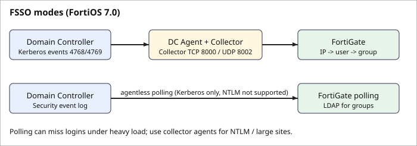
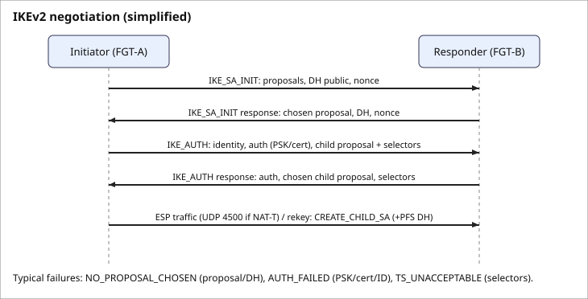

# Enterprise Network & Security Engineering — دوره‌ی تخصصی Cisco و Enterprise Firewall
## بخش ۶ از ۱۱ — فصل‌های ۱۶ تا ۱۸

| مورد | مقدار |
|---|---|
| نام دوره | Enterprise Network & Security Engineering (Cisco + FortiGate) |
| شماره بخش | ۶ از ۱۱ |
| فصل‌های این فایل | ۱۶ ، ۱۷ ، ۱۸ |
| تاریخ تولید | ۲۰۲۶-۱۱-۲۶ |
| نسخه Blueprint | v3.0 (+ بازبینی ۱٫۱) |
| نسخه‌های نرم‌افزار | FortiOS 7.0.3 (اسمی؛ بوت‌نشده؛ تأیید با `get system status`) ؛ Cisco vIOS-L2 15.2(20200924، Experimental) ؛ Cisco vIOS 15.9(3)M9 ؛ VPCS ؛ PNetLab 4.2.8 ؛ ESXi 8.0U2 ؛ CSR1000v 17.03.02 (IOS-XE؛ آزمایش‌نشده) |
| وضعیت تکمیل | **فصل‌های ۱۶–۱۸ تولید شد؛ UTM، Authentication، IPsec S2S.** Labها «اجرا نشده»؛ UTM به لایسنس FortiGuard وابسته (Needs-License)؛ دستورها آزمایش‌نشده. |

> **قوانین خواندن:** تمرین‌ها و پرسش‌های مرور بدون پاسخ‌اند؛ پاسخ در «پاسخ‌های فصل». «اجرا نشده» یعنی خروجی‌ها **پیش‌نیاز/پیش‌بینی** هستند. «CLI-Accepted» ≠ «کار می‌کند». رمزها نمونه‌اند.

### وضعیت راستی‌آزمایی Labهای این بخش
خلاصه: اجرا نشده (فقط طراحی): 18.

| Lab | وضعیت |
|---|---|
| 16-1 | اجرا نشده (فقط طراحی) |
| 16-2 | اجرا نشده (فقط طراحی) |
| 16-3 | اجرا نشده (فقط طراحی) |
| 16-4 | اجرا نشده (فقط طراحی) |
| 16-5 | اجرا نشده (فقط طراحی) |
| 16-6 | اجرا نشده (فقط طراحی) |
| 17-1 | اجرا نشده (فقط طراحی) |
| 17-2 | اجرا نشده (فقط طراحی) |
| 17-3 | اجرا نشده (فقط طراحی) |
| 17-4 | اجرا نشده (فقط طراحی) |
| 17-5 | اجرا نشده (فقط طراحی) |
| 17-6 | اجرا نشده (فقط طراحی) |
| 18-1 | اجرا نشده (فقط طراحی) |
| 18-2 | اجرا نشده (فقط طراحی) |
| 18-3 | اجرا نشده (فقط طراحی) |
| 18-4 | اجرا نشده (فقط طراحی) |
| 18-5 | اجرا نشده (فقط طراحی) |
| 18-6 | اجرا نشده (فقط طراحی) |

---

<a id="ch16"></a>

> **نسخه‌ی اصلاح‌شده (v3.7):** نسخه‌ی توسعه‌یافته‌ی فایل اصلی؛ درس‌های افزوده: ۱۶-۰، ۱۶-۷، ۱۸-۰ (دسته C). فایل اصلی در `course/` حفظ شده است. پاسخ‌های درس‌های افزوده در «پاسخ‌های فصل» همان فصل است.

# فصل 16 — UTM: آنتی‌ویروس، IPS، Application Control، Web Filter و SSL Inspection

**مدت:** ۳۶ ساعت | **پیش‌نیاز:** فصل ۱۳، ۱۴.
**اهداف:** Security Profile و Profile Group؛ AV؛ Web Filter (Static URL به‌جای Category)؛ IPS و DoS؛ Application Control؛ SSL/SSH Inspection؛ اثر Performance و عیب‌یابی.
**هشدار لایسنس (مهم):** AV/IPS/Web Filter/App Control به **FortiGuard Subscription** وابسته‌اند. در Lab ایزوله و Evaluation این وابستگی `Needs-License` و وضعیتش `Unverified` است. هر درس بخش «بدون لایسنس چه می‌توان کرد» دارد (Static URL، Custom IPS، DoS، Port-based). **همه‌ی دستورها آزمایش‌نشده روی Image.**
**معیار تسلط:** Profile ساخته و به Policy وصل؛ اثبات با Log/تست؛ توضیح اثر SSL Inspection بر Performance و Certificate.
**اشتباهات رایج:** فعال‌کردن Deep Inspection بدون نصب CA؛ Profile روی همه‌ی ترافیک؛ نادیده‌گرفتن لایسنس؛ بدون تست.

**درس‌های فصل:**
- [درس 16-1 — Security Profile و لایسنس: نقشه‌ی UTM](#l-16-1)
- [درس 16-2 — Web Filter و DNS Filter (Static و Category)](#l-16-2)
- [درس 16-3 — Antivirus و File Filter](#l-16-3)
- [درس 16-4 — IPS، DoS و Application Control](#l-16-4)
- [درس 16-5 — SSL/SSH Inspection: Certificate و CA](#l-16-5)
- [درس 16-6 — Performance، عیب‌یابی UTM و آزمون فصل](#l-16-6)

---

<a id="l-16-1"></a>

## درس 16-0 — Inspection Mode (Flow در برابر Proxy)، TLS Inspection و زنجیره‌ی اعتماد

**فصل ۱۶ · درس افزوده (پیش‌درس ۱۶-۱) · پیش‌نیاز: ۱۲-۰، ۱۱-۷، مفاهیم TLS و PKI · ≈ ۸ ساعت**

> **وضعیت (FortiOS 7.0.3):** تفاوت Flow/Proxy و پروفایل‌های SSL از مستند رسمی 7.0 تأیید شد ([Inspection modes](https://docs.fortinet.com/document/fortigate/7.0.1/administration-guide/721410/inspection-modes)، [Inspection mode feature comparison](https://docs.fortinet.com/document/fortigate/7.0.0/administration-guide/922096/inspection-mode-feature-comparison)، [SSL & SSH Inspection](https://docs.fortinet.com/document/fortigate/7.0.1/administration-guide/929997/ssl-ssh-inspection)). جزئیات روی Image `Unverified`. Needs-License: سرویس‌های FortiGuard.

### ۱) هدف آموزشی

دانشجو در پایان می‌تواند:

1. تفاوت **Flow-based** و **Proxy-based Inspection** را از نظر سازوکار، قابلیت و Performance بگوید و برای هر سناریو انتخاب کند.
2. توضیح دهد TLS چگونه کار می‌کند و چرا بدون **SSL Inspection** محتوای HTTPS دیده نمی‌شود.
3. **Certificate Inspection** و **Deep Inspection** را از نظر دید، ریسک و پیش‌نیاز مقایسه کند.
4. **زنجیره‌ی اعتماد (Certificate Chain)، CA و Trust Store** را توضیح دهد و بگوید چرا مرورگر به CA فایروال باید اعتماد کند.
5. **SNI** و محدودیت‌های دید روی ترافیک رمزشده (TLS 1.3، ECH، Certificate Pinning) را بشناسد.
6. در سناریوی واقعی Exemption امن بنویسد.

### ۲) پیش‌نیازها

Handshake TLS در سطح مفهومی (Client Hello، Certificate، Key Exchange)، مفهوم کلید عمومی/خصوصی و گواهی (PKI)، Packet Flow (۱۲-۰).

### ۳) مفهوم پایه

بیشتر ترافیک امروز رمزشده است. فایروالی که فقط پورت و IP را ببیند، نمی‌تواند بدافزار داخل HTTPS را کشف کند. **UTM** یعنی بازرسی محتوا؛ و بازرسی محتوا برای ترافیک رمزشده نیاز به **رمزگشایی** دارد. این رمزگشایی یک **حمله‌ی Man-in-the-Middle مجاز** است: فایروال به‌جای سرور، گواهی صادر می‌کند. کاربر فقط وقتی خطا نمی‌بیند که به CA فایروال اعتماد کرده باشد.

### ۴) توضیح عمیق فنی

#### ۴-۱) Flow-based در برابر Proxy-based

طبق مستند Fortinet (7.0):

- **Flow-based:** بسته‌ها را «در جریان» می‌بیند؛ یک Snapshot از محتوا می‌گیرد و با Pattern Matching بررسی می‌کند؛ بسته‌ها بازسازی کامل نمی‌شوند. تأخیر کمتر، Throughput بیشتر (و قابلیت NPU Offload در بعضی حالت‌ها).
- **Proxy-based:** فایروال اتصال کلاینت را ختم و اتصال جدیدی به سرور می‌سازد؛ **محتوا را کامل بازسازی** می‌کند (فایل کامل، پاسخ کامل HTTP). قابلیت بیشتر (مثلاً بعضی گزینه‌های AV/Web Filter/DLP مثل Content Disarm، Quota و ...)، هزینه‌ی CPU/Memory و تأخیر بیشتر.
- در 7.0 حالت بازرسی **در هر Policy** انتخاب می‌شود (`set inspection-mode flow|proxy`)؛ پیش‌فرض Flow است.

| معیار | Flow | Proxy |
|---|---|---|
| سازوکار | بدون بازسازی کامل، Pattern | ختم و بازسازی |
| تأخیر | کمتر | بیشتر |
| CPU/Memory | کمتر | بیشتر |
| قابلیت‌ها | کمتر (جدول مقایسه‌ی Fortinet) | بیشتر |
| پوشش پورت | همه‌ی پورت‌ها در Deep (طبق مستند) | فقط پورت‌های نگاشت‌شده مگر «Inspect all ports» |
| کاربرد | Throughput، ترافیک عمومی | حساسیت بالا، قابلیت خاص |

(برای هر Profile باید جدول «Inspection mode feature comparison» همان نسخه بررسی شود.)

#### ۴-۲) TLS در یک نگاه

``` text
1. ClientHello  : supported versions/ciphers, SNI (server name, plaintext in TLS<=1.2/1.3 default)
2. ServerHello  : chosen cipher
3. Certificate  : server certificate chain
4. Key exchange : (EC)DHE -> session keys
5. Finished     : encrypted application data
```

- **SNI (Server Name Indication):** نام سرور در ClientHello (معمولاً رمزنشده)؛ فایروال بدون رمزگشایی می‌تواند بر اساس SNI فیلتر کند.
- TLS 1.3: گواهی سرور رمز می‌شود؛ بنابراین Certificate Inspection روی TLS 1.3 اطلاعات کمتری دارد (SNI می‌ماند). با **ECH (Encrypted Client Hello)** حتی SNI هم رمز می‌شود (محدودیت آینده/مرورگرهای جدید).

#### ۴-۳) Certificate Inspection

فایروال فقط **اطلاعات گواهی و SNI** را می‌بیند (تا لایه‌ی TLS) و محتوای رمزشده را باز نمی‌کند. توانایی: Web Filter بر اساس Category/FQDN، بلاک گواهی نامعتبر/منقضی. محدودیت: AV/IPS/DLP روی محتوای HTTPS ناممکن.

#### ۴-۴) Deep Inspection (Full SSL Inspection)

فایروال به‌عنوان **Proxy TLS** عمل می‌کند:

``` text
Client <==TLS(session A, cert signed by firewall CA)==> FortiGate <==TLS(session B)==> Server
                       decrypt -> inspect (AV/IPS/Web/DLP) -> re-encrypt
```

- باید **CA فایروال** (یا CA سازمانی) در Trust Store همه‌ی کلاینت‌ها نصب باشد (GPO/MDM)، وگرنه خطای گواهی.
- ریسک: بار CPU، مشکل با برنامه‌های Pin‌شده، مسائل حریم خصوصی/حقوقی، افزایش سطح حمله به خود فایروال (گواهی‌های صادرشده، کلید CA).
- **Exemption:** بانک، سلامت، به‌روزرسانی‌های Pin‌شده، برنامه‌های خاص (Teams/OS update) از Inspection مستثنا شوند (Address/FQDN/Category).
- 7.0 دو Profile آماده دارد: `certificate-inspection` و `deep-inspection` (و `no-inspection`) طبق مستند.

#### ۴-۵) Certificate Chain، CA و Trust

``` text
Root CA (in trust store) -> Intermediate CA -> Server certificate
Browser: verify signature chain up to a trusted root, check name (SAN), validity, revocation (OCSP/CRL)
```

در Deep Inspection فایروال زنجیره‌ی سرور واقعی را **اعتبارسنجی می‌کند** و برای کلاینت گواهی جدید (با همان Subject/SAN) با **CA فایروال** امضا می‌کند. اگر گواهی سرور معتبر نباشد، فایروال باید به کلاینت هشدار بدهد (گواهی «untrusted» جداگانه؛ تنظیم Action برای گواهی نامعتبر مهم است: Allow/Block/Warning). CA فایروال به‌صورت پیش‌فرض Self-signed است؛ بهتر است CA داخلی سازمان (Intermediate) استفاده شود.

#### ۴-۶) محدودیت‌های دید

- **Certificate Pinning:** برنامه‌ای که گواهی خاص را انتظار دارد با گواهی فایروال خطا می‌دهد.
- **TLS 1.3/ECH/QUIC (HTTP/3 روی UDP 443):** QUIC معمولاً قابل Inspection عمیق نیست؛ سیاست معمول: بلاک QUIC تا ترافیک به TCP/TLS برگردد (Application Control).
- **mTLS (Mutual TLS):** گواهی کلاینت؛ Inspection ممکن است آن را بشکند.
- **STARTTLS، SMTPS، IMAPS:** پروتکل‌های دیگر هم Profile جدا دارند.

#### ۴-۷) Detection در برابر Prevention

- **Detection (Monitor):** رویداد را Log می‌کند ولی ترافیک را عبور می‌دهد.
- **Prevention (Block):** ترافیک را مسدود می‌کند.
- روش ایمن استقرار: ابتدا **Monitor** و بررسی False Positive، سپس Block برای موارد با اطمینان بالا.

### ۵) مثال حل‌شده

**نیاز:** Policy Users→Internet با AV و Web Filter و SSL Inspection.

``` text
config firewall policy
    edit 10
        set name "Users-to-Internet"
        set srcintf "port2"
        set dstintf "port1"
        set srcaddr "Users-Net"
        set dstaddr "all"
        set action accept
        set schedule "always"
        set service "HTTP" "HTTPS" "DNS"
        set inspection-mode flow
        set ssl-ssh-profile "certificate-inspection"
        set nat enable
        set logtraffic all
    next
end
```

(نام فیلدها طبق مستند 7.0؛ `Unverified` روی Image.) سپس برای سناریوی بانک: Profile سفارشی Deep با Exemption.

**مثال متوسط:** پس از فعال‌کردن Deep Inspection، برنامه‌ی Updater خطای TLS می‌دهد. علت: Pinning. راه‌حل: Exemption آن FQDN، نه خاموش‌کردن Deep برای همه.

**مثال سخت:** کاربران مرورگر Firefox هنوز هشدار گواهی می‌بینند در حالی‌که Chrome ندارد. تحلیل: Firefox Trust Store جداگانه دارد؛ CA فقط در Windows Store نصب شده است. راه‌حل: Policy Firefox (`security.enterprise_roots.enabled`) یا نصب CA در Firefox (مدیریت متمرکز). ثبت در RCA.

### ۶) طراحی و تصمیم‌گیری

| سؤال | تصمیم |
|---|---|
| Flow یا Proxy؟ | Flow برای عموم؛ Proxy برای نیاز خاص (طبق جدول مقایسه) |
| Deep یا Certificate Inspection؟ | Deep برای Users→Internet؛ Certificate برای سرورها/سلامت |
| CA فایروال یا CA سازمانی؟ | CA سازمانی (Intermediate) با توزیع GPO |
| Exemptionها | بانک، سلامت، Pinned، Update |
| QUIC | بلاک یا Exempt طبق سیاست |
| گواهی نامعتبر | Block/Warning برای Users |

### ۷) پیاده‌سازی: GUI و CLI

**GUI:**

1. Security Profiles → SSL/SSH Inspection → Create New (یا Clone از deep-inspection).
2. Inspection Method: Full SSL Inspection / SSL Certificate Inspection.
3. CA Certificate: انتخاب، و Download/Export CA برای نصب روی کلاینت.
4. Exempt from SSL Inspection: Web Categories، Addresses.
5. Policy & Objects → Firewall Policy → ویرایش Policy → Inspection Mode و SSL Inspection.

**CLI:**

``` text
config firewall ssl-ssh-profile
    edit "SSL-DEEP-LAB"
        config https
            set ports 443
            set status deep-inspection
        end
        set untrusted-caname "Fortinet_CA_Untrusted"
    next
end
get firewall ssl-ssh-profile
```

(`untrusted-caname`، `status` و ... با CLI Reference 7.0 تطبیق شود؛ `Unverified`.)

### ۸) Troubleshooting

| علامت | شاهد | علت |
|---|---|---|
| خطای گواهی در مرورگر | Issuer = CA فایروال | CA روی کلاینت نصب نیست |
| برنامه TLS خطا می‌دهد | Capture: Alert | Pinning |
| سایت HTTPS کند | CPU، `sys top` | Deep روی ترافیک سنگین |
| Block کار نمی‌کند | Log بدون UTM | Profile/SSL Inspection وصل نیست یا Pinned |
| QUIC دور می‌زند | Capture UDP 443 | QUIC Inspect نمی‌شود |

### ۹) نکات امنیتی

- کلید خصوصی CA فایروال حساس‌ترین دارایی این سیستم است؛ دسترسی Admin محدود و Backup رمزشده.
- رمزگشایی داده‌ی کاربران ملاحظات حقوقی و حریم خصوصی دارد؛ سیاست و رضایت لازم.
- گواهی‌های نامعتبر را Block کنید؛ اجازه‌ی «Allow» پیش‌فرض خطرناک است.

### ۱۰) جمع‌بندی مفهومی

- Flow سریع‌تر و محدودتر؛ Proxy کامل‌تر و سنگین‌تر؛ انتخاب Per-Policy.
- Certificate Inspection فقط گواهی/SNI؛ Deep محتوا را می‌بیند ولی نیاز به CA و Exemption دارد.
- TLS 1.3/ECH/QUIC/Pinning دید را کم می‌کنند.
- Monitor قبل از Block.
- کلید CA یک دارایی بحرانی است.

### ۱۱) تمرین و ارزیابی

**ت1.** (ساده) Flow و Proxy چه فرقی دارند؟ *(پاسخ: 16-0-ت1)*

**ت2.** (ساده) SNI چیست؟ *(پاسخ: 16-0-ت2)*

**ت3.** (متوسط) چرا Deep Inspection نیاز به نصب CA روی کلاینت دارد؟ *(پاسخ: 16-0-ت3)*

**ت4.** (متوسط) Certificate Pinning چه مشکلی ایجاد می‌کند؟ راه‌حل؟ *(پاسخ: 16-0-ت4)*

**ت5.** (سخت) برای ۳ گروه (کاربران عادی، سرورها، بانک/سلامت) استراتژی SSL Inspection را طراحی کنید. *(پاسخ: 16-0-ت5)*

**ت6.** (سخت، طراحی) QUIC چه مشکلی برای Inspection دارد و چگونه مدیریت می‌شود؟ *(پاسخ: 16-0-ت6)*

**م1.** Detection و Prevention چه فرقی دارند؟ *(پاسخ: 16-0-م1)*

**Q1.** Quick quiz (English): What can certificate inspection see that deep inspection also sees, and what only deep inspection sees? *(پاسخ: 16-0-Q1)*

### ۱۲) اصطلاحات و English Corner

| مخفف | شکل کامل | معنی |
|---|---|---|
| SNI | Server Name Indication | نام سرور در Hello |
| CA | Certificate Authority | مرجع گواهی |
| PKI | Public Key Infrastructure | زیرساخت کلید عمومی |
| ECH | Encrypted Client Hello | رمزکردن Hello |
| QUIC | QUIC | پروتکل انتقال روی UDP |
| mTLS | Mutual TLS | TLS دوطرفه |
| OCSP | Online Certificate Status Protocol | بررسی ابطال گواهی |

- *Deep inspection decrypts and re-encrypts TLS sessions.* ← Deep Inspection نشست TLS را رمزگشایی و دوباره رمزگذاری می‌کند.
- *Exempt pinned and privacy-sensitive destinations from inspection.* ← مقصدهای Pinned و حساس حریم خصوصی را از Inspection مستثنا کنید.

### ۱۳) منابع

- Fortinet Docs: [Inspection modes](https://docs.fortinet.com/document/fortigate/7.0.1/administration-guide/721410/inspection-modes)، [Inspection mode feature comparison](https://docs.fortinet.com/document/fortigate/7.0.0/administration-guide/922096/inspection-mode-feature-comparison)، [SSL & SSH Inspection](https://docs.fortinet.com/document/fortigate/7.0.1/administration-guide/929997/ssl-ssh-inspection)، [Inspection mode per policy](https://docs.fortinet.com/document/fortigate/7.0.0/administration-guide/366651/inspection-mode-per-policy).
- RFC 8446 — TLS 1.3؛ RFC 6066 (SNI)؛ RFC 5280 (X.509 PKI).

## درس 16-1 — نقشه‌ی UTM: Security Profileها، لایسنس FortiGuard و ماتریس قابلیت

**فصل 16 · بازنویسی عمیق · پیش‌نیاز: ۱۶-۰، ۱۲-۰، ۱۳-۱ · ≈ 6 ساعت**

> **وضعیت:** FortiOS 7.0.3 (بوت‌نشده)؛ دستورها `Unverified`؛ Lab «اجرا نشده»؛ وابستگی لایسنس هر قابلیت صریح ذکر شده است.

### ۱) هدف آموزشی

در پایان این درس باید بتوانید:

1. فهرست Security Profileها و محل اتصال آن‌ها به Policy را بگوید.
2. برای هر قابلیت وابستگی لایسنس را مشخص کند (Needs-License/بدون لایسنس).
3. یک «ماتریس لایسنس و قابلیت» برای Lab خود تکمیل کند.
4. نتیجه‌ی بررسی را با شواهد (وضعیت FortiGuard، Log) ثبت و از ادعای بدون شاهد پرهیز کند.
5. مسیر پردازش UTM را در Packet Flow (پس از Policy) جایابی کند.

### ۲) مفهوم پایه: چیست و چرا؟

Security Profile مجموعه‌ی تنظیمات بازرسی لایه‌ی ۷ است که **داخل Firewall Policy** فعال می‌شود: Antivirus، Web Filter، DNS Filter، Application Control، IPS، File Filter، SSL/SSH Inspection (و DLP/Email Filter بسته به نسخه). Policy می‌گوید «اجازه‌ی عبور هست»؛ Profile می‌گوید «محتوای مجاز را هم بررسی کن».

مشکل رایج: تیم‌ها فرض می‌کنند چون Profile ساخته‌اند، حفاظت فعال است. حفاظت فقط وقتی واقعی است که (۱) Profile به Policy درست وصل باشد، (۲) سرویس مربوط لایسنس/DB داشته باشد، (۳) ترافیک قابل‌دیدن باشد (TLS)، (۴) Log اثباتش کند.

### ۳) توضیح عمیق فنی

#### ۱) جای UTM در Packet Flow

``` text
Ingress -> RPF -> Session -> DNAT -> Route -> Policy match -> [Security profiles] -> SNAT -> Egress
```

UTM فقط برای ترافیکی اجرا می‌شود که **Policy مطابق، `accept` کرده** باشد؛ ترافیک Denied اصلاً به Profile نمی‌رسد.

#### ۲) ماتریس قابلیت و لایسنس

| قابلیت | کار اصلی | نیاز لایسنس FortiGuard | بدون لایسنس چه می‌شود؟ |
|---|---|---|---|
| Antivirus | Signature بدافزار | بله (DB) | File Filter، بلاک نوع فایل |
| Web Filter | Category/URL | Category: بله | Static URL Filter |
| DNS Filter | بلاک دامنه‌ی مخرب | Category: بله | Static domain |
| Application Control | شناخت برنامه | DB برنامه: بله | Port/Service-based |
| IPS | Signature حمله | Signature: بله | Custom Signature، DoS Policy |
| File Filter | نوع فایل | خیر | کار می‌کند |
| SSL/SSH Inspection | رمزگشایی TLS | خیر (CA لازم) | کار می‌کند |

(ستون لایسنس بر اساس مدل FortiGuard است؛ جزئیات هر مدل/نسخه را در مستند 7.0 و Contract بررسی کنید.)

#### ۳) راستی‌آزمایی لایسنس

وضعیت سرویس‌ها از GUI (System → FortiGuard) و CLI دیده می‌شود. در Lab ایزوله به‌روزرسانی ممکن نیست؛ پس «Profile ساخته‌شده» ≠ «محافظت فعال».

#### ۴) سه سطح شاهد

1. **پیکربندی:** Profile در Policy (`show firewall policy`).
2. **وضعیت سرویس:** FortiGuard Valid/Expired.
3. **رفتار:** تست با فایل/سایت/پورت و Log.

### ۴) طراحی و تصمیم‌گیری

| سؤال طراحی | گزینه‌ها و معیار انتخاب |
|---|---|
| کدام Profile روی کدام Policy؟ | Users→Internet: همه؛ Servers: IPS؛ Guest: Web/DNS |
| Inspection Mode | Flow برای عموم؛ Proxy برای نیاز خاص (۱۶-۰) |
| حالت لایسنس‌نداشتن | لایه‌ی جایگزین بدون لایسنس + ثبت صریح محدودیت |

### ۵) مثال‌های حل‌شده (ساده، متوسط، سخت)

**ساده:** Policy 10 (Users→Internet) فقط Web Filter دارد. با `show firewall policy 10` اثبات می‌کنید `webfilter-profile` وصل است؛ بدون این شاهد، «Web Filter فعال است» ادعای تأییدنشده است.

**متوسط:** AV Profile ساخته و به Policy وصل است ولی EICAR رد می‌شود. بررسی: FortiGuard AV DB تاریخ دارد؟ (نه در Lab ایزوله) ← علت: نبود DB. ثبت: «Needs-License؛ آزمایش ناموفق».

**سخت:** سازمان می‌خواهد «هیچ بدافزاری وارد نشود». تحلیل: AV Signature به‌تنهایی کافی نیست (Zero-day، رمزدار، TLS بدون Deep). طرح لایه‌ای: File Filter + SSL Inspection + IPS + Sandbox (لایسنس) + EDR/Patch؛ و معیار «کشف/پیشگیری» را با FP/FN مستند کنید.

### ۶) پیاده‌سازی از مسیر GUI

1. Security Profiles → هر Profile: وضعیت و گزینه‌ها.
2. Policy & Objects → Firewall Policy → Security Profiles: فعال‌سازی و انتخاب.
3. System → FortiGuard: وضعیت لایسنس/DB.
4. Log & Report → Security Events.

### ۷) پیاده‌سازی از مسیر CLI

``` text
get system fortiguard-service status
show firewall policy 10
show antivirus profile
show webfilter profile
```

### ۸) Verification (اثبات صحت)

- ماتریس لایسنس را با خروجی واقعی پر کنید.
- برای هر قابلیت یک آزمون و Log ثبت کنید.
- قابلیت بدون شاهد = «اجرا نشده».

### ۹) Troubleshooting

| علامت | شاهد برای بررسی | علت محتمل و رفع |
|---|---|---|
| Profile اثر ندارد | Log بدون رویداد UTM | Profile به Policy وصل نیست یا Policy دیگری Match شده |
| Category کار نمی‌کند | Log: rating error | لایسنس/ارتباط FortiGuard |
| HTTPS دیده نمی‌شود | فقط SNI در Log | SSL Inspection فعال نیست |

### ۱۰) نکات امنیتی

- Profile پیش‌فرض را بدون بازبینی روی همه‌چیز فعال نکنید.
- UTM جایگزین Patch و Segmentation نیست.

### ۱۱) جمع‌بندی مفهومی

- Profile فقط برای ترافیک Accept‌شده اجرا می‌شود.
- سه سطح شاهد: پیکربندی، وضعیت سرویس، رفتار.
- Needs-License را صریح ثبت کنید.

### ۱۲) تمرین و ارزیابی

**ت1.** (ساده) UTM در کجای Packet Flow است؟ *(پاسخ: 16-1-ت1)*

**ت2.** (ساده) کدام قابلیت‌ها بدون لایسنس کار می‌کنند؟ *(پاسخ: 16-1-ت2)*

**ت3.** (متوسط) چرا «Profile ساخته شد» شاهد کافی نیست؟ *(پاسخ: 16-1-ت3)*

**ت4.** (سخت) ماتریس لایسنس Lab خود را با ۳ شاهد بسازید. *(پاسخ: 16-1-ت4)*

**ت5.** (سخت، طراحی) طرح لایه‌ای ضدبدافزار برای سازمانی بدون Sandbox. *(پاسخ: 16-1-ت5)*

**Q1.** Quick quiz (English): Why is a created profile not proof of protection? *(پاسخ: 16-1-Q1)*

### ۱۳) اصطلاحات و English Corner

| مخفف | شکل کامل | معنی |
|---|---|---|
| UTM | Unified Threat Management | مدیریت یکپارچه‌ی تهدید |
| FortiGuard | FortiGuard Services | سرویس به‌روزرسانی Fortinet |
| Profile | Security profile | مجموعه‌ی تنظیم بازرسی |

- *A security profile only works when it is attached to an accepting policy.* ← Profile فقط وقتی کار می‌کند که به Policy مجاز وصل شده باشد.

### ۱۴) کارت Lab

**Lab:** ماتریس UTM. **وضعیت:** اجرا نشده. **Evidence:** `03-ops/utm-license-log.md`. **Rollback:** ندارد (فقط خواندنی).

### ۱۵) منابع

- Fortinet Docs: FortiOS 7.0 Administration Guide — Security Profiles، FortiGuard.
- [Inspection mode feature comparison](https://docs.fortinet.com/document/fortigate/7.0.0/administration-guide/922096/inspection-mode-feature-comparison).

<a id="l-16-2"></a>

## درس 16-2 — Web Filter و DNS Filter: Static URL، Category، FQDN و عیب‌یابی HTTPS

**فصل ۱۶ · بازنویسی عمیق (جایگزین نسخه‌ی فشرده) · پیش‌نیاز: ۱۶-۰، ۱۶-۱، ۱۲-۰ · ≈ ۶ ساعت**

> **وضعیت (FortiOS 7.0.3):** Static URL Filter بدون لایسنس FortiGuard کار می‌کند؛ Category/Rating **Needs-License**. سینتکس `Unverified` روی Image. Lab «اجرا نشده».

### ۱) هدف آموزشی

دانشجو بتواند:

1. توضیح دهد Web Filter چگونه تصمیم می‌گیرد (Static URL، Category، Safe Search، Quota) و ترتیب ارزیابی چیست.
2. تفاوت **FQDN Filter** (در Policy/Address) با **Web Filter Profile** را بگوید.
3. بداند در HTTPS بدون Deep Inspection چه چیزی دیده می‌شود (SNI) و چه نه (مسیر URL).
4. **DNS Filter** را با Web Filter مقایسه و محدودیت‌اش (DoH) را بشناسد.
5. یک Profile بسازد، به Policy وصل کند و **با آزمون مثبت/منفی و Log** ثابت کند کار می‌کند.

### ۲) پیش‌نیازها

Flow/Proxy و TLS (۱۶-۰)، Packet Flow (۱۲-۰)، Policy (فصل ۱۳).

### ۳) مفهوم پایه

دسترسی وب مهم‌ترین مسیر ورود بدافزار و نشت داده است. Web Filter می‌پرسد: «این مقصد برای این کاربر مجاز است؟». سه منبع تصمیم: (۱) فهرست دستی شما (Static)، (۲) دسته‌بندی FortiGuard (Category؛ لایسنس)، (۳) رفتار (Quota، Safe Search).

### ۴) توضیح عمیق فنی

#### ۴-۱) ترتیب ارزیابی (مفهومی)

``` text
1. Static URL filter entries (first match: allow / block / monitor / exempt)
2. FortiGuard category filter (needs rating service)
3. Other options (safe search, quota, content checks)
```

اگر Static URL «Exempt» بزنید، بقیه‌ی بررسی‌ها برای آن مقصد رد می‌شوند؛ پس Exempt را با احتیاط استفاده کنید.

#### ۴-۲) انواع ورودی Static URL

- `simple`: مطابقت ساده‌ی دامنه/URL.
- `wildcard`: الگوی `*.example.com`.
- `regex`: عبارت منظم (قدرت زیاد، خطای زیاد، CPU بیشتر).
- Action: `allow`, `block`, `monitor`, `exempt`.

#### ۴-۳) HTTPS: چه چیزی دیده می‌شود؟

| حالت | دید | نتیجه |
|---|---|---|
| HTTP | URL کامل | فیلتر کامل |
| HTTPS + Certificate Inspection | دامنه (SNI/گواهی) | فیلتر بر اساس دامنه/Category؛ نه مسیر |
| HTTPS + Deep Inspection | URL کامل پس از رمزگشایی | فیلتر کامل؛ نیاز CA (۱۶-۰) |

مثال: بلاک `example.com/private` فقط با Deep Inspection ممکن است؛ بلاک `example.com` با SNI ممکن است.

#### ۴-۴) DNS Filter

فایروال Query را قبل از اتصال کنترل می‌کند: دامنه‌ی مخرب → NXDOMAIN/Redirect به Block Page. نقاط ضعف: **DoH/DoT** (DNS رمز) و IP مستقیم؛ راه‌حل: Application Control برای DoH + Deep Inspection + فقط DNS داخلی (Policy: DNS فقط به سرور شما).

#### ۴-۵) Block Page و Log

Block Page (Replacement Message) کاربر را مطلع می‌کند. Log: `action=blocked`، `catdesc`/`url`. برای عیب‌یابی، **Log Web Filter** اولین شاهد است.

### ۵) پیاده‌سازی: GUI و CLI

**GUI:**

1. Security Profiles → Web Filter → Create New (Name: WF-STD).
2. FortiGuard Category Based Filter (اگر لایسنس) یا خاموش.
3. Static URL Filter: Enable → Create New: URL `badsite.example`، Type Simple، Action Block.
4. Policy & Objects → Firewall Policy → Users-to-Internet → Security Profiles: Web Filter = WF-STD؛ SSL Inspection = certificate-inspection.
5. Log & Report → Web Filter.

**CLI:**

``` text
config webfilter urlfilter
    edit 1
        set name "URLF-LAB"
        config entries
            edit 1
                set url "badsite.example"
                set type simple
                set action block
            next
        end
    next
end
config webfilter profile
    edit "WF-STD"
        config web
            set urlfilter-table 1
        end
    next
end
config firewall policy
    edit 10
        set utm-status enable
        set webfilter-profile "WF-STD"
        set ssl-ssh-profile "certificate-inspection"
    next
end
```

(سینتکس `Unverified` روی 7.0.3؛ فیلدهای `utm-status` و ساختار `config web` را با CLI Reference تطبیق دهید.)

### ۶) مثال‌ها

**ساده:** بلاک `badsite.example`. کلاینت: `curl -I http://badsite.example` → Block Page؛ `curl -I http://good.example` → OK.

**متوسط:** بلاک فقط `social.example/games` با HTTPS: با Certificate Inspection ممکن نیست؛ دو راه: Deep Inspection با Exemption مناسب، یا بلاک کل دامنه برای ساعات کاری با Schedule.

**سخت (تحلیل خطا):** URL بلاک شده ولی کاربر باز می‌کند. فرضیه‌ها به ترتیب: (۱) Profile به Policy وصل نیست؛ (۲) Policy دیگری بالاتر Match شده؛ (۳) HTTPS و ورودی نیازمند مسیر کامل؛ (۴) QUIC دور می‌زند؛ (۵) DoH/IP مستقیم؛ (۶) Exempt قبلی. شواهد: Debug Flow (Policy ID)، Log Web Filter، Capture (UDP 443).

### ۷) Troubleshooting

| علامت | شاهد | علت |
|---|---|---|
| Block نمی‌شود | Log خالی | Profile وصل نیست/Policy دیگر |
| HTTPS مسیر بلاک نمی‌شود | Log فقط دامنه | Certificate Inspection |
| Block Page خطای گواهی می‌دهد | مرورگر | CA نصب نیست |
| QUIC دور می‌زند | Capture UDP 443 | بلاک QUIC |
| Category کار نمی‌کند | Log: rating error | لایسنس/ارتباط FortiGuard |

### ۸) نکات امنیتی

- Exempt/Allow را محدود و مستند کنید.
- Safe Search و بلاک Proxy/Anonymizer Category (در صورت لایسنس).
- Web Filter جایگزین Patch/EDR نیست.

### ۹) جمع‌بندی

- ترتیب: Static → Category → سایر؛ Exempt همه چیز بعدی را رد می‌کند.
- HTTPS بدون Deep فقط دامنه؛ با Deep مسیر کامل.
- DNS Filter قبل از اتصال؛ ضعف DoH.
- آزمون مثبت/منفی و Log.

### ۱۰) تمرین و ارزیابی

**ت1.** (ساده) Static URL با Category چه فرقی دارد؟ *(پاسخ: 16-2-ت1)*

**ت2.** (ساده) Exempt چه می‌کند؟ *(پاسخ: 16-2-ت2)*

**ت3.** (متوسط) چرا بلاک مسیر در HTTPS نیاز به Deep دارد؟ *(پاسخ: 16-2-ت3)*

**ت4.** (متوسط) DNS Filter چه نقطه‌ضعفی دارد؟ *(پاسخ: 16-2-ت4)*

**ت5.** (سخت) فرضیه‌های «URL بلاک‌شده باز می‌شود» را به ترتیب و با شاهد بنویسید. *(پاسخ: 16-2-ت5)*

**ت6.** (سخت، طراحی) سیاست وب برای ۳ گروه (کارمند، مهمان، سرور) طراحی کنید. *(پاسخ: 16-2-ت6)*

**Q1.** Quick quiz (English): What does an exempt action in a static URL filter do? *(پاسخ: 16-2-Q1)*

### ۱۱) اصطلاحات و English Corner

| مخفف | شکل کامل | معنی |
|---|---|---|
| Static URL | Static URL filter | فیلتر دستی URL |
| FQDN | Fully Qualified Domain Name | نام کامل دامنه |
| DoH | DNS over HTTPS | DNS رمزشده |
| Safe Search | Safe search enforcement | اجبار جست‌وجوی امن |

- *HTTPS without deep inspection reveals only the domain name.* ← HTTPS بدون Deep فقط نام دامنه را نشان می‌دهد.

### ۱۲) Lab

**کارت Lab:** Static URL Filter. **هدف:** بلاک یک دامنه و اثبات با Log. **توپولوژی:** Client → FGT → Web Lab. **وضعیت:** اجرا نشده. **مراحل:** مطابق بخش ۵. **Verification:** مثبت/منفی؛ Log. **Rollback:** حذف Profile از Policy. **Evidence:** `03-ops/webfilter-static.md`.

### ۱۳) منابع

- Fortinet Docs: FortiOS 7.0 Administration Guide — Web filter، DNS filter؛ [Inspection modes](https://docs.fortinet.com/document/fortigate/7.0.1/administration-guide/721410/inspection-modes).

<a id="l-16-3"></a>

## درس 16-3 — Antivirus و File Filter: سازوکار، حالت‌ها و تست امن

**فصل ۱۶ · بازنویسی عمیق · پیش‌نیاز: ۱۶-۰، ۱۶-۲ · ≈ ۶ ساعت**

> **وضعیت (FortiOS 7.0.3):** AV Signature **Needs-License**؛ File Filter بدون لایسنس. گزینه‌های Flow/Proxy از جدول مقایسه‌ی رسمی ([Inspection mode feature comparison](https://docs.fortinet.com/document/fortigate/7.0.0/administration-guide/922096/inspection-mode-feature-comparison)). Lab «اجرا نشده».

### ۱) هدف آموزشی

1. بداند AV چه چیزی را کشف می‌کند (Signature، Heuristic) و چه چیزی را نه (Zero-day، فایل رمزدار، ترافیک رمز بدون Deep).
2. تفاوت AV در Flow و Proxy را بداند و انتخاب کند.
3. **File Filter** را به‌عنوان لایه‌ی مکمل بدون لایسنس طراحی کند.
4. با **فایل EICAR** تست امن انجام دهد و نتیجه‌ی واقعی ثبت کند.
5. FP/FN و اثر Performance را ارزیابی کند.

### ۲) پیش‌نیازها

۱۶-۰ (Flow/Proxy، TLS)، ۱۶-۷ (FP/FN).

### ۳) مفهوم پایه

بدافزار معمولاً به‌صورت فایل از وب/ایمیل/اشتراک می‌رسد. AV فایل را (یا جریان را) با پایگاه Signature می‌سنجد. اما هر امضا از گذشته می‌آید؛ بدافزار جدید یا رمزدار را نمی‌گیرد. پس AV **یک لایه** است، نه راه‌حل کامل.

### ۴) توضیح عمیق فنی

#### ۴-۱) AV چگونه کار می‌کند

- **Flow-based:** بسته‌ها در جریان اسکن می‌شوند؛ سریع؛ بدون بازسازی کامل فایل؛ گزینه‌ها کمتر.
- **Proxy-based:** فایل کامل Buffer می‌شود و پس از اسکن به کاربر می‌رسد؛ دقیق‌تر و گزینه‌های بیشتر (مثلاً محدودیت اندازه‌ی Buffer، Content Disarm بسته به نسخه)؛ تأخیر و مصرف حافظه بیشتر.
- سقف اندازه‌ی فایل: فایل بزرگ‌تر از Threshold اسکن نمی‌شود (Pass یا Block طبق تنظیم) — **این یک نقطه‌ی کور است**.

#### ۴-۲) چه چیزی دیده نمی‌شود

| مورد | علت |
|---|---|
| Zero-day | Signature ندارد (نیاز Sandbox) |
| فایل رمزدار (zip با رمز) | محتوا قابل اسکن نیست |
| HTTPS بدون Deep | محتوا رمز است |
| فایل بزرگ‌تر از سقف | اسکن نمی‌شود |
| پروتکل غیراسکن‌شده | AV روی پروتکل‌های انتخاب‌شده کار می‌کند |

#### ۴-۳) File Filter

کنترل بر اساس **نوع/پسوند** (و Magic bytes در صورت پشتیبانی) و جهت (Upload/Download). مثال: بلاک `exe, scr, js, vbs` از اینترنت؛ بلاک فایل رمزدار. مزیت: بدون لایسنس، سبک؛ ضعف: پسوند جعل‌شدنی، محتوای مخرب در نوع مجاز.

#### ۴-۴) EICAR

فایل متنی استاندارد بی‌خطر که همه‌ی AVها به‌عنوان «ویروس تست» می‌شناسند؛ برای آزمون زنجیره (Policy→Profile→Inspection→Log). **نتیجه‌ی آزمون باید ثبت شود؛ اگر Signature در Lab نیست، «اجرا نشده/ناموفق» بنویسید، نه «کار می‌کند».**

### ۵) پیاده‌سازی: GUI و CLI

**GUI:**

1. Security Profiles → AntiVirus → Create New (AV-STD): Inspected Protocols: HTTP/FTP/SMTP/... ؛ Action Block.
2. Security Profiles → File Filter → Create New (FF-STD): Rule: File types exe/script؛ Direction Incoming؛ Action Block.
3. Policy: AntiVirus = AV-STD؛ File Filter = FF-STD؛ SSL Inspection (مناسب).
4. Log & Report → AntiVirus / Security Events.

**CLI (ساختار؛ `Unverified`):**

``` text
config antivirus profile
    edit "AV-STD"
        set comment "lab"
    next
end
config file-filter profile
    edit "FF-STD"
        config rules
            edit "block-exe"
                set protocol http ftp
                set action block
                set file-type "exe"
            next
        end
    next
end
config firewall policy
    edit 10
        set av-profile "AV-STD"
        set file-filter-profile "FF-STD"
    next
end
```

### ۶) مثال‌ها

**ساده:** دانلود EICAR از وب: Block + Log AV.

**متوسط:** `setup.exe` بلاک می‌شود با File Filter در حالی‌که AV لایسنس ندارد؛ درس: لایه‌ی بدون لایسنس مفید است.

**سخت:** مهاجم zip رمزدار می‌فرستد؛ AV نمی‌بیند؛ File Filter رمزدار را بلاک می‌کند اگر پشتیبانی شود؛ سیاست: بلاک آرشیو رمزدار از منبع ناشناس + آموزش + Sandbox (در صورت لایسنس). **FN را بپذیرید و مستند کنید.**

### ۷) Troubleshooting

| علامت | علت |
|---|---|
| EICAR رد می‌شود | Profile وصل نیست/لایسنس/DB نیست/HTTPS بدون Deep |
| فایل بزرگ اسکن نمی‌شود | سقف اندازه |
| کندی دانلود | Proxy Buffer |
| FP | Signature/استثنا |

### ۸) نکات امنیتی

- EICAR فقط برای تست؛ بدافزار واقعی ممنوع.
- Exception محدود.
- ترکیب با Patch/EDR.

### ۹) جمع‌بندی

- AV Signature؛ Zero-day و رمزدار نه.
- Flow سریع/Proxy دقیق.
- File Filter لایه‌ی بدون لایسنس.
- نتیجه‌ی واقعی ثبت شود.

### ۱۰) تمرین و ارزیابی

**ت1.** (ساده) EICAR چیست؟ *(پاسخ: 16-3-ت1)*

**ت2.** (ساده) AV چه چیزی را نمی‌بیند؟ *(پاسخ: 16-3-ت2)*

**ت3.** (متوسط) تفاوت AV در Flow و Proxy؟ *(پاسخ: 16-3-ت3)*

**ت4.** (متوسط) چرا سقف اندازه‌ی فایل نقطه‌ی کور است؟ *(پاسخ: 16-3-ت4)*

**ت5.** (سخت) سیاست دفاع از zip رمزدار را طراحی کنید. *(پاسخ: 16-3-ت5)*

**Q1.** Quick quiz (English): Why can't antivirus inspect a password-protected archive? *(پاسخ: 16-3-Q1)*

### ۱۱) اصطلاحات و English Corner

| مخفف | شکل کامل | معنی |
|---|---|---|
| AV | Antivirus | ضدویروس |
| Heuristic | Heuristic detection | تشخیص رفتاری/الگویی |
| Sandbox | Sandbox | محیط اجرای ایزوله |
| Magic bytes | File magic bytes | امضای ابتدای فایل |

- *Antivirus is one layer, not a complete defense.* ← ضدویروس یک لایه است، نه دفاع کامل.

### ۱۲) Lab

**کارت Lab:** AV/File Filter. **هدف:** EICAR و بلاک exe. **وضعیت:** اجرا نشده. **Verification:** Log AV/File Filter. **Rollback:** حذف Profile. **Evidence:** `03-ops/av-notes.md` (نتیجه‌ی واقعی).

### ۱۳) منابع

- Fortinet Docs: [Inspection mode feature comparison](https://docs.fortinet.com/document/fortigate/7.0.0/administration-guide/922096/inspection-mode-feature-comparison)؛ EICAR (eicar.org).

<a id="l-16-4"></a>

## درس 16-4 — IPS، DoS Policy و Application Control: سازوکار، تنظیم و FP

**فصل ۱۶ · بازنویسی عمیق · پیش‌نیاز: ۱۶-۰، ۱۶-۷، ۱۱-۷ · ≈ ۷ ساعت**

> **وضعیت (FortiOS 7.0.3):** Signature IPS و DB برنامه **Needs-License**؛ DoS Policy و Custom Signature بدون لایسنس. سینتکس `Unverified`. تست حمله فقط در Lab ایزوله و مجاز. Lab «اجرا نشده».

### ۱) هدف آموزشی

1. IPS (Signature، Severity، Target، Action) و تفاوت **Monitor/Block** را توضیح دهد.
2. **DoS Policy** (Anomaly: SYN Flood، UDP Flood، Port Scan، Session Limit) را به Threshold درست تبدیل کند.
3. **Application Control** را (Category، Application، Action، QUIC/DoH) به کار ببرد.
4. اثر Performance و FP را بسنجد و **Exception دقیق** بنویسد.
5. در Lab با ابزار مجاز تست و نتیجه را ثبت کند.

### ۲) مفهوم پایه

- **IPS:** الگوی اکسپلویت را در ترافیک می‌شناسد (مثل «آنتی‌ویروس برای حمله»).
- **DoS Policy:** حجم/نرخ غیرعادی را می‌گیرد، بدون نیاز به شناخت محتوا.
- **Application Control:** می‌پرسد «این چه برنامه‌ای است؟» حتی روی پورت غیرمعمول.

### ۳) توضیح عمیق فنی

#### ۳-۱) IPS Sensor

Sensor مجموعه‌ای از Filter/Signature است: انتخاب بر اساس **Severity** (Critical تا Info)، **Target** (Server/Client)، **OS**، **Protocol**. Action: `pass`, `monitor`, `block`, `reset`, `quarantine`. اصول: ابتدا Monitor؛ برای سرور مشخص (Target=Server) Signatureهای مرتبط؛ Severity High/Critical Block؛ کم‌اهمیت‌ها Monitor. **Virtual Patching:** Signature آسیب‌پذیری را تا Patch سرور بلاک می‌کند.

#### ۳-۲) DoS Policy

``` text
Threshold examples (tune from baseline, not copied):
tcp_syn_flood   : 2000 pkts/s per source
udp_flood       : 2000 pkts/s
ip_src_session  : 5000 sessions per source
tcp_port_scan   : 1000 pkts/s
```

اعداد را از **Baseline** (۲۷-۰) بسازید؛ Threshold کم = FP برای کاربران واقعی؛ زیاد = ناکارآمد. DoS Policy **قبل از Firewall Policy** (در مسیر سریع Ingress) اعمال می‌شود و ارزان است؛ روی Interface WAN.

#### ۳-۳) Application Control

Signature برنامه‌ها (Teams، Dropbox، BitTorrent، DoH ...). Action: Allow/Monitor/Block/Quarantine. نکات: (۱) **QUIC:** بلاک تا ترافیک به TCP/TLS برگردد و Inspection ممکن شود. (۲) **DoH:** بلاک برنامه‌ی DoH یا Policy DNS فقط به سرور داخلی. (۳) Deep Inspection برای شناسایی دقیق‌تر در HTTPS. (۴) بدون لایسنس: Port-based/Service-based.

#### ۳-۴) Performance

IPS/App بازرسی محتوایی است: CPU↑ و Offload↓ (۱۲-۹). راه: Sensor انتخابی روی Policyهای مهم؛ DoS ارزان‌تر؛ Baseline قبل/بعد.

### ۴) پیاده‌سازی: GUI و CLI

**GUI:** Policy & Objects → DoS Policy → Create New (Incoming: port1؛ Source/Dest: all؛ Service ALL؛ Anomaly: Threshold). Security Profiles → Intrusion Prevention → Create New (Filters: Severity High, Critical؛ Action Block). Security Profiles → Application Control → Create New (Category Proxy/P2P: Block؛ QUIC: Block). Policy: فعال‌سازی هر دو.

**CLI (`Unverified`):**

``` text
config firewall DoS-policy
    edit 1
        set interface "port1"
        set srcaddr "all"
        set dstaddr "all"
        set service "ALL"
        config anomaly
            edit "tcp_syn_flood"
                set status enable
                set threshold 2000
                set action block
            next
        end
    next
end
config ips sensor
    edit "IPS-LAB"
        config entries
            edit 1
                set severity high critical
                set action block
            next
        end
    next
end
config application list
    edit "APP-LAB"
        config entries
            edit 1
                set category 2
                set action block
            next
        end
    next
end
```

### ۵) مثال‌ها

**ساده:** SYN Flood آزمایشی (hping3 در Lab) با 5000 pkt/s؛ DoS Policy Block؛ Log anomaly.

**متوسط:** FP: سامانه‌ی مالی با Signature اشتباه قطع شد؛ Log IPS → Signature ID؛ Exception فقط برای آن Signature و آن سرور؛ تاریخ بازبینی.

**سخت:** CPU ۹۰٪ پس از فعال‌کردن IPS روی همه‌ی ترافیک؛ تحلیل: `diagnose sys top` (ipsengine)، Offload کم. راه: Sensor انتخابی (Target=Server، Severity High+) و Monitor برای بقیه؛ اندازه‌گیری مجدد.

### ۶) Troubleshooting

| علامت | علت |
|---|---|
| DoS اثر ندارد | Interface اشتباه، Threshold بالا |
| FP کاربران | Threshold کم |
| IPS بلاک نمی‌کند | Action=monitor/لایسنس/Profile وصل نیست |
| QUIC دور می‌زند | بلاک نشده |
| CPU زیاد | Sensor گسترده |

### ۷) نکات امنیتی

- آزمون حمله فقط در Lab ایزوله و مجاز.
- IPS جایگزین Patch نیست.
- Exception با تاریخ بازبینی.

### ۸) جمع‌بندی

- IPS بر اساس Signature؛ ابتدا Monitor؛ Virtual Patching.
- DoS Policy با Baseline؛ ارزان و Ingress.
- App Control با QUIC/DoH.
- Performance را اندازه بگیرید.

### ۹) تمرین و ارزیابی

**ت1.** (ساده) IPS و DoS Policy چه فرقی دارند؟ *(پاسخ: 16-4-ت1)*

**ت2.** (ساده) Virtual Patching یعنی چه؟ *(پاسخ: 16-4-ت2)*

**ت3.** (متوسط) Threshold DoS را چگونه تعیین می‌کنید؟ *(پاسخ: 16-4-ت3)*

**ت4.** (متوسط) چرا QUIC بلاک می‌شود؟ *(پاسخ: 16-4-ت4)*

**ت5.** (سخت) پس از IPS، CPU ۹۰٪ شد؛ تحلیل و رفع. *(پاسخ: 16-4-ت5)*

**Q1.** Quick quiz (English): Why start an IPS sensor in monitor mode? *(پاسخ: 16-4-Q1)*

### ۱۰) اصطلاحات و English Corner

| مخفف | شکل کامل | معنی |
|---|---|---|
| IPS | Intrusion Prevention System | جلوگیری از نفوذ |
| DoS | Denial of Service | انکار سرویس |
| Anomaly | Anomaly threshold | آستانه‌ی ناهنجاری |
| Virtual patching | Virtual patching | وصله‌ی مجازی |

- *Tune thresholds from your own baseline.* ← آستانه‌ها را از Baseline خودتان تنظیم کنید.

### ۱۱) Lab

**کارت Lab:** DoS و IPS. **وضعیت:** اجرا نشده. **Verification:** Log anomaly/IPS، `sys top`. **Rollback:** حذف Policy/Profile. **Evidence:** `03-ops/ips-dos.md`.

### ۱۲) منابع

- Fortinet Docs: FortiOS 7.0 Administration Guide — DoS policy، Intrusion prevention، Application control.

<a id="l-16-5"></a>

## درس 16-5 — SSL Inspection عملی: ساخت CA، نصب، Exemption و آزمون

**فصل ۱۶ · بازنویسی عمیق · پیش‌نیاز: ۱۶-۰ (مفاهیم TLS/CA)، ۱۶-۲ · ≈ ۶ ساعت**

> **وضعیت (FortiOS 7.0.3):** پروفایل‌های `certificate-inspection`/`deep-inspection` طبق مستند. سینتکس `Unverified`. Lab «اجرا نشده».

### ۱) هدف آموزشی

1. پروفایل SSL سفارشی (Deep) بسازد، CA را Export و روی کلاینت نصب کند.
2. **Exemption** درست (Category، FQDN، Address) تعریف کند.
3. رفتار گواهی نامعتبر (Block/Allow/Warn) را تنظیم کند.
4. نتیجه را با مرورگر/`openssl s_client`/Capture اثبات کند.
5. مشکلات Pinning، Firefox Trust Store و QUIC را عیب‌یابی کند.

### ۲) پیش‌نیازها

۱۶-۰ (TLS، Chain، Deep vs Certificate).

### ۳) توضیح عمیق فنی

#### ۳-۱) تفاوت CA صادرکننده

فایروال برای هر سایت گواهی جدید با همان Subject/SAN می‌سازد و با **CA فایروال** امضا می‌کند. اگر CA فایروال Self-signed پیش‌فرض باشد، باید روی همه‌ی کلاینت‌ها دستی/GPO نصب شود. بهتر: **Intermediate CA سازمانی** (ADCS) به فایروال بدهید تا زنجیره به Root سازمان برسد و Trust از قبل موجود باشد.

#### ۳-۲) گواهی نامعتبر (Untrusted)

فایروال گواهی سرور مقصد را اعتبارسنجی می‌کند. اگر نامعتبر/منقضی/Self-signed بود، باید به کلاینت **گواهی ناموثق** بدهد (CA جداگانه‌ی Untrusted) تا مرورگر هشدار بدهد؛ نه گواهی معتبر صادر کند. تنظیم Action برای گواهی نامعتبر: Block (امن‌تر برای کاربران عادی) یا Allow/Ignore (خطرناک).

#### ۳-۳) Exemption

- **Category:** Finance/Health (حریم خصوصی).
- **FQDN/Address:** Update سرویس‌های Pinned.
- **Policy جدا:** سرورها با Certificate Inspection.
اصل: Exemption کمترین گستره + مستند + بازبینی.

#### ۳-۴) Trust Storeها

Windows/Chrome/Edge: Store سیستم. **Firefox:** Store مستقل (یا `security.enterprise_roots.enabled`). **Java/Python/curl:** Store/Bundle خودشان (`curl --cacert`، `REQUESTS_CA_BUNDLE`). **موبایل:** MDM. خطای «فقط یک برنامه» معمولاً Trust Store جدا است.

### ۴) پیاده‌سازی: GUI و CLI

**GUI:**

1. Security Profiles → SSL/SSH Inspection → Create New (Deep-Lab): Inspection Method Full SSL Inspection؛ CA Certificate انتخاب؛ Untrusted SSL Certificates: Block؛ Exempt: Web Categories و Addresses.
2. System → Certificates → CA مربوطه → Download (برای نصب).
3. Policy: SSL Inspection = Deep-Lab.
4. Log & Report → Forward Traffic.

**CLI (`Unverified`):**

``` text
config firewall ssl-ssh-profile
    edit "Deep-Lab"
        config https
            set ports 443
            set status deep-inspection
        end
        set untrusted-caname "Fortinet_CA_Untrusted"
        config ssl-exempt
            edit 1
                set type fortiguard-category
                set category 31
            next
        end
    next
end
```

### ۵) مثال‌ها

**ساده:** مرورگر روی `https://example.com`؛ گواهی Issuer = CA فایروال؛ بدون خطا (CA نصب‌شده).

**متوسط:** `openssl s_client -connect example.com:443 -servername example.com | openssl x509 -noout -issuer` در کلاینت: Issuer فایروال؛ مقایسه با خارج از فایروال: Issuer واقعی.

**سخت:** بعد از Deep Inspection، `git` و `pip` در Linux خطای گواهی می‌دهند: Trust Store سیستم و Bundle را به‌روز کنید؛ برای Updaterهای Pinned Exemption بگذارید؛ مستند کنید.

### ۶) Troubleshooting

| علامت | علت |
|---|---|
| خطای گواهی همه‌ی سایت‌ها | CA نصب نیست |
| فقط Firefox | Trust Store جدا |
| بعضی برنامه‌ها | Pinning/Bundle |
| کندی | Deep روی ترافیک سنگین |
| سایت باز نمی‌شود | گواهی مقصد نامعتبر + Block |

### ۷) نکات امنیتی

- کلید خصوصی CA را حفاظت کنید.
- Exemption برای حریم خصوصی/قانون.
- ثبت رضایت/سیاست رمزگشایی.

### ۸) جمع‌بندی

- Deep = CA فایروال + نصب + Exemption.
- گواهی نامعتبر باید به کاربر منتقل شود.
- Trust Storeهای متعدد.
- اثبات با openssl/مرورگر.

### ۹) تمرین و ارزیابی

**ت1.** (ساده) چرا Intermediate CA سازمانی بهتر است؟ *(پاسخ: 16-5-ت1)*

**ت2.** (ساده) کاربر Firefox خطا می‌بیند؛ چرا؟ *(پاسخ: 16-5-ت2)*

**ت3.** (متوسط) گواهی Untrusted چه نقشی دارد؟ *(پاسخ: 16-5-ت3)*

**ت4.** (سخت) با `openssl s_client` اثبات کنید Deep Inspection فعال است. *(پاسخ: 16-5-ت4)*

**ت5.** (سخت، طراحی) برنامه‌ی Exemption برای یک سازمان بنویسید. *(پاسخ: 16-5-ت5)*

**Q1.** Quick quiz (English): How can openssl s_client show that traffic is being inspected? *(پاسخ: 16-5-Q1)*

### ۱۰) اصطلاحات و English Corner

| مخفف | شکل کامل | معنی |
|---|---|---|
| ADCS | Active Directory Certificate Services | سرویس گواهی AD |
| Trust store | Certificate trust store | مخزن CAهای معتبر |
| Exemption | SSL exemption | استثنای Inspection |

- *Verify inspection by comparing the certificate issuer.* ← با مقایسه‌ی Issuer گواهی، Inspection را اثبات کنید.

### ۱۱) Lab

**کارت Lab:** SSL Inspection. **وضعیت:** اجرا نشده. **Verification:** Issuer گواهی، Log. **Rollback:** بازگشت به certificate-inspection. **Evidence:** `03-ops/ssl-inspection.md`.

### ۱۲) منابع

- Fortinet Docs: [SSL & SSH Inspection](https://docs.fortinet.com/document/fortigate/7.0.1/administration-guide/929997/ssl-ssh-inspection)؛ OpenSSL s_client manual.

<a id="l-16-6"></a>

## درس 16-6 — Performance UTM، اندازه‌گیری، عیب‌یابی و آزمون عملی فصل ۱۶

**فصل 16 · بازنویسی عمیق · پیش‌نیاز: ۱۶-۰ تا ۱۶-۵، ۱۲-۹، ۲۷-۰ · ≈ 6 ساعت**

> **وضعیت:** FortiOS 7.0.3 (بوت‌نشده)؛ دستورها `Unverified`؛ Lab «اجرا نشده»؛ وابستگی لایسنس هر قابلیت صریح ذکر شده است.

### ۱) هدف آموزشی

در پایان این درس باید بتوانید:

1. اثر هر Profile بر CPU/Throughput را با آزمایش کنترل‌شده بسنجد.
2. مشکلات UTM (کندی، FP، عدم اثر) را با شواهد عیب‌یابی کند.
3. Exception را امن و مستند بنویسد.
4. آزمون عملی فصل را با Rubric اجرا کند.

### ۲) مفهوم پایه: چیست و چرا؟

UTM منابع می‌خورد؛ «فعال کن و ببین» روش مهندسی نیست. باید **Baseline** داشت، **یک Profile در هر زمان** اضافه کرد، و اثر را اندازه گرفت.

### ۳) توضیح عمیق فنی

#### ۱) روش اندازه‌گیری

``` text
1 Baseline: no profiles; run iperf (N parallel streams, 5 min); record CPU, Throughput, Latency, Sessions
2 Enable profile A only; repeat; record
3 Enable A+B; repeat
4 Compare: delta CPU, delta Throughput
```

شرایط یکسان: همان سرور، همان تعداد Flow، همان نوع ترافیک. نتیجه = جدول اثر هر Profile.

#### ۲) علل رایج کندی

- Proxy-based + Deep Inspection روی ترافیک سنگین.
- IPS روی همه‌ی ترافیک (Offload کم، ۱۲-۹).
- File/Archive بزرگ در AV Proxy (Buffer).
- Logging همه‌ی Allow (I/O).

#### ۳) ابزارها

``` text
get system performance status
diagnose sys top 2 20
diagnose sys session stat
diagnose debug flow filter addr <host>
```

#### ۴) FP: Exception امن

Exception را (۱) فقط برای همان Signature/دامنه، (۲) فقط برای همان Source/Destination، (۳) با تاریخ بازبینی، (۴) با صاحب ثبت کنید.

### ۴) طراحی و تصمیم‌گیری

| سؤال طراحی | گزینه‌ها و معیار انتخاب |
|---|---|
| ترتیب فعال‌سازی | Web/DNS → AV → App → IPS → Deep |
| چه چیزی را Log کنیم | Deny + رویداد UTM؛ نه همه‌ی Allow |
| مدل فایروال | Throughput با UTM فعال، نه عدد Datasheet خام |

### ۵) مثال‌های حل‌شده (ساده، متوسط، سخت)

**ساده:** Baseline 900 Mbps و CPU 12٪؛ با Web Filter 880 Mbps و CPU 20٪؛ اثر کم.

**متوسط:** با IPS: 420 Mbps، CPU 85٪. تحلیل: IPS روی همه‌ی ترافیک. اقدام: Sensor انتخابی (Target=Server) و Monitor برای بقیه؛ اندازه‌گیری مجدد: 760 Mbps.

**سخت:** کاربران گزارش می‌دهند «بعضی سایت‌ها لود نمی‌شود» پس از Deep Inspection. شواهد: Capture: TLS Alert unknown_ca فقط برای چند برنامه؛ Log: Certificate error. علت: Pinning. رفع: Exemption آن FQDN؛ آزمون منفی: برنامه‌های دیگر هنوز Inspect می‌شوند.

### ۶) پیاده‌سازی از مسیر GUI

1. Dashboard → Performance (CPU/Memory/Sessions).
2. FortiView → Sources/Destinations.
3. Log & Report → Security Events.
4. Policy → ستون Security Profiles برای مقایسه.

### ۷) پیاده‌سازی از مسیر CLI

``` text
get system performance status
diagnose sys top 2 20
diagnose sys session stat
```

### ۸) Verification (اثبات صحت)

- جدول Baseline/اثر هر Profile با اعداد واقعی.
- آزمون مثبت/منفی Exception.

### ۹) Troubleshooting

| علامت | شاهد برای بررسی | علت محتمل و رفع |
|---|---|---|
| CPU بالا | `diagnose sys top` | Profile گسترده؛ Flow/Proxy؛ Deep |
| FP | Log (Signature ID) | Exception دقیق |
| برنامه خطا می‌دهد | Capture: TLS Alert | Pinning؛ Exemption |

### ۱۰) نکات امنیتی

- Exception بدون تاریخ بازبینی ممنوع.
- Profile را بر اساس ریسک، نه همه‌جا.

### ۱۱) جمع‌بندی مفهومی

- Baseline → یک Profile در هر زمان → مقایسه.
- Exception دقیق و مستند.
- عدد Datasheet برای انتخاب مدل کافی نیست.

### ۱۲) تمرین و ارزیابی

**ت1.** (ساده) چرا هر بار فقط یک Profile اضافه می‌کنیم؟ *(پاسخ: 16-6-ت1)*

**ت2.** (متوسط) Offload IPS را چگونه محدود می‌کند؟ *(پاسخ: 16-6-ت2)*

**ت3.** (سخت) جدول اثر برای ۴ Profile طراحی کنید. *(پاسخ: 16-6-ت3)*

**ت4.** (سخت) آزمون عملی: Web Filter + File Filter + Deep با Exemption را پیاده و ۵ آزمون مثبت/منفی بنویسید. *(پاسخ: 16-6-ت4)*

**ت5.** (سخت، طراحی) Rubric ۱۰۰ نمره‌ای برای آزمون این فصل بنویسید. *(پاسخ: 16-6-ت5)*

**Q1.** Quick quiz (English): Why measure performance with one profile at a time? *(پاسخ: 16-6-Q1)*

### ۱۳) اصطلاحات و English Corner

| مخفف | شکل کامل | معنی |
|---|---|---|
| Baseline | Performance baseline | مرجع عملکرد عادی |
| iperf | iperf | ابزار اندازه‌گیری Throughput |
| Exception | Exception rule | استثنای کنترل‌شده |

- *Measure before and after enabling each profile.* ← قبل و بعد از فعال‌سازی هر Profile اندازه بگیرید.

### ۱۴) کارت Lab

**Lab:** آزمون UTM. **وضعیت:** اجرا نشده. **Evidence:** `03-ops/utm-perf.md`. **Rollback:** حذف Profile از Policy.

### ۱۵) منابع

- Fortinet Docs: FortiOS 7.0 — Performance، Inspection modes؛ iperf3 documentation.

## درس 16-7 — کارت قابلیت هر Security Profile: چه می‌بیند، چه نمی‌بیند، هزینه و راستی‌آزمایی

**فصل ۱۶ · درس افزوده (پس از ۱۶-۶) · پیش‌نیاز: ۱۶-۰، ۱۶-۱ تا ۱۶-۶ · ≈ ۶ ساعت**

> **وضعیت (FortiOS 7.0.3):** برای هر قابلیت وابستگی لایسنس و حالت Inspection در جدول مقایسه‌ی رسمی ([Inspection mode feature comparison](https://docs.fortinet.com/document/fortigate/7.0.0/administration-guide/922096/inspection-mode-feature-comparison)) باید تأیید شود؛ ستون «Needs-License» برای Signatureهای FortiGuard است. دستورها `Unverified`. Lab «اجرا نشده».

### ۱) هدف آموزشی

برای هر قابلیت UTM دانشجو بتواند هفت سؤال را پاسخ دهد: چه می‌کند؟ چه چیزی را می‌بیند؟ چه چیزی را نمی‌بیند؟ محدودیت؟ اثر Performance؟ کی استفاده شود؟ چگونه نتیجه‌اش را بسنجیم؟ و **تفاوت Detection و Prevention** و **False Positive/Negative** را در مثال بفهمد.

### ۲) مفاهیم پایه: False Positive و False Negative

| اصطلاح | معنی | مثال | هزینه |
|---|---|---|---|
| True Positive | تهدید واقعی، شناسایی شد | بدافزار بلاک شد | — |
| **False Positive (FP)** | بی‌خطر، به‌اشتباه تهدید گفته شد | سایت قانونی بلاک شد | اختلال کسب‌وکار |
| **False Negative (FN)** | تهدید واقعی، دیده نشد | بدافزار رد شد | نفوذ |
| True Negative | بی‌خطر، درست عبور کرد | — | — |

``` text
Precision = TP / (TP + FP)
Recall    = TP / (TP + FN)
```

هیچ سامانه‌ای FP و FN را هم‌زمان صفر نمی‌کند؛ کاهش یکی معمولاً دیگری را زیاد می‌کند. تصمیم: برای دارایی حساس FN گران‌تر است (سخت‌گیرتر)؛ برای سرویس عمومی FP گران‌تر است (سهل‌گیرتر + Monitor).

### ۳) کارت قابلیت‌ها

#### کارت ۱: Antivirus (AV)

- **چه می‌کند:** فایل/محتوا را با Signature بدافزار می‌سنجد (و در بعضی حالت‌ها Heuristic/Sandbox).
- **می‌بیند:** بدافزار شناخته‌شده در HTTP/FTP/SMTP/...، و با Deep Inspection در HTTPS.
- **نمی‌بیند:** بدافزار ناشناخته (Zero-day) بدون Sandbox، فایل رمزشده با رمز، ترافیک HTTPS بدون Deep Inspection.
- **محدودیت:** وابسته به DB (Needs-License)؛ سقف اندازه‌ی فایل؛ گزینه‌ها در Proxy بیشتر از Flow.
- **Performance:** متوسط تا زیاد (Proxy سنگین‌تر).
- **کاربرد:** دانلود کاربران، ایمیل.
- **راستی‌آزمایی:** فایل تست EICAR (بی‌خطر) و Log AV؛ نتیجه واقعی ثبت شود.

#### کارت ۲: Web Filter

- **می‌کند:** مجاز/ممنوع‌کردن وب بر اساس URL/Category/Static List.
- **می‌بیند:** نام دامنه، Category، URL (HTTP یا HTTPS با Inspection)؛ SNI در HTTPS بدون Deep.
- **نمی‌بیند:** مسیر کامل URL و محتوای HTTPS بدون Deep؛ سایت‌های Rating‌نشده.
- **محدودیت:** Category نیاز FortiGuard Rating (Needs-License)؛ Static URL بدون لایسنس.
- **Performance:** کم تا متوسط.
- **کاربرد:** سیاست استفاده‌ی قابل‌قبول، جلوگیری از سایت‌های مخرب.
- **راستی‌آزمایی:** مرورگر به سایت ممنوع؛ Block Page؛ Log Category.

#### کارت ۳: DNS Filter

- **می‌کند:** پرس‌وجوهای DNS را بر اساس Category/دامنه‌ی مخرب بلاک یا Redirect می‌کند.
- **می‌بیند:** نام دامنه‌ی DNS Query قبل از اتصال (حتی اگر بعداً HTTPS باشد).
- **نمی‌بیند:** DoH/DoT رمزشده (دور می‌زند)، IP مستقیم بدون DNS.
- **محدودیت:** Needs-License برای Category؛ DoH باید با Application Control مدیریت شود.
- **Performance:** کم.
- **کاربرد:** پوشش اولیه‌ی دامنه‌های مخرب/C2.
- **راستی‌آزمایی:** `nslookup` دامنه‌ی تست؛ Log DNS.

#### کارت ۴: Application Control

- **می‌کند:** برنامه‌ها را (حتی روی پورت‌های غیراستاندارد) با Signature شناسایی و کنترل می‌کند.
- **می‌بیند:** برنامه‌ی لایه‌ی کاربرد (Teams، BitTorrent، ...).
- **نمی‌بیند:** برنامه‌های رمزشده بدون Deep Inspection ممکن است با دقت کمتر؛ برنامه‌های ناشناخته.
- **محدودیت:** DB برنامه (Needs-License)؛ QUIC؛ بروزرسانی.
- **Performance:** متوسط.
- **کاربرد:** بلاک P2P/Proxy/Remote Tools؛ مدیریت QUIC.
- **راستی‌آزمایی:** اجرای برنامه‌ی تست و Log Application.

#### کارت ۵: IPS

- **می‌کند:** الگوی حمله/اکسپلویت را در ترافیک با Signature می‌شناسد و Block/Monitor می‌کند.
- **می‌بیند:** حمله‌ی شناخته‌شده علیه سرویس‌ها (CVE).
- **نمی‌بیند:** حمله‌ی ناشناخته (Zero-day) بدون Signature؛ حمله‌ی داخل TLS بدون Deep.
- **محدودیت:** Signature (Needs-License)؛ FP؛ تنظیم Severity/Target.
- **Performance:** زیاد؛ Offload را محدود می‌کند.
- **کاربرد:** محافظت سرور (Virtual Patching)، لبه‌ی اینترنت.
- **راستی‌آزمایی:** تست در Lab ایزوله با ابزار تست مجاز؛ Log IPS.

#### کارت ۶: File Filter

- **می‌کند:** فایل را بر اساس نوع/پسوند/Magic بلاک می‌کند.
- **می‌بیند:** نوع فایل (exe، zip، doc).
- **نمی‌بیند:** محتوای مخرب داخل نوع مجاز.
- **محدودیت:** پسوند قابل‌جعل (بهتر Magic/نوع واقعی)؛ فایل رمزشده.
- **Performance:** کم تا متوسط.
- **کاربرد:** جلوگیری از exe/script از اینترنت.
- **راستی‌آزمایی:** دانلود فایل تست exe.

#### کارت ۷: SSL/SSH Inspection

(درس ۱۶-۰) پیش‌نیاز AV/IPS/Web (محتوا) روی HTTPS؛ Performance زیاد؛ Exemption و CA الزامی.

### ۴) Detection در برابر Prevention (روش استقرار)

``` text
Phase 1  Monitor/Detect  : log only for 2 weeks; collect FP/FN data
Phase 2  Tune            : exceptions, thresholds, exemptions
Phase 3  Prevent/Block   : block high-confidence signatures; keep monitor for others
Phase 4  Review          : monthly FP/FN and performance review
```

### ۵) مثال حل‌شده

**سناریو:** پس از فعال‌کردن IPS، سیستم مالی قطع می‌شود. تحلیل: Signature اشتباه (FP) روی ترافیک سامانه‌ی مالی. اقدام: Log IPS را بررسی (Signature ID)، Exception برای آن Signature **فقط** روی آن سرور/مقصد (نه حذف کل Signature)، ثبت علت و تاریخ بازبینی. اثر امنیتی: ریسک باقی‌مانده مستند.

**مثال سخت (Evasion):** مهاجم بدافزار را در zip رمزدار می‌فرستد. AV نمی‌بیند؛ File Filter «zip» را اگر مجاز کرده باشید رد می‌کند؛ پس سیاست «zip رمزدار» با File Filter + آموزش/Sandbox تکمیل می‌شود. درس: **هر کنترل حفره دارد؛ لایه‌ها را ترکیب کنید.**

### ۶) پیاده‌سازی (GUI/CLI)

**GUI:** Security Profiles → هر Profile → Create New؛ Policy → Security Profiles → فعال‌کردن؛ Log & Report → Security Events.

**CLI (ساختار):**

``` text
config antivirus profile
    edit "AV-LAB"
    next
end
config webfilter profile
    edit "WF-LAB"
    next
end
config ips sensor
    edit "IPS-LAB"
    next
end
config application list
    edit "APP-LAB"
    next
end
config firewall policy
    edit 10
        set av-profile "AV-LAB"
        set webfilter-profile "WF-LAB"
        set ips-sensor "IPS-LAB"
        set application-list "APP-LAB"
        set ssl-ssh-profile "certificate-inspection"
    next
end
```

(نام فیلدها با CLI Reference 7.0 تطبیق شود؛ `Unverified`.)

### ۷) Verification و Performance

``` text
get system performance status
diagnose sys top 2 20
diagnose debug flow filter addr 192.168.10.5
```

**اندازه‌گیری:** CPU/Throughput را قبل و بعد از فعال‌کردن هر Profile در همان بار ثبت و مقایسه کنید.

### ۸) Troubleshooting

| علامت | علت |
|---|---|
| Profile اثر ندارد | به Policy وصل نیست، Inspection Mode، SSL Inspection |
| FP زیاد | Signature/Category، نبود Exception |
| کندی | Profile روی همه‌ی ترافیک، Proxy، Deep |
| Log UTM نیست | `logtraffic`/Log Settings |

### ۹) نکات امنیتی

- Exception را محدود (دامنه، زمان) و مستند کنید.
- UTM جایگزین Patch و Segmentation نیست.
- Profile پیش‌فرض را بدون بازبینی روی همه‌چیز فعال نکنید.

### ۱۰) جمع‌بندی مفهومی

- هر قابلیت ورودی/محدودیت/هزینه‌ی مشخص دارد.
- FP و FN هر دو هزینه دارند؛ بر اساس دارایی تعادل بگذارید.
- Monitor قبل از Block.
- Needs-License را صریح بدانید.
- با Capture/Log/EICAR نتیجه را اثبات کنید.

### ۱۱) تمرین و ارزیابی

**ت1.** (ساده) FP و FN را با مثال تعریف کنید. *(پاسخ: 16-7-ت1)*

**ت2.** (ساده) Web Filter چه چیزی را در HTTPS بدون Deep می‌بیند؟ *(پاسخ: 16-7-ت2)*

**ت3.** (متوسط) چرا DNS Filter در برابر DoH ضعیف است؟ *(پاسخ: 16-7-ت3)*

**ت4.** (متوسط) IPS چرا Offload را محدود می‌کند؟ *(پاسخ: 16-7-ت4)*

**ت5.** (سخت) استقرار فازی یک IPS را با معیار خروج از هر فاز بنویسید. *(پاسخ: 16-7-ت5)*

**ت6.** (سخت، طراحی) برای ۳ دارایی (سرور مالی، کاربران، مهمان) ترکیب Profileها و Detection/Prevention را پیشنهاد دهید. *(پاسخ: 16-7-ت6)*

**Q1.** Quick quiz (English): Why can't a file filter stop malware inside an allowed file type? *(پاسخ: 16-7-Q1)*

### ۱۲) اصطلاحات و English Corner

| مخفف | شکل کامل | معنی |
|---|---|---|
| FP | False Positive | هشدار کاذب |
| FN | False Negative | عدم تشخیص |
| IPS | Intrusion Prevention System | سامانه‌ی جلوگیری از نفوذ |
| EICAR | EICAR test file | فایل تست استاندارد |
| DoH | DNS over HTTPS | DNS رمزشده |
| Zero-day | Zero-day | حمله‌ی بدون Signature |

- *Start in monitor mode, tune, then enforce.* ← با Monitor شروع کنید، تنظیم کنید، سپس اعمال کنید.
- *Every control has blind spots; combine layers.* ← هر کنترل نقطه‌ی کور دارد؛ لایه‌ها را ترکیب کنید.

### ۱۳) منابع

- Fortinet Docs: [Inspection mode feature comparison](https://docs.fortinet.com/document/fortigate/7.0.0/administration-guide/922096/inspection-mode-feature-comparison)، FortiOS 7.0 Administration Guide — Security Profiles.
- EICAR: www.eicar.org (فایل تست).

## پاسخ‌های فصل 16

> ابتدا بدون نگاه حل کنید. شناسه: درس-نوع+شماره (ت = تمرین، م = مرور).


### پاسخ‌های بازنویسی درس 16-1

**16-1-ت1** — بعد از Policy lookup و قبل از SNAT؛ فقط برای ترافیک Accept‌شده.

**16-1-ت2** — File Filter، SSL Inspection، Static URL، DoS Policy، Custom IPS.

**16-1-ت3** — باید به Policy وصل، لایسنس معتبر و رفتار با Log اثبات شود.

**16-1-ت4** — برای هر ردیف: خروجی `fortiguard-service status`، `show firewall policy`، و Log آزمون؛ ردیف بدون شاهد «اجرا نشده».

**16-1-ت5** — File Filter، Deep Inspection با Exemption، AV، IPS، Web/DNS Filter، EDR و Patch؛ FN باقی‌مانده را مستند کنید.

**16-1-Q1** — Because it must be attached to a policy, backed by a valid license/database, and verified by logs.

### پاسخ‌های بازنویسی درس 16-2

**16-2-ت1** — Static دستی و بدون لایسنس؛ Category بر پایه‌ی رتبه‌بندی FortiGuard (Needs-License).

**16-2-ت2** — Exempt مقصد را از بقیه‌ی بررسی‌های Web Filter معاف می‌کند.

**16-2-ت3** — مسیر URL داخل HTTPS رمزشده است؛ فقط با رمزگشایی (Deep) دیده می‌شود.

**16-2-ت4** — DoH/DoT و IP مستقیم دور می‌زنند.

**16-2-ت5** — Profile وصل نیست؛ Policy دیگر بالاتر؛ HTTPS و نیاز مسیر؛ QUIC؛ DoH؛ Exempt. شاهد: Debug Flow، Log، Capture.

**16-2-ت6** — کارمند: Category+Static+Deep با Exemption؛ مهمان: سخت‌گیرانه با Safe Search؛ سرور: فقط FQDN مجاز Update.

**16-2-Q1** — It exempts the matching destination from the remaining web filter checks.


### پاسخ‌های بازنویسی درس 16-3

**16-3-ت1** — فایل تست استاندارد بی‌خطر که ضدویروس‌ها آن را ویروس تست می‌شناسند.

**16-3-ت2** — Zero-day، آرشیو رمزدار، HTTPS بدون Deep و فایل بزرگ‌تر از سقف.

**16-3-ت3** — Flow در جریان و سبک؛ Proxy فایل را کامل بازسازی می‌کند و دقیق‌تر ولی سنگین‌تر است.

**16-3-ت4** — فایل بزرگ‌تر از سقف اسکن نمی‌شود و ممکن است عبور کند.

**16-3-ت5** — File Filter برای آرشیو رمزدار، Sandbox (لایسنس)، محدودسازی منبع، آموزش کاربر و Monitor.

**16-3-Q1** — Because its contents are encrypted and cannot be read by the scanner.


### پاسخ‌های بازنویسی درس 16-4

**16-4-ت1** — IPS بر اساس Signature حمله‌ی شناخته‌شده؛ DoS Policy بر اساس حجم/نرخ غیرعادی.

**16-4-ت2** — بلاک اکسپلویت آسیب‌پذیری تا Patch سرور با Signature IPS.

**16-4-ت3** — از Baseline حجم عادی؛ آستانه کمی بالاتر از پیک عادی و آزمون با ترافیک واقعی.

**16-4-ت4** — QUIC با TLS1.3 روی UDP قابل Inspection عمیق نیست؛ بلاک آن ترافیک را به TCP/TLS برمی‌گرداند.

**16-4-ت5** — `sys top` فرایند ipsengine، Sensor گسترده؛ رفع: Sensor انتخابی (Target=Server، Severity High+)، Monitor برای بقیه و اندازه‌گیری مجدد.

**16-4-Q1** — To measure false positives before blocking and avoid business disruption.


### پاسخ‌های بازنویسی درس 16-5

**16-5-ت1** — Trust از قبل برقرار است و نصب دستی روی کلاینت‌ها کم می‌شود.

**16-5-ت2** — Firefox Trust Store جدا دارد.

**16-5-ت3** — به کلاینت گواهی ناموثق می‌دهد تا گواهی نامعتبر مقصد دیده شود.

**16-5-ت4** — `openssl s_client -connect host:443 -servername host` و مقایسه‌ی Issuer با CA فایروال.

**16-5-ت5** — Exemption برای Finance/Health، Pinned Updaterها، سرورهای داخلی؛ حداقل گستره، مستند و بازبینی دوره‌ای.

**16-5-Q1** — The certificate issuer is the firewall CA instead of the real public CA.


### پاسخ‌های بازنویسی درس 16-6

**16-6-ت1** — تا اثر هر Profile جداگانه دیده شود.

**16-6-ت2** — بازرسی محتوایی در CPU/CP انجام می‌شود و Session کامل Offload نمی‌شود.

**16-6-ت3** — ستون‌ها: Profile، CPU، Throughput، Latency، FP؛ ردیف Baseline و هر Profile و ترکیب؛ شرایط یکسان.

**16-6-ت4** — مثبت: سایت مجاز باز؛ دانلود مجاز؛ منفی: سایت ممنوع Block؛ exe Block؛ سایت Exempt بدون Inspect؛ همه با Log.

**16-6-ت5** — پیکربندی ۳۰، آزمون مثبت/منفی ۳۰، Log و Evidence ۲۰، عیب‌یابی ۱۰، صداقت (Unverified/اجرا نشده) ۱۰.

**16-6-Q1** — To isolate the impact of each profile instead of guessing which one caused the load.

### پاسخ‌های درس افزوده‌ی 16-0 (فصل 16)

**16-0-ت1** — Flow: بازرسی در جریان بدون بازسازی کامل؛ سریع‌تر. Proxy: ختم و بازسازی؛ قابلیت بیشتر و هزینه‌ی بیشتر.

**16-0-ت2** — نام سرور در ClientHello (SNI) که معمولاً رمزنشده است و گواهی.

**16-0-ت3** — فایروال برای کلاینت گواهی جایگزین صادر می‌کند؛ مرورگر فقط اگر CA آن را بپذیرد خطا نمی‌دهد.

**16-0-ت4** — برنامه گواهی مشخصی را انتظار دارد؛ با Deep Inspection خطا می‌دهد؛ راه‌حل Exemption.

**16-0-ت5** — کاربران عادی: Deep + Exemption؛ سرورها: Certificate Inspection؛ بانک/سلامت: Exempt.

**16-0-ت6** — QUIC روی UDP 443 با TLS 1.3 قابل Inspection عمیق نیست؛ مدیریت: بلاک QUIC با Application Control تا به TCP/TLS برگردد.

**16-0-م1** — Detection فقط Log می‌کند؛ Prevention ترافیک را مسدود می‌کند.

**16-0-Q1** — Certificate inspection sees the certificate and SNI; deep inspection additionally sees the decrypted payload.


### پاسخ‌های درس افزوده‌ی 16-7 (فصل 16)

**16-7-ت1** — FP: بی‌خطر به‌اشتباه تهدید؛ FN: تهدید واقعی که دیده نشد.

**16-7-ت2** — دامنه/SNI و اطلاعات گواهی.

**16-7-ت3** — DoH درخواست DNS را داخل HTTPS رمز می‌کند و فایروال Query را نمی‌بیند.

**16-7-ت4** — IPS به بازرسی محتوا در CPU/CP نیاز دارد.

**16-7-ت5** — فاز ۱ Monitor (معیار: جمع FP)، فاز ۲ تنظیم (معیار: FP زیر آستانه)، فاز ۳ Block سیگنچرهای با اطمینان بالا، فاز ۴ بازبینی ماهانه.

**16-7-ت6** — سرور مالی: IPS Prevention + SSL Certificate + AV؛ کاربران: Web+AV+App+Deep؛ مهمان: Web Filter+DNS Filter، Prevention سبک.

**16-7-Q1** — Because the file type is allowed and the malicious content is inside that type; the filter only looks at the type.

# فصل 17 — Authentication: AD، LDAP، RADIUS، FSSO و Captive Portal

**مدت:** ۳۶ ساعت | **پیش‌نیاز:** فصل ۱۳، فصل ۷ (DNS/DHCP).
**اهداف:** Active Directory روی Windows Server (VM Lab)؛ LDAP و گروه‌ها؛ RADIUS (NPS)؛ FSSO؛ Captive Portal؛ Policy مبتنی بر هویت؛ عیب‌یابی Auth.
**Windows:** Domain Controller روی Golden Windows Server (`phase0a/Golden_W2025_Runbook.md`)؛ همه‌ی دستورهای Windows را شما اجرا می‌کنید. **رمزها نمونه‌اند.**
**نسخه:** FortiOS 7.0.3 اسمی؛ دستورها آزمایش‌نشده.
**معیار تسلط:** Policy بر اساس گروه AD؛ تست LDAP/RADIUS؛ رفع «Auth شکست» با `diagnose test authserver` و Debug.
**اشتباهات رایج:** DN اشتباه؛ ساعت نامتوازن (Kerberos)؛ پورت 389/636 بسته؛ حساب سرویس با رمز منقضی.

**درس‌های فصل:**
- [درس 17-1 — AD، DNS و DHCP روی Windows Server (آماده‌سازی Lab)](#l-17-1)
- [درس 17-2 — LDAP و Policy بر اساس گروه](#l-17-2)
- [درس 17-3 — RADIUS (NPS) و MFA](#l-17-3)
- [درس 17-4 — FSSO: Single Sign-On](#l-17-4)
- [درس 17-5 — Captive Portal، مهمان و Firewall Authentication](#l-17-5)
- [درس 17-6 — عیب‌یابی Authentication و آزمون فصل](#l-17-6)

---

<a id="l-17-1"></a>

## درس 17-0 — AAA و هویت: LDAP، Kerberos، RADIUS و FSSO از درون

**فصل ۱۷ · درس افزوده (پیش‌درس ۱۷-۱) · پیش‌نیاز: ۱۲-۰، ۱۱-۰، آشنایی با AD · ≈ ۸ ساعت**

> **وضعیت (FortiOS 7.0):** حالت‌های FSSO و محدودیت Polling از مستند رسمی ([FSSO polling connector](https://docs.fortinet.com/document/fortigate/7.0.0/administration-guide/503764/fsso-polling-connector-agent-installation)، [FSSO](https://docs.fortinet.com/document/fortigate/7.0.8/administration-guide/450337)) تأیید شد؛ سینتکس روی Image `Unverified`؛ Lab «اجرا نشده».

### ۱) هدف آموزشی

1. **AAA** (Authentication، Authorization، Accounting) را تعریف و با مثال تفکیک کند.
2. سازوکار **LDAP Bind/Search** و تفاوت **Simple/Regular Bind** را بفهمد.
3. **Kerberos** و **NTLM** را در حد مفهومی (Ticket، KDC، ساعت) و اثر آن‌ها بر FSSO بگوید.
4. **RADIUS** (Access-Request/Accept/Reject، Shared Secret، Attributes) را توضیح دهد.
5. حالت‌های **FSSO** (DC Agent، Collector Agent Polling، FortiGate Polling) را مقایسه و انتخاب کند.
6. **Policy مبتنی بر هویت** را بنویسد و محدودیت‌ها (IP→User) را بشناسد.

### ۲) پیش‌نیازها

DNS و AD (مفهوم)، Packet Flow (۱۲-۰)، مدل تهدید (۱۱-۰).

### ۳) مفهوم پایه

فایروال سنتی «IP» می‌شناسد؛ ولی امنیت واقعی بر پایه‌ی **هویت** است: «گروه Finance به سرور مالی»، نه «192.168.10.5». AAA سه پرسش را جواب می‌دهد: **تو کیستی؟ (Authentication)** **چه کاری می‌توانی بکنی؟ (Authorization)** **چه کردی؟ (Accounting)**.

### ۴) توضیح عمیق فنی

#### ۴-۱) LDAP

LDAP پروتکل پرس‌وجو از Directory است (AD یک Directory است). مراحل Authentication با LDAP:

1. فایروال به سرور LDAP **Bind** می‌کند (با حساب سرویس) تا بتواند جست‌وجو کند.
2. کاربر را با **cnid** (مثلاً `sAMAccountName`) و **DN** پایه جست‌وجو می‌کند و DN کاربر را می‌یابد.
3. با DN کاربر و رمزی که وارد کرده، **Bind دوم** انجام می‌دهد؛ موفقیت = رمز صحیح.
4. گروه‌های کاربر را (برای Authorization) می‌خواند.

نکات: پورت 389 (بدون رمزنگاری)، 636 (LDAPS)، StartTLS؛ حساب سرویس حداقل دسترسی؛ **رمز LDAP بدون رمزنگاری قابل شنود است** پس LDAPS/StartTLS.

#### ۴-۲) Kerberos و NTLM

- **Kerberos:** احراز هویت مبتنی بر Ticket؛ KDC (در DC) Ticket Granting Ticket صادر می‌کند؛ نیاز به ساعت هماهنگ (≤ 5 دقیقه اختلاف) و DNS درست. رویدادهای ورود در Security Log DC (مثلاً 4768/4769) تولید می‌شوند.
- **NTLM:** قدیمی‌تر، چالش–پاسخ؛ ضعیف‌تر و در حال حذف.
- اثر بر FSSO: طبق مستند، **FSSO Polling فقط Kerberos را پشتیبانی می‌کند** (رویدادهای 4768 و 4769)، **NTLM ساپورت نمی‌شود**، و در ورود هم‌زمان کاربران زیاد ممکن است ورودی‌ها از دست برود.

#### ۴-۳) RADIUS

- Client (فایروال) **Access-Request** به سرور (NPS) می‌فرستد با User-Name/Password (رمز با Shared Secret محافظت می‌شود).
- پاسخ: **Access-Accept** (با Attributeها مثل Group/VLAN)، **Access-Reject**، یا **Access-Challenge** (برای MFA/OTP).
- پورت UDP 1812 (Auth) و 1813 (Accounting).
- Shared Secret باید دو سر یکی باشد؛ NPS فقط Clientهای تعریف‌شده را می‌پذیرد.

#### ۴-۴) FSSO (Fortinet Single Sign-On)

هدف: کاربر یک بار به دامنه Login می‌کند؛ FSSO این ورود را به فایروال خبر می‌دهد تا **IP→User/Group** نگاشت شود و Policy بر اساس گروه کار کند، بدون Login دوباره.

| حالت | سازوکار | نکته |
|---|---|---|
| DC Agent + Collector | Agent روی هر DC رویداد را به Collector می‌دهد؛ Collector به FortiGate (TCP 8000؛ UDP 8002 برای DC Agent) | تا ۵ Collector برای Redundancy (مستند) |
| Collector Agent Polling | Collector خودش DCها را Poll می‌کند (نیاز به DC Agent نیست) | نصب روی یک سرور |
| FortiGate Polling (Agentless) | FortiGate مستقیم DC را Poll می‌کند (Security Event Log) و گروه‌ها را از LDAP می‌گیرد | فقط Kerberos 4768/4769؛ NTLM نه؛ ممکن است ورود را از دست بدهد؛ پیش‌نیاز: LDAP server تنظیم‌شده |

نکات مستند: در Polling، چون Security Event Log اطلاعات گروه ندارد، FortiGate با LDAP گروه را می‌پرسد و فقط کاربرانی که در گروه‌های Filter هستند به لیست FSSO می‌روند؛ `polling-frequency` بین 1 تا 30 ثانیه (پیش‌فرض 10).

#### ۴-۵) محدودیت‌های هویت مبتنی بر IP

- **چند کاربر روی یک IP** (Terminal Server، NAT): FSSO فقط یک کاربر را می‌بیند (راه‌حل: Terminal Server Agent).
- **IP عوض می‌شود** (DHCP، VPN): نگاشت باید به‌روز شود؛ Timeout ورود.
- **سرور/Printer بدون Login:** استثنا/Policy IP-based.
- **Spoofing:** اگر مهاجم IP کاربر را جعل کند، هویت اشتباه می‌شود؛ به Anti-spoofing و Segmentation وابسته است.

#### ۴-۶) Policy مبتنی بر هویت

Policy Source = User/Group (FSSO) به‌علاوه‌ی Subnet برای دقت. ترتیب: Policy مبتنی بر هویت وقتی Match می‌شود که نگاشت IP→User موجود باشد؛ در غیر این صورت Policy بعدی (یا Captive Portal) مطابق می‌شود.



*شکل: حالت‌های FSSO.*

### ۵) مثال حل‌شده

**نیاز:** گروه Finance به سرور مالی، بقیه ممنوع.

``` text
config user ldap
    edit "LDAP-AD"
        set server "192.168.90.40"
        set cnid "sAMAccountName"
        set dn "dc=lab,dc=local"
        set type regular
        set username "CN=svc-fgt,CN=Users,DC=lab,DC=local"
        set password <SERVICE-ACCOUNT-PASSWORD>
        set secure ldaps
        set port 636
    next
end
config user fsso-polling
    edit 1
        set server "192.168.90.40"
        set ldap-server "LDAP-AD"
        set polling-frequency 10
    next
end
config user group
    edit "GRP-FINANCE"
        set group-type fsso-service
        set member "CN=Finance,CN=Users,DC=lab,DC=local"
    next
end
```

(سینتکس نمونه؛ `Unverified`؛ با CLI Reference 7.0 تطبیق شود.) Policy: Source = GRP-FINANCE، Destination = SRV-FIN، Service = HTTPS.

**GUI:** User & Authentication → LDAP Servers؛ Security Fabric → External Connectors → FSSO (Poll Active Directory Server)؛ User & Authentication → User Groups؛ Policy & Objects → Firewall Policy.

**آزمون‌ها:** مثبت: کاربر Finance دسترسی دارد؛ منفی: کاربر دیگر ندارد؛ IP عوض شود؛ Terminal Server.

**مثال متوسط:** کاربر Login کرد ولی Policy مطابق نشد. علت‌ها به ترتیب: نگاشت IP→User نیامده (Polling/Log)، گروه در Filter نیست، DN اشتباه، ساعت ناهماهنگ.

**مثال سخت:** بعضی کاربران پس از ورود با NTLM در Polling دیده نمی‌شوند. علت طبق مستند: Polling فقط Kerberos. راه‌حل: Collector Agent یا اصلاح DNS/SPN تا Kerberos استفاده شود.

### ۶) طراحی و تصمیم‌گیری

| سؤال | تصمیم |
|---|---|
| LDAP یا RADIUS؟ | LDAP برای Directory/گروه؛ RADIUS برای VPN/Wi-Fi/MFA/NPS |
| FSSO کدام حالت؟ | کوچک: Polling؛ بزرگ/NTLM: Collector/DC Agent |
| رمزنگاری | LDAPS/StartTLS |
| Redundancy | چند Collector، چند LDAP |
| Fallback | Captive Portal برای IP بدون Login |

### ۷) Verification

``` text
diagnose test authserver ldap LDAP-AD <user> <password>
diagnose debug authd fsso list
diagnose debug application fnbamd -1
diagnose debug enable
diagnose debug disable
```

### ۸) Troubleshooting

| علامت | علت |
|---|---|
| Bind شکست | DN/رمز/پورت/TLS |
| کاربر یافت نمی‌شود | DN/OU/cnid |
| FSSO کاربر نیست | Kerberos/NTLM، ساعت، Event Log، Group Filter |
| RADIUS Reject | Secret/Client/Policy NPS |
| Policy مطابق نمی‌شود | نگاشت IP→User |

### ۹) نکات امنیتی

- حساب سرویس LDAP read-only؛ رمز قوی؛ ذخیره‌ی رمز در ریپو ممنوع.
- LDAP بدون TLS ممنوع در تولید.
- MFA برای مدیریت و VPN.
- Log ورود ناموفق را مانیتور کنید.

### ۱۰) جمع‌بندی مفهومی

- AAA سه سؤال: کیستی، چه می‌توانی، چه کردی.
- LDAP: Bind سرویس + Search + Bind کاربر.
- Kerberos نیازمند ساعت و DNS؛ Polling فقط Kerberos.
- RADIUS: Request/Accept/Reject با Secret.
- هویت مبتنی بر IP محدودیت دارد؛ طراحی با Fallback.

### ۱۱) تمرین و ارزیابی

**ت1.** (ساده) AAA را تعریف کنید. *(پاسخ: 17-0-ت1)*

**ت2.** (ساده) پورت LDAP و LDAPS؟ *(پاسخ: 17-0-ت2)*

**ت3.** (متوسط) چرا ساعت برای Kerberos مهم است؟ *(پاسخ: 17-0-ت3)*

**ت4.** (متوسط) FSSO Polling چه محدودیتی دارد؟ *(پاسخ: 17-0-ت4)*

**ت5.** (سخت) چند کاربر روی یک Terminal Server دارید؛ چه مشکلی در FSSO پیش می‌آید؟ *(پاسخ: 17-0-ت5)*

**ت6.** (سخت، طراحی) برای ۵۰۰ کاربر ویندوزی و ۵۰ کاربر Mac/Linux راه‌حل هویت را بنویسید. *(پاسخ: 17-0-ت6)*

**Q1.** Quick quiz (English): Why does LDAP authentication use two binds? *(پاسخ: 17-0-Q1)*

### ۱۲) اصطلاحات و English Corner

| مخفف | شکل کامل | معنی |
|---|---|---|
| AAA | Authentication, Authorization, Accounting | هویت، مجوز، حسابرسی |
| LDAP | Lightweight Directory Access Protocol | پروتکل Directory |
| KDC | Key Distribution Center | مرکز توزیع کلید Kerberos |
| FSSO | Fortinet Single Sign-On | ورود یکپارچه |
| NPS | Network Policy Server | سرور RADIUS ویندوز |
| DN | Distinguished Name | نام مسیر در Directory |

- *Use LDAPS or StartTLS to protect directory credentials.* ← برای محافظت از اعتبارنامه‌ها LDAPS/StartTLS بزنید.
- *FSSO maps logons to IP addresses.* ← FSSO ورود را به IP نگاشت می‌کند.

### ۱۳) منابع

- Fortinet Docs: [FSSO polling connector agent installation](https://docs.fortinet.com/document/fortigate/7.0.0/administration-guide/503764/fsso-polling-connector-agent-installation)، [FSSO](https://docs.fortinet.com/document/fortigate/7.0.8/administration-guide/450337)، [config user fsso-polling](https://docs.fortinet.com/document/fortigate/7.0.0/cli-reference/516620/config-user-fsso-polling).
- RFC 4511 (LDAP)، RFC 4120 (Kerberos)، RFC 2865 (RADIUS).

## درس 17-1 — آماده‌سازی Lab هویت: Active Directory، DNS، OU، گروه و حساب سرویس روی Windows Server

**فصل 17 · بازنویسی عمیق · پیش‌نیاز: ۱۷-۰، Golden_W2025_Runbook · ≈ 6 ساعت**

> **وضعیت:** FortiOS 7.0.3 (بوت‌نشده)؛ دستورها `Unverified`؛ Lab «اجرا نشده»؛ وابستگی لایسنس هر قابلیت صریح ذکر شده است. دستورهای Windows را شما اجرا می‌کنید؛ رمزها نمونه‌اند.

### ۱) هدف آموزشی

در پایان این درس باید بتوانید:

1. زیرساخت AD را برای Lab بسازد (Forest/Domain، DNS، OU، گروه، کاربر تست، حساب سرویس).
2. وابستگی‌های FortiGate (DNS، زمان، پورت‌ها) را بشناسد.
3. ساختار OU/گروه را برای Policy هویتی طراحی کند.
4. Snapshot و Rollback را اجرا کند.

### ۲) مفهوم پایه: چیست و چرا؟

FortiGate برای Policy مبتنی بر هویت به یک Directory نیاز دارد. بدون AD تمیز و DNS/ساعت درست، همه‌ی مراحل بعد (LDAP، FSSO، RADIUS) شکست می‌خورند و مشکل در جای اشتباه جست‌وجو می‌شود.

### ۳) توضیح عمیق فنی

#### ۱) طراحی دامنه‌ی Lab

``` text
Domain  : lab.local       DC: DC1 192.168.90.40   DNS: DC1
OU      : Corp -> Users, Groups, ServiceAccounts
Groups  : GRP-FINANCE, GRP-IT, GRP-GUEST
Users   : u.fin1 (Finance), u.it1 (IT), svc-fgt (read-only bind)
Time    : DC is time source (NTP upstream); FortiGate uses same NTP
```

#### ۲) چرا این طراحی؟

- **OU جدا برای ServiceAccounts:** حساب Bind حداقل دسترسی و قابل‌ممیزی.
- **گروه‌ها برای نقش:** Policy روی گروه نوشته می‌شود، نه کاربر.
- **DNS روی DC:** AD بدون DNS درست کار نمی‌کند (SRV records).
- **زمان:** Kerberos به اختلاف زمان حساس است (۱۷-۰).

#### ۳) پورت‌های مورد نیاز (مرور)

LDAP 389/TCP، LDAPS 636/TCP، Kerberos 88/TCP+UDP، DNS 53، RADIUS 1812/UDP (NPS)، FSSO Collector 8000/TCP (۱۷-۰).

### ۴) طراحی و تصمیم‌گیری

| سؤال طراحی | گزینه‌ها و معیار انتخاب |
|---|---|
| OU/گروه | ساختار نقش‌محور؛ نام‌گذاری استاندارد |
| حساب سرویس | Read-only، رمز قوی، بدون Interactive logon |
| زمان | یک منبع NTP برای DC و FGT |

### ۵) مثال‌های حل‌شده (ساده، متوسط، سخت)

**ساده:** PowerShell: ساخت Forest و گروه‌ها؛ تست `Get-ADDomain` و `nslookup lab.local`.

**متوسط:** FortiGate نمی‌تواند DC را resolve کند: DNS فایروال را روی DC1 بگذارید یا Conditional Forward؛ آزمون `execute nslookup`.

**سخت:** LDAP Bind از FGT شکست می‌خورد با پیام invalid credentials: حساب svc-fgt با UPN اشتباه (DN صحیح لازم). اثبات: `ldp.exe` یا `Get-ADUser svc-fgt` برای DN دقیق؛ سپس تست از FGT. درس: DN را از خود AD بخوانید، حدس نزنید.

### ۶) پیاده‌سازی از مسیر GUI

1. Server Manager → Add Roles → Active Directory Domain Services و DNS.
2. Active Directory Users and Computers → ساخت OU/Group/User.
3. DNS Manager → بررسی Zone lab.local.
4. FortiGate: Network → DNS = 192.168.90.40.

### ۷) پیاده‌سازی از مسیر CLI

``` text
# Windows PowerShell on DC1 (lab only; run by the user)
Install-WindowsFeature AD-DS -IncludeManagementTools
Install-ADDSForest -DomainName lab.local -InstallDns
New-ADOrganizationalUnit -Name Corp -Path "DC=lab,DC=local"
New-ADGroup -Name GRP-FINANCE -GroupScope Global -Path "OU=Corp,DC=lab,DC=local"
New-ADUser -Name svc-fgt -SamAccountName svc-fgt -AccountPassword (Read-Host -AsSecureString) -Enabled $true
Get-ADDomain
Get-ADUser svc-fgt | Select DistinguishedName
```

### ۸) Verification (اثبات صحت)

- `nslookup lab.local` از FortiGate و کلاینت.
- `Get-ADUser` DN حساب سرویس.
- Snapshot VM گرفته شده.

### ۹) Troubleshooting

| علامت | شاهد برای بررسی | علت محتمل و رفع |
|---|---|---|
| FGT نام DC را نمی‌یابد | `execute nslookup` | DNS فایروال |
| Kerberos خطا | اختلاف زمان | NTP/زمان DC |
| Bind شکست | DN/رمز | DN دقیق از AD |

### ۱۰) نکات امنیتی

- رمزها نمونه و غیر ذخیره‌ای در ریپو.
- حساب سرویس read-only.
- DC را از اینترنت ایزوله نگه دارید.

### ۱۱) جمع‌بندی مفهومی

- AD تمیز + DNS + زمان = پیش‌نیاز هویت.
- DN را از AD بخوانید.
- Snapshot قبل از تغییر.

### ۱۲) تمرین و ارزیابی

**ت1.** (ساده) چرا DNS روی DC لازم است؟ *(پاسخ: 17-1-ت1)*

**ت2.** (ساده) چرا حساب سرویس جدا؟ *(پاسخ: 17-1-ت2)*

**ت3.** (متوسط) FGT نام DC را resolve نمی‌کند؛ مراحل. *(پاسخ: 17-1-ت3)*

**ت4.** (سخت) طراحی OU/گروه برای ۳ نقش. *(پاسخ: 17-1-ت4)*

**ت5.** (سخت، طراحی) برنامه‌ی Snapshot/Rollback برای Lab AD. *(پاسخ: 17-1-ت5)*

**Q1.** Quick quiz (English): Why must DNS be correct before AD authentication works? *(پاسخ: 17-1-Q1)*

### ۱۳) اصطلاحات و English Corner

| مخفف | شکل کامل | معنی |
|---|---|---|
| AD DS | Active Directory Domain Services | سرویس Directory |
| OU | Organizational Unit | واحد سازمانی |
| SRV | DNS service record | رکورد سرویس |

- *Use a least-privilege service account for LDAP binds.* ← برای Bind از حساب سرویس با حداقل دسترسی استفاده کنید.

### ۱۴) کارت Lab

**Lab:** DC و کاربران. **وضعیت:** اجرا نشده. **Evidence:** `03-ops/ad-lab.md`. **Rollback:** Snapshot.

### ۱۵) منابع

- Microsoft Learn: Active Directory Domain Services Overview.
- `phase0a/Golden_W2025_Runbook.md`.

<a id="l-17-2"></a>

## درس 17-2 — LDAP در FortiGate و Policy بر اساس گروه: Bind، Search، User Group و آزمون

**فصل 17 · بازنویسی عمیق · پیش‌نیاز: ۱۷-۰، ۱۷-۱، ۱۲-۰ · ≈ 7 ساعت**

> **وضعیت:** FortiOS 7.0.3 (بوت‌نشده)؛ دستورها `Unverified`؛ Lab «اجرا نشده»؛ وابستگی لایسنس هر قابلیت صریح ذکر شده است.

### ۱) هدف آموزشی

در پایان این درس باید بتوانید:

1. سرور LDAP را در FortiGate بسازد (cnid، dn، Bind، LDAPS).
2. User Group با Remote Group (DN کامل) بسازد.
3. Policy گروهی بنویسد و رفتار نگاشت IP→User را بداند.
4. با ابزار تست و Debug مشکل را عیب‌یابی کند.

### ۲) مفهوم پایه: چیست و چرا؟

LDAP به FortiGate می‌گوید «کاربر کیست و عضو کدام گروه است». اما Policy مبتنی بر هویت فقط وقتی کار می‌کند که کاربر **احراز هویت** شده باشد (Captive/FSSO/VPN)؛ خود LDAP فقط منبع تأیید و عضویت است.

### ۳) توضیح عمیق فنی

#### ۱) اجزای تنظیم LDAP

- **Server/Port/Secure:** `ldaps`/636 یا StartTLS.
- **cnid:** ویژگی نام ورود (`sAMAccountName`).
- **dn:** ریشه‌ی جست‌وجو (`dc=lab,dc=local`).
- **Bind:** `regular` با DN و رمز حساب سرویس.
- **Group:** Remote Group با DN کامل گروه.

#### ۲) جریان احراز هویت

``` text
user -> FGT (login)
FGT -> LDAP: bind with svc-fgt, search cnid=user under dn
FGT -> LDAP: bind with found user DN + user password
FGT -> LDAP: read memberOf / match remote group
FGT: allow policy for group
```

#### ۳) نکات

- DN گروه باید دقیق باشد؛ فرق Users container و OU.
- Nested group ممکن است نیاز به تنظیم جداگانه داشته باشد (`Unverified` برای 7.0.3).
- گواهی LDAPS باید معتبر باشد (CA را به FortiGate معرفی کنید).

### ۴) طراحی و تصمیم‌گیری

| سؤال طراحی | گزینه‌ها و معیار انتخاب |
|---|---|
| LDAP یا LDAPS | LDAPS/StartTLS |
| گروه‌ها | نقش‌محور؛ Nested را آگاهانه |
| Fallback | Captive Portal برای IP بدون هویت |

### ۵) مثال‌های حل‌شده (ساده، متوسط، سخت)

**ساده:** Test Connectivity موفق و Test User Credentials برای u.fin1 موفق.

**متوسط:** کاربر یافت نمی‌شود: dn روی OU محدود بود؛ تغییر dn به ریشه‌ی دامنه.

**سخت:** کاربر Login می‌کند ولی Policy گروه Finance مطابق نمی‌شود. فرضیه‌ها: DN گروه اشتباه (CN=Finance در OU دیگر)، کاربر عضو مستقیم نیست (Nested)، نگاشت IP→User نیامده، ترتیب Policy. آزمون: `diagnose test authserver`، Group membership در AD، Debug Flow Policy ID.

### ۶) پیاده‌سازی از مسیر GUI

1. User & Authentication → LDAP Servers → Create New (Server، cnid، dn، Bind).
2. Test Connectivity و Test User Credentials.
3. User Groups → Create New → Remote Groups → Add (انتخاب گروه از LDAP).
4. Policy → Source = گروه.

### ۷) پیاده‌سازی از مسیر CLI

``` text
config user ldap
    edit "LDAP-AD"
        set server "192.168.90.40"
        set cnid "sAMAccountName"
        set dn "dc=lab,dc=local"
        set type regular
        set username "CN=svc-fgt,OU=ServiceAccounts,OU=Corp,DC=lab,DC=local"
        set password <SERVICE-ACCOUNT-PASSWORD>
        set secure ldaps
        set port 636
    next
end
config user group
    edit "GRP-FINANCE"
        config match
            edit 1
                set server-name "LDAP-AD"
                set group-name "CN=GRP-FINANCE,OU=Groups,OU=Corp,DC=lab,DC=local"
            next
        end
    next
end
diagnose test authserver ldap LDAP-AD u.fin1 <PASSWORD>
```

### ۸) Verification (اثبات صحت)

- Test Connectivity/Credentials در GUI.
- `diagnose test authserver ldap ...` موفق.
- آزمون مثبت/منفی Policy.

### ۹) Troubleshooting

| علامت | شاهد برای بررسی | علت محتمل و رفع |
|---|---|---|
| Bind شکست | `diagnose debug application fnbamd -1` | DN/رمز/TLS/پورت |
| User یافت نمی‌شود | Debug | cnid/dn |
| Policy مطابق نمی‌شود | Debug Flow | گروه/نگاشت |

### ۱۰) نکات امنیتی

- LDAPS؛ رمز در ریپو نیست؛ حساب Read-only.

### ۱۱) جمع‌بندی مفهومی

- LDAP منبع احراز و عضویت است؛ Policy هویتی به نگاشت نیاز دارد.
- DN دقیق و TLS.
- آزمون مثبت/منفی.

### ۱۲) تمرین و ارزیابی

**ت1.** (ساده) cnid چیست؟ *(پاسخ: 17-2-ت1)*

**ت2.** (ساده) چرا LDAPS؟ *(پاسخ: 17-2-ت2)*

**ت3.** (متوسط) کاربر یافت نمی‌شود؛ علت محتمل؟ *(پاسخ: 17-2-ت3)*

**ت4.** (سخت) Policy گروهی مطابق نمی‌شود؛ فرضیه‌ها. *(پاسخ: 17-2-ت4)*

**ت5.** (سخت، طراحی) طرح گروه‌بندی برای ۳ دسترسی. *(پاسخ: 17-2-ت5)*

**Q1.** Quick quiz (English): Which information must an LDAP server entry in FortiGate contain to find a user? *(پاسخ: 17-2-Q1)*

### ۱۳) اصطلاحات و English Corner

| مخفف | شکل کامل | معنی |
|---|---|---|
| cnid | Common name identifier | ویژگی ورود |
| DN | Distinguished Name | نام مسیر |
| LDAPS | LDAP over TLS | LDAP رمزشده |

- *Test the LDAP connection before building policies.* ← قبل از Policy اتصال LDAP را تست کنید.

### ۱۴) کارت Lab

**Lab:** LDAP. **وضعیت:** اجرا نشده. **Evidence:** `03-ops/ldap.md`. **Rollback:** حذف User Group/LDAP.

### ۱۵) منابع

- RFC 4511 (LDAP)؛ Fortinet Docs: FortiOS 7.0 — LDAP servers، User groups.

<a id="l-17-3"></a>

## درس 17-3 — RADIUS و NPS، احراز هویت چندعاملی (MFA) و Attributeها

**فصل 17 · بازنویسی عمیق · پیش‌نیاز: ۱۷-۰، ۱۷-۲ · ≈ 6 ساعت**

> **وضعیت:** FortiOS 7.0.3 (بوت‌نشده)؛ دستورها `Unverified`؛ Lab «اجرا نشده»؛ وابستگی لایسنس هر قابلیت صریح ذکر شده است. MFA به FortiToken/OTP وابسته است (Needs-License/سرویس جداگانه).

### ۱) هدف آموزشی

در پایان این درس باید بتوانید:

1. جریان RADIUS (Access-Request/Accept/Reject/Challenge) را شرح دهد.
2. NPS را به‌عنوان RADIUS Server با Client و Policy پیکربندی کند.
3. FortiGate را RADIUS Client کند و تست را بخواند.
4. MFA را با Access-Challenge/OTP مفهومی توضیح دهد.
5. Attributeها (Group/VLAN) را برای Authorization به‌کار ببرد.

### ۲) مفهوم پایه: چیست و چرا؟

RADIUS برای احراز هویت دسترسی راه‌دور/شبکه (VPN، Wi-Fi، Admin) و مدیریت متمرکز است. FortiGate Client است؛ NPS (یا FreeRADIUS) Server. مزیت: سیاست یکجا، Accounting، MFA.

### ۳) توضیح عمیق فنی

#### ۱) جریان

``` text
FGT (client) -> NPS: Access-Request (User-Name, User-Password encrypted with shared secret, NAS-IP)
NPS: check AD + Network Policy
NPS -> FGT: Access-Accept (attributes) | Access-Reject | Access-Challenge (OTP)
FGT: Accounting-Request (1813) optional
```

#### ۲) NPS

- RADIUS Client: IP فایروال + Shared Secret.
- Network Policy: شرط (گروه AD) + روش احراز (PAP/MS-CHAPv2/EAP) + Constraints.
- پورت‌ها 1812/1813 UDP.

#### ۳) امنیت RADIUS

Shared Secret قوی؛ PAP رمز را (با Secret) رمز می‌کند ولی در برابر شنود/جعل ضعیف‌تر از EAP-TLS؛ برای VPN با MFA از Challenge استفاده کنید.

#### ۴) MFA

پس از رمز، سرور OTP می‌خواهد (Access-Challenge)؛ کاربر کد را وارد می‌کند. FortiToken یا OTP خارجی (Needs-License/سرویس).

### ۴) طراحی و تصمیم‌گیری

| سؤال طراحی | گزینه‌ها و معیار انتخاب |
|---|---|
| PAP/CHAP/EAP | EAP/MS-CHAPv2 برای VPN؛ PAP فقط با Secret قوی و شبکه‌ی مدیریت |
| Accounting | برای حسابرسی ورود |
| MFA | OTP/Token برای Admin و VPN |

### ۵) مثال‌های حل‌شده (ساده، متوسط، سخت)

**ساده:** `diagnose test authserver radius RADIUS-NPS pap u.fin1 <PASSWORD>` ← success.

**متوسط:** Access-Reject: NPS Event Viewer: «policy not matched» چون کاربر در گروه مجاز نیست.

**سخت:** VPN با MFA: کاربر بعد از رمز OTP می‌خواهد ولی GUI FortiClient خطا می‌دهد. بررسی: RADIUS timeout (کوتاه)، Challenge پشتیبانی کلاینت، Secret. اثبات با Sniffer 1812 و NPS Log.

### ۶) پیاده‌سازی از مسیر GUI

1. User & Authentication → RADIUS Servers → Create New (Name، Primary Server، Secret).
2. Test Connectivity/Credentials.
3. NPS: RADIUS Clients → New (IP فایروال، Secret).
4. NPS: Network Policies → شرط Group.

### ۷) پیاده‌سازی از مسیر CLI

``` text
config user radius
    edit "RADIUS-NPS"
        set server "192.168.90.41"
        set secret <RADIUS-SECRET>
        set timeout 10
    next
end
diagnose test authserver radius RADIUS-NPS pap u.fin1 <PASSWORD>
```

### ۸) Verification (اثبات صحت)

- Test موفق؛ NPS Event "granted".
- Sniffer: Access-Request/Accept.

### ۹) Troubleshooting

| علامت | شاهد برای بررسی | علت محتمل و رفع |
|---|---|---|
| Access-Reject | NPS Event | Secret/Policy/گروه |
| بدون پاسخ | Sniffer 1812 | Client تعریف نشده/Firewall |
| Challenge خطا | Log | Timeout/کلاینت |

### ۱۰) نکات امنیتی

- Secret قوی و یکتا؛ RADIUS را از اینترنت ببندید.

### ۱۱) جمع‌بندی مفهومی

- RADIUS: Request/Accept/Reject/Challenge.
- NPS Client+Policy.
- MFA با Challenge.

### ۱۲) تمرین و ارزیابی

**ت1.** (ساده) پورت‌های RADIUS؟ *(پاسخ: 17-3-ت1)*

**ت2.** (ساده) Shared Secret چیست؟ *(پاسخ: 17-3-ت2)*

**ت3.** (متوسط) Access-Reject با رمز درست؛ علت؟ *(پاسخ: 17-3-ت3)*

**ت4.** (سخت) VPN با MFA بعد از رمز قطع می‌شود؛ فرضیه‌ها. *(پاسخ: 17-3-ت4)*

**ت5.** (سخت، طراحی) طرح RADIUS برای مدیریت فایروال با MFA. *(پاسخ: 17-3-ت5)*

**Q1.** Quick quiz (English): What does Access-Challenge enable? *(پاسخ: 17-3-Q1)*

### ۱۳) اصطلاحات و English Corner

| مخفف | شکل کامل | معنی |
|---|---|---|
| NPS | Network Policy Server | سرور RADIUS ویندوز |
| NAS | Network Access Server | دستگاه دسترسی (فایروال) |
| OTP | One-Time Password | رمز یک‌بارمصرف |

- *The shared secret must match on both sides.* ← Secret باید دو سر یکی باشد.

### ۱۴) کارت Lab

**Lab:** RADIUS. **وضعیت:** اجرا نشده. **Evidence:** `03-ops/radius.md`. **Rollback:** حذف RADIUS.

### ۱۵) منابع

- RFC 2865 (RADIUS)؛ Microsoft Learn: NPS.

<a id="l-17-4"></a>

## درس 17-4 — FSSO عملی: انتخاب حالت، پیکربندی، Group Filter و عیب‌یابی

**فصل 17 · بازنویسی عمیق · پیش‌نیاز: ۱۷-۰، ۱۷-۲ · ≈ 6 ساعت**

> **وضعیت:** FortiOS 7.0.3 (بوت‌نشده)؛ دستورها `Unverified`؛ Lab «اجرا نشده»؛ وابستگی لایسنس هر قابلیت صریح ذکر شده است.

### ۱) هدف آموزشی

در پایان این درس باید بتوانید:

1. حالت مناسب FSSO را (DC Agent/Collector/Polling) انتخاب کند.
2. Polling را پیکربندی و کاربران را ببیند.
3. Group Filter و Policy را درست بنویسد.
4. مشکلات NTLM/زمان/Event Log را تشخیص دهد.

### ۲) مفهوم پایه: چیست و چرا؟

FSSO کاربر را بدون Login دوباره به فایروال می‌شناساند. در 7.0، Polling بدون Agent ساده است ولی محدودیت دارد (Kerberos، ورود هم‌زمان)؛ Collector Agent مقیاس‌پذیرتر است.

### ۳) توضیح عمیق فنی

#### ۱) انتخاب حالت

| شرایط | حالت |
|---|---|
| ≤ چند صد کاربر، Kerberos، ساده | FortiGate Polling |
| NTLM یا بار زیاد | Collector Agent/DC Agent |
| Terminal Server | Terminal Server Agent |

#### ۲) تنظیم Polling (طبق مستند 7.0)

پیش‌نیاز: LDAP Server موفق. سپس Security Fabric → External Connectors → FSSO (Poll Active Directory Server) با حساب مجاز خواندن Event Log. `polling-frequency` بین 1 تا 30 ثانیه (پیش‌فرض 10).

#### ۳) Group Filter

فقط کاربران عضو گروه‌های Filter به لیست FSSO می‌روند؛ اگر گروه را نگذارید، کاربر دیده نمی‌شود.

#### ۴) رویدادها

Polling فقط Kerberos 4768/4769 را می‌خواند؛ NTLM پشتیبانی نمی‌شود؛ ورود هم‌زمان زیاد ممکن است ورودی را از دست بدهد.

### ۴) طراحی و تصمیم‌گیری

| سؤال طراحی | گزینه‌ها و معیار انتخاب |
|---|---|
| حالت | طبق جدول |
| Fallback | Captive Portal |
| Redundancy | چند Collector (تا ۵ طبق مستند) |

### ۵) مثال‌های حل‌شده (ساده، متوسط، سخت)

**ساده:** کاربر u.fin1 به PC Login می‌کند؛ `diagnose debug authd fsso list` او را با IP و گروه نشان می‌دهد.

**متوسط:** کاربر دیده نمی‌شود: گروه در Filter نبود؛ افزودن گروه؛ آزمون.

**سخت:** نیمی از کاربران دیده نمی‌شوند: آن‌ها با NTLM (IP به‌جای نام) به File Server وصل می‌شوند و Kerberos Ticket ندارند. راه‌حل: اصلاح DNS/SPN تا Kerberos استفاده شود یا گذار به Collector Agent.

### ۶) پیاده‌سازی از مسیر GUI

1. User & Authentication → LDAP (از ۱۷-۲).
2. Security Fabric → External Connectors → Create New → FSSO.
3. Poll Active Directory Server: IP، User، Password، LDAP Server.
4. User Groups → FSSO → Members.
5. Policy: Source = گروه FSSO.

### ۷) پیاده‌سازی از مسیر CLI

``` text
config user fsso-polling
    edit 1
        set server "192.168.90.40"
        set ldap-server "LDAP-AD"
        set polling-frequency 10
    next
end
diagnose debug authd fsso list
```

### ۸) Verification (اثبات صحت)

- `fsso list` کاربر و IP.
- Policy Hit و Log با User.

### ۹) Troubleshooting

| علامت | شاهد برای بررسی | علت محتمل و رفع |
|---|---|---|
| کاربر نیست | `fsso list` | Group Filter/Kerberos/ساعت |
| IP→User اشتباه | Terminal Server | Agent مخصوص |
| کند/ناقص | Load | Collector |

### ۱۰) نکات امنیتی

- حساب Polling حداقل دسترسی؛ شبکه‌ی مدیریت.

### ۱۱) جمع‌بندی مفهومی

- حالت را با NTLM/بار انتخاب کنید.
- Group Filter الزامی.
- Fallback داشته باشید.

### ۱۲) تمرین و ارزیابی

**ت1.** (ساده) Polling چه رویدادهایی را می‌خواند؟ *(پاسخ: 17-4-ت1)*

**ت2.** (متوسط) کاربر Login کرده ولی دیده نمی‌شود؛ ۳ علت. *(پاسخ: 17-4-ت2)*

**ت3.** (سخت) چرا Terminal Server مشکل‌ساز است؟ *(پاسخ: 17-4-ت3)*

**ت4.** (سخت) Collector یا Polling برای ۲۰۰۰ کاربر با NTLM؟ *(پاسخ: 17-4-ت4)*

**ت5.** (سخت، طراحی) آزمون ۵ مورد FSSO. *(پاسخ: 17-4-ت5)*

**Q1.** Quick quiz (English): Why can FSSO polling miss users who authenticate with NTLM? *(پاسخ: 17-4-Q1)*

### ۱۳) اصطلاحات و English Corner

| مخفف | شکل کامل | معنی |
|---|---|---|
| FSSO | Fortinet Single Sign-On | ورود یکپارچه |
| DC Agent | Domain controller agent | Agent روی DC |
| Collector | Collector agent | جمع‌کننده |

- *Choose the FSSO mode by authentication protocol and scale.* ← حالت FSSO را بر اساس پروتکل احراز و مقیاس انتخاب کنید.

### ۱۴) کارت Lab

**Lab:** FSSO. **وضعیت:** اجرا نشده. **Evidence:** `03-ops/fsso.md`. **Rollback:** حذف Connector.

### ۱۵) منابع

- [FSSO polling connector agent installation](https://docs.fortinet.com/document/fortigate/7.0.0/administration-guide/503764/fsso-polling-connector-agent-installation)
- [FSSO](https://docs.fortinet.com/document/fortigate/7.0.8/administration-guide/450337)

<a id="l-17-5"></a>

## درس 17-5 — Captive Portal، مهمان و Firewall Authentication: طراحی ایمن Guest

**فصل 17 · بازنویسی عمیق · پیش‌نیاز: ۱۷-۰، ۱۱-۰ · ≈ 6 ساعت**

> **وضعیت:** FortiOS 7.0.3 (بوت‌نشده)؛ دستورها `Unverified`؛ Lab «اجرا نشده»؛ وابستگی لایسنس هر قابلیت صریح ذکر شده است.

### ۱) هدف آموزشی

در پایان این درس باید بتوانید:

1. Captive Portal و Firewall Authentication (Policy-level) را مقایسه کند.
2. شبکه‌ی Guest ایزوله با حساب موقت طراحی کند.
3. HTTPS Redirect و گواهی Portal را درست بسازد.
4. Timeout/Re-auth و محدودیت دسترسی را تنظیم کند.

### ۲) مفهوم پایه: چیست و چرا؟

کاربر بدون هویت (مهمان/BYOD) نمی‌تواند با FSSO دیده شود. Captive Portal قبل از دسترسی صفحه‌ی ورود می‌دهد؛ هویت و Policy بر اساس ورود ساخته می‌شود.

### ۳) توضیح عمیق فنی

#### ۱) دو روش

- **Captive Portal روی Interface/Zone:** همه‌ی ترافیک آن شبکه قبل از Login مسدود و به Portal هدایت می‌شود.
- **Authentication در Policy:** فقط ترافیک آن Policy نیازمند Login است.

#### ۲) طراحی Guest

Zone/VLAN جدا (Guest) ← فقط اینترنت (HTTP/HTTPS/DNS) ← بدون دسترسی به داخل ← حساب موقت (زمان‌دار) یا Sponsor ← Log.

#### ۳) HTTPS و گواهی

Redirect HTTPS بدون گواهی معتبر هشدار می‌دهد؛ گواهی Portal معتبر یا CA داخلی. بدون آن کاربر عادت به «ادامه‌ی ناامن» می‌کند.

#### ۴) Timeout

Idle Timeout، Session Timeout و Re-auth؛ برای مهمان کوتاه.

### ۴) طراحی و تصمیم‌گیری

| سؤال طراحی | گزینه‌ها و معیار انتخاب |
|---|---|
| Guest دسترسی | فقط اینترنت؛ Isolation داخلی |
| حساب | موقت/Sponsor |
| Timeout | کوتاه |

### ۵) مثال‌های حل‌شده (ساده، متوسط، سخت)

**ساده:** Guest به Portal هدایت می‌شود، با guest1 وارد و اینترنت دارد.

**متوسط:** Portal باز نمی‌شود: allowaccess/Policy DNS؛ کاربر باید DNS را بتواند resolve کند.

**سخت:** Login Loop: گواهی Portal نامعتبر و مرورگر Redirect را رد می‌کند؛ رفع: گواهی معتبر/CA؛ شواهد Capture و Log.

### ۶) پیاده‌سازی از مسیر GUI

1. Network → Interfaces → VLAN Guest → Security Mode: Captive Portal.
2. User & Authentication → User Definition → Local User موقت.
3. Policy: Guest→WAN با Web Filter.
4. Log & Report.

### ۷) پیاده‌سازی از مسیر CLI

``` text
config system interface
    edit "VLAN50"
        set security-mode captive-portal
        set security-groups "GRP-GUEST"
    next
end
config user local
    edit "guest1"
        set type password
        set passwd <GUEST-PASSWORD>
    next
end
```

### ۸) Verification (اثبات صحت)

- Redirect، Login، دسترسی اینترنت، آزمون منفی: Guest→داخل Block.

### ۹) Troubleshooting

| علامت | شاهد برای بررسی | علت محتمل و رفع |
|---|---|---|
| Portal باز نمی‌شود | Capture | DNS/Policy/گواهی |
| Loop | مرورگر | گواهی |
| Guest به داخل | nmap | Policy گسترده |

### ۱۰) نکات امنیتی

- حساب مهمان زمان‌دار؛ بدون دسترسی داخلی؛ Log.

### ۱۱) جمع‌بندی مفهومی

- Portal برای IP بدون هویت.
- Isolation Guest.
- گواهی معتبر.

### ۱۲) تمرین و ارزیابی

**ت1.** (ساده) Captive Portal چیست؟ *(پاسخ: 17-5-ت1)*

**ت2.** (متوسط) چرا گواهی Portal مهم است؟ *(پاسخ: 17-5-ت2)*

**ت3.** (سخت) طراحی Guest با ۴ کنترل. *(پاسخ: 17-5-ت3)*

**ت4.** (سخت) Login Loop را عیب‌یابی کنید. *(پاسخ: 17-5-ت4)*

**ت5.** (سخت، طراحی) آزمون منفی Guest. *(پاسخ: 17-5-ت5)*

**Q1.** Quick quiz (English): Why must a guest network be isolated from internal networks? *(پاسخ: 17-5-Q1)*

### ۱۳) اصطلاحات و English Corner

| مخفف | شکل کامل | معنی |
|---|---|---|
| Captive portal | Captive portal | صفحه‌ی ورود قبل از اینترنت |
| Sponsor | Guest sponsor | مسئول تأیید مهمان |
| BYOD | Bring Your Own Device | دستگاه شخصی |

- *Keep guest accounts time-limited and isolated.* ← حساب‌های مهمان زمان‌دار و ایزوله باشند.

### ۱۴) کارت Lab

**Lab:** Captive Portal. **وضعیت:** اجرا نشده. **Evidence:** `03-ops/captive.md`. **Rollback:** `set security-mode none`.

### ۱۵) منابع

- Fortinet Docs: FortiOS 7.0 — Captive portal، Firewall authentication.

<a id="l-17-6"></a>

## درس 17-6 — عیب‌یابی Authentication و آزمون فصل

**فصل 17 - روز 6 · پیش‌نیاز: درس ۱۷-۵ · ۶ ساعت**

### ۱) معرفی درس

عیب‌یابی منظم: ارتباط، DNS، ساعت، DN، رمز، پورت.

### ۲) پیش‌نیازها

درس ۱۷-۵

### ۳) توضیح مفهومی

- چک‌لیست: ping/پورت، DNS، ساعت، DN، حساب سرویس، Secret.
- ابزار: `diagnose test authserver`, `diagnose debug application fnbamd -1`.
- سناریوها: LDAP DN غلط، RADIUS Secret، FSSO Agent.
- آزمون: ۵ مورد.

### ۴) مثال ساده

کاربر IT با گروه AD به منابع خاص دسترسی دارد.

### ۵) مثال سازمانی

سازمان: Policy بر اساس گروه (Finance، IT) به‌جای IP.

### ۶) تصویر و توپولوژی

```text
User -> FGT (Auth) -> AD/NPS ; Policy by group
```

### ۷) پیکربندی (GUI و CLI)

> نسخه‌ی هدف: FortiOS 7.0.3 (اسمی؛ از نام Image؛ بوت‌نشده؛ تأیید با `get system status`). دستورها/منوها از مستند عمومی FortiOS 7.0 و دانش مؤلف هستند و **روی Image شما هنوز آزمایش نشده‌اند**؛ در بوت اول مقایسه کنید.

#### روش گرافیکی (GUI)

1. Log & Report > Events (User).
2. User Monitor.
3. Test در GUI.

#### روش خط فرمان (CLI)

```text
diagnose debug application fnbamd -1
diagnose debug enable
diagnose test authserver ldap LDAP-AD testuser <PASSWORD>
diagnose debug disable
```

**توضیح دستورها (چه / چرا / خروجی / راستی‌آزمایی / بازگشت):**

- خروجی را با شناسه‌ی خطا بخوانید.
- بازگشت: debug disable.

### ۸) تست عملکرد

- سه خطای Auth را رفع کنید.

### ۹) عیب‌یابی

| بخش | شرح |
|---|---|
| Symptom | Auth شکست |
| شواهد/دستور | Debug: bind failed |
| علت | رمز/DN |
| رفع | اصلاح |

### ۱۰) تمرین مستقل

> پاسخ‌ها در بخش «پاسخ‌های فصل» انتهای فصل است؛ اول خودتان حل کنید.

**ت1.** ابزار تست؟ *(پاسخ: 17-6-ت1)*

**ت2.** Debug؟ *(پاسخ: 17-6-ت2)*

### ۱۱) مرور و ارزیابی

**م1.** چرا چک‌لیست؟ *(پاسخ: 17-6-م1)*

**م2.** سناریو: فقط یک کاربر؛ چرا؟ *(پاسخ: 17-6-م2)*

**معیار تسلط:** تنظیم Auth Server و تست با ابزار تشخیص.

**اشتباهات رایج:** DN/Port/ساعت اشتباه.

### ۱۲) واژگان و English Corner

| واژه | شکل کامل | معنی | کاربرد واقعی |
|---|---|---|---|
| fnbamd | FortiGate authentication daemon | فرایند Auth | Debug |

| English sentence | ترجمه |
|---|---|
| Use the test tools before reading debug output. | قبل از Debug از ابزار تست استفاده کنید. |

#### کارت Lab — درس 17-6

| # | فیلد | محتوا |
|---|---|---|
| 1 | عنوان و هدف | آزمون Auth |
| 2 | پیش‌نیاز | درس ۱۷-۵ |
| 3 | توپولوژی | FGT + DC + NPS |
| 4 | تجهیزات | FGT |
| 5 | نسخه نرم‌افزار | FortiOS 7.0.3 (اسمی؛ از نام Image؛ بوت‌نشده؛ تأیید با `get system status`) |
| 6 | IP Plan | — |
| 7 | وضعیت اولیه | Auth آماده |
| 8 | صورت مسئله | سه خطا |
| 9 | مراحل هدایت‌شده | بخش‌های ۷ و ۸ همین درس (گام‌به‌گام) |
| 10 | تست عملکرد | diagnose |
| 11 | سناریوی خرابی | Auth شکست |
| 12 | روش عیب‌یابی | بخش ۹ همین درس (لایه‌ای/با شواهد) |
| 13 | نتیجه‌ی مورد انتظار | RCA |
| 14 | معیار پذیرش | ≥ ۴ از ۵ |
| 15 | مستندات نهایی | `03-ops/rca-auth.md` |
| 16 | Cleanup و بازگردانی | — |

> **وضعیت راستی‌آزمایی (خارج از ۱۶ فیلد):** **اجرا نشده (فقط طراحی).** Image FortiGate هنوز بوت نشده؛ دستورها/منوها آزمایش‌نشده‌اند.

---

<a id="ans-17"></a>

## درس 17-7 — عیب‌یابی Authentication بر اساس شواهد: از Bind تا Policy

**فصل ۱۷ · درس افزوده (پس از ۱۷-۶) · پیش‌نیاز: ۱۷-۰، ۱۴-۷ · ≈ ۴ ساعت**

> **وضعیت:** `Unverified` روی Image؛ فرمت خروجی نمونه است.

### ۱) هدف آموزشی

مشکل Authentication را لایه‌به‌لایه (شبکه، TLS، Bind، Search، Group، نگاشت، Policy) پیدا و رفع کند و برای هر لایه شاهد جمع کند.

### ۲) مفهوم پایه

«Login نمی‌شود» علامت است؛ علت ممکن است در هر نقطه‌ی زنجیره‌ی **کاربر → فایروال → سرور Auth → Directory → گروه → Policy** باشد. با تقسیم مسیر (۱۴-۷) هر حلقه را جدا می‌آزماییم.

### ۳) توضیح عمیق فنی

| لایه | سؤال | آزمون |
|---|---|---|
| شبکه | فایروال به سرور می‌رسد؟ | `execute ping`، Sniffer روی 389/636/1812 |
| DNS/ساعت | نام و زمان درست؟ | `execute nslookup`، NTP |
| TLS | گواهی LDAPS معتبر؟ | Capture، پیام خطای TLS |
| Bind | حساب سرویس درست؟ | `diagnose test authserver ldap` |
| Search | DN/cnid درست؟ | Debug fnbamd |
| گروه | کاربر عضو گروه؟ | AD Users and Computers |
| FSSO | نگاشت IP→User هست؟ | `diagnose debug authd fsso list` |
| Policy | Source گروه درست؟ | Debug Flow (Policy ID) |

#### ۳-۱) خواندن خطاها

- **Invalid credentials (49):** رمز/DN کاربر اشتباه.
- **Can't contact LDAP server:** شبکه/پورت/TLS.
- **No such object (32):** DN پایه اشتباه.
- RADIUS **Access-Reject:** Secret/Policy NPS؛ **بدون پاسخ:** Firewall/Client تعریف نشده.

#### ۳-۲) FSSO

- کاربر Login کرده ولی در لیست نیست: Event Log DC (Kerberos)، Group Filter، ارتباط Collector (TCP 8000)، ساعت.
- کاربر در لیست هست ولی Policy مطابق نمی‌شود: گروه در Policy/Group Mapping، ترتیب Policy.

### ۴) مثال حل‌شده

**پرونده:** کاربر testuser Login نمی‌شود.

``` text
FGT # diagnose test authserver ldap LDAP-AD testuser <PASSWORD>
FGT # diagnose debug application fnbamd -1
FGT # diagnose debug enable
```

شواهد (نمونه): `ldap_bind... error 49` ← رمز یا DN. بررسی: حساب سرویس OK (تست جداگانه)، DN کاربر با `cnid` ناسازگار بود (`userPrincipalName` به‌جای `sAMAccountName`). **رفع:** `cnid` اصلاح. **تأیید:** تست دوباره + Login واقعی + Log. **پیشگیری:** مستندسازی cnid.

``` text
FGT # diagnose debug disable
FGT # diagnose debug reset
```

**مثال سخت:** فقط کاربران یک OU Login می‌شوند. علت: `dn` پایه روی OU محدود. **رفع:** dn پایه‌ی دامنه یا چند Search.

### ۵) GUI و CLI

**GUI:** User & Authentication → LDAP Servers → Test Connectivity / Test User Credentials؛ Monitor → Firewall User Monitor؛ Log & Report → Events → User.

**CLI:** `diagnose test authserver ...`، `diagnose debug authd fsso list`، `diagnose debug application fnbamd -1`.

### ۶) نکات امنیتی

- Debug رمز را آشکار می‌کند؛ فایل Capture را حذف کنید.
- تست با کاربر واقعی در Change.

### ۷) جمع‌بندی

Auth را در ۸ لایه تقسیم کنید؛ شاهد جمع کنید؛ یک تغییر در هر زمان؛ Debug را Disable کنید.

### ۸) تمرین و ارزیابی

**ت1.** (ساده) خطای 49 LDAP یعنی چه؟ *(پاسخ: 17-7-ت1)*

**ت2.** (متوسط) نقشه‌ی «لایه → آزمون» را بنویسید. *(پاسخ: 17-7-ت2)*

**ت3.** (سخت) FSSO کاربر را نشان می‌دهد ولی Policy مطابق نمی‌شود؛ ۴ فرضیه و آزمون. *(پاسخ: 17-7-ت3)*

**Q1.** Quick quiz (English): Which tool checks an LDAP login independently of firewall policies? *(پاسخ: 17-7-Q1)*

### ۹) اصطلاحات و English Corner

| مخفف | شکل کامل | معنی |
|---|---|---|
| fnbamd | FortiGate authentication daemon | فرایند Authentication |
| cnid | Common name identifier | ویژگی نام ورود |
| Bind | LDAP bind | ورود به Directory |

- *Test authentication with the CLI tool before debugging policies.* ← قبل از Policy، Authentication را با ابزار CLI تست کنید.

### ۱۰) منابع

- Fortinet Docs: FortiOS 7.0 Administration Guide — Authentication؛ CLI Reference `diagnose test authserver`.

## پاسخ‌های فصل 17

> ابتدا بدون نگاه حل کنید. شناسه: درس-نوع+شماره (ت = تمرین، م = مرور).


### پاسخ‌های بازنویسی درس 17-1

**17-1-ت1** — AD از SRV Record برای یافتن سرویس‌ها استفاده می‌کند.

**17-1-ت2** — حداقل دسترسی و ممیزی‌پذیری.

**17-1-ت3** — DNS فایروال، `execute nslookup`، Route/Policy Local-out، Sniffer 53.

**17-1-ت4** — Corp/Users/Groups/ServiceAccounts؛ گروه‌های Finance/IT/Guest؛ Policy بر پایه‌ی گروه.

**17-1-ت5** — Snapshot قبل از Forest، بعد از پایه، قبل از هر تغییر؛ آزمون Restore.

**17-1-Q1** — Because AD clients locate domain services through DNS SRV records.


### پاسخ‌های بازنویسی درس 17-2

**17-2-ت1** — ویژگی نام ورود در Directory (مثل sAMAccountName).

**17-2-ت2** — تا رمزها قابل شنود نباشند.

**17-2-ت3** — dn/OU اشتباه یا cnid ناسازگار.

**17-2-ت4** — DN گروه، Nested، نگاشت IP→User، ترتیب Policy؛ آزمون‌ها: authserver، AD، Debug Flow.

**17-2-ت5** — گروه‌ها: Finance (ERP)، IT (مدیریت)، Guest (اینترنت)؛ Policy هر کدام Source=Group.

**17-2-Q1** — The base DN, the common name identifier (cnid) and bind credentials.


### پاسخ‌های بازنویسی درس 17-3

**17-3-ت1** — UDP 1812 و 1813.

**17-3-ت2** — رمز مشترک Client/Server برای محافظت/اعتبارسنجی.

**17-3-ت3** — Policy NPS/گروه مجاز نیست.

**17-3-ت4** — Timeout کوتاه، Challenge پشتیبانی‌نشده، Secret، NPS Policy.

**17-3-ت5** — Admin remote auth=RADIUS، Challenge OTP، گروه Admin، Accounting، Fallback local admin.

**17-3-Q1** — Additional authentication steps such as one-time passwords.


### پاسخ‌های بازنویسی درس 17-4

**17-4-ت1** — Kerberos 4768/4769.

**17-4-ت2** — Group Filter، NTLM، ساعت/Event Log.

**17-4-ت3** — چند کاربر با یک IP؛ نگاشت یک‌به‌یک ممکن نیست؛ TS Agent.

**17-4-ت4** — Collector/DC Agent؛ Polling محدودیت‌های NTLM و بار دارد.

**17-4-ت5** — Login/Logout، تغییر IP، گروه جدید، NTLM، قطع Collector؛ هر کدام Evidence.

**17-4-Q1** — Polling reads only Kerberos events, so NTLM logons are not captured.


### پاسخ‌های بازنویسی درس 17-5

**17-5-ت1** — صفحه‌ی ورود قبل از دسترسی.

**17-5-ت2** — Redirect HTTPS و جلوگیری از عادت کاربر به هشدار.

**17-5-ت3** — Zone جدا، Policy حداقلی، حساب موقت، Log و Timeout.

**17-5-ت4** — گواهی، Redirect، DNS، Policy.

**17-5-ت5** — nmap از Guest به Users/Servers باید Filtered باشد.

**17-5-Q1** — Because guests are untrusted devices and could attack or scan internal systems.

**17-6-ت1** — ابزار تست؟

diagnose test authserver.

**17-6-ت2** — Debug؟

fnbamd.

**17-6-م1** — چرا چک‌لیست؟

ترتیب سریع.

**17-6-م2** — سناریو: فقط یک کاربر؛ چرا؟

گروه/پسورد.


---

<a id="ch18"></a>


### پاسخ‌های درس افزوده‌ی 17-0 (فصل 17)

**17-0-ت1** — Authentication (کیستی)، Authorization (چه می‌توانی)، Accounting (چه کردی).

**17-0-ت2** — LDAP 389؛ LDAPS 636.

**17-0-ت3** — Kerberos به Ticket با Timestamp وابسته است؛ اختلاف زمان زیاد باعث رد Ticket می‌شود.

**17-0-ت4** — فقط Kerberos (4768/4769)؛ NTLM پشتیبانی نمی‌شود؛ در ورود هم‌زمان زیاد ممکن است ورودی از دست برود.

**17-0-ت5** — چند کاربر یک IP دارند و FSSO فقط یک نگاشت IP→User می‌بیند؛ راه‌حل Terminal Server Agent یا Policy IP-based.

**17-0-ت6** — ویندوز: FSSO + LDAP؛ Mac/Linux: Captive Portal/RADIUS یا Policy IP-based؛ MFA برای VPN؛ Fallback و Redundancy.

**17-0-Q1** — The first bind uses a service account to find the user DN; the second bind with the user DN and password verifies the password.


### پاسخ‌های درس افزوده‌ی 17-7 (فصل 17)

**17-7-ت1** — Invalid credentials: رمز یا DN کاربر اشتباه.

**17-7-ت2** — شبکه (ping/Sniffer)، DNS/ساعت، TLS، Bind، Search/DN، گروه، نگاشت FSSO، Policy.

**17-7-ت3** — ۱) نگاشت IP→User منقضی؛ ۲) گروه در Group Filter/Policy نیست؛ ۳) ترتیب Policy؛ ۴) IP عوض شده. آزمون: fsso list، Debug Flow، Log.

**17-7-Q1** — diagnose test authserver (the authentication test command).

# فصل 18 — IPsec Site-to-Site: IKEv2، Phase 1/2، MTU و عیب‌یابی (G7)

**مدت:** ۳۶ ساعت | **پیش‌نیاز:** فصل ۱۳، ۱۴؛ فصل ۵ (Routing).
**اهداف:** مفهوم IPsec (IKE Phase 1/2، SA، Proposal)؛ ساخت Tunnel بین دو FortiGate (و بعداً CSR)؛ Static Route و Policy برای ترافیک Tunnel؛ MTU/MSS؛ عیب‌یابی «Tunnel بالا ولی ترافیک نه».
**نسخه:** FortiOS 7.0.3 اسمی؛ دستورها آزمایش‌نشده. IPsec در Lab بدون لایسنس ممکن است (`Unverified`).
**Gate G7:** Tunnel بالا + ترافیک دوطرفه + سناریوی عیب Phase 2 mismatch.
**اشتباهات رایج:** Proposal ناهمسان؛ Selector نادرست؛ Route/Policy فراموش‌شده؛ NAT-T؛ MTU.

**درس‌های فصل:**
- [درس 18-1 — مفهوم IPsec: IKE، SA و Proposal](#l-18-1)
- [درس 18-2 — ساخت Tunnel بین دو FortiGate (CLI و GUI)](#l-18-2)
- [درس 18-3 — عیب‌یابی IPsec: Phase 1/2 و Debug](#l-18-3)
- [درس 18-4 — MTU/MSS و Fragmentation در Tunnel](#l-18-4)
- [درس 18-5 — Tunnel با Cisco CSR و Dead Peer Detection](#l-18-5)
- [درس 18-6 — Gate G7 و آزمون فصل](#l-18-6)

---

<a id="l-18-1"></a>

## درس 18-0 — IPsec از پایه تا عیب‌یابی لایه‌ای: IKE، SA، PFS، Selector، Rekey و NAT-T

**فصل ۱۸ · درس افزوده (پیش‌درس ۱۸-۱، تکمیل ۱۸-۱ و ۱۸-۲) · پیش‌نیاز: ۵-۰، ۱۲-۰، مفاهیم رمزنگاری · ≈ ۱۰ ساعت**

> **وضعیت (FortiOS 7.0.3):** پیش‌فرض‌ها از CLI Reference 7.0 ([phase1-interface](https://docs.fortinet.com/document/fortigate/7.0.5/cli-reference/371620/config-vpn-ipsec-phase1-interface)، [phase2-interface](https://docs.fortinet.com/document/fortigate/7.0.0/cli-reference/371620/config-vpn-ipsec-phase2-interface)) بررسی شد: `ike-version` پیش‌فرض ۱، DPD پیش‌فرض on-demand و `dpd-retrycount` ۳، `npu-offload` پیش‌فرض enable، Phase 1 keylife پیش‌فرض 86400، Phase 2 PFS پیش‌فرض enable و keylifeseconds پیش‌فرض 43200؛ مستند خود تأکید می‌کند بین نقطه‌نسخه‌ها فرق دارد. Lab «اجرا نشده».

### ۱) هدف آموزشی

دانشجو در پایان می‌تواند:

1. توضیح دهد IPsec چه تضمین‌هایی می‌دهد (محرمانگی، یکپارچگی، احراز هویت، ضد Replay).
2. **IKEv1 و IKEv2**، Phase 1/Phase 2 و **Child SA** را مقایسه کند.
3. الگوریتم‌های رمز (AES/GCM)، یکپارچگی (SHA2)، **Diffie-Hellman** و **PFS** را توضیح دهد و انتخاب کند.
4. **Traffic Selector** را بفهمد و ناسازگاری آن را کشف کند.
5. **Route-based در برابر Policy-based VPN** را مقایسه و انتخاب کند.
6. **NAT-T، DPD، Rekey/Lifetime** و رفتار ناپایداری Tunnel را تحلیل کند.
7. مشکل VPN را **لایه‌به‌لایه** کشف کند: شبکه، IKE، هویت، Proposal، Selector، Routing، Policy، MTU.

### ۲) پیش‌نیازها

مفاهیم کلید متقارن/نامتقارن، هش، تبادل کلید (به‌طور شهودی)؛ Routing (فصل ۵)؛ Packet Flow (۱۲-۰)؛ MTU/MSS (۱۸-۴).

### ۳) مفهوم پایه

اینترنت امن نیست. IPsec یک «لوله‌ی رمزشده» بین دو Gateway می‌سازد تا شبکه‌های خصوصی از میان اینترنت با هم صحبت کنند. IPsec در لایه‌ی ۳ است (برخلاف TLS که لایه‌ی کاربرد/انتقال است) و به همین دلیل برای **هر** ترافیک IP قابل‌استفاده است.

> **تشبیه:** دو دفتر قرار است نامه‌ها را با پیک امن رد و بدل کنند. اول (Phase 1) هویت یکدیگر را در یک اتاق خصوصی تأیید و یک رمز مشترک برای مکالمات مدیریتی می‌سازند. سپس (Phase 2) برای هر دسته‌ی نامه یک پاکت مهر‌ومومشده و قفل مخصوص می‌سازند (کلید داده).

### ۴) توضیح عمیق فنی

#### ۴-۱) تضمین‌های IPsec

| تضمین | سازوکار |
|---|---|
| محرمانگی | رمزنگاری (AES-CBC/GCM) |
| یکپارچگی | HMAC/AEAD (SHA-2، GCM) |
| احراز هویت | PSK یا گواهی/Certificate |
| ضد Replay | شماره‌ی توالی (Sequence Number) |

پروتکل‌ها: **ESP** (رمز + یکپارچگی؛ پروتکل IP 50) و **AH** (فقط یکپارچگی؛ کم‌کاربرد). مدیریت کلید: **IKE** (UDP 500؛ و UDP 4500 با NAT-T).

#### ۴-۲) IKEv1 و IKEv2

| | IKEv1 | IKEv2 |
|---|---|---|
| مراحل | Phase 1 (Main/Aggressive) + Phase 2 (Quick Mode) | IKE_SA_INIT + IKE_AUTH + CREATE_CHILD_SA |
| تعداد پیام | بیشتر (Main: 6 + QM: 3) | کمتر (معمولاً ۴ پیام برای Tunnel) |
| EAP/MOBIKE | محدود | EAP، MOBIKE |
| Traffic Selector | Phase 2 Selector تک‌جفت | Selector چندگانه (Narrowing) |
| پایداری | قدیمی‌تر | مدرن‌تر؛ بهبود NAT-T و DPD |
| پیش‌فرض FortiOS 7.0 | ۱ (طبق CLI Reference) | باید صریحاً `set ike-version 2` |

**Aggressive Mode (IKEv1)** هویت را به‌صورت آشکار می‌فرستد و در برابر حمله‌ی Offline روی PSK ضعیف‌تر است؛ مورد استفاده با Dial-up قدیمی. در طراحی جدید IKEv2 ترجیح داده می‌شود.

#### ۴-۳) IKE SA و Child SA

``` text
Phase 1 / IKE SA : authenticate peers, negotiate IKE proposal, derive keys for IKE channel
Phase 2 / Child SA: negotiate IPsec proposal and traffic selectors, derive keys for ESP data
```

هر Child SA در هر جهت یک **SPI** دارد. Tunnel «بالا» یعنی هر دو SA برقرارند.

#### ۴-۴) الگوریتم‌ها، DH و PFS

- **Encryption:** AES-128/256 (CBC یا GCM)؛ GCM هم رمز و هم یکپارچگی (AEAD).
- **Integrity/PRF:** SHA-256/384/512؛ MD5/SHA-1 منسوخ.
- **DH Group:** تبادل کلید اولیه. گروه‌های کوچک (۱، ۲، ۵) ضعیف‌اند؛ ≥ 14 (2048-bit MODP) یا منحنی‌های بیضوی (19، 20، 21) توصیه می‌شود (راهنمای NIST/RFC؛ دقیق‌ترین گزینه‌ها را از سیاست سازمان بگیرید).
- **PFS (Perfect Forward Secrecy):** در هر Rekey Phase 2 یک تبادل DH تازه انجام می‌شود تا افشای کلید بلندمدت، ترافیک گذشته را باز نکند. طبق CLI Reference 7.0 پیش‌فرض Phase 2 PFS روشن است. هزینه: CPU بیشتر هنگام Rekey؛ **ناسازگاری PFS/DH group بین دو سر یکی از رایج‌ترین دلایل شکست Phase 2** است.

#### ۴-۵) احراز هویت

- **PSK:** ساده؛ باید طولانی/تصادفی؛ مدیریت سخت در مقیاس.
- **Certificate:** مقیاس‌پذیر و امن‌تر؛ نیازمند PKI و CRL/OCSP.
- Peer ID: `peertype`/`peerid` هنگام چند Peer یا Aggressive مهم است.

#### ۴-۶) Traffic Selector و Route-based/Policy-based

**Selector** می‌گوید کدام ترافیک وارد Tunnel شود (Local/Remote Subnet).

- **Policy-based:** Selector همان Policy رمزنگاری است؛ هر جفت Subnet = SA جداگانه؛ ساده برای دو شبکه ولی مقیاس‌پذیر نیست؛ Routing پویا مشکل.
- **Route-based (Interface-based) — توصیه‌ی اصلی FortiOS:** Tunnel یک Interface مجازی است؛ Selector معمولاً `0.0.0.0/0` ↔ `0.0.0.0/0` و **Routing + Firewall Policy** تعیین می‌کنند چه چیزی عبور کند. مناسب Hub-and-Spoke، OSPF/BGP روی Tunnel، SD-WAN.

> **قانون:** در Route-based سه چیز باید هم‌زمان درست باشند: **Route به Tunnel Interface، Policy دوطرفه، Selector سازگار.**

#### ۴-۷) NAT-T

اگر بین دو Peer NAT باشد، ESP (پروتکل 50) عبور نمی‌کند. **NAT-T** ESP را داخل UDP 4500 کپسوله می‌کند. در Phase 1 `nattraversal` (پیش‌فرض enable) و باز بودن UDP 500/4500. علامت: Tunnel بالا ولی ESP ترافیک ندارد.

#### ۴-۸) DPD، Rekey و Lifetime

- **DPD (Dead Peer Detection):** پیام دوره‌ای برای کشف مرگ Peer؛ پیش‌فرض on-demand (طبق CLI 7.0) با `dpd-retrycount` ۳؛ زمان‌های کوتاه Failover سریع می‌دهند ولی با Jitter لینک Flap می‌کنند.
- **Keylife:** Phase 1 پیش‌فرض 86400 s؛ Phase 2 پیش‌فرض 43200 s (طبق CLI Reference 7.0). **Rekey** قبل از انقضا انجام می‌شود تا SA بدون قطع تعویض شود.
- ناسازگاری Lifetime دو سر: معمولاً مشکل نیست (کوچک‌تر برنده می‌شود)، ولی با تجهیزات برخی سازندگان باعث Rekey ناموفق/قطع دوره‌ای می‌شود.

#### ۴-۹) MTU و MSS

سربار ESP/UDP (تقریباً ۵۰ تا ۸۰ بایت بسته به الگوریتم و NAT-T) اندازه‌ی مؤثر بسته را کم می‌کند. علامت: ping کوچک OK، دانلود بزرگ قفل (درس ۱۸-۴). راه‌حل: کاهش MTU Tunnel یا `tcp-mss-sender/receiver`.



*شکل: مذاکره‌ی IKEv2 و خطاهای رایج.*

### ۵) مثال حل‌شده (Route-based S2S)

``` text
config vpn ipsec phase1-interface
    edit "TO-B"
        set interface "wan1"
        set ike-version 2
        set remote-gw 203.0.113.2
        set peertype any
        set proposal aes256gcm-prfsha256
        set dhgrp 20
        set dpd on-idle
        set dpd-retrycount 3
        set nattraversal enable
        set psksecret <PSK-LAB>
    next
end
config vpn ipsec phase2-interface
    edit "TO-B-P2"
        set phase1name "TO-B"
        set proposal aes256gcm
        set pfs enable
        set dhgrp 20
        set src-subnet 0.0.0.0 0.0.0.0
        set dst-subnet 0.0.0.0 0.0.0.0
    next
end
config router static
    edit 100
        set dst 192.168.20.0 255.255.255.0
        set device "TO-B"
    next
end
```

(مقادیر الگوریتم نمونه‌اند؛ نام دقیق Proposal/`dpd on-idle` با CLI Reference 7.0 و سیاست سازمان تطبیق شود؛ `Unverified`.)

**GUI معادل:** VPN → IPsec Tunnels → Create New → Custom → Network (Remote Gateway، Interface) → Authentication (PSK، IKE Version 2) → Phase 1 Proposal (Encryption/Authentication/DH Group) → Phase 2 Selectors (Local/Remote Address) → Phase 2 Proposal، PFS → OK؛ سپس Network → Static Routes و Policy & Objects → Firewall Policy (دو جهت).

**مثال متوسط (تحلیل):** Phase 1 بالا ولی Phase 2 شکست می‌خورد. اولین فرضیه‌ها: Proposal Phase 2 ناهمسان، PFS/DH ناهمسان، Selector ناهمسان. شاهد: `diagnose debug application ike -1` پیام NO_PROPOSAL_CHOSEN یا TS_UNACCEPTABLE.

**مثال سخت:** Tunnel Up، Bytes out بالا، in صفر. فرضیه‌ها به ترتیب: (۱) Policy سمت مقابل ندارد، (۲) Route برگشت ندارد، (۳) NAT-T/فایروال میانی UDP 4500 را نمی‌دهد (ESP نمی‌رسد)، (۴) Selector نامطابق (ترافیک Drop قبل Encrypt). تفکیک با `diagnose vpn tunnel list` (شمارنده Encrypt/Decrypt)، Sniffer روی WAN (ESP/UDP 4500)، Debug Flow در سمت مقابل.

### ۶) طراحی و تصمیم‌گیری

| سؤال | تصمیم |
|---|---|
| IKEv1 یا IKEv2؟ | IKEv2 مگر سازگاری مانع شود |
| PSK یا Certificate؟ | Certificate برای مقیاس؛ PSK قوی برای Lab/کوچک |
| Route-based یا Policy-based؟ | Route-based (توصیه‌ی FortiOS) |
| Proposal | AES-GCM + SHA2 + DH ≥ 14 یا ECP؛ حذف الگوریتم ضعیف |
| PFS | روشن؛ هزینه‌ی CPU را بسنجید |
| DPD | on-idle/on-demand؛ زمان متوازن |
| MTU/MSS | از ابتدا تنظیم و با Capture تأیید |

### ۷) Verification

``` text
diagnose vpn ike gateway list
diagnose vpn tunnel list
get vpn ipsec tunnel summary
diagnose vpn ike log filter name TO-B
diagnose debug application ike -1
diagnose debug enable
diagnose debug disable
diagnose debug reset
diagnose sniffer packet wan1 "host 203.0.113.2 and (udp port 500 or udp port 4500 or proto 50)" 4 20 l
```

(`diagnose` فرمت دقیق `Unverified`.)

### ۸) Troubleshooting لایه‌ای (جدول تصمیم)

| لایه | آزمون | علامت | رفع |
|---|---|---|---|
| ۱) شبکه | ping/Sniffer روی UDP 500 | بسته‌ی IKE به Peer نمی‌رسد | Route/ACL/NAT |
| ۲) IKE_SA/Phase 1 | Debug IKE | NO_PROPOSAL_CHOSEN، AUTH_FAILED | Proposal، DH، PSK/گواهی، Peer ID |
| ۳) Child SA/Phase 2 | Debug IKE | TS_UNACCEPTABLE، NO_PROPOSAL | Selector، PFS/DH، Proposal |
| ۴) داده | `tunnel list` Encrypt/Decrypt | Out بالا In صفر | Policy مقابل، NAT-T، Route برگشت |
| ۵) Routing | `get router info routing-table details` | مسیر به Tunnel نیست | Static/OSPF/BGP |
| ۶) Policy | Debug Flow | Denied policy 0 | Policy دوطرفه |
| ۷) MTU | ping -f، Capture | بزرگ‌ها قفل | MTU/MSS |
| ۸) پایداری | Log، `ike gateway list` | قطع دوره‌ای | Lifetime/DPD/لینک |

### ۹) نکات امنیتی

- PSK قوی و منحصربه‌فرد برای هر Peer؛ در ریپو ذخیره نکنید.
- الگوریتم‌های منسوخ (DES، MD5، DH1/2) را غیرفعال کنید.
- IKEv1 Aggressive با PSK ضعیف خطرناک است.
- `peertype any` را فقط در Lab/نیاز؛ در تولید Peer ID مشخص.
- لاگ VPN را مانیتور کنید (تلاش‌های ناموفق).

### ۱۰) جمع‌بندی مفهومی

- IPsec = IKE (مدیریت کلید) + ESP (داده)؛ IKE_SA و Child SA.
- IKEv2 مدرن‌تر؛ PFS روشن؛ DH/Proposal دو سر یکی.
- Route-based = Selector باز + Route + Policy.
- NAT-T، DPD، Rekey و MTU علت اصلی ناپایداری‌اند.
- عیب‌یابی لایه‌ای: شبکه → IKE → Selector → Routing → Policy → MTU.

### ۱۱) تمرین و ارزیابی

**ت1.** (ساده) تفاوت Phase 1 و Phase 2 را بگویید. *(پاسخ: 18-0-ت1)*

**ت2.** (ساده) PFS چه کاری می‌کند؟ *(پاسخ: 18-0-ت2)*

**ت3.** (متوسط) چرا Route-based برای Hub-and-Spoke بهتر است؟ *(پاسخ: 18-0-ت3)*

**ت4.** (متوسط) NAT-T چه مشکلی را حل می‌کند و از چه پورتی استفاده می‌کند؟ *(پاسخ: 18-0-ت4)*

**ت5.** (سخت) Tunnel بالا ولی Bytes in صفر است. فرضیه‌ها را به ترتیب و شاهد هرکدام بنویسید. *(پاسخ: 18-0-ت5)*

**ت6.** (سخت، طراحی) Proposal پیشنهادی برای سازمان (Cipher، Hash، DH، PFS، Lifetime، DPD) را با دلیل بنویسید. *(پاسخ: 18-0-ت6)*

**ت7.** (سخت) Phase 2 با TS_UNACCEPTABLE شکست می‌خورد؛ Selectorهای دو طرف را چگونه تطبیق می‌دهید؟ *(پاسخ: 18-0-ت7)*

**م1.** DPD چیست؟ *(پاسخ: 18-0-م1)*

**Q1.** Quick quiz (English): Why is PFS recommended for IPsec? *(پاسخ: 18-0-Q1)*

### ۱۲) اصطلاحات و English Corner

| مخفف | شکل کامل | معنی |
|---|---|---|
| IKE | Internet Key Exchange | تبادل کلید |
| ESP | Encapsulating Security Payload | کپسوله‌سازی امن (IP 50) |
| SA | Security Association | قرارداد امنیتی |
| SPI | Security Parameter Index | شناسه‌ی SA |
| DH | Diffie-Hellman | تبادل کلید |
| PFS | Perfect Forward Secrecy | رازداری رو به جلو |
| DPD | Dead Peer Detection | تشخیص Peer مرده |
| TS | Traffic Selector | انتخاب‌گر ترافیک |
| NAT-T | NAT Traversal | عبور از NAT |
| AEAD | Authenticated Encryption with Associated Data | رمز و یکپارچگی توأم |

- *Phase 2 usually fails because of mismatched proposals or selectors.* ← Phase 2 معمولاً به‌خاطر ناهمسانی Proposal یا Selector شکست می‌خورد.
- *Enable PFS so that a key compromise does not expose past traffic.* ← PFS را فعال کنید تا افشای کلید ترافیک گذشته را باز نکند.

### ۱۳) منابع

- Fortinet Docs: [config vpn ipsec phase1-interface](https://docs.fortinet.com/document/fortigate/7.0.5/cli-reference/371620/config-vpn-ipsec-phase1-interface)، [phase2-interface](https://docs.fortinet.com/document/fortigate/7.0.0/cli-reference/371620/config-vpn-ipsec-phase2-interface)، [Phase 1 configuration](https://docs.fortinet.com/document/fortigate/7.0.2/administration-guide/790613/phase-1-configuration).
- RFC 7296 — IKEv2؛ RFC 4303 — ESP؛ RFC 3947/3948 — NAT-T؛ RFC 3706 — DPD؛ RFC 8247 — Algorithm Requirements for IKEv2.

## درس 18-1 — IPsec در عمل: از نیاز تا طراحی — Proposal، شبکه‌ها و برگه‌ی پارامتر

**فصل 18 · بازنویسی عمیق · پیش‌نیاز: ۱۸-۰، ۵-۰ · ≈ 5 ساعت**

> **وضعیت:** FortiOS 7.0.3 (بوت‌نشده)؛ دستورها `Unverified`؛ Lab «اجرا نشده».

### ۱) هدف آموزشی

در پایان این درس باید بتوانید:

1. از نیاز کسب‌وکار به «برگه‌ی پارامتر IPsec» برسد.
2. Proposal امن و سازگار انتخاب کند و دلیل بگوید.
3. محدودیت‌های مسیر (NAT، فایروال میانی، MTU) را پیش از پیاده‌سازی بسنجد.
4. معیار پذیرش Tunnel را بنویسد.

### ۲) مفهوم پایه: چیست و چرا؟

در فصل ۱۸-۰ مفاهیم را آموختید. این درس همان مفاهیم را به **تصمیم طراحی** تبدیل می‌کند: چه Proposal، چه Selector، چه Route، چه Policy، و چه چیزی باید قبل از شروع بررسی شود.

### ۳) توضیح عمیق فنی

#### ۱) پرسش‌های پیش از طراحی

1. دو سر IP عمومی ثابت دارند یا یکی Dynamic/پشت NAT؟ (Static/Dynamic، NAT-T)
2. چه شبکه‌هایی باید ارتباط داشته باشند؟ Overlap دارند؟ (IP Plan، NAT)
3. مسیر بین دو سر چه فایروال‌هایی دارد؟ UDP 500/4500 و ESP باز است؟
4. چه سرویس‌هایی؟ حجم/Latency؟ (MTU، MSS، Offload)
5. یک مسیر یا Failover؟ (Dual-ISP، SD-WAN)
6. هویت با PSK یا گواهی؟

#### ۲) برگه‌ی پارامتر (قالب)

| پارامتر | مقدار پیشنهادی | دلیل |
|---|---|---|
| IKE | v2 | مدرن‌تر؛ پیش‌فرض 7.0 v1 است و باید صریح تغییر کند |
| Encryption | AES-256-GCM | AEAD |
| Integrity/PRF | SHA-256 | امن |
| DH | 20 (یا ≥ 14) | PFS قوی |
| PFS | Enable | رازداری رو به جلو |
| Lifetime | Phase1 86400، Phase2 43200 (پیش‌فرض‌های 7.0) | هماهنگ دو سر |
| DPD | on-idle/on-demand | کشف مرگ Peer |
| Auth | PSK قوی/گواهی | مقیاس |
| Selector | 0.0.0.0/0 (route-based) | Routing تعیین‌کننده |

#### ۳) معیار پذیرش

IKE SA Established؛ Child SA با شمارنده‌ی دوطرفه؛ ping/TCP بین شبکه‌ها؛ آزمون منفی؛ MTU بدون فرگمنت؛ Failover (در صورت وجود) در زمان هدف.

### ۴) طراحی و تصمیم‌گیری

| سؤال طراحی | گزینه‌ها و معیار انتخاب |
|---|---|
| PSK یا Cert | Cert برای مقیاس؛ PSK قوی در کوچک |
| Failover | دو Tunnel/دو ISP + SD-WAN (۲۱-۷) |
| Overlap | NAT/Re-IP |

### ۵) مثال‌های حل‌شده (ساده، متوسط، سخت)

**ساده:** دو شعبه با IP ثابت و بدون NAT: IKEv2، AES-GCM، DH 20، PFS، Route-based، دو Policy.

**متوسط:** یک سر پشت NAT: NAT-T لازم؛ UDP 4500؛ Peer ID/Local ID مشخص.

**سخت:** دو شعبه با Subnet هم‌پوشان 192.168.1.0/24: Route-based مستقیم ممکن نیست. گزینه‌ها: NAT یکطرفه/دوطرفه (VIP/IP Pool)، یا تغییر Addressing. معیار: ریسک، پیچیدگی، Log. راه‌حل: NAT به Subnetهای یکتا در Tunnel و ثبت در IP Plan.

### ۶) پیاده‌سازی از مسیر GUI

1. VPN → IPsec Wizard یا Custom: گام‌ها مطابق ۱۸-۲.

### ۷) پیاده‌سازی از مسیر CLI

``` text
show vpn ipsec phase1-interface
show vpn ipsec phase2-interface
diagnose vpn ike gateway list
```

### ۸) Verification (اثبات صحت)

- برگه‌ی پارامتر امضا‌شده توسط دو سر.
- Pre-check: ping Peer، UDP 500/4500، MTU مسیر.

### ۹) Troubleshooting

| علامت | شاهد برای بررسی | علت محتمل و رفع |
|---|---|---|
| Pre-check شکست | Sniffer/ping | فایروال میانی/Route |
| Overlap | Route | NAT/Re-IP |

### ۱۰) نکات امنیتی

- الگوریتم ضعیف را حذف کنید.
- PSK در ریپو نیست.

### ۱۱) جمع‌بندی مفهومی

- طراحی پیش از پیکربندی.
- برگه‌ی پارامتر آینه‌ای.
- معیار پذیرش قابل‌آزمایش.

### ۱۲) تمرین و ارزیابی

**ت1.** (ساده) چرا IKEv2؟ *(پاسخ: 18-1-ت1)*

**ت2.** (متوسط) چرا Pre-check شبکه؟ *(پاسخ: 18-1-ت2)*

**ت3.** (سخت) Overlap 192.168.1.0/24 را چگونه حل می‌کنید؟ *(پاسخ: 18-1-ت3)*

**ت4.** (سخت) برگه‌ی پارامتر برای دو شعبه بنویسید. *(پاسخ: 18-1-ت4)*

**ت5.** (سخت، طراحی) معیار پذیرش Tunnel را ۵ بند بنویسید. *(پاسخ: 18-1-ت5)*

**Q1.** Quick quiz (English): Why prepare a parameter sheet before configuring a tunnel? *(پاسخ: 18-1-Q1)*

### ۱۳) اصطلاحات و English Corner

| مخفف | شکل کامل | معنی |
|---|---|---|
| Peer ID | IKE peer identity | هویت همتا |

- *Mirror every parameter on both peers.* ← هر پارامتر را روی هر دو سر آینه کنید.

### ۱۴) کارت Lab

**Lab:** برگه‌ی پارامتر. **Evidence:** `02-design/ipsec-params.md`.

### ۱۵) منابع

- [phase1-interface](https://docs.fortinet.com/document/fortigate/7.0.5/cli-reference/371620/config-vpn-ipsec-phase1-interface)
- RFC 7296

<a id="l-18-2"></a>

## درس 18-2 — ساخت Tunnel Site-to-Site بین دو FortiGate: طراحی، GUI، CLI و Verification

**فصل ۱۸ · بازنویسی عمیق · پیش‌نیاز: ۱۸-۰ (IKE، Selector، PFS)، ۱۲-۰، فصل ۵ · ≈ ۷ ساعت**

> **وضعیت (FortiOS 7.0.3):** پیش‌فرض‌ها از CLI Reference 7.0؛ سینتکس `Unverified`؛ PSK نمونه؛ Lab «اجرا نشده».

### ۱) هدف آموزشی

1. برگه‌ی طراحی Tunnel (IP Plan، Proposal، Selector، Route، Policy) را قبل از پیکربندی بنویسد.
2. Tunnel Route-based را با **GUI و CLI** بسازد.
3. سه چیز لازم (Route، Policy، Selector) را جداگانه بسنجد.
4. با `diagnose vpn tunnel list`، Monitor و Ping Verification کند.
5. Rollback و Backup را اجرا کند.

### ۲) برگه‌ی طراحی

``` text
Site A: WAN 203.0.113.1  LAN 192.168.10.0/24   Tunnel if: TO-B
Site B: WAN 203.0.113.2  LAN 192.168.20.0/24   Tunnel if: TO-A
IKE: v2  Proposal: aes256gcm-prfsha256  DH 20  PFS on  DPD on-idle  NAT-T: auto
Phase2 selectors: 0.0.0.0/0 <-> 0.0.0.0/0 (route-based)
Routing: static 192.168.20.0/24 via TO-B (A) and 192.168.10.0/24 via TO-A (B)
Policies: LAN->TO-B accept ; TO-B->LAN accept (both sides)
```

اصل: **دو سر آینه‌ی هم** (Proposal، DH، PFS، Lifetime، PSK، Selector).

### ۳) پیاده‌سازی

**GUI (Site A):**

1. VPN → IPsec Tunnels → Create New → Custom: Name TO-B.
2. Network: Remote Gateway = Static IP 203.0.113.2؛ Interface = wan1؛ NAT Traversal = Enable.
3. Authentication: Method Pre-shared Key؛ IKE Version 2.
4. Phase 1 Proposal: Encryption AES256GCM؛ DH Group 20.
5. Phase 2 Selectors: Local/Remote Address = 0.0.0.0/0؛ Phase 2 Proposal AES256GCM؛ Enable PFS (DH 20).
6. Network → Static Routes → 192.168.20.0/24 → Interface TO-B.
7. Policy & Objects → Firewall Policy: LAN→TO-B و TO-B→LAN (Accept، NAT خاموش).

**CLI (Site A):**

``` text
config vpn ipsec phase1-interface
    edit "TO-B"
        set interface "wan1"
        set ike-version 2
        set remote-gw 203.0.113.2
        set proposal aes256gcm-prfsha256
        set dhgrp 20
        set dpd on-idle
        set nattraversal enable
        set psksecret <PSK-LAB>
    next
end
config vpn ipsec phase2-interface
    edit "TO-B-P2"
        set phase1name "TO-B"
        set proposal aes256gcm
        set pfs enable
        set dhgrp 20
        set src-subnet 0.0.0.0 0.0.0.0
        set dst-subnet 0.0.0.0 0.0.0.0
    next
end
config router static
    edit 100
        set dst 192.168.20.0 255.255.255.0
        set device "TO-B"
    next
end
config firewall policy
    edit 100
        set name "LAN-to-B"
        set srcintf "port2"
        set dstintf "TO-B"
        set srcaddr "all"
        set dstaddr "all"
        set action accept
        set schedule "always"
        set service "ALL"
        set logtraffic all
    next
    edit 101
        set name "B-to-LAN"
        set srcintf "TO-B"
        set dstintf "port2"
        set srcaddr "all"
        set dstaddr "all"
        set action accept
        set schedule "always"
        set service "ALL"
        set logtraffic all
    next
end
```

(در تولید `service ALL` و `all` را محدود کنید؛ اینجا برای Lab اولیه است. سینتکس `Unverified`.) Site B آینه است.

### ۴) Verification (سه سطح)

``` text
get vpn ipsec tunnel summary
diagnose vpn ike gateway list
diagnose vpn tunnel list
execute ping-options source 192.168.10.1
execute ping 192.168.20.1
get router info routing-table details 192.168.20.5
diagnose debug flow filter addr 192.168.20.5
```

- **IKE SA:** Established.
- **Child SA:** Bytes encrypt/decrypt هر دو رشد.
- **داده:** ping کلاینت‌ها؛ Log Policy.

### ۵) مثال‌ها

**ساده:** ping 192.168.10.5 → 192.168.20.5 موفق؛ `tunnel list`: Encrypt/Decrypt افزایش.

**متوسط:** فقط یک‌سو: Bytes out می‌رود، in صفر؛ بررسی Policy B→LAN و Route برگشت در B.

**سخت:** Tunnel پس از ۸ ساعت یک لحظه قطع می‌شود: Rekey؛ بررسی Lifetime دو سر (۱۸-۰)، DPD، PFS Group ناهمسان؛ شاهد: Log VPN.

### ۶) Troubleshooting

| علامت | علت |
|---|---|
| IKE برقرار نمی‌شود | Reachability، Proposal، PSK، ID |
| Phase 2 شکست | Selector/PFS/DH |
| Up ولی ping نه | Route/Policy/NAT-T |
| ping کوچک OK و بزرگ نه | MTU/MSS |

### ۷) نکات امنیتی

- PSK قوی و منحصر؛ در ریپو نیست.
- Policy حداقلی؛ ترافیک Tunnel هم Inspect شود.
- `service ALL` فقط Lab.

### ۸) جمع‌بندی

- برگه‌ی طراحی آینه‌ای.
- Route + Policy + Selector.
- Verification سه‌سطحی.
- Backup قبل از تغییر.

### ۹) تمرین و ارزیابی

**ت1.** (ساده) سه چیز لازم برای ترافیک Tunnel Route-based؟ *(پاسخ: 18-2-ت1)*

**ت2.** (متوسط) چرا Policy دوطرفه لازم است؟ *(پاسخ: 18-2-ت2)*

**ت3.** (متوسط) Verification سه‌سطحی را بنویسید. *(پاسخ: 18-2-ت3)*

**ت4.** (سخت) فقط Bytes out رشد می‌کند؛ فرضیه‌ها و آزمون. *(پاسخ: 18-2-ت4)*

**ت5.** (سخت، طراحی) Policy حداقلی برای دسترسی Site A به یک سرور در Site B. *(پاسخ: 18-2-ت5)*

**Q1.** Quick quiz (English): Which three elements must be correct for route-based VPN traffic to flow? *(پاسخ: 18-2-Q1)*

### ۱۰) اصطلاحات و English Corner

| مخفف | شکل کامل | معنی |
|---|---|---|
| Route-based | Route-based VPN | VPN مبتنی بر Interface و Route |
| Mirror | Mirrored config | پیکربندی آینه‌ای |
| Encrypt/Decrypt counters | SA counters | شمارنده‌ی SA |

- *Both peers must have mirrored proposals and selectors.* ← هر دو Peer باید Proposal و Selector آینه‌ای داشته باشند.

### ۱۱) Lab

**کارت Lab:** Tunnel S2S. **وضعیت:** اجرا نشده. **Verification:** مطابق بخش ۴. **Rollback:** حذف phase2/phase1/Route/Policy. **Evidence:** `03-ops/s2s-a-b.md`.

### ۱۲) منابع

- Fortinet Docs: [config vpn ipsec phase1-interface](https://docs.fortinet.com/document/fortigate/7.0.5/cli-reference/371620/config-vpn-ipsec-phase1-interface)، [phase2-interface](https://docs.fortinet.com/document/fortigate/7.0.0/cli-reference/371620/config-vpn-ipsec-phase2-interface).

<a id="l-18-3"></a>

## درس 18-3 — عیب‌یابی IPsec با Debug IKE: خواندن پیام‌ها و تصمیم‌گیری لایه‌ای

**فصل ۱۸ · بازنویسی عمیق · پیش‌نیاز: ۱۸-۰، ۱۸-۲، ۱۴-۷ · ≈ ۶ ساعت**

> **وضعیت:** فرمت Debug نمونه‌ی آموزشی؛ روی Image `Unverified`؛ Lab «اجرا نشده».

### ۱) هدف آموزشی

1. Debug IKE را با Filter محدود اجرا و ایمن خاتمه دهد.
2. پیام‌های رایج (NO_PROPOSAL_CHOSEN، AUTH_FAILED، TS_UNACCEPTABLE، INVALID_KE_PAYLOAD، timeout) را به علت نگاشت کند.
3. «Up ولی ترافیک نه» را با شمارنده و Debug Flow تفکیک کند.
4. RCA بنویسد.

### ۲) روش

``` text
diagnose vpn ike log filter clear
diagnose vpn ike log filter name TO-B
diagnose debug application ike -1
diagnose debug enable
...trigger negotiation (ping across tunnel or clear SA)...
diagnose debug disable
diagnose debug reset
```

(Filter با نام Tunnel یا IP Peer؛ بدون Filter حجم زیاد و CPU.)

### ۳) نقشه‌ی پیام → علت

| پیام | معنی | علت | رفع |
|---|---|---|---|
| NO_PROPOSAL_CHOSEN | Proposal مشترک نیست | الگوریتم/DH Phase 1 یا Child | تطبیق Proposal |
| AUTH_FAILED | هویت رد شد | PSK، Peer ID، گواهی | PSK/ID |
| TS_UNACCEPTABLE | Selectorها ناسازگار | Subnet/Selector | آینه‌کردن Selector |
| INVALID_KE_PAYLOAD | DH Group متفاوت | DH/PFS | هم‌گروه‌کردن |
| timeout/بدون پاسخ | Peer جواب نمی‌دهد | UDP 500/4500، Route، ACL | Sniffer/Firewall |
| SA بالا، ESP صفر | NAT-T/ESP Block | UDP 4500/IP 50 | باز کردن |

### ۴) مثال‌های حل‌شده

**۱) Phase 1:** `negotiation failure... NO_PROPOSAL_CHOSEN`؛ مقایسه‌ی Proposal دو سر: یک سر AES256-SHA256 CBC، دیگری GCM. **رفع:** هماهنگی. **تأیید:** IKE SA Established.

**۲) Phase 2:** Phase 1 OK، سپس `TS_UNACCEPTABLE`: Site A Selector 192.168.10.0/24↔192.168.20.0/24، Site B 0.0.0.0/0. **رفع:** آینه‌کردن (یا هر دو 0.0.0.0/0 در Route-based).

**۳) داده:** Tunnel Up، ping شکست؛ `tunnel list` Bytes out رشد، in صفر. Sniffer WAN سمت B: ESP/UDP 4500 می‌رسد ولی Debug Flow B «Denied policy 0». **رفع:** Policy B→LAN.

**۴) سخت (دو علت هم‌زمان):** Tunnel بعد از Rekey ناپایدار است و دانلود بزرگ قفل می‌شود. علت ۱: Lifetime/DPD؛ علت ۲: MTU. شواهد جدا: Log VPN برای Rekey؛ `ping -f` برای MTU. رفع هر کدام جداگانه و اندازه‌گیری.

### ۵) GUI

Log & Report → Events → VPN؛ Monitor → IPsec Monitor (Bring Up/Down)؛ VPN → IPsec Tunnels (وضعیت).

### ۶) نکات امنیتی

- Debug IKE ممکن است هویت و اطلاعات حساس نشان دهد؛ فایل را حذف کنید.
- Debug را همیشه Disable/Reset.

### ۷) جمع‌بندی

- Filter + محدودیت زمانی.
- پیام → لایه → علت.
- «Up ولی نه» با Counter + Policy/Route.
- RCA مستند.

### ۸) تمرین و ارزیابی

**ت1.** (ساده) NO_PROPOSAL_CHOSEN یعنی چه؟ *(پاسخ: 18-3-ت1)*

**ت2.** (ساده) چرا Filter در Debug لازم است؟ *(پاسخ: 18-3-ت2)*

**ت3.** (متوسط) TS_UNACCEPTABLE را چگونه رفع می‌کنید؟ *(پاسخ: 18-3-ت3)*

**ت4.** (سخت) Up ولی Bytes in صفر؛ ۴ فرضیه و آزمون. *(پاسخ: 18-3-ت4)*

**ت5.** (سخت) RCA یک‌صفحه‌ای برای مثال ۴ بنویسید. *(پاسخ: 18-3-ت5)*

**Q1.** Quick quiz (English): What does AUTH_FAILED usually indicate? *(پاسخ: 18-3-Q1)*

### ۹) اصطلاحات و English Corner

| مخفف | شکل کامل | معنی |
|---|---|---|
| TS | Traffic Selector | انتخاب‌گر ترافیک |
| KE | Key Exchange payload | بخش تبادل کلید |
| Rekey | SA rekey | تعویض کلید SA |

- *Filter the IKE debug to the peer under investigation.* ← Debug IKE را روی Peer مورد بررسی فیلتر کنید.

### ۱۰) Lab

**کارت Lab:** عیب Proposal/Selector. **وضعیت:** اجرا نشده. **Rollback:** Disable debug. **Evidence:** `03-ops/rca-ike.md`.

### ۱۱) منابع

- Fortinet Docs: FortiOS 7.0 Administration Guide — IPsec VPN troubleshooting؛ RFC 7296 (error notify types).

<a id="l-18-4"></a>

## درس 18-4 — MTU/MSS و Fragmentation در Tunnel

**فصل 18 - روز 4 · پیش‌نیاز: درس ۱۸-۲ · ۶ ساعت**

### ۱) معرفی درس

Tunnel سربار اضافه می‌کند؛ MTU نادرست باعث «کار می‌کند ولی بزرگ‌ها نه» می‌شود.

### ۲) پیش‌نیازها

درس ۱۸-۲

### ۳) توضیح مفهومی

- سربار IPsec ≈ ۵۰–۷۰ بایت (تقریبی).
- PMTUD و DF-bit.
- کاهش MSS: `tcp-mss-sender`/policy.
- ping با اندازه‌ی بزرگ و DF.
- علامت: وب باز می‌شود ولی دانلود بزرگ قفل.

### ۴) مثال ساده

دو دفتر با Tunnel رمزشده.

### ۵) مثال سازمانی

سازمان: شعبه به مرکز با IPsec و مسیر پشتیبان.

### ۶) تصویر و توپولوژی

```text
Site-A LAN -> FGT-A ==IPsec== FGT-B -> Site-B LAN
```

### ۷) پیکربندی (GUI و CLI)

> نسخه‌ی هدف: FortiOS 7.0.3 (اسمی؛ از نام Image؛ بوت‌نشده؛ تأیید با `get system status`). دستورها/منوها از مستند عمومی FortiOS 7.0 و دانش مؤلف هستند و **روی Image شما هنوز آزمایش نشده‌اند**؛ در بوت اول مقایسه کنید.

#### روش گرافیکی (GUI)

1. Network > Interfaces > TO-SITE-B > MTU.
2. Policy: CLI فقط برای MSS.

#### روش خط فرمان (CLI)

```text
config system interface
    edit "TO-SITE-B"
        set mtu-override enable
        set mtu 1400
    next
end
config firewall policy
    edit 20
        set tcp-mss-sender 1360
        set tcp-mss-receiver 1360
    next
end
```

**توضیح دستورها (چه / چرا / خروجی / راستی‌آزمایی / بازگشت):**

- `mtu 1400` نمونه.
- `Unverified` روی Image.
- راستی‌آزمایی: ping -f -l 1372.
- بازگشت: غیرفعال‌کردن override.

### ۸) تست عملکرد

- ping با اندازه‌های مختلف و ثبت نتیجه.

### ۹) عیب‌یابی

| بخش | شرح |
|---|---|
| Symptom | دانلود بزرگ قفل |
| شواهد/دستور | ping -f بزرگ شکست |
| علت | MTU |
| رفع | کاهش MTU/MSS |

### ۱۰) تمرین مستقل

> پاسخ‌ها در بخش «پاسخ‌های فصل» انتهای فصل است؛ اول خودتان حل کنید.

**ت1.** MSS؟ *(پاسخ: 18-4-ت1)*

**ت2.** DF؟ *(پاسخ: 18-4-ت2)*

### ۱۱) مرور و ارزیابی

**م1.** چرا MSS کمک می‌کند؟ *(پاسخ: 18-4-م1)*

**م2.** سناریو: ping کوچک OK بزرگ نه؛ علت؟ *(پاسخ: 18-4-م2)*

**معیار تسلط:** ساخت Tunnel، Route/Policy، اثبات با Ping و Diagnose.

**اشتباهات رایج:** Proposal/Selector/Route.

### ۱۲) واژگان و English Corner

| واژه | شکل کامل | معنی | کاربرد واقعی |
|---|---|---|---|
| MTU | Maximum Transmission Unit | حداکثر اندازه‌ی بسته | Tunnel |
| MSS | Maximum Segment Size | حداکثر قطعه‌ی TCP | Tunnel |
| PMTUD | Path MTU Discovery | کشف MTU مسیر | Tunnel |

| English sentence | ترجمه |
|---|---|
| Lower the MSS to avoid fragmentation. | MSS را برای جلوگیری از Fragmentation کاهش دهید. |

#### کارت Lab — درس 18-4

| # | فیلد | محتوا |
|---|---|---|
| 1 | عنوان و هدف | MTU Tunnel |
| 2 | پیش‌نیاز | درس ۱۸-۲ |
| 3 | توپولوژی | FGT-A + FGT-B |
| 4 | تجهیزات | FGT |
| 5 | نسخه نرم‌افزار | FortiOS 7.0.3 (اسمی؛ از نام Image؛ بوت‌نشده؛ تأیید با `get system status`) |
| 6 | IP Plan | — |
| 7 | وضعیت اولیه | Tunnel |
| 8 | صورت مسئله | MTU آزمایش |
| 9 | مراحل هدایت‌شده | بخش‌های ۷ و ۸ همین درس (گام‌به‌گام) |
| 10 | تست عملکرد | ping -f |
| 11 | سناریوی خرابی | دانلود بزرگ قفل |
| 12 | روش عیب‌یابی | بخش ۹ همین درس (لایه‌ای/با شواهد) |
| 13 | نتیجه‌ی مورد انتظار | جدول اندازه |
| 14 | معیار پذیرش | نتیجه ثبت |
| 15 | مستندات نهایی | `03-ops/mtu.md` |
| 16 | Cleanup و بازگردانی | بازگشت MTU |

> **وضعیت راستی‌آزمایی (خارج از ۱۶ فیلد):** **اجرا نشده (فقط طراحی).** Image FortiGate هنوز بوت نشده؛ دستورها/منوها آزمایش‌نشده‌اند.

---

<a id="l-18-5"></a>

## درس 18-5 — Tunnel با Cisco CSR و Dead Peer Detection

**فصل 18 - روز 5 · پیش‌نیاز: درس ۱۸-۳ · ۶ ساعت**

### ۱) معرفی درس

اتصال FGT به CSR1000v (IOS-XE). مفاهیم Interoperability.

### ۲) پیش‌نیازها

درس ۱۸-۳

### ۳) توضیح مفهومی

- CSR: crypto ikev2/ipsec profile.
- هماهنگی Proposal/DH/Lifetime.
- DPD برای تشخیص قطع.
- Lifetime تفاوت دو سر.
- تأیید با `show crypto ipsec sa` (CSR).

### ۴) مثال ساده

دو دفتر با Tunnel رمزشده.

### ۵) مثال سازمانی

سازمان: شعبه به مرکز با IPsec و مسیر پشتیبان.

### ۶) تصویر و توپولوژی

```text
Site-A LAN -> FGT-A ==IPsec== FGT-B -> Site-B LAN
```

### ۷) پیکربندی (GUI و CLI)

> نسخه‌ی هدف: FortiOS 7.0.3 (اسمی؛ از نام Image؛ بوت‌نشده؛ تأیید با `get system status`). دستورها/منوها از مستند عمومی FortiOS 7.0 و دانش مؤلف هستند و **روی Image شما هنوز آزمایش نشده‌اند**؛ در بوت اول مقایسه کنید.

#### روش گرافیکی (GUI)

1. FortiGate: VPN > IPsec Tunnels با Remote GW = CSR.

#### روش خط فرمان (CLI)

```text
! CSR (IOS-XE) example, lab only
crypto ikev2 keyring KR
 peer FGT
  address 203.0.113.1
  pre-shared-key <PSK-LAB>
crypto ikev2 profile PROF
 match identity remote address 203.0.113.1 255.255.255.255
 authentication local pre-share
 authentication remote pre-share
 keyring local KR
```

**توضیح دستورها (چه / چرا / خروجی / راستی‌آزمایی / بازگشت):**

- CSR آزمایش‌نشده؛ `Unverified`.
- راستی‌آزمایی: show crypto ikev2 sa.
- بازگشت: حذف profile.

### ۸) تست عملکرد

- Tunnel FGT-CSR بالا (اگر قابل‌انجام).

### ۹) عیب‌یابی

| بخش | شرح |
|---|---|
| Symptom | Phase 2 mismatch با CSR |
| شواهد/دستور | show crypto ipsec sa |
| علت | Selector/Transform |
| رفع | تطبیق |

### ۱۰) تمرین مستقل

> پاسخ‌ها در بخش «پاسخ‌های فصل» انتهای فصل است؛ اول خودتان حل کنید.

**ت1.** DPD؟ *(پاسخ: 18-5-ت1)*

**ت2.** چرا Lifetime مهم؟ *(پاسخ: 18-5-ت2)*

### ۱۱) مرور و ارزیابی

**م1.** چرا CSR؟ *(پاسخ: 18-5-م1)*

**م2.** سناریو: Tunnel هر ساعت قطع؛ علت؟ *(پاسخ: 18-5-م2)*

**معیار تسلط:** ساخت Tunnel، Route/Policy، اثبات با Ping و Diagnose.

**اشتباهات رایج:** Proposal/Selector/Route.

### ۱۲) واژگان و English Corner

| واژه | شکل کامل | معنی | کاربرد واقعی |
|---|---|---|---|
| DPD | Dead Peer Detection | تشخیص همتای مرده | IPsec |
| CSR | CSR1000v | روتر مجازی Cisco | Lab |

| English sentence | ترجمه |
|---|---|
| Match lifetimes on both vendors. | Lifetime را روی هر دو سازنده یکسان کنید. |

#### کارت Lab — درس 18-5

| # | فیلد | محتوا |
|---|---|---|
| 1 | عنوان و هدف | FGT-CSR |
| 2 | پیش‌نیاز | درس ۱۸-۳ |
| 3 | توپولوژی | FGT + CSR |
| 4 | تجهیزات | FGT + CSR |
| 5 | نسخه نرم‌افزار | FortiOS 7.0.3 (اسمی؛ از نام Image؛ بوت‌نشده؛ تأیید با `get system status`) |
| 6 | IP Plan | — |
| 7 | وضعیت اولیه | Tunnel |
| 8 | صورت مسئله | Interop |
| 9 | مراحل هدایت‌شده | بخش‌های ۷ و ۸ همین درس (گام‌به‌گام) |
| 10 | تست عملکرد | show |
| 11 | سناریوی خرابی | Phase 2 mismatch با CSR |
| 12 | روش عیب‌یابی | بخش ۹ همین درس (لایه‌ای/با شواهد) |
| 13 | نتیجه‌ی مورد انتظار | Up |
| 14 | معیار پذیرش | ثبت |
| 15 | مستندات نهایی | `03-ops/fgt-csr.md` |
| 16 | Cleanup و بازگردانی | حذف |

> **وضعیت راستی‌آزمایی (خارج از ۱۶ فیلد):** **اجرا نشده (فقط طراحی).** Image FortiGate هنوز بوت نشده؛ دستورها/منوها آزمایش‌نشده‌اند.

---

<a id="l-18-6"></a>

## درس 18-6 — Gate G7 و آزمون فصل

**فصل 18 - روز 6 · پیش‌نیاز: درس ۱۸-۴ · ۶ ساعت**

### ۱) معرفی درس

ارزیابی: Tunnel، Route/Policy، MTU، عیب Phase 2.

### ۲) پیش‌نیازها

درس ۱۸-۴

### ۳) توضیح مفهومی

- G7: Tunnel بالا و ترافیک دوطرفه.
- سناریوی عیب Phase 2 mismatch حل شود.
- Backup پیکربندی.
- RCA یک صفحه.
- آزمون ۵ مورد.

### ۴) مثال ساده

دو دفتر با Tunnel رمزشده.

### ۵) مثال سازمانی

سازمان: شعبه به مرکز با IPsec و مسیر پشتیبان.

### ۶) تصویر و توپولوژی

```text
Site-A LAN -> FGT-A ==IPsec== FGT-B -> Site-B LAN
```

### ۷) پیکربندی (GUI و CLI)

> نسخه‌ی هدف: FortiOS 7.0.3 (اسمی؛ از نام Image؛ بوت‌نشده؛ تأیید با `get system status`). دستورها/منوها از مستند عمومی FortiOS 7.0 و دانش مؤلف هستند و **روی Image شما هنوز آزمایش نشده‌اند**؛ در بوت اول مقایسه کنید.

#### روش گرافیکی (GUI)

1. System > Config > Backup.

#### روش خط فرمان (CLI)

```text
execute backup config tftp fgt-g7.conf 192.168.90.10
```

**توضیح دستورها (چه / چرا / خروجی / راستی‌آزمایی / بازگشت):**

- `execute backup` آزمایش‌نشده؛ مسیر TFTP نمونه.

### ۸) تست عملکرد

- اجرای G7 و ثبت شاهد.

### ۹) عیب‌یابی

| بخش | شرح |
|---|---|
| Symptom | Phase 2 mismatch |
| شواهد/دستور | Debug |
| علت | Selector |
| رفع | اصلاح |

### ۱۰) تمرین مستقل

> پاسخ‌ها در بخش «پاسخ‌های فصل» انتهای فصل است؛ اول خودتان حل کنید.

**ت1.** G7 چیست؟ *(پاسخ: 18-6-ت1)*

**ت2.** Backup؟ *(پاسخ: 18-6-ت2)*

### ۱۱) مرور و ارزیابی

**م1.** چرا RCA؟ *(پاسخ: 18-6-م1)*

**م2.** سناریو: Selector یکطرفه؛ پیامد؟ *(پاسخ: 18-6-م2)*

**معیار تسلط:** ساخت Tunnel، Route/Policy، اثبات با Ping و Diagnose.

**اشتباهات رایج:** Proposal/Selector/Route.

### ۱۲) واژگان و English Corner

| واژه | شکل کامل | معنی | کاربرد واقعی |
|---|---|---|---|
| RCA | Root Cause Analysis | تحلیل ریشه | Ops |

| English sentence | ترجمه |
|---|---|
| Document the root cause and the fix. | علت ریشه‌ای و راه‌حل را مستند کنید. |

#### کارت Lab — درس 18-6

| # | فیلد | محتوا |
|---|---|---|
| 1 | عنوان و هدف | آزمون G7 |
| 2 | پیش‌نیاز | درس ۱۸-۴ |
| 3 | توپولوژی | FGT-A + FGT-B |
| 4 | تجهیزات | FGT |
| 5 | نسخه نرم‌افزار | FortiOS 7.0.3 (اسمی؛ از نام Image؛ بوت‌نشده؛ تأیید با `get system status`) |
| 6 | IP Plan | — |
| 7 | وضعیت اولیه | Tunnel |
| 8 | صورت مسئله | G7 |
| 9 | مراحل هدایت‌شده | بخش‌های ۷ و ۸ همین درس (گام‌به‌گام) |
| 10 | تست عملکرد | ping |
| 11 | سناریوی خرابی | Phase 2 mismatch |
| 12 | روش عیب‌یابی | بخش ۹ همین درس (لایه‌ای/با شواهد) |
| 13 | نتیجه‌ی مورد انتظار | RCA |
| 14 | معیار پذیرش | ≥ ۴ از ۵ |
| 15 | مستندات نهایی | `03-ops/g7.md` |
| 16 | Cleanup و بازگردانی | — |

> **وضعیت راستی‌آزمایی (خارج از ۱۶ فیلد):** **اجرا نشده (فقط طراحی).** Image FortiGate هنوز بوت نشده؛ دستورها/منوها آزمایش‌نشده‌اند.

---

<a id="ans-18"></a>

## پاسخ‌های فصل 18

> ابتدا بدون نگاه حل کنید. شناسه: درس-نوع+شماره (ت = تمرین، م = مرور).


### پاسخ‌های بازنویسی درس 18-1

**18-1-ت1** — مدرن‌تر؛ پیام کمتر؛ پیش‌فرض 7.0 v1 است.

**18-1-ت2** — تا خطای شبکه با خطای IPsec اشتباه نشود.

**18-1-ت3** — NAT به Subnet یکتا یا Re-IP؛ ثبت در IP Plan.

**18-1-ت4** — جدول ۱۸-۱ کامل شده با مقادیر و دلایل.

**18-1-ت5** — IKE/Child SA، ping، TCP، MTU، Failover.

**18-1-Q1** — To ensure both peers use mirrored settings and to avoid trial and error.

### پاسخ‌های بازنویسی درس 18-2

**18-2-ت1** — Route به Tunnel، Policy دوطرفه و Selector سازگار.

**18-2-ت2** — چون ترافیک در هر دو جهت باید اجازه داشته باشد و Stateful فقط جهت شروع را به Session می‌گذارد.

**18-2-ت3** — IKE SA Established؛ Child SA با شمارنده‌ی Encrypt/Decrypt؛ ping/Log داده.

**18-2-ت4** — Policy سمت مقابل، Route برگشت، NAT-T/UDP 4500، Selector. شاهد: tunnel list، Sniffer، Debug Flow.

**18-2-ت5** — Source=Subnet/Host مجاز Site A، Destination=سرور خاص، Service=پورت لازم، Log فعال.

**18-2-Q1** — A route to the tunnel interface, policies in both directions, and compatible selectors.


### پاسخ‌های بازنویسی درس 18-3

**18-3-ت1** — هیچ Proposal مشترکی بین دو سر پیدا نشد.

**18-3-ت2** — بدون Filter حجم Debug زیاد و CPU بالا می‌رود و خواندن سخت می‌شود.

**18-3-ت3** — Selectorها را آینه یا در Route-based هر دو را 0.0.0.0/0 کنید.

**18-3-ت4** — Policy مقابل، Route برگشت، NAT-T/ESP، Selector؛ آزمون: Debug Flow سمت مقابل، Sniffer، tunnel list.

**18-3-ت5** — عنوان، Timeline، شواهد (Log Rekey، ping -f)، علت‌ها (Lifetime/DPD و MTU)، اقدام، پیشگیری.

**18-3-Q1** — Authentication failure: wrong PSK, peer ID mismatch or invalid certificate.

**18-4-ت1** — MSS؟

حداکثر قطعه‌ی TCP.

**18-4-ت2** — DF؟

Don't Fragment.

**18-4-م1** — چرا MSS کمک می‌کند؟

Fragmentation را نمی‌خواهد.

**18-4-م2** — سناریو: ping کوچک OK بزرگ نه؛ علت؟

MTU.

**18-5-ت1** — DPD؟

Dead Peer Detection.

**18-5-ت2** — چرا Lifetime مهم؟

عدم تطابق قطع دوره‌ای.

**18-5-م1** — چرا CSR؟

Interop واقعی.

**18-5-م2** — سناریو: Tunnel هر ساعت قطع؛ علت؟

Lifetime ناهمسان.

**18-6-ت1** — G7 چیست؟

Tunnel+ترافیک+عیب.

**18-6-ت2** — Backup؟

execute backup.

**18-6-م1** — چرا RCA؟

یادگیری.

**18-6-م2** — سناریو: Selector یکطرفه؛ پیامد؟

فقط یک جهت.


---

<a id="end6"></a>


### پاسخ‌های درس افزوده‌ی 18-0 (فصل 18)

**18-0-ت1** — Phase 1 کانال کنترل امن (IKE SA)؛ Phase 2 SA داده (Child SA) و Selector.

**18-0-ت2** — با هر Rekey کلید تازه با DH جدید می‌سازد تا افشای کلید قدیمی ترافیک گذشته را باز نکند.

**18-0-ت3** — Selector باز + Routing + Policy؛ Routing پویا و مقیاس‌پذیری راحت.

**18-0-ت4** — عبور از NAT با کپسوله‌کردن ESP در UDP؛ پورت UDP 4500.

**18-0-ت5** — ۱) Policy سمت مقابل؛ ۲) Route برگشت؛ ۳) NAT-T/UDP 4500؛ ۴) Selector. شاهد: tunnel list، Sniffer، Debug Flow سمت مقابل.

**18-0-ت6** — AES-256-GCM، SHA-256، DH 20 یا ≥ 14، PFS روشن، Lifetime حدود 8 تا 24 ساعت، DPD on-idle با retry 3؛ دلیل: امنیت و سازگاری.

**18-0-ت7** — Selectorها آینه‌ی هم باشند؛ در Route-based از 0.0.0.0/0 استفاده یا Subnetهای دقیق هم‌سان؛ بررسی Debug IKE.

**18-0-م1** — پیام دوره‌ای برای تشخیص مرگ Peer و پاک‌کردن SA.

**18-0-Q1** — Because it gives forward secrecy: compromise of a long-term key does not expose past sessions.

# پایان بخش ۶ (فصل‌های ۱۶ تا ۱۸)

## ۱) خلاصه‌ی مهارت‌های کسب‌شده
- Security Profile و SSL Inspection؛ LDAP/RADIUS/FSSO/Captive؛ IPsec S2S با FGT و CSR، MTU/MSS و عیب‌یابی.

## ۲) آزمون پایان سه فصل
**س1** — کدام قابلیت‌های UTM بدون لایسنس کار می‌کنند؟

**س2** — چرا Deep Inspection نیاز به CA دارد؟

**س3** — Static URL در برابر Category؟

**س4** — cnid در LDAP؟

**س5** — پورت RADIUS؟

**س6** — FSSO چه می‌کند؟

**س7** — Phase 1 و 2 چیست؟

**س8** — چرا Tunnel بالا ولی ترافیک نه؟

**س9** — دستور Debug IKE؟

**س10** — MSS چیست؟

**س11** — NAT-T پورت؟

**س12** — چرا Debug را Disable می‌کنیم؟


## ۳) پاسخ آزمون
- **س1:** Static URL، File Filter، DoS Policy، Custom IPS.
- **س2:** تا مرورگر گواهی فایروال را بپذیرد.
- **س3:** Static محلی؛ Category نیاز Rating.
- **س4:** ویژگی ورود (sAMAccountName).
- **س5:** UDP 1812/1813.
- **س6:** هویت ورود ویندوز را به FGT می‌دهد.
- **س7:** IKE SA و IPsec SA.
- **س8:** Route/Policy/Selector.
- **س9:** diagnose debug application ike -1.
- **س10:** حداکثر قطعه‌ی TCP.
- **س11:** UDP 4500.
- **س12:** بار CPU و Log.

## ۴) معیارهای تسلط
| مهارت | سطح | شاهد |
|---|---|---|
| UTM | L2 | آزمون فصل ۱۶ |
| Authentication | L3 | آزمون فصل ۱۷ |
| IPsec S2S | L3 | G7 |

## ۵) مشکلات و موارد باقی‌مانده (صریح)
1. همه‌ی Labها اجرا نشده. 2. UTM به لایسنس وابسته. 3. سینتکس IPsec/CSR/MSS در 7.0.3 `Unverified`. 4. Windows DC/NPS لازم است.

## ۶) پیش‌نیازهای بخش بعد
Tunnel S2S پایدار و Backup؛ آشنایی با OSPF/BGP؛ برنامه‌ی Dual-ISP.

## ۷) فهرست Lab و منابع مرتبط
کارت‌های Lab، `03-ops/*` (خروجی دانشجو)

## ۸) وضعیت دوره
| مورد | مقدار |
|---|---|
| آخرین فصل تکمیل‌شده | ۱۸ |
| آخرین درس تکمیل‌شده | ۱۸-۶ |
| مهارت‌های تأییدشده | **هیچ‌کدام هنوز آزمون عملی واقعی نشده‌اند** (ممیزی/اجرای شما لازم است) |
| موضوعات نیازمند مرور | طبق «معیارهای تسلط» |
| فصل بعدی | ۱۹ |
| فایل تولیدشده | `course/Course_Part_06_Chapters_16-18.md` |
