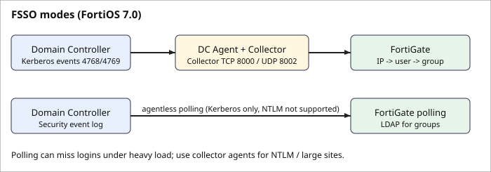
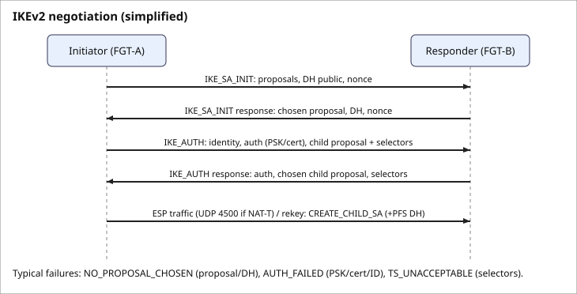

# Enterprise Network & Security Engineering — دوره‌ی تخصصی Cisco و Enterprise Firewall
## بخش ۶ از ۱۱ — فصل‌های ۱۶ تا ۱۸

| مورد | مقدار |
|---|---|
| نام دوره | Enterprise Network & Security Engineering (Cisco + FortiGate) |
| شماره بخش | ۶ از ۱۱ |
| فصل‌های این فایل | ۱۶ ، ۱۷ ، ۱۸ |
| تاریخ تولید | ۲۰۲۶-۱۱-۲۶ |
| نسخه Blueprint | v3.0 (+ بازبینی ۱٫۱) |
| نسخه‌های نرم‌افزار | FortiOS 7.0.3 (اسمی؛ بوت‌نشده؛ تأیید با `get system status`) ؛ Cisco vIOS-L2 15.2(20200924، Experimental) ؛ Cisco vIOS 15.9(3)M9 ؛ VPCS ؛ PNetLab 4.2.8 ؛ ESXi 8.0U2 ؛ CSR1000v 17.03.02 (IOS-XE؛ آزمایش‌نشده) |
| وضعیت تکمیل | **فصل‌های ۱۶–۱۸ تولید شد؛ UTM، Authentication، IPsec S2S.** Labها «اجرا نشده»؛ UTM به لایسنس FortiGuard وابسته (Needs-License)؛ دستورها آزمایش‌نشده. |

> **قوانین خواندن:** تمرین‌ها و پرسش‌های مرور بدون پاسخ‌اند؛ پاسخ در «پاسخ‌های فصل». «اجرا نشده» یعنی خروجی‌ها **پیش‌نیاز/پیش‌بینی** هستند. «CLI-Accepted» ≠ «کار می‌کند». رمزها نمونه‌اند.

### وضعیت راستی‌آزمایی Labهای این بخش
خلاصه: اجرا نشده (فقط طراحی): 18.

| Lab | وضعیت |
|---|---|
| 16-1 | اجرا نشده (فقط طراحی) |
| 16-2 | اجرا نشده (فقط طراحی) |
| 16-3 | اجرا نشده (فقط طراحی) |
| 16-4 | اجرا نشده (فقط طراحی) |
| 16-5 | اجرا نشده (فقط طراحی) |
| 16-6 | اجرا نشده (فقط طراحی) |
| 17-1 | اجرا نشده (فقط طراحی) |
| 17-2 | اجرا نشده (فقط طراحی) |
| 17-3 | اجرا نشده (فقط طراحی) |
| 17-4 | اجرا نشده (فقط طراحی) |
| 17-5 | اجرا نشده (فقط طراحی) |
| 17-6 | اجرا نشده (فقط طراحی) |
| 18-1 | اجرا نشده (فقط طراحی) |
| 18-2 | اجرا نشده (فقط طراحی) |
| 18-3 | اجرا نشده (فقط طراحی) |
| 18-4 | اجرا نشده (فقط طراحی) |
| 18-5 | اجرا نشده (فقط طراحی) |
| 18-6 | اجرا نشده (فقط طراحی) |

---

<a id="ch16"></a>

> **نسخه‌ی اصلاح‌شده (v3.9):** نسخه‌ی توسعه‌یافته‌ی فایل اصلی؛ درس‌های افزوده: ۱۶-۰، ۱۶-۷، ۱۸-۰ (دسته C). فایل اصلی در `course/` حفظ شده است. پاسخ‌های درس‌های افزوده در «پاسخ‌های فصل» همان فصل است.

# فصل 16 — UTM: آنتی‌ویروس، IPS، Application Control، Web Filter و SSL Inspection

**مدت:** ۳۶ ساعت | **پیش‌نیاز:** فصل ۱۳، ۱۴.
**اهداف:** Security Profile و Profile Group؛ AV؛ Web Filter (Static URL به‌جای Category)؛ IPS و DoS؛ Application Control؛ SSL/SSH Inspection؛ اثر Performance و عیب‌یابی.
**هشدار لایسنس (مهم):** طبق مستند Fortinet: AV و IPS به لایسنس **FortiGuard AV/IPS** برای به‌روزرسانی Signature؛ Web Filter و DNS Filter (Category) به **Web/DNS Security**؛ و Signature **Application Control** جزو سرویس‌های پایه‌ی قرارداد FortiCare است (لایسنس امنیتی جدا نمی‌خواهد ولی FortiCare معتبر لازم است). اگر لایسنس منقضی شود FortiGate همچنان فایروال می‌ماند: AV/IPS با Signature قدیمی اسکن می‌کنند و فقط به‌روزرسانی قطع می‌شود، ولی Category در Web/DNS Filter کار نمی‌کند. در Lab ایزوله و Evaluation این وابستگی `Needs-License` و وضعیتش `Unverified` است. هر درس بخش «بدون لایسنس چه می‌توان کرد» دارد (Static URL، Custom IPS، DoS، Port-based). **همه‌ی دستورها آزمایش‌نشده روی Image.**
**معیار تسلط:** Profile ساخته و به Policy وصل؛ اثبات با Log/تست؛ توضیح اثر SSL Inspection بر Performance و Certificate.
**اشتباهات رایج:** فعال‌کردن Deep Inspection بدون نصب CA؛ Profile روی همه‌ی ترافیک؛ نادیده‌گرفتن لایسنس؛ بدون تست.

**درس‌های فصل:**
- [درس 16-1 — Security Profile و لایسنس: نقشه‌ی UTM](#l-16-1)
- [درس 16-2 — Web Filter و DNS Filter (Static و Category)](#l-16-2)
- [درس 16-3 — Antivirus و File Filter](#l-16-3)
- [درس 16-4 — IPS، DoS و Application Control](#l-16-4)
- [درس 16-5 — SSL/SSH Inspection: Certificate و CA](#l-16-5)
- [درس 16-6 — Performance، عیب‌یابی UTM و آزمون فصل](#l-16-6)

---

<a id="l-16-1"></a>

## درس 16-0 — Inspection Mode (Flow در برابر Proxy)، TLS Inspection و زنجیره‌ی اعتماد

**فصل ۱۶ · درس افزوده (پیش‌درس ۱۶-۱) · پیش‌نیاز: ۱۲-۰، ۱۱-۷، مفاهیم TLS و PKI · ≈ ۸ ساعت**

> **وضعیت (FortiOS 7.0.3):** تفاوت Flow/Proxy و پروفایل‌های SSL از مستند رسمی 7.0 تأیید شد ([Inspection modes](https://docs.fortinet.com/document/fortigate/7.0.1/administration-guide/721410/inspection-modes)، [Inspection mode feature comparison](https://docs.fortinet.com/document/fortigate/7.0.0/administration-guide/922096/inspection-mode-feature-comparison)، [SSL & SSH Inspection](https://docs.fortinet.com/document/fortigate/7.0.1/administration-guide/929997/ssl-ssh-inspection)). جزئیات روی Image `Unverified`. Needs-License: سرویس‌های FortiGuard.

### ۱) هدف آموزشی

دانشجو در پایان می‌تواند:

1. تفاوت **Flow-based** و **Proxy-based Inspection** را از نظر سازوکار، قابلیت و Performance بگوید و برای هر سناریو انتخاب کند.
2. توضیح دهد TLS چگونه کار می‌کند و چرا بدون **SSL Inspection** محتوای HTTPS دیده نمی‌شود.
3. **Certificate Inspection** و **Deep Inspection** را از نظر دید، ریسک و پیش‌نیاز مقایسه کند.
4. **زنجیره‌ی اعتماد (Certificate Chain)، CA و Trust Store** را توضیح دهد و بگوید چرا مرورگر به CA فایروال باید اعتماد کند.
5. **SNI** و محدودیت‌های دید روی ترافیک رمزشده (TLS 1.3، ECH، Certificate Pinning) را بشناسد.
6. در سناریوی واقعی Exemption امن بنویسد.

### ۲) پیش‌نیازها

Handshake TLS در سطح مفهومی (Client Hello، Certificate، Key Exchange)، مفهوم کلید عمومی/خصوصی و گواهی (PKI)، Packet Flow (۱۲-۰).

### ۳) مفهوم پایه

بیشتر ترافیک امروز رمزشده است. فایروالی که فقط پورت و IP را ببیند، نمی‌تواند بدافزار داخل HTTPS را کشف کند. **UTM** یعنی بازرسی محتوا؛ و بازرسی محتوا برای ترافیک رمزشده نیاز به **رمزگشایی** دارد. این رمزگشایی یک **حمله‌ی Man-in-the-Middle مجاز** است: فایروال به‌جای سرور، گواهی صادر می‌کند. کاربر فقط وقتی خطا نمی‌بیند که به CA فایروال اعتماد کرده باشد.

### ۴) توضیح عمیق فنی

#### ۴-۱) Flow-based در برابر Proxy-based

طبق مستند Fortinet (7.0):

- **Flow-based:** بسته‌ها را «در جریان» می‌بیند؛ یک Snapshot از محتوا می‌گیرد و با Pattern Matching بررسی می‌کند؛ بسته‌ها بازسازی کامل نمی‌شوند. تأخیر کمتر، Throughput بیشتر (و قابلیت NPU Offload در بعضی حالت‌ها).
- **Proxy-based:** فایروال اتصال کلاینت را ختم و اتصال جدیدی به سرور می‌سازد؛ **محتوا را کامل بازسازی** می‌کند (فایل کامل، پاسخ کامل HTTP). قابلیت بیشتر (مثلاً بعضی گزینه‌های AV/Web Filter/DLP مثل Content Disarm، Quota و ...)، هزینه‌ی CPU/Memory و تأخیر بیشتر.
- در 7.0 حالت بازرسی **در هر Policy** انتخاب می‌شود (`set inspection-mode flow|proxy`)؛ پیش‌فرض Flow است.

| معیار | Flow | Proxy |
|---|---|---|
| سازوکار | بدون بازسازی کامل، Pattern | ختم و بازسازی |
| تأخیر | کمتر | بیشتر |
| CPU/Memory | کمتر | بیشتر |
| قابلیت‌ها | کمتر (جدول مقایسه‌ی Fortinet) | بیشتر |
| پوشش پورت | همه‌ی پورت‌ها در Deep (طبق مستند) | فقط پورت‌های نگاشت‌شده مگر «Inspect all ports» |
| کاربرد | Throughput، ترافیک عمومی | حساسیت بالا، قابلیت خاص |

(برای هر Profile باید جدول «Inspection mode feature comparison» همان نسخه بررسی شود.)

#### ۴-۲) TLS در یک نگاه

``` text
1. ClientHello  : supported versions/ciphers, SNI (server name, plaintext in TLS<=1.2/1.3 default)
2. ServerHello  : chosen cipher
3. Certificate  : server certificate chain
4. Key exchange : (EC)DHE -> session keys
5. Finished     : encrypted application data
```

- **SNI (Server Name Indication):** نام سرور در ClientHello (معمولاً رمزنشده)؛ فایروال بدون رمزگشایی می‌تواند بر اساس SNI فیلتر کند.
- TLS 1.3: گواهی سرور رمز می‌شود؛ بنابراین Certificate Inspection روی TLS 1.3 اطلاعات کمتری دارد (SNI می‌ماند). با **ECH (Encrypted Client Hello)** حتی SNI هم رمز می‌شود (محدودیت آینده/مرورگرهای جدید).

#### ۴-۳) Certificate Inspection

فایروال فقط **اطلاعات گواهی و SNI** را می‌بیند (تا لایه‌ی TLS) و محتوای رمزشده را باز نمی‌کند. توانایی: Web Filter بر اساس Category/FQDN، بلاک گواهی نامعتبر/منقضی. محدودیت: AV/IPS/DLP روی محتوای HTTPS ناممکن.

#### ۴-۴) Deep Inspection (Full SSL Inspection)

فایروال به‌عنوان **Proxy TLS** عمل می‌کند:

``` text
Client <==TLS(session A, cert signed by firewall CA)==> FortiGate <==TLS(session B)==> Server
                       decrypt -> inspect (AV/IPS/Web/DLP) -> re-encrypt
```

- باید **CA فایروال** (یا CA سازمانی) در Trust Store همه‌ی کلاینت‌ها نصب باشد (GPO/MDM)، وگرنه خطای گواهی.
- ریسک: بار CPU، مشکل با برنامه‌های Pin‌شده، مسائل حریم خصوصی/حقوقی، افزایش سطح حمله به خود فایروال (گواهی‌های صادرشده، کلید CA).
- **Exemption:** بانک، سلامت، به‌روزرسانی‌های Pin‌شده، برنامه‌های خاص (Teams/OS update) از Inspection مستثنا شوند (Address/FQDN/Category).
- 7.0 دو Profile آماده دارد: `certificate-inspection` و `deep-inspection` (و `no-inspection`) طبق مستند.

#### ۴-۵) Certificate Chain، CA و Trust

``` text
Root CA (in trust store) -> Intermediate CA -> Server certificate
Browser: verify signature chain up to a trusted root, check name (SAN), validity, revocation (OCSP/CRL)
```

در Deep Inspection فایروال زنجیره‌ی سرور واقعی را **اعتبارسنجی می‌کند** و برای کلاینت گواهی جدید (با همان Subject/SAN) با **CA فایروال** امضا می‌کند. اگر گواهی سرور معتبر نباشد، فایروال باید به کلاینت هشدار بدهد (گواهی «untrusted» جداگانه؛ تنظیم Action برای گواهی نامعتبر مهم است: Allow/Block/Warning). CA فایروال به‌صورت پیش‌فرض Self-signed است؛ بهتر است CA داخلی سازمان (Intermediate) استفاده شود.

#### ۴-۶) محدودیت‌های دید

- **Certificate Pinning:** برنامه‌ای که گواهی خاص را انتظار دارد با گواهی فایروال خطا می‌دهد.
- **TLS 1.3/ECH/QUIC (HTTP/3 روی UDP 443):** QUIC معمولاً قابل Inspection عمیق نیست؛ سیاست معمول: بلاک QUIC تا ترافیک به TCP/TLS برگردد (Application Control).
- **mTLS (Mutual TLS):** گواهی کلاینت؛ Inspection ممکن است آن را بشکند.
- **STARTTLS، SMTPS، IMAPS:** پروتکل‌های دیگر هم Profile جدا دارند.

#### ۴-۷) Detection در برابر Prevention

- **Detection (Monitor):** رویداد را Log می‌کند ولی ترافیک را عبور می‌دهد.
- **Prevention (Block):** ترافیک را مسدود می‌کند.
- روش ایمن استقرار: ابتدا **Monitor** و بررسی False Positive، سپس Block برای موارد با اطمینان بالا.

### ۵) مثال حل‌شده

**نیاز:** Policy Users→Internet با AV و Web Filter و SSL Inspection.

``` text
config firewall policy
    edit 10
        set name "Users-to-Internet"
        set srcintf "port2"
        set dstintf "port1"
        set srcaddr "Users-Net"
        set dstaddr "all"
        set action accept
        set schedule "always"
        set service "HTTP" "HTTPS" "DNS"
        set inspection-mode flow
        set ssl-ssh-profile "certificate-inspection"
        set nat enable
        set logtraffic all
    next
end
```

(نام فیلدها طبق مستند 7.0؛ `Unverified` روی Image.) سپس برای سناریوی بانک: Profile سفارشی Deep با Exemption.

**مثال متوسط:** پس از فعال‌کردن Deep Inspection، برنامه‌ی Updater خطای TLS می‌دهد. علت: Pinning. راه‌حل: Exemption آن FQDN، نه خاموش‌کردن Deep برای همه.

**مثال سخت:** کاربران مرورگر Firefox هنوز هشدار گواهی می‌بینند در حالی‌که Chrome ندارد. تحلیل: Firefox Trust Store جداگانه دارد؛ CA فقط در Windows Store نصب شده است. راه‌حل: Policy Firefox (`security.enterprise_roots.enabled`) یا نصب CA در Firefox (مدیریت متمرکز). ثبت در RCA.

### ۶) طراحی و تصمیم‌گیری

| سؤال | تصمیم |
|---|---|
| Flow یا Proxy؟ | Flow برای عموم؛ Proxy برای نیاز خاص (طبق جدول مقایسه) |
| Deep یا Certificate Inspection؟ | Deep برای Users→Internet؛ Certificate برای سرورها/سلامت |
| CA فایروال یا CA سازمانی؟ | CA سازمانی (Intermediate) با توزیع GPO |
| Exemptionها | بانک، سلامت، Pinned، Update |
| QUIC | بلاک یا Exempt طبق سیاست |
| گواهی نامعتبر | Block/Warning برای Users |

### ۷) پیاده‌سازی: GUI و CLI

**GUI:**

1. Security Profiles → SSL/SSH Inspection → Create New (یا Clone از deep-inspection).
2. Inspection Method: Full SSL Inspection / SSL Certificate Inspection.
3. CA Certificate: انتخاب، و Download/Export CA برای نصب روی کلاینت.
4. Exempt from SSL Inspection: Web Categories، Addresses.
5. Policy & Objects → Firewall Policy → ویرایش Policy → Inspection Mode و SSL Inspection.

**CLI:**

``` text
config firewall ssl-ssh-profile
    edit "SSL-DEEP-LAB"
        config https
            set ports 443
            set status deep-inspection
        end
        set untrusted-caname "Fortinet_CA_Untrusted"
    next
end
get firewall ssl-ssh-profile
```

(`untrusted-caname`، `status` و ... با CLI Reference 7.0 تطبیق شود؛ `Unverified`.)

### ۸) Troubleshooting

| علامت | شاهد | علت |
|---|---|---|
| خطای گواهی در مرورگر | Issuer = CA فایروال | CA روی کلاینت نصب نیست |
| برنامه TLS خطا می‌دهد | Capture: Alert | Pinning |
| سایت HTTPS کند | CPU، `sys top` | Deep روی ترافیک سنگین |
| Block کار نمی‌کند | Log بدون UTM | Profile/SSL Inspection وصل نیست یا Pinned |
| QUIC دور می‌زند | Capture UDP 443 | QUIC Inspect نمی‌شود |

### ۹) نکات امنیتی

- کلید خصوصی CA فایروال حساس‌ترین دارایی این سیستم است؛ دسترسی Admin محدود و Backup رمزشده.
- رمزگشایی داده‌ی کاربران ملاحظات حقوقی و حریم خصوصی دارد؛ سیاست و رضایت لازم.
- گواهی‌های نامعتبر را Block کنید؛ اجازه‌ی «Allow» پیش‌فرض خطرناک است.

### ۱۰) جمع‌بندی مفهومی

- Flow سریع‌تر و محدودتر؛ Proxy کامل‌تر و سنگین‌تر؛ انتخاب Per-Policy.
- Certificate Inspection فقط گواهی/SNI؛ Deep محتوا را می‌بیند ولی نیاز به CA و Exemption دارد.
- TLS 1.3/ECH/QUIC/Pinning دید را کم می‌کنند.
- Monitor قبل از Block.
- کلید CA یک دارایی بحرانی است.

### ۱۱) تمرین و ارزیابی

**ت1.** (ساده) Flow و Proxy چه فرقی دارند؟ *(پاسخ: 16-0-ت1)*

**ت2.** (ساده) SNI چیست؟ *(پاسخ: 16-0-ت2)*

**ت3.** (متوسط) چرا Deep Inspection نیاز به نصب CA روی کلاینت دارد؟ *(پاسخ: 16-0-ت3)*

**ت4.** (متوسط) Certificate Pinning چه مشکلی ایجاد می‌کند؟ راه‌حل؟ *(پاسخ: 16-0-ت4)*

**ت5.** (سخت) برای ۳ گروه (کاربران عادی، سرورها، بانک/سلامت) استراتژی SSL Inspection را طراحی کنید. *(پاسخ: 16-0-ت5)*

**ت6.** (سخت، طراحی) QUIC چه مشکلی برای Inspection دارد و چگونه مدیریت می‌شود؟ *(پاسخ: 16-0-ت6)*

**م1.** Detection و Prevention چه فرقی دارند؟ *(پاسخ: 16-0-م1)*

**Q1.** Quick quiz (English): What can certificate inspection see that deep inspection also sees, and what only deep inspection sees? *(پاسخ: 16-0-Q1)*

### ۱۲) اصطلاحات و English Corner

| مخفف | شکل کامل | معنی |
|---|---|---|
| SNI | Server Name Indication | نام سرور در Hello |
| CA | Certificate Authority | مرجع گواهی |
| PKI | Public Key Infrastructure | زیرساخت کلید عمومی |
| ECH | Encrypted Client Hello | رمزکردن Hello |
| QUIC | QUIC | پروتکل انتقال روی UDP |
| mTLS | Mutual TLS | TLS دوطرفه |
| OCSP | Online Certificate Status Protocol | بررسی ابطال گواهی |

- *Deep inspection decrypts and re-encrypts TLS sessions.* ← Deep Inspection نشست TLS را رمزگشایی و دوباره رمزگذاری می‌کند.
- *Exempt pinned and privacy-sensitive destinations from inspection.* ← مقصدهای Pinned و حساس حریم خصوصی را از Inspection مستثنا کنید.

### ۱۳) منابع

- Fortinet Docs: [Inspection modes](https://docs.fortinet.com/document/fortigate/7.0.1/administration-guide/721410/inspection-modes)، [Inspection mode feature comparison](https://docs.fortinet.com/document/fortigate/7.0.0/administration-guide/922096/inspection-mode-feature-comparison)، [SSL & SSH Inspection](https://docs.fortinet.com/document/fortigate/7.0.1/administration-guide/929997/ssl-ssh-inspection)، [Inspection mode per policy](https://docs.fortinet.com/document/fortigate/7.0.0/administration-guide/366651/inspection-mode-per-policy).
- RFC 8446 — TLS 1.3؛ RFC 6066 (SNI)؛ RFC 5280 (X.509 PKI).

### بخش تکمیلی درس: سناریوی واقعی، مثال‌های بیشتر و عیب‌یابی

> بخش‌های زیر درس بالا را کامل می‌کنند: سناریوی گام‌به‌گام، مثال‌های بیشتر از ساده تا سخت، جدول عیب‌یابی و پرسش‌های مصاحبه. ابتدا بخش‌های اصلی بالا را مطالعه کنید.

### تعمیق: انتخاب Flow یا Proxy با معیار واقعی

**سناریو.** شعبه با ۱ Gbps و نیاز به Web Filter با Category + Antivirus.

| نیاز | Flow | Proxy |
|---|---|---|
| حداکثر سرعت | بهتر | کندتر |
| قابلیت‌های عمیق (مثلاً بعضی اسکن‌ها) | محدودتر | کامل‌تر |
| NPU Offload | امکان | معمولاً خیر |

قانون عملی: پیش‌فرض Flow؛ Proxy فقط اگر قابلیت لازم آن را بخواهد (طبق جدول قابلیت‌های مستند Fortinet برای نسخه).

**زنجیره‌ی اعتماد TLS:** مرورگر باید CA فایروال را بپذیرد؛ بدون نصب CA هشدار «Not Secure». استثنا برای بانکداری/پزشکی (Exemption) از نظر حریم خصوصی.

**پرسش‌های مصاحبه**
1. *چرا SSL Inspection بدون CA خطا می‌دهد؟* گواهی ساختگی اعتماد ندارد.
2. *Certificate Pinning؟* برنامه گواهی را قفل می‌کند؛ Exemption لازم.
3. *هزینه CPU؟* رمزگشایی/رمزگذاری دوباره.

### تکمیل عمیق: Flow در برابر Proxy و TLS Inspection — انتخاب درست

#### چرا باید یاد بگیریم؟

فایروال نسل جدید فقط «پورت» را نمی‌بیند؛ محتوا را هم بازرسی می‌کند. ولی بازرسی هزینه دارد و دو روش دارد که هر کدام جای خود را دارند. انتخاب غلط یا سرعت را می‌کشد یا قابلیت لازم را از دست می‌دهد.

#### توضیح ساده

- **Flow-based**: بسته‌ها در حین عبور بازرسی می‌شوند، بدون ذخیره‌ی کامل فایل. سریع‌تر؛ قابلیت NPU Offload بیشتر.
- **Proxy-based**: فایروال فایل/ارتباط را کامل دریافت و سپس تصمیم می‌گیرد. کندتر ولی بازرسی عمیق‌تر برای بعضی قابلیت‌ها.

جدول قابلیت‌های هر حالت در مستند Fortinet نسخه آمده؛ قاعده‌ی عملی: پیش‌فرض Flow، و Proxy فقط وقتی قابلیت مورد نیاز آن را بخواهد.

#### مثال ساده — انتخاب

شعبه 1 Gbps با Web Filter Category + Antivirus: Flow-based معمولاً کافی و سریع است.

#### مثال متوسط — SSL/TLS Inspection

بیش از ۹۰٪ ترافیک رمز است؛ بدون Inspection، AV/IPS/Web Filter عمیق نمی‌بینند. فایروال نقش «مرد میانی مجاز» دارد: اتصال کلاینت را با گواهی ساختگی (امضاشده با CA سازمان) خاتمه می‌دهد و اتصال دوم را به سرور می‌سازد.

``` text
Client <-TLS(cert signed by Corp CA)-> FortiGate <-TLS(real server cert)-> Server
```

کلاینت باید CA سازمان را بپذیرد.

#### مثال سخت — Certificate Pinning

برنامه‌هایی که گواهی را «قفل» می‌کنند (بانک، برخی Appها) با Inspection شکست می‌خورند. راه: Exemption برای آن دسته/Domain؛ و مستندسازی دلیل. همچنین دسته‌های حساس حریم (سلامت، مالی) را از Inspection مستثنی کنید.

#### هزینه

رمزگشایی/رمزنگاری دوباره CPU می‌خورد؛ ظرفیت را با Baseline اندازه بگیرید (درس 16-6).

#### Lab

یک Policy با Inspection را تنها در Lab بسازید.

#### عیب‌یابی

| علامت | علت | رفع |
|---|---|---|
| هشدار گواهی | CA نصب نیست | توزیع |
| برنامه شکست | Pinning | Exemption |
| CPU بالا | Inspection | مقیاس/Exemption |

#### پرسش‌ها با پاسخ

**۱. Flow یا Proxy؟** پیش‌فرض Flow.
**۲. چرا CA؟** اعتماد.
**۳. Pinning؟** گواهی قفل‌شده.

#### English Corner

- *Deep inspection requires clients to trust the inspection CA.*
- Q: Why are some categories exempted from SSL inspection?

## درس 16-1 — نقشه‌ی UTM: Security Profileها، لایسنس FortiGuard و ماتریس قابلیت

**فصل 16 · بازنویسی عمیق · پیش‌نیاز: ۱۶-۰، ۱۲-۰، ۱۳-۱ · ≈ 6 ساعت**

> **وضعیت:** FortiOS 7.0.3 (بوت‌نشده)؛ دستورها `Unverified`؛ Lab «اجرا نشده»؛ وابستگی لایسنس هر قابلیت صریح ذکر شده است.

<!--deep-->

### هدف آموزشی

در پایان این درس باید بتوانید:

1. فهرست Security Profileها و محل اتصال آن‌ها به Firewall Policy را بگویید.
2. برای هر قابلیت وابستگی لایسنس FortiGuard را مشخص کنید (Needs-License یا بدون لایسنس).
3. جای UTM را در Packet Flow پیدا کنید (پس از تطبیق Policy، قبل از SNAT).
4. «Profile ساخته‌شده» را از «محافظت واقعاً فعال» تفکیک کنید.
5. ماتریس لایسنس و قابلیت را برای یک Lab تکمیل و با شاهد ثبت کنید.
6. رفتار هنگام انقضای لایسنس یا خطای Rating را پیش‌بینی کنید.

### چرا باید یاد بگیریم؟

فرض کنید یک ساختمان دارید. Firewall Policy مثل نگهبان در است: می‌پرسد «کارت دارید؟ اجازه‌ی ورود به این طبقه را دارید؟». ولی نگهبان داخل کیف شما را نگاه نمی‌کند. UTM (Unified Threat Management، یعنی «مدیریت یکپارچه‌ی تهدید») مثل دستگاه اشعه‌ی ایکس و بازرس کیف است: محتوای ترافیک را بازرسی می‌کند — آیا فایل ویروس دارد؟ آیا سایت مخرب است؟ آیا الگوی حمله دیده می‌شود؟

دو خطای پرهزینه‌ی رایج:

1. مدیر می‌گوید «فایروال همه‌ی ویروس‌ها را می‌گیرد» ولی لایسنس Antivirus منقضی شده است؛ حادثه که رخ می‌دهد ادعای شما «بدون شاهد» بوده.
2. تیم Profile را می‌سازد ولی هرگز به Policy وصل نمی‌کند؛ همه فکر می‌کنند محافظت فعال است.

این درس نقشه‌ی کامل UTM را می‌دهد تا هیچ‌کدام از این دو اتفاق نیفتد.

### UTM چیست؟ (توضیح ساده)

هر Security Profile یک «بازرس تخصصی» است:

| بازرس (Profile) | چه چیزی را بررسی می‌کند | مثال روزمره |
|---|---|---|
| Antivirus | بدافزار داخل فایل | اشعه‌ی ایکس کیف |
| Web Filter | نوع و دسته‌ی سایت | فهرست مکان‌های ممنوعه |
| DNS Filter | نام دامنه‌ای که کاربر می‌پرسد | دفتر تلفن مشکوک |
| Application Control | نوع برنامه (BitTorrent، Telegram) | تشخیص نوع وسیله |
| IPS | الگوی حمله به آسیب‌پذیری | کارشناس امنیت |
| File Filter | نوع/پسوند فایل | ممنوعیت حمل جعبه‌ی خاص |
| SSL/SSH Inspection | بازکردن ترافیک رمز | بازکردن بسته‌ی مهر و موم شده |

نکته‌ی کلیدی: **Profile به‌تنهایی هیچ کاری نمی‌کند؛ باید داخل یک Policy انتخاب شود.** فقط ترافیکی بازرسی می‌شود که با آن Policy تطبیق و `accept` شده باشد.

### جای UTM در Packet Flow

``` text
Ingress -> RPF -> Session -> DNAT -> Route -> Policy match -> [Security profiles] -> SNAT -> Egress
```

نتیجه‌ی عملی:

1. ترافیک Deny شده هرگز به Profile نمی‌رسد.
2. UTM بعد از Policy است؛ پس اگر Policy اشتباه تطبیق بخورد، Profile اشتباه اعمال می‌شود.
3. SSL Inspection (اگر روشن باشد) پیش از بازرسی لایه‌ی ۷ ترافیک را رمزگشایی می‌کند.

### ماتریس قابلیت و لایسنس

| قابلیت | کار اصلی | لایسنس FortiGuard | بدون لایسنس |
|---|---|---|---|
| Antivirus | Signature بدافزار | بله (AV DB) | File Filter و بلاک نوع فایل |
| Web Filter | Category و URL | Category: بله | Static URL Filter |
| DNS Filter | بلاک دامنه‌ی مخرب | Category: بله | Static domain |
| Application Control | شناخت برنامه | بله | بلاک با Port/Service |
| IPS | Signature حمله | بله | Custom Signature، DoS Policy |
| File Filter | نوع فایل | خیر | کار می‌کند |
| SSL/SSH Inspection | رمزگشایی TLS | خیر (CA لازم) | کار می‌کند |

(جزئیات هر مدل و Contract را در مستند رسمی FortiOS 7.0 بررسی کنید؛ این جدول سطح مفهومی است.)

### سه سطح شاهد

برای ادعای «محافظت فعال است» سه شاهد لازم است:

1. **پیکربندی:** Profile در Policy هست؟

``` text
show firewall policy 30
```

2. **وضعیت سرویس:** FortiGuard Valid است؟ (GUI: System > FortiGuard یا `diagnose debug rating`)
3. **رفتار:** آزمون واقعی (فایل EICAR، سایت دسته‌بندی‌شده) و Log.

### وقتی لایسنس نیست یا Rating خطا می‌دهد

برای Web Filter در صورت خطای Rating: `error-allow` یا `error-block`.

``` text
config webfilter profile
    edit "WF-STD"
        config ftgd-wf
            set options error-allow
        end
    next
end
```

`error-allow` یعنی در خطا اجازه بده (دسترسی‌پذیری بالا، ریسک بیشتر)؛ `error-block` یعنی مسدود کن (امنیت بالا، ریسک قطع). انتخاب طبق سیاست سازمان.

### مثال‌های حل‌شده

#### مثال ساده — کدام Profile چه می‌بیند؟

سؤال: «کاربر فایل .exe را از سایت می‌گیرد؛ کدام Profile‌ها دخیل‌اند؟» پاسخ مرحله‌ای:

1. Web Filter: آیا دسته‌ی سایت مجاز است؟
2. Application Control: برنامه‌ی دانلود چیست؟
3. File Filter: آیا نوع exe بلاک است؟
4. Antivirus: آیا محتوا بدافزار است؟
5. IPS: آیا الگوی Exploit دارد؟

هر Profile یک سؤال جدا می‌پرسد؛ همه باید در Policy باشند.

#### مثال متوسط — بررسی وضعیت

``` text
get system status
diagnose debug rating
execute update-now
```

در Lab بدون لایسنس: `diagnose debug rating` نشان می‌دهد Rating Server در دسترس نیست؛ پس Category/AV/IPS در این Lab «Needs-License» و اجرا نشده ثبت می‌شود. لایه‌ی جایگزین: Static URL، File Filter و DoS Policy.

#### مثال متوسط — ماتریس Lab

| قابلیت | لایسنس | روش جایگزین | وضعیت Lab |
|---|---|---|---|
| Web Filter Category | Needs-License | Static URL | اجرا نشده |
| Antivirus | Needs-License | File Filter | اجرا نشده |
| SSL Inspection | بدون لایسنس | - | قابل اجرا |

#### مثال سخت — لایسنس منقضی

لایسنس تمام شد ولی Profile روی Policy مانده. Category Rating نمی‌گیرد؛ رفتار طبق `error-allow/error-block`. ممیز می‌پرسد «چه مدت بدون محافظت بودید؟». پاسخ با Evidence: تاریخ انقضا در FortiGuard، Log خطای Rating، و زمان تمدید. درس: هشدار ۶۰ و ۳۰ روز قبل از انقضا + پایش Rating Error.

#### مثال سخت — Profile بی‌اتصال

تیم IPS Sensor ساخت ولی Policy اینترنت را تغییر نداد. آزمون: فایل EICAR دانلود شد و Log UTM خالی بود ⇒ Profile متصل نیست. رفع: Policy ⇒ Security Profiles. اثبات: Log ⇒ `Security Events`.

### Lab هدایت‌شده (اجرا نشده)

1. Profile ساده بسازید و به Policy وصل کنید.
2. با `show firewall policy` اتصال را ثابت کنید.
3. ماتریس لایسنس Lab را پر کنید.

### عیب‌یابی سریع

| علامت | علت | رفع |
|---|---|---|
| Profile هست ولی اثر ندارد | به Policy وصل نیست | انتخاب در Policy |
| Rating Error | لایسنس/DNS FortiGuard | بررسی |
| Log UTM خالی | Policy Deny/Match نشده | Lookup |
| حفاظت ادعایی | بدون شاهد | سه سطح شاهد |

### نکات امنیتی

لایسنس و تاریخ انقضا را پایش کنید؛ رفتار `error-allow` را آگاهانه انتخاب کنید؛ ادعای «محافظت» را همیشه با Log و آزمون پشتیبانی کنید.

### جمع‌بندی

Security Profile داخل Policy فعال می‌شود و فقط ترافیک Accept شده را بازرسی می‌کند. هر قابلیت وابستگی لایسنس مشخص دارد؛ ادعا نیازمند سه شاهد (پیکربندی، وضعیت سرویس، رفتار) است.

### تمرین و ارزیابی

**ت1.** (ساده) UTM در کجای Packet Flow است؟ *(پاسخ: 16-1-ت1)*

**ت2.** (ساده) کدام قابلیت‌ها بدون لایسنس کار می‌کنند؟ *(پاسخ: 16-1-ت2)*

**ت3.** (متوسط) چرا «Profile ساخته شد» شاهد کافی نیست؟ *(پاسخ: 16-1-ت3)*

**ت4.** (سخت) ماتریس لایسنس Lab خود را با ۳ شاهد بسازید. *(پاسخ: 16-1-ت4)*

**ت5.** (سخت، طراحی) طرح لایه‌ای ضدبدافزار برای سازمانی بدون Sandbox. *(پاسخ: 16-1-ت5)*

**Q1.** Quick quiz (English): Why is a created profile not proof of protection? *(پاسخ: 16-1-Q1)*

### اصطلاحات و English Corner

| مخفف | شکل کامل | معنی |
|---|---|---|
| UTM | Unified Threat Management | مدیریت یکپارچه‌ی تهدید |
| FortiGuard | FortiGuard Services | سرویس به‌روزرسانی Fortinet |
| Profile | Security profile | مجموعه‌ی تنظیم بازرسی |

- *A security profile only works when it is attached to an accepting policy.* ← Profile فقط وقتی کار می‌کند که به Policy مجاز وصل شده باشد.

### کارت Lab

**Lab:** ماتریس UTM. **وضعیت:** اجرا نشده. **Evidence:** `03-ops/utm-license-log.md`. **Rollback:** ندارد (فقط خواندنی).

### منابع

- Fortinet Docs: FortiOS 7.0 Administration Guide — Security Profiles، FortiGuard.
- [Inspection mode feature comparison](https://docs.fortinet.com/document/fortigate/7.0.0/administration-guide/922096/inspection-mode-feature-comparison).

<a id="l-16-2"></a>

## درس 16-2 — Web Filter و DNS Filter: Static URL، Category، FQDN و عیب‌یابی HTTPS

**فصل ۱۶ · بازنویسی عمیق (جایگزین نسخه‌ی فشرده) · پیش‌نیاز: ۱۶-۰، ۱۶-۱، ۱۲-۰ · ≈ ۶ ساعت**

> **وضعیت (FortiOS 7.0.3):** Static URL Filter بدون لایسنس FortiGuard کار می‌کند؛ Category/Rating **Needs-License**. سینتکس `Unverified` روی Image. Lab «اجرا نشده».

<!--deep-->

### هدف آموزشی

در پایان این درس باید بتوانید:

1. Web Filter را در سه لایه (Static URL، Category، Content) توضیح دهید.
2. DNS Filter و تفاوتش با Web Filter را بشناسید.
3. Static URL Filter با Simple/Wildcard/Regex بسازید.
4. FortiGuard Category Filter را (با لایسنس) تنظیم کنید و Action‌ها (Allow/Block/Monitor/Warning/Authenticate) را بشناسید.
5. Override و Local Category را بدانید.
6. Log را بخوانید و دلیل بلاک را اثبات کنید.

### چرا باید یاد بگیریم؟

Web Filter شبیه «فهرست مکان‌های ممنوعه‌ی مدرسه» است: دانش‌آموز می‌خواهد به مغازه‌ی خاصی برود؛ مدیر مدرسه براساس دسته (قمار، بزرگسال، بدافزار) اجازه می‌دهد یا نمی‌دهد. اهمیت: کاهش سطح حمله (سایت‌های Phishing/Malware)، رعایت قوانین سازمان و پهنای باند. مشکل رایج: بلاک بیش از حد (کاربران ناراضی) یا کمتر از حد (حادثه).

### سه لایه‌ی Web Filter

| لایه | کار | لایسنس |
|---|---|---|
| Static URL Filter | تطبیق دستی URL | خیر |
| FortiGuard Category | رتبه‌بندی ابری سایت | بله |
| Content/Script Filter | حذف Script/Cookie، Safe Search | بخشی |

ترتیب بررسی: Static URL Filter ⇒ FortiGuard Category ⇒ سایر.

### Static URL Filter

``` text
config webfilter urlfilter
    edit 1
        set name "URLF-BLOCK"
        config entries
            edit 1
                set url "badsite.example"
                set type simple
                set action block
            next
            edit 2
                set url "*.gambling.example"
                set type wildcard
                set action block
            next
            edit 3
                set url "^.*\.casino\..*$"
                set type regex
                set action block
            next
        end
    next
end
```

| نوع | معنی | مثال |
|---|---|---|
| simple | تطبیق دقیق | `badsite.example` |
| wildcard | ستاره | `*.example.com` |
| regex | عبارت منظم | الگو |

Action: `allow`، `block`، `monitor`، `exempt` (از سایر بازرسی‌ها معاف).

### FortiGuard Category

``` text
config webfilter profile
    edit "WF-STD"
        config ftgd-wf
            set options error-allow
            config filters
                edit 1
                    set category 26
                    set action block
                next
                edit 2
                    set category 8
                    set action monitor
                next
            end
        end
    next
end
```

شماره‌ی Category در مستند FortiGuard هست؛ در عمل از GUI انتخاب کنید و شماره را از آنجا بخوانید (`<ID>`، دسته‌ها از لایسنس FortiGuard می‌آید: Needs-License).

Actionها: Allow، Block، Monitor، Warning (صفحه‌ی هشدار با Continue)، Authenticate (فقط کاربر مجاز).

### DNS Filter

DNS Filter قبل از اتصال، نام دامنه را در پاسخ DNS بررسی می‌کند. مزیت: بدون رمزگشایی HTTPS، سریع، و برای همه‌ی پروتکل‌ها (نه فقط وب). Static domain و Category (لایسنس).

``` text
config dnsfilter profile
    edit "DNS-STD"
        config domain-filter
            set domain-filter-table 1
        end
        config ftgd-dns
            config filters
                edit 1
                    set category 12
                    set action block
                next
            end
        end
    next
end
```

نتیجه‌ی بلاک: Sinkhole (آدرس مسدودکننده) یا NXDOMAIN.

### Web Filter در برابر DNS Filter

| ویژگی | Web Filter | DNS Filter |
|---|---|---|
| بررسی | URL/Category | نام دامنه |
| HTTPS بدون Inspection | فقط SNI/دامنه | بله (در DNS) |
| صفحه‌ی بلاک | بله | نه (Sinkhole) |
| پوشش | HTTP/HTTPS | همه‌ی پروتکل‌ها |

استفاده‌ی هم‌زمان توصیه می‌شود.

### Override و Local Category

- **Override:** ادمین/مجاز موقتاً سایت را باز کند (زمان‌دار).
- **Local Category:** دسته‌ی سازمانی خودتان (مثلاً «پورتال‌های مجاز»).

### مثال‌های حل‌شده

#### مثال ساده — بلاک یک سایت

Static URL Filter: `badsite.example` ⇒ block. آزمون: مرورگر ⇒ صفحه‌ی Blocked. Log: `action=blocked`، `urlfilteridx=1`.

#### مثال متوسط — Wildcard و Exempt

سایت‌های `*.example.com` مجاز؛ ولی `ads.example.com` بلاک. ترتیب مهم است: ورودی دقیق‌تر بالاتر. `exempt` برای سایت بانک (بدون AV/Inspection).

#### مثال متوسط — خواندن Log

``` text
date=2026-11-27 time=10:15:01 type="utm" subtype="webfilter" eventtype="ftgd_blk"
srcip=10.10.0.5 hostname="gambling.example" catdesc="Gambling" action="blocked"
```

`catdesc` دسته، `action` نتیجه. اگر `action=passthrough` یعنی Allow.

#### مثال سخت — HTTPS و Inspection

بدون SSL Inspection، Web Filter فقط SNI/CN را می‌بیند؛ URL کامل را نه. بنابراین `https://site/path-bad` نمی‌تواند با Path بلاک شود. راه: SSL Inspection (۱۶-۵) یا بلاک دامنه.

#### مثال سخت — Rating Error

لایسنس منقضی ⇒ Category Rating نیست ⇒ طبق `error-allow` همه‌چیز باز. Log: `eventtype="ftgd_err"`. رفع: تمدید + پایش.

### Lab هدایت‌شده (اجرا نشده)

1. Static URL با سه نوع بسازید.
2. DNS Filter با Static domain.
3. بلاک را با Log ثابت کنید.

### عیب‌یابی سریع

| علامت | علت | رفع |
|---|---|---|
| بلاک نمی‌شود | Policy بدون Profile | اتصال |
| HTTPS بلاک نمی‌شود | بدون Inspection | Inspection یا دامنه |
| همه چیز باز | Rating Error | لایسنس |
| بلاک زیاد | Category زیاد | Monitor/Override |

### نکات امنیتی

Safe Search اجباری؛ Policy برای سایت‌های بانکی exempt؛ Log همه‌ی بلاک‌ها؛ DNS Filter برای دستگاه‌های بدون Agent.

### جمع‌بندی

Web Filter سه لایه دارد (Static، Category، Content)؛ DNS Filter سریع و پروتکل‌مستقل است؛ بدون SSL Inspection Web Filter محدود است؛ Rating Error رفتار پیش‌فرض را تعیین می‌کند.

### تمرین و ارزیابی

**ت1.** (ساده) Static URL با Category چه فرقی دارد؟ *(پاسخ: 16-2-ت1)*

**ت2.** (ساده) Exempt چه می‌کند؟ *(پاسخ: 16-2-ت2)*

**ت3.** (متوسط) چرا بلاک مسیر در HTTPS نیاز به Deep دارد؟ *(پاسخ: 16-2-ت3)*

**ت4.** (متوسط) DNS Filter چه نقطه‌ضعفی دارد؟ *(پاسخ: 16-2-ت4)*

**ت5.** (سخت) فرضیه‌های «URL بلاک‌شده باز می‌شود» را به ترتیب و با شاهد بنویسید. *(پاسخ: 16-2-ت5)*

**ت6.** (سخت، طراحی) سیاست وب برای ۳ گروه (کارمند، مهمان، سرور) طراحی کنید. *(پاسخ: 16-2-ت6)*

**Q1.** Quick quiz (English): What does an exempt action in a static URL filter do? *(پاسخ: 16-2-Q1)*

### اصطلاحات و English Corner

| مخفف | شکل کامل | معنی |
|---|---|---|
| Static URL | Static URL filter | فیلتر دستی URL |
| FQDN | Fully Qualified Domain Name | نام کامل دامنه |
| DoH | DNS over HTTPS | DNS رمزشده |
| Safe Search | Safe search enforcement | اجبار جست‌وجوی امن |

- *HTTPS without deep inspection reveals only the domain name.* ← HTTPS بدون Deep فقط نام دامنه را نشان می‌دهد.

### Lab

**کارت Lab:** Static URL Filter. **هدف:** بلاک یک دامنه و اثبات با Log. **توپولوژی:** Client → FGT → Web Lab. **وضعیت:** اجرا نشده. **مراحل:** مطابق بخش ۵. **Verification:** مثبت/منفی؛ Log. **Rollback:** حذف Profile از Policy. **Evidence:** `03-ops/webfilter-static.md`.

### منابع

- Fortinet Docs: FortiOS 7.0 Administration Guide — Web filter، DNS filter؛ [Inspection modes](https://docs.fortinet.com/document/fortigate/7.0.1/administration-guide/721410/inspection-modes).

<a id="l-16-3"></a>

## درس 16-3 — Antivirus و File Filter: سازوکار، حالت‌ها و تست امن

**فصل ۱۶ · بازنویسی عمیق · پیش‌نیاز: ۱۶-۰، ۱۶-۲ · ≈ ۶ ساعت**

> **وضعیت (FortiOS 7.0.3):** AV Signature **Needs-License**؛ File Filter بدون لایسنس. گزینه‌های Flow/Proxy از جدول مقایسه‌ی رسمی ([Inspection mode feature comparison](https://docs.fortinet.com/document/fortigate/7.0.0/administration-guide/922096/inspection-mode-feature-comparison)). Lab «اجرا نشده».

<!--deep-->

### هدف آموزشی

در پایان این درس باید بتوانید:

1. سازوکار Antivirus (Signature، Heuristic، Sandbox) را توضیح دهید.
2. تفاوت Flow-based و Proxy-based AV را بشناسید.
3. File Filter (بدون لایسنس) را تنظیم کنید.
4. Quarantine، Action و Log AV را بشناسید.
5. با فایل EICAR آزمون ایمن اجرا کنید.
6. محدودیت‌ها (فایل رمزشده، حجم، Archive) را بدانید.

### چرا باید یاد بگیریم؟

Antivirus در لبه مثل بازرسی گمرک است: بسته‌ها را قبل از ورود به کشور باز می‌کند. مزیت: یک نقطه‌ی کنترل برای همه‌ی دستگاه‌ها (حتی بدون آنتی‌ویروس). محدودیت: فایل رمزگذاری‌شده یا ترافیک رمز (HTTPS بدون Inspection) را نمی‌بیند؛ پس AV لبه جایگزین Endpoint نیست، مکمل است.

### سازوکارها

| روش | ایده |
|---|---|
| Signature | مقایسه با پایگاه امضا (نیازمند لایسنس) |
| Heuristic | رفتار/الگوی مشکوک |
| Sandbox (FortiSandbox) | اجرای فایل در محیط ایزوله (Needs-License/جدا) |
| Botnet/C&C | نام/IP سرورهای کنترل |

### Flow-based در برابر Proxy-based

| ویژگی | Flow-based | Proxy-based |
|---|---|---|
| سرعت | بالاتر | کمتر |
| بافر فایل | بسته‌ها عبور و بررسی | کل فایل بافر |
| عمق | کمی کمتر | بیشتر |
| پیش‌فرض | بله (در 7.0 معمولاً) | اختیاری |
| Quarantine | محدود | بهتر |

انتخاب: پیش‌فرض Flow؛ Proxy برای نیاز خاص (Sandbox/Quarantine عمیق). جزئیات در ۱۶-۰.

### Antivirus Profile

``` text
config antivirus profile
    edit "AV-STD"
        config http
            set options scan
        end
        config ftp
            set options scan
        end
        config smtp
            set options scan
        end
    next
end
```

Action متداول: `scan` (بلاک و Log)، `avmonitor` (فقط Log).

### File Filter (بدون لایسنس)

``` text
config file-filter profile
    edit "FF-STD"
        config rules
            edit "block-exe"
                set protocol http https ftp smtp
                set action block
                set file-type "exe" "msi"
            next
        end
    next
end
```

مزیت: بدون FortiGuard کار می‌کند؛ برای محیط‌های ایزوله (Lab) مناسب.

### آزمون ایمن با EICAR

EICAR یک رشته‌ی استاندارد و بی‌خطر است که همه‌ی AVها آن را «ویروس» می‌شناسند.

``` text
X5O!P%@AP[4\PZX54(P^)7CC)7}$EICAR-STANDARD-ANTIVIRUS-TEST-FILE!$H+H*
```

دانلود از سایت رسمی eicar.org؛ در FortiGate با AV فعال باید بلاک و Log شود. بدون لایسنس AV (Signature) بلاک نمی‌شود؛ File Filter با پسوند com/exe می‌تواند.

### محدودیت‌ها

| مورد | اثر |
|---|---|
| فایل رمزشده (ZIP با رمز) | قابل‌اسکن نیست؛ File Filter یا Block |
| بیش از حد حجم | `oversize` ⇒ Pass/Block طبق تنظیم |
| Archive تو در تو | عمق محدود |
| HTTPS بدون Inspection | اسکن نمی‌شود |

### مثال‌های حل‌شده

#### مثال ساده — File Filter

بلاک exe از HTTP. آزمون: دانلود `setup.exe` ⇒ بلاک؛ Log `utm filefilter blocked`.

#### مثال متوسط — EICAR

Policy با AV-STD. دانلود EICAR ⇒ صفحه‌ی «High Security Alert»؛ Log: `virus="EICAR_TEST_FILE" action="blocked"`. (با لایسنس؛ در Lab بدون لایسنس: اجرا نشده.)

#### مثال متوسط — oversize

فایل 500MB بزرگ‌تر از Limit: `oversize` ⇒ تنظیم `block` یا `pass`. تصمیم: Pass با Log و Endpoint AV؛ یا Block برای محیط حساس.

#### مثال سخت — فایل رمزشده

مهاجم Malware را در ZIP با رمز می‌فرستد؛ AV نمی‌بیند. دفاع لایه‌ای: File Filter «Encrypted Archive» ⇒ Block/Quarantine؛ Sandbox؛ Endpoint.

#### مثال سخت — HTTPS

بدافزار از HTTPS؛ بدون Inspection اسکن ناممکن؛ پس SSL Inspection (۱۶-۵) یا بلاک دامنه (DNS Filter).

### Lab هدایت‌شده (اجرا نشده)

1. File Filter exe ⇒ آزمون.
2. EICAR (در صورت لایسنس).
3. Log را بخوانید.

### عیب‌یابی سریع

| علامت | علت | رفع |
|---|---|---|
| EICAR رد می‌شود | AV بدون لایسنس/Policy | بررسی |
| فایل بزرگ رد می‌شود | oversize | تنظیم |
| HTTPS اسکن نمی‌شود | بدون Inspection | فعال |
| CPU بالا | Proxy-based | Flow |

### نکات امنیتی

AV لبه مکمل Endpoint؛ Quarantine را پایش کنید؛ File Filter برای نوع‌های پرخطر؛ Sandbox برای تهدید ناشناخته.

### جمع‌بندی

AV با Signature/Heuristic/Sandbox؛ Flow سریع‌تر و Proxy عمیق‌تر؛ File Filter بدون لایسنس؛ EICAR برای آزمون ایمن؛ فایل رمزشده و HTTPS محدودیت‌اند.

### تمرین و ارزیابی

**ت1.** (ساده) EICAR چیست؟ *(پاسخ: 16-3-ت1)*

**ت2.** (ساده) AV چه چیزی را نمی‌بیند؟ *(پاسخ: 16-3-ت2)*

**ت3.** (متوسط) تفاوت AV در Flow و Proxy؟ *(پاسخ: 16-3-ت3)*

**ت4.** (متوسط) چرا سقف اندازه‌ی فایل نقطه‌ی کور است؟ *(پاسخ: 16-3-ت4)*

**ت5.** (سخت) سیاست دفاع از zip رمزدار را طراحی کنید. *(پاسخ: 16-3-ت5)*

**Q1.** Quick quiz (English): Why can't antivirus inspect a password-protected archive? *(پاسخ: 16-3-Q1)*

### اصطلاحات و English Corner

| مخفف | شکل کامل | معنی |
|---|---|---|
| AV | Antivirus | ضدویروس |
| Heuristic | Heuristic detection | تشخیص رفتاری/الگویی |
| Sandbox | Sandbox | محیط اجرای ایزوله |
| Magic bytes | File magic bytes | امضای ابتدای فایل |

- *Antivirus is one layer, not a complete defense.* ← ضدویروس یک لایه است، نه دفاع کامل.

### Lab

**کارت Lab:** AV/File Filter. **هدف:** EICAR و بلاک exe. **وضعیت:** اجرا نشده. **Verification:** Log AV/File Filter. **Rollback:** حذف Profile. **Evidence:** `03-ops/av-notes.md` (نتیجه‌ی واقعی).

### منابع

- Fortinet Docs: [Inspection mode feature comparison](https://docs.fortinet.com/document/fortigate/7.0.0/administration-guide/922096/inspection-mode-feature-comparison)؛ EICAR (eicar.org).

<a id="l-16-4"></a>

## درس 16-4 — IPS، DoS Policy و Application Control: سازوکار، تنظیم و FP

**فصل ۱۶ · بازنویسی عمیق · پیش‌نیاز: ۱۶-۰، ۱۶-۷، ۱۱-۷ · ≈ ۷ ساعت**

> **وضعیت (FortiOS 7.0.3):** Signature IPS **Needs-License** (FortiGuard AV/IPS)؛ Signature برنامه (Application Control) طبق مستند جزو FortiCare پایه است؛ DoS Policy و Custom Signature بدون لایسنس. سینتکس `Unverified`. تست حمله فقط در Lab ایزوله و مجاز. Lab «اجرا نشده».

<!--deep-->

### هدف آموزشی

در پایان این درس باید بتوانید:

1. IPS، DoS Policy و Application Control را با هدف و جای اتصال تفکیک کنید.
2. IPS Sensor با Severity و Action مناسب بسازید.
3. DoS Policy با Anomaly و آستانه‌ی مبتنی بر Baseline بنویسید.
4. Application Control را با Category و Action تنظیم کنید.
5. False Positive را با Exemption مستند مدیریت کنید.
6. ترتیب پیاده‌سازی ایمن (Monitor ⇒ Block) را اجرا کنید.

### چرا باید یاد بگیریم؟

این سه ابزار «سه نوع نگهبان» هستند: IPS (Intrusion Prevention System، یعنی «سامانه‌ی پیشگیری از نفوذ») کارشناس امنیتی است که الگوی حمله را می‌شناسد؛ DoS Policy مأمور کنترل جمعیت است که هجوم را محدود می‌کند؛ Application Control مأمور بازرسی نوع فعالیت است (بازی، پیام‌رسان، Torrent). اگر هرکدام را بدون تنظیم روشن کنید، یا هیچ اثری ندارد یا سرویس‌های قانونی را قطع می‌کند. این درس تنظیم متعادل را آموزش می‌دهد.

### IPS (Intrusion Prevention System)

IPS ترافیک را با Signature حمله مقایسه می‌کند (پایگاه FortiGuard؛ Needs-License) و در صورت تطبیق Log، Drop یا Quarantine می‌کند.

``` text
config ips sensor
    edit "IPS-SRV"
        config entries
            edit 1
                set severity high critical
                set action block
                set status enable
                set log enable
            next
        end
    next
end
```

نکته‌ها:

1. `severity`: low/medium/high/critical؛ برای شروع high و critical.
2. `action`: `pass` (فقط Log)، `block`، `reset`، `quarantine`.
3. `os/application/location`: فیلتر مرتبط با دارایی (Linux/Web) برای کاهش FP و CPU.
4. روی Policy ورودی به سرورها (VIP) و Policy خروجی کاربران.

### DoS Policy

DoS Policy روی Interface ورودی و **قبل** از Policy اصلی اجرا می‌شود (کم‌هزینه).

``` text
config firewall DoS-policy
    edit 1
        set interface "port1"
        set srcaddr "all"
        set dstaddr "VIP-WEB"
        set service "ALL"
        config anomaly
            edit "tcp_syn_flood"
                set status enable
                set log enable
                set action block
                set threshold 2000
            next
        end
    next
end
```

آستانه را از Baseline بگیرید (مثلاً ۲۰ برابر Peak عادی)، نه عدد خیالی. مراحل: Monitor با `action pass` ⇒ دو هفته Log ⇒ تعیین آستانه ⇒ Block.

### Application Control

``` text
config application list
    edit "APP-STD"
        config entries
            edit 1
                set category 2
                set action block
            next
            edit 2
                set category 5
                set action pass
            next
        end
    next
end
```

دسته‌ها (مثل P2P، Proxy، Social Media) از FortiGuard (Needs-License)؛ شماره را از GUI/مستند بخوانید. Application Control برنامه را از رفتار (و SNI/Header) می‌شناسد، نه فقط پورت.

### مقایسه

| ابزار | هدف | محل | لایسنس |
|---|---|---|---|
| IPS | نفوذ/Exploit | Policy | بله (Signature) |
| DoS Policy | سیل و Anomaly | Interface، پیش از Policy | خیر |
| App Control | کنترل برنامه | Policy | بله |

### False Positive

``` text
config ips sensor
    edit "IPS-SRV"
        config entries
            edit 2
                set rule 12345
                set action pass
                set status enable
            next
        end
        config exempt-ip
            edit 1
                set dst-ip 10.20.0.30 255.255.255.255
            next
        end
    next
end
```

قانون: هر Exemption با «مالک، دلیل، تاریخ بازبینی».

### مثال‌های حل‌شده

#### مثال ساده — IPS

Severity high/critical ⇒ block. آزمون Lab (با لایسنس): ارسال الگوی تست؛ Log `attack="..."` و `action=dropped`.

#### مثال متوسط — DoS با Baseline

Baseline SYN عادی: ۱۰۰ بسته/ثانیه (Peak ۳۰۰).

``` text
Threshold = Peak * 6 = 300 * 6 = 1800  (round to 2000)
```

آستانه ۲۰۰۰؛ ابتدا `pass` + Log ⇒ بررسی ⇒ `block`.

#### مثال متوسط — App Control

کاربران نباید BitTorrent: Category P2P ⇒ block. آزمون: Torrent Client ⇒ Log `appcat="P2P"`، `action=block`.

#### مثال سخت — IPS و FP

IPS بلاک می‌کند ورودی سامانه‌ی پرداخت را. Log: rule 12345، dst 10.20.0.30. تحلیل: الگوی قانونی. اقدام: Exemption فقط همان rule و همان Host، مالک، تاریخ بازبینی ۹۰ روزه.

#### مثال سخت — DoS و CDN

آستانه بدون در نظر گرفتن CDN/NAT مشتری (یک IP پشت NAT هزاران کاربر) باعث بلاک مشتریان واقعی شد. راه: آستانه بر اساس Source IP + Exempt برای IPهای مشتری بزرگ؛ Rate-limit به‌جای Block.

### Lab هدایت‌شده (اجرا نشده)

1. IPS Sensor با Monitor.
2. DoS Policy برای SYN Flood.
3. App Control برای P2P.

### عیب‌یابی سریع

| علامت | علت | رفع |
|---|---|---|
| IPS اثر ندارد | Policy/لایسنس | بررسی |
| CPU بالا | Sensor کلی | فیلتر |
| FP زیاد | آستانه | Exemption |
| DoS مشتری بلاک | NAT/CDN | Exempt |

### نکات امنیتی

از Monitor شروع و بعد Block؛ Exemption‌ها بازبینی دوره‌ای؛ Signature را به‌روز نگه دارید.

### جمع‌بندی

IPS (الگوی حمله)، DoS (حجم/Anomaly)، App Control (برنامه). Monitor ⇒ Block؛ آستانه از Baseline؛ FP با Exemption مستند.

### تمرین و ارزیابی

**ت1.** (ساده) IPS و DoS Policy چه فرقی دارند؟ *(پاسخ: 16-4-ت1)*

**ت2.** (ساده) Virtual Patching یعنی چه؟ *(پاسخ: 16-4-ت2)*

**ت3.** (متوسط) Threshold DoS را چگونه تعیین می‌کنید؟ *(پاسخ: 16-4-ت3)*

**ت4.** (متوسط) چرا QUIC بلاک می‌شود؟ *(پاسخ: 16-4-ت4)*

**ت5.** (سخت) پس از IPS، CPU ۹۰٪ شد؛ تحلیل و رفع. *(پاسخ: 16-4-ت5)*

**Q1.** Quick quiz (English): Why start an IPS sensor in monitor mode? *(پاسخ: 16-4-Q1)*

### اصطلاحات و English Corner

| مخفف | شکل کامل | معنی |
|---|---|---|
| IPS | Intrusion Prevention System | جلوگیری از نفوذ |
| DoS | Denial of Service | انکار سرویس |
| Anomaly | Anomaly threshold | آستانه‌ی ناهنجاری |
| Virtual patching | Virtual patching | وصله‌ی مجازی |

- *Tune thresholds from your own baseline.* ← آستانه‌ها را از Baseline خودتان تنظیم کنید.

### Lab

**کارت Lab:** DoS و IPS. **وضعیت:** اجرا نشده. **Verification:** Log anomaly/IPS، `sys top`. **Rollback:** حذف Policy/Profile. **Evidence:** `03-ops/ips-dos.md`.

### منابع

- Fortinet Docs: FortiOS 7.0 Administration Guide — DoS policy، Intrusion prevention، Application control.

<a id="l-16-5"></a>

## درس 16-5 — SSL Inspection عملی: ساخت CA، نصب، Exemption و آزمون

**فصل ۱۶ · بازنویسی عمیق · پیش‌نیاز: ۱۶-۰ (مفاهیم TLS/CA)، ۱۶-۲ · ≈ ۶ ساعت**

> **وضعیت (FortiOS 7.0.3):** پروفایل‌های `certificate-inspection`/`deep-inspection` طبق مستند. سینتکس `Unverified`. Lab «اجرا نشده».

<!--deep-->

### هدف آموزشی

در پایان این درس باید بتوانید:

1. دلیل نیاز به SSL Inspection را از «کوری لایه‌ی ۷» توضیح دهید.
2. Certificate Inspection و Deep Inspection را تفکیک کنید.
3. CA داخلی بسازید، به کلاینت‌ها نصب کنید و Profile را بنویسید.
4. Exemption (بانک، سلامت، حریم خصوصی) و Pinning را مدیریت کنید.
5. خطای گواهی را عیب‌یابی کنید.
6. ریسک‌های حقوقی و امنیتی را بدانید.

### چرا باید یاد بگیریم؟

بیشتر ترافیک امروز HTTPS است. بدون SSL Inspection، فایروال مثل مأمور پستی است که فقط روی پاکت را می‌بیند: نشانی (SNI) را می‌خواند ولی محتوا (فایل، URL، بدافزار) را نه. مهاجمان هم این را می‌دانند و بدافزار را داخل HTTPS می‌فرستند. Deep Inspection در لبه پاکت را باز می‌کند (با اجازه‌ی کاربر/سازمان)، بازرسی می‌کند و دوباره می‌بندد. هزینه‌اش: CPU، پیچیدگی گواهی و ملاحظات حریم خصوصی.

### دو حالت

| حالت | چه می‌کند | نتیجه |
|---|---|---|
| Certificate Inspection | فقط گواهی/SNI را می‌بیند | بدون رمزگشایی، URL کامل نه |
| Deep Inspection | رمزگشایی کامل با CA فایروال | AV/IPS/Web Filter کامل |

### مکانیزم Deep Inspection (Man-in-the-Middle مجاز)

``` text
Client  <-TLS1->  FortiGate  <-TLS2->  Server
         (cert signed by CA-FGT)   (real server cert)
```

1. کلاینت به سرور وصل می‌شود؛ FortiGate TLS1 را با گواهی ساخته‌شده توسط CA خودش پاسخ می‌دهد.
2. FortiGate TLS2 را با سرور واقعی برقرار می‌کند و گواهی را اعتبارسنجی می‌کند.
3. محتوا رمزگشایی، بازرسی و دوباره رمز می‌شود.

شرط: کلاینت به CA فایروال اعتماد داشته باشد (Trust).

### ساخت CA و Profile

``` text
config vpn certificate setting
    set certname-rsa2048 "Fortinet_CA_SSL"
end

config firewall ssl-ssh-profile
    edit "SSL-DEEP"
        config https
            set ports 443
            set status deep-inspection
        end
        set caname "Fortinet_CA_SSL"
        config ssl-exempt
            edit 1
                set type fortiguard-category
                set category 31
            next
        end
    next
end
```

در عمل: CA داخلی سازمان (AD CS) را Import کنید تا کلاینت‌ها قبلاً اعتماد داشته باشند؛ CA پیش‌فرض فورتی‌نت فقط برای Lab. شماره‌ی Category (`<ID>`) را از GUI بگیرید.

### نصب CA روی کلاینت‌ها

1. دریافت CA (`.crt`) از FortiGate (Security Profiles ⇒ SSL/SSH Inspection).
2. Windows دامنه: GPO ⇒ Computer Config ⇒ Windows Settings ⇒ Security Settings ⇒ Public Key Policies ⇒ Trusted Root Certification Authorities.
3. Linux/Firefox: Import دستی.
4. موبایل/BYOD: MDM یا نصب دستی؛ یا Exempt.

### Exemptions

| دسته | چرا Exempt؟ |
|---|---|
| بانکی/مالی | حریم و الزام قانونی |
| سلامت | حریم شخصی |
| Update سیستم‌عامل (Pinning) | Certificate Pinning |
| برنامه‌های Pinning (Dropbox، برخی Mobile Apps) | شکست اتصال |

### خطاها

| علامت | علت |
|---|---|
| هشدار گواهی در مرورگر | CA نصب نشده |
| برنامه کار نمی‌کند | Pinning |
| `ERR_CERT_AUTHORITY_INVALID` | کلاینت CA را نمی‌شناسد |
| کندی | CPU/Proxy |

### مثال‌های حل‌شده

#### مثال ساده — Certificate Inspection

حالت ساده: فقط `CN/SNI` دیده می‌شود. Web Filter می‌تواند `badsite.example` را بلاک کند؛ `https://site/path` را نه.

#### مثال متوسط — Deep + GPO

Deep Inspection روی Users؛ CA از AD CS. GPO نصب CA. آزمون: مرورگر ⇒ قفل سبز؛ در Properties Issuer = CA سازمان. Log: `utm ssl` و AV فایل را اسکن می‌کند.

#### مثال متوسط — Exempt بانک

دسته‌ی Finance/Health Exempt؛ آزمون: Issuer = بانک واقعی (نه CA سازمان). حریم حفظ می‌شود.

#### مثال سخت — Pinning

برنامه‌ی موبایل پس از Inspection قطع شد (Certificate Pinning). راه: Exempt با FQDN برنامه (از Log `ssl-anomaly`) نه کل Category.

#### مثال سخت — ملاحظات حقوقی

رمزگشایی ترافیک کارکنان باید در سیاست امنیتی سازمان و قرارداد/اعلان آمده باشد؛ داده‌ی رمزگشایی‌شده (رمز، ایمیل شخصی) محافظت و Log حداقلی. بدون مجوز، ریسک حقوقی.

### Lab هدایت‌شده (اجرا نشده)

1. CA بسازید/Import و Profile Deep.
2. CA را روی یک کلاینت نصب کنید.
3. Exempt و آزمون Pinning.

### عیب‌یابی سریع

| علامت | علت | رفع |
|---|---|---|
| هشدار گواهی | CA | GPO/نصب |
| اپ قطع | Pinning | Exempt |
| کند | CPU | Offload/Exempt |
| Bank با CA ما | Exempt نیست | افزودن |

### نکات امنیتی

کلید خصوصی CA را ایمن نگه دارید (HSM/دسترسی محدود)؛ Exempt حریم؛ Log حساس؛ سیاست‌نامه‌ی رمزگشایی.

### جمع‌بندی

SSL Inspection کوری HTTPS را برطرف می‌کند؛ Certificate در برابر Deep؛ CA و Trust؛ Exempt (بانک/Pinning)؛ ملاحظات CPU و حریم خصوصی.

### تمرین و ارزیابی

**ت1.** (ساده) چرا Intermediate CA سازمانی بهتر است؟ *(پاسخ: 16-5-ت1)*

**ت2.** (ساده) کاربر Firefox خطا می‌بیند؛ چرا؟ *(پاسخ: 16-5-ت2)*

**ت3.** (متوسط) گواهی Untrusted چه نقشی دارد؟ *(پاسخ: 16-5-ت3)*

**ت4.** (سخت) با `openssl s_client` اثبات کنید Deep Inspection فعال است. *(پاسخ: 16-5-ت4)*

**ت5.** (سخت، طراحی) برنامه‌ی Exemption برای یک سازمان بنویسید. *(پاسخ: 16-5-ت5)*

**Q1.** Quick quiz (English): How can openssl s_client show that traffic is being inspected? *(پاسخ: 16-5-Q1)*

### اصطلاحات و English Corner

| مخفف | شکل کامل | معنی |
|---|---|---|
| ADCS | Active Directory Certificate Services | سرویس گواهی AD |
| Trust store | Certificate trust store | مخزن CAهای معتبر |
| Exemption | SSL exemption | استثنای Inspection |

- *Verify inspection by comparing the certificate issuer.* ← با مقایسه‌ی Issuer گواهی، Inspection را اثبات کنید.

### Lab

**کارت Lab:** SSL Inspection. **وضعیت:** اجرا نشده. **Verification:** Issuer گواهی، Log. **Rollback:** بازگشت به certificate-inspection. **Evidence:** `03-ops/ssl-inspection.md`.

### منابع

- Fortinet Docs: [SSL & SSH Inspection](https://docs.fortinet.com/document/fortigate/7.0.1/administration-guide/929997/ssl-ssh-inspection)؛ OpenSSL s_client manual.

<a id="l-16-6"></a>

## درس 16-6 — Performance UTM، اندازه‌گیری، عیب‌یابی و آزمون عملی فصل ۱۶

**فصل 16 · بازنویسی عمیق · پیش‌نیاز: ۱۶-۰ تا ۱۶-۵، ۱۲-۹، ۲۷-۰ · ≈ 6 ساعت**

> **وضعیت:** FortiOS 7.0.3 (بوت‌نشده)؛ دستورها `Unverified`؛ Lab «اجرا نشده»؛ وابستگی لایسنس هر قابلیت صریح ذکر شده است.

<!--deep-->

### هدف آموزشی

در پایان این درس باید بتوانید:

1. اثر هر Profile روی CPU/Throughput/Latency را بشناسید.
2. Baseline عملکرد را اندازه‌گیری کنید.
3. با `get system performance status` و `diagnose sys top` تحلیل کنید.
4. فعال‌سازی تدریجی و Exempt را برای بهینه‌سازی به‌کار ببرید.
5. نقش NPU/Offload و Conserve Mode را بدانید.
6. گزارش اندازه‌گیری بنویسید.

### چرا باید یاد بگیریم؟

UTM بدون اندازه‌گیری مثل افزودن بار به کامیون بدون چک‌کردن ظرفیت است: کامیون راه می‌افتد ولی در سربالایی می‌ایستد. در فایروال: روشن‌کردن همه‌ی Profileها بدون سنجش باعث CPU 100٪، قطعی و در نهایت Conserve Mode می‌شود. این درس یاد می‌دهد قبل و بعد اندازه بگیرید و تدریجی پیش بروید.

### اثر Profileها (کیفی)

| Profile | هزینه |
|---|---|
| IPS، Deep SSL | بالا |
| Antivirus (Proxy) | بالا |
| Flow AV | متوسط |
| Web/DNS Filter | کم تا متوسط |
| App Control | متوسط |

اعداد واقعی به مدل و نسخه وابسته‌اند؛ از Datasheet و اندازه‌گیری خودتان استفاده کنید (نه حدس).

### اندازه‌گیری

``` text
get system performance status
diagnose sys top 2 20
diagnose sys session stat
diagnose hardware sysinfo conserve
get system performance firewall statistics
```

| مورد | معنی |
|---|---|
| CPU/Memory | بار کلی |
| `sys top` | فرآیندهای پرمصرف (ipsengine, wad) |
| Session count | تعداد اتصال |
| conserve | حالت محافظتی حافظه |

### Conserve Mode

وقتی حافظه به آستانه‌ی بحرانی (مثلاً ۸۸٪) برسد، FortiGate UTM را محدود می‌کند (بلاک یا Bypass طبق `av-failopen`) تا پایدار بماند. علامت: Log `conserve mode`.

``` text
config system global
    set av-failopen pass
end
```

`pass` = در Conserve بازرسی نکن (امنیت کمتر)؛ `off` = Drop (قطع).

### روش فعال‌سازی تدریجی

1. Baseline (بدون UTM): CPU/Throughput.
2. روشن‌کردن Profile اول (مثلاً Web Filter) و اندازه‌گیری.
3. Profile بعدی، دوباره اندازه‌گیری.
4. Exempt برای ترافیک حجیم و بی‌ریسک (Backup، Video Streaming).
5. Policy جدا برای سرورها (IPS) و کاربران (Web/AV).

### مثال‌های حل‌شده

#### مثال ساده — Baseline

``` text
CPU idle 85%, sessions 12000, throughput 400 Mbps (no UTM)
```

پس از Web Filter: CPU idle 80%. افزایش کم؛ ادامه.

#### مثال متوسط — IPS

IPS Sensor همه‌ی Signatureها: CPU 40% ⇒ 75%. اقدام: فیلتر `severity high critical` و `os Linux` ⇒ 55%.

``` text
Cost = (CPU_after - CPU_before) = 75 - 40 = 35 points
After tuning = 55 - 40 = 15 points
```

#### متوسط — Exempt ترافیک حجیم

Backup شبانه 5Gbps ⇒ AV/IPS Exempt (Policy جدا از مبدأ سرور Backup به مقصد مشخص). CPU کاهش یافت. ریسک: لایه‌ی دیگر (Endpoint).

#### مثال سخت — Conserve Mode

ساعت اوج، حافظه ۹۰٪؛ Conserve فعال و `av-failopen=pass`: UTM بایپس شد؛ ممیز: «چه مدت بدون AV بودید؟» پاسخ با Log. رفع: افزایش حافظه/مدل بالاتر یا کاهش Profile.

#### مثال سخت — Deep SSL و CPU

Deep Inspection روی همه‌ی ترافیک: Throughput از 800 به 250. راه: Exempt دسته‌های سنگین (Video)، Certificate Inspection برای آن‌ها، و بررسی NPU (پشتیبانی SSL Offload در برخی مدل‌ها).

### Lab هدایت‌شده (اجرا نشده)

1. Baseline ثبت.
2. Profile به Profile فعال و اندازه‌گیری.
3. جدول هزینه.

### عیب‌یابی سریع

| علامت | علت | رفع |
|---|---|---|
| CPU 100٪ | UTM زیاد | فیلتر |
| Conserve | حافظه | کاهش/ارتقا |
| کند فقط HTTPS | Deep SSL | Exempt |
| Offload نیست | UTM فعال | طبیعی |

### نکات امنیتی

`av-failopen` را آگاهانه انتخاب کنید؛ ظرفیت را برای Peak آینده برنامه‌ریزی کنید.

### جمع‌بندی

اندازه‌گیری قبل/بعد؛ فعال‌سازی تدریجی؛ Exempt ترافیک حجیم؛ Conserve Mode و `av-failopen`؛ عدد از Datasheet و اندازه‌گیری نه حدس.

### تمرین و ارزیابی

**ت1.** (ساده) چرا هر بار فقط یک Profile اضافه می‌کنیم؟ *(پاسخ: 16-6-ت1)*

**ت2.** (متوسط) Offload IPS را چگونه محدود می‌کند؟ *(پاسخ: 16-6-ت2)*

**ت3.** (سخت) جدول اثر برای ۴ Profile طراحی کنید. *(پاسخ: 16-6-ت3)*

**ت4.** (سخت) آزمون عملی: Web Filter + File Filter + Deep با Exemption را پیاده و ۵ آزمون مثبت/منفی بنویسید. *(پاسخ: 16-6-ت4)*

**ت5.** (سخت، طراحی) Rubric ۱۰۰ نمره‌ای برای آزمون این فصل بنویسید. *(پاسخ: 16-6-ت5)*

**Q1.** Quick quiz (English): Why measure performance with one profile at a time? *(پاسخ: 16-6-Q1)*

### اصطلاحات و English Corner

| مخفف | شکل کامل | معنی |
|---|---|---|
| Baseline | Performance baseline | مرجع عملکرد عادی |
| iperf | iperf | ابزار اندازه‌گیری Throughput |
| Exception | Exception rule | استثنای کنترل‌شده |

- *Measure before and after enabling each profile.* ← قبل و بعد از فعال‌سازی هر Profile اندازه بگیرید.

### کارت Lab

**Lab:** آزمون UTM. **وضعیت:** اجرا نشده. **Evidence:** `03-ops/utm-perf.md`. **Rollback:** حذف Profile از Policy.

### منابع

- Fortinet Docs: FortiOS 7.0 — Performance، Inspection modes؛ iperf3 documentation.

## درس 16-7 — کارت قابلیت هر Security Profile: چه می‌بیند، چه نمی‌بیند، هزینه و راستی‌آزمایی

**فصل ۱۶ · درس افزوده (پس از ۱۶-۶) · پیش‌نیاز: ۱۶-۰، ۱۶-۱ تا ۱۶-۶ · ≈ ۶ ساعت**

> **وضعیت (FortiOS 7.0.3):** برای هر قابلیت وابستگی لایسنس و حالت Inspection در جدول مقایسه‌ی رسمی ([Inspection mode feature comparison](https://docs.fortinet.com/document/fortigate/7.0.0/administration-guide/922096/inspection-mode-feature-comparison)) باید تأیید شود؛ ستون «Needs-License» برای Signatureهای FortiGuard است. دستورها `Unverified`. Lab «اجرا نشده».

<!--deep-->

### هدف آموزشی

در پایان این درس باید بتوانید:

1. برای هر قابلیت امنیتی «کارت ۱۰پرسشی» پر کنید.
2. هر قابلیت را از نظر نسخه/لایسنس/محدودیت/عیب‌یابی بشناسید.
3. ادعای بدون مستند را شناسایی و حذف کنید.
4. کارت‌ها را برای Runbook تیم بسازید.
5. وضعیت هر کارت (Verified/Unverified/Needs-License) را صادقانه ثبت کنید.
6. آزمون ایمن هر قابلیت را تعیین کنید.

### چرا باید یاد بگیریم؟

اگر به مدیر بگویید «این قابلیت را داریم» و بعد معلوم شود لایسنس نیست، اعتبار تیم از دست می‌رود. کارت قابلیت مثل «برچسب غذایی» است: ترکیبات، منشأ، تاریخ انقضا. برای هر قابلیت ده سؤال یکسان می‌پرسیم تا هیچ ادعای بررسی‌نشده‌ای باقی نماند.

### ده پرسش کارت

1. چه مشکلی را حل می‌کند؟
2. چه چیزی را نمی‌بیند (محدودیت)؟
3. نسخه‌ی FortiOS و مدل؟
4. نیاز لایسنس؟
5. وابستگی (SSL Inspection، Proxy)؟
6. کجا فعال می‌شود (Policy/Interface)؟
7. دستور/GUI پیکربندی؟
8. آزمون ایمن؟
9. Log/عیب‌یابی؟
10. ریسک (FP، عملکرد، حریم)؟

### نمونه‌ی کارت — Web Filter (Category)

| پرسش | پاسخ |
|---|---|
| 1 | بلاک دسته‌های سایت |
| 2 | HTTPS بدون Inspection: فقط دامنه |
| 3 | 7.0 (طبق مستند) |
| 4 | FortiGuard Web Filtering (Needs-License) |
| 5 | SSL Inspection برای URL کامل |
| 6 | Webfilter Profile در Policy |
| 7 | `config webfilter profile` |
| 8 | سایت تست دسته‌بندی‌شده |
| 9 | Log `utm webfilter` |
| 10 | بلاک بیش‌ازحد؛ حریم HTTPS |

### نمونه‌ی کارت — IPS

| پرسش | پاسخ |
|---|---|
| 1 | جلوگیری از Exploit |
| 2 | ترافیک رمز بدون Inspection |
| 4 | Signature: Needs-License |
| 6 | IPS Sensor در Policy |
| 8 | الگوی تست (Lab با لایسنس) |
| 10 | CPU، FP |

### وضعیت‌ها

| وضعیت | معنی |
|---|---|
| Verified | در Lab/دستگاه اجرا و Log دیده شد |
| Unverified | طبق مستند؛ اجرا نشده |
| Needs-License | بدون لایسنس قابل‌اجرا نیست |
| Not Applicable | در این مدل/نسخه نیست |

در این دوره همه‌ی Labها «اجرا نشده» و دستورها `Unverified` هستند.

### مثال‌های حل‌شده

#### مثال ساده — کارت File Filter

لایسنس: ندارد؛ آزمون: دانلود exe ⇒ بلاک؛ وضعیت: Unverified (Lab اجرا نشده).

#### مثال متوسط — ادعای بدون مستند

«FortiGate همه‌ی Ransomware را می‌گیرد». اصلاح: AV/IPS/Sandbox بخشی از تهدیدها را با Signature شناخته‌شده می‌گیرند؛ ادعای کامل بی‌پایه؛ دفاع لایه‌ای. ثبت در کارت «محدودیت».

#### مثال متوسط — Runbook

برای هر کارت: «اگر Log خالی ⇒ ۱) Profile در Policy؟ ۲) لایسنس؟ ۳) Inspection؟». تیم شب با کارت عیب‌یابی می‌کند.

#### مثال سخت — ممیزی

ممیز: «اثبات کنید DNS Filter فعال است». شاهد: ۱) `show dnsfilter profile` ۲) FortiGuard Valid ۳) آزمون دامنه‌ی تست و Log. بدون سومی «ادعا».

#### مثال سخت — تغییر نسخه

پس از ارتقا به 7.2 یک قابلیت تغییر کرد. کارت نسخه‌دار؛ بازبینی کارت‌ها در هر ارتقا؛ DECISIONS_LOG.

### Lab هدایت‌شده (اجرا نشده)

1. کارت ۱۰پرسشی برای سه قابلیت بنویسید.
2. وضعیت صادقانه ثبت کنید.
3. Runbook از کارت‌ها.

### عیب‌یابی سریع

| علامت | علت | رفع |
|---|---|---|
| ادعا بدون مستند | کارت نیست | کارت |
| لایسنس نامشخص | بررسی نشده | FortiGuard |
| کارت قدیمی | بدون نسخه | بازبینی |

### نکات امنیتی

کارت‌ها در مخزن مستندات نسخه‌دار؛ تغییرات با Review.

### جمع‌بندی

کارت ۱۰پرسشی برای هر قابلیت: حل مسئله، محدودیت، نسخه، لایسنس، وابستگی، فعال‌سازی، دستور، آزمون، Log، ریسک. وضعیت صادقانه و Runbook.

### تمرین و ارزیابی

**ت1.** (ساده) FP و FN را با مثال تعریف کنید. *(پاسخ: 16-7-ت1)*

**ت2.** (ساده) Web Filter چه چیزی را در HTTPS بدون Deep می‌بیند؟ *(پاسخ: 16-7-ت2)*

**ت3.** (متوسط) چرا DNS Filter در برابر DoH ضعیف است؟ *(پاسخ: 16-7-ت3)*

**ت4.** (متوسط) IPS چرا Offload را محدود می‌کند؟ *(پاسخ: 16-7-ت4)*

**ت5.** (سخت) استقرار فازی یک IPS را با معیار خروج از هر فاز بنویسید. *(پاسخ: 16-7-ت5)*

**ت6.** (سخت، طراحی) برای ۳ دارایی (سرور مالی، کاربران، مهمان) ترکیب Profileها و Detection/Prevention را پیشنهاد دهید. *(پاسخ: 16-7-ت6)*

**Q1.** Quick quiz (English): Why can't a file filter stop malware inside an allowed file type? *(پاسخ: 16-7-Q1)*

### اصطلاحات و English Corner

| مخفف | شکل کامل | معنی |
|---|---|---|
| FP | False Positive | هشدار کاذب |
| FN | False Negative | عدم تشخیص |
| IPS | Intrusion Prevention System | سامانه‌ی جلوگیری از نفوذ |
| EICAR | EICAR test file | فایل تست استاندارد |
| DoH | DNS over HTTPS | DNS رمزشده |
| Zero-day | Zero-day | حمله‌ی بدون Signature |

- *Start in monitor mode, tune, then enforce.* ← با Monitor شروع کنید، تنظیم کنید، سپس اعمال کنید.
- *Every control has blind spots; combine layers.* ← هر کنترل نقطه‌ی کور دارد؛ لایه‌ها را ترکیب کنید.

### منابع

- Fortinet Docs: [Inspection mode feature comparison](https://docs.fortinet.com/document/fortigate/7.0.0/administration-guide/922096/inspection-mode-feature-comparison)، FortiOS 7.0 Administration Guide — Security Profiles.
- EICAR: www.eicar.org (فایل تست).

## درس 16-8 — WAF (Web Application Firewall): حفاظت از وب‌سرور در برابر SQL Injection و XSS

**فصل 16 · درس افزوده برای انطباق با سرفصل رسمی NSE 4 (FortiOS 7.0): «Configure IPS, DoS, and WAF to protect the network from hacking and DDoS attacks» · پیش‌نیاز: ۱۶-۰، ۱۶-۴، ۱۳-۳**

> **وضعیت:** نظری/مستندی؛ FortiOS 7.0.3 نامی؛ دستورها `Unverified`؛ WAF و امضاهای آن Needs-License/وابسته به نسخه و مدل؛ Lab اجرا نشده و فقط در Lab ایزوله مجاز است.

### ۱) این درس درباره چیست و چرا باید یاد بگیریم؟

**چه چیزی یاد می‌گیریم:** WAF چه فرقی با فایروال معمولی و IPS دارد، چه حمله‌هایی را می‌گیرد (SQL Injection، XSS)، و در FortiGate چطور برای یک وب‌سرور منتشرشده با VIP اعمال می‌شود.

**چرا لازم است؟** فایروال معمولی فقط می‌گوید «پورت 443 باز است». ولی مهاجم از همان پورت باز، با یک درخواست آلوده (مثل `' OR 1=1 --` در فیلد ورود) بانک اطلاعات را می‌خواند. WAF مثل نگهبانی است که نه فقط «چه کسی وارد می‌شود» بلکه «چه می‌گوید» را هم می‌خواند.

### ۲) مفهوم پایه: چیست و چرا؟ (از صفر، با زبان ساده)

**چرا WAF؟** فایروال معمولی فقط می‌گوید «443 باز است». مهاجم از همان پورت باز با درخواست آلوده (SQL Injection، XSS) به برنامه حمله می‌کند. WAF محتوای HTTP را می‌خواند و الگوهای حمله به برنامه‌ی وب را می‌گیرد؛ برخلاف Web Filter که از کاربران حفاظت می‌کند، WAF از **وب‌سرور شما** حفاظت می‌کند.

**جمع‌بندی اصلی درس:** #### ۲-۱) تفاوت‌ها

| ابزار | از چه کسی/چه چیزی حفاظت می‌کند | مثال |
|---|---|---|
| Firewall Policy | شبکه (پورت/IP) | فقط 443 باز |
| Web Filter | کاربران داخلی در برابر سایت بد | بلوک دسته‌ی «Malicious» |
| IPS | آسیب‌پذیری سرویس‌ها (امضا) | Exploit شناخته‌شده |
| **WAF** | **برنامه‌ی وب** (HTTP) | SQL Injection، XSS |

#### ۲-۲) حمله‌های اصلی (OWASP)

OWASP = Open Worldwide Application Security Project؛ فهرست «Top 10» ریسک‌های وب.

- **SQL Injection:** ورودی کاربر داخل Query پایگاه‌داده تزریق می‌شود.

``` text
Request: GET /login?user=admin'--&pass=x
Query  : SELECT * FROM users WHERE user='admin'--' AND pass='x'
Effect : password check is commented out
```

- **XSS (Cross-Site Scripting):** کد جاوااسکریپت مهاجم در صفحه‌ی قربانی اجرا می‌شود.

``` text
Request: GET /search?q=<script>alert(1)</script>
```

- **سایر:** Path Traversal (`../../etc/passwd`)، Command Injection، Cookie Tampering.

#### ۲-۳) چگونه WAF تشخیص می‌دهد

1. **Signature:** الگوهای شناخته‌شده‌ی حمله.
2. **Constraints:** محدودیت طول URL/Header/Parameter، متدهای مجاز.
3. **URL Access Control:** فقط مسیرهای مجاز.
4. **Rate/Behavior:** رفتار غیرعادی.

در FortiGate، پروفایل WAF بخشی از Security Profiles است و (طبق مستند) نیاز به حالت بازرسی **Proxy-based** دارد؛ برای حفاظت جدی و پیشرفته، محصول اختصاصی **FortiWeb** است. محدودیت‌های دقیق را از مستند FortiOS نسخه بخوانید.

### ۳) دستورهای نمونه (Unverified)

``` text
config waf profile
 edit "WAF-WEB"
  config signature
   set credit-card-detection-threshold 3
  end
  config constraint
   config header-length
    set status enable
    set length 8192
    set action block
    set log enable
    set severity high
   end
  end
 next
end
config firewall policy
 edit 30
  set inspection-mode proxy
  set waf-profile "WAF-WEB"
  set ssl-ssh-profile "deep-inspection"
 next
end
```

(نام و ساختار دقیق Signature/Class را در GUI/CLI Help نسخه بررسی کنید.) برای HTTPS به SSL Inspection با گواهی سرور (Full SSL Inspection برای Server Protection) نیاز است تا WAF محتوا را ببیند.

### ۴) مثال‌های حل‌شده از ساده به سخت

**ساده — کجا WAF بگذاریم؟** وب‌سرور DMZ با VIP روی Edge ⇒ WAF روی Policy `INET -> DMZ` (ورودی).

**متوسط — آزمون ایمن در Lab.**

``` text
curl -sk "https://203.0.113.3/search?q=<script>alert(1)</script>"
curl -sk "https://203.0.113.3/login?user=admin'--"
```

انتظار: درخواست Block و Log با نوع `waf`. فقط روی Lab ایزوله و با سرور تست (مثل DVWA) این آزمون را انجام دهید.

**سخت — False Positive.** WAF درخواست مشروع یک فرم (با علامت `'` در نام «O'Brien») را مسدود می‌کند. راه:

1. Log: کدام Signature؟
2. بررسی: ورودی واقعاً مشروع است؟
3. Exemption مستند فقط برای آن URL/Parameter، با مالک و تاریخ.
4. پایش دو هفته.

### ۵) Lab (اجرا نشده)

#### مثال ساده

`/search?q=<script>alert(1)</script>` ⇒ XSS؛ `/login?user=admin'--` ⇒ SQLi.

#### مثال متوسط — جای WAF

روی Policy ورودی `INET -> DMZ` با SSL Inspection (گواهی سرور).

#### مثال سخت — False Positive

نام «O'Brien» بلوک می‌شود: Log Signature، تأیید ورودی مشروع، Exemption فقط برای همان Parameter، پایش.

#### مثال‌های اصلی درس (مرور)

یک وب‌سرور آزمایشی پشت VIP؛ ابتدا حالت Monitor (Pass+Log) و سپس Block.

### ۶) اصطلاحات این درس

| اصطلاح | شکل کامل | معنی |
|---|---|---|
| WAF | Web Application Firewall | فایروال برنامه‌ی وب |
| XSS | Cross-Site Scripting | اسکریپت‌نویسی میان‌سایتی |
| SQLi | SQL Injection | تزریق SQL |
| OWASP | Open Worldwide Application Security Project | پروژه‌ی امنیت برنامه‌ی وب |
| FP | False Positive | هشدار غلط |

### ۷) تمرین‌ها

**ت1.** (ساده) تفاوت WAF و Web Filter؟ *(پاسخ: 16-8-ت1 در بخش «پاسخ‌ها» انتهای فصل)*

**ت2.** (ساده) SQL Injection چیست؟ *(پاسخ: 16-8-ت2 در بخش «پاسخ‌ها» انتهای فصل)*

**ت3.** (متوسط) چرا WAF برای HTTPS به SSL Inspection نیاز دارد؟ *(پاسخ: 16-8-ت3 در بخش «پاسخ‌ها» انتهای فصل)*

**ت4.** (سخت) False Positive روی یک فرم؛ چهار گام رفع. *(پاسخ: 16-8-ت4 در بخش «پاسخ‌ها» انتهای فصل)*

### ۸) English Corner

- *A web application firewall inspects HTTP requests for attacks such as SQL injection and cross-site scripting.*
- *Start in monitor mode to find false positives.*
- **Q1.** What does XSS stand for? *(پاسخ: 16-8-Q1 در بخش «پاسخ‌ها» انتهای فصل)*

---

<a id="l-16-9"></a>

### بخش تکمیلی درس: سناریوی واقعی، مثال‌های بیشتر و عیب‌یابی

> بخش‌های زیر درس بالا را کامل می‌کنند: سناریوی گام‌به‌گام، مثال‌های بیشتر از ساده تا سخت، جدول عیب‌یابی و پرسش‌های مصاحبه. ابتدا بخش‌های اصلی بالا را مطالعه کنید.

### تکمیل عمیق: جدول عیب‌یابی سریع — WAF

| علامت | شاهد برای بررسی | علت محتمل و رفع |
|---|---|---|
| WAF هیچ حمله‌ای را نمی‌گیرد | حالت بازرسی/Profile | Proxy mode یا SSL Inspection ناقص |
| درخواست مشروع بلوک | Log Signature | False Positive؛ Exemption مستند |
| HTTPS دیده نمی‌شود | SSL Profile | Deep Inspection با گواهی سرور |
| بار CPU بالا | `diagnose sys top` | محدودکردن WAF به Policy ورودی |

## درس 16-9 — Web Filter در FortiGate: دسته‌های FortiGuard، Static URL، Rating و عیب‌یابی

**فصل 16 · درس افزوده برای سرفصل رسمی NSE 4 (FortiOS 7.0): «Identify FortiGate inspection modes and configure web and DNS filtering» · پیش‌نیاز: ۱۶-۱، ۱۶-۲**

> **وضعیت:** نظری/مستندی؛ FortiOS 7.0.3 نامی؛ دستورها `Unverified`؛ دسته‌های FortiGuard Needs-License؛ Lab اجرا نشده.

### ۱) این درس درباره چیست و چرا باید یاد بگیریم؟

**چه چیزی یاد می‌گیریم:** Web Filter سه لایه دارد: Category (FortiGuard)، Static URL Filter و Content/Safe Search؛ هر سایت یک «Rating» دارد و Action می‌تواند Allow، Monitor، Block، Warning یا Authenticate باشد.

**چرا لازم است؟** مدیر می‌گوید «شبکه‌های اجتماعی بسته، سایت بانک باز». اگر نحوه‌ی تصمیم‌گیری (اول Static URL؟ یا Category؟) را ندانید، یک سایت را به‌اشتباه باز یا بسته می‌کنید و کسی نمی‌داند چرا.

### ۲) مفهوم پایه: چیست و چرا؟ (از صفر، با زبان ساده)

**چرا Web Filter عمیق؟** تصمیم بین Static URL، Category و Quota را باید بدانید تا سایت را درست باز یا بسته کنید و علت بلوک را توضیح دهید. هر سایت یک Rating دارد و هر دسته Action (Allow/Monitor/Block/Warning/Authenticate).

**جمع‌بندی اصلی درس:** #### ۲-۱) ترتیب ارزیابی (مفهومی)

1. **Static URL Filter** (Exempt/Block/Allow/Monitor): سریع‌ترین و صریح‌ترین.
2. **FortiGuard Category Filter:** فایروال Rating سایت را از FortiGuard می‌پرسد (Cache می‌کند) و Action دسته را اعمال می‌کند.
3. **Content Filter / Safe Search / Quota:** مرحله‌های تکمیلی.

ترتیب دقیق و تعامل را از مستند FortiOS همان نسخه بخوانید؛ اصل: Exempt در Static URL می‌تواند بازرسی‌های بعدی را (طبق تنظیم) دور بزند.

#### ۲-۲) دسته‌ها و Actionها

| Action | معنی |
|---|---|
| Allow | اجازه، بدون Log ویژه |
| Monitor | اجازه + Log |
| Block | مسدود + صفحه‌ی جایگزین |
| Warning | هشدار؛ کاربر می‌تواند ادامه دهد |
| Authenticate | نیاز به Login (دسته‌ی ویژه) |

دسته‌ها در گروه‌ها: Potentially Liable، Adult/Mature، Bandwidth Consuming، Security Risk، General Interest و غیره. **Local Categories/Ratings:** می‌توانید سایت سازمانی را به دسته‌ی محلی نگاشت کنید.

#### ۲-۳) خطای Rating

اگر FortiGuard در دسترس نیست (لایسنس منقضی/قطع ارتباط)، رفتار با گزینه‌ی خطا در Profile (مثلاً `error-allow` یا `error-block` در `options`) تعیین می‌شود: Allow یا Block.

``` text
config webfilter profile
 edit "WF-STD"
  set feature-set flow
  config ftgd-wf
   set options error-allow
   config filters
    edit 1
     set category 26
     set action block
    next
   end
  end
 next
end
```

(شماره‌ی Category را از GUI/مستند بخوانید؛ عدد بالا مثال است.)

#### ۲-۴) Static URL

``` text
config webfilter urlfilter
 edit 1
  set name "STATIC-URL"
  config entries
   edit 1
    set url "*.example-bad.com"
    set type wildcard
    set action block
   next
   edit 2
    set url "intranet.example.com"
    set type simple
    set action exempt
   next
  end
 next
end
```

انواع: Simple، Wildcard، Regex. Exempt سایت امن را از بررسی‌های دیگر خارج می‌کند.

### ۳) مثال‌های حل‌شده از ساده به سخت

**ساده.** Block دسته‌ی «Social Networking»؛ آزمون: مرورگر به سایت مثال ⇒ صفحه‌ی بلوک و Log `action=blocked`.

**متوسط — استثنا.** سایت آموزشی در دسته‌ی «Streaming» مسدود شده ولی لازم است. راه: Static URL با `exempt` فقط برای آن Domain؛ ثبت دلیل و مالک.

**متوسط — Quota.** دسته‌ی «Bandwidth Consuming» با سهمیه‌ی ۳۰ دقیقه در روز: Action `Warning` با Quota.

**سخت — «سایت مجاز بلوک می‌شود».**

1. Log: `catdesc` و `url`: دسته‌ی اشتباه؟
2. `diagnose debug rating`: وضعیت سرور Rating.
3. Rating اشتباه ⇒ درخواست «Rating Review» از FortiGuard یا Local Rating.
4. Static URL با Exempt برای حل فوری.
5. HTTPS: بدون Inspection فقط Domain دیده می‌شود (درس ۱۶-۲).

**سخت — Rating در دسترس نیست.** Log: `Rating error`. بررسی: لایسنس، DNS فایروال، Route به FortiGuard، `error-allow` یا `error-block` طبق سیاست امنیتی.

### ۴) Lab (اجرا نشده)

Static URL بدون لایسنس قابل‌تست است؛ Category فقط با لایسنس.

### ۵) اصطلاحات این درس

#### مثال ساده

Block دسته‌ی Social Networking؛ آزمون: صفحه‌ی بلوک و Log.

#### مثال متوسط — استثنا

سایت آموزشی در دسته‌ی Streaming: Static URL با `exempt`، مالک و دلیل ثبت.

#### مثال سخت — Rating در دسترس نیست

`diagnose debug rating`؛ بررسی لایسنس/DNS/Route؛ گزینه‌ی خطا.

#### مثال‌های اصلی درس (مرور)

| اصطلاح | شکل کامل | معنی |
|---|---|---|
| FortiGuard | — | سرویس اطلاعات تهدید Fortinet |
| URL | Uniform Resource Locator | نشانی وب |
| SNI | Server Name Indication | نام سرور در TLS |
| Rating | — | دسته‌ی اختصاص‌یافته به سایت |

### ۶) تمرین‌ها

**ت1.** (ساده) پنج Action وب‌فیلتر؟ *(پاسخ: 16-9-ت1 در بخش «پاسخ‌ها» انتهای فصل)*

**ت2.** (ساده) تفاوت Block و Warning؟ *(پاسخ: 16-9-ت2 در بخش «پاسخ‌ها» انتهای فصل)*

**ت3.** (متوسط) چرا Static URL با Exempt لازم است؟ *(پاسخ: 16-9-ت3 در بخش «پاسخ‌ها» انتهای فصل)*

**ت4.** (سخت) Rating در دسترس نیست؛ سه علت و رفتار مناسب. *(پاسخ: 16-9-ت4 در بخش «پاسخ‌ها» انتهای فصل)*

### ۷) English Corner

- *Static URL filters can exempt trusted sites from further inspection.*
- *If the rating service is unavailable, the profile decides whether to allow or block.*
- **Q1.** What is a local rating? *(پاسخ: 16-9-Q1 در بخش «پاسخ‌ها» انتهای فصل)*

---

<a id="l-16-10"></a>

## درس 16-10 — IPS و DoS در عمق: Sensor، Rate-based، Custom Signature، Fail-open و Anomaly

**فصل 16 · درس افزوده برای سرفصل رسمی NSE 4 (FortiOS 7.0): «Configure IPS, DoS, and WAF to protect the network from hacking and DDoS attacks» · پیش‌نیاز: ۱۶-۴، ۱۶-۸**

> **وضعیت:** نظری/مستندی؛ FortiOS 7.0.3 نامی؛ دستورها `Unverified`؛ امضاهای به‌روز IPS نیاز به لایسنس FortiGuard دارند؛ Lab اجرا نشده.

### ۱) این درس درباره چیست و چرا باید یاد بگیریم؟

**چه چیزی یاد می‌گیریم:** IPS Sensor چطور امضاها را بر اساس شدت/هدف انتخاب می‌کند، امضای Rate-based چیست، Custom Signature چطور نوشته می‌شود، Fail-open چه می‌کند و DoS Policy چه آستانه‌هایی دارد.

**چرا لازم است؟** IPS مثل نگهبانی است که الگوهای حمله را می‌شناسد؛ DoS Policy مثل کنترل‌کننده‌ی ازدحام درب ورودی است که وقتی تعداد درخواست‌ها غیرعادی شد جلوی سیل را می‌گیرد. IPS غلط‌تنظیم یا همه‌چیز را قطع می‌کند (FP) یا حمله را رد می‌کند (FN). و اگر موتور IPS خراب شود، تصمیم «ترافیک عبور کند یا نه» (Fail-open/closed) باید از قبل گرفته شده باشد.

### ۲) توضیح از پایه

#### ۲-۱) IPS Sensor

Sensor مجموعه‌ی «فیلتر»ها است؛ هر فیلتر امضاها را بر اساس **Severity، Target (Client/Server)، OS، Protocol و Application** انتخاب و Action تعیین می‌کند.

| Action | معنی |
|---|---|
| pass | عبور + (Log در صورت فعال) |
| monitor | عبور + Log |
| block | مسدود |
| reset | مسدود + Reset اتصال |
| default | مقدار پیش‌فرض خود امضا |

``` text
config ips sensor
 edit "IPS-DMZ"
  config entries
   edit 1
    set severity high critical
    set location server
    set protocol HTTP HTTPS
    set action block
    set log enable
   next
  end
 next
end
config firewall policy
 edit 30
  set ips-sensor "IPS-DMZ"
 next
end
```

بهترین‌روش: برای سرور وب `location server`؛ برای کاربران `location client`. دسته‌ی بسیار گسترده (همه‌ی امضاها + Block) باعث FP و مصرف CPU می‌شود.

#### ۲-۲) امضای Rate-based

Rate-based امضایی است که **تعداد دفعات** در بازه‌ی زمانی را می‌سنجد؛ مثل «بیش از N تلاش ورود ناموفق در T ثانیه». برای Brute-force کاربرد دارد و در Sensor می‌توان `rate-count`، `rate-duration`، `rate-track` (src-ip/dest-ip) را تنظیم کرد.

#### ۲-۳) Custom Signature

وقتی امضای آماده نیست (مثلاً الگوی خاص برنامه‌ی داخلی):

``` text
config ips custom
 edit "Block.Evil.Header"
  set signature "F-SBID( --name \"Block.Evil.Header\"; --protocol tcp; --service HTTP; --flow from_client; --pattern \"X-Evil: 1\"; --no_case; )"
 next
end
```

(سینتکس دقیق را از مستند FortiOS بخوانید.) سپس Custom را در Sensor Entry اضافه کنید. همیشه ابتدا Monitor.

#### ۲-۴) Fail-open

اگر موتور IPS به‌دلیل کمبود حافظه یا خطا نتواند بسته را بررسی کند:

- **Fail-open:** ترافیک عبور می‌کند (دسترسی حفظ، امنیت کاهش).
- **Fail-closed:** ترافیک مسدود می‌شود (امنیت حفظ، قطع سرویس).

``` text
config ips global
 set fail-open enable
end
```

انتخاب بر اساس ریسک: شعبه‌ی عادی معمولاً Fail-open؛ بخش بسیار حساس Fail-closed با HA.

#### ۲-۵) DoS Policy

DoS Policy **پیش از Firewall Policy** (در ورود بسته) اعمال می‌شود تا سیل را زود قطع کند. آنومالی‌ها:

| Anomaly | معنی |
|---|---|
| tcp_syn_flood | سیل SYN |
| tcp_port_scan | اسکن پورت |
| tcp_src_session / tcp_dst_session | تعداد Session هم‌زمان |
| udp_flood | سیل UDP |
| icmp_flood | سیل ICMP |
| ip_src_session | Session از یک مبدأ |

``` text
config firewall DoS-policy
 edit 1
  set interface "port1"
  set srcaddr "all"
  set dstaddr "VIP-WEB"
  set service "ALL"
  config anomaly
   edit "tcp_syn_flood"
    set status enable
    set log enable
    set action block
    set threshold 2000
   next
   edit "tcp_src_session"
    set status enable
    set threshold 5000
   next
  end
 next
end
```

آستانه‌های پیش‌فرض را از مستند نسخه بخوانید (مثلاً SYN Flood پیش‌فرض ۲۰۰۰)؛ آستانه را بر اساس Baseline تعیین کنید: Peak عادی × ضریب.

### ۳) مثال‌های حل‌شده از ساده به سخت

**ساده — تنظیم آستانه.** Peak عادی SYN به وب‌سرور 400/s.

``` text
Threshold = Peak x 3 = 400 x 3 = 1200 SYN/s
```

**متوسط — Brute-force SSH.** Rate-based: بیش از 5 تلاش در 30 ثانیه از یک مبدأ ⇒ Block مبدأ برای دقایقی (Quarantine/Block-duration).

**متوسط — مراحل ایمن.** ۱) Monitor 2 هفته ۲) بررسی Log ۳) Block برای Critical/High ۴) Exemption مستند.

**سخت — «سایت داخلی بعد از IPS کند شد».**

1. `diagnose sys top 2 20`: پروسه‌ی ipsengine بالا؟
2. `diagnose ips ...` برای وضعیت (طبق نسخه).
3. بازبینی Sensor: همه‌ی امضاها با Block ⇒ محدود به `server` و `high/critical`.
4. Offload: IPS معمولاً Offload را کاهش می‌دهد؛ مدل/ظرفیت.
5. در Fail-open بودن: Log `IPS engine busy`؟

**سخت — DoS Block قانونی.** آستانه `tcp_src_session = 100` برای یک NAT بزرگ (همه‌ی کاربران یک IP)؛ مسدود می‌شود. راه: آستانه‌ی بالاتر برای آن مبدأ یا Policy جدا؛ DoS را روی IP مشخص اعمال کنید.

### ۴) Lab (اجرا نشده)

IPS با لایسنس: Monitor ⇒ Log ⇒ Block؛ DoS: آزمون با ابزار تولید ترافیک در Lab ایزوله فقط.

### ۵) اصطلاحات این درس

| اصطلاح | شکل کامل | معنی |
|---|---|---|
| IPS | Intrusion Prevention System | سیستم جلوگیری از نفوذ |
| DoS | Denial of Service | حمله‌ی انکار سرویس |
| DDoS | Distributed DoS | انکار سرویس توزیع‌شده |
| FP / FN | False Positive / False Negative | هشدار غلط / ندیدن حمله |
| SYN Flood | — | سیل درخواست اتصال |

### ۶) تمرین‌ها

**ت1.** (ساده) Action‌های IPS؟ *(پاسخ: 16-10-ت1 در بخش «پاسخ‌ها» انتهای فصل)*

**ت2.** (ساده) Fail-open و Fail-closed؟ *(پاسخ: 16-10-ت2 در بخش «پاسخ‌ها» انتهای فصل)*

**ت3.** (متوسط) Peak SYN برابر 700/s؛ آستانه با ضریب 3؟ *(پاسخ: 16-10-ت3 در بخش «پاسخ‌ها» انتهای فصل)*

**ت4.** (سخت) IPS سرور را کند کرده؛ چهار اقدام. *(پاسخ: 16-10-ت4 در بخش «پاسخ‌ها» انتهای فصل)*

### ۷) English Corner

- *Start new IPS signatures in monitor mode before switching to block.*
- *DoS policies are evaluated before firewall policies.*
- **Q1.** What does fail-open mean for an IPS? *(پاسخ: 16-10-Q1 در بخش «پاسخ‌ها» انتهای فصل)*

---

## پاسخ‌های فصل 16

> ابتدا بدون نگاه حل کنید. شناسه: درس-نوع+شماره (ت = تمرین، م = مرور).


### پاسخ‌های بازنویسی درس 16-1

**16-1-ت1** — بعد از Policy lookup و قبل از SNAT؛ فقط برای ترافیک Accept‌شده.

Security Profile پس از Policy lookup و پیش از SNAT روی ترافیک Accept‌شده اعمال می‌شود؛ ترافیک Deny‌شده هرگز بازرسی نمی‌شود. پس بدون Policy مجاز، Profile اثری ندارد.

**16-1-ت2** — File Filter، SSL Inspection، Static URL، DoS Policy، Custom IPS.

زیرمجموعه‌ی Security Profile: File Filter، SSL Inspection، Static URL، DoS Policy و Custom IPS؛ هر کدام لایسنس یا شرط جدا دارد (Needs-License برای FortiGuard).

**16-1-ت3** — باید به Policy وصل، لایسنس معتبر و رفتار با Log اثبات شود.

برای ادعای «فعال است»: Profile به Policy وصل، لایسنس معتبر (`diagnose autoupdate versions`) و رفتار با Log (بلاک/اجازه) اثبات شود.

**16-1-ت4** — برای هر ردیف: خروجی `fortiguard-service status`، `show firewall policy`، و Log آزمون؛ ردیف بدون شاهد «اجرا نشده».

**16-1-ت5** — File Filter، Deep Inspection با Exemption، AV، IPS، Web/DNS Filter، EDR و Patch؛ FN باقی‌مانده را مستند کنید.

**16-1-Q1** — Because it must be attached to a policy, backed by a valid license/database, and verified by logs.

### پاسخ‌های بازنویسی درس 16-2

**16-2-ت1** — Static دستی و بدون لایسنس؛ Category بر پایه‌ی رتبه‌بندی FortiGuard (Needs-License).

**16-2-ت2** — Exempt مقصد را از بقیه‌ی بررسی‌های Web Filter معاف می‌کند.

Exempt مقصد را از بقیه‌ی بررسی‌های Web Filter معاف می‌کند (مثلاً وب‌سایت بانک)؛ باید با دقت استفاده شود تا سوراخ امنیتی نسازد.

**16-2-ت3** — مسیر URL داخل HTTPS رمزشده است؛ فقط با رمزگشایی (Deep) دیده می‌شود.

در HTTPS مسیر URL رمزشده است و فقط با رمزگشایی (Deep Inspection) دیده می‌شود؛ بدون آن فقط SNI/دامنه قابل‌رؤیت است.

**16-2-ت4** — DoH/DoT و IP مستقیم دور می‌زنند.

DoH/DoT و دسترسی مستقیم با IP، Web Filter مبتنی بر DNS/نام را دور می‌زنند؛ باید DoH را کنترل و Application Control اعمال کرد.

**16-2-ت5** — Profile وصل نیست؛ Policy دیگر بالاتر؛ HTTPS و نیاز مسیر؛ QUIC؛ DoH؛ Exempt. شاهد: Debug Flow، Log، Capture.

**16-2-ت6** — کارمند: Category+Static+Deep با Exemption؛ مهمان: سخت‌گیرانه با Safe Search؛ سرور: فقط FQDN مجاز Update.

**16-2-Q1** — It exempts the matching destination from the remaining web filter checks.


### پاسخ‌های بازنویسی درس 16-3

**16-3-ت1** — فایل تست استاندارد بی‌خطر که ضدویروس‌ها آن را ویروس تست می‌شناسند.

فایل EICAR تست استاندارد بی‌خطر است که همه‌ی ضدویروس‌ها آن را ویروس شناسایی می‌کنند؛ برای آزمون AV بدون خطر.

**16-3-ت2** — Zero-day، آرشیو رمزدار، HTTPS بدون Deep و فایل بزرگ‌تر از سقف.

AV نمی‌بیند: Zero-day، آرشیو رمزدار، HTTPS بدون Deep Inspection و فایل بزرگ‌تر از سقف اسکن.

**16-3-ت3** — Flow در جریان و سبک؛ Proxy فایل را کامل بازسازی می‌کند و دقیق‌تر ولی سنگین‌تر است.

**16-3-ت4** — فایل بزرگ‌تر از سقف اسکن نمی‌شود و ممکن است عبور کند.

فایل بزرگ‌تر از سقف اسکن (oversize) اسکن نمی‌شود و بسته به تنظیم ممکن است عبور کند؛ سقف را با ریسک تنظیم و Log کنید.

**16-3-ت5** — File Filter برای آرشیو رمزدار، Sandbox (لایسنس)، محدودسازی منبع، آموزش کاربر و Monitor.

**16-3-Q1** — Because its contents are encrypted and cannot be read by the scanner.


### پاسخ‌های بازنویسی درس 16-4

**16-4-ت1** — IPS بر اساس Signature حمله‌ی شناخته‌شده؛ DoS Policy بر اساس حجم/نرخ غیرعادی.

**16-4-ت2** — بلاک اکسپلویت آسیب‌پذیری تا Patch سرور با Signature IPS.

Virtual Patching: Signature IPS اکسپلویت آسیب‌پذیری را تا زمان Patch واقعی سرور مسدود می‌کند.

**16-4-ت3** — از Baseline حجم عادی؛ آستانه کمی بالاتر از پیک عادی و آزمون با ترافیک واقعی.

**16-4-ت4** — QUIC با TLS1.3 روی UDP قابل Inspection عمیق نیست؛ بلاک آن ترافیک را به TCP/TLS برمی‌گرداند.

**16-4-ت5** — `sys top` فرایند ipsengine، Sensor گسترده؛ رفع: Sensor انتخابی (Target=Server، Severity High+)، Monitor برای بقیه و اندازه‌گیری مجدد.

**16-4-Q1** — To measure false positives before blocking and avoid business disruption.


### پاسخ‌های بازنویسی درس 16-5

**16-5-ت1** — Trust از قبل برقرار است و نصب دستی روی کلاینت‌ها کم می‌شود.

CA سازمانی در دامنه توزیع می‌شود و Trust از قبل برقرار است؛ نصب دستی روی کلاینت‌ها کم می‌شود.

**16-5-ت2** — Firefox Trust Store جدا دارد.

Firefox Trust Store جدا از ویندوز دارد؛ CA باید جدا نصب یا از طریق Policy توزیع شود.

**16-5-ت3** — به کلاینت گواهی ناموثق می‌دهد تا گواهی نامعتبر مقصد دیده شود.

گواهی ناموثق به کلاینت داده می‌شود تا گواهی نامعتبر مقصد دیده شود و کاربر هشدار بگیرد؛ بدون آن مقصد مشکوک مخفی می‌ماند.

**16-5-ت4** — `openssl s_client -connect host:443 -servername host` و مقایسه‌ی Issuer با CA فایروال.

**16-5-ت5** — Exemption برای Finance/Health، Pinned Updaterها، سرورهای داخلی؛ حداقل گستره، مستند و بازبینی دوره‌ای.

**16-5-Q1** — The certificate issuer is the firewall CA instead of the real public CA.


### پاسخ‌های بازنویسی درس 16-6

**16-6-ت1** — تا اثر هر Profile جداگانه دیده شود.

Profile را یکی‌یکی فعال کنید تا اثر هر کدام (CPU، Latency، Block) جدا دیده شود و علت مشکل معلوم باشد.

**16-6-ت2** — بازرسی محتوایی در CPU/CP انجام می‌شود و Session کامل Offload نمی‌شود.

بازرسی محتوایی در CPU/CP انجام می‌شود و Session کامل Offload نمی‌شود؛ بنابراین Throughput کم می‌شود.

**16-6-ت3** — ستون‌ها: Profile، CPU، Throughput، Latency، FP؛ ردیف Baseline و هر Profile و ترکیب؛ شرایط یکسان.

**16-6-ت4** — مثبت: سایت مجاز باز؛ دانلود مجاز؛ منفی: سایت ممنوع Block؛ exe Block؛ سایت Exempt بدون Inspect؛ همه با Log.

**16-6-ت5** — پیکربندی ۳۰، آزمون مثبت/منفی ۳۰، Log و Evidence ۲۰، عیب‌یابی ۱۰، صداقت (Unverified/اجرا نشده) ۱۰.

**16-6-Q1** — To isolate the impact of each profile instead of guessing which one caused the load.

### پاسخ‌های درس افزوده‌ی 16-0 (فصل 16)

**16-0-ت1** — Flow: بازرسی در جریان بدون بازسازی کامل؛ سریع‌تر. Proxy: ختم و بازسازی؛ قابلیت بیشتر و هزینه‌ی بیشتر.

**16-0-ت2** — نام سرور در ClientHello (SNI) که معمولاً رمزنشده است و گواهی.

در TLS رمزنشده‌ی ClientHello نام سرور (SNI) و بعد گواهی دیده می‌شود؛ پایه‌ی Web Filter بدون رمزگشایی.

**16-0-ت3** — فایروال برای کلاینت گواهی جایگزین صادر می‌کند؛ مرورگر فقط اگر CA آن را بپذیرد خطا نمی‌دهد.

**16-0-ت4** — برنامه گواهی مشخصی را انتظار دارد؛ با Deep Inspection خطا می‌دهد؛ راه‌حل Exemption.

**16-0-ت5** — کاربران عادی: Deep + Exemption؛ سرورها: Certificate Inspection؛ بانک/سلامت: Exempt.

**16-0-ت6** — QUIC روی UDP 443 با TLS 1.3 قابل Inspection عمیق نیست؛ مدیریت: بلاک QUIC با Application Control تا به TCP/TLS برگردد.

**16-0-م1** — Detection فقط Log می‌کند؛ Prevention ترافیک را مسدود می‌کند.

Detection فقط Log می‌کند؛ Prevention ترافیک را مسدود می‌کند. شروع با Detection برای سنجش False Positive، بعد Prevention.

**16-0-Q1** — Certificate inspection sees the certificate and SNI; deep inspection additionally sees the decrypted payload.


### پاسخ‌های درس افزوده‌ی 16-7 (فصل 16)

**16-7-ت1** — FP: بی‌خطر به‌اشتباه تهدید؛ FN: تهدید واقعی که دیده نشد.

False Positive: ترافیک بی‌خطر به‌اشتباه تهدید؛ False Negative: تهدید واقعی که دیده نشد. هر دو هزینه دارند؛ تنظیم باید تعادل ایجاد کند.

**16-7-ت2** — دامنه/SNI و اطلاعات گواهی.

فقط دامنه/SNI و اطلاعات گواهی در دسترس است مگر Deep Inspection فعال باشد.

**16-7-ت3** — DoH درخواست DNS را داخل HTTPS رمز می‌کند و فایروال Query را نمی‌بیند.

DoH درخواست DNS را داخل HTTPS رمز می‌کند و فایروال Query را نمی‌بیند؛ لازم است DoH کنترل شود.

**16-7-ت4** — IPS به بازرسی محتوا در CPU/CP نیاز دارد.

IPS به بازرسی محتوا در CPU/CP نیاز دارد و Offload کامل Session ممکن نیست.

**16-7-ت5** — فاز ۱ Monitor (معیار: جمع FP)، فاز ۲ تنظیم (معیار: FP زیر آستانه)، فاز ۳ Block سیگنچرهای با اطمینان بالا، فاز ۴ بازبینی ماهانه.

**16-7-ت6** — سرور مالی: IPS Prevention + SSL Certificate + AV؛ کاربران: Web+AV+App+Deep؛ مهمان: Web Filter+DNS Filter، Prevention سبک.

**16-7-Q1** — Because the file type is allowed and the malicious content is inside that type; the filter only looks at the type.

### پاسخ‌های درس افزوده‌ی 16-8 (فصل 16)

**16-8-ت1** — Web Filter کاربران داخلی را هنگام مرور سایت‌های بیرونی کنترل می‌کند؛ WAF وب‌سرور شما را از درخواست‌های مخرب ورودی (SQLi، XSS) حفاظت می‌کند.

**16-8-ت2** — تزریق ورودی مخرب داخل Query پایگاه‌داده تا منطق Query تغییر کند (مثلاً دور زدن بررسی رمز).

**16-8-ت3** — چون HTTPS رمز است و WAF بدون رمزگشایی محتوای HTTP را نمی‌بیند؛ باید با گواهی سرور (Server Protection) بازرسی عمیق انجام شود.

**16-8-ت4** — ۱) بررسی Log و Signature ۲) تأیید مشروع‌بودن ورودی ۳) Exemption مستند فقط برای همان URL/Parameter ۴) پایش و بازبینی.

**16-8-Q1** — Cross-Site Scripting.

### پاسخ‌های درس افزوده‌ی 16-9 (فصل 16)

**16-9-ت1** — Allow، Monitor، Block، Warning، Authenticate.

**16-9-ت2** — Block مسدود می‌کند؛ Warning هشدار می‌دهد و کاربر می‌تواند ادامه دهد.

**16-9-ت3** — برای سایت‌های مورد اعتماد که به‌اشتباه Block می‌شوند؛ با Exempt سریع و مستند باز می‌شوند.

**16-9-ت4** — لایسنس منقضی، DNS/Route به FortiGuard، قطع ارتباط؛ رفتار: `error-allow` یا `error-block` طبق سیاست امنیتی و پایش.

**16-9-Q1** — A category assigned locally on the firewall to a site, overriding or complementing the FortiGuard rating.

### پاسخ‌های درس افزوده‌ی 16-10 (فصل 16)

**16-10-ت1** — pass، monitor، block، reset، default.

**16-10-ت2** — Fail-open: هنگام خرابی موتور IPS ترافیک عبور می‌کند؛ Fail-closed: ترافیک مسدود می‌شود.

**16-10-ت3** — 700 × 3 = 2100 SYN/s.

**16-10-ت4** — ۱) بررسی CPU و ipsengine ۲) محدود کردن Sensor به `server` و `high/critical` ۳) اعمال فقط روی Policyهای لازم ۴) بررسی ظرفیت/مدل و Offload.

**16-10-Q1** — If the IPS engine fails, traffic is still passed without inspection.

---

# فصل 17 — Authentication: AD، LDAP، RADIUS، FSSO و Captive Portal

**مدت:** ۳۶ ساعت | **پیش‌نیاز:** فصل ۱۳، فصل ۷ (DNS/DHCP).
**اهداف:** Active Directory روی Windows Server (VM Lab)؛ LDAP و گروه‌ها؛ RADIUS (NPS)؛ FSSO؛ Captive Portal؛ Policy مبتنی بر هویت؛ عیب‌یابی Auth.
**Windows:** Domain Controller روی Golden Windows Server (`phase0a/Golden_W2025_Runbook.md`)؛ همه‌ی دستورهای Windows را شما اجرا می‌کنید. **رمزها نمونه‌اند.**
**نسخه:** FortiOS 7.0.3 اسمی؛ دستورها آزمایش‌نشده.
**معیار تسلط:** Policy بر اساس گروه AD؛ تست LDAP/RADIUS؛ رفع «Auth شکست» با `diagnose test authserver` و Debug.
**اشتباهات رایج:** DN اشتباه؛ ساعت نامتوازن (Kerberos)؛ پورت 389/636 بسته؛ حساب سرویس با رمز منقضی.

**درس‌های فصل:**
- [درس 17-1 — AD، DNS و DHCP روی Windows Server (آماده‌سازی Lab)](#l-17-1)
- [درس 17-2 — LDAP و Policy بر اساس گروه](#l-17-2)
- [درس 17-3 — RADIUS (NPS) و MFA](#l-17-3)
- [درس 17-4 — FSSO: Single Sign-On](#l-17-4)
- [درس 17-5 — Captive Portal، مهمان و Firewall Authentication](#l-17-5)
- [درس 17-6 — عیب‌یابی Authentication و آزمون فصل](#l-17-6)

---

<a id="l-17-1"></a>

## درس 17-0 — AAA و هویت: LDAP، Kerberos، RADIUS و FSSO از درون

**فصل ۱۷ · درس افزوده (پیش‌درس ۱۷-۱) · پیش‌نیاز: ۱۲-۰، ۱۱-۰، آشنایی با AD · ≈ ۸ ساعت**

> **وضعیت (FortiOS 7.0):** حالت‌های FSSO و محدودیت Polling از مستند رسمی ([FSSO polling connector](https://docs.fortinet.com/document/fortigate/7.0.0/administration-guide/503764/fsso-polling-connector-agent-installation)، [FSSO](https://docs.fortinet.com/document/fortigate/7.0.8/administration-guide/450337)) تأیید شد؛ سینتکس روی Image `Unverified`؛ Lab «اجرا نشده».

### ۱) هدف آموزشی

1. **AAA** (Authentication، Authorization، Accounting) را تعریف و با مثال تفکیک کند.
2. سازوکار **LDAP Bind/Search** و تفاوت **Simple/Regular Bind** را بفهمد.
3. **Kerberos** و **NTLM** را در حد مفهومی (Ticket، KDC، ساعت) و اثر آن‌ها بر FSSO بگوید.
4. **RADIUS** (Access-Request/Accept/Reject، Shared Secret، Attributes) را توضیح دهد.
5. حالت‌های **FSSO** (DC Agent، Collector Agent Polling، FortiGate Polling) را مقایسه و انتخاب کند.
6. **Policy مبتنی بر هویت** را بنویسد و محدودیت‌ها (IP→User) را بشناسد.

### ۲) پیش‌نیازها

DNS و AD (مفهوم)، Packet Flow (۱۲-۰)، مدل تهدید (۱۱-۰).

### ۳) مفهوم پایه

فایروال سنتی «IP» می‌شناسد؛ ولی امنیت واقعی بر پایه‌ی **هویت** است: «گروه Finance به سرور مالی»، نه «192.168.10.5». AAA سه پرسش را جواب می‌دهد: **تو کیستی؟ (Authentication)** **چه کاری می‌توانی بکنی؟ (Authorization)** **چه کردی؟ (Accounting)**.

### ۴) توضیح عمیق فنی

#### ۴-۱) LDAP

LDAP پروتکل پرس‌وجو از Directory است (AD یک Directory است). مراحل Authentication با LDAP:

1. فایروال به سرور LDAP **Bind** می‌کند (با حساب سرویس) تا بتواند جست‌وجو کند.
2. کاربر را با **cnid** (مثلاً `sAMAccountName`) و **DN** پایه جست‌وجو می‌کند و DN کاربر را می‌یابد.
3. با DN کاربر و رمزی که وارد کرده، **Bind دوم** انجام می‌دهد؛ موفقیت = رمز صحیح.
4. گروه‌های کاربر را (برای Authorization) می‌خواند.

نکات: پورت 389 (بدون رمزنگاری)، 636 (LDAPS)، StartTLS؛ حساب سرویس حداقل دسترسی؛ **رمز LDAP بدون رمزنگاری قابل شنود است** پس LDAPS/StartTLS.

#### ۴-۲) Kerberos و NTLM

- **Kerberos:** احراز هویت مبتنی بر Ticket؛ KDC (در DC) Ticket Granting Ticket صادر می‌کند؛ نیاز به ساعت هماهنگ (≤ 5 دقیقه اختلاف) و DNS درست. رویدادهای ورود در Security Log DC (مثلاً 4768/4769) تولید می‌شوند.
- **NTLM:** قدیمی‌تر، چالش–پاسخ؛ ضعیف‌تر و در حال حذف.
- اثر بر FSSO: طبق مستند، **FSSO Polling فقط Kerberos را پشتیبانی می‌کند** (رویدادهای 4768 و 4769)، **NTLM ساپورت نمی‌شود**، و در ورود هم‌زمان کاربران زیاد ممکن است ورودی‌ها از دست برود.

#### ۴-۳) RADIUS

- Client (فایروال) **Access-Request** به سرور (NPS) می‌فرستد با User-Name/Password (رمز با Shared Secret محافظت می‌شود).
- پاسخ: **Access-Accept** (با Attributeها مثل Group/VLAN)، **Access-Reject**، یا **Access-Challenge** (برای MFA/OTP).
- پورت UDP 1812 (Auth) و 1813 (Accounting).
- Shared Secret باید دو سر یکی باشد؛ NPS فقط Clientهای تعریف‌شده را می‌پذیرد.

#### ۴-۴) FSSO (Fortinet Single Sign-On)

هدف: کاربر یک بار به دامنه Login می‌کند؛ FSSO این ورود را به فایروال خبر می‌دهد تا **IP→User/Group** نگاشت شود و Policy بر اساس گروه کار کند، بدون Login دوباره.

| حالت | سازوکار | نکته |
|---|---|---|
| DC Agent + Collector | Agent روی هر DC رویداد را به Collector می‌دهد؛ Collector به FortiGate (TCP 8000؛ UDP 8002 برای DC Agent) | تا ۵ Collector برای Redundancy (مستند) |
| Collector Agent Polling | Collector خودش DCها را Poll می‌کند (نیاز به DC Agent نیست) | نصب روی یک سرور |
| FortiGate Polling (Agentless) | FortiGate مستقیم DC را Poll می‌کند (Security Event Log) و گروه‌ها را از LDAP می‌گیرد | فقط Kerberos 4768/4769؛ NTLM نه؛ ممکن است ورود را از دست بدهد؛ پیش‌نیاز: LDAP server تنظیم‌شده |

نکات مستند: در Polling، چون Security Event Log اطلاعات گروه ندارد، FortiGate با LDAP گروه را می‌پرسد و فقط کاربرانی که در گروه‌های Filter هستند به لیست FSSO می‌روند؛ `polling-frequency` بین 1 تا 30 ثانیه (پیش‌فرض 10).

#### ۴-۵) محدودیت‌های هویت مبتنی بر IP

- **چند کاربر روی یک IP** (Terminal Server، NAT): FSSO فقط یک کاربر را می‌بیند (راه‌حل: Terminal Server Agent).
- **IP عوض می‌شود** (DHCP، VPN): نگاشت باید به‌روز شود؛ Timeout ورود.
- **سرور/Printer بدون Login:** استثنا/Policy IP-based.
- **Spoofing:** اگر مهاجم IP کاربر را جعل کند، هویت اشتباه می‌شود؛ به Anti-spoofing و Segmentation وابسته است.

#### ۴-۶) Policy مبتنی بر هویت

Policy Source = User/Group (FSSO) به‌علاوه‌ی Subnet برای دقت. ترتیب: Policy مبتنی بر هویت وقتی Match می‌شود که نگاشت IP→User موجود باشد؛ در غیر این صورت Policy بعدی (یا Captive Portal) مطابق می‌شود.



*شکل: حالت‌های FSSO.*

### ۵) مثال حل‌شده

**نیاز:** گروه Finance به سرور مالی، بقیه ممنوع.

``` text
config user ldap
    edit "LDAP-AD"
        set server "192.168.90.40"
        set cnid "sAMAccountName"
        set dn "dc=lab,dc=local"
        set type regular
        set username "CN=svc-fgt,CN=Users,DC=lab,DC=local"
        set password <SERVICE-ACCOUNT-PASSWORD>
        set secure ldaps
        set port 636
    next
end
config user fsso-polling
    edit 1
        set server "192.168.90.40"
        set ldap-server "LDAP-AD"
        set polling-frequency 10
    next
end
config user group
    edit "GRP-FINANCE"
        set group-type fsso-service
        set member "CN=Finance,CN=Users,DC=lab,DC=local"
    next
end
```

(سینتکس نمونه؛ `Unverified`؛ با CLI Reference 7.0 تطبیق شود.) Policy: Source = GRP-FINANCE، Destination = SRV-FIN، Service = HTTPS.

**GUI:** User & Authentication → LDAP Servers؛ Security Fabric → External Connectors → FSSO (Poll Active Directory Server)؛ User & Authentication → User Groups؛ Policy & Objects → Firewall Policy.

**آزمون‌ها:** مثبت: کاربر Finance دسترسی دارد؛ منفی: کاربر دیگر ندارد؛ IP عوض شود؛ Terminal Server.

**مثال متوسط:** کاربر Login کرد ولی Policy مطابق نشد. علت‌ها به ترتیب: نگاشت IP→User نیامده (Polling/Log)، گروه در Filter نیست، DN اشتباه، ساعت ناهماهنگ.

**مثال سخت:** بعضی کاربران پس از ورود با NTLM در Polling دیده نمی‌شوند. علت طبق مستند: Polling فقط Kerberos. راه‌حل: Collector Agent یا اصلاح DNS/SPN تا Kerberos استفاده شود.

### ۶) طراحی و تصمیم‌گیری

| سؤال | تصمیم |
|---|---|
| LDAP یا RADIUS؟ | LDAP برای Directory/گروه؛ RADIUS برای VPN/Wi-Fi/MFA/NPS |
| FSSO کدام حالت؟ | کوچک: Polling؛ بزرگ/NTLM: Collector/DC Agent |
| رمزنگاری | LDAPS/StartTLS |
| Redundancy | چند Collector، چند LDAP |
| Fallback | Captive Portal برای IP بدون Login |

### ۷) Verification

``` text
diagnose test authserver ldap LDAP-AD <user> <password>
diagnose debug authd fsso list
diagnose debug application fnbamd -1
diagnose debug enable
diagnose debug disable
```

### ۸) Troubleshooting

| علامت | علت |
|---|---|
| Bind شکست | DN/رمز/پورت/TLS |
| کاربر یافت نمی‌شود | DN/OU/cnid |
| FSSO کاربر نیست | Kerberos/NTLM، ساعت، Event Log، Group Filter |
| RADIUS Reject | Secret/Client/Policy NPS |
| Policy مطابق نمی‌شود | نگاشت IP→User |

### ۹) نکات امنیتی

- حساب سرویس LDAP read-only؛ رمز قوی؛ ذخیره‌ی رمز در ریپو ممنوع.
- LDAP بدون TLS ممنوع در تولید.
- MFA برای مدیریت و VPN.
- Log ورود ناموفق را مانیتور کنید.

### ۱۰) جمع‌بندی مفهومی

- AAA سه سؤال: کیستی، چه می‌توانی، چه کردی.
- LDAP: Bind سرویس + Search + Bind کاربر.
- Kerberos نیازمند ساعت و DNS؛ Polling فقط Kerberos.
- RADIUS: Request/Accept/Reject با Secret.
- هویت مبتنی بر IP محدودیت دارد؛ طراحی با Fallback.

### ۱۱) تمرین و ارزیابی

**ت1.** (ساده) AAA را تعریف کنید. *(پاسخ: 17-0-ت1)*

**ت2.** (ساده) پورت LDAP و LDAPS؟ *(پاسخ: 17-0-ت2)*

**ت3.** (متوسط) چرا ساعت برای Kerberos مهم است؟ *(پاسخ: 17-0-ت3)*

**ت4.** (متوسط) FSSO Polling چه محدودیتی دارد؟ *(پاسخ: 17-0-ت4)*

**ت5.** (سخت) چند کاربر روی یک Terminal Server دارید؛ چه مشکلی در FSSO پیش می‌آید؟ *(پاسخ: 17-0-ت5)*

**ت6.** (سخت، طراحی) برای ۵۰۰ کاربر ویندوزی و ۵۰ کاربر Mac/Linux راه‌حل هویت را بنویسید. *(پاسخ: 17-0-ت6)*

**Q1.** Quick quiz (English): Why does LDAP authentication use two binds? *(پاسخ: 17-0-Q1)*

### ۱۲) اصطلاحات و English Corner

| مخفف | شکل کامل | معنی |
|---|---|---|
| AAA | Authentication, Authorization, Accounting | هویت، مجوز، حسابرسی |
| LDAP | Lightweight Directory Access Protocol | پروتکل Directory |
| KDC | Key Distribution Center | مرکز توزیع کلید Kerberos |
| FSSO | Fortinet Single Sign-On | ورود یکپارچه |
| NPS | Network Policy Server | سرور RADIUS ویندوز |
| DN | Distinguished Name | نام مسیر در Directory |

- *Use LDAPS or StartTLS to protect directory credentials.* ← برای محافظت از اعتبارنامه‌ها LDAPS/StartTLS بزنید.
- *FSSO maps logons to IP addresses.* ← FSSO ورود را به IP نگاشت می‌کند.

### ۱۳) منابع

- Fortinet Docs: [FSSO polling connector agent installation](https://docs.fortinet.com/document/fortigate/7.0.0/administration-guide/503764/fsso-polling-connector-agent-installation)، [FSSO](https://docs.fortinet.com/document/fortigate/7.0.8/administration-guide/450337)، [config user fsso-polling](https://docs.fortinet.com/document/fortigate/7.0.0/cli-reference/516620/config-user-fsso-polling).
- RFC 4511 (LDAP)، RFC 4120 (Kerberos)، RFC 2865 (RADIUS).

### بخش تکمیلی درس: سناریوی واقعی، مثال‌های بیشتر و عیب‌یابی

> بخش‌های زیر درس بالا را کامل می‌کنند: سناریوی گام‌به‌گام، مثال‌های بیشتر از ساده تا سخت، جدول عیب‌یابی و پرسش‌های مصاحبه. ابتدا بخش‌های اصلی بالا را مطالعه کنید.

### تعمیق: ردیابی یک ورود کاربر از پایه تا Policy

**جریان LDAP + Group:** کاربر → FortiGate (Captive/VPN) → Bind با حساب سرویس → Search کاربر در Base DN → خواندن memberOf → تطبیق با User Group → Policy.

``` text
Base DN : DC=corp,DC=local
Filter  : (sAMAccountName=ali)
Group   : CN=VPN-Users,OU=Groups,DC=corp,DC=local
```

**Kerberos در FSSO:** DC رویداد 4768/4769 را ثبت می‌کند؛ Collector آن را می‌خواند و IP↔User را به FortiGate می‌دهد.

**پرسش‌های مصاحبه**
1. *چرا حساب سرویس؟* Bind بدون کاربر انسانی.
2. *RADIUS یا LDAP؟* RADIUS برای VPN/Wi-Fi/MFA؛ LDAP برای جستجوی دایرکتوری.
3. *نقطه‌ی شکست؟* DNS، ساعت (Kerberos ±5 دقیقه)، پورت 389/636.

### تکمیل عمیق: AAA و هویت از درون — LDAP، Kerberos، RADIUS، FSSO

#### چرا باید یاد بگیریم؟

Policy بر اساس IP یعنی «این دستگاه» را کنترل می‌کنیم، نه «این انسان» را. کاربر لپ‌تاپش را عوض می‌کند، IP عوض می‌شود و Policy بی‌اثر می‌شود. هویت (Identity) Policy را به «کاربر/گروه» وصل می‌کند: «گروه مالی به ERP دسترسی دارد»، فارغ از IP.

#### AAA

AAA = Authentication (چه کسی هستی؟)، Authorization (چه اجازه‌ای داری؟)، Accounting (چه کردی؟).

#### مثال ساده — چهار مسیر هویت

| روش | کاربرد | منبع حقیقت |
|---|---|---|
| LDAP | جستجوی کاربر/گروه | Active Directory |
| RADIUS | VPN، Wi-Fi، MFA | NPS/FortiAuthenticator |
| Kerberos | SSO در Windows | KDC روی DC |
| FSSO | شناسایی بدون Login جدا | رویدادهای DC |

#### مثال متوسط — جریان LDAP

``` text
1 user submits username/password to FortiGate (portal/VPN)
2 FortiGate binds with service account
3 search (sAMAccountName=ali) under Base DN
4 verify password (bind as user) or compare
5 read memberOf -> match user group -> policy
```

#### مثال سخت — FSSO و Kerberos

کاربر وارد ویندوز می‌شود؛ DC رویداد 4768 (TGT) یا 4624 را ثبت می‌کند؛ Collector آن را می‌خواند و جدول IP↔User را برای FortiGate می‌فرستد. ساعت‌ها باید حداکثر ۵ دقیقه اختلاف داشته باشند (Kerberos).

#### نکته‌ی امنیتی

حساب سرویس LDAP حداقل دسترسی (فقط خواندن)؛ هرگز Domain Admin. ارتباط LDAPS (636) با گواهی معتبر.

#### Lab

نقشه‌ی جریان یک ورود را روی کاغذ بکشید و محل شکست‌های ممکن را علامت بزنید.

#### عیب‌یابی

| علامت | علت | رفع |
|---|---|---|
| Bind شکست | DN/رمز | بررسی |
| Group match نه | Base DN | تصحیح |
| FSSO خالی | رویداد نمی‌رسد | Collector |

#### پرسش‌ها با پاسخ

**۱. AAA یعنی؟** هویت، مجوز، حسابداری.
**۲. چرا حساب سرویس کم‌دسترسی؟** حمله به Bind.
**۳. FSSO چه فایده؟** Policy کاربری بدون Login اضافه.

#### English Corner

- *Identity-based policies follow the user, not the IP address.*
- Q: Why must the LDAP service account have minimal privileges?

## درس 17-1 — آماده‌سازی Lab هویت: Active Directory، DNS، OU، گروه و حساب سرویس روی Windows Server

**فصل 17 · بازنویسی عمیق · پیش‌نیاز: ۱۷-۰، Golden_W2025_Runbook · ≈ 6 ساعت**

> **وضعیت:** FortiOS 7.0.3 (بوت‌نشده)؛ دستورها `Unverified`؛ Lab «اجرا نشده»؛ وابستگی لایسنس هر قابلیت صریح ذکر شده است. دستورهای Windows را شما اجرا می‌کنید؛ رمزها نمونه‌اند.

<!--deep-->

### هدف آموزشی

در پایان این درس باید بتوانید:

1. زیرساخت Active Directory (AD) را برای Lab بسازید: Forest/Domain، DNS، OU، گروه، کاربر تست و حساب سرویس.
2. وابستگی‌های FortiGate به AD (DNS، زمان، پورت‌ها) را بشناسید.
3. ساختار OU و گروه را برای Policy هویتی طراحی کنید.
4. اصل حداقل دسترسی را برای حساب سرویس رعایت کنید.
5. سلامت AD را با dcdiag و آزمون‌های ساده بسنجید.
6. Snapshot و Rollback را قبل از تغییر اجرا کنید.

### چرا باید یاد بگیریم؟

اگر بخواهید به یک مهمان در هتل اتاق بدهید، به لیست رزرو (دفتر هتل) نیاز دارید؛ فایروال هم برای Policy مبتنی بر «چه کسی» به یک «دفتر هویت» نیاز دارد: Active Directory. ولی اگر دفتر هتل نامرتب باشد (DNS خراب، ساعت اشتباه، گروه‌های شلوغ)، هیچ Policy درستی ساخته نمی‌شود. بیشتر شکست‌های «LDAP کار نمی‌کند» واقعاً مشکل AD/DNS/زمان است نه FortiGate. پس قبل از FortiGate، AD را تمیز می‌سازیم.

### نقش AD در این Lab

| مؤلفه | نقش | مثال |
|---|---|---|
| Domain Controller (DC) | مرجع هویت | DC01.corp.example |
| DNS | پیدا کردن DC (SRV) | corp.example |
| OU | سازمان‌دهی | OU=Users,OU=Corp |
| Group | اساس Policy | GG-Internet-Users |
| Service Account | حساب خواندن LDAP | svc-fgt-ldap |

### آدرس‌دهی Lab (نمونه)

``` text
DC01        10.20.0.10   corp.example
Users net   10.10.0.0/24
FortiGate   10.20.0.1    (LDAP client)
DNS         10.20.0.10
```

### گام‌ها

1. نصب Windows Server و نقش AD DS + DNS.
2. ساخت Forest `corp.example`.
3. OUها: Corp، Users، Groups، Service.
4. گروه‌ها: `GG-Internet-Users`، `GG-Admins`.
5. کاربر تست: `alice`، `bob`.
6. حساب سرویس: `svc-fgt-ldap` (فقط عضو Domain Users، بدون ادمین).
7. DNS: DC خودش را به‌عنوان DNS و Forwarder به بیرون.
8. زمان: DC با منبع زمان معتبر؛ کلاینت‌ها و FortiGate با همان NTP.

### دستورهای PowerShell (اجرا نشده)

``` text
Install-WindowsFeature AD-Domain-Services -IncludeManagementTools
Install-ADDSForest -DomainName "corp.example" -DomainNetbiosName "CORP"
New-ADOrganizationalUnit -Name "Corp" -Path "DC=corp,DC=example"
New-ADOrganizationalUnit -Name "Users" -Path "OU=Corp,DC=corp,DC=example"
New-ADGroup -Name "GG-Internet-Users" -GroupScope Global -Path "OU=Groups,OU=Corp,DC=corp,DC=example"
New-ADUser -Name "alice" -SamAccountName alice -Path "OU=Users,OU=Corp,DC=corp,DC=example" -AccountPassword (Read-Host -AsSecureString) -Enabled $true
Add-ADGroupMember -Identity "GG-Internet-Users" -Members alice
```

رمزها در ریپو ذخیره نمی‌شوند؛ از Read-Host/Vault.

### وابستگی‌های FortiGate

| نیاز | چرا | آزمون |
|---|---|---|
| DNS | یافتن DC | `execute ping dc01.corp.example` |
| زمان | Kerberos (حداکثر ۵ دقیقه اختلاف) | `diagnose sys ntp status` |
| پورت 389/636 | LDAP/LDAPS | `execute telnet 10.20.0.10 636` (در دسترسی) |
| پورت 88/445 | Kerberos/SMB (FSSO) | Policy بین Zone‌ها |

### سلامت AD

``` text
dcdiag /v
repadmin /replsummary
nltest /dsgetdc:corp.example
nslookup -type=SRV _ldap._tcp.dc._msdcs.corp.example
```

اگر SRV پاسخ ندهد، DNS مشکل دارد. اگر `dcdiag` شکست بخورد، قبل از FortiGate رفع کنید.

### طراحی OU و گروه

``` text
corp.example
 OU=Corp
  OU=Users      (alice, bob)
  OU=Groups     (GG-Internet-Users, GG-Admins)
  OU=Service    (svc-fgt-ldap)
```

اصل AGDLP: Account ⇒ Global group ⇒ Domain Local ⇒ Permission. برای Policy فایروال گروه‌های Global کافی است. نام‌گذاری ثابت (`GG-<Purpose>`).

### مثال‌های حل‌شده

#### مثال ساده — کاربر و گروه

alice در `OU=Users` و عضو `GG-Internet-Users`. DN کامل:

``` text
CN=GG-Internet-Users,OU=Groups,OU=Corp,DC=corp,DC=example
```

این DN را در FortiGate به‌عنوان Remote Group می‌دهید (درس ۱۷-۲).

#### مثال متوسط — حساب سرویس

`svc-fgt-ldap` فقط خواندن؛ رمز طولانی و بدون انقضا؛ «Deny interactive logon». هیچ عضویتی در Domain Admins. اگر FortiGate افشا شود، خسارت محدود.

#### مثال متوسط — تست DNS

``` text
nslookup dc01.corp.example 10.20.0.10
nslookup -type=SRV _ldap._tcp.corp.example
```

اگر SRV خالی است، Zone DNS با AD یکپارچه نیست.

#### مثال سخت — اختلاف زمان

Kerberos/LDAPS با اختلاف ۱۰ دقیقه خطا می‌دهد. علامت: `KRB_AP_ERR_SKEW`. رفع: NTP یکسان. آزمون: `w32tm /query /status`.

#### مثال سخت — Snapshot و Rollback

قبل از تغییر Schema/GPO: Snapshot VM. اگر اشتباه شد Rollback. توجه: Rollback DC در محیط چند DC خطرناک (USN Rollback)؛ در Lab تک‌DC مجاز؛ در Production از بازیابی رسمی AD استفاده کنید.

### Lab هدایت‌شده (اجرا نشده)

1. AD بسازید و dcdiag بزنید.
2. OU/گروه/کاربر و حساب سرویس.
3. DNS SRV و NTP را تست کنید.

### عیب‌یابی سریع

| علامت | علت | رفع |
|---|---|---|
| SRV نیست | DNS | یکپارچه |
| Kerberos خطا | زمان | NTP |
| Bind شکست | رمز/DN | بررسی |
| گروه خالی | عضویت | Add-ADGroupMember |

### نکات امنیتی

حساب سرویس حداقل دسترسی؛ LDAPS (نه LDAP ساده)؛ گروه‌ها با مالک؛ رمز در Vault.

### جمع‌بندی

AD سالم (DNS، زمان، OU/گروه) پیش‌نیاز هویت FortiGate است؛ حساب سرویس حداقل‌دسترسی؛ Snapshot قبل از تغییر؛ اعتبارسنجی با dcdiag و SRV.

### تمرین و ارزیابی

**ت1.** (ساده) چرا DNS روی DC لازم است؟ *(پاسخ: 17-1-ت1)*

**ت2.** (ساده) چرا حساب سرویس جدا؟ *(پاسخ: 17-1-ت2)*

**ت3.** (متوسط) FGT نام DC را resolve نمی‌کند؛ مراحل. *(پاسخ: 17-1-ت3)*

**ت4.** (سخت) طراحی OU/گروه برای ۳ نقش. *(پاسخ: 17-1-ت4)*

**ت5.** (سخت، طراحی) برنامه‌ی Snapshot/Rollback برای Lab AD. *(پاسخ: 17-1-ت5)*

**Q1.** Quick quiz (English): Why must DNS be correct before AD authentication works? *(پاسخ: 17-1-Q1)*

### اصطلاحات و English Corner

| مخفف | شکل کامل | معنی |
|---|---|---|
| AD DS | Active Directory Domain Services | سرویس Directory |
| OU | Organizational Unit | واحد سازمانی |
| SRV | DNS service record | رکورد سرویس |

- *Use a least-privilege service account for LDAP binds.* ← برای Bind از حساب سرویس با حداقل دسترسی استفاده کنید.

### کارت Lab

**Lab:** DC و کاربران. **وضعیت:** اجرا نشده. **Evidence:** `03-ops/ad-lab.md`. **Rollback:** Snapshot.

### منابع

- Microsoft Learn: Active Directory Domain Services Overview.
- `phase0a/Golden_W2025_Runbook.md`.

<a id="l-17-2"></a>

## درس 17-2 — LDAP در FortiGate و Policy بر اساس گروه: Bind، Search، User Group و آزمون

**فصل 17 · بازنویسی عمیق · پیش‌نیاز: ۱۷-۰، ۱۷-۱، ۱۲-۰ · ≈ 7 ساعت**

> **وضعیت:** FortiOS 7.0.3 (بوت‌نشده)؛ دستورها `Unverified`؛ Lab «اجرا نشده»؛ وابستگی لایسنس هر قابلیت صریح ذکر شده است.

<!--deep-->

### هدف آموزشی

در پایان این درس باید بتوانید:

1. سرور LDAP را در FortiGate بسازید (cnid، dn، Bind، LDAPS).
2. User Group با Remote Group (DN کامل) بسازید.
3. Policy گروهی بنویسید و محدودیت IP→User را بشناسید.
4. با ابزار تست و Debug مشکل را عیب‌یابی کنید.
5. تفاوت Regular و Simple Bind را بدانید.
6. LDAP را امن (LDAPS/StartTLS) تنظیم کنید.

### چرا باید یاد بگیریم؟

Policy بر اساس «گروه» به‌جای IP یعنی دسترسی دنبال انسان است نه دستگاه: وقتی alice لپ‌تاپ عوض کند، دسترسی‌اش عوض نمی‌شود. LDAP (Lightweight Directory Access Protocol، یعنی «پروتکل سبک دسترسی به دایرکتوری») به FortiGate می‌گوید «این کاربر کیست و عضو کدام گروه است». ولی دقت کنید: LDAP تنها **کاربر و رمز را اعتبارسنجی** می‌کند؛ نگاشت «IP ⇒ کاربر» برای ترافیک کاربران عادی را FSSO یا Captive Portal انجام می‌دهد (۱۷-۴، ۱۷-۵).

### پیکربندی LDAP

``` text
config user ldap
    edit "LDAP-CORP"
        set server "10.20.0.10"
        set cnid "sAMAccountName"
        set dn "DC=corp,DC=example"
        set type regular
        set username "CN=svc-fgt-ldap,OU=Service,OU=Corp,DC=corp,DC=example"
        set password <SECRET>
        set secure ldaps
        set port 636
        set ca-cert "CA_Corp_Root"
    next
end
```

| پارامتر | معنی |
|---|---|
| cnid | ویژگی نام کاربری (sAMAccountName در AD) |
| dn | ریشه‌ی جست‌وجو |
| type regular | Bind با حساب سرویس، سپس Search |
| secure ldaps | رمزگذاری با TLS روی 636 |
| ca-cert | CA برای اعتبارسنجی سرور |

رمز فقط در Vault/Prompt؛ در ریپو `<SECRET>`.

### Simple در برابر Regular Bind

- **Simple:** مستقیم `cn=user,dn` + رمز کاربر.
- **Regular:** ابتدا با حساب سرویس Bind، سپس نام کاربر را جست‌وجو و DN او را پیدا می‌کند و رمز را آزمایش می‌کند. انعطاف بیشتر (sAMAccountName).

### User Group با Remote Group

``` text
config user group
    edit "UG-Internet"
        set member "LDAP-CORP"
        config match
            edit 1
                set server-name "LDAP-CORP"
                set group-name "CN=GG-Internet-Users,OU=Groups,OU=Corp,DC=corp,DC=example"
            next
        end
    next
end
```

`group-name` باید **DN کامل** باشد (با حروف دقیق).

### Policy گروهی

``` text
config firewall policy
    edit 50
        set name "USERS-GROUP-INTERNET"
        set srcintf "ZN-USERS"
        set dstintf "port1"
        set srcaddr "all"
        set dstaddr "all"
        set groups "UG-Internet"
        set service "HTTP" "HTTPS" "DNS"
        set action accept
        set schedule "always"
        set nat enable
        set logtraffic all
    next
end
```

نکته: با `groups` فایروال **احراز هویت** می‌خواهد (Captive Portal) مگر FSSO قبلاً کاربر را شناخته باشد.

### آزمون LDAP

``` text
diagnose test authserver ldap LDAP-CORP alice <password>
diagnose debug application fnbamd -1
diagnose debug enable
```

GUI: User & Authentication > LDAP Servers ⇒ Test Connectivity و Test User Credentials.

### LDAPS و گواهی

1. CA سازمان را به FortiGate Import کنید.
2. DC باید گواهی سرور (Server Auth) داشته باشد.
3. `secure ldaps` + `ca-cert`.
4. `set server-identity-check enable` برای تطبیق نام.

### مثال‌های حل‌شده

#### مثال ساده — تست کاربر

``` text
diagnose test authserver ldap LDAP-CORP alice <password>
authenticate 'alice' against 'LDAP-CORP' succeeded
```

اتصال، Bind و رمز صحیح است.

#### مثال متوسط — گروه اشتباه

alice احراز می‌شود ولی Policy اعمال نمی‌شود. DN گروه با OU اشتباه (OU=Users به‌جای OU=Groups). رفع: DN دقیق از ADSI Edit/PowerShell:

``` text
Get-ADGroup GG-Internet-Users | Select DistinguishedName
```

#### مثال متوسط — LDAPS شکست

خطا `certificate verify failed`. CA Import نشده یا نام سرور با SAN نمی‌خواند. رفع: Import CA یا استفاده از FQDN.

#### مثال سخت — Nested Group

alice عضو `GG-Sub` است و `GG-Sub` عضو `GG-Internet-Users`. Match مستقیم کار نمی‌کند. راه‌حل‌ها: ۱) عضویت مستقیم ۲) `set group-search-base`/گروه تو‌در‌تو (بسته به نسخه) ۳) تعریف گروه‌های Flat در AD. نکته‌ی طراحی: گروه‌های Flat برای Policy.

#### مثال سخت — IP→User

Policy گروهی ولی کاربر بدون Portal/FSSO نمی‌تواند شناخته شود؛ ترافیک Deny. راه: FSSO (۱۷-۴) یا Captive Portal (۱۷-۵). این خطای مفهومی رایج است.

### Lab هدایت‌شده (اجرا نشده)

1. LDAP و Test.
2. User Group و Policy.
3. LDAPS با CA.

### عیب‌یابی سریع

| علامت | علت | رفع |
|---|---|---|
| Bind failed | رمز/DN | بررسی |
| کاربر OK ولی Policy نه | DN گروه | دقیق |
| TLS خطا | CA | Import |
| Timeout | Port/Firewall | 636 |

### نکات امنیتی

LDAPS الزامی؛ حساب سرویس حداقل؛ رمز در Vault؛ `trusthost` ادمین؛ Log احراز.

### جمع‌بندی

LDAP اعتبارسنجی و عضویت گروه را می‌دهد؛ Regular Bind؛ DN کامل برای Remote Group؛ LDAPS با CA؛ نگاشت IP→User با FSSO/Portal.

### تمرین و ارزیابی

**ت1.** (ساده) cnid چیست؟ *(پاسخ: 17-2-ت1)*

**ت2.** (ساده) چرا LDAPS؟ *(پاسخ: 17-2-ت2)*

**ت3.** (متوسط) کاربر یافت نمی‌شود؛ علت محتمل؟ *(پاسخ: 17-2-ت3)*

**ت4.** (سخت) Policy گروهی مطابق نمی‌شود؛ فرضیه‌ها. *(پاسخ: 17-2-ت4)*

**ت5.** (سخت، طراحی) طرح گروه‌بندی برای ۳ دسترسی. *(پاسخ: 17-2-ت5)*

**Q1.** Quick quiz (English): Which information must an LDAP server entry in FortiGate contain to find a user? *(پاسخ: 17-2-Q1)*

### اصطلاحات و English Corner

| مخفف | شکل کامل | معنی |
|---|---|---|
| cnid | Common name identifier | ویژگی ورود |
| DN | Distinguished Name | نام مسیر |
| LDAPS | LDAP over TLS | LDAP رمزشده |

- *Test the LDAP connection before building policies.* ← قبل از Policy اتصال LDAP را تست کنید.

### کارت Lab

**Lab:** LDAP. **وضعیت:** اجرا نشده. **Evidence:** `03-ops/ldap.md`. **Rollback:** حذف User Group/LDAP.

### منابع

- RFC 4511 (LDAP)؛ Fortinet Docs: FortiOS 7.0 — LDAP servers، User groups.

<a id="l-17-3"></a>

## درس 17-3 — RADIUS و NPS، احراز هویت چندعاملی (MFA) و Attributeها

**فصل 17 · بازنویسی عمیق · پیش‌نیاز: ۱۷-۰، ۱۷-۲ · ≈ 6 ساعت**

> **وضعیت:** FortiOS 7.0.3 (بوت‌نشده)؛ دستورها `Unverified`؛ Lab «اجرا نشده»؛ وابستگی لایسنس هر قابلیت صریح ذکر شده است. MFA به FortiToken/OTP وابسته است (Needs-License/سرویس جداگانه).

<!--deep-->

### هدف آموزشی

در پایان این درس باید بتوانید:

1. RADIUS و NPS را در Windows Server راه بیندازید.
2. FortiGate را به‌عنوان RADIUS Client تنظیم کنید (Shared Secret).
3. Attributeها (Class، Filter-Id، Fortinet-Group-Name) را بشناسید.
4. MFA/OTP را با RADIUS (FortiToken/Third-party) توضیح دهید.
5. VPN/Admin را با RADIUS احراز کنید.
6. خطاهای رایج (Secret، پورت، Timeout) را رفع کنید.

### چرا باید یاد بگیریم؟

RADIUS (Remote Authentication Dial-In User Service) «مأمور کنترل ورود» شبکه است: وقتی یک کاربر به VPN/Wi-Fi/Admin می‌خواهد وارد شود، دستگاه (RADIUS Client) از سرور مرکزی (NPS) می‌پرسد «اجازه بدهم؟». مزیت: یک مرکز برای همه‌ی دستگاه‌ها، امکان MFA و تحویل Attribute (مثلاً گروه). برای ادمین FortiGate و VPN، RADIUS+MFA استاندارد صنعتی است.

### جریان RADIUS

``` text
User -> [FortiGate (Client)] -- Access-Request (user, password) --> [NPS]
[NPS] -- Access-Accept (attributes) or Access-Reject --> [FortiGate]
```

| پیام | معنی |
|---|---|
| Access-Request | درخواست احراز |
| Access-Challenge | سؤال بیشتر (OTP) |
| Access-Accept | موفق + Attribute |
| Access-Reject | رد |

UDP 1812 (Auth) و 1813 (Accounting)؛ رمز کاربر با Shared Secret مبهم می‌شود؛ بقیه‌ی بسته رمز نیست.

### NPS (Windows)

1. نصب Network Policy Server.
2. ثبت در AD.
3. RADIUS Client: IP FortiGate، Shared Secret قوی.
4. Network Policy: شرط «Windows Groups = GG-VPN»، روش احراز PAP/MS-CHAPv2 (بسته به نیاز)، Attribute برگشتی.

### FortiGate

``` text
config user radius
    edit "RADIUS-NPS"
        set server "10.20.0.11"
        set secret <SECRET>
        set auth-type auto
        set timeout 5
        set nas-ip 10.20.0.1
    next
end
config user group
    edit "UG-VPN"
        set member "RADIUS-NPS"
    next
end
```

`nas-ip` همان IP که در NPS Client ثبت شده است.

### Attributeها

| Attribute | کاربرد |
|---|---|
| Filter-Id / Class | نام گروه |
| Fortinet-Group-Name (VSA) | گروه به FortiGate |
| Session-Timeout | مدت اتصال |
| Framed-IP-Address | IP اختصاصی |

در Policy می‌توان با `Fortinet-Group-Name` گروه را مطابقت داد.

### MFA/OTP

- **FortiToken** (Needs-License برای تعداد بیشتر): OTP روی FortiGate.
- **Third-party/Azure MFA NPS Extension:** NPS بعد از رمز OTP می‌گیرد؛ ⇒ `Access-Challenge`.
- نکته: زمان ساعت‌ها هماهنگ؛ Timeout بلندتر برای تأیید Push (مثلاً 30–60 ثانیه).

### Admin با RADIUS

``` text
config system admin
    edit "radius-admin"
        set remote-auth enable
        set accprofile "super_admin"
        set wildcard enable
        set remote-group "UG-ADMIN"
    next
end
```

اصل: دسترسی ادمین با MFA؛ یک حساب Break-glass محلی با رمز قوی نگه‌دارید (برای قطعی RADIUS).

### مثال‌های حل‌شده

#### مثال ساده — تست

``` text
diagnose test authserver radius RADIUS-NPS pap alice <password>
authenticate 'alice' against 'pap' succeeded
```

#### مثال متوسط — Secret اشتباه

NPS Log: «Access Request discarded: shared secret mismatch» (Event 6274). FortiGate Timeout. رفع: Secret یکسان دو طرف.

#### مثال متوسط — Attribute گروه

NPS با `Class`/VSA گروه را برمی‌گرداند؛ FortiGate در Policy `groups UG-VPN` تطبیق می‌دهد. آزمون: Debug `fnbamd` Attribute را نشان می‌دهد.

#### مثال سخت — MFA Timeout

Push Notification ۳۰ ثانیه می‌خواهد ولی `timeout 5` است ⇒ شکست. رفع: افزایش `timeout` به 60 ثانیه در FortiGate و هماهنگی با تنظیم Timeout سمت NPS/MFA. آزمون: Push را تأیید کنید و Accept.

#### مثال سخت — قطعی RADIUS

NPS Down؛ VPN/Admin قفل. راه: دو NPS (Primary/Secondary: `set secondary-server`)، Break-glass محلی، پایش.

### Lab هدایت‌شده (اجرا نشده)

1. NPS و Client.
2. RADIUS در FortiGate و Test.
3. Policy گروهی VPN.

### عیب‌یابی سریع

| علامت | علت | رفع |
|---|---|---|
| Timeout | Secret/پورت/IP | بررسی |
| Reject | Network Policy | شرط |
| MFA Timeout | timeout کم | افزایش |
| گروه نمی‌آید | Attribute | VSA |

### نکات امنیتی

Secret طولانی و منحصر به‌فرد برای هر Client؛ RADIUS روی شبکه‌ی مدیریت؛ MFA برای Admin/VPN؛ Break-glass.

### جمع‌بندی

RADIUS/NPS احراز مرکزی با MFA؛ Secret و NAS-IP هماهنگ؛ Attribute برای گروه؛ Timeout متناسب MFA؛ افزونگی و Break-glass.

### تمرین و ارزیابی

**ت1.** (ساده) پورت‌های RADIUS؟ *(پاسخ: 17-3-ت1)*

**ت2.** (ساده) Shared Secret چیست؟ *(پاسخ: 17-3-ت2)*

**ت3.** (متوسط) Access-Reject با رمز درست؛ علت؟ *(پاسخ: 17-3-ت3)*

**ت4.** (سخت) VPN با MFA بعد از رمز قطع می‌شود؛ فرضیه‌ها. *(پاسخ: 17-3-ت4)*

**ت5.** (سخت، طراحی) طرح RADIUS برای مدیریت فایروال با MFA. *(پاسخ: 17-3-ت5)*

**Q1.** Quick quiz (English): What does Access-Challenge enable? *(پاسخ: 17-3-Q1)*

### اصطلاحات و English Corner

| مخفف | شکل کامل | معنی |
|---|---|---|
| NPS | Network Policy Server | سرور RADIUS ویندوز |
| NAS | Network Access Server | دستگاه دسترسی (فایروال) |
| OTP | One-Time Password | رمز یک‌بارمصرف |

- *The shared secret must match on both sides.* ← Secret باید دو سر یکی باشد.

### کارت Lab

**Lab:** RADIUS. **وضعیت:** اجرا نشده. **Evidence:** `03-ops/radius.md`. **Rollback:** حذف RADIUS.

### منابع

- RFC 2865 (RADIUS)؛ Microsoft Learn: NPS.

<a id="l-17-4"></a>

## درس 17-4 — FSSO عملی: انتخاب حالت، پیکربندی، Group Filter و عیب‌یابی

**فصل 17 · بازنویسی عمیق · پیش‌نیاز: ۱۷-۰، ۱۷-۲ · ≈ 6 ساعت**

> **وضعیت:** FortiOS 7.0.3 (بوت‌نشده)؛ دستورها `Unverified`؛ Lab «اجرا نشده»؛ وابستگی لایسنس هر قابلیت صریح ذکر شده است.

<!--deep-->

### هدف آموزشی

در پایان این درس باید بتوانید:

1. FSSO (Fortinet Single Sign-On) را تعریف و جای آن را در جریان هویت بگویید.
2. سه حالت را مقایسه و انتخاب کنید: DC Agent، Collector Agent با Polling، FortiGate Polling (بدون Agent).
3. Collector Agent را نصب و FortiGate را متصل کنید.
4. FSSO User Group را در Policy به‌کار ببرید.
5. محدودیت‌ها (Multi-user IP، NAT، Terminal Server) را بشناسید.
6. FSSO را با `diagnose debug authd fsso` عیب‌یابی کنید.

### چرا باید یاد بگیریم؟

کاربر وقتی صبح به Windows وارد می‌شود، یک بار رمز می‌زند. SSO (Single Sign-On، یعنی «ورود یگانه») یعنی FortiGate همان ورود را ببیند و دوباره از کاربر رمز نخواهد. بدون FSSO، Policy گروهی با Captive Portal رمز می‌پرسد؛ کاربران ناراضی می‌شوند. FSSO از Event Logهای Domain Controller «چه کسی از کدام IP وارد شد» را یاد می‌گیرد و نگاشت IP→User را می‌سازد.

### نقش FSSO در جریان

``` text
 User logs on -> [DC] security event 4624
                   |
              [Collector Agent] reads events (polling)
                   |  (TCP 8000)
              [FortiGate] maps IP -> user -> groups
                   |
              Policy match by group
```

### سه حالت

| حالت | چگونه | مزیت | عیب |
|---|---|---|---|
| DC Agent | Agent روی هر DC | Real-time | نصب روی DC |
| Collector Agent (Polling) | یک Collector Event Log را می‌خواند | ساده | تأخیر Polling |
| FortiGate Polling (Agentless) | FortiGate مستقیم DCها را می‌خواند | بدون نصب | محدودیت ظرفیت/نسخه |

(محدودیت‌های دقیق Agentless در مستند FSSO polling connector 7.0 بررسی شود؛ طبق مستند محدودیت تعداد کاربر دارد.)

انتخاب Lab: Collector Agent Polling (ساده و مرسوم).

### پیکربندی Collector

1. نصب FSSO Collector Agent روی یک سرور عضو دامنه.
2. حساب سرویس با دسترسی Event Log Reader و عضو Distributed COM Users.
3. Password به FortiGate (Shared).
4. Groups را انتخاب (Directory Access).

### FortiGate

``` text
config user fsso
    edit "FSSO-CORP"
        set server "10.20.0.12"
        set password <SECRET>
        set port 8000
        set ldap-server "LDAP-CORP"
    next
end
config user group
    edit "UG-FSSO-Internet"
        set group-type fsso-service
        set member "CORP/GG-INTERNET-USERS"
    next
end
```

Policy:

``` text
config firewall policy
    edit 60
        set name "FSSO-USERS-INTERNET"
        set srcintf "ZN-USERS"
        set dstintf "port1"
        set srcaddr "all"
        set dstaddr "all"
        set groups "UG-FSSO-Internet"
        set service "HTTP" "HTTPS" "DNS"
        set action accept
        set schedule "always"
        set nat enable
        set logtraffic all
    next
end
```

### آزمون

``` text
diagnose debug authd fsso list
diagnose debug authd fsso server-status
```

`list` فهرست IP→User→Groups و `server-status` اتصال به Collector.

### محدودیت‌ها

| مورد | اثر |
|---|---|
| چند کاربر پشت یک IP (Terminal Server، NAT) | فقط یک کاربر شناخته؛ نیاز TS Agent |
| IP ثابت دستگاه بدون Logon | کاربر ناشناس؛ fallback Captive Portal |
| Logoff | تأخیر پاک شدن |
| ساعت | اختلاف ⇒ Eventها نادیده |

### مثال‌های حل‌شده

#### مثال ساده — اتصال

`server-status`: «connected». سپس alice Logon؛ `list`: `10.10.0.5  alice  CORP/GG-INTERNET-USERS`. Policy 60 اعمال شد.

#### مثال متوسط — Policy گروهی

alice در گروه ⇒ اینترنت؛ bob خارج از گروه ⇒ Deny (Lookup/Log: `policy 0`). Log `user=alice group=...`.

#### مثال متوسط — Fallback

کاربر بدون Logon (BYOD) ⇒ FSSO او را نمی‌شناسد؛ Policy دوم با Captive Portal (۱۷-۵) برای او.

#### مثال سخت — Terminal Server

۲۰ کاربر روی یک RDS با یک IP؛ FSSO یک نفر را می‌شناسد و همه با دسترسی او. راه: Terminal Services Agent (Port Range per user) یا Policy جدا برای RDS.

#### مثال سخت — NAT قبل از FortiGate

اگر کاربران پشت NAT دیگری باشند، IP ثابت می‌شود و FSSO نگاشت را اشتباه دارد. راه: FortiGate را قبل از NAT قرار دهید یا از Agent/Portal استفاده کنید.

### Lab هدایت‌شده (اجرا نشده)

1. Collector و اتصال.
2. Logon کاربر و `fsso list`.
3. Policy گروهی و آزمون منفی.

### عیب‌یابی سریع

| علامت | علت | رفع |
|---|---|---|
| connected نیست | Password/پورت 8000 | بررسی |
| لیست خالی | Event Log/دسترسی | حساب سرویس |
| کاربر اشتباه | RDS/NAT | TS Agent |
| تأخیر | Polling | تنظیم |

### نکات امنیتی

Password Collector قوی؛ ارتباط Collector⇄FortiGate در شبکه‌ی مدیریت؛ حساب سرویس حداقل؛ Policy گروهی + Deny پیش‌فرض.

### جمع‌بندی

FSSO نگاشت IP→User را از Logon می‌سازد؛ سه حالت؛ محدودیت RDS/NAT؛ fallback Captive Portal؛ عیب‌یابی با `authd fsso`.

### تمرین و ارزیابی

**ت1.** (ساده) Polling چه رویدادهایی را می‌خواند؟ *(پاسخ: 17-4-ت1)*

**ت2.** (متوسط) کاربر Login کرده ولی دیده نمی‌شود؛ ۳ علت. *(پاسخ: 17-4-ت2)*

**ت3.** (سخت) چرا Terminal Server مشکل‌ساز است؟ *(پاسخ: 17-4-ت3)*

**ت4.** (سخت) Collector یا Polling برای ۲۰۰۰ کاربر با NTLM؟ *(پاسخ: 17-4-ت4)*

**ت5.** (سخت، طراحی) آزمون ۵ مورد FSSO. *(پاسخ: 17-4-ت5)*

**Q1.** Quick quiz (English): Why can FSSO polling miss users who authenticate with NTLM? *(پاسخ: 17-4-Q1)*

### اصطلاحات و English Corner

| مخفف | شکل کامل | معنی |
|---|---|---|
| FSSO | Fortinet Single Sign-On | ورود یکپارچه |
| DC Agent | Domain controller agent | Agent روی DC |
| Collector | Collector agent | جمع‌کننده |

- *Choose the FSSO mode by authentication protocol and scale.* ← حالت FSSO را بر اساس پروتکل احراز و مقیاس انتخاب کنید.

### کارت Lab

**Lab:** FSSO. **وضعیت:** اجرا نشده. **Evidence:** `03-ops/fsso.md`. **Rollback:** حذف Connector.

### منابع

- [FSSO polling connector agent installation](https://docs.fortinet.com/document/fortigate/7.0.0/administration-guide/503764/fsso-polling-connector-agent-installation)
- [FSSO](https://docs.fortinet.com/document/fortigate/7.0.8/administration-guide/450337)

<a id="l-17-5"></a>

## درس 17-5 — Captive Portal، مهمان و Firewall Authentication: طراحی ایمن Guest

**فصل 17 · بازنویسی عمیق · پیش‌نیاز: ۱۷-۰، ۱۱-۰ · ≈ 6 ساعت**

> **وضعیت:** FortiOS 7.0.3 (بوت‌نشده)؛ دستورها `Unverified`؛ Lab «اجرا نشده»؛ وابستگی لایسنس هر قابلیت صریح ذکر شده است.

<!--deep-->

### هدف آموزشی

در پایان این درس باید بتوانید:

1. Firewall Authentication و Captive Portal را توضیح دهید.
2. Portal را روی Policy/Interface فعال کنید.
3. Guest Access (کاربر موقت، Voucher/Sponsor) را بشناسید.
4. HTTPS Portal و گواهی را درست تنظیم کنید.
5. Timeout و Session Authentication را مدیریت کنید.
6. مشکلات رایج (Redirect HTTPS، گواهی، DNS) را رفع کنید.

### چرا باید یاد بگیریم؟

اگر کسی FSSO ندارد (مهمان، BYOD، دستگاه غیردامنه‌ای)، نمی‌توانید «ناشناس» را مجاز یا ممنوع کنید. Captive Portal مثل «میز پذیرش» است: قبل از ورود، شما را به صفحه‌ی ورود می‌برد و پس از احراز، IP شما با هویت نگاشت می‌شود. در هتل و فرودگاه همین است.

### سازوکار

``` text
1 User opens http://example.com
2 FortiGate: no identity for 10.10.0.77 -> redirect to portal
3 User enters credentials (LDAP/RADIUS/Local)
4 Success -> IP mapped to user/group
5 Policy by group applies until auth timeout
```

### فعال‌سازی

``` text
config user setting
    set auth-timeout 30
    set auth-type http https
    set auth-cert "Fortinet_Factory"
end

config firewall policy
    edit 70
        set name "GUEST-PORTAL"
        set srcintf "ZN-GUEST"
        set dstintf "port1"
        set srcaddr "all"
        set dstaddr "all"
        set groups "UG-GUEST"
        set service "HTTP" "HTTPS" "DNS"
        set action accept
        set schedule "always"
        set nat enable
        set logtraffic all
    next
end
```

نکات:

1. `auth-timeout` دقیقه‌ی بی‌فعالیتی.
2. پورت Portal: HTTP 1000، HTTPS 1003 (پیش‌فرض).
3. Policy احراز باید قبل از Policy عمومی بیاید.
4. DNS و HTTPS Portal باید برای کاربر قابل‌دسترس باشند (Policy DNS مجاز قبل از احراز).

### Guest

``` text
config user local
    edit "guest01"
        set type password
        set passwd <SECRET>
        set status enable
    next
end
```

برای مهمان واقعی: حساب موقت با Expiration (GUI: User & Device > Guest Management با Sponsor/Voucher؛ Needs-License ممکن است برای بعضی امکانات).

### گواهی HTTPS Portal

با گواهی Factory هشدار مرورگر ظاهر می‌شود. استفاده از گواهی CA سازمان یا عمومی با نام DNS (مثل `portal.corp.example`) مناسب است.

``` text
config user setting
    set auth-cert "Portal_Cert"
    set auth-redirect-addr "portal.corp.example"
end
```

### مثال‌های حل‌شده

#### مثال ساده — Portal

مهمان: باز کردن سایت HTTP ⇒ صفحه‌ی ورود ⇒ guest01 ⇒ اینترنت. `diagnose firewall auth list` ⇒ `10.10.0.77 guest01 UG-GUEST`.

#### مثال متوسط — HTTPS Redirect

کاربر `https://site`؛ فایروال نمی‌تواند Redirect بدهد بدون هشدار گواهی (TLS قبل از Portal). راه: Captive Portal Detection در OS؛ یا کاربران ابتدا HTTP/آدرس Portal؛ یا SSL Deep Inspection (با CA نصب). این خطای رایج «Portal نمی‌آید» است.

#### مثال متوسط — Timeout

`auth-timeout 30`: پس از ۳۰ دقیقه بی‌فعالیتی دوباره ورود. برای مهمان کوتاه، برای کارمند طولانی‌تر یا FSSO.

#### مثال سخت — ترتیب Policy

Policy عمومی `all` بالاتر از Portal؛ ترافیک مهمان بدون احراز عبور می‌کند. رفع: ترتیب و Policy عمومی دقیق‌تر. آزمون: Lookup بدون کاربر.

#### مثال سخت — DNS

کاربر Portal را نمی‌بیند چون DNS (UDP 53) قبل از احراز بسته است. رفع: Policy DNS بدون گروه در بالا.

### Lab هدایت‌شده (اجرا نشده)

1. Policy و Portal.
2. Guest و ورود.
3. `auth list`.

### عیب‌یابی سریع

| علامت | علت | رفع |
|---|---|---|
| Portal نمی‌آید | HTTPS/DNS | HTTP/DNS Policy |
| هشدار گواهی | Factory Cert | گواهی سازمان |
| بدون احراز عبور | ترتیب | Policy |
| دوباره ورود | timeout | تنظیم |

### نکات امنیتی

حساب Guest با انقضا؛ Guest در Zone جدا با Policy محدود؛ Log ورود؛ Rate Limit؛ HTTPS Portal.

### جمع‌بندی

Captive Portal برای کاربران بدون SSO؛ Policy احراز، DNS قبل از احراز، گواهی مناسب، Timeout؛ Guest جدا و محدود.

### تمرین و ارزیابی

**ت1.** (ساده) Captive Portal چیست؟ *(پاسخ: 17-5-ت1)*

**ت2.** (متوسط) چرا گواهی Portal مهم است؟ *(پاسخ: 17-5-ت2)*

**ت3.** (سخت) طراحی Guest با ۴ کنترل. *(پاسخ: 17-5-ت3)*

**ت4.** (سخت) Login Loop را عیب‌یابی کنید. *(پاسخ: 17-5-ت4)*

**ت5.** (سخت، طراحی) آزمون منفی Guest. *(پاسخ: 17-5-ت5)*

**Q1.** Quick quiz (English): Why must a guest network be isolated from internal networks? *(پاسخ: 17-5-Q1)*

### اصطلاحات و English Corner

| مخفف | شکل کامل | معنی |
|---|---|---|
| Captive portal | Captive portal | صفحه‌ی ورود قبل از اینترنت |
| Sponsor | Guest sponsor | مسئول تأیید مهمان |
| BYOD | Bring Your Own Device | دستگاه شخصی |

- *Keep guest accounts time-limited and isolated.* ← حساب‌های مهمان زمان‌دار و ایزوله باشند.

### کارت Lab

**Lab:** Captive Portal. **وضعیت:** اجرا نشده. **Evidence:** `03-ops/captive.md`. **Rollback:** `set security-mode none`.

### منابع

- Fortinet Docs: FortiOS 7.0 — Captive portal، Firewall authentication.

<a id="l-17-6"></a>

## درس 17-6 — آزمون عملی هویت و عیب‌یابی Authentication: سه پرونده‌ی واقعی با شواهد، کلید و Rubric

**فصل 17 · بازنویسی عمیق · پیش‌نیاز: ۱۷-۰ تا ۱۷-۵، ۱۷-۷، ۱۴-۷ · ≈ 8 ساعت**

> **وضعیت:** FortiOS 7.0.3 (بوت‌نشده) و CSR1000v؛ دستورها `Unverified` مگر با لینک؛ Lab «اجرا نشده».

<!--deep-->

### هدف آموزشی

در پایان این درس باید بتوانید:

1. یک پرونده‌ی هویتی را با مسیر LDAP → Group → Policy → Log عیب‌یابی کنید.
2. آزمون عملی (Gate) هویت را با Rubric بشناسید.
3. Evidence هر گام را بخوانید (`fnbamd`، `authd`، `auth list`).
4. خطاهای مفهومی (IP→User، Nested Group) را تفکیک کنید.
5. RCA بنویسید.
6. آزمون مثبت و منفی بزنید.

### چرا باید یاد بگیریم؟

هویت چند حلقه دارد: AD، LDAP، گروه، FSSO/Portal، Policy. خرابی در هر حلقه علامت مشابه دارد («کاربر Deny می‌شود»). بدون روش، حدس می‌زنید. این درس یک زنجیره‌ی بررسی می‌دهد که حلقه‌ی معیوب را در چند دقیقه پیدا می‌کند.

### زنجیره‌ی بررسی

``` text
1 AD   : user exists, enabled, in group?
2 LDAP : test authserver ok?
3 Group: remote DN matches?
4 Map  : IP -> user known (fsso list / auth list)?
5 Policy: lookup matches group policy?
6 Log  : user/group in traffic log?
```

### دستورها

``` text
diagnose test authserver ldap LDAP-CORP alice <password>
diagnose debug authd fsso list
diagnose firewall auth list
diagnose debug application fnbamd -1
diagnose debug enable
diagnose firewall iprope lookup 10.10.0.5 40000 198.51.100.8 443 tcp port2
```

### پرونده ۱ — alice Deny می‌شود

1. AD: alice عضو GG-Internet-Users است (PowerShell).
2. LDAP Test: موفق.
3. `fsso list`: آدرس 10.10.0.5 نیست ⇒ نگاشت نشده.
4. علت: Collector Event را نمی‌خواند (حساب سرویس بدون دسترسی).
5. رفع: دسترسی؛ Logon دوباره؛ `list` الان alice.
6. آزمون: Lookup ⇒ policy 60؛ Log user=alice.

### پرونده ۲ — همه Deny

`server-status`: disconnected. پورت 8000 بسته بین Collector و FortiGate. رفع: Policy/Firewall ویندوز. تأیید: connected.

### پرونده ۳ — گروه اشتباه

alice احراز و نگاشت شد ولی Policy دیگری برنده می‌شود. `fsso list` گروه: `CORP/GG-OTHER`. alice در گروه اشتباه (AD). رفع AD. آزمون: Log group.

### Rubric آزمون هویت

| معیار | امتیاز |
|---|---|
| زنجیره‌ی بررسی | 25 |
| Evidence | 25 |
| رفع | 25 |
| آزمون منفی | 15 |
| RCA | 10 |

### مثال‌های حل‌شده

#### مثال ساده — فقط یک کاربر

فقط bob Deny؛ بقیه OK. مشکوک: عضویت گروه bob. AD: bob در `GG-Internet-Users` نیست؛ رفع و Logon مجدد.

#### مثال متوسط — بعد از تغییر گروه

عضویت در AD عوض شد ولی کاربر هنوز Deny. علت: Token/FSSO Cache. رفع: Logoff/Logon، `diagnose firewall auth clear` برای همان IP.

#### مثال متوسط — IP→User

کاربر دو IP (Wi-Fi/LAN) دارد؛ فقط یکی نگاشت. بررسی `fsso list`. رفع: Logon روی IP جدید یا Portal.

#### مثال سخت — Nested و Cache

گروه تودرتو ⇒ Policy کار نمی‌کند؛ کاربر جدید عضو شد ولی هنوز Deny (Cache). راه: گروه Flat و `clear`. تأیید.

#### مثال سخت — دو علت

FSSO قطع (8000) + گروه اشتباه. یکی‌یکی؛ هر رفع با آزمون. ثبت Evidence.

### Lab هدایت‌شده (اجرا نشده)

1. سه خرابی بسازید.
2. زنجیره را اجرا و ثبت کنید.
3. RCA.

### عیب‌یابی سریع

| علامت | علت | رفع |
|---|---|---|
| user ناشناس | FSSO | بررسی |
| گروه اشتباه | AD | اصلاح |
| بعد از تغییر هنوز Deny | Cache | clear |
| Policy اشتباه | ترتیب | Lookup |

### جمع‌بندی

زنجیره‌ی AD ⇒ LDAP ⇒ Group ⇒ Map ⇒ Policy ⇒ Log؛ Evidence هر حلقه؛ Cache و Nested دام‌اند؛ RCA.

### تمرین و ارزیابی

**ت1.** (ساده) bind error 49 یعنی چه؟ *(پاسخ: 17-6-ت1)*

**ت2.** (ساده) چرا Debug را Reset می‌کنیم؟ *(پاسخ: 17-6-ت2)*

**ت3.** (متوسط) S2: چرا Mac دیده نمی‌شود؟ *(پاسخ: 17-6-ت3)*

**ت4.** (متوسط) S3: Reject با رمز درست؛ سه علت. *(پاسخ: 17-6-ت4)*

**ت5.** (سخت) RCA کامل S1. *(پاسخ: 17-6-ت5)*

**ت6.** (سخت، طراحی) چک‌لیست ۸ لایه‌ای Auth با آزمون هر لایه. *(پاسخ: 17-6-ت6)*

**Q1.** Quick quiz (English): Which approach finds the failing layer fastest in an authentication problem? *(پاسخ: 17-6-Q1)*

### اصطلاحات و English Corner

| مخفف | شکل کامل | معنی |
|---|---|---|
| Bind | LDAP bind | ورود به Directory |
| Group filter | FSSO group filter | فیلتر گروه‌ها |

- *Test authentication independently of policies first.* ← ابتدا Authentication را جدا از Policy تست کنید.

### کارت Lab

**کارت Lab:** آزمون Auth. **Evidence:** `03-ops/rca-auth.md`.

### منابع

- درس‌های ۱۷-۰ تا ۱۷-۷
- RFC 4511، RFC 2865

## درس 17-7 — عیب‌یابی Authentication بر اساس شواهد: از Bind تا Policy (LDAP، RADIUS، FSSO)

**فصل 17 · بازنویسی عمیق · پیش‌نیاز: ۱۷-۱ تا ۱۷-۶ · ≈ 11 ساعت**

> **وضعیت:** FortiOS 7.0.3 نامی (بوت‌نشده)؛ سناریو و کلید آموزشی؛ Lab «اجرا نشده»؛ دستورها `Unverified` تا اجرای Lab؛ FMG/FAZ وابسته به لایسنس (Needs-License).

<!--deep-->

### هدف آموزشی

در پایان این درس باید بتوانید:

1. عیب‌یابی Authentication را بر اساس «شواهد» (نه حدس) انجام دهید.
2. خروجی `fnbamd`، `authd` و Log را بخوانید.
3. خطاهای LDAP (Bind، DN، TLS)، RADIUS (Secret، Timeout) و FSSO را تفکیک کنید.
4. جدول «علامت ⇒ علت ⇒ آزمون ⇒ رفع» بسازید.
5. تفاوت Authentication و Authorization را بدانید.
6. حساب Break-glass و قفل (Lockout) را مدیریت کنید.

### چرا باید یاد بگیریم؟

«کاربر نمی‌تواند وارد شود» یکی از شایع‌ترین تیکت‌هاست. بدون ابزار درست، مجبورید رمز را Reset کنید و امیدوار باشید. با شواهد، ظرف دو دقیقه می‌گویید «رمز درست ولی گروه ناقص» یا «RADIUS Secret اشتباه».

### Authentication در برابر Authorization

| مفهوم | سؤال | مثال خطا |
|---|---|---|
| Authentication | کیست؟ | رمز غلط، حساب قفل |
| Authorization | چه اجازه‌ای؟ | گروه اشتباه، Policy |
| Accounting | چه کرد؟ | Log |

### ابزار

``` text
diagnose debug reset
diagnose debug application fnbamd -1
diagnose debug application authd -1
diagnose debug enable
# reproduce login
diagnose debug disable
```

### جدول علامت ⇒ علت

| پیام/علامت | علت | آزمون | رفع |
|---|---|---|---|
| `Can't contact LDAP server` | شبکه/پورت | telnet 636 | Policy/Firewall |
| `Invalid credentials (49)` | رمز/DN Bind | LDAP test | حساب سرویس |
| `certificate verify failed` | CA/نام | بررسی CA | Import |
| RADIUS Timeout | Secret/IP/پورت | NPS Log 6274 | هماهنگ |
| RADIUS Reject | Network Policy | NPS 6273 | شرط |
| user ناشناس | FSSO | `fsso list` | Collector |
| احراز OK ولی Deny | Authorization | `iprope lookup` | گروه/Policy |
| حساب قفل | Lockout | AD | Unlock |

### Lockout

اگر حساب سرویس LDAP با رمز اشتباه چندبار تلاش کند، AD آن را قفل می‌کند ⇒ همه‌ی احرازها شکست. راه: رمز درست، پایش Event 4740، «Password never expires» برای حساب سرویس (طبق سیاست)، و آستانه‌ی Lockout مناسب.

### Break-glass

یک ادمین محلی با رمز بسیار قوی (در گاوصندوق) که وابسته به LDAP/RADIUS نیست؛ استفاده‌ی آن Alert دارد.

### مثال‌های حل‌شده

#### مثال ساده — رمز غلط

`authenticate 'alice' against 'LDAP-CORP' failed! (Invalid credentials)`. تست با رمز درست ⇒ OK. نتیجه: رمز کاربر.

#### مثال متوسط — DN اشتباه

Bind سرویس موفق ولی کاربر پیدا نمی‌شود: `dn` ریشه اشتباه (`DC=corp` به‌جای `DC=corp,DC=example`). رفع و آزمون.

#### مثال متوسط — RADIUS

NPS Event 6273 (Denied): «Authentication failed due to... no matching network policy». رفع: Network Policy گروه/Condition.

#### مثال سخت — LDAPS و زمان

LDAPS ناگهان شکست؛ علت: گواهی DC منقضی. علامت: `certificate has expired`. رفع: تمدید و پایش انقضا. درس: هشدار ۳۰ روز قبل.

#### مثال سخت — قفل ادمین

LDAP Down؛ ادمین‌ها نمی‌توانند وارد شوند. Break-glass نجات داد. ثبت و بازبینی: افزونگی LDAP (دو DC)، پایش.

### Lab هدایت‌شده (اجرا نشده)

1. شش خطا را بسازید.
2. جدول را پر کنید.
3. Break-glass و Alert.

### عیب‌یابی سریع

| علامت | علت | رفع |
|---|---|---|
| همه نمی‌توانند | LDAP/RADIUS Down | افزونگی |
| یک نفر | حساب | AD |
| بعد از ارتقا | CA/TLS | بررسی |
| ادمین قفل | وابسته به AD | Break-glass |

### نکات امنیتی

MFA برای ادمین؛ Break-glass با Alert؛ Log احراز مرکزی؛ حساب سرویس حداقل و پایش.

### جمع‌بندی

شواهد (`fnbamd`، NPS، Log) به‌جای حدس؛ Authentication ≠ Authorization؛ Lockout و انقضای گواهی دام‌اند؛ Break-glass و افزونگی.

### تمرین و ارزیابی

**ت1.** (ساده) کد 49 LDAP؟ *(پاسخ: 17-7-ت1)*

**ت2.** (ساده) چرا Test authserver؟ *(پاسخ: 17-7-ت2)*

**ت3.** (متوسط) لاگین موفق ولی دسترسی نه؟ *(پاسخ: 17-7-ت3)*

**ت4.** (متوسط) RADIUS Reject؟ *(پاسخ: 17-7-ت4)*

**ت5.** (سخت) پس از تغییر رمز همه رد می‌شوند. *(پاسخ: 17-7-ت5)*

**ت6.** (سخت، طراحی) چک‌لیست. *(پاسخ: 17-7-ت6)*

**Q1.** Quick quiz (English): What does LDAP result code 49 mean? *(پاسخ: 17-7-Q1)*

### اصطلاحات و English Corner

| مخفف | شکل کامل | معنی |
|---|---|---|
| LDAP | Lightweight Directory Access Protocol | پروتکل دایرکتوری |
| FSSO | Fortinet Single Sign-On | ورود یکپارچه |

- *Test each hop of the authentication chain.* ← هر گام زنجیره‌ی Authentication را آزمون کنید.

### کارت Lab

**کارت Lab:** عیب‌یابی Auth (اجرا نشده). **Evidence:** `03-ops/auth-rca.md`.

### منابع

- Fortinet FortiOS 7.0 Administration Guide: Authentication; LDAP; RADIUS; FSSO

## درس 17-8 — روش‌های Firewall Authentication در FortiGate: Active، Passive، Local و Remote

**فصل 17 · درس افزوده برای سرفصل رسمی NSE 4 (FortiOS 7.0): «Identify and configure different methods of firewall authentication» · پیش‌نیاز: ۱۷-۰ تا ۱۷-۵**

> **وضعیت:** نظری/مستندی؛ FortiOS 7.0.3 نامی؛ دستورها `Unverified`؛ Lab اجرا نشده.

### ۱) این درس درباره چیست و چرا باید یاد بگیریم؟

**چه چیزی یاد می‌گیریم:** Policy بر اساس «کاربر» چگونه با روش‌های مختلف شناسایی کاربر ساخته می‌شود: **Active** (کاربر خودش Login می‌کند) و **Passive** (فایروال بدون پرسش از منبع دیگر می‌فهمد)، و کجا هر کدام مناسب است.

**چرا لازم است؟** وقتی می‌گویید «فقط گروه مالی به ERP برود»، فایروال باید بداند هر IP متعلق به چه کسی است. اگر روش اشتباه انتخاب شود، یا کاربران مدام Login می‌کنند (آزاردهنده) یا اصلاً شناسایی نمی‌شوند (نقص امنیتی).

### ۲) توضیح از پایه

#### ۲-۱) دو خانواده

| خانواده | چگونه | مثال |
|---|---|---|
| Active | فایروال از کاربر Username/Password می‌خواهد | Captive Portal، Firewall Authentication (HTTP/HTTPS/FTP/Telnet) |
| Passive | هویت از منبع دیگر گرفته می‌شود | FSSO (از Active Directory)، RSSO (از RADIUS Accounting) |

#### ۲-۲) منبع حساب

- **Local:** کاربر داخل خود FortiGate (`config user local`).
- **Remote:** LDAP، RADIUS، TACACS+، Kerberos/FSSO.

#### ۲-۳) جریان Active

1. کاربر اولین درخواست HTTP/HTTPS را می‌زند.
2. اولین Policy مطابق که کاربر/گروه دارد، تشخیص می‌دهد کاربر هنوز Authenticate نشده.
3. فایروال درخواست را Redirect می‌کند به صفحه‌ی Login (Captive Portal).
4. پس از موفقیت، یک ورودی در جدول Authentication ثبت و Policy اعمال می‌شود.
5. پس از Timeout بیکاری (پیش‌فرض ۵ دقیقه، قابل‌تغییر) نیاز به Login مجدد.

``` text
config user setting
 set auth-timeout 5
 set auth-timeout-type idle-timeout
 set auth-type http https ftp telnet
end
```

#### ۲-۴) مثال Policy

``` text
config user local
 edit "ali"
  set type password
  set passwd ***
 next
end
config user group
 edit "G-FIN"
  set member "ali"
 next
end
config firewall policy
 edit 40
  set name "FIN-to-ERP"
  set srcintf "port2"
  set dstintf "port3"
  set srcaddr "all"
  set dstaddr "SRV-ERP"
  set groups "G-FIN"
  set service "HTTPS"
  set action accept
 next
end
```

برای بررسی کاربران فعال:

``` text
diagnose firewall auth list
diagnose firewall auth clear
```

### ۳) مثال‌های حل‌شده از ساده به سخت

**ساده — کدام روش؟** شبکه‌ی مهمان: Active (Captive Portal). کارکنان دامنه‌ای در شبکه‌ی داخلی: Passive (FSSO) تا Login دوم نداشته باشند.

**متوسط — چرا Policy «کاربر» همه‌ی ترافیک را نمی‌گیرد؟** Active Auth فقط برای پروتکل‌های پشتیبانی‌شده (HTTP/HTTPS/FTP/Telnet) صفحه‌ی Login می‌دهد. برای SSH یا برنامه‌های دیگر، کاربر باید قبلاً از طریق مرورگر Login کند یا از FSSO استفاده شود.

**متوسط — HTTPS و گواهی.** Redirect HTTPS به صفحه‌ی Login نیاز به گواهی معتبر دارد؛ وگرنه کاربر هشدار می‌بیند. مستندات پورت‌های Authentication (HTTP و HTTPS) را بررسی و در Policy Local-in مجاز کنید.

**سخت — کاربر Login می‌کند ولی دسترسی ندارد.**

1. `diagnose firewall auth list` ⇒ کاربر هست؟ گروه؟
2. گروه درست در Policy (`groups`)؟
3. ترتیب Policy: Policy بالاتر بدون کاربر ترافیک را گرفته؟
4. Timeout منقضی شده؟
5. اگر LDAP: گروه Nested یا Base DN (درس ۱۷-۲).
6. اگر چند کاربر پشت یک NAT: هویت به IP وابسته است ⇒ یک کاربر دیگری را «بهره‌مند» می‌کند؛ راه: FSSO/TS Agent یا Authentication per session.

### ۴) Lab (اجرا نشده)

یک Policy با گروه محلی؛ از PC مرورگر را باز کنید، Login و `diagnose firewall auth list` را ببینید.

### ۵) اصطلاحات این درس

| اصطلاح | شکل کامل | معنی |
|---|---|---|
| FSSO | Fortinet Single Sign-On | SSO فورتی‌نت |
| RSSO | RADIUS Single Sign-On | SSO بر پایه‌ی RADIUS Accounting |
| LDAP | Lightweight Directory Access Protocol | پروتکل دایرکتوری |
| NAS | Network Access Server | سرور دسترسی شبکه |

### ۶) تمرین‌ها

**ت1.** (ساده) Active و Passive را تعریف کنید. *(پاسخ: 17-8-ت1 در بخش «پاسخ‌ها» انتهای فصل)*

**ت2.** (ساده) کدام روش برای مهمان؟ *(پاسخ: 17-8-ت2 در بخش «پاسخ‌ها» انتهای فصل)*

**ت3.** (متوسط) چرا برای SSH Active Auth کار نمی‌کند؟ *(پاسخ: 17-8-ت3 در بخش «پاسخ‌ها» انتهای فصل)*

**ت4.** (سخت) کاربر Login شده ولی رد می‌شود؛ پنج بررسی. *(پاسخ: 17-8-ت4 در بخش «پاسخ‌ها» انتهای فصل)*

### ۷) English Corner

- *Active authentication prompts the user; passive authentication learns identity from another source.*
- *Use FSSO to avoid a second login for domain users.*
- **Q1.** Which command lists authenticated firewall users? *(پاسخ: 17-8-Q1 در بخش «پاسخ‌ها» انتهای فصل)*

---

## پاسخ‌های فصل 17

> ابتدا بدون نگاه حل کنید. شناسه: درس-نوع+شماره (ت = تمرین، م = مرور).


### پاسخ‌های بازنویسی درس 17-1

**17-1-ت1** — AD از SRV Record برای یافتن سرویس‌ها استفاده می‌کند.

AD برای یافتن سرویس‌های دامنه (KDC، LDAP) از رکورد SRV در DNS استفاده می‌کند؛ DNS خراب یعنی دامنه خراب.

**17-1-ت2** — حداقل دسترسی و ممیزی‌پذیری.

حساب سرویس باید Least Privilege و ممیزی‌پذیر باشد تا افشای آن آسیب را محدود کند.

**17-1-ت3** — DNS فایروال، `execute nslookup`، Route/Policy Local-out، Sniffer 53.

DNS کار نمی‌کند: DNS فایروال، `execute nslookup`، Route/Policy Local-out و Sniffer روی 53.

**17-1-ت4** — Corp/Users/Groups/ServiceAccounts؛ گروه‌های Finance/IT/Guest؛ Policy بر پایه‌ی گروه.

**17-1-ت5** — Snapshot قبل از Forest، بعد از پایه، قبل از هر تغییر؛ آزمون Restore.

Snapshot: قبل از ساخت Forest، پس از پایه و پیش از هر تغییر؛ و آزمون Restore برای اثبات.

**17-1-Q1** — Because AD clients locate domain services through DNS SRV records.


### پاسخ‌های بازنویسی درس 17-2

**17-2-ت1** — ویژگی نام ورود در Directory (مثل sAMAccountName).

Common Name Identifier (cnid) ویژگی نام ورود در Directory است (مثل sAMAccountName) که FortiGate با آن کاربر را می‌جوید.

**17-2-ت2** — تا رمزها قابل شنود نباشند.

LDAPS رمز و پرس‌وجو را رمز می‌کند؛ LDAP ساده می‌تواند رمزها را قابل شنود کند.

**17-2-ت3** — dn/OU اشتباه یا cnid ناسازگار.

user not found: dn/OU اشتباه یا cnid ناسازگار؛ با `diagnose test authserver ldap` بررسی کنید.

**17-2-ت4** — DN گروه، Nested، نگاشت IP→User، ترتیب Policy؛ آزمون‌ها: authserver، AD، Debug Flow.

**17-2-ت5** — گروه‌ها: Finance (ERP)، IT (مدیریت)، Guest (اینترنت)؛ Policy هر کدام Source=Group.

**17-2-Q1** — The base DN, the common name identifier (cnid) and bind credentials.


### پاسخ‌های بازنویسی درس 17-3

**17-3-ت1** — UDP 1812 و 1813.

RADIUS Authentication روی UDP 1812 و Accounting روی 1813 (برخی پیاده‌سازی قدیمی 1645/1646).

**17-3-ت2** — رمز مشترک Client/Server برای محافظت/اعتبارسنجی.

Shared Secret رمز مشترک FortiGate و RADIUS است که بسته‌ها را اعتبارسنجی/محافظت می‌کند؛ عدم‌تطابق باعث Reject می‌شود.

**17-3-ت3** — Policy NPS/گروه مجاز نیست.

Access-Reject با رمز درست: Policy NPS/گروه مجاز نیست؛ شاهد در Event Log سرور NPS.

**17-3-ت4** — Timeout کوتاه، Challenge پشتیبانی‌نشده، Secret، NPS Policy.

Timeout کوتاه، Challenge پشتیبانی‌نشده، Secret و NPS Policy از علل ناموفق‌بودن MFA هستند.

**17-3-ت5** — Admin remote auth=RADIUS، Challenge OTP، گروه Admin، Accounting، Fallback local admin.

**17-3-Q1** — Additional authentication steps such as one-time passwords.


### پاسخ‌های بازنویسی درس 17-4

**17-4-ت1** — Kerberos 4768/4769.

FSSO Polling فقط رویدادهای Kerberos 4768/4769 را می‌خواند؛ ورود NTLM دیده نمی‌شود.

**17-4-ت2** — Group Filter، NTLM، ساعت/Event Log.

FSSO کاربر را نمی‌بیند: Group Filter، NTLM، ساعت و دسترسی به Event Log را بررسی کنید.

**17-4-ت3** — چند کاربر با یک IP؛ نگاشت یک‌به‌یک ممکن نیست؛ TS Agent.

چند کاربر با یک IP (Terminal Server) نگاشت یک‌به‌یک را ممکن نمی‌کند؛ از TS Agent استفاده کنید.

**17-4-ت4** — Collector/DC Agent؛ Polling محدودیت‌های NTLM و بار دارد.

Collector/DC Agent مدل جایگزین Polling است؛ Polling محدودیت NTLM و بار دارد.

**17-4-ت5** — Login/Logout، تغییر IP، گروه جدید، NTLM، قطع Collector؛ هر کدام Evidence.

آزمون FSSO: Login/Logout، تغییر IP، گروه جدید، NTLM و قطع Collector؛ برای هرکدام Evidence.

**17-4-Q1** — Polling reads only Kerberos events, so NTLM logons are not captured.


### پاسخ‌های بازنویسی درس 17-5

**17-5-ت1** — صفحه‌ی ورود قبل از دسترسی.

Captive Portal قبل از دسترسی صفحه‌ی ورود را نشان می‌دهد؛ برای Guest و BYOD.

**17-5-ت2** — Redirect HTTPS و جلوگیری از عادت کاربر به هشدار.

Redirect باید HTTPS باشد تا کاربر به هشدار گواهی عادت نکند و رمز در متن ساده نرود.

**17-5-ت3** — Zone جدا، Policy حداقلی، حساب موقت، Log و Timeout.

Guest Wi-Fi: Zone جدا، Policy حداقلی (فقط اینترنت)، حساب موقت، Log و Timeout.

**17-5-ت4** — گواهی، Redirect، DNS، Policy.

Captive Portal کار نمی‌کند: گواهی، Redirect، DNS و Policy را بررسی کنید.

**17-5-ت5** — nmap از Guest به Users/Servers باید Filtered باشد.

nmap از Guest به Users/Servers باید Filtered باشد؛ آزمون منفی جداسازی.

**17-5-Q1** — Because guests are untrusted devices and could attack or scan internal systems.


### پاسخ‌های بازنویسی عمیق درس 17-6

**17-6-ت1** — اعتبارنامه‌ی نامعتبر: DN یا رمز حساب/کاربر اشتباه.

اعتبارنامه‌ی نامعتبر: DN یا رمز حساب/کاربر اشتباه؛ Bind را تست کنید.

**17-6-ت2** — بار CPU، حجم Log و افشای اطلاعات حساس.

Debug بار CPU، حجم Log و افشای اطلاعات حساس دارد؛ محدود و موقتی.

**17-6-ت3** — NTLM؛ Polling فقط Kerberos را می‌بیند؛ یا Group Filter.

FSSO کاربر را نمی‌بیند: NTLM (Polling فقط Kerberos)، یا Group Filter.

**17-6-ت4** — Policy NPS/گروه، Secret، Constraint روش احراز؛ شاهد: NPS Event.

RADIUS Reject: Policy NPS/گروه، Secret و Constraint روش احراز؛ شاهد: NPS Event.

**17-6-ت5** — علامت: Login شکست؛ شواهد: bind error؛ علت: DN حساب سرویس؛ رفع: DN دقیق؛ پیشگیری: ثبت DN و تست پس از تغییر OU.

**17-6-ت6** — شبکه، DNS/ساعت، TLS، Bind، Search، گروه، FSSO، Policy؛ برای هرکدام یک دستور/آزمون.

**17-6-Q1** — Testing each layer from the cheapest check upward and recording evidence at every step.

### پاسخ‌های درس افزوده‌ی 17-0 (فصل 17)

**17-0-ت1** — Authentication (کیستی)، Authorization (چه می‌توانی)، Accounting (چه کردی).

Authentication کیستی، Authorization چه می‌توانی و Accounting چه کردی؛ سه رکن AAA.

**17-0-ت2** — LDAP 389؛ LDAPS 636.

LDAP روی TCP 389 و LDAPS روی 636.

**17-0-ت3** — Kerberos به Ticket با Timestamp وابسته است؛ اختلاف زمان زیاد باعث رد Ticket می‌شود.

**17-0-ت4** — فقط Kerberos (4768/4769)؛ NTLM پشتیبانی نمی‌شود؛ در ورود هم‌زمان زیاد ممکن است ورودی از دست برود.

**17-0-ت5** — چند کاربر یک IP دارند و FSSO فقط یک نگاشت IP→User می‌بیند؛ راه‌حل Terminal Server Agent یا Policy IP-based.

**17-0-ت6** — ویندوز: FSSO + LDAP؛ Mac/Linux: Captive Portal/RADIUS یا Policy IP-based؛ MFA برای VPN؛ Fallback و Redundancy.

**17-0-Q1** — The first bind uses a service account to find the user DN; the second bind with the user DN and password verifies the password.


### پاسخ‌های درس افزوده‌ی 17-7 (فصل 17)


### پاسخ‌های بازنویسی عمیق درس 17-7

**17-7-ت1** — اعتبار Bind نامعتبر.

کد 49 LDAP یعنی اعتبار Bind نامعتبر؛ حساب سرویس/رمز را بررسی کنید.

**17-7-ت2** — برای جدا کردن مشکل سرور از Policy.

`diagnose test authserver` مشکل سرور را از مشکل Policy جدا می‌کند.

**17-7-ت3** — گروه در Policy/عضویت.

لاگین موفق ولی دسترسی نه: گروه در Policy یا عضویت گروه.

**17-7-ت4** — Shared Secret/کاربر.

RADIUS Reject: Shared Secret یا کاربر.

**17-7-ت5** — رمز Bind؛ به‌روزرسانی؛ CHG.

پس از تغییر رمز Bind همه رد می‌شوند: رمز را به‌روز کنید و CHG ثبت.

**17-7-ت6** — ۶ گام.

چک‌لیست شش‌گامی: Reachability، Bind، کاربر، رمز، گروه، Policy.

**17-7-Q1** — Invalid credentials.

### پاسخ‌های درس افزوده‌ی 17-8 (فصل 17)

**17-8-ت1** — Active: فایروال از کاربر Login می‌خواهد (Captive Portal). Passive: هویت از منبع دیگر (FSSO/RSSO) بدون پرسش از کاربر گرفته می‌شود.

**17-8-ت2** — Active (Captive Portal).

**17-8-ت3** — Active Auth فقط برای HTTP/HTTPS/FTP/Telnet صفحه‌ی Login دارد؛ برای SSH باید قبلاً Login مرورگری شود یا از FSSO استفاده کرد.

**17-8-ت4** — ۱) `diagnose firewall auth list` ۲) گروه در Policy ۳) ترتیب Policy ۴) Timeout ۵) گروه Nested/Base DN در LDAP (و NAT مشترک).

**17-8-Q1** — `diagnose firewall auth list`.

---

# فصل 18 — IPsec Site-to-Site: IKEv2، Phase 1/2، MTU و عیب‌یابی (G7)

**مدت:** ۳۶ ساعت | **پیش‌نیاز:** فصل ۱۳، ۱۴؛ فصل ۵ (Routing).
**اهداف:** مفهوم IPsec (IKE Phase 1/2، SA، Proposal)؛ ساخت Tunnel بین دو FortiGate (و بعداً CSR)؛ Static Route و Policy برای ترافیک Tunnel؛ MTU/MSS؛ عیب‌یابی «Tunnel بالا ولی ترافیک نه».
**نسخه:** FortiOS 7.0.3 اسمی؛ دستورها آزمایش‌نشده. IPsec در Lab بدون لایسنس ممکن است (`Unverified`).
**Gate G7:** Tunnel بالا + ترافیک دوطرفه + سناریوی عیب Phase 2 mismatch.
**اشتباهات رایج:** Proposal ناهمسان؛ Selector نادرست؛ Route/Policy فراموش‌شده؛ NAT-T؛ MTU.

**درس‌های فصل:**
- [درس 18-1 — مفهوم IPsec: IKE، SA و Proposal](#l-18-1)
- [درس 18-2 — ساخت Tunnel بین دو FortiGate (CLI و GUI)](#l-18-2)
- [درس 18-3 — عیب‌یابی IPsec: Phase 1/2 و Debug](#l-18-3)
- [درس 18-4 — MTU/MSS و Fragmentation در Tunnel](#l-18-4)
- [درس 18-5 — Tunnel با Cisco CSR و Dead Peer Detection](#l-18-5)
- [درس 18-6 — Gate G7 و آزمون فصل](#l-18-6)

---

<a id="l-18-1"></a>

## درس 18-0 — IPsec از پایه تا عیب‌یابی لایه‌ای: IKE، SA، PFS، Selector، Rekey و NAT-T

**فصل ۱۸ · درس افزوده (پیش‌درس ۱۸-۱، تکمیل ۱۸-۱ و ۱۸-۲) · پیش‌نیاز: ۵-۰، ۱۲-۰، مفاهیم رمزنگاری · ≈ ۱۰ ساعت**

> **وضعیت (FortiOS 7.0.3):** پیش‌فرض‌ها از CLI Reference 7.0 ([phase1-interface](https://docs.fortinet.com/document/fortigate/7.0.5/cli-reference/371620/config-vpn-ipsec-phase1-interface)، [phase2-interface](https://docs.fortinet.com/document/fortigate/7.0.0/cli-reference/371620/config-vpn-ipsec-phase2-interface)) بررسی شد: `ike-version` پیش‌فرض ۱، DPD پیش‌فرض on-demand و `dpd-retrycount` ۳، `npu-offload` پیش‌فرض enable، Phase 1 keylife پیش‌فرض 86400، Phase 2 PFS پیش‌فرض enable و keylifeseconds پیش‌فرض 43200؛ مستند خود تأکید می‌کند بین نقطه‌نسخه‌ها فرق دارد. Lab «اجرا نشده».

### ۱) هدف آموزشی

دانشجو در پایان می‌تواند:

1. توضیح دهد IPsec چه تضمین‌هایی می‌دهد (محرمانگی، یکپارچگی، احراز هویت، ضد Replay).
2. **IKEv1 و IKEv2**، Phase 1/Phase 2 و **Child SA** را مقایسه کند.
3. الگوریتم‌های رمز (AES/GCM)، یکپارچگی (SHA2)، **Diffie-Hellman** و **PFS** را توضیح دهد و انتخاب کند.
4. **Traffic Selector** را بفهمد و ناسازگاری آن را کشف کند.
5. **Route-based در برابر Policy-based VPN** را مقایسه و انتخاب کند.
6. **NAT-T، DPD، Rekey/Lifetime** و رفتار ناپایداری Tunnel را تحلیل کند.
7. مشکل VPN را **لایه‌به‌لایه** کشف کند: شبکه، IKE، هویت، Proposal، Selector، Routing، Policy، MTU.

### ۲) پیش‌نیازها

مفاهیم کلید متقارن/نامتقارن، هش، تبادل کلید (به‌طور شهودی)؛ Routing (فصل ۵)؛ Packet Flow (۱۲-۰)؛ MTU/MSS (۱۸-۴).

### ۳) مفهوم پایه

اینترنت امن نیست. IPsec یک «لوله‌ی رمزشده» بین دو Gateway می‌سازد تا شبکه‌های خصوصی از میان اینترنت با هم صحبت کنند. IPsec در لایه‌ی ۳ است (برخلاف TLS که لایه‌ی کاربرد/انتقال است) و به همین دلیل برای **هر** ترافیک IP قابل‌استفاده است.

> **تشبیه:** دو دفتر قرار است نامه‌ها را با پیک امن رد و بدل کنند. اول (Phase 1) هویت یکدیگر را در یک اتاق خصوصی تأیید و یک رمز مشترک برای مکالمات مدیریتی می‌سازند. سپس (Phase 2) برای هر دسته‌ی نامه یک پاکت مهر‌ومومشده و قفل مخصوص می‌سازند (کلید داده).

### ۴) توضیح عمیق فنی

#### ۴-۱) تضمین‌های IPsec

| تضمین | سازوکار |
|---|---|
| محرمانگی | رمزنگاری (AES-CBC/GCM) |
| یکپارچگی | HMAC/AEAD (SHA-2، GCM) |
| احراز هویت | PSK یا گواهی/Certificate |
| ضد Replay | شماره‌ی توالی (Sequence Number) |

پروتکل‌ها: **ESP** (رمز + یکپارچگی؛ پروتکل IP 50) و **AH** (فقط یکپارچگی؛ کم‌کاربرد). مدیریت کلید: **IKE** (UDP 500؛ و UDP 4500 با NAT-T).

#### ۴-۲) IKEv1 و IKEv2

| | IKEv1 | IKEv2 |
|---|---|---|
| مراحل | Phase 1 (Main/Aggressive) + Phase 2 (Quick Mode) | IKE_SA_INIT + IKE_AUTH + CREATE_CHILD_SA |
| تعداد پیام | بیشتر (Main: 6 + QM: 3) | کمتر (معمولاً ۴ پیام برای Tunnel) |
| EAP/MOBIKE | محدود | EAP، MOBIKE |
| Traffic Selector | Phase 2 Selector تک‌جفت | Selector چندگانه (Narrowing) |
| پایداری | قدیمی‌تر | مدرن‌تر؛ بهبود NAT-T و DPD |
| پیش‌فرض FortiOS 7.0 | ۱ (طبق CLI Reference) | باید صریحاً `set ike-version 2` |

**Aggressive Mode (IKEv1)** هویت را به‌صورت آشکار می‌فرستد و در برابر حمله‌ی Offline روی PSK ضعیف‌تر است؛ مورد استفاده با Dial-up قدیمی. در طراحی جدید IKEv2 ترجیح داده می‌شود.

#### ۴-۳) IKE SA و Child SA

``` text
Phase 1 / IKE SA : authenticate peers, negotiate IKE proposal, derive keys for IKE channel
Phase 2 / Child SA: negotiate IPsec proposal and traffic selectors, derive keys for ESP data
```

هر Child SA در هر جهت یک **SPI** دارد. Tunnel «بالا» یعنی هر دو SA برقرارند.

#### ۴-۴) الگوریتم‌ها، DH و PFS

- **Encryption:** AES-128/256 (CBC یا GCM)؛ GCM هم رمز و هم یکپارچگی (AEAD).
- **Integrity/PRF:** SHA-256/384/512؛ MD5/SHA-1 منسوخ.
- **DH Group:** تبادل کلید اولیه. گروه‌های کوچک (۱، ۲، ۵) ضعیف‌اند؛ ≥ 14 (2048-bit MODP) یا منحنی‌های بیضوی (19، 20، 21) توصیه می‌شود (راهنمای NIST/RFC؛ دقیق‌ترین گزینه‌ها را از سیاست سازمان بگیرید).
- **PFS (Perfect Forward Secrecy):** در هر Rekey Phase 2 یک تبادل DH تازه انجام می‌شود تا افشای کلید بلندمدت، ترافیک گذشته را باز نکند. طبق CLI Reference 7.0 پیش‌فرض Phase 2 PFS روشن است. هزینه: CPU بیشتر هنگام Rekey؛ **ناسازگاری PFS/DH group بین دو سر یکی از رایج‌ترین دلایل شکست Phase 2** است.

#### ۴-۵) احراز هویت

- **PSK:** ساده؛ باید طولانی/تصادفی؛ مدیریت سخت در مقیاس.
- **Certificate:** مقیاس‌پذیر و امن‌تر؛ نیازمند PKI و CRL/OCSP.
- Peer ID: `peertype`/`peerid` هنگام چند Peer یا Aggressive مهم است.

#### ۴-۶) Traffic Selector و Route-based/Policy-based

**Selector** می‌گوید کدام ترافیک وارد Tunnel شود (Local/Remote Subnet).

- **Policy-based:** Selector همان Policy رمزنگاری است؛ هر جفت Subnet = SA جداگانه؛ ساده برای دو شبکه ولی مقیاس‌پذیر نیست؛ Routing پویا مشکل.
- **Route-based (Interface-based) — توصیه‌ی اصلی FortiOS:** Tunnel یک Interface مجازی است؛ Selector معمولاً `0.0.0.0/0` ↔ `0.0.0.0/0` و **Routing + Firewall Policy** تعیین می‌کنند چه چیزی عبور کند. مناسب Hub-and-Spoke، OSPF/BGP روی Tunnel، SD-WAN.

> **قانون:** در Route-based سه چیز باید هم‌زمان درست باشند: **Route به Tunnel Interface، Policy دوطرفه، Selector سازگار.**

#### ۴-۷) NAT-T

اگر بین دو Peer NAT باشد، ESP (پروتکل 50) عبور نمی‌کند. **NAT-T** ESP را داخل UDP 4500 کپسوله می‌کند. در Phase 1 `nattraversal` (پیش‌فرض enable) و باز بودن UDP 500/4500. علامت: Tunnel بالا ولی ESP ترافیک ندارد.

#### ۴-۸) DPD، Rekey و Lifetime

- **DPD (Dead Peer Detection):** پیام دوره‌ای برای کشف مرگ Peer؛ پیش‌فرض on-demand (طبق CLI 7.0) با `dpd-retrycount` ۳؛ زمان‌های کوتاه Failover سریع می‌دهند ولی با Jitter لینک Flap می‌کنند.
- **Keylife:** Phase 1 پیش‌فرض 86400 s؛ Phase 2 پیش‌فرض 43200 s (طبق CLI Reference 7.0). **Rekey** قبل از انقضا انجام می‌شود تا SA بدون قطع تعویض شود.
- ناسازگاری Lifetime دو سر: معمولاً مشکل نیست (کوچک‌تر برنده می‌شود)، ولی با تجهیزات برخی سازندگان باعث Rekey ناموفق/قطع دوره‌ای می‌شود.

#### ۴-۹) MTU و MSS

سربار ESP/UDP (تقریباً ۵۰ تا ۸۰ بایت بسته به الگوریتم و NAT-T) اندازه‌ی مؤثر بسته را کم می‌کند. علامت: ping کوچک OK، دانلود بزرگ قفل (درس ۱۸-۴). راه‌حل: کاهش MTU Tunnel یا `tcp-mss-sender/receiver`.



*شکل: مذاکره‌ی IKEv2 و خطاهای رایج.*

### ۵) مثال حل‌شده (Route-based S2S)

``` text
config vpn ipsec phase1-interface
    edit "TO-B"
        set interface "wan1"
        set ike-version 2
        set remote-gw 203.0.113.2
        set peertype any
        set proposal aes256gcm-prfsha256
        set dhgrp 20
        set dpd on-idle
        set dpd-retrycount 3
        set nattraversal enable
        set psksecret <PSK-LAB>
    next
end
config vpn ipsec phase2-interface
    edit "TO-B-P2"
        set phase1name "TO-B"
        set proposal aes256gcm
        set pfs enable
        set dhgrp 20
        set src-subnet 0.0.0.0 0.0.0.0
        set dst-subnet 0.0.0.0 0.0.0.0
    next
end
config router static
    edit 100
        set dst 192.168.20.0 255.255.255.0
        set device "TO-B"
    next
end
```

(مقادیر الگوریتم نمونه‌اند؛ نام دقیق Proposal/`dpd on-idle` با CLI Reference 7.0 و سیاست سازمان تطبیق شود؛ `Unverified`.)

**GUI معادل:** VPN → IPsec Tunnels → Create New → Custom → Network (Remote Gateway، Interface) → Authentication (PSK، IKE Version 2) → Phase 1 Proposal (Encryption/Authentication/DH Group) → Phase 2 Selectors (Local/Remote Address) → Phase 2 Proposal، PFS → OK؛ سپس Network → Static Routes و Policy & Objects → Firewall Policy (دو جهت).

**مثال متوسط (تحلیل):** Phase 1 بالا ولی Phase 2 شکست می‌خورد. اولین فرضیه‌ها: Proposal Phase 2 ناهمسان، PFS/DH ناهمسان، Selector ناهمسان. شاهد: `diagnose debug application ike -1` پیام NO_PROPOSAL_CHOSEN یا TS_UNACCEPTABLE.

**مثال سخت:** Tunnel Up، Bytes out بالا، in صفر. فرضیه‌ها به ترتیب: (۱) Policy سمت مقابل ندارد، (۲) Route برگشت ندارد، (۳) NAT-T/فایروال میانی UDP 4500 را نمی‌دهد (ESP نمی‌رسد)، (۴) Selector نامطابق (ترافیک Drop قبل Encrypt). تفکیک با `diagnose vpn tunnel list` (شمارنده Encrypt/Decrypt)، Sniffer روی WAN (ESP/UDP 4500)، Debug Flow در سمت مقابل.

### ۶) طراحی و تصمیم‌گیری

| سؤال | تصمیم |
|---|---|
| IKEv1 یا IKEv2؟ | IKEv2 مگر سازگاری مانع شود |
| PSK یا Certificate؟ | Certificate برای مقیاس؛ PSK قوی برای Lab/کوچک |
| Route-based یا Policy-based؟ | Route-based (توصیه‌ی FortiOS) |
| Proposal | AES-GCM + SHA2 + DH ≥ 14 یا ECP؛ حذف الگوریتم ضعیف |
| PFS | روشن؛ هزینه‌ی CPU را بسنجید |
| DPD | on-idle/on-demand؛ زمان متوازن |
| MTU/MSS | از ابتدا تنظیم و با Capture تأیید |

### ۷) Verification

``` text
diagnose vpn ike gateway list
diagnose vpn tunnel list
get vpn ipsec tunnel summary
diagnose vpn ike log filter name TO-B
diagnose debug application ike -1
diagnose debug enable
diagnose debug disable
diagnose debug reset
diagnose sniffer packet wan1 "host 203.0.113.2 and (udp port 500 or udp port 4500 or proto 50)" 4 20 l
```

(`diagnose` فرمت دقیق `Unverified`.)

### ۸) Troubleshooting لایه‌ای (جدول تصمیم)

| لایه | آزمون | علامت | رفع |
|---|---|---|---|
| ۱) شبکه | ping/Sniffer روی UDP 500 | بسته‌ی IKE به Peer نمی‌رسد | Route/ACL/NAT |
| ۲) IKE_SA/Phase 1 | Debug IKE | NO_PROPOSAL_CHOSEN، AUTH_FAILED | Proposal، DH، PSK/گواهی، Peer ID |
| ۳) Child SA/Phase 2 | Debug IKE | TS_UNACCEPTABLE، NO_PROPOSAL | Selector، PFS/DH، Proposal |
| ۴) داده | `tunnel list` Encrypt/Decrypt | Out بالا In صفر | Policy مقابل، NAT-T، Route برگشت |
| ۵) Routing | `get router info routing-table details` | مسیر به Tunnel نیست | Static/OSPF/BGP |
| ۶) Policy | Debug Flow | Denied policy 0 | Policy دوطرفه |
| ۷) MTU | ping -f، Capture | بزرگ‌ها قفل | MTU/MSS |
| ۸) پایداری | Log، `ike gateway list` | قطع دوره‌ای | Lifetime/DPD/لینک |

### ۹) نکات امنیتی

- PSK قوی و منحصربه‌فرد برای هر Peer؛ در ریپو ذخیره نکنید.
- الگوریتم‌های منسوخ (DES، MD5، DH1/2) را غیرفعال کنید.
- IKEv1 Aggressive با PSK ضعیف خطرناک است.
- `peertype any` را فقط در Lab/نیاز؛ در تولید Peer ID مشخص.
- لاگ VPN را مانیتور کنید (تلاش‌های ناموفق).

### ۱۰) جمع‌بندی مفهومی

- IPsec = IKE (مدیریت کلید) + ESP (داده)؛ IKE_SA و Child SA.
- IKEv2 مدرن‌تر؛ PFS روشن؛ DH/Proposal دو سر یکی.
- Route-based = Selector باز + Route + Policy.
- NAT-T، DPD، Rekey و MTU علت اصلی ناپایداری‌اند.
- عیب‌یابی لایه‌ای: شبکه → IKE → Selector → Routing → Policy → MTU.

### ۱۱) تمرین و ارزیابی

**ت1.** (ساده) تفاوت Phase 1 و Phase 2 را بگویید. *(پاسخ: 18-0-ت1)*

**ت2.** (ساده) PFS چه کاری می‌کند؟ *(پاسخ: 18-0-ت2)*

**ت3.** (متوسط) چرا Route-based برای Hub-and-Spoke بهتر است؟ *(پاسخ: 18-0-ت3)*

**ت4.** (متوسط) NAT-T چه مشکلی را حل می‌کند و از چه پورتی استفاده می‌کند؟ *(پاسخ: 18-0-ت4)*

**ت5.** (سخت) Tunnel بالا ولی Bytes in صفر است. فرضیه‌ها را به ترتیب و شاهد هرکدام بنویسید. *(پاسخ: 18-0-ت5)*

**ت6.** (سخت، طراحی) Proposal پیشنهادی برای سازمان (Cipher، Hash، DH، PFS، Lifetime، DPD) را با دلیل بنویسید. *(پاسخ: 18-0-ت6)*

**ت7.** (سخت) Phase 2 با TS_UNACCEPTABLE شکست می‌خورد؛ Selectorهای دو طرف را چگونه تطبیق می‌دهید؟ *(پاسخ: 18-0-ت7)*

**م1.** DPD چیست؟ *(پاسخ: 18-0-م1)*

**Q1.** Quick quiz (English): Why is PFS recommended for IPsec? *(پاسخ: 18-0-Q1)*

### ۱۲) اصطلاحات و English Corner

| مخفف | شکل کامل | معنی |
|---|---|---|
| IKE | Internet Key Exchange | تبادل کلید |
| ESP | Encapsulating Security Payload | کپسوله‌سازی امن (IP 50) |
| SA | Security Association | قرارداد امنیتی |
| SPI | Security Parameter Index | شناسه‌ی SA |
| DH | Diffie-Hellman | تبادل کلید |
| PFS | Perfect Forward Secrecy | رازداری رو به جلو |
| DPD | Dead Peer Detection | تشخیص Peer مرده |
| TS | Traffic Selector | انتخاب‌گر ترافیک |
| NAT-T | NAT Traversal | عبور از NAT |
| AEAD | Authenticated Encryption with Associated Data | رمز و یکپارچگی توأم |

- *Phase 2 usually fails because of mismatched proposals or selectors.* ← Phase 2 معمولاً به‌خاطر ناهمسانی Proposal یا Selector شکست می‌خورد.
- *Enable PFS so that a key compromise does not expose past traffic.* ← PFS را فعال کنید تا افشای کلید ترافیک گذشته را باز نکند.

### ۱۳) منابع

- Fortinet Docs: [config vpn ipsec phase1-interface](https://docs.fortinet.com/document/fortigate/7.0.5/cli-reference/371620/config-vpn-ipsec-phase1-interface)، [phase2-interface](https://docs.fortinet.com/document/fortigate/7.0.0/cli-reference/371620/config-vpn-ipsec-phase2-interface)، [Phase 1 configuration](https://docs.fortinet.com/document/fortigate/7.0.2/administration-guide/790613/phase-1-configuration).
- RFC 7296 — IKEv2؛ RFC 4303 — ESP؛ RFC 3947/3948 — NAT-T؛ RFC 3706 — DPD؛ RFC 8247 — Algorithm Requirements for IKEv2.

### بخش تکمیلی درس: سناریوی واقعی، مثال‌های بیشتر و عیب‌یابی

> بخش‌های زیر درس بالا را کامل می‌کنند: سناریوی گام‌به‌گام، مثال‌های بیشتر از ساده تا سخت، جدول عیب‌یابی و پرسش‌های مصاحبه. ابتدا بخش‌های اصلی بالا را مطالعه کنید.

### تعمیق: ردیابی لایه‌ای یک Tunnel که بالا نمی‌آید

**لایه‌ها:** ۱) UDP/500 می‌رسد؟ ۲) Phase1 (IKE_SA) ۳) Phase2 (Child SA/Selector) ۴) Route و Policy ۵) داده.

``` text
diagnose vpn ike gateway list
diagnose vpn tunnel list
get vpn ipsec tunnel summary
```

تفسیر: Gateway بالا ولی Tunnel پایین ⇒ مشکل Selector یا Proposal Phase2؛ هیچ Gateway ⇒ Reachability/PSK/IKE Version.

**قاعده‌ی عددی Rekey:** اگر `keylife` = 43200 ثانیه، Rekey کمی قبل از انقضا آغاز می‌شود؛ ناهمخوانی دو سر معمولاً با کمترین مقدار حل می‌شود.

**پرسش‌های مصاحبه**
1. *Selector ناهمخوان چه نشانه‌ای؟* `no matching selector` / TS_UNACCEPTABLE.
2. *NAT-T چه موقع؟* دستگاه پشت NAT؛ UDP/4500.
3. *PFS؟* کلید جدید برای Phase2.

### تکمیل عمیق: IPsec از درون — IKE، SA، Selector و Rekey با مثال

#### چرا باید یاد بگیریم؟

IPsec را بسیاری با «کپی کردن پیکربندی» برپا می‌کنند و وقتی بالا نیامد، نمی‌دانند از کجا شروع کنند. درک مراحل داخلی، عیب‌یابی را از «حدس» به «خواندن پیام» تبدیل می‌کند.

#### توضیح ساده

IPsec دو مرحله دارد:

1. **IKE SA (Phase 1)**: دو سر یکدیگر را احراز هویت می‌کنند و یک کانال امن برای مذاکره می‌سازند.
2. **Child SA / IPsec SA (Phase 2)**: روی همان کانال، پارامترهای رمزنگاری داده و Selector (چه ترافیکی محافظت شود) توافق می‌شود.

IKE = Internet Key Exchange، یعنی «تبادل کلید اینترنتی». SA = Security Association، یعنی «تفاهم امنیتی» بین دو سر.

#### مثال ساده — لایه‌های عیب‌یابی

``` text
L1 reachability : UDP/500 (and 4500 for NAT-T) reachable?
L2 IKE SA       : diagnose vpn ike gateway list
L3 Child SA     : diagnose vpn tunnel list
L4 route/policy : route to remote subnet + policy both ways
L5 data         : counters enc/dec increase
```

#### مثال متوسط — نشانه‌ها

- Gateway ندارید ⇒ Reachability/PSK/نسخه‌ی IKE.
- Gateway هست ولی Tunnel Down ⇒ Proposal/Selector Phase2.
- Tunnel Up ولی ping نه ⇒ Route/Policy.
- Tunnel Up ولی فقط `enc` افزایش می‌یابد، `dec` نه ⇒ طرف مقابل رمزگشایی نمی‌کند (Policy/Route آن سمت).

#### Rekey

کلیدها محدود زمانی دارند؛ قبل از انقضا کلید جدید ساخته می‌شود تا قطع نشود.

``` text
keylife 43200 s = 12 hours
Rekey margin ~ a few minutes before expiry
```

اگر دو سر Lifetime متفاوت دارند، هرکدام زودتر منقضی شود Rekey را آغاز می‌کند؛ بهتر است یکسان باشند.

#### PFS

Perfect Forward Secrecy یعنی برای هر Child SA، DH جدید انجام شود تا لو رفتن یک کلید، کلیدهای دیگر را لو ندهد.

#### NAT-T

اگر یکی از دو سر پشت NAT باشد، ESP روی UDP/4500 کپسوله می‌شود.

#### مثال سخت — شکست متناوب

Tunnel هر ۸ ساعت یک بار برای چند ثانیه قطع می‌شود: Lifetime Phase1 متفاوت و Rekey Collision. رفع: یکسان‌سازی و فعال‌بودن `auto-negotiate`.

#### Lab

دو FortiGate (یا FGT و CSR) را با Proposal یکسان بسازید و سپس عمداً یک پارامتر را عوض کنید.

#### عیب‌یابی

| علامت | علت | رفع |
|---|---|---|
| no proposal chosen | رمز | یکسان |
| AUTH_FAILED | PSK/ID | یکسان |
| TS_UNACCEPTABLE | Selector | یکسان |

#### پرسش‌ها با پاسخ

**۱. تفاوت Phase1 و 2؟** هویت/کانال در برابر داده.
**۲. PFS چیست؟** DH جدید برای هر SA.
**۳. NAT-T؟** کپسوله روی UDP/4500.

#### English Corner

- *Phase 1 authenticates the peers; phase 2 negotiates the data protection.*
- Q: What does perfect forward secrecy protect against?

## درس 18-1 — IPsec در عمل: از نیاز تا طراحی — Proposal، شبکه‌ها و برگه‌ی پارامتر

**فصل 18 · بازنویسی عمیق · پیش‌نیاز: ۱۸-۰، ۵-۰ · ≈ 5 ساعت**

> **وضعیت:** FortiOS 7.0.3 (بوت‌نشده)؛ دستورها `Unverified`؛ Lab «اجرا نشده».

<!--deep-->

### هدف آموزشی

در پایان این درس باید بتوانید:

1. نیاز کسب‌وکار (اتصال دو شعبه) را به طراحی IPsec ترجمه کنید.
2. Proposal (Phase 1 و Phase 2) را با معیار امنیت و سازگاری انتخاب کنید.
3. Subnetهای دو سمت را بدون Overlap طراحی کنید.
4. برگه‌ی پارامتر هماهنگ دو طرف را بنویسید.
5. Route-based و Policy-based را مقایسه کنید.
6. چک‌لیست قبل از ساخت (NAT-T، پورت، Route، Policy) را بشناسید.

### چرا باید یاد بگیریم؟

اگر دو شعبه با نامه‌ی پستی (اینترنت) مکاتبه کنند، هر کس می‌تواند نامه را بخواند. IPsec مثل «کیف دیپلماتیک» است: نامه در جعبه‌ی قفل‌دار می‌رود و فقط گیرنده کلید دارد. ولی دو طرف باید **دقیقاً** روی قفل و کلید توافق کنند؛ یک عدم‌تطابق کوچک (مثلاً DH Group) یعنی تونل بالا نمی‌آید. بیشتر زمان IPsec صرف طراحی و برگه‌ی پارامتر می‌شود نه تایپ دستور.

### نیاز کسب‌وکار ⇒ طراحی

نیاز: «شعبه‌ی تهران (10.1.0.0/24) و تبریز (10.2.0.0/24) به هم دسترسی داشته باشند، امن، با IP عمومی ثابت».

| تصمیم | انتخاب | دلیل |
|---|---|---|
| نوع | Route-based | انعطاف Routing (OSPF/BGP) |
| IKE | IKEv2 | سریع‌تر، قوی‌تر |
| احراز | PSK قوی (یا Certificate) | ساده/بهتر |
| Phase1 | AES256-SHA256، DH 14+ | امن و گسترده |
| Phase2 | AES256-SHA256، PFS | ایمن |
| Selector | 0.0.0.0/0 (Route-based) | Routing کنترل کند |

### Route-based در برابر Policy-based

| ویژگی | Route-based | Policy-based |
|---|---|---|
| Interface تونل | دارد | ندارد |
| Routing | Static/OSPF/BGP روی تونل | Selector تعیین |
| انعطاف | بالا | کم |
| پیچیدگی عیب‌یابی | کمتر | بیشتر |
| پیشنهاد | بله | موارد قدیمی |

### برگه‌ی پارامتر

| پارامتر | سمت A (تهران) | سمت B (تبریز) |
|---|---|---|
| IP عمومی | 198.51.100.10 | 203.0.113.20 |
| Subnet داخلی | 10.1.0.0/24 | 10.2.0.0/24 |
| IKE | v2 | v2 |
| Proposal P1 | aes256-sha256 | aes256-sha256 |
| DH | 14 | 14 |
| Lifetime P1 | 86400 | 86400 |
| Proposal P2 | aes256-sha256 | aes256-sha256 |
| PFS | enable (DH 14) | enable (DH 14) |
| Lifetime P2 | 43200 | 43200 |
| PSK | <SECRET> | <SECRET> |
| NAT-T | enable | enable |

اصل: هر ردیف باید در دو طرف **یکسان** (Lifetime الزاماً یکسان نیست ولی سازگار باشد).

### چک‌لیست پیش از ساخت

1. UDP 500 و 4500 و ESP (پروتکل 50) بین دو IP عمومی باز است.
2. IP عمومی ثابت (یا DDNS/Peer Type Dynamic).
3. Subnetها Overlap ندارند.
4. مسیر Default روی WAN درست است.
5. ساعت (NTP) هماهنگ برای Certificate.
6. MTU: تونل ≈ ۱۴۲۰–۱۴۳۰ (۱۸-۴).

### مثال‌های حل‌شده

#### مثال ساده — Overlap

هر دو شعبه 192.168.1.0/24 ⇒ Overlap. راه: Renumber یک سمت، یا NAT بین دو سمت (Policy NAT/Double NAT)؛ بهترین: آدرس‌دهی یکتا.

#### مثال متوسط — پارامتر ناسازگار

سمت A DH 14 و B DH 5. Debug: `no proposal chosen`. رفع: هر دو 14. در طراحی همیشه برگه‌ی مشترک.

#### مثال متوسط — ساده‌ترین Proposal

Phase1: `aes256-sha256` و `dhgrp 14`؛ Phase2 با PFS 14. لیست کوتاه (یک یا دو Proposal) برای کاهش شانس عدم‌تطابق.

#### مثال سخت — NAT قبل از FortiGate

یک سمت پشت مودم NAT است. نیاز NAT-T (UDP 4500)، و Port Forward 500/4500 روی مودم یا ISP Bridge. علامت: Phase1 بالا ولی ESP عبور نمی‌کند. راه: NAT-T Force یا Bridge.

#### مثال سخت — چند تونل (Hub)

۱۰ شعبه به مرکز: Hub-and-Spoke؛ Subnetها یکتا؛ OSPF/BGP روی تونل‌ها؛ ADVPN برای Spoke-to-Spoke (۱۸-۸). در طراحی اول Subnet Plan.

### Lab هدایت‌شده (اجرا نشده)

1. برگه‌ی پارامتر را کامل کنید.
2. چک‌لیست را پر کنید.
3. Overlap را شبیه‌سازی و راه‌حل بگویید.

### عیب‌یابی سریع

| علامت | علت | رفع |
|---|---|---|
| no proposal chosen | Proposal | هماهنگ |
| Phase1 بالا P2 نه | Selector/PFS | تطبیق |
| ESP عبور نمی‌کند | NAT-T | 4500 |
| Overlap | آدرس‌دهی | تغییر |

### نکات امنیتی

PSK طولانی و تصادفی (یا Certificate)؛ AES-GCM یا AES256؛ DH 14+؛ DES/3DES/MD5/SHA1 ممنوع؛ Dead Peer Detection.

### جمع‌بندی

طراحی قبل از دستور: نیاز ⇒ پارامتر؛ برگه‌ی مشترک؛ Route-based؛ Subnet یکتا؛ چک‌لیست پورت/NAT-T/MTU.

### تمرین و ارزیابی

**ت1.** (ساده) چرا IKEv2؟ *(پاسخ: 18-1-ت1)*

**ت2.** (متوسط) چرا Pre-check شبکه؟ *(پاسخ: 18-1-ت2)*

**ت3.** (سخت) Overlap 192.168.1.0/24 را چگونه حل می‌کنید؟ *(پاسخ: 18-1-ت3)*

**ت4.** (سخت) برگه‌ی پارامتر برای دو شعبه بنویسید. *(پاسخ: 18-1-ت4)*

**ت5.** (سخت، طراحی) معیار پذیرش Tunnel را ۵ بند بنویسید. *(پاسخ: 18-1-ت5)*

**Q1.** Quick quiz (English): Why prepare a parameter sheet before configuring a tunnel? *(پاسخ: 18-1-Q1)*

### اصطلاحات و English Corner

| مخفف | شکل کامل | معنی |
|---|---|---|
| Peer ID | IKE peer identity | هویت همتا |

- *Mirror every parameter on both peers.* ← هر پارامتر را روی هر دو سر آینه کنید.

### کارت Lab

**Lab:** برگه‌ی پارامتر. **Evidence:** `02-design/ipsec-params.md`.

### منابع

- [phase1-interface](https://docs.fortinet.com/document/fortigate/7.0.5/cli-reference/371620/config-vpn-ipsec-phase1-interface)
- RFC 7296

<a id="l-18-2"></a>

## درس 18-2 — ساخت Tunnel Site-to-Site بین دو FortiGate: طراحی، GUI، CLI و Verification

**فصل ۱۸ · بازنویسی عمیق · پیش‌نیاز: ۱۸-۰ (IKE، Selector، PFS)، ۱۲-۰، فصل ۵ · ≈ ۷ ساعت**

> **وضعیت (FortiOS 7.0.3):** پیش‌فرض‌ها از CLI Reference 7.0؛ سینتکس `Unverified`؛ PSK نمونه؛ Lab «اجرا نشده».

<!--deep-->

### هدف آموزشی

در پایان این درس باید بتوانید:

1. Tunnel Site-to-Site بین دو FortiGate را با GUI Wizard و CLI بسازید.
2. Phase 1 و Phase 2 را با پارامتر هماهنگ تنظیم کنید.
3. Static Route و Policy دوطرفه را بنویسید.
4. وضعیت را با `diagnose vpn ike gateway list` و `diagnose vpn tunnel list` تأیید کنید.
5. ترافیک واقعی را آزمون و Sniffer کنید (ESP/NAT-T).
6. خطاهای ساخت را رفع کنید.

### چرا باید یاد بگیریم؟

حالا که برگه‌ی پارامتر آماده است، «ساختمان را می‌سازیم». ترتیب مهم است: Phase 1 (قرارداد امنیتی)، Phase 2 (کانال داده)، Route (چه ترافیکی از تونل برود) و Policy (اجازه‌ی عبور). اگر یک تکه جا بیفتد، تونل ممکن است «بالا» باشد ولی ترافیک رد نشود؛ این از شایع‌ترین گیج‌کننده‌هاست.

### توپولوژی

``` text
 LAN-A 10.1.0.0/24 -- [FGT-A 198.51.100.10] ==== IPsec ==== [FGT-B 203.0.113.20] -- LAN-B 10.2.0.0/24
```

### Phase 1 (FGT-A)

``` text
config vpn ipsec phase1-interface
    edit "TO-B"
        set interface "port1"
        set ike-version 2
        set peertype any
        set net-device disable
        set proposal aes256-sha256
        set dhgrp 14
        set remote-gw 203.0.113.20
        set psksecret <SECRET>
        set dpd on-idle
        set nattraversal enable
        set keylife 86400
    next
end
```

### Phase 2

``` text
config vpn ipsec phase2-interface
    edit "TO-B-P2"
        set phase1name "TO-B"
        set proposal aes256-sha256
        set pfs enable
        set dhgrp 14
        set src-subnet 0.0.0.0 0.0.0.0
        set dst-subnet 0.0.0.0 0.0.0.0
        set keylife-seconds 43200
    next
end
```

### Route و Policy

``` text
config router static
    edit 10
        set dst 10.2.0.0 255.255.255.0
        set device "TO-B"
    next
    edit 11
        set dst 10.2.0.0 255.255.255.0
        set blackhole enable
        set distance 254
    next
end
config firewall policy
    edit 80
        set name "LAN-to-B"
        set srcintf "ZN-LAN"
        set dstintf "TO-B"
        set srcaddr "NET-A"
        set dstaddr "NET-B"
        set action accept
        set schedule "always"
        set service "ALL"
        set logtraffic all
    next
    edit 81
        set name "B-to-LAN"
        set srcintf "TO-B"
        set dstintf "ZN-LAN"
        set srcaddr "NET-B"
        set dstaddr "NET-A"
        set action accept
        set schedule "always"
        set service "ALL"
        set logtraffic all
    next
end
```

Route blackhole با Distance بالا: وقتی تونل Down است، ترافیک به Default (اینترنت) نشت نمی‌کند. NAT روی Policy تونل **غیرفعال**.

سمت B معکوس: `remote-gw 198.51.100.10`، Route به 10.1.0.0/24، Policyهای متقارن.

### تأیید

``` text
diagnose vpn ike gateway list
diagnose vpn tunnel list
get vpn ipsec tunnel summary
```

نمونه:

``` text
name=TO-B ... status=established
proxyid=TO-B-P2 ... enc: spi=... bytes=...
```

بایت‌های enc/dec باید با ترافیک افزایش یابند.

### آزمون

1. ping از 10.1.0.5 به 10.2.0.5.
2. `diagnose sniffer packet any 'host 203.0.113.20 and (esp or udp port 500 or udp port 4500)' 4 10 a`.
3. آزمون منفی: Policy را موقتاً Disable ⇒ ping قطع (اثبات اینکه Policy کنترل می‌کند).

### مثال‌های حل‌شده

#### مثال ساده — موفق

Phase1 established، ping OK، `enc/dec` افزایش. Log Policy 80 و 81.

#### مثال متوسط — بالا ولی ترافیک نه

Phase1 و Phase2 up ولی ping Timeout. بررسی: Route (آیا 10.2.0.0/24 از TO-B؟)، Policy برگشتی، و در B Route به 10.1.0.0/24. معمولاً Route یا Policy یک سمت فراموش شده.

#### مثال متوسط — NAT اشتباه

Policy تونل `nat enable` ⇒ مبدأ به IP تونل ترجمه شد و B ترافیک را نمی‌شناسد. رفع: `nat disable`.

#### مثال سخت — Selector و Route-based

Phase2 با Selector خاص در یک سمت و 0.0.0.0/0 در سمت دیگر ⇒ فقط Phase2 بالا نمی‌آید (`no matching selector`). رفع: هر دو 0.0.0.0/0 (Route-based) یا دقیقاً مطابق.

#### مثال سخت — نشت ترافیک

تونل Down و Route blackhole نیست ⇒ ترافیک 10.2.0.0/24 از Default به اینترنت رفت (نشت اطلاعات!). رفع: blackhole Distance 254. تأیید: تونل قطع ⇒ ping Timeout نه عبور از اینترنت.

### Lab هدایت‌شده (اجرا نشده)

1. P1/P2/Route/Policy دو طرف.
2. تأیید و آزمون.
3. نشت و blackhole.

### عیب‌یابی سریع

| علامت | علت | رفع |
|---|---|---|
| Phase1 down | PSK/Proposal | Debug IKE |
| P2 down | Selector/PFS | تطبیق |
| بالا ولی ping نه | Route/Policy | بررسی |
| ترافیک بدون رمز | Route نشتی | blackhole |

### نکات امنیتی

PSK قوی؛ NAT روی Policy تونل خاموش؛ DPD؛ Log؛ محدودیت Policy (نه ALL) در عمل.

### جمع‌بندی

ترتیب: Phase1 ⇒ Phase2 ⇒ Route (+ blackhole) ⇒ Policy دوطرفه (بدون NAT) ⇒ تأیید با `ike gateway list` و `tunnel list` ⇒ آزمون مثبت/منفی.

### تمرین و ارزیابی

**ت1.** (ساده) سه چیز لازم برای ترافیک Tunnel Route-based؟ *(پاسخ: 18-2-ت1)*

**ت2.** (متوسط) چرا Policy دوطرفه لازم است؟ *(پاسخ: 18-2-ت2)*

**ت3.** (متوسط) Verification سه‌سطحی را بنویسید. *(پاسخ: 18-2-ت3)*

**ت4.** (سخت) فقط Bytes out رشد می‌کند؛ فرضیه‌ها و آزمون. *(پاسخ: 18-2-ت4)*

**ت5.** (سخت، طراحی) Policy حداقلی برای دسترسی Site A به یک سرور در Site B. *(پاسخ: 18-2-ت5)*

**Q1.** Quick quiz (English): Which three elements must be correct for route-based VPN traffic to flow? *(پاسخ: 18-2-Q1)*

### اصطلاحات و English Corner

| مخفف | شکل کامل | معنی |
|---|---|---|
| Route-based | Route-based VPN | VPN مبتنی بر Interface و Route |
| Mirror | Mirrored config | پیکربندی آینه‌ای |
| Encrypt/Decrypt counters | SA counters | شمارنده‌ی SA |

- *Both peers must have mirrored proposals and selectors.* ← هر دو Peer باید Proposal و Selector آینه‌ای داشته باشند.

### Lab

**کارت Lab:** Tunnel S2S. **وضعیت:** اجرا نشده. **Verification:** مطابق بخش ۴. **Rollback:** حذف phase2/phase1/Route/Policy. **Evidence:** `03-ops/s2s-a-b.md`.

### منابع

- Fortinet Docs: [config vpn ipsec phase1-interface](https://docs.fortinet.com/document/fortigate/7.0.5/cli-reference/371620/config-vpn-ipsec-phase1-interface)، [phase2-interface](https://docs.fortinet.com/document/fortigate/7.0.0/cli-reference/371620/config-vpn-ipsec-phase2-interface).

<a id="l-18-3"></a>

## درس 18-3 — عیب‌یابی IPsec با Debug IKE: خواندن پیام‌ها و تصمیم‌گیری لایه‌ای

**فصل 18 · بازنویسی عمیق · پیش‌نیاز: ۱۸-۱، ۱۸-۲ · ≈ 11 ساعت**

> **وضعیت:** FortiOS 7.0.3 نامی (بوت‌نشده)؛ سناریو و کلید آموزشی؛ Lab «اجرا نشده»؛ دستورها `Unverified` تا اجرای Lab؛ FMG/FAZ وابسته به لایسنس (Needs-License).

<!--deep-->

### هدف آموزشی

در پایان این درس باید بتوانید:

1. Debug IKE را با فیلتر اجرا و پایان دهید.
2. پیام‌های کلیدی (SA_INIT، AUTH، CREATE_CHILD_SA) را بخوانید.
3. خطاهای رایج را بشناسید (no proposal chosen، AUTH failed، TS_UNACCEPTABLE).
4. رویکرد لایه‌ای (شبکه ⇒ Phase1 ⇒ Phase2 ⇒ Route/Policy) را اجرا کنید.
5. نیازمندی‌های NAT-T و Dead Peer Detection را بدانید.
6. گزارش RCA بنویسید.

### چرا باید یاد بگیریم؟

وقتی IPsec بالا نمی‌آید پیام خطا مبهم است: «تونل down». Debug IKE دقیقاً می‌گوید پیشنهاد کدام طرف رد شد. مثل شنیدن مکالمه‌ی دو سفیر که بر سر شرایط توافق نمی‌کنند. با آن عیب‌یابی از «حدس» به «خواندن» می‌رسد.

### راه‌اندازی

``` text
diagnose vpn ike log-filter clear
diagnose vpn ike log-filter dst-addr4 203.0.113.20
diagnose debug application ike -1
diagnose debug enable
# trigger: ping across or 'diagnose vpn ike restart'
diagnose debug disable
diagnose debug reset
```

### رویکرد لایه‌ای

``` text
L0 Network : UDP 500/4500 reachable? (sniffer)
L1 Phase1  : IKE_SA_INIT / IKE_AUTH
L2 Phase2  : CREATE_CHILD_SA / selectors
L3 Data    : route, policy, ESP counters
```

### پیام‌های کلیدی (IKEv2)

| پیام | معنی |
|---|---|
| `IKE_SA_INIT` | توافق الگوریتم و تبادل DH |
| `IKE_AUTH` | احراز و ایجاد Child SA اول |
| `CREATE_CHILD_SA` | Rekey/Child جدید |
| `no proposal chosen` | الگوریتم‌ها نمی‌خوانند |
| `AUTHENTICATION_FAILED` | PSK/Certificate/ID |
| `TS_UNACCEPTABLE` | Traffic Selector نمی‌خواند |
| `INVALID_KE_PAYLOAD` | DH Group |

### خطاها و رفع

| خطا | علت | رفع |
|---|---|---|
| no proposal chosen | Proposal/DH | هماهنگ |
| AUTHENTICATION_FAILED | PSK/ID | PSK و peerid |
| TS_UNACCEPTABLE | Selector | 0.0.0.0/0 یا مطابق |
| timeout در SA_INIT | UDP 500 بسته | Firewall/ISP |
| Phase1 up، ESP نه | NAT-T/ESP | 4500 |
| flapping | DPD/Rekey/MTU | تنظیم |

### NAT-T و DPD

NAT-T (NAT Traversal): اگر یکی از طرفین NAT شده، IKE به UDP 4500 می‌رود و ESP داخل UDP کپسوله می‌شود. DPD (Dead Peer Detection) همتای مرده را تشخیص می‌دهد (`dpd on-idle`/`on-demand`).

### مثال‌های حل‌شده

#### مثال ساده — no proposal chosen

``` text
ike 0:TO-B:100: no proposal chosen
```

مقایسه‌ی Proposal دو سمت: A=`aes256-sha256`/DH14 و B=`aes128-sha1`/DH5. رفع: هماهنگ. بعد از رفع: `IKE_SA_INIT` تکمیل.

#### مثال متوسط — AUTH failed

``` text
ike 0:TO-B:100: initiator: AUTHENTICATION_FAILED
```

PSK در B یک حرف متفاوت. رفع و آزمون. نکته: PSK را کپی/پیست کنید؛ فاصله‌ی انتهایی دام رایج است.

#### مثال متوسط — Timeout

Debug فقط SA_INIT خروجی و پاسخ نمی‌آید. Sniffer: UDP 500 خارج، برگشت نه. ISP/Firewall میانی بلاک. رفع: باز کردن UDP 500/4500 و ESP.

#### مثال سخت — TS_UNACCEPTABLE

A: Selector 10.1.0.0/24↔10.2.0.0/24؛ B: 10.2.0.0/24↔10.1.0.0/16. IKEv2 TS را نمی‌پذیرد. راه: مطابقت یا 0.0.0.0/0. توجه: بعضی نسخه‌ها در IKEv1 چند Phase2 می‌سازند؛ IKEv2 یک TS Set.

#### مثال سخت — Flapping

تونل هر چند دقیقه بالا/پایین می‌شود. Log: `DPD timeout`، MTU بزرگ (Fragment شکسته). رفع: MSS Clamp، DPD مناسب، ISP لینک را بررسی. نکته: IKE Fragmentation برای پیام‌های بزرگ با Certificate.

### Lab هدایت‌شده (اجرا نشده)

1. خطاهای سه‌گانه را بسازید.
2. Debug و تفسیر.
3. RCA.

### عیب‌یابی سریع

| علامت | علت | رفع |
|---|---|---|
| خروجی طوفانی | بی‌فیلتر | log-filter |
| Debug بسته‌نشده | disable نشده | reset |
| کار نکرد بعد از تغییر | SA قدیمی | `diagnose vpn ike gateway clear` |

### نکات امنیتی

Debug IKE ممکن است اطلاعات حساس بدهد؛ در پایان disable/reset؛ لاگ را امن نگه‌دارید.

### جمع‌بندی

Debug IKE با فیلتر؛ لایه‌ها (شبکه، P1، P2، Data)؛ پیام‌های SA_INIT/AUTH/CHILD؛ خطاهای رایج و رفع؛ NAT-T و DPD.

### تمرین و ارزیابی

**ت1.** (ساده) IKE_SA_INIT چه می‌کند؟ *(پاسخ: 18-3-ت1)*

**ت2.** (ساده) TS_UNACCEPTABLE؟ *(پاسخ: 18-3-ت2)*

**ت3.** (متوسط) AUTH_FAILED؟ *(پاسخ: 18-3-ت3)*

**ت4.** (متوسط) Timeout؟ *(پاسخ: 18-3-ت4)*

**ت5.** (سخت) Timeout رفع. *(پاسخ: 18-3-ت5)*

**ت6.** (سخت، طراحی) درخت تصمیم. *(پاسخ: 18-3-ت6)*

**Q1.** Quick quiz (English): Which IKEv2 exchange negotiates algorithms and DH? *(پاسخ: 18-3-Q1)*

### اصطلاحات و English Corner

| مخفف | شکل کامل | معنی |
|---|---|---|
| TS | Traffic Selector | انتخابگر ترافیک |

- *Filter the IKE debug to a single peer.* ← Debug IKE را به یک peer محدود کنید.

### کارت Lab

**کارت Lab:** Debug IKE (اجرا نشده). **Evidence:** `03-ops/ike-debug.md`.

### منابع

- Fortinet FortiOS 7.0 Administration Guide: IPsec VPN troubleshooting
- RFC 7296

<a id="l-18-4"></a>

## درس 18-4 — MTU/MSS و Fragmentation در Tunnel IPsec: محاسبه‌ی سربار، آزمون DF، PMTUD و تنظیم

**فصل 18 · بازنویسی عمیق · پیش‌نیاز: ۱۸-۰، ۲۸-۲ · ≈ 8 ساعت**

> **وضعیت:** FortiOS 7.0.3 (بوت‌نشده) و CSR1000v؛ دستورها `Unverified` مگر با لینک؛ Lab «اجرا نشده».

<!--deep-->

### هدف آموزشی

در پایان این درس باید بتوانید:

1. Overhead IPsec و MTU موثر تونل را محاسبه کنید.
2. MSS مناسب را برای Clamp حساب کنید.
3. Fragmentation و PMTUD را در تونل تحلیل کنید.
4. با `ping -f -l` MTU مسیر را آزمون و Clamp را تنظیم کنید.
5. علائم MTU (فایل بزرگ، HTTPS، RDP) را تشخیص دهید.
6. بین MSS Clamp و Interface MTU تفاوت را بدانید.

### چرا باید یاد بگیریم؟

تونل IPsec مثل قراردادن نامه در پاکت دوم است: پاکت بزرگ‌تر می‌شود و دیگر در «صندوق» (MTU ۱۵۰۰) جا نمی‌شود. اگر بسته‌ی ۱۵۰۰ بایتی را رمز کنید، چند ده بایت اضافه می‌شود و از حد می‌گذرد ⇒ Fragment یا Drop. شکایت رایج بعد از راه‌اندازی تونل: «ping می‌رود، وب سبک باز می‌شود، ولی فایل بزرگ، RDP یا اپلیکیشن قطع می‌شود». این دقیقاً MTU است.

### Overhead

ESP Tunnel Mode (با AES-CBC، SHA-256 و NAT-T): تقریبی ۷۰–۸۰ بایت.

| جزء | بایت (تقریبی) |
|---|---|
| IP جدید | 20 |
| UDP (NAT-T) | 8 |
| ESP Header (SPI+Seq) | 8 |
| IV (AES-CBC) | 16 |
| Padding + Pad len + Next hdr | 2 تا 17 |
| ICV (SHA-256-128) | 16 |

(AES-GCM Overhead متفاوت و کمتر است؛ مقادیر دقیق به الگوریتم/NAT-T بستگی دارد.)

``` text
Overhead ~ 20 + 8 + 8 + 16 + ~10 + 16 = 78
Effective MTU = 1500 - 78 = 1422
MSS (TCP)     = Effective MTU - 40 = 1382
```

عملاً MSS Clamp ≈ ۱۳۶۰ (حاشیه‌ی ایمن).

### Fragmentation و PMTUD

- اگر DF=1 و بسته از MTU بزرگ‌تر باشد ⇒ Drop + ICMP «Fragmentation needed» (Type 3 Code 4).
- اگر ICMP بلاک باشد ⇒ Black hole (اتصال گیر می‌کند).
- اگر DF=0 ⇒ Fragmentation (کندی، گاهی Drop در میانی).
- FortiOS گاهی پیش از رمز Fragment می‌کند (`set ip-fragmentation pre-encapsulation`) یا پس از آن (post).

### MSS Clamp

``` text
config firewall policy
    edit 80
        set tcp-mss-sender 1360
        set tcp-mss-receiver 1360
    next
end
```

یا روی Interface تونل:

``` text
config system interface
    edit "TO-B"
        set tcp-mss 1360
        set mtu-override enable
        set mtu 1400
    next
end
```

Clamp فقط TCP را درست می‌کند؛ UDP (مثل VoIP/DNS بزرگ) باید با MTU Interface/برنامه.

### یافتن MTU مسیر

``` text
Windows: ping -f -l 1372 10.2.0.5
Linux  : ping -M do -s 1372 10.2.0.5
```

1372 + 28 = 1400. اگر شکست، کم کنید تا موفق شود؛ حداکثر موفق + 28 = MTU مسیر.

### مثال‌های حل‌شده

#### مثال ساده — محاسبه

``` text
Effective MTU = 1500 - 78 = 1422
MSS           = 1422 - 40 = 1382
```

انتخاب Clamp = 1360 (کمی کمتر برای احتیاط).

#### مثال متوسط — آزمون ping

ping -f -l 1400 ⇒ شکست؛ 1372 ⇒ موفق؛ 1392 ⇒ شکست؛ 1380 ⇒ موفق؛ 1385 ⇒ شکست ⇒ حداکثر 1380 ⇒ MTU = 1380 + 28 = 1408.

``` text
Path MTU = 1380 + 28 = 1408
MSS      = 1408 - 40 = 1368
```

Clamp = 1360 ⇒ ایمن.

#### مثال متوسط — علامت

وب سبک OK؛ دانلود ۵MB قطع. Sniffer: SYN با `mss 1460`؛ بسته‌ی داده‌ی ۱۵۰۰ ⇒ Drop. با Clamp: `mss 1360` در SYN؛ دانلود کامل.

#### مثال سخت — ICMP بلاک

Clamp نیست و Policy ICMP Type 3 را نمی‌دهد ⇒ PMTUD شکست ⇒ Black hole. راه: Clamp (مستقل از ICMP) و اجازه‌ی ICMP Type 3. اثبات: Sniffer نبود ICMP برگشتی.

#### مثال سخت — دو تونل تودرتو

IPsec داخل GRE یا دو لایه ⇒ Overhead دو برابر؛ MTU ≈ ۱۳۵۰ و MSS ≈ ۱۳۱۰. محاسبه‌ی دقیق برای هر لایه؛ تست ping DF.

### Lab هدایت‌شده (اجرا نشده)

1. Path MTU را پیدا کنید.
2. Clamp و SYN را در Sniffer ببینید.
3. بلاک ICMP و اثر آن.

### عیب‌یابی سریع

| علامت | علت | رفع |
|---|---|---|
| فایل بزرگ قطع | MTU | Clamp |
| فقط RDP/اپ | UDP/MTU | MTU Interface |
| ping کوچک OK | MTU | ping DF |
| PMTUD | ICMP بلاک | Type 3 |

### نکات امنیتی

ICMP را کامل بلاک نکنید؛ Type 3 Code 4 مجاز؛ از کاهش بی‌رویه‌ی MTU که کارایی را پایین می‌آورد پرهیز.

### جمع‌بندی

Overhead ≈ ۷۰–۸۰ بایت ⇒ MTU موثر ≈ ۱۴۲۰ و MSS ≈ ۱۳۶۰؛ Clamp برای TCP، MTU Interface برای UDP؛ ping DF برای اندازه‌گیری؛ PMTUD و ICMP.

### تمرین و ارزیابی

**ت1.** (ساده) MSS از MTU چگونه محاسبه می‌شود؟ *(پاسخ: 18-4-ت1)*

**ت2.** (ساده) PMTUD Black hole چیست؟ *(پاسخ: 18-4-ت2)*

**ت3.** (متوسط) سربار ESP+UDP با GCM چقدر است؟ *(پاسخ: 18-4-ت3)*

**ت4.** (متوسط) ping DF 1372 موفق/1400 شکست؛ MTU مؤثر؟ *(پاسخ: 18-4-ت4)*

**ت5.** (سخت) چرا MSS Clamp برای UDP کافی نیست؟ *(پاسخ: 18-4-ت5)*

**ت6.** (سخت، طراحی) استاندارد MTU/MSS سازمان. *(پاسخ: 18-4-ت6)*

**Q1.** Quick quiz (English): Why do small pings succeed while large transfers hang when the path MTU is too small? *(پاسخ: 18-4-Q1)*

### اصطلاحات و English Corner

| مخفف | شکل کامل | معنی |
|---|---|---|
| PMTUD | Path MTU Discovery | کشف MTU مسیر |
| DF | Don’t Fragment bit | بیت عدم فرگمنت |
| Black hole | PMTUD black hole | حفره‌ی سیاه PMTUD |

- *Measure the effective MTU with DF-bit pings.* ← MTU مؤثر را با ping و DF-bit اندازه بگیرید.

### کارت Lab

**کارت Lab:** MTU. **Evidence:** `03-ops/mtu.md`.

### منابع

- RFC 1191
- RFC 4821
- RFC 4303 (ESP)

<a id="l-18-5"></a>

## درس 18-5 — Interop FGT–CSR: IPsec IKEv2 route-based، نگاشت، Debug دوطرفه و آزمون Rekey

**فصل 18 · بازنویسی عمیق · پیش‌نیاز: ۱۸-۰، ۲۵-۰، ۲۵-۳ · ≈ 8 ساعت**

> **وضعیت:** FortiOS 7.0.3 (بوت‌نشده) و CSR1000v؛ دستورها `Unverified` مگر با لینک؛ Lab «اجرا نشده». CSR دستورها `Unverified`.

<!--deep-->

### هدف آموزشی

در پایان این درس باید بتوانید:

1. تونل IPsec IKEv2 Route-based بین FortiGate و Cisco IOS-XE (CSR 1000v) بسازید.
2. معادل‌های پارامتر (Proposal، Profile، VTI) را در دو سازنده بشناسید.
3. Traffic Selector را برای هماهنگی دو سازنده درست تنظیم کنید.
4. وضعیت را در هر دو طرف تأیید کنید.
5. خطاهای Interop (Proposal، ID، Selector، MTU) را رفع کنید.
6. محدودیت‌های Lab (اجرا نشده، نسخه) را صادقانه ثبت کنید.

### چرا باید یاد بگیریم؟

در دنیای واقعی همیشه همه‌ی دستگاه‌ها FortiGate نیستند: شعبه‌ای با Cisco، شریکی با Palo Alto. IPsec استاندارد است، ولی هر سازنده اصطلاح و پیش‌فرض خودش را دارد؛ مثل دو مترجم با لهجه‌ی متفاوت. اگر معادل‌ها را بشناسید، Interop را حل می‌کنید.

### توپولوژی

``` text
LAN-FGT 10.1.0.0/24 -- [FGT 198.51.100.10] === IKEv2 === [CSR 203.0.113.20] -- LAN-CSR 10.2.0.0/24
```

### پیکربندی FortiGate

``` text
config vpn ipsec phase1-interface
    edit "TO-CSR"
        set interface "port1"
        set ike-version 2
        set peertype any
        set proposal aes256-sha256
        set dhgrp 14
        set remote-gw 203.0.113.20
        set psksecret <SECRET>
    next
end
config vpn ipsec phase2-interface
    edit "TO-CSR-P2"
        set phase1name "TO-CSR"
        set proposal aes256-sha256
        set pfs enable
        set dhgrp 14
        set src-subnet 0.0.0.0 0.0.0.0
        set dst-subnet 0.0.0.0 0.0.0.0
    next
end
```

### پیکربندی Cisco CSR (IOS-XE)

``` text
crypto ikev2 proposal IKEV2-PROP
 encryption aes-cbc-256
 integrity sha256
 group 14
!
crypto ikev2 policy IKEV2-POL
 proposal IKEV2-PROP
!
crypto ikev2 keyring KR
 peer FGT
  address 198.51.100.10
  pre-shared-key <SECRET>
!
crypto ikev2 profile IKEV2-PROF
 match identity remote address 198.51.100.10 255.255.255.255
 authentication remote pre-share
 authentication local pre-share
 keyring local KR
!
crypto ipsec transform-set TS esp-aes 256 esp-sha256-hmac
 mode tunnel
!
crypto ipsec profile IPSEC-PROF
 set transform-set TS
 set pfs group14
 set ikev2-profile IKEV2-PROF
!
interface Tunnel0
 ip address 169.254.100.2 255.255.255.252
 tunnel source GigabitEthernet1
 tunnel destination 198.51.100.10
 tunnel mode ipsec ipv4
 tunnel protection ipsec profile IPSEC-PROF
 ip tcp adjust-mss 1360
!
ip route 10.1.0.0 255.255.255.0 Tunnel0
```

### جدول معادل‌ها

| مفهوم | FortiGate | Cisco IOS-XE |
|---|---|---|
| Phase 1 | phase1-interface | IKEv2 Proposal/Policy/Profile |
| Phase 2 | phase2-interface | IPsec Transform-set/Profile |
| Interface تونل | خودکار (TO-CSR) | `interface Tunnel0` (VTI) |
| PSK | psksecret | keyring |
| PFS | `pfs enable` | `set pfs group14` |
| MSS | tcp-mss | `ip tcp adjust-mss` |
| وضعیت | `diagnose vpn tunnel list` | `show crypto ikev2 sa`، `show crypto ipsec sa` |

### تأیید

FortiGate:

``` text
diagnose vpn ike gateway list
diagnose vpn tunnel list
```

Cisco:

``` text
show crypto ikev2 sa
show crypto ipsec sa
show interface Tunnel0
```

### مثال‌های حل‌شده

#### مثال ساده — موفق

`show crypto ikev2 sa` ⇒ READY؛ FortiGate `established`؛ ping 10.1.0.5 ⇒ 10.2.0.5 OK؛ شمارنده‌ی encaps/decaps در Cisco بالا می‌رود.

#### مثال متوسط — Proposal

Cisco پیش‌فرض‌ها را دارد (مثلاً DH 5 در بعضی نسخه‌ها)؛ FortiGate 14. Debug: `no proposal chosen`. رفع: صریح در هر دو.

#### مثال متوسط — Selector

Cisco VTI از 0.0.0.0/0 استفاده می‌کند ⇒ FortiGate هم 0.0.0.0/0. اگر FortiGate Selector محدود باشد ⇒ `TS_UNACCEPTABLE`.

#### مثال سخت — IKE ID

FortiGate Local ID خالی و Cisco `match identity remote fqdn`... عدم‌تطابق ID ⇒ `AUTHENTICATION_FAILED`. رفع: `match identity remote address` یا تنظیم `localid` در FGT و `identity local fqdn` در Cisco.

#### مثال سخت — MTU Interop

Cisco `ip mtu 1400`؛ FortiGate بدون Clamp. فایل بزرگ قطع. رفع: `ip tcp adjust-mss 1360` در Cisco و Clamp در FGT. ثبت: هر دو سمت Clamp.

### Lab هدایت‌شده (اجرا نشده)

1. CSR و FGT را راه بیندازید.
2. تأیید دو طرف.
3. خطای ID/Proposal را بسازید.

### عیب‌یابی سریع

| علامت | علت | رفع |
|---|---|---|
| no proposal | DH/الگوریتم | هماهنگ |
| AUTH failed | PSK/ID | بررسی |
| TS_UNACCEPTABLE | Selector | 0.0.0.0/0 |
| فایل بزرگ | MTU | MSS |

### نکات امنیتی

PSK یا Certificate؛ Proposal قوی؛ Interface تونل با ACL/Policy؛ لایسنس CSR (Smart Licensing) را رعایت کنید؛ Lab «اجرا نشده».

### جمع‌بندی

Interop با جدول معادل‌ها؛ IKEv2 Route-based با VTI؛ Selector 0.0.0.0/0؛ ID و Proposal صریح؛ MSS دو سمت.

### تمرین و ارزیابی

**ت1.** (ساده) معادل diagnose vpn tunnel list در CSR؟ *(پاسخ: 18-5-ت1)*

**ت2.** (ساده) چرا Selector any/any؟ *(پاسخ: 18-5-ت2)*

**ت3.** (متوسط) PFS ناهمسان چه نشانه‌ای دارد؟ *(پاسخ: 18-5-ت3)*

**ت4.** (متوسط) چرا Lifetime ناهمسان خطرناک است؟ *(پاسخ: 18-5-ت4)*

**ت5.** (سخت) Tunnel هر ساعت قطع؛ تحلیل. *(پاسخ: 18-5-ت5)*

**ت6.** (سخت، طراحی) گزارش Interop. *(پاسخ: 18-5-ت6)*

**Q1.** Quick quiz (English): What is the CSR equivalent of FortiGate "diagnose vpn ike gateway list"? *(پاسخ: 18-5-Q1)*

### اصطلاحات و English Corner

| مخفف | شکل کامل | معنی |
|---|---|---|
| Transform set | IPsec transform set | الگوریتم‌های ESP |

- *Align lifetimes across vendors.* ← Lifetime را بین سازندگان هم‌سان کنید.

### کارت Lab

**کارت Lab:** FGT–CSR. **Evidence:** `03-ops/fgt-csr.md`.

### منابع

- Cisco IKEv2 configuration guide
- RFC 7296

<a id="l-18-6"></a>

## درس 18-6 — Gate G7: آزمون عملی IPsec — صورت مسئله، کلید پاسخ کامل و Rubric

**فصل 18 · بازنویسی عمیق · پیش‌نیاز: ۱۸-۱ تا ۱۸-۵ · ≈ 12 ساعت**

> **وضعیت:** FortiOS 7.0.3 نامی (بوت‌نشده)؛ سناریو و کلید پاسخ آموزشی‌اند؛ Lab «اجرا نشده»؛ دستورها `Unverified` تا اجرای Lab؛ ویژگی‌های وابسته به لایسنس مشخص شده‌اند.

### ۱) هدف آموزشی

در پایان این درس باید بتوانید:

1. یک تونل Site-to-Site IPsec (IKEv2) را از طراحی تا Verification مستند و پیاده‌سازی کند.
2. سه خرابی تزریق‌شده (عدم‌تطابق Proposal، Selector، NAT-T/MTU) را با شواهد تشخیص دهد.
3. هر خرابی را با Debug محدود و دستور Verification اثبات و رفع کند.
4. گزارش RCA و Evidence Index را تحویل دهد.
5. خود را با Rubric نمره‌دهی و ضعف‌ها را صادقانه ثبت کند.

### ۲) مفهوم پایه: چیست و چرا؟ (از صفر، با زبان ساده)

**چرا G7؟** Gate ایست بازرسی است: ثابت می‌کنید IPsec را از طراحی تا عیب‌یابی انجام می‌دهید. سه خرابی تزریقی: PSK، Selector، Route.

**جمع‌بندی اصلی درس:** Gate G7 آخرین سنجش فصل IPsec است. در دنیای واقعی تونل «بالا نمی‌آید» و مشتری فقط همین را می‌گوید؛ شما باید مرحله‌به‌مرحله ثابت کنید مشکل در Phase 1 است یا Phase 2، در Proposal است یا Selector، در NAT-T است یا MTU. این درس صورت مسئله، کلید پاسخ کامل و Rubric را یک‌جا می‌دهد تا هم تمرین کنید و هم خودتان را ارزیابی.

### ۳) توضیح عمیق فنی

#### ۱) صورت مسئله

دو سایت: HQ (FGT-HQ، WAN 198.51.100.2، LAN 10.10.0.0/16) و Branch (FGT-BR، WAN 203.0.113.2، LAN 10.20.0.0/16). نیاز: تونل IPsec IKEv2 با AES-256/SHA-256، DH Group 14، PFS فعال، DPD، فقط ترافیک LAN↔LAN، Log و Policy دوطرفه.

#### ۲) طراحی (پاسخ مرجع)

| پارامتر | مقدار |
|---|---|
| IKE | v2 |
| Phase1 Proposal | aes256-sha256 |
| DH Group | 14 |
| Lifetime P1 | 86400 s |
| Phase2 Proposal | aes256-sha256 |
| PFS | enable (DH 14) |
| Lifetime P2 | 43200 s |
| Selector | 10.10.0.0/16 ↔ 10.20.0.0/16 |
| DPD | on-idle، interval 10، retry 3 |
| NAT-T | enable |
| MTU/MSS | MSS-clamp 1350 |

#### ۳) پیکربندی مرجع HQ

``` text
config vpn ipsec phase1-interface
 edit "TO-BR"
  set interface "port1"
  set ike-version 2
  set peertype any
  set net-device disable
  set proposal aes256-sha256
  set dhgrp 14
  set remote-gw 203.0.113.2
  set psksecret <PSK-FROM-VAULT>
  set dpd on-idle
  set dpd-retrycount 3
  set dpd-retryinterval 10
  set nattraversal enable
 next
end
config vpn ipsec phase2-interface
 edit "TO-BR-P2"
  set phase1name "TO-BR"
  set proposal aes256-sha256
  set pfs enable
  set dhgrp 14
  set src-subnet 10.10.0.0 255.255.0.0
  set dst-subnet 10.20.0.0 255.255.0.0
 next
end
config router static
 edit 50
  set dst 10.20.0.0 255.255.0.0
  set device "TO-BR"
 next
end
config firewall policy
 edit 70
  set name "HQ-to-BR"
  set srcintf "port2"
  set dstintf "TO-BR"
  set srcaddr "NET-HQ"
  set dstaddr "NET-BR"
  set action accept
  set schedule "always"
  set service "ALL"
  set logtraffic all
 next
 edit 71
  set name "BR-to-HQ"
  set srcintf "TO-BR"
  set dstintf "port2"
  set srcaddr "NET-BR"
  set dstaddr "NET-HQ"
  set action accept
  set schedule "always"
  set service "ALL"
  set logtraffic all
 next
end
```

(PSK را هرگز در ریپو ننویسید؛ دستورها `Unverified` تا Lab؛ نام پارامتر `dpd` و `net-device` را با CLI help تأیید کنید.)

دقت DPD (طبق مستند/KB Fortinet): حالت پیش‌فرض DPD بسته به نوع تونل فرق دارد (on-demand یا on-idle برای dynamic)؛ در **IKEv2** تنظیم‌های `dpd-retrycount` و `dpd-retryinterval` به‌طور مستقل رعایت نمی‌شوند و Retransmission IKEv2 زمان ثابت حدود ۹۳ ثانیه دارد؛ اگر retrycount × retryinterval از ۹۳ بیشتر شود SA در ۹۳ ثانیه پاک می‌شود. پس زمان تشخیص قطع را روی IKEv2 با آزمون اندازه بگیرید.

#### ۴) خرابی‌های تزریق‌شده و کلید پاسخ

**خرابی A: Proposal متفاوت.** Branch با aes128-sha1 پیکربندی شده. شاهد:

``` text
diagnose vpn ike gateway list
diagnose debug application ike -1
diagnose debug enable
 ... "no proposal chosen" / NO_PROPOSAL_CHOSEN
```

علت: عدم‌تطابق Phase 1 Proposal. رفع: یکسان‌سازی aes256-sha256. آزمون: `diagnose vpn ike gateway list` وضعیت established.

**خرابی B: Selector.** Phase 1 ok ولی Phase 2 نمی‌آید؛ Branch Selector 10.20.0.0/24 است. شاهد: `diagnose vpn tunnel list` بدون SA یا پیام `TS_UNACCEPTABLE`/`no matching selector`. رفع: یکسان‌سازی /16 (یا Selector دقیق در هر دو). آزمون: `get vpn ipsec tunnel summary` up و ping.

**خرابی C: MTU/NAT-T.** تونل up ولی انتقال فایل بزرگ می‌ایستد. شاهد: ping با DF: 1372 ok و 1422 fail؛ Capture: Retransmission بزرگ. رفع: MSS-clamp 1350 و اجازه‌ی ICMP؛ NAT-T فعال و UDP 4500 باز. آزمون: دانلود ۱۰۰ MB.

#### ۵) Verification مرجع

``` text
get vpn ipsec tunnel summary
diagnose vpn ike gateway list
diagnose vpn tunnel list name TO-BR
diagnose sys session filter dst 10.20.0.5
diagnose sys session list
```

#### ۶) Rubric (۱۰۰ امتیاز)

| معیار | امتیاز |
|---|---|
| طراحی و جدول پارامتر | 15 |
| پیکربندی صحیح هر دو سر | 20 |
| تشخیص سه خرابی با شواهد | 30 |
| رفع و آزمون مثبت/منفی | 20 |
| Evidence Index و RCA | 10 |
| صداقت (Unverified و محدودیت‌ها) | 5 |

نمره‌ی قبولی ۷۵ و حداقل ۲۰ در بخش «تشخیص».

### ۴) طراحی و تصمیم‌گیری

| سؤال طراحی | گزینه‌ها و معیار انتخاب |
|---|---|
| IKEv2 یا v1 | IKEv2 برای Site-to-Site جدید |
| PFS | enable |
| DPD | on-idle |
| Policy | دوطرفه با Log |

### ۵) مثال‌های حل‌شده (ساده، متوسط، سخت)

#### مثال ساده — کلید

برگه‌ی پارامتر ← ساخت ← اثبات (counter + ping).

#### مثال متوسط — سه خرابی

AUTH_FAILED ⇒ PSK؛ TS_UNACCEPTABLE ⇒ Selector؛ Tunnel Up بدون ping ⇒ Route.

#### مثال سخت — دو خطای هم‌زمان

پس از رفع PSK، Selector هنوز خراب. قاعده: یک تغییر در هر زمان و آزمون پس از هر تغییر. Rubric: Up ۲۰، Routing ۱۵، Policy ۱۵، MTU ۱۵، عیب‌یابی ۲۵، گزارش ۱۰.

#### مثال‌های اصلی درس (مرور)

**ساده (حل‌شده: خرابی A):** ورودی: Debug IKE پیام NO_PROPOSAL_CHOSEN. مراحل: ۱) `diagnose vpn ike gateway list` تونل در حالت connecting. ۲) Debug محدود به peer: `diagnose vpn ike log-filter dst-addr4 203.0.113.2`. ۳) خط Proposal دو سر مقایسه می‌شود: HQ aes256-sha256، BR aes128-sha1. پاسخ: عدم‌تطابق Proposal؛ رفع در BR و آزمون established.

**متوسط (خرابی B):** Phase 1 established ولی ping به 10.20.0.5 ندارد. مراحل: ۱) `diagnose vpn tunnel list` تعداد SA صفر برای Phase 2. ۲) Selector HQ /16 و BR /24. ۳) رفع Selector. ۴) `get vpn ipsec tunnel summary` selectors up. پاسخ: Selector Mismatch؛ با /16 یکسان یا Subnet دقیق.

**سخت (خرابی C + RCA):** تونل up ولی فایل بزرگ می‌ایستد. مراحل: ۱) PMTU با ping DF: 1372 ok، 1422 fail ⇒ PMTU≈1400. ۲) MSS=1400−40=1360 با حاشیه 1350. ۳) `set tcp-mss-sender 1350` روی Policy تونل. ۴) ICMP frag-needed مجاز. ۵) دانلود ۱۰۰MB سه بار بدون Retransmission. RCA: سربار ESP/UDP-encap MTU مؤثر را کم کرد و MSS تنظیم نشده بود؛ پیشگیری: MSS-clamp استاندارد برای همه‌ی تونل‌ها.

### ۶) پیاده‌سازی از مسیر GUI

1. VPN → IPsec Wizard یا Custom: Phase 1 و Phase 2 را مطابق جدول بسازید.
2. Network → Static Routes: مسیر 10.20.0.0/16 به Interface تونل.
3. Policy & Objects → دو Policy (HQ→BR و BR→HQ).
4. Monitor → IPsec Monitor برای وضعیت.

### ۷) پیاده‌سازی از مسیر CLI

``` text
get vpn ipsec tunnel summary
diagnose vpn ike gateway list
diagnose vpn tunnel list name TO-BR
diagnose debug application ike -1
diagnose debug enable
diagnose debug disable
diagnose debug reset
```

### ۸) Verification (اثبات صحت)

- Phase 1 و Phase 2 در حالت up.
- ping و TCP بین LANها.
- Session با policy_id درست.
- دانلود بزرگ بدون Retransmission.
- آزمون منفی: ترافیک غیرمجاز رد.

### ۹) Troubleshooting

| علامت | شاهد برای بررسی | علت محتمل و رفع |
|---|---|---|
| NO_PROPOSAL_CHOSEN | Proposal دو سر | یکسان‌سازی |
| TS_UNACCEPTABLE | Selector | Subnet |
| فایل بزرگ می‌ایستد | PMTU | MSS-clamp |
| تونل flap | DPD/NAT-T | تایمر/UDP 4500 |

### ۱۰) نکات امنیتی

- PSK قوی و در Vault.
- Policy حداقلی.
- Debug را خاموش کنید.

### ۱۱) جمع‌بندی مفهومی

- Proposal، Selector، MTU سه خرابی رایج.
- Debug محدود به peer.
- Rubric و Evidence.

### ۱۲) تمرین و ارزیابی

**ت1.** (ساده) NO_PROPOSAL_CHOSEN یعنی چه؟ *(پاسخ: 18-6-ت1)*

**ت2.** (ساده) Selector چیست؟ *(پاسخ: 18-6-ت2)*

**ت3.** (متوسط) Phase 1 up ولی ping نه؛ بررسی‌ها؟ *(پاسخ: 18-6-ت3)*

**ت4.** (متوسط) چرا Debug محدود به peer؟ *(پاسخ: 18-6-ت4)*

**ت5.** (سخت) MSS را برای PMTU 1400 محاسبه کنید. *(پاسخ: 18-6-ت5)*

**ت6.** (سخت، طراحی) Evidence Index برای G7. *(پاسخ: 18-6-ت6)*

**Q1.** Quick quiz (English): Which command lists IKE gateways and their state? *(پاسخ: 18-6-Q1)*

### ۱۳) اصطلاحات و English Corner

| مخفف | شکل کامل | معنی |
|---|---|---|
| IKE | Internet Key Exchange | تبادل کلید اینترنت |
| PFS | Perfect Forward Secrecy | محرمانگی پیش‌رونده |
| DPD | Dead Peer Detection | تشخیص همتای مرده |
| NAT-T | NAT Traversal | عبور از NAT |

- *The tunnel is up but traffic does not flow.* ← تونل up است ولی ترافیک عبور نمی‌کند.

### ۱۴) کارت Lab

**کارت Lab:** G7 IPsec (اجرا نشده). **Evidence:** `03-ops/g7-ipsec.md`.

### ۱۵) منابع

- Fortinet FortiOS 7.0 Administration Guide: IPsec VPN
- FortiOS 7.0 IPsec troubleshooting

### بخش تکمیلی درس: سناریوی واقعی، مثال‌های بیشتر و عیب‌یابی

> بخش‌های زیر درس بالا را کامل می‌کنند: سناریوی گام‌به‌گام، مثال‌های بیشتر از ساده تا سخت، جدول عیب‌یابی و پرسش‌های مصاحبه. ابتدا بخش‌های اصلی بالا را مطالعه کنید.

### تعمیق: کلید ارزیابی G7

**Rubric:** Tunnel برقرار ۲۰، Routing ۱۵، Policy ۱۵، MTU ۱۵، عیب‌یابی خرابی تزریقی ۲۵، گزارش ۱۰.

**خرابی‌های نمونه:** PSK متفاوت، Selector اشتباه، Route ناقص؛ برای هرکدام پیام Debug، علت و رفع.

**پرسش‌های مصاحبه**
1. *تفاوت Route-based و Policy-based؟* Interface مجازی در برابر Policy.
2. *Dead Peer Detection؟* تشخیص قطع.
3. *شاهد برقراری؟* شمارنده‌ها و ping.

### تکمیل عمیق: G7 — صورت مسئله، کلید پاسخ و Rubric

#### چرا؟

G7 ثابت می‌کند IPsec را از طراحی تا عیب‌یابی اجرا می‌کنید.

#### صورت مسئله

دو سایت 10.1.0.0/24 و 10.2.0.0/24؛ Tunnel IKEv2؛ سه خرابی تزریقی: PSK، Selector، Route.

#### کلید

1. برگه‌ی پارامتر.
2. ساخت Tunnel.
3. اثبات (counter + ping).
4. خرابی ۱: AUTH_FAILED ⇒ PSK.
5. خرابی ۲: TS_UNACCEPTABLE ⇒ Selector.
6. خرابی ۳: Tunnel Up بدون ping ⇒ Route.
7. MTU.

#### Rubric

``` text
Up 20 | Routing 15 | Policy 15 | MTU 15 | Fault diagnosis 25 | Report 10
```

#### مثال سخت — دو خرابی هم‌زمان

PSK درست شد ولی Selector هنوز؛ پس از هر رفع آزمون جدید. قاعده: یک تغییر در هر زمان.

#### Lab

سه خرابی را ایجاد و رفع کنید و شواهد را ثبت.

#### عیب‌یابی

| علامت | علت | رفع |
|---|---|---|
| چند خطا | هم‌زمان | یکی‌یکی |
| Evidence ناقص | ثبت | الگو |
| MTU فراموش | آزمون ناقص | DF |

#### پرسش‌ها با پاسخ

**۱. چرا یکی‌یکی؟** ردیابی.
**۲. Evidence؟** debug + counters.
**۳. MTU؟** آزمون DF.

#### English Corner

- *Fix one fault at a time and retest.*
- Q: How do you distinguish a selector problem from a routing problem?

<a id="l-18-7"></a>

## درس 18-7 — IPsec: پروتکل‌ها (AH/ESP)، حالت‌ها (Transport/Tunnel) و انواع VPN (Site-to-Site و Remote Access)

**فصل 18 · درس افزوده برای انطباق با سرفصل رسمی CCNA 200-301 (مورد 4.5: Describe IPsec remote access and site-to-site VPNs — protocols and transport modes) و NSE4 (Implement a meshed or partially redundant IPsec VPN) · پیش‌نیاز: ۱۸-۰**

> **وضعیت:** نظری/مستندی؛ دستورها `Unverified`؛ Lab اجرا نشده.

### ۱) این درس درباره چیست و چرا باید یاد بگیریم؟

**چه چیزی یاد می‌گیریم:** IPsec از چه قطعاتی ساخته شده، فرق AH و ESP، فرق Transport و Tunnel Mode و فرق VPN بین دو سایت با VPN کاربر راه‌دور.

**چرا لازم است؟** اگر نامه‌ی محرمانه‌ای را با پست عادی بفرستید، همه می‌خوانند. IPsec یعنی نامه را در پاکت قفل‌دار بگذارید. ولی سؤال این است: فقط «محتوای نامه» را قفل کنیم یا «کل نامه به‌همراه آدرس‌ها» را داخل پاکت بزرگ‌تری بگذاریم؟ این همان تفاوت Transport و Tunnel است. و سؤال آزمون CCNA همین است.

### ۲) مفهوم پایه: چیست و چرا؟ (از صفر، با زبان ساده)

**چرا حالت‌های IPsec را بدانیم؟** سؤال کلاسیک آزمون و علت خطاهای عملی: Transport یا Tunnel؟ AH یا ESP؟ Site-to-Site یا Remote Access؟ هر کدام برای سناریوی مشخصی است.

**جمع‌بندی اصلی درس:** #### ۲-۱) چهار هدف IPsec

1. **Confidentiality:** رمزنگاری.
2. **Integrity:** تغییرنکردن داده.
3. **Authentication:** هویت طرف مقابل.
4. **Anti-replay:** جلوگیری از بازپخش بسته.

#### ۲-۲) دو پروتکل داده

| پروتکل | شماره‌ی IP Protocol | کار | با NAT |
|---|---|---|---|
| AH (Authentication Header) | 51 | فقط احراز هویت/یکپارچگی؛ رمزنگاری ندارد | معمولاً ناسازگار (هدر IP را هم پوشش می‌دهد) |
| ESP (Encapsulating Security Payload) | 50 | رمزنگاری + احراز هویت | با NAT-T سازگار |

در عمل تقریباً همه از **ESP** استفاده می‌کنند.

#### ۲-۳) دو حالت (Mode)

``` text
Original packet : [IP hdr A->B][TCP][data]

Transport mode  : [IP hdr A->B][ESP hdr][TCP][data][ESP trailer/auth]
                  (original IP header kept; only the payload is protected)

Tunnel mode     : [New IP hdr GW1->GW2][ESP hdr][IP hdr A->B][TCP][data][ESP trailer/auth]
                  (entire original packet is protected and hidden)
```

| معیار | Transport | Tunnel |
|---|---|---|
| هدر IP اصلی | قابل‌مشاهده | رمز و پنهان |
| کاربرد | بین دو میزبان (مثلاً GRE over IPsec، L2TP) | بین دو Gateway (Site-to-Site) و Remote Access |
| سربار | کمتر | بیشتر (هدر IP اضافه) |

#### ۲-۴) IKE: مذاکره‌ی کلید

IKE (Internet Key Exchange) کانال امن و کلیدها را می‌سازد. UDP/500؛ در حضور NAT از **NAT-T** روی UDP/4500 استفاده می‌شود.

| IKEv1 | IKEv2 |
|---|---|
| Phase 1: Main Mode (6 پیام) یا Aggressive (3) | IKE_SA_INIT + IKE_AUTH (4 پیام) |
| Phase 2: Quick Mode | CREATE_CHILD_SA |

IKEv2 ساده‌تر، سریع‌تر و با پشتیبانی بهتر از NAT-T و MOBIKE است.

#### ۲-۵) دو نوع VPN

| معیار | Site-to-Site | Remote Access |
|---|---|---|
| طرفین | دو Gateway | کاربر (کلاینت) و Gateway |
| اتصال | دائمی | موقت |
| IP | شبکه‌ها ثابت | IP داخلی به کلاینت داده می‌شود (Mode Config) |
| هویت | PSK/گواهی بین دستگاه‌ها | کاربر (و گاهی دستگاه) + MFA |
| مثال | شعبه ⇄ مرکز | کارمند دورکار |

### ۳) دستورهای نمونه (Unverified)

نمونه‌ی Cisco IOS با Crypto Map (روش قدیمی):

``` text
crypto isakmp policy 10
 encryption aes 256
 hash sha256
 authentication pre-share
 group 14
crypto isakmp key MySecret address 198.51.100.2
crypto ipsec transform-set TS esp-aes 256 esp-sha256-hmac
 mode tunnel
access-list 110 permit ip 10.1.0.0 0.0.0.255 10.2.0.0 0.0.0.255
crypto map CMAP 10 ipsec-isakmp
 set peer 198.51.100.2
 set transform-set TS
 match address 110
interface GigabitEthernet0/0
 crypto map CMAP
```

بررسی:

``` text
show crypto isakmp sa
show crypto ipsec sa
```

### ۴) مثال‌های حل‌شده از ساده به سخت

**ساده — کدام Mode؟** دو شعبه با روتر؛ شبکه‌های LAN را وصل می‌کنیم ⇒ **Tunnel** (چون Gatewayها به‌جای میزبان‌ها صحبت می‌کنند و آدرس‌های خصوصی باید پنهان بماند).

**متوسط — سربار.** ESP Tunnel با AES-CBC و SHA-256: هدر IP جدید 20 بایت + ESP هدر 8 + IV 16 + Padding/Trailer و ICV (حدود 12 تا 32). مجموع حدود 50 تا 73 بایت.

``` text
Overhead ~ 20 (new IP) + 8 (ESP) + 16 (IV) + padding/trailer (2-17) + ICV (12-32)
Inner MTU = 1500 - overhead  ~ 1427 (conservative)
```

بنابراین باید MTU/MSS را تنظیم کرد (درس ۱۸-۴).

**سخت — AH پشت NAT.** سایتی با AH و NAT: Tunnel بالا نمی‌آید؛ چون NAT آدرس را عوض می‌کند و AH هدر IP را در Hash دارد. راه: ESP + NAT-T (UDP/4500). تشخیص: Capture نشان می‌دهد پروتکل 51 رد می‌شود ولی Integrity خطا می‌دهد.

**سخت — Remote Access.** کاربر در هتل UDP/500 مسدود دارد: IPsec وصل نمی‌شود. راه: NAT-T روی 4500 (اگر باز است)، یا IPsec over TCP/SSL VPN (درس ۲۰-۷).

### ۵) Lab (اجرا نشده)

#### مثال ساده

دو شعبه با روتر ⇒ Tunnel Mode + ESP.

#### مثال متوسط — سربار

ESP Tunnel ≈ 50 تا 73 بایت ⇒ MSS Clamp.

#### مثال سخت — AH پشت NAT

AH هدر IP را در Hash دارد؛ NAT آن را عوض می‌کند و Integrity شکست می‌خورد ⇒ ESP + NAT-T.

#### مثال‌های اصلی درس (مرور)

یک Tunnel بین دو روتر؛ با Wireshark ESP را ببینید و تأیید کنید Payload رمز است.

### ۶) اصطلاحات این درس

| اصطلاح | شکل کامل | معنی |
|---|---|---|
| IPsec | Internet Protocol Security | امنیت لایه‌ی IP |
| AH | Authentication Header | هدر احراز هویت |
| ESP | Encapsulating Security Payload | بار امن کپسوله‌شده |
| IKE | Internet Key Exchange | تبادل کلید |
| SA | Security Association | تفاهم امنیتی |
| NAT-T | NAT Traversal | عبور از NAT |
| PSK | Pre-Shared Key | کلید از پیش‌اشتراکی |

### ۷) تمرین‌ها

**ت1.** (ساده) AH و ESP چه فرقی دارند؟ *(پاسخ: 18-7-ت1 در بخش «پاسخ‌ها» انتهای فصل)*

**ت2.** (ساده) Transport در برابر Tunnel؟ *(پاسخ: 18-7-ت2 در بخش «پاسخ‌ها» انتهای فصل)*

**ت3.** (متوسط) چرا برای Site-to-Site معمولاً Tunnel Mode؟ *(پاسخ: 18-7-ت3 در بخش «پاسخ‌ها» انتهای فصل)*

**ت4.** (سخت) VPN با AH پشت NAT بالا نمی‌آید؛ علت و راه‌حل. *(پاسخ: 18-7-ت4 در بخش «پاسخ‌ها» انتهای فصل)*

### ۸) English Corner

- *ESP provides confidentiality and authentication; AH provides authentication only.*
- *Tunnel mode encapsulates the entire original IP packet.*
- **Q1.** Which UDP port is used for NAT traversal? *(پاسخ: 18-7-Q1 در بخش «پاسخ‌ها» انتهای فصل)*

---

<a id="l-18-8"></a>

### بخش تکمیلی درس: سناریوی واقعی، مثال‌های بیشتر و عیب‌یابی

> بخش‌های زیر درس بالا را کامل می‌کنند: سناریوی گام‌به‌گام، مثال‌های بیشتر از ساده تا سخت، جدول عیب‌یابی و پرسش‌های مصاحبه. ابتدا بخش‌های اصلی بالا را مطالعه کنید.

### تکمیل عمیق: جدول عیب‌یابی سریع — IPsec Mode

| علامت | شاهد برای بررسی | علت محتمل و رفع |
|---|---|---|
| Tunnel با AH پشت NAT بالا نمی‌آید | Capture پروتکل 51 | استفاده از ESP + NAT-T |
| Tunnel بالا ولی ping نه | شمارنده‌ها/Route | Selector یا Route/Policy |
| فقط HTTPS کند | MTU/MSS | سربار ESP؛ MSS Clamp |
| Remote Access کاربر در هتل وصل نمی‌شود | UDP 500/4500 | پورت مسدود؛ NAT-T یا SSL VPN |

## درس 18-8 — IPsec Meshed و Partially Redundant: Full-Mesh، Hub-Spoke، Tunnel پشتیبان و DPD

**فصل 18 · درس افزوده برای سرفصل رسمی NSE 4 (FortiOS 7.0): «Implement a meshed or partially redundant IPsec VPN» · پیش‌نیاز: ۱۸-۲، ۱۹-۰، ۱۹-۵**

> **وضعیت:** نظری/مستندی؛ FortiOS 7.0.3 نامی؛ دستورها `Unverified`؛ Lab اجرا نشده.

### ۱) این درس درباره چیست و چرا باید یاد بگیریم؟

**چه چیزی یاد می‌گیریم:** چند Tunnel برای اتصال چند سایت لازم است، تفاوت Full-Mesh، Partial-Mesh و Hub-and-Spoke، و چطور با دو Tunnel پشتیبان (Redundant) و DPD قطع یک مسیر ISP را بدون دخالت دستی پوشش بدهیم.

**چرا لازم است؟** اگر شعبه فقط یک Tunnel داشته باشد و ISP آن قطع شود، شعبه از مرکز جدا می‌شود. «Partially Redundant» یعنی فقط مسیرهای حیاتی دو Tunnel دارند (هزینه‌ی متعادل). و «Meshed» یعنی چند سایت مستقیم با هم صحبت کنند. آزمون NSE4 این طراحی را از روی نمودار می‌پرسد.

### ۲) مفهوم پایه: چیست و چرا؟ (از صفر، با زبان ساده)

**چرا Meshed و Redundant؟** یک Tunnel یعنی یک نقطه‌ی شکست. Hub-and-Spoke ساده است؛ Full-mesh تأخیر کم؛ Partial تعادل؛ Tunnel پشتیبان قطع ISP را پوشش می‌دهد.

**جمع‌بندی اصلی درس:** #### ۲-۱) تعداد Tunnel

``` text
Full mesh      = N x (N - 1) / 2
Hub-and-Spoke  = N - 1   (hub + N-1 spokes)
Partial mesh   = somewhere between (only the pairs that need direct traffic)
Redundant      = each logical link x 2 (primary + secondary)
```

مثال: N=6: Full-mesh = 6×5/2 = 15؛ Hub-and-Spoke = 5؛ اگر هر کدام دو Tunnel پشتیبان داشته باشد: 10 در Hub-Spoke Redundant.

| الگو | مزیت | عیب |
|---|---|---|
| Full-mesh | کمترین تأخیر بین هر دو سایت | تعداد Tunnel زیاد |
| Hub-and-Spoke | ساده | تمام ترافیک Spoke-Spoke از Hub |
| Partial | تعادل | طراحی دقیق |
| ADVPN | Spoke-Spoke پویا | نیاز به Routing/نسخه |

#### ۲-۲) Tunnel پشتیبان

دو Phase1 به همان Peer: یکی از WAN1 (اصلی) و دیگری از WAN2 (پشتیبان). Route هر دو به شبکه‌ی مقصد با **Priority/Distance** متفاوت:

``` text
config vpn ipsec phase1-interface
 edit "TO-HQ-1"
  set interface "port1"
  set remote-gw 198.51.100.2
  set dpd on-idle
  set dpd-retryinterval 5
  set dpd-retrycount 3
  set net-device disable
 next
 edit "TO-HQ-2"
  set interface "port2"
  set remote-gw 198.51.100.3
  set dpd on-idle
 next
end
config router static
 edit 100
  set dst 10.1.0.0 255.255.0.0
  set device "TO-HQ-1"
  set distance 10
 next
 edit 101
  set dst 10.1.0.0 255.255.0.0
  set device "TO-HQ-2"
  set distance 20
 next
end
```

وقتی Tunnel اول Down شود، Route با Distance 10 غیرفعال و مسیر دوم فعال می‌شود. **DPD (Dead Peer Detection)** تشخیص می‌دهد Peer مرده است تا Tunnel را Down اعلام کند؛ بدون آن، Tunnel «Up» می‌ماند در حالی که ترافیک می‌ریزد.

``` text
Detection time ~ dpd-retryinterval x dpd-retrycount = 5 s x 3 = 15 s
```

حالت‌ها: `on-idle` (فقط وقتی ترافیک نیست)، `on-demand`، `disable`. در `on-idle` بررسی زمانی انجام می‌شود که Tunnel ترافیک ندارد؛ مقدار را با آزمون بسنجید.

برای مسیریابی پویا (BGP/OSPF روی Tunnel) Failover خودکارتر و بدون Static است (درس ۱۹-۲، ۱۹-۳).

#### ۲-۳) ADVPN برای Meshed پویا

Hub با `auto-discovery-sender` و Spoke با `auto-discovery-receiver`؛ Shortcut بین Spokeها به‌صورت خودکار (درس ۱۹-۵). برای Partial-Mesh ثابت می‌توان فقط جفت‌های مشخص Tunnel مستقیم ساخت.

#### ۲-۴) XAuth و IKEv1

در IKEv1 Dial-up، XAuth احراز هویت کاربر را بعد از Phase1 اضافه می‌کند (`xauthtype`). در IKEv2 از EAP استفاده می‌شود. برای سایت-به-سایت، XAuth لازم نیست.

### ۳) مثال‌های حل‌شده از ساده به سخت

**ساده — شمارش.** ۸ سایت Full-mesh: 8×7/2 = 28 Tunnel؛ Hub-and-Spoke: 7.

**متوسط — طراحی Partial-Mesh.** ۵ سایت: Hub + دو منطقه (A1، A2) و (B1، B2). ترافیک A1↔A2 زیاد است؛ Tunnel مستقیم A1–A2 و B1–B2 + همه به Hub: 4 (Spoke-Hub) + 2 (مستقیم) = 6 Tunnel؛ Full-mesh 10.

**متوسط — زمان Failover.**

``` text
Failover ~ DPD detection (15 s) + route convergence (~1-2 s) = ~16-17 s
```

اگر هدف 5 ثانیه است: DPD سریع‌تر (`retryinterval 2`، `retrycount 2` ⇒ 4 s) یا Routing پویا با BFD.

**سخت — «Tunnel پشتیبان هیچ‌وقت فعال نمی‌شود».**

1. `get router info routing-table all`: Route دوم (Distance 20) هست؟
2. `diagnose vpn tunnel list`: Tunnel دوم Up (از قبل برقرار) است؟ اگر Down باشد، باید `auto-negotiate`/Keepalive برقرار کند.
3. Policy برای Interface دوم؟ (بدون Policy ترافیک رد می‌شود.)
4. Selector دو سر یکسان؟
5. `dpd` فعال؟ بدون DPD اگر Peer ناپدید شود ولی Tunnel Up بماند، Route اصلی در جدول می‌ماند.

**سخت — دو ISP پشت NAT.** Tunnel پشتیبان از پشت NAT: NAT-T روی UDP/4500؛ `nattraversal enable`؛ Peer باید پورت باز داشته باشد.

### ۴) Lab (اجرا نشده)

دو FortiGate با دو ISP؛ Tunnel اصلی/پشتیبان؛ قطع WAN1 و اندازه‌گیری زمان Failover با ping.

### ۵) اصطلاحات این درس

#### مثال ساده — شمارش

N=6: Full-mesh 15، Hub-Spoke 5.

#### مثال متوسط — زمان Failover

DPD 5 s × 3 = 15 s + همگرایی ≈ 16 s.

#### مثال سخت — پشتیبان فعال نمی‌شود

Route دوم، Tunnel دوم Up، Policy، Selector و DPD را بررسی کنید.

#### مثال‌های اصلی درس (مرور)

| اصطلاح | شکل کامل | معنی |
|---|---|---|
| DPD | Dead Peer Detection | تشخیص Peer مرده |
| ADVPN | Auto-Discovery VPN | Shortcut پویا بین Spokeها |
| XAuth | Extended Authentication | احراز هویت کاربر در IKEv1 |
| NAT-T | NAT Traversal | عبور از NAT |
| BFD | Bidirectional Forwarding Detection | تشخیص سریع قطع لینک |

### ۶) تمرین‌ها

**ت1.** (ساده) تعداد Tunnel برای 10 سایت Full-mesh؟ *(پاسخ: 18-8-ت1 در بخش «پاسخ‌ها» انتهای فصل)*

**ت2.** (ساده) DPD چه می‌کند؟ *(پاسخ: 18-8-ت2 در بخش «پاسخ‌ها» انتهای فصل)*

**ت3.** (متوسط) DPD با interval 4 و count 3؛ زمان تشخیص؟ *(پاسخ: 18-8-ت3 در بخش «پاسخ‌ها» انتهای فصل)*

**ت4.** (متوسط) Hub-Spoke با 6 Spoke و دو Hub؛ تعداد Tunnel؟ *(پاسخ: 18-8-ت4 در بخش «پاسخ‌ها» انتهای فصل)*

**ت5.** (سخت) Tunnel پشتیبان فعال نمی‌شود؛ پنج بررسی. *(پاسخ: 18-8-ت5 در بخش «پاسخ‌ها» انتهای فصل)*

### ۷) English Corner

- *Dead peer detection lets the firewall bring a failed tunnel down so the backup route can take over.*
- *A partial mesh adds direct tunnels only between sites that exchange a lot of traffic.*
- **Q1.** How many tunnels does a full mesh of N sites need? *(پاسخ: 18-8-Q1 در بخش «پاسخ‌ها» انتهای فصل)*

---

## پاسخ‌های فصل 18

> ابتدا بدون نگاه حل کنید. شناسه: درس-نوع+شماره (ت = تمرین، م = مرور).


### پاسخ‌های بازنویسی درس 18-1

**18-1-ت1** — مدرن‌تر؛ پیام کمتر؛ پیش‌فرض 7.0 v1 است.

IKEv2 مدرن‌تر است، پیام کمتر و ویژگی بهتر دارد؛ پیش‌فرض FortiOS 7.0 هنوز v1 است و باید صریح انتخاب شود.

**18-1-ت2** — تا خطای شبکه با خطای IPsec اشتباه نشود.

Reachability را جدا تست کنید تا خطای شبکه با خطای IPsec اشتباه نشود.

**18-1-ت3** — NAT به Subnet یکتا یا Re-IP؛ ثبت در IP Plan.

Overlap آدرس: NAT به Subnet یکتا یا Re-IP و ثبت در IP Plan.

**18-1-ت4** — جدول ۱۸-۱ کامل شده با مقادیر و دلایل.

**18-1-ت5** — IKE/Child SA، ping، TCP، MTU، Failover.

آزمون: IKE/Child SA، ping، TCP، MTU و Failover.

**18-1-Q1** — To ensure both peers use mirrored settings and to avoid trial and error.

### پاسخ‌های بازنویسی درس 18-2

**18-2-ت1** — Route به Tunnel، Policy دوطرفه و Selector سازگار.

تونل Route-based نیاز به Route به Tunnel، Policy دوطرفه و Selector سازگار دارد.

**18-2-ت2** — چون ترافیک در هر دو جهت باید اجازه داشته باشد و Stateful فقط جهت شروع را به Session می‌گذارد.

**18-2-ت3** — IKE SA Established؛ Child SA با شمارنده‌ی Encrypt/Decrypt؛ ping/Log داده.

Verify: IKE SA Established، Child SA با شمارنده‌ی Encrypt/Decrypt و ping/Log داده.

**18-2-ت4** — Policy سمت مقابل، Route برگشت، NAT-T/UDP 4500، Selector. شاهد: tunnel list، Sniffer، Debug Flow.

**18-2-ت5** — Source=Subnet/Host مجاز Site A، Destination=سرور خاص، Service=پورت لازم، Log فعال.

**18-2-Q1** — A route to the tunnel interface, policies in both directions, and compatible selectors.


### پاسخ‌های بازنویسی درس 18-3


### پاسخ‌های بازنویسی عمیق درس 18-3

**18-3-ت1** — الگوریتم و DH را توافق می‌کند.

IKE_SA_INIT الگوریتم و DH را توافق می‌کند.

**18-3-ت2** — Selector نامطابق.

TS_UNACCEPTABLE یعنی Selector نامطابق.

**18-3-ت3** — PSK/هویت.

AUTHENTICATION_FAILED یعنی PSK یا هویت متفاوت.

**18-3-ت4** — UDP 500/4500.

Timeout: UDP 500/4500 را بررسی کنید.

**18-3-ت5** — Sniffer و ACL.

Timeout را با Sniffer و ACL دو سر رفع کنید.

**18-3-ت6** — طبق متن.

**18-3-Q1** — IKE_SA_INIT.

### پاسخ‌های بازنویسی عمیق درس 18-4

**18-4-ت1** — MSS ≈ MTU − 40 (هدر IP و TCP).

MSS ≈ MTU − 40 (هدر IP و TCP)؛ در تونل MTU مؤثر کمتر است.

**18-4-ت2** — بسته‌ی بزرگ DF Drop می‌شود و ICMP Frag-Needed بلاک است؛ فرستنده اندازه را کم نمی‌کند.

**18-4-ت3** — حدود 58–66 بایت (IP 20، UDP 8، ESP 8، IV 8، trailer/pad، ICV 16).

سربار ESP حدود ۵۸ تا ۶۶ بایت (IP 20، UDP 8، ESP 8، IV 8، trailer/pad، ICV 16).

**18-4-ت4** — 1372+28 = 1400.

MTU مسیر = اندازه‌ی ping موفق + 28؛ 1372 + 28 = 1400.

**18-4-ت5** — MSS مخصوص TCP است؛ UDP باید با MTU کم/اندازه‌ی برنامه/Fragmentation حل شود.

**18-4-ت6** — MTU Tunnel 1400، MSS 1360، ICMP 3/4 باز، آزمون پس از هر تغییر.

MTU تونل 1400، MSS 1360، ICMP 3/4 باز و آزمون پس از هر تغییر.

**18-4-Q1** — Small packets fit through the tunnel, but large DF packets are dropped without ICMP feedback.


### پاسخ‌های بازنویسی عمیق درس 18-5

**18-5-ت1** — show crypto ipsec sa.

`show crypto ipsec sa` در Cisco برای Child SA و شمارنده‌ها.

**18-5-ت2** — Route-based؛ Routing تعیین می‌کند ترافیک وارد Tunnel شود.

Route-based: Routing تعیین می‌کند ترافیک وارد Tunnel شود؛ برخلاف Policy-based.

**18-5-ت3** — Phase 2/Rekey شکست؛ INVALID_KE_PAYLOAD/NO_PROPOSAL.

Phase 2/Rekey شکست: INVALID_KE_PAYLOAD یا NO_PROPOSAL (PFS/DH).

**18-5-ت4** — Rekey رفتار متفاوت دارد و ممکن است قطع/Flap شود.

Rekey در سازنده‌ها رفتار متفاوت دارد و ممکن است Flap بدهد.

**18-5-ت5** — Lifetime/PFS؛ Log دو سر؛ یکسان‌سازی؛ آزمون.

Lifetime/PFS را در دو سر یکسان کنید و Log دو سر را مقایسه کنید.

**18-5-ت6** — جدول پارامتر/نتیجه/نسخه.

**18-5-Q1** — show crypto ikev2 sa.


### پاسخ‌های بازنویسی عمیق درس 18-6


### پاسخ‌های بازنویسی عمیق درس 18-6

**18-6-ت1** — دو سر روی الگوریتم‌های Phase 1 توافق نکردند؛ Proposal هر دو سر را مقایسه و یکسان کنید.

**18-6-ت2** — شبکه‌های مبدأ و مقصدی که در Phase 2 رمز می‌شوند؛ باید در دو سر یکسان (متقارن) باشد.

**18-6-ت3** — Phase 2/Selector، Route به Interface تونل، Policy دوطرفه، سپس Debug و Session.

**18-6-ت4** — تا CPU و حجم Log کنترل شود و فقط همان تونل دیده شود.

Debug محدود به peer تا CPU و حجم Log کنترل شود.

**18-6-ت5** — MSS = 1400 − 40 = 1360؛ با حاشیه 1350 تنظیم و با دانلود بزرگ آزمون می‌شود.

**18-6-ت6** — فهرست خروجی‌ها: ike gateway، tunnel list، session، ping/TCP، Debug محدود، تصویر، زمان و نتیجه.

**18-6-Q1** — diagnose vpn ike gateway list.

### پاسخ‌های درس افزوده‌ی 18-0 (فصل 18)

**18-0-ت1** — Phase 1 کانال کنترل امن (IKE SA)؛ Phase 2 SA داده (Child SA) و Selector.

Phase 1 کانال کنترل امن (IKE SA) و Phase 2 SA داده (Child SA) با Selector.

**18-0-ت2** — با هر Rekey کلید تازه با DH جدید می‌سازد تا افشای کلید قدیمی ترافیک گذشته را باز نکند.

**18-0-ت3** — Selector باز + Routing + Policy؛ Routing پویا و مقیاس‌پذیری راحت.

Route-based: Selector باز + Routing + Policy؛ مقیاس‌پذیر و مناسب Routing پویا.

**18-0-ت4** — عبور از NAT با کپسوله‌کردن ESP در UDP؛ پورت UDP 4500.

NAT-T ESP را در UDP 4500 کپسوله می‌کند تا از NAT عبور کند.

**18-0-ت5** — ۱) Policy سمت مقابل؛ ۲) Route برگشت؛ ۳) NAT-T/UDP 4500؛ ۴) Selector. شاهد: tunnel list، Sniffer، Debug Flow سمت مقابل.

**18-0-ت6** — AES-256-GCM، SHA-256، DH 20 یا ≥ 14، PFS روشن، Lifetime حدود 8 تا 24 ساعت، DPD on-idle با retry 3؛ دلیل: امنیت و سازگاری.

**18-0-ت7** — Selectorها آینه‌ی هم باشند؛ در Route-based از 0.0.0.0/0 استفاده یا Subnetهای دقیق هم‌سان؛ بررسی Debug IKE.

**18-0-م1** — پیام دوره‌ای برای تشخیص مرگ Peer و پاک‌کردن SA.

DPD پیام دوره‌ای برای تشخیص مرگ Peer و پاک‌کردن SA است.

**18-0-Q1** — Because it gives forward secrecy: compromise of a long-term key does not expose past sessions.

### پاسخ‌های درس افزوده‌ی 18-7 (فصل 18)

**18-7-ت1** — AH فقط احراز هویت/یکپارچگی (IP Protocol 51، بدون رمزنگاری) ولی ESP رمزنگاری و احراز هویت (Protocol 50).

**18-7-ت2** — Transport هدر IP اصلی را نگه می‌دارد و فقط Payload را محافظت می‌کند؛ Tunnel کل بسته‌ی اصلی را کپسوله و رمز می‌کند و هدر IP جدید اضافه می‌کند.

**18-7-ت3** — چون Gatewayها به‌جای میزبان‌ها صحبت می‌کنند، شبکه‌های داخلی نباید دیده شوند و ترافیک LAN به LAN باید کپسوله شود.

**18-7-ت4** — AH هدر IP را در Hash دارد؛ NAT آن را عوض می‌کند و Integrity شکست می‌خورد. راه‌حل: ESP با NAT-T (UDP/4500).

**18-7-Q1** — UDP 4500.

### پاسخ‌های درس افزوده‌ی 18-8 (فصل 18)

**18-8-ت1** — 10×9/2 = 45.

**18-8-ت2** — با Keepalive/بررسی ترافیک می‌فهمد Peer پاسخ نمی‌دهد و Tunnel را Down می‌کند تا Route پشتیبان فعال شود.

**18-8-ت3** — 4 × 3 = 12 ثانیه.

**18-8-ت4** — 6 Spoke × 2 Hub = 12 Tunnel (به‌علاوه‌ی Tunnel بین دو Hub در صورت نیاز).

**18-8-ت5** — ۱) Route دوم در جدول ۲) Tunnel دوم Up/قابل‌برقراری ۳) Policy برای Interface دوم ۴) Selector یکسان ۵) فعال بودن DPD.

**18-8-Q1** — N × (N − 1) / 2.

---

# پایان بخش ۶ (فصل‌های ۱۶ تا ۱۸)

## ۱) خلاصه‌ی مهارت‌های کسب‌شده
- Security Profile و SSL Inspection؛ LDAP/RADIUS/FSSO/Captive؛ IPsec S2S با FGT و CSR، MTU/MSS و عیب‌یابی.

## ۲) آزمون پایان سه فصل
**س1** — کدام قابلیت‌های UTM بدون لایسنس کار می‌کنند؟

**س2** — چرا Deep Inspection نیاز به CA دارد؟

**س3** — Static URL در برابر Category؟

**س4** — cnid در LDAP؟

**س5** — پورت RADIUS؟

**س6** — FSSO چه می‌کند؟

**س7** — Phase 1 و 2 چیست؟

**س8** — چرا Tunnel بالا ولی ترافیک نه؟

**س9** — دستور Debug IKE؟

**س10** — MSS چیست؟

**س11** — NAT-T پورت؟

**س12** — چرا Debug را Disable می‌کنیم؟


## ۳) پاسخ آزمون
- **س1:** Static URL، File Filter، DoS Policy، Custom IPS.
- **س2:** تا مرورگر گواهی فایروال را بپذیرد.
- **س3:** Static محلی؛ Category نیاز Rating.
- **س4:** ویژگی ورود (sAMAccountName).
- **س5:** UDP 1812/1813.
- **س6:** هویت ورود ویندوز را به FGT می‌دهد.
- **س7:** IKE SA و IPsec SA.
- **س8:** Route/Policy/Selector.
- **س9:** diagnose debug application ike -1.
- **س10:** حداکثر قطعه‌ی TCP.
- **س11:** UDP 4500.
- **س12:** بار CPU و Log.

## ۴) معیارهای تسلط
| مهارت | سطح | شاهد |
|---|---|---|
| UTM | L2 | آزمون فصل ۱۶ |
| Authentication | L3 | آزمون فصل ۱۷ |
| IPsec S2S | L3 | G7 |

## ۵) مشکلات و موارد باقی‌مانده (صریح)
1. همه‌ی Labها اجرا نشده. 2. UTM به لایسنس وابسته. 3. سینتکس IPsec/CSR/MSS در 7.0.3 `Unverified`. 4. Windows DC/NPS لازم است.

## ۶) پیش‌نیازهای بخش بعد
Tunnel S2S پایدار و Backup؛ آشنایی با OSPF/BGP؛ برنامه‌ی Dual-ISP.

## ۷) فهرست Lab و منابع مرتبط
کارت‌های Lab، `03-ops/*` (خروجی دانشجو)

## ۸) وضعیت دوره
| مورد | مقدار |
|---|---|
| آخرین فصل تکمیل‌شده | ۱۸ |
| آخرین درس تکمیل‌شده | ۱۸-۶ |
| مهارت‌های تأییدشده | **هیچ‌کدام هنوز آزمون عملی واقعی نشده‌اند** (ممیزی/اجرای شما لازم است) |
| موضوعات نیازمند مرور | طبق «معیارهای تسلط» |
| فصل بعدی | ۱۹ |
| فایل تولیدشده | `course/Course_Part_06_Chapters_16-18.md` |
