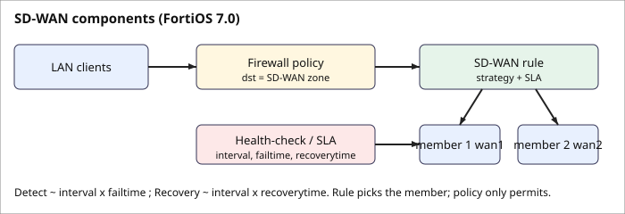

# Enterprise Network & Security Engineering — دوره‌ی تخصصی Cisco و Enterprise Firewall
## بخش ۷ از ۱۱ — فصل‌های ۱۹ تا ۲۱

| مورد | مقدار |
|---|---|
| نام دوره | Enterprise Network & Security Engineering (Cisco + FortiGate) |
| شماره بخش | ۷ از ۱۱ |
| فصل‌های این فایل | ۱۹ ، ۲۰ ، ۲۱ |
| تاریخ تولید | ۲۰۲۶-۱۱-۲۶ |
| نسخه Blueprint | v3.0 (+ بازبینی ۱٫۱) |
| نسخه‌های نرم‌افزار | FortiOS 7.0.3 (اسمی؛ بوت‌نشده؛ تأیید با `get system status`) ؛ Cisco vIOS-L2 15.2(20200924، Experimental) ؛ Cisco vIOS 15.9(3)M9 ؛ VPCS ؛ PNetLab 4.2.8 ؛ ESXi 8.0U2 ؛ CSR1000v 17.03.02 (IOS-XE؛ آزمایش‌نشده) |
| وضعیت تکمیل | **فصل‌های ۱۹–۲۱ تولید شد؛ Hub-and-Spoke، Remote Access، Dual-ISP/SD-WAN.** Labها «اجرا نشده»؛ SSL VPN فقط ایزوله به‌دلیل CVE؛ دستورها آزمایش‌نشده. |

> **قوانین خواندن:** تمرین‌ها و پرسش‌های مرور بدون پاسخ‌اند؛ پاسخ در «پاسخ‌های فصل». «اجرا نشده» یعنی خروجی‌ها **پیش‌نیاز/پیش‌بینی** هستند. «CLI-Accepted» ≠ «کار می‌کند». رمزها نمونه‌اند.

### وضعیت راستی‌آزمایی Labهای این بخش
خلاصه: اجرا نشده (فقط طراحی): 16.

| Lab | وضعیت |
|---|---|
| 19-1 | اجرا نشده (فقط طراحی) |
| 19-2 | اجرا نشده (فقط طراحی) |
| 19-3 | اجرا نشده (فقط طراحی) |
| 19-4 | اجرا نشده (فقط طراحی) |
| 19-5 | اجرا نشده (فقط طراحی) |
| 19-6 | اجرا نشده (فقط طراحی) |
| 20-1 | اجرا نشده (فقط طراحی) |
| 20-2 | اجرا نشده (فقط طراحی) |
| 20-3 | اجرا نشده (فقط طراحی) |
| 20-4 | اجرا نشده (فقط طراحی) |
| 20-5 | اجرا نشده (فقط طراحی) |
| 21-1 | اجرا نشده (فقط طراحی) |
| 21-2 | اجرا نشده (فقط طراحی) |
| 21-3 | اجرا نشده (فقط طراحی) |
| 21-4 | اجرا نشده (فقط طراحی) |
| 21-5 | اجرا نشده (فقط طراحی) |

---

<a id="ch19"></a>

> **نسخه‌ی اصلاح‌شده (v3.4):** نسخه‌ی توسعه‌یافته‌ی فایل اصلی؛ درس‌های افزوده: ۲۰-۷، ۲۱-۷ (دسته C). فایل اصلی در `course/` حفظ شده است. پاسخ‌های درس‌های افزوده در «پاسخ‌های فصل» همان فصل است.

# فصل 19 — Hub-and-Spoke، OSPF/BGP روی FortiGate و Local Breakout

**مدت:** ۳۶ ساعت | **پیش‌نیاز:** فصل ۹، ۱۸.
**اهداف:** توپولوژی Hub-and-Spoke با چند Tunnel؛ Routing پویا (OSPF/BGP) روی Tunnel؛ Local Breakout؛ معماری ۴ (چندشعبه). Gate: چهار شعبه از مسیر Hub ارتباط دارند و قطع یک Tunnel بقیه را نمی‌شکند.
**نسخه:** FortiOS 7.0.3 اسمی؛ دستورها آزمایش‌نشده؛ ADVPN در `Unverified`.
**اشتباهات رایج:** Route Overlap؛ فراموشی `net-device`/IP Tunnel؛ Policy بین Spokeها؛ Loop مسیر.

**درس‌های فصل:**
- [درس 19-1 — طراحی Hub-and-Spoke و IP Plan](#l-19-1)
- [درس 19-2 — ساخت Tunnelهای Spoke و OSPF روی Tunnel](#l-19-2)
- [درس 19-3 — BGP روی FortiGate و Failover مسیر](#l-19-3)
- [درس 19-4 — Local Breakout و Policy اینترنت شعبه](#l-19-4)
- [درس 19-5 — ADVPN (مفهومی) و مقیاس‌پذیری](#l-19-5)
- [درس 19-6 — معماری ۴: چندشعبه و آزمون فصل](#l-19-6)

---

<a id="l-19-1"></a>

## درس 19-0 — طراحی Overlay چندشعبه: Hub-and-Spoke، Routing پویا روی Tunnel و ADVPN

**فصل ۱۹ · درس افزوده (پیش‌درس ۱۹-۱) · پیش‌نیاز: ۱۸-۰، ۹-۰، ۹-۷، ۵-۷ · ≈ ۸ ساعت**

> **وضعیت (FortiOS 7.0):** نکات ADVPN/BGP از مستند رسمی ([ADVPN and shortcut paths 7.0.9](https://docs.fortinet.com/document/fortigate/7.0.9/administration-guide/985659/advpn-and-shortcut-paths)، [ADVPN with BGP](https://docs.fortinet.com/document/fortigate/7.0.1/administration-guide/820072/advpn-with-bgp-as-the-routing-protocol)) بررسی شد. سینتکس روی 7.0.3 `Unverified`؛ برخی گزینه‌ها (مثل Shortcut Override) از 7.0.4 آمده‌اند. Lab «اجرا نشده».

### ۱) هدف آموزشی

1. Overlay و Underlay را تفکیک و **توپولوژی‌های Full-mesh، Hub-and-Spoke و ADVPN** را مقایسه کند.
2. **Routing پویا** (BGP/OSPF) روی Tunnel طراحی کند و تفاوت **iBGP/eBGP** و نقش **Route Reflector** را بگوید.
3. IP Plan بدون Overlap، **Tunnel Interface IP** و **net-device** را درست تنظیم کند.
4. ADVPN را (در صورت پشتیبانی نسخه) با Sender/Receiver و Shortcut بفهمد.
5. رفتار شبکه را هنگام خرابی Tunnel/Hub تحلیل (Convergence) و Failover را طراحی کند.
6. **Local Breakout** را در برابر مسیر مرکزی (Backhaul) با معیار امنیت/Performance انتخاب کند.

### ۲) پیش‌نیازها

IPsec (۱۸-۰)، BGP (۹-۰، ۹-۷)، Convergence (۵-۷)، Packet Flow (۱۲-۰)، SD-WAN (۲۱-۷ برای ترکیب).

### ۳) مفهوم پایه

شرکتی با ۲۰ شعبه: Full-mesh یعنی ۱۹۰ Tunnel (n(n−1)/2) که مقیاس‌پذیر نیست. **Hub-and-Spoke:** هر شعبه (Spoke) فقط به مرکز (Hub) Tunnel دارد؛ ترافیک شعبه‌به‌شعبه از Hub می‌گذرد (ساده، مرکزی برای Policy/Inspection، ولی تأخیر و بار روی Hub). **ADVPN:** در Hub-and-Spoke، Spokeها در صورت نیاز **Tunnel مستقیم (Shortcut)** بین هم می‌سازند.

### ۴) توضیح عمیق فنی

#### ۴-۱) مقایسه

| الگو | تعداد Tunnel (n شعبه) | مزیت | عیب |
|---|---|---|---|
| Full-mesh | n(n−1)/2 | کمترین تأخیر | پیچیده/غیرمقیاس‌پذیر |
| Hub-and-Spoke | n (به Hub) | ساده، کنترل مرکزی | Hub گلوگاه/SPOF؛ تأخیر Spoke-to-Spoke |
| ADVPN | n + Shortcutهای پویا | ترکیب مزایا | وابسته به نسخه، پیچیده‌تر |

``` text
Full-mesh tunnels = n(n-1)/2     example: n=20 -> 190
```

#### ۴-۲) Routing روی Tunnel

- **Static** برای شعب کم؛ **OSPF** (point-to-point) یا **BGP** برای مقیاس و Failover.
- **BGP** معمولاً توصیه می‌شود: مقیاس‌پذیر، کنترل Policy. طبق مستند ADVPN: بین Hub و Spokeها **iBGP** استفاده می‌شود؛ Hub می‌تواند **Route Reflector** باشد و Neighbor-group/neighbor-range روی Subnet تونل تعریف کند تا Spokeهای جدید بدون تغییر Hub اضافه شوند.
- IP روی Tunnel: برای Peering BGP (/32 روی Tunnel یا Loopback). Loopback Peering نیاز به Route Static/IKE-installed برای رسیدن به Loopback دارد.
- **Selector** Phase 2: 0.0.0.0/0 تا Routing تصمیم بگیرد (۱۸-۰).

#### ۴-۳) نکات اجرایی

- `net-device`: طبق مستند ADVPN با BGP، روی Hub باید `set net-device disable` (Phase 1) باشد تا یک Interface برای همه‌ی Spokeها و Peering درست کار کند.
- **Route Overlap:** Subnet هر شعبه یکتا (IP Plan فصل ۲).
- **Policy:** Tunnel↔LAN دوطرفه؛ برای Spoke-to-Spoke از Hub: Policy Tunnel→Tunnel روی Hub.
- **Anti-loop:** BGP AS_PATH/Route Reflector؛ OSPF Area.

#### ۴-۴) ADVPN (7.0)

طبق مستند: Hub Phase 1: `set auto-discovery-sender enable`؛ Spoke: `set auto-discovery-receiver enable`. Spoke A→Spoke B: ترافیک اول از Hub؛ Hub به A و B اطلاع می‌دهد (Shortcut)؛ A و B Tunnel مستقیم می‌سازند و Routeها/Next-hop به‌روز می‌شوند. مستند می‌گوید **GUI برخی گزینه‌های ADVPN را ندارد** و فقط CLI. در 7.0.4 «shortcut override» و «tag-match» برای کنترل بهتر نیز آمده است.

#### ۴-۵) Local Breakout در برابر Backhaul

| | Backhaul (همه به Hub) | Local Breakout |
|---|---|---|
| امنیت | Inspection یکپارچه | هر شعبه باید UTM داشته باشد |
| Performance | تأخیر/بار Hub | سریع |
| هزینه | پهنای Hub زیاد | ISP محلی |
| سیاست | یکسان | ممکن است ناهمگون |

معمول: سازمانی ← Tunnel؛ SaaS/اینترنت ← Local Breakout با UTM و SD-WAN (۲۱-۷).

#### ۴-۶) خرابی و Convergence

- قطع Tunnel Spoke–Hub: Hub مسیر را پس از Detect (DPD/BGP Hold/BFD) حذف می‌کند.
- Spoke با دو Hub: Failover بین Hubها (Local-pref/MED).
- Hub fail: Hub دوم + HA؛ زمان Convergence ≈ Detect + BGP.

### ۵) مثال حل‌شده

**نیاز:** 1 Hub (AS 65000) + Spoke1/Spoke2؛ BGP iBGP. Hub: `set auto-discovery-sender enable`، `set net-device disable`؛ Spokeها: `set auto-discovery-receiver enable`.

``` text
# HUB (sketch)
config vpn ipsec phase1-interface
    edit "HUB-TUN"
        set type dynamic
        set auto-discovery-sender enable
        set net-device disable
        set add-route disable
    next
end
config router bgp
    set as 65000
    config neighbor-group
        edit "SPOKES"
            set remote-as 65000
            set route-reflector-client enable
        next
    end
    config neighbor-range
        edit 1
            set prefix 10.255.0.0 255.255.255.0
            set neighbor-group "SPOKES"
        next
    end
end
```

(سینتکس برگرفته از ساختار مستند 7.0.9؛ جزئیات `Unverified` روی 7.0.3.)

**مثال متوسط:** قطع Tunnel Spoke1: `get router info bgp summary` همسایه Idle؛ Route شعبه از جدول حذف؛ شعب دیگر دیگر ترافیک را به Spoke1 نمی‌فرستند.

**مثال سخت:** ترافیک Spoke1→Spoke2 از Hub می‌گذرد و کند است. با ADVPN Shortcut ساخته می‌شود؛ ولی Shortcut ساخته نشد: بررسی: Sender/Receiver، Policy Spoke→Spoke، Route Next-hop. شاهد: `diagnose vpn tunnel list`.

### ۶) طراحی و تصمیم‌گیری

| سؤال | تصمیم |
|---|---|
| تعداد شعب | ≤ ۵: Static/OSPF؛ بیشتر: BGP |
| Hub تکی/دوتایی | دوتایی برای SLA بالا |
| ADVPN | وقتی ترافیک Spoke-to-Spoke زیاد و نسخه پشتیبانی کند |
| Breakout | محلی با UTM برای SaaS |
| Subnet | Summarize و یکتا |

### ۷) GUI و CLI (Verification)

**GUI:** VPN → IPsec Tunnels؛ Network → BGP/OSPF؛ Monitor → IPsec Monitor؛ Routing Monitor. **CLI:**

``` text
get router info bgp summary
get router info routing-table all
diagnose vpn tunnel list
diagnose vpn ike gateway list
```

### ۸) Troubleshooting

| علامت | علت |
|---|---|
| BGP Active | Policy/Route Peer، AS، `net-device` |
| Route نمی‌آید | Filter/RR/Next-hop |
| Spoke-to-Spoke کند | ADVPN فعال نشده/Policy |
| شعبه‌ی جدید وصل نمی‌شود | neighbor-range/Phase 1 dynamic |

### ۹) نکات امنیتی

- Hub هدف حمله است؛ Patch و محدودیت Source.
- Policy Spoke-to-Spoke را حداقلی بنویسید.
- Local Breakout بدون UTM = حفره.

### ۱۰) جمع‌بندی مفهومی

- Full-mesh n(n−1)/2؛ Hub-and-Spoke n؛ ADVPN ترکیب.
- BGP iBGP با RR برای مقیاس.
- IP Plan یکتا؛ Selector باز؛ Policy دوطرفه.
- ADVPN وابسته به نسخه؛ GUI محدود.
- Backhaul در برابر Breakout: امنیت در برابر Performance.

### ۱۱) تمرین و ارزیابی

**ت1.** (ساده) تعداد Tunnel Full-mesh برای ۲۰ شعبه؟ *(پاسخ: 19-0-ت1)*

**ت2.** (ساده) Overlay و Underlay چیست؟ *(پاسخ: 19-0-ت2)*

**ت3.** (متوسط) چرا BGP برای شعب زیاد بهتر از Static؟ *(پاسخ: 19-0-ت3)*

**ت4.** (متوسط) نقش Route Reflector در Hub چیست؟ *(پاسخ: 19-0-ت4)*

**ت5.** (سخت) ADVPN چگونه Spoke-to-Spoke را بهینه می‌کند و چه پیش‌نیازهایی دارد؟ *(پاسخ: 19-0-ت5)*

**ت6.** (سخت، طراحی) برای ۱۰ شعبه با دو Hub، Failover و Breakout را طراحی کنید. *(پاسخ: 19-0-ت6)*

**Q1.** Quick quiz (English): What is the main drawback of pure hub-and-spoke for spoke-to-spoke traffic? *(پاسخ: 19-0-Q1)*

### ۱۲) اصطلاحات و English Corner

| مخفف | شکل کامل | معنی |
|---|---|---|
| ADVPN | Auto-Discovery VPN | Tunnel پویای Spoke-to-Spoke |
| RR | Route Reflector | بازتاب‌دهنده‌ی مسیر |
| Overlay | Overlay network | شبکه‌ی روی ISP |
| Breakout | Local internet breakout | خروج محلی |

- *Use dynamic routing over tunnels for scalability.* ← برای مقیاس‌پذیری از Routing پویا روی Tunnel استفاده کنید.
- *ADVPN builds on-demand shortcuts between spokes.* ← ADVPN بین Spokeها Shortcut سفارشی می‌سازد.

### ۱۳) منابع

- Fortinet Docs: [ADVPN and shortcut paths](https://docs.fortinet.com/document/fortigate/7.0.9/administration-guide/985659/advpn-and-shortcut-paths)، [ADVPN with BGP](https://docs.fortinet.com/document/fortigate/7.0.1/administration-guide/820072/advpn-with-bgp-as-the-routing-protocol)، [Enhanced BGP next hop updates and ADVPN shortcut override 7.0.4](https://docs.fortinet.com/document/fortigate/7.0.0/new-features/245878/enhanced-bgp-next-hop-updates-and-advpn-shortcut-override-7-0-4).

## درس 19-1 — طراحی Hub-and-Spoke و IP Plan

**فصل 19 - روز 1 · پیش‌نیاز: فصل ۱۸ · ۶ ساعت**

### ۱) معرفی درس

قبل از پیکربندی طراحی: چند Tunnel، IP Tunnel و Subnet.

### ۲) پیش‌نیازها

فصل ۱۸

### ۳) توضیح مفهومی

- Hub مرکز؛ Spokeها شعبه.
- هر Tunnel IP نقطه‌به‌نقطه (/30 یا /32).
- Subnet هر شعبه بدون Overlap.
- ترافیک Spoke-to-Spoke از Hub.
- جدول IP Plan.

### ۴) مثال ساده

سه شعبه به یک مرکز.

### ۵) مثال سازمانی

سازمان: چند شعبه با Routing پویا و اینترنت محلی.

### ۶) تصویر و توپولوژی

```text
Spoke1/Spoke2 ==IPsec== Hub (OSPF/BGP)
```

### ۷) پیکربندی (GUI و CLI)

> نسخه‌ی هدف: FortiOS 7.0.3 (اسمی؛ از نام Image؛ بوت‌نشده؛ تأیید با `get system status`). دستورها/منوها از مستند عمومی FortiOS 7.0 و دانش مؤلف هستند و **روی Image شما هنوز آزمایش نشده‌اند**؛ در بوت اول مقایسه کنید.

#### روش گرافیکی (GUI)

1. Network > Interfaces: Tunnelها.

#### روش خط فرمان (CLI)

```text
get router info routing-table all
```

**توضیح دستورها (چه / چرا / خروجی / راستی‌آزمایی / بازگشت):**

- خواندنی؛ ایمن.

### ۸) تست عملکرد

- IP Plan را کامل کنید.

### ۹) عیب‌یابی

| بخش | شرح |
|---|---|
| Symptom | Overlap |
| شواهد/دستور | Routing table |
| علت | Subnet تکراری |
| رفع | تغییر Subnet |

### ۱۰) تمرین مستقل

> پاسخ‌ها در بخش «پاسخ‌های فصل» انتهای فصل است؛ اول خودتان حل کنید.

**ت1.** چرا Overlap بد است؟ *(پاسخ: 19-1-ت1)*

**ت2.** Spoke-to-Spoke؟ *(پاسخ: 19-1-ت2)*

### ۱۱) مرور و ارزیابی

**م1.** چرا IP Plan؟ *(پاسخ: 19-1-م1)*

**م2.** سناریو: دو شعبه 10.1.1.0/24؛ چه می‌کنید؟ *(پاسخ: 19-1-م2)*

**معیار تسلط:** ساخت Hub-and-Spoke و Routing.

**اشتباهات رایج:** Overlap و Policy.

### ۱۲) واژگان و English Corner

| واژه | شکل کامل | معنی | کاربرد واقعی |
|---|---|---|---|
| Hub | Hub site | سایت مرکزی | VPN |
| Spoke | Spoke site | سایت شعبه | VPN |

| English sentence | ترجمه |
|---|---|
| Plan the addressing before building tunnels. | قبل از ساخت Tunnel آدرس‌دهی را برنامه‌ریزی کنید. |

#### کارت Lab — درس 19-1

| # | فیلد | محتوا |
|---|---|---|
| 1 | عنوان و هدف | IP Plan Hub |
| 2 | پیش‌نیاز | فصل ۱۸ |
| 3 | توپولوژی | — |
| 4 | تجهیزات | — |
| 5 | نسخه نرم‌افزار | FortiOS 7.0.3 (اسمی؛ از نام Image؛ بوت‌نشده؛ تأیید با `get system status`) |
| 6 | IP Plan | — |
| 7 | وضعیت اولیه | — |
| 8 | صورت مسئله | جدول |
| 9 | مراحل هدایت‌شده | بخش‌های ۷ و ۸ همین درس (گام‌به‌گام) |
| 10 | تست عملکرد | — |
| 11 | سناریوی خرابی | Overlap |
| 12 | روش عیب‌یابی | بخش ۹ همین درس (لایه‌ای/با شواهد) |
| 13 | نتیجه‌ی مورد انتظار | سند |
| 14 | معیار پذیرش | تأیید |
| 15 | مستندات نهایی | `02-design/hub-spoke-plan.md` |
| 16 | Cleanup و بازگردانی | — |

> **وضعیت راستی‌آزمایی (خارج از ۱۶ فیلد):** **اجرا نشده (فقط طراحی).** Image FortiGate هنوز بوت نشده؛ دستورها/منوها آزمایش‌نشده‌اند.

---

<a id="l-19-2"></a>

## درس 19-2 — ساخت Tunnelهای Spoke و OSPF روی Tunnel

**فصل 19 - روز 2 · پیش‌نیاز: درس ۱۹-۰ · ۶ ساعت**

### ۱) معرفی درس

Tunnel بین Hub و هر Spoke و Routing پویا.

### ۲) پیش‌نیازها

درس ۱۹-۰

### ۳) توضیح مفهومی

- Phase1/2 مانند فصل ۱۸ با Selector 0.0.0.0/0.
- IP روی Tunnel (`config system interface` روی tunnel).
- OSPF روی Tunnel: Network Type point-to-point.
- Policy: Tunnel <-> LAN.
- تأیید: `get router info ospf neighbor`.

### ۴) مثال ساده

سه شعبه به یک مرکز.

### ۵) مثال سازمانی

سازمان: چند شعبه با Routing پویا و اینترنت محلی.

### ۶) تصویر و توپولوژی

```text
Spoke1/Spoke2 ==IPsec== Hub (OSPF/BGP)
```

### ۷) پیکربندی (GUI و CLI)

> نسخه‌ی هدف: FortiOS 7.0.3 (اسمی؛ از نام Image؛ بوت‌نشده؛ تأیید با `get system status`). دستورها/منوها از مستند عمومی FortiOS 7.0 و دانش مؤلف هستند و **روی Image شما هنوز آزمایش نشده‌اند**؛ در بوت اول مقایسه کنید.

#### روش گرافیکی (GUI)

1. Network > OSPF: Area و Networks.
2. Network > Interfaces: IP Tunnel.

#### روش خط فرمان (CLI)

```text
config router ospf
    set router-id 10.255.0.1
    config area
        edit 0.0.0.0
        next
    end
    config network
        edit 1
            set prefix 10.255.1.0 255.255.255.0
        next
    end
    config ospf-interface
        edit "TO-SPOKE1"
            set interface "TO-SPOKE1"
            set network-type point-to-point
        next
    end
end
get router info ospf neighbor
```

**توضیح دستورها (چه / چرا / خروجی / راستی‌آزمایی / بازگشت):**

- `Unverified` روی Image.
- Selector 0.0.0.0/0 برای Routing پویا.

### ۸) تست عملکرد

- Neighbor Full.

### ۹) عیب‌یابی

| بخش | شرح |
|---|---|
| Symptom | Neighbor نمی‌آید |
| شواهد/دستور | `ospf neighbor` خالی |
| علت | Policy/Network Type |
| رفع | اصلاح |

### ۱۰) تمرین مستقل

> پاسخ‌ها در بخش «پاسخ‌های فصل» انتهای فصل است؛ اول خودتان حل کنید.

**ت1.** Selector برای پویا؟ *(پاسخ: 19-2-ت1)*

**ت2.** network-type؟ *(پاسخ: 19-2-ت2)*

### ۱۱) مرور و ارزیابی

**م1.** چرا Policy برای OSPF؟ *(پاسخ: 19-2-م1)*

**م2.** سناریو: Neighbor Init؛ علت؟ *(پاسخ: 19-2-م2)*

**معیار تسلط:** ساخت Hub-and-Spoke و Routing.

**اشتباهات رایج:** Overlap و Policy.

### ۱۲) واژگان و English Corner

| واژه | شکل کامل | معنی | کاربرد واقعی |
|---|---|---|---|
| OSPF | Open Shortest Path First | پروتکل مسیریابی | Routing |

| English sentence | ترجمه |
|---|---|
| Allow OSPF through the tunnel policy. | OSPF را در Policy تونل مجاز کنید. |

#### کارت Lab — درس 19-2

| # | فیلد | محتوا |
|---|---|---|
| 1 | عنوان و هدف | OSPF Tunnel |
| 2 | پیش‌نیاز | درس ۱۹-۰ |
| 3 | توپولوژی | Hub+Spoke1 |
| 4 | تجهیزات | FGT |
| 5 | نسخه نرم‌افزار | FortiOS 7.0.3 (اسمی؛ از نام Image؛ بوت‌نشده؛ تأیید با `get system status`) |
| 6 | IP Plan | — |
| 7 | وضعیت اولیه | Tunnel |
| 8 | صورت مسئله | OSPF |
| 9 | مراحل هدایت‌شده | بخش‌های ۷ و ۸ همین درس (گام‌به‌گام) |
| 10 | تست عملکرد | get ospf |
| 11 | سناریوی خرابی | Neighbor نمی‌آید |
| 12 | روش عیب‌یابی | بخش ۹ همین درس (لایه‌ای/با شواهد) |
| 13 | نتیجه‌ی مورد انتظار | Neighbor Full |
| 14 | معیار پذیرش | ثبت |
| 15 | مستندات نهایی | `03-ops/ospf-tunnel.md` |
| 16 | Cleanup و بازگردانی | حذف |

> **وضعیت راستی‌آزمایی (خارج از ۱۶ فیلد):** **اجرا نشده (فقط طراحی).** Image FortiGate هنوز بوت نشده؛ دستورها/منوها آزمایش‌نشده‌اند.

---

<a id="l-19-3"></a>

## درس 19-3 — BGP روی FortiGate و Failover مسیر

**فصل 19 - روز 3 · پیش‌نیاز: درس ۱۹-۱ · ۶ ساعت**

### ۱) معرفی درس

BGP برای مقیاس و کنترل Policy.

### ۲) پیش‌نیازها

درس ۱۹-۱

### ۳) توضیح مفهومی

- iBGP/eBGP روی Tunnel.
- `config router bgp`: AS، Neighbor، Network.
- Prefer path با `local-pref`/`med`.
- Failover: قطع Tunnel، مسیر پشتیبان.
- تأیید: `get router info bgp summary`.

### ۴) مثال ساده

سه شعبه به یک مرکز.

### ۵) مثال سازمانی

سازمان: چند شعبه با Routing پویا و اینترنت محلی.

### ۶) تصویر و توپولوژی

```text
Spoke1/Spoke2 ==IPsec== Hub (OSPF/BGP)
```

### ۷) پیکربندی (GUI و CLI)

> نسخه‌ی هدف: FortiOS 7.0.3 (اسمی؛ از نام Image؛ بوت‌نشده؛ تأیید با `get system status`). دستورها/منوها از مستند عمومی FortiOS 7.0 و دانش مؤلف هستند و **روی Image شما هنوز آزمایش نشده‌اند**؛ در بوت اول مقایسه کنید.

#### روش گرافیکی (GUI)

1. Network > BGP.

#### روش خط فرمان (CLI)

```text
config router bgp
    set as 65001
    config neighbor
        edit "10.255.1.2"
            set remote-as 65001
        next
    end
    config network
        edit 1
            set prefix 192.168.10.0 255.255.255.0
        next
    end
end
get router info bgp summary
```

**توضیح دستورها (چه / چرا / خروجی / راستی‌آزمایی / بازگشت):**

- AS نمونه خصوصی.
- `Unverified` روی Image.

### ۸) تست عملکرد

- Neighbor Established.

### ۹) عیب‌یابی

| بخش | شرح |
|---|---|
| Symptom | Neighbor Active |
| شواهد/دستور | `bgp summary` |
| علت | Policy/AS |
| رفع | اصلاح |

### ۱۰) تمرین مستقل

> پاسخ‌ها در بخش «پاسخ‌های فصل» انتهای فصل است؛ اول خودتان حل کنید.

**ت1.** iBGP؟ *(پاسخ: 19-3-ت1)*

**ت2.** local-pref؟ *(پاسخ: 19-3-ت2)*

### ۱۱) مرور و ارزیابی

**م1.** چرا BGP؟ *(پاسخ: 19-3-م1)*

**م2.** سناریو: Active؛ بررسی؟ *(پاسخ: 19-3-م2)*

**معیار تسلط:** ساخت Hub-and-Spoke و Routing.

**اشتباهات رایج:** Overlap و Policy.

### ۱۲) واژگان و English Corner

| واژه | شکل کامل | معنی | کاربرد واقعی |
|---|---|---|---|
| BGP | Border Gateway Protocol | مسیریابی بین AS | Routing |
| AS | Autonomous System | سیستم خودمختار | BGP |

| English sentence | ترجمه |
|---|---|
| Verify TCP 179 is reachable. | دسترسی TCP 179 را بررسی کنید. |

#### کارت Lab — درس 19-3

| # | فیلد | محتوا |
|---|---|---|
| 1 | عنوان و هدف | BGP Tunnel |
| 2 | پیش‌نیاز | درس ۱۹-۱ |
| 3 | توپولوژی | Hub+Spoke |
| 4 | تجهیزات | FGT |
| 5 | نسخه نرم‌افزار | FortiOS 7.0.3 (اسمی؛ از نام Image؛ بوت‌نشده؛ تأیید با `get system status`) |
| 6 | IP Plan | — |
| 7 | وضعیت اولیه | Tunnel |
| 8 | صورت مسئله | BGP |
| 9 | مراحل هدایت‌شده | بخش‌های ۷ و ۸ همین درس (گام‌به‌گام) |
| 10 | تست عملکرد | get bgp |
| 11 | سناریوی خرابی | Neighbor Active |
| 12 | روش عیب‌یابی | بخش ۹ همین درس (لایه‌ای/با شواهد) |
| 13 | نتیجه‌ی مورد انتظار | Established |
| 14 | معیار پذیرش | ثبت |
| 15 | مستندات نهایی | `03-ops/bgp-tunnel.md` |
| 16 | Cleanup و بازگردانی | حذف |

> **وضعیت راستی‌آزمایی (خارج از ۱۶ فیلد):** **اجرا نشده (فقط طراحی).** Image FortiGate هنوز بوت نشده؛ دستورها/منوها آزمایش‌نشده‌اند.

---

<a id="l-19-4"></a>

## درس 19-4 — Local Breakout و Policy اینترنت شعبه

**فصل 19 - روز 4 · پیش‌نیاز: درس ۱۹-۲ · ۶ ساعت**

### ۱) معرفی درس

هر شعبه مستقیم به اینترنت (بدون عبور از Hub).

### ۲) پیش‌نیازها

درس ۱۹-۲

### ۳) توضیح مفهومی

- Breakout محلی: Default Route به WAN شعبه.
- Policy LAN->WAN با NAT.
- تفکیک ترافیک سازمانی (Tunnel) و اینترنتی.
- اثر امنیتی: UTM در هر شعبه.
- هزینه/پهنای‌باند.

### ۴) مثال ساده

سه شعبه به یک مرکز.

### ۵) مثال سازمانی

سازمان: چند شعبه با Routing پویا و اینترنت محلی.

### ۶) تصویر و توپولوژی

```text
Spoke1/Spoke2 ==IPsec== Hub (OSPF/BGP)
```

### ۷) پیکربندی (GUI و CLI)

> نسخه‌ی هدف: FortiOS 7.0.3 (اسمی؛ از نام Image؛ بوت‌نشده؛ تأیید با `get system status`). دستورها/منوها از مستند عمومی FortiOS 7.0 و دانش مؤلف هستند و **روی Image شما هنوز آزمایش نشده‌اند**؛ در بوت اول مقایسه کنید.

#### روش گرافیکی (GUI)

1. Network > Static Routes.
2. Policy: LAN->WAN NAT.

#### روش خط فرمان (CLI)

```text
config router static
    edit 1
        set gateway 203.0.113.254
        set device "port1"
    next
end
```

**توضیح دستورها (چه / چرا / خروجی / راستی‌آزمایی / بازگشت):**

- Default Route محلی.
- راستی‌آزمایی: traceroute.

### ۸) تست عملکرد

- اینترنت شعبه محلی.

### ۹) عیب‌یابی

| بخش | شرح |
|---|---|
| Symptom | اینترنت از Hub می‌رود |
| شواهد/دستور | traceroute |
| علت | Default Route اشتباه |
| رفع | اصلاح |

### ۱۰) تمرین مستقل

> پاسخ‌ها در بخش «پاسخ‌های فصل» انتهای فصل است؛ اول خودتان حل کنید.

**ت1.** Breakout چیست؟ *(پاسخ: 19-4-ت1)*

**ت2.** چرا UTM محلی؟ *(پاسخ: 19-4-ت2)*

### ۱۱) مرور و ارزیابی

**م1.** چرا Breakout؟ *(پاسخ: 19-4-م1)*

**م2.** سناریو: اینترنت کند؛ علت؟ *(پاسخ: 19-4-م2)*

**معیار تسلط:** ساخت Hub-and-Spoke و Routing.

**اشتباهات رایج:** Overlap و Policy.

### ۱۲) واژگان و English Corner

| واژه | شکل کامل | معنی | کاربرد واقعی |
|---|---|---|---|
| Breakout | Local internet breakout | خروج محلی | WAN |

| English sentence | ترجمه |
|---|---|
| Use local breakout to reduce latency. | برای کاهش تأخیر از خروج محلی استفاده کنید. |

#### کارت Lab — درس 19-4

| # | فیلد | محتوا |
|---|---|---|
| 1 | عنوان و هدف | Breakout |
| 2 | پیش‌نیاز | درس ۱۹-۲ |
| 3 | توپولوژی | Spoke |
| 4 | تجهیزات | FGT |
| 5 | نسخه نرم‌افزار | FortiOS 7.0.3 (اسمی؛ از نام Image؛ بوت‌نشده؛ تأیید با `get system status`) |
| 6 | IP Plan | — |
| 7 | وضعیت اولیه | Tunnel |
| 8 | صورت مسئله | Breakout |
| 9 | مراحل هدایت‌شده | بخش‌های ۷ و ۸ همین درس (گام‌به‌گام) |
| 10 | تست عملکرد | traceroute |
| 11 | سناریوی خرابی | اینترنت از Hub می‌رود |
| 12 | روش عیب‌یابی | بخش ۹ همین درس (لایه‌ای/با شواهد) |
| 13 | نتیجه‌ی مورد انتظار | محلی |
| 14 | معیار پذیرش | ثبت |
| 15 | مستندات نهایی | `03-ops/breakout.md` |
| 16 | Cleanup و بازگردانی | حذف |

> **وضعیت راستی‌آزمایی (خارج از ۱۶ فیلد):** **اجرا نشده (فقط طراحی).** Image FortiGate هنوز بوت نشده؛ دستورها/منوها آزمایش‌نشده‌اند.

---

<a id="l-19-5"></a>

## درس 19-5 — ADVPN (مفهومی) و مقیاس‌پذیری

**فصل 19 - روز 5 · پیش‌نیاز: درس ۱۹-۳ · ۶ ساعت**

### ۱) معرفی درس

Spoke-to-Spoke مستقیم بدون عبور از Hub: ADVPN.

### ۲) پیش‌نیازها

درس ۱۹-۳

### ۳) توضیح مفهومی

- ADVPN: Tunnel پویا بین Spokeها.
- نیاز BGP/OSPF و تنظیمات `auto-discovery`.
- Needs-Lab: `Unverified`.
- مزیت/ریسک.
- مقایسه با Hub-only.

### ۴) مثال ساده

سه شعبه به یک مرکز.

### ۵) مثال سازمانی

سازمان: چند شعبه با Routing پویا و اینترنت محلی.

### ۶) تصویر و توپولوژی

```text
Spoke1/Spoke2 ==IPsec== Hub (OSPF/BGP)
```

### ۷) پیکربندی (GUI و CLI)

> نسخه‌ی هدف: FortiOS 7.0.3 (اسمی؛ از نام Image؛ بوت‌نشده؛ تأیید با `get system status`). دستورها/منوها از مستند عمومی FortiOS 7.0 و دانش مؤلف هستند و **روی Image شما هنوز آزمایش نشده‌اند**؛ در بوت اول مقایسه کنید.

#### روش گرافیکی (GUI)

1. VPN > IPsec Tunnels > Advanced.

#### روش خط فرمان (CLI)

```text
config vpn ipsec phase1-interface
    edit "HUB"
        set auto-discovery-sender enable
    next
end
```

**توضیح دستورها (چه / چرا / خروجی / راستی‌آزمایی / بازگشت):**

- فقط مفهوم؛ آزمایش‌نشده.

### ۸) تست عملکرد

- مقایسه را بنویسید.

### ۹) عیب‌یابی

| بخش | شرح |
|---|---|
| Symptom | ADVPN کار نمی‌کند |
| شواهد/دستور | Debug |
| علت | تنظیم اشتباه |
| رفع | بازبینی |

### ۱۰) تمرین مستقل

> پاسخ‌ها در بخش «پاسخ‌های فصل» انتهای فصل است؛ اول خودتان حل کنید.

**ت1.** ADVPN؟ *(پاسخ: 19-5-ت1)*

**ت2.** وضعیت؟ *(پاسخ: 19-5-ت2)*

### ۱۱) مرور و ارزیابی

**م1.** چرا ADVPN؟ *(پاسخ: 19-5-م1)*

**م2.** سناریو: Hub-only کافی است؟ *(پاسخ: 19-5-م2)*

**معیار تسلط:** ساخت Hub-and-Spoke و Routing.

**اشتباهات رایج:** Overlap و Policy.

### ۱۲) واژگان و English Corner

| واژه | شکل کامل | معنی | کاربرد واقعی |
|---|---|---|---|
| ADVPN | Auto-Discovery VPN | Tunnel پویا | VPN |

| English sentence | ترجمه |
|---|---|
| ADVPN is not verified in this lab. | ADVPN در این Lab تأیید نشده است. |

#### کارت Lab — درس 19-5

| # | فیلد | محتوا |
|---|---|---|
| 1 | عنوان و هدف | مقایسه ADVPN |
| 2 | پیش‌نیاز | درس ۱۹-۳ |
| 3 | توپولوژی | — |
| 4 | تجهیزات | — |
| 5 | نسخه نرم‌افزار | FortiOS 7.0.3 (اسمی؛ از نام Image؛ بوت‌نشده؛ تأیید با `get system status`) |
| 6 | IP Plan | — |
| 7 | وضعیت اولیه | — |
| 8 | صورت مسئله | سند |
| 9 | مراحل هدایت‌شده | بخش‌های ۷ و ۸ همین درس (گام‌به‌گام) |
| 10 | تست عملکرد | — |
| 11 | سناریوی خرابی | ADVPN کار نمی‌کند |
| 12 | روش عیب‌یابی | بخش ۹ همین درس (لایه‌ای/با شواهد) |
| 13 | نتیجه‌ی مورد انتظار | جدول |
| 14 | معیار پذیرش | تأیید |
| 15 | مستندات نهایی | `02-design/advpn.md` |
| 16 | Cleanup و بازگردانی | — |

> **وضعیت راستی‌آزمایی (خارج از ۱۶ فیلد):** **اجرا نشده (فقط طراحی).** Image FortiGate هنوز بوت نشده؛ دستورها/منوها آزمایش‌نشده‌اند.

---

<a id="l-19-6"></a>

## درس 19-6 — معماری ۴: چندشعبه و آزمون فصل

**فصل 19 - روز 6 · پیش‌نیاز: درس ۱۹-۴ · ۶ ساعت**

### ۱) معرفی درس

ترکیب: چهار شعبه، Routing پویا، Breakout.

### ۲) پیش‌نیازها

درس ۱۹-۴

### ۳) توضیح مفهومی

- چهار شعبه.
- قطع یک Tunnel.
- Routing همگرا.
- RCA.
- آزمون.

### ۴) مثال ساده

سه شعبه به یک مرکز.

### ۵) مثال سازمانی

سازمان: چند شعبه با Routing پویا و اینترنت محلی.

### ۶) تصویر و توپولوژی

```text
Spoke1/Spoke2 ==IPsec== Hub (OSPF/BGP)
```

### ۷) پیکربندی (GUI و CLI)

> نسخه‌ی هدف: FortiOS 7.0.3 (اسمی؛ از نام Image؛ بوت‌نشده؛ تأیید با `get system status`). دستورها/منوها از مستند عمومی FortiOS 7.0 و دانش مؤلف هستند و **روی Image شما هنوز آزمایش نشده‌اند**؛ در بوت اول مقایسه کنید.

#### روش گرافیکی (GUI)

1. Monitor > Routing.

#### روش خط فرمان (CLI)

```text
get router info routing-table all
get router info ospf neighbor
```

**توضیح دستورها (چه / چرا / خروجی / راستی‌آزمایی / بازگشت):**

- خواندنی.

### ۸) تست عملکرد

- قطع Tunnel و ثبت همگرایی.

### ۹) عیب‌یابی

| بخش | شرح |
|---|---|
| Symptom | همگرایی کند |
| شواهد/دستور | Routing table |
| علت | Timers |
| رفع | تنظیم |

### ۱۰) تمرین مستقل

> پاسخ‌ها در بخش «پاسخ‌های فصل» انتهای فصل است؛ اول خودتان حل کنید.

**ت1.** Gate معماری ۴؟ *(پاسخ: 19-6-ت1)*

**ت2.** همگرایی؟ *(پاسخ: 19-6-ت2)*

### ۱۱) مرور و ارزیابی

**م1.** چرا تست قطع؟ *(پاسخ: 19-6-م1)*

**م2.** سناریو: بعد از قطع مسیر نماند؛ علت؟ *(پاسخ: 19-6-م2)*

**معیار تسلط:** ساخت Hub-and-Spoke و Routing.

**اشتباهات رایج:** Overlap و Policy.

### ۱۲) واژگان و English Corner

| واژه | شکل کامل | معنی | کاربرد واقعی |
|---|---|---|---|
| Convergence | Convergence | همگرایی | Routing |

| English sentence | ترجمه |
|---|---|
| Test failover by cutting a tunnel. | Failover را با قطع Tunnel تست کنید. |

#### کارت Lab — درس 19-6

| # | فیلد | محتوا |
|---|---|---|
| 1 | عنوان و هدف | آزمون A4 |
| 2 | پیش‌نیاز | درس ۱۹-۴ |
| 3 | توپولوژی | Hub+Spokes |
| 4 | تجهیزات | FGT |
| 5 | نسخه نرم‌افزار | FortiOS 7.0.3 (اسمی؛ از نام Image؛ بوت‌نشده؛ تأیید با `get system status`) |
| 6 | IP Plan | — |
| 7 | وضعیت اولیه | Tunnel |
| 8 | صورت مسئله | Failover |
| 9 | مراحل هدایت‌شده | بخش‌های ۷ و ۸ همین درس (گام‌به‌گام) |
| 10 | تست عملکرد | ping |
| 11 | سناریوی خرابی | همگرایی کند |
| 12 | روش عیب‌یابی | بخش ۹ همین درس (لایه‌ای/با شواهد) |
| 13 | نتیجه‌ی مورد انتظار | ثبت |
| 14 | معیار پذیرش | ≥ ۴ از ۵ |
| 15 | مستندات نهایی | `03-ops/a4.md` |
| 16 | Cleanup و بازگردانی | — |

> **وضعیت راستی‌آزمایی (خارج از ۱۶ فیلد):** **اجرا نشده (فقط طراحی).** Image FortiGate هنوز بوت نشده؛ دستورها/منوها آزمایش‌نشده‌اند.

---

<a id="ans-19"></a>

## پاسخ‌های فصل 19

> ابتدا بدون نگاه حل کنید. شناسه: درس-نوع+شماره (ت = تمرین، م = مرور).

**19-1-ت1** — چرا Overlap بد است؟

مسیر مبهم.

**19-1-ت2** — Spoke-to-Spoke؟

از Hub.

**19-1-م1** — چرا IP Plan؟

جلوگیری از Overlap.

**19-1-م2** — سناریو: دو شعبه 10.1.1.0/24؛ چه می‌کنید؟

تغییر یا NAT.

**19-2-ت1** — Selector برای پویا؟

0.0.0.0/0.

**19-2-ت2** — network-type؟

point-to-point.

**19-2-م1** — چرا Policy برای OSPF؟

ترافیک Hello باید مجاز باشد.

**19-2-م2** — سناریو: Neighbor Init؛ علت؟

Policy یک‌طرفه.

**19-3-ت1** — iBGP؟

همان AS.

**19-3-ت2** — local-pref؟

ترجیح خروج.

**19-3-م1** — چرا BGP؟

مقیاس و Policy.

**19-3-م2** — سناریو: Active؛ بررسی؟

پورت 179 و AS.

**19-4-ت1** — Breakout چیست؟

خروج محلی.

**19-4-ت2** — چرا UTM محلی؟

کنترل در هر سایت.

**19-4-م1** — چرا Breakout؟

کاهش تأخیر/بار Hub.

**19-4-م2** — سناریو: اینترنت کند؛ علت؟

عبور از Hub.

**19-5-ت1** — ADVPN؟

Spoke-to-Spoke مستقیم.

**19-5-ت2** — وضعیت؟

Unverified.

**19-5-م1** — چرا ADVPN؟

کاهش بار Hub.

**19-5-م2** — سناریو: Hub-only کافی است؟

شعب کم: بله.

**19-6-ت1** — Gate معماری ۴؟

چهار شعبه+Failover.

**19-6-ت2** — همگرایی؟

Re-calc مسیر.

**19-6-م1** — چرا تست قطع؟

اثبات پایداری.

**19-6-م2** — سناریو: بعد از قطع مسیر نماند؛ علت؟

Backup Route.


---

<a id="ch20"></a>


### پاسخ‌های درس افزوده‌ی 19-0 (فصل 19)

**19-0-ت1** — 20×19/2 = 190 Tunnel.

**19-0-ت2** — Overlay شبکه‌ی Tunnel روی ISP؛ Underlay خود ISP و لینک‌های فیزیکی.

**19-0-ت3** — مقیاس‌پذیری، Failover خودکار و کنترل Policy؛ اضافه‌کردن شعبه بدون تغییر دستی همه‌ی مسیرها.

**19-0-ت4** — Hub Route Reflector مسیرهای iBGP را بین Spokeها بازتاب می‌دهد تا Full-mesh لازم نباشد.

**19-0-ت5** — Spoke-to-Spoke ابتدا از Hub؛ Hub به دو Spoke اطلاع می‌دهد و Shortcut مستقیم ساخته می‌شود. پیش‌نیاز: Sender روی Hub، Receiver روی Spoke، Routing/Policy مناسب و پشتیبانی نسخه.

**19-0-ت6** — دو Hub، BGP با Local-pref برای Hub اصلی، Failover خودکار، Breakout محلی با UTM برای SaaS، IP Plan یکتا.

**19-0-Q1** — Higher latency and load on the hub because spoke-to-spoke traffic must pass through it.

# فصل 20 — Remote Access VPN: SSL VPN (ایزوله) و Dial-up IPsec

**مدت:** ۳۶ ساعت | **پیش‌نیاز:** فصل ۱۷، ۱۸.
**اهداف:** دسترسی راه‌دور کاربران؛ SSL VPN Web/Tunnel؛ Dial-up IPsec؛ MFA مفهومی؛ Split Tunnel.
**هشدار امنیتی:** نسخه‌های 7.0.x دارای CVE شناخته‌شده در SSL VPN هستند (مثل CVE-2022-42475، CVE-2023-27997). **فقط در Lab ایزوله، بدون اتصال به اینترنت.** در تولید باید Patch شود. SSL VPN Tunnel ممکن است Needs-License باشد (`Unverified`).
**اشتباهات رایج:** باز گذاشتن SSL VPN روی WAN؛ بدون MFA؛ Split Tunnel بدون کنترل؛ Subnet Overlap با خانه.

**درس‌های فصل:**
- [درس 20-1 — مفاهیم Remote Access و ریسک](#l-20-1)
- [درس 20-2 — SSL VPN: Portal، Tunnel و Policy](#l-20-2)
- [درس 20-3 — Dial-up IPsec و Split Tunnel](#l-20-3)
- [درس 20-4 — MFA، ثبت رویداد و Hardening VPN](#l-20-4)
- [درس 20-5 — عیب‌یابی Remote Access و آزمون فصل](#l-20-5)

---

<a id="l-20-1"></a>

## درس 20-1 — مفاهیم Remote Access و ریسک

**فصل 20 - روز 1 · پیش‌نیاز: فصل ۱۸ · ۶ ساعت**

### ۱) معرفی درس

مقایسه SSL VPN و IPsec Dial-up و ریسک‌ها.

### ۲) پیش‌نیازها

فصل ۱۸

### ۳) توضیح مفهومی

- SSL VPN: Web/Tunnel Mode.
- IPsec Dial-up: با Client.
- ریسک: CVEهای شناخته‌شده؛ Patch.
- MFA ضروری.
- حداقل دسترسی (Least Privilege).

### ۴) مثال ساده

کارمند از خانه وصل می‌شود.

### ۵) مثال سازمانی

سازمان: دسترسی راه‌دور با MFA و حداقل دسترسی.

### ۶) تصویر و توپولوژی

```text
User -> Internet -> FGT SSL-VPN -> LAN
```

### ۷) پیکربندی (GUI و CLI)

> نسخه‌ی هدف: FortiOS 7.0.3 (اسمی؛ از نام Image؛ بوت‌نشده؛ تأیید با `get system status`). دستورها/منوها از مستند عمومی FortiOS 7.0 و دانش مؤلف هستند و **روی Image شما هنوز آزمایش نشده‌اند**؛ در بوت اول مقایسه کنید.

#### روش گرافیکی (GUI)

1. Dashboard > System Information.

#### روش خط فرمان (CLI)

```text
get system status
```

**توضیح دستورها (چه / چرا / خروجی / راستی‌آزمایی / بازگشت):**

- نسخه را ثبت و با Advisory مقایسه کنید.

### ۸) تست عملکرد

- جدول مقایسه SSL VPN و IPsec.

### ۹) عیب‌یابی

| بخش | شرح |
|---|---|
| Symptom | نسخه آسیب‌پذیر |
| شواهد/دستور | get system status |
| علت | نسخه قدیمی |
| رفع | Patch/ایزوله |

### ۱۰) تمرین مستقل

> پاسخ‌ها در بخش «پاسخ‌های فصل» انتهای فصل است؛ اول خودتان حل کنید.

**ت1.** چرا ایزوله؟ *(پاسخ: 20-1-ت1)*

**ت2.** MFA؟ *(پاسخ: 20-1-ت2)*

### ۱۱) مرور و ارزیابی

**م1.** چرا Patch؟ *(پاسخ: 20-1-م1)*

**م2.** سناریو: نسخه 7.0.3 در اینترنت؛ چه می‌کنید؟ *(پاسخ: 20-1-م2)*

**معیار تسلط:** تنظیم و تست VPN.

**اشتباهات رایج:** باز بودن بی‌دلیل.

### ۱۲) واژگان و English Corner

| واژه | شکل کامل | معنی | کاربرد واقعی |
|---|---|---|---|
| CVE | Common Vulnerabilities and Exposures | شناسه‌ی آسیب‌پذیری | امنیت |
| SSL VPN | SSL VPN | VPN مبتنی بر TLS | Remote |

| English sentence | ترجمه |
|---|---|
| Never expose an unpatched SSL VPN. | هرگز SSL VPN بدون Patch را در معرض قرار ندهید. |

#### کارت Lab — درس 20-1

| # | فیلد | محتوا |
|---|---|---|
| 1 | عنوان و هدف | مقایسه |
| 2 | پیش‌نیاز | فصل ۱۸ |
| 3 | توپولوژی | — |
| 4 | تجهیزات | — |
| 5 | نسخه نرم‌افزار | FortiOS 7.0.3 (اسمی؛ از نام Image؛ بوت‌نشده؛ تأیید با `get system status`) |
| 6 | IP Plan | — |
| 7 | وضعیت اولیه | — |
| 8 | صورت مسئله | جدول |
| 9 | مراحل هدایت‌شده | بخش‌های ۷ و ۸ همین درس (گام‌به‌گام) |
| 10 | تست عملکرد | — |
| 11 | سناریوی خرابی | نسخه آسیب‌پذیر |
| 12 | روش عیب‌یابی | بخش ۹ همین درس (لایه‌ای/با شواهد) |
| 13 | نتیجه‌ی مورد انتظار | سند |
| 14 | معیار پذیرش | تأیید |
| 15 | مستندات نهایی | `02-design/remote-compare.md` |
| 16 | Cleanup و بازگردانی | — |

> **وضعیت راستی‌آزمایی (خارج از ۱۶ فیلد):** **اجرا نشده (فقط طراحی).** Image FortiGate هنوز بوت نشده؛ دستورها/منوها آزمایش‌نشده‌اند.

---

<a id="l-20-2"></a>

## درس 20-2 — SSL VPN: Portal، Tunnel و Policy

**فصل 20 - روز 2 · پیش‌نیاز: درس ۲۰-۰ · ۶ ساعت**

### ۱) معرفی درس

پیکربندی SSL VPN در Lab ایزوله.

### ۲) پیش‌نیازها

درس ۲۰-۰

### ۳) توضیح مفهومی

- `config vpn ssl settings`: port، source-interface.
- Portal و Tunnel IP Pool.
- User Group.
- Policy: ssl.root -> LAN.
- تأیید: Monitor SSL-VPN.

### ۴) مثال ساده

کارمند از خانه وصل می‌شود.

### ۵) مثال سازمانی

سازمان: دسترسی راه‌دور با MFA و حداقل دسترسی.

### ۶) تصویر و توپولوژی

```text
User -> Internet -> FGT SSL-VPN -> LAN
```

### ۷) پیکربندی (GUI و CLI)

> نسخه‌ی هدف: FortiOS 7.0.3 (اسمی؛ از نام Image؛ بوت‌نشده؛ تأیید با `get system status`). دستورها/منوها از مستند عمومی FortiOS 7.0 و دانش مؤلف هستند و **روی Image شما هنوز آزمایش نشده‌اند**؛ در بوت اول مقایسه کنید.

#### روش گرافیکی (GUI)

1. VPN > SSL-VPN Settings.
2. VPN > SSL-VPN Portals.
3. Policy: Incoming ssl.root.

#### روش خط فرمان (CLI)

```text
config vpn ssl settings
    set servercert "Fortinet_Factory"
    set tunnel-ip-pools "SSLVPN_TUNNEL_ADDR1"
    set source-interface "port1"
    set default-portal "tunnel-access"
end
```

**توضیح دستورها (چه / چرا / خروجی / راستی‌آزمایی / بازگشت):**

- فقط در Lab؛ `Unverified`.
- Certificate Factory برای Lab.
- راستی‌آزمایی: اتصال FortiClient.

### ۸) تست عملکرد

- اتصال و دسترسی به LAN.

### ۹) عیب‌یابی

| بخش | شرح |
|---|---|
| Symptom | وصل نمی‌شود |
| شواهد/دستور | Log VPN |
| علت | Policy/Port |
| رفع | اصلاح |

### ۱۰) تمرین مستقل

> پاسخ‌ها در بخش «پاسخ‌های فصل» انتهای فصل است؛ اول خودتان حل کنید.

**ت1.** Portal؟ *(پاسخ: 20-2-ت1)*

**ت2.** IP Pool؟ *(پاسخ: 20-2-ت2)*

### ۱۱) مرور و ارزیابی

**م1.** چرا Group؟ *(پاسخ: 20-2-م1)*

**م2.** سناریو: وصل می‌شود ولی LAN نه؛ علت؟ *(پاسخ: 20-2-م2)*

**معیار تسلط:** تنظیم و تست VPN.

**اشتباهات رایج:** باز بودن بی‌دلیل.

### ۱۲) واژگان و English Corner

| واژه | شکل کامل | معنی | کاربرد واقعی |
|---|---|---|---|
| Portal | SSL VPN portal | صفحه/پروفایل | VPN |

| English sentence | ترجمه |
|---|---|
| Restrict SSL VPN with a user group. | SSL VPN را با Group محدود کنید. |

#### کارت Lab — درس 20-2

| # | فیلد | محتوا |
|---|---|---|
| 1 | عنوان و هدف | SSL VPN |
| 2 | پیش‌نیاز | درس ۲۰-۰ |
| 3 | توپولوژی | FGT+Client |
| 4 | تجهیزات | FGT |
| 5 | نسخه نرم‌افزار | FortiOS 7.0.3 (اسمی؛ از نام Image؛ بوت‌نشده؛ تأیید با `get system status`) |
| 6 | IP Plan | — |
| 7 | وضعیت اولیه | Auth |
| 8 | صورت مسئله | SSL VPN |
| 9 | مراحل هدایت‌شده | بخش‌های ۷ و ۸ همین درس (گام‌به‌گام) |
| 10 | تست عملکرد | FortiClient |
| 11 | سناریوی خرابی | وصل نمی‌شود |
| 12 | روش عیب‌یابی | بخش ۹ همین درس (لایه‌ای/با شواهد) |
| 13 | نتیجه‌ی مورد انتظار | Connected |
| 14 | معیار پذیرش | ثبت |
| 15 | مستندات نهایی | `03-ops/sslvpn.md` |
| 16 | Cleanup و بازگردانی | حذف |

> **وضعیت راستی‌آزمایی (خارج از ۱۶ فیلد):** **اجرا نشده (فقط طراحی).** Image FortiGate هنوز بوت نشده؛ دستورها/منوها آزمایش‌نشده‌اند.

---

<a id="l-20-3"></a>

## درس 20-3 — Dial-up IPsec و Split Tunnel

**فصل 20 - روز 3 · پیش‌نیاز: درس ۲۰-۱ · ۶ ساعت**

### ۱) معرفی درس

IPsec Remote Access با Client.

### ۲) پیش‌نیازها

درس ۲۰-۱

### ۳) توضیح مفهومی

- Phase1 Dynamic.
- Mode Config.
- Split Tunnel: فقط ترافیک سازمانی.
- Full Tunnel: همه‌چیز از VPN.
- ریسک Split Tunnel.

### ۴) مثال ساده

کارمند از خانه وصل می‌شود.

### ۵) مثال سازمانی

سازمان: دسترسی راه‌دور با MFA و حداقل دسترسی.

### ۶) تصویر و توپولوژی

```text
User -> Internet -> FGT SSL-VPN -> LAN
```

### ۷) پیکربندی (GUI و CLI)

> نسخه‌ی هدف: FortiOS 7.0.3 (اسمی؛ از نام Image؛ بوت‌نشده؛ تأیید با `get system status`). دستورها/منوها از مستند عمومی FortiOS 7.0 و دانش مؤلف هستند و **روی Image شما هنوز آزمایش نشده‌اند**؛ در بوت اول مقایسه کنید.

#### روش گرافیکی (GUI)

1. VPN > IPsec Wizard > Remote Access.

#### روش خط فرمان (CLI)

```text
config vpn ipsec phase1-interface
    edit "DIALUP"
        set type dynamic
        set mode-cfg enable
    next
end
```

**توضیح دستورها (چه / چرا / خروجی / راستی‌آزمایی / بازگشت):**

- Mode Config `Unverified`.

### ۸) تست عملکرد

- اتصال Client.

### ۹) عیب‌یابی

| بخش | شرح |
|---|---|
| Symptom | Client وصل نمی‌شود |
| شواهد/دستور | Debug IKE |
| علت | PSK/Proposal |
| رفع | اصلاح |

### ۱۰) تمرین مستقل

> پاسخ‌ها در بخش «پاسخ‌های فصل» انتهای فصل است؛ اول خودتان حل کنید.

**ت1.** Dynamic؟ *(پاسخ: 20-3-ت1)*

**ت2.** Split Tunnel؟ *(پاسخ: 20-3-ت2)*

### ۱۱) مرور و ارزیابی

**م1.** چرا Split؟ *(پاسخ: 20-3-م1)*

**م2.** سناریو: امنیت؛ Full Tunnel؟ *(پاسخ: 20-3-م2)*

**معیار تسلط:** تنظیم و تست VPN.

**اشتباهات رایج:** باز بودن بی‌دلیل.

### ۱۲) واژگان و English Corner

| واژه | شکل کامل | معنی | کاربرد واقعی |
|---|---|---|---|
| Split tunnel | Split tunneling | تونل جزئی | VPN |

| English sentence | ترجمه |
|---|---|
| Choose full tunnel for stricter control. | برای کنترل سخت‌تر Full Tunnel را انتخاب کنید. |

#### کارت Lab — درس 20-3

| # | فیلد | محتوا |
|---|---|---|
| 1 | عنوان و هدف | Dial-up |
| 2 | پیش‌نیاز | درس ۲۰-۱ |
| 3 | توپولوژی | FGT+Client |
| 4 | تجهیزات | FGT |
| 5 | نسخه نرم‌افزار | FortiOS 7.0.3 (اسمی؛ از نام Image؛ بوت‌نشده؛ تأیید با `get system status`) |
| 6 | IP Plan | — |
| 7 | وضعیت اولیه | Auth |
| 8 | صورت مسئله | IPsec RA |
| 9 | مراحل هدایت‌شده | بخش‌های ۷ و ۸ همین درس (گام‌به‌گام) |
| 10 | تست عملکرد | Client |
| 11 | سناریوی خرابی | Client وصل نمی‌شود |
| 12 | روش عیب‌یابی | بخش ۹ همین درس (لایه‌ای/با شواهد) |
| 13 | نتیجه‌ی مورد انتظار | Connected |
| 14 | معیار پذیرش | ثبت |
| 15 | مستندات نهایی | `03-ops/dialup.md` |
| 16 | Cleanup و بازگردانی | حذف |

> **وضعیت راستی‌آزمایی (خارج از ۱۶ فیلد):** **اجرا نشده (فقط طراحی).** Image FortiGate هنوز بوت نشده؛ دستورها/منوها آزمایش‌نشده‌اند.

---

<a id="l-20-4"></a>

## درس 20-4 — MFA، ثبت رویداد و Hardening VPN

**فصل 20 - روز 4 · پیش‌نیاز: درس ۲۰-۲ · ۶ ساعت**

### ۱) معرفی درس

لایه‌ی دوم و مانیتورینگ.

### ۲) پیش‌نیازها

درس ۲۰-۲

### ۳) توضیح مفهومی

- MFA با RADIUS/FortiToken (Needs-License).
- Log ورود.
- Lockout.
- محدودکردن Geo/Source.
- Patch.

### ۴) مثال ساده

کارمند از خانه وصل می‌شود.

### ۵) مثال سازمانی

سازمان: دسترسی راه‌دور با MFA و حداقل دسترسی.

### ۶) تصویر و توپولوژی

```text
User -> Internet -> FGT SSL-VPN -> LAN
```

### ۷) پیکربندی (GUI و CLI)

> نسخه‌ی هدف: FortiOS 7.0.3 (اسمی؛ از نام Image؛ بوت‌نشده؛ تأیید با `get system status`). دستورها/منوها از مستند عمومی FortiOS 7.0 و دانش مؤلف هستند و **روی Image شما هنوز آزمایش نشده‌اند**؛ در بوت اول مقایسه کنید.

#### روش گرافیکی (GUI)

1. VPN > SSL-VPN Settings > Restrict Access.

#### روش خط فرمان (CLI)

```text
config vpn ssl settings
    set source-address "TRUSTED-SRC"
end
```

**توضیح دستورها (چه / چرا / خروجی / راستی‌آزمایی / بازگشت):**

- `Unverified`.

### ۸) تست عملکرد

- ثبت Log ورود ناموفق.

### ۹) عیب‌یابی

| بخش | شرح |
|---|---|
| Symptom | ورود مشکوک |
| شواهد/دستور | Log |
| علت | Brute-force |
| رفع | Lockout/Geo |

### ۱۰) تمرین مستقل

> پاسخ‌ها در بخش «پاسخ‌های فصل» انتهای فصل است؛ اول خودتان حل کنید.

**ت1.** Lockout؟ *(پاسخ: 20-4-ت1)*

**ت2.** چرا Log؟ *(پاسخ: 20-4-ت2)*

### ۱۱) مرور و ارزیابی

**م1.** چرا محدود Source؟ *(پاسخ: 20-4-م1)*

**م2.** سناریو: حمله Brute-force؛ چه می‌کنید؟ *(پاسخ: 20-4-م2)*

**معیار تسلط:** تنظیم و تست VPN.

**اشتباهات رایج:** باز بودن بی‌دلیل.

### ۱۲) واژگان و English Corner

| واژه | شکل کامل | معنی | کاربرد واقعی |
|---|---|---|---|
| MFA | Multi-Factor Authentication | احراز چندعاملی | VPN |

| English sentence | ترجمه |
|---|---|
| Always enable MFA for remote access. | MFA را همیشه برای دسترسی راه‌دور فعال کنید. |

#### کارت Lab — درس 20-4

| # | فیلد | محتوا |
|---|---|---|
| 1 | عنوان و هدف | Hardening VPN |
| 2 | پیش‌نیاز | درس ۲۰-۲ |
| 3 | توپولوژی | FGT |
| 4 | تجهیزات | FGT |
| 5 | نسخه نرم‌افزار | FortiOS 7.0.3 (اسمی؛ از نام Image؛ بوت‌نشده؛ تأیید با `get system status`) |
| 6 | IP Plan | — |
| 7 | وضعیت اولیه | SSL VPN |
| 8 | صورت مسئله | Restrict |
| 9 | مراحل هدایت‌شده | بخش‌های ۷ و ۸ همین درس (گام‌به‌گام) |
| 10 | تست عملکرد | Log |
| 11 | سناریوی خرابی | ورود مشکوک |
| 12 | روش عیب‌یابی | بخش ۹ همین درس (لایه‌ای/با شواهد) |
| 13 | نتیجه‌ی مورد انتظار | ثبت |
| 14 | معیار پذیرش | تأیید |
| 15 | مستندات نهایی | `03-ops/vpn-hardening.md` |
| 16 | Cleanup و بازگردانی | حذف |

> **وضعیت راستی‌آزمایی (خارج از ۱۶ فیلد):** **اجرا نشده (فقط طراحی).** Image FortiGate هنوز بوت نشده؛ دستورها/منوها آزمایش‌نشده‌اند.

---

<a id="l-20-5"></a>

## درس 20-5 — عیب‌یابی Remote Access و آزمون فصل

**فصل 20 - روز 5 · پیش‌نیاز: درس ۲۰-۳ · ۶ ساعت**

### ۱) معرفی درس

چک‌لیست: Policy، Route، Certificate، Client.

### ۲) پیش‌نیازها

درس ۲۰-۳

### ۳) توضیح مفهومی

- چک‌لیست.
- Debug SSL VPN.
- Log.
- RCA.
- آزمون.

### ۴) مثال ساده

کارمند از خانه وصل می‌شود.

### ۵) مثال سازمانی

سازمان: دسترسی راه‌دور با MFA و حداقل دسترسی.

### ۶) تصویر و توپولوژی

```text
User -> Internet -> FGT SSL-VPN -> LAN
```

### ۷) پیکربندی (GUI و CLI)

> نسخه‌ی هدف: FortiOS 7.0.3 (اسمی؛ از نام Image؛ بوت‌نشده؛ تأیید با `get system status`). دستورها/منوها از مستند عمومی FortiOS 7.0 و دانش مؤلف هستند و **روی Image شما هنوز آزمایش نشده‌اند**؛ در بوت اول مقایسه کنید.

#### روش گرافیکی (GUI)

1. Monitor > SSL-VPN.

#### روش خط فرمان (CLI)

```text
diagnose debug application sslvpn -1
diagnose debug enable
diagnose debug disable
```

**توضیح دستورها (چه / چرا / خروجی / راستی‌آزمایی / بازگشت):**

- `Unverified`.
- Disable debug.

### ۸) تست عملکرد

- سه عیب را رفع کنید.

### ۹) عیب‌یابی

| بخش | شرح |
|---|---|
| Symptom | Login Loop |
| شواهد/دستور | Debug |
| علت | Certificate/Portal |
| رفع | اصلاح |

### ۱۰) تمرین مستقل

> پاسخ‌ها در بخش «پاسخ‌های فصل» انتهای فصل است؛ اول خودتان حل کنید.

**ت1.** Debug؟ *(پاسخ: 20-5-ت1)*

**ت2.** پایان؟ *(پاسخ: 20-5-ت2)*

### ۱۱) مرور و ارزیابی

**م1.** چرا چک‌لیست؟ *(پاسخ: 20-5-م1)*

**م2.** سناریو: فقط یک کاربر؛ چرا؟ *(پاسخ: 20-5-م2)*

**معیار تسلط:** تنظیم و تست VPN.

**اشتباهات رایج:** باز بودن بی‌دلیل.

### ۱۲) واژگان و English Corner

| واژه | شکل کامل | معنی | کاربرد واقعی |
|---|---|---|---|
| Debug | Debug | اشکال‌زدایی | VPN |

| English sentence | ترجمه |
|---|---|
| Disable debug after use. | پس از استفاده Debug را غیرفعال کنید. |

#### کارت Lab — درس 20-5

| # | فیلد | محتوا |
|---|---|---|
| 1 | عنوان و هدف | آزمون RA |
| 2 | پیش‌نیاز | درس ۲۰-۳ |
| 3 | توپولوژی | FGT+Client |
| 4 | تجهیزات | FGT |
| 5 | نسخه نرم‌افزار | FortiOS 7.0.3 (اسمی؛ از نام Image؛ بوت‌نشده؛ تأیید با `get system status`) |
| 6 | IP Plan | — |
| 7 | وضعیت اولیه | SSL VPN |
| 8 | صورت مسئله | سه عیب |
| 9 | مراحل هدایت‌شده | بخش‌های ۷ و ۸ همین درس (گام‌به‌گام) |
| 10 | تست عملکرد | Debug |
| 11 | سناریوی خرابی | Login Loop |
| 12 | روش عیب‌یابی | بخش ۹ همین درس (لایه‌ای/با شواهد) |
| 13 | نتیجه‌ی مورد انتظار | RCA |
| 14 | معیار پذیرش | ≥ ۴ از ۵ |
| 15 | مستندات نهایی | `03-ops/rca-ra.md` |
| 16 | Cleanup و بازگردانی | — |

> **وضعیت راستی‌آزمایی (خارج از ۱۶ فیلد):** **اجرا نشده (فقط طراحی).** Image FortiGate هنوز بوت نشده؛ دستورها/منوها آزمایش‌نشده‌اند.

---

<a id="ans-20"></a>

## درس 20-7 — SSL VPN در برابر IPsec Remote Access: وضعیت نسخه‌ها، ریسک و مهاجرت

**فصل ۲۰ · درس افزوده (پس از ۲۰-۵) · پیش‌نیاز: ۱۸-۰، ۲۰-۱ تا ۲۰-۵ · ≈ ۵ ساعت**

> **وضعیت نسخه (تأییدشده از مستند رسمی):** در **FortiOS 7.6.3** حالت **SSL VPN Tunnel mode حذف شده** و با IPsec VPN (قابل اجرا روی TCP 443) جایگزین شده است؛ پیش از ارتقا باید تنظیمات تبدیل شود و تنظیمات پشتیبانی‌نشده پس از ارتقا حذف می‌شوند؛ **Web mode** با نام **Agentless VPN** باقی می‌ماند؛ IPsec Portal ندارد ([SSL VPN tunnel mode replaced with IPsec VPN](https://docs.fortinet.com/document/fortigate/7.6.3/fortios-release-notes/173430/ssl-vpn-tunnel-mode-no-longer-supported)، [Migration guide](https://docs.fortinet.com/document/fortigate/7.6.3/administration-guide/155142/ssl-vpn-tunnel-mode-to-ipsec-vpn-migration-new)). نسخه‌ی هدف دوره **7.0.3** است که هنوز SSL VPN Tunnel mode دارد؛ این درس «چرخه‌ی عمر» را برای تصمیم طراحی می‌گوید. Lab «اجرا نشده».

### ۱) هدف آموزشی

1. تفاوت **SSL VPN (Web/Tunnel)** و **IPsec Remote Access (Dial-up)** را از نظر سازوکار، کلاینت، عبور از فایروال و امنیت بگوید.
2. بداند چرا Fortinet مسیر را از SSL VPN Tunnel به IPsec برده و پیامد برای طراحی امروز چیست.
3. ریسک‌های امنیتی SSL VPN (CVEهای شناخته‌شده روی 7.0.x) را در تصمیم دخالت دهد.
4. طرح **مهاجرت** از SSL VPN به IPsec را بنویسد.
5. برای نیازهای مختلف (کلاینت مدیریت‌شده، BYOD، مرورگر) گزینه‌ی مناسب را انتخاب کند.

### ۲) پیش‌نیازها

IPsec (۱۸-۰)، Authentication (فصل ۱۷)، مدل تهدید (۱۱-۰).

### ۳) مفهوم پایه

دسترسی راه‌دور دو نیاز دارد: **هویت قوی** و **کانال امن**. SSL VPN روی TLS (معمولاً TCP 443) کار می‌کند و از اغلب فایروال‌ها عبور می‌کند؛ IPsec سنتی روی UDP 500/4500 و ESP است و گاهی مسدود می‌شود. محبوبیت SSL VPN از «عبور آسان» بود؛ ولی چون به‌صورت **سرویس عمومی روی اینترنت** با کد پیچیده‌ی Web در معرض است، هدف اصلی مهاجمان بوده و آسیب‌پذیری‌های متعدد داشته است.

### ۴) توضیح عمیق فنی

| معیار | SSL VPN Web mode | SSL VPN Tunnel mode | IPsec Dial-up (IKEv2) |
|---|---|---|---|
| کلاینت | مرورگر | FortiClient | FortiClient/کلاینت استاندارد IKEv2 |
| پورت | TCP 443 | TCP 443 | UDP 500/4500؛ در نسخه‌های جدید امکان TCP (طبق مستند 7.6.3) |
| لایه | کاربرد (Proxy) | لایه ۳ روی TLS | لایه ۳ |
| دسترسی | وب‌اپ‌ها/Bookmark | کل شبکه | کل شبکه |
| Portal | دارد | دارد | ندارد |
| وضعیت در 7.6.3 | باقی (Agentless VPN) | **حذف** | ادامه، جایگزین |
| سطح حمله | بالا (سرویس وب) | بالا | کمتر (سطح حمله‌ی IKE) |

نکات:

- هیچ‌یک «کاملاً ایمن» نیستند؛ مدیریت Patch، MFA و محدودسازی Source حیاتی است.
- سرور SSL VPN روی WAN همان Interface مدیریت نیست، ولی روی همان سرویس HTTPS دستگاه ممکن است باشد؛ آسیب‌پذیری‌ها (مانند CVE-2022-42475، CVE-2023-27997 در خطوط 7.0 و قبل/بعد) روی این سطح بوده‌اند (در ریپو: Lab ایزوله).
- مهاجرت به IPsec: Portalها، Realm، و برخی Bookmarkها منتقل نمی‌شوند؛ سناریوهای Web mode باید با Agentless VPN یا ZTNA بازطراحی شوند.

### ۵) مثال حل‌شده (تصمیم طراحی)

**نیاز:** ۲۰۰ کارمند، لپ‌تاپ مدیریت‌شده، MFA، دسترسی به شبکه‌ی داخلی؛ ۱۰ پیمانکار فقط به یک وب‌اپ.

| گروه | راه‌حل | دلیل |
|---|---|---|
| کارمندان | IPsec Dial-up IKEv2 + گواهی/MFA | سطح حمله کمتر، مسیر پشتیبانی‌شده‌ی آینده |
| پیمانکاران | Agentless VPN/ZTNA برای یک اپ | حداقل دسترسی |
| نسخه‌ی 7.0.3 Lab | SSL VPN فقط ایزوله برای آموزش | CVE، بدون اینترنت |

**مثال مهاجرت (چک‌لیست):** (۱) فهرست کاربران/گروه/Portal. (۲) ساخت IPsec Dial-up و آزمون با گروه کوچک. (۳) Split-tunnel و DNS. (۴) MFA. (۵) آموزش کاربران (کلاینت). (۶) نقطه‌ی بازگشت (Backup Config). (۷) خاموش‌کردن SSL VPN. (۸) آزمون منفی (دسترسی از WAN به پورت SSL VPN بسته).

### ۶) پیاده‌سازی: GUI/CLI (مفهوم)

**GUI (7.0.3):** VPN → IPsec Wizard → Remote Access (Dial-up) برای IPsec؛ VPN → SSL-VPN Settings/Portals برای SSL VPN. **CLI:** `config vpn ipsec phase1-interface` با `type dynamic`؛ `config vpn ssl settings` برای SSL VPN (`Unverified`؛ با درس‌های ۲۰-۲/۲۰-۳ و ۱۸-۰ تطبیق دهید).

### ۷) Troubleshooting

| علامت | علت |
|---|---|
| کلاینت وصل نمی‌شود | Policy/Portal/Port، Certificate |
| وصل می‌شود ولی شبکه نه | Policy/Route/Split-tunnel |
| پس از ارتقا SSL VPN کار نمی‌کند | حذف Tunnel mode در 7.6.3؛ نیاز مهاجرت |

### ۸) نکات امنیتی

- سرویس SSL VPN را به Source مجاز محدود و MFA فعال کنید.
- Patch سریع؛ نسخه‌ی 7.0.x قدیمی است.
- ثبت و هشدار ورود ناموفق.

### ۹) جمع‌بندی مفهومی

- SSL VPN Tunnel در 7.6.3 حذف شده؛ Web mode به Agentless VPN تبدیل شده؛ IPsec Portal ندارد.
- IPsec Dial-up سطح حمله‌ی کمتر و مسیر آینده است.
- طراحی را بر اساس چرخه‌ی عمر ویژگی بگذارید، نه فقط سهولت.
- نسخه‌ی Lab 7.0.3 با تولید امروز یکی نیست؛ آموزش را با یادداشت نسخه همراه کنید.

### ۱۰) تمرین و ارزیابی

**ت1.** (ساده) چه چیزی در FortiOS 7.6.3 از SSL VPN حذف شد؟ *(پاسخ: 20-7-ت1)*

**ت2.** (ساده) Agentless VPN چیست؟ *(پاسخ: 20-7-ت2)*

**ت3.** (متوسط) چرا IPsec سطح حمله‌ی کمتری دارد؟ *(پاسخ: 20-7-ت3)*

**ت4.** (سخت) چک‌لیست مهاجرت ۸ مرحله‌ای را با ریسک هر مرحله بنویسید. *(پاسخ: 20-7-ت4)*

**ت5.** (سخت، طراحی) برای ۳ گروه کاربر گزینه‌ی دسترسی راه‌دور را انتخاب و دلیل بنویسید. *(پاسخ: 20-7-ت5)*

**Q1.** Quick quiz (English): Why is the lifecycle status of a feature part of a design decision? *(پاسخ: 20-7-Q1)*

### ۱۱) اصطلاحات و English Corner

| مخفف | شکل کامل | معنی |
|---|---|---|
| Agentless VPN | Agentless VPN (web mode) | دسترسی مرورگری بدون کلاینت |
| ZTNA | Zero Trust Network Access | دسترسی بدون اعتماد پیش‌فرض |
| Split tunnel | Split tunneling | عبور بخشی از ترافیک از VPN |
| CVE | Common Vulnerabilities and Exposures | شناسه‌ی آسیب‌پذیری |

- *SSL VPN tunnel mode is no longer supported from FortiOS 7.6.3.* ← SSL VPN Tunnel mode از FortiOS 7.6.3 به بعد پشتیبانی نمی‌شود.
- *Plan the migration before upgrading.* ← قبل از ارتقا مهاجرت را برنامه‌ریزی کنید.

### ۱۲) منابع

- Fortinet Docs: [SSL VPN tunnel mode replaced with IPsec VPN (7.6.3)](https://docs.fortinet.com/document/fortigate/7.6.3/fortios-release-notes/173430/ssl-vpn-tunnel-mode-no-longer-supported)، [SSL VPN tunnel mode to IPsec VPN migration](https://docs.fortinet.com/document/fortigate/7.6.3/administration-guide/155142/ssl-vpn-tunnel-mode-to-ipsec-vpn-migration-new).
- FortiGuard PSIRT Advisories (CVE-2022-42475، CVE-2023-27997) — مراجعه‌ی مستقیم.

## پاسخ‌های فصل 20

> ابتدا بدون نگاه حل کنید. شناسه: درس-نوع+شماره (ت = تمرین، م = مرور).

**20-1-ت1** — چرا ایزوله؟

CVE.

**20-1-ت2** — MFA؟

لایه‌ی دوم.

**20-1-م1** — چرا Patch؟

رفع CVE.

**20-1-م2** — سناریو: نسخه 7.0.3 در اینترنت؛ چه می‌کنید؟

Patch/ایزوله.

**20-2-ت1** — Portal؟

تعریف دسترسی.

**20-2-ت2** — IP Pool؟

آدرس Client.

**20-2-م1** — چرا Group؟

حداقل دسترسی.

**20-2-م2** — سناریو: وصل می‌شود ولی LAN نه؛ علت؟

Policy/Route.

**20-3-ت1** — Dynamic؟

Peer ناشناس.

**20-3-ت2** — Split Tunnel؟

فقط شبکه‌ی سازمانی.

**20-3-م1** — چرا Split؟

کاهش بار.

**20-3-م2** — سناریو: امنیت؛ Full Tunnel؟

کنترل بیشتر.

**20-4-ت1** — Lockout؟

قفل پس از تلاش‌ها.

**20-4-ت2** — چرا Log؟

کشف حمله.

**20-4-م1** — چرا محدود Source؟

کاهش سطح حمله.

**20-4-م2** — سناریو: حمله Brute-force؛ چه می‌کنید؟

Lockout/MFA.

**20-5-ت1** — Debug؟

sslvpn -1.

**20-5-ت2** — پایان؟

disable.

**20-5-م1** — چرا چک‌لیست؟

سرعت.

**20-5-م2** — سناریو: فقط یک کاربر؛ چرا؟

Group.


---

<a id="ch21"></a>


### پاسخ‌های درس افزوده‌ی 20-7 (فصل 20)

**20-7-ت1** — SSL VPN Tunnel mode حذف شد و با IPsec جایگزین شد.

**20-7-ت2** — نام جدید SSL VPN Web mode (دسترسی مرورگری بدون کلاینت).

**20-7-ت3** — سرویس وب عمومی ندارد؛ سطح حمله‌ی IKE محدودتر است (و CVEهای SSL VPN متعدد بوده).

**20-7-ت4** — ۱) فهرست کاربران؛ ۲) IPsec آزمایشی؛ ۳) Split-tunnel/DNS؛ ۴) MFA؛ ۵) آموزش؛ ۶) Backup؛ ۷) خاموش‌کردن SSL VPN؛ ۸) آزمون منفی. ریسک: قطعی کاربران، ناسازگاری کلاینت.

**20-7-ت5** — کارمندان: IPsec+MFA؛ پیمانکار: Agentless/ZTNA به یک اپ؛ مهمان: بدون VPN.

**20-7-Q1** — Because the support status of a feature determines how long the design stays supported and secure.

# فصل 21 — Dual-ISP و SD-WAN (G8)

**مدت:** ۳۶ ساعت | **پیش‌نیاز:** فصل ۱۳، ۱۹.
**اهداف:** دو ISP؛ Failover با Link Monitor؛ SD-WAN Zone/Member/Rule/Health-check؛ Performance SLA؛ معماری ۳. Gate G8: قطع ISP1 بدون قطع جلسه‌ی مهم؛ SD-WAN Rule با Health-check.
**نسخه:** FortiOS 7.0.3؛ SD-WAN داخلی (`Unverified` روی Image). **اشتباهات رایج:** Route با Distance ناهمسان؛ Health-check بدون Server قابل‌اتکا؛ Policy به‌جای Zone.

**درس‌های فصل:**
- [درس 21-1 — Dual-ISP کلاسیک: Static Route و Link Monitor](#l-21-1)
- [درس 21-2 — SD-WAN: Zone، Member و Health-check](#l-21-2)
- [درس 21-3 — SD-WAN Rule و Performance SLA](#l-21-3)
- [درس 21-4 — Failover، Session و معماری ۳](#l-21-4)
- [درس 21-5 — Gate G8 و آزمون فصل](#l-21-5)

---

<a id="l-21-1"></a>

## درس 21-1 — Dual-ISP کلاسیک: Static Route و Link Monitor

**فصل 21 - روز 1 · پیش‌نیاز: فصل ۱۳ · ۶ ساعت**

### ۱) معرفی درس

قبل از SD-WAN روش ساده: دو Default Route با Distance/Priority.

### ۲) پیش‌نیازها

فصل ۱۳

### ۳) توضیح مفهومی

- Default Route با `distance` و `priority`.
- Link Monitor/ping server.
- Failover خودکار.
- Session قدیمی روی ISP اول می‌ماند.
- NAT هر WAN.

### ۴) مثال ساده

دو اینترنت؛ یکی قطع شود دیگری کار کند.

### ۵) مثال سازمانی

سازمان: SD-WAN با SLA برای VoIP.

### ۶) تصویر و توپولوژی

```text
LAN -> FGT (WAN1 | WAN2)
```

### ۷) پیکربندی (GUI و CLI)

> نسخه‌ی هدف: FortiOS 7.0.3 (اسمی؛ از نام Image؛ بوت‌نشده؛ تأیید با `get system status`). دستورها/منوها از مستند عمومی FortiOS 7.0 و دانش مؤلف هستند و **روی Image شما هنوز آزمایش نشده‌اند**؛ در بوت اول مقایسه کنید.

#### روش گرافیکی (GUI)

1. Network > Static Routes.
2. System > Link Monitor.

#### روش خط فرمان (CLI)

```text
config router static
    edit 1
        set gateway 198.51.100.1
        set device "wan1"
        set distance 10
    next
    edit 2
        set gateway 203.0.113.1
        set device "wan2"
        set distance 20
    next
end
config system link-monitor
    edit "LM-WAN1"
        set srcintf "wan1"
        set server "8.8.8.8"
    next
end
```

**توضیح دستورها (چه / چرا / خروجی / راستی‌آزمایی / بازگشت):**

- `Unverified`.
- Server نمونه؛ در Lab ایزوله ممکن نیست.

### ۸) تست عملکرد

- قطع WAN1 و بررسی Failover.

### ۹) عیب‌یابی

| بخش | شرح |
|---|---|
| Symptom | Failover نمی‌شود |
| شواهد/دستور | `get router info routing-table` |
| علت | Link Monitor/Distance |
| رفع | اصلاح |

### ۱۰) تمرین مستقل

> پاسخ‌ها در بخش «پاسخ‌های فصل» انتهای فصل است؛ اول خودتان حل کنید.

**ت1.** Distance؟ *(پاسخ: 21-1-ت1)*

**ت2.** Link Monitor؟ *(پاسخ: 21-1-ت2)*

### ۱۱) مرور و ارزیابی

**م1.** چرا Link Monitor؟ *(پاسخ: 21-1-م1)*

**م2.** سناریو: ISP قطع ولی Route می‌ماند؛ علت؟ *(پاسخ: 21-1-م2)*

**معیار تسلط:** ساخت Dual-ISP و SD-WAN.

**اشتباهات رایج:** Health-check نادرست.

### ۱۲) واژگان و English Corner

| واژه | شکل کامل | معنی | کاربرد واقعی |
|---|---|---|---|
| ISP | Internet Service Provider | ارائه‌دهنده‌ی اینترنت | WAN |
| Distance | Administrative distance | اولویت مسیر | Routing |

| English sentence | ترجمه |
|---|---|
| Use a link monitor for reliable failover. | برای Failover مطمئن از Link Monitor استفاده کنید. |

#### کارت Lab — درس 21-1

| # | فیلد | محتوا |
|---|---|---|
| 1 | عنوان و هدف | Dual-ISP |
| 2 | پیش‌نیاز | فصل ۱۳ |
| 3 | توپولوژی | FGT |
| 4 | تجهیزات | FGT |
| 5 | نسخه نرم‌افزار | FortiOS 7.0.3 (اسمی؛ از نام Image؛ بوت‌نشده؛ تأیید با `get system status`) |
| 6 | IP Plan | — |
| 7 | وضعیت اولیه | Baseline |
| 8 | صورت مسئله | Failover |
| 9 | مراحل هدایت‌شده | بخش‌های ۷ و ۸ همین درس (گام‌به‌گام) |
| 10 | تست عملکرد | ping |
| 11 | سناریوی خرابی | Failover نمی‌شود |
| 12 | روش عیب‌یابی | بخش ۹ همین درس (لایه‌ای/با شواهد) |
| 13 | نتیجه‌ی مورد انتظار | Failover |
| 14 | معیار پذیرش | ثبت |
| 15 | مستندات نهایی | `03-ops/dual-isp.md` |
| 16 | Cleanup و بازگردانی | حذف |

> **وضعیت راستی‌آزمایی (خارج از ۱۶ فیلد):** **اجرا نشده (فقط طراحی).** Image FortiGate هنوز بوت نشده؛ دستورها/منوها آزمایش‌نشده‌اند.

---

<a id="l-21-2"></a>

## درس 21-2 — ساخت SD-WAN عملی: Zone، Member، Health-check، Route و Policy

**فصل ۲۱ · بازنویسی عمیق · پیش‌نیاز: ۲۱-۷ (مفاهیم)، ۲۱-۱، ۱۲-۰ · ≈ ۶ ساعت**

> **وضعیت (FortiOS 7.0.3):** سینتکس 7.0 (`mode load-balance` برای Maximize Bandwidth)؛ `Unverified` روی Image؛ Lab «اجرا نشده».

### ۱) هدف آموزشی

SD-WAN را از صفر بسازد: انتقال Interface از Policy/Route قدیمی به Zone، تعریف Member، Health-check، Default Route، Policy روی Zone؛ و مهاجرت **بدون قطع** را برنامه‌ریزی کند.

### ۲) پیش‌نیاز مهاجرت (بسیار مهم)

Interface که عضو SD-WAN می‌شود **نباید در Policy/Route/Object دیگری** مرجع باشد؛ پس: (۱) Policyهای قدیمی که به wan1/wan2 اشاره دارند، (۲) Static Routeهای wan1/wan2، (۳) VIP/DHCP روی این Interfaceها را فهرست و به Zone منتقل کنید. Backup بگیرید.

### ۳) مراحل

1. Backup پیکربندی.
2. Network → SD-WAN → Create New Member: wan1 (Gateway)، wan2.
3. Zone: virtual-wan-link.
4. Performance SLA: HC-DNS (ping 8.8.8.8 و ۱.۱.۱.۱)، interval/failtime/recoverytime.
5. Static Route: 0.0.0.0/0 → Interface SD-WAN Zone.
6. Firewall Policy: LAN → SD-WAN Zone (NAT enable).
7. SD-WAN Rule (در ۲۱-۳).

``` text
config system sdwan
    set status enable
    config zone
        edit "virtual-wan-link"
        next
    end
    config members
        edit 1
            set interface "wan1"
            set gateway 198.51.100.1
        next
        edit 2
            set interface "wan2"
            set gateway 203.0.113.1
        next
    end
    config health-check
        edit "HC-DNS"
            set server "8.8.8.8" "1.1.1.1"
            set protocol ping
            set interval 1000
            set failtime 5
            set recoverytime 10
            set members 1 2
        next
    end
end
config router static
    edit 1
        set sdwan-zone "virtual-wan-link"
    next
end
config firewall policy
    edit 10
        set srcintf "port2"
        set dstintf "virtual-wan-link"
        set srcaddr "all"
        set dstaddr "all"
        set action accept
        set schedule "always"
        set service "ALL"
        set nat enable
    next
end
```

(نام فیلد `sdwan-zone` و ساختار `server` چندگانه با CLI Reference 7.0 تطبیق شود؛ `Unverified`.)

### ۴) Verification

``` text
diagnose sys sdwan health-check
diagnose sys sdwan member
get router info routing-table all
diagnose sys session filter dst 8.8.8.8
diagnose sys session list
```

GUI: Network → SD-WAN → Performance SLAs (نمودار Latency/Jitter/Loss).

### ۵) مثال‌ها

**ساده:** هر دو Member Alive؛ ترافیک بین هر دو بر اساس Hash (Implicit rule).

**متوسط:** قطع wan1 (Shutdown در Lab): Health-check پس از ≈ 5 ثانیه Dead؛ ترافیک جدید از wan2؛ Session قدیمی روی wan1 تا Clear می‌ماند (۱۳-۷).

**سخت:** Member همیشه Dead با اینکه اینترنت کار می‌کند: Policy Local-out Probe یا Route Probe؛ Server روی مسیر اشتباه؛ `execute ping-options source` با IP همان WAN؛ شواهد: Sniffer روی wan1: ICMP خارج می‌شود ولی پاسخ نمی‌آید (ISP Block ICMP) → از `protocol dns/http` استفاده کنید.

### ۶) Troubleshooting

| علامت | علت |
|---|---|
| Interface قابل افزودن نیست | هنوز در Policy/Route مرجع دارد |
| ترافیک از Zone نمی‌رود | Default Route روی Zone نیست |
| Member Dead | Probe/Server/Policy |
| Failover بدون اثر | Session قدیمی |

### ۷) نکات امنیتی

- Probe روی Local-out؛ Server مورد اعتماد.
- Policy روی Zone؛ همه‌ی مسیرها Inspect شوند.

### ۸) جمع‌بندی

- پیش‌نیاز: خالی‌کردن مرجع‌های Interface.
- Zone/Member/HC/Route/Policy.
- Verification: HC، Member، Routing، Session.

### ۹) تمرین و ارزیابی

**ت1.** (ساده) چرا Interface قبل از افزودن به SD-WAN باید از Policyها آزاد شود؟ *(پاسخ: 21-2-ت1)*

**ت2.** (متوسط) Default Route در SD-WAN روی چه Interface است؟ *(پاسخ: 21-2-ت2)*

**ت3.** (سخت) Member Dead با اینترنت سالم؛ تحلیل. *(پاسخ: 21-2-ت3)*

**ت4.** (سخت، طراحی) برنامه‌ی مهاجرت بدون قطع از Dual-ISP کلاسیک به SD-WAN. *(پاسخ: 21-2-ت4)*

**Q1.** Quick quiz (English): Where is the default route attached in an SD-WAN design? *(پاسخ: 21-2-Q1)*

### ۱۰) اصطلاحات و English Corner

| مخفف | شکل کامل | معنی |
|---|---|---|
| Member | SD-WAN member | عضو Zone |
| Zone | SD-WAN zone | گروه منطقی لینک‌ها |
| Probe | Health-check probe | بسته‌ی سنجش کیفیت |

- *Remove interface references before adding it to SD-WAN.* ← قبل از افزودن Interface به SD-WAN مرجع‌های آن را بردارید.

### ۱۱) Lab

**کارت Lab:** SD-WAN. **وضعیت:** اجرا نشده. **Rollback:** بازگشت Config. **Evidence:** `03-ops/sdwan.md`.

### ۱۲) منابع

- Fortinet Docs: [SD-WAN](https://docs.fortinet.com/document/fortigate/7.0.1/administration-guide/19246/sd-wan)، [config system sdwan](https://docs.fortinet.com/document/fortigate/7.0.1/cli-reference/94620/config-system-sdwan).

<a id="l-21-3"></a>

## درس 21-3 — SD-WAN Rule و Performance SLA: انتخاب مسیر بر اساس برنامه و کیفیت

**فصل ۲۱ · بازنویسی عمیق · پیش‌نیاز: ۲۱-۲، ۲۱-۷ · ≈ ۶ ساعت**

> **وضعیت (7.0.3):** `mode sla`/`load-balance`/`manual` مطابق مستند 7.0؛ سینتکس `Unverified`؛ Lab «اجرا نشده».

### ۱) هدف آموزشی

1. برای هر نوع ترافیک (VoIP، ERP، Backup) استراتژی و SLA مناسب انتخاب کند.
2. Rule ایجاد و **ترتیب Ruleها** (First Match) را درست بچیند.
3. رفتار Rule در Failover/Failback را پیش‌بینی و آزمایش کند.
4. با Log/`diagnose` اثبات کند ترافیک از کدام Member رفت.

### ۲) توضیح فنی

- Rule شامل **Match** (Source، Destination، Service، Application/Internet Service) و **Strategy** (`mode`) و **priority-members** است.
- ارزیابی **بالا به پایین**؛ اولین Rule مطابق برنده؛ اگر هیچ Rule مطابق نشد → Implicit Rule (Load-balance پیش‌فرض).
- `mode sla`: اولین Member (به ترتیب priority-members) که SLA Health-check را برآورده کند.
- `mode load-balance`: همه‌ی Memberهای دارای SLA، با Hash.
- `mode manual`: Member ثابت.

``` text
Rule order example
1 VOIP  (UDP 5060, RTP)         mode sla         members 1 2   sla HC-DNS latency<80 jitter<20
2 ERP   (dst 10.50.0.0/16)      mode sla         members 2 1
3 BACKUP(service FTP,SFTP)      mode load-balance members 1 2
4 default                       implicit
```

### ۳) پیاده‌سازی

**GUI:** Network → SD-WAN → SD-WAN Rules → Create New: Name، Source/Destination، Internet Service/Application، Strategy (Lowest Cost (SLA)/Best Quality/Maximize Bandwidth/Manual)، Interface preference، Required SLA target.

**CLI (`Unverified`):**

``` text
config system sdwan
    config health-check
        edit "HC-VOIP"
            set server "8.8.8.8"
            set protocol ping
            set interval 500
            set failtime 3
            set recoverytime 20
            set members 1 2
            config sla
                edit 1
                    set latency-threshold 80
                    set jitter-threshold 20
                    set packetloss-threshold 1
                next
            end
        next
    end
    config service
        edit 1
            set name "VOIP"
            set mode sla
            set dst "all"
            set protocol 17
            set start-port 5060
            set end-port 5060
            config sla
                edit "HC-VOIP"
                    set id 1
                next
            end
            set priority-members 1 2
        next
        edit 3
            set name "BACKUP"
            set mode load-balance
            set dst "all"
            set priority-members 1 2
        next
    end
end
```

### ۴) مثال‌ها

**ساده:** VoIP روی wan1 (Latency 30 ms)؛ wan2 رزرو.

**متوسط:** Latency wan1 به 150 ms می‌رسد؛ SLA نقض؛ VoIP به wan2؛ پس از بازگشت Latency (recoverytime ۲۰×۵۰۰ms=۱۰s) به wan1 برمی‌گردد؛ ثبت Log SLA.

**سخت:** Rule اول «all» گذاشته‌اید؛ Ruleهای VOIP/ERP هرگز Match نمی‌شوند. شاهد: `diagnose sys sdwan service`: Hit فقط Rule 1. **رفع:** ترتیب (مشخص‌ترها بالا).

### ۵) Troubleshooting

| علامت | علت |
|---|---|
| Rule Hit ندارد | ترتیب/Match |
| VoIP قطع‌ووصل | آستانه‌ی بدون Hysteresis، recoverytime کم |
| Backup همه‌ی پهنا را می‌خورد | load-balance بدون Shaping |
| Session بعد از Failover قفل | Session قدیمی (۱۳-۷) |

### ۶) نکات امنیتی

- هر مسیر پشتیبان باید Policy/UTM یکسان داشته باشد.
- Internet Service/Application نیاز FortiGuard (Needs-License).

### ۷) جمع‌بندی

- First Match؛ مشخص‌ها بالا.
- SLA برای Real-time؛ load-balance برای حجم.
- اثبات با `diagnose sys sdwan service` و Log.

### ۸) تمرین و ارزیابی

**ت1.** (ساده) ترتیب ارزیابی Ruleها؟ *(پاسخ: 21-3-ت1)*

**ت2.** (متوسط) فرق `mode sla` و `load-balance`؟ *(پاسخ: 21-3-ت2)*

**ت3.** (سخت) چرا Rule VoIP هیچ Hit ندارد؟ *(پاسخ: 21-3-ت3)*

**ت4.** (سخت، طراحی) سه Rule برای VoIP/ERP/Backup با SLA بنویسید. *(پاسخ: 21-3-ت4)*

**Q1.** Quick quiz (English): What happens when no SD-WAN rule matches? *(پاسخ: 21-3-Q1)*

### ۹) اصطلاحات و English Corner

| مخفف | شکل کامل | معنی |
|---|---|---|
| Rule/Service | SD-WAN rule (service) | قانون انتخاب مسیر |
| Implicit rule | Implicit SD-WAN rule | قانون پیش‌فرض |
| Hysteresis | Hysteresis | تأخیر برای جلوگیری از نوسان |

- *Put the most specific rules first.* ← مشخص‌ترین Ruleها را اول بگذارید.

### ۱۰) Lab

**کارت Lab:** SD-WAN Rule. **وضعیت:** اجرا نشده. **Evidence:** `03-ops/sdwan-rule.md`.

### ۱۱) منابع

- Fortinet Docs: [Maximize bandwidth (SLA) strategy](https://docs.fortinet.com/document/fortigate/7.0.1/administration-guide/708464/maximize-bandwidth-sla-strategy)، [config system sdwan](https://docs.fortinet.com/document/fortigate/7.0.1/cli-reference/94620/config-system-sdwan).

<a id="l-21-4"></a>

## درس 21-4 — Failover، Session و معماری ۳

**فصل 21 - روز 4 · پیش‌نیاز: درس ۲۱-۲ · ۶ ساعت**

### ۱) معرفی درس

رفتار Session هنگام Failover.

### ۲) پیش‌نیازها

درس ۲۱-۲

### ۳) توضیح مفهومی

- Session روی ISP قدیمی می‌ماند.
- `diagnose sys session clear` ملایم.
- NAT/IP Pool.
- معماری ۳ (Dual-ISP).
- RCA.

### ۴) مثال ساده

دو اینترنت؛ یکی قطع شود دیگری کار کند.

### ۵) مثال سازمانی

سازمان: SD-WAN با SLA برای VoIP.

### ۶) تصویر و توپولوژی

```text
LAN -> FGT (WAN1 | WAN2)
```

### ۷) پیکربندی (GUI و CLI)

> نسخه‌ی هدف: FortiOS 7.0.3 (اسمی؛ از نام Image؛ بوت‌نشده؛ تأیید با `get system status`). دستورها/منوها از مستند عمومی FortiOS 7.0 و دانش مؤلف هستند و **روی Image شما هنوز آزمایش نشده‌اند**؛ در بوت اول مقایسه کنید.

#### روش گرافیکی (GUI)

1. Dashboard > Sessions.

#### روش خط فرمان (CLI)

```text
diagnose sys session filter dst 8.8.8.8
diagnose sys session list
```

**توضیح دستورها (چه / چرا / خروجی / راستی‌آزمایی / بازگشت):**

- Clear فقط با احتیاط.

### ۸) تست عملکرد

- Failover و ثبت اثر.

### ۹) عیب‌یابی

| بخش | شرح |
|---|---|
| Symptom | Session قدیمی |
| شواهد/دستور | session list |
| علت | Persistent |
| رفع | Clear |

### ۱۰) تمرین مستقل

> پاسخ‌ها در بخش «پاسخ‌های فصل» انتهای فصل است؛ اول خودتان حل کنید.

**ت1.** Session پس از Failover؟ *(پاسخ: 21-4-ت1)*

**ت2.** Clear؟ *(پاسخ: 21-4-ت2)*

### ۱۱) مرور و ارزیابی

**م1.** چرا احتیاط؟ *(پاسخ: 21-4-م1)*

**م2.** سناریو: دانلود قطع؛ علت؟ *(پاسخ: 21-4-م2)*

**معیار تسلط:** ساخت Dual-ISP و SD-WAN.

**اشتباهات رایج:** Health-check نادرست.

### ۱۲) واژگان و English Corner

| واژه | شکل کامل | معنی | کاربرد واقعی |
|---|---|---|---|
| Session | Session | جلسه | NAT |

| English sentence | ترجمه |
|---|---|
| Clear sessions carefully. | Sessionها را با احتیاط پاک کنید. |

#### کارت Lab — درس 21-4

| # | فیلد | محتوا |
|---|---|---|
| 1 | عنوان و هدف | Failover |
| 2 | پیش‌نیاز | درس ۲۱-۲ |
| 3 | توپولوژی | FGT |
| 4 | تجهیزات | FGT |
| 5 | نسخه نرم‌افزار | FortiOS 7.0.3 (اسمی؛ از نام Image؛ بوت‌نشده؛ تأیید با `get system status`) |
| 6 | IP Plan | — |
| 7 | وضعیت اولیه | Dual-ISP |
| 8 | صورت مسئله | Failover |
| 9 | مراحل هدایت‌شده | بخش‌های ۷ و ۸ همین درس (گام‌به‌گام) |
| 10 | تست عملکرد | session |
| 11 | سناریوی خرابی | Session قدیمی |
| 12 | روش عیب‌یابی | بخش ۹ همین درس (لایه‌ای/با شواهد) |
| 13 | نتیجه‌ی مورد انتظار | ثبت |
| 14 | معیار پذیرش | تأیید |
| 15 | مستندات نهایی | `03-ops/failover.md` |
| 16 | Cleanup و بازگردانی | — |

> **وضعیت راستی‌آزمایی (خارج از ۱۶ فیلد):** **اجرا نشده (فقط طراحی).** Image FortiGate هنوز بوت نشده؛ دستورها/منوها آزمایش‌نشده‌اند.

---

<a id="l-21-5"></a>

## درس 21-5 — Gate G8 و آزمون فصل

**فصل 21 - روز 5 · پیش‌نیاز: درس ۲۱-۳ · ۶ ساعت**

### ۱) معرفی درس

ارزیابی Dual-ISP/SD-WAN.

### ۲) پیش‌نیازها

درس ۲۱-۳

### ۳) توضیح مفهومی

- G8: Failover+Rule+SLA.
- Backup.
- RCA.
- Evidence.
- آزمون.

### ۴) مثال ساده

دو اینترنت؛ یکی قطع شود دیگری کار کند.

### ۵) مثال سازمانی

سازمان: SD-WAN با SLA برای VoIP.

### ۶) تصویر و توپولوژی

```text
LAN -> FGT (WAN1 | WAN2)
```

### ۷) پیکربندی (GUI و CLI)

> نسخه‌ی هدف: FortiOS 7.0.3 (اسمی؛ از نام Image؛ بوت‌نشده؛ تأیید با `get system status`). دستورها/منوها از مستند عمومی FortiOS 7.0 و دانش مؤلف هستند و **روی Image شما هنوز آزمایش نشده‌اند**؛ در بوت اول مقایسه کنید.

#### روش گرافیکی (GUI)

1. System > Config > Backup.

#### روش خط فرمان (CLI)

```text
execute backup config tftp fgt-g8.conf 192.168.90.10
```

**توضیح دستورها (چه / چرا / خروجی / راستی‌آزمایی / بازگشت):**

- `Unverified`.

### ۸) تست عملکرد

- اجرای G8.

### ۹) عیب‌یابی

| بخش | شرح |
|---|---|
| Symptom | SLA اشتباه |
| شواهد/دستور | health-check |
| علت | Server |
| رفع | اصلاح |

### ۱۰) تمرین مستقل

> پاسخ‌ها در بخش «پاسخ‌های فصل» انتهای فصل است؛ اول خودتان حل کنید.

**ت1.** G8؟ *(پاسخ: 21-5-ت1)*

**ت2.** Backup؟ *(پاسخ: 21-5-ت2)*

### ۱۱) مرور و ارزیابی

**م1.** چرا شاهد؟ *(پاسخ: 21-5-م1)*

**م2.** سناریو: Health-check Alive ولی کند؛ چه می‌کنید؟ *(پاسخ: 21-5-م2)*

**معیار تسلط:** ساخت Dual-ISP و SD-WAN.

**اشتباهات رایج:** Health-check نادرست.

### ۱۲) واژگان و English Corner

| واژه | شکل کامل | معنی | کاربرد واقعی |
|---|---|---|---|
| G8 | Gate 8 | دروازه‌ی ۸ | دوره |

| English sentence | ترجمه |
|---|---|
| Record evidence for every gate. | برای هر Gate شاهد ثبت کنید. |

#### کارت Lab — درس 21-5

| # | فیلد | محتوا |
|---|---|---|
| 1 | عنوان و هدف | آزمون G8 |
| 2 | پیش‌نیاز | درس ۲۱-۳ |
| 3 | توپولوژی | FGT |
| 4 | تجهیزات | FGT |
| 5 | نسخه نرم‌افزار | FortiOS 7.0.3 (اسمی؛ از نام Image؛ بوت‌نشده؛ تأیید با `get system status`) |
| 6 | IP Plan | — |
| 7 | وضعیت اولیه | SD-WAN |
| 8 | صورت مسئله | G8 |
| 9 | مراحل هدایت‌شده | بخش‌های ۷ و ۸ همین درس (گام‌به‌گام) |
| 10 | تست عملکرد | تست |
| 11 | سناریوی خرابی | SLA اشتباه |
| 12 | روش عیب‌یابی | بخش ۹ همین درس (لایه‌ای/با شواهد) |
| 13 | نتیجه‌ی مورد انتظار | شاهد |
| 14 | معیار پذیرش | ≥ ۴ از ۵ |
| 15 | مستندات نهایی | `03-ops/g8.md` |
| 16 | Cleanup و بازگردانی | — |

> **وضعیت راستی‌آزمایی (خارج از ۱۶ فیلد):** **اجرا نشده (فقط طراحی).** Image FortiGate هنوز بوت نشده؛ دستورها/منوها آزمایش‌نشده‌اند.

---

<a id="ans-21"></a>

## درس 21-7 — SD-WAN از درون: Health-check، SLA، استراتژی‌ها، Failover/Failback و تفاوت با Routing

**فصل ۲۱ · درس افزوده (تکمیل ۲۱-۳) · پیش‌نیاز: ۱۲-۰، ۱۳-۷، ۵-۷ · ≈ ۸ ساعت**

> **وضعیت (FortiOS 7.0.3):** سینتکس و استراتژی‌ها از مستند رسمی 7.0 ([config system sdwan](https://docs.fortinet.com/document/fortigate/7.0.1/cli-reference/94620/config-system-sdwan)، [Link health monitor](https://docs.fortinet.com/document/fortigate/7.0.1/administration-guide/580649/link-health-monitor)، [Maximize bandwidth (SLA)](https://docs.fortinet.com/document/fortigate/7.0.1/administration-guide/708464/maximize-bandwidth-sla-strategy)) بررسی شد. **دقت نسخه:** مستند 7.0 استراتژی «Maximize Bandwidth» را معادل `mode load-balance` می‌داند؛ در نسخه‌های بعد از 7.4.1 این به Lowest Cost (SLA) با `load-balance enable` منتقل شده است؛ پس سینتکس 7.0 را با نسخه‌های جدید مخلوط نکنید. Failback/Preemption به‌صورت مستقل در منابع جست‌وجوشده تأیید نشد (`Unverified`). Lab «اجرا نشده».

### ۱) هدف آموزشی

دانشجو در پایان می‌تواند:

1. توضیح دهد **SD-WAN چه چیزی را به Routing معمولی اضافه می‌کند** و چه چیزی را عوض نمی‌کند.
2. **Zone، Member، Health-check (Performance SLA)، SD-WAN Rule (Service)** را تعریف و ارتباطشان را بگوید.
3. Health-check را درست طراحی کند (Server قابل‌اتکا، Protocol، `interval`، `failtime`، `recoverytime`، آستانه‌های Latency/Jitter/Packet Loss).
4. **استراتژی‌های انتخاب مسیر** (Manual، Best Quality، Lowest Cost (SLA)، Maximize Bandwidth/Load-balance) را انتخاب کند.
5. **Failover و Failback** را تحلیل کند و بگوید با Sessionهای موجود چه می‌شود.
6. تفاوت **تصمیم Routing** با **تصمیم Firewall Policy** را در SD-WAN بیان کند.

### ۲) پیش‌نیازها

Packet Flow (۱۲-۰)، Session (۱۳-۷)، Convergence (۵-۷)، Dual-ISP کلاسیک (۲۱-۱).

### ۳) مفهوم پایه

با دو ISP، Routing ساده فقط «مسیر اصلی/پشتیبان» می‌داند و لینک را تا وقتی Interface Up است سالم فرض می‌کند. اما ISP می‌تواند **Up باشد و خراب** (Latency بالا، Packet Loss، بدون پاسخ). **SD-WAN** کیفیت لینک را اندازه می‌گیرد (Health-check) و مسیر را بر اساس **کیفیت و برنامه** انتخاب می‌کند؛ همه‌ی لینک‌ها (Members) در یک **Zone منطقی** جمع می‌شوند و Policy روی Zone نوشته می‌شود.

### ۴) توضیح عمیق فنی

#### ۴-۱) اجزا

``` text
SD-WAN Zone (virtual-wan-link or custom)
  +- Member 1: wan1 (gateway, cost, priority)
  +- Member 2: wan2
Health-check (performance SLA): probes a server per member -> latency/jitter/loss
SD-WAN Rule (service): match traffic -> choose member by strategy + SLA
Firewall policy: srcintf LAN -> dstintf SD-WAN zone (NOT individual wan ports)
Static route: default route via the SD-WAN interface
```

#### ۴-۲) Health-check

طبق مستند: Performance SLA/Health-check کیفیت لینک را می‌سنجد و می‌تواند مسیرها را حذف کند یا ترافیک را جابه‌جا کند. پارامترهای مهم CLI:

- `server`: هدف Probe (باید قابل‌اتکا، مستقل از ISP؛ مثلاً DNS عمومی یا سرور سازمان).
- `protocol`: ping / tcp-echo / udp-echo / http / dns و ...
- `interval` (میلی‌ثانیه): فاصله‌ی Probe.
- `failtime`: تعداد شکست متوالی برای Dead؛ مستند حداقل ۲ را توصیه می‌کند.
- `recoverytime`: تعداد موفقیت متوالی برای بازگشت به Alive (اثر مستقیم بر **Failback**).
- `sla`: آستانه‌ها (`latency-threshold`، `jitter-threshold`، `packetloss-threshold`).
- اگر یک Member چند Health-check دارد، طبق مستند **همه** باید شکست بخورند تا مسیرهای آن از Load-balancing حذف شود.

``` text
Detect time ~= interval x failtime
Recovery time ~= interval x recoverytime
```

مثال: interval 1000 ms و failtime 5 ← Detect ≈ 5 s؛ recoverytime 10 ← Recovery ≈ 10 s. **ترکیب failtime/recoverytime** تعیین می‌کند شبکه چقدر سریع و چقدر پایدار تغییر کند: failtime بسیار کم = Flap؛ recoverytime کم = بازگشت زودهنگام به لینک ناپایدار.

#### ۴-۳) Rule و استراتژی‌ها (7.0)

| استراتژی (GUI) | `mode` CLI | رفتار |
|---|---|---|
| Manual | `manual` | عضو مشخص، بدون کیفیت |
| Best Quality | `priority`/`quality` (بسته به نسخه) | بهترین کیفیت طبق معیار (latency/jitter/loss/bandwidth) |
| Lowest Cost (SLA) | `sla` | اولین عضو (به ترتیب Priority) که SLA را برآورده کند |
| Maximize Bandwidth (SLA) | `load-balance` | همه‌ی اعضایی که SLA را برآورده می‌کنند، با Hash توزیع می‌شوند |

(نام‌های دقیق CLI/GUI در 7.0.3 با مستند تطبیق شود.) `priority-members` ترتیب اعضا را مشخص و `sla` Rule را به Health-check وصل می‌کند.

#### ۴-۴) Routing در برابر Policy در SD-WAN

- **Routing/SD-WAN Rule** تصمیم می‌گیرد **از کدام Member** بسته خارج شود.
- **Firewall Policy** تصمیم می‌گیرد **مجاز است یا نه** (و Profile/NAT).
- ترتیب (۱۲-۰): Policy Route ← SD-WAN Rule ← Routing Table. اگر Rule مطابق نباشد، Default به Implicit Rule (Load-balancing بر اساس Cost/Hash) می‌افتد.
- Policy باید روی **Zone SD-WAN** نوشته شود؛ اگر روی Interface فیزیکی بنویسید، Failover Policy را از بین می‌برد.

#### ۴-۵) Failover و Failback

- **Failover:** وقتی Health-check Member فعلی را Dead/ناقض SLA کند، Rule عضو بعدی را برمی‌گزیند.
- **Failback:** وقتی Member اصلی دوباره Alive/موفق SLA شد (بعد از `recoverytime`)، ترافیک **جدید** به آن برمی‌گردد.
- **Sessionهای موجود** معمولاً روی مسیر قبلی می‌مانند تا تمام شوند یا Clear شوند (۱۳-۷)؛ NAT/IP عوض می‌شود و ممکن است Sessionها در مقصد (مثلاً بانک با IP ثابت) بشکنند. تنظیمات مرتبط با «کشتن Session هنگام تغییر مسیر» نسخه‌ای است (`Unverified`).
- Failback می‌تواند خود Flap‌زا باشد: با `recoverytime` مناسب و Hold-down طراحی شود.

#### ۴-۶) SD-WAN و IPsec

Tunnelهای IPsec (۱۸-۰) به‌عنوان Member عضو Zone می‌شوند؛ Health-check از طریق Tunnel برای مسیرهای Overlay. ترکیب: Underlay (ISPها) + Overlay (Tunnelها).



*شکل: اجزای SD-WAN و ارتباط Rule، Policy و Health-check.*

### ۵) مثال حل‌شده

**هدف:** VoIP روی لینک با Latency < 80 ms و Jitter < 20 ms؛ سایر ترافیک Load-balance.

``` text
config system sdwan
    set status enable
    config zone
        edit "virtual-wan-link"
        next
    end
    config members
        edit 1
            set interface "wan1"
            set gateway 198.51.100.1
        next
        edit 2
            set interface "wan2"
            set gateway 203.0.113.1
        next
    end
    config health-check
        edit "HC-DNS"
            set server "8.8.8.8"
            set protocol ping
            set interval 1000
            set failtime 5
            set recoverytime 10
            set members 1 2
            config sla
                edit 1
                    set latency-threshold 80
                    set jitter-threshold 20
                    set packetloss-threshold 2
                next
            end
        next
    end
    config service
        edit 1
            set name "VOIP"
            set mode sla
            set dst "all"
            set internet-service-app-ctrl 0
            config sla
                edit "HC-DNS"
                    set id 1
                next
            end
            set priority-members 1 2
        next
    end
end
```

(`internet-service-app-ctrl` در مثال بالا نمونه‌ی ساختاری است و باید با Application/Internet Service واقعی جایگزین یا حذف شود؛ سینتکس کامل `Unverified`.)

**GUI:** Network → SD-WAN → SD-WAN Zones/Members؛ Network → SD-WAN → Performance SLAs (Health-check)؛ SD-WAN Rules؛ Policy & Objects → Firewall Policy با Outgoing Interface = Zone. Static Route: مقصد 0.0.0.0/0 با Interface = SD-WAN Zone.

**مثال متوسط:** WAN1 Latency 150 ms شد: Health-check SLA را نقض می‌کند و Rule ترافیک VoIP را به WAN2 می‌برد، بقیه Load-balance؛ Log SLA: Latency.

**مثال سخت (Flap):** لینک ناپایدار هر ۳۰ ثانیه از SLA می‌افتد/برمی‌گردد. با failtime 2 و recoverytime 3 مسیر ۲۰ بار در دقیقه عوض می‌شود. راه‌حل: افزایش recoverytime (مثلاً 30)، افزودن Hysteresis در آستانه‌ی SLA (اجازه‌ی نوسان)، یا Manual برای VoIP.

### ۶) طراحی و تصمیم‌گیری

| سؤال | تصمیم |
|---|---|
| Server Health-check | مستقل از ISP، چند Server (قابل‌اتکا) |
| failtime | ≥ 2 (طبق مستند)؛ بالاتر برای لینک نویزی |
| recoverytime | بیشتر از failtime برای جلوگیری از Failback زودهنگام |
| استراتژی | SLA برای Real-time؛ load-balance برای حجم |
| Policy | روی Zone |
| Session | تصمیم درباره‌ی Clear هنگام Failover |

### ۷) Verification

``` text
diagnose sys sdwan health-check
diagnose sys sdwan member
diagnose sys sdwan service
diagnose sys session list
get router info routing-table all
```

(نام زیردستورها `Unverified`.) GUI: Network → SD-WAN → Performance SLAs (نمودار Latency/Jitter/Loss).

### ۸) Troubleshooting

| علامت | شاهد | علت |
|---|---|---|
| Member همیشه Dead | health-check | Server غیرقابل‌دسترس/Policy/Route Probe |
| Rule اثر ندارد | `diagnose sys sdwan service` | Match/Priority؛ Rule بعد از Default |
| Failover انجام شد ولی Session قفل | `session list` | Session قدیمی |
| Flap | Log SLA | failtime/recoverytime/آستانه |
| ترافیک از Interface فیزیکی می‌رود | Policy روی Interface | Policy روی Zone نیست |

### ۹) نکات امنیتی

- Health-check به سرور خارجی = ترافیک Local-out؛ Policy/Source را کنترل کنید.
- مسیر پشتیبان هم باید از Policy و Profile عبور کند.
- Failover می‌تواند ترافیک را از Inspection عبور ندهد اگر Policyها یکسان نباشند.

### ۱۰) جمع‌بندی مفهومی

- SD-WAN = Zone + Member + Health-check + Rule.
- Detect ≈ interval × failtime؛ Failback با recoverytime.
- Rule مسیر را انتخاب می‌کند؛ Policy اجازه می‌دهد؛ هر دو لازم‌اند.
- Sessionهای موجود با Failover تغییر مسیر نمی‌دهند.
- سینتکس 7.0 را با نسخه‌های جدید (۷.۴+) مخلوط نکنید.

### ۱۱) تمرین و ارزیابی

**ت1.** (ساده) Health-check برای چیست؟ *(پاسخ: 21-7-ت1)*

**ت2.** (ساده) Policy را روی کدام Interface می‌نویسیم؟ *(پاسخ: 21-7-ت2)*

**ت3.** (متوسط) Detect و Recovery با interval 500 ms، failtime 4، recoverytime 20 چقدر است؟ *(پاسخ: 21-7-ت3)*

**ت4.** (متوسط) فرق Lowest Cost (SLA) و Maximize Bandwidth؟ *(پاسخ: 21-7-ت4)*

**ت5.** (سخت) Flap لینک ناپایدار را با تنظیمات Health-check کاهش دهید. *(پاسخ: 21-7-ت5)*

**ت6.** (سخت، طراحی) برای VoIP، ERP و Backup استراتژی و SLA جداگانه طراحی کنید. *(پاسخ: 21-7-ت6)*

**م1.** چرا Server Health-check باید مستقل از ISP باشد؟ *(پاسخ: 21-7-م1)*

**Q1.** Quick quiz (English): What does recoverytime control? *(پاسخ: 21-7-Q1)*

### ۱۲) اصطلاحات و English Corner

| مخفف | شکل کامل | معنی |
|---|---|---|
| SD-WAN | Software-Defined WAN | WAN نرم‌افزاری |
| SLA | Service Level Agreement | آستانه‌ی کیفیت |
| Failback | Failback | بازگشت به مسیر اصلی |
| Jitter | Jitter | نوسان تأخیر |
| Overlay/Underlay | Overlay / Underlay | شبکه‌ی روی ISP / خود ISP |

- *Health checks decide when a member is alive and meeting its SLA.* ← Health-check تعیین می‌کند Member زنده است و SLA را رعایت می‌کند.
- *Write firewall policies on the SD-WAN zone, not on member interfaces.* ← Policy را روی Zone بنویسید نه Interface اعضا.

### ۱۳) منابع

- Fortinet Docs: [SD-WAN](https://docs.fortinet.com/document/fortigate/7.0.1/administration-guide/19246/sd-wan)، [Link health monitor](https://docs.fortinet.com/document/fortigate/7.0.1/administration-guide/580649/link-health-monitor)، [Maximize bandwidth (SLA) strategy](https://docs.fortinet.com/document/fortigate/7.0.1/administration-guide/708464/maximize-bandwidth-sla-strategy)، [config system sdwan](https://docs.fortinet.com/document/fortigate/7.0.1/cli-reference/94620/config-system-sdwan).

## پاسخ‌های فصل 21

> ابتدا بدون نگاه حل کنید. شناسه: درس-نوع+شماره (ت = تمرین، م = مرور).

**21-1-ت1** — Distance؟

کوچک‌تر ترجیح.

**21-1-ت2** — Link Monitor؟

تشخیص قطع.

**21-1-م1** — چرا Link Monitor؟

قطع ISP بدون قطع Link.

**21-1-م2** — سناریو: ISP قطع ولی Route می‌ماند؛ علت؟

نبود Monitor.


### پاسخ‌های بازنویسی درس 21-2

**21-2-ت1** — چون Interface عضو SD-WAN نباید مستقیم در Policy/Route/Object مرجع داشته باشد.

**21-2-ت2** — روی Zone SD-WAN.

**21-2-ت3** — Server/Protocol Probe، ICMP توسط ISP بلاک؛ Route/Source Probe؛ شاهد Sniffer؛ رفع: dns/http Probe.

**21-2-ت4** — Backup، فهرست مرجع‌ها، ساخت Zone/Member، انتقال Policy/Route به Zone در Change Window، آزمون و Rollback.

**21-2-Q1** — On the SD-WAN zone interface.


### پاسخ‌های بازنویسی درس 21-3

**21-3-ت1** — بالا به پایین؛ اولین Rule مطابق.

**21-3-ت2** — sla: اولین عضو دارای SLA؛ load-balance: توزیع بین همه‌ی اعضای دارای SLA.

**21-3-ت3** — Rule عمومی بالاتر Match می‌شود؛ ترتیب را اصلاح کنید.

**21-3-ت4** — VoIP: sla با Latency<80/Jitter<20؛ ERP: sla با ترجیح لینک پایدار؛ Backup: load-balance.

**21-3-Q1** — Traffic is handled by the implicit rule, which load-balances across members.

**21-4-ت1** — Session پس از Failover؟

می‌ماند.

**21-4-ت2** — Clear؟

با احتیاط.

**21-4-م1** — چرا احتیاط؟

قطع کاربران.

**21-4-م2** — سناریو: دانلود قطع؛ علت؟

Session.

**21-5-ت1** — G8؟

Failover+Rule.

**21-5-ت2** — Backup؟

execute backup.

**21-5-م1** — چرا شاهد؟

ادعای بدون آزمایش ممنوع.

**21-5-م2** — سناریو: Health-check Alive ولی کند؛ چه می‌کنید؟

SLA Latency.


---

<a id="end7"></a>


### پاسخ‌های درس افزوده‌ی 21-7 (فصل 21)

**21-7-ت1** — سنجش کیفیت لینک (Latency/Jitter/Loss) و تشخیص Dead.

**21-7-ت2** — روی Zone SD-WAN.

**21-7-ت3** — Detect = 500 ms × 4 = 2 s؛ Recovery = 500 ms × 20 = 10 s.

**21-7-ت4** — Lowest Cost (SLA): اولین عضو دارای SLA؛ Maximize Bandwidth: توزیع بین همه‌ی اعضای دارای SLA.

**21-7-ت5** — افزایش recoverytime، افزودن Hysteresis در آستانه‌ها، failtime متناسب، Probe چندگانه، Manual برای ترافیک حساس.

**21-7-ت6** — VoIP: SLA با Latency/Jitter کم؛ ERP: Best Quality؛ Backup: Lowest Cost یا Load-balance با SLA آسان.

**21-7-م1** — تا خرابی ISP با خرابی خود Probe اشتباه گرفته نشود؛ مستقل بودن نتیجه‌ی قابل‌اتکا می‌دهد.

**21-7-Q1** — The number of consecutive successful probes required before a link is considered alive again (failback behavior).

# پایان بخش ۷ (فصل‌های ۱۹ تا ۲۱)

## ۱) خلاصه‌ی مهارت‌های کسب‌شده
- Hub-and-Spoke با OSPF/BGP؛ SSL VPN/Dial-up؛ Dual-ISP، SD-WAN Rule/SLA.

## ۲) آزمون پایان سه فصل
**س1** — چرا Selector 0.0.0.0/0 برای پویا؟

**س2** — network-type OSPF روی Tunnel؟

**س3** — iBGP یا eBGP؟

**س4** — Local Breakout؟

**س5** — ADVPN وضعیت؟

**س6** — چرا SSL VPN ایزوله؟

**س7** — Split Tunnel؟

**س8** — MFA چرا؟

**س9** — Link Monitor؟

**س10** — SD-WAN Zone؟

**س11** — SLA Strategy؟

**س12** — Session پس از Failover؟


## ۳) پاسخ آزمون
- **س1:** تا Routing از Tunnel عبور کند.
- **س2:** point-to-point.
- **س3:** iBGP همان AS؛ eBGP AS متفاوت.
- **س4:** خروج محلی به اینترنت.
- **س5:** Unverified.
- **س6:** CVEهای 7.0.x.
- **س7:** فقط ترافیک سازمانی.
- **س8:** لایه‌ی دوم.
- **س9:** تشخیص قطع ISP.
- **س10:** گروه منطقی Memberها.
- **س11:** انتخاب بر اساس کیفیت.
- **س12:** می‌ماند مگر Clear.

## ۴) معیارهای تسلط
| مهارت | سطح | شاهد |
|---|---|---|
| Hub-and-Spoke | L3 | آزمون فصل ۱۹ |
| Remote Access | L2 | آزمون فصل ۲۰ |
| SD-WAN | L3 | G8 |

## ۵) مشکلات و موارد باقی‌مانده (صریح)
1. Labها اجرا نشده. 2. SD-WAN/ADVPN/sslvpn سینتکس Unverified. 3. SSL VPN فقط ایزوله.

## ۶) پیش‌نیازهای بخش بعد
Dual-ISP پایدار؛ آشنایی با HA؛ لایسنس HA بررسی.

## ۷) فهرست Lab و منابع مرتبط
کارت‌های Lab، `03-ops/*`

## ۸) وضعیت دوره
| مورد | مقدار |
|---|---|
| آخرین فصل تکمیل‌شده | ۲۱ |
| آخرین درس تکمیل‌شده | ۲۱-۶ |
| مهارت‌های تأییدشده | **هیچ‌کدام هنوز آزمون عملی واقعی نشده‌اند** (ممیزی/اجرای شما لازم است) |
| موضوعات نیازمند مرور | طبق «معیارهای تسلط» |
| فصل بعدی | ۲۲ |
| فایل تولیدشده | `course/Course_Part_07_Chapters_19-21.md` |
