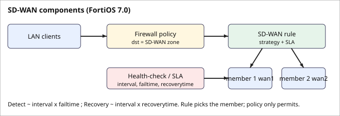

# Enterprise Network & Security Engineering — دوره‌ی تخصصی Cisco و Enterprise Firewall
## بخش ۷ از ۱۱ — فصل‌های ۱۹ تا ۲۱

| مورد | مقدار |
|---|---|
| نام دوره | Enterprise Network & Security Engineering (Cisco + FortiGate) |
| شماره بخش | ۷ از ۱۱ |
| فصل‌های این فایل | ۱۹ ، ۲۰ ، ۲۱ |
| تاریخ تولید | ۲۰۲۶-۱۱-۲۶ |
| نسخه Blueprint | v3.0 (+ بازبینی ۱٫۱) |
| نسخه‌های نرم‌افزار | FortiOS 7.0.3 (اسمی؛ بوت‌نشده؛ تأیید با `get system status`) ؛ Cisco vIOS-L2 15.2(20200924، Experimental) ؛ Cisco vIOS 15.9(3)M9 ؛ VPCS ؛ PNetLab 4.2.8 ؛ ESXi 8.0U2 ؛ CSR1000v 17.03.02 (IOS-XE؛ آزمایش‌نشده) |
| وضعیت تکمیل | **فصل‌های ۱۹–۲۱ تولید شد؛ Hub-and-Spoke، Remote Access، Dual-ISP/SD-WAN.** Labها «اجرا نشده»؛ SSL VPN فقط ایزوله به‌دلیل CVE؛ دستورها آزمایش‌نشده. |

> **قوانین خواندن:** تمرین‌ها و پرسش‌های مرور بدون پاسخ‌اند؛ پاسخ در «پاسخ‌های فصل». «اجرا نشده» یعنی خروجی‌ها **پیش‌نیاز/پیش‌بینی** هستند. «CLI-Accepted» ≠ «کار می‌کند». رمزها نمونه‌اند.

### وضعیت راستی‌آزمایی Labهای این بخش
خلاصه: اجرا نشده (فقط طراحی): 16.

| Lab | وضعیت |
|---|---|
| 19-1 | اجرا نشده (فقط طراحی) |
| 19-2 | اجرا نشده (فقط طراحی) |
| 19-3 | اجرا نشده (فقط طراحی) |
| 19-4 | اجرا نشده (فقط طراحی) |
| 19-5 | اجرا نشده (فقط طراحی) |
| 19-6 | اجرا نشده (فقط طراحی) |
| 20-1 | اجرا نشده (فقط طراحی) |
| 20-2 | اجرا نشده (فقط طراحی) |
| 20-3 | اجرا نشده (فقط طراحی) |
| 20-4 | اجرا نشده (فقط طراحی) |
| 20-5 | اجرا نشده (فقط طراحی) |
| 21-1 | اجرا نشده (فقط طراحی) |
| 21-2 | اجرا نشده (فقط طراحی) |
| 21-3 | اجرا نشده (فقط طراحی) |
| 21-4 | اجرا نشده (فقط طراحی) |
| 21-5 | اجرا نشده (فقط طراحی) |

---

<a id="ch19"></a>

> **نسخه‌ی اصلاح‌شده (v3.9):** نسخه‌ی توسعه‌یافته‌ی فایل اصلی؛ درس‌های افزوده: ۲۰-۷، ۲۱-۷ (دسته C). فایل اصلی در `course/` حفظ شده است. پاسخ‌های درس‌های افزوده در «پاسخ‌های فصل» همان فصل است.

# فصل 19 — Hub-and-Spoke، OSPF/BGP روی FortiGate و Local Breakout

**مدت:** ۳۶ ساعت | **پیش‌نیاز:** فصل ۹، ۱۸.
**اهداف:** توپولوژی Hub-and-Spoke با چند Tunnel؛ Routing پویا (OSPF/BGP) روی Tunnel؛ Local Breakout؛ معماری ۴ (چندشعبه). Gate: چهار شعبه از مسیر Hub ارتباط دارند و قطع یک Tunnel بقیه را نمی‌شکند.
**نسخه:** FortiOS 7.0.3 اسمی؛ دستورها آزمایش‌نشده؛ ADVPN در `Unverified`.
**اشتباهات رایج:** Route Overlap؛ فراموشی `net-device`/IP Tunnel؛ Policy بین Spokeها؛ Loop مسیر.

**درس‌های فصل:**
- [درس 19-1 — طراحی Hub-and-Spoke و IP Plan](#l-19-1)
- [درس 19-2 — ساخت Tunnelهای Spoke و OSPF روی Tunnel](#l-19-2)
- [درس 19-3 — BGP روی FortiGate و Failover مسیر](#l-19-3)
- [درس 19-4 — Local Breakout و Policy اینترنت شعبه](#l-19-4)
- [درس 19-5 — ADVPN (مفهومی) و مقیاس‌پذیری](#l-19-5)
- [درس 19-6 — معماری ۴: چندشعبه و آزمون فصل](#l-19-6)

---

<a id="l-19-1"></a>

## درس 19-0 — طراحی Overlay چندشعبه: Hub-and-Spoke، Routing پویا روی Tunnel و ADVPN

**فصل ۱۹ · درس افزوده (پیش‌درس ۱۹-۱) · پیش‌نیاز: ۱۸-۰، ۹-۰، ۹-۷، ۵-۷ · ≈ ۸ ساعت**

> **وضعیت (FortiOS 7.0):** نکات ADVPN/BGP از مستند رسمی ([ADVPN and shortcut paths 7.0.9](https://docs.fortinet.com/document/fortigate/7.0.9/administration-guide/985659/advpn-and-shortcut-paths)، [ADVPN with BGP](https://docs.fortinet.com/document/fortigate/7.0.1/administration-guide/820072/advpn-with-bgp-as-the-routing-protocol)) بررسی شد. سینتکس روی 7.0.3 `Unverified`؛ برخی گزینه‌ها (مثل Shortcut Override) از 7.0.4 آمده‌اند. Lab «اجرا نشده».

### ۱) هدف آموزشی

1. Overlay و Underlay را تفکیک و **توپولوژی‌های Full-mesh، Hub-and-Spoke و ADVPN** را مقایسه کند.
2. **Routing پویا** (BGP/OSPF) روی Tunnel طراحی کند و تفاوت **iBGP/eBGP** و نقش **Route Reflector** را بگوید.
3. IP Plan بدون Overlap، **Tunnel Interface IP** و **net-device** را درست تنظیم کند.
4. ADVPN را (در صورت پشتیبانی نسخه) با Sender/Receiver و Shortcut بفهمد.
5. رفتار شبکه را هنگام خرابی Tunnel/Hub تحلیل (Convergence) و Failover را طراحی کند.
6. **Local Breakout** را در برابر مسیر مرکزی (Backhaul) با معیار امنیت/Performance انتخاب کند.

### ۲) مفهوم پایه: چیست و چرا؟ (از صفر، با زبان ساده)

**چرا Overlay چندشعبه را «طراحی» کنیم؟** اتصال دو شعبه با یک Tunnel ساده است. اتصال ۳۰ شعبه به‌صورت دستی یعنی ده‌ها Tunnel، ده‌ها Route و کابوس نگهداری. طراحی Overlay یعنی قبل از ساخت درباره‌ی «شکل» (Hub-and-Spoke یا Mesh)، «مسیریابی» (Static یا پویا) و «مقیاس» تصمیم بگیرید. مثل طراحی شبکه‌ی جاده‌ای بین شهرها: اگر هر شهر مستقیم به همه‌ی شهرها جاده بکشد، هزینه‌ی نگهداری انفجاری می‌شود؛ اگر همه از یک مرکز بگذرند، مرکز پرترافیک می‌شود.

**Overlay و Underlay:** Underlay همان اینترنت/ISP است؛ Overlay شبکه‌ی خصوصی مجازی روی آن (Tunnelها). شعبه‌ها فکر می‌کنند در یک شبکه‌ی خصوصی هستند.

**سه الگو**

1. **Full-mesh:** هر دو سایت مستقیم. تعداد Tunnel = N(N−1)/2.
2. **Hub-and-Spoke:** همه به Hub. تعداد Tunnel = N. ترافیک Spoke↔Spoke از Hub می‌گذرد.
3. **ADVPN:** پایه Hub-and-Spoke؛ هنگام نیاز بین دو Spoke Tunnel مستقیم (Shortcut) ساخته می‌شود؛ ارزان‌تر از Mesh و سریع‌تر از Hub-Spoke.

**چرا Routing پویا؟** با Static Route برای هر شعبه‌ی جدید باید همه‌ی دستگاه‌ها ویرایش شوند و Failover خودکار ندارید. OSPF/BGP روی Tunnel مسیرها را خودکار می‌یابد و با قطع Hub به Hub دوم می‌رود.

**جمع‌بندی اصلی درس:**

IPsec (۱۸-۰)، BGP (۹-۰، ۹-۷)، Convergence (۵-۷)، Packet Flow (۱۲-۰)، SD-WAN (۲۱-۷ برای ترکیب).

### ۳) مفهوم پایه

شرکتی با ۲۰ شعبه: Full-mesh یعنی ۱۹۰ Tunnel (n(n−1)/2) که مقیاس‌پذیر نیست. **Hub-and-Spoke:** هر شعبه (Spoke) فقط به مرکز (Hub) Tunnel دارد؛ ترافیک شعبه‌به‌شعبه از Hub می‌گذرد (ساده، مرکزی برای Policy/Inspection، ولی تأخیر و بار روی Hub). **ADVPN:** در Hub-and-Spoke، Spokeها در صورت نیاز **Tunnel مستقیم (Shortcut)** بین هم می‌سازند.

### ۴) توضیح عمیق فنی

#### ۴-۱) مقایسه

| الگو | تعداد Tunnel (n شعبه) | مزیت | عیب |
|---|---|---|---|
| Full-mesh | n(n−1)/2 | کمترین تأخیر | پیچیده/غیرمقیاس‌پذیر |
| Hub-and-Spoke | n (به Hub) | ساده، کنترل مرکزی | Hub گلوگاه/SPOF؛ تأخیر Spoke-to-Spoke |
| ADVPN | n + Shortcutهای پویا | ترکیب مزایا | وابسته به نسخه، پیچیده‌تر |

``` text
Full-mesh tunnels = n(n-1)/2     example: n=20 -> 190
```

#### ۴-۲) Routing روی Tunnel

- **Static** برای شعب کم؛ **OSPF** (point-to-point) یا **BGP** برای مقیاس و Failover.
- **BGP** معمولاً توصیه می‌شود: مقیاس‌پذیر، کنترل Policy. طبق مستند ADVPN: بین Hub و Spokeها **iBGP** استفاده می‌شود؛ Hub می‌تواند **Route Reflector** باشد و Neighbor-group/neighbor-range روی Subnet تونل تعریف کند تا Spokeهای جدید بدون تغییر Hub اضافه شوند.
- IP روی Tunnel: برای Peering BGP (/32 روی Tunnel یا Loopback). Loopback Peering نیاز به Route Static/IKE-installed برای رسیدن به Loopback دارد.
- **Selector** Phase 2: 0.0.0.0/0 تا Routing تصمیم بگیرد (۱۸-۰).

#### ۴-۳) نکات اجرایی

- `net-device`: طبق مستند ADVPN با BGP، روی Hub باید `set net-device disable` (Phase 1) باشد تا یک Interface برای همه‌ی Spokeها و Peering درست کار کند.
- **Route Overlap:** Subnet هر شعبه یکتا (IP Plan فصل ۲).
- **Policy:** Tunnel↔LAN دوطرفه؛ برای Spoke-to-Spoke از Hub: Policy Tunnel→Tunnel روی Hub.
- **Anti-loop:** BGP AS_PATH/Route Reflector؛ OSPF Area.

#### ۴-۴) ADVPN (7.0)

طبق مستند: Hub Phase 1: `set auto-discovery-sender enable`؛ Spoke: `set auto-discovery-receiver enable`. Spoke A→Spoke B: ترافیک اول از Hub؛ Hub به A و B اطلاع می‌دهد (Shortcut)؛ A و B Tunnel مستقیم می‌سازند و Routeها/Next-hop به‌روز می‌شوند. مستند می‌گوید **GUI برخی گزینه‌های ADVPN را ندارد** و فقط CLI. در 7.0.4 «shortcut override» و «tag-match» برای کنترل بهتر نیز آمده است.

#### ۴-۵) Local Breakout در برابر Backhaul

| | Backhaul (همه به Hub) | Local Breakout |
|---|---|---|
| امنیت | Inspection یکپارچه | هر شعبه باید UTM داشته باشد |
| Performance | تأخیر/بار Hub | سریع |
| هزینه | پهنای Hub زیاد | ISP محلی |
| سیاست | یکسان | ممکن است ناهمگون |

معمول: سازمانی ← Tunnel؛ SaaS/اینترنت ← Local Breakout با UTM و SD-WAN (۲۱-۷).

#### ۴-۶) خرابی و Convergence

- قطع Tunnel Spoke–Hub: Hub مسیر را پس از Detect (DPD/BGP Hold/BFD) حذف می‌کند.
- Spoke با دو Hub: Failover بین Hubها (Local-pref/MED).
- Hub fail: Hub دوم + HA؛ زمان Convergence ≈ Detect + BGP.

### ۵) مثال حل‌شده

#### مثال ساده — شمارش Tunnel

``` text
Full mesh = N x (N - 1) / 2
Hub&Spoke = N
N = 10 -> 45 vs 10 ;  N = 50 -> 1225 vs 50
```

#### مثال متوسط — طراحی دو Hub

۱۰ شعبه با دو Hub (Primary/Secondary):

``` text
Tunnels = spokes x hubs = 10 x 2 = 20
```

هر Spoke به هر دو Hub Tunnel دارد؛ Routing پویا Hub اصلی را با Metric بهتر ترجیح می‌دهد.

#### مثال متوسط — زمان Failover

``` text
Failover = detection + convergence
OSPF dead 40 s (default) -> with BFD ~ 1 s
```

برای هدف «کمتر از ۱۰ ثانیه» BFD یا Timerهای کوتاه (با آزمون) لازم است.

#### مثال سخت — Hub گلوگاه

ترافیک Spoke↔Spoke زیاد است و Hub اشباع می‌شود. شاهد: CPU/Throughput Hub و تأخیر. راه: ADVPN یا Tunnel مستقیم Partial بین جفت‌های پرترافیک. اثبات: ping/iperf بین دو Spoke قبل و بعد؛ مسیر traceroute از Hub به مستقیم تغییر می‌کند.

#### مثال‌های اصلی درس (مرور)

**نیاز:** 1 Hub (AS 65000) + Spoke1/Spoke2؛ BGP iBGP. Hub: `set auto-discovery-sender enable`، `set net-device disable`؛ Spokeها: `set auto-discovery-receiver enable`.

``` text
# HUB (sketch)
config vpn ipsec phase1-interface
    edit "HUB-TUN"
        set type dynamic
        set auto-discovery-sender enable
        set net-device disable
        set add-route disable
    next
end
config router bgp
    set as 65000
    config neighbor-group
        edit "SPOKES"
            set remote-as 65000
            set route-reflector-client enable
        next
    end
    config neighbor-range
        edit 1
            set prefix 10.255.0.0 255.255.255.0
            set neighbor-group "SPOKES"
        next
    end
end
```

(سینتکس برگرفته از ساختار مستند 7.0.9؛ جزئیات `Unverified` روی 7.0.3.)

**مثال متوسط:** قطع Tunnel Spoke1: `get router info bgp summary` همسایه Idle؛ Route شعبه از جدول حذف؛ شعب دیگر دیگر ترافیک را به Spoke1 نمی‌فرستند.

**مثال سخت:** ترافیک Spoke1→Spoke2 از Hub می‌گذرد و کند است. با ADVPN Shortcut ساخته می‌شود؛ ولی Shortcut ساخته نشد: بررسی: Sender/Receiver، Policy Spoke→Spoke، Route Next-hop. شاهد: `diagnose vpn tunnel list`.

### ۶) طراحی و تصمیم‌گیری

| سؤال | تصمیم |
|---|---|
| تعداد شعب | ≤ ۵: Static/OSPF؛ بیشتر: BGP |
| Hub تکی/دوتایی | دوتایی برای SLA بالا |
| ADVPN | وقتی ترافیک Spoke-to-Spoke زیاد و نسخه پشتیبانی کند |
| Breakout | محلی با UTM برای SaaS |
| Subnet | Summarize و یکتا |

### ۷) GUI و CLI (Verification)

**GUI:** VPN → IPsec Tunnels؛ Network → BGP/OSPF؛ Monitor → IPsec Monitor؛ Routing Monitor. **CLI:**

``` text
get router info bgp summary
get router info routing-table all
diagnose vpn tunnel list
diagnose vpn ike gateway list
```

### ۸) Troubleshooting

| علامت | علت |
|---|---|
| BGP Active | Policy/Route Peer، AS، `net-device` |
| Route نمی‌آید | Filter/RR/Next-hop |
| Spoke-to-Spoke کند | ADVPN فعال نشده/Policy |
| شعبه‌ی جدید وصل نمی‌شود | neighbor-range/Phase 1 dynamic |

### ۹) نکات امنیتی

- Hub هدف حمله است؛ Patch و محدودیت Source.
- Policy Spoke-to-Spoke را حداقلی بنویسید.
- Local Breakout بدون UTM = حفره.

### ۱۰) جمع‌بندی مفهومی

- Full-mesh n(n−1)/2؛ Hub-and-Spoke n؛ ADVPN ترکیب.
- BGP iBGP با RR برای مقیاس.
- IP Plan یکتا؛ Selector باز؛ Policy دوطرفه.
- ADVPN وابسته به نسخه؛ GUI محدود.
- Backhaul در برابر Breakout: امنیت در برابر Performance.

### ۱۱) تمرین و ارزیابی

**ت1.** (ساده) تعداد Tunnel Full-mesh برای ۲۰ شعبه؟ *(پاسخ: 19-0-ت1)*

**ت2.** (ساده) Overlay و Underlay چیست؟ *(پاسخ: 19-0-ت2)*

**ت3.** (متوسط) چرا BGP برای شعب زیاد بهتر از Static؟ *(پاسخ: 19-0-ت3)*

**ت4.** (متوسط) نقش Route Reflector در Hub چیست؟ *(پاسخ: 19-0-ت4)*

**ت5.** (سخت) ADVPN چگونه Spoke-to-Spoke را بهینه می‌کند و چه پیش‌نیازهایی دارد؟ *(پاسخ: 19-0-ت5)*

**ت6.** (سخت، طراحی) برای ۱۰ شعبه با دو Hub، Failover و Breakout را طراحی کنید. *(پاسخ: 19-0-ت6)*

**Q1.** Quick quiz (English): What is the main drawback of pure hub-and-spoke for spoke-to-spoke traffic? *(پاسخ: 19-0-Q1)*

### ۱۲) اصطلاحات و English Corner

| مخفف | شکل کامل | معنی |
|---|---|---|
| ADVPN | Auto-Discovery VPN | Tunnel پویای Spoke-to-Spoke |
| RR | Route Reflector | بازتاب‌دهنده‌ی مسیر |
| Overlay | Overlay network | شبکه‌ی روی ISP |
| Breakout | Local internet breakout | خروج محلی |

- *Use dynamic routing over tunnels for scalability.* ← برای مقیاس‌پذیری از Routing پویا روی Tunnel استفاده کنید.
- *ADVPN builds on-demand shortcuts between spokes.* ← ADVPN بین Spokeها Shortcut سفارشی می‌سازد.

### ۱۳) منابع

- Fortinet Docs: [ADVPN and shortcut paths](https://docs.fortinet.com/document/fortigate/7.0.9/administration-guide/985659/advpn-and-shortcut-paths)، [ADVPN with BGP](https://docs.fortinet.com/document/fortigate/7.0.1/administration-guide/820072/advpn-with-bgp-as-the-routing-protocol)، [Enhanced BGP next hop updates and ADVPN shortcut override 7.0.4](https://docs.fortinet.com/document/fortigate/7.0.0/new-features/245878/enhanced-bgp-next-hop-updates-and-advpn-shortcut-override-7-0-4).

### بخش تکمیلی درس: سناریوی واقعی، مثال‌های بیشتر و عیب‌یابی

> بخش‌های زیر درس بالا را کامل می‌کنند: سناریوی گام‌به‌گام، مثال‌های بیشتر از ساده تا سخت، جدول عیب‌یابی و پرسش‌های مصاحبه. ابتدا بخش‌های اصلی بالا را مطالعه کنید.

### تعمیق: انتخاب Topology با عدد

**۱۰ شعبه:** Full-mesh = N(N-1)/2 = 45 Tunnel؛ Hub-and-Spoke = 10 Tunnel.

``` text
Full mesh tunnels = N*(N-1)/2 = 10*9/2 = 45
Hub&Spoke tunnels = N = 10
```

ADVPN: Spoke به Spoke فقط در صورت نیاز Shortcut می‌سازد؛ ترکیب ارزان Hub-Spoke و کارایی Mesh.

**پرسش‌های مصاحبه**
1. *Hub نقطه‌ی شکست؟* دو Hub.
2. *Routing پویا چرا؟* Failover و مقیاس.
3. *ADVPN نیازها؟* IKEv2، Routing، تنظیم Hub.

### تکمیل عمیق: طراحی Overlay چندشعبه — از ۳ شعبه تا ۳۰۰ شعبه

#### چرا باید یاد بگیریم؟

اتصال دو شعبه با یک Tunnel ساده است. اتصال ۳۰ شعبه به‌صورت دستی یعنی صدها Tunnel، صدها Route و کابوس نگهداری. طراحی Overlay یعنی تصمیم‌گیری درباره‌ی «ساختار» (Hub-and-Spoke یا Mesh)، «مسیریابی» (Static یا پویا) و «مقیاس» پیش از ساخت.

#### توضیح ساده

Overlay شبکه‌ای مجازی است که روی اینترنت (Underlay) ساخته می‌شود؛ شعبه‌ها با Tunnel به هم وصل‌اند و فکر می‌کنند در یک شبکه‌ی خصوصی هستند.

#### مثال ساده — شمارش Tunnel

``` text
Full mesh tunnels  = N x (N - 1) / 2
Hub-and-Spoke      = N (one per spoke, to hub)
N = 10 -> mesh = 45 ; hub-spoke = 10
N = 50 -> mesh = 1225 ; hub-spoke = 50
```

نتیجه: Mesh با رشد N منفجر می‌شود.

#### مثال متوسط — ADVPN

ADVPN = Auto-Discovery VPN. ساختار پایه Hub-and-Spoke است؛ وقتی Spoke A با Spoke B زیاد ارتباط دارد، Hub به آنها «Shortcut» پیشنهاد می‌کند و Tunnel مستقیم ساخته می‌شود. مزیت: هزینه‌ی Hub-Spoke + کارایی Mesh.

#### مثال سخت — Hub Failure

Hub تنها نقطه‌ی شکست است. طراحی: دو Hub (Primary/Secondary) با Routing پویا؛ Spoke به هر دو Tunnel دارد؛ ترجیح با Metric.

``` text
Failover time ~ detect (BFD/Dead timer) + route convergence
OSPF dead 40 s (default broadcast) ; with BFD ~ <1 s
```

مقادیر پیش‌فرض را از مستند نسخه بخوانید.

#### Lab

نمودار سه‌لایه برای ۱۰ شعبه بکشید و تعداد Tunnel را محاسبه کنید.

#### عیب‌یابی طراحی

| علامت | علت | رفع |
|---|---|---|
| پیچیدگی انفجاری | Mesh کامل | Hub-Spoke/ADVPN |
| Hub bottleneck | ترافیک Spoke-Spoke | ADVPN |
| Failover کند | Timer | BFD |

#### پرسش‌ها با پاسخ

**۱. چند Tunnel برای ۲۰ شعبه Mesh؟** ۱۹۰.
**۲. ADVPN چه مشکلی را حل می‌کند؟** ترافیک Spoke-Spoke.
**۳. چرا دو Hub؟** SPOF.

#### English Corner

- *A full mesh grows quadratically; hub-and-spoke grows linearly.*
- Q: How does ADVPN combine the benefits of both designs?

## درس 19-1 — طراحی آدرس‌دهی چندشعبه: IP Plan، Summarization با محاسبه‌ی باینری، Tunnel IP و ظرفیت Hub

**فصل 19 · بازنویسی عمیق · پیش‌نیاز: ۱۹-۰، ۲-۲ (VLSM)، ۹-۰ · ≈ 8 ساعت**

> **وضعیت:** FortiOS 7.0.3 (بوت‌نشده)؛ دستورها `Unverified` مگر با لینک مرجع؛ Lab «اجرا نشده».

### ۱) هدف آموزشی

در پایان این درس باید بتوانید:

1. IP Plan سلسله‌مراتبی برای ۴۰ شعبه بنویسد که قابل‌خلاصه‌سازی باشد.
2. Summary را با محاسبه‌ی باینری و بررسی «Black hole» تعیین کند.
3. Tunnel IP (/30، /32، Unnumbered) را با توجه به Routing پویا انتخاب کند.
4. ظرفیت Hub (تعداد Tunnel، SA، Throughput، Route) را برآورد کند.
5. تعارض‌ها (Overlap، ادغام شرکت) را شناسایی و راه‌حل بدهد.
6. طرح را با آزمون‌های قابل‌اندازه‌گیری (Route Count، Traceroute) تأیید کند.

### ۲) مفهوم پایه: چیست و چرا؟ (از صفر، با زبان ساده)

**چرا IP Plan قبل از Tunnel؟** طرح آدرس‌دهی بد بعداً همه‌چیز را گران می‌کند: Overlap بین شعب، Routeهای زیاد و ناتوانی از Summarize. مثل شماره‌گذاری پلاک خانه‌ها در یک شهر: اگر از اول منظم باشد، پست و آمبولانس راحت پیدا می‌کنند.

**اصول:** هر شعبه یک بلوک پیوسته و هم‌تراز؛ فضای رشد؛ Loopback و شبکه‌ی Tunnel از بلوک جدا؛ مستندسازی. **Summarization** (خلاصه‌سازی) فقط وقتی مجاز است که بلوک پیوسته و رزرو شده باشد؛ وگرنه ترافیک به مقصدهای ناموجود (Blackhole) می‌رود.

**جمع‌بندی اصلی درس:**

قبل از ساخت اولین Tunnel باید دانست «هر شعبه چه آدرسی دارد و چه Prefixی در Routing اعلام می‌شود». آدرس‌دهی بد بعدها با هیچ پیکربندی جبران نمی‌شود: Overlap، Route زیاد روی Hub، ناتوانی در Summary و NAT ناخواسته. IP Plan یک **سند معماری** است، نه فهرست آدرس.

سه مسئله‌ی بنیادی:
1. **یکتایی:** هیچ دو سایت Prefix هم‌پوشان نداشته باشند.
2. **قابلیت خلاصه‌سازی (Summarization):** شعب یک منطقه با یک Prefix قابل‌اعلام باشند تا جدول مسیر کوچک و Convergence سریع بماند.
3. **رشد:** برای شعبه‌های جدید جا گذاشته شود، بدون Re-IP.

### ۳) توضیح عمیق فنی

#### ۱) الگوی سلسله‌مراتبی

``` text
10.0.0.0/8 company
  10.0.0.0/16      HQ (data center, users, mgmt)
  10.1.0.0/16      Region A  (branches 10.1.0.0/24 ... 10.1.255.0/24)
  10.2.0.0/16      Region B
  10.3.0.0/16      Region C
  10.250.0.0/16    Tunnel interconnect (p2p /30 or /32)
  10.254.0.0/24    Loopbacks (management, BGP peering)
  10.255.0.0/16    Reserved / future
```

هر منطقه یک /16 دارد ← تا ۲۵۶ شعبه‌ی /24؛ خلاصه‌ی منطقه = یک Route.

#### ۲) محاسبه‌ی Summary (باینری)

فرض: چهار شعبه 10.1.4.0/24، 10.1.5.0/24، 10.1.6.0/24، 10.1.7.0/24.

``` text
10.1.4.0 = 00001010.00000001.00000100.00000000
10.1.5.0 = 00001010.00000001.00000101.00000000
10.1.6.0 = 00001010.00000001.00000110.00000000
10.1.7.0 = 00001010.00000001.00000111.00000000
common prefix = first 22 bits  (octet3: 000001xx)
Summary = 10.1.4.0/22   covers 10.1.4.0 - 10.1.7.255
```

شرط: بلوک باید **هم‌تراز (aligned)** باشد (شروع 4 بر 4 بخش‌پذیر). اگر شعب 10.1.3..6 بودند، یک /22 تنها پوشش نمی‌داد.

#### ۳) Black hole در Summary

اگر Summary 10.1.4.0/22 را اعلام کنید ولی فقط ۳ شعبه موجود باشد، ترافیک به 10.1.7.0/24 (ناموجود) به Hub می‌آید و پس از Longest Prefix Match مسیری ندارد؛ بسته Drop می‌شود. این رفتار قابل‌قبول (Fail-closed) است؛ خطرناک وقتی است که Default Route وجود دارد و ترافیک ناموجود به اینترنت نشت می‌کند. راه‌حل: **Null route (Blackhole route)** برای Summary روی Hub:

``` text
config router static
    edit 200
        set dst 10.1.4.0 255.255.252.0
        set blackhole enable
        set distance 254
    next
end
```

(`blackhole` در Static Route FortiOS؛ `Unverified` برای جزئیات 7.0.3.) Routeهای دقیق‌تر شعب (LPM) همچنان برنده‌اند.

#### ۴) Tunnel Interface IP

| روش | توضیح | مزیت | محدودیت |
|---|---|---|---|
| /30 هر لینک | دو IP برای دو سر | استاندارد، Routing پویا ساده | مصرف آدرس (۴ به‌ازای هر Tunnel) |
| /32 دو سر | IP محلی و Remote /32 | کم‌مصرف؛ در FortiOS برای Tunnel بدون Subnet مشترک | باید Route Static/پویا به Remote /32 |
| Unnumbered | بدون IP روی Tunnel | کمترین آدرس | محدودیت پروتکل‌ها (BGP با Loopback) |

برای ۴۰ شعبه: ۴۰ × /30 = ۱۶۰ آدرس از 10.250.0.0/16؛ کاملاً کافی.

#### ۵) برآورد ظرفیت Hub

``` text
Tunnels      = number of spokes x tunnels per spoke   (e.g. 40 x 2 = 80)
IKE/IPsec SA = 2 SA per tunnel (IKE SA + Child SA)      -> ~160
Routes       = spokes x prefixes per spoke + summaries  (e.g. 40 x 3 = 120)
Throughput   = sum of expected branch traffic through hub (peak, not average)
```

باید با **Datasheet مدل** (IPsec VPN Throughput، تعداد Tunnel مجاز، Concurrent Sessions) با Profile فعال بسنجید؛ عدد Datasheet معمولاً برای بسته‌های بزرگ/بدون UTM است. اگر Hub مرکز Backhaul اینترنت هم باشد، بار چندبرابر می‌شود.

#### ۶) مهاجرت و ادغام (Overlap)

Overlap در موارد: شرکت ادغام‌شده با همان 192.168.1.0/24، شعبه‌ی قدیمی با Subnet تکراری. راه‌حل‌ها: (۱) Re-IP تدریجی (امن‌ترین، گران)؛ (۲) NAT یک‌طرفه/دوطرفه روی Tunnel (VIP/IP Pool) با جدول «آدرس واقعی ↔ آدرس مجازی»؛ (۳) VRF/VDOM جدا (مرز Routing). هر NAT = بدهی عیب‌یابی (Log آدرس مجازی).

### ۴) طراحی و تصمیم‌گیری

| سؤال طراحی | گزینه‌ها و معیار انتخاب |
|---|---|
| Summary در چه سطحی؟ | Region /16؛ نه بر پایه‌ی تعداد فعلی شعب |
| Tunnel IP | /30 برای سادگی؛ /32 برای صرفه‌جویی (با Route Remote) |
| Overlap | Re-IP > NAT > VRF/VDOM |
| ظرفیت Hub | عدد Datasheet با UTM/بسته‌ی واقعی؛ حاشیه ۳۰٪ |
| Null route | برای هر Summary روی Hub |

### ۵) مثال‌های حل‌شده (ساده، متوسط، سخت)

#### مثال ساده — تخصیص

``` text
HQ        10.0.0.0/16
Branch 1  10.1.0.0/24 ... Branch 50 10.50.0.0/24
Tunnel    10.255.0.0/16
```

#### مثال متوسط — Summary

۱۶ شعبه‌ی پیاپی در بایت سوم (10.1.0.0/24 تا 10.1.15.0/24):

``` text
16 networks = 2^4 -> /24 - 4 = /20
Summary: 10.1.0.0/20  (10.1.0.0 - 10.1.15.255)
```

شرط: شروع بلوک مضرب ۱۶ در بایت سوم.

#### مثال سخت — شرکت ادغام‌شده

هر دو 10.1.0.0/24. NAT ۱:۱ موقت روی Tunnel و Renumber تدریجی؛ Policy و DNS با آدرس ترجمه‌شده هماهنگ. آزمون با اسکریپت Overlap (`ipaddress` پایتون).

#### مثال‌های اصلی درس (مرور)

**ساده (حل‌شده):** ۴ شعبه در یک منطقه با 10.1.4–7.0/24: Summary 10.1.4.0/22 با Null route؛ Hub فقط یک Route منطقه را به بقیه اعلام می‌کند؛ `get router info routing-table all` باید Route /22 و ۴ Route /24 (در Hub) را نشان دهد.

**متوسط (حل‌شده):** شعبه‌ی ۵ با 10.1.8.0/24 اضافه می‌شود: /22 دیگر آن را پوشش نمی‌دهد ولی Region /16 (10.1.0.0/16) پوشش می‌دهد. نتیجه: اگر ISP/Region-level Summary استفاده شود، اضافه‌شدن شعبه نیاز به تغییر Summary ندارد؛ برای همین Summary سطح منطقه (/16) پایدارتر از Summary چهارتایی است. تصمیم: Summary را در مرز منطقه بگذارید، نه بر پایه‌ی تعداد فعلی.

**سخت (تحلیل):** شرکت ادغام‌شده 10.0.0.0/8 را به‌طور پراکنده استفاده می‌کند و ۶ شعبه با شما Overlap دارند. تحلیل: (الف) Overlap دقیق را با اسکریپت بیابید؛ (ب) برای ۶ شعبه NAT دوطرفه به بلوک 172.20.0.0/16 اختصاص دهید و جدول Mapping بسازید؛ (ج) Re-IP تدریجی را برنامه‌ریزی کنید (۱۲ ماه)؛ (د) Policy/Logging بر پایه‌ی آدرس واقعی حفظ شود (Log فقط آدرس مجازی دارد؛ لذا سیستم Log باید Mapping را بشناسد). ریسک: خرابی Route برگشت، DNS (جواب با آدرس واقعی)، Applicationهایی که IP را داخل Payload می‌گذارند (ALG).

### ۸) Verification (اثبات صحت)

- اسکریپت بررسی Overlap (مثلاً Python ipaddress) روی IP Plan بدون خطا.
- `get router info routing-table all`: Summaryها و Null routeها.
- traceroute به آدرس ناموجود داخل Summary: Drop در Hub (نه نشت به اینترنت).
- Route Count Hub مطابق برآورد.

### ۹) Troubleshooting

| علامت | شاهد برای بررسی | علت محتمل و رفع |
|---|---|---|
| Route مبهم بین دو شعبه | `get router info routing-table details <ip>` | Overlap؛ باید Re-IP/NAT |
| ترافیک آدرس ناموجود به اینترنت نشت می‌کند | traceroute/Log | نبود Null route با وجود Default Route؛ افزودن blackhole |
| Summary اعلام نمی‌شود | `get router info bgp network` / OSPF area-range | Summary در Protocol تنظیم نشده یا Prefix هم‌تراز نیست |
| Hub CPU بالا با ۴۰ Tunnel | `diagnose sys top`، IKE counters | ظرفیت/Rekey همزمان؛ توزیع Lifetime |

### ۱۰) نکات امنیتی

- IP Plan را در مخزن نسخه‌دار و با مالک ثبت کنید؛ تغییر بدون Review ممنوع.
- Null route برای جلوگیری از نشت ترافیک.
- NAT روی Tunnel را مستند کنید (Log و Audit).

### ۱۱) جمع‌بندی مفهومی

- IP Plan سلسله‌مراتبی = پایه‌ی Summary و رشد.
- Summary فقط روی بلوک هم‌تراز؛ Null route برای ایمنی.
- Tunnel IP: /30 ساده، /32 کم‌مصرف.
- ظرفیت Hub را با Profile واقعی بسنجید.
- Overlap: Re-IP بهترین؛ NAT بدهی است.

### ۱۲) تمرین و ارزیابی

**ت1.** (ساده) چرا Summary باید «هم‌تراز» باشد؟ *(پاسخ: 19-1-ت1)*

**ت2.** (ساده) Tunnel IP با /30 چند آدرس مصرف می‌کند و چرا؟ *(پاسخ: 19-1-ت2)*

**ت3.** (متوسط) Summary 10.1.0.0/16 اعلام شده ولی فقط 10.1.4.0/24 موجود است. ترافیک 10.1.9.5 چه می‌شود و چرا Null route مهم است؟ *(پاسخ: 19-1-ت3)*

**ت4.** (متوسط) برای ۴۰ شعبه با ۲ Tunnel هر کدام، تعداد SA و Tunnel Hub را حساب کنید. *(پاسخ: 19-1-ت4)*

**ت5.** (سخت) شرکت ادغام‌شده Overlap دارد. طرح گذار سه‌مرحله‌ای بنویسید. *(پاسخ: 19-1-ت5)*

**ت6.** (سخت، طراحی) IP Plan منطقه‌ای را برای ۳ منطقه × ۲۵۰ شعبه بنویسید و خلاصه‌ها را نشان دهید. *(پاسخ: 19-1-ت6)*

**Q1.** Quick quiz (English): Why must a summary prefix be aligned to its block boundary? *(پاسخ: 19-1-Q1)*

### ۱۳) اصطلاحات و English Corner

| مخفف | شکل کامل | معنی |
|---|---|---|
| Summarization | Route summarization | خلاصه‌سازی مسیر |
| Null route | Blackhole route | مسیر دور‌ریز |
| LPM | Longest Prefix Match | بلندترین Prefix مطابق |
| Aligned | Block alignment | هم‌ترازی بلوک |

- *Summarize routes at regional boundaries.* ← مسیرها را در مرز منطقه‌ها خلاصه کنید.
- *Add a null route for every summary.* ← برای هر Summary یک Null route اضافه کنید.

### ۱۴) کارت Lab

**کارت Lab:** IP Plan چندشعبه. **هدف:** طرح ۴۰ شعبه + Summary + Null route. **وضعیت:** اجرا نشده. **مراحل:** (۱) جدول IP Plan؛ (۲) اسکریپت Overlap؛ (۳) تنظیم blackhole Route؛ (۴) آزمون traceroute. **Verification:** مطابق بخش ۸. **Rollback:** حذف Routeها. **Evidence:** `02-design/hub-spoke-plan.md`.

### ۱۵) منابع

- RFC 4632 — CIDR
- RFC 1918
- Fortinet Docs: Static routes (blackhole)؛ FortiOS 7.0 Administration Guide

<a id="l-19-2"></a>

### بخش تکمیلی درس: سناریوی واقعی، مثال‌های بیشتر و عیب‌یابی

> بخش‌های زیر درس بالا را کامل می‌کنند: سناریوی گام‌به‌گام، مثال‌های بیشتر از ساده تا سخت، جدول عیب‌یابی و پرسش‌های مصاحبه. ابتدا بخش‌های اصلی بالا را مطالعه کنید.

### تعمیق: IP Plan و Summarization

``` text
HQ      10.0.0.0/16
Branch1 10.1.0.0/24 ... Branch50 10.50.0.0/24
Summary at hub: 10.0.0.0/10 would cover 10.0-63 (only if reserved)
```

قاعده: هر شعبه یک /24 رزرو + فضای رشد؛ Summary فقط اگر بلوک پیوسته و رزرو شده باشد؛ وگرنه Blackhole.

**پرسش‌های مصاحبه**
1. *Overlap؟* مشکل IPsec/NAT.
2. *Summary خطر؟* مسیر ناموجود.
3. *Loopback ID؟* ثبات Router-ID.

### تکمیل عمیق: IP Plan و Summarization چندشعبه

#### چرا؟

طرح آدرس‌دهی بد، بعداً همه‌چیز را گران می‌کند: Overlap بین شعب، Routeهای زیاد و ناتوانی از Summarize. اینجا IP Plan را از ابتدا تمیز می‌سازیم.

#### مثال ساده — تخصیص

``` text
HQ        10.0.0.0/16
Branch 1  10.1.0.0/24
Branch 2  10.2.0.0/24
...
Branch 50 10.50.0.0/24
Tunnel    10.255.0.0/16 (overlay)
```

هر شعبه یک /24 (۲۵۴ Host) با فضای رشد.

#### مثال متوسط — Summarization

برای ۱۶ شعبه با آدرس‌های پیاپی در بایت سوم (10.1.0.0/24 تا 10.1.15.0/24) می‌توان یک Summary داد.

``` text
16 networks = 2^4 -> borrow 4 bits from the /24 -> /24 - 4 = /20
Summary: 10.1.0.0/20  (covers 10.1.0.0 - 10.1.15.255)
Check: 10.1.15.0/24 is inside, 10.1.16.0/24 is outside
```

مراحل: ۱) تعداد شبکه‌ها باید توان ۲ باشد (۱۶) ۲) شروع بلوک باید مضرب ۱۶ در بایت سوم باشد (۰ مضرب ۱۶ است) ۳) Prefix برابر ۲۴ منهای ۴ می‌شود.

مثال مخالف: اگر شعبه‌ها از 10.1.4.0/24 شروع شوند، بلوک ۱۶تایی هم‌تراز نیست و Summary /20 شبکه‌های دیگر را هم می‌پوشاند.

#### قاعده

Summary فقط زمانی مجاز است که بلوک پیوسته، هم‌تراز (Aligned) و رزرو شده باشد؛ وگرنه ترافیک به مقصدهای ناموجود (Blackhole) می‌رود.

#### مثال سخت — شرکت ادغام‌شده

دو شرکت ادغام می‌شوند و هر دو 10.1.0.0/24 دارند (Overlap). راه: NAT بین آنها (۱:۱)، یا Renumbering تدریجی؛ NAT موقت و Renumber دائمی.

#### Lab

یک IP Plan برای ۳۰ شعبه بنویسید و با `ipaddress` پایتون Overlap را بررسی کنید.

``` text
python3 -c "import ipaddress as i; print(i.ip_network('10.16.0.0/20').overlaps(i.ip_network('10.16.8.0/24')))"
```

#### عیب‌یابی

| علامت | علت | رفع |
|---|---|---|
| Blackhole | Summary بیش‌ازحد | Null route دقیق |
| Overlap | طرح ناقص | NAT/Renumber |
| Route زیاد | بدون Summary | رزرو بلوک |

#### پرسش‌ها با پاسخ

**۱. چرا Aligned؟** Prefix دقیق.
**۲. Overlap چه می‌کند؟** مسیر مبهم.
**۳. Summary خطر؟** Blackhole.

#### English Corner

- *Summarize only contiguous, aligned address blocks.*
- Q: What is a route blackhole caused by over-summarization?

## درس 19-2 — Tunnelهای Hub–Spoke و OSPF روی Tunnel: طراحی، Network Type، Cost، Convergence و عیب‌یابی

**فصل 19 · بازنویسی عمیق · پیش‌نیاز: ۱۹-۰، ۱۹-۱، ۱۸-۲، ۶-۱ (OSPF) · ≈ 8 ساعت**

> **وضعیت:** FortiOS 7.0.3 (بوت‌نشده)؛ دستورها `Unverified` مگر با لینک مرجع؛ Lab «اجرا نشده».

### ۱) هدف آموزشی

در پایان این درس باید بتوانید:

1. Hub–Spoke را با Phase1 dynamic/Static و Selector باز بسازد.
2. OSPF را روی Tunnel Interface با Network Type درست راه بیندازد و Hello/Dead/Cost را تنظیم کند.
3. رفتار OSPF هنگام خرابی Tunnel را (Detect، LSA، SPF) تحلیل و زمان Convergence را محاسبه کند.
4. Policy و Local-in لازم برای OSPF را بنویسد.
5. Neighbor Stuck در Init/Exstart/2-Way را عیب‌یابی کند.
6. Area Design و LSA Filtering را برای مقیاس بسنجد.

### ۲) مفهوم پایه: چیست و چرا؟ (از صفر، با زبان ساده)

**چرا OSPF روی Tunnel؟** با Static Route هر شعبه‌ی جدید یعنی ویرایش همه‌ی دستگاه‌ها. OSPF مسیرها را خودکار می‌یابد. ولی Tunnel «شبکه‌ی چندجانبه‌ی مجازی» است و رفتار خاص دارد.

**Network Type:** Broadcast (DR/BDR، پیش‌فرض اترنت)، Point-to-Point (بدون DR)، Point-to-Multipoint (Hub با چند Spoke، بدون DR). برای Hub-and-Spoke روی Hub معمولاً `point-to-multipoint` مناسب است. **Cost** برای ترجیح Hub اصلی؛ **MTU** باید یکسان باشد (ExStart).

**جمع‌بندی اصلی درس:**

OSPF روی Tunnel دو مزیت دارد: (۱) Route شعب خودکار یاد گرفته می‌شود؛ (۲) قطع Tunnel باعث حذف Route می‌شود و ترافیک به مسیر جایگزین می‌رود. ولی OSPF برای شبکه‌ی چندشعبه **فرض‌هایی** دارد (Multicast، Hello، DR/BDR) که روی Tunnel باید آگاهانه تنظیم شوند، وگرنه Neighbor ناپایدار یا Convergence کند می‌شود.

### ۳) توضیح عمیق فنی

#### ۱) Network Type روی Tunnel

- **Point-to-point:** هر Tunnel یک لینک دو‌نقطه‌ای؛ بدون DR/BDR؛ Hello 10 / Dead 40 پیش‌فرض؛ **انتخاب پیش‌فرض برای Hub–Spoke با Tunnel جدا.**
- **Broadcast:** DR/BDR انتخاب می‌شود؛ روی Tunnelهای Dynamic/چندسر مناسب نیست.
- **Point-to-multipoint:** Hub برای Spokeهای زیاد روی یک Interface؛ Neighbor هر Spoke جدا؛ نیاز به تنظیم Cost و بدون DR.

در FortiOS با Phase1 `type dynamic` و Interface واحد روی Hub، چند Spoke روی یک Tunnel Interface‌اند؛ OSPF باید point-to-multipoint باشد یا هر Spoke Interface جدا (`net-device enable`) داشته باشد (`Unverified` در جزئیات).

#### ۲) پارامترها

``` text
Hello 10 s / Dead 40 s      default; Dead = 4 x Hello
Fast failover               Hello 1 / Dead 3-4, or BFD (RFC 5880)
Cost (cost = ref-bw / bw)   set explicit cost per tunnel: primary 10, backup 100
Authentication              MD5 or SHA (RFC 5709) on tunnel interfaces
```

#### ۳) Convergence (تحلیل زمان)

``` text
Total = Detect + LSA flood + SPF delay + Install
Example: Dead 40 s, LSA flood ~50 ms, SPF throttle ~200 ms, FIB ~10 ms  -> ~40.3 s
With BFD (300 ms x 3): ~0.9 s + 0.26 s -> ~1.2 s
```

نتیجه: در Tunnelهای IPsec، Detect را با DPD/BFD کوتاه کنید؛ Hello/Dead تنها کافی نیست چون Tunnel ممکن است Up بماند در حالی که مسیر عملاً مرده است.

#### ۴) Local-in و Policy

OSPF Hello/LSA به خود FortiGate می‌رسد (Local-in). Policy عبوری برای OSPF لازم **نیست**؛ ولی (۱) اگر Local-in Policy دارید باید OSPF (proto 89) را مجاز کنید؛ (۲) Policy داده بین Tunnel↔LAN جدا لازم است. اگر Selector Phase 2 فقط Subnetهای مشخص باشد، Hello (آدرس Tunnel) ممکن است خارج از Selector باشد ⇒ Selector باز (0.0.0.0/0) توصیه می‌شود.

#### ۵) مقیاس

Area 0 در Hub؛ هر منطقه Area جدا با ABR؛ Stub/NSSA برای کاهش LSA؛ Summary روی ABR (range). Spokeهای زیاد در Area 0 = LSDB بزرگ؛ در ≥ ۵۰ شعبه BGP ترجیح داده می‌شود (۱۹-۳).

### ۴) طراحی و تصمیم‌گیری

| سؤال طراحی | گزینه‌ها و معیار انتخاب |
|---|---|
| Network type | p2p برای Tunnel جدا؛ p2mp برای Interface مشترک Hub |
| Failover | BFD یا Hello/Dead کوتاه |
| Cost | صریح؛ اصلی 10، پشتیبان 100 |
| Area | Area 0 Hub؛ منطقه‌ها Area جدا |
| Auth | MD5/SHA روی Tunnel |

### ۵) مثال‌های حل‌شده (ساده، متوسط، سخت)

#### مثال ساده

``` text
config router ospf
 config ospf-interface
  edit "TO-SPOKES"
   set interface "TO-SPOKES"
   set network-type point-to-multipoint
   set cost 10
  next
 end
end
```

#### مثال متوسط — Hub اصلی/پشتیبان

Hub1 cost 10، Hub2 cost 20؛ Spoke ترافیک را به Hub1 می‌فرستد و با خرابی به Hub2.

#### مثال سخت — گیر در ExStart

MTU Tunnel با MTU Interface مقابل متفاوت است. `get router info ospf neighbor` ExStart؛ رفع: MTU یکسان یا `mtu-ignore`. تأیید Full.

#### مثال‌های اصلی درس (مرور)

**ساده (حل‌شده):** Hub و Spoke1: Phase1/2 با Selector 0.0.0.0/0؛ IP Tunnel 10.250.1.1/30 و .2؛ OSPF point-to-point؛ `get router info ospf neighbor` ⇒ Full؛ `get router info routing-table ospf` ⇒ 10.1.4.0/24 via 10.250.1.2.

**متوسط (تحلیل):** Neighbor در Init: Hub Hello Spoke را می‌بیند ولی Spoke Hello Hub را نه. اولین فرضیه: Policy/Local-in Spoke بسته OSPF را رد می‌کند؛ دوم: یک سر Hello 10 و دیگری 1؛ سوم: Auth ناهمسان. شواهد: Sniffer روی Tunnel (proto 89)، `diagnose ip ... ospf` / Debug OSPF. رفع: یکسان‌سازی Hello/Auth و مجازکردن Local-in.

**سخت (طراحی+محاسبه):** دو Tunnel (ISP1 و ISP2) از Spoke به Hub؛ می‌خواهید ISP1 اصلی باشد. Cost 10 برای Tunnel1 و 100 برای Tunnel2. هنگام قطع ISP1 با Dead 40: ۴۰ ثانیه Black hole. با BFD 300ms×3 و SPF throttle: ≈ 1.2 s. محاسبه: بدون BFD، ۴۰ ثانیه قطع برای VoIP غیرقابل‌قبول؛ با BFD قابل‌قبول. همچنین Failback: وقتی ISP1 برمی‌گردد، Cost پایین‌تر باعث بازگشت می‌شود؛ برای جلوگیری از Flap، Hold-down/Dampening در لینک ناپایدار.

### ۶) پیاده‌سازی از مسیر GUI

1. VPN → IPsec Tunnels: Tunnel Hub–Spoke با Selector 0.0.0.0/0 (طبق ۱۸-۲).
2. Network → Interfaces → Tunnel Interface: IP/Remote IP (یا /32).
3. Network → OSPF: Router ID، Areas، Networks (10.250.0.0/16)، Interfaces (Network Type=Point-to-Point، Hello/Dead، Cost، Authentication).
4. Policy & Objects: Policy Tunnel↔LAN دوطرفه.
5. Monitor → Routing Monitor و Network → OSPF Neighbors.

### ۷) پیاده‌سازی از مسیر CLI

``` text
config system interface
    edit "TO-SPOKE1"
        set ip 10.250.1.1 255.255.255.255
        set remote-ip 10.250.1.2 255.255.255.252
    next
end
config router ospf
    set router-id 10.254.0.1
    config area
        edit 0.0.0.0
        next
    end
    config network
        edit 1
            set prefix 10.250.0.0 255.255.0.0
        next
    end
    config ospf-interface
        edit "TO-SPOKE1"
            set interface "TO-SPOKE1"
            set network-type point-to-point
            set hello-interval 10
            set dead-interval 40
            set cost 10
        next
    end
end
get router info ospf neighbor
get router info ospf database
get router info routing-table ospf
diagnose sniffer packet TO-SPOKE1 "proto 89" 4 20 l
```

### ۸) Verification (اثبات صحت)

- Neighbor Full برای هر Spoke.
- Route شعب در Hub و Route Summary در Spoke.
- قطع Tunnel (Shutdown): زمان حذف Route و ping پیوسته؛ اندازه‌گیری Convergence.
- Failback: بازگشت به مسیر اصلی بدون Flap بیش از ۱ بار.

### ۹) Troubleshooting

| علامت | شاهد برای بررسی | علت محتمل و رفع |
|---|---|---|
| Neighbor Init | Sniffer proto 89؛ Local-in | Hello یک‌طرفه: Policy/Auth/Hello ناهمسان |
| Exstart/Exchange | `ospf neighbor` | MTU ناسازگار؛ هم‌سان کنید (فصل ۱۸-۴) |
| Neighbor Flap | Log OSPF؛ DPD | DPD/لینک ناپایدار؛ زمان‌ها |
| Route Spoke در Hub نیست | `ospf database` | Network statement/Area/Passive |
| Convergence کند | محاسبه Dead | BFD/Fast Hello |

### ۱۰) نکات امنیتی

- Authentication MD5/SHA روی Tunnel؛ Passive-interface روی LAN شعبه.
- OSPF Filtering تا Spoke مسیرهای نامطلوب ندهد.
- Policy حداقلی بین Spokeها.

### ۱۱) جمع‌بندی مفهومی

- OSPF روی Tunnel: Network Type مناسب (p2p/p2mp).
- Convergence = Detect + LSA + SPF؛ Detect غالب است؛ BFD.
- Selector باز و Local-in برای OSPF.
- Cost صریح برای Primary/Backup.
- در مقیاس بزرگ: Area و Summary یا BGP.

### ۱۲) تمرین و ارزیابی

**ت1.** (ساده) Hello/Dead پیش‌فرض OSPF روی Tunnel p2p چند ثانیه است و Dead چه رابطه‌ای با Hello دارد؟ *(پاسخ: 19-2-ت1)*

**ت2.** (ساده) چرا Selector 0.0.0.0/0 برای OSPF لازم است؟ *(پاسخ: 19-2-ت2)*

**ت3.** (متوسط) محاسبه کنید: Dead 40 s، BFD 300 ms×3، SPF delay 200 ms. زمان قطع در هر دو حالت؟ *(پاسخ: 19-2-ت3)*

**ت4.** (متوسط) Neighbor در Init مانده؛ سه فرضیه به ترتیب بنویسید. *(پاسخ: 19-2-ت4)*

**ت5.** (سخت) دو Tunnel با Cost 10 و 100. لینک ISP1 ناپایدار است (۳۰ ثانیه Up/۳۰ ثانیه Down). مشکل را شرح دهید و راه‌حل بدهید. *(پاسخ: 19-2-ت5)*

**ت6.** (سخت، طراحی) برای ۴۰ شعبه OSPF یا BGP؟ با ۴ معیار توجیه کنید. *(پاسخ: 19-2-ت6)*

**Q1.** Quick quiz (English): Why do tunnels often need BFD or very short dead timers for fast failover? *(پاسخ: 19-2-Q1)*

### ۱۳) اصطلاحات و English Corner

| مخفف | شکل کامل | معنی |
|---|---|---|
| p2p | Point-to-point network type | نوع شبکه‌ی نقطه‌به‌نقطه |
| p2mp | Point-to-multipoint | نقطه‌به‌چندنقطه |
| SPF | Shortest Path First | الگوریتم مسیر کوتاه |
| ABR | Area Border Router | روتر مرز Area |
| BFD | Bidirectional Forwarding Detection | تشخیص دوطرفه‌ی خرابی |

- *Set explicit OSPF costs to define primary and backup tunnels.* ← برای تعیین Tunnel اصلی و پشتیبان Cost را صریح تنظیم کنید.
- *Convergence time is dominated by failure detection.* ← زمان Convergence عمدتاً به کشف خرابی بستگی دارد.

### ۱۴) کارت Lab

**کارت Lab:** OSPF روی Tunnel. **هدف:** Neighbor Full + Failover زیر ۲ ثانیه با BFD. **وضعیت:** اجرا نشده. **مراحل:** Tunnel، OSPF، Cost، BFD، قطع لینک. **Verification:** مطابق بخش ۸. **Rollback:** حذف OSPF Interface. **Evidence:** `03-ops/ospf-tunnel.md`.

### ۱۵) منابع

- RFC 2328 — OSPFv2
- RFC 5880 — BFD
- Fortinet Docs: OSPF؛ IPsec VPN with dynamic routing (7.0)

<a id="l-19-3"></a>

### بخش تکمیلی درس: سناریوی واقعی، مثال‌های بیشتر و عیب‌یابی

> بخش‌های زیر درس بالا را کامل می‌کنند: سناریوی گام‌به‌گام، مثال‌های بیشتر از ساده تا سخت، جدول عیب‌یابی و پرسش‌های مصاحبه. ابتدا بخش‌های اصلی بالا را مطالعه کنید.

### تعمیق: OSPF روی Tunnel

``` text
config router ospf
 set router-id 1.1.1.1
 config area
  edit 0.0.0.0
  end
 config network
  edit 1
   set prefix 10.99.0.0 255.255.255.0
  next
 end
 config ospf-interface
  edit TO-SPOKE
   set interface TO-SPOKE
   set network-type point-to-multipoint
  next
 end
end
```

Point-to-multipoint برای Hub بدون انتخاب DR؛ Cost را برای ترجیح Hub اصلی تنظیم کنید. **اثبات:** `get router info ospf neighbor` (Full).

**پرسش‌های مصاحبه**
1. *MTU mismatch؟* گیر در ExStart.
2. *Hello/Dead؟* 10/40 پیش‌فرض.
3. *چرا P2MP؟* بدون DR.

### تکمیل عمیق: OSPF روی Tunnel — Network Type، Cost و Convergence

#### چرا؟

Static Route در ۳۰ شعبه یعنی ویرایش دستی ۳۰ دستگاه؛ OSPF خودکار یاد می‌گیرد. ولی روی Tunnel رفتار خاصی دارد (Multi-access مجازی).

#### Network Type

| نوع | DR/BDR | کاربرد |
|---|---|---|
| broadcast | دارد | LAN |
| point-to-point | ندارد | Tunnel دونقطه‌ای |
| point-to-multipoint | ندارد | Hub با چند Spoke |

در Hub-and-Spoke، Network Type `point-to-multipoint` روی Hub مناسب است؛ DR/BDR لازم نیست.

#### مثال ساده — پیکربندی

``` text
config router ospf
 set router-id 1.1.1.1
 config area
  edit 0.0.0.0
  next
 end
 config network
  edit 1
   set prefix 10.255.0.0 255.255.0.0
  next
 end
 config ospf-interface
  edit "TO-SPOKES"
   set interface "TO-SPOKES"
   set network-type point-to-multipoint
   set cost 10
  next
 end
end
```

#### مثال متوسط — Cost برای ترجیح Hub

Hub1 cost 10، Hub2 cost 20؛ Spoke ترافیک را به Hub1 می‌فرستد و با خرابی Hub1 به Hub2.

#### Convergence

``` text
Dead interval default broadcast = 40 s ; P2P/P2MP often 40 s (verify)
With BFD: detection ~ 300 ms x 3 = ~1 s
```

برای Failover زیر ۵ ثانیه از BFD یا Timerهای کوتاه (با آزمون) استفاده کنید.

#### مثال سخت — MTU

Tunnel با MTU کمتر ⇒ OSPF در ExStart گیر می‌کند. رفع: MTU برابر یا `mtu-ignore`.

#### Lab

Hub و دو Spoke بسازید؛ `get router info ospf neighbor` را بخوانید.

#### عیب‌یابی

| علامت | علت | رفع |
|---|---|---|
| ExStart | MTU | یکسان |
| DR روی Tunnel | broadcast | P2MP |
| Failover کند | Dead timer | BFD |

#### پرسش‌ها با پاسخ

**۱. چرا P2MP؟** بدون DR.
**۲. Cost برای؟** ترجیح مسیر.
**۳. BFD؟** تشخیص سریع.

#### English Corner

- *Use point-to-multipoint for hub interfaces that terminate many spokes.*
- Q: How can you speed up OSPF failure detection?

## درس 19-3 — BGP روی FortiGate برای Overlay: iBGP، Route Reflector، Next-hop، Local-pref، Failover و Filtering

**فصل 19 · بازنویسی عمیق · پیش‌نیاز: ۱۹-۰، ۹-۰، ۹-۷ · ≈ 8 ساعت**

> **وضعیت:** FortiOS 7.0.3 (بوت‌نشده)؛ دستورها `Unverified` مگر با لینک مرجع؛ Lab «اجرا نشده». از مستند: ADVPN با BGP → iBGP بین Hub و Spoke، `net-device disable` روی Hub.

### ۱) هدف آموزشی

در پایان این درس باید بتوانید:

1. iBGP با Route Reflector و neighbor-group/neighbor-range را برای Spokeهای پویا بسازد.
2. Next-hop در iBGP و Reachability Loopback/Tunnel را تحلیل کند.
3. Failover دو Hub را با Local-pref/MED/Weight طراحی و اندازه‌گیری کند.
4. Route Filtering (Prefix-list، Route-map، Max-prefix) را برای جلوگیری از Leak اعمال کند.
5. Convergence BGP (Hold، BFD، MRAI) را محاسبه کند.
6. عیب‌یابی Neighbor Active/Idle/Established-no-routes را انجام دهد.

### ۲) مفهوم پایه: چیست و چرا؟ (از صفر، با زبان ساده)

**چرا BGP در Overlay؟** برای مقیاس بالا و کنترل دقیق سیاست (ترجیح یک Hub/ISP). ولی iBGP قوانین خود را دارد: Full-mesh یا Route Reflector، و Next-hop. Hub می‌تواند RR باشد تا Spokeها فقط با Hub Peer شوند.

**جمع‌بندی اصلی درس:**

با ۴۰ شعبه و دو Hub، BGP مقیاس‌پذیرتر و قابل‌کنترل‌تر از OSPF است: Policy بر پایه‌ی Attribute، Route Reflector برای حذف Full-mesh، و جداسازی Control Plane شعب. ولی BGP به Reachability Next-hop وابسته است و Convergence پیش‌فرضش کند است؛ این دو باید آگاهانه طراحی شوند.

### ۳) توضیح عمیق فنی

#### ۱) چرا iBGP و Route Reflector؟

همه‌ی روترها در یک AS (مثلاً 65000) هستند؛ **iBGP Split-horizon:** مسیر یادگرفته‌شده از iBGP Peer به iBGP Peer دیگر داده نمی‌شود. برای n روتر Full-mesh = n(n−1)/2 Session؛ با ۴۰ Spoke + ۲ Hub ≈ ۸۶۱ Session. **Route Reflector (RR)** Hub را واسطه می‌کند: هر Spoke فقط با Hub (و Hub دوم) Peer می‌شود؛ تعداد Session ≈ ۲×۴۰ = ۸۰.

``` text
Full mesh sessions = n(n-1)/2     n=42 -> 861
Route reflector    = clients x RR count   40 x 2 = 80
```

نکات RR: Cluster-ID یکتا برای RRهای مستقل (جلوگیری از Loop)؛ ORIGINATOR_ID/CLUSTER_LIST برای Loop prevention.

#### ۲) Peering و Next-hop

- **Peering روی IP Tunnel یا Loopback.** Loopback پایدارتر است ولی نیاز به Route Static/IGP برای رسیدن به Loopback دارد (طبق مستند ADVPN: Loopback از طریق IKE نصب می‌شود).
- **Next-hop:** در iBGP، Next-hop تغییر نمی‌کند؛ Spoke باید Next-hop را از طریق IGP/Static حل کند؛ اگر Next-hop (Spoke دیگر) قابل‌دسترس نباشد، Route «Inaccessible» است (درس ۹-۰). گزینه‌ی `next-hop-self` روی RR (در 7.0 برای Client/Peer؛ `Unverified`).
- **TTL:** iBGP TTL 255؛ eBGP با GTSM.

#### ۳) Policy مسیر

``` text
Primary hub   : local-preference 200  (inbound from hub1)
Secondary hub : local-preference 100
Spokes advertise: own LAN /24 only   (prefix-list)
Hub advertises: summaries + default if needed
Max-prefix    : per spoke 20 (warning), protect memory
```

Failover: با قطع Hub1، Spoke مسیر Hub2 را (Local-pref پایین‌تر) انتخاب می‌کند. ترافیک Spoke→Spoke از Hub زنده می‌گذرد (یا ADVPN).

#### ۴) Convergence BGP

``` text
Detect: Hold 180 s default  | BFD 300ms x 3 ~ 0.9 s
Propagate: MRAI (eBGP 30 s / iBGP 5 s typical - Unverified) + RR processing
Compute/Install: best-path + FIB, ~ tens of ms
```

برای Failover سریع: BFD روی BGP، Hold/Keepalive کوتاه‌تر (مثلاً 9/3)، Soft-reconfiguration، `advertisement-interval` کم برای iBGP.

#### ۵) فیلترینگ و امنیت

Prefix-list ورودی از Spoke (فقط 10.n.x.0/24 خودش)، خروجی به Spoke (Summary + Default)، `maximum-prefix`، Password/Auth، Route-map برای Community (Tagging مسیرهای شعب).

### ۴) طراحی و تصمیم‌گیری

| سؤال طراحی | گزینه‌ها و معیار انتخاب |
|---|---|
| iBGP یا eBGP؟ | iBGP + RR در یک AS (طبق مستند ADVPN)؛ eBGP با ASN مجزا برای هر شعبه در مقیاس خیلی بزرگ |
| Peering | Tunnel IP ساده؛ Loopback پایدار‌تر |
| Failover | Local-pref + BFD + Hold کوتاه |
| Filter | Prefix-list ورودی/خروجی + Max-prefix |
| Cluster | Cluster-ID یکتا برای RRهای مستقل |

### ۵) مثال‌های حل‌شده (ساده، متوسط، سخت)

#### مثال ساده — RR

``` text
config router bgp
 set as 65000
 config neighbor
  edit "10.255.0.2"
   set remote-as 65000
   set route-reflector-client enable
   set next-hop-self enable
  next
 end
end
```

#### مثال متوسط — سیاست

Local-pref بالاتر روی مسیرهای Hub1.

#### مثال سخت — Prefix دریافت می‌شود ولی ترافیک نمی‌رود

Next-hop غیرقابل‌دسترس: `next-hop-self` یا Route. بررسی `get router info bgp network`.

#### مثال‌های اصلی درس (مرور)

**ساده (حل‌شده):** Hub (AS 65000) با neighbor-range 10.250.0.0/16 و `route-reflector-client`؛ Spoke Neighbor به Hub؛ `get router info bgp summary` ⇒ Established، PfxRcd؛ `get router info bgp network` ⇒ Prefix شعب.

**متوسط (تحلیل):** Route شعبه‌ی 3 در Spoke 7 دیده نمی‌شود. فرضیه‌ها: (۱) Spoke3 مسیر را اعلام نمی‌کند (`network` ندارد یا Prefix-list)؛ (۲) RR `route-reflector-client` ندارد؛ (۳) Route-map Hub Filter می‌کند؛ (۴) Next-hop غیرقابل‌دسترس. آزمون: `get router info bgp neighbors <ip> advertised-routes` در Spoke3، `received-routes` در Hub، `routing-table` در Spoke7. نمونه علت: Spoke3 با Prefix-list خروجی اشتباه.

**سخت (محاسبه+طراحی):** Hub1 قطع می‌شود. با Hold 180 s ≈ ۱۸۰ ثانیه Black hole تا Session Down؛ ولی اگر Tunnel Down شود، BGP Session روی TCP روی Tunnel با Tunnel قطع می‌شود و کشف سریع‌تر است. طراحی: DPD 5s×3 + BFD روی Tunnel؛ Local-pref برای Hub2؛ Soft-reconfig. هدف RTO < 10 s؛ تحلیل: Detect ≈ 1 s (BFD)، BGP Update iBGP ≈ 5 s (MRAI)، Install ≈ 0.1 s ⇒ ≈ 6 s ✓. آزمون: قطع Hub1 و ping پیوسته. ریسک: Failback باعث Flap ⇒ Hold-down.

### ۶) پیاده‌سازی از مسیر GUI

1. Network → BGP: AS، Router ID.
2. Neighbor Groups/Neighbors (بعضی گزینه‌ها مثل neighbor-group فقط CLI).
3. Networks: Prefixهای قابل‌اعلام.
4. Network → Routing Objects → Prefix Lists/Route Maps.
5. Monitor → Routing Monitor.

### ۷) پیاده‌سازی از مسیر CLI

``` text
config router bgp
    set as 65000
    set router-id 10.254.0.1
    config neighbor-group
        edit "SPOKES"
            set remote-as 65000
            set route-reflector-client enable
            set soft-reconfiguration enable
            set maximum-prefix 20
            set maximum-prefix-warning-only enable
        next
    end
    config neighbor-range
        edit 1
            set prefix 10.250.0.0 255.255.0.0
            set neighbor-group "SPOKES"
        next
    end
    config network
        edit 1
            set prefix 10.0.0.0 255.255.0.0
        next
    end
end
get router info bgp summary
get router info bgp network
get router info bgp neighbors 10.250.1.2 advertised-routes
get router info bgp neighbors 10.250.1.2 received-routes
```

### ۸) Verification (اثبات صحت)

- همه‌ی Spokeها Established؛ تعداد Prefix دریافتی طبق برنامه.
- Route Spoke→Spoke از طریق Hub (traceroute).
- قطع Hub1: زمان بازیابی < هدف؛ مسیر Hub2 انتخاب (`get router info bgp network` Local-pref).
- Prefix-list: اعلام Prefix غیرمجاز از Spoke رد می‌شود (آزمون منفی).

### ۹) Troubleshooting

| علامت | شاهد برای بررسی | علت محتمل و رفع |
|---|---|---|
| Neighbor Active | `get router info bgp summary` | Reachability Peer/Policy/AS/neighbor-range؛ TCP 179 |
| Established ولی PfxRcd=0 | `advertised-routes` | Filter/network ندارد |
| Route نصب نمی‌شود | `bgp network` | Next-hop غیرقابل‌دسترس/AD |
| Failover کند | Hold/BFD | تنظیم Timer/BFD |
| Route Leak | `advertised-routes` Hub | Prefix-list خروجی ناقص |

### ۱۰) نکات امنیتی

- Prefix-list و Max-prefix؛ Authentication BGP.
- Route Reflector نباید Prefix ناخواسته را بین شعب پخش کند (Filter).
- Hub را از اینترنت محافظت کنید.

### ۱۱) جمع‌بندی مفهومی

- iBGP+RR جایگزین Full-mesh؛ ۸۶۱ ← ۸۰ Session.
- Next-hop باید قابل‌دسترس باشد.
- Local-pref برای Primary Hub.
- Convergence = BFD + MRAI + Compute.
- Filter و Max-prefix اجباری.

### ۱۲) تمرین و ارزیابی

**ت1.** (ساده) iBGP Split-horizon چیست؟ *(پاسخ: 19-3-ت1)*

**ت2.** (ساده) چرا RR تعداد Session را کم می‌کند؟ *(پاسخ: 19-3-ت2)*

**ت3.** (متوسط) برای Primary Hub Local-pref چه می‌دهید و چرا؟ *(پاسخ: 19-3-ت3)*

**ت4.** (متوسط) Established ولی PfxRcd=0. فرضیه‌ها را بنویسید. *(پاسخ: 19-3-ت4)*

**ت5.** (سخت) Hub1 قطع می‌شود؛ Hold 180 و BFD 300×3 وجود دارد. زمان قطع تقریبی؟ *(پاسخ: 19-3-ت5)*

**ت6.** (سخت، طراحی) Policy BGP را برای جلوگیری از Leak بین شعب بنویسید. *(پاسخ: 19-3-ت6)*

**Q1.** Quick quiz (English): How does a route reflector reduce the number of iBGP sessions? *(پاسخ: 19-3-Q1)*

### ۱۳) اصطلاحات و English Corner

| مخفف | شکل کامل | معنی |
|---|---|---|
| RR | Route Reflector | بازتاب‌دهنده‌ی مسیر |
| Cluster-ID | Route reflector cluster ID | شناسه‌ی خوشه RR |
| MRAI | Minimum Route Advertisement Interval | حداقل فاصله‌ی اعلام |
| Max-prefix | Maximum prefix limit | سقف Prefix |

- *Use route reflectors instead of a full iBGP mesh.* ← به‌جای Full-mesh iBGP از RR استفاده کنید.
- *Filter prefixes on both inbound and outbound.* ← Prefix را هم ورودی و هم خروجی فیلتر کنید.

### ۱۴) کارت Lab

**کارت Lab:** BGP Overlay. **هدف:** iBGP+RR، Failover Hub. **وضعیت:** اجرا نشده/Unverified. **Verification:** مطابق بخش ۸. **Rollback:** حذف BGP. **Evidence:** `03-ops/bgp-tunnel.md`.

### ۱۵) منابع

- [ADVPN with BGP](https://docs.fortinet.com/document/fortigate/7.0.1/administration-guide/820072/advpn-with-bgp-as-the-routing-protocol)
- [ADVPN and shortcut paths](https://docs.fortinet.com/document/fortigate/7.0.9/administration-guide/985659/advpn-and-shortcut-paths)
- RFC 4271، RFC 4456 (Route Reflection)، RFC 7454

<a id="l-19-4"></a>

### بخش تکمیلی درس: سناریوی واقعی، مثال‌های بیشتر و عیب‌یابی

> بخش‌های زیر درس بالا را کامل می‌کنند: سناریوی گام‌به‌گام، مثال‌های بیشتر از ساده تا سخت، جدول عیب‌یابی و پرسش‌های مصاحبه. ابتدا بخش‌های اصلی بالا را مطالعه کنید.

### تعمیق: BGP Overlay

``` text
config router bgp
 set as 65000
 set router-id 1.1.1.1
 config neighbor
  edit 10.99.0.2
   set remote-as 65000
   set route-reflector-client enable
   set next-hop-self enable
  next
 end
end
```

Metric: Local-pref بالاتر ⇒ ترجیح خروج. **اثبات:** `get router info bgp summary` (State/PfxRcd عدد).

**پرسش‌های مصاحبه**
1. *iBGP Full mesh؟* RR حل می‌کند.
2. *next-hop-self؟* برای Peerهای پشت Tunnel.
3. *Local-pref در برابر MED؟* داخل AS در برابر بین AS.

### تکمیل عمیق: BGP Overlay — iBGP، Route Reflector و Local-pref

#### چرا؟

برای مقیاس بالا و کنترل دقیق سیاست مسیریابی (مثلاً ترجیح یک Hub یا ISP)، BGP قوی‌تر از OSPF است. ولی باید قواعدش را بدانید.

#### iBGP و مشکل Full-mesh

در iBGP هر Router باید با همه‌ی Routerهای دیگر Peer باشد (چون مسیر یادگرفته‌شده از iBGP را به iBGP دیگر نمی‌دهد). با N Router: N(N-1)/2 Peer. **Route Reflector (RR)** این مشکل را حل می‌کند: Hub همه‌ی Spokeها را Client خود می‌کند و مسیرها را بازتاب می‌دهد.

#### مثال ساده — پیکربندی RR

``` text
config router bgp
 set as 65000
 set router-id 1.1.1.1
 config neighbor
  edit "10.255.0.2"
   set remote-as 65000
   set route-reflector-client enable
   set next-hop-self enable
  next
 end
 config network
  edit 1
   set prefix 10.0.0.0 255.255.0.0
  next
 end
end
```

#### مثال متوسط — Best Path (ترتیب مستند)

Weight (Cisco) / Local-pref بالاتر، طول AS-path کوتاه‌تر، Origin، MED کمتر، eBGP بر iBGP، IGP metric کمتر، Router-ID. برای ترجیح Hub: Local-pref بالاتر روی مسیرهای Hub1.

``` text
route-map PREF-HUB1 permit 10
 set local-preference 200
```

#### مثال سخت — Next-hop

مسیر یاد گرفته شد ولی Inactive: Next-hop دسترسی‌پذیر نیست. راه: `next-hop-self` یا Route به Next-hop.

#### تأیید

``` text
get router info bgp summary
get router info bgp network
get router info routing-table bgp
```

State باید Established و PfxRcd عدد باشد.

#### Lab

یک Hub به‌عنوان RR و دو Spoke Client بسازید.

#### عیب‌یابی

| علامت | علت | رفع |
|---|---|---|
| Idle | TCP179/Policy | Local-in |
| Route Inactive | Next-hop | next-hop-self |
| انتخاب اشتباه | Local-pref | route-map |

#### پرسش‌ها با پاسخ

**۱. چرا RR؟** حذف Full-mesh.
**۲. Local-pref؟** سیاست داخل AS.
**۳. Next-hop-self؟** دسترسی‌پذیری.

#### English Corner

- *A route reflector removes the need for a full iBGP mesh.*
- Q: Why can a BGP route be learned but not installed?

## درس 19-4 — Local Breakout و Policy اینترنت شعبه: Backhaul در برابر Breakout، Split مسیر، SaaS، UTM و Failover

**فصل 19 · بازنویسی عمیق · پیش‌نیاز: ۱۹-۰، ۱۲-۰، ۱۶-۰، ۲۱-۷ · ≈ 8 ساعت**

> **وضعیت:** FortiOS 7.0.3 (بوت‌نشده)؛ دستورها `Unverified` مگر با لینک مرجع؛ Lab «اجرا نشده».

### ۱) هدف آموزشی

در پایان این درس باید بتوانید:

1. Backhaul و Breakout را با معیار Latency/امنیت/هزینه/عملیات مقایسه و تصمیم‌گیری کند.
2. Routing را طوری بنویسد که ترافیک سازمانی از Tunnel و اینترنت از ISP محلی برود (Longest Prefix Match).
3. Policy اینترنت شعبه با NAT، Web/DNS/File Filter و IPS مناسب بنویسد.
4. ترافیک SaaS را با FQDN/Internet Service Database جداسازی کند.
5. Failover اینترنت شعبه را با Dual-ISP/SD-WAN طراحی کند.
6. آزمون مثبت/منفی و Log را برای اثبات تفکیک مسیر انجام دهد.

### ۲) مفهوم پایه: چیست و چرا؟ (از صفر، با زبان ساده)

**چرا Local Breakout؟** ترافیک اینترنت شعبه را از Tunnel به HQ ببریم (Backhaul) یا مستقیم از شعبه خارج کنیم؟ Backhaul کنترل متمرکز می‌دهد ولی تأخیر و بار HQ؛ Breakout تأخیر کم ولی امنیت باید در هر شعبه اعمال شود. راه میانی: SaaS معتبر Breakout، بقیه Backhaul.

**جمع‌بندی اصلی درس:**

در سازمان چندشعبه، ترافیک اینترنت دو مسیر دارد: **Backhaul** (از Tunnel به Hub و از آن‌جا به اینترنت) و **Local Breakout** (مستقیم از ISP شعبه). Backhaul کنترل متمرکز می‌دهد ولی تأخیر و بار روی Hub و لینک مرکز ایجاد می‌کند (و امروزه بیشتر ترافیک SaaS/Cloud است). Breakout سریع است ولی هر شعبه باید امنیتش را خودش تأمین کند. تصمیم باید **بر اساس نوع ترافیک** باشد، نه یک انتخاب سراسری.

### ۳) توضیح عمیق فنی

#### ۱) مقایسه‌ی کمی

``` text
Latency(branch->SaaS) backhaul = RTT(branch->hub) + RTT(hub->SaaS)
Latency breakout       = RTT(branch->SaaS)
Example: branch->hub 40 ms, hub->O365 15 ms  -> backhaul 55 ms vs breakout ~20-25 ms
Hub bandwidth need (backhaul) = sum of branches' internet peak
```

مثال: ۲۰ شعبه × 30 Mbps اینترنت = 600 Mbps فقط برای اینترنت روی Hub (+ ترافیک سازمانی).

#### ۲) ماتریس تصمیم

| ترافیک | مسیر | دلیل |
|---|---|---|
| ERP/AD/File | Tunnel→Hub | داخلی؛ نیاز Policy مرکزی |
| M365/SaaS مورد اعتماد | Breakout | Latency؛ بار Hub |
| وب عمومی کاربران | Breakout + UTM محلی یا Backhaul برای گروه پرریسک | ریسک |
| Guest | Breakout ایزوله | عدم دسترسی داخلی |
| ترافیک سنگین بکاپ | Tunnel در ساعات غیرپیک یا Breakout به Cloud | هزینه |

#### ۳) Routing: چرا کار می‌کند؟

``` text
0.0.0.0/0      via wan1 (branch ISP)         distance 10   (default)
10.0.0.0/8     via Tunnel (dynamic/static)   (more specific wins by Longest Prefix Match)
10.1.4.0/24    connected LAN
```

LPM اطمینان می‌دهد ترافیک 10.x از Tunnel و بقیه از Default می‌رود. مراقب Default Route از طریق Tunnel (Backhaul) در BGP: دو Default رقابت می‌کنند؛ Distance/Local-pref تعیین‌کننده است.

#### ۴) جداسازی SaaS

- **FQDN Address Object** (نیاز DNS صحیح؛ مشکل: IPهای متغیر).
- **Internet Service Database (ISDB)** برای سرویس‌های شناخته‌شده (Needs-License/به‌روزرسانی FortiGuard).
- **SD-WAN Rule** برای هدایت SaaS به بهترین لینک (۲۱-۷).

#### ۵) Policy و UTM شعبه

حداقل: Web Filter + DNS Filter + File Filter؛ IPS سبک (Target=Client، Severity High+)؛ SSL Inspection انتخابی؛ Log `utm`. برای شعب کوچک مدل FortiGate محدودیت CPU دارد (Profile انتخابی).

#### ۶) Failover

Dual-ISP شعبه با SD-WAN (Health-check/SLA)؛ در قطع هر دو ISP: Failover اینترنت به Tunnel (Backhaul موقت) با Policy Route/Distance بالاتر (Default از Hub پشتیبان).

### ۴) طراحی و تصمیم‌گیری

| سؤال طراحی | گزینه‌ها و معیار انتخاب |
|---|---|
| Breakout یا Backhaul | بر اساس نوع ترافیک (جدول) |
| شناسایی SaaS | ISDB (لایسنس) یا FQDN + DNS |
| UTM شعبه | حداقل Web/DNS/File؛ IPS سبک؛ طبق CPU |
| Default Route | محلی ترجیحی؛ Backhaul پشتیبان |
| Log | مرکزی reliable |

### ۵) مثال‌های حل‌شده (ساده، متوسط، سخت)

#### مثال ساده

Backhaul 50 ms در برابر Breakout 20 ms ⇒ صرفه‌جویی 30 ms.

#### مثال متوسط — SD-WAN Rule

Office365 با Breakout محلی؛ بقیه به HQ.

#### مثال سخت — امنیت شعبه

با Breakout، UTM (Web Filter، IPS) و Log به مرکز لازم است.

#### مثال‌های اصلی درس (مرور)

**ساده (حل‌شده):** Default Route محلی؛ Route 10.0.0.0/8 از Tunnel؛ Policy LAN→WAN با NAT و Web Filter. `traceroute` به example.com از ISP محلی؛ `traceroute` به ERP از Tunnel.

**متوسط (حل‌شده):** M365 کند است: traceroute نشان می‌دهد از Hub می‌رود (Default از BGP Hub با Distance پایین‌تر). راه‌حل: Default محلی با Distance 10 و Default BGP با Distance 20؛ یا Policy Route/SD-WAN Rule برای M365 FQDN/ISDB. تحلیل: Latency از ۵۵ به ≈ ۲۵ ms.

**سخت (تحلیل):** پس از Breakout، آلودگی بدافزار در شعبه گزارش می‌شود؛ شعبه UTM کامل نداشت. تحلیل ریسک: (۱) Profile حداقلی کافی نبود؛ (۲) Log مرکزی نداشتید؛ (۳) Hub UTM را دیده بود ولی اکنون دور زده شد. تصمیم: Breakout فقط برای SaaS مورد اعتماد (ISDB) و بقیه Backhaul یا UTM کامل محلی؛ Log مرکزی (Syslog)؛ EDR. معیار: ریسک × Latency × هزینه.

### ۶) پیاده‌سازی از مسیر GUI

1. Network → Static Routes (Default محلی) و (Tunnel Route).
2. Policy & Objects → Addresses → FQDN/Internet Service.
3. Policy & Objects → Firewall Policy: LAN→WAN (NAT ✓) با Security Profiles.
4. Network → SD-WAN → SD-WAN Rules (در صورت استفاده).
5. Log & Report → Forward Traffic.

### ۷) پیاده‌سازی از مسیر CLI

``` text
config router static
    edit 1
        set gateway 198.51.100.1
        set device "wan1"
        set distance 10
    next
end
config firewall address
    edit "FQDN-M365"
        set type fqdn
        set fqdn "outlook.office365.com"
    next
end
config firewall policy
    edit 20
        set name "BRANCH-Internet"
        set srcintf "lan"
        set dstintf "wan1"
        set srcaddr "all"
        set dstaddr "all"
        set action accept
        set schedule "always"
        set service "HTTP" "HTTPS" "DNS"
        set nat enable
        set utm-status enable
        set webfilter-profile "WF-STD"
        set ssl-ssh-profile "certificate-inspection"
        set logtraffic utm
    next
end
get router info routing-table details 8.8.8.8
get router info routing-table details 10.0.5.20
```

### ۸) Verification (اثبات صحت)

- `get router info routing-table details`: اینترنت از wan1، 10.x از Tunnel.
- traceroute به SaaS و ERP.
- Log Forward: Policy ID Breakout.
- آزمون منفی: Guest→داخل Block.
- اندازه‌گیری Latency قبل/بعد.

### ۹) Troubleshooting

| علامت | شاهد برای بررسی | علت محتمل و رفع |
|---|---|---|
| ERP از اینترنت می‌رود | `routing-table details` | Route Tunnel نیست یا LPM؛ افزودن 10.0.0.0/8 |
| SaaS هنوز از Hub | traceroute | Default BGP با Distance پایین؛ Policy Route/SD-WAN |
| اینترنت کند پس از Breakout | Sniffer/Interface Errors | لینک ISP/UTM CPU |
| Guest به داخل دسترسی دارد | nmap | Policy گسترده |
| FQDN کار نمی‌کند | DNS | Resolve/Cache |

### ۱۰) نکات امنیتی

- Breakout بدون UTM = حفره؛ حداقل Profile.
- Log مرکزی از هر شعبه.
- Guest ایزوله.

### ۱۱) جمع‌بندی مفهومی

- تصمیم بر اساس نوع ترافیک.
- LPM Tunnel/Default را تفکیک می‌کند.
- SaaS با ISDB/FQDN/SD-WAN.
- UTM محلی حداقلی.
- Failover اینترنت→Tunnel.

### ۱۲) تمرین و ارزیابی

**ت1.** (ساده) مزیت اصلی Breakout چیست؟ *(پاسخ: 19-4-ت1)*

**ت2.** (ساده) چرا ERP از Tunnel می‌رود نه Default؟ *(پاسخ: 19-4-ت2)*

**ت3.** (متوسط) Latency را برای Backhaul با 40 ms و 15 ms و Breakout 22 ms مقایسه کنید. *(پاسخ: 19-4-ت3)*

**ت4.** (متوسط) Default Route BGP از Hub و Default محلی هر دو هستند؛ کدام برنده است و چگونه کنترل می‌کنید؟ *(پاسخ: 19-4-ت4)*

**ت5.** (سخت) Breakout بدون UTM باعث آلودگی شد. طرح اصلاح با ۴ لایه بنویسید. *(پاسخ: 19-4-ت5)*

**ت6.** (سخت، طراحی) Failover وقتی هر دو ISP شعبه قطع‌اند چیست؟ *(پاسخ: 19-4-ت6)*

**Q1.** Quick quiz (English): Why does a more specific route to the headquarters win over a local default route? *(پاسخ: 19-4-Q1)*

### ۱۳) اصطلاحات و English Corner

| مخفف | شکل کامل | معنی |
|---|---|---|
| Backhaul | Traffic backhaul | بازگرداندن ترافیک به مرکز |
| ISDB | Internet Service Database | پایگاه سرویس‌های اینترنتی |
| SaaS | Software as a Service | نرم‌افزار به‌عنوان سرویس |
| FQDN | Fully Qualified Domain Name | نام کامل دامنه |

- *Break out trusted SaaS locally and keep sensitive traffic on the tunnel.* ← SaaS مورد اعتماد را محلی خارج کنید و ترافیک حساس را روی Tunnel نگه دارید.

### ۱۴) کارت Lab

**کارت Lab:** Breakout. **هدف:** تفکیک مسیر ERP/اینترنت. **وضعیت:** اجرا نشده. **Evidence:** `03-ops/breakout.md`. **Rollback:** حذف Default محلی.

### ۱۵) منابع

- Fortinet Docs: SD-WAN، Static routes، Internet Service Database (7.0)
- NIST SP 800-41

<a id="l-19-5"></a>

### بخش تکمیلی درس: سناریوی واقعی، مثال‌های بیشتر و عیب‌یابی

> بخش‌های زیر درس بالا را کامل می‌کنند: سناریوی گام‌به‌گام، مثال‌های بیشتر از ساده تا سخت، جدول عیب‌یابی و پرسش‌های مصاحبه. ابتدا بخش‌های اصلی بالا را مطالعه کنید.

### تعمیق: Backhaul در برابر Breakout

| معیار | Backhaul به HQ | Local Breakout |
|---|---|---|
| تأخیر SaaS | بیشتر | کمتر |
| کنترل امنیتی | متمرکز | هر شعبه UTM |
| هزینه‌ی WAN HQ | بالا | پایین |

راه میانی: SaaS Breakout محلی، بقیه Backhaul (SD-WAN Rule).

**پرسش‌های مصاحبه**
1. *Split Tunnel خطر؟* دور زدن امنیت.
2. *Policy شعبه؟* حداقل UTM.
3. *DNS؟* منطبق با مسیر.

### تکمیل عمیق: Local Breakout در برابر Backhaul

#### چرا؟

ترافیک اینترنت شعبه را از Tunnel به HQ بفرستیم (Backhaul) یا مستقیم از شعبه خارج کنیم (Local Breakout)؟ جواب به تأخیر، هزینه و امنیت بستگی دارد.

#### مقایسه

| معیار | Backhaul | Local Breakout |
|---|---|---|
| کنترل امنیتی | متمرکز (HQ) | در هر شعبه |
| تأخیر SaaS | بیشتر | کمتر |
| پهنای باند HQ | زیاد مصرف | کم |
| پیچیدگی | کم | متوسط |

#### مثال ساده — تأخیر

``` text
Backhaul : branch -> HQ (30 ms) -> internet (20 ms) = 50 ms to SaaS
Breakout : branch -> internet (20 ms) = 20 ms
Saving   = 30 ms per request
```

#### مثال متوسط — راه میانی

SaaS معتبر (Office365) با Breakout؛ بقیه Backhaul. با SD-WAN Rule و Application Control پیاده می‌شود.

#### مثال سخت — امنیت شعبه

با Breakout، شعبه باید UTM و Policy مستقل داشته باشد؛ در غیر این صورت سطح حمله بزرگ می‌شود. حداقل: Web Filter، IPS، Log به مرکز.

#### Lab

یک Policy Breakout با NAT و یک Policy Backhaul بنویسید.

#### عیب‌یابی

| علامت | علت | رفع |
|---|---|---|
| DNS اشتباه | مسیر DNS | هماهنگ |
| شعبه بی‌حفاظ | UTM نیست | پروفایل |
| تأخیر زیاد | Backhaul | Breakout انتخابی |

#### پرسش‌ها با پاسخ

**۱. Split Tunnel خطر؟** دور زدن امنیت.
**۲. چرا راه میانی؟** تعادل.
**۳. DNS؟** باید با مسیر هماهنگ باشد.

#### English Corner

- *Local breakout lowers latency but moves security enforcement to the branch.*
- Q: Which traffic would you break out locally?

## درس 19-5 — ADVPN در عمل: ساخت، فرایند Shortcut، BGP/OSPF، Policy، محدودیت‌ها و عیب‌یابی

**فصل 19 · بازنویسی عمیق · پیش‌نیاز: ۱۹-۰، ۱۹-۳، ۱۸-۰ · ≈ 8 ساعت**

> **وضعیت:** FortiOS 7.0.3 (بوت‌نشده)؛ دستورها `Unverified` مگر با لینک مرجع؛ Lab «اجرا نشده». طبق مستند: Hub `auto-discovery-sender`، Spoke `auto-discovery-receiver`، GUI برخی گزینه‌ها را ندارد؛ shortcut override از 7.0.4.

### ۱) هدف آموزشی

در پایان این درس باید بتوانید:

1. ADVPN را با BGP (و مفهوماً OSPF) روی Hub و Spoke پیکربندی کند.
2. فرایند ساخت Shortcut را گام‌به‌گام و با شواهد توضیح دهد.
3. پیش‌نیازها (net-device، Selector، Policy Spoke-to-Spoke، Route) را بررسی کند.
4. محدودیت‌ها (نسخه، NAT، Failover، Offload) را بشناسد.
5. Shortcut ساخته‌نشده/Shortcut بدون اثر را عیب‌یابی کند.
6. تصمیم ADVPN یا Hub-only را با معیار کمی بگیرد.

### ۲) مفهوم پایه: چیست و چرا؟ (از صفر، با زبان ساده)

**چرا ADVPN؟** Spokeها بدون عبور از Hub مستقیم صحبت می‌کنند. شرط: IKEv2، Routing پویا و تنظیم Hub/Spoke. NAT دوگانه می‌تواند مانع شود.

**جمع‌بندی اصلی درس:**

در Hub-and-Spoke خالص، ترافیک شعبه‌به‌شعبه دو بار از Hub عبور می‌کند (Latency و بار). ADVPN به Spokeها اجازه می‌دهد برای ترافیک مورد نیاز **Tunnel مستقیم** بسازند. مزیت: Latency کمتر، بار کمتر روی Hub؛ هزینه: پیچیدگی، وابستگی به نسخه، مشکل‌های NAT و Failover.

### ۳) توضیح عمیق فنی

#### ۱) مراحل فرایند

``` text
1  Spoke A sends traffic to Spoke B's subnet -> follows route via Hub (iBGP learned)
2  Hub forwards the traffic and (auto-discovery-sender) sends a shortcut message to A and B
3  A and B negotiate an IPsec tunnel directly (shortcut); IKE between spokes
4  Routing: shortcut tunnel gets a route/next-hop override; subsequent packets A->B go direct
5  Idle shortcut times out; traffic returns via Hub
```

#### ۲) پیکربندی‌های کلیدی (ساختار مستند 7.0.9)

- **Hub Phase1:** `type dynamic`، `auto-discovery-sender enable`، `net-device disable` (با BGP طبق مستند)، `add-route disable`.
- **Spoke Phase1:** `auto-discovery-receiver enable`، `net-device enable` یا طبق مستند نسخه.
- **BGP:** Hub به‌عنوان RR با neighbor-group؛ Spokeها iBGP به Hub؛ در 7.0.4+ گزینه‌ی «shortcut override» و `tag-match`/`tag-and-best-match` برای Failover Shortcut.
- **Policy:** Tunnel→Tunnel روی Hub (برای ترافیک اولیه)، Policy Spoke→Spoke (برای Shortcut).
- **Selector:** باز.

#### ۳) محدودیت‌ها و ریسک‌ها

- GUI برخی گزینه‌ها را ندارد؛ CLI.
- وابسته به نسخه/Build؛ رفتار Shortcut Override از 7.0.4 تغییر کرده است.
- NAT بین Spokeها (Spoke پشت NAT): Shortcut سخت‌تر (NAT-T/Hole punching).
- Failover: وقتی Shortcut قطع می‌شود ترافیک باید به Hub برگردد؛ Convergence و Route.
- Offload/Performance: Tunnel مستقیم ممکن است Offload شود؛ ولی Interface پویا و Shortcut ممکن است Counters عجیب بدهد.

#### ۴) تصمیم کمی

``` text
Spoke-to-spoke traffic share = S2S bytes / total bytes
If S2S share > ~30% and hub bandwidth is constrained -> ADVPN or full mesh for selected pairs
If branches <= ~10 -> hub-only is simpler
```

### ۴) طراحی و تصمیم‌گیری

| سؤال طراحی | گزینه‌ها و معیار انتخاب |
|---|---|
| ADVPN یا Hub-only | بر اساس سهم ترافیک S2S و تعداد شعب |
| Routing | iBGP+RR (طبق مستند) |
| نسخه | Patch 7.0.4+ برای Shortcut Override |
| NAT | Spoke با IP عمومی/Port forward برای Shortcut |

### ۵) مثال‌های حل‌شده (ساده، متوسط، سخت)

#### مثال ساده — Hub

``` text
config vpn ipsec phase1-interface
 edit "HUB"
  set type dynamic
  set auto-discovery-sender enable
 next
end
```

Spoke: `auto-discovery-receiver enable`.

#### مثال متوسط — Shortcut

ترافیک A→B از Hub، Hub Shortcut Offer می‌دهد، Tunnel مستقیم ساخته و Route تغییر می‌کند.

#### مثال سخت — Shortcut ولی Drop

Policy Spoke↔Spoke نیست؛ افزودن Policy.

#### مثال‌های اصلی درس (مرور)

**ساده (حل‌شده):** Spoke1→Spoke2: traceroute اول ۲ Hop (Hub سپس Spoke2)؛ پس از Shortcut ۱ Hop (مستقیم)؛ `diagnose vpn tunnel list` ⇒ Tunnel Shortcut با نام _0 و Peer Spoke2.

**متوسط (تحلیل):** Shortcut ساخته نمی‌شود: فرضیه‌ها: (۱) `auto-discovery-receiver` روی Spoke فعال نیست؛ (۲) Policy Hub بین Tunnelها ترافیک را Drop می‌کند؛ (۳) Spokeها Route Spoke دیگر را ندارند (BGP)؛ (۴) NAT-T/UDP 4500 مسدود. شواهد: Debug IKE روی Spoke، Log Hub، `get router info bgp network`.

**سخت (طراحی+تحلیل):** Shortcut ساخته می‌شود ولی ترافیک همچنان از Hub می‌رود: علت: Route BGP Next-hop Hub است و Shortcut Override (7.0.4+) فعال نیست؛ در 7.0.3 ممکن است نیاز به `set add-route`/Route Static یا ارتقا باشد. محدودیت 7.0.3 را در سند ثبت کنید. تصمیم: ارتقا به Patch جدیدتر (با Change) یا پذیرش Hub-only. ریسک ارتقا: CVE/Regression؛ آزمون در Lab.

### ۶) پیاده‌سازی از مسیر GUI

1. VPN → IPsec Tunnels: Tunnel Hub/Spoke (گزینه‌های ADVPN فقط CLI).
2. Network → BGP: Neighbor/Neighbor Group.
3. Policy & Objects: Policy Spoke→Spoke.
4. Monitor → IPsec Monitor: Shortcutها.

### ۷) پیاده‌سازی از مسیر CLI

``` text
# HUB (sketch from the documented structure)
config vpn ipsec phase1-interface
    edit "HUB"
        set type dynamic
        set auto-discovery-sender enable
        set net-device disable
        set add-route disable
    next
end
# SPOKE
config vpn ipsec phase1-interface
    edit "TO-HUB"
        set remote-gw 203.0.113.1
        set auto-discovery-receiver enable
    next
end
diagnose vpn tunnel list
diagnose vpn ike gateway list
get router info bgp network
```

### ۸) Verification (اثبات صحت)

- traceroute Spoke→Spoke قبل/بعد (کاهش Hop).
- `diagnose vpn tunnel list` شامل Shortcut.
- Log Hub: shortcut message.
- آزمون منفی: Policy Spoke→Spoke بسته ⇒ Shortcut بدون ترافیک.
- پایان Shortcut پس از Idle و بازگشت به Hub.

### ۹) Troubleshooting

| علامت | شاهد برای بررسی | علت محتمل و رفع |
|---|---|---|
| Shortcut ساخته نمی‌شود | Debug IKE/Phase1 flags | Sender/Receiver، Policy، NAT-T |
| Shortcut هست ولی ترافیک Hub | Routing table | Shortcut override/Next-hop؛ نسخه |
| Shortcut ناپایدار | Log | Idle Timeout/DPD/NAT |
| Hub CPU بالا | `sys top` | تعداد Tunnel/ Rekey |
| BGP Flap پس از Shortcut | Log BGP | Next-hop/Route سه‌گانه |

### ۱۰) نکات امنیتی

- Policy Spoke→Spoke حداقلی؛ UTM در Shortcut نیز لازم است (Inspection غیرمتمرکز).
- Shortcut ترافیک را از Hub دور می‌کند؛ Inspection مرکزی دور می‌شود.
- Log Shortcutها را جمع کنید.

### ۱۱) جمع‌بندی مفهومی

- ADVPN = Shortcut پویا Spoke-to-Spoke با Sender/Receiver.
- وابسته به نسخه و CLI.
- ریسک: دور زدن Inspection مرکزی.
- تصمیم بر پایه‌ی سهم ترافیک S2S.
- Failover باید طراحی و آزمون شود.

### ۱۲) تمرین و ارزیابی

**ت1.** (ساده) چه چیزی روی Hub و چه چیزی روی Spoke فعال می‌شود؟ *(پاسخ: 19-5-ت1)*

**ت2.** (ساده) ADVPN چه مشکلی را حل می‌کند؟ *(پاسخ: 19-5-ت2)*

**ت3.** (متوسط) ترافیک Spoke-to-Spoke ۴۰٪ کل است و Hub محدود پهنای‌باند دارد؛ تصمیم؟ *(پاسخ: 19-5-ت3)*

**ت4.** (متوسط) Shortcut ساخته نمی‌شود؛ ۴ علت و آزمون. *(پاسخ: 19-5-ت4)*

**ت5.** (سخت) در 7.0.3 Shortcut ترافیک را کنترل نمی‌کند. چه می‌کنید؟ *(پاسخ: 19-5-ت5)*

**ت6.** (سخت، طراحی) ریسک امنیتی Shortcut و کنترل آن. *(پاسخ: 19-5-ت6)*

**Q1.** Quick quiz (English): What security trade-off does an ADVPN shortcut introduce? *(پاسخ: 19-5-Q1)*

### ۱۳) اصطلاحات و English Corner

| مخفف | شکل کامل | معنی |
|---|---|---|
| Shortcut | ADVPN shortcut tunnel | Tunnel میان‌بر |
| Sender | auto-discovery-sender | فرستنده‌ی اعلان Shortcut (Hub) |
| Receiver | auto-discovery-receiver | گیرنده‌ی اعلان (Spoke) |

- *ADVPN builds shortcut tunnels on demand between spokes.* ← ADVPN در صورت نیاز Tunnel میان‌بر بین Spokeها می‌سازد.
- *Check the exact FortiOS patch level before relying on shortcut override.* ← پیش از اتکا به shortcut override سطح Patch را بررسی کنید.

### ۱۴) کارت Lab

**کارت Lab:** ADVPN. **وضعیت:** اجرا نشده/Unverified؛ نیاز به سه VM FortiGate. **Evidence:** `03-ops/advpn.md`. **Rollback:** غیرفعال‌کردن sender/receiver.

### ۱۵) منابع

- [ADVPN and shortcut paths](https://docs.fortinet.com/document/fortigate/7.0.9/administration-guide/985659/advpn-and-shortcut-paths)
- [ADVPN with BGP](https://docs.fortinet.com/document/fortigate/7.0.1/administration-guide/820072/advpn-with-bgp-as-the-routing-protocol)
- [Enhanced BGP next hop updates and ADVPN shortcut override 7.0.4](https://docs.fortinet.com/document/fortigate/7.0.0/new-features/245878/enhanced-bgp-next-hop-updates-and-advpn-shortcut-override-7-0-4)

<a id="l-19-6"></a>

### بخش تکمیلی درس: سناریوی واقعی، مثال‌های بیشتر و عیب‌یابی

> بخش‌های زیر درس بالا را کامل می‌کنند: سناریوی گام‌به‌گام، مثال‌های بیشتر از ساده تا سخت، جدول عیب‌یابی و پرسش‌های مصاحبه. ابتدا بخش‌های اصلی بالا را مطالعه کنید.

### تعمیق: فرایند Shortcut

۱) Spoke A→B ترافیک از Hub ⇒ ۲) Hub به A و B Shortcut Offer ⇒ ۳) A و B Tunnel مستقیم ⇒ ۴) Routing به Shortcut.

``` text
diagnose vpn ike gateway list
get router info routing-table all
```

محدودیت: NAT دوگانه می‌تواند مانع شود؛ UDP/4500 و پشتیبانی NAT-T.

**پرسش‌های مصاحبه**
1. *ADVPN مقیاس؟* کاهش بار Hub.
2. *Shortcut زمان؟* چند ثانیه.
3. *Policy؟* Spoke↔Spoke باید مجاز باشد.

### تکمیل عمیق: ADVPN در عمل

#### چرا؟

ADVPN اجازه می‌دهد Spoke‌ها بدون عبور از Hub مستقیم صحبت کنند؛ ولی با شرایط: IKEv2، Routing پویا و تنظیم Hub.

#### فرایند Shortcut

1. Spoke A می‌خواهد به Spoke B برود؛ ترافیک از Hub می‌رود.
2. Hub تشخیص می‌دهد و به A و B «Shortcut Offer» می‌دهد.
3. A و B Tunnel مستقیم می‌سازند.
4. Routing به Shortcut تغییر می‌کند.

#### مثال ساده — تنظیم Hub

``` text
config vpn ipsec phase1-interface
 edit "HUB"
  set type dynamic
  set add-route disable
  set auto-discovery-sender enable
 next
end
```

و در Spoke: `set auto-discovery-receiver enable`.

#### مثال متوسط — مشاهده‌ی Shortcut

``` text
diagnose vpn ike gateway list
get router info routing-table all
```

باید Tunnel جدید `HUB_0` (Shortcut) دیده شود.

#### مثال سخت — NAT دوگانه

دو Spoke پشت NAT هستند؛ ساخت مستقیم شکست می‌خورد. راه: NAT-T و UDP/4500، یا IP عمومی ثابت؛ و اگر ممکن نبود، ترافیک از Hub می‌ماند (Fallback).

#### Policy

Spoke↔Spoke باید در Policy مجاز باشد؛ فراموشی آن «Shortcut ساخته می‌شود ولی ترافیک رد می‌شود».

#### Lab

Hub و دو Spoke؛ ترافیک بین Spokeها را مشاهده و Shortcut را ثابت کنید.

#### عیب‌یابی

| علامت | علت | رفع |
|---|---|---|
| Shortcut نمی‌سازد | IKEv2/تنظیم | بررسی |
| Shortcut ولی Drop | Policy | افزودن |
| NAT | NAT-T | پورت |

#### پرسش‌ها با پاسخ

**۱. Shortcut چیست؟** Tunnel مستقیم.
**۲. چرا Policy؟** ترافیک Spoke-Spoke.
**۳. NAT دوگانه؟** سخت.

#### English Corner

- *ADVPN shortcuts still need a firewall policy between spokes.*
- Q: What triggers the creation of an ADVPN shortcut?

## درس 19-6 — آزمون معماری ۴: چندشعبه با Failover — صورت مسئله، کلید پاسخ و Rubric

**فصل 19 · بازنویسی عمیق · پیش‌نیاز: ۱۹-۰ تا ۱۹-۵ · ≈ 8 ساعت**

> **وضعیت:** FortiOS 7.0.3 (بوت‌نشده)؛ دستورها `Unverified` مگر با لینک مرجع؛ Lab «اجرا نشده».

### ۱) هدف آموزشی

در پایان این درس باید بتوانید:

1. معماری ۴ (HQ + ۳ شعبه + ۲ Hub) را از نیازمندی تا Evidence تحویل دهد.
2. Convergence را اندازه‌گیری و با هدف مقایسه کند.
3. سه عیب تزریق‌شده را با روش فرضیه‌محور رفع کند.
4. گزارش RCA و Evidence Index بنویسد.

### ۲) مفهوم پایه: چیست و چرا؟ (از صفر، با زبان ساده)

**چرا آزمون معماری ۴؟** ترکیب IP Plan، Routing، Failover و Evidence را می‌سنجد: ده شعبه، دو Hub، Failover کمتر از هدف.

**جمع‌بندی اصلی درس:**

این درس آزمون عملی است: «صورت مسئله + کلید پاسخ + Rubric». کلید پاسخ پس از تلاش خودتان خوانده شود.

### ۳) توضیح عمیق فنی

#### صورت مسئله

سازمان: HQ (Data Center) + سه شعبه (A، B، C). هر شعبه دو ISP. دو Hub (HQ1، HQ2). نیازمندی‌ها:
- R1: IP Plan بدون Overlap، Summary منطقه‌ای.
- R2: Overlay IPsec IKEv2 با iBGP+RR؛ Failover Hub < ۱۰ ثانیه.
- R3: ERP از Tunnel؛ اینترنت Breakout با UTM حداقلی؛ SaaS محلی.
- R4: Guest ایزوله.
- R5: Backup/Restore و Evidence.

عیب‌های تزریق‌شده (توسط مربی): ۱) Policy یک‌طرفه Tunnel↔LAN در شعبه B؛ ۲) Prefix-list خروجی اشتباه در شعبه C؛ ۳) MTU Tunnel شعبه A.

#### کلید پاسخ (خلاصه‌ی مورد انتظار)

- IP Plan: Region /16، Tunnel /30، Loopback /32، Null route.
- Failover: BFD 300×3 + Local-pref؛ اندازه‌گیری ≈ ۶ ثانیه.
- عیب ۱: Bytes in صفر در B؛ Debug Flow «Denied policy 0»؛ رفع Policy.
- عیب ۲: Route شعبه C به بقیه نمی‌رسد؛ `advertised-routes` Prefix اشتباه؛ رفع Prefix-list.
- عیب ۳: ping بزرگ شکست؛ MSS Clamp 1360 / MTU 1400.

#### Rubric (۱۰۰)

طراحی/IP Plan ۱۵؛ پیاده‌سازی Overlay/Routing ۲۰؛ Breakout/Policy ۱۵؛ Failover و اندازه‌گیری ۲۰؛ عیب‌یابی سه‌گانه با RCA ۲۰؛ Evidence/صداقت ۱۰.

### ۵) مثال‌های حل‌شده (ساده، متوسط، سخت)

#### مثال ساده

``` text
Tunnels = 10 x 2 = 20
```

#### مثال متوسط

قطع Hub1 ⇒ ترافیک Hub2؛ ping مداوم.

#### مثال سخت

قطع Hub1 + MTU اشتباه روی Hub2 ⇒ Failover موفق ولی HTTPS کند؛ MSS Clamp. Rubric: IP plan ۲۰، Routing ۲۵، Failover ۲۵، Evidence ۲۰، گزارش ۱۰.

#### مثال‌های اصلی درس (مرور)

**ساده:** Tunnelها Up و BGP Established؛ Evidence: خروجی `summary`.

**متوسط:** قطع Hub1؛ ping پیوسته؛ ۶ ثانیه؛ جدول اندازه.

**سخت:** سه عیب با RCA کامل؛ هر RCA: علامت، Timeline، شواهد، علت، رفع، پیشگیری.

### ۷) پیاده‌سازی از مسیر CLI

``` text
get router info bgp summary
get router info routing-table all
diagnose vpn tunnel list
diagnose debug flow filter addr 10.2.0.10
diagnose debug flow trace start 10
```

### ۸) Verification (اثبات صحت)

- Evidence Index: فهرست دستور/خروجی/زمان برای هر نیاز.
- اندازه‌گیری Convergence با جدول.
- آزمون‌های منفی (Guest، Prefix غیرمجاز).
- Backup قبل/بعد.

### ۹) Troubleshooting

| علامت | شاهد برای بررسی | علت محتمل و رفع |
|---|---|---|
| Convergence بیش از هدف | Timeline | BFD/MRAI/Local-pref |
| Evidence ناقص | Index | تکمیل |
| عیب ۲ کشف نشد | advertised-routes | Prefix-list |

### ۱۰) نکات امنیتی

- Secret در Evidence پاک شود.
- تزریق عیب فقط در Lab.

### ۱۱) جمع‌بندی مفهومی

- آزمون = طراحی + پیاده‌سازی + اندازه‌گیری + RCA.
- Evidence جزء نمره است.
- صداقت: آنچه اجرا نشده «اجرا نشده».

### ۱۲) تمرین و ارزیابی

**ت1.** (ساده) چرا Summary و Null route در IP Plan آزمون آمده است؟ *(پاسخ: 19-6-ت1)*

**ت2.** (ساده) Evidence Index چه ستون‌هایی دارد؟ *(پاسخ: 19-6-ت2)*

**ت3.** (متوسط) Failover Hub با BFD 300 ms×3 و MRAI iBGP حدود 5 s چقدر است؟ *(پاسخ: 19-6-ت3)*

**ت4.** (متوسط) عیب ۱: Bytes in صفر در شعبه B. مراحل کشف و رفع. *(پاسخ: 19-6-ت4)*

**ت5.** (سخت) عیب ۲: Prefix-list خروجی شعبه C فقط Prefix اشتباه را اجازه می‌دهد. روش کشف و رفع. *(پاسخ: 19-6-ت5)*

**ت6.** (سخت، طراحی) برنامه‌ی بهبود پس از آزمون با ۵ اقدام. *(پاسخ: 19-6-ت6)*

**Q1.** Quick quiz (English): What is the purpose of the evidence index in an architecture exam? *(پاسخ: 19-6-Q1)*

### ۱۳) اصطلاحات و English Corner

| مخفف | شکل کامل | معنی |
|---|---|---|
| A4 | Architecture 4 (multi-branch) | معماری ۴ |
| Rubric | Scoring rubric | ماتریس ارزیابی |
| Evidence index | Evidence index | فهرست شواهد |

- *Measure convergence and compare it with the target.* ← Convergence را اندازه بگیرید و با هدف مقایسه کنید.

### ۱۴) کارت Lab

**کارت Lab:** آزمون A4. **وضعیت:** اجرا نشده. **Evidence:** `03-ops/a4.md`.

### ۱۵) منابع

- درس‌های ۱۹-۱ تا ۱۹-۵
- RFC 4271، RFC 2328

### بخش تکمیلی درس: سناریوی واقعی، مثال‌های بیشتر و عیب‌یابی

> بخش‌های زیر درس بالا را کامل می‌کنند: سناریوی گام‌به‌گام، مثال‌های بیشتر از ساده تا سخت، جدول عیب‌یابی و پرسش‌های مصاحبه. ابتدا بخش‌های اصلی بالا را مطالعه کنید.

### تعمیق: Rubric آزمون چندشعبه

خرابی‌های تزریقی: قطع Hub اصلی، Route ناقص، MTU. شاخص: Failover < مقدار هدف، Evidence با `get router info`، گزارش RCA.

**پرسش‌های مصاحبه**
1. *Failover زمان؟* BFD/Dead timer.
2. *چگونه اثبات؟* قطع کنترل‌شده و ping مداوم.
3. *ثبت؟* Timeline.

### تکمیل عمیق: آزمون معماری ۴ — چندشعبه با Failover

#### چرا؟

این آزمون ترکیب IP Plan، Routing، Failover و Evidence را می‌سنجد.

#### صورت مسئله

۱۰ شعبه، دو Hub، OSPF/BGP، Failover زیر ۱۰ ثانیه، IP Plan بدون Overlap.

#### کلید

1. IP Plan و Summary.
2. Tunnelها (2 به ازای Spoke).
3. Routing با Cost/Local-pref.
4. آزمون: قطع Hub1 ⇒ ترافیک از Hub2.
5. Evidence.

``` text
Tunnels = spokes x hubs = 10 x 2 = 20
Failover = detect + converge ; measure with ping
```

#### Rubric

``` text
IP plan 20 | Routing 25 | Failover 25 | Evidence 20 | Report 10
```

#### مثال سخت — خرابی تزریقی

قطع Hub1 + MTU اشتباه روی Tunnel Hub2 ⇒ Failover موفق ولی HTTPS کند. شاهد: `ping -f`. رفع: MSS Clamp.

#### Lab

آزمون را کامل و شواهد را ثبت کنید.

#### عیب‌یابی

| علامت | علت | رفع |
|---|---|---|
| Failover دیر | Timer | BFD |
| کند پس از Failover | MTU | MSS |
| Route نامعلوم | Summary | بررسی |

#### پرسش‌ها با پاسخ

**۱. چرا ۲۰ Tunnel؟** هر Spoke دو Hub.
**۲. Evidence Failover؟** ping + routing.
**۳. MSS؟** جلوگیری از Fragmentation.

#### English Corner

- *Measure failover time with continuous ping during the test.*
- Q: Why can HTTPS be slow after a failover?

## پاسخ‌های فصل 19

> ابتدا بدون نگاه حل کنید. شناسه: درس-نوع+شماره (ت = تمرین، م = مرور).


### پاسخ‌های بازنویسی عمیق درس 19-1

**19-1-ت1** — چون Prefix یک بلوک باینری است؛ شروع بلوک باید مضرب اندازه‌ی آن باشد. 10.1.4.0/22 چهار /24 از 4 تا 7 را پوشش می‌دهد؛ 10.1.3.0–6 چنین بلوکی نمی‌سازد و باید به دو Summary شکسته شود (10.1.3.0/24 و 10.1.4.0/23 + 10.1.6.0/24 یا یک /21 بزرگ‌تر با Black hole بیشتر).

**19-1-ت2** — ۴ آدرس: شبکه، دو Host و Broadcast؛ برای ۴۰ Tunnel = ۱۶۰ آدرس. دو آدرس قابل‌استفاده برای دو سر.

**19-1-ت3** — بسته به Hub می‌رسد؛ Route دقیق‌تر برای 10.1.9.0 نیست؛ اگر Default Route (اینترنت) هست، به اینترنت می‌رود و آدرس خصوصی نشت می‌کند و Log/امنیت دچار مشکل می‌شود. Null route برای 10.1.0.0/16 (distance بالا) باعث می‌شود Longest Prefix Match آن را Drop کند ولی Routeهای دقیق‌تر شعب برنده بمانند.

**19-1-ت4** — Tunnel = 80؛ هر Tunnel یک IKE SA و حداقل یک Child SA ⇒ حدود ۱۶۰ SA (بدون Child SAهای چندگانه). این را با حد مدل مقایسه کنید.

**19-1-ت5** — مرحله ۱: کشف دقیق Overlap (اسکریپت) و ثبت Mapping آدرس واقعی↔مجازی. مرحله ۲: NAT دوطرفه موقت برای شعب Overlapدار + Log/DNS سازگار. مرحله ۳: Re-IP تدریجی هر شعبه در Change Window و حذف NAT. ریسک‌ها: ALG، DNS، Route برگشت، Log؛ برای هرکدام آزمون و Rollback.

**19-1-ت6** — Region A 10.1.0.0/16، B 10.2.0.0/16، C 10.3.0.0/16 (هر کدام تا ۲۵۶ شعبه /24)؛ Tunnel 10.250.0.0/16 (/30 ← تا ۱۶۳۸۴ Tunnel)؛ Loopback 10.254.0.0/24؛ HQ 10.0.0.0/16. Summaryها: سه /16 + HQ؛ جمعاً ۴ Route خلاصه و Null route برای هرکدام.

**19-1-Q1** — Because a prefix covers a binary block whose start address must be a multiple of the block size; otherwise it would cover addresses that are not part of the intended subnets.


### پاسخ‌های بازنویسی عمیق درس 19-2

**19-2-ت1** — Hello 10 و Dead 40 ثانیه؛ Dead چهار برابر Hello است و هر دو سر باید یکی باشند.

**19-2-ت2** — چون Hello/LSA با آدرس Tunnel ارسال می‌شود که ممکن است در Selectorهای Subnet‌های مشخص نباشد؛ Selector باز همه‌ی ترافیک Tunnel را رمز می‌کند و Routing تعیین می‌کند چه چیزی وارد شود.

**19-2-ت3** — بدون BFD ≈ 40.2 s؛ با BFD ≈ 0.9 + 0.2 ≈ 1.1 s (بدون LSA/Install چند ده میلی‌ثانیه).

**19-2-ت4** — ۱) Local-in/Policy بسته OSPF را رد می‌کند؛ ۲) Hello/Dead یا Auth ناهمسان؛ ۳) Network Type/Subnet یکسان نیست. شواهد: Sniffer proto 89، `ospf neighbor` دو سر.

**19-2-ت5** — Failback مکرر باعث Flap و Convergence پی‌درپی (CPU و قطع) می‌شود. راه‌حل: Dampening/Hold-down، افزایش recoverytime در Health-check، یا تثبیت روی پشتیبان تا پایداری، SPF throttle و BFD با Multiplier مناسب.

**19-2-ت6** — BGP: مقیاس (LSDB OSPF با ۴۰ Spoke در Area 0 بزرگ)، کنترل Policy (Local-pref/Filter)، Summary/Route Reflector ساده، Convergence قابل‌تنظیم. OSPF برای ≤ ~۱۵ شعبه یا Area منطقه‌ای قابل‌قبول است.

**19-2-Q1** — Because the tunnel can remain up while the path is broken, so default OSPF dead timers of 40 seconds create a long black hole.


### پاسخ‌های بازنویسی عمیق درس 19-3

**19-3-ت1** — مسیری که از یک iBGP Peer یاد گرفته شده به iBGP Peer دیگر داده نمی‌شود؛ برای همین Full-mesh یا RR لازم است.

**19-3-ت2** — هر Client فقط با RR صحبت می‌کند؛ ۴۲ روتر Full-mesh ۸۶۱ Session ولی RR با ۴۰ Client و ۲ RR حدود ۸۰.

**19-3-ت3** — Local-pref بالاتر (مثلاً 200) برای Hub اصلی؛ Local-pref در کل AS رعایت می‌شود و Weight فقط محلی است.

**19-3-ت4** — Peer مسیر اعلام نمی‌کند (network/redistribute)، Filter خروجی/ورودی، RR Client نبودن، Prefix-list. شاهد: advertised/received-routes و `show` Route-map.

**19-3-ت5** — با BFD ≈ 0.9 s Detect + MRAI iBGP حدود چند ثانیه + Install ≈ ۵–۷ ثانیه؛ بدون BFD تا ۱۸۰ ثانیه (یا کمتر اگر Tunnel Down شود و Session قطع شود).

**19-3-ت6** — Spoke فقط Prefix خودش را اعلام کند (Prefix-list out)؛ Hub به Spoke فقط Summary/Default بدهد؛ RR Route-map با Community برای جلوگیری از بازتاب Prefixهای ناخواسته؛ Max-prefix و Alert.

**19-3-Q1** — Clients peer only with the reflector instead of with every other router, which removes the full mesh.


### پاسخ‌های بازنویسی عمیق درس 19-4

**19-4-ت1** — کاهش Latency (حذف یک Hop تا Hub) و کاهش بار پهنای باند Hub.

Local Breakout تأخیر را کم می‌کند (حذف Hop تا Hub) و بار پهنای باند Hub را کاهش می‌دهد.

**19-4-ت2** — Longest Prefix Match: Route 10.0.0.0/8 از Tunnel دقیق‌تر از 0.0.0.0/0 است.

Longest Prefix Match: Route 10.0.0.0/8 از Tunnel دقیق‌تر از 0.0.0.0/0 است؛ پس ترافیک داخلی از Tunnel و بقیه محلی.

**19-4-ت3** — Backhaul = 55 ms؛ Breakout ≈ 22 ms؛ کاهش ≈ 33 ms (60٪).

Backhaul 55 ms در برابر Breakout 22 ms: کاهش ≈ 33 ms (حدود ۶۰٪).

**19-4-ت4** — Distance کمتر برنده است؛ iBGP پیش‌فرض 200 و Static 10؛ پس Static محلی برنده است. اگر Distance را عوض کنید یا Default محلی نباشد، Backhaul می‌شود؛ کنترل با Distance/Priority.

**19-4-ت5** — Web/DNS/File Filter و IPS سبک در شعبه، SaaS فقط با ISDB، Backhaul برای گروه پرریسک، Log و Alert مرکزی، EDR و Patch.

**19-4-ت6** — Default Route پشتیبان از Tunnel (Distance بالاتر)، Policy LAN→Tunnel→Hub→Internet با UTM مرکزی؛ هشدار؛ Failback خودکار با Hold-down؛ آزمون دوره‌ای.

**19-4-Q1** — Because routers choose the longest matching prefix, so the more specific route is used for matching destinations.


### پاسخ‌های بازنویسی عمیق درس 19-5

**19-5-ت1** — Hub: `auto-discovery-sender enable`؛ Spoke: `auto-discovery-receiver enable`.

**19-5-ت2** — ترافیک شعبه‌به‌شعبه که در Hub-and-Spoke دو بار از Hub می‌گذرد؛ با Shortcut مستقیم Latency و بار Hub کم می‌شود.

**19-5-ت3** — ADVPN یا Full-mesh انتخابی برای زوج‌های پرترافیک؛ چون سهم S2S بالا است و Hub گلوگاه می‌شود.

**19-5-ت4** — Receiver خاموش (Phase1)، Policy بین Tunnelها، Route/BGP ناقص، NAT-T؛ آزمون‌ها: Debug IKE، Log Hub، `bgp network`، Sniffer 4500.

**19-5-ت5** — محدودیت نسخه را ثبت کنید؛ بررسی release notes 7.0.4+ (shortcut override)؛ آزمون ارتقا در Lab؛ در صورت نبود امکان ارتقا: Hub-only یا Static Route برای Pairها.

**19-5-ت6** — Inspection مرکزی دور می‌شود؛ پس UTM در Spoke یا Policy حداقلی Spoke-to-Spoke، Log Shortcut مرکزی، Allow فقط Subnetهای لازم.

**19-5-Q1** — Spoke-to-spoke traffic bypasses the hub, so central inspection and logging are skipped unless the spokes enforce them.


### پاسخ‌های بازنویسی عمیق درس 19-6

**19-6-ت1** — برای کاهش Route و جلوگیری از نشت ترافیک آدرس ناموجود به اینترنت.

Summary Route تعداد Route را کم و نشت ترافیک آدرس ناموجود به اینترنت را کم می‌کند.

**19-6-ت2** — شناسه، نیازمندی، آزمون، دستور/Capture، نتیجه، فایل/زمان.

Evidence Index: شناسه، نیازمندی، آزمون، دستور/Capture، نتیجه، فایل و زمان.

**19-6-ت3** — تقریباً 0.9 s Detect + ≈ 5 s Update + Install ≈ ۶ ثانیه؛ هدف < ۱۰ ثانیه برآورده می‌شود.

**19-6-ت4** — Debug Flow در B: Denied policy 0 برای Tunnel→LAN؛ ساخت Policy؛ آزمون مثبت/منفی؛ RCA: چک‌لیست دوطرفه.

**19-6-ت5** — `advertised-routes` در C و `received-routes` در Hub؛ مقایسه با IP Plan؛ اصلاح Prefix-list (10.3.x.0/24)؛ `clear ip bgp soft`؛ تأیید Route در Spokeها.

**19-6-ت6** — BFD روی همه‌ی Tunnelها، Alert بر Prefix غیرمجاز، چک‌لیست Policy دوطرفه، استاندارد MTU/MSS، ADVPN برای زوج‌های پرترافیک.

**19-6-Q1** — It maps every requirement to the test, the raw output and the result so that the claims can be audited.

### پاسخ‌های درس افزوده‌ی 19-0 (فصل 19)

**19-0-ت1** — 20×19/2 = 190 Tunnel.

Full-mesh برای ۲۰ سایت ۱۹۰ Tunnel دارد (۲۰×۱۹/۲)؛ ADVPN/Hub-Spoke این را کم می‌کند.

**19-0-ت2** — Overlay شبکه‌ی Tunnel روی ISP؛ Underlay خود ISP و لینک‌های فیزیکی.

Overlay شبکه‌ی Tunnel روی ISP و Underlay خود ISP و لینک‌های فیزیکی است.

**19-0-ت3** — مقیاس‌پذیری، Failover خودکار و کنترل Policy؛ اضافه‌کردن شعبه بدون تغییر دستی همه‌ی مسیرها.

**19-0-ت4** — Hub Route Reflector مسیرهای iBGP را بین Spokeها بازتاب می‌دهد تا Full-mesh لازم نباشد.

**19-0-ت5** — Spoke-to-Spoke ابتدا از Hub؛ Hub به دو Spoke اطلاع می‌دهد و Shortcut مستقیم ساخته می‌شود. پیش‌نیاز: Sender روی Hub، Receiver روی Spoke، Routing/Policy مناسب و پشتیبانی نسخه.

**19-0-ت6** — دو Hub، BGP با Local-pref برای Hub اصلی، Failover خودکار، Breakout محلی با UTM برای SaaS، IP Plan یکتا.

**19-0-Q1** — Higher latency and load on the hub because spoke-to-spoke traffic must pass through it.

# فصل 20 — Remote Access VPN: SSL VPN (ایزوله) و Dial-up IPsec

**مدت:** ۳۶ ساعت | **پیش‌نیاز:** فصل ۱۷، ۱۸.
**اهداف:** دسترسی راه‌دور کاربران؛ SSL VPN Web/Tunnel؛ Dial-up IPsec؛ MFA مفهومی؛ Split Tunnel.
**هشدار امنیتی:** نسخه‌های 7.0.x دارای CVE شناخته‌شده در SSL VPN هستند (مثل CVE-2022-42475، CVE-2023-27997). **فقط در Lab ایزوله، بدون اتصال به اینترنت.** در تولید باید Patch شود. SSL VPN Tunnel ممکن است Needs-License باشد (`Unverified`).
**اشتباهات رایج:** باز گذاشتن SSL VPN روی WAN؛ بدون MFA؛ Split Tunnel بدون کنترل؛ Subnet Overlap با خانه.

**درس‌های فصل:**
- [درس 20-1 — مفاهیم Remote Access و ریسک](#l-20-1)
- [درس 20-2 — SSL VPN: Portal، Tunnel و Policy](#l-20-2)
- [درس 20-3 — Dial-up IPsec و Split Tunnel](#l-20-3)
- [درس 20-4 — MFA، ثبت رویداد و Hardening VPN](#l-20-4)
- [درس 20-5 — عیب‌یابی Remote Access و آزمون فصل](#l-20-5)

---

<a id="l-20-1"></a>

## درس 20-1 — معماری دسترسی راه‌دور: مدل تهدید، مقایسه‌ی VPN/ZTNA/Bastion، Posture و تصمیم‌گیری

**فصل 20 · بازنویسی عمیق · پیش‌نیاز: ۱۱-۰، ۱۷-۰، ۲۰-۷ · ≈ 8 ساعت**

> **وضعیت:** FortiOS 7.0.3 (بوت‌نشده)؛ دستورها `Unverified` مگر با لینک؛ Lab «اجرا نشده». SSL VPN فقط در Lab ایزوله (CVE).

### ۱) هدف آموزشی

در پایان این درس باید بتوانید:

1. مدل تهدید دسترسی راه‌دور (دارایی، مهاجم، مسیر، کنترل) را بنویسد.
2. IPsec Dial-up، SSL VPN، ZTNA/Agentless و Bastion را با معیار مقایسه و برای هر گروه کاربر انتخاب کند.
3. Posture/Device Trust، MFA و Least Privilege را در معماری وارد کند.
4. Split در برابر Full tunnel را با ریسک بسنجد.
5. معیارهای ظرفیت (کاربر هم‌زمان، Throughput) و دسترس‌پذیری را برآورد کند.
6. طرح نهایی را با Rubric ریسک ارزیابی کند.

### ۲) مفهوم پایه: چیست و چرا؟ (از صفر، با زبان ساده)

**چرا معماری دسترسی راه‌دور؟** دورکاری دسترسی را از ساختمان به هر جای اینترنت می‌برد. هر نقطه‌ی ورود هدف حمله است. قبل از انتخاب فناوری (SSL-VPN، IPsec، ZTNA) بپرسید: چه چیزی را از چه کسی محافظت می‌کنیم؟

**تهدیدها و کنترل‌ها:** سرقت رمز ⇒ MFA؛ دستگاه آلوده ⇒ Posture؛ آسیب‌پذیری Gateway ⇒ Patch؛ حرکت جانبی ⇒ Policy حداقلی. **ZTNA** دسترسی به «برنامه» بر اساس هویت و وضعیت دستگاه است (Needs-License).

**جمع‌بندی اصلی درس:**

دسترسی راه‌دور درِ ورودیِ اینترنتیِ شبکه‌ی داخلی است. بیشتر نفوذهای مهم (باج‌افزار) از VPN آسیب‌پذیر یا اعتبارنامه‌ی سرقت‌شده شروع شده‌اند. بنابراین انتخاب «چه فناوری» از سؤال «چه کسی، با چه دستگاهی، به چه چیزی، چگونه احراز و چگونه پایش» جدا نیست.

### ۳) توضیح عمیق فنی

#### ۱) مدل تهدید (چهارسؤال)

``` text
Assets    : internal servers, AD, data, management plane
Attackers : external (credential stuffing, exploit of VPN service), compromised endpoint, malicious insider
Paths     : internet-facing VPN service -> authenticated session -> flat internal access
Controls  : MFA, patching, source restriction, posture, least privilege/segmentation, logging, EDR
```

#### ۲) مقایسه (جدول کمی/کیفی)

| معیار | IPsec Dial-up IKEv2 | SSL VPN Tunnel | SSL VPN Web/Agentless | ZTNA | Bastion/Jump |
|---|---|---|---|---|---|
| لایه‌ی دسترسی | شبکه | شبکه | برنامه (Proxy) | برنامه/هویت | سرور واسط |
| سطح حمله‌ی سرویس | IKE | وب + TLS | وب | Gateway/Proxy | SSH/RDP |
| کلاینت | FortiClient/native | FortiClient | مرورگر | Agent | Client SSH/RDP |
| Least privilege | با Policy | با Policy | ذاتی (فقط اپ) | ذاتی | ذاتی |
| نیاز Posture | بله | بله | محدود | بله | — |
| وضعیت نسخه | ادامه | **در 7.6.3 حذف** | Agentless | جدید | مستقل |

#### ۳) تصمیم بر اساس گروه

- **کارمند مدیریت‌شده:** IPsec IKEv2 + گواهی/EAP + MFA + Posture + Segmentation.
- **پیمانکار/BYOD:** دسترسی اپلیکیشنی (Agentless/ZTNA) فقط به سیستم‌های لازم؛ بدون Full network.
- **مدیر:** Bastion + MFA + Session Recording + محدودیت Source.

#### ۴) Split در برابر Full tunnel

- Full tunnel: همه‌ی ترافیک از فایروال سازمان (کنترل UTM) ولی پهنای باند/Latency بیشتر.
- Split: فقط شبکه‌ی سازمانی از Tunnel؛ دستگاه کلاینت به اینترنت مستقیم (ریسک: کلاینت پل بین اینترنت و داخل).
- تصمیم: Full برای کاربران حساس/دستگاه ناشناس؛ Split برای دستگاه مدیریت‌شده با EDR.

#### ۵) ظرفیت

``` text
Peak concurrent users = users x peak concurrency (e.g. 600 x 40% = 240)
Throughput = concurrent users x avg Mbps  (e.g. 240 x 2 = 480 Mbps)
```

با Datasheet VPN Throughput مدل و حاشیه ۳۰٪ بسنجید؛ MFA/Radius باید زیر بار هم پاسخ دهد.

### ۴) طراحی و تصمیم‌گیری

| سؤال طراحی | گزینه‌ها و معیار انتخاب |
|---|---|
| VPN یا ZTNA | بر اساس گروه کاربر، دستگاه و دسترسی لازم |
| Split/Full | Posture و ریسک |
| MFA | الزامی |
| Posture | Patch/EDR/Encryption |
| ظرفیت | کاربر هم‌زمان × Throughput + حاشیه |

### ۵) مثال‌های حل‌شده (ساده، متوسط، سخت)

#### مثال ساده

کاربر مالی فقط به ERP؛ Policy VPN او `all` نباشد.

#### مثال متوسط — ظرفیت

``` text
300 users x 2 Mbps = 600 Mbps VPN throughput
```

#### مثال سخت — Split در برابر Full

Split بار را کم می‌کند ولی ترافیک اینترنت بازرسی نمی‌شود؛ تصمیم بر اساس ریسک.

#### مثال‌های اصلی درس (مرور)

**ساده (حل‌شده):** ۳ گروه: کارمند/پیمانکار/مدیر؛ جدول انتخاب (بخش ۳). نتیجه: هر گروه یک «نوع دسترسی» و Least Privilege.

**متوسط (تحلیل):** کارمندی خواهان Split است چون «کند است». تحلیل: Full tunnel Latency را بالا می‌برد؛ اگر لپ‌تاپ مدیریت‌شده با EDR و DNS داخلی/Filter باشد Split قابل‌قبول است؛ در غیر این صورت Full. معیار تصمیم: وضعیت Posture. ثبت استثنا با مالک.

**سخت (ریسک):** حمله‌ی Credential stuffing به VPN با ۵۰٬۰۰۰ تلاش/ساعت. تحلیل لایه‌ای: (۱) MFA؛ (۲) Lockout/Rate limit؛ (۳) Source Restriction/Geo؛ (۴) Alert بر نسبت ناموفق/موفق؛ (۵) Credential hygiene (رمزهای نشت‌یافته). حتی اگر رمز درست باشد MFA جلوی ورود را می‌گیرد. معیار: «ورود موفق پس از N تلاش ناموفق» = رویداد بحرانی.

### ۸) Verification (اثبات صحت)

- ماتریس گروه→روش→کنترل امضا‌شده.
- برآورد ظرفیت با فرمول.
- Threat model یک‌صفحه‌ای.

### ۹) Troubleshooting

| علامت | شاهد برای بررسی | علت محتمل و رفع |
|---|---|---|
| دسترسی بیش‌ازحد پس از اتصال | Policy/Segmentation | Least Privilege؛ Policy گروهی |
| VPN کند | CPU/Throughput | Full tunnel/ظرفیت |
| حمله‌ی Brute-force | Log | Lockout/MFA/Source |

### ۱۰) نکات امنیتی

- VPN سرویس اینترنتی است؛ Patch سریع.
- MFA بدون استثنا.
- دسترسی حداقلی پس از اتصال.

### ۱۱) جمع‌بندی مفهومی

- تصمیم بر پایه‌ی گروه/دستگاه/دسترسی.
- IPsec سطح حمله‌ی کمتر؛ SSL VPN Tunnel منسوخ‌شونده.
- Split/Full بر پایه‌ی Posture.
- ظرفیت را محاسبه کنید.
- Detection ورودهای مشکوک.

### ۱۲) تمرین و ارزیابی

**ت1.** (ساده) چرا دسترسی راه‌دور پرریسک‌ترین مسیر ورود است؟ *(پاسخ: 20-1-ت1)*

**ت2.** (ساده) Split tunnel چه ریسکی دارد؟ *(پاسخ: 20-1-ت2)*

**ت3.** (متوسط) ظرفیت VPN برای ۶۰۰ کاربر با ۴۰٪ هم‌زمانی و ۲ Mbps میانگین چقدر است؟ *(پاسخ: 20-1-ت3)*

**ت4.** (متوسط) چرا پیمانکار نباید Full network access بگیرد؟ *(پاسخ: 20-1-ت4)*

**ت5.** (سخت) Credential stuffing را با ۵ کنترل لایه‌ای مهار کنید. *(پاسخ: 20-1-ت5)*

**ت6.** (سخت، طراحی) طرح دسترسی راه‌دور برای ۳ گروه با ظرفیت و کنترل‌ها. *(پاسخ: 20-1-ت6)*

**Q1.** Quick quiz (English): Why is multi-factor authentication essential for remote access? *(پاسخ: 20-1-Q1)*

### ۱۳) اصطلاحات و English Corner

| مخفف | شکل کامل | معنی |
|---|---|---|
| Posture | Device posture check | بررسی وضعیت امنیتی دستگاه |
| Bastion | Bastion/jump host | سرور واسط مدیریتی |
| ZTNA | Zero Trust Network Access | دسترسی بدون اعتماد پیش‌فرض |
| Credential stuffing | Credential stuffing | آزمون انبوه رمزهای نشت‌یافته |

- *Grant remote users only the access they need.* ← به کاربران راه‌دور فقط دسترسی لازم بدهید.

### ۱۴) کارت Lab

**کارت Lab:** ماتریس دسترسی. **وضعیت:** طراحی. **Evidence:** `02-design/remote-compare.md`.

### ۱۵) منابع

- NIST SP 800-46 Rev.2
- NIST SP 800-207 (Zero Trust)
- Fortinet Docs: IPsec/SSL VPN (7.0)

<a id="l-20-2"></a>

### بخش تکمیلی درس: سناریوی واقعی، مثال‌های بیشتر و عیب‌یابی

> بخش‌های زیر درس بالا را کامل می‌کنند: سناریوی گام‌به‌گام، مثال‌های بیشتر از ساده تا سخت، جدول عیب‌یابی و پرسش‌های مصاحبه. ابتدا بخش‌های اصلی بالا را مطالعه کنید.

### تعمیق: مدل تهدید دسترسی راه‌دور با مثال

**سناریو.** ۳۰۰ کارمند دورکار. تهدیدها: سرقت رمز (Credential Stuffing)، دستگاه آلوده، آسیب‌پذیری Gateway.

| کنترل | تهدید که کم می‌کند |
|---|---|
| MFA | سرقت رمز |
| Posture Check | دستگاه آلوده |
| Patch سریع Gateway | آسیب‌پذیری |
| Least Privilege Policy | حرکت جانبی |

**ZTNA:** دسترسی بر اساس هویت+وضعیت دستگاه برای هر برنامه (Needs-License؛ FortiClient EMS).

**پرسش‌های مصاحبه**
1. *VPN در برابر ZTNA؟* شبکه‌محور در برابر برنامه‌محور.
2. *چرا Gateway هدف حمله است؟* در معرض اینترنت.
3. *Split در برابر Full؟* ریسک در برابر پهنای باند.

### تکمیل عمیق: معماری دسترسی راه‌دور — مدل تهدید و مقایسه‌ی VPN/ZTNA

#### چرا باید یاد بگیریم؟

دورکاری دسترسی به شبکه را از یک ساختمان محدود به «هر جای اینترنت» گسترش داده است. هر نقطه‌ی ورود از اینترنت، هدف حمله است. پس قبل از انتخاب فناوری (SSL VPN، IPsec، ZTNA) باید بپرسیم: **چه چیزی را از چه کسی محافظت می‌کنیم؟**

#### مدل تهدید

| تهدید | مثال | کنترل |
|---|---|---|
| سرقت رمز | Credential Stuffing | MFA |
| دستگاه آلوده | لپ‌تاپ بدون آنتی‌ویروس | Posture Check |
| آسیب‌پذیری Gateway | Exploit روی VPN | Patch و کاهش سطح |
| حرکت جانبی | کاربر VPN به همه‌ی شبکه | Policy حداقلی |

#### مقایسه

| معیار | IPsec RA | SSL VPN | ZTNA |
|---|---|---|---|
| سطح دسترسی | شبکه | شبکه/برنامه | برنامه |
| بررسی دستگاه | ممکن | ممکن | پایه‌ای |
| لایسنس | پایه | پایه | EMS (Needs-License) |

ZTNA = Zero Trust Network Access، یعنی «دسترسی شبکه‌ای مبتنی بر اعتماد صفر»؛ هر درخواست بر پایه‌ی هویت و وضعیت دستگاه ارزیابی می‌شود.

#### مثال ساده — Least Privilege

کاربر مالی فقط به سرور ERP (10.20.0.10:443) نیاز دارد؛ Policy VPN او نباید `all` باشد.

#### مثال متوسط — Split در برابر Full Tunnel

Split: فقط ترافیک سازمانی از VPN؛ پهنای باند کمتر ولی ترافیک اینترنت بازرسی نمی‌شود. Full: همه از VPN؛ کنترل بیشتر ولی بار روی فایروال.

#### مثال سخت — طراحی برای ۳۰۰ کاربر

نیاز: ۳۰۰ کاربر هم‌زمان با ۲ Mbps هر کدام: ۶۰۰ Mbps. باید ظرفیت VPN فایروال (نه فقط Throughput کلی) را در دیتاشیت بررسی کنید.

``` text
Required VPN throughput = users x per-user rate = 300 x 2 = 600 Mbps
```

#### Lab

یک جدول تهدید/کنترل برای سازمان فرضی بنویسید.

#### عیب‌یابی طراحی

| علامت | علت | رفع |
|---|---|---|
| دسترسی گسترده | Policy all | حداقل |
| کندی | Full tunnel | Split |
| ظرفیت کم | دیتاشیت | بررسی |

#### پرسش‌ها با پاسخ

**۱. ZTNA چیست؟** دسترسی برنامه‌محور و بر اساس اعتماد صفر.
**۲. Split Tunnel خطر؟** بازرسی نشدن ترافیک اینترنت.
**۳. ظرفیت VPN را از کجا؟** دیتاشیت.

#### English Corner

- *Remote access gateways are internet-facing and must be hardened.*
- Q: What is the difference between split and full tunnel?

## درس 20-2 — SSL VPN در 7.0.3 (فقط Lab ایزوله): سازوکار، Portal، Realm، Tunnel، Split و Hardening

**فصل 20 · بازنویسی عمیق · پیش‌نیاز: ۲۰-۱، ۲۰-۷، ۱۷-۲ · ≈ 9 ساعت**

> **وضعیت:** FortiOS 7.0.3 (بوت‌نشده)؛ دستورها `Unverified` مگر با لینک؛ Lab «اجرا نشده». SSL VPN فقط در Lab ایزوله (CVE).

### ۱) هدف آموزشی

در پایان این درس باید بتوانید:

1. سازوکار SSL VPN (TLS، Web/Tunnel، Portal، IP Pool) را توضیح دهد.
2. در Lab ایزوله Portal، User Group، Policy و Route را بسازد.
3. Split tunnel، DNS و Realm را تنظیم کند.
4. Hardening (Source، MFA، Cert، Timeout، Lockout) را اجرا کند.
5. Log و مشکلات اتصال را عیب‌یابی کند.
6. ریسک CVE و راه مهاجرت (۲۰-۷) را ارزیابی کند.

### ۲) مفهوم پایه: چیست و چرا؟ (از صفر، با زبان ساده)

**چرا SSL-VPN با احتیاط؟** روی 443 کار می‌کند و از اکثر محدودیت‌ها عبور می‌کند ولی سابقه‌ی آسیب‌پذیری مهم دارد. فقط در Lab ایزوله و با نسخه‌ی وصله‌شده، MFA و محدودیت مبدأ.

**جمع‌بندی اصلی درس:**

SSL VPN در 7.0.3 هنوز وجود دارد ولی (۱) آسیب‌پذیری‌های شناخته‌شده‌ی بحرانی در خط 7.0.x دارد (Fortinet PSIRT)، (۲) Tunnel mode در 7.6.3 حذف شده است. پس این درس برای **درک سازوکار و مهاجرت** است و عملی‌سازی فقط در Lab ایزوله (بدون اینترنت) انجام می‌شود.

### ۳) توضیح عمیق فنی

#### ۱) سازوکار

- کلاینت به `https://fgt:port` وصل می‌شود (TLS). **Web mode:** FortiGate Proxy اپلیکیشن‌ها (HTTP/RDP/SSH) را ارائه می‌دهد. **Tunnel mode:** FortiClient یک Interface مجازی می‌سازد و بسته‌های IP را داخل TLS (و Datagram TLS در صورت UDP) کپسوله می‌کند.
- **Portal:** مجموعه‌ی تنظیم (Tunnel/Web، Split، DNS، Bookmarks).
- **IP Pool:** آدرس کلاینت‌ها.
- **Policy:** Source Interface = `ssl.root` (Interface مجازی) به LAN.
- **Realm/User Group → Portal Mapping:** هر گروه Portal متفاوت.

#### ۲) پیکربندی منطقی

``` text
1 Certificate (valid, not factory)       2 Listening interface/port
3 Tunnel IP pool + DNS                   4 Portal (tunnel mode, split networks)
5 User Group (LDAP/RADIUS + MFA)         6 Group->Portal mapping
7 Firewall policy ssl.root -> LAN (group source)
```

#### ۳) Hardening (در Lab و برای درک)

Source Restriction (Address)، MFA، Certificate معتبر، TLS minimum version، `login-attempt-limit`/Block، Idle Timeout، Realm جدا، غیرفعال‌کردن Web mode در صورت نیاز، Log، Patch.

#### ۴) ریسک‌ها

CVEهای RCE/Credential-leak روی 7.0.x؛ سرویس عمومی → اسکن/حمله؛ رفتار پیش‌فرض‌ها. **تولید:** مهاجرت به IPsec (۲۰-۷).

### ۴) طراحی و تصمیم‌گیری

| سؤال طراحی | گزینه‌ها و معیار انتخاب |
|---|---|
| SSL VPN یا مهاجرت | تولید: مهاجرت؛ Lab: درک |
| Portal | Tunnel برای مدیریت‌شده؛ Web فقط در صورت نیاز |
| Certificate | معتبر CA |
| Source | محدود |

### ۵) مثال‌های حل‌شده (ساده، متوسط، سخت)

#### مثال ساده

``` text
config vpn ssl settings
 set tunnel-ip-pools "SSLVPN_TUNNEL_ADDR1"
 set source-interface "port1"
 set default-portal "tunnel-access"
end
```

#### مثال متوسط — Policy

`ssl.root → port3` برای گروه VPN.

#### مثال سخت — ریسک

PSIRT نسخه را بررسی؛ Local-in Policy؛ برنامه‌ی مهاجرت.

#### مثال‌های اصلی درس (مرور)

**ساده (حل‌شده):** Portal tunnel-access، IP Pool 10.212.134.0/24، Policy ssl.root→LAN برای گروه GRP-IT؛ اتصال با FortiClient و ping به سرور LAN.

**متوسط (تحلیل):** وصل می‌شود ولی به LAN نمی‌رسد: فرضیه‌ها: (۱) Policy ssl.root→LAN نیست/Source گروه نادرست؛ (۲) Route بازگشت LAN به IP Pool (Static/Policy)؛ (۳) Split tunnel Network اشتباه؛ (۴) ترافیک به Local-in رسید ولی Selector. شواهد: Debug Flow (Policy)، `get vpn ssl monitor`، Sniffer.

**سخت (ریسک/طراحی):** یک VPN در معرض اینترنت با 7.0.x: تحلیل: اگر CVE کشف‌شده روی نسخه باشد، حتی با MFA، مهاجم می‌تواند Authentication را دور بزند. اقدام فوری: Patch/غیرفعال، محدودسازی Source، Log retrospective، بازنشانی اعتبارنامه‌ها. اقدام بلندمدت: مهاجرت IPsec، Segmentation پشت VPN، Alert.

### ۶) پیاده‌سازی از مسیر GUI

1. VPN → SSL-VPN Settings: Listen Interface/Port، Server Certificate، Tunnel IP Pool، DNS، Restrict Access.
2. VPN → SSL-VPN Portals: Tunnel Mode، Split Tunneling، Bookmarks.
3. User & Authentication → User Groups.
4. VPN → SSL-VPN Settings → Authentication/Portal Mapping.
5. Policy & Objects → Firewall Policy: Incoming `ssl.root` → LAN.
6. Monitor → SSL-VPN Monitor.

### ۷) پیاده‌سازی از مسیر CLI

``` text
config vpn ssl settings
    set servercert "LAB-CERT"
    set tunnel-ip-pools "SSLVPN_TUNNEL_ADDR1"
    set source-interface "port1"
    set default-portal "tunnel-access"
    set login-attempt-limit 3
    set login-block-time 300
    set idle-timeout 600
end
get vpn ssl monitor
diagnose debug application sslvpn -1
diagnose debug enable
diagnose debug disable
diagnose debug reset
```

### ۸) Verification (اثبات صحت)

- اتصال و IP Pool.
- دسترسی مثبت/منفی (گروه مجاز/غیرمجاز).
- Lockout بعد از ۳ تلاش.
- Monitor و Log.
- هیچ اتصال اینترنتی به Lab (ایزولاسیون).

### ۹) Troubleshooting

| علامت | شاهد برای بررسی | علت محتمل و رفع |
|---|---|---|
| Login Loop | Capture/Log | Certificate/Portal |
| وصل ولی LAN نه | Debug Flow | Policy/Route |
| وصل نمی‌شود | `sslvpn` debug | Port/Policy/Source |
| Brute-force | Log | Lockout/MFA/Source |

### ۱۰) نکات امنیتی

- فقط ایزوله؛ بدون اینترنت.
- MFA؛ Source Restriction؛ TLS قوی.
- Patch/مهاجرت.

### ۱۱) جمع‌بندی مفهومی

- SSL VPN: TLS + Portal + IP Pool + Policy ssl.root.
- 7.0.x آسیب‌پذیر؛ فقط Lab.
- Hardening لایه‌ای.
- مهاجرت به IPsec مسیر تولید.

### ۱۲) تمرین و ارزیابی

**ت1.** (ساده) Interface مجازی ssl.root چه نقشی دارد؟ *(پاسخ: 20-2-ت1)*

**ت2.** (ساده) چرا SSL VPN 7.0.3 فقط در Lab ایزوله؟ *(پاسخ: 20-2-ت2)*

**ت3.** (متوسط) وصل شده ولی به LAN نمی‌رسد؛ سه علت و آزمون. *(پاسخ: 20-2-ت3)*

**ت4.** (متوسط) تنظیم Lockout چه حمله‌ای را کم می‌کند؟ *(پاسخ: 20-2-ت4)*

**ت5.** (سخت) CVE اعلام شد؛ اقدام فوری ۵ مرحله‌ای. *(پاسخ: 20-2-ت5)*

**ت6.** (سخت، طراحی) Hardening ۸‌مورد. *(پاسخ: 20-2-ت6)*

**Q1.** Quick quiz (English): Why is an unpatched SSL VPN a critical risk? *(پاسخ: 20-2-Q1)*

### ۱۳) اصطلاحات و English Corner

| مخفف | شکل کامل | معنی |
|---|---|---|
| Portal | SSL VPN portal | پروفایل دسترسی |
| Realm | SSL VPN realm | محدوده/آدرس ورود |
| ssl.root | SSL VPN virtual interface | Interface مجازی ترافیک SSL VPN |

- *Never expose an unpatched SSL VPN to the internet.* ← هرگز SSL VPN بدون Patch را در معرض اینترنت قرار ندهید.

### ۱۴) کارت Lab

**کارت Lab:** SSL VPN ایزوله. **وضعیت:** اجرا نشده. **Evidence:** `03-ops/sslvpn.md`. **Rollback:** حذف Portal/Policy.

### ۱۵) منابع

- [SSL VPN tunnel mode replaced (7.6.3)](https://docs.fortinet.com/document/fortigate/7.6.3/fortios-release-notes/173430/ssl-vpn-tunnel-mode-no-longer-supported)
- FortiGuard PSIRT Advisories
- Fortinet Docs: SSL VPN (7.0)

<a id="l-20-3"></a>

### بخش تکمیلی درس: سناریوی واقعی، مثال‌های بیشتر و عیب‌یابی

> بخش‌های زیر درس بالا را کامل می‌کنند: سناریوی گام‌به‌گام، مثال‌های بیشتر از ساده تا سخت، جدول عیب‌یابی و پرسش‌های مصاحبه. ابتدا بخش‌های اصلی بالا را مطالعه کنید.

### تعمیق: SSL VPN در 7.0.3 — فقط Lab

``` text
config vpn ssl settings
 set servercert "Fortinet_Factory"
 set tunnel-ip-pools "SSLVPN_TUNNEL_ADDR1"
 set port 10443
 set source-interface port1
end
```

Portal `tunnel-access` + Policy `SSLVPN -> LAN` با گروه. **هشدار:** SSL-VPN در نسخه‌های ۷.x سابقه‌ی آسیب‌پذیری‌های جدی (PSIRT) دارد؛ در محیط واقعی نسخه‌ی وصله‌شده و MFA الزامی؛ بسیاری از سازمان‌ها به IPsec مهاجرت می‌کنند (وضعیت طبق مستند Fortinet نسخه).

**آزمون:** اتصال FortiClient، `get vpn ssl monitor`.

**پرسش‌های مصاحبه**
1. *Realm؟* آدرس/ظاهر Portal جدا.
2. *Split Tunnel؟* مسیرهای مشخص.
3. *Host Check؟* وضعیت دستگاه.

### تکمیل عمیق: SSL VPN در 7.0.3 — فقط Lab، با درک ریسک

#### چرا؟

SSL VPN محبوب است چون روی 443 کار می‌کند و از اکثر محدودیت‌ها عبور می‌کند، ولی تاریخچه‌ی آسیب‌پذیری‌های مهم دارد؛ باید با چشم باز استفاده شود.

#### اجزا

- **Portal**: صفحه‌ی ورود و دسترسی (Web mode/Tunnel mode).
- **Realm**: آدرس/ظاهر جدا.
- **Tunnel IP Pool**: آدرس داخلی کلاینت.
- **Policy**: `ssl.root -> LAN`.

#### مثال ساده — تنظیم

``` text
config vpn ssl settings
 set servercert "Fortinet_Factory"
 set tunnel-ip-pools "SSLVPN_TUNNEL_ADDR1"
 set port 10443
 set source-interface "port1"
 set default-portal "tunnel-access"
end
```

Source Interface و Port را به حداقل لازم محدود کنید. گواهی Factory برای Lab است؛ در تولید گواهی معتبر.

#### مثال متوسط — Policy

``` text
config firewall policy
 edit 200
  set srcintf "ssl.root"
  set dstintf "port3"
  set srcaddr "all"
  set dstaddr "SRV-ERP"
  set groups "G-VPN"
  set service "HTTPS"
  set action accept
  set logtraffic all
 next
end
```

#### مثال سخت — ریسک و کاهش

PSIRT Fortinet برای SSL-VPN در نسخه‌های ۷.x هشدارهای جدی داشته است. کاهش: نسخه‌ی وصله‌شده، MFA، محدودیت جغرافیا (Local-in)، غیرفعال‌سازی Web mode در صورت نیاز، پایش Log، و برنامه‌ی مهاجرت به IPsec (وضعیت نسخه را از مستند رسمی بخوانید).

#### Lab

SSL VPN را فقط در Lab ایزوله و بدون دسترسی از اینترنت راه‌اندازی کنید.

``` text
get vpn ssl monitor
diagnose debug application sslvpn -1
```

#### عیب‌یابی

| علامت | علت | رفع |
|---|---|---|
| اتصال نمی‌شود | Policy/Portal | بررسی |
| Split نمی‌کند | Routing | Split-include |
| گواهی خطا | Factory | گواهی معتبر |

#### پرسش‌ها با پاسخ

**۱. Realm؟** آدرس/ظاهر Portal جدا.
**۲. چرا Local-in؟** محدودکردن مبدأ.
**۳. ریسک اصلی؟** آسیب‌پذیری Gateway.

#### English Corner

- *Patch promptly and add MFA; limit who can reach the SSL VPN portal.*
- Q: Why is the factory certificate unsuitable for production?

## درس 20-3 — IPsec Dial-up (Remote Access): IKEv2، هویت، Mode Config، Split/Full، DNS و Policy

**فصل 20 · بازنویسی عمیق · پیش‌نیاز: ۱۸-۰، ۲۰-۱، ۱۷-۳ · ≈ 9 ساعت**

> **وضعیت:** FortiOS 7.0.3 (بوت‌نشده)؛ دستورها `Unverified` مگر با لینک؛ Lab «اجرا نشده». SSL VPN فقط در Lab ایزوله (CVE).

### ۱) هدف آموزشی

در پایان این درس باید بتوانید:

1. Dial-up IKEv2 را با Phase1 dynamic، Peer ID و Authentication (PSK/گواهی/EAP-RADIUS) بسازد.
2. Mode Config (IP، DNS، Split) را تنظیم کند.
3. Policy مبتنی بر گروه و Route برگشت را بنویسد.
4. MFA از طریق RADIUS/Challenge را معماری کند.
5. مشکلات اتصال/نام/دسترسی را با Debug عیب‌یابی کند.
6. ظرفیت و Rekey کلاینت‌های همزمان را بسنجد.

### ۲) مفهوم پایه: چیست و چرا؟ (از صفر، با زبان ساده)

**چرا IPsec Dial-up؟** سطح حمله‌ی تاریخی کمتر و Performance بهتر از SSL-VPN. Phase1 از نوع `dynamic`، Mode Config برای IP/DNS و هویت با گواهی/EAP.

**جمع‌بندی اصلی درس:**

IPsec Dial-up سطح حمله‌ی کمتری نسبت به SSL VPN دارد و مسیر پشتیبانی‌شده‌ی آینده است. ولی چالش‌ها: Peer ناشناس (IP پویا)، هویت قوی، تخصیص آدرس و DNS، و رفتار NAT-T کلاینت پشت NAT.

### ۳) توضیح عمیق فنی

#### ۱) اجزا

- **Phase1:** `type dynamic`، `ike-version 2`، `peertype`/Peer ID، `mode-cfg enable`، Proposal قوی.
- **Authentication:** گواهی کلاینت (قوی‌ترین)، EAP با RADIUS (+MFA)، PSK گروهی (ضعیف؛ ممنوع در تولید).
- **Mode Config:** `ipv4-start-ip`/`end-ip`، DNS، Split networks.
- **Phase2:** Selector باز/ Subnet مجاز.
- **Policy:** `dialup-tunnel` → LAN، Source = User Group/Address.
- **Route:** ترافیک به IP کلاینت از Tunnel (Dynamic route add: `add-route enable`).

#### ۲) مسیر Authentication با MFA

``` text
Client -> FGT (IKEv2, EAP) -> RADIUS(NPS) -> AD + OTP challenge -> Access-Accept
FGT assigns IP/DNS via Mode Config; policy by group
```

#### ۳) Split/Full و DNS

Split: `split-include` Subnetهای سازمانی؛ DNS داخلی با Suffix؛ Full: Default از Tunnel + Policy اینترنت با UTM. مشکل رایج: «اتصال هست ولی نام داخلی resolve نمی‌شود» ⇒ DNS/Suffix.

#### ۴) ظرفیت

هر کلاینت = IKE SA + Child SA؛ Rekey همزمان بار می‌دهد؛ Lifetime را توزیع کنید؛ ظرفیت مدل را بسنجید.

### ۴) طراحی و تصمیم‌گیری

| سؤال طراحی | گزینه‌ها و معیار انتخاب |
|---|---|
| Authentication | گواهی/EAP+MFA؛ PSK فقط Lab |
| Split/Full | Posture |
| DNS | داخلی + Suffix |
| ظرفیت | SA و Rekey |
| Redundancy | دو RADIUS |

### ۵) مثال‌های حل‌شده (ساده، متوسط، سخت)

#### مثال ساده

``` text
config vpn ipsec phase1-interface
 edit "DIALUP"
  set type dynamic
  set ike-version 2
  set mode-cfg enable
  set ipv4-start-ip 10.200.0.10
  set ipv4-end-ip 10.200.0.200
 next
end
```

#### مثال متوسط — Split

`ipv4-split-include` و DNS داخلی.

#### مثال سخت — ping نمی‌رود

Policy، Route برگشت، Selector.

#### مثال‌های اصلی درس (مرور)

**ساده (حل‌شده):** کلاینت با گواهی وصل؛ IP 10.212.1.5 از Mode Config؛ ping به LAN و resolve `erp.lab.local`.

**متوسط (تحلیل):** وصل می‌شود ولی erp.lab.local resolve نمی‌شود: Mode Config DNS تنظیم نشده یا کلاینت Split DNS را نادیده می‌گیرد؛ آزمون: `nslookup` با DNS داخلی، Sniffer روی 53؛ رفع: DNS/Suffix.

**سخت (طراحی):** ۸۰۰ کلاینت: کلاینت‌های Windows و macOS؛ MFA؛ بعضی پشت NAT. تحلیل: IKEv2+EAP-RADIUS؛ NAT-T؛ Lifetime 8h با jitter؛ Policy گروه‌های Finance/IT؛ Posture (FortiClient EMS لایسنس) یا Certificate device؛ ظرفیت Hub: 800 SA×2؛ بحرانی‌ترین ریسک: RADIUS Availability (دو NPS) و Log.

### ۶) پیاده‌سازی از مسیر GUI

1. VPN → IPsec Wizard → Remote Access (Dial-up) → Custom.
2. Authentication: Peer Options / Mode Config (IP range، DNS، Split).
3. User Groups و Policy (Incoming `dialup`).
4. Monitor → IPsec Monitor.

### ۷) پیاده‌سازی از مسیر CLI

``` text
config vpn ipsec phase1-interface
    edit "DIALUP"
        set type dynamic
        set interface "wan1"
        set ike-version 2
        set mode-cfg enable
        set proposal aes256gcm-prfsha256
        set dhgrp 20
        set peertype any
        set ipv4-start-ip 10.212.1.1
        set ipv4-end-ip 10.212.1.254
        set ipv4-dns-server1 192.168.90.40
        set add-route enable
    next
end
config vpn ipsec phase2-interface
    edit "DIALUP-P2"
        set phase1name "DIALUP"
        set proposal aes256gcm
        set pfs enable
    next
end
diagnose vpn ike gateway list
```

### ۸) Verification (اثبات صحت)

- اتصال و IP/DNS؛ آزمون مثبت/منفی دسترسی گروهی.
- `ike gateway list` و Log.
- Rekey بدون قطع.
- آزمون NAT-T.

### ۹) Troubleshooting

| علامت | شاهد برای بررسی | علت محتمل و رفع |
|---|---|---|
| وصل نمی‌شود | Debug IKE | Proposal/Auth/ID |
| نام داخلی resolve نمی‌شود | nslookup | DNS Mode Config |
| وصل ولی LAN نه | Debug Flow | Policy/Route |
| قطع دوره‌ای | Log | Lifetime/DPD/NAT |

### ۱۰) نکات امنیتی

- PSK گروهی ممنوع؛ گواهی/EAP؛ MFA.
- Policy گروهی.
- Log ورود.

### ۱۱) جمع‌بندی مفهومی

- Dial-up: dynamic + IKEv2 + mode-cfg.
- Auth قوی + MFA.
- DNS/Split.
- ظرفیت و Rekey.

### ۱۲) تمرین و ارزیابی

**ت1.** (ساده) type dynamic یعنی چه؟ *(پاسخ: 20-3-ت1)*

**ت2.** (ساده) Mode Config چه چیزهایی به کلاینت می‌دهد؟ *(پاسخ: 20-3-ت2)*

**ت3.** (متوسط) چرا PSK گروهی در تولید ممنوع است؟ *(پاسخ: 20-3-ت3)*

**ت4.** (متوسط) وصل است ولی erp.lab.local resolve نمی‌شود؛ مراحل. *(پاسخ: 20-3-ت4)*

**ت5.** (سخت) ۸۰۰ کلاینت: ظرفیت SA و Rekey را بسنجید. *(پاسخ: 20-3-ت5)*

**ت6.** (سخت، طراحی) معماری Dial-up با MFA برای ۲ گروه. *(پاسخ: 20-3-ت6)*

**Q1.** Quick quiz (English): Why prefer certificates or EAP over a shared pre-shared key for dial-up VPN? *(پاسخ: 20-3-Q1)*

### ۱۳) اصطلاحات و English Corner

| مخفف | شکل کامل | معنی |
|---|---|---|
| EAP | Extensible Authentication Protocol | پروتکل احراز توسعه‌پذیر |
| mode-cfg | IKE mode configuration | تخصیص آدرس/DNS به کلاینت |
| NAT-T | NAT traversal | عبور از NAT |

- *Authenticate every dial-up user individually.* ← هر کاربر Dial-up را جداگانه احراز کنید.

### ۱۴) کارت Lab

**کارت Lab:** Dial-up. **وضعیت:** اجرا نشده. **Evidence:** `03-ops/dialup.md`.

### ۱۵) منابع

- RFC 7296
- Fortinet Docs: IPsec VPN — remote access (7.0)

<a id="l-20-4"></a>

### بخش تکمیلی درس: سناریوی واقعی، مثال‌های بیشتر و عیب‌یابی

> بخش‌های زیر درس بالا را کامل می‌کنند: سناریوی گام‌به‌گام، مثال‌های بیشتر از ساده تا سخت، جدول عیب‌یابی و پرسش‌های مصاحبه. ابتدا بخش‌های اصلی بالا را مطالعه کنید.

### تعمیق: IPsec Dial-up با IKEv2

``` text
config vpn ipsec phase1-interface
 edit "DIALUP"
  set type dynamic
  set interface port1
  set ike-version 2
  set mode-cfg enable
  set ipv4-start-ip 10.200.0.10
  set ipv4-end-ip 10.200.0.200
  set ipv4-dns-server1 10.20.0.5
  set authmethod signature
 next
end
```

هویت با گواهی/EAP؛ Split با `ipv4-split-include`. **آزمون:** اتصال، `diagnose vpn ike gateway list`، دسترسی به منبع مجاز و رد منبع غیرمجاز.

**پرسش‌های مصاحبه**
1. *Mode Config؟* IP/DNS به کلاینت.
2. *PSK گروهی؟* ضعیف؛ گواهی بهتر.
3. *DNS Leak؟* DNS داخلی ارسال شود.

### تکمیل عمیق: IPsec Dial-up (Remote Access) با IKEv2

#### چرا؟

IPsec RA سطح حمله‌ی تاریخی کمتری نسبت به SSL VPN دارد و Performance بهتری (NPU) می‌دهد. نصب FortiClient و تنظیم درست لازم است.

#### ساختار

Phase1 از نوع `dynamic` (چون IP کلاینت ناشناخته است)، Mode Config برای دادن IP/DNS به کلاینت.

``` text
config vpn ipsec phase1-interface
 edit "DIALUP"
  set type dynamic
  set interface "port1"
  set ike-version 2
  set peertype any
  set mode-cfg enable
  set ipv4-start-ip 10.200.0.10
  set ipv4-end-ip 10.200.0.200
  set ipv4-netmask 255.255.255.0
  set ipv4-dns-server1 10.20.0.5
  set proposal aes256-sha256
  set dhgrp 14
  set authmethod signature
  set certificate "vpn-cert"
 next
end
```

#### مثال متوسط — Phase2 و Policy

Phase2 با `dst-subnet 0.0.0.0/0` معمولاً برای Dial-up و Policy `DIALUP -> LAN` با گروه کاربران.

#### مثال سخت — Split Tunnel و DNS

``` text
set ipv4-split-include "INTERNAL-NETS"
set ipv4-dns-server1 10.20.0.5
```

اگر DNS داخلی داده نشود، کاربر نام سرورها را حل نمی‌کند؛ اگر Split-DNS لازم است، دامنه را مشخص کنید.

#### هویت

PSK گروهی ضعیف است (همه یک رمز)؛ گواهی (Certificate) یا EAP با RADIUS+MFA بهتر است.

#### آزمون

``` text
diagnose vpn ike gateway list
diagnose vpn tunnel list
```

اتصال کاربر مجاز، رد کاربر غیرگروه، دسترسی به منبع مجاز و رد منبع غیرمجاز.

#### Lab

یک Dial-up را با کلاینت Lab تست کنید (اجرا نشده تا اطلاع بعدی).

#### عیب‌یابی

| علامت | علت | رفع |
|---|---|---|
| وصل می‌شود ولی ping نه | Policy/Route | بررسی |
| DNS حل نمی‌شود | dns-server | تنظیم |
| AUTH_FAILED | هویت | گواهی/PSK |

#### پرسش‌ها با پاسخ

**۱. Mode Config؟** اعطای IP/DNS.
**۲. PSK گروهی؟** ضعیف.
**۳. Split-include؟** مسیرهای تونل.

#### English Corner

- *Prefer certificates or EAP with MFA over a shared group PSK.*
- Q: What does mode-config provide to the client?

## درس 20-4 — MFA، پایش و Hardening دسترسی راه‌دور: Detection، Alert، پاسخ و بازبینی

**فصل 20 · بازنویسی عمیق · پیش‌نیاز: ۲۰-۲، ۲۰-۳، ۲۷-۰، ۲۹-۰ · ≈ 8 ساعت**

> **وضعیت:** FortiOS 7.0.3 (بوت‌نشده)؛ دستورها `Unverified` مگر با لینک؛ Lab «اجرا نشده». SSL VPN فقط در Lab ایزوله (CVE).

### ۱) هدف آموزشی

در پایان این درس باید بتوانید:

1. MFA، Lockout، Source/Geo، Posture را به‌صورت لایه‌ای پیاده کند.
2. Logهای VPN را برای Detection تحلیل کند (آستانه، Baseline).
3. Alert و Playbook پاسخ به ورود مشکوک را بنویسد.
4. بازبینی دوره‌ای کاربران/گروه‌ها و دسترسی‌ها را انجام دهد.
5. معیارهای MTTD/MTTR را برای VPN اندازه بگیرد.

### ۲) مفهوم پایه: چیست و چرا؟ (از صفر، با زبان ساده)

**چرا MFA و پایش؟** رمز لورفته نباید کافی باشد. MFA مهم‌ترین کنترل؛ Local-in، Lockout و هشدار لایه‌های بعد.

**جمع‌بندی اصلی درس:**

Hardening تنظیمات ثابت است؛ **پایش** نشان می‌دهد آیا دفاع کار می‌کند. حمله به VPN معمولاً دیده می‌شود (ناموفق‌های بسیار) ولی اگر Alert نباشد، کسی نمی‌بیند.

### ۳) توضیح عمیق فنی

#### ۱) لایه‌های Hardening

``` text
Identity : MFA, strong auth (cert/EAP), lockout, password policy
Network  : source/geo restriction, rate limit, DoS policy on WAN
Device   : posture (patch, EDR, encryption), certificate per device
Session  : idle timeout, max session, re-auth
Access   : least privilege policy by group, segmentation behind VPN
Platform : patch, minimal admin exposure
```

#### ۲) Detection

| رویداد | داده | آستانه‌ی اولیه |
|---|---|---|
| Brute-force | Event: login ناموفق | > 10 در ۵ دقیقه از یک IP |
| ورود موفق بعد از ناموفق‌ها | ترکیب | ≥ 5 ناموفق ⇒ موفق |
| ورود از کشور/ASN غیرعادی | Geo | خارج از Baseline |
| یک کاربر هم‌زمان دو IP | Session | هر وقوع |
| ورود خارج از ساعات | زمان | سیاست |

#### ۳) پاسخ

Block Source (Address+Deny)، Lock کاربر، Reset رمز/توکن، پایان Session، بررسی حرکت جانبی (Log Traffic کاربر)، RCA.

#### ۴) بازبینی دوره‌ای

ماهانه: کاربران غیرفعال، گروه‌ها، Exceptionها؛ فصلی: آزمون MFA/Lockout، Patch.

``` text
MTTD = mean(detect time - first malicious event)
MTTR = mean(restore/close time - detect time)
```

### ۴) طراحی و تصمیم‌گیری

| سؤال طراحی | گزینه‌ها و معیار انتخاب |
|---|---|
| آستانه‌ها | بر پایه‌ی Baseline |
| پاسخ خودکار | Block موقت + تأیید انسانی |
| بازبینی | ماهانه |

### ۵) مثال‌های حل‌شده (ساده، متوسط، سخت)

#### مثال ساده — قاعده‌ی هشدار

``` text
>= 10 failed logins in 5 min from one source -> alert
```

#### مثال متوسط — Local-in

فقط Geo/IP مجاز.

#### مثال سخت — Impossible Travel

دو ورود موفق از دو قاره در ده دقیقه ⇒ هشدار بالا.

#### مثال‌های اصلی درس (مرور)

**ساده (حل‌شده):** Lockout بعد از ۳ تلاش؛ تست: ۴ رمز غلط ⇒ Block ۵ دقیقه.

**متوسط (تحلیل):** Alert: ۲۰ ناموفق/۵ دقیقه از یک IP؛ پاسخ: Block IP؛ بررسی: آیا موفقی بود؟ Log موفق همان IP/کاربر؛ نتیجه: نفوذ نشد؛ ثبت.

**سخت (حادثه):** ورود موفق بعد از ۱۲۰ ناموفق و دسترسی به ۱۷ سرور در ۱۰ دقیقه. Playbook: Contain (Session کاربر پایان، Block Source، Lock کاربر)، Scope (Traffic Log کاربر، سرورهای لمس‌شده)، Eradicate (چرخش اعتبارنامه‌ی کاربر و سرورها)، Recover، PIR. ریشه: نبود MFA یا Rate limit. اقدام: MFA الزامی، Alert، Segmentation.

### ۷) پیاده‌سازی از مسیر CLI

``` text
config system global
    set admin-lockout-threshold 3
    set admin-lockout-duration 300
end
execute log filter category 1
execute log filter field action tunnel-up
execute log display
```

### ۸) Verification (اثبات صحت)

- Alert آزمایشی با ۴ رمز غلط.
- Log موفق/ناموفق.
- PIR نمونه.
- MTTD/MTTR اندازه‌گیری‌شده.

### ۹) Troubleshooting

| علامت | شاهد برای بررسی | علت محتمل و رفع |
|---|---|---|
| Alert کاذب | Log | آستانه/Whitelist |
| Alert نمی‌رسد | Syslog | مسیر Log |

### ۱۰) نکات امنیتی

- Log غیرقابل‌حذف؛ NTP.
- MFA بدون استثنا.
- دسترسی پس از VPN محدود.

### ۱۱) جمع‌بندی مفهومی

- لایه‌های Hardening + Detection.
- ورود موفق پس از ناموفق‌ها = بحرانی.
- Playbook و PIR.
- بازبینی دوره‌ای.

### ۱۲) تمرین و ارزیابی

**ت1.** (ساده) Lockout چیست؟ *(پاسخ: 20-4-ت1)*

**ت2.** (ساده) چرا ورود موفق پس از ناموفق‌ها خطرناک‌تر است؟ *(پاسخ: 20-4-ت2)*

**ت3.** (متوسط) آستانه‌ی Alert را چگونه تعیین می‌کنید؟ *(پاسخ: 20-4-ت3)*

**ت4.** (متوسط) پس از Block IP چه چیزی را باید بررسی کنید؟ *(پاسخ: 20-4-ت4)*

**ت5.** (سخت) Playbook ورود مشکوک را در ۶ مرحله بنویسید. *(پاسخ: 20-4-ت5)*

**ت6.** (سخت، طراحی) برنامه‌ی بازبینی ماهانه/فصلی دسترسی VPN. *(پاسخ: 20-4-ت6)*

**Q1.** Quick quiz (English): Which VPN log pattern most strongly indicates a successful brute-force attack? *(پاسخ: 20-4-Q1)*

### ۱۳) اصطلاحات و English Corner

| مخفف | شکل کامل | معنی |
|---|---|---|
| MTTD | Mean Time To Detect | میانگین زمان کشف |
| PIR | Post-incident review | بازبینی پس از حادثه |
| Lockout | Account lockout | قفل حساب |

- *Alert on a successful login that follows many failures.* ← روی ورود موفق پس از شکست‌های متعدد هشدار بدهید.

### ۱۴) کارت Lab

**کارت Lab:** Hardening/Detection VPN. **وضعیت:** اجرا نشده. **Evidence:** `03-ops/vpn-hardening.md`.

### ۱۵) منابع

- NIST SP 800-61
- NIST SP 800-63B
- Fortinet Docs: Log and report (7.0)

<a id="l-20-5"></a>

### بخش تکمیلی درس: سناریوی واقعی، مثال‌های بیشتر و عیب‌یابی

> بخش‌های زیر درس بالا را کامل می‌کنند: سناریوی گام‌به‌گام، مثال‌های بیشتر از ساده تا سخت، جدول عیب‌یابی و پرسش‌های مصاحبه. ابتدا بخش‌های اصلی بالا را مطالعه کنید.

### تعمیق: Hardening و Detection VPN

کنترل‌ها: MFA، محدودیت جغرافیایی (Local-in Policy/Geo Address)، قفل پس از شکست، Log متمرکز و هشدار.

``` text
config firewall local-in-policy
 edit 1
  set intf port1
  set srcaddr GEO-ALLOWED
  set dstaddr all
  set service SSLVPN-PORT
  set action accept
  set schedule always
 next
end
```

**هشدار نمونه:** ≥۱۰ شکست ورود در ۵ دقیقه از یک IP ⇒ Alert (قاعده‌ی SIEM).

**پرسش‌های مصاحبه**
1. *Local-in Policy؟* ترافیک به خود فایروال.
2. *Brute-force؟* MFA + Lockout.
3. *Detection؟* Log Event.

### تکمیل عمیق: MFA، پایش و Hardening دسترسی راه‌دور

#### چرا؟

یک رمز لورفته نباید کافی باشد. MFA (Multi-Factor Authentication، یعنی «احراز هویت چندعاملی») مهم‌ترین کنترل است؛ پایش و Hardening لایه‌های بعدی‌اند.

#### مثال ساده — کنترل‌ها

1. MFA (OTP/Push) از طریق FortiToken یا RADIUS+NPS Extension.
2. Local-in Policy برای محدودیت مبدأ.
3. قفل پس از شکست.
4. Log متمرکز و هشدار.

#### مثال متوسط — Local-in

``` text
config firewall local-in-policy
 edit 1
  set intf "port1"
  set srcaddr "GEO-ALLOWED"
  set dstaddr "all"
  set service "SSLVPN-PORT"
  set action accept
  set schedule "always"
 next
 edit 2
  set intf "port1"
  set srcaddr "all"
  set dstaddr "all"
  set service "SSLVPN-PORT"
  set action deny
  set schedule "always"
 next
end
```

یعنی فقط کشورها/IPهای مجاز اجازه دارند.

#### قاعده‌ی هشدار

``` text
IF failed_vpn_logins >= 10 within 5 min from one source THEN alert (medium)
IF success after >=10 failures THEN alert (high)
```

#### مثال سخت — Impossible Travel

ورود موفق یک کاربر از ایران و ۱۰ دقیقه بعد از اروپا؛ فاصله/زمان ناممکن ⇒ هشدار بالا. نیاز به GeoIP و Correlation در SIEM.

#### Lab

قاعده‌ی هشدار را روی Log نمونه با `awk` تست کنید.

#### عیب‌یابی

| علامت | علت | رفع |
|---|---|---|
| هشدار کاذب | VPN شرکت‌ها | Allowlist |
| MFA شکست | زمان | NTP |
| Lockout زیاد | آستانه | تنظیم |

#### پرسش‌ها با پاسخ

**۱. چرا MFA؟** رمز تنها کافی نیست.
**۲. Impossible Travel؟** دو ورود غیرممکن.
**۳. NTP چرا برای MFA؟** TOTP زمان‌محور.

#### English Corner

- *MFA is the single most effective control against stolen credentials.*
- Q: What is impossible travel detection?

## درس 20-5 — آزمون عملی دسترسی راه‌دور: SSL-VPN/IPsec Dial-up، MFA و Split Tunnel — صورت مسئله، کلید کامل و Rubric

**فصل 20 · بازنویسی عمیق · پیش‌نیاز: ۲۰-۱ تا ۲۰-۴ · ≈ 12 ساعت**

> **وضعیت:** FortiOS 7.0.3 نامی (بوت‌نشده)؛ سناریو و کلید پاسخ آموزشی‌اند؛ Lab «اجرا نشده»؛ دستورها `Unverified` تا اجرای Lab؛ ویژگی‌های وابسته به لایسنس مشخص شده‌اند.

### ۱) هدف آموزشی

در پایان این درس باید بتوانید:

1. دسترسی راه‌دور (Portal یا Tunnel) را با گروه کاربری، MFA و Policy حداقلی طراحی کند.
2. Split Tunnel در برابر Full Tunnel را با ریسک‌ها انتخاب و پیکربندی کند.
3. سه خرابی (Authentication، Policy/Route، DNS/Split) را با شاهد رفع کند.
4. آزمون منفی (کاربر غیرمجاز، سرویس غیرمجاز) را اجرا کند.
5. گزارش و Rubric تحویل دهد.

### ۲) مفهوم پایه: چیست و چرا؟ (از صفر، با زبان ساده)

**چرا آزمون عملی؟** چهار ادعا را اثبات می‌کند: ورود مجاز، رد غیرمجاز، Split صحیح و MFA.

**جمع‌بندی اصلی درس:**

دورکاری یعنی در اصلی‌ترین ورودی شبکه را برای کاربران رها کرده‌اید. اگر رمز یک کاربر لو برود و MFA نباشد، مهاجم مستقیم در شبکه‌ی داخلی است. این آزمون سنجش می‌کند بتوانید دسترسی راه‌دور را هم کاربردی و هم امن بسازید و وقتی «وصل نمی‌شود» گفتند، علت را با شاهد پیدا کنید.

نکته‌ی نسخه: SSL-VPN حالت Tunnel در FortiOS 7.0.3 وجود دارد ولی در 7.6.3 حذف شده است؛ برای طراحی جدید IPsec Dial-up (IKEv2) توصیه می‌شود. Needs-License برای FortiToken و FortiClient EMS.

### ۳) توضیح عمیق فنی

#### ۱) صورت مسئله

۱۲۰ کاربر دورکار. گروه‌ها: GRP-FIN (دسترسی فقط به 10.20.0.10:443 و 10.20.0.11:445)، GRP-IT (SSH به Mgmt). الزام: MFA، لاگ همه‌ی اتصال‌ها، Split Tunnel برای اینترنت عمومی، DNS داخلی برای دامنه‌ی corp.local.

#### ۲) طراحی

| مورد | تصمیم |
|---|---|
| نوع | SSL-VPN Tunnel (7.0.3) یا IPsec Dial-up |
| احراز هویت | LDAP/AD + FortiToken |
| Tunnel IP Pool | 10.212.134.0/24 |
| Split Tunnel | بله، فقط 10.20.0.0/16 و 10.99.0.0/24 |
| DNS | 10.20.0.2 |
| Policy | یک Policy برای هر گروه با مقصد حداقلی |

``` text
config vpn ssl settings
 set servercert "Fortinet_Factory"
 set tunnel-ip-pools "SSLVPN_TUNNEL_ADDR1"
 set tunnel-ipv6-pools "SSLVPN_TUNNEL_IPv6_ADDR1"
 set dns-server1 10.20.0.2
 set port 10443
 set source-interface "port1"
 set default-portal "tunnel-access"
end
config firewall policy
 edit 80
  set name "SSLVPN-FIN"
  set srcintf "ssl.root"
  set dstintf "port3"
  set srcaddr "all"
  set dstaddr "SRV-FIN-WEB" "SRV-FIN-SMB"
  set groups "GRP-FIN"
  set action accept
  set schedule "always"
  set service "HTTPS" "SMB"
  set logtraffic all
 next
end
```

(گواهی Factory برای Production نامناسب است؛ گواهی معتبر. پارامترها `Unverified`؛ در 7.0.3 با CLI help تأیید شود.)

#### ۳) خرابی‌ها و کلید

**A: Authentication.** کاربر «Login failed». شاهد: Event Log: `ssl-login-fail` با reason. علل: LDAP Bind، رمز، عضویت گروه، یا FortiToken. رفع: `diagnose test authserver ldap AD user pass` (Unverified) و اصلاح گروه.

**B: Policy/Route.** وصل می‌شود ولی به 10.20.0.10 نمی‌رسد. شاهد: Debug flow `no matching policy`/Denied. علت: Policy فاقد گروه یا dst نادرست. رفع: Policy.

**C: DNS/Split.** با IP می‌رسد و با نام نه. علت: DNS Server به کلاینت نمی‌رسد یا Split-DNS. رفع: `set dns-server1` و Policy UDP 53 به DNS.

**آزمون منفی:** کاربر GRP-FIN به SSH Mgmt وصل نمی‌شود؛ Log deny با policyid.

#### ۴) Verification

``` text
get vpn ssl monitor
diagnose debug application sslvpn -1
diagnose debug enable
diagnose firewall iprope lookup 10.212.134.5 40000 10.20.0.10 443 tcp ssl.root
```

#### ۵) Rubric

طراحی ۱۵، پیکربندی ۲۵، تشخیص سه خرابی ۳۰، آزمون منفی ۱۵، Evidence و صداقت ۱۵. قبولی ۷۵.

### ۴) طراحی و تصمیم‌گیری

| سؤال طراحی | گزینه‌ها و معیار انتخاب |
|---|---|
| SSL-VPN یا IPsec Dial-up | طراحی جدید: IPsec |
| Split Tunnel | با EDR |
| MFA | اجباری |

### ۵) مثال‌های حل‌شده (ساده، متوسط، سخت)

#### مثال ساده

`get vpn ssl monitor` کاربر.

#### مثال متوسط — اثبات Split

`route print` کلاینت: فقط شبکه‌های سازمانی از VPN.

#### مثال سخت — منفی

کاربر مالی به Mgmt: `nc -zv` Timeout و Log Deny. Rubric: هر آزمون ۲۰ (نتیجه ۱۰ + شاهد ۱۰).

#### مثال‌های اصلی درس (مرور)

**ساده (حل‌شده):** کاربر FIN با MFA وصل می‌شود؛ `get vpn ssl monitor` نشان می‌دهد Tunnel IP 10.212.134.5؛ HTTPS به 10.20.0.10 باز می‌شود.

**متوسط (خرابی B):** وصل است ولی به سرور نمی‌رسد. مراحل: ۱) Lookup برای 10.212.134.5→10.20.0.10:443 ⇒ policy 0. ۲) Policy گروه GRP-FIN نیست یا dstaddr اشتباه. ۳) تصحیح. ۴) آزمون: Allowed و Hit افزایش. پاسخ: Policy ناقص.

**سخت (Split Tunnel و نشت):** کاربر می‌گوید «اینترنت کند شد». بررسی: Full Tunnel فعال بود و ترافیک اینترنت از فایروال می‌رفت. راه: Split Tunnel با Routing Address 10.20.0.0/16؛ ریسک: ترافیک اینترنت کاربر محافظت نمی‌شود؛ جبران: FortiClient/EDR (Needs-License) و DNS امن. آزمون: traceroute به 8.8.8.8 از کلاینت مستقیم؛ به 10.20.0.10 از Tunnel.

### ۶) پیاده‌سازی از مسیر GUI

1. VPN → SSL-VPN Settings: Port، Cert، Tunnel pool، DNS.
2. VPN → SSL-VPN Portals: Split Tunneling و Routing Address.
3. User & Device: LDAP و FortiToken و گروه.
4. Policy: Source ssl.root و Group.

### ۷) پیاده‌سازی از مسیر CLI

``` text
get vpn ssl monitor
diagnose debug application sslvpn -1
diagnose debug enable
diagnose debug disable
diagnose firewall iprope lookup 10.212.134.5 40000 10.20.0.10 443 tcp ssl.root
```

### ۸) Verification (اثبات صحت)

- ورود با MFA موفق.
- دسترسی فقط به مقاصد مجاز.
- Log هر اتصال.
- آزمون منفی رد.

### ۹) Troubleshooting

| علامت | شاهد برای بررسی | علت محتمل و رفع |
|---|---|---|
| Login failed | Event log/LDAP | Bind/گروه/Token |
| به سرور نمی‌رسد | Lookup | Policy گروه |
| با نام نمی‌رسد | DNS | dns-server |
| کند | Full tunnel | Split |

### ۱۰) نکات امنیتی

- MFA.
- گواهی معتبر.
- Least privilege.

### ۱۱) جمع‌بندی مفهومی

- گروه+MFA+Policy حداقلی.
- Split Tunnel با EDR.
- آزمون منفی.

### ۱۲) تمرین و ارزیابی

**ت1.** (ساده) چرا MFA؟ *(پاسخ: 20-5-ت1)*

**ت2.** (ساده) Split Tunnel چیست؟ *(پاسخ: 20-5-ت2)*

**ت3.** (متوسط) وصل است ولی به سرور نمی‌رسد؛ مراحل. *(پاسخ: 20-5-ت3)*

**ت4.** (متوسط) چرا گواهی Factory مناسب نیست؟ *(پاسخ: 20-5-ت4)*

**ت5.** (سخت) Split Tunnel ریسک و جبران. *(پاسخ: 20-5-ت5)*

**ت6.** (سخت، طراحی) دو گروه با دسترسی متفاوت. *(پاسخ: 20-5-ت6)*

**Q1.** Quick quiz (English): Why is MFA recommended for remote access VPN? *(پاسخ: 20-5-Q1)*

### ۱۳) اصطلاحات و English Corner

| مخفف | شکل کامل | معنی |
|---|---|---|
| MFA | Multi-Factor Authentication | احراز چندعاملی |
| EDR | Endpoint Detection and Response | تشخیص و پاسخ نقطه‌ی پایانی |

- *Remote access must use multi-factor authentication.* ← دسترسی راه‌دور باید از MFA استفاده کند.

### ۱۴) کارت Lab

**کارت Lab:** آزمون دسترسی راه‌دور (اجرا نشده). **Evidence:** `03-ops/g-remote.md`.

### ۱۵) منابع

- Fortinet FortiOS 7.0 Administration Guide: SSL VPN; IPsec dial-up
- FortiOS 7.0 SSL VPN guide

### بخش تکمیلی درس: سناریوی واقعی، مثال‌های بیشتر و عیب‌یابی

> بخش‌های زیر درس بالا را کامل می‌کنند: سناریوی گام‌به‌گام، مثال‌های بیشتر از ساده تا سخت، جدول عیب‌یابی و پرسش‌های مصاحبه. ابتدا بخش‌های اصلی بالا را مطالعه کنید.

### تعمیق: ارزیابی عملی دسترسی راه‌دور

آزمون‌ها: ۱) اتصال موفق کاربر مجاز ۲) رد کاربر غیرمجاز ۳) Split Tunnel (ترافیک اینترنت مستقیم) ۴) MFA ۵) قطع و Reconnect.

**Rubric:** هر مورد ۲۰ نمره با Evidence (Log، `get vpn ssl monitor`).

**پرسش‌های مصاحبه**
1. *Evidence Split؟* `route print` کلاینت.
2. *آزمون منفی؟* کاربر خارج از گروه.
3. *Reconnect؟* Session Timeout.

### تکمیل عمیق: آزمون عملی دسترسی راه‌دور

#### چرا؟

این آزمون چهار ادعا را اثبات می‌کند: ورود مجاز، رد غیرمجاز، تونل صحیح و MFA.

#### آزمون‌ها و شواهد

| # | آزمون | انتظار | شاهد |
|---|---|---|---|
| 1 | کاربر مجاز | وصل | `get vpn ssl monitor` |
| 2 | کاربر خارج گروه | رد | Log |
| 3 | Split | اینترنت مستقیم | `route print` |
| 4 | MFA | درخواست OTP | اسکرین‌شات |
| 5 | Reconnect | وصل مجدد | Log |

#### Rubric

``` text
Each test 20 points: correct result 10 + evidence 10
```

#### مثال متوسط — اثبات Split

``` text
route print   (client)
10.20.0.0/24 -> VPN adapter
0.0.0.0/0    -> local gateway
```

یعنی فقط مسیرهای سازمانی از VPN می‌رود.

#### مثال سخت — منبع مجاز/غیرمجاز

کاربر مالی به ERP می‌رسد و به Mgmt نه؛ آزمون منفی: `nc -zv 10.50.0.1 22` باید Timeout بدهد و Log Deny.

#### Lab

آزمون را اجرا و Evidence Index بسازید.

#### عیب‌یابی

| علامت | علت | رفع |
|---|---|---|
| Split کار نمی‌کند | Policy | Split-include |
| MFA نمی‌آید | Auth Server | بررسی |
| Reconnect ناموفق | Timeout | تنظیم |

#### پرسش‌ها با پاسخ

**۱. Evidence Split؟** جدول Route کلاینت.
**۲. آزمون منفی؟** Mgmt رد شود.
**۳. نمره؟** نتیجه + شاهد.

#### English Corner

- *Show the client routing table as evidence of split tunneling.*
- Q: What negative test proves least privilege?

## درس 20-7 — SSL VPN در برابر IPsec Remote Access: وضعیت نسخه‌ها، ریسک و مهاجرت

**فصل ۲۰ · درس افزوده (پس از ۲۰-۵) · پیش‌نیاز: ۱۸-۰، ۲۰-۱ تا ۲۰-۵ · ≈ ۵ ساعت**

> **وضعیت نسخه (تأییدشده از مستند رسمی):** در **FortiOS 7.6.3** حالت **SSL VPN Tunnel mode حذف شده** و با IPsec VPN (قابل اجرا روی TCP 443) جایگزین شده است؛ پیش از ارتقا باید تنظیمات تبدیل شود و تنظیمات پشتیبانی‌نشده پس از ارتقا حذف می‌شوند؛ **Web mode** با نام **Agentless VPN** باقی می‌ماند؛ IPsec Portal ندارد ([SSL VPN tunnel mode replaced with IPsec VPN](https://docs.fortinet.com/document/fortigate/7.6.3/fortios-release-notes/173430/ssl-vpn-tunnel-mode-no-longer-supported)، [Migration guide](https://docs.fortinet.com/document/fortigate/7.6.3/administration-guide/155142/ssl-vpn-tunnel-mode-to-ipsec-vpn-migration-new)). نسخه‌ی هدف دوره **7.0.3** است که هنوز SSL VPN Tunnel mode دارد؛ این درس «چرخه‌ی عمر» را برای تصمیم طراحی می‌گوید. Lab «اجرا نشده».

### ۱) هدف آموزشی

1. تفاوت **SSL VPN (Web/Tunnel)** و **IPsec Remote Access (Dial-up)** را از نظر سازوکار، کلاینت، عبور از فایروال و امنیت بگوید.
2. بداند چرا Fortinet مسیر را از SSL VPN Tunnel به IPsec برده و پیامد برای طراحی امروز چیست.
3. ریسک‌های امنیتی SSL VPN (CVEهای شناخته‌شده روی 7.0.x) را در تصمیم دخالت دهد.
4. طرح **مهاجرت** از SSL VPN به IPsec را بنویسد.
5. برای نیازهای مختلف (کلاینت مدیریت‌شده، BYOD، مرورگر) گزینه‌ی مناسب را انتخاب کند.

### ۲) مفهوم پایه: چیست و چرا؟ (از صفر، با زبان ساده)

**چرا جدول تصمیم؟** انتخاب بین SSL-VPN و IPsec بر پایه‌ی ریسک و محدودیت شبکه‌ی کاربر باشد نه عادت. پروژه‌ی جدید: IPsec IKEv2 + MFA؛ SSL-VPN فقط با نسخه‌ی وصله‌شده و دلیل مشخص.

**جمع‌بندی اصلی درس:**

IPsec (۱۸-۰)، Authentication (فصل ۱۷)، مدل تهدید (۱۱-۰).

### ۳) مفهوم پایه

دسترسی راه‌دور دو نیاز دارد: **هویت قوی** و **کانال امن**. SSL VPN روی TLS (معمولاً TCP 443) کار می‌کند و از اغلب فایروال‌ها عبور می‌کند؛ IPsec سنتی روی UDP 500/4500 و ESP است و گاهی مسدود می‌شود. محبوبیت SSL VPN از «عبور آسان» بود؛ ولی چون به‌صورت **سرویس عمومی روی اینترنت** با کد پیچیده‌ی Web در معرض است، هدف اصلی مهاجمان بوده و آسیب‌پذیری‌های متعدد داشته است.

### ۴) توضیح عمیق فنی

| معیار | SSL VPN Web mode | SSL VPN Tunnel mode | IPsec Dial-up (IKEv2) |
|---|---|---|---|
| کلاینت | مرورگر | FortiClient | FortiClient/کلاینت استاندارد IKEv2 |
| پورت | TCP 443 | TCP 443 | UDP 500/4500؛ در نسخه‌های جدید امکان TCP (طبق مستند 7.6.3) |
| لایه | کاربرد (Proxy) | لایه ۳ روی TLS | لایه ۳ |
| دسترسی | وب‌اپ‌ها/Bookmark | کل شبکه | کل شبکه |
| Portal | دارد | دارد | ندارد |
| وضعیت در 7.6.3 | باقی (Agentless VPN) | **حذف** | ادامه، جایگزین |
| سطح حمله | بالا (سرویس وب) | بالا | کمتر (سطح حمله‌ی IKE) |

نکات:

- هیچ‌یک «کاملاً ایمن» نیستند؛ مدیریت Patch، MFA و محدودسازی Source حیاتی است.
- سرور SSL VPN روی WAN همان Interface مدیریت نیست، ولی روی همان سرویس HTTPS دستگاه ممکن است باشد؛ آسیب‌پذیری‌ها (مانند CVE-2022-42475، CVE-2023-27997 در خطوط 7.0 و قبل/بعد) روی این سطح بوده‌اند (در ریپو: Lab ایزوله).
- مهاجرت به IPsec: Portalها، Realm، و برخی Bookmarkها منتقل نمی‌شوند؛ سناریوهای Web mode باید با Agentless VPN یا ZTNA بازطراحی شوند.

### ۵) مثال حل‌شده (تصمیم طراحی)

#### مثال ساده

کاربر هتل با UDP مسدود ⇒ SSL-VPN یا NAT-T/TCP.

#### مثال متوسط

IPsec برای کارمندان؛ SSL فقط پیمانکار.

#### مثال سخت — مهاجرت

Inventory ← پایلوت ← آموزش ← عبور ← خاموش‌کردن ← بازبینی Log.

#### مثال‌های اصلی درس (مرور)

**نیاز:** ۲۰۰ کارمند، لپ‌تاپ مدیریت‌شده، MFA، دسترسی به شبکه‌ی داخلی؛ ۱۰ پیمانکار فقط به یک وب‌اپ.

| گروه | راه‌حل | دلیل |
|---|---|---|
| کارمندان | IPsec Dial-up IKEv2 + گواهی/MFA | سطح حمله کمتر، مسیر پشتیبانی‌شده‌ی آینده |
| پیمانکاران | Agentless VPN/ZTNA برای یک اپ | حداقل دسترسی |
| نسخه‌ی 7.0.3 Lab | SSL VPN فقط ایزوله برای آموزش | CVE، بدون اینترنت |

**مثال مهاجرت (چک‌لیست):** (۱) فهرست کاربران/گروه/Portal. (۲) ساخت IPsec Dial-up و آزمون با گروه کوچک. (۳) Split-tunnel و DNS. (۴) MFA. (۵) آموزش کاربران (کلاینت). (۶) نقطه‌ی بازگشت (Backup Config). (۷) خاموش‌کردن SSL VPN. (۸) آزمون منفی (دسترسی از WAN به پورت SSL VPN بسته).

### ۶) پیاده‌سازی: GUI/CLI (مفهوم)

**GUI (7.0.3):** VPN → IPsec Wizard → Remote Access (Dial-up) برای IPsec؛ VPN → SSL-VPN Settings/Portals برای SSL VPN. **CLI:** `config vpn ipsec phase1-interface` با `type dynamic`؛ `config vpn ssl settings` برای SSL VPN (`Unverified`؛ با درس‌های ۲۰-۲/۲۰-۳ و ۱۸-۰ تطبیق دهید).

### ۷) Troubleshooting

| علامت | علت |
|---|---|
| کلاینت وصل نمی‌شود | Policy/Portal/Port، Certificate |
| وصل می‌شود ولی شبکه نه | Policy/Route/Split-tunnel |
| پس از ارتقا SSL VPN کار نمی‌کند | حذف Tunnel mode در 7.6.3؛ نیاز مهاجرت |

### ۸) نکات امنیتی

- سرویس SSL VPN را به Source مجاز محدود و MFA فعال کنید.
- Patch سریع؛ نسخه‌ی 7.0.x قدیمی است.
- ثبت و هشدار ورود ناموفق.

### ۹) جمع‌بندی مفهومی

- SSL VPN Tunnel در 7.6.3 حذف شده؛ Web mode به Agentless VPN تبدیل شده؛ IPsec Portal ندارد.
- IPsec Dial-up سطح حمله‌ی کمتر و مسیر آینده است.
- طراحی را بر اساس چرخه‌ی عمر ویژگی بگذارید، نه فقط سهولت.
- نسخه‌ی Lab 7.0.3 با تولید امروز یکی نیست؛ آموزش را با یادداشت نسخه همراه کنید.

### ۱۰) تمرین و ارزیابی

**ت1.** (ساده) چه چیزی در FortiOS 7.6.3 از SSL VPN حذف شد؟ *(پاسخ: 20-7-ت1)*

**ت2.** (ساده) Agentless VPN چیست؟ *(پاسخ: 20-7-ت2)*

**ت3.** (متوسط) چرا IPsec سطح حمله‌ی کمتری دارد؟ *(پاسخ: 20-7-ت3)*

**ت4.** (سخت) چک‌لیست مهاجرت ۸ مرحله‌ای را با ریسک هر مرحله بنویسید. *(پاسخ: 20-7-ت4)*

**ت5.** (سخت، طراحی) برای ۳ گروه کاربر گزینه‌ی دسترسی راه‌دور را انتخاب و دلیل بنویسید. *(پاسخ: 20-7-ت5)*

**Q1.** Quick quiz (English): Why is the lifecycle status of a feature part of a design decision? *(پاسخ: 20-7-Q1)*

### ۱۱) اصطلاحات و English Corner

| مخفف | شکل کامل | معنی |
|---|---|---|
| Agentless VPN | Agentless VPN (web mode) | دسترسی مرورگری بدون کلاینت |
| ZTNA | Zero Trust Network Access | دسترسی بدون اعتماد پیش‌فرض |
| Split tunnel | Split tunneling | عبور بخشی از ترافیک از VPN |
| CVE | Common Vulnerabilities and Exposures | شناسه‌ی آسیب‌پذیری |

- *SSL VPN tunnel mode is no longer supported from FortiOS 7.6.3.* ← SSL VPN Tunnel mode از FortiOS 7.6.3 به بعد پشتیبانی نمی‌شود.
- *Plan the migration before upgrading.* ← قبل از ارتقا مهاجرت را برنامه‌ریزی کنید.

### ۱۲) منابع

- Fortinet Docs: [SSL VPN tunnel mode replaced with IPsec VPN (7.6.3)](https://docs.fortinet.com/document/fortigate/7.6.3/fortios-release-notes/173430/ssl-vpn-tunnel-mode-no-longer-supported)، [SSL VPN tunnel mode to IPsec VPN migration](https://docs.fortinet.com/document/fortigate/7.6.3/administration-guide/155142/ssl-vpn-tunnel-mode-to-ipsec-vpn-migration-new).
- FortiGuard PSIRT Advisories (CVE-2022-42475، CVE-2023-27997) — مراجعه‌ی مستقیم.

### بخش تکمیلی درس: سناریوی واقعی، مثال‌های بیشتر و عیب‌یابی

> بخش‌های زیر درس بالا را کامل می‌کنند: سناریوی گام‌به‌گام، مثال‌های بیشتر از ساده تا سخت، جدول عیب‌یابی و پرسش‌های مصاحبه. ابتدا بخش‌های اصلی بالا را مطالعه کنید.

### تعمیق: جدول تصمیم SSL VPN در برابر IPsec RA

| معیار | SSL VPN | IPsec Dial-up |
|---|---|---|
| عبور از فایروال مهمان (443) | آسان | سخت‌تر (UDP/500/4500) |
| سطح حمله‌ی تاریخی | بالا | کمتر |
| کلاینت | FortiClient/مرورگر | FortiClient |
| روند مستند | بررسی PSIRT نسخه | — |

توصیه‌ی عملی: برای پروژه‌ی جدید IPsec IKEv2 + MFA؛ SSL VPN فقط با نسخه‌ی وصله‌شده طبق مستند Fortinet.

**پرسش‌های مصاحبه**
1. *چرا مهاجرت؟* ریسک آسیب‌پذیری.
2. *UDP مسدود؟* NAT-T/TCP.
3. *Patch؟* پایش PSIRT.

### تکمیل عمیق: SSL VPN در برابر IPsec RA — جدول تصمیم

#### چرا؟

انتخاب بین دو فناوری باید بر اساس ریسک، محدودیت شبکه‌ی کاربر و عملیات باشد نه عادت.

#### جدول تصمیم

| معیار | SSL VPN | IPsec RA |
|---|---|---|
| عبور از شبکه‌های محدود (443) | آسان | سخت‌تر (UDP 500/4500) |
| سابقه‌ی آسیب‌پذیری | بالا | کمتر |
| Performance | متوسط | بهتر (NPU) |
| مدیریت کلاینت | FortiClient/وب | FortiClient |

#### مثال ساده

کاربران هتل/فرودگاه که UDP مسدود دارند ⇒ SSL VPN یا IPsec over TCP (در صورت پشتیبانی نسخه).

#### مثال متوسط — تصمیم برای پروژه‌ی جدید

IPsec IKEv2 + MFA + گواهی؛ SSL VPN فقط برای سناریوی مشخص و با نسخه‌ی وصله‌شده.

#### مثال سخت — مهاجرت

مراحل: ۱) Inventory کاربران ۲) پایلوت IPsec ۳) آموزش ۴) عبور تدریجی ۵) خاموش‌کردن SSL VPN ۶) بازبینی Log.

#### Lab

جدول تصمیم را برای سازمان فرضی خودتان پر کنید.

#### عیب‌یابی

| علامت | علت | رفع |
|---|---|---|
| UDP مسدود | شبکه‌ی کاربر | NAT-T/TCP |
| کلاینت قدیمی | نسخه | ارتقا |
| مهاجرت کند | آموزش | پایلوت |

#### پرسش‌ها با پاسخ

**۱. چرا مهاجرت؟** ریسک.
**۲. UDP مسدود چه کنیم؟** NAT-T/TCP.
**۳. پایلوت چرا؟** کاهش ریسک.

#### English Corner

- *Choose the technology by risk and network constraints, not habit.*
- Q: What do you do when UDP 500 and 4500 are blocked?

<a id="l-20-8"></a>

## درس 20-8 — SSL-VPN در FortiGate: Web Mode، Tunnel Mode، Portal، Realm و Split Tunnel

**فصل 20 · درس افزوده برای سرفصل رسمی NSE 4 (FortiOS 7.0): «Configure and implement different SSL-VPN modes to provide secure access to the private network» · پیش‌نیاز: ۲۰-۱، ۲۰-۲**

> **وضعیت:** نظری/مستندی؛ FortiOS 7.0.3 نامی؛ دستورها `Unverified`؛ SSL-VPN فقط در Lab ایزوله و با نسخه‌ی وصله‌شده (به PSIRT نگاه کنید)؛ Lab اجرا نشده.

### ۱) این درس درباره چیست و چرا باید یاد بگیریم؟

**چه چیزی یاد می‌گیریم:** دو حالت SSL-VPN (Web Mode و Tunnel Mode)، سه نوع Portal، چطور کاربران به Portal نگاشت می‌شوند، Split Tunnel چه می‌کند و چطور Policy را می‌نویسیم.

**چرا لازم است؟** کاربر دورکار گاهی فقط می‌خواهد یک سامانه‌ی داخلی را در مرورگر ببیند (Web Mode) و گاهی دسترسی کامل شبکه‌ای می‌خواهد (Tunnel Mode). اگر هر دو را یکسان باز کنید، سطح دسترسی بیش‌ازحد می‌شود؛ اگر اشتباه انتخاب کنید، یا کاربر به منبع نمی‌رسد یا مهاجم بیش از لازم می‌بیند. این دقیقاً سؤال آزمون NSE4 است.

### ۲) توضیح از پایه

#### ۲-۱) دو حالت

| حالت | شرح | کلاینت | مثال |
|---|---|---|---|
| Web Mode | فایروال به‌عنوان «پروکسی» عمل می‌کند؛ کاربر در مرورگر صفحه‌ی Portal با **Bookmark** (HTTP/HTTPS، RDP، SSH، VNC، FTP، SMB ...) می‌بیند | فقط مرورگر | سامانه‌ی داخلی وب |
| Tunnel Mode | روی کلاینت یک کارت مجازی و IP از Pool ساخته می‌شود؛ ترافیک شبکه‌ای از تونل می‌گذرد | FortiClient | دسترسی کامل شبکه |

#### ۲-۲) انواع Portal

- **web-access:** فقط Web Mode.
- **tunnel-access:** فقط Tunnel Mode.
- **full-access:** هر دو.

#### ۲-۳) نگاشت کاربر به Portal

در تنظیمات SSL-VPN، **Authentication Rule** کاربر/گروه را به Portal (و Realm) وصل می‌کند.

``` text
config vpn ssl settings
 set servercert "corp-cert"
 set tunnel-ip-pools "SSLVPN_TUNNEL_ADDR1"
 set source-interface "port1"
 set default-portal "web-access"
 config authentication-rule
  edit 1
   set groups "G-VPN-FULL"
   set portal "full-access"
  next
  edit 2
   set groups "G-VPN-WEB"
   set portal "web-access"
  next
 end
end
```

#### ۲-۴) Portal و Bookmark

``` text
config vpn ssl web portal
 edit "web-access"
  set web-mode enable
  config bookmark-group
   edit "Internal"
    config bookmarks
     edit "Portal"
      set apptype web
      set url "https://intranet.example.com"
     next
     edit "Server RDP"
      set apptype rdp
      set host "10.20.0.30"
     next
    end
   next
  end
 next
end
config vpn ssl web portal
 edit "tunnel-access"
  set tunnel-mode enable
  set ip-pools "SSLVPN_TUNNEL_ADDR1"
  set split-tunneling enable
  set split-tunneling-routing-address "INTERNAL-NETS"
  set dns-server1 10.20.0.5
 next
end
```

(نام و ساختار دقیق را در نسخه‌ی خود بررسی کنید.)

#### ۲-۵) Split Tunnel

- **Full Tunnel:** همه‌ی ترافیک کلاینت (از جمله اینترنت) از فایروال می‌گذرد؛ کنترل بیشتر، بار بیشتر.
- **Split Tunnel:** فقط مسیرهای مشخص (شبکه‌ی داخلی) از تونل می‌روند؛ اینترنت مستقیم.

**Split DNS:** نام‌های داخلی را فقط با DNS داخلی حل کند تا نشت (Leak) نشود.

#### ۲-۶) Policy

ترافیک Tunnel Mode از Interface مجازی `ssl.root` وارد می‌شود:

``` text
config firewall policy
 edit 200
  set name "SSLVPN-to-ERP"
  set srcintf "ssl.root"
  set dstintf "port3"
  set srcaddr "all"
  set dstaddr "SRV-ERP"
  set groups "G-VPN-FULL"
  set service "HTTPS"
  set action accept
  set logtraffic all
 next
end
```

Web Mode به Policy مجزا نیاز ندارد؛ دسترسی توسط Bookmarkهای Portal محدود می‌شود، ولی بازرسی و Log هنوز لازم است.

#### ۲-۷) Host Check و امنیت

کنترل وجود آنتی‌ویروس/فایروال در کلاینت (Host Check)، محدودیت مبدأ (`source-address`، Geo)، MFA، Timeout ورود و `login-attempt-limit`.

### ۳) مثال‌های حل‌شده از ساده به سخت

**ساده — انتخاب حالت.** کارمندی فقط به intranet وب نیاز دارد ⇒ Web Mode با Bookmark. مهندس شبکه که با SSH و ابزارهای مدیریتی کار می‌کند ⇒ Tunnel Mode.

**متوسط — محاسبه‌ی Pool.** ۱۵۰ کاربر هم‌زمان ⇒ Pool حداقل ۱۵۰ آدرس + حاشیه ۲۰٪:

``` text
Pool size = 150 x 1.2 = 180  -> use a /24 (254 addresses) e.g. 10.200.0.0/24
```

**متوسط — Split Tunnel.** `INTERNAL-NETS` شامل 10.20.0.0/24 و 10.30.0.0/24. روی کلاینت `route print` نشان می‌دهد این دو شبکه از آداپتور VPN می‌روند و Default Route همچنان محلی است.

**سخت — «Login می‌شود ولی Portal خالی است».**

1. `diagnose firewall auth list` و `get vpn ssl monitor`: کاربر و گروه؟
2. Authentication Rule: گروه به Portal درست نگاشت شده؟ ترتیب Ruleها (اولین مطابقت)؟
3. Portal فعال `web-mode`/`tunnel-mode` درست؟
4. برای Bookmark: Policy/دسترسی از فایروال به مقصد (Web Mode از خود فایروال به سرور وصل می‌شود).

**سخت — Tunnel بالا ولی ping نه.**

1. Policy از `ssl.root` به شبکه‌ی داخلی؟
2. Route برگشت: سرورهای داخلی باید Pool را به فایروال Route کنند.
3. Split Tunnel Address درست؟
4. `diagnose debug application sslvpn -1` (کوتاه).

**سخت — امنیت.** با توجه به سابقه‌ی آسیب‌پذیری‌های SSL-VPN: نسخه‌ی وصله‌شده، MFA، Local-in Policy برای محدودکردن مبدأ، غیرفعال‌سازی Web Mode اگر لازم نیست و پایش Log؛ در محیط جدید IPsec را مقایسه کنید (درس ۲۰-۷).

### ۴) Lab (اجرا نشده)

Portal web-access و tunnel-access؛ دو کاربر؛ مقایسه‌ی تجربه و `get vpn ssl monitor`.

### ۵) اصطلاحات این درس

| اصطلاح | شکل کامل | معنی |
|---|---|---|
| SSL-VPN | Secure Sockets Layer VPN | VPN روی TLS |
| Portal | — | صفحه‌ی ورود/دسترسی |
| Bookmark | — | میانبر منبع در Portal |
| RDP | Remote Desktop Protocol | دسکتاپ راه‌دور |
| PSIRT | Product Security Incident Response Team | تیم امنیتی محصول |

### ۶) تمرین‌ها

**ت1.** (ساده) تفاوت Web Mode و Tunnel Mode؟ *(پاسخ: 20-8-ت1 در بخش «پاسخ‌ها» انتهای فصل)*

**ت2.** (ساده) سه نوع Portal؟ *(پاسخ: 20-8-ت2 در بخش «پاسخ‌ها» انتهای فصل)*

**ت3.** (متوسط) برای ۲۰۰ کاربر هم‌زمان با حاشیه‌ی ۲۰٪ اندازه‌ی Pool؟ *(پاسخ: 20-8-ت3 در بخش «پاسخ‌ها» انتهای فصل)*

**ت4.** (سخت) کاربر Login می‌کند ولی دسترسی ندارد؛ چهار بررسی. *(پاسخ: 20-8-ت4 در بخش «پاسخ‌ها» انتهای فصل)*

### ۷) English Corner

- *In web mode the FortiGate acts as a reverse proxy for the bookmarked resources.*
- *Split tunneling sends only the listed networks through the VPN.*
- **Q1.** Which interface name carries SSL-VPN tunnel traffic in policies? *(پاسخ: 20-8-Q1 در بخش «پاسخ‌ها» انتهای فصل)*

---

### بخش تکمیلی درس: سناریوی واقعی، مثال‌های بیشتر و عیب‌یابی

> بخش‌های زیر درس بالا را کامل می‌کنند: سناریوی گام‌به‌گام، مثال‌های بیشتر از ساده تا سخت، جدول عیب‌یابی و پرسش‌های مصاحبه. ابتدا بخش‌های اصلی بالا را مطالعه کنید.

### تکمیل عمیق: جدول عیب‌یابی سریع — SSL-VPN

| علامت | شاهد برای بررسی | علت محتمل و رفع |
|---|---|---|
| Portal خالی | Authentication Rule | نگاشت گروه به Portal |
| Tunnel بالا، ping نه | Policy `ssl.root` و Route برگشت | Policy/Route؛ افزودن |
| DNS داخلی حل نمی‌شود | dns-server/Split DNS | تنظیم DNS Portal |
| Web Mode به سرور نمی‌رسد | دسترسی فایروال به مقصد | Policy/Route از فایروال |

## پاسخ‌های فصل 20

> ابتدا بدون نگاه حل کنید. شناسه: درس-نوع+شماره (ت = تمرین، م = مرور).


### پاسخ‌های بازنویسی عمیق درس 20-1

**20-1-ت1** — چون سرویسی اینترنتی است که با اعتبارنامه‌ی کاربر باز می‌شود؛ هدف مهاجمان است و در صورت نفوذ مستقیماً به شبکه‌ی داخلی دسترسی می‌دهد.

**20-1-ت2** — دستگاه کلاینت هم‌زمان به اینترنت و شبکه‌ی داخلی وصل است و در صورت آلودگی پل نفوذ می‌شود.

**20-1-ت3** — هم‌زمان ۶۰۰×0.4 = 240؛ Throughput = 240×2 = 480 Mbps؛ با حاشیه ۳۰٪ ≈ 620 Mbps.

**20-1-ت4** — Least Privilege: فقط به سیستم لازم؛ حذف حرکت جانبی؛ Agentless/ZTNA مناسب است.

**20-1-ت5** — MFA، Lockout/Rate limit، Source/Geo Restriction، Alert نسبت ناموفق/موفق، Credential hygiene (رمز نشت‌یافته).

**20-1-ت6** — جدول گروه→روش→کنترل→ظرفیت؛ کارمند IPsec+MFA+Posture؛ پیمانکار Agentless/ZTNA؛ مدیر Bastion+MFA؛ ظرفیت ۶۲۰ Mbps؛ Log و Alert.

**20-1-Q1** — Because stolen or guessed passwords alone would otherwise grant access to the internal network.


### پاسخ‌های بازنویسی عمیق درس 20-2

**20-2-ت1** — Source Interface Policyهای ترافیک کلاینت‌های SSL VPN است.

Source Interface تعیین می‌کند SSL VPN روی کدام Interface گوش دهد (معمولاً WAN).

**20-2-ت2** — CVEهای شناخته‌شده؛ سرویس اینترنتی؛ ریسک نفوذ.

SSL VPN سرویس اینترنتی با CVEهای شناخته‌شده است؛ ریسک نفوذ دارد؛ پچ فوری و محدودکردن.

**20-2-ت3** — Policy ssl.root→LAN، Route/Policy بازگشت، Split networks؛ Debug Flow، `ssl monitor`، Sniffer.

**20-2-ت4** — Brute-force/Credential stuffing؛ با محدودیت تلاش و زمان Block.

Brute-force/Credential stuffing: محدودیت تلاش و Block زمان‌دار و MFA.

**20-2-ت5** — Patch/غیرفعال، محدودسازی Source، بررسی Log retrospective، چرخش اعتبارنامه‌ها، Alert و مهاجرت.

**20-2-ت6** — Source، MFA، Cert، TLS min، Lockout، Timeout، Realm/Portal حداقلی، Patch/Log.

**20-2-Q1** — Because it is an internet-exposed service with known vulnerabilities that can give attackers direct access to the network.


### پاسخ‌های بازنویسی عمیق درس 20-3

**20-3-ت1** — Peer مقابل IP ثابت/شناخته‌شده ندارد و Gateway هر Peer را می‌پذیرد (با Auth).

**20-3-ت2** — IP، DNS و (در صورت تنظیم) Split networks.

Mode Config IP، DNS و (در صورت تنظیم) Split networks را به کلاینت می‌دهد.

**20-3-ت3** — همه یک رمز دارند؛ افشا = دسترسی همه؛ بدون هویت فردی و MFA.

PSK گروهی: همه یک رمز دارند؛ افشا یعنی دسترسی همه، بدون هویت فردی و MFA.

**20-3-ت4** — DNS در Mode Config، Suffix، nslookup با DNS داخلی، Sniffer 53.

DNS در Mode Config، Suffix، `nslookup` با DNS داخلی و Sniffer 53 را بررسی کنید.

**20-3-ت5** — ≈ ۸۰۰ IKE SA + ۸۰۰ Child SA؛ Lifetime را jitter دهید تا Rekey همزمان نشود؛ با Datasheet مدل مقایسه.

**20-3-ت6** — IKEv2+EAP-RADIUS+OTP؛ Finance/IT Policy؛ DNS/Split؛ دو NPS؛ Log و Alert.

طرح: IKEv2+EAP-RADIUS+OTP، Policy Finance/IT، DNS/Split، دو NPS، Log و Alert.

**20-3-Q1** — Because each user is authenticated individually and a leaked shared key would expose all users.


### پاسخ‌های بازنویسی عمیق درس 20-4

**20-4-ت1** — قفل موقت حساب/IP پس از تعداد مشخص تلاش ناموفق.

Lockout قفل موقت حساب/IP پس از تعداد مشخص تلاش ناموفق است.

**20-4-ت2** — نشانه‌ی احتمالی Brute-force موفق؛ مهاجم اکنون دسترسی دارد.

ورود موفق پس از چند شکست یعنی Brute-force احتمالاً موفق شده؛ مهاجم اکنون دسترسی دارد.

**20-4-ت3** — از Baseline رفتار عادی (تعداد ناموفق‌ها به‌ازای کاربر/IP) و ضریب ایمنی؛ آزمون FP.

**20-4-ت4** — آیا از آن IP ورود موفقی بوده؛ کاربران/Sessionها؛ دسترسی‌ها؛ Log حرکت جانبی.

**20-4-ت5** — Triage، Contain، Scope، Eradicate، Recover، PIR با Owner و زمان.

پاسخ: Triage، Contain، Scope، Eradicate، Recover و PIR با Owner و زمان.

**20-4-ت6** — ماهانه کاربران غیرفعال/گروه/Exception؛ فصلی آزمون MFA/Lockout و Patch؛ ثبت.

**20-4-Q1** — Many failed logins followed by a successful login from the same source.


### پاسخ‌های بازنویسی عمیق درس 20-5


### پاسخ‌های بازنویسی عمیق درس 20-5

**20-5-ت1** — رمز لو رفته بدون عامل دوم دسترسی نمی‌دهد.

رمز لورفته بدون عامل دوم (MFA) دسترسی نمی‌دهد.

**20-5-ت2** — فقط ترافیک شبکه‌ی سازمان از Tunnel می‌رود و بقیه مستقیم.

Split Tunnel: فقط ترافیک شبکه‌ی سازمان از Tunnel می‌رود و بقیه مستقیم.

**20-5-ت3** — Policy Lookup، گروه، dstaddr، Route/Tunnel IP.

**20-5-ت4** — عمومی/نامعتبر و هشدار مرورگر و ریسک MITM.

**20-5-ت5** — ترافیک اینترنت بی‌حفاظت؛ EDR/DNS امن/FortiClient.

**20-5-ت6** — دو Policy، دو گروه، مقاصد حداقلی، آزمون منفی متقابل.

**20-5-Q1** — Because stolen passwords alone would not allow access without the second factor.

### پاسخ‌های درس افزوده‌ی 20-7 (فصل 20)

**20-7-ت1** — SSL VPN Tunnel mode حذف شد و با IPsec جایگزین شد.

SSL VPN Tunnel mode حذف شد و با IPsec جایگزین شد (7.6.3).

**20-7-ت2** — نام جدید SSL VPN Web mode (دسترسی مرورگری بدون کلاینت).

نام جدید SSL VPN Web mode: دسترسی مرورگری بدون کلاینت.

**20-7-ت3** — سرویس وب عمومی ندارد؛ سطح حمله‌ی IKE محدودتر است (و CVEهای SSL VPN متعدد بوده).

**20-7-ت4** — ۱) فهرست کاربران؛ ۲) IPsec آزمایشی؛ ۳) Split-tunnel/DNS؛ ۴) MFA؛ ۵) آموزش؛ ۶) Backup؛ ۷) خاموش‌کردن SSL VPN؛ ۸) آزمون منفی. ریسک: قطعی کاربران، ناسازگاری کلاینت.

**20-7-ت5** — کارمندان: IPsec+MFA؛ پیمانکار: Agentless/ZTNA به یک اپ؛ مهمان: بدون VPN.

کارمندان: IPsec+MFA؛ پیمانکار: Agentless/ZTNA به یک اپ؛ مهمان: بدون VPN.

**20-7-Q1** — Because the support status of a feature determines how long the design stays supported and secure.

### پاسخ‌های درس افزوده‌ی 20-8 (فصل 20)

**20-8-ت1** — Web Mode: دسترسی بدون کلاینت از مرورگر با Bookmark (فایروال پروکسی است)؛ Tunnel Mode: FortiClient کارت مجازی و IP می‌سازد و ترافیک شبکه‌ای از تونل می‌رود.

**20-8-ت2** — web-access، tunnel-access، full-access.

**20-8-ت3** — 200 × 1.2 = 240 آدرس؛ یک /24 (254 آدرس) کافی است.

**20-8-ت4** — ۱) گروه/کاربر در `auth list` ۲) Authentication Rule و ترتیب ۳) فعال بودن حالت Portal ۴) Policy/Route برگشت و دسترسی فایروال به مقصد Bookmark.

**20-8-Q1** — `ssl.root`.

---

# فصل 21 — Dual-ISP و SD-WAN (G8)

**مدت:** ۳۶ ساعت | **پیش‌نیاز:** فصل ۱۳، ۱۹.
**اهداف:** دو ISP؛ Failover با Link Monitor؛ SD-WAN Zone/Member/Rule/Health-check؛ Performance SLA؛ معماری ۳. Gate G8: قطع ISP1 بدون قطع جلسه‌ی مهم؛ SD-WAN Rule با Health-check.
**نسخه:** FortiOS 7.0.3؛ SD-WAN داخلی (`Unverified` روی Image). **اشتباهات رایج:** Route با Distance ناهمسان؛ Health-check بدون Server قابل‌اتکا؛ Policy به‌جای Zone.

**درس‌های فصل:**
- [درس 21-1 — Dual-ISP کلاسیک: Static Route و Link Monitor](#l-21-1)
- [درس 21-2 — SD-WAN: Zone، Member و Health-check](#l-21-2)
- [درس 21-3 — SD-WAN Rule و Performance SLA](#l-21-3)
- [درس 21-4 — Failover، Session و معماری ۳](#l-21-4)
- [درس 21-5 — Gate G8 و آزمون فصل](#l-21-5)

---

<a id="l-21-1"></a>

## درس 21-1 — Dual-ISP کلاسیک: Static Route، Distance/Priority، Link Monitor، NAT و تحلیل محدودیت‌ها

**فصل 21 · بازنویسی عمیق · پیش‌نیاز: ۵-۳ (Floating/IP SLA)، ۲۱-۷، ۱۳-۷ · ≈ 8 ساعت**

> **وضعیت:** FortiOS 7.0.3 (بوت‌نشده) و CSR1000v؛ دستورها `Unverified` مگر با لینک؛ Lab «اجرا نشده».

### ۱) هدف آموزشی

در پایان این درس باید بتوانید:

1. Dual-ISP را با دو Default Route، Distance/Priority و Link Monitor پیاده کند.
2. Failover و Failback را اندازه بگیرد و Session/NAT را تحلیل کند.
3. محدودیت‌ها (فقط Up/Down، بدون SLA) را بگوید.
4. Load-balancing ECMP و Policy Route را مقایسه کند.
5. معیار مهاجرت به SD-WAN را بنویسد.

### ۲) مفهوم پایه: چیست و چرا؟

قبل از SD-WAN، روش ساده‌ی Dual-ISP مفید است؛ ولی نمی‌بیند «کیفیت» لینک چطور است. باید بدانید دقیقاً چه می‌کند و کجا کم می‌آورد.

### ۳) توضیح عمیق فنی

#### ۱) Distance و Priority

- Distance کمتر ⇒ Route ترجیحی در RIB.
- Priority (در FortiOS) بین Routeهای هم‌Distance برای ECMP/ترجیح کنترل‌شده (`Unverified` در جزئیات).
- هر دو Route با Distance برابر ⇒ ECMP (توزیع Flow).

``` text
Default via wan1  distance 10   (primary)
Default via wan2  distance 20   (backup) -> inactive in RIB until primary route is removed
```

#### ۲) Link Monitor

Probe (ping/TCP/HTTP) به Server؛ شکست متوالی ⇒ Route آن Interface از RIB حذف ⇒ Backup فعال. پارامترها: `interval`, `failtime`, `recoverytime`, `server`.

#### ۳) NAT

هر WAN SNAT جدا؛ Session روی WAN قبلی با Failover قفل می‌شود (۱۳-۷)؛ سرویس با IP ثابت مشکل دارد.

#### ۴) محدودیت‌ها

- Up/Down؛ کیفیت (Latency/Loss/Jitter) دیده نمی‌شود.
- Failback بدون SLA/Hold-down.
- یک Probe Server = SPOF.
- ECMP Hash نامتقارن و Stateful (۲۳-۱).

#### ۵) معیار مهاجرت به SD-WAN

نیاز به SLA/برنامه‌محور، چند لینک، Overlay، گزارش کیفیت.

### ۴) طراحی و تصمیم‌گیری

| سؤال طراحی | گزینه‌ها و معیار انتخاب |
|---|---|
| Monitor | چند Server/Protocol |
| NAT | Pool هر WAN |
| Failback | Hold-down |

### ۵) مثال‌های حل‌شده (ساده، متوسط، سخت)

**ساده (حل‌شده):** قطع wan1 در Lab؛ پس از ≈ failtime×interval Route wan2؛ ping ادامه.

**متوسط (تحلیل):** ISP قطع ولی Interface Up: بدون Link Monitor Route می‌ماند؛ با Monitor حذف. شاهد: `get router info routing-table all`.

**سخت (طراحی):** ISP با Loss 30٪ ولی Probe Ping با Server نزدیک موفق: Link Monitor نمی‌بیند. راه: Probe چندگانه/HTTP، آستانه‌ی Loss (SD-WAN SLA)، یا Server دورتر؛ تصمیم مهاجرت به SD-WAN.

### ۶) پیاده‌سازی از مسیر GUI

1. Network → Static Routes.
2. System → Link Monitor.

### ۷) پیاده‌سازی از مسیر CLI

``` text
config router static
    edit 1
        set gateway 198.51.100.1
        set device "wan1"
        set distance 10
    next
    edit 2
        set gateway 203.0.113.1
        set device "wan2"
        set distance 20
    next
end
config system link-monitor
    edit "LM-WAN1"
        set srcintf "wan1"
        set server "8.8.8.8" "1.1.1.1"
        set protocol ping
        set interval 1000
        set failtime 5
        set recoverytime 10
    next
end
```

### ۸) Verification (اثبات صحت)

- قطع wan1 و اندازه‌گیری.
- routing-table قبل/بعد.

### ۹) Troubleshooting

| علامت | شاهد برای بررسی | علت محتمل و رفع |
|---|---|---|
| Failover نشد | Routing table | Monitor/Distance |
| Session قفل | session list | Clear |
| Flap | Log | recoverytime |

### ۱۰) نکات امنیتی

- Policy یکسان روی هر دو.

### ۱۱) جمع‌بندی مفهومی

- Distance/Priority + Monitor.
- Up/Down فقط.
- Session/NAT.
- مهاجرت به SD-WAN برای SLA.

### ۱۲) تمرین و ارزیابی

**ت1.** (ساده) Distance کمتر یعنی؟ *(پاسخ: 21-1-ت1)*

**ت2.** (ساده) Link Monitor چه می‌کند؟ *(پاسخ: 21-1-ت2)*

**ت3.** (متوسط) چرا Probe با چند Server؟ *(پاسخ: 21-1-ت3)*

**ت4.** (متوسط) Failover زمانی با interval 1 s و failtime 5؟ *(پاسخ: 21-1-ت4)*

**ت5.** (سخت) Loss 30٪ را روش کلاسیک می‌بیند؟ *(پاسخ: 21-1-ت5)*

**ت6.** (سخت، طراحی) معیار مهاجرت به SD-WAN. *(پاسخ: 21-1-ت6)*

**Q1.** Quick quiz (English): What kind of failure can a plain link monitor not detect? *(پاسخ: 21-1-Q1)*

### ۱۳) اصطلاحات و English Corner

| مخفف | شکل کامل | معنی |
|---|---|---|
| ECMP | Equal-Cost Multi-Path | چند مسیر هم‌هزینه |

- *Use multiple probe servers.* ← از چند Server برای Probe استفاده کنید.

### ۱۴) کارت Lab

**کارت Lab:** Dual-ISP. **Evidence:** `03-ops/dual-isp.md`.

### ۱۵) منابع

- Fortinet Docs: Link health monitor، Static routes

<a id="l-21-2"></a>

### بخش تکمیلی درس: سناریوی واقعی، مثال‌های بیشتر و عیب‌یابی

> بخش‌های زیر درس بالا را کامل می‌کنند: سناریوی گام‌به‌گام، مثال‌های بیشتر از ساده تا سخت، جدول عیب‌یابی و پرسش‌های مصاحبه. ابتدا بخش‌های اصلی بالا را مطالعه کنید.

### تعمیق: Dual-ISP کلاسیک با عدد

``` text
config router static
 edit 1
  set gateway 203.0.113.1
  set device port1
  set distance 10
 next
 edit 2
  set gateway 198.51.100.1
  set device port2
  set distance 20
 next
end
config system link-monitor
 edit "ISP1"
  set srcintf port1
  set server 8.8.8.8
  set interval 1000
  set failtime 5
  set recoverytime 5
 next
end
```

زمان تشخیص ≈ interval × failtime = 1 s × 5 = 5 s. با قطع، Route Distance 10 غیرفعال و Distance 20 فعال می‌شود. NAT برای هر خروجی جدا (Policy برای هر Interface).

**پرسش‌های مصاحبه**
1. *Distance در برابر Priority؟* Distance انتخاب Route؛ Priority تساوی را می‌شکند.
2. *Session قدیم؟* روی ISP قبل می‌ماند.
3. *چرا Monitor؟* قطع بالادستی بدون Down شدن لینک.

### تکمیل عمیق: Dual-ISP کلاسیک — چرا فقط «دو Route» کافی نیست؟

#### چرا باید یاد بگیریم؟

بسیاری از سازمان‌ها دو ISP می‌گیرند و فکر می‌کنند «اگر یکی قطع شد، دیگری خودکار کار می‌کند». ولی قطع واقعی اغلب این‌گونه نیست: کابل سالم است و لینک Up است، اما ISP در بالادست مشکل دارد. فایروال هنوز Route اول را فعال می‌بیند و ترافیک را به چاه می‌فرستد. برای تشخیص چنین قطعی به **Link Monitor** (پایش سلامت مسیر) نیاز داریم.

#### توضیح ساده

دو Static Route پیش‌فرض داریم؛ یکی با Distance کمتر (ترجیح بیشتر) و دیگری با Distance بیشتر (پشتیبان). فقط Route با Distance کمتر در جدول فعال است. Link Monitor مرتب یک هدف خارجی (مثلاً 8.8.8.8) را از آن لینک پینگ می‌کند؛ اگر چند بار پاسخ نیامد، Route آن لینک را غیرفعال می‌کند تا Route دوم فعال شود.

``` text
Route 1: 0.0.0.0/0 via 203.0.113.1 dev port1 distance 10
Route 2: 0.0.0.0/0 via 198.51.100.1 dev port2 distance 20
```

#### مثال ساده — تنظیم و محاسبه‌ی زمان تشخیص

``` text
config system link-monitor
 edit "ISP1"
  set srcintf "port1"
  set server "8.8.8.8"
  set gateway-ip 203.0.113.1
  set interval 1000
  set failtime 5
  set recoverytime 5
 next
end
```

``` text
Detection time = interval x failtime = 1 s x 5 = 5 s
```

یعنی ≈ ۵ ثانیه پس از قطع، Failover آغاز می‌شود. مقادیر پیش‌فرض را از مستند نسخه تأیید کنید.

#### مثال متوسط — NAT برای هر خروجی

باید برای هر ISP یک Policy جدا (یا Policy با NAT خودکار روی Interface خروجی) وجود داشته باشد تا ترافیک با IP همان ISP خارج شود.

#### مثال سخت — Session قدیمی

پس از Failover، Sessionهای موجود روی لینک قدیم می‌مانند تا Timeout شوند؛ کاربران «اینترنت قطع است» می‌گویند، در حالی که اتصال جدید کار می‌کند. راه: `set snat-route-change enable` (برای SNAT)، یا پاک‌سازی Sessionهای مربوط با فیلتر.

``` text
diagnose sys session filter dst 8.8.8.8
diagnose sys session clear
```

هشدار: Clear بدون فیلتر همه‌ی Sessionها را می‌بندد.

#### Lab

دو Interface WAN با دو Route و Link Monitor بسازید؛ Gateway اول را قطع کنید و زمان Failover را بشمارید.

#### عیب‌یابی

| علامت | علت | رفع |
|---|---|---|
| Failover نمی‌شود | Monitor ندارد | افزودن |
| پس از Failover هنوز قطع | Session قدیمی | Clear/snat-route-change |
| Failback ناپایدار | recoverytime کم | افزایش |

#### پرسش‌ها با پاسخ

**۱. Distance در برابر Priority؟** Distance انتخاب Route؛ Priority تساوی را می‌شکند.
**۲. چرا Monitor؟** قطع بالادست.
**۳. زمان تشخیص؟** interval × failtime.

#### English Corner

- *Link state alone does not prove that the upstream path works.*
- Q: How do you calculate the failure detection time?

## درس 21-2 — ساخت SD-WAN عملی: Zone، Member، Health-check، Route و Policy

**فصل ۲۱ · بازنویسی عمیق · پیش‌نیاز: ۲۱-۷ (مفاهیم)، ۲۱-۱، ۱۲-۰ · ≈ ۶ ساعت**

> **وضعیت (FortiOS 7.0.3):** سینتکس 7.0 (`mode load-balance` برای Maximize Bandwidth)؛ `Unverified` روی Image؛ Lab «اجرا نشده».

### ۱) هدف آموزشی

SD-WAN را از صفر بسازد: انتقال Interface از Policy/Route قدیمی به Zone، تعریف Member، Health-check، Default Route، Policy روی Zone؛ و مهاجرت **بدون قطع** را برنامه‌ریزی کند.

### ۲) پیش‌نیاز مهاجرت (بسیار مهم)

Interface که عضو SD-WAN می‌شود **نباید در Policy/Route/Object دیگری** مرجع باشد؛ پس: (۱) Policyهای قدیمی که به wan1/wan2 اشاره دارند، (۲) Static Routeهای wan1/wan2، (۳) VIP/DHCP روی این Interfaceها را فهرست و به Zone منتقل کنید. Backup بگیرید.

### ۳) مراحل

1. Backup پیکربندی.
2. Network → SD-WAN → Create New Member: wan1 (Gateway)، wan2.
3. Zone: virtual-wan-link.
4. Performance SLA: HC-DNS (ping 8.8.8.8 و ۱.۱.۱.۱)، interval/failtime/recoverytime.
5. Static Route: 0.0.0.0/0 → Interface SD-WAN Zone.
6. Firewall Policy: LAN → SD-WAN Zone (NAT enable).
7. SD-WAN Rule (در ۲۱-۳).

``` text
config system sdwan
    set status enable
    config zone
        edit "virtual-wan-link"
        next
    end
    config members
        edit 1
            set interface "wan1"
            set gateway 198.51.100.1
        next
        edit 2
            set interface "wan2"
            set gateway 203.0.113.1
        next
    end
    config health-check
        edit "HC-DNS"
            set server "8.8.8.8" "1.1.1.1"
            set protocol ping
            set interval 1000
            set failtime 5
            set recoverytime 10
            set members 1 2
        next
    end
end
config router static
    edit 1
        set sdwan-zone "virtual-wan-link"
    next
end
config firewall policy
    edit 10
        set srcintf "port2"
        set dstintf "virtual-wan-link"
        set srcaddr "all"
        set dstaddr "all"
        set action accept
        set schedule "always"
        set service "ALL"
        set nat enable
    next
end
```

(نام فیلد `sdwan-zone` و ساختار `server` چندگانه با CLI Reference 7.0 تطبیق شود؛ `Unverified`.)

### ۴) Verification

``` text
diagnose sys sdwan health-check
diagnose sys sdwan member
get router info routing-table all
diagnose sys session filter dst 8.8.8.8
diagnose sys session list
```

GUI: Network → SD-WAN → Performance SLAs (نمودار Latency/Jitter/Loss).

### ۵) مثال‌ها

**ساده:** هر دو Member Alive؛ ترافیک بین هر دو بر اساس Hash (Implicit rule).

**متوسط:** قطع wan1 (Shutdown در Lab): Health-check پس از ≈ 5 ثانیه Dead؛ ترافیک جدید از wan2؛ Session قدیمی روی wan1 تا Clear می‌ماند (۱۳-۷).

**سخت:** Member همیشه Dead با اینکه اینترنت کار می‌کند: Policy Local-out Probe یا Route Probe؛ Server روی مسیر اشتباه؛ `execute ping-options source` با IP همان WAN؛ شواهد: Sniffer روی wan1: ICMP خارج می‌شود ولی پاسخ نمی‌آید (ISP Block ICMP) → از `protocol dns/http` استفاده کنید.

### ۶) Troubleshooting

| علامت | علت |
|---|---|
| Interface قابل افزودن نیست | هنوز در Policy/Route مرجع دارد |
| ترافیک از Zone نمی‌رود | Default Route روی Zone نیست |
| Member Dead | Probe/Server/Policy |
| Failover بدون اثر | Session قدیمی |

### ۷) نکات امنیتی

- Probe روی Local-out؛ Server مورد اعتماد.
- Policy روی Zone؛ همه‌ی مسیرها Inspect شوند.

### ۸) جمع‌بندی

- پیش‌نیاز: خالی‌کردن مرجع‌های Interface.
- Zone/Member/HC/Route/Policy.
- Verification: HC، Member، Routing، Session.

### ۹) تمرین و ارزیابی

**ت1.** (ساده) چرا Interface قبل از افزودن به SD-WAN باید از Policyها آزاد شود؟ *(پاسخ: 21-2-ت1)*

**ت2.** (متوسط) Default Route در SD-WAN روی چه Interface است؟ *(پاسخ: 21-2-ت2)*

**ت3.** (سخت) Member Dead با اینترنت سالم؛ تحلیل. *(پاسخ: 21-2-ت3)*

**ت4.** (سخت، طراحی) برنامه‌ی مهاجرت بدون قطع از Dual-ISP کلاسیک به SD-WAN. *(پاسخ: 21-2-ت4)*

**Q1.** Quick quiz (English): Where is the default route attached in an SD-WAN design? *(پاسخ: 21-2-Q1)*

### ۱۰) اصطلاحات و English Corner

| مخفف | شکل کامل | معنی |
|---|---|---|
| Member | SD-WAN member | عضو Zone |
| Zone | SD-WAN zone | گروه منطقی لینک‌ها |
| Probe | Health-check probe | بسته‌ی سنجش کیفیت |

- *Remove interface references before adding it to SD-WAN.* ← قبل از افزودن Interface به SD-WAN مرجع‌های آن را بردارید.

### ۱۱) Lab

**کارت Lab:** SD-WAN. **وضعیت:** اجرا نشده. **Rollback:** بازگشت Config. **Evidence:** `03-ops/sdwan.md`.

### ۱۲) منابع

- Fortinet Docs: [SD-WAN](https://docs.fortinet.com/document/fortigate/7.0.1/administration-guide/19246/sd-wan)، [config system sdwan](https://docs.fortinet.com/document/fortigate/7.0.1/cli-reference/94620/config-system-sdwan).

<a id="l-21-3"></a>

### بخش تکمیلی درس: سناریوی واقعی، مثال‌های بیشتر و عیب‌یابی

> بخش‌های زیر درس بالا را کامل می‌کنند: سناریوی گام‌به‌گام، مثال‌های بیشتر از ساده تا سخت، جدول عیب‌یابی و پرسش‌های مصاحبه. ابتدا بخش‌های اصلی بالا را مطالعه کنید.

### تعمیق: ساخت SD-WAN

``` text
config system sdwan
 set status enable
 config zone
  edit "virtual-wan-link"
  next
 end
 config members
  edit 1
   set interface port1
   set gateway 203.0.113.1
  next
  edit 2
   set interface port2
   set gateway 198.51.100.1
  next
 end
 config health-check
  edit "HC1"
   set server "8.8.8.8"
   set members 1 2
  next
 end
end
```

پس از ایجاد، Policyهای قبلی که به Interface مستقیم اشاره می‌کنند باید به Zone SD-WAN منتقل شوند؛ Static Route به `virtual-wan-link`.

**پرسش‌های مصاحبه**
1. *Member؟* Interface عضو.
2. *Health-check؟* پایش کیفیت.
3. *Route؟* Default روی Zone.

### تکمیل عمیق: ساخت SD-WAN گام‌به‌گام

#### چرا؟

Dual-ISP کلاسیک فقط «بالا/پایین» را می‌فهمد. SD-WAN کیفیت (تأخیر، Jitter، Loss) را اندازه می‌گیرد و بر اساس برنامه مسیر انتخاب می‌کند: Voice روی لینک کم‌تأخیر، دانلود روی لینک ارزان.

#### اجزا

1. **Zone**: گروه Memberها (مثلاً `virtual-wan-link`).
2. **Member**: Interface + Gateway.
3. **Health-check**: پایش کیفیت.
4. **Rule (Service)**: انتخاب مسیر.
5. **Route**: Default Route به Zone.
6. **Policy**: به Zone (نه Interface تکی).

#### مثال ساده — ساخت

``` text
config system sdwan
 set status enable
 config members
  edit 1
   set interface "port1"
   set gateway 203.0.113.1
  next
  edit 2
   set interface "port2"
   set gateway 198.51.100.1
  next
 end
 config health-check
  edit "HC1"
   set server "8.8.8.8"
   set members 1 2
  next
 end
end
```

#### مثال متوسط — Route و Policy

Static Route 0.0.0.0/0 با `sdwan-zone virtual-wan-link`؛ Policy `LAN -> virtual-wan-link`. Policyهای قبلی که به port1/port2 اشاره می‌کنند باید به Zone منتقل شوند؛ Interface عضو SD-WAN را نمی‌توان مستقیم در Policy استفاده کرد.

#### مثال سخت — مهاجرت بدون قطع

مراحل: ۱) Backup ۲) ساخت SD-WAN ۳) انتقال Policyها با آزمون Lookup ۴) حذف Routeهای قدیمی ۵) آزمون Failover ۶) Rollback آماده. در Maintenance Window با Rollback کمتر از ۱۰ دقیقه.

#### Lab

SD-WAN را با دو Member بسازید و `diagnose sys sdwan health-check` را بخوانید.

#### عیب‌یابی

| علامت | علت | رفع |
|---|---|---|
| Policy ساخته نمی‌شود | Interface عضو | Zone |
| Member همیشه dead | Server/Gateway | بررسی |
| ترافیک از یک لینک | Rule | بررسی |

#### پرسش‌ها با پاسخ

**۱. Member چیست؟** Interface عضو.
**۲. Zone چرا؟** Policy یکپارچه.
**۳. Health-check؟** پایش کیفیت.

#### English Corner

- *Policies reference the SD-WAN zone, not individual member interfaces.*
- Q: What does a health check measure?

## درس 21-3 — SD-WAN Rule و Performance SLA: انتخاب مسیر بر اساس برنامه و کیفیت

**فصل ۲۱ · بازنویسی عمیق · پیش‌نیاز: ۲۱-۲، ۲۱-۷ · ≈ ۶ ساعت**

> **وضعیت (7.0.3):** `mode sla`/`load-balance`/`manual` مطابق مستند 7.0؛ سینتکس `Unverified`؛ Lab «اجرا نشده».

### ۱) هدف آموزشی

1. برای هر نوع ترافیک (VoIP، ERP، Backup) استراتژی و SLA مناسب انتخاب کند.
2. Rule ایجاد و **ترتیب Ruleها** (First Match) را درست بچیند.
3. رفتار Rule در Failover/Failback را پیش‌بینی و آزمایش کند.
4. با Log/`diagnose` اثبات کند ترافیک از کدام Member رفت.

### ۲) توضیح فنی

- Rule شامل **Match** (Source، Destination، Service، Application/Internet Service) و **Strategy** (`mode`) و **priority-members** است.
- ارزیابی **بالا به پایین**؛ اولین Rule مطابق برنده؛ اگر هیچ Rule مطابق نشد → Implicit Rule (Load-balance پیش‌فرض).
- `mode sla`: اولین Member (به ترتیب priority-members) که SLA Health-check را برآورده کند.
- `mode load-balance`: همه‌ی Memberهای دارای SLA، با Hash.
- `mode manual`: Member ثابت.

``` text
Rule order example
1 VOIP  (UDP 5060, RTP)         mode sla         members 1 2   sla HC-DNS latency<80 jitter<20
2 ERP   (dst 10.50.0.0/16)      mode sla         members 2 1
3 BACKUP(service FTP,SFTP)      mode load-balance members 1 2
4 default                       implicit
```

### ۳) پیاده‌سازی

**GUI:** Network → SD-WAN → SD-WAN Rules → Create New: Name، Source/Destination، Internet Service/Application، Strategy (Lowest Cost (SLA)/Best Quality/Maximize Bandwidth/Manual)، Interface preference، Required SLA target.

**CLI (`Unverified`):**

``` text
config system sdwan
    config health-check
        edit "HC-VOIP"
            set server "8.8.8.8"
            set protocol ping
            set interval 500
            set failtime 3
            set recoverytime 20
            set members 1 2
            config sla
                edit 1
                    set latency-threshold 80
                    set jitter-threshold 20
                    set packetloss-threshold 1
                next
            end
        next
    end
    config service
        edit 1
            set name "VOIP"
            set mode sla
            set dst "all"
            set protocol 17
            set start-port 5060
            set end-port 5060
            config sla
                edit "HC-VOIP"
                    set id 1
                next
            end
            set priority-members 1 2
        next
        edit 3
            set name "BACKUP"
            set mode load-balance
            set dst "all"
            set priority-members 1 2
        next
    end
end
```

### ۴) مثال‌ها

**ساده:** VoIP روی wan1 (Latency 30 ms)؛ wan2 رزرو.

**متوسط:** Latency wan1 به 150 ms می‌رسد؛ SLA نقض؛ VoIP به wan2؛ پس از بازگشت Latency (recoverytime ۲۰×۵۰۰ms=۱۰s) به wan1 برمی‌گردد؛ ثبت Log SLA.

**سخت:** Rule اول «all» گذاشته‌اید؛ Ruleهای VOIP/ERP هرگز Match نمی‌شوند. شاهد: `diagnose sys sdwan service`: Hit فقط Rule 1. **رفع:** ترتیب (مشخص‌ترها بالا).

### ۵) Troubleshooting

| علامت | علت |
|---|---|
| Rule Hit ندارد | ترتیب/Match |
| VoIP قطع‌ووصل | آستانه‌ی بدون Hysteresis، recoverytime کم |
| Backup همه‌ی پهنا را می‌خورد | load-balance بدون Shaping |
| Session بعد از Failover قفل | Session قدیمی (۱۳-۷) |

### ۶) نکات امنیتی

- هر مسیر پشتیبان باید Policy/UTM یکسان داشته باشد.
- Internet Service/Application نیاز FortiGuard (Needs-License).

### ۷) جمع‌بندی

- First Match؛ مشخص‌ها بالا.
- SLA برای Real-time؛ load-balance برای حجم.
- اثبات با `diagnose sys sdwan service` و Log.

### ۸) تمرین و ارزیابی

**ت1.** (ساده) ترتیب ارزیابی Ruleها؟ *(پاسخ: 21-3-ت1)*

**ت2.** (متوسط) فرق `mode sla` و `load-balance`؟ *(پاسخ: 21-3-ت2)*

**ت3.** (سخت) چرا Rule VoIP هیچ Hit ندارد؟ *(پاسخ: 21-3-ت3)*

**ت4.** (سخت، طراحی) سه Rule برای VoIP/ERP/Backup با SLA بنویسید. *(پاسخ: 21-3-ت4)*

**Q1.** Quick quiz (English): What happens when no SD-WAN rule matches? *(پاسخ: 21-3-Q1)*

### ۹) اصطلاحات و English Corner

| مخفف | شکل کامل | معنی |
|---|---|---|
| Rule/Service | SD-WAN rule (service) | قانون انتخاب مسیر |
| Implicit rule | Implicit SD-WAN rule | قانون پیش‌فرض |
| Hysteresis | Hysteresis | تأخیر برای جلوگیری از نوسان |

- *Put the most specific rules first.* ← مشخص‌ترین Ruleها را اول بگذارید.

### ۱۰) Lab

**کارت Lab:** SD-WAN Rule. **وضعیت:** اجرا نشده. **Evidence:** `03-ops/sdwan-rule.md`.

### ۱۱) منابع

- Fortinet Docs: [Maximize bandwidth (SLA) strategy](https://docs.fortinet.com/document/fortigate/7.0.1/administration-guide/708464/maximize-bandwidth-sla-strategy)، [config system sdwan](https://docs.fortinet.com/document/fortigate/7.0.1/cli-reference/94620/config-system-sdwan).

<a id="l-21-4"></a>

### بخش تکمیلی درس: سناریوی واقعی، مثال‌های بیشتر و عیب‌یابی

> بخش‌های زیر درس بالا را کامل می‌کنند: سناریوی گام‌به‌گام، مثال‌های بیشتر از ساده تا سخت، جدول عیب‌یابی و پرسش‌های مصاحبه. ابتدا بخش‌های اصلی بالا را مطالعه کنید.

### تعمیق: Rule و SLA

``` text
config health-check
 edit "HC1"
  config sla
   edit 1
    set latency-threshold 100
    set jitter-threshold 30
    set packetloss-threshold 2
   next
  end
 next
end
config service
 edit 1
  set name "VOICE"
  set mode sla
  set dst "SIP-PEERS"
  config sla
   edit "HC1"
    set id 1
   next
  end
  set priority-members 1 2
 next
end
```

منطق: Voice روی عضو ۱ تا زمانی که SLA شکسته نشود؛ بعد عضو ۲.

**پرسش‌های مصاحبه**
1. *Strategy‌ها؟* manual، best-quality، lowest-cost، sla.
2. *Failback؟* طبق recoverytime.
3. *Rule بدون Match؟* Implicit Rule.

### تکمیل عمیق: Rule و SLA — انتخاب مسیر بر اساس کیفیت

#### چرا؟

همه‌ی ترافیک ارزش یکسان ندارد؛ تماس VoIP به تأخیر حساس است و Backup شبانه نه. SD-WAN Rule همین تفاوت را اعمال می‌کند.

#### SLA

SLA (Service Level Agreement) در اینجا آستانه‌های کیفیت لینک است:

``` text
config health-check
 edit "HC1"
  config sla
   edit 1
    set latency-threshold 100
    set jitter-threshold 30
    set packetloss-threshold 2
   next
  end
 next
end
```

یعنی لینک «خوب» است اگر تأخیر ≤ 100ms، Jitter ≤ 30ms، Loss ≤ 2٪.

#### استراتژی‌ها

| Mode | معنی |
|---|---|
| manual | ترتیب دستی |
| best-quality | بهترین کیفیت |
| lowest-cost (sla) | ارزان‌ترین لینک که SLA را رعایت کند |
| load-balance | توزیع |

#### مثال ساده — Rule برای Voice

``` text
config service
 edit 1
  set name "VOICE"
  set mode sla
  set dst "SIP-PEERS"
  config sla
   edit "HC1"
    set id 1
   next
  end
  set priority-members 1 2
 next
end
```

Voice روی عضو 1 تا زمانی که SLA شکسته نشود؛ بعد عضو 2.

#### مثال متوسط — Brownout

لینک بالا ولی کیفیت بد (Loss 8٪). Health-check ساده «alive» می‌گوید؛ SLA می‌گوید «violated» و Rule مسیر را عوض می‌کند. همین مزیت SD-WAN است.

#### مثال سخت — Rule Match

اگر هیچ Rule مطابق نیست، ترافیک با **Implicit Rule** (بر اساس Route/Cost) می‌رود. با `diagnose sys sdwan service` ببینید کدام Rule و کدام Member انتخاب شد.

#### Lab

با `tc netem` (روی Lab) تأخیر/Loss به یک لینک تزریق و تغییر مسیر را مشاهده کنید.

``` text
tc qdisc add dev eth1 root netem delay 150ms loss 5%
```

#### عیب‌یابی

| علامت | علت | رفع |
|---|---|---|
| Rule اعمال نمی‌شود | dst/service | بررسی |
| Flapping | آستانه نزدیک | Hysteresis |
| همه از یک لینک | Rule پایین | ترتیب |

#### پرسش‌ها با پاسخ

**۱. Brownout چیست؟** لینک بالا با کیفیت بد.
**۲. Implicit Rule؟** پیش‌فرض.
**۳. چرا SLA؟** اندازه‌گیری کیفیت.

#### English Corner

- *SLA thresholds let SD-WAN react to brownouts, not just outages.*
- Q: What happens when no SD-WAN rule matches?

## درس 21-4 — Failover عملی، Session و NAT در Dual-ISP/SD-WAN: آزمون، Clear، IP ثابت و معماری ۳

**فصل 21 · بازنویسی عمیق · پیش‌نیاز: ۲۱-۱، ۲۱-۲، ۲۱-۳، ۱۳-۷ · ≈ 8 ساعت**

> **وضعیت:** FortiOS 7.0.3 (بوت‌نشده) و CSR1000v؛ دستورها `Unverified` مگر با لینک؛ Lab «اجرا نشده».

### ۱) هدف آموزشی

در پایان این درس باید بتوانید:

1. رفتار Session/NAT هنگام Failover را پیش‌بینی و اندازه بگیرد.
2. Clear فیلترشده و Timeout را درست به‌کار ببرد.
3. سرویس‌های حساس به IP (بانک/Partner) را طراحی کند.
4. Failback کنترل‌شده با Hold-down بسازد.
5. معماری ۳ را مستند و آزمون کند.

### ۲) مفهوم پایه: چیست و چرا؟

Failover ترافیک جدید را جابه‌جا می‌کند؛ Sessionهای موجود با SNAT قدیمی ممکن است قفل شوند و IP خروجی عوض می‌شود که برای Partnerهای Whitelist‌شده مشکل است.

### ۳) توضیح عمیق فنی

#### ۱) رفتار Session

Session TCP روی WAN1 با IP1؛ پس از قطع WAN1 بسته‌های برگشتی نمی‌رسند. تا Timeout یا Clear قفل. ترافیک جدید از WAN2 با IP2.

#### ۲) Clear فیلترشده

``` text
diagnose sys session filter clear
diagnose sys session filter dev <wan1-index>
diagnose sys session list
diagnose sys session clear
diagnose sys session filter clear
```

(یا فیلتر بر `src`/`dst`.) در SD-WAN تنظیماتی برای پاک‌کردن Session هنگام تغییر مسیر هست (`Unverified`).

#### ۳) سرویس‌های حساس به IP

Whitelist Partner: IP خروجی ثابت می‌خواهد. راه‌ها: IP Pool مشترک از PI/BGP، یا Failover فقط برای ترافیک غیرحساس و Policy Route برای سرویس حساس روی ISP ثابت؛ یا هماهنگی Partner برای هر دو IP.

#### ۴) Failback کنترل‌شده

recoverytime بیشتر از failtime؛ Hold-down؛ شاید Failback دستی در ساعات کم‌ترافیک.

#### ۵) ماتریس آزمون

| آزمون | انتظار | اندازه |
|---|---|---|
| قطع WAN1 | Failover ≤ هدف | ping |
| Session TCP طولانی | قفل/Clear | session list |
| بازگشت WAN1 | Failback بدون Flap | Log |
| سرویس Partner | IP صحیح/Re-login | Partner |

### ۴) طراحی و تصمیم‌گیری

| سؤال طراحی | گزینه‌ها و معیار انتخاب |
|---|---|
| Session | Clear فیلترشده |
| IP ثابت | Rule/Pool/BGP |
| Failback | Hold-down |

### ۵) مثال‌های حل‌شده (ساده، متوسط، سخت)

**ساده (حل‌شده):** قطع wan1: ping 4 ثانیه قطع؛ دانلود قدیمی قفل؛ Clear فیلترشده؛ دانلود جدید OK.

**متوسط (تحلیل):** پس از Failback کاربران قطع‌ووصل می‌شوند: Failback فوری با Session؛ راه: recoverytime بلند، Hold-down، یا ساعت‌محور.

**سخت (IP ثابت):** بانک فقط IP ISP1 را می‌پذیرد؛ Failover ISP2 Login را می‌شکند. تصمیم: Policy Route/SD-WAN Rule برای IP بانک روی ISP1 (و در قطع ISP1 پذیرش Down) یا IP Pool مشترک با BGP؛ ثبت ریسک و RTO.

### ۷) پیاده‌سازی از مسیر CLI

``` text
diagnose sys session filter dev 3
diagnose sys session list
diagnose sys session clear
diagnose sys session filter clear
```

### ۸) Verification (اثبات صحت)

- Matrix آزمون.
- Log Failover/Failback.

### ۹) Troubleshooting

| علامت | شاهد برای بررسی | علت محتمل و رفع |
|---|---|---|
| قفل | session list | Session قدیمی |
| IP عوض | NAT | Pool |
| Flap | Log | recoverytime |

### ۱۰) نکات امنیتی

- Clear بدون Filter ممنوع.

### ۱۱) جمع‌بندی مفهومی

- Failover ≠ Session ادامه.
- Clear فیلترشده.
- IP ثابت طراحی خاص.
- Failback کنترل‌شده.

### ۱۲) تمرین و ارزیابی

**ت1.** (ساده) چرا دانلود پس از Failover قفل می‌شود؟ *(پاسخ: 21-4-ت1)*

**ت2.** (ساده) Clear را چگونه فیلتر می‌کنید؟ *(پاسخ: 21-4-ت2)*

**ت3.** (متوسط) چرا recoverytime > failtime؟ *(پاسخ: 21-4-ت3)*

**ت4.** (متوسط) IP ثابت بانک؛ سه راه. *(پاسخ: 21-4-ت4)*

**ت5.** (سخت) Matrix آزمون Failover را کامل کنید. *(پاسخ: 21-4-ت5)*

**ت6.** (سخت، طراحی) معماری ۳. *(پاسخ: 21-4-ت6)*

**Q1.** Quick quiz (English): Why can an ISP failover break connections to partners that whitelist your IP? *(پاسخ: 21-4-Q1)*

### ۱۳) اصطلاحات و English Corner

| مخفف | شکل کامل | معنی |
|---|---|---|
| Whitelist | IP allowlist | فهرست IPهای مجاز |
| Hold-down | Hold-down timer | تأخیر بازگشت |

- *Clear stale sessions with a filter.* ← Sessionهای کهنه را با Filter پاک کنید.

### ۱۴) کارت Lab

**کارت Lab:** Failover. **Evidence:** `03-ops/failover.md`.

### ۱۵) منابع

- درس ۱۳-۷
- Fortinet Docs: SD-WAN

<a id="l-21-5"></a>

### بخش تکمیلی درس: سناریوی واقعی، مثال‌های بیشتر و عیب‌یابی

> بخش‌های زیر درس بالا را کامل می‌کنند: سناریوی گام‌به‌گام، مثال‌های بیشتر از ساده تا سخت، جدول عیب‌یابی و پرسش‌های مصاحبه. ابتدا بخش‌های اصلی بالا را مطالعه کنید.

### تعمیق: Failover و Session

پس از Failover، Sessionهای موجود تا انقضا روی لینک قبلی می‌مانند؛ برای رفتار سریع `set snat-route-change enable` (برای SNAT) یا پاک‌سازی Session محدود. IP عمومی عوض می‌شود ⇒ اتصالات پایدار (مثل SSH/VoIP) قطع می‌شوند؛ برای IP ثابت: BGP با دو ISP یا Cloud Anchor.

**آزمون:** `ping -t` مداوم؛ قطع کابل ISP1؛ ثبت تعداد بسته‌ی گم‌شده × فاصله‌ی ping.

**پرسش‌های مصاحبه**
1. *چرا VoIP قطع؟* IP منبع عوض.
2. *Failback خودکار؟* ممکن است ناپایدار؛ hold-down.
3. *Clear Session؟* با فیلتر.

### تکمیل عمیق: Failover عملی، Session و NAT

#### چرا؟

Failover فقط تغییر Route نیست؛ باید ببینیم Sessionها، NAT و IP عمومی چه می‌شوند.

#### مثال ساده — اندازه‌گیری

``` text
ping -i 0.2 8.8.8.8
# cut ISP1
lost = 25 packets x 0.2 s = 5.0 s
```

#### Session و NAT

پس از Failover IP عمومی تغییر می‌کند؛ اتصال‌هایی که به IP مبدأ وابسته‌اند (SSH، VoIP، بانک) قطع می‌شوند و باید دوباره برقرار شوند. تنها راه‌حل واقعی «IP ثابت» BGP با ISPها یا Cloud Anchor است.

#### مثال متوسط — پاک‌سازی انتخابی

``` text
diagnose sys session filter src 10.10.0.0/24
diagnose sys session filter dst 0.0.0.0/0
diagnose sys session clear
diagnose sys session filter clear
```

یا `set snat-route-change enable` در Policy برای تغییر مسیر Session با SNAT.

#### مثال سخت — Failback

بازگشت ISP1 و Failback فوری ممکن است Session را دوباره قطع کند. راه: `recoverytime` بیشتر یا Failback دستی در Window.

#### مثال: Persist VoIP

در Rule VoIP یک مسیر ثابت با Failover سریع و Failback غیرفعال تا از Flap جلوگیری شود.

#### Lab

Failover را اجرا و جدول «قبل/بعد» (Route، Session، IP عمومی) را پر کنید.

#### عیب‌یابی

| علامت | علت | رفع |
|---|---|---|
| قطع بعد از Failover | IP عوض شد | BGP/NAT |
| Session قدیم | Timeout | Clear |
| Flap | Failback سریع | recoverytime |

#### پرسش‌ها با پاسخ

**۱. چرا IP عوض می‌شود؟** NAT با IP ISP.
**۲. راه‌حل IP ثابت؟** BGP.
**۳. چرا Failback تأخیری؟** Flap.

#### English Corner

- *A failover that changes the public IP will break sessions that depend on it.*
- Q: Why delay failback?

## درس 21-5 — Gate G8: آزمون عملی Dual-ISP و SD-WAN — صورت مسئله، کلید پاسخ کامل و Rubric

**فصل 21 · بازنویسی عمیق · پیش‌نیاز: ۲۱-۱ تا ۲۱-۴ · ≈ 12 ساعت**

> **وضعیت:** FortiOS 7.0.3 نامی (بوت‌نشده)؛ سناریو و کلید پاسخ آموزشی‌اند؛ Lab «اجرا نشده»؛ دستورها `Unverified` تا اجرای Lab؛ ویژگی‌های وابسته به لایسنس مشخص شده‌اند.

### ۱) هدف آموزشی

در پایان این درس باید بتوانید:

1. SD-WAN با دو Member (ISP-A و ISP-B)، Health-check و Service Rule را طراحی و پیاده‌سازی کند.
2. Failover و Failback را با اندازه‌گیری (Failtime/Recoverytime) آزمون کند.
3. تفاوت Mode (priority/load-balance/Best Quality) را انتخاب و توجیه کند.
4. سه خرابی (Health-check اشتباه، Policy ناهمخوان، Route) را رفع کند.
5. گزارش و Rubric را تحویل دهد.

### ۲) مفهوم پایه: چیست و چرا؟

دو ISP داریم. اگر ISP-A قطع شد، ترافیک مالی باید خودکار به ISP-B برود و پس از بازگشت A ظرف زمان مشخص برگردد. «قطع شد ولی Failover نشد» رایج‌ترین گزارش است و علتش اغلب Health-check نادرست یا Policy بدون SD-WAN است. این Gate سنجش همین است.

### ۳) توضیح عمیق فنی

#### ۱) صورت مسئله

FortiGate شعبه: port1 (ISP-A، 198.51.100.2/30، GW 198.51.100.1) و port4 (ISP-B، 203.0.113.2/30، GW 203.0.113.1). LAN 10.10.0.0/24. نیاز: ترافیک عادی از A؛ Failover به B ظرف زیر ۱۰ ثانیه؛ Failback پس از ۳۰ ثانیه پایداری A؛ ترافیک ویدئو (Microsoft Teams) ترجیحاً با کمترین Latency.

#### ۲) طراحی مرجع (FortiOS 7.0)

| مورد | مقدار |
|---|---|
| Members | port1 (seq 1)، port4 (seq 2) |
| Health-check | HC-GLOBAL: server 8.8.8.8 و 1.1.1.1، ping، interval 1000 ms |
| failtime / recoverytime | 5 / 10 |
| Rule 1 | Teams: Mode best-quality (latency) |
| Rule 2 | Default: priority-mode (member 1 اول) |

``` text
config system sdwan
 set status enable
 config zone
  edit "virtual-wan-link"
  next
 end
 config members
  edit 1
   set interface "port1"
   set gateway 198.51.100.1
  next
  edit 2
   set interface "port4"
   set gateway 203.0.113.1
  next
 end
 config health-check
  edit "HC-GLOBAL"
   set server "8.8.8.8" "1.1.1.1"
   set protocol ping
   set interval 1000
   set failtime 5
   set recoverytime 10
   set members 1 2
  next
 end
 config service
  edit 1
   set name "Teams"
   set mode sla
   set dst "Microsoft-Teams"
   config sla
    edit "HC-GLOBAL"
     set id 1
    next
   end
   set priority-members 1 2
  next
  edit 2
   set name "Default"
   set mode manual
   set dst "all"
   set priority-members 1 2
  next
 end
end
```

نکته‌ی 7.0: `mode` و گزینه‌های `sla`/`manual`/`priority`/`load-balance` با CLI help تأیید شود؛ تغییرات 7.4.1 در Failtime/Recoverytime مرتبط نیست؛ `Unverified`.

Policy باید `srcintf LAN` و `dstintf virtual-wan-link` (Zone SD-WAN) داشته باشد، نه Interface فیزیکی.

#### ۳) خرابی‌ها و کلید

**خرابی A:** Health-check فقط Gateway ISP را می‌زند؛ ISP قطع ولی Gateway زنده ⇒ Failover نمی‌شود. شاهد: `diagnose sys sdwan health-check` وضعیت alive. رفع: Server خارجی (8.8.8.8).

**خرابی B:** Policy `dstintf port1` است نه Zone SD-WAN ⇒ Service Rule اعمال نمی‌شود. شاهد: `diagnose sys sdwan service` و Session: خروجی ثابت port1. رفع: Policy به Zone.

**خرابی C:** Route Static Default هنوز با Distance کمتر از SD-WAN ⇒ ترافیک از Static. شاهد: `get router info routing-table all`. رفع: حذف Static Default یا Distance بزرگ‌تر.

#### ۴) آزمون Failover

``` text
diagnose sys sdwan health-check
diagnose sys sdwan member
diagnose sys sdwan service
# 1 ping -t to 8.8.8.8 from LAN host
# 2 disable ISP-A (cable or interface down)
# 3 measure packets lost -> time to failover
# 4 enable ISP-A; measure failback after recoverytime
```

معیار: Failover ≤ 10 s، Failback ≈ 10–30 s، بدون قطع Sessionهای فعال مهم (Session Pickup/Preserve برای Session موجود طبق Rule).

#### ۵) Rubric

طراحی ۱۵، پیکربندی ۲۵، تشخیص ۳ خرابی ۳۰، آزمون Failover/Failback با اندازه‌گیری ۲۰، Evidence و صداقت ۱۰. قبولی ۷۵.

### ۴) طراحی و تصمیم‌گیری

| سؤال طراحی | گزینه‌ها و معیار انتخاب |
|---|---|
| Mode | priority برای Failover ساده؛ SLA برای حساس به Latency |
| Health-check | Server خارجی نه Gateway |
| Policy | به Zone SD-WAN |

### ۵) مثال‌های حل‌شده (ساده، متوسط، سخت)

**ساده (حل‌شده):** Health-check به 8.8.8.8 با failtime 5 و interval 1000 ms: زمان تشخیص ≈ 5 ثانیه؛ پس Failover حدود ۵–۷ ثانیه. محاسبه: failtime × interval = 5 × 1 s = 5 s.

**متوسط (خرابی B):** Policy dstintf=port1. مراحل: ۱) `diagnose sys sdwan service` نشان می‌دهد Rule ساخته شده ولی Hit ندارد. ۲) `session list` ⇒ خروجی port1. ۳) تغییر dstintf به Zone. ۴) Hit افزایش و Session از member انتخابی. پاسخ: Policy باید Zone SD-WAN را هدف بگیرد.

**سخت (Failback ناپایدار):** A هر چند دقیقه Flap می‌کند و ترافیک مرتب بین دو ISP می‌پرد. تحلیل: recoverytime کوتاه؛ A ناپایدار برمی‌گردد. رفع: افزایش recoverytime به 30–60، Health-check با دو Server، و در صورت نیاز Hold. آزمون: ۳ بار قطع/وصل؛ حداکثر یک Failback. ریسک: Failback دیرتر ⇒ مصرف ISP گران‌تر.

### ۶) پیاده‌سازی از مسیر GUI

1. Network → SD-WAN → Interface Members: افزودن port1 و port4.
2. Performance SLA: ساخت HC-GLOBAL.
3. SD-WAN Rules: Teams و Default.
4. Policy & Objects: خروجی Zone SD-WAN.

### ۷) پیاده‌سازی از مسیر CLI

``` text
diagnose sys sdwan health-check
diagnose sys sdwan member
diagnose sys sdwan service
get router info routing-table all
diagnose sys session list
```

### ۸) Verification (اثبات صحت)

- Health-check alive برای هر دو.
- Failover ≤ 10 s.
- Failback پس از recoverytime.
- Rule Hit و Session روی member درست.

### ۹) Troubleshooting

| علامت | شاهد برای بررسی | علت محتمل و رفع |
|---|---|---|
| Failover نمی‌شود | Health-check | Server خارجی |
| Rule اثر ندارد | Policy dstintf | Zone SD-WAN |
| ترافیک از Static | routing-table | Distance/حذف Static |
| Flap | recoverytime | افزایش |

### ۱۰) نکات امنیتی

- Policy حداقلی.
- ثبت تغییرات.

### ۱۱) جمع‌بندی مفهومی

- SD-WAN=Member+Health-check+Rule.
- Policy به Zone.
- Failover/Failback اندازه‌گیری.

### ۱۲) تمرین و ارزیابی

**ت1.** (ساده) چرا Health-check به Gateway کافی نیست؟ *(پاسخ: 21-5-ت1)*

**ت2.** (ساده) Failtime و Recoverytime چیست؟ *(پاسخ: 21-5-ت2)*

**ت3.** (متوسط) زمان تقریبی Failover با failtime 5 و interval 1000 ms؟ *(پاسخ: 21-5-ت3)*

**ت4.** (متوسط) چرا Policy باید به Zone SD-WAN باشد؟ *(پاسخ: 21-5-ت4)*

**ت5.** (سخت) Flap باعث پرش ترافیک می‌شود؛ تحلیل و رفع. *(پاسخ: 21-5-ت5)*

**ت6.** (سخت، طراحی) Rule برای Teams. *(پاسخ: 21-5-ت6)*

**Q1.** Quick quiz (English): Why should the policy destination be the SD-WAN zone? *(پاسخ: 21-5-Q1)*

### ۱۳) اصطلاحات و English Corner

| مخفف | شکل کامل | معنی |
|---|---|---|
| SD-WAN | Software-Defined WAN | شبکه‌ی گسترده‌ی نرم‌افزاری |
| SLA | Service Level Agreement | توافق سطح سرویس |

- *A health check should probe a remote target.* ← Health-check باید مقصد دور را پایش کند.

### ۱۴) کارت Lab

**کارت Lab:** G8 Dual-ISP/SD-WAN (اجرا نشده). **Evidence:** `03-ops/g8-sdwan.md`.

### ۱۵) منابع

- Fortinet FortiOS 7.0 Administration Guide: SD-WAN
- FortiOS 7.0 SD-WAN guide

### بخش تکمیلی درس: سناریوی واقعی، مثال‌های بیشتر و عیب‌یابی

> بخش‌های زیر درس بالا را کامل می‌کنند: سناریوی گام‌به‌گام، مثال‌های بیشتر از ساده تا سخت، جدول عیب‌یابی و پرسش‌های مصاحبه. ابتدا بخش‌های اصلی بالا را مطالعه کنید.

### تعمیق: Rubric G8

مراحل: ساخت SD-WAN ۲۰، SLA ۲۰، Failover ۲۵، Failback ۱۰، Evidence ۱۵، گزارش ۱۰. قطع لینک تزریقی با ثبت زمان.

**پرسش‌های مصاحبه**
1. *Evidence Failover؟* `diagnose sys sdwan health-check` و Log.
2. *Brownout؟* لینک بالا ولی کیفیت بد.
3. *SLA Target؟* از نیاز اپلیکیشن.

### تکمیل عمیق: آزمون G8 — صورت مسئله و کلید

#### چرا؟

G8 ثابت می‌کند Dual-ISP و SD-WAN را از طراحی تا اثبات انجام می‌دهید.

#### صورت مسئله

شعبه با ISP1 (اصلی) و ISP2 (پشتیبان)؛ Voice باید زیر 100ms و Loss زیر 2٪ باشد؛ Failover زیر 5 ثانیه.

#### کلید

1. SD-WAN با دو Member و Health-check.
2. SLA (100ms/30ms/2٪).
3. Rule Voice با mode sla.
4. آزمون: قطع ISP1 ⇒ Failover < 5 s.
5. آزمون Brownout با `tc netem`.
6. Failback کنترل‌شده.

#### محاسبه‌ی نمره

``` text
Build 20 | SLA 20 | Failover 25 | Failback 10 | Evidence 15 | Report 10
Example: 20 + 18 + 22 + 8 + 12 + 8 = 88
```

#### مثال سخت — مرز SLA

تأخیر 98ms (حاشیه‌ی بسیار کم): Flap ممکن است رخ دهد. راه: آستانه‌ی حاشیه‌دار یا Hysteresis؛ مستند.

#### Lab

آزمون را اجرا و Evidence Index بسازید.

#### عیب‌یابی

| علامت | علت | رفع |
|---|---|---|
| Failover دیر | failtime بالا | کاهش |
| Flap | آستانه نزدیک | حاشیه |
| Evidence ناقص | ثبت نشد | الگو |

#### پرسش‌ها با پاسخ

**۱. Evidence Failover؟** ping + Log + health-check.
**۲. Hysteresis؟** جلوگیری از Flap.
**۳. آزمون Brownout؟** تزریق تأخیر.

#### English Corner

- *Test brownouts, not only hard failures.*
- Q: How do you avoid flapping near a threshold?

## درس 21-7 — SD-WAN از درون: Health-check، SLA، استراتژی‌ها، Failover/Failback و تفاوت با Routing

**فصل ۲۱ · درس افزوده (تکمیل ۲۱-۳) · پیش‌نیاز: ۱۲-۰، ۱۳-۷، ۵-۷ · ≈ ۸ ساعت**

> **وضعیت (FortiOS 7.0.3):** سینتکس و استراتژی‌ها از مستند رسمی 7.0 ([config system sdwan](https://docs.fortinet.com/document/fortigate/7.0.1/cli-reference/94620/config-system-sdwan)، [Link health monitor](https://docs.fortinet.com/document/fortigate/7.0.1/administration-guide/580649/link-health-monitor)، [Maximize bandwidth (SLA)](https://docs.fortinet.com/document/fortigate/7.0.1/administration-guide/708464/maximize-bandwidth-sla-strategy)) بررسی شد. **دقت نسخه:** مستند 7.0 استراتژی «Maximize Bandwidth» را معادل `mode load-balance` می‌داند؛ در نسخه‌های بعد از 7.4.1 این به Lowest Cost (SLA) با `load-balance enable` منتقل شده است؛ پس سینتکس 7.0 را با نسخه‌های جدید مخلوط نکنید. Failback/Preemption به‌صورت مستقل در منابع جست‌وجوشده تأیید نشد (`Unverified`). Lab «اجرا نشده».

### ۱) هدف آموزشی

دانشجو در پایان می‌تواند:

1. توضیح دهد **SD-WAN چه چیزی را به Routing معمولی اضافه می‌کند** و چه چیزی را عوض نمی‌کند.
2. **Zone، Member، Health-check (Performance SLA)، SD-WAN Rule (Service)** را تعریف و ارتباطشان را بگوید.
3. Health-check را درست طراحی کند (Server قابل‌اتکا، Protocol، `interval`، `failtime`، `recoverytime`، آستانه‌های Latency/Jitter/Packet Loss).
4. **استراتژی‌های انتخاب مسیر** (Manual، Best Quality، Lowest Cost (SLA)، Maximize Bandwidth/Load-balance) را انتخاب کند.
5. **Failover و Failback** را تحلیل کند و بگوید با Sessionهای موجود چه می‌شود.
6. تفاوت **تصمیم Routing** با **تصمیم Firewall Policy** را در SD-WAN بیان کند.

### ۲) پیش‌نیازها

Packet Flow (۱۲-۰)، Session (۱۳-۷)، Convergence (۵-۷)، Dual-ISP کلاسیک (۲۱-۱).

### ۳) مفهوم پایه

با دو ISP، Routing ساده فقط «مسیر اصلی/پشتیبان» می‌داند و لینک را تا وقتی Interface Up است سالم فرض می‌کند. اما ISP می‌تواند **Up باشد و خراب** (Latency بالا، Packet Loss، بدون پاسخ). **SD-WAN** کیفیت لینک را اندازه می‌گیرد (Health-check) و مسیر را بر اساس **کیفیت و برنامه** انتخاب می‌کند؛ همه‌ی لینک‌ها (Members) در یک **Zone منطقی** جمع می‌شوند و Policy روی Zone نوشته می‌شود.

### ۴) توضیح عمیق فنی

#### ۴-۱) اجزا

``` text
SD-WAN Zone (virtual-wan-link or custom)
  +- Member 1: wan1 (gateway, cost, priority)
  +- Member 2: wan2
Health-check (performance SLA): probes a server per member -> latency/jitter/loss
SD-WAN Rule (service): match traffic -> choose member by strategy + SLA
Firewall policy: srcintf LAN -> dstintf SD-WAN zone (NOT individual wan ports)
Static route: default route via the SD-WAN interface
```

#### ۴-۲) Health-check

طبق مستند: Performance SLA/Health-check کیفیت لینک را می‌سنجد و می‌تواند مسیرها را حذف کند یا ترافیک را جابه‌جا کند. پارامترهای مهم CLI:

- `server`: هدف Probe (باید قابل‌اتکا، مستقل از ISP؛ مثلاً DNS عمومی یا سرور سازمان).
- `protocol`: ping / tcp-echo / udp-echo / http / dns و ...
- `interval` (میلی‌ثانیه): فاصله‌ی Probe.
- `failtime`: تعداد شکست متوالی برای Dead؛ مستند حداقل ۲ را توصیه می‌کند.
- `recoverytime`: تعداد موفقیت متوالی برای بازگشت به Alive (اثر مستقیم بر **Failback**).
- `sla`: آستانه‌ها (`latency-threshold`، `jitter-threshold`، `packetloss-threshold`).
- اگر یک Member چند Health-check دارد، طبق مستند **همه** باید شکست بخورند تا مسیرهای آن از Load-balancing حذف شود.

``` text
Detect time ~= interval x failtime
Recovery time ~= interval x recoverytime
```

مثال: interval 1000 ms و failtime 5 ← Detect ≈ 5 s؛ recoverytime 10 ← Recovery ≈ 10 s. **ترکیب failtime/recoverytime** تعیین می‌کند شبکه چقدر سریع و چقدر پایدار تغییر کند: failtime بسیار کم = Flap؛ recoverytime کم = بازگشت زودهنگام به لینک ناپایدار.

#### ۴-۳) Rule و استراتژی‌ها (7.0)

| استراتژی (GUI) | `mode` CLI | رفتار |
|---|---|---|
| Manual | `manual` | عضو مشخص، بدون کیفیت |
| Best Quality | `priority`/`quality` (بسته به نسخه) | بهترین کیفیت طبق معیار (latency/jitter/loss/bandwidth) |
| Lowest Cost (SLA) | `sla` | اولین عضو (به ترتیب Priority) که SLA را برآورده کند |
| Maximize Bandwidth (SLA) | `load-balance` | همه‌ی اعضایی که SLA را برآورده می‌کنند، با Hash توزیع می‌شوند |

(نام‌های دقیق CLI/GUI در 7.0.3 با مستند تطبیق شود.) `priority-members` ترتیب اعضا را مشخص و `sla` Rule را به Health-check وصل می‌کند.

#### ۴-۴) Routing در برابر Policy در SD-WAN

- **Routing/SD-WAN Rule** تصمیم می‌گیرد **از کدام Member** بسته خارج شود.
- **Firewall Policy** تصمیم می‌گیرد **مجاز است یا نه** (و Profile/NAT).
- ترتیب (۱۲-۰): Policy Route ← SD-WAN Rule ← Routing Table. اگر Rule مطابق نباشد، Default به Implicit Rule (Load-balancing بر اساس Cost/Hash) می‌افتد.
- Policy باید روی **Zone SD-WAN** نوشته شود؛ اگر روی Interface فیزیکی بنویسید، Failover Policy را از بین می‌برد.

#### ۴-۵) Failover و Failback

- **Failover:** وقتی Health-check Member فعلی را Dead/ناقض SLA کند، Rule عضو بعدی را برمی‌گزیند.
- **Failback:** وقتی Member اصلی دوباره Alive/موفق SLA شد (بعد از `recoverytime`)، ترافیک **جدید** به آن برمی‌گردد.
- **Sessionهای موجود** معمولاً روی مسیر قبلی می‌مانند تا تمام شوند یا Clear شوند (۱۳-۷)؛ NAT/IP عوض می‌شود و ممکن است Sessionها در مقصد (مثلاً بانک با IP ثابت) بشکنند. تنظیمات مرتبط با «کشتن Session هنگام تغییر مسیر» نسخه‌ای است (`Unverified`).
- Failback می‌تواند خود Flap‌زا باشد: با `recoverytime` مناسب و Hold-down طراحی شود.

#### ۴-۶) SD-WAN و IPsec

Tunnelهای IPsec (۱۸-۰) به‌عنوان Member عضو Zone می‌شوند؛ Health-check از طریق Tunnel برای مسیرهای Overlay. ترکیب: Underlay (ISPها) + Overlay (Tunnelها).



*شکل: اجزای SD-WAN و ارتباط Rule، Policy و Health-check.*

### ۵) مثال حل‌شده

**هدف:** VoIP روی لینک با Latency < 80 ms و Jitter < 20 ms؛ سایر ترافیک Load-balance.

``` text
config system sdwan
    set status enable
    config zone
        edit "virtual-wan-link"
        next
    end
    config members
        edit 1
            set interface "wan1"
            set gateway 198.51.100.1
        next
        edit 2
            set interface "wan2"
            set gateway 203.0.113.1
        next
    end
    config health-check
        edit "HC-DNS"
            set server "8.8.8.8"
            set protocol ping
            set interval 1000
            set failtime 5
            set recoverytime 10
            set members 1 2
            config sla
                edit 1
                    set latency-threshold 80
                    set jitter-threshold 20
                    set packetloss-threshold 2
                next
            end
        next
    end
    config service
        edit 1
            set name "VOIP"
            set mode sla
            set dst "all"
            set internet-service-app-ctrl 0
            config sla
                edit "HC-DNS"
                    set id 1
                next
            end
            set priority-members 1 2
        next
    end
end
```

(`internet-service-app-ctrl` در مثال بالا نمونه‌ی ساختاری است و باید با Application/Internet Service واقعی جایگزین یا حذف شود؛ سینتکس کامل `Unverified`.)

**GUI:** Network → SD-WAN → SD-WAN Zones/Members؛ Network → SD-WAN → Performance SLAs (Health-check)؛ SD-WAN Rules؛ Policy & Objects → Firewall Policy با Outgoing Interface = Zone. Static Route: مقصد 0.0.0.0/0 با Interface = SD-WAN Zone.

**مثال متوسط:** WAN1 Latency 150 ms شد: Health-check SLA را نقض می‌کند و Rule ترافیک VoIP را به WAN2 می‌برد، بقیه Load-balance؛ Log SLA: Latency.

**مثال سخت (Flap):** لینک ناپایدار هر ۳۰ ثانیه از SLA می‌افتد/برمی‌گردد. با failtime 2 و recoverytime 3 مسیر ۲۰ بار در دقیقه عوض می‌شود. راه‌حل: افزایش recoverytime (مثلاً 30)، افزودن Hysteresis در آستانه‌ی SLA (اجازه‌ی نوسان)، یا Manual برای VoIP.

### ۶) طراحی و تصمیم‌گیری

| سؤال | تصمیم |
|---|---|
| Server Health-check | مستقل از ISP، چند Server (قابل‌اتکا) |
| failtime | ≥ 2 (طبق مستند)؛ بالاتر برای لینک نویزی |
| recoverytime | بیشتر از failtime برای جلوگیری از Failback زودهنگام |
| استراتژی | SLA برای Real-time؛ load-balance برای حجم |
| Policy | روی Zone |
| Session | تصمیم درباره‌ی Clear هنگام Failover |

### ۷) Verification

``` text
diagnose sys sdwan health-check
diagnose sys sdwan member
diagnose sys sdwan service
diagnose sys session list
get router info routing-table all
```

(نام زیردستورها `Unverified`.) GUI: Network → SD-WAN → Performance SLAs (نمودار Latency/Jitter/Loss).

### ۸) Troubleshooting

| علامت | شاهد | علت |
|---|---|---|
| Member همیشه Dead | health-check | Server غیرقابل‌دسترس/Policy/Route Probe |
| Rule اثر ندارد | `diagnose sys sdwan service` | Match/Priority؛ Rule بعد از Default |
| Failover انجام شد ولی Session قفل | `session list` | Session قدیمی |
| Flap | Log SLA | failtime/recoverytime/آستانه |
| ترافیک از Interface فیزیکی می‌رود | Policy روی Interface | Policy روی Zone نیست |

### ۹) نکات امنیتی

- Health-check به سرور خارجی = ترافیک Local-out؛ Policy/Source را کنترل کنید.
- مسیر پشتیبان هم باید از Policy و Profile عبور کند.
- Failover می‌تواند ترافیک را از Inspection عبور ندهد اگر Policyها یکسان نباشند.

### ۱۰) جمع‌بندی مفهومی

- SD-WAN = Zone + Member + Health-check + Rule.
- Detect ≈ interval × failtime؛ Failback با recoverytime.
- Rule مسیر را انتخاب می‌کند؛ Policy اجازه می‌دهد؛ هر دو لازم‌اند.
- Sessionهای موجود با Failover تغییر مسیر نمی‌دهند.
- سینتکس 7.0 را با نسخه‌های جدید (۷.۴+) مخلوط نکنید.

### ۱۱) تمرین و ارزیابی

**ت1.** (ساده) Health-check برای چیست؟ *(پاسخ: 21-7-ت1)*

**ت2.** (ساده) Policy را روی کدام Interface می‌نویسیم؟ *(پاسخ: 21-7-ت2)*

**ت3.** (متوسط) Detect و Recovery با interval 500 ms، failtime 4، recoverytime 20 چقدر است؟ *(پاسخ: 21-7-ت3)*

**ت4.** (متوسط) فرق Lowest Cost (SLA) و Maximize Bandwidth؟ *(پاسخ: 21-7-ت4)*

**ت5.** (سخت) Flap لینک ناپایدار را با تنظیمات Health-check کاهش دهید. *(پاسخ: 21-7-ت5)*

**ت6.** (سخت، طراحی) برای VoIP، ERP و Backup استراتژی و SLA جداگانه طراحی کنید. *(پاسخ: 21-7-ت6)*

**م1.** چرا Server Health-check باید مستقل از ISP باشد؟ *(پاسخ: 21-7-م1)*

**Q1.** Quick quiz (English): What does recoverytime control? *(پاسخ: 21-7-Q1)*

### ۱۲) اصطلاحات و English Corner

| مخفف | شکل کامل | معنی |
|---|---|---|
| SD-WAN | Software-Defined WAN | WAN نرم‌افزاری |
| SLA | Service Level Agreement | آستانه‌ی کیفیت |
| Failback | Failback | بازگشت به مسیر اصلی |
| Jitter | Jitter | نوسان تأخیر |
| Overlay/Underlay | Overlay / Underlay | شبکه‌ی روی ISP / خود ISP |

- *Health checks decide when a member is alive and meeting its SLA.* ← Health-check تعیین می‌کند Member زنده است و SLA را رعایت می‌کند.
- *Write firewall policies on the SD-WAN zone, not on member interfaces.* ← Policy را روی Zone بنویسید نه Interface اعضا.

### ۱۳) منابع

- Fortinet Docs: [SD-WAN](https://docs.fortinet.com/document/fortigate/7.0.1/administration-guide/19246/sd-wan)، [Link health monitor](https://docs.fortinet.com/document/fortigate/7.0.1/administration-guide/580649/link-health-monitor)، [Maximize bandwidth (SLA) strategy](https://docs.fortinet.com/document/fortigate/7.0.1/administration-guide/708464/maximize-bandwidth-sla-strategy)، [config system sdwan](https://docs.fortinet.com/document/fortigate/7.0.1/cli-reference/94620/config-system-sdwan).

### بخش تکمیلی درس: سناریوی واقعی، مثال‌های بیشتر و عیب‌یابی

> بخش‌های زیر درس بالا را کامل می‌کنند: سناریوی گام‌به‌گام، مثال‌های بیشتر از ساده تا سخت، جدول عیب‌یابی و پرسش‌های مصاحبه. ابتدا بخش‌های اصلی بالا را مطالعه کنید.

### تعمیق: خواندن Health-check

``` text
diagnose sys sdwan health-check
 Seq(1 port1): state(alive), packet-loss(0.000%) latency(12.3) jitter(0.8)
 Seq(2 port2): state(dead)
diagnose sys sdwan service
```

`state(dead)` پس از failtime شکست متوالی. Failback پس از recoverytime موفقیت. اگر هر دو alive ولی SLA بد: Rule به SLA متوسل می‌شود.

**پرسش‌های مصاحبه**
1. *مقدار پیش‌فرض failtime؟* ۵.
2. *Probe پروتکل؟* ping/http/tcp-echo/dns.
3. *Weight/Cost؟* برای lowest-cost.

### تکمیل عمیق: SD-WAN از درون — Health-check، SLA و Failback

#### چرا؟

بدون فهمیدن اینکه Health-check چطور کار می‌کند، نمی‌توانید رفتار عجیب (مثلاً تغییر مسیر بی‌دلیل) را توضیح دهید.

#### خواندن خروجی

``` text
diagnose sys sdwan health-check
Health Check(HC1):
Seq(1 port1): state(alive), packet-loss(0.000%) latency(12.31) jitter(0.82) sla_map=0x1
Seq(2 port2): state(dead)
```

تفسیر: Member 1 زنده با کیفیت خوب و `sla_map=0x1` (SLA 1 را رعایت می‌کند)؛ Member 2 مرده.

#### پارامترها

| پارامتر | معنی |
|---|---|
| interval | فاصله‌ی پروب (ms) |
| failtime | تعداد شکست متوالی برای dead |
| recoverytime | تعداد موفقیت متوالی برای alive |
| probe-timeout | مهلت پاسخ |

مقادیر پیش‌فرض را از مستند نسخه بخوانید.

#### مثال ساده — زمان‌ها

``` text
Down detection = interval x failtime ; Up detection = interval x recoverytime
500 ms x 5 = 2.5 s ; 500 ms x 5 = 2.5 s
```

#### مثال متوسط — Probe پروتکل

ping، http، tcp-echo، dns؛ برای وب از http مفیدتر است چون ping ممکن است مسدود/Rate-limit شود.

#### مثال سخت — اشتباه رایج

یک سرور واحد برای Health-check (مثلاً 8.8.8.8) اگر مقصد مشکل پیدا کند، هر دو لینک را «dead» می‌کند. راه: دو سرور متفاوت و `update-static-route`/`members` هوشمند.

#### Lab

Health-check را با دو پروب مختلف مقایسه کنید.

#### عیب‌یابی

| علامت | علت | رفع |
|---|---|---|
| هر دو dead | یک سرور | دو سرور |
| ping مسدود | Rate limit | http |
| flap | آستانه | تنظیم |

#### پرسش‌ها با پاسخ

**۱. sla_map؟** وضعیت SLAها.
**۲. چرا دو سرور؟** SPOF Health-check.
**۳. failtime؟** شمارش شکست.

#### English Corner

- *Use more than one probe target so a remote outage does not mark all links dead.*
- Q: What do interval and failtime determine together?

## پاسخ‌های فصل 21

> ابتدا بدون نگاه حل کنید. شناسه: درس-نوع+شماره (ت = تمرین، م = مرور).


### پاسخ‌های بازنویسی عمیق درس 21-1

**21-1-ت1** — Route ترجیحی.

Static با Priority/Distance بهتر Route ترجیحی است.

**21-1-ت2** — با Probe کشف قطع ISP و حذف Route.

Probe (Link-monitor/Health-check) قطع ISP را کشف و Route را حذف می‌کند.

**21-1-ت3** — تا خرابی Server با خرابی لینک اشتباه نشود.

چند Server پایش شود تا خرابی یک Server با خرابی لینک اشتباه نشود.

**21-1-ت4** — ≈ 5 ثانیه (به‌علاوه‌ی Convergence).

زمان تشخیص تقریباً failtime × interval ≈ ۵ ثانیه به‌علاوه‌ی Convergence.

**21-1-ت5** — خیر؛ SLA/Loss Threshold در SD-WAN.

خیر؛ در SD-WAN SLA/Loss Threshold برای کیفیت وجود دارد.

**21-1-ت6** — SLA، چند لینک، Overlay، گزارش کیفیت.

طرح: SLA، چند لینک، Overlay و گزارش کیفیت.

**21-1-Q1** — A degraded link with high loss or latency that still answers probes.

### پاسخ‌های بازنویسی درس 21-2

**21-2-ت1** — چون Interface عضو SD-WAN نباید مستقیم در Policy/Route/Object مرجع داشته باشد.

**21-2-ت2** — روی Zone SD-WAN.

Policy روی Zone SD-WAN نوشته می‌شود، نه Interface فیزیکی.

**21-2-ت3** — Server/Protocol Probe، ICMP توسط ISP بلاک؛ Route/Source Probe؛ شاهد Sniffer؛ رفع: dns/http Probe.

**21-2-ت4** — Backup، فهرست مرجع‌ها، ساخت Zone/Member، انتقال Policy/Route به Zone در Change Window، آزمون و Rollback.

**21-2-Q1** — On the SD-WAN zone interface.


### پاسخ‌های بازنویسی درس 21-3

**21-3-ت1** — بالا به پایین؛ اولین Rule مطابق.

SD-WAN Rule از بالا به پایین و اولین Rule مطابق اعمال می‌شود.

**21-3-ت2** — sla: اولین عضو دارای SLA؛ load-balance: توزیع بین همه‌ی اعضای دارای SLA.

Mode sla اولین عضو دارای SLA؛ load-balance توزیع بین همه‌ی اعضای دارای SLA. نام‌گذاری مستند Fortinet: Best Quality (حالت priority)، Lowest Cost (حالت sla) و Maximize Bandwidth (load-balance)؛ از 7.4.1 Load-balance داخل Lowest Cost (SLA) ادغام شده است.

**21-3-ت3** — Rule عمومی بالاتر Match می‌شود؛ ترتیب را اصلاح کنید.

Rule عمومی بالاتر Match می‌شود؛ ترتیب را اصلاح کنید.

**21-3-ت4** — VoIP: sla با Latency<80/Jitter<20؛ ERP: sla با ترجیح لینک پایدار؛ Backup: load-balance.

**21-3-Q1** — Traffic is handled by the implicit rule, which load-balances across members.


### پاسخ‌های بازنویسی عمیق درس 21-4

**21-4-ت1** — Session با SNAT/Interface قدیمی ادامه نمی‌یابد.

با Failover، Session با SNAT/Interface قدیمی ادامه نمی‌یابد؛ باید Session پاک یا Pickup شود.

**21-4-ت2** — `filter dev/src/dst` سپس `clear`.

`diagnose sys session filter dev/src/dst` سپس `clear` برای پاک‌سازی انتخابی.

**21-4-ت3** — تا بازگشت زودهنگام به لینک ناپایدار رخ ندهد.

recoverytime/Hold برای جلوگیری از بازگشت زودهنگام به لینک ناپایدار.

**21-4-ت4** — Rule روی ISP ثابت، IP Pool/BGP، هماهنگی Partner.

Rule روی ISP ثابت، IP Pool/BGP و هماهنگی Partner برای IP مبدأ.

**21-4-ت5** — قطع/Session/بازگشت/Partner با اندازه‌گیری.

Evidence Failover: قطع، Session، بازگشت و Partner با اندازه‌گیری.

**21-4-ت6** — Dual-ISP SD-WAN HA با Rule/SLA و Clear.

طرح Dual-ISP SD-WAN HA با Rule/SLA و Clear.

**21-4-Q1** — The outgoing source IP changes to the other ISP address.


### پاسخ‌های بازنویسی عمیق درس 21-5


### پاسخ‌های بازنویسی عمیق درس 21-5

**21-5-ت1** — Gateway ممکن است زنده باشد ولی ISP قطع؛ باید مقصد خارجی را پایش کرد.

**21-5-ت2** — تعداد شکست پشت‌سرهم برای Dead و تعداد موفقیت برای بازگشت (Alive).

**21-5-ت3** — حدود ۵ ثانیه (۵ × ۱ ثانیه) به‌علاوه‌ی چند صد میلی‌ثانیه.

**21-5-ت4** — Rule و انتخاب Member فقط برای ترافیک وارد Zone SD-WAN اعمال می‌شود.

**21-5-ت5** — recoverytime کوتاه؛ افزایش و Health-check دو-Server؛ آزمون ۳ قطع/وصل.

**21-5-ت6** — Mode SLA با Latency و Health-check؛ Default priority؛ آزمون اندازه‌گیری Latency.

**21-5-Q1** — Because SD-WAN rules only apply to traffic that goes to the SD-WAN zone.

### پاسخ‌های درس افزوده‌ی 21-7 (فصل 21)

**21-7-ت1** — سنجش کیفیت لینک (Latency/Jitter/Loss) و تشخیص Dead.

Performance SLA سنجش کیفیت لینک (Latency/Jitter/Loss) و تشخیص Dead است.

**21-7-ت2** — روی Zone SD-WAN.

Rule SD-WAN روی ترافیک Zone SD-WAN اعمال می‌شود.

**21-7-ت3** — Detect = 500 ms × 4 = 2 s؛ Recovery = 500 ms × 20 = 10 s.

Detect = 500 ms × 4 = 2 s؛ Recovery = 500 ms × 20 = 10 s.

``` text
Detect = 500 ms x 4 = 2 s ; Recovery = 500 ms x 20 = 10 s
```

**21-7-ت4** — Lowest Cost (SLA): اولین عضو دارای SLA؛ Maximize Bandwidth: توزیع بین همه‌ی اعضای دارای SLA.

**21-7-ت5** — افزایش recoverytime، افزودن Hysteresis در آستانه‌ها، failtime متناسب، Probe چندگانه، Manual برای ترافیک حساس.

**21-7-ت6** — VoIP: SLA با Latency/Jitter کم؛ ERP: Best Quality؛ Backup: Lowest Cost یا Load-balance با SLA آسان.

**21-7-م1** — تا خرابی ISP با خرابی خود Probe اشتباه گرفته نشود؛ مستقل بودن نتیجه‌ی قابل‌اتکا می‌دهد.

**21-7-Q1** — The number of consecutive successful probes required before a link is considered alive again (failback behavior).

# پایان بخش ۷ (فصل‌های ۱۹ تا ۲۱)

## ۱) خلاصه‌ی مهارت‌های کسب‌شده
- Hub-and-Spoke با OSPF/BGP؛ SSL VPN/Dial-up؛ Dual-ISP، SD-WAN Rule/SLA.

## ۲) آزمون پایان سه فصل
**س1** — چرا Selector 0.0.0.0/0 برای پویا؟

**س2** — network-type OSPF روی Tunnel؟

**س3** — iBGP یا eBGP؟

**س4** — Local Breakout؟

**س5** — ADVPN وضعیت؟

**س6** — چرا SSL VPN ایزوله؟

**س7** — Split Tunnel؟

**س8** — MFA چرا؟

**س9** — Link Monitor؟

**س10** — SD-WAN Zone؟

**س11** — SLA Strategy؟

**س12** — Session پس از Failover؟


## ۳) پاسخ آزمون
- **س1:** تا Routing از Tunnel عبور کند.
- **س2:** point-to-point.
- **س3:** iBGP همان AS؛ eBGP AS متفاوت.
- **س4:** خروج محلی به اینترنت.
- **س5:** Unverified.
- **س6:** CVEهای 7.0.x.
- **س7:** فقط ترافیک سازمانی.
- **س8:** لایه‌ی دوم.
- **س9:** تشخیص قطع ISP.
- **س10:** گروه منطقی Memberها.
- **س11:** انتخاب بر اساس کیفیت.
- **س12:** می‌ماند مگر Clear.

## ۴) معیارهای تسلط
| مهارت | سطح | شاهد |
|---|---|---|
| Hub-and-Spoke | L3 | آزمون فصل ۱۹ |
| Remote Access | L2 | آزمون فصل ۲۰ |
| SD-WAN | L3 | G8 |

## ۵) مشکلات و موارد باقی‌مانده (صریح)
1. Labها اجرا نشده. 2. SD-WAN/ADVPN/sslvpn سینتکس Unverified. 3. SSL VPN فقط ایزوله.

## ۶) پیش‌نیازهای بخش بعد
Dual-ISP پایدار؛ آشنایی با HA؛ لایسنس HA بررسی.

## ۷) فهرست Lab و منابع مرتبط
کارت‌های Lab، `03-ops/*`

## ۸) وضعیت دوره
| مورد | مقدار |
|---|---|
| آخرین فصل تکمیل‌شده | ۲۱ |
| آخرین درس تکمیل‌شده | ۲۱-۶ |
| مهارت‌های تأییدشده | **هیچ‌کدام هنوز آزمون عملی واقعی نشده‌اند** (ممیزی/اجرای شما لازم است) |
| موضوعات نیازمند مرور | طبق «معیارهای تسلط» |
| فصل بعدی | ۲۲ |
| فایل تولیدشده | `course/Course_Part_07_Chapters_19-21.md` |
