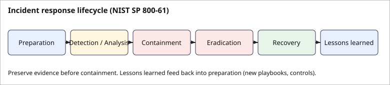

# Enterprise Network & Security Engineering — دوره‌ی تخصصی Cisco و Enterprise Firewall
## بخش ۱۰ از ۱۱ — فصل‌های ۲۸ تا ۳۰

| مورد | مقدار |
|---|---|
| نام دوره | Enterprise Network & Security Engineering (Cisco + FortiGate) |
| شماره بخش | ۱۰ از ۱۱ |
| فصل‌های این فایل | ۲۸ ، ۲۹ ، ۳۰ |
| تاریخ تولید | ۲۰۲۶-۱۱-۲۶ |
| نسخه Blueprint | v3.0 (+ بازبینی ۱٫۱) |
| نسخه‌های نرم‌افزار | FortiOS 7.0.3 (اسمی؛ بوت‌نشده؛ تأیید با `get system status`) ؛ Cisco vIOS-L2 15.2(20200924، Experimental) ؛ Cisco vIOS 15.9(3)M9 ؛ VPCS ؛ PNetLab 4.2.8 ؛ ESXi 8.0U2 ؛ CSR1000v 17.03.02 (IOS-XE؛ آزمایش‌نشده) |
| وضعیت تکمیل | **فصل‌های ۲۸–۳۰ تولید شد؛ Packet Analysis، Blue Team/Lifecycle، Migration.** Labها «اجرا نشده»؛ دستورها آزمایش‌نشده. |

> **قوانین خواندن:** تمرین‌ها و پرسش‌های مرور بدون پاسخ‌اند؛ پاسخ در «پاسخ‌های فصل». «اجرا نشده» یعنی خروجی‌ها **پیش‌نیاز/پیش‌بینی** هستند. «CLI-Accepted» ≠ «کار می‌کند». رمزها نمونه‌اند.

### وضعیت راستی‌آزمایی Labهای این بخش
خلاصه: اجرا نشده (فقط طراحی): 13.

| Lab | وضعیت |
|---|---|
| 28-1 | اجرا نشده (فقط طراحی) |
| 28-2 | اجرا نشده (فقط طراحی) |
| 28-3 | اجرا نشده (فقط طراحی) |
| 28-4 | اجرا نشده (فقط طراحی) |
| 28-5 | اجرا نشده (فقط طراحی) |
| 29-1 | اجرا نشده (فقط طراحی) |
| 29-2 | اجرا نشده (فقط طراحی) |
| 29-3 | اجرا نشده (فقط طراحی) |
| 29-4 | اجرا نشده (فقط طراحی) |
| 30-1 | اجرا نشده (فقط طراحی) |
| 30-2 | اجرا نشده (فقط طراحی) |
| 30-3 | اجرا نشده (فقط طراحی) |
| 30-4 | اجرا نشده (فقط طراحی) |

---

<a id="ch28"></a>

> **نسخه v3.9:** این بخش در دسته‌های B/A/C بدون تغییر محتوایی است (فشرده‌تر از فصل‌های توسعه‌یافته؛ در دسته D بازنویسی می‌شود).

# فصل 28 — Packet Analysis و بلوک‌های عیب‌یابی

**مدت:** ۳۶ ساعت | **پیش‌نیاز:** فصل ۲، ۱۴.
**اهداف:** تحلیل بسته با Wireshark و Sniffer FortiGate؛ TCP Handshake، Retransmission، DNS، TLS؛ ده‌پرسش عیب‌یابی؛ بلوک‌های TS تکرارپذیر.
**اشتباهات رایج:** Filter بیش‌ازحد باز؛ تحلیل بدون Baseline؛ فراموشی Disable Debug.

**درس‌های فصل:**
- [درس 28-1 — Sniffer و Capture درست](#l-28-1)
- [درس 28-2 — TCP Handshake، Retransmission و DNS](#l-28-2)
- [درس 28-3 — TLS و Certificate در Capture](#l-28-3)
- [درس 28-4 — ده‌پرسش عیب‌یابی و بلوک TS](#l-28-4)
- [درس 28-5 — آزمون فصل ۲۸](#l-28-5)

---

<a id="l-28-1"></a>

## درس 28-0 — تحلیل بسته عمیق: TCP، DNS، TLS و الگوهای خرابی در Wireshark/Sniffer

**فصل ۲۸ · درس افزوده (پیش‌درس ۲۸-۱) · پیش‌نیاز: ۲-۰، ۱۴-۷، ۱۱-۷ · ≈ ۸ ساعت**

> **وضعیت:** خروجی‌ها نمونه‌ی آموزشی‌اند؛ Capture واقعی در Lab «اجرا نشده».

### ۱) هدف آموزشی

1. TCP را از روی بسته تحلیل کند: Handshake، Window، Retransmission، Dup ACK، RST، Zero Window.
2. الگوهای خرابی را تشخیص دهد: Drop، MTU/PMTUD، Asymmetric، Latency، Packet Loss.
3. DNS و TLS را در Capture بخواند (Query/Response، SNI، Alert).
4. Capture را درست بگیرد (نقطه، Filter، حجم) و با Sniffer FortiGate تکمیل کند.
5. از Capture تا RCA بنویسد.

### ۲) مفهوم پایه: چیست و چرا؟ (از صفر، با زبان ساده)

**چرا تحلیل بسته؟** Log می‌گوید «چه رخ داد»؛ Capture می‌گوید «چه چیزی روی سیم رفت». برای «کند است» Log اغلب چیزی ندارد ولی بسته‌ها دارند: Retransmission، Window صفر، RST. یک ارتباط TCP سه مرحله دارد: Handshake، انتقال، بستن؛ هر مرحله الگوی نرمال و الگوی خراب دارد.

**جمع‌بندی اصلی درس:**

بسته‌ها «حقیقت میدانی»اند: لاگ می‌گوید فایروال چه تصمیمی گرفت؛ Capture می‌گوید روی سیم چه گذشت. تحلیل = مقایسه‌ی دو نقطه‌ی Capture (قبل/بعد از دستگاه).

### ۳) توضیح عمیق فنی

#### ۳-۱) نقطه‌ی Capture

``` text
Client --[A]-- FW(in) FW(out) --[B]-- Server
A and B captures: compare which packet disappears and where
```

اگر بسته در A هست و در B نیست: دستگاه میانی (Policy/Route/Drop). اگر هست ولی پاسخ نیست: سرور/مسیر برگشت.

#### ۳-۲) الگوهای TCP

| الگو | معنی | علت‌های رایج |
|---|---|---|
| SYN بدون SYN/ACK | اتصال برقرار نمی‌شود | Policy، Route، پورت بسته، Asymmetric |
| SYN, RST | پورت بسته/رد | سرویس، Firewall |
| Retransmission | بسته‌ی گم‌شده | تلفات، MTU، Congestion |
| Dup ACK ×3 | Fast retransmit | Loss/Reordering |
| Zero Window | گیرنده پر | برنامه کند |
| ICMP Frag Needed | PMTUD | MTU کمتر در مسیر |
| فقط بزرگ‌ها قفل | PMTUD Black hole | ICMP Block/MTU |

``` text
RTT ~= time between SYN and SYN/ACK
Retransmission rate = retransmitted segments / total segments
```

#### ۳-۳) Wireshark: Filterهای مفید

``` text
tcp.analysis.retransmission
tcp.analysis.duplicate_ack
tcp.flags.syn==1 and tcp.flags.ack==0
tcp.analysis.zero_window
icmp.type==3 and icmp.code==4
dns.flags.rcode != 0
tls.alert_message
```

#### ۳-۴) DNS و TLS

- DNS: Query بدون Response (UDP Drop/سرور)، NXDOMAIN (نام)، Response کند (Latency).
- TLS: ClientHello با SNI؛ Alert `bad_certificate`/`unknown_ca` (CA/Pinning)؛ Handshake کند (RTT/CPU Inspection).

#### ۳-۵) Sniffer FortiGate

`diagnose sniffer packet <if> "<filter>" 4 <count> l` (verbose 4: IP+Interface؛ 6: Ethernet هم)؛ خروجی را به فایل و با اسکریپت به PCAP تبدیل کنید (ابزار fgt2eth)؛ روی Offloadشده ممکن است ناقص باشد (۱۲-۹).

### ۴) مثال حل‌شده

**پرونده:** دانلود ۵۰ MB از VPN در ۲٪ می‌ایستد. Capture در دو سر: بسته‌های بزرگ (1500 B) از A می‌روند و در B نمی‌رسند؛ ICMP Frag Needed بازگردانده نمی‌شود (ICMP توسط Firewall میانی Block). **RCA:** PMTUD Black hole. **رفع:** MSS Clamp (`tcp-mss`)، اجازه‌ی ICMP Type 3 Code 4. **تأیید:** Capture: بسته‌های ≤ MSS؛ دانلود کامل.

**مثال متوسط:** SYN→RST: سرور پورت را نمی‌شناسد؛ مقایسه با `telnet`. **مثال سخت:** Retransmission فقط یک جهت: مسیر برگشت تلفات دارد (Interface Error) → `get system interface physical`.

### ۵) GUI و CLI

#### مثال ساده — RTT

``` text
RTT = SYN-ACK time - SYN time = 0.082 - 0.000 = 82 ms
```

#### مثال متوسط — سقف سرعت

``` text
Throughput max = Window / RTT = 65535 B / 0.082 s ~ 6.4 Mbps
```

یعنی روی لینک 100 Mbps با این Window فقط ~6.4 Mbps؛ Window Scaling خاموش.

#### مثال سخت — دو علت

Window Scaling حذف‌شده + Loss ۳٪. رفع یکی‌یکی و اندازه‌گیری مجدد.

#### مثال‌های اصلی درس (مرور)

**GUI:** Network → Diagnostics → Packet Capture؛ **CLI:** `diagnose sniffer packet any "host X and port Y" 6 100 l`.

### ۶) نکات امنیتی

- PCAP داده‌ی حساس دارد: محدود، رمزنگاری، حذف.
- Capture مجاز و مستند.

### ۷) جمع‌بندی

- دو نقطه‌ی Capture بسته‌ی گم‌شده را پیدا می‌کنند.
- الگوهای TCP علت را نشان می‌دهند.
- MTU/ICMP/Asymmetric سه علت شایع.

### ۸) تمرین و ارزیابی

**ت1.** (ساده) SYN بدون SYN/ACK یعنی چه؟ *(پاسخ: 28-0-ت1)*

**ت2.** (متوسط) PMTUD Black hole را توضیح دهید. *(پاسخ: 28-0-ت2)*

**ت3.** (سخت) Capture دو نقطه‌ای را برای یافتن Drop بنویسید. *(پاسخ: 28-0-ت3)*

**Q1.** Quick quiz (English): Which ICMP type and code signal fragmentation needed? *(پاسخ: 28-0-Q1)*

### ۹) اصطلاحات و English Corner

| مخفف | شکل کامل | معنی |
|---|---|---|
| PMTUD | Path MTU Discovery | کشف MTU مسیر |
| RTT | Round-Trip Time | زمان رفت و برگشت |
| PCAP | Packet capture | فایل بسته |
| Dup ACK | Duplicate ACK | ACK تکراری |

- *Capture at two points to locate where packets disappear.* ← در دو نقطه Capture بگیرید تا محل ناپدید شدن بسته‌ها پیدا شود.

### ۱۰) منابع

- Wireshark User's Guide (TCP analysis)؛ RFC 1191 (PMTUD)، RFC 9293 (TCP)، RFC 792 (ICMP).

### بخش تکمیلی درس: سناریوی واقعی، مثال‌های بیشتر و عیب‌یابی

> بخش‌های زیر درس بالا را کامل می‌کنند: سناریوی گام‌به‌گام، مثال‌های بیشتر از ساده تا سخت، جدول عیب‌یابی و پرسش‌های مصاحبه. ابتدا بخش‌های اصلی بالا را مطالعه کنید.

### تعمیق: الگوهای خرابی در Capture

| الگو | نشانه در Wireshark |
|---|---|
| بسته‌ی گم‌شده | `tcp.analysis.retransmission` |
| Window کوچک | `tcp.analysis.zero_window` |
| RST ناگهانی | `tcp.flags.reset==1` |
| DNS کند | فاصله‌ی Query/Response > 1 s |

**پرسش‌های مصاحبه**
1. *Retransmission یعنی؟* ACK نرسیده.
2. *Zero Window؟* گیرنده پر.
3. *RST از کجا؟* سرور/فایروال.

### مثال حل‌شده: «دانلود کند است» از روی Capture

**داده:** SYN در 0.000، SYN-ACK در 0.082، سپس دریافت با Retransmission پراکنده و Window=0 دوبار.

``` text
RTT = 0.082 - 0.000 = 82 ms
Throughput bound = Window / RTT = 65535 B / 0.082 s ~ 0.8 MB/s ~ 6.4 Mbps
```

نتیجه: با Window کوچک حتی لینک 100 Mbps حدود 6.4 Mbps می‌دهد؛ علت: گیرنده کند یا Window Scaling خاموش. ابزار: فیلتر `tcp.window_size_value` و `tcp.options.wscale`.

### تکمیل عمیق: چرا تحلیل بسته، «چشم‌های» مهندس شبکه است؟

#### چرا باید یاد بگیریم؟

Log می‌گوید «چه چیزی رخ داد»؛ Capture نشان می‌دهد «واقعاً چه چیزی روی سیم رفت». وقتی کاربر می‌گوید «کند است»، Log معمولاً چیزی ندارد، ولی بسته‌ها دارند: Retransmission، Window صفر، RST، DNS کند. تحلیل بسته مثل آزمایش خون است؛ علامت را به علت وصل می‌کند.

#### توضیح ساده

یک ارتباط TCP سه مرحله دارد: **Handshake**، **انتقال داده**، **بستن**. هر مرحله الگوی طبیعی و الگوی خراب دارد.

``` text
Normal  : SYN -> SYN,ACK -> ACK -> data/ACK ... -> FIN/ACK
Broken 1: SYN -> SYN -> SYN (no reply)         => unreachable / dropped
Broken 2: SYN -> RST                            => port closed / policy reset
Broken 3: data -> data (retransmission)        => loss on path
Broken 4: Window = 0                            => receiver overloaded
```

#### مثال ساده — محاسبه‌ی RTT

SYN در زمان 0.000 و SYN-ACK در 0.082 دیده شد.

``` text
RTT = 0.082 - 0.000 = 82 ms
```

RTT = Round Trip Time، یعنی زمان رفت‌وبرگشت.

#### مثال متوسط — سقف سرعت از روی Window

TCP نمی‌تواند سریع‌تر از Window/RTT برود.

``` text
Throughput max = Window / RTT
65535 bytes / 0.082 s = ~799,000 bytes/s = ~6.4 Mbps
```

یعنی حتی روی لینک 100 Mbps، با این Window و RTT بیش از ~6.4 Mbps نمی‌گیرید، مگر Window Scaling فعال باشد. این پاسخ کلاسیک «چرا لینک ۱۰۰ مگ است ولی سرعت ۶ مگ؟» است.

#### مثال سخت — دو علت هم‌زمان

کاربر از شعبه به سرور مرکزی کند است. Capture: RTT=80ms، Retransmission ۳٪، Window Scaling خاموش. دو علت: (۱) Window Scaling توسط یک Middlebox حذف شده؛ (۲) Loss ۳٪ روی لینک. رفع: بررسی Option در SYN، و بررسی کیفیت لینک؛ اندازه‌گیری مجدد پس از هر رفع (تغییر یکی‌یکی).

#### ابزارها

``` text
wireshark display filters:
 tcp.analysis.retransmission
 tcp.analysis.zero_window
 tcp.flags.reset == 1
 dns
 tls.handshake
```

#### Lab

یک pcap نمونه‌ی عمومی (مثلاً از نمونه‌های Wireshark Wiki) را باز و RTT و Retransmission را ثبت کنید.

#### عیب‌یابی

| علامت | شاهد | علت محتمل |
|---|---|---|
| SYN بی‌پاسخ | تکرار SYN | Drop/Route |
| RST بلافاصله | RST پس از SYN | پورت بسته/Policy |
| کندی با Loss | Retrans | کیفیت لینک |
| سرعت پایین با Loss صفر | Window کوچک | Window Scaling |

#### پرسش‌ها با پاسخ

**۱. RTT را از کجا بخوانیم؟** فاصله‌ی SYN تا SYN-ACK.
**۲. چرا Window Scaling مهم است؟** سقف سرعت.
**۳. RST یعنی؟** قطع ناگهانی توسط یکی از طرفین یا Middlebox.

#### English Corner

- *Round-trip time is measured between SYN and SYN-ACK.*
- Q: Why can a 100 Mbps link give only 6 Mbps for one TCP flow?

## درس 28-1 — Capture درست: انتخاب نقطه، Filter، Sniffer FortiGate، PCAP، Offload و ملاحظات امنیت/قانون

**فصل 28 · بازنویسی عمیق · پیش‌نیاز: ۲۸-۰، ۱۴-۷، ۱۲-۹ · ≈ 8 ساعت**

> **وضعیت:** FortiOS 7.0.3 (بوت‌نشده)؛ خروجی‌ها نمونه‌ی آموزشی‌اند؛ دستورها `Unverified`؛ Lab «اجرا نشده».

<!--deep-->

### هدف آموزشی

در پایان این درس باید بتوانید:

1. از روی سؤال عیب‌یابی، نقطه‌ی Capture (دونقطه‌ای، سه‌نقطه‌ای، قبل/بعد از NAT) را انتخاب کنید.
2. Filter دقیق BPF و محدودیت حجم/زمان بنویسید.
3. Sniffer FortiGate (verbose، count، timestamp) را بخوانید و به PCAP تبدیل کنید.
4. اثر Offload و Interface مجازی را بر کامل‌بودن Capture بدانید.
5. محدودیت‌های امنیتی/قانونی PCAP را رعایت کنید.
6. Capture را در Wireshark با Display Filter تحلیل اولیه کنید.

### چرا باید یاد بگیریم؟

Capture بد بدتر از نبودن است: ۲ گیگابایت فایل، بدون زمان، از نقطه‌ی اشتباه؛ هیچ‌چیز نمی‌گوید و ساعت‌ها هدر می‌دهد. Capture خوب مثل عکس‌برداری دقیق از صحنه‌ی تصادف است: از زاویه‌ی درست، با زمان ثبت‌شده، و فقط همان‌چه لازم. قاعده‌ی ارشد: اول سؤال، بعد نقطه، بعد فیلتر، بعد Capture.

### از سؤال به نقطه

| سؤال | نقطه‌ها |
|---|---|
| بسته به فایروال می‌رسد؟ | Interface ورودی فایروال (یا SPAN بالاتر) |
| فایروال آن را عبور می‌دهد؟ | ورودی و خروجی همان فایروال |
| NAT چه کرد؟ | ورودی (آدرس اصلی) و خروجی (ترجمه‌شده) |
| سرور پاسخ می‌دهد؟ | روی خود سرور |
| مسیر برگشت متقارن است؟ | هر دو مسیر/فایروال |
| MTU/Fragment؟ | دو سر تونل |

قاعده‌ی سه‌نقطه‌ای: **کلاینت، FW-in، FW-out** (و در صورت نیاز سرور).

``` text
[Client] --(A)--> [FW port2 (B)]  [FW port1 (C)] --(D)--> [Server]
  A: client capture   B: FW in   C: FW out   D: server capture
```

### Sniffer FortiGate

``` text
diagnose sniffer packet <interface|any> '<BPF filter>' <verbose> <count> <timestamp>
```

| verbose | محتوا |
|---|---|
| 1 | سرآیند IP |
| 3 | + Payload و Ethernet (hex) |
| 4 | + نام Interface |
| 6 | + Payload، Ethernet، Interface (برای PCAP) |

``` text
diagnose sniffer packet port2 'host 10.10.0.5 and tcp port 443' 4 100 a
diagnose sniffer packet any 'host 10.10.0.5 and host 198.51.100.8' 6 0 a
```

`count 0` بی‌پایان (با Ctrl+C)؛ برای PCAP از سطح 6 و تبدیل با `fgt2eth.pl` (Perl، ابزار Fortinet/Community) یا استفاده از GUI Packet Capture که مستقیم PCAP می‌دهد.

### GUI Packet Capture

Network > Packet Capture: Interface، Filter، تعداد، Start، Download. مناسب‌تر برای فایل‌های حجیم و عدم تبدیل دستی.

### Filter BPF

``` text
host 10.10.0.5
host 10.10.0.5 and tcp port 443
net 10.10.0.0/24 and not port 22
tcp[tcpflags] & (tcp-syn|tcp-ack) = tcp-syn
udp port 53
icmp
```

اصل: Filter باریک (Host + Port)، Snaplen محدود برای حریم، و مدت کوتاه (۳۰–۱۲۰ ثانیه).

### Offload و محدودیت‌ها

| مورد | اثر |
|---|---|
| NPU Offload | بسته‌های بعد از Session Setup در سخت‌افزار؛ Sniffer فقط چند بسته‌ی اول را می‌بیند |
| Interface مجازی (VLAN/tunnel) | `any` بسته را دوبار نشان می‌دهد (ورود/خروج) |
| TSO/GRO در کلاینت | بسته‌های بزرگتر از MTU در Capture کلاینت |
| Snaplen | Payload بریده |

راه‌حل Offload: موقتاً `set auto-asic-offload disable` روی Policy (فقط آزمایش، اثر عملکرد) یا Capture در سمت دیگر.

### ملاحظات امنیتی و قانونی

PCAP ممکن است رمز، توکن، ایمیل شخصی داشته باشد. قاعده‌ها: مجوز مکتوب، حداقل فیلتر، Snaplen کم (فقط سرآیند در صورت امکان)، ذخیره‌ی رمزگذاری‌شده، حذف پس از پایان، دسترسی محدود.

### Wireshark — تحلیل اولیه

``` text
ip.addr == 10.10.0.5 && tcp.port == 443
tcp.flags.syn == 1 && tcp.flags.ack == 0
tcp.analysis.retransmission
dns
tls.handshake
```

Statistics > Conversations و Expert Information، خلاصه‌ی سریع مشکلات را می‌دهند.

### مثال‌های حل‌شده

#### مثال ساده — دو نقطه

مشکل: «سرور پاسخ نمی‌دهد». Capture FW-in: SYN دیده می‌شود. FW-out: SYN دیده می‌شود. هیچ SYN-ACK ⇒ سرور/بالادست. زمان ۲ دقیقه.

#### مثال متوسط — NAT

FW-in: src 10.10.0.5؛ FW-out: src 203.0.113.2. NAT درست. اگر FW-out هنوز 10.10.0.5 ⇒ NAT نشده.

#### مثال متوسط — Offload

Capture فقط ۵ بسته‌ی اول Session را نشان می‌دهد. علت: Offload. برای آزمون Policy موقت بدون Offload یا Capture روی سرور.

#### مثال سخت — حریم و قانون

مدیر ارشد: «همه‌ی ترافیک کارمندان را ۱ ساعت ضبط کن». مخاطرات: داده‌ی شخصی، قانون. پاسخ: Capture فقط برای Host مشکل‌دار، Snaplen 96 بایت، مجوز، حذف پس از تحلیل. مستندسازی.

#### مثال سخت — `any` و تکرار

`diagnose sniffer packet any` هر بسته را چند بار (روی Interface‌ها و VLAN) نشان می‌دهد و Wireshark Retransmission کاذب می‌بیند. راه: Interface مشخص یا فیلتر `-i`/Interface نام.

### Lab هدایت‌شده (اجرا نشده)

1. سه‌نقطه‌ای با فیلتر.
2. PCAP و Wireshark.
3. Offload و تأثیر.

### عیب‌یابی سریع

| علامت | علت | رفع |
|---|---|---|
| Capture خالی | فیلتر/Interface | سادگی |
| بسته‌ی کم | Offload | موقت |
| بسته تکراری | any | Interface |
| فایل حجیم | بی‌فیلتر | host/port/count |

### نکات امنیتی

مجوز؛ حداقل داده؛ رمزنگاری فایل؛ حذف؛ دسترسی محدود؛ ثبت (Evidence Chain).

### جمع‌بندی

اول سؤال، بعد نقطه‌ی Capture (سه‌نقطه‌ای)؛ Filter باریک؛ Sniffer FortiGate و PCAP؛ اثر Offload؛ ملاحظات قانونی؛ تحلیل با Wireshark.

### تمرین و ارزیابی

**ت1.** (ساده) چرا Capture دو‌نقطه‌ای؟ *(پاسخ: 28-1-ت1)*

**ت2.** (ساده) verbose 4 چه نشان می‌دهد؟ *(پاسخ: 28-1-ت2)*

**ت3.** (متوسط) Filter برای فقط SYN/RST؟ *(پاسخ: 28-1-ت3)*

**ت4.** (متوسط) چرا `any` بسته‌ی تکراری نشان می‌دهد؟ *(پاسخ: 28-1-ت4)*

**ت5.** (سخت) Sniffer بسته‌ای نمی‌بیند ولی ترافیک می‌رود؛ تحلیل. *(پاسخ: 28-1-ت5)*

**ت6.** (سخت، طراحی) روش‌نامه‌ی Capture امن برای یک حادثه. *(پاسخ: 28-1-ت6)*

**Q1.** Quick quiz (English): Why should captures be taken at two points around the firewall? *(پاسخ: 28-1-Q1)*

### اصطلاحات و English Corner

| مخفف | شکل کامل | معنی |
|---|---|---|
| BPF | Berkeley Packet Filter | زبان Filter بسته |
| PCAP | Packet capture file | فایل Capture |
| SPAN | Switched Port Analyzer | آینه‌ی پورت |

- *Use narrow capture filters.* ← از Filter باریک استفاده کنید.

### کارت Lab

**کارت Lab:** Capture. **وضعیت:** اجرا نشده. **Evidence:** `03-ops/capture.md`.

### منابع

- Wireshark User Guide
- Fortinet Docs: Packet capture / diagnose sniffer (7.0)
- tcpdump/pcap-filter manual

<a id="l-28-2"></a>

## درس 28-2 — تحلیل TCP و DNS در Capture: Handshake، Window، Retransmission، RTT، RST و الگوهای خرابی

**فصل 28 · بازنویسی عمیق · پیش‌نیاز: ۲۸-۰، ۲۸-۱، ۲-۰ · ≈ 9 ساعت**

> **وضعیت:** FortiOS 7.0.3 (بوت‌نشده)؛ خروجی‌ها نمونه‌ی آموزشی‌اند؛ دستورها `Unverified`؛ Lab «اجرا نشده».

<!--deep-->

### هدف آموزشی

در پایان این درس باید بتوانید:

1. TCP Handshake، Seq/Ack، Window و Flagها را در Capture بخوانید.
2. Retransmission، Duplicate ACK، Zero Window و Reset را تشخیص دهید.
3. DNS Query/Response، RCODE، TTL و TCP Fallback را تحلیل کنید.
4. با Wireshark Expert و Display Filter علت را بیابید.
5. RTT و Latency را از Handshake محاسبه کنید.
6. مثال‌های واقعی را به علت (شبکه/سرور/کلاینت) نسبت دهید.

### چرا باید یاد بگیریم؟

TCP مثل مکالمه‌ی تلفنی منظم است: سلام، علیک، تأیید دریافت هر جمله. وقتی مکالمه مشکل دارد، الگوی خاصی دارد: تکرار جمله (Retransmission)، «صدایتان را نمی‌شنوم» (Zero Window)، قطع ناگهانی (RST). مهندس ارشد از الگو علت را می‌خواند، نه حدس. DNS هم «دفترچه‌ی تلفن» است و بسیاری از خرابی‌ها فقط DNS هستند.

### TCP Handshake

``` text
Client -> Server : SYN       seq=x
Server -> Client : SYN, ACK  seq=y ack=x+1
Client -> Server : ACK       ack=y+1
```

RTT اولیه = زمان بین SYN و SYN-ACK (در Capture نزدیک کلاینت).

``` text
RTT ~ t(SYN-ACK) - t(SYN)
Example: 10:15:01.100 -> 10:15:01.145 => 45 ms
```

### پرچم‌ها

| پرچم | معنی |
|---|---|
| SYN | شروع |
| ACK | تأیید |
| FIN | پایان مؤدبانه |
| RST | قطع فوری (Reset) |
| PSH | تحویل فوری |

### الگوهای مشکل

| الگو | معنی | علت‌های محتمل |
|---|---|---|
| SYN تکراری بدون SYN-ACK | مقصد جواب نمی‌دهد | Firewall/Route/سرور |
| SYN → RST | پورت بسته | سرویس/Policy Reject |
| Retransmission | بسته‌ی گم‌شده | تلفات لینک، MTU، شلوغی |
| Duplicate ACK | گیرنده بسته‌ی بعدی را دریافت می‌کند ولی قبلی گم است | تلفات |
| Zero Window | بافر گیرنده پر | سرور/کلاینت کند |
| RST در میانه | قطع | Firewall/IPS/برنامه |
| Window کوچک | Throughput پایین | Scaling خاموش |
| Out-of-order | ترتیب‌شکنی | چند مسیر |

``` text
tcp.analysis.retransmission
tcp.analysis.fast_retransmission
tcp.analysis.duplicate_ack
tcp.analysis.zero_window
tcp.analysis.window_full
tcp.flags.reset == 1
```

### Throughput و Window

``` text
Max throughput ~ Window / RTT
Window 64 KB, RTT 50 ms:
64,000 B x 8 / 0.05 s = 10.24 Mbps
```

با RTT زیاد و Window کوچک، حتی لینک ۱ Gbps کند است؛ Window Scaling باید فعال باشد (SYN: `WS=...`).

### DNS

``` text
dns.flags.response == 0         (queries)
dns.flags.rcode != 0            (errors)
dns.time > 0.5                  (slow responses)
```

| RCODE | معنی |
|---|---|
| 0 NOERROR | موفق |
| 2 SERVFAIL | خطای Resolver/DNSSEC |
| 3 NXDOMAIN | نام وجود ندارد |
| 5 REFUSED | مجاز نیست |

نکات: TTL (کش)، UDP→TCP Fallback (پاسخ بزرگ، TC bit)، چند Resolver.

### مثال‌های حل‌شده

#### مثال ساده — Handshake

SYN، SYN-ACK، ACK با RTT ۴۵ms: اتصال سالم. وب کند ⇒ مشکل بعد از Handshake (سرور/برنامه).

#### مثال متوسط — Retransmission

``` text
t=0.000 SYN
t=1.000 SYN (retransmit)
t=3.000 SYN (retransmit)
```

فواصل ۱، ۲ ثانیه (Backoff). SYN-ACK نمی‌آید ⇒ مقصد/Policy بالادست. با Capture سمت دیگر: SYN رسیده؟ اگر نه ⇒ مسیر؛ اگر بله ⇒ سرور.

#### مثال متوسط — DNS

`nslookup` کند. Capture: Query در t=0، پاسخ t=2.1s. `dns.time` ۲٫۱ثانیه ⇒ Resolver اول Timeout (۲ثانیه) سپس Resolver دوم. رفع: Resolver خراب را حذف.

#### مثال سخت — Zero Window

آپلود به سرور تا ۲۰٪ پیش می‌رود، سپس Zero Window از سرور. علت: سرور دیسک کند/Thread پر. فایروال بی‌تقصیر؛ Evidence: `tcp.analysis.zero_window` از سرور. تفکیک نقش‌ها: شبکه سالم.

#### مثال سخت — RST میانی

اتصال پس از ۱۵ ثانیه RST می‌خورد. RST با TTL متفاوت (مثلاً TTL 64 در برابر TTL سرور 128) ⇒ RST تزریق‌شده توسط میانی (IPS/Firewall). مقایسه‌ی TTL و `ip.id`. سپس Log IPS/Policy فایروال.

### Lab هدایت‌شده (اجرا نشده)

1. PCAP نمونه: Handshake و RTT.
2. Retransmission و DNS Slow.
3. Zero Window و RST.

### عیب‌یابی سریع

| علامت | علت | رفع |
|---|---|---|
| SYN بی‌جواب | مقصد | سمت دیگر |
| RST | پورت/Policy | Log |
| Zero Window | سرور | برنامه |
| DNS کند | Resolver | حذف |

### نکات امنیتی

PCAP DNS نام‌های داخلی را لو می‌دهد؛ حفاظت؛ تحلیل TTL برای کشف تزریق.

### جمع‌بندی

TCP: Handshake و الگوها (Retransmission، Dup ACK، Zero Window، RST)؛ Throughput = Window/RTT؛ DNS RCODE و زمان؛ تحلیل نقش‌ها (شبکه/سرور/کلاینت).

### تمرین و ارزیابی

**ت1.** (ساده) SYN→RST یعنی چه؟ *(پاسخ: 28-2-ت1)*

**ت2.** (ساده) Zero Window چیست؟ *(پاسخ: 28-2-ت2)*

**ت3.** (متوسط) Window 64 KB و RTT 100 ms: حد Throughput؟ *(پاسخ: 28-2-ت3)*

**ت4.** (متوسط) BDP برای 100 Mbps و 80 ms؟ *(پاسخ: 28-2-ت4)*

**ت5.** (سخت) Retrans 3٪ + MTU مشکوک؛ جداسازی دو علت. *(پاسخ: 28-2-ت5)*

**ت6.** (سخت، طراحی) گزارش تحلیل Capture را با ساختار بنویسید. *(پاسخ: 28-2-ت6)*

**Q1.** Quick quiz (English): How does window size limit TCP throughput? *(پاسخ: 28-2-Q1)*

### اصطلاحات و English Corner

| مخفف | شکل کامل | معنی |
|---|---|---|
| BDP | Bandwidth-delay product | حاصل‌ضرب پهنای باند و تأخیر |
| RTT | Round-trip time | زمان رفت و برگشت |
| Window scaling | TCP window scaling | مقیاس Window |

- *Patterns in packets point to specific causes.* ← الگوها در بسته‌ها به علت‌های مشخص اشاره می‌کنند.

### کارت Lab

**کارت Lab:** TCP. **وضعیت:** اجرا نشده. **Evidence:** `03-ops/tcp.md`.

### منابع

- RFC 9293
- RFC 7323 (Window Scale)
- Wireshark docs

<a id="l-28-3"></a>

## درس 28-3 — TLS در Capture: Handshake، SNI، Certificate، Alert، TLS 1.3 و اثر Inspection

**فصل 28 · بازنویسی عمیق · پیش‌نیاز: ۲۸-۰، ۱۶-۰، ۱۶-۵ · ≈ 8 ساعت**

> **وضعیت:** FortiOS 7.0.3 (بوت‌نشده)؛ خروجی‌ها نمونه‌ی آموزشی‌اند؛ دستورها `Unverified`؛ Lab «اجرا نشده».

<!--deep-->

### هدف آموزشی

در پایان این درس باید بتوانید:

1. TLS Handshake (1.2 و 1.3) را در Capture بخوانید.
2. SNI، Cipher Suite، Version و Certificate را بیابید.
3. Alertهای TLS را تفسیر کنید.
4. تفاوت TLS 1.3 (رمزشدن Certificate) را در تحلیل بدانید.
5. اثر SSL Inspection را روی Handshake ببینید.
6. خطاهای رایج (Chain، Expired، SNI، Pinning) را تشخیص دهید.

### چرا باید یاد بگیریم؟

بیشتر ترافیک امروز TLS است؛ Capture آن شبیه نامه‌ی مهر و موم‌شده است. ولی «پاکت» (Handshake) قابل‌خواندن است: چه سایتی (SNI)، چه نسخه‌ای، چه رمزنگاری‌ای، آیا Certificate معتبر بود، چرا قطع شد. خیلی از «سایت باز نمی‌شود»ها را فقط با Handshake و Alert می‌شود حل کرد، بدون رمزگشایی محتوا.

### Handshake TLS 1.2

``` text
C -> S : ClientHello   (versions, ciphers, SNI, extensions)
S -> C : ServerHello   (chosen version/cipher)
S -> C : Certificate   (chain)
S -> C : ServerKeyExchange / ServerHelloDone
C -> S : ClientKeyExchange, ChangeCipherSpec, Finished
S -> C : ChangeCipherSpec, Finished
```

### Handshake TLS 1.3

``` text
C -> S : ClientHello (key_share, SNI, supported_versions)
S -> C : ServerHello (key_share) + {EncryptedExtensions, Certificate, Finished}  (encrypted)
C -> S : {Finished}
```

در 1.3 Certificate رمز می‌شود و در Capture دیده نمی‌شود؛ فقط SNI (مگر ECH) و نسخه.

### فیلتر Wireshark

``` text
tls.handshake.type == 1                          (ClientHello)
tls.handshake.type == 2                          (ServerHello)
tls.handshake.type == 11                         (Certificate; TLS 1.2 only visible)
tls.handshake.extensions_server_name
tls.alert_message
tcp.flags.reset == 1
```

### Alertهای رایج

| Alert | معنی | علت |
|---|---|---|
| handshake_failure (40) | توافق نشد | Cipher/Version |
| bad_certificate (42) | گواهی بد | خراب |
| certificate_expired (45) | منقضی | تاریخ |
| unknown_ca (48) | CA ناشناس | Chain/Trust |
| protocol_version (70) | نسخه‌ی پشتیبانی‌نشده | TLS قدیمی |
| internal_error (80) | خطای سرور | سرور |
| close_notify (0) | پایان عادی | - |

### تحلیل Cipher/Version

``` text
tls.handshake.ciphersuite
tls.record.version
```

Cipherهای قدیمی (RC4، 3DES، CBC بدون AEAD)، نسخه‌ی 1.0/1.1 ⇒ هشدار. سیاست: حداقل TLS 1.2، ترجیح AEAD (GCM/ChaCha).

### SSL Inspection و Handshake

با Deep Inspection دو Handshake جدا: کلاینت↔FortiGate (Certificate صادرشده توسط CA فایروال) و FortiGate↔سرور (Certificate واقعی). در Capture سمت کلاینت Issuer = CA فایروال. در Capture سمت سرور Issuer = CA عمومی.

### مثال‌های حل‌شده

#### مثال ساده — SNI

ClientHello با SNI `app.example.com`. فایروال Web Filter بدون Deep Inspection فقط همین را می‌بیند و بر اساس آن بلاک می‌کند.

#### مثال متوسط — handshake_failure

Client TLS 1.0 فقط؛ سرور حداقل 1.2. Alert 40 یا 70 ⇒ رفع: به‌روزرسانی کلاینت (یا آگاهانه TLS 1.0 در سرور داخلی قدیمی با ریسک).

#### مثال متوسط — unknown_ca

کاربران پس از Deep Inspection خطای گواهی. Capture: Alert `unknown_ca` از کلاینت پس از دیدن Certificate با Issuer = CA فایروال. علت: CA روی کلاینت نصب نیست. رفع: GPO.

#### مثال سخت — Pinning

اپ موبایل بعد از Inspection قطع شد: Client بدون Alert چه، سریع FIN/RST پس از Certificate. مشخصه‌ی Certificate Pinning. رفع: Exempt (FQDN) نه Category کامل.

#### مثال سخت — MTU و ClientHello

ClientHello بزرگ (Post-Quantum Key Share در مرورگرهای جدید، ~1.5KB+) در Fragment گم می‌شود (MTU/MSS)؛ سایت باز نمی‌شود ولی بقیه باز می‌شود. Capture: ClientHello Retransmission بدون ServerHello. رفع: MSS Clamp/PMTUD، بررسی IPS/Inspection که Fragment را درست نمی‌بیند. (الگوی واقعی در مرورگرهای جدید.)

### Lab هدایت‌شده (اجرا نشده)

1. Capture Handshake 1.2 و 1.3.
2. Alertها را ایجاد و بخوانید.
3. Deep Inspection و Issuer.

### عیب‌یابی سریع

| علامت | علت | رفع |
|---|---|---|
| unknown_ca | CA | نصب |
| handshake_failure | Cipher/Version | به‌روزرسانی |
| قطع بعد از Certificate | Pinning | Exempt |
| ClientHello گم | MTU | MSS |

### نکات امنیتی

TLS ≥ 1.2؛ حذف Cipher ضعیف؛ Capture TLS محتوای رمز دارد (حریم)؛ Keylog فقط در Lab.

### جمع‌بندی

TLS Handshake: SNI، Version، Cipher، Certificate (1.2) یا رمزشده (1.3)؛ Alertها؛ اثر Inspection؛ دام‌ها (Pinning، MTU، unknown_ca).

### تمرین و ارزیابی

**ت1.** (ساده) SNI چیست و کجا دیده می‌شود؟ *(پاسخ: 28-3-ت1)*

**ت2.** (ساده) چرا در TLS 1.3 گواهی دیده نمی‌شود؟ *(پاسخ: 28-3-ت2)*

**ت3.** (متوسط) unknown_ca چه می‌گوید؟ *(پاسخ: 28-3-ت3)*

**ت4.** (متوسط) چگونه Inspection را اثبات می‌کنید؟ *(پاسخ: 28-3-ت4)*

**ت5.** (سخت) برنامه‌ی Pinned خطا می‌دهد؛ تصمیم. *(پاسخ: 28-3-ت5)*

**ت6.** (سخت، طراحی) سیاست QUIC/ECH سازمان. *(پاسخ: 28-3-ت6)*

**Q1.** Quick quiz (English): Which command-line tool can show the issuer of the certificate presented through a firewall? *(پاسخ: 28-3-Q1)*

### اصطلاحات و English Corner

| مخفف | شکل کامل | معنی |
|---|---|---|
| ECH | Encrypted Client Hello | رمزکردن ClientHello |
| Pinning | Certificate pinning | پین‌کردن گواهی |
| QUIC | QUIC transport | انتقال روی UDP |

- *The certificate issuer reveals whether inspection is active.* ← Issuer گواهی نشان می‌دهد Inspection فعال است یا نه.

### کارت Lab

**کارت Lab:** TLS. **وضعیت:** اجرا نشده. **Evidence:** `03-ops/tls.md`.

### منابع

- RFC 8446
- RFC 6066
- Wireshark TLS docs

<a id="l-28-4"></a>

## درس 28-4 — ده‌پرسش عیب‌یابی و بلوک‌های TS: چارچوب، سه پرونده‌ی کامل و کتابخانه‌ی TS

**فصل 28 · بازنویسی عمیق · پیش‌نیاز: ۱۴-۷، ۲۸-۱ تا ۲۸-۳ · ≈ 9 ساعت**

> **وضعیت:** FortiOS 7.0.3 (بوت‌نشده)؛ خروجی‌ها نمونه‌ی آموزشی‌اند؛ دستورها `Unverified`؛ Lab «اجرا نشده».

<!--deep-->

### هدف آموزشی

در پایان این درس باید بتوانید:

1. چارچوب ده‌پرسش را برای هر مشکل اجرا کنید.
2. بلوک TS (Troubleshooting) با فرضیه‌های رتبه‌بندی‌شده و شواهد بنویسید.
3. سه پرونده‌ی کامل (VPN، HTTPS کند، MTU) را حل و RCA کنید.
4. کتابخانه‌ی TS قابل‌استفاده‌ی مجدد بسازید.
5. مقایسه‌ی شواهد و رد فرضیه را تمرین کنید.
6. گزارش ۱‌صفحه‌ای ارائه دهید.

### چرا باید یاد بگیریم؟

عیب‌یاب خوب مثل کارآگاه است: فهرست مظنونان (فرضیه‌ها) می‌سازد، برای هرکدام آزمایش ارزان دارد و بر اساس شواهد حذف می‌کند. عیب‌یاب ضعیف همه را همزمان متهم می‌کند و هیچ‌کدام را اثبات نمی‌کند. «بلوک TS» قالبی است که این روش را ثبت‌پذیر و قابل‌تکرار می‌کند: هر عضو تیم همان ساختار را می‌خواند و می‌نویسد.

### بلوک TS

``` text
TS-ID       : TS-2026-0147
Symptom     : who/what/when
Scope       : users/sites affected; not affected
Change      : recent changes (CHG)
Hypotheses  : H1..Hn ranked by likelihood x cost to test
Tests       : command / capture / expected result for each
Evidence    : outputs with timestamps (file names)
Cause       : the surviving hypothesis, proven
Fix         : minimal change + rollback
Verify      : positive and negative tests
Prevent     : monitoring / checklist / design change
```

### ده‌پرسش (یادآوری)

۱ علامت دقیق؟ ۲ Scope؟ ۳ از چه زمانی/چه تغییری؟ ۴ L1/L2؟ ۵ Route؟ ۶ Policy؟ ۷ NAT/Session؟ ۸ DNS؟ ۹ MTU/TLS؟ ۱۰ Verify؟

### رتبه‌بندی فرضیه

``` text
Score = Likelihood (1-5) x (6 - Cost to test (1-5))
```

فرضیه‌ی محتمل و ارزان‌آزمون اول. مثال: «DNS خراب» (محتمل ۴، هزینه ۱) امتیاز ۲۰؛ «باگ Firmware» (۱، ۵) امتیاز ۱.

### پرونده ۱ — VPN

**Symptom:** تونل بالا ولی ترافیک نمی‌رسد (شعبه B).

| فرضیه | آزمون | نتیجه |
|---|---|---|
| H1 Route | `get router info routing-table details` | سالم |
| H2 Policy | `iprope lookup` | policy 0 |
| H3 Selector | `diagnose vpn tunnel list` | سالم |

Cause: Policy یک‌طرفه. Fix: Policy معکوس. Verify: ping، شمارنده‌ی enc/dec.

### پرونده ۲ — HTTPS کند

**Symptom:** HTTP سریع، HTTPS کند فقط از شعبه.

| فرضیه | آزمون | نتیجه |
|---|---|---|
| H1 DNS | `dig` | سالم |
| H2 MTU | `ping -f -l 1400` | شکست |
| H3 SSL Inspection CPU | `diagnose sys top` | سالم |

Cause: MTU تونل/ICMP بلاک. Fix: MSS Clamp 1360. Verify: SYN با `mss 1360`، سرعت.

### پرونده ۳ — MTU/Fragment

**Symptom:** RDP قطع می‌شود، ping کوچک خوب.

| فرضیه | آزمون | نتیجه |
|---|---|---|
| H1 ISP | ping طولانی | ok |
| H2 MTU | `ping -f` | MTU 1400 |
| H3 NIC کلاینت | Capture | ok |

Cause: Fragment UDP RDP روی تونل. Fix: MTU Interface تونل 1400 + `tcp-mss`. Verify: پایداری ۳۰ دقیقه.

### کتابخانه‌ی TS

فهرست الگوها: «تونل بالا ولی ترافیک نه»، «HTTPS کند»، «فقط یک کاربر»، «بعد از ارتقا»، «بعد از تغییر Policy». هر کدام فرضیه‌ها و آزمون‌های آماده.

### مثال‌های حل‌شده

#### مثال ساده — رتبه‌بندی

DNS: 4×(6−1)=20؛ MTU: 3×(6−2)=12؛ Firmware bug: 1×(6−5)=1. ترتیب آزمون: DNS ⇒ MTU ⇒ Firmware.

#### مثال متوسط — رد فرضیه

H1 «Firewall Policy». `iprope lookup` ⇒ policy 30 (مجاز) و Session ساخته شده؛ H1 رد. Evidence ذخیره.

#### مثال متوسط — Scope

«فقط کاربران VLAN 20». Scope ⇒ Policy/Address VLAN 20؛ H اولیه از «DNS عمومی» به «Policy VLAN» تغییر.

#### مثال سخت — دو علت

بعد از رفع MTU هنوز کند. علت دوم: Resolver ثانویه Timeout (۲ثانیه). هر علت جدا، Evidence، رفع. بلوک TS دو Cause دارد.

#### مثال سخت — Confirmation Bias

مهندس مطمئن است «ISP خراب است» و فقط شواهد موافق جمع می‌کند. آزمون رد‌کننده: ping از لینک دوم و Capture سرور نشان داد SYN به سرور نمی‌رسد؛ نه ISP؛ Policy بالادست. درس: همیشه یک آزمون که فرضیه را رد کند.

### Lab هدایت‌شده (اجرا نشده)

1. سه بلوک TS را پر کنید.
2. رتبه‌بندی فرضیه.
3. گزارش ۱‌صفحه‌ای.

### عیب‌یابی سریع

| علامت | علت | رفع |
|---|---|---|
| همه‌چیز مشکوک | بی‌رتبه | Score |
| بی‌Evidence | ثبت نشده | بلوک TS |
| یک علت | تعصب | آزمون رد‌کننده |
| تکرار | بی‌Prevent | بخش Prevent |

### جمع‌بندی

بلوک TS: Symptom، Scope، Hypotheses، Tests، Evidence، Cause، Fix، Verify، Prevent؛ رتبه‌بندی Score؛ سه پرونده؛ کتابخانه‌ی الگو؛ آزمون رد‌کننده.

### تمرین و ارزیابی

**ت1.** (ساده) ده پرسش را فهرست کنید. *(پاسخ: 28-4-ت1)*

**ت2.** (ساده) چرا Debug را Disable می‌کنیم؟ *(پاسخ: 28-4-ت2)*

**ت3.** (متوسط) فرضیه‌ها را چگونه رتبه می‌دهید؟ *(پاسخ: 28-4-ت3)*

**ت4.** (متوسط) پرونده A: Bytes in=0؛ علت‌های ممکن؟ *(پاسخ: 28-4-ت4)*

**ت5.** (سخت) پرونده با دو علت هم‌زمان؛ روش جداسازی. *(پاسخ: 28-4-ت5)*

**ت6.** (سخت، طراحی) ساختار کتابخانه‌ی TS برای تیم. *(پاسخ: 28-4-ت6)*

**Q1.** Quick quiz (English): Why rank hypotheses by likelihood and test cost? *(پاسخ: 28-4-Q1)*

### اصطلاحات و English Corner

| مخفف | شکل کامل | معنی |
|---|---|---|
| TS block | Troubleshooting block | قالب عیب‌یابی |
| Hypothesis | Hypothesis | فرضیه |

- *Keep an evidence log for every incident.* ← برای هر حادثه Evidence Log نگه دارید.

### کارت Lab

**کارت Lab:** TS. **وضعیت:** اجرا نشده. **Evidence:** `03-ops/ts.md`.

### منابع

- درس ۱۴-۷
- ITIL Problem Management

<a id="l-28-5"></a>

## درس 28-5 — آزمون عملی فصل ۲۸: تحلیل سه PCAP و RCA — صورت مسئله، کلید پاسخ و Rubric

**فصل 28 · بازنویسی عمیق · پیش‌نیاز: ۲۸-۱ تا ۲۸-۴، ۱۴-۲ · ≈ 12 ساعت**

> **وضعیت:** FortiOS 7.0.3 نامی (بوت‌نشده)؛ سناریو و کلید پاسخ آموزشی‌اند؛ Lab «اجرا نشده»؛ دستورها `Unverified` تا اجرای Lab؛ ویژگی‌های وابسته به لایسنس مشخص شده‌اند.

<!--deep-->

### هدف آموزشی

در پایان این درس باید بتوانید:

1. سه PCAP را با Display Filter تحلیل کنید.
2. الگوهای SYN بی‌پاسخ، Retransmission/MTU و شکست DNS/TLS را تشخیص دهید.
3. برای هر PCAP RCA بنویسید.
4. رفع پیشنهادی و آزمون تأیید را بنویسید.
5. Evidence را با شماره‌ی بسته ثبت کنید.
6. Rubric را اجرا و صداقت را ثبت کنید.

### چرا باید یاد بگیریم؟

PCAP بی‌طرف‌ترین شاهد است: دو مهندس بر سر علت بحث می‌کنند؛ فایل PCAP حکم می‌دهد. ولی فقط وقتی بدانید چه چیزی را باید در آن ببینید. این آزمون سه پرونده‌ی کلاسیک را می‌سنجد: سایت باز نمی‌شود، دانلود می‌ایستد، HTTPS خطا می‌دهد.

### صورت مسئله

سه فایل:

1. `case1.pcap`: سایت باز نمی‌شود.
2. `case2.pcap`: دانلود می‌ایستد.
3. `case3.pcap`: HTTPS خطا.

برای هرکدام: الگو، علت، رفع، آزمون تأیید و Evidence (شماره‌ی بسته).

### فیلترهای پایه

``` text
tcp.flags.syn==1 && tcp.flags.ack==0
tcp.analysis.retransmission
tcp.flags.reset==1
icmp.type==3 && icmp.code==4
dns.flags.rcode != 0
tls.alert_message
```

### کلید پاسخ

**Case 1 — SYN بی‌پاسخ:**

1. الگو: ۵ SYN با Retransmit (۱، ۳، ۷ ثانیه)، هیچ SYN-ACK (بسته‌ی #1، #3، #7).
2. علت‌های محتمل: Firewall سرور/بالادست، Route برگشت.
3. آزمون جداکننده: Capture سمت سرور: SYN رسید؟ نه ⇒ مسیر/Firewall میانی؛ بله ⇒ سرور/Route برگشت.
4. رفع: طبق نتیجه (Policy/Route).
5. تأیید: Handshake کامل، `curl` OK.

**Case 2 — MTU:**

1. الگو: Handshake و چند بسته‌ی کوچک OK؛ بسته‌ی ۱۵۱۴ بایت Retransmit مکرر (#40، #42، #47)؛ ICMP نوع 3 کد 4 غایب.
2. علت: MTU مسیر کمتر و PMTUD بلاک.
3. رفع: MSS Clamp (1360) و اجازه‌ی ICMP Type 3.
4. تأیید: SYN با `mss 1360`، دانلود کامل.

**Case 3 — TLS:**

1. الگو: ClientHello سپس Alert fatal `unknown_ca`/`handshake_failure` (#5).
2. علت: CA ناشناس بعد از Inspection یا ناسازگاری Version/Cipher.
3. رفع: نصب CA یا Exempt یا به‌روزرسانی TLS.
4. تأیید: Handshake کامل و HTTP 200.

### قالب Evidence

| Case | فایل | بسته‌ها | فیلتر | نتیجه |
|---|---|---|---|---|
| 1 | case1.pcap | #1,#3,#7 | `tcp.flags.syn==1` | SYN بی‌پاسخ |
| 2 | case2.pcap | #40,#42,#47 | `tcp.analysis.retransmission` | بسته‌ی بزرگ |
| 3 | case3.pcap | #5 | `tls.alert_message` | unknown_ca |

### Rubric (۱۰۰)

| معیار | امتیاز |
|---|---|
| الگو درست | 30 |
| علت و فرضیه‌ی رد‌شده | 25 |
| رفع و آزمون تأیید | 20 |
| Evidence با شماره‌ی بسته | 15 |
| صداقت/نکات قانونی | 10 |

### مثال‌های حل‌شده

#### مثال ساده — Case 1

زمان‌بندی SYN: ۰، ۱، ۳، ۷ ثانیه (Backoff دوبرابری). نشان‌دهنده‌ی «SYN گم می‌شود»، نه «سرور پورت را رد می‌کند» (RST می‌داد).

#### مثال متوسط — Case 2

بسته‌های کوچک سالم و بزرگ گم ⇒ MTU. با `ping -f -l 1400` ⇒ شکست؛ 1372 ⇒ موفق؛ MTU ≈ 1400. محاسبه‌ی MSS:

``` text
MSS = 1400 - 40 = 1360
```

#### مثال متوسط — Case 3

`unknown_ca` از کلاینت پس از Certificate با Issuer = «FGT-SSL-CA». CA فایروال روی کلاینت نیست. رفع: GPO یا Exempt. این الگو در همه‌ی Deep Inspection مشابه است.

#### مثال سخت — دو علت در یک PCAP

Case 2 شامل Retransmission MTU و هم Zero Window در انتها. دو علت: MTU (شبکه) و سرور کند (برنامه). هر کدام جدا Evidence. اگر فقط یکی را رفع کنید، مشکل نیمه‌کاره می‌ماند.

#### مثال سخت — حریم و قانون

PCAP حاوی Cookie/Token بود. پیش از ارسال به فروشنده: Snaplen کوتاه/حذف Payload (`editcap`/`tshark` فیلتر)، مجوز مکتوب، رمزنگاری فایل. بدون این، نشت داده.

### Lab هدایت‌شده (اجرا نشده)

1. سه PCAP نمونه را تحلیل کنید.
2. جدول Evidence.
3. RCA.

### عیب‌یابی سریع

| علامت | علت | رفع |
|---|---|---|
| بی‌جواب | مقصد/مسیر | سمت دیگر |
| بسته‌ی بزرگ گم | MTU | Clamp |
| Alert TLS | CA/Cipher | نصب/به‌روزرسانی |

### جمع‌بندی

آزمون PCAP: سه الگو (SYN بی‌پاسخ، MTU، TLS Alert)، Evidence با شماره‌ی بسته، RCA و آزمون تأیید، رعایت حریم؛ صداقت (Lab اجرا نشده).

### تمرین و ارزیابی

**ت1.** (ساده) SYN بدون SYN-ACK؟ *(پاسخ: 28-5-ت1)*

**ت2.** (ساده) ICMP 3/4؟ *(پاسخ: 28-5-ت2)*

**ت3.** (متوسط) Retransmission بزرگ؟ *(پاسخ: 28-5-ت3)*

**ت4.** (متوسط) TLS alert certificate_unknown؟ *(پاسخ: 28-5-ت4)*

**ت5.** (سخت) Case 3 را رفع کنید. *(پاسخ: 28-5-ت5)*

**ت6.** (سخت، طراحی) قالب Evidence. *(پاسخ: 28-5-ت6)*

**Q1.** Quick quiz (English): Which wireshark filter finds retransmissions? *(پاسخ: 28-5-Q1)*

### اصطلاحات و English Corner

| مخفف | شکل کامل | معنی |
|---|---|---|
| PCAP | Packet capture | فایل Capture |

- *Cite frame numbers as evidence.* ← شماره‌ی فریم‌ها را به‌عنوان Evidence ذکر کنید.

### کارت Lab

**کارت Lab:** آزمون PCAP (اجرا نشده). **Evidence:** `03-ops/pcap-rca.md`.

### منابع

- Wireshark User Guide
- RFC 1191

## پاسخ‌های فصل 28

> ابتدا بدون نگاه حل کنید. شناسه: درس-نوع+شماره (ت = تمرین، م = مرور).


### پاسخ‌های بازنویسی عمیق درس 28-1

**28-1-ت1** — تا مشخص شود بسته کجا ناپدید می‌شود: قبل یا بعد از فایروال.

Capture چند نقطه‌ای تا معلوم شود بسته قبل یا بعد از فایروال ناپدید می‌شود.

**28-1-ت2** — هدر IP به‌علاوه‌ی نام Interface.

verbosity 4: هدر IP و نام Interface.

**28-1-ت3** — `tcp[tcpflags] & (tcp-syn|tcp-rst) != 0`.

فیلتر `tcp[tcpflags] & (tcp-syn|tcp-rst) != 0` فقط SYN و RST را می‌گیرد.

**28-1-ت4** — بسته هم روی Interface ورودی و هم خروجی ثبت می‌شود.

Capture روی Interface ورودی و خروجی نشان می‌دهد بسته از فایروال عبور کرده یا نه.

**28-1-ت5** — Offload؛ Capture روی نقطه‌ی بیرونی یا غیرفعال موقت Offload در Window؛ تأیید.

**28-1-ت6** — مجوز، Filter حداقلی، زمان/حجم، رمزنگاری، Chain of custody، حذف.

**28-1-Q1** — To locate where the packet disappears relative to the firewall.


### پاسخ‌های بازنویسی عمیق درس 28-2

**28-2-ت1** — پورت مقصد بسته یا سرویس پاسخ‌گو نیست.

RST پس از SYN: پورت مقصد بسته یا سرویس پاسخ‌گو نیست.

**28-2-ت2** — گیرنده بافر پر دارد و فرستنده باید متوقف شود؛ معمولاً مشکل برنامه است.

**28-2-ت3** — 64 KB/0.1 s ≈ 640 KB/s ≈ 5.2 Mbit/s.

سرعت ≈ 64 KB / 0.1 s = 640 KB/s ≈ 5.2 Mbit/s؛ RTT بالا پنجره‌ی کوچک را محدود می‌کند.

``` text
64 KB / 0.1 s = 640 KB/s ~ 5.2 Mbit/s
```

**28-2-ت4** — 100 Mbit/s × 0.08 s = 8 Mbit = 1 MB.

BDP = 100 Mbit/s × 0.08 s = 8 Mbit = 1 MB؛ پنجره‌ی TCP باید حداقل ۱ MB باشد.

``` text
BDP = 100 Mbit/s x 0.08 s = 8 Mbit = 1 MB
```

**28-2-ت5** — ping DF اندازه‌ها برای MTU؛ Interface Errors/Loss برای لینک؛ MSS Clamp و رفع لینک؛ اندازه‌گیری مجدد.

**28-2-ت6** — سؤال، نقطه، Filter، الگوها، محاسبات، علت، رفع، تأیید.

گزارش تحلیل PCAP باید این بخش‌ها را داشته باشد: سؤال (چه مشکلی؟)، نقطه‌ی Capture، Filter، الگوهای دیده‌شده با شماره‌ی بسته، محاسبات (مثلاً RTT، BDP)، علت، رفع و تأیید. هر ادعا یک شماره‌ی بسته به‌عنوان Evidence دارد.

**28-2-Q1** — Throughput is limited to the window size divided by the round-trip time.


### پاسخ‌های بازنویسی عمیق درس 28-3

**28-3-ت1** — نام سرور در ClientHello که معمولاً رمزنشده است.

SNI نام سرور در ClientHello است و معمولاً رمزنشده.

**28-3-ت2** — چون پس از ServerHello رمز می‌شود.

پس از ServerHello بقیه‌ی Handshake رمز می‌شود.

**28-3-ت3** — کلاینت CA صادرکننده را نمی‌شناسد؛ معمولاً CA فایروال نصب نیست.

**28-3-ت4** — Issuer گواهی با `openssl s_client` از پشت فایروال برابر CA فایروال است.

**28-3-ت5** — Exemption آن مقصد؛ مستندسازی؛ آزمون منفی سایر مقصدها.

Exemption محدود برای آن مقصد، مستندسازی و آزمون منفی سایر مقصدها.

**28-3-ت6** — بلاک QUIC، پایش ECH، Exemption محدود، بازبینی.

بلاک QUIC، پایش ECH، Exemption محدود و بازبینی دوره‌ای.

**28-3-Q1** — openssl s_client combined with openssl x509 -noout -issuer.


### پاسخ‌های بازنویسی عمیق درس 28-4

**28-4-ت1** — چه تغییر کرد، چه کسی، از کی، لایه، رسیدن بسته، Route، Policy، NAT/Session، Profile، خروج/برگشت.

**28-4-ت2** — بار CPU و Log زیاد و خطر اطلاعات حساس.

Debug بار CPU و Log زیاد و ریسک اطلاعات حساس دارد.

**28-4-ت3** — احتمال×اثر÷هزینه‌ی آزمون؛ ارزان و محتمل اول.

اولویت فرضیه: احتمال × اثر ÷ هزینه‌ی آزمون؛ ارزان و محتمل اول.

**28-4-ت4** — Policy مقابل، Route برگشت، NAT-T/ESP، Selector؛ Debug Flow مقابل مشخص می‌کند.

**28-4-ت5** — شواهد مستقل برای هر علت، رفع یکی و اندازه‌گیری، سپس دیگری.

چندعلتی در PCAP: برای هر علت شاهد مستقل پیدا کنید (مثلاً Retransmission برای Loss و RST برای Policy)، یکی را رفع و اثرش را اندازه بگیرید، سپس دومی؛ اگر هر دو را هم‌زمان رفع کنید نمی‌دانید کدام اثر داشت.

**28-4-ت6** — قالب یکسان، دسته‌بندی، جستجو، نسخه‌دار، بازبینی فصلی، پیوند به Runbook.

**28-4-Q1** — To find the cause faster by testing likely and cheap hypotheses first.


### پاسخ‌های بازنویسی عمیق درس 28-5


### پاسخ‌های بازنویسی عمیق درس 28-5

**28-5-ت1** — مقصد/مسیر پاسخ نمی‌دهد.

SYN بدون SYN-ACK: مقصد/مسیر پاسخ نمی‌دهد.

**28-5-ت2** — Fragmentation needed.

ICMP نوع 3 کد 4 یعنی Fragmentation needed.

**28-5-ت3** — MTU/Loss.

Retransmission بزرگ: MTU یا Loss.

**28-5-ت4** — گواهی ناشناخته.

TLS alert certificate_unknown یعنی گواهی ناشناخته.

**28-5-ت5** — CA یا Exempt.

Case 3: CA مورد اعتماد کلاینت یا Exempt در SSL Inspection.

**28-5-ت6** — frames، finding، fix، verify.

قالب Evidence: frames، finding، fix و verify.

**28-5-Q1** — tcp.analysis.retransmission.

### پاسخ‌های درس افزوده‌ی 28-0 (فصل 28)

**28-0-ت1** — درخواست اتصال بی‌پاسخ: Drop/Policy/Route/پورت بسته یا Asymmetric.

**28-0-ت2** — بسته‌های بزرگ در مسیر با MTU کمتر نمی‌رسند و ICMP Frag Needed Block می‌شود؛ فرستنده اندازه را کم نمی‌کند و ارتباط قفل می‌شود.

**28-0-ت3** — Capture هم‌زمان قبل و بعد از دستگاه با Filter یکسان؛ مقایسه‌ی بسته‌ها؛ محل ناپدیدشدن همان نقطه‌ی مشکل است.

**28-0-Q1** — ICMP type 3 code 4.

# فصل 29 — Blue Team، Lifecycle و Vulnerability Management

**مدت:** ۳۶ ساعت | **پیش‌نیاز:** فصل ۲۷، ۲۸.
**اهداف:** تشخیص و پاسخ (Detection/Response)؛ Lifecycle دستگاه؛ Patch و Vulnerability؛ Threat Hunting ساده؛ Incident Report.
**هشدار:** فقط روی Lab ایزوله و مجاز. هیچ حمله‌ی واقعی بیرون از Lab.
**اشتباهات رایج:** Patch بدون Backup؛ Log ناقص؛ نبود Playbook.

**درس‌های فصل:**
- [درس 29-1 — Detection: Log و IOC ساده](#l-29-1)
- [درس 29-2 — Response و Playbook](#l-29-2)
- [درس 29-3 — Lifecycle، Patch و Vulnerability](#l-29-3)
- [درس 29-4 — Incident Report و آزمون](#l-29-4)

---

<a id="l-29-1"></a>

## درس 29-0 — Blue Team: Detection، Triage و چرخه‌ی پاسخ به حادثه (IR)

**فصل ۲۹ · درس افزوده (پیش‌درس ۲۹-۱) · پیش‌نیاز: ۲۷-۰، ۲۸-۰، ۱۱-۰ · ≈ ۶ ساعت**

> **وضعیت:** مفهومی؛ فقط روی Lab ایزوله و مجاز؛ هیچ حمله‌ی واقعی خارج از Lab.

### ۱) هدف آموزشی

1. چرخه‌ی **IR** (آماده‌سازی، تشخیص/تحلیل، مهار، ریشه‌کنی، بازیابی، درس‌آموخته) را اجرا کند.
2. از Log نشانه‌ی نفوذ (**IOC**) و الگوی رفتار (**TTP**) را تشخیص دهد.
3. **Triage** (اولویت‌بندی) و ثبت شواهد را انجام دهد.
4. Playbook برای سناریوهای رایج بنویسد.
5. تفاوت Detection و Prevention را در عمل بداند.

### ۲) مفهوم پایه: چیست و چرا؟ (از صفر، با زبان ساده)

**چرا Blue Team؟** فایروال بهترین قفل است ولی هیچ قفلی ۱۰۰٪ نیست. پرسش درست «آیا نفوذ می‌شود؟» نیست؛ «چقدر زود می‌فهمیم و چقدر سریع جلویش را می‌گیریم؟» است. Blue Team یعنی تیم دفاعی که **تشخیص** و **پاسخ** را مدیریت می‌کند.

**چرخه‌ی NIST SP 800-61:** آمادگی ← تشخیص و تحلیل ← مهار ← ریشه‌کنی ← بازیابی ← درس‌آموخته.

**Triage** یعنی اولویت‌بندی هشدار با چند پرسش سریع: منبع داخلی یا اینترنتی؟ حساب‌ها واقعی؟ آیا ورود موفق هم بوده؟ **IOC** (نشانه‌ی آلودگی: IP، Hash) زود کهنه می‌شود؛ **TTP** (تاکتیک و تکنیک، با MITRE ATT&CK) ماندگارتر است.

**جمع‌بندی اصلی درس:**

مهاجم باید فقط یک بار موفق شود؛ مدافع باید همیشه ببیند. Blue Team با **دید** (Log)، **هشدار**، **پاسخ** و **یادگیری** ریسک را مدیریت می‌کند. چارچوب مرجع: NIST SP 800-61 (چرخه‌ی IR) و MITRE ATT&CK (زبان مشترک TTP).

### ۳) توضیح عمیق فنی

#### ۳-۱) چرخه‌ی IR

``` text
1 Preparation        : tools, logs, playbooks, contacts, backups
2 Detection/Analysis : alerts, triage, scoping
3 Containment        : short-term (block) and long-term (isolate)
4 Eradication        : remove cause (malware, account, vulnerability)
5 Recovery           : restore, monitor
6 Lessons learned    : report, improve controls
```

#### ۳-۲) IOC و TTP

- **IOC:** IP/Domain/Hash/URL مخرب (قابل مسدودسازی ولی زودگذر).
- **TTP (Tactics, Techniques, Procedures):** رفتار (Scan، Brute-force، Lateral movement، Exfiltration) پایدارتر و ارزشمندتر.

مثال Detection از Firewall:

| الگو | داده | معنی |
|---|---|---|
| یک IP با Deny روی ده‌ها پورت | Traffic Log | Port Scan |
| Login ناموفق مکرر به VPN/Admin | Event Log | Brute-force |
| حجم بالای خروجی به یک IP ناشناس | Traffic Log (Bytes) | Exfiltration |
| DNS به دامنه‌ی نویزی/جدید | DNS Log | DGA/C2 |
| سرور DMZ به Internal (ممنوع) Deny | Traffic Log | حرکت جانبی |

#### ۳-۴) Triage

Severity = اثر × احتمال؛ پرسش‌ها: دارایی کدام است؟ موفق بود؟ داده خارج شد؟ مسیر گسترش؟ (**Scoping**).

#### ۳-۵) مهار با Firewall

Block IP (Address + Deny Policy بالای Policyها)، Quarantine، قطع VPN User، Clear Session (۱۳-۷). **قبل از مهار شواهد را ذخیره کنید** (Log، Capture).



*شکل: چرخه‌ی پاسخ به حادثه.*

### ۴) مثال حل‌شده

**سناریو:** Alert: ۴۰۰ Deny از 198.51.100.7 در ۲ دقیقه به پورت‌های 22,3389,445. **Triage:** Scan؛ موفق؟ Log Allow از همان IP؟ خیر. **مهار:** Address `BLOCK-IP` + Policy Deny بالا؛ Clear Session. **تحلیل:** منبع اینترنت؛ پورت‌های Management بسته‌اند. **درس:** Local-in WAN بسته (۱۲-۸).

``` text
config firewall address
    edit "BLOCK-198.51.100.7"
        set subnet 198.51.100.7 255.255.255.255
    next
end
```

(`Unverified`.)

**مثال سخت (Lateral movement):** PC کاربر Compromise شده و سعی می‌کند به DC SMB بزند؛ Segmentation Deny+Log؛ Alert؛ جداسازی PC؛ بازبینی اعتبارنامه‌ها؛ RCA.

### ۵) GUI و CLI

#### مثال ساده — Triage

هشدار: ۴۳ ورود ناموفق VPN از 203.0.113.50 در ۵ دقیقه. اینترنتی، حساب‌های واقعی، بررسی ورود موفق بعد از شکست‌ها.

#### مثال متوسط

IOC: IP مهاجم؛ TTP: Credential Stuffing. IP را بلاک می‌کنید ولی دفاع پایدار MFA است.

#### مثال سخت — اولویت

(الف) اسکن اینترنتی به VIP، (ب) PC داخلی هر ۶۰ ثانیه به یک مقصد ثابت. اولویت (ب): Beaconing نشانه‌ی ارتباط C2.

``` text
Beacon interval ~ 60 s +- jitter ; low volume ; same destination
```

#### مثال‌های اصلی درس (مرور)

**GUI:** Log & Report؛ FortiView؛ Policy & Objects → Addresses. **CLI:** `execute log filter ...`، `diagnose sys session ...`.

### ۶) نکات امنیتی

- مهار بدون Evidence = از دست رفتن مدرک.
- ارتباط مستند و محدود؛ Change اضطراری ثبت.
- پس از حادثه Policyها و Patch بازبینی.

### ۷) جمع‌بندی

- IR شش فاز؛ Detection از TTP مهم‌تر از IOC.
- Triage و Scoping قبل از مهار.
- Evidence را حفظ کنید؛ درس‌آموخته را اعمال کنید.

### ۸) تمرین و ارزیابی

**ت1.** (ساده) شش فاز IR را بنویسید. *(پاسخ: 29-0-ت1)*

**ت2.** (متوسط) IOC و TTP چه فرقی دارند؟ *(پاسخ: 29-0-ت2)*

**ت3.** (سخت) Playbook Port Scan را بنویسید. *(پاسخ: 29-0-ت3)*

**ت4.** (سخت، طراحی) از Log فایروال سه Detection بسازید. *(پاسخ: 29-0-ت4)*

**Q1.** Quick quiz (English): Why preserve evidence before containment? *(پاسخ: 29-0-Q1)*

### ۹) اصطلاحات و English Corner

| مخفف | شکل کامل | معنی |
|---|---|---|
| IR | Incident Response | پاسخ به حادثه |
| IOC | Indicator of Compromise | نشانه‌ی نفوذ |
| TTP | Tactics, Techniques, Procedures | رفتار مهاجم |
| SOC | Security Operations Center | مرکز عملیات امنیت |

- *Contain first, but preserve the evidence.* ← مهار کنید ولی شواهد را حفظ کنید.

### ۱۰) منابع

- NIST SP 800-61 Rev.2 — Computer Security Incident Handling Guide (مدل کلاسیک ۵ فاز؛ **توجه:** Rev.2 در ۲۰۲۵ با Rev.3 مبتنی بر CSF 2.0 جایگزین/Withdrawn شده؛ برای کار جدید Rev.3 را ببینید)؛ MITRE ATT&CK.

### بخش تکمیلی درس: سناریوی واقعی، مثال‌های بیشتر و عیب‌یابی

> بخش‌های زیر درس بالا را کامل می‌کنند: سناریوی گام‌به‌گام، مثال‌های بیشتر از ساده تا سخت، جدول عیب‌یابی و پرسش‌های مصاحبه. ابتدا بخش‌های اصلی بالا را مطالعه کنید.

### تعمیق: چرخه‌ی پاسخ به حادثه

آماده‌سازی ← شناسایی ← مهار ← ریشه‌کنی ← بازیابی ← درس‌آموخته (NIST SP 800-61). مثال: Brute-force VPN ⇒ شناسایی با Log ⇒ مهار با Local-in Policy ⇒ ریشه‌کنی با MFA.

**پرسش‌های مصاحبه**
1. *Triage؟* اولویت‌بندی.
2. *IOC/TTP؟* نشانه/تکنیک.
3. *مهار قبل از رفع؟* بله.

### مثال حل‌شده: Triage یک هشدار

**هشدار:** ۴۳ ورود ناموفق VPN از 203.0.113.50 در ۵ دقیقه.

1. شدت: متوسط (Brute-force اینترنتی).
2. تأیید: Log Event کاربران مختلف؟ حساب‌های واقعی؟ موفقیتی بعد از شکست‌ها؟
3. مهار: Block IP در Local-in Policy.
4. بررسی: آیا ورود موفق از همان IP بود؟ اگر بله ⇒ حادثه‌ی جدی (ریست رمز، قطع Session).

ثبت Timeline از همان لحظه.

### تکمیل عمیق: Blue Team از صفر — چرخه‌ی پاسخ و منطق تصمیم

#### چرا باید یاد بگیریم؟

فایروال بهترین قفل است، ولی هیچ قفلی صددرصد نیست. پرسش درست این نیست که «آیا نفوذ می‌شود؟» بلکه «چقدر زود می‌فهمیم و چقدر سریع جلویش را می‌گیریم؟». Blue Team یعنی تیم دفاعی که **تشخیص** و **پاسخ** را مدیریت می‌کند.

#### مدل شش‌مرحله‌ای NIST

NIST = National Institute of Standards and Technology، یعنی «مؤسسه‌ی ملی استانداردها و فناوری» (آمریکا). سند SP 800-61 چرخه‌ی پاسخ به حادثه را تعریف می‌کند:

1. Preparation (آمادگی)
2. Detection & Analysis (تشخیص و تحلیل)
3. Containment (مهار)
4. Eradication (ریشه‌کنی)
5. Recovery (بازیابی)
6. Post-Incident Activity (درس‌آموخته)

#### مثال ساده — Triage

Triage یعنی دسته‌بندی هشدار بر اساس اولویت. هشدار: «۴۳ ورود ناموفق VPN». پرسش‌های ۳۰ ثانیه‌ای:

1. منبع داخلی است یا اینترنتی؟ اینترنتی.
2. حساب‌ها واقعی‌اند؟ بله.
3. ورود موفقی هم بوده؟ بررسی می‌کنیم.

#### مثال متوسط — IOC و TTP

IOC = Indicator of Compromise (نشانه‌ی آلودگی): مثلاً IP 203.0.113.50 یا Hash فایل. TTP = Tactics, Techniques, Procedures (تاکتیک‌ها و تکنیک‌ها): مثلاً «Credential Stuffing». IOC زود کهنه می‌شود (IP عوض می‌شود)؛ TTP ماندگارتر است و با MITRE ATT&CK نام‌گذاری می‌شود.

#### مثال سخت — اولویت‌بندی هم‌زمان

دو هشدار: (الف) اسکن پورت از اینترنت به VIP، (ب) یک PC داخلی به یک IP مشکوک ترافیک ثابت هر ۶۰ ثانیه می‌فرستد (Beaconing). اولویت (ب) است چون نشانه‌ی آلودگی داخلی است، در حالی که (الف) نویز اینترنتی است.

``` text
Beacon interval ~ 60 s +- jitter ; low volume ; same dst
=> suspected C2 communication
```

#### Lab

یک Log ساختگی با ۵ هشدار بسازید و Triage کنید: اولویت، دلیل، اقدام.

#### عیب‌یابی فرایند

| علامت | علت | رفع |
|---|---|---|
| هشدار زیاد، تصمیم کم | آستانه ضعیف | Tuning |
| دیر فهمیدن | Log ناقص | افزایش Log |
| پاسخ بی‌نظم | Playbook نیست | نوشتن |

#### پرسش‌ها با پاسخ

**۱. IOC و TTP؟** نشانه در برابر رفتار.
**۲. Triage چیست؟** اولویت‌بندی.
**۳. چرا Beaconing خطرناک است؟** ارتباط پنهان با فرماندهی مهاجم.

#### English Corner

- *Triage first, then contain, then investigate.*
- Q: What is the difference between IOC and TTP?

## درس 29-1 — Detection عملی: از Log فایروال به IOC/TTP، Baseline، آستانه، Correlation و Alert

**فصل 29 · بازنویسی عمیق · پیش‌نیاز: ۲۹-۰، ۲۷-۰، ۲۷-۱، ۲۸-۲ · ≈ 8 ساعت**

> **وضعیت:** مفهومی؛ فقط Lab ایزوله و مجاز؛ FortiOS 7.0.3 (بوت‌نشده)؛ دستورها `Unverified`؛ Lab «اجرا نشده».

### ۱) هدف آموزشی

در پایان این درس باید بتوانید:

1. از Log فایروال Detectionهای Scan، Brute-force، Exfiltration، حرکت جانبی و DNS مشکوک بسازد.
2. Baseline و آستانه (آماری و قاعده‌محور) را با FP/FN بسنجد.
3. Correlation چندمنبعی (Traffic+Event+DNS) را انجام دهد.
4. Alert را با Severity، Owner و Runbook مستند کند.
5. Detection را با سناریوی مجاز در Lab آزمایش و تنظیم کند.
6. Coverage را با ATT&CK مفهومی نگاشت کند.

### ۲) مفهوم پایه: چیست و چرا؟ (از صفر، با زبان ساده)

**چرا Detection؟** Log بدون قاعده‌ی تشخیص مثل دوربین بدون نگهبان است. سه الگوی پایه: Port Scan (تعداد پورت‌های متمایز)، Brute-force (شکست‌های ورود)، Beaconing (اتصال دوره‌ای). هر قاعده را با Baseline بسنجید و FP را با Allowlist مستند کم کنید، نه با خاموش‌کردن قاعده.

**جمع‌بندی اصلی درس:**

Detection بدون Baseline پر از نویز است و بدون Correlation کور. هدف: Alertهای کم، دقیق و قابل‌اقدام. IOC (آدرس/Hash) زودگذر است؛ **رفتار (TTP)** پایدارتر است: اسکن، Brute-force، حرکت جانبی، خروج داده.

### ۳) توضیح عمیق فنی

#### ۱) Detection از Log

| رفتار | داده | منطق | آستانه‌ی اولیه |
|---|---|---|---|
| Port scan | Traffic: deny | یک srcip به N پورت/مقصد | > 100 پورت در ۲ دقیقه |
| Brute-force | Event: login failed | تعداد ناموفق | > 10 در ۵ دقیقه |
| ورود موفق پس از ناموفق | Event | ترکیب | ≥ 5 ناموفق سپس موفق |
| Exfiltration | Traffic: sentbyte | حجم خروجی | > Baseline + 3σ/روز |
| حرکت جانبی | Traffic: deny/allow بین Zone | دسترسی غیرعادی داخلی | هر Deny DMZ→DB |
| DNS مشکوک | DNS Log | دامنه‌ی نویزی/طول بلند/Rate بالا | Rate/entropy |

#### ۲) Baseline و آماری

``` text
Alert if x > mean + 3 x stddev   (per host or per hour of day)
FP rate = false alarms / alerts ; Precision = TP/(TP+FP)
```

الگوی زمانی (ساعت/روز کاری) را در Baseline لحاظ کنید.

#### ۳) Correlation

یک Alert قوی‌تر: «Deny مکرر از IP X» + «ورود موفق همان IP» + «حجم خروجی بالا». Join بر پایه‌ی `srcip`، `user`، زمان.

#### ۴) Alert حرفه‌ای

``` text
Name / Severity / Data source / Logic / Threshold / Owner / Runbook link / FP notes / Tuning date
```

#### ۵) آزمون در Lab

سناریوی مجاز: nmap محدود از Attacker-Lab؛ ۲۰ ورود ناموفق؛ انتقال فایل بزرگ؛ بررسی Alert و FP.

#### ۶) نگاشت ATT&CK

Scan→Discovery (TA0007)، Brute force→Credential Access (TA0006)، Lateral→Lateral Movement (TA0008)، Exfil→Exfiltration (TA0010).

### ۴) طراحی و تصمیم‌گیری

| سؤال طراحی | گزینه‌ها و معیار انتخاب |
|---|---|
| آستانه | Baseline |
| Correlation | چندمنبعی |
| Exclusion | مستند+زمان‌دار |
| Runbook | برای هر Alert |

### ۵) مثال‌های حل‌شده (ساده، متوسط، سخت)

#### مثال ساده

``` text
count distinct dstport per 1 min = 37 -> alert (Port Scan)
```

#### مثال متوسط — نسبت به Baseline

``` text
Baseline 5 failures/day ; observed 43 in 5 min
Ratio ~ 43 / (5/288) ~ 2476x
```

#### مثال سخت — FP

اسکنر آسیب‌پذیری داخلی هر شب Port Scan می‌دهد؛ IP او در Allowlist با مالک و تاریخ، نه حذف قاعده.

#### مثال‌های اصلی درس (مرور)

**ساده (حل‌شده):** Alert Scan: `srcip=198.51.100.7` Deny روی ۴۰۰ پورت در ۲ دقیقه؛ Block؛ بررسی Allow موفق (هیچ).

**متوسط (تحلیل):** Scanner داخلی مجاز FP می‌دهد: Exclusion بر پایه‌ی srcip و زمان؛ ثبت تاریخ بازبینی؛ نسبت FP از ۴۰٪ به ۵٪.

**سخت (Correlation):** ورود موفق VPN پس از ۱۲۰ ناموفق، سپس ۴۰۰ MB خروجی به IP ناشناس در ۱۰ دقیقه. Correlation سه رویداد ⇒ Severity بحرانی. اقدام: Contain، Scope، RCA. معیار: بدون Correlation سه Alert مجزا با اولویت پایین می‌ماند.

### ۷) پیاده‌سازی از مسیر CLI

``` text
execute log filter category 0
execute log filter field action deny
execute log filter field srcip 198.51.100.7
execute log display
```

### ۸) Verification (اثبات صحت)

- Alert آزمایشی (سناریوی مجاز).
- FP rate اندازه‌گیری.
- ماتریس ATT&CK.

### ۹) Troubleshooting

| علامت | شاهد برای بررسی | علت محتمل و رفع |
|---|---|---|
| FP زیاد | Log | Exclusion/آستانه |
| FN | Coverage | Detection جدید |
| Alert نمی‌رسد | Syslog | مسیر |

### ۱۰) نکات امنیتی

- آزمون فقط Lab مجاز.
- Exclusion مستند.

### ۱۱) جمع‌بندی مفهومی

- رفتار بر IOC ارجحیت دارد.
- Baseline و آماری.
- Correlation.
- Alert با Owner/Runbook.

### ۱۲) تمرین و ارزیابی

**ت1.** (ساده) IOC و TTP چه فرقی دارند؟ *(پاسخ: 29-1-ت1)*

**ت2.** (ساده) چرا Baseline لازم است؟ *(پاسخ: 29-1-ت2)*

**ت3.** (متوسط) آستانه‌ی mean+3σ یعنی چه؟ *(پاسخ: 29-1-ت3)*

**ت4.** (متوسط) چرا Exclusion باید زمان‌دار باشد؟ *(پاسخ: 29-1-ت4)*

**ت5.** (سخت) سه رویداد را Correlate و Severity بدهید. *(پاسخ: 29-1-ت5)*

**ت6.** (سخت، طراحی) ۵ Detection با داده/منطق/آستانه/Runbook. *(پاسخ: 29-1-ت6)*

**Q1.** Quick quiz (English): Why are behavior-based detections more durable than indicator-based ones? *(پاسخ: 29-1-Q1)*

### ۱۳) اصطلاحات و English Corner

| مخفف | شکل کامل | معنی |
|---|---|---|
| TTP | Tactics, Techniques and Procedures | رفتار مهاجم |
| FP | False positive | هشدار کاذب |
| ATT&CK | MITRE ATT&CK | ماتریس تکنیک‌های مهاجم |

- *Know your baseline.* ← وضعیت عادی را بشناسید.

### ۱۴) کارت Lab

**کارت Lab:** Detection. **وضعیت:** اجرا نشده. **Evidence:** `03-ops/detect.md`.

### ۱۵) منابع

- NIST SP 800-61
- MITRE ATT&CK
- NIST SP 800-92

<a id="l-29-2"></a>

### بخش تکمیلی درس: سناریوی واقعی، مثال‌های بیشتر و عیب‌یابی

> بخش‌های زیر درس بالا را کامل می‌کنند: سناریوی گام‌به‌گام، مثال‌های بیشتر از ساده تا سخت، جدول عیب‌یابی و پرسش‌های مصاحبه. ابتدا بخش‌های اصلی بالا را مطالعه کنید.

### تعمیق: Detection از Log

قاعده‌ی نمونه: ≥۲۰ Deny به پورت‌های متفاوت از یک IP در ۱ دقیقه ⇒ Port Scan.

``` text
srcip=203.0.113.50 action=deny dstport in {22,23,80,443,3389,...}
```

**پرسش‌های مصاحبه**
1. *FP؟* اسکنر داخلی.
2. *Baseline؟* نرمال.
3. *Enrichment؟* GeoIP.

### مثال حل‌شده: Baseline و قاعده

Baseline: شکست VPN روزانه ≈ 5. قاعده: >20 در 5 دقیقه یا >5 کاربر مختلف از یک IP.

``` text
events/5min = 43 ; baseline = 5/day -> ratio ~ 200x
```

FP: کاربر با رمز فراموش‌شده (یک حساب، منبع داخلی).

### تکمیل عمیق: ساخت Detection از Log فایروال

#### چرا؟

Log بدون قاعده‌ی تشخیص مثل دوربین بدون نگهبان است. این درس تبدیل Log خام به «هشدار قابل‌اتکا» را نشان می‌دهد.

#### سه الگوی پایه

| الگو | قاعده | معنی |
|---|---|---|
| Port Scan | ≥ 20 پورت مختلف از یک IP در 1 دقیقه | شناسایی |
| Brute-force | ≥ 10 شکست ورود در 5 دقیقه | حدس رمز |
| Beaconing | اتصال دوره‌ای به یک مقصد | C2 |

#### مثال ساده — Port Scan

``` text
srcip=203.0.113.50 dstip=203.0.113.3 dstport in {21,22,23,25,80,110,443,3389,...} action=deny
count distinct dstport per 1 min = 37  -> alert
```

#### مثال متوسط — Baseline و نسبت

``` text
Baseline failed logins = 5 / day
Observed = 43 / 5 min
Ratio ~ 43 / (5/288) ~ 2476x   (288 five-minute windows per day)
```

نتیجه: بسیار غیرعادی ⇒ هشدار.

#### مثال سخت — کاهش False Positive

اسکنر آسیب‌پذیری داخلی (Nessus) هر شب اسکن می‌کند و هشدار Port Scan می‌دهد. راه‌حل: IP اسکنر در Allowlist مستند با مالک و تاریخ؛ نه خاموش‌کردن قاعده.

#### غنی‌سازی (Enrichment)

GeoIP، Reputation، مالک IP. هر هشدار با این‌ها تصمیم را سریع‌تر می‌کند.

#### Lab

با یک فایل Log نمونه و `awk/grep` تعداد پورت‌های متمایز را بشمارید.

``` text
awk '/action=deny/ {print $1}' fw.log | sort | uniq -c | sort -nr | head
```

#### عیب‌یابی

| علامت | علت | رفع |
|---|---|---|
| هشدار زیاد | قاعده عمومی | Allowlist مستند |
| هشدار نیامد | Log ناقص | فعال‌سازی Log |
| ساعت ناهماهنگ | NTP | همگام‌سازی |

#### پرسش‌ها با پاسخ

**۱. Enrichment چیست؟** افزودن زمینه.
**۲. چرا Allowlist مستند؟** ممیزی.
**۳. چرا NTP؟** ترتیب رویدادها.

#### English Corner

- *Tune detections; do not just silence them.*
- Q: How would you detect a port scan from firewall logs?

## درس 29-2 — Response و Playbook: مهار، Evidence، ریشه‌کنی، بازیابی و ارتباطات با مثال‌های اجرایی

**فصل 29 · بازنویسی عمیق · پیش‌نیاز: ۲۹-۰، ۲۹-۱، ۱۳-۷ · ≈ 8 ساعت**

> **وضعیت:** مفهومی؛ فقط Lab ایزوله و مجاز؛ FortiOS 7.0.3 (بوت‌نشده)؛ دستورها `Unverified`؛ Lab «اجرا نشده».

### ۱) هدف آموزشی

در پایان این درس باید بتوانید:

1. Playbook برای سه سناریو (Scan، Compromise سرور، حساب VPN لو رفته) بنویسد.
2. مهار با فایروال (Block، Quarantine، Session) را بدون تخریب Evidence اجرا کند.
3. ریشه‌کنی و بازیابی را با آزمون تأیید کند.
4. ارتباطات و Escalation را مستند کند.
5. تفاوت مهار کوتاه‌مدت/بلندمدت را بگوید.

### ۲) مفهوم پایه: چیست و چرا؟ (از صفر، با زبان ساده)

**چرا Playbook؟** در حادثه وقت فکر نیست. ترتیب: تأیید ← مهار ← **Evidence** ← ریشه‌کنی ← بازیابی ← گزارش. اگر ماشین را قبل از Evidence Reimage کنید، شواهد از بین می‌رود. Chain of Custody ثبت می‌کند شواهد کی، توسط چه کسی و چگونه جمع شد.

**جمع‌بندی اصلی درس:**

در حادثه فشار زیاد است؛ Playbook یعنی از قبل تصمیم‌گیری. اشتباه رایج: مهار فوری که شواهد را پاک می‌کند، یا مهار ناقص که مهاجم را آگاه می‌کند.

### ۳) توضیح عمیق فنی

#### ۱) قالب Playbook

``` text
Trigger / Severity / Owner / Approvals
1 Triage: scope? asset? success? data?
2 Evidence preservation (what/where/how)
3 Containment: short-term, long-term
4 Eradication  5 Recovery + verification  6 Communication  7 Lessons learned
```

#### ۲) مهار با فایروال

- **Block IP:** Address + Deny Policy بالاتر از همه (Policy ID/موقت با تاریخ انقضا).
- **Quarantine:** قرنطینه‌ی میزبان (Policy/VLAN/Quarantine).
- **قطع Session:** `diagnose sys session clear` با Filter (۱۳-۷).
- **قطع VPN User:** غیرفعال کاربر + پایان Session.
- **Evidence پیش از مهار:** ذخیره‌ی Log/Session/Capture (مهار ممکن است Session را از بین ببرد).

#### ۳) سناریوها

**۱) Scan خارجی:** Block IP؛ بررسی Allowهای موفق؛ Hardening Local-in.
**۲) سرور DMZ Compromise:** ایزوله (Quarantine)، Evidence، بررسی مسیرها (Log DMZ→Internal)، بازسازی از Image، چرخش Credential.
**۳) حساب VPN لو رفته:** قفل حساب، پایان Session، بررسی دسترسی‌های کاربر، Reset+MFA، Detection تکراری.

#### ۴) بازیابی و تأیید

بازگشت به سرویس با Monitoring تشدیدشده، آزمون مثبت/منفی، حذف Ruleهای موقت، بازبینی Log ۷ روز.

#### ۵) ارتباطات

Timeline، اثر، وضعیت، اقدام بعدی، مسئول؛ ارتباط به مدیریت/حقوقی (در صورت نیاز)؛ ثبت.

### ۴) طراحی و تصمیم‌گیری

| سؤال طراحی | گزینه‌ها و معیار انتخاب |
|---|---|
| Block موقت | با انقضا و Owner |
| Evidence | قبل از مهار |
| Escalation | سطوح |

### ۵) مثال‌های حل‌شده (ساده، متوسط، سخت)

#### مثال ساده — Quarantine

``` text
config firewall policy
 edit 999
  set name "QUARANTINE-PC"
  set srcaddr "PC-INFECTED"
  set dstaddr "all"
  set action deny
  set logtraffic all
 next
end
```

Policy را بالاتر قرار دهید.

#### مثال متوسط — Evidence

``` text
sha256sum suspicious.exe
diagnose sys session filter src 10.10.0.77
diagnose sys session list
```

#### مثال سخت — حرکت جانبی

PC آلوده چند سرور را با SMB اسکن کرده: بستن PC، تغییر رمز حساب‌های در معرض، بررسی Persistence روی سرورها.

#### مثال‌های اصلی درس (مرور)

**ساده (حل‌شده):** Block IP اسکنر: Address `BLOCK-198.51.100.7` و Policy Deny بالا؛ تست: ping/nc از IP مسدود (Lab) رد؛ Log.

**متوسط (تحلیل):** Block اعمال شد ولی Session قبلی مهاجم فعال است: `session list` با Filter؛ Clear؛ تأیید قطع؛ درس: Block+Clear.

**سخت (Compromise سرور):** سرور DMZ با Webshell. Playbook: Evidence (Disk image/Log/Capture)، Quarantine، Scope (Traffic Log DMZ→Internal)، تعیین Credentialهای لمس‌شده، بازسازی، چرخش، Hardening (WAF/IPS)، PIR. اگر مهار قبل از Evidence انجام شود تحلیل ریشه ناقص می‌شود.

### ۷) پیاده‌سازی از مسیر CLI

``` text
config firewall address
    edit "BLOCK-198.51.100.7"
        set subnet 198.51.100.7 255.255.255.255
    next
end
diagnose sys session filter src 198.51.100.7
diagnose sys session list
diagnose sys session clear
diagnose sys session filter clear
```

### ۸) Verification (اثبات صحت)

- آزمون Block (Lab).
- Evidence ذخیره‌شده.
- PIR.

### ۹) Troubleshooting

| علامت | شاهد برای بررسی | علت محتمل و رفع |
|---|---|---|
| Block بی‌اثر | ترتیب Policy | بالا ببرید |
| مهاجم برگشت | Credential | چرخش |

### ۱۰) نکات امنیتی

- Evidence اول؛ Rule موقت حذف شود.

### ۱۱) جمع‌بندی مفهومی

- Playbook قالب‌مند.
- Evidence پیش از مهار.
- Block+Clear.
- بازیابی با تأیید.

### ۱۲) تمرین و ارزیابی

**ت1.** (ساده) چرا Evidence قبل از مهار؟ *(پاسخ: 29-2-ت1)*

**ت2.** (ساده) تفاوت مهار کوتاه‌مدت و بلندمدت؟ *(پاسخ: 29-2-ت2)*

**ت3.** (متوسط) Block شد ولی مهاجم هنوز متصل است؛ چرا؟ *(پاسخ: 29-2-ت3)*

**ت4.** (متوسط) پس از Compromise چه Credentialهایی چرخش یابند؟ *(پاسخ: 29-2-ت4)*

**ت5.** (سخت) Playbook Compromise سرور DMZ را ۷ مرحله‌ای بنویسید. *(پاسخ: 29-2-ت5)*

**ت6.** (سخت، طراحی) سه Playbook اولویت‌دار برای سازمان شما. *(پاسخ: 29-2-ت6)*

**Q1.** Quick quiz (English): Why combine blocking an IP with clearing its existing sessions? *(پاسخ: 29-2-Q1)*

### ۱۳) اصطلاحات و English Corner

| مخفف | شکل کامل | معنی |
|---|---|---|
| Quarantine | Host quarantine | قرنطینه‌ی میزبان |
| Scoping | Incident scoping | تعیین دامنه‌ی حادثه |

- *Preserve evidence before containment.* ← پیش از مهار Evidence را حفظ کنید.

### ۱۴) کارت Lab

**کارت Lab:** Response. **وضعیت:** اجرا نشده. **Evidence:** `03-ops/response.md`.

### ۱۵) منابع

- NIST SP 800-61 Rev.2 (در ۲۰۲۵ با Rev.3 جایگزین شده؛ مدل ۵ فاز کلاسیک مرجع آموزشی)
- SANS Incident Handler Handbook

<a id="l-29-3"></a>

### بخش تکمیلی درس: سناریوی واقعی، مثال‌های بیشتر و عیب‌یابی

> بخش‌های زیر درس بالا را کامل می‌کنند: سناریوی گام‌به‌گام، مثال‌های بیشتر از ساده تا سخت، جدول عیب‌یابی و پرسش‌های مصاحبه. ابتدا بخش‌های اصلی بالا را مطالعه کنید.

### تعمیق: Playbook

گام‌ها: ۱) تأیید ۲) مهار (Block IP/Quarantine) ۳) Evidence (Log/pcap/Hash) ۴) ریشه‌کنی ۵) بازیابی ۶) گزارش. ثبت Chain of Custody.

**پرسش‌های مصاحبه**
1. *Evidence ناپایا؟* ابتدا RAM/Session.
2. *Quarantine؟* ایزوله.
3. *ارتباطات؟* ذی‌نفعان.

### مثال حل‌شده: Playbook تروجان روی یک PC

``` text
1 Isolate : disable port / quarantine VLAN
2 Evidence: Log, pcap, hash of file (sha256sum)
3 Scope   : search same IOC in logs
4 Eradicate: reimage
5 Recover : monitor 72h
6 Report  : PIR
```

قبل از Reimage Evidence جمع شود.

### تکمیل عمیق: Response — Playbook مهار، Evidence و بازیابی

#### چرا؟

وقتی حادثه رخ می‌دهد، وقت فکر کردن نیست. Playbook همان «دستورالعمل آتش‌نشانی» است: از پیش نوشته و تمرین‌شده.

#### ترتیب مهم در پاسخ

1. **تأیید** (آیا واقعاً حادثه است؟)
2. **مهار** (جلوگیری از گسترش)
3. **Evidence** (حفظ شواهد)
4. **ریشه‌کنی**
5. **بازیابی**
6. **گزارش**

نکته‌ی مهم: Evidence قبل از ریشه‌کنی. اگر ماشین را Reimage کنید، شواهد از بین می‌رود.

#### مثال ساده — مهار شبکه‌ای

``` text
config firewall policy
 edit 999
  set name "QUARANTINE-PC"
  set srcintf "port2"
  set dstintf "any"
  set srcaddr "PC-INFECTED"
  set dstaddr "all"
  set action deny
  set logtraffic all
 next
end
```

Policy را بالاتر از بقیه قرار دهید (move).

#### مثال متوسط — جمع‌آوری Evidence

``` text
sha256sum suspicious.exe
execute log filter dev fortios ; execute log display
diagnose sys session filter src 10.10.0.77 ; diagnose sys session list
```

Hash، Log و Session را قبل از Reimage ذخیره کنید.

#### مثال سخت — حرکت جانبی

PC آلوده چند سرور را اسکن کرده. تحلیل: Log SMB (445) از آن PC. مهار: بستن PC + تغییر رمز حساب‌های در معرض + بررسی سرورهای لمس‌شده برای Persistence.

#### Chain of Custody

ثبت اینکه شواهد کی، توسط چه کسی، چگونه جمع و کجا نگهداری شد.

#### Lab

یک Playbook یک‌صفحه‌ای برای «PC آلوده» بنویسید و در Lab اجرا کنید.

#### عیب‌یابی

| علامت | علت | رفع |
|---|---|---|
| شواهد از دست رفت | Reimage زود | رعایت ترتیب |
| مهار ناقص | Policy پایین | move بالا |
| تکرار | علت ریشه‌ای | RCA |

#### پرسش‌ها با پاسخ

**۱. چرا Evidence قبل از ریشه‌کنی؟** پاک‌شدن.
**۲. Quarantine چیست؟** ایزوله‌سازی.
**۳. Chain of Custody؟** مسیر نگهداری شواهد.

#### English Corner

- *Contain first, but preserve evidence.*
- Q: What is chain of custody?

## درس 29-3 — Lifecycle، Patch و Vulnerability Management: Inventory، EoL، PSIRT/CVE، اولویت‌بندی و Rollback

**فصل 29 · بازنویسی عمیق · پیش‌نیاز: ۲۷-۴، ۲۹-۰ · ≈ 8 ساعت**

> **وضعیت:** مفهومی؛ فقط Lab ایزوله و مجاز؛ FortiOS 7.0.3 (بوت‌نشده)؛ دستورها `Unverified`؛ Lab «اجرا نشده».

### ۱) هدف آموزشی

در پایان این درس باید بتوانید:

1. Inventory دارایی (مدل، نسخه، لایسنس، EoL) را نگه دارد.
2. CVE را با Exposure/Exploitability/Impact اولویت‌بندی کند.
3. Plan Patch با Lab، Window، Rollback و Verification بنویسد.
4. Compensating Controls را وقتی Patch ممکن نیست طراحی کند.
5. Metrics (Time-to-patch، Coverage) را اندازه بگیرد.

### ۲) مفهوم پایه: چیست و چرا؟ (از صفر، با زبان ساده)

**چرا Patch و EoL؟** بسیاری از نفوذها با آسیب‌پذیری قدیمی وصله‌دار انجام می‌شود. فرایند: Inventory ← دریافت اعلان (PSIRT/Advisory) ← تطبیق ← ارزیابی (Exposure، Exploit فعال) ← تصمیم (Patch/Workaround/پذیرش ریسک) ← Lab ← Window ← Verify. CVSS تنها معیار نیست.

**جمع‌بندی اصلی درس:**

نسخه‌ی 7.0.3 قدیمی است و CVEهای شناخته‌شده دارد (مثل CVE-2022-40684، CVE-2022-42475، CVE-2023-27997 که در مستند پروژه ذکر شده‌اند). مدیریت آسیب‌پذیری یعنی «بدانید چه دارید، چه آسیب‌پذیر است، چه زمانی و چگونه امن می‌شود».

### ۳) توضیح عمیق فنی

#### ۱) Inventory

``` text
Device | Model | Serial | FortiOS | Role | Exposure(internet?) | License end | EoL/EoS | Owner
```

#### ۲) اولویت‌بندی

``` text
Priority ~= Severity(CVSS) x Exposure x Exploit availability x Asset criticality
```

مثال: CVE بحرانی روی SSL VPN اینترنتی با Exploit فعال ⇒ فوری (۲۴ تا ۷۲ ساعت). CVE روی سرویس داخلی غیرقابل‌دسترس ⇒ برنامه‌ریزی‌شده.

#### ۳) چرخه

PSIRT/CVE Feed → ارزیابی تأثیر روی نسخه/ویژگی → تصمیم (Patch/Workaround/Accept) → Lab → Window → Rollback آماده → Verification → ثبت.

#### ۴) Compensating Controls

وقتی Patch فوراً ممکن نیست: محدودسازی Source، غیرفعال‌کردن ویژگی (SSL VPN)، IPS Signature، Segmentation، پایش اضافه، WAF/Reverse proxy.

#### ۵) EoL/EoS

برنامه‌ی ارتقا قبل از پایان پشتیبانی؛ نسخه‌ی هدف و مسیر ارتقا (Upgrade Path) را از مستند Fortinet بگیرید.

#### ۶) Metrics

``` text
Time-to-patch (critical) = patch date - advisory date
Coverage = patched devices / total devices
```

### ۴) طراحی و تصمیم‌گیری

| سؤال طراحی | گزینه‌ها و معیار انتخاب |
|---|---|
| اولویت | Exposure×Exploit×Criticality |
| Compensating | وقتی Patch نیست |
| Canary | برای ناوگان بزرگ |

### ۵) مثال‌های حل‌شده (ساده، متوسط، سخت)

#### مثال ساده

| آسیب‌پذیری | در اینترنت | Exploit فعال | اولویت |
|---|---|---|---|
| A | بله | بله | فوری |
| B | بله | خیر | بالا |
| C | خیر | خیر | عادی |

#### مثال متوسط

Workaround: Local-in برای محدودکردن مدیریت/SSL-VPN تا Patch.

#### مثال سخت — EoL

دستگاه بدون پشتیبانی و بدون بودجه‌ی جایگزین: ثبت ریسک، محدودیت دسترسی، پایش شدید و برنامه‌ی جایگزینی با تاریخ.

#### مثال‌های اصلی درس (مرور)

**ساده (حل‌شده):** جدول Inventory ۳ دستگاه؛ نسخه‌ها؛ فهرست CVE مرتبط؛ اولویت.

**متوسط (تحلیل):** CVE بحرانی SSL VPN و دستگاه اینترنتی: فوری. اقدام: Lab Patch، Window، Backup، Rollback؛ اگر ۷۲ ساعت ممکن نبود: غیرفعال SSL VPN/Source Restriction موقت.

**سخت (طراحی):** ۲۰ دستگاه، ۲ شب Window در ماه، Upgrade Path چندمرحله‌ای. طرح: دسته‌بندی بر اساس Exposure؛ اینترنتی‌ها اول؛ Canary؛ HA یکی‌یکی؛ Verification و Rollback؛ Time-to-patch هدف ۷ روز برای بحرانی.

### ۷) پیاده‌سازی از مسیر CLI

``` text
get system status
execute backup config sftp pre-patch.conf 192.168.90.10 backup-user <PASSWORD>
```

### ۸) Verification (اثبات صحت)

- Inventory کامل.
- Plan Patch.
- Metrics ثبت.

### ۹) Troubleshooting

| علامت | شاهد برای بررسی | علت محتمل و رفع |
|---|---|---|
| Patch شکست | Pre/Post-check | Rollback |
| ناسازگاری ویژگی | Release notes | برنامه |

### ۱۰) نکات امنیتی

- Patch سریع برای اینترنتی؛ Backup قبل.

### ۱۱) جمع‌بندی مفهومی

- Inventory→ارزیابی→Patch→Rollback.
- اولویت ریسک‌محور.
- Compensating Controls.
- Metrics.

### ۱۲) تمرین و ارزیابی

**ت1.** (ساده) EoL یعنی چه؟ *(پاسخ: 29-3-ت1)*

**ت2.** (ساده) چرا Exposure در اولویت وزن بالا دارد؟ *(پاسخ: 29-3-ت2)*

**ت3.** (متوسط) Patch ممکن نیست؛ چه می‌کنید؟ *(پاسخ: 29-3-ت3)*

**ت4.** (متوسط) Time-to-patch چیست؟ *(پاسخ: 29-3-ت4)*

**ت5.** (سخت) طرح Patch ۲۰ دستگاه با ۲ Window ماهانه. *(پاسخ: 29-3-ت5)*

**ت6.** (سخت، طراحی) داشبورد Metrics آسیب‌پذیری. *(پاسخ: 29-3-ت6)*

**Q1.** Quick quiz (English): Which factors raise the urgency of patching a vulnerability? *(پاسخ: 29-3-Q1)*

### ۱۳) اصطلاحات و English Corner

| مخفف | شکل کامل | معنی |
|---|---|---|
| PSIRT | Product Security Incident Response Team | تیم امنیت محصول |
| CVSS | Common Vulnerability Scoring System | سامانه‌ی امتیاز آسیب‌پذیری |
| EoL | End of Life | پایان عمر |

- *Track end-of-life dates and plan upgrades early.* ← تاریخ پایان عمر را پیگیری و ارتقا را زود برنامه‌ریزی کنید.

### ۱۴) کارت Lab

**کارت Lab:** Patch. **وضعیت:** اجرا نشده. **Evidence:** `03-ops/patch.md`.

### ۱۵) منابع

- FortiGuard PSIRT
- NIST SP 800-40 Rev.4
- FIRST CVSS

<a id="l-29-4"></a>

### بخش تکمیلی درس: سناریوی واقعی، مثال‌های بیشتر و عیب‌یابی

> بخش‌های زیر درس بالا را کامل می‌کنند: سناریوی گام‌به‌گام، مثال‌های بیشتر از ساده تا سخت، جدول عیب‌یابی و پرسش‌های مصاحبه. ابتدا بخش‌های اصلی بالا را مطالعه کنید.

### تعمیق: Patch و آسیب‌پذیری

Inventory نسخه‌ها، پایش PSIRT، پنجره‌ی Patch، آزمون Lab. EoL: برنامه‌ی جایگزینی.

**پرسش‌های مصاحبه**
1. *اولویت؟* قابل‌بهره‌برداری از اینترنت.
2. *Rollback؟* آماده.
3. *CVSS؟* تنها معیار نیست.

### مثال حل‌شده: تصمیم Patch

PSIRT جدید برای SSL-VPN با Exploit فعال: ۱) Inventory نسخه ۲) اگر آسیب‌پذیر و در اینترنت ⇒ اضطراری ۳) Workaround موقت (غیرفعال‌سازی/Local-in) ۴) Patch در Lab ۵) پنجره‌ی تغییر ۶) تأیید `get system status`.

### تکمیل عمیق: مدیریت چرخه‌ی عمر و آسیب‌پذیری

#### چرا؟

بسیاری از نفوذها با آسیب‌پذیری‌های «ماه‌ها قدیمی» انجام می‌شوند که وصله‌اش موجود بود. مدیریت Patch و EoL (End of Life، یعنی «پایان پشتیبانی») بخش جدانشدنی امنیت است.

#### Inventory

``` text
Device  Model  Version  EoS date  Owner  Exposure
FGT-1   VM64   7.0.3    ?         NOC    internet
```

بدون Inventory دقیق نمی‌دانید چه چیزی در معرض خطر است.

#### فرایند آسیب‌پذیری

1. دریافت اعلان (PSIRT Fortinet، Cisco Security Advisories).
2. تطبیق با Inventory.
3. ارزیابی: در اینترنت؟ Exploit فعال؟ CVSS؟
4. تصمیم: Patch / Workaround / پذیرش ریسک.
5. آزمون در Lab.
6. اجرا در Window.
7. Verify.

#### مثال ساده — اولویت‌بندی

| آسیب‌پذیری | در اینترنت | Exploit فعال | اولویت |
|---|---|---|---|
| A | بله | بله | فوری |
| B | بله | خیر | بالا |
| C | خیر | خیر | عادی |

#### مثال متوسط — Workaround

اگر Patch هنوز آماده نیست، Local-in Policy برای محدودکردن دسترسی مدیریتی/SSL VPN به IPهای مجاز یا غیرفعال‌کردن موقت قابلیت (طبق Advisory رسمی).

#### مثال سخت — EoL

دستگاهی که پشتیبانی ندارد ولی جایگزین بودجه ندارد. راه: ثبت ریسک، محدودسازی دسترسی، پایش شدید و برنامه‌ی جایگزینی با تاریخ.

``` text
Residual risk = Likelihood x Impact (after controls)
```

#### Lab

یک Advisory واقعی (از سایت رسمی) را با Inventory فرضی تطبیق دهید و تصمیم را بنویسید.

#### عیب‌یابی

| علامت | علت | رفع |
|---|---|---|
| Patch عقب‌افتاده | بدون Window | زمان‌بندی ماهانه |
| ارتقا شکست | بدون Lab | آزمون |
| CVSS گمراه‌کننده | بافت نادیده | بافت سازمانی |

#### پرسش‌ها با پاسخ

**۱. چرا CVSS کافی نیست؟** Exposure و Exploit فعال هم مهم‌اند.
**۲. EoL چیست؟** پایان پشتیبانی.
**۳. Workaround چه موقع؟** وقتی Patch آماده نیست.

#### English Corner

- *Prioritize vulnerabilities that are exposed and actively exploited.*
- Q: What is a compensating control?

## درس 29-4 — گزارش حادثه (PIR) و آزمون عملی Blue Team: سناریوی چندمرحله‌ای با کلید و Rubric

**فصل 29 · بازنویسی عمیق · پیش‌نیاز: ۲۹-۱ تا ۲۹-۳ · ≈ 12 ساعت**

> **وضعیت:** FortiOS 7.0.3 نامی (بوت‌نشده)؛ سناریو و کلید پاسخ آموزشی‌اند؛ Lab «اجرا نشده»؛ دستورها `Unverified` تا اجرای Lab؛ ویژگی‌های وابسته به لایسنس مشخص شده‌اند.

### ۱) هدف آموزشی

در پایان این درس باید بتوانید:

1. یک حادثه‌ی چندمرحله‌ای (Brute-force → دسترسی → حرکت جانبی) را از Log بازسازی کند.
2. Timeline، Containment، Eradication و Recovery را بنویسد.
3. MTTD/MTTR را محاسبه کند.
4. PIR بی‌ملامت (Blameless) با اقدام پیشگیرانه بنویسد.
5. آزمون را با Rubric تحویل دهد.

### ۲) مفهوم پایه: چیست و چرا؟ (از صفر، با زبان ساده)

**چرا PIR؟** Post-Incident Review حادثه‌ی بد را به یادگیری تبدیل می‌کند. Blameless یعنی «چه سیستمی اجازه داد؟» نه «چه کسی خطا کرد؟». خروجی: Timeline، علت ریشه‌ای و اقدام اصلاحی با مالک و تاریخ.

**جمع‌بندی اصلی درس:**

حادثه‌ی واقعی هیچ‌وقت با برچسب «حمله‌ی چندمرحله‌ای» نمی‌آید. چند هشدار پراکنده می‌آید و مهندس باید آن‌ها را به یک داستان وصل کند. PIR (Post-Incident Review) آموختن از آن داستان است، نه تقصیر.

### ۳) توضیح عمیق فنی

#### ۱) سناریو

ساعت 02:10 Alert: ۴۰ ورود ناموفق SSH به FGT از IP 192.0.2.77. 02:14 ورود موفق admin. 02:20 تغییر Policy و ایجاد حساب `svc-tmp`. 02:35 اتصال از FGT به 10.20.0.10:445 (Scan). 03:05 SOC متوجه می‌شود.

#### ۲) Timeline

| ساعت | رویداد | منبع |
|---|---|---|
| 02:10 | Brute-force SSH | Event log |
| 02:14 | ورود موفق | Event log |
| 02:20 | ساخت `svc-tmp` | Config change log |
| 02:35 | Scan داخلی | Forward traffic |
| 03:05 | کشف | SOC |

MTTD = 03:05 − 02:10 = 55 دقیقه.

#### ۳) پاسخ

**Containment:** Block IP با Local-in، غیرفعال کردن admin و `svc-tmp`، جدا کردن Mgmt، کنسول. **Eradication:** حذف حساب‌ها، تغییر رمزها/کلیدها، بررسی Config Diff با Backup، پچ. **Recovery:** Restore Config پاک، Monitoring تشدید.

#### ۴) ریشه

SSH روی WAN باز و بدون MFA/Trusted host؛ رمز ضعیف.

#### ۵) اقدام پیشگیرانه

حذف SSH از WAN، MFA، Trusted host، Alert بر Brute-force، بازبینی Config روزانه (Diff)، آموزش.

#### ۶) PIR (قالب)

``` text
Summary / Impact / Timeline / Root cause / What went well / What failed / Actions (owner, due) / Lessons
```

#### ۷) Rubric

Timeline ۲۰، Containment/Eradication ۲۰، ریشه ۲۰، اقدام ۲۰، PIR و MTTD/MTTR ۱۵، صداقت ۵. قبولی ۷۵.

### ۴) طراحی و تصمیم‌گیری

| سؤال طراحی | گزینه‌ها و معیار انتخاب |
|---|---|
| Containment | اول جلوگیری |
| PIR | Blameless |

### ۵) مثال‌های حل‌شده (ساده، متوسط، سخت)

#### مثال ساده — Timeline

``` text
02:14 alert ; 02:18 triage ; 02:35 contain ; 04:00 eradicate ; 06:00 recover ; D+1 PIR
```

#### مثال متوسط — شاخص

``` text
MTTD = detection - start = 02:14 - 01:50 = 24 min
```

#### مثال سخت — فشار برای Reimage فوری

حداقل Hash، Log و Session ظرف ۳۰ دقیقه، سپس Reimage؛ ریسک را به مدیر بگویید. Rubric: Triage ۲۰، Containment ۲۰، Evidence ۲۰، Scope ۲۰، Report ۲۰.

#### مثال‌های اصلی درس (مرور)

**ساده (حل‌شده):** MTTD = 03:05 − 02:10 = ۵۵ دقیقه؛ MTTR (تا Containment 03:25) = ۷۵ دقیقه از شروع.

**متوسط (Containment):** اول IP مهاجم را Block و Admin/svc-tmp را غیرفعال؛ سپس Config را با Backup مقایسه؛ برای جلوگیری از حذف شواهد Log را ذخیره.

**سخت (PIR):** نوشتن PIR کامل: خلاصه، اثر (دسترسی به Config، Scan داخلی بدون نفوذ به سرور)، Timeline، ریشه (SSH WAN + رمز ضعیف)، موفق (Alert دریافت شد)، شکست (۵۵ دقیقه تأخیر)، اقدام‌ها با مالک و تاریخ.

### ۷) پیاده‌سازی از مسیر CLI

``` text
execute log filter category 1
execute log display
```

### ۸) Verification (اثبات صحت)

- Timeline با Log.
- اقدام‌ها مالک دارند.

### ۹) Troubleshooting

| علامت | شاهد برای بررسی | علت محتمل و رفع |
|---|---|---|
| Timeline ناقص | Log | NTP/Log متمرکز |

### ۱۰) نکات امنیتی

- شواهد را حفظ کنید.

### ۱۱) جمع‌بندی مفهومی

- از Alert به داستان.
- Containment.
- Blameless PIR.

### ۱۲) تمرین و ارزیابی

**ت1.** (ساده) MTTD چیست؟ *(پاسخ: 29-4-ت1)*

**ت2.** (ساده) Containment؟ *(پاسخ: 29-4-ت2)*

**ت3.** (متوسط) اولین اقدام؟ *(پاسخ: 29-4-ت3)*

**ت4.** (متوسط) ریشه؟ *(پاسخ: 29-4-ت4)*

**ت5.** (سخت) PIR بنویسید. *(پاسخ: 29-4-ت5)*

**ت6.** (سخت، طراحی) اقدام پیشگیرانه. *(پاسخ: 29-4-ت6)*

**Q1.** Quick quiz (English): What does MTTD measure? *(پاسخ: 29-4-Q1)*

### ۱۳) اصطلاحات و English Corner

| مخفف | شکل کامل | معنی |
|---|---|---|
| PIR | Post-Incident Review | بازبینی پس از حادثه |
| MTTD | Mean Time To Detect | میانگین زمان کشف |

- *A blameless review focuses on process, not people.* ← بازبینی بی‌ملامت روی فرایند است نه افراد.

### ۱۴) کارت Lab

**کارت Lab:** آزمون Blue Team (اجرا نشده). **Evidence:** `03-ops/pir-29.md`.

### ۱۵) منابع

- NIST SP 800-61 Rev.2 (در ۲۰۲۵ با Rev.3 جایگزین شده؛ مدل ۵ فاز کلاسیک مرجع آموزشی)

### بخش تکمیلی درس: سناریوی واقعی، مثال‌های بیشتر و عیب‌یابی

> بخش‌های زیر درس بالا را کامل می‌کنند: سناریوی گام‌به‌گام، مثال‌های بیشتر از ساده تا سخت، جدول عیب‌یابی و پرسش‌های مصاحبه. ابتدا بخش‌های اصلی بالا را مطالعه کنید.

### تعمیق: PIR

گزارش: Timeline، اثر، علت ریشه، اقدام، درس‌ها، اقدام پیشگیرانه (Blameless).

**پرسش‌های مصاحبه**
1. *Blameless؟* تمرکز بر سیستم.
2. *Metrics؟* MTTD/MTTR.
3. *پیگیری؟* Action Owner.

### مثال حل‌شده: PIR

``` text
Impact : VPN unavailable 22 min
Cause  : brute force + lockout policy
Fix    : IP block + MFA enforced
Action : geo-restrict (owner NOC, due 7 days)
MTTD 5 min ; MTTR 22 min
```

### تکمیل عمیق: PIR و آزمون عملی — سناریوی کامل با Rubric

#### چرا؟

PIR (Post-Incident Review) همان لحظه‌ای است که حادثه‌ی بد را به یادگیری تبدیل می‌کنید. بدون PIR، حادثه‌ی بعدی همان خواهد بود.

#### سناریو

ساعت ۰۲:۱۴ هشدار: Beaconing از PC-HR-07 به 198.51.100.77. شما On-call هستید.

#### گام‌های پاسخ

``` text
02:14 alert received
02:18 triage : periodic 60s connections, low volume -> suspected C2
02:25 verify : DNS/Proxy logs for domain ; check file hashes (EDR)
02:35 contain: quarantine policy for PC-HR-07
02:45 evidence: hash, logs, session, memory snapshot request
03:30 scope  : search other hosts for same dst
04:00 eradicate: reimage after evidence
06:00 recover: monitor 72h
D+1   PIR
```

#### مثال: شاخص‌ها

``` text
MTTD = detection time - start time
MTTR = recovery time - detection time
If compromise started 01:50, detected 02:14 -> MTTD = 24 min
```

#### Rubric

``` text
Triage 20 | Containment 20 | Evidence 20 | Scope/RCA 20 | Report 20
```

#### مثال متوسط — بخش‌های PIR

1. خلاصه‌ی اجرایی
2. Timeline
3. علت ریشه‌ای
4. اثر
5. اقدامات اصلاحی با مالک و تاریخ
6. درس‌ها

#### مثال سخت — اختلاف نظر

مدیر می‌خواهد سریع ماشین Reimage شود. شما Evidence می‌خواهید. راه: حداقل Hash، Log و تصویر دیسک (در صورت امکان) ظرف ۳۰ دقیقه، سپس Reimage؛ بیان ریسک حقوقی/تحلیلی.

#### Lab

با Log ساختگی، سناریو را بازی کنید و PIR بنویسید.

#### عیب‌یابی

| علامت | علت | رفع |
|---|---|---|
| PIR مبهم | Timeline ناقص | Scribe |
| اقدام بی‌مالک | سهل‌انگاری | مالک و تاریخ |
| تکرار | علت ریشه‌ای رفع نشد | بازبینی |

#### پرسش‌ها با پاسخ

**۱. چرا Blameless؟** تشویق گزارش‌دهی.
**۲. MTTD؟** زمان تشخیص.
**۳. چرا مالک برای اقدام؟** پیگیری.

#### English Corner

- *A good post-incident review leads to owned action items.*
- Q: How would you handle pressure to reimage immediately?

## پاسخ‌های فصل 29

> ابتدا بدون نگاه حل کنید. شناسه: درس-نوع+شماره (ت = تمرین، م = مرور).


### پاسخ‌های بازنویسی عمیق درس 29-1

**29-1-ت1** — IOC نشانه‌ی مشخص و زودگذر (IP/Hash)؛ TTP رفتار و روش مهاجم و پایدارتر.

**29-1-ت2** — تا انحراف از رفتار عادی تشخیص داده شود و FP کم شود.

Baseline تا انحراف از رفتار عادی تشخیص داده شود و False Positive کم شود.

**29-1-ت3** — مقداری بیش از میانگین به‌علاوه‌ی سه برابر انحراف معیار Alert می‌دهد (تقریباً رویداد نادر).

**29-1-ت4** — تا استثنا فراموش و به حفره تبدیل نشود؛ بازبینی دوره‌ای.

استثنا باید تاریخ پایان داشته باشد تا فراموش و حفره نشود؛ بازبینی دوره‌ای.

**29-1-ت5** — ناموفق مکرر + ورود موفق + خروجی بالا ⇒ احتمال نفوذ؛ Severity بحرانی؛ Contain/Scope/RCA.

**29-1-ت6** — جدول بالا بسط داده شود.

چک‌لیست تشخیص: منبع Log (Traffic/Event/UTM)، قانون (مثلاً ۱۰ ورود ناموفق در ۵ دقیقه)، آستانه، مالک، اقدام اول و تاریخ بازبینی. هر قانون با آزمون (تولید رویداد تست) تأیید شود.

**29-1-Q1** — Because attackers can change IPs and hashes easily but their behaviors change much less.


### پاسخ‌های بازنویسی عمیق درس 29-2

**29-2-ت1** — مهار ممکن است Session/حافظه/Log را تغییر دهد و تحلیل را ناقص کند.

**29-2-ت2** — کوتاه‌مدت جلوگیری فوری (Block/Quarantine)؛ بلندمدت رفع ریشه‌ای (بازسازی/Patch/چرخش).

**29-2-ت3** — Session قبلی باقی است؛ باید Clear فیلترشده انجام شود.

Session قبلی باقی است؛ Clear فیلترشده انجام شود.

**29-2-ت4** — حساب‌های موجود روی سرور، سرویس‌ها، Tokenها و Credentialهایی که سرور به آن‌ها دسترسی داشت.

**29-2-ت5** — Triage، Evidence، Quarantine، Scope، Eradicate/Rebuild، Recover/Verify، PIR با Owner/زمان.

**29-2-ت6** — Scan/Brute-force، سرور Compromise، حساب لو رفته؛ هرکدام Trigger/Approvals/دستور.

**29-2-Q1** — Because a block applies to new connections while existing sessions may continue.


### پاسخ‌های بازنویسی عمیق درس 29-3

**29-3-ت1** — پایان پشتیبانی و Patch امنیتی محصول.

EoL پایان پشتیبانی و Patch امنیتی محصول است.

**29-3-ت2** — آسیب‌پذیری قابل‌دسترس از اینترنت سریع‌تر و گسترده‌تر سوءاستفاده می‌شود.

**29-3-ت3** — Compensating Controls: Source Restriction، غیرفعال ویژگی، IPS، Segmentation، پایش.

**29-3-ت4** — فاصله‌ی انتشار Advisory تا اعمال Patch.

Exposure window فاصله‌ی انتشار Advisory تا اعمال Patch است.

**29-3-ت5** — اولویت بر Exposure، Canary، HA یکی‌یکی، Backup/Rollback، Verification، هدف Time-to-patch.

**29-3-ت6** — Coverage، Time-to-patch، تعداد EoL، Exception فعال، Trend.

شاخص‌های مدیریت آسیب‌پذیری: Coverage (درصد دارایی‌های پایش‌شده)، Time-to-patch (میانه‌ی روز)، تعداد EoL، Exception فعال با تاریخ پایان و روند ماهانه. هدف: روند رو به بهبود و Exceptionهای محدود.

**29-3-Q1** — Internet exposure, available exploits and high asset criticality.


### پاسخ‌های بازنویسی عمیق درس 29-4


### پاسخ‌های بازنویسی عمیق درس 29-4

**29-4-ت1** — زمان تا کشف.

MTTD زمان تا کشف است.

**29-4-ت2** — جلوگیری از گسترش.

Containment جلوگیری از گسترش حادثه است.

**29-4-ت3** — Block و غیرفعال حساب.

اولین اقدام: Block مهاجم و غیرفعال‌کردن حساب‌ها.

**29-4-ت4** — SSH WAN و رمز.

ریشه: SSH روی WAN و رمز ضعیف.

**29-4-ت5** — قالب.

PIR با قالب: Summary، Impact، Timeline، Root cause، Actions.

**29-4-ت6** — حذف SSH WAN، MFA، Alert.

اقدام پیشگیرانه: حذف SSH از WAN، MFA، Alert.

**29-4-Q1** — The mean time between the start of an incident and its detection.

### پاسخ‌های درس افزوده‌ی 29-0 (فصل 29)

**29-0-ت1** — Preparation، Detection/Analysis، Containment، Eradication، Recovery، Lessons learned.

**29-0-ت2** — IOC نشانه‌ی مشخص و زودگذر (IP/Hash)؛ TTP رفتار و روش مهاجم و پایدارتر.

**29-0-ت3** — تشخیص Scan از Deny زیاد، بررسی Allow موفق، Block IP، Clear Session، بررسی Local-in، ثبت Evidence، PIR.

**29-0-ت4** — ۱) Deny چندپورتی از یک IP؛ ۲) Login ناموفق مکرر؛ ۳) حجم خروجی غیرعادی به IP ناشناس.

**29-0-Q1** — Because containment actions can alter or erase logs and sessions that are needed for analysis.

# فصل 30 — Migration: از Cisco ASA/Router به FortiGate (معماری ۸، G11)

**مدت:** ۳۶ ساعت | **پیش‌نیاز:** فصل ۱۳، ۲۷.
**اهداف:** برنامه‌ریزی مهاجرت؛ Inventory و Mapping Policy؛ Cutover و Rollback؛ تست پیش و پس. Gate G11: Plan کامل با Rollback و Evidence.
**هشدار:** Migration در تولید فقط با Change Window و تأیید؛ اینجا فقط Lab.
**اشتباهات رایج:** کپی بی‌فکر Rule؛ نبود Rollback؛ فراموشی NAT/Route.

**درس‌های فصل:**
- [درس 30-1 — Inventory و Mapping](#l-30-1)
- [درس 30-2 — Plan، Cutover و Rollback](#l-30-2)
- [درس 30-3 — تست پیش/پس و Evidence](#l-30-3)
- [درس 30-4 — Gate G11 و آزمون](#l-30-4)

---

<a id="l-30-1"></a>

## درس 30-0 — روش‌شناسی Migration: Inventory، نگاشت Policy، Cutover و Rollback

**فصل ۳۰ · درس افزوده (پیش‌درس ۳۰-۱) · پیش‌نیاز: ۱۳-۷، ۲۷-۷، ۲۵-۰ · ≈ ۶ ساعت**

> **وضعیت:** روش مستقل از برند؛ نگاشت قوانین ASA→FortiGate مفهومی و `Unverified`؛ فقط Lab.

### ۱) هدف آموزشی

1. مهاجرت را به‌صورت پروژه (Discovery، Design، Build، Test، Cutover، Stabilize) برنامه‌ریزی کند.
2. **Inventory** کامل و **Rule Hygiene** (حذف قوانین مرده/تکراری با Hit Count) انجام دهد.
3. نگاشت **Object، NAT، Route، VPN، Policy** را بنویسد و تفاوت مدل (ACL→Policy، NAT-order) را بفهمد.
4. **Cutover** با Rollback قابل‌اثبات طراحی کند.
5. آزمون پیش/پس و Evidence ثبت کند.

### ۲) مفهوم پایه: چیست و چرا؟ (از صفر، با زبان ساده)

**چرا Migration فقط «کپی» نیست؟** نقل‌مکان به خانه‌ی جدید را تصور کنید: اگر همه‌چیز را بدون مرتب‌کردن ببرید، خانه‌ی جدید هم پر از آشغال می‌شود. ۱۲۰۰ قاعده‌ی قدیمی که ۴۸۰ تایش ۱۲ ماه استفاده نشده، یعنی «بدهی فنی». Migration فرصت پاک‌سازی است.

**شش مرحله:** Inventory ← Hygiene ← نگاشت ← Build و Test در Lab ← Cutover ← Rollback/تثبیت.

**جمع‌بندی اصلی درس:**

مهاجرت = تغییر پرخطر روی دستگاه حیاتی. «کپی کردن Rule» خطرناک است چون مدل پردازش فرق دارد (ترتیب NAT/ACL، Interface Security-level در برابر Zone، Implicit deny). موفقیت = **برابری رفتاری** (نه برابری متن Config) + **بازگشت امن**.

### ۳) توضیح عمیق فنی

#### ۳-۱) فازها

``` text
1 Discovery : inventory interfaces, routes, NAT, ACLs, VPNs, users, logs
2 Design    : target architecture, zone mapping, IP plan, rule cleanup
3 Build     : configure target in parallel (no traffic)
4 Test      : lab/pre-prod, positive & negative tests
5 Cutover   : change window, switch traffic, monitor
6 Stabilize : post-checks, hypercare, decommission after N days
```

#### ۳-۲) Rule Hygiene

با Hit Count و Log ۹۰ روزه: Ruleهای صفر-Hit، تکراری، Shadow، و Any-Any را شناسایی. هر Rule: صاحب، دلیل، تاریخ. **قبل از مهاجرت پاکسازی** کنید تا قوانین بد به سیستم جدید منتقل نشوند.

#### ۳-۳) نگاشت مفاهیم (مثال ASA→FortiGate؛ `Unverified`)

| ASA | FortiGate |
|---|---|
| nameif/security-level | Interface/Zone + Policy |
| access-list + access-group | Firewall Policy |
| object network/group | Address/Address Group |
| NAT (auto/twice) | Policy NAT/VIP/IP Pool/Central NAT |
| route | Static Route |
| crypto map | IPsec Phase1/2 (Route-based) |
| inspect (MPF) | Session Helper/Profile |

نکته: ASA به‌طور پیش‌فرض بین Interfaceهای با Security-level بالاتر→پایین‌تر اجازه می‌دهد؛ FortiGate Implicit deny؛ پس رفتار «بدون Rule» متفاوت است.

#### ۳-۴) Cutover

- **Change Window**، تیم، Rollback Trigger (مثلاً «۳۰ دقیقه بدون سرویس X»)، تماس.
- مراحل: Backup دو سو؛ جابه‌جایی Gateway/Route یا آدرس؛ ARP/Session؛ آزمون سرویس‌های حیاتی؛ مانیتورینگ.
- **Rollback:** بازگرداندن مسیر/کابل؛ Config قبلی؛ آزمون.

#### ۳-۵) Test Matrix

| سرویس | مبدأ | مقصد | انتظار | قبل | بعد |
|---|---|---|---|---|---|
| وب | Users | Internet | OK | ✓ | ✓ |
| ERP | Users | SRV | OK | ✓ | ✓ |
| ممنوع | Guest | SRV | Block | ✓ | ✓ |

### ۴) مثال حل‌شده

**پروژه:** جایگزینی ASA با FGT. Discovery: ۲۴۰ Rule، ۱۱۰ با Hit=0؛ پاکسازی ← ۱۱۰ Policy. Build موازی در Lab. Cutover: شب جمعه ۲۲:۰۰؛ Trigger Rollback ۳۰ دقیقه. شواهد: Test Matrix قبل/بعد. یک سرویس (FTP) خراب: Helper/Session ALG؛ رفع. Hypercare ۷ روز؛ Decommission ۳۰ روز.

**مثال سخت:** پس از Cutover فقط یک اپ کار نمی‌کند؛ ASA «twice NAT» ترتیب خاصی داشت؛ در FGT Policy NAT ناقص. **رفع:** VIP/IP Pool مناسب، Debug Flow.

### ۵) GUI و CLI

#### مثال ساده

``` text
1200 - 480 (no hits) - 120 (duplicates) = 600 candidates
```

#### مثال متوسط — روش Cutover

Big Bang (ریسک بالا، قطع کوتاه)، Phased (شعبه‌به‌شعبه)، Parallel Run (دو دستگاه با مقایسه).

#### مثال سخت — وابستگی پنهان

ACL قدیمی UDP/10050 را (با `permit udp any any`) باز می‌گذاشت و کسی ننوشته بود. راه کشف: Log ۳۰ روزه‌ی دستگاه قدیمی؛ آن را قبل از خاموش‌کردن نگه دارید.

#### مثال‌های اصلی درس (مرور)

**GUI:** Policy & Objects؛ Log & Report. **CLI:** `diagnose firewall iprope lookup ...`، `diagnose debug flow ...`؛ Backup: `execute backup config ...`.

### ۶) نکات امنیتی

- Rule «موقت» هنگام مهاجمت را حذف کنید.
- Secretهای Config قدیمی منتقل نشوند.
- دستگاه قدیمی پس از Decommission پاک‌سازی امن.

### ۷) جمع‌بندی

- Inventory + Hygiene قبل از ساخت؛ برابری رفتاری هدف.
- Cutover بدون Rollback مجاز نیست.
- Test Matrix و Evidence.

### ۸) تمرین و ارزیابی

**ت1.** (ساده) فازهای Migration را بنویسید. *(پاسخ: 30-0-ت1)*

**ت2.** (متوسط) چرا Rule Hygiene قبل از مهاجرت؟ *(پاسخ: 30-0-ت2)*

**ت3.** (سخت) Rollback Trigger و روش آن را طراحی کنید. *(پاسخ: 30-0-ت3)*

**ت4.** (سخت، طراحی) Test Matrix برای ۱۰ سرویس بنویسید. *(پاسخ: 30-0-ت4)*

**Q1.** Quick quiz (English): Why aim for behavioral equivalence rather than copying rules? *(پاسخ: 30-0-Q1)*

### ۹) اصطلاحات و English Corner

| مخفف | شکل کامل | معنی |
|---|---|---|
| Cutover | Cutover | سوئیچ نهایی |
| Hypercare | Hypercare | پایش ویژه پس از تغییر |
| Shadow rule | Shadowed rule | Rule پنهان‌شده |
| Hit count | Hit count | تعداد استفاده |

- *Clean up rules before migrating them.* ← قبل از مهاجرت قوانین را پاکسازی کنید.

### ۱۰) منابع

- NIST SP 800-41 Rev.1؛ ITIL 4 (Change Enablement)؛ Fortinet FortiConverter (مرجع رسمی؛ لایسنس/نسخه را بررسی کنید).

### بخش تکمیلی درس: سناریوی واقعی، مثال‌های بیشتر و عیب‌یابی

> بخش‌های زیر درس بالا را کامل می‌کنند: سناریوی گام‌به‌گام، مثال‌های بیشتر از ساده تا سخت، جدول عیب‌یابی و پرسش‌های مصاحبه. ابتدا بخش‌های اصلی بالا را مطالعه کنید.

### تعمیق: روش Migration

مراحل: Inventory ← Hygiene ← نگاشت ← Lab ← Cutover ← Rollback. مثال: ۱۲۰۰ ACL ⇒ پس از Hygiene ۴۰۰ Policy.

**پرسش‌های مصاحبه**
1. *چرا Hygiene؟* انتقال زباله.
2. *Big Bang؟* ریسک بالا.
3. *Parallel Run؟* مقایسه.

### مثال حل‌شده: برآورد حجم Migration

``` text
ACL rules 1200 ; hit=0 for 12 months: 480 ; duplicates: 120
Remaining = 1200 - 480 - 120 = 600
Objects merge -> ~400 policies
```

پیش از انتقال، Hygiene را با مالکان تأیید کنید.

### تکمیل عمیق: چرا Migration فقط «کپی Config» نیست؟

#### چرا باید یاد بگیریم؟

نقل‌مکان به خانه‌ی جدید را تصور کنید. اگر همه‌چیز را بدون مرتب‌کردن بردارید، خانه‌ی جدید هم پر از آشغال می‌شود. Migration فایروال هم همین است: ۱۲۰۰ قاعده‌ی قدیمی که ۴۸۰ تای آنها ۱۲ ماه است استفاده نشده‌اند. اگر همه را منتقل کنید، «بدهی فنی» را به سیستم جدید می‌برید. Migration فرصتی برای **پاک‌سازی** و **ثبت مستندات** است.

#### توضیح ساده

یک Migration خوب شش مرحله دارد:

1. **Inventory**: چه چیزی داریم؟ (Policy، NAT، VPN، Route، کاربران)
2. **Hygiene**: چه چیزی را نباید ببریم؟
3. **Mapping**: هر مفهوم قدیمی در دستگاه جدید چیست؟
4. **Build & Test in Lab**: ساخت و آزمون.
5. **Cutover**: لحظه‌ی سوییچ.
6. **Rollback / Stabilize**: بازگشت یا تثبیت.

#### مثال ساده — برآورد حجم

``` text
Total rules              = 1200
Never hit (12 months)    = 480
Duplicates / shadowed    = 120
Candidates to migrate    = 1200 - 480 - 120 = 600
```

مراحل: ۱) شمارش ۲) تفکیک ۳) تأیید مالک ۴) انتقال.

#### مثال متوسط — روش‌های Cutover

| روش | شرح | ریسک | زمان قطع |
|---|---|---|---|
| Big Bang | همه یکباره | بالا | کوتاه |
| Phased | شعبه‌به‌شعبه | کم | طولانی |
| Parallel Run | دو دستگاه هم‌زمان با مقایسه | کم | صفر |

انتخاب: اگر سرویس حیاتی دارید و تحمل قطع نیست ⇒ Parallel/Phased.

#### مثال سخت — وابستگی پنهان

پس از Cutover یک برنامه‌ی قدیمی کار نمی‌کند. علت: ACL قدیمی یک مسیر UDP/10050 را (با `permit udp any any`) باز می‌گذاشت و کسی ننوشته بود. راه کشف: Log دستگاه قدیمی ۳۰ روزه با Hit Count و مقایسه با Matrix قبل/بعد. درس: Log قبل از خاموش‌کردن دستگاه قدیمی را نگه دارید.

#### Lab

یک Config نمونه‌ی ACL با ۵۰ خط بسازید؛ Hit Count فرضی بگذارید؛ فهرست «حذف/نگه‌داشتن/بازبینی» بنویسید.

#### عیب‌یابی Migration

| علامت | علت | رفع |
|---|---|---|
| سرویس بعد Cutover نمی‌آید | Rule حذف‌شده‌ی ضروری | Log قدیمی + Matrix |
| Performance افت | UTM جدید فعال | Baseline |
| Session قطع | NAT متفاوت | آزمون NAT |

#### پرسش‌ها با پاسخ

**۱. چرا Hygiene قبل از انتقال؟** تا زباله منتقل نشود.
**۲. Parallel Run چه مزیتی دارد؟** مقایسه بی‌قطعی.
**۳. Log قدیمی چرا؟** کشف وابستگی پنهان.

#### English Corner

- *Clean up rules before migrating them.*
- Q: Why keep the old device's logs after cutover?

## درس 30-1 — Migration: Inventory، Rule Hygiene و نگاشت دقیق Object/NAT/Policy/VPN به FortiGate

**فصل 30 · بازنویسی عمیق · پیش‌نیاز: ۳۰-۰، ۲۵-۱، ۱۳-۱ · ≈ 8 ساعت**

> **وضعیت:** روش‌شناسی مستقل از برند؛ نگاشت ASA→FortiGate مفهومی/`Unverified`؛ فقط Lab/Change مجاز؛ FortiOS 7.0.3 (بوت‌نشده).

### ۱) هدف آموزشی

در پایان این درس باید بتوانید:

1. Inventory کامل از دستگاه مبدأ (Interface، Route، NAT، ACL، VPN، User، Log) تهیه کند.
2. Rule Hygiene (Hit Count، Shadow، Duplicate، Any-Any) را انجام دهد.
3. نگاشت مفهومی Object/Service/ACL/NAT/VPN به FortiGate را بنویسد و تفاوت مدل را تحلیل کند.
4. ریسک‌های رفتاری (ترتیب NAT/ACL، Implicit rules، Inspection) را فهرست کند.
5. Mapping Table و Gap List بسازد.
6. نیازمندی‌های ابزار خودکار (FortiConverter) و محدودیت‌ها را بداند.

### ۲) مفهوم پایه: چیست و چرا؟ (از صفر، با زبان ساده)

**چرا نگاشت دقیق؟** ترجمه‌ی تحت‌اللفظی غلط است: ACL Stateless و Policy Stateful؛ Static NAT نیازمند VIP و Policy؛ ترتیب ارزیابی متفاوت. نگاشت را با Lookup و Debug تأیید کنید.

**جمع‌بندی اصلی درس:**

مهاجرت موفق یعنی **برابری رفتاری**، نه برابری متن Config. «کپی» خطرناک است چون مدل پردازش فرق دارد: در ASA سطح امنیت و ACL و NAT ترتیب خاص دارند؛ در FortiGate Policy و Session و NAT در Policy/Central NAT. پیش‌شرط: بدانید دقیقاً چه دارید.

### ۳) توضیح عمیق فنی

#### ۱) Inventory (منابع)

``` text
show running-config            show access-list (hit counts) show nat detail
show route                     show vpn-sessiondb / crypto maps
show conn count                show xlate count    logs (90 days)
user/group, certificates, DHCP/DNS/AAA, routing protocols, SNMP/NTP/Syslog
```

#### ۲) Rule Hygiene

| مورد | تشخیص | اقدام |
|---|---|---|
| Rule بدون Hit (90 روز) | Hit count = 0 | حذف/بایگانی |
| Shadow | Rule بالاتر همه را می‌گیرد | حذف |
| Duplicate/Overlap | Object/Rule هم‌پوشان | ادغام |
| Any-Any | مبدأ/مقصد/سرویس any | محدودسازی |
| Object بی‌استفاده | بدون مرجع | حذف |

#### ۳) نگاشت مفهومی

| مبدأ (ASA) | FortiGate |
|---|---|
| nameif + security-level | Interface/Zone + Policy صریح (Implicit deny) |
| object network/service/group | Address/Service/Group |
| access-list + access-group | Firewall Policy (srcintf/dstintf) |
| NAT (object/twice) | Policy NAT/VIP/IP Pool/Central NAT |
| route/dynamic routing | Static/OSPF/BGP |
| crypto map/tunnel-group | IPsec Phase1/2 Route-based |
| MPF inspect | Session Helper/ALG/Profile |
| AAA/LDAP | User/LDAP/RADIUS |

#### ۴) تفاوت‌های رفتاری حیاتی

- **Implicit rules:** ASA ترافیک از امنیت بالا به پایین را پیش‌فرض اجازه می‌دهد؛ FortiGate هیچ‌چیز (Implicit deny).
- **ترتیب NAT:** ASA NAT را پیش از ACL (با Real IP در ACL پس از 8.3)؛ FortiGate DNAT قبل از Policy و SNAT بعد.
- **Interface:** `nameif` به Zone/Interface؛ چند Interface یک Zone.
- **Inspection:** پیش‌فرض‌ها متفاوت (ALG).

#### ۵) Mapping Table

``` text
Source object -> Target object | Rule ID -> Policy ID | NAT entry -> Policy/VIP | Gap | Test case
```

#### ۶) ابزار خودکار

FortiConverter (لایسنس/سرویس) Config را تبدیل می‌کند ولی **خروجی باید بازبینی و آزمون شود** (`Unverified` برای قابلیت‌ها).

### ۴) طراحی و تصمیم‌گیری

| سؤال طراحی | گزینه‌ها و معیار انتخاب |
|---|---|
| ابزار خودکار یا دستی | Hygiene دستی + ابزار برای حجم؛ بازبینی اجباری |
| Zone | نگاشت security-level به Zone |
| Implicit rules | صریح‌سازی |

### ۵) مثال‌های حل‌شده (ساده، متوسط، سخت)

#### مثال ساده — Wildcard به Mask

``` text
wildcard 0.0.0.255 -> /24 ; 0.0.3.255 -> /22
```

#### مثال متوسط — Static NAT

``` text
Cisco: ip nat inside source static tcp 10.30.0.10 443 203.0.113.10 443
FGT  : VIP (extip 203.0.113.10, mappedip 10.30.0.10) + Policy to VIP
```

#### مثال سخت

ترتیب ACL و Shadow؛ Hit Count قدیمی برای حذف.

#### مثال‌های اصلی درس (مرور)

**ساده (حل‌شده):** ۲۴۰ Rule: ۱۱۰ صفر-Hit حذف؛ ۱۳۰ باقی؛ Mapping Table ۱۳۰ سطری.

**متوسط (تحلیل):** در ASA ترافیک Inside→DMZ بدون Rule مجاز بود (security-level)؛ در FGT بدون Policy Block می‌شود. نتیجه: «قطع پس از Cutover». پیشگیری: استخراج رفتار ضمنی به Policy صریح و آزمون.

**سخت (NAT):** Twice-NAT با ترتیب خاص و Object با Real/Mapped Address. نگاشت به FGT: VIP + Policy با مقصد post-DNAT + IP Pool؛ خطای رایج: Policy با IP عمومی به‌جای داخلی. آزمون: Debug Flow و Test Matrix. ریسک: Hairpin NAT و ALG.

### ۸) Verification (اثبات صحت)

- Mapping Table کامل و Gap List.
- Hit Count ۹۰ روز.
- Test Cases قبل از Build.

### ۹) Troubleshooting

| علامت | شاهد برای بررسی | علت محتمل و رفع |
|---|---|---|
| Rule ناشناخته | Hit/Log | Owner |
| NAT نگاشت نمی‌شود | Test | VIP/Pool |
| Implicit rule | تست | Policy صریح |

### ۱۰) نکات امنیتی

- Secret/رمز منتقل نشود.
- Any-Any را منتقل نکنید.

### ۱۱) جمع‌بندی مفهومی

- برابری رفتاری هدف است.
- Hygiene قبل از نگاشت.
- Implicit rules را صریح کنید.
- Mapping/Gap Table.

### ۱۲) تمرین و ارزیابی

**ت1.** (ساده) Hit Count چیست؟ *(پاسخ: 30-1-ت1)*

**ت2.** (ساده) چرا Hygiene قبل از مهاجرت؟ *(پاسخ: 30-1-ت2)*

**ت3.** (متوسط) تفاوت Implicit در ASA و FortiGate؟ *(پاسخ: 30-1-ت3)*

**ت4.** (متوسط) Policy VIP باید مقصد را چه بگذارد؟ *(پاسخ: 30-1-ت4)*

**ت5.** (سخت) Twice-NAT را به FGT نگاشت کنید. *(پاسخ: 30-1-ت5)*

**ت6.** (سخت، طراحی) Mapping Table و Gap List برای ۱۰ Rule نمونه. *(پاسخ: 30-1-ت6)*

**Q1.** Quick quiz (English): Why is behavioral equivalence the goal rather than configuration equivalence? *(پاسخ: 30-1-Q1)*

### ۱۳) اصطلاحات و English Corner

| مخفف | شکل کامل | معنی |
|---|---|---|
| Hit count | Rule hit count | تعداد Match |
| Shadowed rule | Shadowed rule | Rule پنهان‌شده |
| security-level | ASA security level | سطح امنیت ASA |

- *Remove dead rules before migrating.* ← قبل از مهاجرت Ruleهای مرده را حذف کنید.

### ۱۴) کارت Lab

**کارت Lab:** Inventory/Mapping. **وضعیت:** اجرا نشده. **Evidence:** `02-design/mig-inventory.md`.

### ۱۵) منابع

- NIST SP 800-41
- Fortinet FortiConverter documentation
- Cisco ASA 9.x NAT reference

<a id="l-30-2"></a>

### بخش تکمیلی درس: سناریوی واقعی، مثال‌های بیشتر و عیب‌یابی

> بخش‌های زیر درس بالا را کامل می‌کنند: سناریوی گام‌به‌گام، مثال‌های بیشتر از ساده تا سخت، جدول عیب‌یابی و پرسش‌های مصاحبه. ابتدا بخش‌های اصلی بالا را مطالعه کنید.

### تعمیق: نگاشت

Object/NAT/Policy: هر مورد Cisco به معادل Fortinet با تفاوت Stateful. Hit Count قدیمی برای حذف.

**پرسش‌های مصاحبه**
1. *NAT Order؟* تفاوت.
2. *Service Object؟* پورت.
3. *Implicit Deny؟* مقایسه.

### مثال حل‌شده: نگاشت NAT

Cisco: `ip nat inside source static 10.30.0.10 203.0.113.10` ⇒ FortiGate: VIP (`extip 203.0.113.10`, `mappedip 10.30.0.10`) + Policy به VIP. تفاوت: در FortiGate بدون Policy ترافیک رد می‌شود.

### تکمیل عمیق: نگاشت دقیق Object، NAT و Policy از Cisco به FortiGate

#### چرا؟

ترجمه‌ی تحت‌اللفظی غلط است. مثل ترجمه‌ی ضرب‌المثل‌ها: ظاهر کلمات یکی است ولی معنا فرق می‌کند. مثلاً ACL سیسکو Stateless است و ترتیب Wildcard دارد؛ Policy فورتی‌گیت Stateful است و بر اساس Interface/Zone.

#### جدول نگاشت

| مفهوم | Cisco | FortiGate |
|---|---|---|
| Host/Network Object | `object network` | `firewall address` |
| Service Object | `object service` | `firewall service custom` |
| ACL | `access-list` | `firewall policy` |
| Static NAT | `ip nat inside source static` | VIP + Policy |
| PAT | `ip nat inside source list ... overload` | Policy NAT (Interface/IP Pool) |

#### مثال ساده — Wildcard به Mask

``` text
wildcard 0.0.0.255  -> mask 255.255.255.0 (/24)
wildcard 0.0.3.255  -> mask 255.255.252.0 (/22)
```

قاعده: Mask = 255.255.255.255 منهای Wildcard (در هر بایت).

#### مثال متوسط — Static NAT

سیسکو:

``` text
ip nat inside source static tcp 10.30.0.10 443 203.0.113.10 443
```

FortiGate:

``` text
config firewall vip
 edit "VIP-WEB"
  set extintf "port1"
  set extip 203.0.113.10
  set mappedip "10.30.0.10"
  set portforward enable
  set extport 443
  set mappedport 443
 next
end
```

بعد یک Policy با dstaddr = VIP. فراموشی Policy یعنی ترافیک رد می‌شود.

#### مثال سخت — ترتیب ACL و Overlap

در ACL سیسکو یک `deny` خاص قبل از `permit` عمومی است. وقتی هر خط به Policy تبدیل می‌شود، ترتیب را عیناً نگه دارید و Shadow را با iprope lookup بررسی کنید.

#### Lab

سه ACL نمونه را دستی به Policy تبدیل کنید و با Lookup بررسی کنید.

#### عیب‌یابی

| علامت | علت | رفع |
|---|---|---|
| ترافیک برگشت رد | فرض Stateless | Stateful بودن |
| NAT کار نمی‌کند | Policy بدون nat | `set nat enable` |
| VIP جواب نمی‌دهد | Policy ناقص | افزودن Policy |

#### پرسش‌ها با پاسخ

**۱. Wildcard 0.0.0.63 یعنی؟** Mask 255.255.255.192 (/26).
**۲. چرا VIP Policy می‌خواهد؟** DNAT جدا از مجوز.
**۳. تفاوت Stateless/Stateful؟** برگشت خودکار.

#### English Corner

- *A wildcard mask is the inverse of a subnet mask.*
- Q: Why does a VIP still need a policy?

## درس 30-2 — Plan، Cutover و Rollback: برنامه‌ی تغییر، معیار Go/No-Go، Trigger و ارتباطات

**فصل 30 · بازنویسی عمیق · پیش‌نیاز: ۳۰-۰، ۳۰-۱، ۳۲-۰ · ≈ 8 ساعت**

> **وضعیت:** روش‌شناسی مستقل از برند؛ نگاشت ASA→FortiGate مفهومی/`Unverified`؛ فقط Lab/Change مجاز؛ FortiOS 7.0.3 (بوت‌نشده).

### ۱) هدف آموزشی

در پایان این درس باید بتوانید:

1. Plan Cutover ده‌مرحله‌ای را با زمان‌بندی دقیقه‌ای بنویسد.
2. معیار Go/No-Go و Rollback Trigger را تعریف کند.
3. Pre-check/Post-check و آزمون مثبت/منفی را بنویسد.
4. ارتباطات و Escalation را برنامه‌ریزی کند.
5. Cutover را در Lab اجرا و Rollback را آزمایش کند.

### ۲) مفهوم پایه: چیست و چرا؟ (از صفر، با زبان ساده)

**چرا Go/No-Go؟** شب Cutover تصمیم‌ها زیر فشار گرفته می‌شود؛ معیار از پیش نوشته شود: Checklist پس از سوییچ، شرط Rollback، زمان‌بندی (T-7 freeze، T-1h backup، T0 switch، T+15 verify، T+30 decision).

**جمع‌بندی اصلی درس:**

Cutover لحظه‌ی خطر است. Plan باید طوری باشد که یک مهندس دیگر هم بتواند اجرا کند؛ و تصمیم Rollback پیش از شروع مشخص باشد تا زیر فشار تصمیم احساسی نگیرید.

### ۳) توضیح عمیق فنی

#### ۱) اجزای Plan

``` text
Scope / Window / Team roles (executor, verifier, comms, approver)
Pre-checks: backups both, access (OOB), license, firmware, test matrix ready
Go/No-Go checklist (T-60 min)
Steps with timing: T+0 ... (each step: action, expected result, verification)
Post-checks: test matrix, Log/Session, monitoring
Rollback: trigger criteria, steps, time to complete
Communication: start, milestones, completion, escalation
```

#### ۲) Go/No-Go

همه‌ی Pre-checkها OK؛ OOB کار می‌کند؛ Backup تأیید؛ تیم کامل؛ شرایط (بدون Freeze). یک «No» ⇒ لغو.

#### ۳) Rollback Trigger (نمونه)

- سرویس حیاتی X پس از ۳۰ دقیقه برنگشت.
- ≥ ۲ آزمون مثبت حیاتی شکست.
- مشکل ناشناخته‌ی امنیتی.
Rollback باید زمان‌بندی داشته باشد (مثلاً ۱۵ دقیقه) و در Lab آزمایش شده باشد.

#### ۴) مراحل نمونه

``` text
T-60 Go/No-Go     T-30 final backups     T+0 announce
T+5 move gateway/route to new FGT        T+10 pre-defined smoke tests
T+20 full test matrix                    T+35 decision: continue / rollback
T+45 monitor + comms                     T+60 close window or hypercare
```

#### ۵) Hypercare

۷ تا ۱۴ روز پایش تشدیدشده؛ Log؛ تماس سریع؛ نگه‌داشتن دستگاه قدیمی آماده تا N روز.

### ۴) طراحی و تصمیم‌گیری

| سؤال طراحی | گزینه‌ها و معیار انتخاب |
|---|---|
| Window | کم‌ترافیک |
| Trigger | پیش‌تعریف |
| OOB | اجباری |
| Hypercare | ۷–۱۴ روز |

### ۵) مثال‌های حل‌شده (ساده، متوسط، سخت)

#### مثال ساده — Checklist

DNS، ۵ کاربر نمونه، ERP، VPN شعب، Log.

#### مثال متوسط

No-Go: برنامه‌ی بحرانی پایین و بدون رفع ظرف ۳۰ دقیقه، یا >۱۰٪ Tunnel پایین.

#### مثال سخت — Rollback ناقص

ARP Cache سوییچ‌ها IP دستگاه قدیمی را ۵ دقیقه نگه داشت؛ در Runbook Gratuitous ARP/پاک‌سازی ARP و زمان‌گیری تمرین Rollback.

#### مثال‌های اصلی درس (مرور)

**ساده (حل‌شده):** Plan یک‌صفحه‌ای با ۱۰ مرحله و Rollback.

**متوسط (تحلیل):** در T+20 فقط ۲ از ۱۰ آزمون شکست می‌خورد: تصمیم بر پایه‌ی Trigger: اگر سرویس حیاتی نیست ادامه با رفع؛ اگر حیاتی ⇒ Rollback. ثبت تصمیم و دلیل.

**سخت (ریسک):** Cutover ساعت ۲ بامداد؛ دسترسی OOB قطع می‌شود. شواهد: ممنوعیت Cutover بدون OOB. طرح: Console Server/مسیر دوم؛ Go/No-Go شامل تست OOB. اگر مشکل پس از شروع: Rollback با دسترسی فیزیکی. درس: Pre-check OOB اجباری.

### ۷) پیاده‌سازی از مسیر CLI

``` text
execute backup config sftp pre-cutover.conf 192.168.90.10 backup-user <PASSWORD>
get system status
```

### ۸) Verification (اثبات صحت)

- Plan بازبینی‌شده.
- Rollback آزمایش‌شده در Lab.
- Go/No-Go امضا.

### ۹) Troubleshooting

| علامت | شاهد برای بررسی | علت محتمل و رفع |
|---|---|---|
| Cutover شکست | Post-check | Rollback |
| OOB نیست | تست | لغو |

### ۱۰) نکات امنیتی

- Change رسمی و Rollback.

### ۱۱) جمع‌بندی مفهومی

- Plan + Go/No-Go + Trigger + Rollback.
- OOB و Backup الزامی.
- Hypercare.

### ۱۲) تمرین و ارزیابی

**ت1.** (ساده) Go/No-Go چیست؟ *(پاسخ: 30-2-ت1)*

**ت2.** (ساده) Rollback Trigger چیست؟ *(پاسخ: 30-2-ت2)*

**ت3.** (متوسط) چرا OOB لازم است؟ *(پاسخ: 30-2-ت3)*

**ت4.** (متوسط) چه چیزی در Post-check؟ *(پاسخ: 30-2-ت4)*

**ت5.** (سخت) ۲ آزمون از ۱۰ شکست خورد؛ تصمیم و ثبت. *(پاسخ: 30-2-ت5)*

**ت6.** (سخت، طراحی) Plan ده‌مرحله‌ای برای Cutover فایروال لبه. *(پاسخ: 30-2-ت6)*

**Q1.** Quick quiz (English): Why must rollback criteria be defined before the change? *(پاسخ: 30-2-Q1)*

### ۱۳) اصطلاحات و English Corner

| مخفف | شکل کامل | معنی |
|---|---|---|
| OOB | Out-of-band management | مدیریت خارج از مسیر داده |
| Hypercare | Hypercare | پایش ویژه پس از تغییر |

- *Always have a tested rollback plan.* ← همیشه Rollback Plan آزمون‌شده داشته باشید.

### ۱۴) کارت Lab

**کارت Lab:** Plan. **وضعیت:** اجرا نشده. **Evidence:** `02-design/mig-plan.md`.

### ۱۵) منابع

- ITIL 4 Change Enablement
- Google SRE Book (Release engineering)

<a id="l-30-3"></a>

### بخش تکمیلی درس: سناریوی واقعی، مثال‌های بیشتر و عیب‌یابی

> بخش‌های زیر درس بالا را کامل می‌کنند: سناریوی گام‌به‌گام، مثال‌های بیشتر از ساده تا سخت، جدول عیب‌یابی و پرسش‌های مصاحبه. ابتدا بخش‌های اصلی بالا را مطالعه کنید.

### تعمیق: Cutover

پنجره، Checklist، معیار Go/No-Go، Rollback < ۳۰ دقیقه.

``` text
T-7d freeze ; T-1h backup ; T0 switch ; T+15m verify ; T+30m decide
```

**پرسش‌های مصاحبه**
1. *No-Go؟* معیار قبلی.
2. *Rollback؟* ساده.
3. *ارتباط؟* اطلاع‌رسانی.

### مثال حل‌شده: Go/No-Go

``` text
T+15m: Tunnels up 12/12, DNS ok, ERP ok, Users sample 5/5 -> GO
If any critical app fails and no fix in 30m -> ROLLBACK
```

Rollback: بازگرداندن کابل/Route به دستگاه قدیم و Config قبلی.

### تکمیل عمیق: برنامه‌ی Cutover، معیار Go/No-Go و Rollback

#### چرا؟

شب Cutover، تصمیم‌ها زیر فشار گرفته می‌شود. اگر معیار را از قبل ننوشته باشید، همه‌چیز احساسی می‌شود. «Go/No-Go» یعنی شرط‌های از پیش‌نوشته برای ادامه یا بازگشت.

#### خط زمانی نمونه

``` text
T-7d   freeze changes on old device
T-3d   rehearsal in Lab ; communicate to users
T-1h   backup old + new, verify access, console ready
T0     switch (routes/cables/DNS)
T+15m  verify (checklist)
T+30m  Go/No-Go decision
T+24h  monitor, then close
```

#### Checklist پس از سوییچ

1. DNS درست؟ (`nslookup`)
2. ۵ کاربر نمونه اینترنت دارند؟
3. برنامه‌ی حیاتی (ERP) باز می‌شود؟
4. VPN شعب Up؟
5. Log جدید دریافت می‌شود؟

#### مثال ساده

همه‌ی ۵ مورد OK ⇒ GO.

#### مثال متوسط — معیار No-Go

``` text
If critical app down AND no fix within 30 min -> ROLLBACK
If >10% of tunnels down -> ROLLBACK
```

#### مثال سخت — Rollback ناقص

در Rollback IP دستگاه قدیم به ARP Cache سوییچ‌ها گیر کرده و ۵ دقیقه طول کشید. درس: در تمرین Rollback زمان بگیرید و Gratuitous ARP یا پاک‌سازی ARP را در Runbook بنویسید.

#### Lab

Cutover را در Lab اجرا و Rollback را زمان بگیرید؛ هدف < ۱۰ دقیقه.

#### عیب‌یابی

| علامت | علت | رفع |
|---|---|---|
| بعضی کاربران قطع | ARP قدیمی | پاک‌سازی ARP |
| DNS قدیمی | TTL بالا | کاهش TTL قبل از Cutover |
| VPN بالا نمی‌آید | IP عمومی تغییر | هماهنگی با Peer |

#### پرسش‌ها با پاسخ

**۱. چرا TTL قبل از Cutover کم می‌شود؟** تغییر DNS سریع اعمال شود.
**۲. چرا Rehearsal؟** کشف مشکلات.
**۳. Go/No-Go چیست؟** معیار از پیش‌تعریف‌شده.

#### English Corner

- *Define rollback criteria before the window starts.*
- Q: What do you verify after the switch?

## درس 30-3 — تست پیش/پس Migration و Evidence: Test Matrix، مقایسه‌ی Session/Log، RCA اختلاف‌ها

**فصل 30 · بازنویسی عمیق · پیش‌نیاز: ۳۰-۱، ۳۰-۲ · ≈ 11 ساعت**

> **وضعیت:** FortiOS 7.0.3 نامی (بوت‌نشده)؛ سناریو و کلید آموزشی؛ Lab «اجرا نشده»؛ دستورها `Unverified` تا اجرای Lab؛ FMG/FAZ وابسته به لایسنس (Needs-License).

### ۱) هدف آموزشی

در پایان این درس باید بتوانید:

1. Test Matrix پیش و پس را با معیار عددی بنویسد.
2. Session، Route، Policy hit و Log را قبل/بعد مقایسه کند.
3. اختلاف‌ها را دسته‌بندی (قابل‌قبول/نیازمند رفع) و RCA کند.
4. Evidence را سازمان‌دهی کند.
5. تصمیم Go/No-Go بگیرد.

### ۲) مفهوم پایه: چیست و چرا؟ (از صفر، با زبان ساده)

**چرا تست پیش/پس؟** «به نظرم خوب است» کافی نیست. Matrix «از ← به ← سرویس ← قبل ← بعد» همان آزمون را قبل و بعد اجرا می‌کند و diff می‌گیرد. هر تفاوت (به‌خصوص چیزی که قبلاً بسته بود و حالا باز است) باید بررسی شود.

**جمع‌بندی اصلی درس:**

پس از Migration می‌پرسند «همه‌چیز مثل قبل است؟». بدون Baseline نمی‌توانید جواب دهید. این درس نشان می‌دهد چه چیزهایی را قبل از تغییر اندازه بگیرید تا پس از آن با عدد جواب دهید.

### ۳) توضیح عمیق فنی

#### ۱) Baseline

``` text
get system status
diagnose sys session stat
get router info routing-table all
diagnose firewall iprope list (summary)   Unverified
policy hit counts (top 20)
IPsec: get vpn ipsec tunnel summary
```

#### ۲) Test Matrix

| # | آزمون | قبل | بعد | معیار |
|---|---|---|---|---|
| 1 | ping/DNS | ok | ok | برابر |
| 2 | HTTPS خروج | ok | ok | برابر |
| 3 | VIP وب | ok | ok | برابر |
| 4 | IPsec | up | up | برابر |
| 5 | تعداد Session | 41k | 39k | ±10٪ |
| 6 | Routeها | N | N | برابر |
| 7 | Policy hit | baseline | مقایسه | روند مشابه |
| 8 | Log | ok | ok | ورود Log |

#### ۳) دسته‌بندی اختلاف

| اختلاف | دسته | اقدام |
|---|---|---|
| Session 5٪ کمتر | قابل‌قبول | ثبت |
| IPsec down | بحرانی | RCA و رفع |
| Policy hit صفر | بررسی | Mapping |

#### ۴) RCA نمونه

IPsec down: Proposal پیش‌فرض نسخه‌ی جدید تغییر کرده؛ شاهد Debug؛ رفع صریح؛ پیشگیری: Config صریح (نه اتکا به پیش‌فرض).

#### ۵) Go/No-Go

Go اگر همه‌ی بحرانی‌ها OK و اختلاف قابل‌قبول؛ No-Go ⇒ Rollback.

### ۴) طراحی و تصمیم‌گیری

| سؤال طراحی | گزینه‌ها و معیار انتخاب |
|---|---|
| Baseline | قبل از تغییر |
| Go/No-Go | معیار عددی |

### ۵) مثال‌های حل‌شده (ساده، متوسط، سخت)

#### مثال ساده

| # | از | به | سرویس | قبل | بعد |
|---|---|---|---|---|---|
| 1 | Users | ERP | 443 | OK | OK |
| 3 | Users | DB | 1433 | Block | OPEN ⟵ بررسی |

#### مثال متوسط

``` text
diff before.txt after.txt
```

#### مثال سخت — معیار تأخیر

``` text
Increase % = (new - old) / old x 100 = (18 - 12) / 12 x 100 = 50 %
```

معیار «حداکثر +۲۰٪» نقض شده؛ بررسی UTM/Offload.

#### مثال‌های اصلی درس (مرور)

**ساده (حل‌شده):** Session قبل 41k، بعد 39k ⇒ −۴٫۹٪ ⇒ قابل‌قبول.

**متوسط (Policy hit):** Policy 20 قبل Hit 1M، بعد 0. علت: Interface Mapping اشتباه (port2 ↔ port3). رفع: Mapping؛ Hit بازگشت.

**سخت (Go/No-Go):** IPsec up ولی دانلود می‌ایستد، Log ingestion قطع. تصمیم: No-Go؛ Rollback ظرف ۱۰ دقیقه؛ RCA در Lab (MTU/Log setting)؛ اقدام: آزمون کامل پیش از تلاش دوم.

### ۷) پیاده‌سازی از مسیر CLI

``` text
diagnose sys session stat
get vpn ipsec tunnel summary
```

### ۸) Verification (اثبات صحت)

- Test Matrix.
- Evidence.

### ۹) Troubleshooting

| علامت | شاهد برای بررسی | علت محتمل و رفع |
|---|---|---|
| Session کم | Timeout | session-ttl |

### ۱۰) نکات امنیتی

- Evidence بدون رمز.

### ۱۱) جمع‌بندی مفهومی

- Baseline.
- Matrix.
- RCA.
- Go/No-Go.

### ۱۲) تمرین و ارزیابی

**ت1.** (ساده) چرا Baseline؟ *(پاسخ: 30-3-ت1)*

**ت2.** (ساده) ±۱۰٪؟ *(پاسخ: 30-3-ت2)*

**ت3.** (متوسط) Policy hit صفر؟ *(پاسخ: 30-3-ت3)*

**ت4.** (متوسط) دسته‌بندی؟ *(پاسخ: 30-3-ت4)*

**ت5.** (سخت) No-Go چه می‌کنید؟ *(پاسخ: 30-3-ت5)*

**ت6.** (سخت، طراحی) Test Matrix. *(پاسخ: 30-3-ت6)*

**Q1.** Quick quiz (English): Why must you collect a baseline before migration? *(پاسخ: 30-3-Q1)*

### ۱۳) اصطلاحات و English Corner

| مخفف | شکل کامل | معنی |
|---|---|---|
| Baseline | Baseline measurement | اندازه‌ی مبنا |

- *Compare before and after with evidence.* ← قبل و بعد را با شواهد مقایسه کنید.

### ۱۴) کارت Lab

**کارت Lab:** تست Migration (اجرا نشده). **Evidence:** `03-ops/migration-tests.md`.

### ۱۵) منابع

- Fortinet FortiOS 7.0 Administration Guide: Upgrade

<a id="l-30-4"></a>

### ضمیمه: مثال کامل — مقایسه‌ی Baseline و Post-check

| معیار | قبل | بعد | تفاوت | تصمیم |
|---|---|---|---|---|
| Session count | 41000 | 39000 | −4.9٪ | قابل‌قبول (±10٪) |
| Routeها | 118 | 118 | 0 | OK |
| IPsec | up | up | - | OK |
| Policy 20 hit | 1.0M | 0 | −100٪ | بررسی (Mapping) |
| Log ingestion | ok | ok | - | OK |

**تحلیل Policy 20:** hit صفر ⇒ Interface Mapping اشتباه (port2↔port3). رفع: Mapping؛ پس از ۱۵ دقیقه Hit برگشت.

**تصمیم Go/No-Go:** همه‌ی بحرانی‌ها OK (IPsec، Routeها، Log) و اختلاف قابل‌قبول ⇒ Go. اگر IPsec down بود ⇒ No-Go و Rollback.

``` text
Evidence: E-31..E-38 (baseline, post-check, diffs, decision, timestamp, operator)
```

### بخش تکمیلی درس: سناریوی واقعی، مثال‌های بیشتر و عیب‌یابی

> بخش‌های زیر درس بالا را کامل می‌کنند: سناریوی گام‌به‌گام، مثال‌های بیشتر از ساده تا سخت، جدول عیب‌یابی و پرسش‌های مصاحبه. ابتدا بخش‌های اصلی بالا را مطالعه کنید.

### تعمیق: تست پیش/پس

Matrix: مبدأ، مقصد، سرویس، نتیجه‌ی قبل/بعد. تفاوت = تحقیق.

**پرسش‌های مصاحبه**
1. *Evidence؟* خروجی دو سمت.
2. *Automation؟* اسکریپت.
3. *Negative؟* حتماً.

### مثال حل‌شده: Matrix

| # | از | به | سرویس | قبل | بعد |
|---|---|---|---|---|---|
| 1 | Users | ERP | 443 | OK | OK |
| 2 | Guest | Servers | any | Block | Block |
| 3 | Users | DB | 1433 | Block | OPEN ⟵ بررسی |

ردیف ۳ تفاوت است و باید قبل از Cutover حل شود.

### تکمیل عمیق: تست پیش/پس Migration با Matrix و Evidence

#### چرا؟

بعد از Cutover «به نظر خوب است» کافی نیست. باید بدانید دقیقاً چه چیزی قبل از Cutover کار می‌کرد و بعد هم کار می‌کند. Matrix قبل/بعد این کار را ساده می‌کند.

#### ساخت Matrix

ستون‌ها: شماره، از، به، سرویس، نتیجه‌ی قبل، نتیجه‌ی بعد، وضعیت.

| # | از | به | سرویس | قبل | بعد | وضعیت |
|---|---|---|---|---|---|---|
| 1 | Users | ERP | 443 | OK | OK | هم‌خوان |
| 2 | Guest | Servers | any | Block | Block | هم‌خوان |
| 3 | Users | DB | 1433 | Block | OPEN | **بررسی** |

ردیف ۳ نقض است: چیزی که قبلاً بسته بود، حالا باز است؛ این خطر امنیتی است.

#### مثال ساده — اسکریپت آزمون

``` text
for t in "10.20.0.10 443" "10.30.3.10 1433"; do
  set -- $t
  nc -z -w2 $1 $2 && echo "$1:$2 OPEN" || echo "$1:$2 CLOSED"
done
```

یک بار قبل و یک بار بعد اجرا و خروجی‌ها را با `diff` مقایسه کنید.

#### مثال متوسط — مقایسه با diff

``` text
diff before.txt after.txt
< 10.30.3.10:1433 CLOSED
> 10.30.3.10:1433 OPEN
```

تفسیر: یک پورت جدید باز شده؛ علت را در Policy پیدا کنید (احتمالاً Policy عمومی).

#### مثال سخت — تفاوت قابل‌قبول

پس از Migration، تأخیر ۱۲ms به ۱۸ms رسید. آیا خطاست؟ معیار پذیرش: «تأخیر حداکثر +۲۰٪». ۱۸/۱۲ = ۱.۵ ⇒ ۵۰٪ افزایش ⇒ غیرقابل‌قبول؛ بررسی UTM/Offload.

``` text
Increase % = (new - old) / old x 100
(18 - 12) / 12 x 100 = 50 %
```

#### Lab

Matrix با ۲۰ ردیف بسازید، دو بار اجرا کنید و تفاوت‌ها را تحلیل کنید.

#### عیب‌یابی

| علامت | علت | رفع |
|---|---|---|
| تفاوت ناگهانی | Policy گسترده | تنگ‌سازی |
| آزمون ناپایدار | زمان‌بندی | تکرار ۳ بار |
| افت کارایی | UTM | بهینه‌سازی |

#### پرسش‌ها با پاسخ

**۱. چرا آزمون منفی؟** چیزی که باید بسته باشد، باز نشده باشد.
**۲. diff چرا؟** تفاوت خودکار.
**۳. معیار تأخیر؟** از قبل تعیین.

#### English Corner

- *Compare before and after with the same test set.*
- Q: What does a new OPEN result in the matrix mean?

## درس 30-4 — Gate G11: آزمون عملی Migration — صورت مسئله، کلید پاسخ کامل و Rubric

**فصل 30 · بازنویسی عمیق · پیش‌نیاز: ۳۰-۱ تا ۳۰-۳ · ≈ 12 ساعت**

> **وضعیت:** FortiOS 7.0.3 نامی (بوت‌نشده)؛ سناریو و کلید پاسخ آموزشی‌اند؛ Lab «اجرا نشده»؛ دستورها `Unverified` تا اجرای Lab؛ ویژگی‌های وابسته به لایسنس مشخص شده‌اند.

### ۱) هدف آموزشی

در پایان این درس باید بتوانید:

1. برنامه‌ی Migration (Plan، Pre-check، Cutover، Post-check، Rollback) را بنویسد.
2. Test Matrix پیش/پس را اجرا و مقایسه کند.
3. اختلاف‌ها را با RCA تحلیل کند.
4. Rollback را در Lab آزمون کند.
5. گزارش و Rubric را تحویل دهد.

### ۲) مفهوم پایه: چیست و چرا؟ (از صفر، با زبان ساده)

**چرا G11؟** کل چرخه‌ی Migration را می‌سنجد: Inventory، نگاشت، Cutover، تست و گزارش. صورت مسئله‌ی نمونه: ASA با ۳۰۰ ACL و ۲۰ NAT و ۸ شعبه‌ی VPN؛ پنجره‌ی ۴ ساعت.

**جمع‌بندی اصلی درس:**

Migration یعنی تعویض فایروال قدیمی با جدید بدون قطع طولانی. خطر اصلی «کار می‌کرد، حالا نه» است؛ پس باید از قبل بدانید چه چیزی کار می‌کرد (Baseline) و پس از آن همان را اندازه بگیرید. این Gate سنجش همین انضباط است.

### ۳) توضیح عمیق فنی

#### ۱) صورت مسئله

جایگزینی FGT-OLD (v6.4) با FGT-NEW (v7.0.3) در Lab. نیاز: Config تبدیل‌شده، Policyها هم‌ارز، Cutover در Window ۶۰ دقیقه‌ای، Rollback زیر ۱۰ دقیقه.

#### ۲) Plan

``` text
T-7d  inventory, baseline, backup
T-3d  convert config, review diff, lab test
T-1d  dry run in Lab, rollback test
T0    cutover (change window 60 min)
T+1h  post-check
T+1d  monitoring review, close CHG
```

#### ۳) Test Matrix

| # | آزمون | قبل | بعد |
|---|---|---|---|
| 1 | ping GW و DNS | ok | ok |
| 2 | HTTPS خروج | ok | ok |
| 3 | VIP وب | ok | ok |
| 4 | IPsec Site-to-Site | up | up |
| 5 | Session count | N | ≈N |
| 6 | Policy hit counts | baseline | مقایسه |
| 7 | Log ingestion | ok | ok |

#### ۴) Cutover و Rollback

``` text
1 backup OLD and NEW
2 move cables or VIP in documented order
3 run test matrix (items 1-7)
4 if any critical fail within 15 min -> rollback: restore cabling/IP, verify OLD
```

#### ۵) مقایسه‌ی اختلاف‌ها

- Session count بعد ۱۰٪ کمتر: Timeout یا offload متفاوت؛ بررسی `get system session-ttl`.
- IPsec up نمی‌شود: Proposal پیش‌فرض نسخه‌ی جدید عوض شده؛ مقایسه با Release Notes.
- Policy hit صفر: ترتیب/Interface نگاشت اشتباه.

#### ۶) Rubric

Plan ۲۰، Test Matrix ۲۵، Cutover/Rollback ۲۰، اختلاف‌ها و RCA ۲۰، Evidence و صداقت ۱۵. قبولی ۷۵.

### ۴) طراحی و تصمیم‌گیری

| سؤال طراحی | گزینه‌ها و معیار انتخاب |
|---|---|
| Window | ۶۰ دقیقه با Rollback |
| Baseline | قبل از تغییر |

### ۵) مثال‌های حل‌شده (ساده، متوسط، سخت)

#### مثال ساده — کلید

Inventory، Hygiene، نگاشت، Lab، Plan، اجرا، Closure.

#### مثال متوسط — زمان‌بندی

``` text
00:00-00:30 backup ; 00:30-01:30 switch ; 01:30-02:30 VPN peers (8 x ~7 min)
02:30-03:15 test matrix ; 03:15-03:45 decision ; 03:45-04:00 buffer
```

#### مثال سخت — Peer ناهماهنگ

دو شعبه Tunnel ندارند: تماس زودتر؛ در غیر این صورت Deferred و گزارش. Rubric: Inventory ۲۰، نگاشت ۲۵، Cutover ۲۵، تست ۲۰، گزارش ۱۰.

#### مثال‌های اصلی درس (مرور)

**ساده (حل‌شده):** Test Matrix ردیف ۱–۳ قبل از Cutover ok؛ بعد ok؛ ثبت زمان و خروجی.

**متوسط (اختلاف):** IPsec پس از Cutover down. مراحل: ۱) Debug IKE: NO_PROPOSAL. ۲) نسخه‌ی جدید Proposal پیش‌فرض متفاوت. ۳) تنظیم صریح Proposal. ۴) up. RCA: وابستگی به پیش‌فرض نسخه.

**سخت (Rollback):** ۱۵ دقیقه پس از Cutover VIP وب کار نمی‌کند و علت نامشخص. تصمیم: Rollback طبق Plan: بازگرداندن کابل/IP، تأیید Test Matrix روی OLD (۸ دقیقه). پس از آن RCA در Lab. درس: Rollback بر اساس زمان از پیش تعیین‌شده است نه عجله.

### ۷) پیاده‌سازی از مسیر CLI

``` text
diagnose sys session stat
get system session-ttl
```

### ۸) Verification (اثبات صحت)

- Test Matrix همه‌ی ردیف‌ها.
- Rollback آزمون شده.

### ۹) Troubleshooting

| علامت | شاهد برای بررسی | علت محتمل و رفع |
|---|---|---|
| Session کمتر | Timeout | session-ttl |
| IPsec down | Proposal | تنظیم صریح |

### ۱۰) نکات امنیتی

- Backup رمزگذاری.

### ۱۱) جمع‌بندی مفهومی

- Baseline.
- Test Matrix.
- Rollback زمان‌دار.

### ۱۲) تمرین و ارزیابی

**ت1.** (ساده) چرا Baseline؟ *(پاسخ: 30-4-ت1)*

**ت2.** (ساده) Rollback کی؟ *(پاسخ: 30-4-ت2)*

**ت3.** (متوسط) IPsec down پس از Cutover؛ علت؟ *(پاسخ: 30-4-ت3)*

**ت4.** (متوسط) Session کمتر؟ *(پاسخ: 30-4-ت4)*

**ت5.** (سخت) Rollback را آزمون کنید. *(پاسخ: 30-4-ت5)*

**ت6.** (سخت، طراحی) Plan T-7d تا T+1d. *(پاسخ: 30-4-ت6)*

**Q1.** Quick quiz (English): Why must the rollback plan be tested before cutover? *(پاسخ: 30-4-Q1)*

### ۱۳) اصطلاحات و English Corner

| مخفف | شکل کامل | معنی |
|---|---|---|
| CHG | Change request | درخواست تغییر |

- *Test the rollback before the cutover.* ← Rollback را پیش از Cutover آزمون کنید.

### ۱۴) کارت Lab

**کارت Lab:** G11 (اجرا نشده). **Evidence:** `03-ops/g11-migration.md`.

### ۱۵) منابع

- Fortinet FortiOS 7.0 Administration Guide: Upgrade and migration

### بخش تکمیلی درس: سناریوی واقعی، مثال‌های بیشتر و عیب‌یابی

> بخش‌های زیر درس بالا را کامل می‌کنند: سناریوی گام‌به‌گام، مثال‌های بیشتر از ساده تا سخت، جدول عیب‌یابی و پرسش‌های مصاحبه. ابتدا بخش‌های اصلی بالا را مطالعه کنید.

### تعمیق: Rubric G11

Inventory ۲۰، نگاشت ۲۵، Cutover ۲۵، تست ۲۰، گزارش ۱۰.

**پرسش‌های مصاحبه**
1. *Rollback آزمون؟* در Lab.
2. *Hit Count؟* حذف.
3. *ثبت؟* Evidence.

### مثال حل‌شده: نمره‌ی G11

اگر Inventory و نگاشت کامل ولی Cutover بدون Rollback آزمون‌شده: 20+25+10+20+10 = 85 از 100؛ نمره‌ی Cutover کامل فقط با آزمون Rollback.

### تکمیل عمیق: ارزیابی G11 — حل کامل یک پروژه‌ی Migration نمونه

#### چرا؟

Gate یعنی ایست بازرسی. فقط وقتی از G11 عبور می‌کنید که ثابت کنید یک Migration را از ابتدا تا انتها درست می‌توانید انجام دهید.

#### صورت مسئله‌ی نمونه

یک ASA با ۳۰۰ ACL و ۲۰ NAT باید به FortiGate منتقل شود. ۸ شعبه VPN دارند. پنجره‌ی تغییر: ۴ ساعت.

#### کلید پاسخ مرحله‌ای

1. **Inventory**: شمارش، Hit Count، تماس مالکان.
2. **Hygiene**: ۳۰٪ بی‌استفاده؛ تأیید حذف.
3. **نگاشت**: Objectها، NAT (VIP/IP Pool)، VPN.
4. **Lab**: ساخت و Matrix.
5. **Plan**: Cutover T0، Go/No-Go، Rollback.
6. **اجرا و Verify**.
7. **Closure**: گزارش و درس‌ها.

#### مثال متوسط — زمان‌بندی ۴ ساعته

``` text
00:00-00:30 backup + verify
00:30-01:30 switch + routing
01:30-02:30 VPN peers (8 x ~7 min)
02:30-03:15 test matrix
03:15-03:45 decision + comms
03:45-04:00 buffer
```

#### مثال سخت — دو Peer VPN هماهنگ نشدند

شعبه ۳ و ۶ Tunnel ندارند. بررسی: IP عمومی جدید در Peer هنوز تغییر نکرده. تصمیم: پیش از ساعت ۰۲:۳۰ هماهنگی تلفنی؛ در غیر این صورت این دو شعبه را «Deferred» کنید و گزارش دهید.

#### Rubric

``` text
Inventory 20 | Mapping 25 | Cutover plan 25 | Testing 20 | Report 10
Example: 18 + 22 + 20 + 18 + 9 = 87
```

#### Lab

یک صورت مسئله‌ی خودتان بنویسید و با Rubric نمره‌گذاری کنید.

#### عیب‌یابی

| علامت | علت | رفع |
|---|---|---|
| ناتمام ماندن زمان | برنامه‌ریزی ضعیف | Buffer |
| Peer ناهماهنگ | ارتباط | تماس زودتر |
| Rollback ناکافی | آزمون‌نشده | تمرین |

#### پرسش‌ها با پاسخ

**۱. Deferred چیست؟** کار موکول‌شده با ثبت.
**۲. Buffer چرا؟** غافلگیری.
**۳. G11 چه می‌سنجد؟** کل چرخه.

#### English Corner

- *Not everything must succeed on cutover night, but everything must be recorded.*
- Q: How do you schedule a four-hour window?

## پاسخ‌های فصل 30

> ابتدا بدون نگاه حل کنید. شناسه: درس-نوع+شماره (ت = تمرین، م = مرور).


### پاسخ‌های بازنویسی عمیق درس 30-1

**30-1-ت1** — تعداد دفعات Match یک Rule؛ برای شناسایی Ruleهای استفاده‌نشده.

**30-1-ت2** — تا قوانین مرده/پرریسک منتقل نشوند.

قوانین مرده/پرریسک نباید منتقل شوند؛ ابتدا پاک‌سازی.

**30-1-ت3** — ASA بین سطوح امنیت پیش‌فرض اجازه می‌دهد؛ FortiGate Implicit deny.

**30-1-ت4** — IP داخلی (post-DNAT) چون DNAT قبل از Policy انجام می‌شود.

Policy با IP داخلی (post-DNAT) چون DNAT قبل از Policy انجام می‌شود.

**30-1-ت5** — VIP/Policy NAT/IP Pool، Policy با آدرس درست، Test Matrix، بررسی Hairpin/ALG.

**30-1-ت6** — ستون‌ها: مبدأ، مقصد، Policy، NAT، Gap، Test؛ ۱۰ سطر.

جدول نگاشت Migration: ستون‌ها مبدأ، مقصد، Policy قدیمی، Policy جدید، NAT، Gap، آزمون؛ حداقل ۱۰ سطر نمونه (Users→Internet، VIP وب، IPsec، ...). هر Gap (ویژگی بی‌معادل) با تصمیم و مالک ثبت شود.

**30-1-Q1** — Because the two platforms process traffic differently, so identical text can behave differently.


### پاسخ‌های بازنویسی عمیق درس 30-2

**30-2-ت1** — چک‌لیست تصمیم پیش از شروع؛ یک «No» ⇒ لغو.

Go/No-Go چک‌لیست تصمیم پیش از شروع است؛ یک «No» یعنی لغو.

**30-2-ت2** — شرط از پیش تعریف‌شده که بازگشت را الزامی می‌کند.

Rollback trigger شرط از پیش تعریف‌شده است که بازگشت را الزامی می‌کند.

**30-2-ت3** — اگر مسیر اصلی قطع شود امکان بازگرداندن/مدیریت دستگاه باشد.

Out-of-band دسترسی مستقل از مسیر اصلی تا اگر قطع شد بتوان دستگاه را مدیریت/برگرداند.

**30-2-ت4** — Test Matrix، Log/Session، Monitoring، آزمون مثبت/منفی.

Post-check: Test Matrix، Log/Session، Monitoring و آزمون مثبت/منفی.

**30-2-ت5** — اگر حیاتی: Rollback؛ وگرنه رفع محدود و ادامه؛ ثبت دلیل/زمان.

**30-2-ت6** — طبق قالب؛ با زمان‌بندی و مسئولان.

Plan: T-7d Inventory و Baseline؛ T-3d آزمون Lab و Rollback؛ T-1d اطلاع‌رسانی؛ T0 Cutover با Checkpoint؛ T+1d بازبینی. هر ردیف مسئول و زمان دارد.

**30-2-Q1** — So the decision is made objectively before pressure and emotions affect judgment.


### پاسخ‌های بازنویسی عمیق درس 30-3


### پاسخ‌های بازنویسی عمیق درس 30-3

**30-3-ت1** — برای مقایسه.

Baseline برای مقایسه‌ی قبل/بعد.

**30-3-ت2** — حد قابل‌قبول Session.

±۱۰٪ حد قابل‌قبول Session.

**30-3-ت3** — Mapping اشتباه.

Policy hit صفر معمولاً Mapping اشتباه است.

**30-3-ت4** — قابل‌قبول/بحرانی.

اختلاف‌ها: قابل‌قبول یا بحرانی.

**30-3-ت5** — Rollback و RCA.

No-Go: Rollback و RCA.

**30-3-ت6** — جدول.

Test Matrix: آزمون، قبل، بعد و معیار.

**30-3-Q1** — To compare the state before and after the change with numbers.

### پاسخ‌های بازنویسی عمیق درس 30-4


### پاسخ‌های بازنویسی عمیق درس 30-4

**30-4-ت1** — برای مقایسه‌ی قبل/بعد.

Baseline برای مقایسه‌ی قبل/بعد.

**30-4-ت2** — طبق زمان و معیار از پیش تعیین‌شده.

Rollback طبق زمان و معیار از پیش تعیین‌شده.

**30-4-ت3** — Proposal پیش‌فرض متفاوت.

IPsec down پس از Cutover: Proposal پیش‌فرض نسخه‌ی جدید تغییر کرده.

**30-4-ت4** — Timeout/Offload.

Session کمتر: Timeout یا Offload.

**30-4-ت5** — در Lab: بازگرداندن کابل/IP و Test Matrix.

Rollback آزمایشی در Lab: بازگرداندن کابل/IP و اجرای Test Matrix.

**30-4-ت6** — طبق متن.

Plan T-7d تا T+1d با Checkpoint.

**30-4-Q1** — To be sure the old state can be restored within the change window.

### پاسخ‌های درس افزوده‌ی 30-0 (فصل 30)

**30-0-ت1** — Discovery، Design، Build، Test، Cutover، Stabilize.

مراحل Migration: Discovery، Design، Build، Test، Cutover، Stabilize.

**30-0-ت2** — تا قوانین مرده/تکراری/Any-Any منتقل نشوند و پیچیدگی/ریسک کم شود.

**30-0-ت3** — Trigger: ۳۰ دقیقه بدون سرویس حیاتی؛ روش: بازگرداندن Gateway/کابل و Config قبلی و آزمون.

**30-0-ت4** — جدول سرویس/مبدأ/مقصد/انتظار/قبل/بعد برای ۱۰ سرویس شامل آزمون منفی.

**30-0-Q1** — Because the processing models differ, and the goal is the same behavior, not the same text.

# پایان بخش ۱۰ (فصل‌های ۲۸ تا ۳۰)

## ۱) خلاصه‌ی مهارت‌های کسب‌شده
- Capture و تحلیل؛ Detection/Response؛ Patch/Lifecycle؛ برنامه‌ی Migration با Rollback.

## ۲) آزمون پایان سه فصل
**س1** — Sniffer verbose؟

**س2** — RST؟

**س3** — SNI؟

**س4** — ده‌پرسش؟

**س5** — IOC؟

**س6** — Playbook؟

**س7** — EoL؟

**س8** — Rollback؟

**س9** — Hit count؟

**س10** — Cutover؟

**س11** — Test Matrix؟

**س12** — G11؟


## ۳) پاسخ آزمون
- **س1:** سطح جزئیات.
- **س2:** ریست اتصال.
- **س3:** نام سرور در TLS.
- **س4:** چارچوب عیب‌یابی.
- **س5:** نشانه‌ی نفوذ.
- **س6:** دستورالعمل پاسخ.
- **س7:** پایان عمر.
- **س8:** بازگشت.
- **س9:** تعداد استفاده Rule.
- **س10:** سوئیچ نهایی.
- **س11:** جدول تست.
- **س12:** Plan+Rollback+Evidence.

## ۴) معیارهای تسلط
| مهارت | سطح | شاهد |
|---|---|---|
| Packet Analysis | L3 | آزمون فصل ۲۸ |
| Blue Team | L2 | فصل ۲۹ |
| Migration | L3 | G11 |

## ۵) مشکلات و موارد باقی‌مانده (صریح)
1. Labها اجرا نشده. 2. سینتکس Unverified. 3. هیچ حمله‌ی واقعی بیرون از Lab.

## ۶) پیش‌نیازهای بخش بعد
تمام Gateها (G1–G11) با شاهد؛ Backup.

## ۷) فهرست Lab و منابع مرتبط
کارت‌های Lab، `03-ops/*`

## ۸) وضعیت دوره
| مورد | مقدار |
|---|---|
| آخرین فصل تکمیل‌شده | ۳۰ |
| آخرین درس تکمیل‌شده | ۳۰-۶ |
| مهارت‌های تأییدشده | **هیچ‌کدام هنوز آزمون عملی واقعی نشده‌اند** (ممیزی/اجرای شما لازم است) |
| موضوعات نیازمند مرور | طبق «معیارهای تسلط» |
| فصل بعدی | ۳۱ |
| فایل تولیدشده | `course/Course_Part_10_Chapters_28-30.md` |
