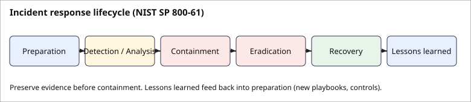

# Enterprise Network & Security Engineering — دوره‌ی تخصصی Cisco و Enterprise Firewall
## بخش ۱۰ از ۱۱ — فصل‌های ۲۸ تا ۳۰

| مورد | مقدار |
|---|---|
| نام دوره | Enterprise Network & Security Engineering (Cisco + FortiGate) |
| شماره بخش | ۱۰ از ۱۱ |
| فصل‌های این فایل | ۲۸ ، ۲۹ ، ۳۰ |
| تاریخ تولید | ۲۰۲۶-۱۱-۲۶ |
| نسخه Blueprint | v3.0 (+ بازبینی ۱٫۱) |
| نسخه‌های نرم‌افزار | FortiOS 7.0.3 (اسمی؛ بوت‌نشده؛ تأیید با `get system status`) ؛ Cisco vIOS-L2 15.2(20200924، Experimental) ؛ Cisco vIOS 15.9(3)M9 ؛ VPCS ؛ PNetLab 4.2.8 ؛ ESXi 8.0U2 ؛ CSR1000v 17.03.02 (IOS-XE؛ آزمایش‌نشده) |
| وضعیت تکمیل | **فصل‌های ۲۸–۳۰ تولید شد؛ Packet Analysis، Blue Team/Lifecycle، Migration.** Labها «اجرا نشده»؛ دستورها آزمایش‌نشده. |

> **قوانین خواندن:** تمرین‌ها و پرسش‌های مرور بدون پاسخ‌اند؛ پاسخ در «پاسخ‌های فصل». «اجرا نشده» یعنی خروجی‌ها **پیش‌نیاز/پیش‌بینی** هستند. «CLI-Accepted» ≠ «کار می‌کند». رمزها نمونه‌اند.

### وضعیت راستی‌آزمایی Labهای این بخش
خلاصه: اجرا نشده (فقط طراحی): 13.

| Lab | وضعیت |
|---|---|
| 28-1 | اجرا نشده (فقط طراحی) |
| 28-2 | اجرا نشده (فقط طراحی) |
| 28-3 | اجرا نشده (فقط طراحی) |
| 28-4 | اجرا نشده (فقط طراحی) |
| 28-5 | اجرا نشده (فقط طراحی) |
| 29-1 | اجرا نشده (فقط طراحی) |
| 29-2 | اجرا نشده (فقط طراحی) |
| 29-3 | اجرا نشده (فقط طراحی) |
| 29-4 | اجرا نشده (فقط طراحی) |
| 30-1 | اجرا نشده (فقط طراحی) |
| 30-2 | اجرا نشده (فقط طراحی) |
| 30-3 | اجرا نشده (فقط طراحی) |
| 30-4 | اجرا نشده (فقط طراحی) |

---

<a id="ch28"></a>

> **نسخه v3.9:** این بخش در دسته‌های B/A/C بدون تغییر محتوایی است (فشرده‌تر از فصل‌های توسعه‌یافته؛ در دسته D بازنویسی می‌شود).

# فصل 28 — Packet Analysis و بلوک‌های عیب‌یابی

> **یادداشت علمی v4.0 — فصل 28:** عمومی: TCP/DNS/TLS در Capture. مختص محصول: Sniffer FortiOS/Offload.
> فرض: TLS 1.3 Certificate رمز؛ تحلیل بر پایه‌ی RFC.
> مراجع: RFC 9293 (TCP)، RFC 8446 (TLS 1.3)، RFC 1035.


**مدت:** ۳۶ ساعت | **پیش‌نیاز:** فصل ۲، ۱۴.
**اهداف:** تحلیل بسته با Wireshark و Sniffer FortiGate؛ TCP Handshake، Retransmission، DNS، TLS؛ ده‌پرسش عیب‌یابی؛ بلوک‌های TS تکرارپذیر.
**اشتباهات رایج:** Filter بیش‌ازحد باز؛ تحلیل بدون Baseline؛ فراموشی Disable Debug.

**درس‌های فصل:**
- [درس 28-1 — Sniffer و Capture درست](#l-28-1)
- [درس 28-2 — TCP Handshake، Retransmission و DNS](#l-28-2)
- [درس 28-3 — TLS و Certificate در Capture](#l-28-3)
- [درس 28-4 — ده‌پرسش عیب‌یابی و بلوک TS](#l-28-4)
- [درس 28-5 — آزمون فصل ۲۸](#l-28-5)

---

<a id="l-28-1"></a>

## درس 28-0 — تحلیل بسته عمیق: TCP، DNS، TLS و الگوهای خرابی در Wireshark/Sniffer

**فصل ۲۸ · درس افزوده (پیش‌درس ۲۸-۱) · پیش‌نیاز: ۲-۰، ۱۴-۷، ۱۱-۷ · ≈ ۸ ساعت**

> **وضعیت:** خروجی‌ها نمونه‌ی آموزشی‌اند؛ Capture واقعی در Lab «اجرا نشده».

### ۱) هدف آموزشی

1. TCP را از روی بسته تحلیل کند: Handshake، Window، Retransmission، Dup ACK، RST، Zero Window.
2. الگوهای خرابی را تشخیص دهد: Drop، MTU/PMTUD، Asymmetric، Latency، Packet Loss.
3. DNS و TLS را در Capture بخواند (Query/Response، SNI، Alert).
4. Capture را درست بگیرد (نقطه، Filter، حجم) و با Sniffer FortiGate تکمیل کند.
5. از Capture تا RCA بنویسد.

### ۲) مفهوم پایه: چیست و چرا؟ (از صفر، با زبان ساده)

**چرا تحلیل بسته؟** Log می‌گوید «چه رخ داد»؛ Capture می‌گوید «چه چیزی روی سیم رفت». برای «کند است» Log اغلب چیزی ندارد ولی بسته‌ها دارند: Retransmission، Window صفر، RST. یک ارتباط TCP سه مرحله دارد: Handshake، انتقال، بستن؛ هر مرحله الگوی نرمال و الگوی خراب دارد.

**جمع‌بندی اصلی درس:**

بسته‌ها «حقیقت میدانی»اند: لاگ می‌گوید فایروال چه تصمیمی گرفت؛ Capture می‌گوید روی سیم چه گذشت. تحلیل = مقایسه‌ی دو نقطه‌ی Capture (قبل/بعد از دستگاه).

### ۳) توضیح عمیق فنی

#### ۳-۱) نقطه‌ی Capture

``` text
Client --[A]-- FW(in) FW(out) --[B]-- Server
A and B captures: compare which packet disappears and where
```

اگر بسته در A هست و در B نیست: دستگاه میانی (Policy/Route/Drop). اگر هست ولی پاسخ نیست: سرور/مسیر برگشت.

#### ۳-۲) الگوهای TCP

| الگو | معنی | علت‌های رایج |
|---|---|---|
| SYN بدون SYN/ACK | اتصال برقرار نمی‌شود | Policy، Route، پورت بسته، Asymmetric |
| SYN, RST | پورت بسته/رد | سرویس، Firewall |
| Retransmission | بسته‌ی گم‌شده | تلفات، MTU، Congestion |
| Dup ACK ×3 | Fast retransmit | Loss/Reordering |
| Zero Window | گیرنده پر | برنامه کند |
| ICMP Frag Needed | PMTUD | MTU کمتر در مسیر |
| فقط بزرگ‌ها قفل | PMTUD Black hole | ICMP Block/MTU |

``` text
RTT ~= time between SYN and SYN/ACK
Retransmission rate = retransmitted segments / total segments
```

#### ۳-۳) Wireshark: Filterهای مفید

``` text
tcp.analysis.retransmission
tcp.analysis.duplicate_ack
tcp.flags.syn==1 and tcp.flags.ack==0
tcp.analysis.zero_window
icmp.type==3 and icmp.code==4
dns.flags.rcode != 0
tls.alert_message
```

#### ۳-۴) DNS و TLS

- DNS: Query بدون Response (UDP Drop/سرور)، NXDOMAIN (نام)، Response کند (Latency).
- TLS: ClientHello با SNI؛ Alert `bad_certificate`/`unknown_ca` (CA/Pinning)؛ Handshake کند (RTT/CPU Inspection).

#### ۳-۵) Sniffer FortiGate

`diagnose sniffer packet <if> "<filter>" 4 <count> l` (verbose 4: IP+Interface؛ 6: Ethernet هم)؛ خروجی را به فایل و با اسکریپت به PCAP تبدیل کنید (ابزار fgt2eth)؛ روی Offloadشده ممکن است ناقص باشد (۱۲-۹).

### ۴) مثال حل‌شده

**پرونده:** دانلود ۵۰ MB از VPN در ۲٪ می‌ایستد. Capture در دو سر: بسته‌های بزرگ (1500 B) از A می‌روند و در B نمی‌رسند؛ ICMP Frag Needed بازگردانده نمی‌شود (ICMP توسط Firewall میانی Block). **RCA:** PMTUD Black hole. **رفع:** MSS Clamp (`tcp-mss`)، اجازه‌ی ICMP Type 3 Code 4. **تأیید:** Capture: بسته‌های ≤ MSS؛ دانلود کامل.

**مثال متوسط:** SYN→RST: سرور پورت را نمی‌شناسد؛ مقایسه با `telnet`. **مثال سخت:** Retransmission فقط یک جهت: مسیر برگشت تلفات دارد (Interface Error) → `get system interface physical`.

### ۵) GUI و CLI

#### مثال ساده — RTT

``` text
RTT = SYN-ACK time - SYN time = 0.082 - 0.000 = 82 ms
```

#### مثال متوسط — سقف سرعت

``` text
Throughput max = Window / RTT = 65535 B / 0.082 s ~ 6.4 Mbps
```

یعنی روی لینک 100 Mbps با این Window فقط ~6.4 Mbps؛ Window Scaling خاموش.

#### مثال سخت — دو علت

Window Scaling حذف‌شده + Loss ۳٪. رفع یکی‌یکی و اندازه‌گیری مجدد.

#### مثال‌های اصلی درس (مرور)

**GUI:** Network → Diagnostics → Packet Capture؛ **CLI:** `diagnose sniffer packet any "host X and port Y" 6 100 l`.

### ۶) نکات امنیتی

- PCAP داده‌ی حساس دارد: محدود، رمزنگاری، حذف.
- Capture مجاز و مستند.

### ۷) جمع‌بندی

- دو نقطه‌ی Capture بسته‌ی گم‌شده را پیدا می‌کنند.
- الگوهای TCP علت را نشان می‌دهند.
- MTU/ICMP/Asymmetric سه علت شایع.

### ۸) تمرین و ارزیابی

**ت1.** (ساده) SYN بدون SYN/ACK یعنی چه؟ *(پاسخ: 28-0-ت1)*

**ت2.** (متوسط) PMTUD Black hole را توضیح دهید. *(پاسخ: 28-0-ت2)*

**ت3.** (سخت) Capture دو نقطه‌ای را برای یافتن Drop بنویسید. *(پاسخ: 28-0-ت3)*

**Q1.** Quick quiz (English): Which ICMP type and code signal fragmentation needed? *(پاسخ: 28-0-Q1)*

### ۹) اصطلاحات و English Corner

| مخفف | شکل کامل | معنی |
|---|---|---|
| PMTUD | Path MTU Discovery | کشف MTU مسیر |
| RTT | Round-Trip Time | زمان رفت و برگشت |
| PCAP | Packet capture | فایل بسته |
| Dup ACK | Duplicate ACK | ACK تکراری |

- *Capture at two points to locate where packets disappear.* ← در دو نقطه Capture بگیرید تا محل ناپدید شدن بسته‌ها پیدا شود.

### ۱۰) منابع

- Wireshark User's Guide (TCP analysis)؛ RFC 1191 (PMTUD)، RFC 9293 (TCP)، RFC 792 (ICMP).

### بخش تکمیلی درس: سناریوی واقعی، مثال‌های بیشتر و عیب‌یابی

> بخش‌های زیر درس بالا را کامل می‌کنند: سناریوی گام‌به‌گام، مثال‌های بیشتر از ساده تا سخت، جدول عیب‌یابی و پرسش‌های مصاحبه. ابتدا بخش‌های اصلی بالا را مطالعه کنید.

### تعمیق: الگوهای خرابی در Capture

| الگو | نشانه در Wireshark |
|---|---|
| بسته‌ی گم‌شده | `tcp.analysis.retransmission` |
| Window کوچک | `tcp.analysis.zero_window` |
| RST ناگهانی | `tcp.flags.reset==1` |
| DNS کند | فاصله‌ی Query/Response > 1 s |

**پرسش‌های مصاحبه**
1. *Retransmission یعنی؟* ACK نرسیده.
2. *Zero Window؟* گیرنده پر.
3. *RST از کجا؟* سرور/فایروال.

### مثال حل‌شده: «دانلود کند است» از روی Capture

**داده:** SYN در 0.000، SYN-ACK در 0.082، سپس دریافت با Retransmission پراکنده و Window=0 دوبار.

``` text
RTT = 0.082 - 0.000 = 82 ms
Throughput bound = Window / RTT = 65535 B / 0.082 s ~ 0.8 MB/s ~ 6.4 Mbps
```

نتیجه: با Window کوچک حتی لینک 100 Mbps حدود 6.4 Mbps می‌دهد؛ علت: گیرنده کند یا Window Scaling خاموش. ابزار: فیلتر `tcp.window_size_value` و `tcp.options.wscale`.

### تکمیل عمیق: چرا تحلیل بسته، «چشم‌های» مهندس شبکه است؟

#### چرا باید یاد بگیریم؟

Log می‌گوید «چه چیزی رخ داد»؛ Capture نشان می‌دهد «واقعاً چه چیزی روی سیم رفت». وقتی کاربر می‌گوید «کند است»، Log معمولاً چیزی ندارد، ولی بسته‌ها دارند: Retransmission، Window صفر، RST، DNS کند. تحلیل بسته مثل آزمایش خون است؛ علامت را به علت وصل می‌کند.

#### توضیح ساده

یک ارتباط TCP سه مرحله دارد: **Handshake**، **انتقال داده**، **بستن**. هر مرحله الگوی طبیعی و الگوی خراب دارد.

``` text
Normal  : SYN -> SYN,ACK -> ACK -> data/ACK ... -> FIN/ACK
Broken 1: SYN -> SYN -> SYN (no reply)         => unreachable / dropped
Broken 2: SYN -> RST                            => port closed / policy reset
Broken 3: data -> data (retransmission)        => loss on path
Broken 4: Window = 0                            => receiver overloaded
```

#### مثال ساده — محاسبه‌ی RTT

SYN در زمان 0.000 و SYN-ACK در 0.082 دیده شد.

``` text
RTT = 0.082 - 0.000 = 82 ms
```

RTT = Round Trip Time، یعنی زمان رفت‌وبرگشت.

#### مثال متوسط — سقف سرعت از روی Window

TCP نمی‌تواند سریع‌تر از Window/RTT برود.

``` text
Throughput max = Window / RTT
65535 bytes / 0.082 s = ~799,000 bytes/s = ~6.4 Mbps
```

یعنی حتی روی لینک 100 Mbps، با این Window و RTT بیش از ~6.4 Mbps نمی‌گیرید، مگر Window Scaling فعال باشد. این پاسخ کلاسیک «چرا لینک ۱۰۰ مگ است ولی سرعت ۶ مگ؟» است.

#### مثال سخت — دو علت هم‌زمان

کاربر از شعبه به سرور مرکزی کند است. Capture: RTT=80ms، Retransmission ۳٪، Window Scaling خاموش. دو علت: (۱) Window Scaling توسط یک Middlebox حذف شده؛ (۲) Loss ۳٪ روی لینک. رفع: بررسی Option در SYN، و بررسی کیفیت لینک؛ اندازه‌گیری مجدد پس از هر رفع (تغییر یکی‌یکی).

#### ابزارها

``` text
wireshark display filters:
 tcp.analysis.retransmission
 tcp.analysis.zero_window
 tcp.flags.reset == 1
 dns
 tls.handshake
```

#### Lab

یک pcap نمونه‌ی عمومی (مثلاً از نمونه‌های Wireshark Wiki) را باز و RTT و Retransmission را ثبت کنید.

#### عیب‌یابی

| علامت | شاهد | علت محتمل |
|---|---|---|
| SYN بی‌پاسخ | تکرار SYN | Drop/Route |
| RST بلافاصله | RST پس از SYN | پورت بسته/Policy |
| کندی با Loss | Retrans | کیفیت لینک |
| سرعت پایین با Loss صفر | Window کوچک | Window Scaling |

#### پرسش‌ها با پاسخ

**۱. RTT را از کجا بخوانیم؟** فاصله‌ی SYN تا SYN-ACK.
**۲. چرا Window Scaling مهم است؟** سقف سرعت.
**۳. RST یعنی؟** قطع ناگهانی توسط یکی از طرفین یا Middlebox.

#### English Corner

- *Round-trip time is measured between SYN and SYN-ACK.*
- Q: Why can a 100 Mbps link give only 6 Mbps for one TCP flow?

## درس 28-1 — Capture درست: انتخاب نقطه، Filter، Sniffer FortiGate، PCAP، Offload و ملاحظات امنیت/قانون

**فصل 28 · بازنویسی عمیق · پیش‌نیاز: ۲۸-۰، ۱۴-۷، ۱۲-۹ · ≈ 8 ساعت**

> **وضعیت:** FortiOS 7.0.3 (بوت‌نشده)؛ خروجی‌ها نمونه‌ی آموزشی‌اند؛ دستورها `Unverified`؛ Lab «اجرا نشده».

<!--deep-->

### هدف آموزشی

در پایان این درس باید بتوانید:

1. از روی سؤال عیب‌یابی، نقطه‌ی Capture (دونقطه‌ای، سه‌نقطه‌ای، قبل/بعد از NAT) را انتخاب کنید.
2. Filter دقیق BPF و محدودیت حجم/زمان بنویسید.
3. Sniffer FortiGate (verbose، count، timestamp) را بخوانید و به PCAP تبدیل کنید.
4. اثر Offload و Interface مجازی را بر کامل‌بودن Capture بدانید.
5. محدودیت‌های امنیتی/قانونی PCAP را رعایت کنید.
6. Capture را در Wireshark با Display Filter تحلیل اولیه کنید.

### چرا باید یاد بگیریم؟

Capture بد بدتر از نبودن است: ۲ گیگابایت فایل، بدون زمان، از نقطه‌ی اشتباه؛ هیچ‌چیز نمی‌گوید و ساعت‌ها هدر می‌دهد. Capture خوب مثل عکس‌برداری دقیق از صحنه‌ی تصادف است: از زاویه‌ی درست، با زمان ثبت‌شده، و فقط همان‌چه لازم. قاعده‌ی ارشد: اول سؤال، بعد نقطه، بعد فیلتر، بعد Capture.

### از سؤال به نقطه

| سؤال | نقطه‌ها |
|---|---|
| بسته به فایروال می‌رسد؟ | Interface ورودی فایروال (یا SPAN بالاتر) |
| فایروال آن را عبور می‌دهد؟ | ورودی و خروجی همان فایروال |
| NAT چه کرد؟ | ورودی (آدرس اصلی) و خروجی (ترجمه‌شده) |
| سرور پاسخ می‌دهد؟ | روی خود سرور |
| مسیر برگشت متقارن است؟ | هر دو مسیر/فایروال |
| MTU/Fragment؟ | دو سر تونل |

قاعده‌ی سه‌نقطه‌ای: **کلاینت، FW-in، FW-out** (و در صورت نیاز سرور).

``` text
[Client] --(A)--> [FW port2 (B)]  [FW port1 (C)] --(D)--> [Server]
  A: client capture   B: FW in   C: FW out   D: server capture
```

### Sniffer FortiGate

``` text
diagnose sniffer packet <interface|any> '<BPF filter>' <verbose> <count> <timestamp>
```

| verbose | محتوا |
|---|---|
| 1 | سرآیند IP |
| 3 | + Payload و Ethernet (hex) |
| 4 | + نام Interface |
| 6 | + Payload، Ethernet، Interface (برای PCAP) |

``` text
diagnose sniffer packet port2 'host 10.10.0.5 and tcp port 443' 4 100 a
diagnose sniffer packet any 'host 10.10.0.5 and host 198.51.100.8' 6 0 a
```

`count 0` بی‌پایان (با Ctrl+C)؛ برای PCAP از سطح 6 و تبدیل با `fgt2eth.pl` (Perl، ابزار Fortinet/Community) یا استفاده از GUI Packet Capture که مستقیم PCAP می‌دهد.

### GUI Packet Capture

Network > Packet Capture: Interface، Filter، تعداد، Start، Download. مناسب‌تر برای فایل‌های حجیم و عدم تبدیل دستی.

### Filter BPF

``` text
host 10.10.0.5
host 10.10.0.5 and tcp port 443
net 10.10.0.0/24 and not port 22
tcp[tcpflags] & (tcp-syn|tcp-ack) = tcp-syn
udp port 53
icmp
```

اصل: Filter باریک (Host + Port)، Snaplen محدود برای حریم، و مدت کوتاه (۳۰–۱۲۰ ثانیه).

### Offload و محدودیت‌ها

| مورد | اثر |
|---|---|
| NPU Offload | بسته‌های بعد از Session Setup در سخت‌افزار؛ Sniffer فقط چند بسته‌ی اول را می‌بیند |
| Interface مجازی (VLAN/tunnel) | `any` بسته را دوبار نشان می‌دهد (ورود/خروج) |
| TSO/GRO در کلاینت | بسته‌های بزرگتر از MTU در Capture کلاینت |
| Snaplen | Payload بریده |

راه‌حل Offload: موقتاً `set auto-asic-offload disable` روی Policy (فقط آزمایش، اثر عملکرد) یا Capture در سمت دیگر.

### ملاحظات امنیتی و قانونی

PCAP ممکن است رمز، توکن، ایمیل شخصی داشته باشد. قاعده‌ها: مجوز مکتوب، حداقل فیلتر، Snaplen کم (فقط سرآیند در صورت امکان)، ذخیره‌ی رمزگذاری‌شده، حذف پس از پایان، دسترسی محدود.

### Wireshark — تحلیل اولیه

``` text
ip.addr == 10.10.0.5 && tcp.port == 443
tcp.flags.syn == 1 && tcp.flags.ack == 0
tcp.analysis.retransmission
dns
tls.handshake
```

Statistics > Conversations و Expert Information، خلاصه‌ی سریع مشکلات را می‌دهند.

### مثال‌های حل‌شده

#### مثال ساده — دو نقطه

مشکل: «سرور پاسخ نمی‌دهد». Capture FW-in: SYN دیده می‌شود. FW-out: SYN دیده می‌شود. هیچ SYN-ACK ⇒ سرور/بالادست. زمان ۲ دقیقه.

#### مثال متوسط — NAT

FW-in: src 10.10.0.5؛ FW-out: src 203.0.113.2. NAT درست. اگر FW-out هنوز 10.10.0.5 ⇒ NAT نشده.

#### مثال متوسط — Offload

Capture فقط ۵ بسته‌ی اول Session را نشان می‌دهد. علت: Offload. برای آزمون Policy موقت بدون Offload یا Capture روی سرور.

#### مثال سخت — حریم و قانون

مدیر ارشد: «همه‌ی ترافیک کارمندان را ۱ ساعت ضبط کن». مخاطرات: داده‌ی شخصی، قانون. پاسخ: Capture فقط برای Host مشکل‌دار، Snaplen 96 بایت، مجوز، حذف پس از تحلیل. مستندسازی.

#### مثال سخت — `any` و تکرار

`diagnose sniffer packet any` هر بسته را چند بار (روی Interface‌ها و VLAN) نشان می‌دهد و Wireshark Retransmission کاذب می‌بیند. راه: Interface مشخص یا فیلتر `-i`/Interface نام.

### مسیر GUI (مستندی، Unverified)

1. Network → Diagnostics → Packet Capture: Interface، Filter، Packet count → Start → Download PCAP.
2. Wireshark: File → Open.

### Lab هدایت‌شده (اجرا نشده)

1. سه‌نقطه‌ای با فیلتر.
2. PCAP و Wireshark.
3. Offload و تأثیر.

### عیب‌یابی سریع

| علامت (مشاهده) | علت محتمل (باید اثبات شود) | اقدام پس از اثبات |
|---|---|---|
| Capture خالی | فیلتر/Interface | سادگی |
| بسته‌ی کم | Offload | موقت |
| بسته تکراری | any | Interface |
| فایل حجیم | بی‌فیلتر | host/port/count |

### نکات امنیتی

مجوز؛ حداقل داده؛ رمزنگاری فایل؛ حذف؛ دسترسی محدود؛ ثبت (Evidence Chain).

### جمع‌بندی

اول سؤال، بعد نقطه‌ی Capture (سه‌نقطه‌ای)؛ Filter باریک؛ Sniffer FortiGate و PCAP؛ اثر Offload؛ ملاحظات قانونی؛ تحلیل با Wireshark.

### تمرین و ارزیابی

**ت1.** (ساده) چرا Capture دو‌نقطه‌ای؟ *(پاسخ: 28-1-ت1)*

**ت2.** (ساده) verbose 4 چه نشان می‌دهد؟ *(پاسخ: 28-1-ت2)*

**ت3.** (متوسط) Filter برای فقط SYN/RST؟ *(پاسخ: 28-1-ت3)*

**ت4.** (متوسط) چرا `any` بسته‌ی تکراری نشان می‌دهد؟ *(پاسخ: 28-1-ت4)*

**ت5.** (سخت) Sniffer بسته‌ای نمی‌بیند ولی ترافیک می‌رود؛ تحلیل. *(پاسخ: 28-1-ت5)*

**ت6.** (سخت، طراحی) روش‌نامه‌ی Capture امن برای یک حادثه. *(پاسخ: 28-1-ت6)*

**Q1.** Quick quiz (English): Why should captures be taken at two points around the firewall? *(پاسخ: 28-1-Q1)*

### اصطلاحات و English Corner

| مخفف | شکل کامل | معنی |
|---|---|---|
| BPF | Berkeley Packet Filter | زبان Filter بسته |
| PCAP | Packet capture file | فایل Capture |
| SPAN | Switched Port Analyzer | آینه‌ی پورت |

- *Use narrow capture filters.* ← از Filter باریک استفاده کنید.

### کارت Lab

**کارت Lab:** Capture. **وضعیت:** اجرا نشده. **Evidence:** `03-ops/capture.md`.

### منابع

- Wireshark User Guide
- Fortinet Docs: Packet capture / diagnose sniffer (7.0)
- tcpdump/pcap-filter manual

<a id="l-28-2"></a>

## درس 28-2 — تحلیل TCP و DNS در Capture: Handshake، Window، Retransmission، RTT، RST و الگوهای خرابی

**فصل 28 · بازنویسی عمیق · پیش‌نیاز: ۲۸-۰، ۲۸-۱، ۲-۰ · ≈ 9 ساعت**

> **وضعیت:** FortiOS 7.0.3 (بوت‌نشده)؛ خروجی‌ها نمونه‌ی آموزشی‌اند؛ دستورها `Unverified`؛ Lab «اجرا نشده».

<!--deep-->

### هدف آموزشی

در پایان این درس باید بتوانید:

1. TCP Handshake، Seq/Ack، Window و Flagها را در Capture بخوانید.
2. Retransmission، Duplicate ACK، Zero Window و Reset را تشخیص دهید.
3. DNS Query/Response، RCODE، TTL و TCP Fallback را تحلیل کنید.
4. با Wireshark Expert و Display Filter علت را بیابید.
5. RTT و Latency را از Handshake محاسبه کنید.
6. مثال‌های واقعی را به علت (شبکه/سرور/کلاینت) نسبت دهید.

### چرا باید یاد بگیریم؟

TCP مثل مکالمه‌ی تلفنی منظم است: سلام، علیک، تأیید دریافت هر جمله. وقتی مکالمه مشکل دارد، الگوی خاصی دارد: تکرار جمله (Retransmission)، «صدایتان را نمی‌شنوم» (Zero Window)، قطع ناگهانی (RST). مهندس ارشد از الگو علت را می‌خواند، نه حدس. DNS هم «دفترچه‌ی تلفن» است و بسیاری از خرابی‌ها فقط DNS هستند.

### TCP Handshake

``` text
Client -> Server : SYN       seq=x
Server -> Client : SYN, ACK  seq=y ack=x+1
Client -> Server : ACK       ack=y+1
```

RTT اولیه = زمان بین SYN و SYN-ACK (در Capture نزدیک کلاینت).

``` text
RTT ~ t(SYN-ACK) - t(SYN)
Example: 10:15:01.100 -> 10:15:01.145 => 45 ms
```

### پرچم‌ها

| پرچم | معنی |
|---|---|
| SYN | شروع |
| ACK | تأیید |
| FIN | پایان مؤدبانه |
| RST | قطع فوری (Reset) |
| PSH | تحویل فوری |

### الگوهای مشکل

| الگو | معنی | علت‌های محتمل |
|---|---|---|
| SYN تکراری بدون SYN-ACK | مقصد جواب نمی‌دهد | Firewall/Route/سرور |
| SYN → RST | پورت بسته | سرویس/Policy Reject |
| Retransmission | بسته‌ی گم‌شده | تلفات لینک، MTU، شلوغی |
| Duplicate ACK | گیرنده بسته‌ی بعدی را دریافت می‌کند ولی قبلی گم است | تلفات |
| Zero Window | بافر گیرنده پر | سرور/کلاینت کند |
| RST در میانه | قطع | Firewall/IPS/برنامه |
| Window کوچک | Throughput پایین | Scaling خاموش |
| Out-of-order | ترتیب‌شکنی | چند مسیر |

``` text
tcp.analysis.retransmission
tcp.analysis.fast_retransmission
tcp.analysis.duplicate_ack
tcp.analysis.zero_window
tcp.analysis.window_full
tcp.flags.reset == 1
```

### Throughput و Window

``` text
Max throughput ~ Window / RTT
Window 64 KB, RTT 50 ms:
64,000 B x 8 / 0.05 s = 10.24 Mbps
```

با RTT زیاد و Window کوچک، حتی لینک ۱ Gbps کند است؛ Window Scaling باید فعال باشد (SYN: `WS=...`).

### DNS

``` text
dns.flags.response == 0         (queries)
dns.flags.rcode != 0            (errors)
dns.time > 0.5                  (slow responses)
```

| RCODE | معنی |
|---|---|
| 0 NOERROR | موفق |
| 2 SERVFAIL | خطای Resolver/DNSSEC |
| 3 NXDOMAIN | نام وجود ندارد |
| 5 REFUSED | مجاز نیست |

نکات: TTL (کش)، UDP→TCP Fallback (پاسخ بزرگ، TC bit)، چند Resolver.

### مثال‌های حل‌شده

#### مثال ساده — Handshake

SYN، SYN-ACK، ACK با RTT ۴۵ms: اتصال سالم. وب کند ⇒ مشکل بعد از Handshake (سرور/برنامه).

#### مثال متوسط — Retransmission

``` text
t=0.000 SYN
t=1.000 SYN (retransmit)
t=3.000 SYN (retransmit)
```

فواصل ۱، ۲ ثانیه (Backoff). SYN-ACK نمی‌آید ⇒ مقصد/Policy بالادست. با Capture سمت دیگر: SYN رسیده؟ اگر نه ⇒ مسیر؛ اگر بله ⇒ سرور.

#### مثال متوسط — DNS

`nslookup` کند. Capture: Query در t=0، پاسخ t=2.1s. `dns.time` ۲٫۱ثانیه ⇒ Resolver اول Timeout (۲ثانیه) سپس Resolver دوم. رفع: Resolver خراب را حذف.

#### مثال سخت — Zero Window

آپلود به سرور تا ۲۰٪ پیش می‌رود، سپس Zero Window از سرور. علت: سرور دیسک کند/Thread پر. فایروال بی‌تقصیر؛ Evidence: `tcp.analysis.zero_window` از سرور. تفکیک نقش‌ها: شبکه سالم.

#### مثال سخت — RST میانی

اتصال پس از ۱۵ ثانیه RST می‌خورد. RST با TTL متفاوت (مثلاً TTL 64 در برابر TTL سرور 128) ⇒ RST تزریق‌شده توسط میانی (IPS/Firewall). مقایسه‌ی TTL و `ip.id`. سپس Log IPS/Policy فایروال.

### مسیر GUI (مستندی، Unverified)

1. Wireshark: Statistics → TCP Stream Graphs (Time-Sequence، Throughput، RTT).
2. Statistics → Conversations/IO Graph.
3. Analyze → Expert Information.

### Lab هدایت‌شده (اجرا نشده)

1. PCAP نمونه: Handshake و RTT.
2. Retransmission و DNS Slow.
3. Zero Window و RST.

### عیب‌یابی سریع

| علامت (مشاهده) | علت محتمل (باید اثبات شود) | اقدام پس از اثبات |
|---|---|---|
| SYN بی‌جواب | مقصد | سمت دیگر |
| RST | پورت/Policy | Log |
| Zero Window | سرور | برنامه |
| DNS کند | Resolver | حذف |

### نکات امنیتی

PCAP DNS نام‌های داخلی را لو می‌دهد؛ حفاظت؛ تحلیل TTL برای کشف تزریق.

### جمع‌بندی

TCP: Handshake و الگوها (Retransmission، Dup ACK، Zero Window، RST)؛ Throughput = Window/RTT؛ DNS RCODE و زمان؛ تحلیل نقش‌ها (شبکه/سرور/کلاینت).

### تمرین و ارزیابی

**ت1.** (ساده) SYN→RST یعنی چه؟ *(پاسخ: 28-2-ت1)*

**ت2.** (ساده) Zero Window چیست؟ *(پاسخ: 28-2-ت2)*

**ت3.** (متوسط) Window 64 KB و RTT 100 ms: حد Throughput؟ *(پاسخ: 28-2-ت3)*

**ت4.** (متوسط) BDP برای 100 Mbps و 80 ms؟ *(پاسخ: 28-2-ت4)*

**ت5.** (سخت) Retrans 3٪ + MTU مشکوک؛ جداسازی دو علت. *(پاسخ: 28-2-ت5)*

**ت6.** (سخت، طراحی) گزارش تحلیل Capture را با ساختار بنویسید. *(پاسخ: 28-2-ت6)*

**Q1.** Quick quiz (English): How does window size limit TCP throughput? *(پاسخ: 28-2-Q1)*

### اصطلاحات و English Corner

| مخفف | شکل کامل | معنی |
|---|---|---|
| BDP | Bandwidth-delay product | حاصل‌ضرب پهنای باند و تأخیر |
| RTT | Round-trip time | زمان رفت و برگشت |
| Window scaling | TCP window scaling | مقیاس Window |

- *Patterns in packets point to specific causes.* ← الگوها در بسته‌ها به علت‌های مشخص اشاره می‌کنند.

### کارت Lab

**کارت Lab:** TCP. **وضعیت:** اجرا نشده. **Evidence:** `03-ops/tcp.md`.

### منابع

- RFC 9293
- RFC 7323 (Window Scale)
- Wireshark docs

<a id="l-28-3"></a>

## درس 28-3 — TLS در Capture: Handshake، SNI، Certificate، Alert، TLS 1.3 و اثر Inspection

**فصل 28 · بازنویسی عمیق · پیش‌نیاز: ۲۸-۰، ۱۶-۰، ۱۶-۵ · ≈ 8 ساعت**

> **وضعیت:** FortiOS 7.0.3 (بوت‌نشده)؛ خروجی‌ها نمونه‌ی آموزشی‌اند؛ دستورها `Unverified`؛ Lab «اجرا نشده».

<!--deep-->

### هدف آموزشی

در پایان این درس باید بتوانید:

1. TLS Handshake (1.2 و 1.3) را در Capture بخوانید.
2. SNI، Cipher Suite، Version و Certificate را بیابید.
3. Alertهای TLS را تفسیر کنید.
4. تفاوت TLS 1.3 (رمزشدن Certificate) را در تحلیل بدانید.
5. اثر SSL Inspection را روی Handshake ببینید.
6. خطاهای رایج (Chain، Expired، SNI، Pinning) را تشخیص دهید.

### چرا باید یاد بگیریم؟

بیشتر ترافیک امروز TLS است؛ Capture آن شبیه نامه‌ی مهر و موم‌شده است. ولی «پاکت» (Handshake) قابل‌خواندن است: چه سایتی (SNI)، چه نسخه‌ای، چه رمزنگاری‌ای، آیا Certificate معتبر بود، چرا قطع شد. خیلی از «سایت باز نمی‌شود»ها را فقط با Handshake و Alert می‌شود حل کرد، بدون رمزگشایی محتوا.

### Handshake TLS 1.2

``` text
C -> S : ClientHello   (versions, ciphers, SNI, extensions)
S -> C : ServerHello   (chosen version/cipher)
S -> C : Certificate   (chain)
S -> C : ServerKeyExchange / ServerHelloDone
C -> S : ClientKeyExchange, ChangeCipherSpec, Finished
S -> C : ChangeCipherSpec, Finished
```

### Handshake TLS 1.3

``` text
C -> S : ClientHello (key_share, SNI, supported_versions)
S -> C : ServerHello (key_share) + {EncryptedExtensions, Certificate, Finished}  (encrypted)
C -> S : {Finished}
```

در 1.3 Certificate رمز می‌شود و در Capture دیده نمی‌شود؛ فقط SNI (مگر ECH) و نسخه.

### فیلتر Wireshark

``` text
tls.handshake.type == 1                          (ClientHello)
tls.handshake.type == 2                          (ServerHello)
tls.handshake.type == 11                         (Certificate; TLS 1.2 only visible)
tls.handshake.extensions_server_name
tls.alert_message
tcp.flags.reset == 1
```

### Alertهای رایج

| Alert | معنی | علت |
|---|---|---|
| handshake_failure (40) | توافق نشد | Cipher/Version |
| bad_certificate (42) | گواهی بد | خراب |
| certificate_expired (45) | منقضی | تاریخ |
| unknown_ca (48) | CA ناشناس | Chain/Trust |
| protocol_version (70) | نسخه‌ی پشتیبانی‌نشده | TLS قدیمی |
| internal_error (80) | خطای سرور | سرور |
| close_notify (0) | پایان عادی | - |

### تحلیل Cipher/Version

``` text
tls.handshake.ciphersuite
tls.record.version
```

Cipherهای قدیمی (RC4، 3DES، CBC بدون AEAD)، نسخه‌ی 1.0/1.1 ⇒ هشدار. سیاست: حداقل TLS 1.2، ترجیح AEAD (GCM/ChaCha).

### SSL Inspection و Handshake

با Deep Inspection دو Handshake جدا: کلاینت↔FortiGate (Certificate صادرشده توسط CA فایروال) و FortiGate↔سرور (Certificate واقعی). در Capture سمت کلاینت Issuer = CA فایروال. در Capture سمت سرور Issuer = CA عمومی.

### مثال‌های حل‌شده

#### مثال ساده — SNI

ClientHello با SNI `app.example.com`. فایروال Web Filter بدون Deep Inspection فقط همین را می‌بیند و بر اساس آن بلاک می‌کند.

#### مثال متوسط — handshake_failure

Client TLS 1.0 فقط؛ سرور حداقل 1.2. Alert 40 یا 70 ⇒ رفع: به‌روزرسانی کلاینت (یا آگاهانه TLS 1.0 در سرور داخلی قدیمی با ریسک).

#### مثال متوسط — unknown_ca

کاربران پس از Deep Inspection خطای گواهی. Capture: Alert `unknown_ca` از کلاینت پس از دیدن Certificate با Issuer = CA فایروال. علت: CA روی کلاینت نصب نیست. رفع: GPO.

#### مثال سخت — Pinning

اپ موبایل بعد از Inspection قطع شد: Client بدون Alert چه، سریع FIN/RST پس از Certificate. مشخصه‌ی Certificate Pinning. رفع: Exempt (FQDN) نه Category کامل.

#### مثال سخت — MTU و ClientHello

ClientHello بزرگ (Post-Quantum Key Share در مرورگرهای جدید، ~1.5KB+) در Fragment گم می‌شود (MTU/MSS)؛ سایت باز نمی‌شود ولی بقیه باز می‌شود. Capture: ClientHello Retransmission بدون ServerHello. رفع: MSS Clamp/PMTUD، بررسی IPS/Inspection که Fragment را درست نمی‌بیند. (الگوی واقعی در مرورگرهای جدید.)

### مسیر GUI (مستندی، Unverified)

1. Wireshark: Filter tls؛ Statistics → Protocol Hierarchy.

### Lab هدایت‌شده (اجرا نشده)

1. Capture Handshake 1.2 و 1.3.
2. Alertها را ایجاد و بخوانید.
3. Deep Inspection و Issuer.

### عیب‌یابی سریع

| علامت (مشاهده) | علت محتمل (باید اثبات شود) | اقدام پس از اثبات |
|---|---|---|
| unknown_ca | CA | نصب |
| handshake_failure | Cipher/Version | به‌روزرسانی |
| قطع بعد از Certificate | Pinning | Exempt |
| ClientHello گم | MTU | MSS |

### نکات امنیتی

TLS ≥ 1.2؛ حذف Cipher ضعیف؛ Capture TLS محتوای رمز دارد (حریم)؛ Keylog فقط در Lab.

### جمع‌بندی

TLS Handshake: SNI، Version، Cipher، Certificate (1.2) یا رمزشده (1.3)؛ Alertها؛ اثر Inspection؛ دام‌ها (Pinning، MTU، unknown_ca).

### تمرین و ارزیابی

**ت1.** (ساده) SNI چیست و کجا دیده می‌شود؟ *(پاسخ: 28-3-ت1)*

**ت2.** (ساده) چرا در TLS 1.3 گواهی دیده نمی‌شود؟ *(پاسخ: 28-3-ت2)*

**ت3.** (متوسط) unknown_ca چه می‌گوید؟ *(پاسخ: 28-3-ت3)*

**ت4.** (متوسط) چگونه Inspection را اثبات می‌کنید؟ *(پاسخ: 28-3-ت4)*

**ت5.** (سخت) برنامه‌ی Pinned خطا می‌دهد؛ تصمیم. *(پاسخ: 28-3-ت5)*

**ت6.** (سخت، طراحی) سیاست QUIC/ECH سازمان. *(پاسخ: 28-3-ت6)*

**Q1.** Quick quiz (English): Which command-line tool can show the issuer of the certificate presented through a firewall? *(پاسخ: 28-3-Q1)*

### اصطلاحات و English Corner

| مخفف | شکل کامل | معنی |
|---|---|---|
| ECH | Encrypted Client Hello | رمزکردن ClientHello |
| Pinning | Certificate pinning | پین‌کردن گواهی |
| QUIC | QUIC transport | انتقال روی UDP |

- *The certificate issuer reveals whether inspection is active.* ← Issuer گواهی نشان می‌دهد Inspection فعال است یا نه.

### کارت Lab

**کارت Lab:** TLS. **وضعیت:** اجرا نشده. **Evidence:** `03-ops/tls.md`.

### منابع

- RFC 8446
- RFC 6066
- Wireshark TLS docs

<a id="l-28-4"></a>

## درس 28-4 — ده‌پرسش عیب‌یابی و بلوک‌های TS: چارچوب، سه پرونده‌ی کامل و کتابخانه‌ی TS

**فصل 28 · بازنویسی عمیق · پیش‌نیاز: ۱۴-۷، ۲۸-۱ تا ۲۸-۳ · ≈ 9 ساعت**

> **وضعیت:** FortiOS 7.0.3 (بوت‌نشده)؛ خروجی‌ها نمونه‌ی آموزشی‌اند؛ دستورها `Unverified`؛ Lab «اجرا نشده».

<!--deep-->

### هدف آموزشی

در پایان این درس باید بتوانید:

1. چارچوب ده‌پرسش را برای هر مشکل اجرا کنید.
2. بلوک TS (Troubleshooting) با فرضیه‌های رتبه‌بندی‌شده و شواهد بنویسید.
3. سه پرونده‌ی کامل (VPN، HTTPS کند، MTU) را حل و RCA کنید.
4. کتابخانه‌ی TS قابل‌استفاده‌ی مجدد بسازید.
5. مقایسه‌ی شواهد و رد فرضیه را تمرین کنید.
6. گزارش ۱‌صفحه‌ای ارائه دهید.

### چرا باید یاد بگیریم؟

عیب‌یاب خوب مثل کارآگاه است: فهرست مظنونان (فرضیه‌ها) می‌سازد، برای هرکدام آزمایش ارزان دارد و بر اساس شواهد حذف می‌کند. عیب‌یاب ضعیف همه را همزمان متهم می‌کند و هیچ‌کدام را اثبات نمی‌کند. «بلوک TS» قالبی است که این روش را ثبت‌پذیر و قابل‌تکرار می‌کند: هر عضو تیم همان ساختار را می‌خواند و می‌نویسد.

### بلوک TS

``` text
TS-ID       : TS-2026-0147
Symptom     : who/what/when
Scope       : users/sites affected; not affected
Change      : recent changes (CHG)
Hypotheses  : H1..Hn ranked by likelihood x cost to test
Tests       : command / capture / expected result for each
Evidence    : outputs with timestamps (file names)
Cause       : the surviving hypothesis, proven
Fix         : minimal change + rollback
Verify      : positive and negative tests
Prevent     : monitoring / checklist / design change
```

### ده‌پرسش (یادآوری)

۱ علامت دقیق؟ ۲ Scope؟ ۳ از چه زمانی/چه تغییری؟ ۴ L1/L2؟ ۵ Route؟ ۶ Policy؟ ۷ NAT/Session؟ ۸ DNS؟ ۹ MTU/TLS؟ ۱۰ Verify؟

### رتبه‌بندی فرضیه

``` text
Score = Likelihood (1-5) x (6 - Cost to test (1-5))
```

فرضیه‌ی محتمل و ارزان‌آزمون اول. مثال: «DNS خراب» (محتمل ۴، هزینه ۱) امتیاز ۲۰؛ «باگ Firmware» (۱، ۵) امتیاز ۱.

### پرونده ۱ — VPN

**Symptom:** تونل بالا ولی ترافیک نمی‌رسد (شعبه B).

| فرضیه | آزمون | نتیجه |
|---|---|---|
| H1 Route | `get router info routing-table details` | سالم |
| H2 Policy | `iprope lookup` | policy 0 |
| H3 Selector | `diagnose vpn tunnel list` | سالم |

Cause: Policy یک‌طرفه. Fix: Policy معکوس. Verify: ping، شمارنده‌ی enc/dec.

### پرونده ۲ — HTTPS کند

**Symptom:** HTTP سریع، HTTPS کند فقط از شعبه.

| فرضیه | آزمون | نتیجه |
|---|---|---|
| H1 DNS | `dig` | سالم |
| H2 MTU | `ping -f -l 1400` | شکست |
| H3 SSL Inspection CPU | `diagnose sys top` | سالم |

Cause: MTU تونل/ICMP بلاک. Fix: MSS Clamp 1360. Verify: SYN با `mss 1360`، سرعت.

### پرونده ۳ — MTU/Fragment

**Symptom:** RDP قطع می‌شود، ping کوچک خوب.

| فرضیه | آزمون | نتیجه |
|---|---|---|
| H1 ISP | ping طولانی | ok |
| H2 MTU | `ping -f` | MTU 1400 |
| H3 NIC کلاینت | Capture | ok |

Cause: Fragment UDP RDP روی تونل. Fix: MTU Interface تونل 1400 + `tcp-mss`. Verify: پایداری ۳۰ دقیقه.

### کتابخانه‌ی TS

فهرست الگوها: «تونل بالا ولی ترافیک نه»، «HTTPS کند»، «فقط یک کاربر»، «بعد از ارتقا»، «بعد از تغییر Policy». هر کدام فرضیه‌ها و آزمون‌های آماده.

### مثال‌های حل‌شده

#### مثال ساده — رتبه‌بندی

DNS: 4×(6−1)=20؛ MTU: 3×(6−2)=12؛ Firmware bug: 1×(6−5)=1. ترتیب آزمون: DNS ⇒ MTU ⇒ Firmware.

#### مثال متوسط — رد فرضیه

H1 «Firewall Policy». `iprope lookup` ⇒ policy 30 (مجاز) و Session ساخته شده؛ H1 رد. Evidence ذخیره.

#### مثال متوسط — Scope

«فقط کاربران VLAN 20». Scope ⇒ Policy/Address VLAN 20؛ H اولیه از «DNS عمومی» به «Policy VLAN» تغییر.

#### مثال سخت — دو علت

بعد از رفع MTU هنوز کند. علت دوم: Resolver ثانویه Timeout (۲ثانیه). هر علت جدا، Evidence، رفع. بلوک TS دو Cause دارد.

#### مثال سخت — Confirmation Bias

مهندس مطمئن است «ISP خراب است» و فقط شواهد موافق جمع می‌کند. آزمون رد‌کننده: ping از لینک دوم و Capture سرور نشان داد SYN به سرور نمی‌رسد؛ نه ISP؛ Policy بالادست. درس: همیشه یک آزمون که فرضیه را رد کند.

### Lab هدایت‌شده (اجرا نشده)

1. سه بلوک TS را پر کنید.
2. رتبه‌بندی فرضیه.
3. گزارش ۱‌صفحه‌ای.

### عیب‌یابی سریع

| علامت (مشاهده) | علت محتمل (باید اثبات شود) | اقدام پس از اثبات |
|---|---|---|
| همه‌چیز مشکوک | بی‌رتبه | Score |
| بی‌Evidence | ثبت نشده | بلوک TS |
| یک علت | تعصب | آزمون رد‌کننده |
| تکرار | بی‌Prevent | بخش Prevent |

### جمع‌بندی

بلوک TS: Symptom، Scope، Hypotheses، Tests، Evidence، Cause، Fix، Verify، Prevent؛ رتبه‌بندی Score؛ سه پرونده؛ کتابخانه‌ی الگو؛ آزمون رد‌کننده.

### تمرین و ارزیابی

**ت1.** (ساده) ده پرسش را فهرست کنید. *(پاسخ: 28-4-ت1)*

**ت2.** (ساده) چرا Debug را Disable می‌کنیم؟ *(پاسخ: 28-4-ت2)*

**ت3.** (متوسط) فرضیه‌ها را چگونه رتبه می‌دهید؟ *(پاسخ: 28-4-ت3)*

**ت4.** (متوسط) پرونده A: Bytes in=0؛ علت‌های ممکن؟ *(پاسخ: 28-4-ت4)*

**ت5.** (سخت) پرونده با دو علت هم‌زمان؛ روش جداسازی. *(پاسخ: 28-4-ت5)*

**ت6.** (سخت، طراحی) ساختار کتابخانه‌ی TS برای تیم. *(پاسخ: 28-4-ت6)*

**Q1.** Quick quiz (English): Why rank hypotheses by likelihood and test cost? *(پاسخ: 28-4-Q1)*

### اصطلاحات و English Corner

| مخفف | شکل کامل | معنی |
|---|---|---|
| TS block | Troubleshooting block | قالب عیب‌یابی |
| Hypothesis | Hypothesis | فرضیه |

- *Keep an evidence log for every incident.* ← برای هر حادثه Evidence Log نگه دارید.

### کارت Lab

**کارت Lab:** TS. **وضعیت:** اجرا نشده. **Evidence:** `03-ops/ts.md`.

### منابع

- درس ۱۴-۷
- ITIL Problem Management

<a id="l-28-5"></a>

## درس 28-5 — آزمون عملی فصل ۲۸: تحلیل سه PCAP و RCA — صورت مسئله، کلید پاسخ و Rubric

**فصل 28 · بازنویسی عمیق · پیش‌نیاز: ۲۸-۱ تا ۲۸-۴، ۱۴-۲ · ≈ 12 ساعت**

> **وضعیت:** FortiOS 7.0.3 نامی (بوت‌نشده)؛ سناریو و کلید پاسخ آموزشی‌اند؛ Lab «اجرا نشده»؛ دستورها `Unverified` تا اجرای Lab؛ ویژگی‌های وابسته به لایسنس مشخص شده‌اند.

<!--deep-->

### هدف آموزشی

در پایان این درس باید بتوانید:

1. سه PCAP را با Display Filter تحلیل کنید.
2. الگوهای SYN بی‌پاسخ، Retransmission/MTU و شکست DNS/TLS را تشخیص دهید.
3. برای هر PCAP RCA بنویسید.
4. رفع پیشنهادی و آزمون تأیید را بنویسید.
5. Evidence را با شماره‌ی بسته ثبت کنید.
6. Rubric را اجرا و صداقت را ثبت کنید.

### چرا باید یاد بگیریم؟

PCAP بی‌طرف‌ترین شاهد است: دو مهندس بر سر علت بحث می‌کنند؛ فایل PCAP حکم می‌دهد. ولی فقط وقتی بدانید چه چیزی را باید در آن ببینید. این آزمون سه پرونده‌ی کلاسیک را می‌سنجد: سایت باز نمی‌شود، دانلود می‌ایستد، HTTPS خطا می‌دهد.

### صورت مسئله

سه فایل:

1. `case1.pcap`: سایت باز نمی‌شود.
2. `case2.pcap`: دانلود می‌ایستد.
3. `case3.pcap`: HTTPS خطا.

برای هرکدام: الگو، علت، رفع، آزمون تأیید و Evidence (شماره‌ی بسته).

### فیلترهای پایه

``` text
tcp.flags.syn==1 && tcp.flags.ack==0
tcp.analysis.retransmission
tcp.flags.reset==1
icmp.type==3 && icmp.code==4
dns.flags.rcode != 0
tls.alert_message
```

### کلید پاسخ

**Case 1 — SYN بی‌پاسخ:**

1. الگو: ۵ SYN با Retransmit (۱، ۳، ۷ ثانیه)، هیچ SYN-ACK (بسته‌ی #1، #3، #7).
2. علت‌های محتمل: Firewall سرور/بالادست، Route برگشت.
3. آزمون جداکننده: Capture سمت سرور: SYN رسید؟ نه ⇒ مسیر/Firewall میانی؛ بله ⇒ سرور/Route برگشت.
4. رفع: طبق نتیجه (Policy/Route).
5. تأیید: Handshake کامل، `curl` OK.

**Case 2 — MTU:**

1. الگو: Handshake و چند بسته‌ی کوچک OK؛ بسته‌ی ۱۵۱۴ بایت Retransmit مکرر (#40، #42، #47)؛ ICMP نوع 3 کد 4 غایب.
2. علت: MTU مسیر کمتر و PMTUD بلاک.
3. رفع: MSS Clamp (1360) و اجازه‌ی ICMP Type 3.
4. تأیید: SYN با `mss 1360`، دانلود کامل.

**Case 3 — TLS:**

1. الگو: ClientHello سپس Alert fatal `unknown_ca`/`handshake_failure` (#5).
2. علت: CA ناشناس بعد از Inspection یا ناسازگاری Version/Cipher.
3. رفع: نصب CA یا Exempt یا به‌روزرسانی TLS.
4. تأیید: Handshake کامل و HTTP 200.

### قالب Evidence

| Case | فایل | بسته‌ها | فیلتر | نتیجه |
|---|---|---|---|---|
| 1 | case1.pcap | #1,#3,#7 | `tcp.flags.syn==1` | SYN بی‌پاسخ |
| 2 | case2.pcap | #40,#42,#47 | `tcp.analysis.retransmission` | بسته‌ی بزرگ |
| 3 | case3.pcap | #5 | `tls.alert_message` | unknown_ca |

### Rubric (۱۰۰)

| معیار | امتیاز |
|---|---|
| الگو درست | 30 |
| علت و فرضیه‌ی رد‌شده | 25 |
| رفع و آزمون تأیید | 20 |
| Evidence با شماره‌ی بسته | 15 |
| صداقت/نکات قانونی | 10 |

### مثال‌های حل‌شده

#### مثال ساده — Case 1

زمان‌بندی SYN: ۰، ۱، ۳، ۷ ثانیه (Backoff دوبرابری). نشان‌دهنده‌ی «SYN گم می‌شود»، نه «سرور پورت را رد می‌کند» (RST می‌داد).

#### مثال متوسط — Case 2

بسته‌های کوچک سالم و بزرگ گم ⇒ MTU. با `ping -f -l 1400` ⇒ شکست؛ 1372 ⇒ موفق؛ MTU ≈ 1400. محاسبه‌ی MSS:

``` text
MSS = 1400 - 40 = 1360
```

#### مثال متوسط — Case 3

`unknown_ca` از کلاینت پس از Certificate با Issuer = «FGT-SSL-CA». CA فایروال روی کلاینت نیست. رفع: GPO یا Exempt. این الگو در همه‌ی Deep Inspection مشابه است.

#### مثال سخت — دو علت در یک PCAP

Case 2 شامل Retransmission MTU و هم Zero Window در انتها. دو علت: MTU (شبکه) و سرور کند (برنامه). هر کدام جدا Evidence. اگر فقط یکی را رفع کنید، مشکل نیمه‌کاره می‌ماند.

#### مثال سخت — حریم و قانون

PCAP حاوی Cookie/Token بود. پیش از ارسال به فروشنده: Snaplen کوتاه/حذف Payload (`editcap`/`tshark` فیلتر)، مجوز مکتوب، رمزنگاری فایل. بدون این، نشت داده.

### Lab هدایت‌شده (اجرا نشده)

1. سه PCAP نمونه را تحلیل کنید.
2. جدول Evidence.
3. RCA.

### عیب‌یابی سریع

| علامت (مشاهده) | علت محتمل (باید اثبات شود) | اقدام پس از اثبات |
|---|---|---|
| بی‌جواب | مقصد/مسیر | سمت دیگر |
| بسته‌ی بزرگ گم | MTU | Clamp |
| Alert TLS | CA/Cipher | نصب/به‌روزرسانی |

### جمع‌بندی

آزمون PCAP: سه الگو (SYN بی‌پاسخ، MTU، TLS Alert)، Evidence با شماره‌ی بسته، RCA و آزمون تأیید، رعایت حریم؛ صداقت (Lab اجرا نشده).

### تمرین و ارزیابی

**ت1.** (ساده) SYN بدون SYN-ACK؟ *(پاسخ: 28-5-ت1)*

**ت2.** (ساده) ICMP 3/4؟ *(پاسخ: 28-5-ت2)*

**ت3.** (متوسط) Retransmission بزرگ؟ *(پاسخ: 28-5-ت3)*

**ت4.** (متوسط) TLS alert certificate_unknown؟ *(پاسخ: 28-5-ت4)*

**ت5.** (سخت) Case 3 را رفع کنید. *(پاسخ: 28-5-ت5)*

**ت6.** (سخت، طراحی) قالب Evidence. *(پاسخ: 28-5-ت6)*

**Q1.** Quick quiz (English): Which wireshark filter finds retransmissions? *(پاسخ: 28-5-Q1)*

### اصطلاحات و English Corner

| مخفف | شکل کامل | معنی |
|---|---|---|
| PCAP | Packet capture | فایل Capture |

- *Cite frame numbers as evidence.* ← شماره‌ی فریم‌ها را به‌عنوان Evidence ذکر کنید.

### کارت Lab

**کارت Lab:** آزمون PCAP (اجرا نشده). **Evidence:** `03-ops/pcap-rca.md`.

### منابع

- Wireshark User Guide
- RFC 1191

## پاسخ‌های فصل 28

> ابتدا بدون نگاه حل کنید. شناسه: درس-نوع+شماره (ت = تمرین، م = مرور).


### پاسخ‌های بازنویسی عمیق درس 28-1

**28-1-ت1** — تا مشخص شود بسته کجا ناپدید می‌شود: قبل یا بعد از فایروال.

Capture چند نقطه‌ای تا معلوم شود بسته قبل یا بعد از فایروال ناپدید می‌شود.

**28-1-ت2** — هدر IP به‌علاوه‌ی نام Interface.

verbosity 4: هدر IP و نام Interface.

**28-1-ت3** — `tcp[tcpflags] & (tcp-syn|tcp-rst) != 0`.

فیلتر `tcp[tcpflags] & (tcp-syn|tcp-rst) != 0` فقط SYN و RST را می‌گیرد.

**28-1-ت4** — بسته هم روی Interface ورودی و هم خروجی ثبت می‌شود.

Capture روی Interface ورودی و خروجی نشان می‌دهد بسته از فایروال عبور کرده یا نه.

**28-1-ت5** — Sniffer بسته نمی‌بیند ولی ترافیک می‌رود

**فرضیه‌ها:** Offload (NPU) پس از Session؛ Interface/VLAN اشتباه؛ Filter اشتباه؛ ترافیک مسیر دیگر؛ Capture روی Interface مجازی.
**تفکیک:** Filter ساده‌تر؛ `any`؛ بررسی Session (`npu`)؛ Capture روی سرور؛ Offload موقت (آزمایشی).
**استدلال:** «نبودن بسته در Sniffer» علامت است؛ علت می‌تواند Offload باشد نه Drop.

**28-1-ت6** — روش‌نامه‌ی Capture امن

مجوز مکتوب، Filter باریک، Snaplen کم، مدت کوتاه، ذخیره‌ی رمزگذاری‌شده، Hash، دسترسی محدود، حذف پس از تحلیل، ثبت Chain of Custody.

**28-1-Q1** — To locate where the packet disappears relative to the firewall.


### پاسخ‌های بازنویسی عمیق درس 28-2

**28-2-ت1** — پورت مقصد بسته یا سرویس پاسخ‌گو نیست.

RST پس از SYN: پورت مقصد بسته یا سرویس پاسخ‌گو نیست.

**28-2-ت2** — گیرنده بافر پر دارد و فرستنده باید متوقف شود؛ معمولاً مشکل برنامه است.

**28-2-ت3** — 64 KB/0.1 s ≈ 640 KB/s ≈ 5.2 Mbit/s.

سرعت ≈ 64 KB / 0.1 s = 640 KB/s ≈ 5.2 Mbit/s؛ RTT بالا پنجره‌ی کوچک را محدود می‌کند.

``` text
64 KB / 0.1 s = 640 KB/s ~ 5.2 Mbit/s
```

**28-2-ت4** — 100 Mbit/s × 0.08 s = 8 Mbit = 1 MB.

BDP = 100 Mbit/s × 0.08 s = 8 Mbit = 1 MB؛ پنجره‌ی TCP باید حداقل ۱ MB باشد.

``` text
BDP = 100 Mbit/s x 0.08 s = 8 Mbit = 1 MB
```

**28-2-ت5** — Retransmission ۳٪ و MTU مشکوک

**دو علت ممکن:** تلفات لینک و MTU/PMTUD.
**تفکیک:** MTU: `ping -f` با اندازه‌ی بزرگ و ICMP frag needed؛ تلفات: همه‌ی اندازه‌ها Retransmit هستند؟ بسته‌های کوچک سالم و بزرگ ناموفق ⇒ MTU؛ تلفات یکنواخت ⇒ لینک. آزمون مداخله‌ای: MSS Clamp و مشاهده‌ی کاهش Retrans.
**استدلال:** دو علت می‌توانند هم‌زمان باشند؛ هر کدام را جدا رفع کنید.

**28-2-ت6** — ساختار گزارش تحلیل Capture

Summary، سؤال، نقاط و فیلتر، یافته‌ها با شماره‌ی بسته، فرضیه‌ها، علت اثبات‌شده، رفع، آزمون تأیید، محدودیت‌ها (مثلاً Offload)، Evidence.

**28-2-Q1** — Throughput is limited to the window size divided by the round-trip time.


### پاسخ‌های بازنویسی عمیق درس 28-3

**28-3-ت1** — نام سرور در ClientHello که معمولاً رمزنشده است.

SNI نام سرور در ClientHello است و معمولاً رمزنشده.

**28-3-ت2** — چون پس از ServerHello رمز می‌شود.

پس از ServerHello بقیه‌ی Handshake رمز می‌شود.

**28-3-ت3** — کلاینت CA صادرکننده را نمی‌شناسد؛ معمولاً CA فایروال نصب نیست.

**28-3-ت4** — Issuer گواهی با `openssl s_client` از پشت فایروال برابر CA فایروال است.

**28-3-ت5** — برنامه‌ی Pinned خطا می‌دهد

**علت:** Certificate Pinning؛ برنامه فقط گواهی خودش را می‌پذیرد و Deep Inspection آن را رد می‌کند.
**تصمیم:** Exempt با FQDN دقیق (نه دسته)، ثبت دلیل/مالک/بازبینی؛ جایگزین کنترل (DNS Filter، Endpoint).

**28-3-ت6** — سیاست QUIC/ECH

QUIC روی UDP/443 و ECH (SNI رمز) بازرسی را سخت می‌کنند. گزینه‌ها: بلاک QUIC تا مرورگر به TCP/TLS برگردد (اثر: کارایی)، یا پذیرش با کنترل DNS/Endpoint. تصمیم با ریسک و نیاز بازرسی؛ ECH بدون Endpoint/DNS قابل مشاهده نیست. نیازمند بررسی نسخه‌ی FortiOS.

**28-3-Q1** — openssl s_client combined with openssl x509 -noout -issuer.


### پاسخ‌های بازنویسی عمیق درس 28-4

**28-4-ت1** — چه تغییر کرد، چه کسی، از کی، لایه، رسیدن بسته، Route، Policy، NAT/Session، Profile، خروج/برگشت.

**28-4-ت2** — بار CPU و Log زیاد و خطر اطلاعات حساس.

Debug بار CPU و Log زیاد و ریسک اطلاعات حساس دارد.

**28-4-ت3** — احتمال×اثر÷هزینه‌ی آزمون؛ ارزان و محتمل اول.

اولویت فرضیه: احتمال × اثر ÷ هزینه‌ی آزمون؛ ارزان و محتمل اول.

**28-4-ت4** — Policy مقابل، Route برگشت، NAT-T/ESP، Selector؛ Debug Flow مقابل مشخص می‌کند.

**28-4-ت5** — دو علت هم‌زمان؛ روش جداسازی

یک متغیر را هر بار تغییر دهید؛ برای هر علت شاهد مستقل بخواهید؛ بعد از رفع اولی دوباره بسنجید؛ مستندسازی ترتیب.

**28-4-ت6** — کتابخانه‌ی TS

الگوها (علامت ⇒ فرضیه‌ها ⇒ آزمون ⇒ علت‌های محتمل ⇒ رفع)، نسخه‌دار، با Owner و آخرین بازبینی، مثال Evidence.

**28-4-Q1** — To find the cause faster by testing likely and cheap hypotheses first.


### پاسخ‌های بازنویسی عمیق درس 28-5


### پاسخ‌های بازنویسی عمیق درس 28-5

**28-5-ت1** — مقصد/مسیر پاسخ نمی‌دهد.

SYN بدون SYN-ACK: مقصد/مسیر پاسخ نمی‌دهد.

**28-5-ت2** — Fragmentation needed.

ICMP نوع 3 کد 4 یعنی Fragmentation needed.

**28-5-ت3** — MTU/Loss.

Retransmission بزرگ: MTU یا Loss.

**28-5-ت4** — گواهی ناشناخته.

TLS alert certificate_unknown یعنی گواهی ناشناخته.

**28-5-ت5** — رفع Case 3

`unknown_ca` ⇒ نصب CA فایروال روی کلاینت یا Exempt اگر Pinning؛ آزمون: Handshake کامل و HTTP 200؛ آزمون منفی: سایت دیگر با Inspection.

**28-5-ت6** — قالب Evidence

جدول: Case، فایل، شماره‌ی بسته، فیلتر، نتیجه، زمان، Hash، تحلیل‌گر.

**28-5-Q1** — tcp.analysis.retransmission.

### پاسخ‌های درس افزوده‌ی 28-0 (فصل 28)

**28-0-ت1** — درخواست اتصال بی‌پاسخ: Drop/Policy/Route/پورت بسته یا Asymmetric.

**28-0-ت2** — بسته‌های بزرگ در مسیر با MTU کمتر نمی‌رسند و ICMP Frag Needed Block می‌شود؛ فرستنده اندازه را کم نمی‌کند و ارتباط قفل می‌شود.

**28-0-ت3** — Capture دو نقطه‌ای برای یافتن Drop

روی Interface ورودی و خروجی فایروال با Filter یکسان؛ اگر بسته در ورودی هست و در خروجی نیست ⇒ Drop داخل فایروال (Policy/Route/RPF/Profile) ⇒ Debug Flow. اگر در هر دو هست ⇒ مشکل بیرون از فایروال.

**28-0-Q1** — ICMP type 3 code 4.

# فصل 29 — Blue Team، Lifecycle و Vulnerability Management

> **یادداشت علمی v4.0 — فصل 29:** عمومی: Detection/IR/Vulnerability Mgmt. مختص محصول: لاگ‌های FortiOS.
> فرض: نگاشت ATT&CK مفهومی؛ SLA پیشنهادی نه الزام.
> مراجع: NIST SP 800-61، MITRE ATT&CK، CISA KEV.


**مدت:** ۳۶ ساعت | **پیش‌نیاز:** فصل ۲۷، ۲۸.
**اهداف:** تشخیص و پاسخ (Detection/Response)؛ Lifecycle دستگاه؛ Patch و Vulnerability؛ Threat Hunting ساده؛ Incident Report.
**هشدار:** فقط روی Lab ایزوله و مجاز. هیچ حمله‌ی واقعی بیرون از Lab.
**اشتباهات رایج:** Patch بدون Backup؛ Log ناقص؛ نبود Playbook.

**درس‌های فصل:**
- [درس 29-1 — Detection: Log و IOC ساده](#l-29-1)
- [درس 29-2 — Response و Playbook](#l-29-2)
- [درس 29-3 — Lifecycle، Patch و Vulnerability](#l-29-3)
- [درس 29-4 — Incident Report و آزمون](#l-29-4)

---

<a id="l-29-1"></a>

## درس 29-0 — Blue Team: Detection، Triage و چرخه‌ی پاسخ به حادثه (IR)

**فصل ۲۹ · درس افزوده (پیش‌درس ۲۹-۱) · پیش‌نیاز: ۲۷-۰، ۲۸-۰، ۱۱-۰ · ≈ ۶ ساعت**

> **وضعیت:** مفهومی؛ فقط روی Lab ایزوله و مجاز؛ هیچ حمله‌ی واقعی خارج از Lab.

### ۱) هدف آموزشی

1. چرخه‌ی **IR** (آماده‌سازی، تشخیص/تحلیل، مهار، ریشه‌کنی، بازیابی، درس‌آموخته) را اجرا کند.
2. از Log نشانه‌ی نفوذ (**IOC**) و الگوی رفتار (**TTP**) را تشخیص دهد.
3. **Triage** (اولویت‌بندی) و ثبت شواهد را انجام دهد.
4. Playbook برای سناریوهای رایج بنویسد.
5. تفاوت Detection و Prevention را در عمل بداند.

### ۲) مفهوم پایه: چیست و چرا؟ (از صفر، با زبان ساده)

**چرا Blue Team؟** فایروال بهترین قفل است ولی هیچ قفلی ۱۰۰٪ نیست. پرسش درست «آیا نفوذ می‌شود؟» نیست؛ «چقدر زود می‌فهمیم و چقدر سریع جلویش را می‌گیریم؟» است. Blue Team یعنی تیم دفاعی که **تشخیص** و **پاسخ** را مدیریت می‌کند.

**چرخه‌ی NIST SP 800-61:** آمادگی ← تشخیص و تحلیل ← مهار ← ریشه‌کنی ← بازیابی ← درس‌آموخته.

**Triage** یعنی اولویت‌بندی هشدار با چند پرسش سریع: منبع داخلی یا اینترنتی؟ حساب‌ها واقعی؟ آیا ورود موفق هم بوده؟ **IOC** (نشانه‌ی آلودگی: IP، Hash) زود کهنه می‌شود؛ **TTP** (تاکتیک و تکنیک، با MITRE ATT&CK) ماندگارتر است.

**جمع‌بندی اصلی درس:**

مهاجم باید فقط یک بار موفق شود؛ مدافع باید همیشه ببیند. Blue Team با **دید** (Log)، **هشدار**، **پاسخ** و **یادگیری** ریسک را مدیریت می‌کند. چارچوب مرجع: NIST SP 800-61 (چرخه‌ی IR) و MITRE ATT&CK (زبان مشترک TTP).

### ۳) توضیح عمیق فنی

#### ۳-۱) چرخه‌ی IR

``` text
1 Preparation        : tools, logs, playbooks, contacts, backups
2 Detection/Analysis : alerts, triage, scoping
3 Containment        : short-term (block) and long-term (isolate)
4 Eradication        : remove cause (malware, account, vulnerability)
5 Recovery           : restore, monitor
6 Lessons learned    : report, improve controls
```

#### ۳-۲) IOC و TTP

- **IOC:** IP/Domain/Hash/URL مخرب (قابل مسدودسازی ولی زودگذر).
- **TTP (Tactics, Techniques, Procedures):** رفتار (Scan، Brute-force، Lateral movement، Exfiltration) پایدارتر و ارزشمندتر.

مثال Detection از Firewall:

| الگو | داده | معنی |
|---|---|---|
| یک IP با Deny روی ده‌ها پورت | Traffic Log | Port Scan |
| Login ناموفق مکرر به VPN/Admin | Event Log | Brute-force |
| حجم بالای خروجی به یک IP ناشناس | Traffic Log (Bytes) | Exfiltration |
| DNS به دامنه‌ی نویزی/جدید | DNS Log | DGA/C2 |
| سرور DMZ به Internal (ممنوع) Deny | Traffic Log | حرکت جانبی |

#### ۳-۴) Triage

Severity = اثر × احتمال؛ پرسش‌ها: دارایی کدام است؟ موفق بود؟ داده خارج شد؟ مسیر گسترش؟ (**Scoping**).

#### ۳-۵) مهار با Firewall

Block IP (Address + Deny Policy بالای Policyها)، Quarantine، قطع VPN User، Clear Session (۱۳-۷). **قبل از مهار شواهد را ذخیره کنید** (Log، Capture).



*شکل: چرخه‌ی پاسخ به حادثه.*

### ۴) مثال حل‌شده

**سناریو:** Alert: ۴۰۰ Deny از 198.51.100.7 در ۲ دقیقه به پورت‌های 22,3389,445. **Triage:** Scan؛ موفق؟ Log Allow از همان IP؟ خیر. **مهار:** Address `BLOCK-IP` + Policy Deny بالا؛ Clear Session. **تحلیل:** منبع اینترنت؛ پورت‌های Management بسته‌اند. **درس:** Local-in WAN بسته (۱۲-۸).

``` text
config firewall address
    edit "BLOCK-198.51.100.7"
        set subnet 198.51.100.7 255.255.255.255
    next
end
```

(`Unverified`.)

**مثال سخت (Lateral movement):** PC کاربر Compromise شده و سعی می‌کند به DC SMB بزند؛ Segmentation Deny+Log؛ Alert؛ جداسازی PC؛ بازبینی اعتبارنامه‌ها؛ RCA.

### ۵) GUI و CLI

#### مثال ساده — Triage

هشدار: ۴۳ ورود ناموفق VPN از 203.0.113.50 در ۵ دقیقه. اینترنتی، حساب‌های واقعی، بررسی ورود موفق بعد از شکست‌ها.

#### مثال متوسط

IOC: IP مهاجم؛ TTP: Credential Stuffing. IP را بلاک می‌کنید ولی دفاع پایدار MFA است.

#### مثال سخت — اولویت

(الف) اسکن اینترنتی به VIP، (ب) PC داخلی هر ۶۰ ثانیه به یک مقصد ثابت. اولویت (ب): Beaconing نشانه‌ی ارتباط C2.

``` text
Beacon interval ~ 60 s +- jitter ; low volume ; same destination
```

#### مثال‌های اصلی درس (مرور)

**GUI:** Log & Report؛ FortiView؛ Policy & Objects → Addresses. **CLI:** `execute log filter ...`، `diagnose sys session ...`.

### ۶) نکات امنیتی

- مهار بدون Evidence = از دست رفتن مدرک.
- ارتباط مستند و محدود؛ Change اضطراری ثبت.
- پس از حادثه Policyها و Patch بازبینی.

### ۷) جمع‌بندی

- IR شش فاز؛ Detection از TTP مهم‌تر از IOC.
- Triage و Scoping قبل از مهار.
- Evidence را حفظ کنید؛ درس‌آموخته را اعمال کنید.

### ۸) تمرین و ارزیابی

**ت1.** (ساده) شش فاز IR را بنویسید. *(پاسخ: 29-0-ت1)*

**ت2.** (متوسط) IOC و TTP چه فرقی دارند؟ *(پاسخ: 29-0-ت2)*

**ت3.** (سخت) Playbook Port Scan را بنویسید. *(پاسخ: 29-0-ت3)*

**ت4.** (سخت، طراحی) از Log فایروال سه Detection بسازید. *(پاسخ: 29-0-ت4)*

**Q1.** Quick quiz (English): Why preserve evidence before containment? *(پاسخ: 29-0-Q1)*

### ۹) اصطلاحات و English Corner

| مخفف | شکل کامل | معنی |
|---|---|---|
| IR | Incident Response | پاسخ به حادثه |
| IOC | Indicator of Compromise | نشانه‌ی نفوذ |
| TTP | Tactics, Techniques, Procedures | رفتار مهاجم |
| SOC | Security Operations Center | مرکز عملیات امنیت |

- *Contain first, but preserve the evidence.* ← مهار کنید ولی شواهد را حفظ کنید.

### ۱۰) منابع

- NIST SP 800-61 Rev.2 — Computer Security Incident Handling Guide (مدل کلاسیک ۵ فاز؛ **توجه:** Rev.2 در ۲۰۲۵ با Rev.3 مبتنی بر CSF 2.0 جایگزین/Withdrawn شده؛ برای کار جدید Rev.3 را ببینید)؛ MITRE ATT&CK.

### بخش تکمیلی درس: سناریوی واقعی، مثال‌های بیشتر و عیب‌یابی

> بخش‌های زیر درس بالا را کامل می‌کنند: سناریوی گام‌به‌گام، مثال‌های بیشتر از ساده تا سخت، جدول عیب‌یابی و پرسش‌های مصاحبه. ابتدا بخش‌های اصلی بالا را مطالعه کنید.

### تعمیق: چرخه‌ی پاسخ به حادثه

آماده‌سازی ← شناسایی ← مهار ← ریشه‌کنی ← بازیابی ← درس‌آموخته (NIST SP 800-61). مثال: Brute-force VPN ⇒ شناسایی با Log ⇒ مهار با Local-in Policy ⇒ ریشه‌کنی با MFA.

**پرسش‌های مصاحبه**
1. *Triage؟* اولویت‌بندی.
2. *IOC/TTP؟* نشانه/تکنیک.
3. *مهار قبل از رفع؟* بله.

### مثال حل‌شده: Triage یک هشدار

**هشدار:** ۴۳ ورود ناموفق VPN از 203.0.113.50 در ۵ دقیقه.

1. شدت: متوسط (Brute-force اینترنتی).
2. تأیید: Log Event کاربران مختلف؟ حساب‌های واقعی؟ موفقیتی بعد از شکست‌ها؟
3. مهار: Block IP در Local-in Policy.
4. بررسی: آیا ورود موفق از همان IP بود؟ اگر بله ⇒ حادثه‌ی جدی (ریست رمز، قطع Session).

ثبت Timeline از همان لحظه.

### تکمیل عمیق: Blue Team از صفر — چرخه‌ی پاسخ و منطق تصمیم

#### چرا باید یاد بگیریم؟

فایروال بهترین قفل است، ولی هیچ قفلی صددرصد نیست. پرسش درست این نیست که «آیا نفوذ می‌شود؟» بلکه «چقدر زود می‌فهمیم و چقدر سریع جلویش را می‌گیریم؟». Blue Team یعنی تیم دفاعی که **تشخیص** و **پاسخ** را مدیریت می‌کند.

#### مدل شش‌مرحله‌ای NIST

NIST = National Institute of Standards and Technology، یعنی «مؤسسه‌ی ملی استانداردها و فناوری» (آمریکا). سند SP 800-61 چرخه‌ی پاسخ به حادثه را تعریف می‌کند:

1. Preparation (آمادگی)
2. Detection & Analysis (تشخیص و تحلیل)
3. Containment (مهار)
4. Eradication (ریشه‌کنی)
5. Recovery (بازیابی)
6. Post-Incident Activity (درس‌آموخته)

#### مثال ساده — Triage

Triage یعنی دسته‌بندی هشدار بر اساس اولویت. هشدار: «۴۳ ورود ناموفق VPN». پرسش‌های ۳۰ ثانیه‌ای:

1. منبع داخلی است یا اینترنتی؟ اینترنتی.
2. حساب‌ها واقعی‌اند؟ بله.
3. ورود موفقی هم بوده؟ بررسی می‌کنیم.

#### مثال متوسط — IOC و TTP

IOC = Indicator of Compromise (نشانه‌ی آلودگی): مثلاً IP 203.0.113.50 یا Hash فایل. TTP = Tactics, Techniques, Procedures (تاکتیک‌ها و تکنیک‌ها): مثلاً «Credential Stuffing». IOC زود کهنه می‌شود (IP عوض می‌شود)؛ TTP ماندگارتر است و با MITRE ATT&CK نام‌گذاری می‌شود.

#### مثال سخت — اولویت‌بندی هم‌زمان

دو هشدار: (الف) اسکن پورت از اینترنت به VIP، (ب) یک PC داخلی به یک IP مشکوک ترافیک ثابت هر ۶۰ ثانیه می‌فرستد (Beaconing). اولویت (ب) است چون نشانه‌ی آلودگی داخلی است، در حالی که (الف) نویز اینترنتی است.

``` text
Beacon interval ~ 60 s +- jitter ; low volume ; same dst
=> suspected C2 communication
```

#### Lab

یک Log ساختگی با ۵ هشدار بسازید و Triage کنید: اولویت، دلیل، اقدام.

#### عیب‌یابی فرایند

| علامت (مشاهده) | علت محتمل (باید اثبات شود) | اقدام پس از اثبات |
|---|---|---|
| هشدار زیاد، تصمیم کم | آستانه ضعیف | Tuning |
| دیر فهمیدن | Log ناقص | افزایش Log |
| پاسخ بی‌نظم | Playbook نیست | نوشتن |

#### پرسش‌ها با پاسخ

**۱. IOC و TTP؟** نشانه در برابر رفتار.
**۲. Triage چیست؟** اولویت‌بندی.
**۳. چرا Beaconing خطرناک است؟** ارتباط پنهان با فرماندهی مهاجم.

#### English Corner

- *Triage first, then contain, then investigate.*
- Q: What is the difference between IOC and TTP?

## درس 29-1 — Detection عملی: از Log فایروال به IOC/TTP، Baseline، آستانه، Correlation و Alert

**فصل 29 · بازنویسی عمیق · پیش‌نیاز: ۲۹-۰، ۲۷-۰، ۲۷-۱، ۲۸-۲ · ≈ 8 ساعت**

> **وضعیت:** مفهومی؛ فقط Lab ایزوله و مجاز؛ FortiOS 7.0.3 (بوت‌نشده)؛ دستورها `Unverified`؛ Lab «اجرا نشده».

<!--deep-->

### هدف آموزشی

در پایان این درس باید بتوانید:

1. از Log فایروال به IOC (Indicator of Compromise) و TTP (Tactics, Techniques, Procedures) برسید.
2. Baseline رفتار عادی بسازید و Anomaly را تشخیص دهید.
3. آستانه (Threshold) و Correlation Rule را طراحی کنید.
4. Alert معنادار (کم‌نویز) با اولویت و Owner تعریف کنید.
5. Technique‌ها را به MITRE ATT&CK نگاشت کنید.
6. کیفیت Detection را با آزمون (Purple Team) بسنجید.

### چرا باید یاد بگیریم؟

دزد حرفه‌ای زنگ‌خطر را در یک لحظه بی‌اثر نمی‌کند؛ او چند کار کوچک و مشکوک می‌کند: چند بار در را امتحان می‌کند، شب‌ها وارد می‌شود، قفسه‌ها را بررسی می‌کند. هر کدام جدا بی‌اهمیت است، ولی در کنار هم الگو می‌سازد. Detection یعنی دیدن این الگو در Logهای فایروال قبل از آنکه خسارت بزرگ شود. شاخص مهم: MTTD (Mean Time To Detect). صنعت می‌گوید مهاجم در شبکه روزها یا هفته‌ها می‌ماند (Dwell Time)؛ هر ساعت کوتاه‌کردنِ آن خسارت را کم می‌کند.

### IOC و TTP

| مفهوم | معنی | مثال |
|---|---|---|
| IOC | نشانه‌ی ایستا | IP/دامنه/Hash مخرب |
| TTP | رفتار/روش مهاجم | Brute-force، Scan داخلی |
| Anomaly | انحراف از Baseline | ساعت/حجم غیرعادی |

IOC سریع ولی زودگذر (مهاجم IP عوض می‌کند)؛ TTP ماندگارتر و ارزشمندتر.

### نگاشت ATT&CK (نمونه)

| رفتار در Log | Technique |
|---|---|
| ۴۰ ورود SSH ناموفق | T1110 Brute Force |
| ورود موفق با حساب معتبر | T1078 Valid Accounts |
| ساخت حساب جدید | T1136 Create Account |
| Scan پورت داخلی | T1046 Network Service Discovery |
| بهره‌برداری از سرویس عمومی | T1190 Exploit Public-Facing Application |
| حرکت جانبی با SMB/RDP | T1021 Remote Services |
| ارتباط با C2 | T1071 Application Layer Protocol |

### Baseline

``` text
Baseline for admin login: 2-5 per day, 08:00-18:00, from 10.50.0.0/24
Alert if: login outside window OR from other source OR > 3 failures/5 min
```

Baseline از ۲–۴ هفته‌ی داده؛ بر اساس ساعت‌روز و روز هفته.

### Detection Ruleهای نمونه (روی Log)

| Rule | منطق | Severity |
|---|---|---|
| SSH Brute-force | ≥10 `login failed` از یک Src در ۵ دقیقه | High |
| Admin Success after fails | موفقیت پس از ≥5 ناموفق | Critical |
| Config change off-hours | `cfgpath` تغییر خارج از Window | High |
| Internal scan | یک Src به ≥20 Dst/Port در ۱ دقیقه | High |
| New admin created | `Add system.admin` | Critical |
| DNS tunneling | حجم Query/طول نام غیرعادی | Medium |
| Data exfil | Upload > baseline×N | Medium/High |

مثال Query (شبه‌کد):

``` text
event.subtype = "system" AND logdesc = "Admin login failed"
GROUP BY srcip, 5m
HAVING count >= 10
```

### Correlation

ترکیب رویدادها:

``` text
(Brute-force from X)  followed by  (Admin login success from X within 10 min)
  => Critical: probable compromise
```

یک رویداد ضعیف + رویداد دوم = سیگنال قوی.

### کاهش نویز

1. Whitelist ابزارهای مجاز (Scanner آسیب‌پذیری با IP مشخص).
2. Severity و Owner برای هر Alert.
3. Threshold بر پایه‌ی Baseline.
4. Review ماهانه: چند Alert «عملی» بود؟
5. Suppression زمان‌دار در Maintenance.

### مثال‌های حل‌شده

#### مثال ساده — IOC

Feed: IP 192.0.2.77 بدخواه. Rule: هر Session به/از آن ⇒ Alert. محدودیت: اگر مهاجم IP عوض کند؛ پس TTP هم لازم است.

#### مثال متوسط — Baseline و Alert

Baseline: ۳ ورود Admin در روز. امشب ۲ ورود ساعت ۳:۰۰ از IP خارجی ⇒ Alert (ساعت و Source). بررسی: ادمین در سفر بود (Whitelist زمان‌دار). نتیجه: False Positive ولی فرایند صحیح؛ بهبود: ثبت سفر.

#### مثال متوسط — Correlation

۴۰ ورود ناموفق SSH از 192.0.2.77، سپس یک موفق ⇒ Critical. زمان تشخیص ۲ دقیقه با Correlation در برابر ۵۵ دقیقه با بررسی دستی.

#### مثال سخت — Scan داخلی

Src 10.30.0.10 (Web) به ۳۰۰ Dst/Port در ۱ دقیقه. با Segmentation (فصل ۲۴) بیشتر Deny و Log؛ Rule «Deny Spike از یک Src» ⇒ Alert. ATT&CK T1046. Response: ایزوله‌سازی Host.

#### مثال سخت — کیفیت Detection

Rule نوشته‌اید ولی آیا کار می‌کند؟ Purple Team: شبیه‌سازی Brute-force کنترل‌شده (Lab) و تأیید Alert در ≤ ۵ دقیقه. بدون آزمون «Detection موهوم». ثبت در ماتریس پوشش ATT&CK.

### Lab هدایت‌شده (اجرا نشده)

1. سه Rule و Baseline.
2. Correlation Brute-force→Success.
3. آزمون Purple Team.

### عیب‌یابی سریع

| علامت (مشاهده) | علت محتمل (باید اثبات شود) | اقدام پس از اثبات |
|---|---|---|
| Alert زیاد | آستانه | Baseline |
| Alert نیامد | Log ناقص | منبع |
| FP | Whitelist | بهبود |
| دیر | Polling | Real-time |

### نکات امنیتی

Log Integrity؛ دسترسی SIEM؛ آزمون Detection فقط با مجوز؛ حریم.

### جمع‌بندی

IOC/TTP و نگاشت ATT&CK؛ Baseline و آستانه؛ Correlation ترکیبی؛ کاهش نویز؛ آزمون Detection (Purple Team) و اندازه‌گیری MTTD.

### تمرین و ارزیابی

**ت1.** (ساده) IOC و TTP چه فرقی دارند؟ *(پاسخ: 29-1-ت1)*

**ت2.** (ساده) چرا Baseline لازم است؟ *(پاسخ: 29-1-ت2)*

**ت3.** (متوسط) آستانه‌ی mean+3σ یعنی چه؟ *(پاسخ: 29-1-ت3)*

**ت4.** (متوسط) چرا Exclusion باید زمان‌دار باشد؟ *(پاسخ: 29-1-ت4)*

**ت5.** (سخت) سه رویداد را Correlate و Severity بدهید. *(پاسخ: 29-1-ت5)*

**ت6.** (سخت، طراحی) ۵ Detection با داده/منطق/آستانه/Runbook. *(پاسخ: 29-1-ت6)*

**Q1.** Quick quiz (English): Why are behavior-based detections more durable than indicator-based ones? *(پاسخ: 29-1-Q1)*

### اصطلاحات و English Corner

| مخفف | شکل کامل | معنی |
|---|---|---|
| TTP | Tactics, Techniques and Procedures | رفتار مهاجم |
| FP | False positive | هشدار کاذب |
| ATT&CK | MITRE ATT&CK | ماتریس تکنیک‌های مهاجم |

- *Know your baseline.* ← وضعیت عادی را بشناسید.

### کارت Lab

**کارت Lab:** Detection. **وضعیت:** اجرا نشده. **Evidence:** `03-ops/detect.md`.

### منابع

- NIST SP 800-61
- MITRE ATT&CK
- NIST SP 800-92

<a id="l-29-2"></a>

## درس 29-2 — Response و Playbook: مهار، Evidence، ریشه‌کنی، بازیابی و ارتباطات با مثال‌های اجرایی

**فصل 29 · بازنویسی عمیق · پیش‌نیاز: ۲۹-۰، ۲۹-۱، ۱۳-۷ · ≈ 8 ساعت**

> **وضعیت:** مفهومی؛ فقط Lab ایزوله و مجاز؛ FortiOS 7.0.3 (بوت‌نشده)؛ دستورها `Unverified`؛ Lab «اجرا نشده».

<!--deep-->

### هدف آموزشی

در پایان این درس باید بتوانید:

1. چرخه‌ی پاسخ به حادثه (آمادگی، تشخیص، مهار، ریشه‌کنی، بازیابی، درس‌آموخته) را بگویید.
2. Playbook گام‌به‌گام برای سناریوهای رایج بنویسید.
3. Containment را بدون نابودی Evidence اجرا کنید.
4. Evidence را با زنجیره‌ی نگهداری (Chain of Custody) جمع کنید.
5. Eradication و Recovery را با تأیید پاکی انجام دهید.
6. ارتباطات (داخلی/مدیریتی/قانونی) را برنامه‌ریزی کنید.

### چرا باید یاد بگیریم؟

وقتی آلارم آتش‌سوزی به صدا درمی‌آید، آتش‌نشان‌ها بدون برنامه نمی‌دوند؛ نقش‌ها، مسیر و ابزار از قبل مشخص است. در حادثه‌ی امنیتی هم همین: ساعت ۳ شب با فشار روانی بالا، اگر Playbook نداشته باشید، تصمیم‌های عجولانه می‌گیرید (مثلاً خاموش‌کردن سرور و نابودی Evidence، یا پاک‌کردن Log). Playbook از قبل «چه، که، کی، چگونه» را می‌گوید.

### چرخه‌ی پاسخ (الهام از NIST SP 800-61)

``` text
Preparation -> Detection & Analysis -> Containment -> Eradication -> Recovery -> Post-Incident
```

### Playbook: ورود غیرمجاز Admin FortiGate

| گام | اقدام | ابزار |
|---|---|---|
| 1 تأیید | Alert واقعی است؟ | Log Admin |
| 2 Scope | چه کسی/چه کاری/چه زمانی | Log، Diff Config |
| 3 Contain | Block IP، غیرفعال حساب، قطع نشست | Local-in، `execute ...` |
| 4 Evidence | Snapshot Config، Log، PCAP | ذخیره با Hash |
| 5 Eradicate | حذف حساب/Policy/ پشتی، تغییر رمز/کلید | Config |
| 6 Recover | بازگردانی از Backup پاک، آزمون | Restore |
| 7 Monitor | افزایش پایش ۳۰ روز | SIEM |
| 8 Review | PIR | قالب |

### Containment — اصول

1. **مهار قبل از پاک‌سازی:** ابتدا گسترش را متوقف کنید.
2. **حفظ Evidence:** قبل از Reboot/Wipe، Snapshot/Config/Log.
3. **کم‌ترین اثر کسب‌وکار:** بلاک دقیق (IP/Host) نه قطع کل.
4. **ثبت هر اقدام:** زمان، کس، دستور.

``` text
# block attacker IP on WAN (example, local-in)
config firewall address
    edit "ATTACKER-192.0.2.77"
        set subnet 192.0.2.77 255.255.255.255
    next
end
config firewall local-in-policy
    edit 10
        set intf "port1"
        set srcaddr "ATTACKER-192.0.2.77"
        set dstaddr "all"
        set service "ALL"
        set schedule "always"
        set action deny
    next
end
```

### Evidence و Chain of Custody

| مورد | نحوه | نگهداری |
|---|---|---|
| Config | `show full-configuration` | فایل + SHA256 |
| Log | Export | فقط‌خواندنی |
| PCAP | Sniffer/GUI | رمزنگاری |
| Memory/Disk (سرور) | Image | ابزار Forensics |

``` text
sha256sum fgt-a-config-2026-11-27.conf > fgt-a-config.sha256
```

Chain of Custody: چه کسی، چه زمانی، چه چیزی را گرفت/منتقل کرد؛ امضا. ارزش حقوقی.

### Eradication و Recovery

- حذف مسیرهای دسترسی مهاجم (حساب‌ها، Policyها، Cron، کلید SSH، SNMP Community).
- تغییر **همه** Secretهای در معرض (Admin، PSK، LDAP Bind، API Token، گواهی).
- Restore از Backup پیش از نفوذ (اگر Config مشکوک) و تطبیق Diff.
- Patch آسیب‌پذیری ورودی.
- پایش تشدیدشده.

اصل: پاکی را **اثبات** کنید (Diff با Baseline، اسکن IOC، Log دو هفته).

### ارتباطات

| مخاطب | پیام | زمان |
|---|---|---|
| تیم فنی | جزئیات | لحظه‌ای |
| مدیریت | تأثیر کسب‌وکار، اقدام | هر ساعت |
| حقوقی/Compliance | داده‌ی شخصی؟ الزام اعلام | طبق قانون |
| مشتری/عموم | طبق تصمیم | تأییدشده |

یک سخنگو؛ پیام حقیقی و ساده؛ بدون حدس.

### مثال‌های حل‌شده

#### مثال ساده — بلاک IP

Brute-force از 192.0.2.77: Local-in Deny. زمان ۲ دقیقه. ثبت: ساعت ۰۲:۱۲، اقدام، کس.

#### مثال متوسط — حفظ Evidence

حساب `svc-tmp` ساخته شده. قبل از حذف: `show system admin` را ذخیره + Hash؛ سپس حذف. اگر اول حذف می‌کردید، Evidence رفته بود.

#### مثال متوسط — تغییر Secretها

پس از نفوذ به FortiGate: تغییر رمز Admin، PSK همه‌ی VPNها، Bind LDAP، API Token، گواهی HTTPS (اگر کلید خصوصی در دستگاه بود). فهرست Secret Inventory مهم است؛ بدون آن چیزی جا می‌ماند.

#### مثال سخت — تصمیم Shutdown

سرور آلوده؛ مدیر می‌گوید «خاموش کن». مخاطره: Memory (کلیدها/Malware) از بین می‌رود. تصمیم: ایزوله‌سازی شبکه‌ای (VLAN Quarantine) نه خاموشی، تا Image Memory/Disk گرفته شود. سپس خاموشی.

#### مثال سخت — ارتباطات

داده‌ی شخصی مشتریان در معرض؛ الزام قانونی اعلام. بدون همکاری حقوقی پیام ارسال نشود؛ زمان‌بندی طبق قانون. نکته‌ی مدیریتی: پیام اولیه نباید «هیچ داده‌ای نشت نکرده» بگوید قبل از تأیید.

### Lab هدایت‌شده (اجرا نشده)

1. Playbook ورود غیرمجاز.
2. Local-in Block و ثبت.
3. Evidence + Hash و فهرست Secret.

### عیب‌یابی سریع

| علامت (مشاهده) | علت محتمل (باید اثبات شود) | اقدام پس از اثبات |
|---|---|---|
| Evidence از بین رفت | پاک‌سازی زود | Snapshot اول |
| تکرار نفوذ | Secret جا ماند | Inventory |
| قطع کل | Containment وسیع | دقیق |
| پیام اشتباه | بی‌سخنگو | یک سخنگو |

### نکات امنیتی

دسترسی Evidence محدود؛ ارتباط حادثه روی کانال ایمن/بیرونی (اگر ایمیل آلوده)؛ Playbook را تمرین کنید.

### جمع‌بندی

چرخه‌ی پاسخ؛ Playbook؛ مهار با حفظ Evidence و Chain of Custody؛ Eradication با تغییر همه‌ی Secretها و اثبات پاکی؛ ارتباطات منظم.

### تمرین و ارزیابی

**ت1.** (ساده) چرا Evidence قبل از مهار؟ *(پاسخ: 29-2-ت1)*

**ت2.** (ساده) تفاوت مهار کوتاه‌مدت و بلندمدت؟ *(پاسخ: 29-2-ت2)*

**ت3.** (متوسط) Block شد ولی مهاجم هنوز متصل است؛ چرا؟ *(پاسخ: 29-2-ت3)*

**ت4.** (متوسط) پس از Compromise چه Credentialهایی چرخش یابند؟ *(پاسخ: 29-2-ت4)*

**ت5.** (سخت) Playbook Compromise سرور DMZ را ۷ مرحله‌ای بنویسید. *(پاسخ: 29-2-ت5)*

**ت6.** (سخت، طراحی) سه Playbook اولویت‌دار برای سازمان شما. *(پاسخ: 29-2-ت6)*

**Q1.** Quick quiz (English): Why combine blocking an IP with clearing its existing sessions? *(پاسخ: 29-2-Q1)*

### اصطلاحات و English Corner

| مخفف | شکل کامل | معنی |
|---|---|---|
| Quarantine | Host quarantine | قرنطینه‌ی میزبان |
| Scoping | Incident scoping | تعیین دامنه‌ی حادثه |

- *Preserve evidence before containment.* ← پیش از مهار Evidence را حفظ کنید.

### کارت Lab

**کارت Lab:** Response. **وضعیت:** اجرا نشده. **Evidence:** `03-ops/response.md`.

### منابع

- NIST SP 800-61 Rev.2 (در ۲۰۲۵ با Rev.3 جایگزین شده؛ مدل ۵ فاز کلاسیک مرجع آموزشی)
- SANS Incident Handler Handbook

<a id="l-29-3"></a>

## درس 29-3 — Lifecycle، Patch و Vulnerability Management: Inventory، EoL، PSIRT/CVE، اولویت‌بندی و Rollback

**فصل 29 · بازنویسی عمیق · پیش‌نیاز: ۲۷-۴، ۲۹-۰ · ≈ 8 ساعت**

> **وضعیت:** مفهومی؛ فقط Lab ایزوله و مجاز؛ FortiOS 7.0.3 (بوت‌نشده)؛ دستورها `Unverified`؛ Lab «اجرا نشده».

<!--deep-->

### هدف آموزشی

در پایان این درس باید بتوانید:

1. Inventory دارایی (دستگاه، نسخه، لایسنس، EoL) را بسازید.
2. EoL/EoS و چرخه‌ی پشتیبانی را درک کنید.
3. PSIRT، CVE و اولویت‌بندی (CVSS، EPSS، KEV، Exposure) را به‌کار ببرید.
4. Patch را با Test، Window، Rollback اجرا کنید.
5. SLA Patch (Critical/High/Medium) تعیین کنید.
6. گزارش وضعیت آسیب‌پذیری و Exception Management بسازید.

### چرا باید یاد بگیریم؟

بیشتر نفوذهای بزرگ از آسیب‌پذیری‌های «شناخته‌شده و Patch‌شده» می‌آیند که کسی به‌موقع Patch نکرد. فایروال در لبه است؛ آسیب‌پذیری آن مستقیم از اینترنت قابل‌بهره‌برداری است (نمونه‌ی واقعی: CVE-2018-13379 و CVE-2022-42475 در FortiOS SSL-VPN). مدیریت Lifecycle یعنی بدانید چه دارید، چه نسخه‌ای، تا کی پشتیبانی می‌شود و کی باید Patch شود.

### Inventory

| فیلد | مثال |
|---|---|
| Hostname/Serial | FGT-A / FG...A |
| مدل | FortiGate-60F |
| FortiOS | 7.0.3 |
| نقش | Edge شعبه تبریز |
| لایسنس FortiGuard | تا 2027-03-01 |
| پشتیبانی (FortiCare) | تا ... |
| EoS مدل | تاریخ |
| Exposure | اینترنتی (SSL-VPN فعال) |
| مالک | NetOps |

بدون Inventory، «همه‌ی FortiGateها را Patch کردیم» غیرقابل‌اثبات است. منبع: CMDB، FMG، Export API.

### EoL و چرخه‌ی پشتیبانی

| اصطلاح | معنی |
|---|---|
| EoO | End of Order |
| EoS (End of Support) | پایان پشتیبانی/Patch امنیتی |
| EoL | پایان عمر |

نسخه‌ی FortiOS هم پشتیبانی محدود دارد (Release Notes و Product Life Cycle). هدف: در نسخه‌ی پشتیبانی‌شده‌ی «Mature/Recommended».

### منبع آسیب‌پذیری

- **FortiGuard PSIRT Advisories:** Fortinet Product Security Incident Response Team.
- **CVE/NVD:** شناسه‌ی عمومی.
- **CISA KEV (Known Exploited Vulnerabilities):** آسیب‌پذیری‌های در حال بهره‌برداری.
- **Mailing/RSS** برای اعلان فوری.

### اولویت‌بندی

``` text
Priority = f(CVSS severity, Exploited in the wild (KEV/EPSS), Exposure, Asset criticality, Compensating controls)
```

| عامل | سؤال |
|---|---|
| CVSS | شدت |
| EPSS/KEV | بهره‌برداری فعال؟ |
| Exposure | از اینترنت قابل‌دسترس؟ |
| Asset | مهم؟ |
| Control جایگزین | WAF/غیرفعال‌سازی ویژگی؟ |

قاعده: KEV + Exposure اینترنتی = فوری (۲۴–۷۲ ساعت)، حتی اگر CVSS متوسط.

### SLA پیشنهادی

| شدت/شرایط | زمان |
|---|---|
| KEV + اینترنتی | ≤ ۷۲ ساعت (یا کنترل جایگزین فوری) |
| Critical | ≤ ۷ روز |
| High | ≤ ۳۰ روز |
| Medium | ≤ ۹۰ روز |
| Low | دوره‌ی بعدی |

### فرایند Patch

``` text
1 Advisory received -> impact analysis (affected? feature enabled?)
2 Mitigation if no patch (disable feature, restrict source)
3 Test in lab/staging
4 Change request (window, rollback)
5 Backup + Upgrade path check
6 Upgrade (HA: secondary first)
7 Verify (traffic, VPN, UTM, HA)
8 Update inventory/report
```

نکته: Upgrade Path Tool فورتی‌نت؛ پرش از نسخه‌ی خیلی قدیمی ممکن است مسیرهای میانی نیاز داشته باشد.

### Exception

اگر Patch ممکن نیست: Exception با مالک، دلیل، کنترل جایگزین، تاریخ انقضا و تأیید ریسک مدیریتی.

### مثال‌های حل‌شده

#### مثال ساده — Inventory

۱۲ FortiGate؛ ۳ دستگاه روی 7.0.3. فهرست با Exposure: دو مورد SSL-VPN فعال. اولویت Patch/غیرفعال‌سازی.

#### مثال متوسط — اولویت

دو CVE: A (CVSS 9.8، بدون Exploit، ویژگی خاموش)، B (CVSS 7.5، KEV، SSL-VPN روی اینترنت فعال). اولویت B.

``` text
B: exploited + exposed  => 72 h
A: feature disabled     => normal window (verify feature is really off)
```

#### مثال متوسط — Mitigation

Patch فوری ممکن نیست؛ غیرفعال‌کردن SSL-VPN یا محدود به Source مدیریتی تا Patch؛ ثبت Exception ۷ روزه.

#### مثال سخت — Rollback

Upgrade مشکل ایجاد کرد (VPN Phase2 شکست). Rollback: Boot Partition قبلی/Restore Config؛ Evidence؛ تحقیق در Release Notes (تغییر Default). درس: Staging با Config واقعی، Test Matrix.

#### مثال سخت — EoS

مدل FortiGate-60E پایان Support؛ نسخه‌ی نهایی قابل نصب دارد، Patch امنیتی نیست. تصمیم: برنامه‌ی جایگزینی مدل با Timeline، Exception موقت، کنترل جایگزین (دسترسی مدیریتی محدود، غیرفعال SSL-VPN).

### Lab هدایت‌شده (اجرا نشده)

1. Inventory.
2. اولویت‌بندی دو CVE.
3. Playbook Patch و Rollback.

### عیب‌یابی سریع

| علامت (مشاهده) | علت محتمل (باید اثبات شود) | اقدام پس از اثبات |
|---|---|---|
| ندانستن نسخه | Inventory | API/FMG |
| Patch دیر | بی‌SLA | سیاست |
| Upgrade شکست | بی‌Staging | Test |
| EoS | بی‌برنامه | جایگزینی |

### نکات امنیتی

Advisory را منبع رسمی بخوانید؛ Image با Hash؛ Backup؛ Window؛ ثبت Exception.

### جمع‌بندی

Inventory، EoL، PSIRT/CVE/KEV، اولویت با Exposure و بهره‌برداری فعال، SLA، فرایند Patch با Staging و Rollback، و Exception مدیریت‌شده.

### تمرین و ارزیابی

**ت1.** (ساده) EoL یعنی چه؟ *(پاسخ: 29-3-ت1)*

**ت2.** (ساده) چرا Exposure در اولویت وزن بالا دارد؟ *(پاسخ: 29-3-ت2)*

**ت3.** (متوسط) Patch ممکن نیست؛ چه می‌کنید؟ *(پاسخ: 29-3-ت3)*

**ت4.** (متوسط) Time-to-patch چیست؟ *(پاسخ: 29-3-ت4)*

**ت5.** (سخت) طرح Patch ۲۰ دستگاه با ۲ Window ماهانه. *(پاسخ: 29-3-ت5)*

**ت6.** (سخت، طراحی) داشبورد Metrics آسیب‌پذیری. *(پاسخ: 29-3-ت6)*

**Q1.** Quick quiz (English): Which factors raise the urgency of patching a vulnerability? *(پاسخ: 29-3-Q1)*

### اصطلاحات و English Corner

| مخفف | شکل کامل | معنی |
|---|---|---|
| PSIRT | Product Security Incident Response Team | تیم امنیت محصول |
| CVSS | Common Vulnerability Scoring System | سامانه‌ی امتیاز آسیب‌پذیری |
| EoL | End of Life | پایان عمر |

- *Track end-of-life dates and plan upgrades early.* ← تاریخ پایان عمر را پیگیری و ارتقا را زود برنامه‌ریزی کنید.

### کارت Lab

**کارت Lab:** Patch. **وضعیت:** اجرا نشده. **Evidence:** `03-ops/patch.md`.

### منابع

- FortiGuard PSIRT
- NIST SP 800-40 Rev.4
- FIRST CVSS

<a id="l-29-4"></a>

## درس 29-4 — گزارش حادثه (PIR) و آزمون عملی Blue Team: سناریوی چندمرحله‌ای با کلید و Rubric

**فصل 29 · بازنویسی عمیق · پیش‌نیاز: ۲۹-۱ تا ۲۹-۳ · ≈ 12 ساعت**

> **وضعیت:** FortiOS 7.0.3 نامی (بوت‌نشده)؛ سناریو و کلید پاسخ آموزشی‌اند؛ Lab «اجرا نشده»؛ دستورها `Unverified` تا اجرای Lab؛ ویژگی‌های وابسته به لایسنس مشخص شده‌اند.

<!--deep-->

### هدف آموزشی

در پایان این درس باید بتوانید:

1. حادثه‌ی چندمرحله‌ای را از چند هشدار پراکنده به Timeline تبدیل کنید.
2. MTTD و MTTR را محاسبه کنید.
3. Containment، Eradication، Recovery را برای سناریو بنویسید.
4. ریشه‌ی علت (Root Cause) و اقدام پیشگیرانه را تعیین کنید.
5. PIR (Post-Incident Review) بدون سرزنش بنویسید.
6. Rubric را اجرا و صداقت را ثبت کنید.

### چرا باید یاد بگیریم؟

حادثه‌ی واقعی با برچسب «حمله‌ی چندمرحله‌ای» نمی‌آید. چند هشدار پراکنده می‌آید و مهندس باید آن‌ها را به یک داستان تبدیل کند. بعد از پایان حادثه، ارزش واقعی در PIR است: اگر درس نگیرید، همان حادثه تکرار می‌شود. PIR خوب «چه کسی مقصر بود» نمی‌پرسد؛ «کدام سازوکار شکست خورد» را می‌پرسد.

### سناریو

ساعت 02:10: Alert، ۴۰ ورود ناموفق SSH به FGT از IP `192.0.2.77`. 02:14: ورود موفق `admin`. 02:20: تغییر Policy و ایجاد حساب `svc-tmp`. 02:35: اتصال از FGT به شبکه‌ی داخلی (Scan). 03:05: کشف توسط SOC.

### Timeline

| ساعت | رویداد | منبع | ATT&CK |
|---|---|---|---|
| 02:10 | Brute-force SSH | Event Log | T1110 |
| 02:14 | ورود موفق | Event Log | T1078 |
| 02:20 | ساخت `svc-tmp` + تغییر Policy | Config Change Log | T1136 |
| 02:35 | Scan داخلی | Forward Traffic | T1046 |
| 03:05 | کشف | SOC | - |

``` text
MTTD = 03:05 - 02:10 = 55 minutes
```

### پاسخ

**Containment (03:10–03:25):**

1. Block IP با Local-in.
2. غیرفعال `admin` و `svc-tmp`، قطع نشست‌ها.
3. جداسازی Mgmt (Console دسترسی).

**Evidence:** Snapshot Config، Export Logها، Hash، فهرست Session (`diagnose sys session list`).

**Eradication:** حذف `svc-tmp` و Policy اضافه، تغییر رمزها/کلیدها (SSH، API Token، PSK، LDAP Bind)، بررسی Backdoor (SNMP، SSH key، Script).

**Recovery:** Restore Config پاک (قبل از 02:10)، Diff با Baseline، آزمون سرویس‌ها، پایش ۳۰ روزه.

``` text
MTTR (contain) = 03:25 - 03:05 = 20 minutes
Total exposure = 03:25 - 02:10 = 75 minutes
```

### ریشه‌ی علت

1. SSH روی WAN باز.
2. بدون MFA و Trusted Host.
3. رمز ضعیف.
4. Alert Brute-force بود ولی هشدار صبح دیده شد (Triage ضعیف / بدون On-call).

### اقدام پیشگیرانه (با Owner/Due)

| اقدام | Owner | موعد |
|---|---|---|
| حذف SSH از WAN، Local-in | NetOps | ۲۴ ساعت |
| MFA + Trusted Host | SecOps | ۷ روز |
| Alert Critical با Page | SOC | ۷ روز |
| Diff روزانه‌ی Config | NetOps | ۳۰ روز |
| Playbook + Drill | SOC | ۳۰ روز |

### قالب PIR

``` text
Summary / Impact / Timeline / Root cause / What went well / What failed / Actions (owner, due) / Lessons
```

اصل: Blameless؛ سازوکار را اصلاح کنید نه فرد.

### Rubric (۱۰۰)

| معیار | امتیاز |
|---|---|
| Timeline و ATT&CK | 20 |
| Containment/Eradication/Recovery | 25 |
| Root Cause | 15 |
| Actions با Owner/Due | 15 |
| PIR بدون سرزنش | 15 |
| صداقت | 10 |

### مثال‌های حل‌شده

#### مثال ساده — MTTD

۵۵ دقیقه. هدف سازمان: ≤ ۱۵ دقیقه برای Critical. فاصله‌ی ۴۰ دقیقه ⇒ اقدام: Correlation (Brute→Success) و Page.

#### مثال متوسط — What went well

Backup پاک در دسترس بود، Console کار کرد، Playbook (جزئی) وجود داشت، Local-in سریع انجام شد. ثبت نقاط قوت برای تکرار.

#### مثال متوسط — اقدام بد/خوب

بد: «آموزش کاربران» (مبهم). خوب: «MFA برای همه‌ی Adminها تا ۷ روز، Owner: SecOps، معیار: ورود بدون MFA ممکن نباشد (آزمون)».

#### مثال سخت — Root Cause عمیق (5 Why)

چرا نفوذ؟ SSH روی WAN. چرا باز؟ پس از Commissioning بسته نشد. چرا؟ Checklist نبود. چرا؟ فرایند تحویل بدون Review امنیتی. ریشه: فرایند، نه یک نفر. اقدام: Checklist اجباری قبل از Production.

#### مثال سخت — صداقت

Lab اجرا نشده؛ سناریو نمونه است؛ PIR واقعی نیست. ثبت «آموزشی/Unverified».

### Lab هدایت‌شده (اجرا نشده)

1. Timeline بسازید.
2. MTTD/MTTR حساب کنید.
3. PIR بنویسید.

### عیب‌یابی سریع

| علامت (مشاهده) | علت محتمل (باید اثبات شود) | اقدام پس از اثبات |
|---|---|---|
| کشف دیر | Triage | Page |
| تکرار | ریشه نادیده | 5 Why |
| PIR سرزنش | فرهنگ | Blameless |
| اقدام مبهم | Owner/Due | SMART |

### جمع‌بندی

سناریوی چندمرحله‌ای ⇒ Timeline و ATT&CK؛ MTTD/MTTR؛ پاسخ کامل؛ Root Cause با 5 Why؛ PIR بدون سرزنش با اقدام‌های SMART؛ صداقت.

### تمرین و ارزیابی

**ت1.** (ساده) MTTD چیست؟ *(پاسخ: 29-4-ت1)*

**ت2.** (ساده) Containment؟ *(پاسخ: 29-4-ت2)*

**ت3.** (متوسط) اولین اقدام؟ *(پاسخ: 29-4-ت3)*

**ت4.** (متوسط) ریشه؟ *(پاسخ: 29-4-ت4)*

**ت5.** (سخت) PIR بنویسید. *(پاسخ: 29-4-ت5)*

**ت6.** (سخت، طراحی) اقدام پیشگیرانه. *(پاسخ: 29-4-ت6)*

**Q1.** Quick quiz (English): What does MTTD measure? *(پاسخ: 29-4-Q1)*

### اصطلاحات و English Corner

| مخفف | شکل کامل | معنی |
|---|---|---|
| PIR | Post-Incident Review | بازبینی پس از حادثه |
| MTTD | Mean Time To Detect | میانگین زمان کشف |

- *A blameless review focuses on process, not people.* ← بازبینی بی‌ملامت روی فرایند است نه افراد.

### کارت Lab

**کارت Lab:** آزمون Blue Team (اجرا نشده). **Evidence:** `03-ops/pir-29.md`.

### منابع

- NIST SP 800-61 Rev.2 (در ۲۰۲۵ با Rev.3 جایگزین شده؛ مدل ۵ فاز کلاسیک مرجع آموزشی)

## پاسخ‌های فصل 29

> ابتدا بدون نگاه حل کنید. شناسه: درس-نوع+شماره (ت = تمرین، م = مرور).


### پاسخ‌های بازنویسی عمیق درس 29-1

**29-1-ت1** — IOC نشانه‌ی مشخص و زودگذر (IP/Hash)؛ TTP رفتار و روش مهاجم و پایدارتر.

**29-1-ت2** — تا انحراف از رفتار عادی تشخیص داده شود و FP کم شود.

Baseline تا انحراف از رفتار عادی تشخیص داده شود و False Positive کم شود.

**29-1-ت3** — مقداری بیش از میانگین به‌علاوه‌ی سه برابر انحراف معیار Alert می‌دهد (تقریباً رویداد نادر).

**29-1-ت4** — تا استثنا فراموش و به حفره تبدیل نشود؛ بازبینی دوره‌ای.

استثنا باید تاریخ پایان داشته باشد تا فراموش و حفره نشود؛ بازبینی دوره‌ای.

**29-1-ت5** — Correlate سه رویداد و Severity

مثال: (الف) ۴۰ شکست SSH از X، (ب) ورود موفق از X، (ج) تغییر Policy ده دقیقه بعد.
**استدلال:** هر یک جدا Medium/High؛ توالی (الف→ب→ج) از یک Src نشانه‌ی احتمالی سوءاستفاده از حساب و تغییر ماندگار است ⇒ **Critical** (با فرض زمان نزدیک و یک Src). اگر ج از Admin شناخته‌شده در Window باشد، سناریو تغییر می‌کند؛ پس Severity باید با Context (ساعت، مبدأ، Ticket) تنظیم شود.

**29-1-ت6** — ۵ Detection کامل

| # | داده | منطق/آستانه | Runbook |
|---|---|---|---|
| 1 | Event Admin | ≥۱۰ شکست/۵ د | بلاک و بررسی |
| 2 | Event Admin | موفق پس از ≥۵ شکست | Critical |
| 3 | Config change | خارج از Window | بررسی CHG |
| 4 | Traffic | Src به ≥۲۰ Dst/دقیقه | ایزوله |
| 5 | Traffic | Upload > Baseline×N | بررسی اتلاف داده |
آستانه‌ها از Baseline.

**29-1-Q1** — Because attackers can change IPs and hashes easily but their behaviors change much less.


### پاسخ‌های بازنویسی عمیق درس 29-2

**29-2-ت1** — مهار ممکن است Session/حافظه/Log را تغییر دهد و تحلیل را ناقص کند.

**29-2-ت2** — کوتاه‌مدت جلوگیری فوری (Block/Quarantine)؛ بلندمدت رفع ریشه‌ای (بازسازی/Patch/چرخش).

**29-2-ت3** — Session قبلی باقی است؛ باید Clear فیلترشده انجام شود.

Session قبلی باقی است؛ Clear فیلترشده انجام شود.

**29-2-ت4** — حساب‌های موجود روی سرور، سرویس‌ها، Tokenها و Credentialهایی که سرور به آن‌ها دسترسی داشت.

**29-2-ت5** — Playbook Compromise سرور DMZ

۱) تأیید و Scope ۲) ایزوله‌سازی شبکه‌ای (نه خاموشی) ۳) Evidence (Memory/Disk/Log/PCAP، Hash) ۴) بررسی حرکت جانبی (Log DMZ→Internal) ۵) Eradication: بازسازی از Image پاک، تغییر Secretها، Patch ۶) Recovery و پایش ۷) PIR.
**استدلال:** سرور DMZ در معرض اینترنت است؛ بازسازی از Image امن‌تر از «پاک‌سازی» است.

**29-2-ت6** — سه Playbook اولویت‌دار

اولویت از Likelihood×Impact: ۱) ورود غیرمجاز به Admin فایروال ۲) Ransomware/حرکت جانبی ۳) قطع VPN/ISP (اختلال). برای هر مورد Trigger، نقش‌ها، Containment، Evidence، Recovery، ارتباط. اولویت‌بندی باید با ریسک واقعی سازمان بازبینی شود.

**29-2-Q1** — Because a block applies to new connections while existing sessions may continue.


### پاسخ‌های بازنویسی عمیق درس 29-3

**29-3-ت1** — پایان پشتیبانی و Patch امنیتی محصول.

EoL پایان پشتیبانی و Patch امنیتی محصول است.

**29-3-ت2** — آسیب‌پذیری قابل‌دسترس از اینترنت سریع‌تر و گسترده‌تر سوءاستفاده می‌شود.

**29-3-ت3** — Compensating Controls: Source Restriction، غیرفعال ویژگی، IPS، Segmentation، پایش.

**29-3-ت4** — فاصله‌ی انتشار Advisory تا اعمال Patch.

Exposure window فاصله‌ی انتشار Advisory تا اعمال Patch است.

**29-3-ت5** — Patch ۲۰ دستگاه با ۲ Window

**فرض:** ۲۰ FortiGate، دو Window ماهانه.
1. Inventory و اولویت (Exposure، KEV، حیاتی بودن).
2. گروه‌بندی: ۲ دستگاه Staging/کم‌ریسک اول (Canary).
3. Window ۱: ۱۰ دستگاه (از کم‌اهمیت)، Window ۲: ۱۰ باقی (HA: Secondary اول).
4. برای KEV+اینترنتی خارج از Window با Emergency Change یا Mitigation.
5. Test Matrix، Rollback، به‌روزرسانی Inventory.
**استدلال:** Window ثابت نباید Patch فوری را عقب بیندازد.

**29-3-ت6** — داشبورد Metrics آسیب‌پذیری

Metrics: درصد دستگاه‌ها روی نسخه‌ی پشتیبانی‌شده، تعداد CVE باز بر اساس شدت/KEV، زمان میانگین Patch (MTTP) در برابر SLA، تعداد Exception و انقضا، EoS نزدیک. **هشدار:** معیار به تنهایی نتیجه نمی‌دهد؛ Exposure و Context را اضافه کنید.

**29-3-Q1** — Internet exposure, available exploits and high asset criticality.


### پاسخ‌های بازنویسی عمیق درس 29-4


### پاسخ‌های بازنویسی عمیق درس 29-4

**29-4-ت1** — زمان تا کشف.

MTTD زمان تا کشف است.

**29-4-ت2** — جلوگیری از گسترش.

Containment جلوگیری از گسترش حادثه است.

**29-4-ت3** — Block و غیرفعال حساب.

اولین اقدام: Block مهاجم و غیرفعال‌کردن حساب‌ها.

**29-4-ت4** — SSH WAN و رمز.

ریشه: SSH روی WAN و رمز ضعیف.

**29-4-ت5** — PIR

Summary، Impact، Timeline (MTTD/MTTR)، Root Cause (5 Why)، What went well، What failed، Actions (Owner/Due/معیار)، Lessons. Blameless: سازوکار را اصلاح کنید نه فرد را.

**29-4-ت6** — اقدام پیشگیرانه

اقدام باید SMART باشد: مثلاً «حذف SSH از WAN تا ۲۴ ساعت، Owner NetOps، معیار: nmap بسته». اقدام مبهم («آموزش») بدون معیار ارزشی ندارد؛ هر اقدام را به علت ریشه وصل کنید.

**29-4-Q1** — The mean time between the start of an incident and its detection.

### پاسخ‌های درس افزوده‌ی 29-0 (فصل 29)

**29-0-ت1** — Preparation، Detection/Analysis، Containment، Eradication، Recovery، Lessons learned.

**29-0-ت2** — IOC نشانه‌ی مشخص و زودگذر (IP/Hash)؛ TTP رفتار و روش مهاجم و پایدارتر.

**29-0-ت3** — Playbook Port Scan

**Trigger:** ≥۲۰ مقصد/پورت از یک Src در ۱ دقیقه (Deny یا Allow).
**گام‌ها:** ۱) تأیید: Src داخلی یا خارجی؟ مجاز (Scanner آسیب‌پذیری)؟ ۲) Scope: چه هدف‌هایی، موفق؟ ۳) اگر خارجی: Block/نادیده طبق سیاست (اسکن اینترنتی عادی است)؛ اگر داخلی: Host مشکوک، ایزوله‌سازی شبکه‌ای ۴) Evidence (Log، PCAP) ۵) بررسی ورود موفق پس از اسکن ۶) ثبت/Tuning.
**استدلال:** اسکن خارجی به‌تنهایی حادثه نیست؛ اسکن داخلی نشانه‌ی احتمالی نفوذ (T1046) است و اولویت بالاتر دارد.

**29-0-ت4** — سه Detection از Log

۱) Brute-force: ≥۱۰ ورود ناموفق/۵ دقیقه از یک Src. ۲) Admin موفق پس از شکست‌ها (Correlation). ۳) Deny Spike از یک Src داخلی به چند Dst (Scan). **هر Detection:** داده‌ی ورودی، منطق، آستانه (از Baseline)، Severity، Runbook و آزمون.

**29-0-Q1** — Because containment actions can alter or erase logs and sessions that are needed for analysis.

# فصل 30 — Migration: از Cisco ASA/Router به FortiGate (معماری ۸، G11)

> **یادداشت علمی v4.0 — فصل 30:** عمومی: Migration/Cutover. مختص محصول: ASA→FortiGate، FortiConverter (لایسنس).
> فرض: معادل‌سازی مفهومی؛ ترتیب NAT بین سازندگان متفاوت.
> مراجع: مستندات سازندگان.


**مدت:** ۳۶ ساعت | **پیش‌نیاز:** فصل ۱۳، ۲۷.
**اهداف:** برنامه‌ریزی مهاجرت؛ Inventory و Mapping Policy؛ Cutover و Rollback؛ تست پیش و پس. Gate G11: Plan کامل با Rollback و Evidence.
**هشدار:** Migration در تولید فقط با Change Window و تأیید؛ اینجا فقط Lab.
**اشتباهات رایج:** کپی بی‌فکر Rule؛ نبود Rollback؛ فراموشی NAT/Route.

**درس‌های فصل:**
- [درس 30-1 — Inventory و Mapping](#l-30-1)
- [درس 30-2 — Plan، Cutover و Rollback](#l-30-2)
- [درس 30-3 — تست پیش/پس و Evidence](#l-30-3)
- [درس 30-4 — Gate G11 و آزمون](#l-30-4)

---

<a id="l-30-1"></a>

## درس 30-0 — روش‌شناسی Migration: Inventory، نگاشت Policy، Cutover و Rollback

**فصل ۳۰ · درس افزوده (پیش‌درس ۳۰-۱) · پیش‌نیاز: ۱۳-۷، ۲۷-۷، ۲۵-۰ · ≈ ۶ ساعت**

> **وضعیت:** روش مستقل از برند؛ نگاشت قوانین ASA→FortiGate مفهومی و `Unverified`؛ فقط Lab.

### ۱) هدف آموزشی

1. مهاجرت را به‌صورت پروژه (Discovery، Design، Build، Test، Cutover، Stabilize) برنامه‌ریزی کند.
2. **Inventory** کامل و **Rule Hygiene** (حذف قوانین مرده/تکراری با Hit Count) انجام دهد.
3. نگاشت **Object، NAT، Route، VPN، Policy** را بنویسد و تفاوت مدل (ACL→Policy، NAT-order) را بفهمد.
4. **Cutover** با Rollback قابل‌اثبات طراحی کند.
5. آزمون پیش/پس و Evidence ثبت کند.

### ۲) مفهوم پایه: چیست و چرا؟ (از صفر، با زبان ساده)

**چرا Migration فقط «کپی» نیست؟** نقل‌مکان به خانه‌ی جدید را تصور کنید: اگر همه‌چیز را بدون مرتب‌کردن ببرید، خانه‌ی جدید هم پر از آشغال می‌شود. ۱۲۰۰ قاعده‌ی قدیمی که ۴۸۰ تایش ۱۲ ماه استفاده نشده، یعنی «بدهی فنی». Migration فرصت پاک‌سازی است.

**شش مرحله:** Inventory ← Hygiene ← نگاشت ← Build و Test در Lab ← Cutover ← Rollback/تثبیت.

**جمع‌بندی اصلی درس:**

مهاجرت = تغییر پرخطر روی دستگاه حیاتی. «کپی کردن Rule» خطرناک است چون مدل پردازش فرق دارد (ترتیب NAT/ACL، Interface Security-level در برابر Zone، Implicit deny). موفقیت = **برابری رفتاری** (نه برابری متن Config) + **بازگشت امن**.

### ۳) توضیح عمیق فنی

#### ۳-۱) فازها

``` text
1 Discovery : inventory interfaces, routes, NAT, ACLs, VPNs, users, logs
2 Design    : target architecture, zone mapping, IP plan, rule cleanup
3 Build     : configure target in parallel (no traffic)
4 Test      : lab/pre-prod, positive & negative tests
5 Cutover   : change window, switch traffic, monitor
6 Stabilize : post-checks, hypercare, decommission after N days
```

#### ۳-۲) Rule Hygiene

با Hit Count و Log ۹۰ روزه: Ruleهای صفر-Hit، تکراری، Shadow، و Any-Any را شناسایی. هر Rule: صاحب، دلیل، تاریخ. **قبل از مهاجرت پاکسازی** کنید تا قوانین بد به سیستم جدید منتقل نشوند.

#### ۳-۳) نگاشت مفاهیم (مثال ASA→FortiGate؛ `Unverified`)

| ASA | FortiGate |
|---|---|
| nameif/security-level | Interface/Zone + Policy |
| access-list + access-group | Firewall Policy |
| object network/group | Address/Address Group |
| NAT (auto/twice) | Policy NAT/VIP/IP Pool/Central NAT |
| route | Static Route |
| crypto map | IPsec Phase1/2 (Route-based) |
| inspect (MPF) | Session Helper/Profile |

نکته: ASA به‌طور پیش‌فرض بین Interfaceهای با Security-level بالاتر→پایین‌تر اجازه می‌دهد؛ FortiGate Implicit deny؛ پس رفتار «بدون Rule» متفاوت است.

#### ۳-۴) Cutover

- **Change Window**، تیم، Rollback Trigger (مثلاً «۳۰ دقیقه بدون سرویس X»)، تماس.
- مراحل: Backup دو سو؛ جابه‌جایی Gateway/Route یا آدرس؛ ARP/Session؛ آزمون سرویس‌های حیاتی؛ مانیتورینگ.
- **Rollback:** بازگرداندن مسیر/کابل؛ Config قبلی؛ آزمون.

#### ۳-۵) Test Matrix

| سرویس | مبدأ | مقصد | انتظار | قبل | بعد |
|---|---|---|---|---|---|
| وب | Users | Internet | OK | ✓ | ✓ |
| ERP | Users | SRV | OK | ✓ | ✓ |
| ممنوع | Guest | SRV | Block | ✓ | ✓ |

### ۴) مثال حل‌شده

**پروژه:** جایگزینی ASA با FGT. Discovery: ۲۴۰ Rule، ۱۱۰ با Hit=0؛ پاکسازی ← ۱۱۰ Policy. Build موازی در Lab. Cutover: شب جمعه ۲۲:۰۰؛ Trigger Rollback ۳۰ دقیقه. شواهد: Test Matrix قبل/بعد. یک سرویس (FTP) خراب: Helper/Session ALG؛ رفع. Hypercare ۷ روز؛ Decommission ۳۰ روز.

**مثال سخت:** پس از Cutover فقط یک اپ کار نمی‌کند؛ ASA «twice NAT» ترتیب خاصی داشت؛ در FGT Policy NAT ناقص. **رفع:** VIP/IP Pool مناسب، Debug Flow.

### ۵) GUI و CLI

#### مثال ساده

``` text
1200 - 480 (no hits) - 120 (duplicates) = 600 candidates
```

#### مثال متوسط — روش Cutover

Big Bang (ریسک بالا، قطع کوتاه)، Phased (شعبه‌به‌شعبه)، Parallel Run (دو دستگاه با مقایسه).

#### مثال سخت — وابستگی پنهان

ACL قدیمی UDP/10050 را (با `permit udp any any`) باز می‌گذاشت و کسی ننوشته بود. راه کشف: Log ۳۰ روزه‌ی دستگاه قدیمی؛ آن را قبل از خاموش‌کردن نگه دارید.

#### مثال‌های اصلی درس (مرور)

**GUI:** Policy & Objects؛ Log & Report. **CLI:** `diagnose firewall iprope lookup ...`، `diagnose debug flow ...`؛ Backup: `execute backup config ...`.

### ۶) نکات امنیتی

- Rule «موقت» هنگام مهاجمت را حذف کنید.
- Secretهای Config قدیمی منتقل نشوند.
- دستگاه قدیمی پس از Decommission پاک‌سازی امن.

### ۷) جمع‌بندی

- Inventory + Hygiene قبل از ساخت؛ برابری رفتاری هدف.
- Cutover بدون Rollback مجاز نیست.
- Test Matrix و Evidence.

### ۸) تمرین و ارزیابی

**ت1.** (ساده) فازهای Migration را بنویسید. *(پاسخ: 30-0-ت1)*

**ت2.** (متوسط) چرا Rule Hygiene قبل از مهاجرت؟ *(پاسخ: 30-0-ت2)*

**ت3.** (سخت) Rollback Trigger و روش آن را طراحی کنید. *(پاسخ: 30-0-ت3)*

**ت4.** (سخت، طراحی) Test Matrix برای ۱۰ سرویس بنویسید. *(پاسخ: 30-0-ت4)*

**Q1.** Quick quiz (English): Why aim for behavioral equivalence rather than copying rules? *(پاسخ: 30-0-Q1)*

### ۹) اصطلاحات و English Corner

| مخفف | شکل کامل | معنی |
|---|---|---|
| Cutover | Cutover | سوئیچ نهایی |
| Hypercare | Hypercare | پایش ویژه پس از تغییر |
| Shadow rule | Shadowed rule | Rule پنهان‌شده |
| Hit count | Hit count | تعداد استفاده |

- *Clean up rules before migrating them.* ← قبل از مهاجرت قوانین را پاکسازی کنید.

### ۱۰) منابع

- NIST SP 800-41 Rev.1؛ ITIL 4 (Change Enablement)؛ Fortinet FortiConverter (مرجع رسمی؛ لایسنس/نسخه را بررسی کنید).

### بخش تکمیلی درس: سناریوی واقعی، مثال‌های بیشتر و عیب‌یابی

> بخش‌های زیر درس بالا را کامل می‌کنند: سناریوی گام‌به‌گام، مثال‌های بیشتر از ساده تا سخت، جدول عیب‌یابی و پرسش‌های مصاحبه. ابتدا بخش‌های اصلی بالا را مطالعه کنید.

### تعمیق: روش Migration

مراحل: Inventory ← Hygiene ← نگاشت ← Lab ← Cutover ← Rollback. مثال: ۱۲۰۰ ACL ⇒ پس از Hygiene ۴۰۰ Policy.

**پرسش‌های مصاحبه**
1. *چرا Hygiene؟* انتقال زباله.
2. *Big Bang؟* ریسک بالا.
3. *Parallel Run؟* مقایسه.

### مثال حل‌شده: برآورد حجم Migration

``` text
ACL rules 1200 ; hit=0 for 12 months: 480 ; duplicates: 120
Remaining = 1200 - 480 - 120 = 600
Objects merge -> ~400 policies
```

پیش از انتقال، Hygiene را با مالکان تأیید کنید.

### تکمیل عمیق: چرا Migration فقط «کپی Config» نیست؟

#### چرا باید یاد بگیریم؟

نقل‌مکان به خانه‌ی جدید را تصور کنید. اگر همه‌چیز را بدون مرتب‌کردن بردارید، خانه‌ی جدید هم پر از آشغال می‌شود. Migration فایروال هم همین است: ۱۲۰۰ قاعده‌ی قدیمی که ۴۸۰ تای آنها ۱۲ ماه است استفاده نشده‌اند. اگر همه را منتقل کنید، «بدهی فنی» را به سیستم جدید می‌برید. Migration فرصتی برای **پاک‌سازی** و **ثبت مستندات** است.

#### توضیح ساده

یک Migration خوب شش مرحله دارد:

1. **Inventory**: چه چیزی داریم؟ (Policy، NAT، VPN، Route، کاربران)
2. **Hygiene**: چه چیزی را نباید ببریم؟
3. **Mapping**: هر مفهوم قدیمی در دستگاه جدید چیست؟
4. **Build & Test in Lab**: ساخت و آزمون.
5. **Cutover**: لحظه‌ی سوییچ.
6. **Rollback / Stabilize**: بازگشت یا تثبیت.

#### مثال ساده — برآورد حجم

``` text
Total rules              = 1200
Never hit (12 months)    = 480
Duplicates / shadowed    = 120
Candidates to migrate    = 1200 - 480 - 120 = 600
```

مراحل: ۱) شمارش ۲) تفکیک ۳) تأیید مالک ۴) انتقال.

#### مثال متوسط — روش‌های Cutover

| روش | شرح | ریسک | زمان قطع |
|---|---|---|---|
| Big Bang | همه یکباره | بالا | کوتاه |
| Phased | شعبه‌به‌شعبه | کم | طولانی |
| Parallel Run | دو دستگاه هم‌زمان با مقایسه | کم | صفر |

انتخاب: اگر سرویس حیاتی دارید و تحمل قطع نیست ⇒ Parallel/Phased.

#### مثال سخت — وابستگی پنهان

پس از Cutover یک برنامه‌ی قدیمی کار نمی‌کند. علت: ACL قدیمی یک مسیر UDP/10050 را (با `permit udp any any`) باز می‌گذاشت و کسی ننوشته بود. راه کشف: Log دستگاه قدیمی ۳۰ روزه با Hit Count و مقایسه با Matrix قبل/بعد. درس: Log قبل از خاموش‌کردن دستگاه قدیمی را نگه دارید.

#### Lab

یک Config نمونه‌ی ACL با ۵۰ خط بسازید؛ Hit Count فرضی بگذارید؛ فهرست «حذف/نگه‌داشتن/بازبینی» بنویسید.

#### عیب‌یابی Migration

| علامت (مشاهده) | علت محتمل (باید اثبات شود) | اقدام پس از اثبات |
|---|---|---|
| سرویس بعد Cutover نمی‌آید | Rule حذف‌شده‌ی ضروری | Log قدیمی + Matrix |
| Performance افت | UTM جدید فعال | Baseline |
| Session قطع | NAT متفاوت | آزمون NAT |

#### پرسش‌ها با پاسخ

**۱. چرا Hygiene قبل از انتقال؟** تا زباله منتقل نشود.
**۲. Parallel Run چه مزیتی دارد؟** مقایسه بی‌قطعی.
**۳. Log قدیمی چرا؟** کشف وابستگی پنهان.

#### English Corner

- *Clean up rules before migrating them.*
- Q: Why keep the old device's logs after cutover?

## درس 30-1 — Migration: Inventory، Rule Hygiene و نگاشت دقیق Object/NAT/Policy/VPN به FortiGate

**فصل 30 · بازنویسی عمیق · پیش‌نیاز: ۳۰-۰، ۲۵-۱، ۱۳-۱ · ≈ 8 ساعت**

> **وضعیت:** روش‌شناسی مستقل از برند؛ نگاشت ASA→FortiGate مفهومی/`Unverified`؛ فقط Lab/Change مجاز؛ FortiOS 7.0.3 (بوت‌نشده).

<!--deep-->

### هدف آموزشی

در پایان این درس باید بتوانید:

1. Inventory کامل فایروال قدیمی (Policy، Object، NAT، VPN، Route، Admin، Log) را بسازید.
2. Rule Hygiene (پاک‌سازی Shadow/بی‌استفاده/تکراری) را قبل از Migration انجام دهید.
3. Object، Service، NAT، Policy و VPN را به معادل FortiGate نگاشت کنید.
4. ابزار تبدیل (FortiConverter، اسکریپت) و محدودیت‌های آن را بشناسید.
5. تفاوت‌های Semantics (ACL ترتیبی، NAT Order، Default Deny، ICMP) را بدانید.
6. جدول نگاشت و Diff را مستند کنید.

### چرا باید یاد بگیریم؟

اسباب‌کشی یک خانه‌ی ۱۰ ساله را تصور کنید: اگر همه‌چیز را بدون بازبینی ببرید، خانه‌ی جدید هم از اشیای بی‌مصرف پر می‌شود. Migration فرصت پاک‌سازی است؛ ولی اگر بی‌دقت پاک‌سازی کنید، چیزی را می‌اندازید که ۳ ماه یک‌بار لازم است (مثلاً Job پایان سال). خطر اصلی Migration «کار می‌کرد، حالا نه» است. نگاشت دقیق و آزمون جلوی آن را می‌گیرد.

### Inventory فایروال قدیمی

| دسته | شامل |
|---|---|
| Interface/Zone/VLAN | آدرس، Mask، Gateway |
| Route | Static، Dynamic (OSPF/BGP) |
| Object | Address، Group، Service |
| Policy/ACL | ترتیب، Hit Count، Comment |
| NAT | Static، Dynamic، Policy NAT، Twice NAT |
| VPN | Site-to-Site، Remote Access، پارامترها |
| UTM/Inspection | Profileها (AV، IPS، Web) |
| Admin/Auth | حساب‌ها، RADIUS/LDAP |
| Log/SNMP/NTP/DNS | سرویس‌های جانبی |
| HA/Licensing | |

Export: `show running-config` (Cisco ASA)، `show full-configuration` (FortiGate قدیمی). Hit Count ۱۲ ماهه (نه ۳۰ روز).

### Rule Hygiene

| مشکل | اقدام |
|---|---|
| Hit=0 (12 ماه) | بررسی/حذف با مالک |
| Shadow/تکراری | ادغام/حذف |
| ALL/ALL | تنگ‌کردن (۱۳-۵) |
| Object بی‌استفاده | حذف |
| Comment نداشتن | تکمیل |
| Policy فصلی | برچسب |

اصل: پاک‌سازی **قبل** یا **بعد** از Migration، نه هم‌زمان با Cutover (تفکیک علل اختلاف). توصیه: ابتدا Lift-and-Shift (هم‌ارز)، سپس Hygiene در Change جدا.

### نگاشت Object/Service

| مبدأ (نمونه ASA) | FortiGate |
|---|---|
| `object network WEB` host | `config firewall address` (subnet /32) |
| `object-group network` | `config firewall addrgrp` |
| `object service HTTPS` | `config firewall service custom` |
| `object-group service` | `config firewall service group` |
| `time-range` | `config firewall schedule` |

### نگاشت ACL/Policy

ASA `access-list OUT extended permit tcp 10.10.0.0 255.255.255.0 host 203.0.113.50 eq 443` ⇒ Policy FortiGate:

``` text
config firewall policy
    edit 10
        set name "USERS-to-SRV-HTTPS"
        set srcintf "inside"
        set dstintf "outside"
        set srcaddr "NET-USERS"
        set dstaddr "HOST-SRV"
        set service "HTTPS"
        set action accept
        set schedule "always"
        set logtraffic all
    next
end
```

تفاوت: ACL روی Interface و جهت؛ Policy بر دو سر. ACL ASA ترتیب و Implicit Deny؛ هر دو مشابه. ICMP در ASA پیش‌فرض بسته (Return)؛ در FortiGate Stateful.

### نگاشت NAT

| مبدأ | FortiGate |
|---|---|
| Static NAT | VIP + Policy |
| Dynamic PAT (interface) | Policy `nat enable` |
| Dynamic Pool | IP Pool (overload/one-to-one) |
| Twice NAT/Policy NAT | Central NAT یا VIP + Policy ترکیبی |
| Identity NAT/NAT exempt | Policy بدون NAT |

دام: ترتیب NAT در ASA (Section 1/2/3) متفاوت با FortiGate؛ تست‌پذیر با `iprope lookup` و Session.

### نگاشت VPN

| مفهوم | ASA/Cisco | FortiGate |
|---|---|---|
| Phase1 | `crypto ikev2 policy` | `phase1-interface` |
| Phase2 | `crypto ipsec` + ACL | `phase2-interface` + Selector |
| PSK | tunnel-group | `psksecret` |
| Interesting traffic | ACL | Selector/Route |

آزمون Interop در Lab قبل از Cutover. PSK از Vault؛ **PSK قدیمی قابل‌استخراج نیست** (Hash/ENC)؛ تعریف مجدد و هماهنگی با Peer.

### ابزار تبدیل

| ابزار | نکته |
|---|---|
| FortiConverter | تبدیل از چند سازنده (لایسنس/Needs-License؛ بازبینی خروجی الزامی) |
| اسکریپت Python/Ansible | کنترل کامل، Policy ساده |
| دستی | برای کوچک/حساس |

هیچ ابزاری تبدیل 100٪ نیست؛ خروجی را Review و Diff کنید.

### مثال‌های حل‌شده

#### مثال ساده — نگاشت Object

`object network WEB host 10.20.0.30` ⇒ `edit "HOST-WEB" set subnet 10.20.0.30 255.255.255.255`.

#### مثال متوسط — Hit Count

Policy بدون Hit در ۳۰ روز؛ در ۱۲ ماه Hit دارد (پایان سال). حذف نشد؛ برچسب «فصلی». درس: دوره‌ی بررسی کوتاه گمراه‌کننده است.

#### مثال متوسط — NAT

Static NAT ASA `10.20.0.30 ⇒ 203.0.113.30` ⇒ VIP `203.0.113.30→10.20.0.30` + Policy `outside→inside dstaddr VIP`. بدون Policy VIP کار نمی‌کند (خطای رایج).

#### مثال سخت — Twice NAT

NAT ASA فقط وقتی مقصد خاص باشد (Policy NAT). FortiGate معادل: Policy مقصد‌محور با IP Pool، یا Central NAT. اگر تبدیل نادرست باشد، فقط بعضی مقاصد ترجمه می‌شوند. آزمون با دو مقصد.

#### مثال سخت — تفاوت Default

ASA: ترافیک High→Low سطح امنیت Interface پیش‌فرض مجاز؛ FortiGate: همه Deny پیش‌فرض. پس از Migration، کاربران اینترنت ندارند چون «Policy ضمنی ASA» وجود داشت. کشف با مقایسه‌ی رفتار (Session پیش/پس).

### Lab هدایت‌شده (اجرا نشده)

1. Inventory و Hit Count.
2. نگاشت Object/Policy/NAT.
3. Diff و Review.

### عیب‌یابی سریع

| علامت (مشاهده) | علت محتمل (باید اثبات شود) | اقدام پس از اثبات |
|---|---|---|
| VIP کار نمی‌کند | Policy | افزودن |
| اینترنت نیست | Policy ضمنی | Policy صریح |
| VPN شکست | PSK/Proposal | هماهنگ |
| NAT ناقص | ترتیب/Twice | تست |

### نکات امنیتی

Config قدیمی حاوی Secret است؛ Sanitize؛ حذف پس از Cutover؛ دسترسی محدود.

### جمع‌بندی

Inventory با Hit Count ۱۲ماهه؛ Hygiene جدا از Cutover؛ نگاشت Object/Policy/NAT/VPN؛ ابزار تبدیل + Review؛ تفاوت‌های Semantics را آزمون کنید.

### تمرین و ارزیابی

**ت1.** (ساده) Hit Count چیست؟ *(پاسخ: 30-1-ت1)*

**ت2.** (ساده) چرا Hygiene قبل از مهاجرت؟ *(پاسخ: 30-1-ت2)*

**ت3.** (متوسط) تفاوت Implicit در ASA و FortiGate؟ *(پاسخ: 30-1-ت3)*

**ت4.** (متوسط) Policy VIP باید مقصد را چه بگذارد؟ *(پاسخ: 30-1-ت4)*

**ت5.** (سخت) Twice-NAT را به FGT نگاشت کنید. *(پاسخ: 30-1-ت5)*

**ت6.** (سخت، طراحی) Mapping Table و Gap List برای ۱۰ Rule نمونه. *(پاسخ: 30-1-ت6)*

**Q1.** Quick quiz (English): Why is behavioral equivalence the goal rather than configuration equivalence? *(پاسخ: 30-1-Q1)*

### اصطلاحات و English Corner

| مخفف | شکل کامل | معنی |
|---|---|---|
| Hit count | Rule hit count | تعداد Match |
| Shadowed rule | Shadowed rule | Rule پنهان‌شده |
| security-level | ASA security level | سطح امنیت ASA |

- *Remove dead rules before migrating.* ← قبل از مهاجرت Ruleهای مرده را حذف کنید.

### کارت Lab

**کارت Lab:** Inventory/Mapping. **وضعیت:** اجرا نشده. **Evidence:** `02-design/mig-inventory.md`.

### منابع

- NIST SP 800-41
- Fortinet FortiConverter documentation
- Cisco ASA 9.x NAT reference

<a id="l-30-2"></a>

## درس 30-2 — Plan، Cutover و Rollback: برنامه‌ی تغییر، معیار Go/No-Go، Trigger و ارتباطات

**فصل 30 · بازنویسی عمیق · پیش‌نیاز: ۳۰-۰، ۳۰-۱، ۳۲-۰ · ≈ 8 ساعت**

> **وضعیت:** روش‌شناسی مستقل از برند؛ نگاشت ASA→FortiGate مفهومی/`Unverified`؛ فقط Lab/Change مجاز؛ FortiOS 7.0.3 (بوت‌نشده).

<!--deep-->

### هدف آموزشی

در پایان این درس باید بتوانید:

1. Plan Migration (خط زمان T-7d تا T+1d) را بنویسید.
2. معیار Go/No-Go و Trigger Rollback را تعیین کنید.
3. Cutover Runbook دقیقه‌به‌دقیقه بسازید.
4. Rollback را (زیر ۱۰ دقیقه) طراحی و آزمون کنید.
5. ارتباطات (ذی‌نفعان، Status Update) را برنامه‌ریزی کنید.
6. ریسک‌ها (Matrix) را ثبت و کاهش دهید.

### چرا باید یاد بگیریم؟

تعویض فایروال مثل تعویض موتور هواپیما در حین پرواز است؛ اگر شکست بخورد باید بتوانید در چند دقیقه برگردید. Plan بد یعنی «بالا بیایید و ببینید چه می‌شود». Plan خوب یعنی هر گام، زمان، مسئول، آزمون و تصمیم بازگشت از قبل نوشته شده است. حدود نیمی از Migrationهای بحرانی به‌دلیل نبود Rollback آزمون‌شده بود.

### خط زمان

``` text
T-14d  scope, inventory, owners, risks
T-7d   baseline capture, backup, config conversion
T-3d   review diff, lab test (functional + VPN + HA)
T-1d   dry run in Lab, rollback rehearsal, Go/No-Go meeting
T0     cutover (window 60 min)
T+1h   post-check (test matrix)
T+1d   monitoring review, close CHG, decommission plan (T+30d)
```

### Go/No-Go

| معیار | Go اگر |
|---|---|
| Lab تست | ۱۰۰٪ آزمون‌های بحرانی موفق |
| Rollback | آزمون‌شده و ≤ ۱۰ دقیقه |
| Backup | Full رمزگذاری‌شده + Hash |
| Peer VPN | هماهنگ و Window تأییدشده |
| تیم | در دسترس + On-call پشتیبان |
| ریسک باز | هیچ ریسک High بدون کنترل |
| Freeze | تغییر دیگری هم‌زمان نیست |

اگر یکی «No» ⇒ تعویق.

### Cutover Runbook (نمونه ۶۰ دقیقه)

| زمان | گام | مسئول | آزمون |
|---|---|---|---|
| 00:00 | شروع، اعلان، Backup OLD | NetOps | Hash |
| 00:05 | Backup NEW، تأیید Config | NetOps | Diff |
| 00:10 | قطع OLD (کابل/VIP) طبق ترتیب مستند | NetOps | - |
| 00:15 | NEW در سرویس | NetOps | ping GW/DNS |
| 00:20 | Test Matrix 1-7 | QA/NetOps | جدول |
| 00:35 | VPNها و UTM | SecOps | up |
| 00:45 | تصمیم Go/Rollback نهایی | مدیر | معیار |
| 00:60 | پایان/اعلان | Lead | گزارش |

### Rollback

``` text
Trigger: critical test fails & cannot be fixed within 15 min, OR any critical service down > 10 min
Steps  : 1 announce rollback
         2 reconnect OLD (cables/IP/VIP as documented)
         3 verify OLD: test matrix
         4 announce completion; schedule RCA
Target : <= 10 minutes
```

Rollback باید یک‌بار در Lab/پنجره‌ی قبلی تمرین شود. ثبت زمان: «Rollback Rehearsal: ۷ دقیقه».

### ارتباطات

| مخاطب | پیام | زمان |
|---|---|---|
| ذی‌نفعان | شروع/پایان | T0، T+60 |
| Help Desk | علائم احتمالی | T-1d |
| مدیریت | تصمیم Go/Rollback | لحظه‌ای |
| Peer/ISP | Window | T-3d |

### ماتریس ریسک

| ریسک | احتمال | اثر | کاهش |
|---|---|---|---|
| VPN Peer ناسازگار | M | H | Lab Interop، تماس Peer |
| Policy ناقص | M | H | Test Matrix، Diff |
| ARP/MAC Cache | H | M | `clear arp` / Gratuitous ARP |
| HA Sync | L | H | آزمون Lab |
| Session قطع | H | L | اعلان |

### مثال‌های حل‌شده

#### مثال ساده — Go/No-Go

روز T-1: Rollback ۱۲ دقیقه (بیش از ۱۰). No-Go؛ بهینه‌سازی (از Cutover کابل به Switch VLAN) و Rehearsal دوباره ⇒ ۷ دقیقه ⇒ Go.

#### مثال متوسط — ARP Cache

بعد از جابه‌جایی کابل، IP Gateway همان ولی MAC جدید؛ سوئیچ/روتر بالادست ARP قدیمی دارند ⇒ ۵ دقیقه قطعی. راه: Gratuitous ARP/`clear ip arp` در بالادست، یا استفاده از همان MAC (VMAC) در HA. در Plan نوشته شد.

#### مثال متوسط — Trigger

۱۵ دقیقه پس از Cutover VPN اصلی Down. Trigger: «سرویس بحرانی > ۱۰ دقیقه» ⇒ Rollback. بدون Trigger از قبل، بحث و تأخیر.

#### مثال سخت — Rollback ناممکن

NEW نسخه‌ی Config OLD را روی سوئیچ تغییر داده (VLAN). Rollback به OLD بدون بازگرداندن سوئیچ ناقص. درس: Rollback تمام تغییرات جانبی (سوئیچ، DNS، ISP) را شامل شود. Runbook «Rollback Checklist» جدا.

#### مثال سخت — Window ناکافی

آزمون‌ها ۴۵ دقیقه طول کشید و Window ۶۰ دقیقه؛ فشار برای ادامه. اصل: ساعت ۴۵ تصمیم نهایی از قبل ثابت؛ اگر Test نامتمام، Rollback نه «امیدوارانه ادامه».

### Lab هدایت‌شده (اجرا نشده)

1. Plan و Go/No-Go.
2. Runbook ۶۰ دقیقه.
3. Rollback Rehearsal و زمان.

### عیب‌یابی سریع

| علامت (مشاهده) | علت محتمل (باید اثبات شود) | اقدام پس از اثبات |
|---|---|---|
| قطع پس از جابه‌جایی | ARP | Gratuitous |
| Rollback کند | بی‌تمرین | Rehearsal |
| بحث Trigger | معیار نیست | از قبل |
| Window تمام | بی‌زمان‌بندی | نقطه‌ی تصمیم |

### نکات امنیتی

Window تغییر + MFA؛ ثبت اقدام؛ Backup رمزگذاری‌شده؛ Config قدیمی بعد از ۳۰ روز امحا.

### جمع‌بندی

Plan زمان‌دار؛ Go/No-Go؛ Runbook دقیقه‌ای؛ Rollback آزمون‌شده با Trigger؛ ارتباطات؛ ماتریس ریسک؛ نقطه‌ی تصمیم از قبل.

### تمرین و ارزیابی

**ت1.** (ساده) Go/No-Go چیست؟ *(پاسخ: 30-2-ت1)*

**ت2.** (ساده) Rollback Trigger چیست؟ *(پاسخ: 30-2-ت2)*

**ت3.** (متوسط) چرا OOB لازم است؟ *(پاسخ: 30-2-ت3)*

**ت4.** (متوسط) چه چیزی در Post-check؟ *(پاسخ: 30-2-ت4)*

**ت5.** (سخت) ۲ آزمون از ۱۰ شکست خورد؛ تصمیم و ثبت. *(پاسخ: 30-2-ت5)*

**ت6.** (سخت، طراحی) Plan ده‌مرحله‌ای برای Cutover فایروال لبه. *(پاسخ: 30-2-ت6)*

**Q1.** Quick quiz (English): Why must rollback criteria be defined before the change? *(پاسخ: 30-2-Q1)*

### اصطلاحات و English Corner

| مخفف | شکل کامل | معنی |
|---|---|---|
| OOB | Out-of-band management | مدیریت خارج از مسیر داده |
| Hypercare | Hypercare | پایش ویژه پس از تغییر |

- *Always have a tested rollback plan.* ← همیشه Rollback Plan آزمون‌شده داشته باشید.

### کارت Lab

**کارت Lab:** Plan. **وضعیت:** اجرا نشده. **Evidence:** `02-design/mig-plan.md`.

### منابع

- ITIL 4 Change Enablement
- Google SRE Book (Release engineering)

<a id="l-30-3"></a>

## درس 30-3 — تست پیش/پس Migration و Evidence: Test Matrix، مقایسه‌ی Session/Log، RCA اختلاف‌ها

**فصل 30 · بازنویسی عمیق · پیش‌نیاز: ۳۰-۱، ۳۰-۲ · ≈ 11 ساعت**

> **وضعیت:** FortiOS 7.0.3 نامی (بوت‌نشده)؛ سناریو و کلید آموزشی؛ Lab «اجرا نشده»؛ دستورها `Unverified` تا اجرای Lab؛ FMG/FAZ وابسته به لایسنس (Needs-License).

<!--deep-->

### هدف آموزشی

در پایان این درس باید بتوانید:

1. Test Matrix پیش/پس از Migration طراحی کنید.
2. Baseline قبل (Session، Hit Count، Throughput، Latency) را ثبت کنید.
3. مقایسه‌ی Session/Log/Hit Count را انجام دهید.
4. اختلاف‌ها را تحلیل و RCA کنید.
5. Evidence را با Hash/زمان نگه دارید.
6. معیار «Migration موفق» را تعریف کنید.

### چرا باید یاد بگیریم؟

بدون اندازه‌گیری قبل، «بعد از Migration همه‌چیز خوب است» فقط احساس است. Baseline مثل عکس قبل از نقاشی ساختمان است: بعد از کار می‌فهمید چه چیزی عوض شد. بسیاری از مشکلات پنهان (یک VPN کم‌ترافیک، یک Policy فصلی) در روز اول دیده نمی‌شود؛ فقط مقایسه‌ی سیستماتیک آن‌ها را آشکار می‌کند.

### Baseline قبل

``` text
# FortiGate OLD
get system performance status
diagnose sys session stat
get system interface physical
diagnose vpn tunnel list
# Policy hit counts (12 months export)
```

معیارها: CPU، Memory، Session Count، Throughput پیک، Latency به نقاط کلیدی، تعداد VPN Up، Policy Hit Count، Log Rate.

### Test Matrix

| # | آزمون | قبل | بعد | معیار |
|---|---|---|---|---|
| 1 | ping GW/DNS | ok | ok | برابر |
| 2 | HTTPS خروج | ok | ok | برابر |
| 3 | VIP وب از بیرون | ok | ok | برابر |
| 4 | IPsec Site-to-Site | up | up | برابر |
| 5 | Session count | N | ≈N | ±۱۰٪ |
| 6 | Hit Count توزیع | baseline | مقایسه | Policyهای فعال هنوز Hit |
| 7 | Log به SIEM | ok | ok | برابر |
| 8 | Latency | L | ≤ L+۵٪ | |
| 9 | UTM (AV/Web) | بلاک | بلاک | برابر |
| 10 | SNMP/Monitoring | ok | ok | برابر |

### مقایسه Session/Log

``` text
# Top talkers before/after
diagnose sys session stat
execute log filter category 0
execute log filter field action deny
execute log display
```

Deny غیرمنتظره بعد از Cutover = Policy ناقص. مقایسه‌ی «Top 20 Deny» قبل/بعد.

### اختلاف‌ها و RCA

| اختلاف | علت‌های محتمل | بررسی |
|---|---|---|
| Session بعد ۱۰٪ کمتر | Timeout/Offload متفاوت | `get system session-ttl` |
| VPN Up نمی‌شود | Proposal پیش‌فرض عوض | Release Notes/Debug |
| Policy Hit صفر | Interface/ترتیب | Lookup |
| Latency بیشتر | UTM/Inspection | Profile |
| Deny جدید | Policy ضمنی OLD | Policy صریح |
| NAT متفاوت | ترتیب NAT | Session |

### معیار موفقیت

1. آزمون‌های بحرانی ۱۰۰٪.
2. بدون Deny غیرمنتظره‌ی معنی‌دار پس از ۲۴ ساعت.
3. Session/Latency در محدوده‌ی تعریف‌شده.
4. شکایت کاربران صفر/مدیریت‌شده.
5. مانیتورینگ/Log سالم.

### Evidence

برای هر آزمون: دستور، خروجی، زمان، Hash، مسئول. فایل‌ها در پوشه‌ی CHG. مثال: `CHG-801/evidence/post_session_stat_2026-11-27T22:10.txt`.

### مثال‌های حل‌شده

#### مثال ساده — Test 5

Session قبل 12000؛ بعد 11200 (۶٫۷٪ کمتر) در محدوده. توضیح: کمی ترافیک شب.

``` text
Diff% = (12000 - 11200) / 12000 x 100 = 6.67 %
```

#### مثال متوسط — Hit صفر

Policy 55 (Backup شبانه) Hit قبلی بالا؛ بعد 0. Lookup: Interface نگاشت اشتباه (`dmz` به‌جای `srv`). رفع و تأیید شبانه‌ی بعد.

#### مثال متوسط — Deny جدید

پس از Cutover Deny زیاد از 10.10.0.0/24 به 53/udp: Policy DNS ضمنی ASA بود، نگاشت نشد. رفع: Policy DNS صریح. اگر Log Deny روشن نبود (`fwpolicy-implicit-log`) کشف نمی‌شد.

#### مثال سخت — VPN کم‌ترافیک

VPN به شریک ماهی یک بار استفاده می‌شد؛ در Cutover Test Matrix نبود؛ بعد از ۲۰ روز کشف. درس: Inventory VPN کامل و آزمون هر تونل (حتی کم‌ترافیک)، و ترافیک مصنوعی (Ping/Probe).

#### مثال سخت — اختلاف Latency

Latency 8ms به 14ms (+75٪). علت: UTM Deep Inspection روی Policyی که قبلاً بدون Inspection بود. تصمیم: Inspection برای دسته‌های پرخطر؛ Exempt برای مسیرهای داخلی؛ تأیید با تست.

### Lab هدایت‌شده (اجرا نشده)

1. Baseline و Test Matrix.
2. مقایسه‌ی Deny.
3. RCA یک اختلاف.

### عیب‌یابی سریع

| علامت (مشاهده) | علت محتمل (باید اثبات شود) | اقدام پس از اثبات |
|---|---|---|
| Hit صفر | Interface/ترتیب | Lookup |
| VPN Down | Proposal | Debug |
| Deny زیاد | Policy ضمنی | صریح |
| Latency | UTM | Profile |

### نکات امنیتی

Evidence شامل داده‌ی حساس؛ دسترسی محدود؛ حذف Config قدیمی؛ بازبینی Policy پس از ۳۰ روز.

### جمع‌بندی

Baseline قبل؛ Test Matrix با معیار؛ مقایسه‌ی Session/Hit/Deny؛ RCA اختلاف‌ها؛ Evidence؛ معیار موفقیت صریح.

### تمرین و ارزیابی

**ت1.** (ساده) چرا Baseline؟ *(پاسخ: 30-3-ت1)*

**ت2.** (ساده) ±۱۰٪؟ *(پاسخ: 30-3-ت2)*

**ت3.** (متوسط) Policy hit صفر؟ *(پاسخ: 30-3-ت3)*

**ت4.** (متوسط) دسته‌بندی؟ *(پاسخ: 30-3-ت4)*

**ت5.** (سخت) No-Go چه می‌کنید؟ *(پاسخ: 30-3-ت5)*

**ت6.** (سخت، طراحی) Test Matrix. *(پاسخ: 30-3-ت6)*

**Q1.** Quick quiz (English): Why must you collect a baseline before migration? *(پاسخ: 30-3-Q1)*

### اصطلاحات و English Corner

| مخفف | شکل کامل | معنی |
|---|---|---|
| Baseline | Baseline measurement | اندازه‌ی مبنا |

- *Compare before and after with evidence.* ← قبل و بعد را با شواهد مقایسه کنید.

### کارت Lab

**کارت Lab:** تست Migration (اجرا نشده). **Evidence:** `03-ops/migration-tests.md`.

### منابع

- Fortinet FortiOS 7.0 Administration Guide: Upgrade

<a id="l-30-4"></a>

### ضمیمه: مثال کامل — مقایسه‌ی Baseline و Post-check

| معیار | قبل | بعد | تفاوت | تصمیم |
|---|---|---|---|---|
| Session count | 41000 | 39000 | −4.9٪ | قابل‌قبول (±10٪) |
| Routeها | 118 | 118 | 0 | OK |
| IPsec | up | up | - | OK |
| Policy 20 hit | 1.0M | 0 | −100٪ | بررسی (Mapping) |
| Log ingestion | ok | ok | - | OK |

**تحلیل Policy 20:** hit صفر ⇒ Interface Mapping اشتباه (port2↔port3). رفع: Mapping؛ پس از ۱۵ دقیقه Hit برگشت.

**تصمیم Go/No-Go:** همه‌ی بحرانی‌ها OK (IPsec، Routeها، Log) و اختلاف قابل‌قبول ⇒ Go. اگر IPsec down بود ⇒ No-Go و Rollback.

``` text
Evidence: E-31..E-38 (baseline, post-check, diffs, decision, timestamp, operator)
```

## درس 30-4 — Gate G11: آزمون عملی Migration — صورت مسئله، کلید پاسخ کامل و Rubric

**فصل 30 · بازنویسی عمیق · پیش‌نیاز: ۳۰-۱ تا ۳۰-۳ · ≈ 12 ساعت**

> **وضعیت:** FortiOS 7.0.3 نامی (بوت‌نشده)؛ سناریو و کلید پاسخ آموزشی‌اند؛ Lab «اجرا نشده»؛ دستورها `Unverified` تا اجرای Lab؛ ویژگی‌های وابسته به لایسنس مشخص شده‌اند.

<!--deep-->

### هدف آموزشی

در پایان این درس باید بتوانید:

1. جایگزینی FGT-OLD (v6.4) با FGT-NEW (v7.0.3) را از Plan تا Evidence اجرا کنید.
2. Config تبدیل‌شده را بازبینی و Diff کنید.
3. Cutover در Window ۶۰ دقیقه‌ای و Rollback زیر ۱۰ دقیقه را اثبات کنید.
4. Test Matrix و مقایسه‌ی اختلاف‌ها را انجام دهید.
5. سه عیب تزریق‌شده را رفع کنید.
6. Rubric را اجرا و صداقت را ثبت کنید.

### چرا باید یاد بگیریم؟

Migration آزمونی است که همه‌ی مهارت‌ها را یکجا می‌سنجد: طراحی، Config، Routing، NAT، VPN، آزمون، ارتباط و صداقت. مشتری انتظار دارد «شبانه عوض شود و صبح کسی نفهمد». این Gate همین را تمرین می‌کند.

### صورت مسئله

جایگزینی `FGT-OLD` (FortiOS 6.4) با `FGT-NEW` (7.0.3) در Lab. نیاز: Config تبدیل‌شده، Policyها هم‌ارز، Cutover در Window ۶۰ دقیقه، Rollback زیر ۱۰ دقیقه.

عیب‌های تزریق‌شده:

1. Policy VIP بدون Policy مقابل (Static NAT قدیمی).
2. IPsec Phase1 پیش‌فرض نسخه‌ی جدید با Peer ناسازگار.
3. Interface نگاشت اشتباه در Policy پشتیبان‌گیری شبانه (Hit=0).

### Plan

``` text
T-7d  inventory, baseline, backup
T-3d  convert config, review diff, lab test
T-1d  dry run in Lab, rollback test, Go/No-Go
T0    cutover (window 60 min)
T+1h  post-check
T+1d  monitoring review, close CHG
```

### Test Matrix

| # | آزمون | قبل | بعد |
|---|---|---|---|
| 1 | ping GW و DNS | ok | ok |
| 2 | HTTPS خروج | ok | ok |
| 3 | VIP وب | ok | ok |
| 4 | IPsec Site-to-Site | up | up |
| 5 | Session count | N | ≈N |
| 6 | Policy hit counts | baseline | مقایسه |
| 7 | Log ingestion | ok | ok |

### Cutover و Rollback

``` text
1 backup OLD and NEW (hash)
2 move cables or VIP in documented order
3 run test matrix (items 1-7)
4 if any critical fail within 15 min -> rollback: restore cabling/IP, verify OLD
```

### کلید پاسخ — سه عیب

**عیب ۱ (VIP):**

1. Evidence: بیرون به VIP Timeout؛ `iprope lookup` ⇒ policy 0.
2. علت: VIP ساخته شده ولی Policy `outside→inside dstaddr VIP` نیست.
3. رفع: افزودن Policy.
4. تأیید: Lookup ⇒ policy؛ Session `dnat`.

**عیب ۲ (IPsec):**

1. Evidence: Debug IKE: `no proposal chosen`.
2. علت: Default Proposal نسخه‌ی 7.0 با Peer قدیمی نمی‌خواند.
3. رفع: Proposal صریح هم‌ارز OLD (`aes256-sha256`، DH 14) یا ارتقای Peer.
4. تأیید: `diagnose vpn tunnel list` ⇒ up؛ ping.

**عیب ۳ (Hit=0):**

1. Evidence: Policy 55 Hit=0 پس از شب اول؛ Backup شکست.
2. علت: `srcintf` اشتباه در نگاشت.
3. رفع: Interface صحیح.
4. تأیید: Hit>0 شب بعد؛ Log.

### مقایسه‌ی اختلاف‌ها

- Session بعد ۱۰٪ کمتر: Timeout/Offload؛ `get system session-ttl`.
- IPsec up نمی‌شود: Proposal پیش‌فرض عوض شده؛ Release Notes.
- Policy hit صفر: ترتیب/Interface نگاشت اشتباه.

### Rubric (۱۰۰)

| معیار | امتیاز |
|---|---|
| Plan و Go/No-Go | 15 |
| Config/Diff Review | 15 |
| Cutover و Rollback (زمان) | 20 |
| Test Matrix/مقایسه | 15 |
| رفع سه عیب | 25 |
| گزارش/صداقت | 10 |

### مثال‌های حل‌شده

#### مثال ساده — Rollback

Rehearsal: ۷ دقیقه (≤ ۱۰). ثبت: ساعت، مسئول، مراحل.

#### مثال متوسط — RCA

``` text
Impact  : inbound web unreachable 20 min after cutover
Cause   : VIP migrated without matching policy
Fix     : add policy outside->inside dstaddr VIP
Prevent : post-conversion lint: every VIP must have a policy; test matrix includes external probe
```

#### مثال متوسط — Lint

اسکریپت: برای هر VIP، Policy با `dstaddr` همان VIP وجود دارد؟ اگر نه ⇒ هشدار. جلوگیری از عیب ۱.

#### مثال سخت — دو عیب هم‌زمان

VIP و IPsec هر دو؛ اولویت: IPsec (سرویس داخلی حیاتی)؛ سپس VIP. هر رفع با آزمون. ثبت ترتیب و دلیل.

#### مثال سخت — صداقت

Lab اجرا نشده؛ زمان‌ها (۷ دقیقه) و Hit Count نمونه‌ی آموزشی؛ گزارش «Unverified».

### Lab هدایت‌شده (اجرا نشده)

1. Migration را در Lab اجرا کنید.
2. سه عیب را رفع کنید.
3. گزارش و Evidence.

### عیب‌یابی سریع

| علامت (مشاهده) | علت محتمل (باید اثبات شود) | اقدام پس از اثبات |
|---|---|---|
| VIP Timeout | Policy | افزودن |
| VPN no proposal | Proposal | صریح |
| Hit 0 | Interface | تصحیح |
| Rollback کند | بی‌تمرین | Rehearsal |

### جمع‌بندی

G11: Migration با Plan، Go/No-Go، Cutover/Rollback زمان‌دار، Test Matrix، سه عیب (VIP، IPsec، Interface)، Lint پس از تبدیل، گزارش و صداقت.

### تمرین و ارزیابی

**ت1.** (ساده) چرا Baseline؟ *(پاسخ: 30-4-ت1)*

**ت2.** (ساده) Rollback کی؟ *(پاسخ: 30-4-ت2)*

**ت3.** (متوسط) IPsec down پس از Cutover؛ علت؟ *(پاسخ: 30-4-ت3)*

**ت4.** (متوسط) Session کمتر؟ *(پاسخ: 30-4-ت4)*

**ت5.** (سخت) Rollback را آزمون کنید. *(پاسخ: 30-4-ت5)*

**ت6.** (سخت، طراحی) Plan T-7d تا T+1d. *(پاسخ: 30-4-ت6)*

**Q1.** Quick quiz (English): Why must the rollback plan be tested before cutover? *(پاسخ: 30-4-Q1)*

### اصطلاحات و English Corner

| مخفف | شکل کامل | معنی |
|---|---|---|
| CHG | Change request | درخواست تغییر |

- *Test the rollback before the cutover.* ← Rollback را پیش از Cutover آزمون کنید.

### کارت Lab

**کارت Lab:** G11 (اجرا نشده). **Evidence:** `03-ops/g11-migration.md`.

### منابع

- Fortinet FortiOS 7.0 Administration Guide: Upgrade and migration

## پاسخ‌های فصل 30

> ابتدا بدون نگاه حل کنید. شناسه: درس-نوع+شماره (ت = تمرین، م = مرور).


### پاسخ‌های بازنویسی عمیق درس 30-1

**30-1-ت1** — تعداد دفعات Match یک Rule؛ برای شناسایی Ruleهای استفاده‌نشده.

**30-1-ت2** — تا قوانین مرده/پرریسک منتقل نشوند.

قوانین مرده/پرریسک نباید منتقل شوند؛ ابتدا پاک‌سازی.

**30-1-ت3** — ASA بین سطوح امنیت پیش‌فرض اجازه می‌دهد؛ FortiGate Implicit deny.

**30-1-ت4** — IP داخلی (post-DNAT) چون DNAT قبل از Policy انجام می‌شود.

Policy با IP داخلی (post-DNAT) چون DNAT قبل از Policy انجام می‌شود.

**30-1-ت5** — Twice-NAT به FGT

Twice-NAT = تغییر هم‌زمان مبدأ و مقصد شرطی. در FortiGate: Policy مقصد‌محور با VIP برای DNAT و IP Pool برای SNAT، یا Central NAT. **آزمون:** دو مقصد متفاوت (یکی با، یکی بدون ترجمه) و `session list`. **فرض:** ترتیب NAT در FortiOS با ASA متفاوت است؛ تبدیل خودکار را بازبینی کنید.

**30-1-ت6** — Mapping Table و Gap List

جدول: Rule مبدأ، معادل FGT، تفاوت Semantics، وضعیت (کامل/نیازمند بازبینی/بدون معادل)، آزمون. Gap: چیزهایی که معادل مستقیم ندارند (مثلاً Twice-NAT پیچیده، Policy ضمنی سطح امنیت) با راه‌حل و ریسک.

**30-1-Q1** — Because the two platforms process traffic differently, so identical text can behave differently.


### پاسخ‌های بازنویسی عمیق درس 30-2

**30-2-ت1** — چک‌لیست تصمیم پیش از شروع؛ یک «No» ⇒ لغو.

Go/No-Go چک‌لیست تصمیم پیش از شروع است؛ یک «No» یعنی لغو.

**30-2-ت2** — شرط از پیش تعریف‌شده که بازگشت را الزامی می‌کند.

Rollback trigger شرط از پیش تعریف‌شده است که بازگشت را الزامی می‌کند.

**30-2-ت3** — اگر مسیر اصلی قطع شود امکان بازگرداندن/مدیریت دستگاه باشد.

Out-of-band دسترسی مستقل از مسیر اصلی تا اگر قطع شد بتوان دستگاه را مدیریت/برگرداند.

**30-2-ت4** — Test Matrix، Log/Session، Monitoring، آزمون مثبت/منفی.

Post-check: Test Matrix، Log/Session، Monitoring و آزمون مثبت/منفی.

**30-2-ت5** — ۲ آزمون از ۱۰ شکست خورد

**تصمیم:** وابسته به بحرانی بودن. اگر هر دو آزمون بحرانی‌اند ⇒ رفع در Window اگر زمان دارد؛ در غیر این‌صورت Rollback. اگر غیربحرانی و Workaround مشخص، Go مشروط با Gap ثبت‌شده. **ثبت:** آزمون، شاهد، علت، تصمیم، مالک، موعد.

**30-2-ت6** — Plan ده‌مرحله‌ای Cutover

۱ Freeze ۲ Backup+Hash ۳ تأیید Peer/ISP ۴ قطع OLD ۵ NEW در سرویس ۶ ARP/MAC ۷ Test Matrix ۸ VPN/UTM ۹ Go/Rollback ۱۰ اعلان و Monitoring. هر مرحله زمان، مسئول، آزمون.

**30-2-Q1** — So the decision is made objectively before pressure and emotions affect judgment.


### پاسخ‌های بازنویسی عمیق درس 30-3


### پاسخ‌های بازنویسی عمیق درس 30-3

**30-3-ت1** — برای مقایسه.

Baseline برای مقایسه‌ی قبل/بعد.

**30-3-ت2** — حد قابل‌قبول Session.

±۱۰٪ حد قابل‌قبول Session.

**30-3-ت3** — Mapping اشتباه.

Policy hit صفر معمولاً Mapping اشتباه است.

**30-3-ت4** — قابل‌قبول/بحرانی.

اختلاف‌ها: قابل‌قبول یا بحرانی.

**30-3-ت5** — No-Go

No-Go یعنی معیار Go برقرار نیست. اقدام: تعویق، ثبت علت، رفع و Rehearsal دوباره؛ اعلام به ذی‌نفعان؛ Window جدید. «ادامه‌ی امیدوارانه» ممنوع.

**30-3-ت6** — Test Matrix

جدول آزمون‌های قبل/بعد با معیار عددی (Session ±۱۰٪، Latency، VPN، Deny غیرمنتظره). علاوه بر ping، آزمون برنامه‌ای (HTTPS، VIP، ERP).

**30-3-Q1** — To compare the state before and after the change with numbers.

### پاسخ‌های بازنویسی عمیق درس 30-4


### پاسخ‌های بازنویسی عمیق درس 30-4

**30-4-ت1** — برای مقایسه‌ی قبل/بعد.

Baseline برای مقایسه‌ی قبل/بعد.

**30-4-ت2** — طبق زمان و معیار از پیش تعیین‌شده.

Rollback طبق زمان و معیار از پیش تعیین‌شده.

**30-4-ت3** — Proposal پیش‌فرض متفاوت.

IPsec down پس از Cutover: Proposal پیش‌فرض نسخه‌ی جدید تغییر کرده.

**30-4-ت4** — Timeout/Offload.

Session کمتر: Timeout یا Offload.

**30-4-ت5** — آزمون Rollback

در Lab/پنجره‌ی قبلی: Cutover را اجرا، سپس Rollback و زمان‌سنجی؛ معیار ≤۱۰ دقیقه؛ بازگرداندن تغییرات جانبی (سوئیچ، DNS) هم باشد؛ ثبت.

**30-4-ت6** — Plan T-7d تا T+1d

T-7d Inventory/Baseline/Backup؛ T-3d Convert/Diff/Lab؛ T-1d Dry run/Rollback/Go-No-Go؛ T0 Cutover؛ T+1h Post-check؛ T+1d Monitoring/Close. هر نقطه Entry/Exit.

**30-4-Q1** — To be sure the old state can be restored within the change window.

### پاسخ‌های درس افزوده‌ی 30-0 (فصل 30)

**30-0-ت1** — Discovery، Design، Build، Test، Cutover، Stabilize.

مراحل Migration: Discovery، Design، Build، Test، Cutover، Stabilize.

**30-0-ت2** — تا قوانین مرده/تکراری/Any-Any منتقل نشوند و پیچیدگی/ریسک کم شود.

**30-0-ت3** — Rollback Trigger و روش

**Trigger (از قبل):** سرویس بحرانی >۱۰ دقیقه یا آزمون بحرانی شکست بدون رفع تا ۱۵ دقیقه یا تصمیم IC. **روش:** اعلام، بازگرداندن کابل/IP/VIP، تأیید OLD، اعلام. **استدلال:** تصمیم در لحظه با فشار روانی بد است؛ Trigger عددی بحث را حذف می‌کند.

**30-0-ت4** — Test Matrix ۱۰ سرویس

برای هر سرویس: مسیر، آزمون مثبت، آزمون منفی، مالک، Baseline قبل/بعد (DNS، HTTPS، VIP، VPN، ERP، Mail، Backup، AD/LDAP، Monitoring، Log). **نکته:** سرویس کم‌ترافیک/فصلی (VPN شریک) را حتماً بگنجانید.

**30-0-Q1** — Because the processing models differ, and the goal is the same behavior, not the same text.

# پایان بخش ۱۰ (فصل‌های ۲۸ تا ۳۰)

## ۱) خلاصه‌ی مهارت‌های کسب‌شده
- Capture و تحلیل؛ Detection/Response؛ Patch/Lifecycle؛ برنامه‌ی Migration با Rollback.

## ۲) آزمون پایان سه فصل
**س1** — Sniffer verbose؟

**س2** — RST؟

**س3** — SNI؟

**س4** — ده‌پرسش؟

**س5** — IOC؟

**س6** — Playbook؟

**س7** — EoL؟

**س8** — Rollback؟

**س9** — Hit count؟

**س10** — Cutover؟

**س11** — Test Matrix؟

**س12** — G11؟


## ۳) پاسخ آزمون
- **س1:** سطح جزئیات.
- **س2:** ریست اتصال.
- **س3:** نام سرور در TLS.
- **س4:** چارچوب عیب‌یابی.
- **س5:** نشانه‌ی نفوذ.
- **س6:** دستورالعمل پاسخ.
- **س7:** پایان عمر.
- **س8:** بازگشت.
- **س9:** تعداد استفاده Rule.
- **س10:** سوئیچ نهایی.
- **س11:** جدول تست.
- **س12:** Plan+Rollback+Evidence.

## ۴) معیارهای تسلط
| مهارت | سطح | شاهد |
|---|---|---|
| Packet Analysis | L3 | آزمون فصل ۲۸ |
| Blue Team | L2 | فصل ۲۹ |
| Migration | L3 | G11 |

## ۵) مشکلات و موارد باقی‌مانده (صریح)
1. Labها اجرا نشده. 2. سینتکس Unverified. 3. هیچ حمله‌ی واقعی بیرون از Lab.

## ۶) پیش‌نیازهای بخش بعد
تمام Gateها (G1–G11) با شاهد؛ Backup.

## ۷) فهرست Lab و منابع مرتبط
کارت‌های Lab، `03-ops/*`

## ۸) وضعیت دوره
| مورد | مقدار |
|---|---|
| آخرین فصل تکمیل‌شده | ۳۰ |
| آخرین درس تکمیل‌شده | ۳۰-۶ |
| مهارت‌های تأییدشده | **هیچ‌کدام هنوز آزمون عملی واقعی نشده‌اند** (ممیزی/اجرای شما لازم است) |
| موضوعات نیازمند مرور | طبق «معیارهای تسلط» |
| فصل بعدی | ۳۱ |
| فایل تولیدشده | `course/Course_Part_10_Chapters_28-30.md` |
