# Enterprise Network & Security Engineering — دوره‌ی تخصصی Cisco و Enterprise Firewall
## بخش ۱ از ۱۱ — فصل‌های ۱ تا ۳

| مورد | مقدار |
|---|---|
| نام دوره | Enterprise Network & Security Engineering (Cisco + FortiGate) |
| شماره بخش | ۱ از ۱۱ |
| فصل‌های این فایل | ۱ (زیرساخت Lab) ، ۲ (IP، CLI، SSH، Wireshark) ، ۳ (Switching I) |
| تاریخ تولید | ۲۰۲۶-۱۱-۲۵ (نسخه‌ی فایل ۱٫۱، پس از بازبینی کاربر) |
| نسخه Blueprint | v3.0 (`Enterprise_Network_Security_Course_Master_Blueprint_v3.0.md`) |
| نسخه‌های نرم‌افزار | ESXi 8.0U2 ؛ PNetLab 4.2.8 ؛ Cisco vIOS-L2 15.2(20200924، Experimental) ؛ Cisco vIOS 15.9(3)M9 ؛ VPCS (PNetLab) ؛ Wireshark (نسخه‌ی کلاینت شما: ثبت‌نشده) ؛ FortiOS در این بخش استفاده نمی‌شود |
| وضعیت تکمیل | **فصل‌های ۱–۳ آماده‌ی ممیزی (محتوا کامل).** ولی از ۱۵ Lab فقط ۲ مورد با شاهد اجراشده‌اند، ۶ جزئی و ۷ اجرا نشده‌اند (جدول «وضعیت راستی‌آزمایی»). محتوای درس‌های ۱-A تا ۳-۶ از فایل HTML موجود تبدیل شد؛ درس ۱-۰، اهداف/معیار تسلط فصل‌ها، «کارت Lab» ۱۶‌فیلدی، پاسخ‌های انتهای فصل و آزمون پایان بخش جدید است. نتیجه‌ی واقعی Labها روی Image شما هنوز ثبت نشده (بند «موارد باقی‌مانده») |

> **توجه حریم خصوصی:** این فایل آدرس‌های داخلی Lab (192.168.88.x) را دارد؛ رمز و Credential ندارد. قبل از اشتراک خارجی، در صورت نیاز آدرس‌ها را جایگزین کنید.

### چگونه این فایل را بخوانیم
- هر درس: مقدمه و «چرا»، جدول اصطلاحات، مفهوم ساده، مثال ساده/متوسط/سخت، تمرین، Lab، عیب‌یابی، مرور، English Corner، چک‌لیست.
- **تمرین‌ها و پرسش‌های مرور بدون پاسخ‌اند؛ پاسخ در بخش «پاسخ‌های فصل» انتهای هر فصل** (ابتدا خودتان حل کنید).
- شکل‌ها: فایل SVG در `course/figures/` (لینک تصویر داخل متن). هر شکل زیر خودش عنوان متنی دارد.
- قوانین نگارش: فرمول و محاسبه فقط در بلوک مستقل چپ‌به‌راست؛ داخل بلوک کد حرف فارسی نیست؛ رمزها نمونه‌اند.


### وضعیت راستی‌آزمایی Labها (مهم؛ هیچ Labی بدون نتیجه‌ی واقعی «تأییدشده» اعلام نمی‌شود)
**تعریف:** «اجراشده با شاهد» = خروجی واقعی در `phase0a/` ثبت شده؛ «جزئی» = فقط بخشی از Lab در Probe شاهد دارد؛ «اجرا نشده» = دستورها و خروجی‌های مورد انتظار **پیش‌بینی** هستند، نه مشاهده‌شده. «CLI-Accepted» یعنی دستور پذیرفته شد، نه اینکه Feature کار کند.

| Lab | وضعیت | توضیح |
|---|---|---|
| 1-0 | اجراشده با شاهد | خروجی‌های `esxcli`/`ip`/`bridge` توسط شما در Phase 0A/0B اجرا و در `phase0a/Phase0A_Report.md` و `pnetlab_inventory.md` ثبت شده است. |
| 1-A | اجراشده با شاهد | اجراشده توسط شما؛ شواهد: `phase0a/Phase0A_Report.md`، `lab_inventory.md`. |
| 1-B | جزئی | Probe اجراشده؛ شواهد: `phase0a/cisco_feature_probe.md`. فقط بخشی Tested-OK است (VLAN، Trunk، PVST، RoAS، SVI، `ip default-gateway`، SSH-key)؛ DHCP Snooping، DAI، SPAN، PortFast/BPDU Guard، ACL، NTP، SNMP، IPv6، OSPF، NAT، EPC فقط CLI-Accepted. |
| 2-1 | اجرا نشده (فقط طراحی) | مرحله‌ی Mask غلط اجرا نشده. پیش‌شرط (RoAS + ping R1↔SW1) در Probe ۱-B به‌صورت Tested-OK دیده شده است. |
| 2-2 | اجرا نشده (فقط طراحی) | اجرا نشده؛ پیام «overlaps» برای Loopback هم‌پوشان پیش‌بینی است، نه مشاهده‌شده. |
| 2-3 | اجرا نشده (فقط طراحی) | اجرا نشده؛ IPv6 در Probe فقط CLI-Accepted بود؛ روی سوییچ ممکن است کار نکند. |
| 2-4 | اجرا نشده (فقط طراحی) | اجرا نشده؛ `configure replace`، `archive` و `flash:` روی vIOS-L2 در Probe نبوده‌اند (Untested). |
| 2-5 | جزئی | تولید کلید RSA و فعال‌شدن SSH دیده شده (`%SSH-5-ENABLED`)؛ ورود SSH، ACL مدیریت و رد Telnet اجرا نشده. |
| 2-6 | اجرا نشده (فقط طراحی) | اجرا نشده؛ `monitor capture` فقط CLI-Accepted؛ Capture از PNetLab آزمایش نشده. |
| 3-1 | اجرا نشده (فقط طراحی) | اجرا نشده؛ رفتار CAM/Flooding روی vIOS-L2 با VPCS دیده نشده. |
| 3-2 | جزئی | ساخت/نام‌گذاری VLAN و `show vlan brief` Tested-OK؛ Access Port + VPCS و ping بین VLAN اجرا نشده. |
| 3-3 | جزئی | Trunk 802.1Q روی یک سوییچ Tested-OK؛ Trunk بین دو سوییچ، Tag در Capture و `allowed vlan` اجرا نشده. |
| 3-4 | جزئی | Router-on-a-Stick با SVI و ping ۱۰۰٪ Tested-OK (Probe)؛ ارتباط بین دو VLAN با VPCS اجرا نشده. |
| 3-5 | جزئی | `ip routing` و SVI up/up Tested-OK؛ سناریوی TS09 و ping بین VLAN اجرا نشده. |
| 3-6 | اجرا نشده (فقط طراحی) | اجرا نشده؛ TS01 تا TS05 هنوز روی Image ساخته نشده‌اند. |

### فهرست
- [فصل ۱ — زیرساخت Lab، کشف وضع موجود و تغییر ایمن](#ch1)
  - [درس ۱-۰](#l-1-0) ، [درس ۱-A](#l-1-A) ، [درس ۱-B](#l-1-B) ، [پاسخ‌های فصل ۱](#ans-1) ، [اشتباهات ثبت‌شده](#mist-1)
- [فصل ۲ — IP، VLSM، IPv6، CLI، SSH و Wireshark](#ch2)
  - [۲-۱](#l-2-1) ، [۲-۲](#l-2-2) ، [۲-۳](#l-2-3) ، [۲-۴](#l-2-4) ، [۲-۵](#l-2-5) ، [۲-۶](#l-2-6) ، [پاسخ‌های فصل ۲](#ans-2) ، [اشتباهات ثبت‌شده](#mist-2)
- [فصل ۳ — Switching I](#ch3)
  - [۳-۱](#l-3-1) ، [۳-۲](#l-3-2) ، [۳-۳](#l-3-3) ، [۳-۴](#l-3-4) ، [۳-۵](#l-3-5) ، [۳-۶](#l-3-6) ، [پاسخ‌های فصل ۳](#ans-3)
- [پایان بخش ۱: خلاصه مهارت‌ها، آزمون، معیار تسلط، موارد باقی‌مانده](#end1)

---
<a id="ch1"></a>

> **نسخه‌ی اصلاح علمی نظری (v4.0)** بر پایه‌ی v3.9؛ جزئیات در `Theory_Correction_Report_v4.0.md`. (توضیح v3.9:) نسخه‌ی توسعه‌یافته‌ی فایل اصلی؛ درس‌های افزوده: ۲-۰ (فصل ۲). فایل اصلی در `course/` حفظ شده است. پاسخ‌های درس‌های افزوده در «پاسخ‌های فصل» همان فصل است.

# فصل 1 — زیرساخت Lab، کشف وضع موجود و تغییر ایمن

> **یادداشت علمی v4.0 — فصل 1:** عمومی: روش Discovery، Baseline، Change Control، Backup پیش از تغییر. مختص محصول: دستورات Cisco/Fortinet/PNetLab و Inventory Lab.
> فرض: Lab ایزوله؛ هیچ تجهیزی توسط نویسنده Boot نشده است؛ آدرس‌ها نمونه‌اند.
> نسخه‌ها در `phase0a/lab_inventory.md` ثبت می‌شود.
> مرجع: ITIL (مفهوم Change)؛ مستند هر سازنده.


**مدت:** ۳۶ ساعت = ۶ روز × ۶ ساعت (طبق Blueprint v3.0 §۴٫۲): درس ۱-۰ = روز ۱ (۶ ساعت)؛ درس ۱-A = روز ۲ و ۳ (۱۲ ساعت)؛ درس ۱-B = روز ۴ تا ۶ (۱۸ ساعت). جمع: ۶ + ۱۲ + ۱۸ = ۳۶ ساعت. | **پیش‌نیاز:** هیچ.
**اهداف:**
1. تفاوت Discovery (فقط‌خواندنی) و Change را توضیح دهید.
2. لایه‌های Lab (ESXi، vSwitch، PNetLab، Node) و مسیر مدیریت/ایزوله را بکشید.
3. قبل از هر تغییر: Backup، Rollback Plan، تأیید.
4. سه حالت CLI Cisco را بشناسید و «Image Validation» را با شاهد انجام دهید.
**معیار تسلط فصل:** نقشه‌ی As-Is بدون نگاه؛ ایزولاسیون با شاهد؛ فرق Snapshot/Backup؛ تشخیص مود CLI؛ ثبت وضعیت Feature با سه برچسب (Tested-OK/CLI-Accepted/Untested).
**اشتباهات رایج:** باور اینکه «فرمان پذیرفته‌شد = Feature کار می‌کند»؛ Save با Port Group خالی؛ فرض `eth0 = Adapter 1`.

**درس‌های فصل:**
- [درس ۱-۰ — مفاهیم پایه‌ی Lab برای ادمین مایکروسافت](#l-1-0)
- [درس ۱-A — کشف زیرساخت (Phase 0A، فقط مشاهده)](#l-1-A)
- [درس ۱-B — Lab ایزوله و Image Validation (Phase 0B)](#l-1-B)

---

<a id="l-1-0"></a>

## درس ۱-۰ — مفاهیم پایه‌ی Lab برای ادمین مایکروسافت

**فصل ۱ - روز ۱ (۱ روز) · ۶ ساعت** (۲ ساعت مطالعه + ۴ ساعت تمرین). **پیش‌نیاز:** آشنایی با Hyper-V/VMware و Windows Server.

#### ۱) معرفی درس
**موضوع:** تمام دوره در یک «آزمایشگاه مجازی» اجرا می‌شود. این درس توضیح می‌دهد آزمایشگاه از چه لایه‌هایی ساخته شده و چرا طوری ساخته شده که هیچ خطایی به شبکه‌ی واقعی نشت نکند.
**چرا مهم است:** اگر ندانید لایه‌ها چه هستند، با اولین خطا (مثلاً «PNetLab وب ندارد») نمی‌دانید مشکل از کجاست.
**چه مشکلی را حل می‌کند:** جلوگیری از آزمایش خطرناک روی شبکه‌ی واقعی و فهم مسیر ترافیک.
**در کدام بخش شبکه:** پایه‌ی همه‌ی Labها (Cisco، FortiGate، Windows/Linux).

#### ۲) پیش‌نیازها
دانستن VM، Virtual Switch در Hyper-V و مفهوم VLAN در حد آشنایی. اگر نمی‌دانید VLAN چیست، نگران نباشید؛ در فصل ۳ از صفر می‌آید.

#### ۳) توضیح مفهومی (با معادل مایکروسافتی)
| مفهوم در Lab | معادل در دنیای شما | کار |
|---|---|---|
| ESXi | Hyper-V Host | سرور فیزیکی که VMها روی آن اجرا می‌شوند |
| VM | VM در Hyper-V | یک سرور مجازی (مثلاً PNetLab، Windows Server) |
| vSwitch (Standard Switch) | Hyper-V Virtual Switch | سوییچ مجازی داخل ESXi |
| Port Group | شبیه «Network/VLAN ID تنظیم‌شده روی Virtual Switch Port» | گروه تنظیمات یک شبکه‌ی مجازی (VLAN، Security) |
| Uplink (vmnic) | External Network Adapter | کارت فیزیکی که vSwitch را به شبکه‌ی واقعی وصل می‌کند |
| PNetLab | یک برنامه‌ی شبیه‌ساز روی یک VM | اجرای دستگاه‌های شبکه (Cisco، FortiGate) به‌صورت Node |
| Node | VM کوچک داخل PNetLab | یک سوییچ/روتر/فایروال مجازی |
| Nested Virtualization | Hyper-V داخل Hyper-V | VM در VM؛ لازم است چون PNetLab خودش VM است و Nodeها را اجرا می‌کند |

**قانون ایزولاسیون:** یک vSwitch **بدون Uplink** به شبکه‌ی واقعی راه ندارد. بنابراین هر چیزی که روی آن باشد (در Lab ما: `vSwitch-FGT`) فقط داخل Lab می‌ماند.

**VLAN 4095 در ESXi:** مقدار ویژه‌ای است به معنی «همه‌ی VLANها را بدون برداشتن Tag عبور بده» (Trunk کامل). چون سوییچ‌ها و فایروال داخل PNetLab خودشان VLAN می‌سازند، ESXi فقط باید یک «لوله‌ی شفاف» بدهد.

#### ۴) مثال ساده
یک Windows Server با دو VM: VM-A و VM-B روی یک vSwitch **بدون Uplink**. این دو به هم ping می‌زنند ولی هیچ‌کدام به اینترنت نمی‌رسند؛ چون راهی به بیرون نیست. همین الگو در Lab ما برای PNetLab و FortiGate است.

#### ۵) مثال سازمانی
شبکه‌ی آزمایشی یک سازمان: فایروال جدید (FortiGate) قبل از جایگزینی فایروال قدیمی روی یک شبکه‌ی ایزوله (کپی VLANهای واقعی) تست می‌شود. اگر Lab به اینترنت/شبکه‌ی واقعی وصل بود و تست «Block All» اجرا می‌شد، کار سازمان متوقف می‌شد. ایزولاسیون یعنی «اشتباه فقط داخل Lab اتفاق می‌افتد».

#### ۶) تصویر/توپولوژی (ASCII)
```text
 [Your PC] --WireGuard--> [MikroTik]  --LAN 192.168.88.0/24-->
        +-------------------------------------------------------------+
        | ESXi (host)                                                 |
        |   vSwitch0 --(Uplink vmnic0)--> real network (management)    |
        |        |-- VM Network ---> [VM: PNetLab] eth1 (mgmt)             |
        |   vSwitch-FGT (NO uplink = isolated)                          |
        |        |-- PG-FGT-TRUNK (VLAN 4095) -> [VM: PNetLab] eth0     |
        |                         |                                   |
        |                [Nodes: Cisco / FortiGate inside PNetLab]      |
        +-------------------------------------------------------------+
```
مسیر مدیریت: PC ← WireGuard ← MikroTik ← vSwitch0 ← PNetLab. مسیر ترافیک Lab: فقط داخل PNetLab و `vSwitch-FGT`.

#### ۷) پیکربندی/مشاهده (فقط خواندنی؛ شما اجرا می‌کنید)
هر دستور: **چه / چرا / خروجی مورد انتظار / راستی‌آزمایی / بازگشت**.
```text
esxcli network vswitch standard list
```
- **چه:** فهرست vSwitchها و Uplinkهایشان. **چرا:** ثابت کنیم `vSwitch-FGT` Uplink ندارد. **خروجی:** برای `vSwitch-FGT` فیلد Uplinks خالی. **بازگشت:** ندارد (فقط مشاهده).
```text
esxcli network vswitch standard portgroup list
```
- **چه:** Port Groupها و VLAN هرکدام. **خروجی مورد انتظار:** `PG-FGT-TRUNK` با VLAN ID 4095. **بازگشت:** ندارد.
```text
ip -br addr        # on PNetLab
```
- **چه:** وضعیت کارت‌ها و IPها. **خروجی:** `pnet0` با آدرس مدیریت و وضعیت UP.
```text
bridge link
```
- **چه:** کدام کارت به کدام Bridge وصل است. **خروجی:** مدیریت روی `pnet0` و کارت ایزوله روی `pnet1`.
**تغییر ایمن (الگو):** وضع موجود ← Backup/Snapshot ← Rollback Plan ← تغییر ← بررسی ← مستند.

#### ۸) تست
از PC شما ping به آدرس مدیریت PNetLab موفق باشد؛ از داخل یک Node PNetLab هیچ ping به شبکه‌ی واقعی (۱۹۲٫۱۶۸٫۸۸٫x) نباید جواب بدهد (ایزولاسیون).

#### ۹) عیب‌یابی (یک خرابی واقعی)
**Symptom:** از PC شما PNetLab وب ندارد. **روش لایه‌ای:** لینک کارت (UP؟) ← Bridge (کارت درست؟) ← IP/Gateway ← پورت ۸۰/۴۴۳/۲۲. **علت واقعی در محیط شما:** کارت VM به Port Group حذف‌شده وصل بود. **رفع:** اتصال Adapter مدیریتی به `VM Network` و تطبیق با MAC. (جزئیات در درس ۱-A.)

#### ۱۰) تمرین مستقل
۱. نقشه‌ی بالا را بدون نگاه بکشید. ۲. بگویید در کدام نقطه اگر Uplink به `vSwitch-FGT` اضافه شود، ایزولاسیون از بین می‌رود و چه خطری دارد. ۳. فرق Snapshot و Backup را بنویسید. ۴. چرا RAM Nodeهای داخل PNetLab به RAM ESXi اضافه نمی‌شود؟ (پاسخ‌ها در بخش «پاسخ‌های فصل ۱»)

#### ۱۱) مرور و ارزیابی
**مفهومی:** معادل Hyper-V برای Port Group و Uplink چیست؟ **سناریو:** مدیر می‌خواهد Lab را «موقتاً» به اینترنت وصل کند؛ چه خطری دارد و راه امن چیست؟ **عملی:** خروجی `esxcli ...vswitch... list` را بخوانید و ایزولاسیون را اثبات کنید.
**معیار تسلط:** بدون نگاه، سه لایه‌ی Lab، مسیر مدیریت و مسیر ایزوله را بکشید و دلیل ایزولاسیون را بگویید.
**اشتباهات رایج:** (۱) فرض اینکه `eth0 = Adapter 1` (مرجع، MAC است). (۲) نوشتن چند دستور پشت‌سرهم بدون Enter (دستورها به‌هم می‌چسبند). (۳) Save کردن با Port Group خالی.

#### ۱۲) واژگان
| واژه | شکل کامل / معنی | کاربرد واقعی |
|---|---|---|
| ESXi | VMware ESXi hypervisor | میزبان VMهای Lab |
| vSwitch | Virtual Standard Switch | ایزوله‌سازی با نداشتن Uplink |
| Port Group | Port Group | تعیین VLAN/Security شبکه‌ی مجازی |
| Uplink | vmnic uplink | خروج به شبکه‌ی واقعی |
| Nested | Nested Virtualization | اجرای Node داخل VM |
| Node | PNetLab node | یک دستگاه مجازی (سوییچ/روتر/فایروال) |
| As-Is | As-Is state | وضعیت موجود قبل از تغییر |

#### Lab Card — درس ۱-۰
(در ادامه‌ی همین درس)


#### English Corner — درس 1-0

| English sentence | ترجمه |
|---|---|
| The lab is isolated from the production network. | آزمایشگاه از شبکه‌ی تولید جدا (ایزوله) است. |
| A snapshot is not a backup. | Snapshot جایگزین Backup نیست. |
| A port group without an uplink cannot reach the physical network. | Port Group بدون Uplink به شبکه‌ی فیزیکی دسترسی ندارد. |

**Q1.** Quick quiz (English): Why is a vSwitch without an uplink considered isolated? *(پاسخ: 1-0-Q1)*

#### کارت Lab — درس ۱-۰

| # | فیلد | محتوا |
|---|---|---|
| 1 | عنوان و هدف | مشاهده‌ی لایه‌های Lab و اثبات ایزولاسیون `vSwitch-FGT` |
| 2 | پیش‌نیاز | دسترسی SSH شما به ESXi و PNetLab (Claude وصل نمی‌شود) |
| 3 | توپولوژی | نقشه‌ی ASCII درس (ESXi ← vSwitch0 و vSwitch-FGT ← PNetLab) |
| 4 | تجهیزات | VM PNetLab روی ESXi؛ بدون Node |
| 5 | نسخه نرم‌افزار | vIOS-L2 15.2(20200924، Experimental) برای SW؛ vIOS 15.9(3)M9 برای R؛ VPCS (PNetLab)؛ PNetLab 4.2.8 |
| 6 | IP Plan | مدیریت PNetLab: 192.168.88.199/24 (طبق `phase0a/lab_inventory.md`) |
| 7 | وضعیت اولیه | Lab ایزوله‌ی ساخته‌شده در CHG-0001 |
| 8 | صورت مسئله | ثابت کنید `vSwitch-FGT` Uplink ندارد و Port Group آن VLAN 4095 است |
| 9 | مراحل هدایت‌شده | همان بخش «Lab هدایت‌شده» همین درس (گام‌به‌گام) |
| 10 | تست عملکرد | `esxcli network vswitch standard list` ؛ `... portgroup list` ؛ `ip -br addr` ؛ `bridge link` |
| 11 | سناریوی خرابی | Port Group حذف‌شده (شرح در درس ۱-A) |
| 12 | روش عیب‌یابی | لایه‌ای: لینک ← Bridge/MAC ← IP ← پورت |
| 13 | نتیجه‌ی مورد انتظار | Uplinks خالی برای vSwitch-FGT؛ VLAN 4095 برای PG-FGT-TRUNK |
| 14 | معیار پذیرش | خروجی دو دستور + کشیدن نقشه بدون نگاه |
| 15 | مستندات نهایی | `01-discovery/as-is.md` |
| 16 | Cleanup و بازگردانی | فقط مشاهده؛ چیزی برای بازگردانی نیست |

> **وضعیت راستی‌آزمایی (خارج از ۱۶ فیلد):** **اجراشده با شاهد.** خروجی‌های `esxcli`/`ip`/`bridge` توسط شما در Phase 0A/0B اجرا و در `phase0a/Phase0A_Report.md` و `pnetlab_inventory.md` ثبت شده است.

---

<a id="l-1-A"></a>

### بخش تکمیلی درس: سناریوی واقعی، مثال‌های بیشتر و عیب‌یابی

> بخش‌های زیر درس بالا را کامل می‌کنند: سناریوی گام‌به‌گام، مثال‌های بیشتر از ساده تا سخت، جدول عیب‌یابی و پرسش‌های مصاحبه. ابتدا بخش‌های اصلی بالا را مطالعه کنید.

### تکمیل عمیق: مثال‌های درجه‌بندی‌شده برای شروع کار با Lab

**مثال ساده — این Lab چه چیزهایی دارد؟** سه لایه: (۱) سرور فیزیکی با ESXi، (۲) یک ماشین PNetLab که روتر و سوییچ و فایروال مجازی را اجرا می‌کند، (۳) شبکه‌ی مدیریتی (MikroTik/WireGuard) که شما از آن وارد می‌شوید. معادل مایکروسافتی: ESXi مثل Hyper-V Host، PNetLab مثل یک VM بزرگ که چند VM داخلش اجرا می‌شود (Nested)، و MikroTik مثل روتر لبه‌ای که VPN شما را می‌پذیرد.

**مثال متوسط — مسیر شما تا Lab.** شما از PC به MikroTik با WireGuard وصل می‌شوید، سپس به LAN مدیریتی، سپس به ESXi و PNetLab. این مسیر **فقط مدیریتی** است؛ ترافیک Nodeهای Lab (مثلاً بین روتر و فایروال مجازی) از این مسیر نمی‌گذرد و از یک شبکه‌ی ایزوله می‌رود. در Phase اول فقط مشاهده می‌کنیم.

**مثال سخت — «به PNetLab وصل نمی‌شوم».** روش لایه‌ای:

1. WireGuard وصل است؟ (Handshake اخیر)
2. `ping 192.168.88.1` (MikroTik)؛ سپس `ping` به ESXi و PNetLab.
3. اگر ping به PNetLab جواب نداد ولی ESXi داد: وضعیت VM روشن/خاموش و کارت شبکه‌ی VM.
4. اگر ping جواب داد ولی وب نه: سرویس وب/Firewall روی VM.
5. هرگز بدون ثبت تغییر نکنید؛ ابتدا فقط بخوانید.

**اشتباه رایج:** فرض اینکه «اینترنت Lab» همان اینترنت مدیریتی است؛ این دو جدا هستند.

**تمرین‌های تکمیلی**

**ت6.** (ساده) سه لایه‌ی Lab را نام ببرید. *(پاسخ: 1-0-ت6 در بخش «پاسخ‌ها» انتهای فصل)*

**ت7.** (متوسط) چرا مسیر مدیریتی و شبکه‌ی Lab جدا هستند؟ *(پاسخ: 1-0-ت7 در بخش «پاسخ‌ها» انتهای فصل)*

**ت8.** (سخت) ping به ESXi موفق و به PNetLab ناموفق؛ سه علت محتمل. *(پاسخ: 1-0-ت8 در بخش «پاسخ‌ها» انتهای فصل)*

## درس ۱-A — کشف زیرساخت (Phase 0A، فقط مشاهده)

**فصل ۱ - روز ۲ و ۳ (۲ روز) · Phase 0A · ۱۲ ساعت · قالب روز D**

> **قانون این درس**
>
> در این درس فقط می‌خوانیم و تحلیل می‌کنیم. هیچ Node ساخته یا روشن نمی‌شود و هیچ تنظیمی (به‌جز آنچه قبلاً در CHG-0001 ثبت شد) تغییر نمی‌کند.

### اهداف یادگیری

- تفاوت Discovery (کشف فقط‌خواندنی) و Change را توضیح دهید.
- مسیر یک Packet را از Node داخل PNetLab تا شبکه واقعی و تا سوییچ ایزوله روی کاغذ رسم کنید.
- خروجی `esxcli`، `ip` و `bridge` را بخوانید و درباره آن‌ها نتیجه بگیرید.
- یک خرابی واقعی (PNetLab بدون لینک) را با روش لایه‌ای عیب‌یابی کنید.

### ۱. چرا اول فقط مشاهده؟

قبل از هر تغییر، باید بدانیم «الان چه چیزی هست» (As-Is). بدون این، اگر چیزی خراب شود نمی‌دانیم به کدام وضعیت برگردیم. هر تغییر هم سه چیز لازم دارد: Backup، Rollback Plan و تأیید. این همان رویه‌ای است که در شبکه‌های سازمانی واقعی رعایت می‌شود.

### ۲. نقشه As-Is شما (بعد از CHG-0001)

``` text
[Your PC] --WireGuard--> [MikroTik 192.168.88.1]
                              |
                         (LAN 192.168.88.0/24)
                              |
        +---------------------+----------------------+
        |   ESXi 8.0U2  192.168.88.3  (vmk0)         |
        |   vSwitch0 --- vmnic0 (Uplink)             |
        |      |-- Management Network (vmk0)         |
        |      |-- VM Network  <--- PNETLAB Adapter A|
        |                                            |
        |   vSwitch-FGT  (NO uplink = isolated)       |
        |      |-- PG-FGT-TRUNK (VLAN 4095) <--- PNETLAB Adapter B
        +--------------------------------------------+
PNetLab VM: eth1 -> pnet0 (192.168.88.199)   eth0 -> pnet1 (isolated pipe)
```

نکته: MikroTik/WireGuard فقط مسیر مدیریتی شماست؛ با WAN شبیه‌سازی‌شده یا VPN دوره ارتباطی ندارد.

### ۳. خواندن خروجی‌ها (خط‌به‌خط)

| دستور                                            | چه می‌پرسد؟                          | نتیجه در محیط شما                                                 |
|--------------------------------------------------|-------------------------------------|-------------------------------------------------------------------|
| `esxcli network vswitch standard list`           | سوییچ‌های مجازی و Uplinkشان          | `vSwitch0` دارای `vmnic0`؛ `vSwitch-FGT` با Uplinks خالی = ایزوله |
| `esxcli network vswitch standard portgroup list` | Port Groupها، VLAN و تعداد Clientها | `PG-FGT-TRUNK` با VLAN 4095                                       |
| `esxcli network ip interface list`               | Interfaceهای مدیریتی ESXi           | `vmk0` روی Management Network                                     |
| `ip -br addr`                                    | IP و وضعیت Interfaceها در PNetLab   | `pnet0` = 192.168.88.199/24                                       |
| `bridge link` / `brctl show`                     | کدام کارت به کدام Bridge وصل است    | `eth1 → pnet0` و `eth0 → pnet1`                                   |
| `lscpu`، `/dev/kvm`                              | Nested Virtualization فعال است؟     | VT-x و `kvm_intel` فعال ⇒ QEMU Node اجرا می‌شود                    |

### ۴. مفهوم و مسیر Packet

**Port Group** (گروه پورت) در ESXi مجموعه تنظیمات یک شبکه مجازی است؛ **VLAN 4095** یعنی «همه VLANها بدون حذف برچسب (Tag)» عبور کنند. چون سوییچ‌ها و FortiGate داخل PNetLab VLANها را می‌سازند، ESXi فقط یک لوله ایزوله می‌دهد.

مسیر ترافیک مدیریتی: PC شما → WireGuard → MikroTik → LAN → `vmnic0` → `vSwitch0` → Port Group `VM Network` → کارت VM → `pnet0` → سرویس وب/SSH PNetLab. ترافیک Lab فقط روی `pnet1` و `vSwitch-FGT` می‌ماند و به شبکه واقعی نمی‌رسد (چون Uplink ندارد).

سه گزینه Security روی `PG-FGT-TRUNK` (Promiscuous، MAC address changes، Forged transmits) چون PNetLab چند MAC مجازی پشت یک کارت دارد، باید «Accept» باشند.

### ۵. Lab هدایت‌شده (آنچه انجام دادید)

1.  اسکریپت‌های فقط‌خواندنی را از طریق SSH روی ESXi و PNetLab اجرا کردید.
2.  خروجی‌ها را خواندید و منابع (CPU/RAM/Disk) را ثبت کردید.
3.  مشکل لینک را پیدا کردید و با `CHG-0001` رفع کردید.

### ۶. Lab مستقل

در draw.io نقشه بالا را خودتان از صفر بکشید (بدون نگاه به متن). سپس جدول Inventory را پر کنید: CPU، RAM، Datastoreها، vSwitchها، Port Groupها، IPها. خروجی: `01-discovery/as-is.drawio` و `inventory.md`.

### ۷. عیب‌یابی واقعی: «PNetLab روشن است ولی وب و SSH ندارم»

| بخش          | شرح                                                                                                                                         |
|--------------|---------------------------------------------------------------------------------------------------------------------------------------------|
| Symptom      | کنسول: IP درست، ولی از PC نه وب و نه SSH در دسترس                                                                                           |
| روش لایه‌ای   | L1 لینک ← L2 Bridge/MAC ← L3 IP/Gateway ← L4 پورت‌ها                                                                                         |
| شواهد        | `ip -br addr`: `pnet0` در حالت DOWN و `linkdown` در Route؛ ping به Gateway: Destination Host Unreachable؛ SSH در حال Listen ولی 80/443 نه   |
| علت          | کارت شبکه به Port Group حذف‌شده وصل بود (هشدار ESXi: «attached to a network portgroup … that doesn't exist») و کارت دیگر در Bridge دیگری بود |
| رفع          | اتصال Adapter مدیریتی به `VM Network` و Adapter ایزوله به `PG-FGT-TRUNK`؛ تطبیق با MAC                                                      |
| Verification | `pnet0` در حالت UP، ping Gateway موفق، پورت‌های 22/80/443 باز، ورود وب و SSH                                                                 |
| Rollback     | جدا کردن Adapter ایزوله و حذف `vSwitch-FGT` (در CHG-0001 ثبت شده)                                                                           |

> **درس**
>
> همیشه لایه‌به‌لایه از پایین بالا بروید و «چیزی که فرض می‌کنید» را با شواهد (MAC، bridge، state) بسنجید.

### ۸. سؤال‌های مرور (بدون نگاه)

**م1.** چرا Uplinks خالی در vSwitch-FGT مهم است؟ *(پاسخ: 1-A-م1 در بخش «پاسخ‌ها» انتهای فصل)*

**م2.** VLAN 4095 چه می‌کند؟ *(پاسخ: 1-A-م2 در بخش «پاسخ‌ها» انتهای فصل)*

**م3.** چرا نباید فرض کنیم eth0 همان Adapter 1 است؟ *(پاسخ: 1-A-م3 در بخش «پاسخ‌ها» انتهای فصل)*

**م4.** سه چیزی که هر تغییر لازم دارد؟ *(پاسخ: 1-A-م4 در بخش «پاسخ‌ها» انتهای فصل)*

### ۹. تکلیف و چک‌لیست تسلط

- [ ] نقشه As-Is را بدون راهنما بکشم.
- [ ] فرق Discovery و Change را توضیح دهم.
- [ ] خروجی `bridge link` را تفسیر کنم.
- [ ] روش عیب‌یابی لایه‌ای را روی خرابی بالا بازگو کنم.
- [ ] Inventory را در Git ذخیره کنم (بدون رمز).

### ۱۰. یادآوری اشتباهات و سؤال‌های شما

> **یادآوری ۱**
>
> Port Group حذف‌شده یعنی کارت VM بدون شبکه؛ قبل از حذف بررسی کنید چه VMهایی به آن وصل‌اند.

> **یادآوری ۲**
>
> Save با لیست خالی، کارت را بی‌صدا به Port Group دیگری می‌برد.

> **یادآوری ۳**
>
> نام `ethX` ≠ شماره Adapter؛ از MAC استفاده کنید.

> **یادآوری ۴**
>
> فرمان‌ها را جدا بزنید؛ چسباندن چند خط بدون Enter باعث خطا می‌شود. جایگذاری `<ID>` یعنی عدد واقعی.

فهرست کامل در صفحه «مرور دوره‌ای».


#### English Corner — درس 1-A

| English sentence | ترجمه |
|---|---|
| Phase 0A is read-only discovery. | Phase 0A کشف فقط‌خواندنی است. |
| Never assume the interface order; verify by MAC address. | ترتیب Interface را فرض نکنید؛ با MAC تأیید کنید. |
| Every change needs a backup and a rollback plan. | هر تغییر نیاز به Backup و Rollback Plan دارد. |

**Q1.** Quick quiz (English): What three things must every change include? *(پاسخ: 1-A-Q1)*

#### کارت Lab — درس ۱-A (Phase 0A)

| # | فیلد | محتوا |
|---|---|---|
| 1 | عنوان و هدف | کشف فقط‌خواندنی زیرساخت و تهیه‌ی Inventory |
| 2 | پیش‌نیاز | درس ۱-۰؛ اسکریپت‌های فقط‌خواندنی `phase0a/*.sh` |
| 3 | توپولوژی | ESXi + PNetLab + MikroTik (طبق درس) |
| 4 | تجهیزات | ESXi 8.0U2، PNetLab VM (16 vCPU، 48 GB، دیسک 200 GB) |
| 5 | نسخه نرم‌افزار | ESXi 8.0U2؛ PNetLab 4.2.8 |
| 6 | IP Plan | طبق `phase0a/lab_inventory.md` |
| 7 | وضعیت اولیه | هیچ Node ساخته/روشن نشده |
| 8 | صورت مسئله | Inventory کامل و نقشه‌ی As-Is بدون تغییر در زیرساخت |
| 9 | مراحل هدایت‌شده | همان بخش «Lab هدایت‌شده» همین درس (گام‌به‌گام) |
| 10 | تست عملکرد | تحلیل خروجی‌ها در جدول «دستور ← چه می‌پرسد ← نتیجه» |
| 11 | سناریوی خرابی | PNetLab روشن ولی بدون وب/SSH (کارت به Port Group حذف‌شده) |
| 12 | روش عیب‌یابی | لایه‌ای L1→L4 با شواهد MAC/bridge |
| 13 | نتیجه‌ی مورد انتظار | Inventory و نقشه‌ی As-Is درست |
| 14 | معیار پذیرش | نقشه‌ی As-Is بدون نگاه رسم شود؛ جدول Inventory کامل |
| 15 | مستندات نهایی | `01-discovery/as-is.drawio`، `inventory.md` |
| 16 | Cleanup و بازگردانی | هیچ تغییری انجام نشده؛ در صورت CHG: Rollback طبق CHG-0001 |

> **وضعیت راستی‌آزمایی (خارج از ۱۶ فیلد):** **اجراشده با شاهد.** اجراشده توسط شما؛ شواهد: `phase0a/Phase0A_Report.md`، `lab_inventory.md`.

---

<a id="l-1-B"></a>

### بخش تکمیلی درس: سناریوی واقعی، مثال‌های بیشتر و عیب‌یابی

> بخش‌های زیر درس بالا را کامل می‌کنند: سناریوی گام‌به‌گام، مثال‌های بیشتر از ساده تا سخت، جدول عیب‌یابی و پرسش‌های مصاحبه. ابتدا بخش‌های اصلی بالا را مطالعه کنید.

### تکمیل عمیق: مثال ساده/متوسط/سخت و اصطلاحات

**مثال ساده — خواندن یک خروجی.** `esxcli network vswitch standard list` برای `vSwitch-FGT` بخش Uplinks را خالی نشان می‌دهد. معنی: این سوییچ مجازی هیچ کارت فیزیکی ندارد؛ ترافیک آن هرگز از میزبان خارج نمی‌شود (ایزوله). معادل ویندوزی: Private Virtual Switch در Hyper-V.

**مثال متوسط — مسیر یک بسته‌ی Lab.** فرض کنید یک Node روتر در PNetLab بسته‌ای برای فایروال مجازی می‌فرستد.

1. Node روی Bridge داخلی PNetLab (`pnet1`).
2. از `eth0` PNetLab به کارت شبکه‌ی VM.
3. به Port Group `PG-FGT-TRUNK` (VLAN 4095) روی `vSwitch-FGT`.
4. چون Uplink ندارد، بسته از میزبان خارج نمی‌شود.
5. به Node دیگر در همان PNetLab برمی‌گردد.

نتیجه: ترافیک Lab کاملاً ایزوله و بی‌خطر نسبت به شبکه‌ی واقعی است.

**مثال سخت — «PNetLab روشن است ولی وب و SSH ندارم».**

1. `ping 192.168.88.199` (از PC) ⇒ پاسخ؟
2. اگر نه: ESXi Console، کارت VM به `VM Network`؟
3. `ip -br addr` داخل VM: `pnet0` آدرس دارد؟
4. `bridge link`: `eth1` به `pnet0` وصل است؟
5. سرویس: `ss -ltn | grep -E ':22|:80'`.
6. Log و فایروال VM.
در این Lab معمولاً علت «Adapter اشتباه به Port Group اشتباه» است؛ حتماً نام Adapter را با شبکه تطبیق دهید و فرض نکنید `eth0` همان Adapter 1 است.

**اصطلاحات این درس**

| اصطلاح | شکل کامل | معنی |
|---|---|---|
| ESXi | Elastic Sky X Integrated | Hypervisor نوع ۱ شرکت VMware |
| vSwitch | Virtual Switch | سوییچ مجازی |
| Port Group | — | گروه پورت با VLAN و سیاست |
| Uplink | — | کارت فیزیکی متصل به سوییچ مجازی |
| VLAN 4095 | — | عبور همه‌ی VLANها (Trunk) در ESXi |
| As-Is | — | وضعیت موجود |
| Nested Virtualization | — | مجازی‌سازی داخل مجازی‌سازی |

**تمرین‌های تکمیلی**

**ت6.** (ساده) Uplink خالی چه نتیجه‌ای دارد؟ *(پاسخ: 1-A-ت6 در بخش «پاسخ‌ها» انتهای فصل)*

**ت7.** (متوسط) مسیر بسته از Node تا Node دیگر در Lab را بنویسید. *(پاسخ: 1-A-ت7 در بخش «پاسخ‌ها» انتهای فصل)*

**ت8.** (سخت) PNetLab روشن ولی وب ندارید؛ شش گام. *(پاسخ: 1-A-ت8 در بخش «پاسخ‌ها» انتهای فصل)*

## درس ۱-B — Lab ایزوله و Image Validation (Phase 0B)

**فصل ۱ - روز ۴ تا ۶ (۳ روز) · Phase 0B · ۱۸ ساعت**

### اهداف یادگیری

- فرق Snapshot و Backup و نقش هرکدام در Rollback را توضیح دهید.
- حسابداری منابع را در دو سطح (ESXi و داخل PNetLab) بدون شمارش مضاعف انجام دهید.
- سه حالت CLI در Cisco IOS را (User EXEC، Privileged EXEC، Global Config) تشخیص دهید و خطای «مود اشتباه» را رفع کنید.
- برای یک Image تازه، «Image Validation» انجام دهید و وضعیت هر Feature را با شاهد ثبت کنید.

### ۱. چرا قبل از هر تغییر Snapshot؟

**Snapshot** نقطه بازگشت سریع روی همان دیسک است (خوب برای «تغییر امروز را برگردان»)، ولی بکاپ نیست: اگر دیسک خراب شود Snapshot هم می‌رود. با ادامه کار، فایل تغییرات بزرگ می‌شود، پس بعد از اطمینان از پایداری حذفش می‌کنیم. **Backup** کپی مستقل روی جای دیگر است. هر تغییر سه چیز می‌خواهد: Backup، Rollback Plan، تأیید.

### ۲. حسابداری منابع: ESXi در برابر داخل PNetLab

| دید                | چه چیزی را می‌شمارد             | در محیط شما                             |
|--------------------|--------------------------------|-----------------------------------------|
| ESXi (تخصیص)       | آنچه ESXi به VMهای مستقل می‌دهد | VM PNETLAB: 16 vCPU، 48 GB، دیسک 200 GB |
| داخل PNetLab (بار) | سهم Nodeهای QEMU از همان 48 GB | IOSv/IOSvL2 هرکدام پیش‌فرض 1 GB          |

قانون: RAM Nodeهای داخل PNetLab **دوباره** به RAM ESXi اضافه نمی‌شود، چون قبلاً در 48 GB حساب شده است.

### ۳. گسترش دیسک (LVM) و زمان (NTP)

دیسک مجازی 200 GB بود ولی پارتیشن سیستم فقط 99 GB را می‌دید. مراحل: Fix جدول GPT، گسترش پارتیشن، گسترش Physical Volume و Logical Volume. نتیجه: فضای ریشه از 97 به 196 GB رسید.

``` text
growpart /dev/sda 3
pvresize /dev/sda3
lvextend -r -l +100%FREE /dev/ubuntu-vg/ubuntu-lv
df -h /
```

زمان هم مهم است: لاگ‌ها، گواهی‌ها و Kerberos به ساعت وابسته‌اند. PNetLab و ESXi هر دو با NTP به MikroTik همگام شدند.

### ۴. سه حالت CLI در Cisco IOS

| پرامپت            | حالت                 | چه می‌شود کرد                         |
|-------------------|----------------------|--------------------------------------|
| `Router>`         | User EXEC            | دستورهای مشاهده محدود                |
| `Router#`         | Privileged EXEC      | همه `show`، ذخیره، `monitor capture` |
| `Router(config)#` | Global Configuration | تغییر تنظیمات                        |

``` text
Router> enable
Router# configure terminal
Router(config)# interface gi0/0
Router(config-if)# end
Router#
```

> **دو دام رایج**
>
> در EXEC هر کلمه ناشناخته DNS Lookup می‌شود و کنسول گیر می‌کند (`no ip domain-lookup` در Config آن را خاموش می‌کند). و `end` فقط در Config معنی دارد.

### ۵. Lab هدایت‌شده: Image Validation

1.  Lab `L00-ImageValidation` با `SW1` (vIOS L2) و `R1` (vIOS)، یک لینک بین Gi0/0 دو دستگاه.
2.  VLAN، Trunk 802.1Q، Rapid-PVST، Port-Security، SVI را روی SW1 و Router-on-a-Stick را روی R1 زدید و `ping 10.10.10.2` را آزمودید.
3.  نتیجه هر Feature را با سه برچسب ثبت کردید: Tested-OK، CLI-Accepted، Untested.

> **درس**
>
> «فرمان پذیرفته شد» یعنی فقط در منو هست؛ کارکرد را باید با ترافیک واقعی دید. در این دوره هر Feature در همان درسی که به آن می‌رسیم آزمایش می‌شود.

### ۶. Lab مستقل

یک Lab جدید بسازید با دو سوئیچ و یک روتر: VLAN 10 و 20، Trunk بین دو سوئیچ، RoAS روی روتر. با `ping` و `show interfaces trunk` درستی را ثابت کنید و Config هر دستگاه را در Git ذخیره کنید.

### ۷. عیب‌یابی: «فرمان خطا می‌دهد، آیا Image ناسازگار است؟»

| بخش                | شرح                                                             |
|--------------------|-----------------------------------------------------------------|
| Symptom            | `% Invalid input detected at '^' marker` برای `monitor capture` |
| سرنخ               | همان فرمان در EXEC پذیرفته شد                                   |
| علت                | مود اشتباه (EXEC در برابر Config)                               |
| رفع و Verification | اجرای فرمان در `R1#`؛ پذیرفته شد                                |

### ۸. سؤال‌های مرور (بدون نگاه)

**م1.** فرق Snapshot و Backup؟ *(پاسخ: 1-B-م1 در بخش «پاسخ‌ها» انتهای فصل)*

**م2.** چرا RAM Nodeهای داخل PNetLab به RAM ESXi اضافه نمی‌شود؟ *(پاسخ: 1-B-م2 در بخش «پاسخ‌ها» انتهای فصل)*

**م3.** پرامپت `Router(config)#` یعنی چه؟ *(پاسخ: 1-B-م3 در بخش «پاسخ‌ها» انتهای فصل)*

**م4.** چرا ساعت (NTP) برای شبکه و امنیت مهم است؟ *(پاسخ: 1-B-م4 در بخش «پاسخ‌ها» انتهای فصل)*

### ۹. چک‌لیست تسلط

- [ ] فرق Snapshot و Backup را بگویم.
- [ ] دو سطح حسابداری منابع را بازگو کنم.
- [ ] سه حالت CLI را از پرامپت تشخیص بدهم.
- [ ] برای یک Feature برچسب Tested-OK یا CLI-Accepted را با شاهد بدهم.
- [ ] Config دستگاه‌ها را در Git بگذارم (بدون رمز).

### ۱۰. یادآوری اشتباهات شما

> **یادآوری ۱**
>
> فرمان پیکربندی در EXEC خطا می‌دهد؛ اول `enable` سپس `configure terminal`، و فقط یک‌بار.

> **یادآوری ۲**
>
> کلمه ناشناخته در EXEC = DNS Lookup؛ `no ip domain-lookup`.

> **یادآوری ۳**
>
> `monitor capture` فرمان EXEC است.

> **یادآوری ۴**
>
> چند فرمان را یک‌جا و بدون Enter نچسبانید؛ `<ID>` یعنی عدد واقعی.


#### English Corner — درس 1-B

| English sentence | ترجمه |
|---|---|
| Image validation records what was actually tested. | Image Validation آنچه واقعاً آزمایش شده را ثبت می‌کند. |
| CLI accepted does not mean the feature works. | پذیرفته‌شدن دستور یعنی کار کردن ویژگی نیست. |
| Always record evidence for each feature. | برای هر ویژگی شاهد ثبت کنید. |

**Q1.** Quick quiz (English): Why is "CLI accepted" not enough to claim a feature works? *(پاسخ: 1-B-Q1)*

#### کارت Lab — درس ۱-B (Phase 0B)

| # | فیلد | محتوا |
|---|---|---|
| 1 | عنوان و هدف | ساخت Lab ایزوله و Image Validation Cisco |
| 2 | پیش‌نیاز | تأیید صریح کاربر برای Phase 0B (انجام شده)؛ درس ۱-A |
| 3 | توپولوژی | SW1 (vIOS-L2) Gi0/0 ↔ R1 (vIOS) Gi0/0 |
| 4 | تجهیزات | SW1 و R1 (هرکدام 1 GB) |
| 5 | نسخه نرم‌افزار | vIOS-L2 15.2(20200924، Experimental) برای SW؛ vIOS 15.9(3)M9 برای R؛ VPCS (PNetLab)؛ PNetLab 4.2.8 |
| 6 | IP Plan | R1 Gi0/0.10 = 10.10.10.1/24؛ SW1 Vlan10 = 10.10.10.2/24 |
| 7 | وضعیت اولیه | Lab `L00-ImageValidation` |
| 8 | صورت مسئله | برای هر Feature وضعیت Tested-OK/CLI-Accepted/Untested با شاهد ثبت شود |
| 9 | مراحل هدایت‌شده | همان بخش «Lab هدایت‌شده» همین درس (گام‌به‌گام) |
| 10 | تست عملکرد | `ping 10.10.10.2` (انتظار ۱۰۰٪ بعد از ARP)؛ `show interfaces trunk`؛ `show vlan brief` |
| 11 | سناریوی خرابی | دستور EXEC در Config (مثلاً `monitor capture`) و بالعکس |
| 12 | روش عیب‌یابی | تشخیص مود CLI از Prompt؛ `enable` سپس `configure terminal` |
| 13 | نتیجه‌ی مورد انتظار | جدول Probe با شاهد (فایل `phase0a/cisco_feature_probe.md`) |
| 14 | معیار پذیرش | همه‌ی ردیف‌ها شاهد دارند؛ هیچ «پذیرفته‌شد = کار می‌کند» ثبت نشده |
| 15 | مستندات نهایی | `cisco_feature_probe.md`، Config در Git (بدون رمز) |
| 16 | Cleanup و بازگردانی | برگرداندن Featureهای آزمایشی (مثلاً `no ip arp inspection vlan 10`)؛ Snapshot فقط تا پایداری |

> **وضعیت راستی‌آزمایی (خارج از ۱۶ فیلد):** **جزئی.** Probe اجراشده؛ شواهد: `phase0a/cisco_feature_probe.md`. فقط بخشی Tested-OK است (VLAN، Trunk، PVST، RoAS، SVI، `ip default-gateway`، SSH-key)؛ DHCP Snooping، DAI، SPAN، PortFast/BPDU Guard، ACL، NTP، SNMP، IPv6، OSPF، NAT، EPC فقط CLI-Accepted.

---

<a id="ans-1"></a>

<a id="l-1-C"></a>

### بخش تکمیلی درس: سناریوی واقعی، مثال‌های بیشتر و عیب‌یابی

> بخش‌های زیر درس بالا را کامل می‌کنند: سناریوی گام‌به‌گام، مثال‌های بیشتر از ساده تا سخت، جدول عیب‌یابی و پرسش‌های مصاحبه. ابتدا بخش‌های اصلی بالا را مطالعه کنید.

### تکمیل عمیق: مثال ساده/متوسط/سخت و اصطلاحات

**مثال ساده — Snapshot.** قبل از هر تغییر، Snapshot از VM بگیرید. اگر تغییر خراب شد، به همان لحظه برمی‌گردید (مثل Checkpoint در Hyper-V). Snapshot **Backup نیست**: روی همان دیسک است و اگر دیسک بسوزد از بین می‌رود.

**مثال متوسط — حسابداری منابع.** ESXi 64 GB RAM؛ ماشین PNetLab 48 GB.

``` text
RAM left for ESXi itself and other VMs = 64 - 48 = 16 GB
```

RAM Nodeهای داخل PNetLab از همان 48 GB می‌آید؛ به RAM ESXi اضافه نمی‌شود. اگر 10 Node هر کدام 4 GB، جمع 40 GB؛ باقی‌مانده 8 GB برای خود PNetLab.

**مثال سخت — «فرمان خطا می‌دهد؛ آیا Image ناسازگار است؟».**

1. پیام خطا را دقیق بخوانید (`% Invalid input` = Syntax/سطح CLI، نه Image).
2. حالت CLI: `Router>` (User EXEC)، `Router#` (Privileged)، `Router(config)#` (Global Config). بسیاری از خطاها از اجرای دستور در حالت اشتباه است.
3. `show version` برای نسخه.
4. اگر دستور در آن نسخه وجود ندارد، مستند همان نسخه را بخوانید.
5. فقط پس از رد موارد بالا، Image را مقصر بدانید.

**اصطلاحات این درس**

| اصطلاح | شکل کامل | معنی |
|---|---|---|
| Snapshot | — | نقطه‌ی بازگشت روی همان دیسک |
| LVM | Logical Volume Manager | مدیریت دیسک منطقی لینوکس |
| NTP | Network Time Protocol | هم‌گامی ساعت |
| IOS | Internetwork Operating System | سیستم‌عامل سیسکو |
| EXEC | — | حالت فرمان IOS |

**تمرین‌های تکمیلی**

**ت6.** (ساده) تفاوت Snapshot و Backup؟ *(پاسخ: 1-B-ت6 در بخش «پاسخ‌ها» انتهای فصل)*

**ت7.** (متوسط) RAM 64 GB، PNetLab 40 GB؛ باقی‌مانده برای ESXi؟ *(پاسخ: 1-B-ت7 در بخش «پاسخ‌ها» انتهای فصل)*

**ت8.** (سخت) `% Invalid input detected` را چگونه بررسی می‌کنید؟ *(پاسخ: 1-B-ت8 در بخش «پاسخ‌ها» انتهای فصل)*

## درس 1-C — مجازی‌سازی: Hypervisor، ماشین مجازی و Container

**فصل 1 · درس افزوده برای انطباق با سرفصل رسمی CCNA 200-301 (مورد 1.2: Describe the role and function of hypervisors, virtual machines, and containers) · پیش‌نیاز: ۱-A، ۱-B**

> **وضعیت:** نظری/مستندی؛ Lab اجرا نشده.

### ۱) این درس درباره چیست و چرا باید یاد بگیریم؟

**چه چیزی یاد می‌گیریم:** Hypervisor چیست، ماشین مجازی (VM) و Container چه فرقی دارند، و Virtual Switch چطور شبکه‌ی مجازی را به شبکه‌ی فیزیکی وصل می‌کند.

**چرا لازم است؟** Lab این دوره روی ESXi و PNetLab ساخته شده است؛ سرور فیزیکی بدون مجازی‌سازی برای هر کار یک دستگاه می‌خواهد. با مجازی‌سازی یک سرور قوی ده‌ها «دستگاه» می‌شود. و چون سرورهای امروزی (وب، پایگاه‌داده، حتی فایروال VM) داخل VM یا Container اجرا می‌شوند، مهندس شبکه باید بداند ترافیک آنها از کدام مسیر می‌گذرد.

### ۲) توضیح از پایه

#### ۲-۱) Hypervisor

برنامه‌ای که منابع سخت‌افزار (CPU، RAM، دیسک، شبکه) را بین چند ماشین مجازی تقسیم می‌کند.

| نوع | شرح | مثال |
|---|---|---|
| Type 1 (Bare-metal) | مستقیم روی سخت‌افزار نصب می‌شود | VMware ESXi، Hyper-V، KVM |
| Type 2 (Hosted) | روی یک سیستم‌عامل معمولی اجرا می‌شود | VirtualBox، VMware Workstation |

سازمان‌ها برای تولید از Type 1 استفاده می‌کنند چون سریع‌تر و پایدارتر است.

#### ۲-۲) ماشین مجازی (VM)

یک «کامپیوتر نرم‌افزاری» کامل با سیستم‌عامل مستقل (Guest OS)، دیسک مجازی و کارت شبکه‌ی مجازی. مزیت: ایزولاسیون قوی؛ عیب: سنگین (هر VM یک سیستم‌عامل کامل).

#### ۲-۳) Container

برنامه و وابستگی‌هایش در یک بسته؛ همه‌ی Containerها **هسته‌ی سیستم‌عامل میزبان** را به اشتراک می‌گذارند. بسیار سبک و سریع.

``` text
VM        : Hardware -> Hypervisor -> [Guest OS + App] x N
Container : Hardware -> Host OS -> Container engine -> [App + libs] x N
```

| معیار | VM | Container |
|---|---|---|
| ایزولاسیون | قوی (هسته‌ی جدا) | متوسط (هسته‌ی مشترک) |
| زمان راه‌اندازی | دقیقه | ثانیه |
| حجم | گیگابایت | مگابایت |
| مثال | ESXi VM | Docker |

#### ۲-۴) شبکه‌ی مجازی

- **vSwitch (Virtual Switch):** سوییچ نرم‌افزاری داخل Hypervisor؛ VMها را به هم و به شبکه‌ی فیزیکی وصل می‌کند.
- **Port Group/VLAN:** VLAN روی vSwitch.
- **Uplink:** کارت فیزیکی که vSwitch را به سوییچ واقعی وصل می‌کند.
- در Container: شبکه‌ی Bridge، Host و Overlay.

نکته‌ی امنیتی: ترافیک بین دو VM روی یک میزبان ممکن است هرگز به شبکه‌ی فیزیکی نرسد و فایروال فیزیکی آن را نبیند (East-West). راه: فایروال مجازی یا Micro-segmentation.

### ۳) مثال‌های حل‌شده از ساده به سخت

**ساده.** `VM1` و `VM2` روی یک ESXi و یک Port Group ⇒ ترافیک داخل vSwitch می‌ماند. اگر بخواهیم فایروال ببیند، باید دو VM در Port Group/VLAN‌های متفاوت و مسیر از فایروال.

**متوسط — بار منابع.** ۱۰ VM هر کدام 4 vCPU روی میزبان 16 هسته.

``` text
Total vCPU = 10 x 4 = 40
Physical cores = 16
Overcommit ratio = 40 / 16 = 2.5
```

نسبت 2.5:1 برای بارهای سبک ممکن است؛ برای VMهای شبکه‌ای (مثل فایروال VM) باید CPU رزرو شود.

**سخت — «VM در Lab به اینترنت نمی‌رسد».**

1. VM به کدام Port Group وصل است؟
2. Port Group روی کدام vSwitch و Uplink؟ (Uplink خالی = ایزوله، مثل `vSwitch-FGT` در این دوره.)
3. VLAN ID درست؟ (VLAN 4095 در ESXi یعنی همه‌ی VLANها.)
4. Promiscuous/Forged Transmits برای VMهای شبکه‌ای.
5. NAT/Route در VM گیرنده.

### ۴) Lab (اجرا نشده)

نمودار vSwitch/Port Group/Uplink Lab خودتان را بکشید و نشان دهید ترافیک کدام VM از فایروال می‌گذرد.

### ۵) اصطلاحات این درس

| اصطلاح | شکل کامل | معنی |
|---|---|---|
| VM | Virtual Machine | ماشین مجازی |
| vCPU | Virtual CPU | هسته‌ی مجازی |
| vSwitch | Virtual Switch | سوییچ مجازی |
| KVM | Kernel-based Virtual Machine | Hypervisor لینوکس |

### ۶) تمرین‌ها

**ت1.** (ساده) تفاوت Hypervisor نوع 1 و 2؟ *(پاسخ: 1-C-ت1 در بخش «پاسخ‌ها» انتهای فصل)*

**ت2.** (ساده) چرا Container سبک‌تر از VM است؟ *(پاسخ: 1-C-ت2 در بخش «پاسخ‌ها» انتهای فصل)*

**ت3.** (متوسط) ۲۴ vCPU روی ۱۲ هسته؛ نسبت Overcommit؟ *(پاسخ: 1-C-ت3 در بخش «پاسخ‌ها» انتهای فصل)*

**ت4.** (سخت) چرا فایروال فیزیکی ترافیک دو VM همسایه را نمی‌بیند و راه‌حل؟ *(پاسخ: 1-C-ت4 در بخش «پاسخ‌ها» انتهای فصل)*

### ۷) English Corner

- *A hypervisor allocates physical resources to virtual machines.*
- *Containers share the host kernel; virtual machines each have their own.*
- **Q1.** Which type of hypervisor runs directly on hardware? *(پاسخ: 1-C-Q1 در بخش «پاسخ‌ها» انتهای فصل)*

---

### بخش تکمیلی درس: سناریوی واقعی، مثال‌های بیشتر و عیب‌یابی

> بخش‌های زیر درس بالا را کامل می‌کنند: سناریوی گام‌به‌گام، مثال‌های بیشتر از ساده تا سخت، جدول عیب‌یابی و پرسش‌های مصاحبه. ابتدا بخش‌های اصلی بالا را مطالعه کنید.

### تکمیل عمیق: جدول عیب‌یابی سریع — مجازی‌سازی

| علامت | شاهد برای بررسی | علت محتمل و رفع |
|---|---|---|
| VM به اینترنت نمی‌رسد | Port Group/Uplink/VLAN | Uplink خالی یا VLAN اشتباه؛ اصلاح Port Group |
| VM کند است | نسبت vCPU به هسته | Overcommit زیاد؛ کاهش vCPU یا افزودن منابع |
| Container به شبکه نمی‌رسد | نوع شبکه (bridge/host) | Port Mapping یا Bridge اشتباه؛ بررسی شبکه‌ی Container |

## پاسخ‌های فصل 1

> ابتدا بدون نگاه حل کنید. هر پاسخ با شناسه‌ی «درس-نوع+شماره» مشخص است (ت = تمرین، م = سؤال مرور، Q = Quick quiz انگلیسی).

**1-A-م1** — چرا Uplinks خالی در vSwitch-FGT مهم است؟

خالی بودن Uplink در vSwitch-FGT یعنی هیچ کارت فیزیکی به آن وصل نیست؛ پس هر ترافیک Lab فقط داخل میزبان می‌ماند و هرگز از ESXi خارج نمی‌شود. این ایزولاسیون واقعی است، نه قرارداد. اثبات: خروجی `esxcli network vswitch standard list` که Uplinks را خالی نشان می‌دهد.

**1-A-م2** — VLAN 4095 چه می‌کند؟

VLAN ID 4095 در ESXi حالت «Trunk کامل» است: همه‌ی VLANها را با Tag به VM می‌رساند. VM باید بتواند Tag را پردازش کند (مثلاً PNetLab). استفاده‌ی اشتباه Tag را به شبکه‌ی غیرمنتظره می‌رساند؛ پس فقط برای Port Group لازم.

**1-A-م3** — چرا نباید فرض کنیم eth0 همان Adapter 1 است؟

نام eth0/eth1 در لینوکس بر اساس ترتیب کشف سخت‌افزار است و با ترتیب Adapter 1/2 در ESXi لزوماً یکی نیست. مرجع قطعی MAC است: MAC Adapter را در ESXi ببینید و در لینوکس با `ip link` تطبیق دهید.

**1-A-م4** — سه چیزی که هر تغییر لازم دارد؟

هر تغییر سه چیز لازم دارد: Backup (قابل‌بازیابی)، Rollback Plan (مرحله‌به‌مرحله و زمان‌بندی‌شده)، تأیید صریح صاحب سیستم. بدون هر یک، تغییر مجاز نیست؛ طبق قانون پروژه فقط کاربر روی ESXi/PNetLab تغییر می‌دهد.

**1-B-م1** — فرق Snapshot و Backup؟

Snapshot حالت VM را روی همان دیسک نگه می‌دارد و وابسته به دیسک اصلی است؛ اگر دیسک خراب شود Snapshot هم از بین می‌رود، و Snapshotهای طولانی کارایی را پایین می‌آورند. Backup کپی مستقل در محل دیگر است.

**1-B-م2** — چرا RAM Nodeهای داخل PNetLab به RAM ESXi اضافه نمی‌شود؟

RAM هر Node شبکه از RAM اختصاص‌یافته به VM PNetLab کم می‌شود، نه از ESXi به‌صورت جدا. برنامه‌ریزی ظرفیت: مجموع RAM Nodeها نباید از RAM VM بیشتر باشد.

**1-B-م3** — پرامپت `Router(config)#` یعنی چه؟

Prompt `Router(config)#` یعنی Global Configuration Mode در IOS: تغییرات روی running-config اعمال می‌شود. با `end` به Privileged EXEC برمی‌گردید؛ تشخیص مد از Prompt اولین مهارت CLI است.

**1-B-م4** — چرا ساعت (NTP) برای شبکه و امنیت مهم است؟

NTP لازم است چون Logها، گواهی‌های TLS و Kerberos به زمان صحیح وابسته‌اند؛ اختلاف ساعت Correlation را غیرممکن و احراز هویت را ناموفق می‌کند.

**1-0-ت1** — ت۱ (نقشه‌ی Lab)

نقشه‌ی سه‌لایه‌ی Lab: لایه‌ی فیزیکی/میزبان (ESXi)، لایه‌ی شبکه‌ی مجازی (vSwitch و Port Group)، و لایه‌ی Node (PNetLab و Imageهای شبکه). مسیر مدیریت جدا از مسیر ایزوله‌ی ترافیک Lab است؛ vSwitch-FGT بدون Uplink است تا هیچ ترافیکی به شبکه‌ی واقعی نشت نکند.

**1-0-ت2** — ت۲ (خطر Uplink)

اگر به vSwitch-FGT یک Uplink فیزیکی اضافه شود، ایزولاسیون از بین می‌رود: ترافیک Lab (و Imageهای آسیب‌پذیر یا Loop) می‌تواند به شبکه‌ی واقعی برسد و بالعکس. خطرات: نشت Broadcast/DHCP، Loop STP، افشای IPهای تکراری و تغییر ناخواسته در شبکه‌ی تولید.

**1-0-ت3** — ت۳ (Snapshot در برابر Backup)

Snapshot نقطه‌ی بازگشت روی همان دیسک VM است و با خرابی دیسک یا حذف VM از بین می‌رود؛ Backup کپی مستقل در محل دیگر است و برای بازیابی فاجعه استفاده می‌شود. Snapshot برای تغییر کوتاه‌مدت و Backup برای نگهداری بلندمدت.

**1-0-ت4** — ت۴ (RAM Nodeها)

RAM Nodeها از همان RAM اختصاص‌داده‌شده به VM PNetLab مصرف می‌شود؛ ESXi فقط RAM VM را می‌بیند. پس برای افزودن Node بیشتر باید RAM VM PNetLab را افزایش داد، نه انتظار افزایش خودکار.

**1-0-Q1** — Quick quiz (English): Why is a vSwitch without an uplink considered isolated?

It has no physical network adapter attached, so traffic cannot leave the host.

**1-A-Q1** — Quick quiz (English): What three things must every change include?

A backup, a rollback plan and explicit approval.

**1-B-Q1** — Quick quiz (English): Why is "CLI accepted" not enough to claim a feature works?

Because the command may be accepted without the feature actually functioning; it must be tested with evidence.

<a id="mist-1"></a>

## اشتباهات و پرسش‌های ثبت‌شده‌ی فصل 1 (برای مرور)

- **اشتباه: دستور پیکربندی در حالت اشتباه (EXEC به‌جای Config)** (اشتباه، W1-B)
  در `Router>`/`Router#` دستورهایی مثل `interface gi0/0.10` یا `ip ssh version 2` خطا می‌دهند. اول `enable` و بعد `configure terminal`؛ `configure terminal` را وسط حالت Config دوباره نزنید.
- **اشتباه: نوشتن کلمه ناشناخته در EXEC (مثل end یا Xconf)** (اشتباه، W1-B)
  IOS هر کلمه ناشناخته را «نام میزبان» فرض می‌کند و DNS Lookup می‌زند (`Translating…`) و کنسول چند ثانیه گیر می‌کند. با `no ip domain-lookup` خاموش می‌شود. `end` فقط در Config معنی دارد.
- **اشتباه: فرمان EXEC در Config (monitor capture)** (اشتباه، W1-B)
  `monitor capture …` فرمان **Privileged EXEC** است؛ در Config خطا می‌دهد. خطای «Invalid input» همیشه به معنای ناسازگاری Image نیست؛ اول مود را بررسی کنید.
- **چرا «فرمان پذیرفته شد» به معنای کارکرد Feature نیست؟** (پرسش، W1-B)
  IOSvL2 یک شبیه‌ساز است؛ بعضی Featureها (مثل DHCP Snooping، DAI، SPAN) فقط در منوی CLI دیده می‌شوند. باید عملکرد را با ترافیک واقعی تست کرد. تصمیم دوره: همان‌جا که درس به آن می‌رسد تست می‌کنیم و در صورت نیاز جایگزین می‌دهیم.
- **چرا Claude خودش به ESXi و PNetLab با SSH وصل نمی‌شود؟** (پرسش، W1-A)
  Claude در یک کانتینر ابری کار می‌کند و آدرس‌های `192.168.88.x` روی شبکه خصوصی شما هستند. شما خودتان اسکریپت‌های فقط‌خواندنی را اجرا و خروجی را می‌دهید. رمزها هم هرگز داخل چت نوشته نمی‌شوند.
- **اشتباه: کارت شبکه VM به Port Group حذف‌شده (PG-PNET-MGMT) اشاره می‌کرد** (اشتباه، W1-A)
  نتیجه: لیست Port Group خالی، لینک پایین، نه وب و نه SSH. راه‌حل: Port Group را دوباره ساختیم یا از لیست، مقدار درست را انتخاب کردیم. درس: قبل از حذف Port Group، VMهای متصل به آن را بررسی کنید.
- **اشتباه: Save با لیست Port Group خالی** (اشتباه، W1-A)
  Host Client کارت را بی‌صدا به یک Port Group دیگر (PG-FGT-TRUNK) منتقل می‌کند. هشدار قرمز را جدی بگیرید و Save نکنید تا مقدار درست انتخاب شود.
- **اشتباه: ایده‌ی «eth0 = Adapter 1»** (اشتباه، W1-A)
  ترتیب نام `ethX` در لینوکس همیشه با ترتیب Adapterهای ESXi یکی نیست. مرجع درست **MAC** است و فرمان `bridge link` / `brctl show`.
- **اشتباه: چسباندن چند فرمان پشت‌سرهم بدون Enter** (اشتباه، W1-A)
  فرمان‌ها به‌هم چسبیدند (مثل `listsec`) و خطای Unknown command آمد. اسکریپت را با `ssh … 'sh -s' < script.sh` اجرا کنید یا هر فرمان را جدا بزنید.
- **اشتباه: نوشتن <ID> به‌جای عدد** (اشتباه، W1-A)
  در مستند، `<ID>` یعنی جایگذاری مقدار واقعی. اینجا Vmid برابر `1` بود: `vim-cmd vmsvc/get.config 1`.
- **آیا قبل از شروع، همه VLANها را روی سوییچ مجازی ESXi بسازیم؟** (پرسش، W1-A)
  نه. `PG-FGT-TRUNK` با VLAN 4095 همه VLANها را عبور می‌دهد و VLANهای دوره را سوییچ‌ها و FortiGate داخل PNetLab می‌سازند. فقط در صورت نیاز، Port Group برای VM مستقل می‌سازیم.

---

<a id="ch2"></a>

### پاسخ‌های درس افزوده‌ی 1-C (فصل 1)

**1-C-ت1** — نوع 1 مستقیم روی سخت‌افزار نصب می‌شود (ESXi، KVM)؛ نوع 2 روی یک سیستم‌عامل معمولی اجرا می‌شود (VirtualBox).

**1-C-ت2** — چون Containerها هسته‌ی سیستم‌عامل میزبان را به اشتراک می‌گذارند و سیستم‌عامل کامل ندارند.

**1-C-ت3** — 24 / 12 = 2 (نسبت 2:1).

**1-C-ت4** — چون ترافیک داخل vSwitch همان میزبان می‌ماند و به شبکه‌ی فیزیکی نمی‌رسد. راه: قرار دادن VMها در VLAN/Port Group جدا و عبور از فایروال، یا فایروال مجازی/Micro-segmentation.

**1-C-Q1** — Type 1 (bare-metal) hypervisor.

### پاسخ‌های تکمیلی درس 1-0 و 1-A و 1-B (فصل 1)

**1-0-ت6** — سرور/ESXi، ماشین PNetLab (Nodeهای مجازی)، شبکه‌ی مدیریتی (MikroTik/WireGuard).

**1-0-ت7** — تا ترافیک آزمایشی با شبکه‌ی واقعی مخلوط نشود و تغییر Lab به مسیر مدیریتی آسیب نزند.

**1-0-ت8** — VM روشن نیست، کارت شبکه‌ی VM به Port Group اشتباه وصل است، سرویس/Firewall داخل VM.

**1-A-ت6** — سوییچ مجازی ایزوله است و ترافیک آن از میزبان بیرون نمی‌رود.

**1-A-ت7** — Node ← Bridge داخلی PNetLab ← کارت VM ← Port Group (VLAN 4095) ← vSwitch-FGT ← Node دیگر؛ بدون خروج از میزبان.

**1-A-ت8** — ۱) ping VM ۲) Adapter/Port Group ۳) `ip -br addr` ۴) `bridge link` ۵) `ss -ltn` برای 22/80 ۶) Log/فایروال VM.

**1-B-ت6** — Snapshot نقطه‌ی بازگشت روی همان دیسک است؛ Backup نسخه‌ی مستقل جدا از دیسک اصلی.

**1-B-ت7** — 64 − 40 = 24 GB.

**1-B-ت8** — حالت CLI و Syntax را بررسی (Privileged/Config)، `show version` برای نسخه، مستند همان نسخه؛ سپس در صورت رد همه، احتمال ناسازگاری Image.

---

# فصل 2 — IP، VLSM، IPv6، CLI، SSH و Wireshark

> **یادداشت علمی v4.0 — فصل 2:** عمومی: IPv4/IPv6، Subnetting، VLSM، SSH. مختص محصول: CLI سیسکو/فورتی.
> فرض: محاسبات روی IPv4 کلاس‌لس (CIDR) و مثال‌های خصوصی RFC 1918؛ جدول‌ها بدون خطای گرد کردن بازبینی شده‌اند.
> IPv6 مفهومی؛ پیاده‌سازی دقیق وابسته به IOS.
> مراجع عمومی: RFC 4632 (CIDR)، RFC 1918، RFC 4291 (IPv6)؛ متن RFCها در این بازنگری دوباره بازخوانی نشد.


**مدت:** ۳۶ ساعت = ۶ روز × ۶ ساعت (هر درس یک روز؛ روز ۶ شامل آزمون Gate G1) | **پیش‌نیاز:** فصل ۱.
**اهداف:**
1. IPv4: باینری، Mask/Prefix، Subnetting، تشخیص هم‌شبکه بودن با AND.
2. VLSM و ساخت IP Plan بدون هم‌پوشانی (مثال سازمانی: مرکز + شعبه).
3. IPv6: ساختار، کوتاه‌نویسی، انواع آدرس، NDP/SLAAC.
4. CLI سیسکو: حالت‌ها، بکاپ و Rollback، SSH امن.
5. Wireshark: ARP/ICMP و فیلترها. **Gate G1** در پایان فصل.
**معیار تسلط فصل (G1):** حل Subnetting/VLSM بدون ابزار؛ IP Plan یک سازمان؛ IPv6 پایه؛ بکاپ و Rollback موفق؛ SSH امن؛ توضیح یک Capture ARP/ICMP؛ ≥ ۶ از ۷ مورد G1.
**اشتباهات رایج:** «+۲» (شبکه و Broadcast) را فراموش کردن؛ شعبه‌ی ۳۰ نفره در /27 (حاشیه‌ی رشد/Gateway)؛ نوشتن فرمول داخل جمله‌ی فارسی (ترتیب به‌هم می‌ریزد)؛ تکیه بر حفظ‌کردن به‌جای فهم.

**درس‌های فصل:**
- [درس ۲-۱ — آدرس IPv4 از صفر تا Subnetting](#l-2-1)
- [درس ۲-۲ — VLSM و طراحی IP Plan](#l-2-2)
- [درس ۲-۳ — IPv6 از پایه](#l-2-3)
- [درس ۲-۴ — CLI سیسکو، مدیریت و بکاپ Config](#l-2-4)
- [درس ۲-۵ — مدیریت امن با SSH](#l-2-5)
- [درس ۲-۶ — Wireshark، ARP/ICMP و Gate G1](#l-2-6)

---

<a id="l-2-1"></a>

## درس 2-0 — مدل OSI و TCP/IP، Encapsulation و Decapsulation (با دیدن واقعی در Wireshark)

**فصل ۲ · درس افزوده (پیش‌درس ۲-۱) · پیش‌نیاز: ندارد · ≈ ۶ ساعت**

> **وضعیت:** مفهومی؛ فایل Capture نمونه را Lab تولید می‌کند (`اجرا نشده`).

### ۱) هدف آموزشی

1. هفت لایه‌ی **OSI** و چهار لایه‌ی **TCP/IP** را با وظیفه، PDU و مثال بگوید و نگاشت آن‌ها را بداند.
2. **Encapsulation** و **Decapsulation** را برای یک ارتباط وب گام‌به‌گام شرح دهد.
3. در Wireshark هر لایه را در یک بسته‌ی واقعی پیدا کند.
4. بداند هر دستگاه (سوئیچ، روتر، فایروال) تا کدام لایه بسته را می‌خواند.
5. عیب‌یابی لایه‌ای را اجرا کند (از L1 تا L7).

### ۲) مفهوم پایه

شبکه یک «زنجیره‌ی تقسیم کار» است: هر لایه فقط یک کار می‌کند و از لایه‌ی زیرین سرویس می‌گیرد. مدل لایه‌ای به ما زبان مشترک می‌دهد («مشکل L2 است»، «Policy L7 دارد») و عیب‌یابی را سازمان می‌دهد.

### ۳) توضیح عمیق فنی

#### ۳-۱) لایه‌ها

| OSI | نام | PDU | وظیفه | مثال |
|---|---|---|---|---|
| 7 | Application | Data | سرویس برای برنامه | HTTP، DNS، SSH |
| 6 | Presentation | Data | قالب/رمز/فشرده | TLS (در عمل) |
| 5 | Session | Data | مدیریت نشست | (در TCP/IP جذب شده) |
| 4 | Transport | Segment/Datagram | انتقال انتها به انتها، پورت | TCP، UDP |
| 3 | Network | Packet | آدرس‌دهی و مسیریابی | IP، ICMP |
| 2 | Data Link | Frame | انتقال در یک شبکه، MAC | Ethernet، VLAN |
| 1 | Physical | Bit | سیگنال | کابل، نور |

TCP/IP: Application (OSI 5–7)، Transport، Internet، Link (OSI 1–2).

#### ۳-۲) Encapsulation

``` text
App   : HTTP GET request (data)
L4    : TCP header (src port 51200, dst port 80, seq/ack, flags) + data   = segment
L3    : IP header (src 192.168.1.10, dst 172.16.5.20, TTL, proto 6) + segment = packet
L2    : Ethernet header (dst MAC, src MAC, EtherType 0x0800) + packet + FCS = frame
L1    : bits on the wire
```

**Decapsulation** در مقصد معکوس: Ethernet حذف ← IP حذف ← TCP حذف ← داده به برنامه.

نکته: در مسیر، **روتر L2 را در هر Hop دور می‌اندازد و دوباره می‌سازد** (درس ۵-۰)؛ L3 و بالاتر ثابت می‌ماند (بدون NAT).

#### ۳-۳) هر دستگاه تا کدام لایه؟

| دستگاه | لایه‌ی تصمیم |
|---|---|
| Hub | L1 |
| Switch | L2 (MAC، VLAN) |
| Router | L3 (IP) |
| Firewall (Stateful) | L3–L4 (+ L7 با UTM) |
| Load balancer/WAF | L4–L7 |

#### ۳-۴) ARP، ICMP، TCP، UDP (کار هر کدام)

- **ARP:** IP→MAC در یک شبکه‌ی L2 (بین L2 و L3).
- **ICMP:** پیام کنترل/خطا (ping، Time Exceeded).
- **TCP:** اتصال‌گرا، قابل‌اعتماد، ترتیب، کنترل جریان؛ Handshake (SYN، SYN/ACK، ACK).
- **UDP:** بدون اتصال، سبک، بدون تضمین؛ DNS، VoIP.

### ۴) مثال حل‌شده (Wireshark)

``` text
Filter: ip.addr == 172.16.5.20 and tcp.port == 80
Frame 12: 74 bytes on wire
  Ethernet II  : Src aa:bb:cc:00:00:01  Dst aa:bb:cc:00:00:02
  Internet Protocol v4 : Src 192.168.1.10 Dst 172.16.5.20  TTL 128
  Transmission Control Protocol : Src Port 51200 Dst Port 80  [SYN] Seq=0
```

تحلیل: سه هدر؛ از پایین به بالا: Ethernet (L2)، IP (L3)، TCP (L4). برای مشاهده‌ی Decapsulation روی روتر دو Capture (قبل/بعد) بگیرید و MAC را مقایسه کنید: MAC عوض، IP و Port ثابت.

**مثال متوسط:** ping به یک آدرس موفق ولی وب نه. لایه‌به‌لایه: L1/L2 (لینک)، L3 (ping)، L4 (`telnet host 80`)، L7 (curl). ping OK و TCP 80 شکست ⇒ Firewall/Service در L4، نه Routing.

**مثال سخت:** وب بعضی سایت‌ها کند، بزرگ‌ها قفل: Capture Retransmission و ICMP Fragmentation Needed ⇒ MTU (L3/L2). نشان می‌دهد لایه‌ها روی هم اثر دارند.

### ۵) عیب‌یابی لایه‌ای

| لایه | آزمون |
|---|---|
| L1 | لینک/LED/Error counters |
| L2 | ARP، MAC، VLAN |
| L3 | ping، traceroute، Route |
| L4 | `telnet/nc` به پورت، Session |
| L7 | curl، لاگ برنامه |

### ۶) نکات امنیتی

- هر لایه حمله‌ی مخصوص دارد: L2 (ARP Spoof)، L3 (IP Spoof)، L4 (SYN Flood)، L7 (Injection)؛ کنترل‌ها هم لایه‌ای‌اند (۱۱-۰).

### ۷) جمع‌بندی

- OSI زبان مشترک؛ TCP/IP پیاده‌سازی.
- Encapsulation: داده← Segment← Packet← Frame← Bit.
- هر دستگاه تا یک لایه تصمیم می‌گیرد.
- در هر Hop L2 عوض می‌شود.
- عیب‌یابی را از پایین به بالا یا تقسیم مسیر انجام دهید.

### ۸) تمرین و ارزیابی

**ت1.** (ساده) هفت لایه‌ی OSI را به ترتیب بنویسید. *(پاسخ: 2-0-ت1)*

**ت2.** (ساده) PDU هر لایه‌ی L2، L3 و L4 چه نام دارد؟ *(پاسخ: 2-0-ت2)*

**ت3.** (متوسط) روتر در هر Hop کدام هدر را تغییر می‌دهد؟ *(پاسخ: 2-0-ت3)*

**ت4.** (سخت) ping موفق و وب ناموفق است؛ فرضیه‌ها را لایه‌به‌لایه بنویسید. *(پاسخ: 2-0-ت4)*

**Q1.** Quick quiz (English): Which layer does a switch use to forward frames? *(پاسخ: 2-0-Q1)*

### ۹) اصطلاحات و English Corner

| مخفف | شکل کامل | معنی |
|---|---|---|
| OSI | Open Systems Interconnection | مدل مرجع هفت‌لایه |
| PDU | Protocol Data Unit | واحد داده‌ی لایه |
| Encapsulation | Encapsulation | افزودن هدر لایه‌ها |
| MTU | Maximum Transmission Unit | حداکثر اندازه‌ی بسته |
| EtherType | EtherType | نوع پروتکل در فریم |

- *Each layer adds its own header during encapsulation.* ← هر لایه هنگام Encapsulation هدر خود را اضافه می‌کند.
- *A switch forwards frames based on MAC addresses.* ← سوئیچ فریم را بر اساس MAC ارسال می‌کند.

### ۱۰) منابع

- ISO/IEC 7498-1 (OSI)؛ RFC 1122 (Host Requirements)؛ RFC 791 (IP)؛ RFC 9293 (TCP)؛ RFC 826 (ARP)؛ مستند Wireshark User's Guide.

### بخش تکمیلی درس: سناریوی واقعی، مثال‌های بیشتر و عیب‌یابی

> بخش‌های زیر درس بالا را کامل می‌کنند: سناریوی گام‌به‌گام، مثال‌های بیشتر از ساده تا سخت، جدول عیب‌یابی و پرسش‌های مصاحبه. ابتدا بخش‌های اصلی بالا را مطالعه کنید.

### تکمیل عمیق: آموزش گام‌به‌گام OSI و TCP/IP از صفر

#### چرا باید این درس را با دقت یاد بگیریم؟

اگر هر کاری که در شبکه می‌کنید را با یک جمله بتوان توضیح داد، آن جمله این است: «یک بسته از A به B می‌رود و در هر ایستگاه یک نفر یک هدر را می‌خواند». سوییچ، روتر، فایروال، NAT، VLAN، VPN، حتی Wireshark، همه جایی از همین مدل می‌آیند. وقتی همکارتان می‌گوید «مشکل لایه‌ی ۲ است»، باید بدانید یعنی چه و کجا را بگردید. این درس زبان مشترک کل دوره است. اگر اینجا محکم نباشید، فصل‌های بعد را حفظ می‌کنید، نه می‌فهمید.

#### توضیح با زبان ساده: مثال پست

تصور کنید می‌خواهید نامه‌ای به دوستی در شهر دیگر بفرستید.

1. **نامه** (محتوا): «سلام، چطوری؟» ⇒ لایه‌ی Application.
2. شما نامه را در **پاکت شماره‌دار** می‌گذارید و شماره‌ی «واحد/اتاق» گیرنده را می‌نویسید (کدام برنامه‌ی گیرنده؟) ⇒ لایه‌ی Transport (پورت).
3. پاکت را داخل **بسته‌ی پستی** با «آدرس کامل مقصد و مبدأ» (شهر، خیابان، پلاک) می‌گذارید ⇒ لایه‌ی Network (آدرس IP).
4. اداره‌ی پست محلی، بسته را در **کامیون** بارگیری می‌کند که فقط تا «شهر بعدی» می‌رود و روی آن نوشته «از انبار A به انبار B» ⇒ لایه‌ی Data Link (آدرس MAC، فقط تا همسایه).
5. کامیون روی **جاده** حرکت می‌کند ⇒ لایه‌ی Physical.

در شهر بعدی، کامیون عوض می‌شود (برچسب جدید «از انبار B به انبار C»)، ولی **آدرس مقصد روی بسته‌ی پستی تغییر نمی‌کند**. این دقیقاً رفتار شبکه است: **MAC در هر Hop عوض می‌شود، IP مقصد ثابت می‌ماند** (بدون NAT).

#### لایه‌ها یکی‌یکی، با پرسش «این لایه چه چیزی را می‌داند؟»

| لایه | چه چیزی را می‌داند؟ | چه چیزی را نمی‌داند؟ |
|---|---|---|
| L7 Application | «من HTTP می‌خواهم» | چطور به مقصد می‌رسیم |
| L4 Transport | پورت مبدأ/مقصد، قابل‌اعتماد یا نه | مسیر شبکه |
| L3 Network | آدرس IP مبدأ و مقصد | چه کابلی/سوییچی |
| L2 Data Link | MAC همسایه‌ی بعدی، VLAN | آدرس IP |
| L1 Physical | ولتاژ/نور/بیت | معنی بیت‌ها |

#### ۱) لایه‌ی ۱ — Physical

بیت‌های ۰ و ۱ را به سیگنال (برق، نور، رادیو) تبدیل می‌کند. مشکلات رایج: کابل قطع، کانکتور شل، فیبر برعکس. نشانه: لینک پایین (`down/down`).

#### ۲) لایه‌ی ۲ — Data Link

- بسته‌ی IP را در **Frame** می‌گذارد.
- آدرس: **MAC** (۴۸ بیت، ۶ بایت، مثل `00:1A:2B:3C:4D:5E`). بخش اول (۳ بایت) سازنده (OUI)، بخش دوم شماره‌ی دستگاه.
- **FCS** در انتهای فریم: بررسی خطا (CRC).
- **EtherType** نوع داده‌ی داخل: `0x0800` = IPv4، `0x86DD` = IPv6، `0x0806` = ARP، `0x8100` = VLAN Tag.

ساختار فریم اترنت:

``` text
| Dst MAC (6) | Src MAC (6) | EtherType (2) | Payload (46..1500) | FCS (4) |
Header = 14 bytes ; FCS = 4 bytes ; min frame 64 bytes ; max frame 1518 bytes
```

#### ۳) لایه‌ی ۳ — Network

- IP آدرس مبدأ/مقصد را دارد؛ روتر فقط **مقصد** را نگاه می‌کند و با جدول مسیر Next-hop را می‌یابد.
- **TTL** (Time To Live): هر روتر ۱ واحد کم می‌کند؛ صفر شد ⇒ بسته دور ریخته و ICMP «Time Exceeded» برمی‌گردد (اساس traceroute و جلوگیری از حلقه).
- **Protocol:** 1=ICMP، 6=TCP، 17=UDP، 50=ESP، 89=OSPF.

``` text
IPv4 header = 20 bytes (min)
```

#### ۴) لایه‌ی ۴ — Transport

**پورت** یعنی «کدام برنامه». IP می‌گوید «کدام کامپیوتر»، پورت می‌گوید «کدام برنامه روی آن».

| پورت | سرویس | پروتکل |
|---|---|---|
| 22 | SSH | TCP |
| 23 | Telnet (ناامن) | TCP |
| 25 | SMTP | TCP |
| 53 | DNS | UDP (و TCP) |
| 67/68 | DHCP | UDP |
| 80 | HTTP | TCP |
| 123 | NTP | UDP |
| 161/162 | SNMP | UDP |
| 443 | HTTPS | TCP |
| 514 | Syslog | UDP/TCP |

بازه‌ها: 0–1023 معروف (Well-known)، 1024–49151 ثبت‌شده، 49152–65535 موقت (Ephemeral، پورت مبدأ کلاینت).

**TCP** اتصال‌گرا و قابل‌اعتماد است: Handshake، شماره‌ی ترتیب، تأیید دریافت، کنترل جریان، ارسال مجدد. **UDP** بدون اتصال و سبک است: DNS و VoIP که تأخیر کم می‌خواهند.

#### TCP Three-Way Handshake با عدد

``` text
Client -> Server : SYN        seq=1000
Server -> Client : SYN,ACK    seq=5000 ack=1001
Client -> Server : ACK        seq=1001 ack=5001
```

مراحل: ۱) کلاینت شماره‌ی شروع خود (1000) را می‌فرستد ۲) سرور شماره‌ی خود (5000) را و «تأیید 1001» (یعنی بعدی که انتظار دارم) ۳) کلاینت «تأیید 5001». بعد از آن داده با شماره‌ی ترتیب ادامه می‌یابد. بستن اتصال: FIN/ACK از هر دو سمت، یا RST برای قطع ناگهانی.

#### ۵) ARP — پل بین IP و MAC

کامپیوتر A (192.168.1.10) می‌خواهد به 192.168.1.20 (همان شبکه) بفرستد؛ MAC او را نمی‌داند.

``` text
1 A broadcasts ARP request : "Who has 192.168.1.20? Tell 192.168.1.10"   (dst MAC ff:ff:ff:ff:ff:ff)
2 B unicasts ARP reply      : "192.168.1.20 is at aa:bb:cc:00:00:02"
3 A caches it for a few minutes (arp -a)
```

اگر مقصد در **شبکه‌ی دیگر** باشد، A به‌جای ARP برای مقصد، ARP برای **Default Gateway** می‌کند؛ فریم را با MAC گیت‌وی و IP مقصد نهایی می‌فرستد.

#### ۶) ICMP

پیام کنترل/خطا: Echo Request/Reply (ping، Type 8/0)، Destination Unreachable (3)، Time Exceeded (11). ICMP نه TCP است نه UDP؛ مستقیماً روی IP (Protocol 1).

#### Encapsulation با محاسبه‌ی اندازه

``` text
Application data (HTTP request)           = 500 bytes
+ TCP header (20)                          = 520  (segment)
+ IP header (20)                           = 540  (packet)
+ Ethernet header (14) + FCS (4)           = 558  (frame)
```

سربار (Overhead) این بسته: 558 − 500 = 58 بایت (حدود 10٪). برای یک بسته‌ی بزرگ:

``` text
MTU = 1500 (max IP packet)
MSS = MTU - IP(20) - TCP(20) = 1460  (max TCP payload)
Max frame = 1500 + 14 + 4 = 1518
```

#### مسیر یک بسته: چه چیزی عوض می‌شود؟

PC (192.168.1.10) ⟶ SW ⟶ R1 ⟶ R2 ⟶ Server (172.16.5.20).

| نقطه | Src MAC | Dst MAC | Src IP | Dst IP |
|---|---|---|---|---|
| PC → R1 | MAC-PC | MAC-R1(LAN) | 192.168.1.10 | 172.16.5.20 |
| R1 → R2 | MAC-R1(WAN) | MAC-R2 | 192.168.1.10 | 172.16.5.20 |
| R2 → Server | MAC-R2(LAN) | MAC-Server | 192.168.1.10 | 172.16.5.20 |

IP ثابت، MAC در هر Hop عوض شد. TTL هر بار یکی کم می‌شود. (اگر NAT باشد Src IP هم عوض می‌شود.)

#### هر دستگاه تا کدام لایه می‌خواند؟

- **سوییچ:** فریم را باز می‌کند، فقط MAC و VLAN را نگاه می‌کند (L2).
- **روتر:** فریم را باز و دور می‌اندازد، IP مقصد را در جدول مسیر می‌یابد و فریم جدید می‌سازد (L3).
- **فایروال Stateful:** IP و پورت و وضعیت اتصال (L3–L4)، و با UTM تا L7.

#### مثال‌های حل‌شده از ساده به سخت

**ساده.** از `PC1` به `PC2` در یک سوییچ: ARP سپس فریم با MAC مقصد. روتر درگیر نیست.

**متوسط — ping به اینترنت.** `ping 8.8.8.8` از PC: ۱) 8.8.8.8 خارج از شبکه است ⇒ ARP برای Gateway ۲) فریم با MAC گیت‌وی و IP مقصد 8.8.8.8 ۳) روتر TTL را کم و Next-hop را می‌یابد ۴) NAT Src IP را عوض می‌کند ۵) پاسخ برمی‌گردد. اگر جواب نیامد، با `arp -a` (آیا MAC گیت‌وی هست؟)، `ping Gateway` و `tracert 8.8.8.8` محل را پیدا می‌کنید.

**سخت — سایت باز می‌شود ولی بعضی صفحه‌ها نه.** Capture در Wireshark نشان می‌دهد SYN و SYN-ACK خوب است ولی بسته‌های 1460 بایتی Retransmit می‌شوند و ICMP Type 3 Code 4 (Fragmentation Needed) می‌آید. نتیجه: MTU مسیر کمتر از 1500 (مثلاً IPsec). رفع: MSS Clamp (درس ۱۸-۴). این مثال نشان می‌دهد مشکل «لایه‌ی ۷» (صفحه‌ی وب) ریشه در لایه‌ی ۳/۲ دارد.

#### Wireshark: فیلترهای ضروری

``` text
eth.addr == aa:bb:cc:00:00:01
arp
ip.addr == 172.16.5.20
tcp.port == 80
tcp.flags.syn == 1 and tcp.flags.ack == 0
icmp
dns
tcp.analysis.retransmission
```

برای دیدن Encapsulation: در پنجره‌ی Packet Details لایه‌ها از بالا به پایین (Frame، Ethernet، IP، TCP، HTTP) هم‌نام لایه‌هاست.

#### دستورهای روزمره روی ویندوز

``` text
ipconfig /all
arp -a
ping 192.168.1.1
tracert 8.8.8.8
netstat -ano
nslookup www.example.com
```

#### Lab پیشنهادی (اجرا نشده)

۱) Wireshark را روی کارت شبکه باز کنید ۲) `ping` یک آدرس ۳) فیلتر `icmp` و تحلیل Ethernet/IP/ICMP ۴) فیلتر `arp` و دیدن Request/Reply ۵) باز کردن یک سایت HTTP ساده و دیدن Handshake.

#### اشتباهات رایج

- فکر اینکه IP مقصد در هر روتر عوض می‌شود (نه؛ MAC عوض می‌شود).
- اشتباه گرفتن Segment (L4) با Packet (L3) و Frame (L2).
- فکر اینکه سوییچ IP را می‌بیند (سوییچ L2 فقط MAC).
- فراموشی اینکه ARP فقط در همان شبکه کار می‌کند.

#### تمرین‌های تکمیلی

**ت5.** (متوسط) HTTP request با 800 بایت داده؛ اندازه‌ی فریم نهایی (بدون VLAN)؟ *(پاسخ: 2-0-ت5 در بخش «پاسخ‌ها» انتهای فصل)*

**ت6.** (متوسط) چرا ARP برای مقصد اینترنتی، MAC گیت‌وی را می‌پرسد؟ *(پاسخ: 2-0-ت6 در بخش «پاسخ‌ها» انتهای فصل)*

**ت7.** (سخت) در Handshake، کلاینت seq=2000 و سرور seq=9000؛ مقدارهای ack در پیام‌های دو و سه؟ *(پاسخ: 2-0-ت7 در بخش «پاسخ‌ها» انتهای فصل)*

**Q2.** Which header changes at every router hop: the IP header or the Ethernet header? *(پاسخ: 2-0-Q2 در بخش «پاسخ‌ها» انتهای فصل)*

## درس ۲-۱ — آدرس IPv4 از صفر تا Subnetting

**فصل ۲ - روز ۱ · پیش‌نیاز: فصل ۱ · ۶ ساعت**

### این درس درباره چیست و چرا باید یاد بگیریم؟

**چه چیزی یاد می‌گیریم:** آدرس IPv4 چطور ساخته می‌شود، Subnet Mask چه کاری می‌کند، و چطور یک شبکه را به بخش‌های کوچک‌تر تقسیم کنیم.

**چرا لازم است:** هر دستگاه در شبکه (کامپیوتر، سرور، دوربین، فایروال) بدون آدرس IP درست حرف نمی‌زند. شبکه‌ی یک سازمان را بدون برنامه‌ی آدرس‌دهی نمی‌شود طراحی کرد.

- **در کار روزانه:** وقتی کاربری می‌گوید «به سرور وصل نمی‌شوم»، اولین چیزی که چک می‌کنید IP و Mask و Gateway است. خیلی از خرابی‌ها فقط یک Mask اشتباه هستند.
- **در طراحی:** اگر برای ۵۰ نفر فقط ۳۰ آدرس بدهید، شبکه کم می‌آورد. اگر برای ۵ نفر ۱۰۰۰ آدرس بدهید، آدرس هدر می‌رود و امنیت هم ضعیف می‌شود.
- **در فایروال:** قانون‌های FortiGate همه بر پایه‌ی Subnet نوشته می‌شوند؛ بدون این درس نمی‌توانید Policy درست بنویسید.
- **در مصاحبه و آزمون:** Subnetting اولین سؤال هر مصاحبه‌ی شبکه و آزمون CCNA است.

> **مسیر درس**
>
> اول مفهوم با زبان ساده، بعد مثال ساده، متوسط و سخت، بعد تمرین روی کاغذ، و در پایان Lab روی دستگاه واقعی.

#### اصطلاحات این درس (مخفف ← شکل کامل ← معنی)

| مخفف      | شکل کامل انگلیسی                    | معنی فارسی                                      |
|-----------|-------------------------------------|-------------------------------------------------|
| IP        | Internet Protocol                   | پروتکل اینترنت؛ آدرس‌دهی دستگاه‌ها                |
| IPv4      | Internet Protocol version 4         | نسخه ۴ آدرس‌دهی (۳۲ بیتی)                        |
| Octet     | Octet (8 bits)                      | هر گروه ۸ بیتی آدرس                             |
| Subnet    | Sub-network                         | زیرشبکه؛ بخشی از یک شبکه بزرگ                   |
| Mask      | Subnet Mask                         | ماسک زیرشبکه؛ مرز شبکه و میزبان                 |
| Prefix    | Prefix Length                       | طول پیشوند؛ تعداد بیت‌های شبکه، مثل /24          |
| Host      | Host                                | میزبان؛ هر دستگاه دارای آدرس                    |
| Broadcast | Broadcast Address                   | آدرس پخش همگانی؛ آخرین آدرس Subnet              |
| Gateway   | Default Gateway                     | دروازه پیش‌فرض؛ مسیر خروج از شبکه                |
| ARP       | Address Resolution Protocol         | پروتکل تبدیل IP به MAC                          |
| DHCP      | Dynamic Host Configuration Protocol | پروتکل تخصیص خودکار آدرس                        |
| APIPA     | Automatic Private IP Addressing     | آدرس خودساخته 169.254.x.x وقتی DHCP جواب نمی‌دهد |
| AND       | Bitwise AND                         | عملگر منطقی بیتی برای یافتن آدرس شبکه           |

### اهداف یادگیری

- توضیح دهید آدرس IP چیست و چرا به دو بخش «شبکه» و «میزبان» تقسیم می‌شود.
- عدد ده‌دهی را به دودویی و برعکس تبدیل کنید.
- برای هر آدرس و Prefix: آدرس شبکه، Broadcast، اولین و آخرین Host و تعداد Host را حساب کنید.
- تشخیص دهید دو Host در یک Subnet هستند یا نه، و بگویید ترافیکشان از چه مسیری می‌رود.
- مشکل Mask اشتباه را روی یک دستگاه واقعی در PNetLab ببینید و رفع کنید.

### ۱. آدرس IP چیست؟ یک مثال روزمره

آدرس پستی «تهران، خیابان ولیعصر، پلاک ۱۲» دو بخش دارد: **خیابان** (محله‌ای که پست باید برود) و **پلاک** (کدام خانه در آن خیابان). آدرس IP هم همین‌طور است: بخشی از آن می‌گوید «کدام شبکه» (خیابان) و بخشی می‌گوید «کدام دستگاه در آن شبکه» (پلاک).

مثال: در `192.168.10.5` اگر شبکه `192.168.10.0` باشد، `.5` شماره دستگاه در آن شبکه است. **Subnet Mask** (که کمی بعد می‌خوانیم) دقیقاً می‌گوید مرز بین «خیابان» و «پلاک» کجاست.

> **چرا مهم است؟**
>
> سوییچ و روتر با همین مرز تصمیم می‌گیرند بسته را مستقیم به همسایه بدهند یا به Gateway. اگر مرز را اشتباه بدانید، شبکه «نیمه‌کاره» کار می‌کند؛ همان خرابی‌هایی که در عیب‌یابی (TS13 و TS14) می‌بینید.

### ۲. چرا باینری؟

کامپیوتر فقط 0 و 1 می‌فهمد. آدرس IPv4 یک عدد **۳۲ بیتی** است. برای خوانایی، ۳۲ بیت را به ۴ گروه ۸ بیتی (هر گروه یک Octet) تقسیم می‌کنیم و هر گروه را به‌صورت ده‌دهی (۰ تا ۲۵۵) می‌نویسیم، با نقطه بین آن‌ها.

هر Octet هشت خانه دارد با ارزش‌های زیر؛ جمع همه برابر 255 است:

| ارزش خانه | 128 | 64  | 32  | 16  | 8   | 4   | 2   | 1   |
|-----------|-----|-----|-----|-----|-----|-----|-----|-----|
| مثال: 192 | 1   | 1   | 0   | 0   | 0   | 0   | 0   | 0   |
| مثال: 168 | 1   | 0   | 1   | 0   | 1   | 0   | 0   | 0   |
| مثال: 10  | 0   | 0   | 0   | 0   | 1   | 0   | 1   | 0   |
| مثال: 5   | 0   | 0   | 0   | 0   | 0   | 1   | 0   | 1   |

#### تبدیل ده‌دهی به دودویی (گام‌به‌گام)

از چپ‌ترین خانه شروع کن و برای هر خانه یک سؤال بپرس: «آیا عدد باقی‌مانده از ارزش این خانه بزرگ‌تر یا مساوی است؟»

1.  اگر بله: بیت این خانه 1 است و ارزش خانه را از عدد کم کن.
2.  اگر نه: بیت این خانه 0 است و عدد تغییر نمی‌کند.
3.  تا خانه آخر (ارزش 1) ادامه بده.

مثال: تبدیل عدد 168 (هر سطر یک خانه است):

``` text
Place value | Question        | Bit | Remainder
128         | 168 >= 128 ?    |  1  | 168-128 = 40
 64         |  40 >=  64 ?    |  0  | 40
 32         |  40 >=  32 ?    |  1  | 40-32 = 8
 16         |   8 >=  16 ?    |  0  | 8
  8         |   8 >=   8 ?    |  1  | 8-8 = 0
  4         |   0 >=   4 ?    |  0  | 0
  2         |   0 >=   2 ?    |  0  | 0
  1         |   0 >=   1 ?    |  0  | 0

Result: 168 = 10101000
```

#### تبدیل دودویی به ده‌دهی

ارزش خانه‌هایی که بیتشان 1 است را با هم جمع کن:

``` text
11000000
= 128 + 64
= 192
```

### ۳. Subnet Mask و Prefix

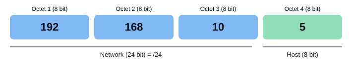

*شکل ۱: آدرس 192.168.10.5/24؛ ۳ Octet اول «شبکه» و آخری «میزبان» است.*

**Mask** هم یک عدد ۳۲ بیتی است: از چپ چند بیت 1 (قسمت شبکه) و بقیه 0 (قسمت میزبان). مثلاً Mask با ۲۴ بیت 1 برابر `255.255.255.0` است. نوشتن «تعداد بیت‌های 1» به شکل `/24` را Prefix Length می‌گویند. پس `192.168.10.5/24` یعنی: ۲۴ بیت اول = شبکه، ۸ بیت آخر = میزبان.

| Prefix | Mask            | تعداد آدرس | Host قابل‌استفاده | اندازه بلوک (Octet آخر) |
|--------|-----------------|------------|------------------|-------------------------|
| /24    | 255.255.255.0   | 256        | 254              | —                       |
| /25    | 255.255.255.128 | 128        | 126              | 128                     |
| /26    | 255.255.255.192 | 64         | 62               | 64                      |
| /27    | 255.255.255.224 | 32         | 30               | 32                      |
| /28    | 255.255.255.240 | 16         | 14               | 16                      |
| /29    | 255.255.255.248 | 8          | 6                | 8                       |
| /30    | 255.255.255.252 | 4          | 2                | 4                       |

**فرمول تعداد آدرس:** هر Subnet به‌اندازه‌ی «۲ به توان تعداد بیت‌های میزبان» آدرس دارد. دو آدرس از آن‌ها رزرو است (اولی آدرس شبکه، آخری Broadcast) و به Host داده نمی‌شود.

``` text
Total addresses = 2 ^ (32 - Prefix)
Usable hosts    = 2 ^ (32 - Prefix) - 2

Example (/26):
  Host bits = 32 - 26 = 6
  Total     = 2 ^ 6   = 64
  Usable    = 64 - 2  = 62
```

### ۴. محاسبه Subnet: روش گام‌به‌گام

برای هر آدرس/Prefix چهار پاسخ می‌خواهیم: **شبکه**، **Broadcast**، **Hostهای قابل‌استفاده (اولی تا آخری)**، **تعداد Host**.

> **روش «اندازه بلوک» (Block Size)**
>
> 1.  Octet «جالب» را پیدا کن: همان Octetی که Mask آن نه 0 است و نه 255.
> 2.  اندازه بلوک را با فرمول زیر حساب کن.
> 3.  عدد Octet آدرس را به نزدیک‌ترین مضرب بلوک (به سمت پایین) گرد کن؛ این می‌شود آدرس شبکه.
> 4.  Broadcast یک عدد کمتر از شبکه بعدی است.
> 5.  Hostها: از «شبکه + 1» تا «Broadcast - 1».

``` text
Block size = 256 - (mask value of the interesting octet)
Network    = largest multiple of Block size that is <= octet value
Broadcast  = (next network) - 1
First host = Network + 1
Last host  = Broadcast - 1
```

#### مثال ۱ (ساده): 192.168.1.10/24

``` text
Mask       = 255.255.255.0   (no interesting octet)
Network    = 192.168.1.0
Broadcast  = 192.168.1.255
Hosts      = 192.168.1.1 - 192.168.1.254
Host count = 2^8 - 2 = 254
```

چون Mask در سه Octet اول 255 است، سه Octet اول بدون تغییر می‌ماند.

#### مثال ۲ (متوسط): 10.10.20.77/26

``` text
Mask         = 255.255.255.192
Interesting  = 4th octet (192)
Block size   = 256 - 192 = 64
Blocks       = 0, 64, 128, 192
77 is between 64 and 127
Network      = 10.10.20.64
Next network = 10.10.20.128
Broadcast    = 10.10.20.127
Hosts        = 10.10.20.65 - 10.10.20.126
Host count   = 2^6 - 2 = 62
```

#### مثال ۳ (سخت): 172.16.45.200/20

``` text
/20 = 8 + 8 + 4 bits
Mask         = 255.255.240.0
Interesting  = 3rd octet (240)
Block size   = 256 - 240 = 16
Blocks       = 0, 16, 32, 48 ...
45 is between 32 and 47
Network      = 172.16.32.0
Next network = 172.16.48.0
Broadcast    = 172.16.47.255
Hosts        = 172.16.32.1 - 172.16.47.254
Host count   = 2^12 - 2 = 4094
```

#### مثال ۴ (معکوس): به ۵۰ Host نیاز دارم؛ Prefix چند؟

``` text
Need          = 50 hosts + 2 reserved = 52
Smallest 2^n >= 52  ->  n = 6  (2^6 = 64)
Host bits     = 6
Prefix        = 32 - 6 = /26
Usable hosts  = 64 - 2 = 62   (enough for 50)
```

همیشه «+2» را فراموش نکن؛ بدون آن جواب اشتباه می‌شود.

### تعداد کل IPهای یک Subnet را با «اندازه بلوک» حساب کنیم

فقط یک سؤال داریم: **یک Subnet روی‌هم چند آدرس دارد؟** فعلاً کاری با آدرس شبکه، Broadcast یا Hostها نداریم. هر Octet ۲۵۶ حالت دارد (از 0 تا 255). پس برای شمردن کل آدرس‌ها دو چیز لازم است: اندازه بلوک، و اینکه «Octet جالب» کجاست.

``` text
Total IPs = Block size x 256 ^ n

Block size = 256 - (mask value of the interesting octet)
n          = number of octets AFTER the interesting octet
```

Octet جالب همان Octetی است که Mask آن نه 0 است و نه 255. هر Octet بعد از آن، کاملاً در بخش میزبان است و ضریب ۲۵۶ می‌آورد.

#### مثال اول: تغییر در Octet چهارم

``` text
192.168.1.0/26
Mask       = 255.255.255.192
Block size = 256 - 192 = 64
n          = 0   (no octet after the 4th)
Total      = 64 x 256^0 = 64
```

#### مثال دوم: تغییر در Octet سوم

``` text
192.168.0.0/22
Mask       = 255.255.252.0
Block size = 256 - 252 = 4
n          = 1   (the 4th octet)
Total      = 4 x 256 = 1024
```

#### مثال سوم: تغییر در Octet دوم

``` text
10.0.0.0/14
Mask       = 255.252.0.0
Block size = 256 - 252 = 4
n          = 2   (the 3rd and 4th octets)
Total      = 4 x 256 x 256 = 262144
```

#### مثال چهارم: تغییر در Octet اول

``` text
0.0.0.0/6
Mask       = 252.0.0.0
Block size = 256 - 252 = 4
n          = 3   (the 2nd, 3rd and 4th octets)
Total      = 4 x 256 x 256 x 256 = 67108864
```

#### جدول خلاصه

| محل تغییر   | اندازه بلوک (نمونه) | محاسبه              | تعداد کل IP |
|-------------|---------------------|---------------------|-------------|
| Octet چهارم | 64                  | 64                  | 64          |
| Octet سوم   | 4                   | 4 × 256             | 1,024       |
| Octet دوم   | 4                   | 4 × 256 × 256       | 262,144     |
| Octet اول   | 4                   | 4 × 256 × 256 × 256 | 67,108,864  |

> **دو نکته‌ی مهم**
>
> ۱) این عدد «کل آدرس‌ها» است؛ برای Host قابل‌استفاده باید ۲ تا کم کنید (شبکه و Broadcast). ۲) اگر Mask دقیقاً روی مرز Octet بود (مثل /24 یا /16 یا /8)، Octet جالب نداریم؛ ساده‌ترین کار این است که اولین Octet صفر را «بلوک ۲۵۶» بگیرید: برای /24 می‌شود ۲۵۶ و برای /16 می‌شود ۲۵۶ × ۲۵۶ = ۶۵۵۳۶.

#### خودآزمایی (آسان تا سخت)

**م1.** سؤال ۱: Mask = 255.255.255.224؛ تعداد کل آدرس؟ *(پاسخ: 2-1-م1 در بخش «پاسخ‌ها» انتهای فصل)*

**م2.** سؤال ۲: Mask = 255.255.248.0؛ تعداد کل آدرس؟ *(پاسخ: 2-1-م2 در بخش «پاسخ‌ها» انتهای فصل)*

**م3.** سؤال ۳: Mask = 255.240.0.0؛ تعداد کل آدرس؟ *(پاسخ: 2-1-م3 در بخش «پاسخ‌ها» انتهای فصل)*

**م4.** سؤال ۴ (بررسی با روش توان ۲): آیا جواب سؤال ۳ با 2 به توان بیت‌های میزبان می‌خواند؟ *(پاسخ: 2-1-م4 در بخش «پاسخ‌ها» انتهای فصل)*

### جدول توان‌های ۲ (برای محاسبه‌ی سریع)

تمام محاسبه‌های Subnetting روی توان‌های ۲ بنا شده‌اند: تعداد آدرس‌ها، اندازه بلوک و تعداد Host. این جدول را چند بار بخوانید تا به‌خاطر بسپارید؛ الگو ساده است: هر ردیف دو برابر ردیف قبلی است.

| توان   | حاصل   |
|--------|--------|
| 2 ^ 0  | 1      |
| 2 ^ 1  | 2      |
| 2 ^ 2  | 4      |
| 2 ^ 3  | 8      |
| 2 ^ 4  | 16     |
| 2 ^ 5  | 32     |
| 2 ^ 6  | 64     |
| 2 ^ 7  | 128    |
| 2 ^ 8  | 256    |
| 2 ^ 9  | 512    |
| 2 ^ 10 | 1,024  |
| 2 ^ 11 | 2,048  |
| 2 ^ 12 | 4,096  |
| 2 ^ 13 | 8,192  |
| 2 ^ 14 | 16,384 |
| 2 ^ 15 | 32,768 |
| 2 ^ 16 | 65,536 |

> **نکته‌ی حفظ‌کردن**
>
> اگر عدد ۲ به توان ۱۰ را (۱,۰۲۴) به یاد داشته باشید، بقیه را می‌توانید از روی آن بسازید: برای هر توان بالاتر دو برابر کنید و برای هر توان پایین‌تر نصف. مثلاً ۲ به توان ۱۲ برابر ۱۰۲۴ × ۴ است، یعنی ۴۰۹۶.

مثال کاربردی: برای /20، بیت‌های میزبان ۱۲ است؛ در جدول ردیف ۲ به توان ۱۲ را نگاه می‌کنیم: ۴,۰۹۶ آدرس.

### جدول مرجع کامل: Prefix، Mask و تعداد IP

این جدول همه‌ی Prefixها را از /32 تا /0 کنار هم می‌گذارد. آن را حفظ نکنید؛ بفهمید و هر وقت لازم شد نگاه کنید. دو الگو را ببینید: با هر یک Prefix کمتر، تعداد آدرس‌ها **دو برابر** می‌شود؛ و ستون «تعداد کل IP» همان ۲ به توان «بیت‌های میزبان» است.

| Prefix | Subnet Mask     | بیت‌های میزبان | تعداد کل IP   |
|--------|-----------------|---------------|---------------|
| /32    | 255.255.255.255 | 0             | 1             |
| /31    | 255.255.255.254 | 1             | 2             |
| /30    | 255.255.255.252 | 2             | 4             |
| /29    | 255.255.255.248 | 3             | 8             |
| /28    | 255.255.255.240 | 4             | 16            |
| /27    | 255.255.255.224 | 5             | 32            |
| /26    | 255.255.255.192 | 6             | 64            |
| /25    | 255.255.255.128 | 7             | 128           |
| /24    | 255.255.255.0   | 8             | 256           |
| /23    | 255.255.254.0   | 9             | 512           |
| /22    | 255.255.252.0   | 10            | 1,024         |
| /21    | 255.255.248.0   | 11            | 2,048         |
| /20    | 255.255.240.0   | 12            | 4,096         |
| /19    | 255.255.224.0   | 13            | 8,192         |
| /18    | 255.255.192.0   | 14            | 16,384        |
| /17    | 255.255.128.0   | 15            | 32,768        |
| /16    | 255.255.0.0     | 16            | 65,536        |
| /15    | 255.254.0.0     | 17            | 131,072       |
| /14    | 255.252.0.0     | 18            | 262,144       |
| /13    | 255.248.0.0     | 19            | 524,288       |
| /12    | 255.240.0.0     | 20            | 1,048,576     |
| /11    | 255.224.0.0     | 21            | 2,097,152     |
| /10    | 255.192.0.0     | 22            | 4,194,304     |
| /9     | 255.128.0.0     | 23            | 8,388,608     |
| /8     | 255.0.0.0       | 24            | 16,777,216    |
| /7     | 254.0.0.0       | 25            | 33,554,432    |
| /6     | 252.0.0.0       | 26            | 67,108,864    |
| /5     | 248.0.0.0       | 27            | 134,217,728   |
| /4     | 240.0.0.0       | 28            | 268,435,456   |
| /3     | 224.0.0.0       | 29            | 536,870,912   |
| /2     | 192.0.0.0       | 30            | 1,073,741,824 |
| /1     | 128.0.0.0       | 31            | 2,147,483,648 |
| /0     | 0.0.0.0         | 32            | 4,294,967,296 |

> **دو حالت خاص**
>
> **/32** فقط یک آدرس است (یک Host مشخص، مثلاً Loopback یا Route برای یک دستگاه). **/31** دو آدرس دارد و طبق استاندارد RFC 3021 برای لینک نقطه‌به‌نقطه بین دو روتر می‌شود از هر دو آدرس استفاده کرد (بدون کسر ۲). برای بقیه‌ی Prefixها، Host قابل‌استفاده برابر «تعداد کل منهای ۲» است.

### کامپیوترها چطور می‌فهمند با هم در یک شبکه‌اند؟

کامپیوتر هیچ «نقشه‌ای» از شبکه ندارد؛ فقط IP و Mask خودش و IP مقصد را می‌داند. با یک عملیات ساده‌ی بیتی به نام AND تصمیم می‌گیرد:

1.  IP را به باینری تبدیل می‌کند.
2.  Mask را به باینری تبدیل می‌کند.
3.  بیت‌به‌بیت AND می‌گیرد؛ نتیجه «آدرس شبکه» (Network) است.
4.  همین کار را برای IP مقصد با Mask خودش انجام می‌دهد.
5.  اگر دو آدرس شبکه برابر بود، «هم‌شبکه» هستند و مستقیم (با ARP) ارتباط می‌گیرند؛ وگرنه بسته را به Gateway می‌دهد.

#### قانون AND (جدول درستی)

``` text
0 AND 0 = 0
0 AND 1 = 0
1 AND 0 = 0
1 AND 1 = 1
```

فقط وقتی هر دو بیت 1 باشند نتیجه 1 است. چون Mask در بخش شبکه همه 1 است، بیت‌های شبکه حفظ می‌شوند؛ و چون در بخش میزبان همه 0 است، بیت‌های میزبان صفر می‌شوند. به همین دلیل نتیجه‌ی AND همیشه «آدرس شبکه» است.

#### مثال ساده: هم‌شبکه

دو کامپیوتر: A = 192.168.1.10/24 و B = 192.168.1.20/24. سه Octet اول Mask برابر 255 (همه 1) است و بدون تغییر می‌ماند؛ فقط Octet آخر را محاسبه می‌کنیم.

``` text
Mask last octet : 0     = 00000000

A last octet    : 10    = 00001010
A AND Mask      :         00000000  = 0
A network       : 192.168.1.0

B last octet    : 20    = 00010100
B AND Mask      :         00000000  = 0
B network       : 192.168.1.0

192.168.1.0 = 192.168.1.0  ->  SAME network
```

#### مثال متوسط: شبیه‌اند ولی هم‌شبکه نیستند

A = 10.10.20.77/26 و B = 10.10.20.130/26. Mask چهارم برابر 192 است.

``` text
Mask last octet : 192   = 11000000

A last octet    : 77    = 01001101
A AND Mask      :         01000000  = 64
A network       : 10.10.20.64

B last octet    : 130   = 10000010
B AND Mask      :         10000000  = 128
B network       : 10.10.20.128

10.10.20.64 != 10.10.20.128  ->  DIFFERENT networks
Result: A sends to its Default Gateway (a router is required)
```

> **نتیجه‌ی کلیدی**
>
> «هم‌شبکه بودن» یعنی آدرس شبکه‌ی دو Host (حاصل IP AND Mask) برابر باشد؛ نه اینکه IPها شبیه هم باشند.

### ۵. Packet Flow: آیا دو Host هم‌شبکه‌اند؟

وقتی Host می‌خواهد بسته بفرستد، با Mask خودش تصمیم می‌گیرد: آدرس مقصد را با Mask AND می‌کند؛ اگر شبکه برابر شبکه خودش بود، مقصد «همین لینک» است و با ARP مستقیم می‌فرستد؛ وگرنه بسته را به Default Gateway می‌دهد.

``` text
Host A: 10.10.20.77/26    network 10.10.20.64   (range 64 .. 127)
Host B: 10.10.20.130/26   network 10.10.20.128  (range 128 .. 191)

A wants to send to B:
  Is B in A's network?   130 is greater than 127  ->  NO
  So A sends the packet to its Default Gateway (the router).
```

نکته جالب: دو آدرس `10.10.20.77` و `10.10.20.130` ظاهراً شبیه‌اند ولی در دو Subnet متفاوت‌اند، و بدون Router با هم حرف نمی‌زنند.

### اگر Default Gateway تنظیم نشده باشد چه می‌شود؟

تصمیم Host همیشه با IP و Mask خودش شروع می‌شود. سپس بسته به نتیجه، یکی از دو مسیر زیر را می‌رود. نکته‌ی مهم این است که **ARP در هر دو مسیر انجام می‌شود**، ولی برای MAC متفاوت.

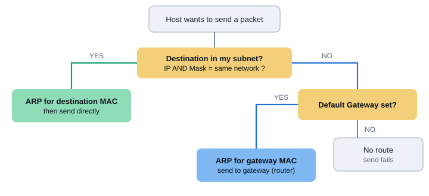

*شکل: درخت تصمیم Host هنگام ارسال بسته؛ در هر دو حالت مسیر درست با ARP کامل می‌شود.*

| حالت                                   | ARP برای چه MAC؟    | فریم به کجا می‌رود؟                          |
|----------------------------------------|---------------------|---------------------------------------------|
| مقصد در Subnet خودم است                | MAC مقصد نهایی      | مستقیم به مقصد                              |
| مقصد در Subnet دیگر است                | MAC Default Gateway | به روتر، و روتر ادامه می‌دهد                 |
| مقصد در Subnet دیگر است و Gateway نیست | —                   | ارتباط برقرار نمی‌شود (جایی برای ارسال نیست) |

پس دو کامپیوتر در دو Subnet متفاوت، بدون Default Gateway (و بدون Route دستی دیگر)، نمی‌توانند با هم ارتباط بگیرند. ARP فقط برای دستگاه‌های «روی همین لینک» جواب می‌دهد؛ هیچ دستگاهی در Subnet دیگر به ARP Request شما پاسخ نمی‌دهد.

> **قاعده‌ی خلاصه**
>
> اگر مقصد همسایه است، با ARP خودش را پیدا می‌کنیم. اگر همسایه نیست، بسته را برای دروازه می‌فرستیم و دروازه تصمیم می‌گیرد.

### ۶. آدرس‌های خاص (باید بشناسید)

| بازه            | نام                            | کاربرد                                                       |
|-----------------|--------------------------------|--------------------------------------------------------------|
| 10.0.0.0/8      | آدرس خصوصی (RFC 1918) - کلاس A | داخل سازمان؛ در اینترنت Route نمی‌شود                         |
| 172.16.0.0/12   | آدرس خصوصی (RFC 1918) - کلاس B | داخل سازمان؛ در اینترنت Route نمی‌شود                         |
| 192.168.0.0/16  | آدرس خصوصی (RFC 1918) - کلاس C | داخل سازمان؛ در اینترنت Route نمی‌شود                         |
| 127.0.0.0/8     | Loopback                       | تست خود دستگاه (`127.0.0.1`)                                 |
| 169.254.0.0/16  | APIPA (Link-Local)             | وقتی Client از DHCP آدرس نگرفت خودش می‌سازد؛ نشانه خرابی DHCP |
| 224.0.0.0/4     | Multicast                      | مثلاً OSPF و HSRP                                             |
| 203.0.113.0/24  | مستندات (TEST-NET-3)           | در Lab ما «اینترنت شبیه‌سازی‌شده» است                          |
| 198.51.100.0/24 | مستندات (TEST-NET-2)           | مثال در مستندات                                              |

> **ارتباط با دوره**
>
> اگر Client شما `169.254.x.x` دارد، یعنی DHCP جواب نداده؛ در عیب‌یابی TS10 می‌بینید.

### ۷. تمرین‌های درجه‌بندی‌شده (قبل از Lab حل کنید)

هرکدام را روی کاغذ حل کنید، بعد جواب را باز کنید.

**ت1.** ۱ (ساده): 192.168.5.130/24 *(پاسخ: 2-1-ت1 در بخش «پاسخ‌ها» انتهای فصل)*

**ت2.** ۲: 10.0.0.9/30 *(پاسخ: 2-1-ت2 در بخش «پاسخ‌ها» انتهای فصل)*

**ت3.** ۳: 192.168.1.100/27 *(پاسخ: 2-1-ت3 در بخش «پاسخ‌ها» انتهای فصل)*

**ت4.** ۴: 192.168.0.200/25 *(پاسخ: 2-1-ت4 در بخش «پاسخ‌ها» انتهای فصل)*

**ت5.** ۵: به ۸ Host نیاز دارم؛ Prefix؟ *(پاسخ: 2-1-ت5 در بخش «پاسخ‌ها» انتهای فصل)*

**ت6.** ۶ (سخت): 172.31.14.9/22 *(پاسخ: 2-1-ت6 در بخش «پاسخ‌ها» انتهای فصل)*

**ت7.** ۷ (سخت): 10.1.200.15/19 *(پاسخ: 2-1-ت7 در بخش «پاسخ‌ها» انتهای فصل)*

**ت8.** ۸: آیا 10.10.20.77/26 و 10.10.20.130/26 هم‌شبکه‌اند؟ *(پاسخ: 2-1-ت8 در بخش «پاسخ‌ها» انتهای فصل)*

### ۸. Lab هدایت‌شده: «Mask چطور تعیین می‌کند چه کسی همسایه است»

در Lab `L00-ImageValidation` می‌دانید `R1` روی `Gi0/0.10` آدرس `10.10.10.1/24` و `SW1` روی `Vlan10` آدرس `10.10.10.2/24` دارد و `ping` کار می‌کند. حالا عمداً Mask را خراب می‌کنیم تا اثرش را ببینید.

#### گام ۱: وضعیت سالم

``` text
R1# show ip interface brief
R1# show ip route connected
R1# ping 10.10.10.2
```

`show ip route connected` باید شبکه `10.10.10.0/24` را به‌عنوان Connected نشان بدهد؛ `ping` موفق.

#### گام ۲: تغییر آدرس سوییچ به یک Host «بالای نصف»

``` text
SW1# configure terminal
SW1(config)# interface vlan 10
SW1(config-if)# ip address 10.10.10.130 255.255.255.0
SW1(config-if)# end
```

#### گام ۳: تنگ‌کردن Mask روی روتر

``` text
R1# configure terminal
R1(config)# interface gi0/0.10
R1(config-subif)# ip address 10.10.10.1 255.255.255.128
R1(config-subif)# end
R1# show ip route connected
R1# ping 10.10.10.130
```

**پیش‌بینی (قبل از اجرا فکر کنید):** با Mask جدید، محدوده‌ی «همین لینک» برای روتر کوچک‌تر شده است:

``` text
R1 new mask = /25
R1 network  = 10.10.10.0 - 10.10.10.127
SW1 address = 10.10.10.130   -> outside this range
Result      : R1 has no connected route to .130 -> ping fails
```

نتیجه‌ی واقعی را بنویسید؛ اگر چیز دیگری دیدید همان را ثبت کنید. سمت سوییچ Mask قبلی (/24) را دارد و فکر می‌کند روتر همسایه است؛ پس ارتباط «نیمه‌کاره» می‌شود.

#### گام ۴: رفع

``` text
R1(config)# interface gi0/0.10
R1(config-subif)# ip address 10.10.10.1 255.255.255.0
R1(config-subif)# end
R1# ping 10.10.10.130
```

بعد از رفع، ping موفق می‌شود. سپس آدرس سوییچ را به `10.10.10.2` برگردانید.

### ۹. Lab مستقل

سه Subnet بسازید: ۴۰ Host، ۱۰ Host و یک لینک دو روتر. از `192.168.50.0/24` با روش اندازه بلوک شروع کنید و برای هرکدام Prefix، شبکه، Broadcast، اولین و آخرین Host را بنویسید. جدول را در فایل `02-design/ip-plan-drill.md` ذخیره کنید.

### ۱۰. عیب‌یابی (TS13: Mask اشتباه، TS14: Gateway اشتباه)

| بخش                | شرح                                                                                                                                              |
|--------------------|--------------------------------------------------------------------------------------------------------------------------------------------------|
| Symptom            | یک Host فقط به بعضی Hostهای همان VLAN می‌رسد                                                                                                      |
| سرنخ اول           | Hostهای «بالای» یک عدد خاص (مثلاً .128 به بالا) جواب نمی‌دهند                                                                                      |
| روش                | ۱) `ipconfig /all` یا `show ip interface brief` ۲) Mask و Gateway را با Subnet مقایسه کن ۳) `ping` هم‌سایه و Gateway ۴) `show ip route connected` |
| علت                | Mask نادرست (مثلاً /25 به‌جای /24) یا Gateway خارج Subnet                                                                                          |
| رفع و Verification | تصحیح Mask/Gateway؛ ping همه Hostها                                                                                                              |

### ۱۱. سؤال‌های مرور (Active Recall، بدون نگاه)

**م5.** آدرس شبکه و Broadcast با چه فرمولی پیدا می‌شود؟ *(پاسخ: 2-1-م5 در بخش «پاسخ‌ها» انتهای فصل)*

**م6.** چرا Host قابل‌استفاده = آدرس‌ها منهای ۲ است؟ *(پاسخ: 2-1-م6 در بخش «پاسخ‌ها» انتهای فصل)*

**م7.** /26 چند Host دارد و بلوکش چند است؟ *(پاسخ: 2-1-م7 در بخش «پاسخ‌ها» انتهای فصل)*

**م8.** Client با 169.254.x.x یعنی چه؟ *(پاسخ: 2-1-م8 در بخش «پاسخ‌ها» انتهای فصل)*

**م9.** دو Host در یک Subnet با چه روشی هم‌شبکه بودنشان را تشخیص می‌دهند؟ *(پاسخ: 2-1-م9 در بخش «پاسخ‌ها» انتهای فصل)*

### English Corner: انگلیسی تخصصی این درس

این جمله‌ها از مستندات و محیط کار واقعی‌اند. بلند بخوانید و ترجمه را بپوشانید.

| English sentence                                                             | ترجمه                                                           |
|------------------------------------------------------------------------------|-----------------------------------------------------------------|
| The subnet mask determines which part of the address identifies the network. | ماسک زیرشبکه مشخص می‌کند کدام بخش آدرس، شبکه را تعیین می‌کند.     |
| The host cannot reach devices outside its subnet without a default gateway.  | بدون Default Gateway، Host به دستگاه‌های خارج از Subnet نمی‌رسد.  |
| A /26 prefix provides 62 usable host addresses.                              | یک Prefix با طول /26 تعداد ۶۲ آدرس قابل‌استفاده برای Host می‌دهد. |
| The client self-assigned a 169.254.x.x address because DHCP failed.          | Client چون DHCP شکست خورد، خودش آدرس 169.254.x.x گرفت.          |

**Q1.** Quick quiz (answer in English): How many usable hosts are in a /27 subnet? *(پاسخ: 2-1-Q1 در بخش «پاسخ‌ها» انتهای فصل)*

### ۱۲. تکلیف و چک‌لیست تسلط

- [ ] ۸ تمرین بخش ۷ را بدون نگاه حل کنم.
- [ ] ده عدد دلخواه را به باینری و برعکس تبدیل کنم.
- [ ] آزمایش Mask (گام ۱ تا ۴) را انجام دهم و نتیجه واقعی `ping` را ثبت کنم.
- [ ] Lab مستقل را در Git (بدون رمز) ذخیره کنم.
- [ ] توضیح بدهم چرا ۲ آدرس رزرو است.

### ۱۳. یادآوری اشتباهات شما

> **یادآوری ۱**
>
> اول `enable` و بعد `configure terminal`؛ و فقط یک‌بار.

> **یادآوری ۲**
>
> دستورهای EXEC (مثل `monitor capture`) در Config خطا می‌دهند؛ خطای «Invalid input» همیشه ناسازگاری Image نیست.

> **یادآوری ۳**
>
> «فرمان پذیرفته شد» ≠ «Feature کار می‌کند»؛ با ترافیک واقعی بسنجید.


#### کارت Lab — درس ۲-۱

| # | فیلد | محتوا |
|---|---|---|
| 1 | عنوان و هدف | دیدن اثر Mask غلط روی ارتباط R1 و SW1 |
| 2 | پیش‌نیاز | درس ۱-B؛ Lab L00 سالم |
| 3 | توپولوژی | R1 Gi0/0.10 ↔ trunk ↔ SW1 Vlan10 |
| 4 | تجهیزات | R1، SW1 |
| 5 | نسخه نرم‌افزار | vIOS-L2 15.2(20200924، Experimental) برای SW؛ vIOS 15.9(3)M9 برای R؛ VPCS (PNetLab)؛ PNetLab 4.2.8 |
| 6 | IP Plan | 10.10.10.1/24 (R1)، 10.10.10.2/24 (SW1) |
| 7 | وضعیت اولیه | ping بین R1 و SW1 موفق |
| 8 | صورت مسئله | Mask را عمداً /25 کنید، نتیجه‌ی ping به 10.10.10.130 را قبل از اجرا پیش‌بینی و بعد ثبت کنید |
| 9 | مراحل هدایت‌شده | همان بخش «Lab هدایت‌شده» همین درس (گام‌به‌گام) |
| 10 | تست عملکرد | `show ip route connected` ؛ `ping 10.10.10.130` |
| 11 | سناریوی خرابی | Mask /25 روی R1 و /24 روی SW1 (نیمه‌کاره) |
| 12 | روش عیب‌یابی | مقایسه‌ی Mask دو سر، `show ip route connected` |
| 13 | نتیجه‌ی مورد انتظار | ping به .130 قبل از رفع شکست می‌خورد؛ بعد از رفع موفق |
| 14 | معیار پذیرش | پیش‌بینی ثبت‌شده با نتیجه‌ی واقعی مقایسه شود؛ رفع کامل |
| 15 | مستندات نهایی | جدول `02-design/ip-plan-drill.md` |
| 16 | Cleanup و بازگردانی | آدرس SW1 را به 10.10.10.2 و Mask R1 را به /24 برگردانید |

> **وضعیت راستی‌آزمایی (خارج از ۱۶ فیلد):** **اجرا نشده (فقط طراحی).** مرحله‌ی Mask غلط اجرا نشده. پیش‌شرط (RoAS + ping R1↔SW1) در Probe ۱-B به‌صورت Tested-OK دیده شده است.

---

<a id="l-2-2"></a>

## درس ۲-۲ — VLSM و طراحی IP Plan

**فصل ۲ - روز ۲ · پیش‌نیاز: درس ۲-۱ · ۶ ساعت**

### این درس درباره چیست و چرا باید یاد بگیریم؟

**چه چیزی یاد می‌گیریم:** چطور یک بلوک آدرس را به Subnetهای هم‌اندازه‌ی نامناسب نبُریم، بلکه برای هر بخش سازمان دقیقاً به اندازه نیازش آدرس بدهیم. این کار را VLSM (مخفف Variable Length Subnet Mask، یعنی «ماسک زیرشبکه با طول متغیر») می‌گویند. بعد، نتیجه را در یک «برنامه‌ی آدرس‌دهی» (IP Plan، مخفف IP Addressing Plan) می‌نویسیم.

**چرا لازم است:** تصور کنید یک ساختمان اداری دارید و می‌خواهید طبقه‌ها را تقسیم کنید. اگر همه‌ی اتاق‌ها را به‌اندازه‌ی بزرگ‌ترین اتاق (سالن اجتماعات) بسازید، فضای زیادی هدر می‌رود. در شبکه هم همین است: لینک بین دو روتر فقط به ۲ آدرس نیاز دارد، ولی اگر یک /24 با ۲۵۴ آدرس به آن بدهید، ۲۵۲ آدرس هدر رفته است.

- **در کار روزانه:** وقتی شعبه‌ی جدید باز می‌شود، باید بدون به‌هم‌ریختن شبکه‌ی فعلی، آدرس تازه بدهید.
- **در امنیت:** هر Subnet یک «مرز» برای فایروال است. Subnetهای درست‌اندازه یعنی قانون‌های دقیق‌تر.
- **در دوره‌ی ما:** پروژه‌ی نهایی (Capstone) یک مرکز و سه شعبه دارد؛ IP Plan آن را همین هفته می‌سازیم.

> **مسیر درس**
>
> مشکل (هدررفت) ← ایده‌ی VLSM ← مثال ساده ← مثال متوسط ← مثال سخت (سازمان واقعی) ← تمرین ← Lab ← عیب‌یابی.

#### اصطلاحات این درس (مخفف ← شکل کامل ← معنی)

| مخفف    | شکل کامل انگلیسی                    | معنی فارسی                                                    |
|---------|-------------------------------------|---------------------------------------------------------------|
| VLSM    | Variable Length Subnet Mask         | ماسک زیرشبکه با طول متغیر؛ هر بخش به اندازه نیازش آدرس می‌گیرد |
| IP Plan | IP Addressing Plan                  | برنامه و سند آدرس‌دهی سازمان                                   |
| VLAN    | Virtual Local Area Network          | شبکه محلی مجازی؛ جداسازی منطقی روی یک سوییچ                   |
| DMZ     | Demilitarized Zone                  | منطقه حائل برای سرورهای در دسترس از بیرون                     |
| Gateway | Default Gateway                     | دروازه پیش‌فرض                                                 |
| DHCP    | Dynamic Host Configuration Protocol | تخصیص خودکار آدرس                                             |
| CIDR    | Classless Inter-Domain Routing      | نمایش آدرس با Prefix بدون کلاس، مثل /26                       |

### ۱. مشکل: تقسیم هم‌اندازه و هدررفت آدرس

فرض کنید بلوک `192.168.10.0/24` (۲۵۶ آدرس) دارید و چهار بخش می‌خواهید: فروش (۱۰۰ کامپیوتر)، فنی (۵۰)، مدیریت (۱۲)، و یک لینک بین دو روتر (۲).

اگر ساده‌لوحانه همه را /26 (۶۲ Host) بسازید، فروش جا نمی‌شود (۱۰۰ \> ۶۲). اگر همه را /25 (۱۲۶ Host) بسازید، فقط ۲ Subnet می‌گیرید و چهار بخش جا نمی‌شود. یعنی با اندازه‌ی ثابت، نه هدر نمی‌دهیم و نه جا می‌شویم. راه‌حل: **اندازه‌ی متغیر**.

### سؤال مهم: در شبکه داخلی برای IP پولی نمی‌دهیم، پس چرا اینقدر مراقب هدررفت هستیم؟

حرف درستی است: آدرس‌های خصوصی (مثل 10.0.0.0/8 یا 192.168.0.0/16) هزینه ندارند و هیچ‌کس برای آن‌ها فاکتور نمی‌فرستد. اما «پول» تنها دلیل VLSM نیست. دلیل‌های اصلی این‌هاست:

| دلیل                   | توضیح                                                                                                                   |
|------------------------|-------------------------------------------------------------------------------------------------------------------------|
| ۱. بلوک شما محدود است  | معمولاً از یک بلوک مشخص (مثلاً یک /24 یا /22) استفاده می‌کنید. اگر هر لینک دو روتر یک /24 کامل بگیرد، بلوک زود تمام می‌شود. |
| ۲. رشد آینده           | شعبه‌ی جدید و VLAN جدید می‌آید. اگر فضا را هدر داده باشید، مجبور می‌شوید همه‌چیز را عوض کنید.                               |
| ۳. مدیریت و مستندسازی  | Subnetهای درست‌اندازه و منظم، IP Plan را خوانا و عیب‌یابی را سریع می‌کند.                                                  |
| ۴. خلاصه‌سازی مسیرها    | وقتی آدرس‌ها پشت‌سرهم و منظم باشند، می‌شود چند Route را در یک Route خلاصه کرد (جدول Route کوچک‌تر).                         |
| ۵. جلوگیری از هم‌پوشانی | در ادغام شرکت‌ها یا اتصال VPN بین دو سایت، بازه‌ها نباید هم‌پوشانی داشته باشند؛ مصرف بی‌حساب بازه این خطر را بالا می‌برد.    |
| ۶. امنیت و Broadcast   | Subnet خیلی بزرگ یعنی Broadcast Domain بزرگ و Policy فایروال درشت و نامحدود.                                            |

> **یک نکته‌ی صادقانه**
>
> اگر بلوک خیلی بزرگی مثل 10.0.0.0/8 دارید، کمبود آدرس معمولاً مشکل اصلی نیست. آن‌جا دلیل‌های ۳ تا ۶ (نظم، خلاصه‌سازی، هم‌پوشانی و امنیت) مهم‌ترند. VLSM در بلوک‌های کوچک‌تر و در لینک‌های بین روترها اهمیت بیشتری دارد.

#### VLSM کجا چقدر مهم است؟

| محیط                 | اهمیت VLSM                               |
|----------------------|------------------------------------------|
| شبکه‌ی خانگی کوچک     | کم                                       |
| شبکه‌ی شرکت کوچک      | متوسط                                    |
| سازمان بزرگ          | بسیار زیاد                               |
| ISP و شبکه‌های گسترده | بسیار زیاد (IPv4 عمومی محدود و گران است) |
| لینک بین روترها      | بسیار مهم (فقط ۲ آدرس لازم است)          |

#### مثال: ۳۰۰ کامپیوتر؛ یک /23 یا سه /24؟

``` text
Option 1: one /23
  Mask          = 255.255.254.0
  Total         = 2 ^ 9 = 512
  Usable        = 512 - 2 = 510
  Spare         = 510 - 300 = 210
  Broadcast domains = 1  (all 300 PCs together)

Option 2: three /24
  Usable each   = 254   (total 762)
  Broadcast domains = 3  (separated)
  Needs a router or L3 switch between them
```

از نظر ظرفیت، هر دو گزینه کافی است. انتخاب نهایی به طراحی بستگی دارد: اگر واحدهای سازمان باید از هم جدا باشند (امنیت، کاهش Broadcast، Policy جدا)، سه Subnet بهتر است؛ ولی برای ارتباط بینشان به دستگاه لایه ۳ نیاز دارید (روتر یا سوییچ لایه ۳). اگر همه یک گروه یکسان‌اند و نیازی به جداسازی نیست، یک /23 ساده‌تر است.

### ۲. ایده‌ی VLSM به زبان ساده

VLSM یعنی «Subnet Mask با طول متغیر» (Variable Length Subnet Mask). مثل برش پیتزا برای مهمان‌ها: به کسی که گرسنه‌تر است برش بزرگ‌تر می‌دهید و به بقیه کوچک‌تر. فقط یک قانون هست: برش‌ها نباید روی هم بیفتند.

> **سه قانون طلایی VLSM**
>
> ۱) **همیشه از بزرگ‌ترین نیاز شروع کن.** ۲) هر Subnet باید روی مرز مضرب اندازه‌ی خودش شروع شود (مثلاً یک /26 باید روی ۰، ۶۴، ۱۲۸ یا ۱۹۲ شروع شود). ۳) هیچ دو Subnet نباید هم‌پوشانی داشته باشند.

**مراحل کار برای هر بخش:** (۱) نیاز را بشمار و ۲ آدرس رزرو (شبکه و Broadcast) اضافه کن. (۲) کوچک‌ترین توان ۲ که کافی باشد را پیدا کن. (۳) Prefix را از آن بساز. (۴) از اولین آدرس آزاد شروع به تخصیص کن. (۵) آدرس بعدی آزاد را یادداشت کن.

### ۳. مثال ساده (دو بخش)

بلوک `10.0.0.0/24` را داریم. بخش A به ۱۰۰ Host و بخش B به ۲۰ Host نیاز دارد. اول بزرگ‌ترین (A):

``` text
A: need = 100 + 2 = 102
   2^7 = 128 >= 102  ->  Prefix = /25
   Network   = 10.0.0.0/25
   Hosts     = 10.0.0.1 - 10.0.0.126
   Broadcast = 10.0.0.127
   Next free = 10.0.0.128
```

بعد B از اولین آدرس آزاد شروع می‌شود:

``` text
B: need = 20 + 2 = 22
   2^5 = 32 >= 22   ->  Prefix = /27
   Network   = 10.0.0.128/27
   Hosts     = 10.0.0.129 - 10.0.0.158
   Broadcast = 10.0.0.159
   Next free = 10.0.0.160  (up to 10.0.0.255 stays free for growth)
```

باقی‌مانده بلوک (۱۶۰ تا ۲۵۵) برای رشد آینده خالی می‌ماند و هدررفت نیست.

### ۴. مثال متوسط (چهار بخش)


*شکل ۲: نوار آدرس VLSM؛ بخش بزرگ‌تر اول و بدون هم‌پوشانی.*

بلوک `192.168.10.0/24`؛ همان چهار بخش بخش ۱: فروش ۱۰۰، فنی ۵۰، مدیریت ۱۲، لینک روتر ۲.

| بخش       | نیاز+۲ | اندازه | Prefix | شبکه           | Hostها      | Broadcast |
|-----------|--------|--------|--------|----------------|-------------|-----------|
| فروش      | 102    | 128    | /25    | 192.168.10.0   | .1 – .126   | .127      |
| فنی       | 52     | 64     | /26    | 192.168.10.128 | .129 – .190 | .191      |
| مدیریت    | 14     | 16     | /28    | 192.168.10.192 | .193 – .206 | .207      |
| لینک روتر | 4      | 4      | /30    | 192.168.10.208 | .209 – .210 | .211      |

دقت کنید هر شروع، دقیقاً بعد از Broadcast قبلی است (۱۲۷ ← ۱۲۸، ۱۹۱ ← ۱۹۲، ۲۰۷ ← ۲۰۸). آدرس‌های `.212` تا `.255` هنوز آزادند (۴۴ آدرس).

**نکته:** اگر ترتیب را برعکس بگیرید (اول لینک /30 را در `.0` بگذارید)، بعداً /25 روی مرز ۱۲۸ می‌افتد و دیگر فروش در یک تکه جا نمی‌شود. برای همین «بزرگ‌ترین اول».

### پیش‌نیاز مثال بعدی: بلوک 10.20.0.0/22 یعنی چه؟

مثال سخت پایین با این جمله شروع می‌شود: «سازمانی بلوک `10.20.0.0/22` دارد.» اول آن را از پایه باز می‌کنیم.

#### گام ۱: معنی /22

از ۳۲ بیت آدرس، ۲۲ بیت برای «شبکه» است و ۱۰ بیت باقی‌مانده برای «میزبان». هر بیت میزبان دو حالت دارد؛ پس تعداد آدرس‌ها این‌طور حساب می‌شود:

``` text
Host bits       = 32 - 22 = 10
Total addresses = 2 ^ 10 = 1024
```

#### گام ۲: چرا آخرین آدرس 10.20.3.255 است؟

اول /22 را به Subnet Mask تبدیل می‌کنیم:

``` text
/22  = 11111111.11111111.11111100.00000000
Mask = 255.255.252.0
```

Octet سوم «جالب» است (چون 252 نه 0 است و نه 255). اندازه بلوک آن:

``` text
Block size = 256 - 252 = 4     (in the 3rd octet)
```

یعنی شبکه‌های /22 در Octet سوم هر ۴ عدد یک‌بار شروع می‌شوند:

| شماره شبکه | آدرس شروع  |
|------------|------------|
| شبکه ۱     | 10.20.0.0  |
| شبکه ۲     | 10.20.4.0  |
| شبکه ۳     | 10.20.8.0  |
| شبکه ۴     | 10.20.12.0 |

پس شبکه‌ی اول ما از `10.20.0.0` شروع می‌شود و درست قبل از شبکه‌ی بعدی (`10.20.4.0`) تمام می‌شود:

``` text
Network   = 10.20.0.0
Next net  = 10.20.4.0
Broadcast = 10.20.4.0 - 1 = 10.20.3.255
Range     = 10.20.0.0 - 10.20.3.255
```

#### گام ۳: چهار «تکه»ی داخل بلوک

Octet سوم در این بلوک چهار مقدار می‌گیرد: 0، 1، 2 و 3. هر مقدار یک تکه‌ی ۲۵۶تایی است:

``` text
10.20.0.0 - 10.20.0.255    256 addresses
10.20.1.0 - 10.20.1.255    256 addresses
10.20.2.0 - 10.20.2.255    256 addresses
10.20.3.0 - 10.20.3.255    256 addresses
Total = 4 x 256 = 1024
```

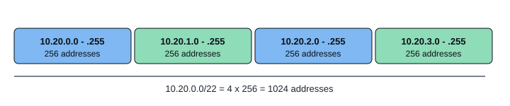

*شکل: بلوک /22 چهار تکه‌ی ۲۵۶تایی (چهار /24 پشت‌سرهم) است.*

> **نکته‌ی مهم**
>
> این چهار تکه فعلاً فقط «چهار قسمت از یک بلوک بزرگ» هستند، نه الزاماً چهار Subnet نهایی. در VLSM ما همین ۱۰۲۴ آدرس را به Subnetهایی با اندازه‌های مختلف (مثلاً /23، /25، /26، /27 و /30) تقسیم می‌کنیم؛ همان کاری که در مثال سخت پایین می‌بینید.

**سؤال خودآزمایی: در یک /22، هر تکه‌ی «Octet سوم» چند آدرس دارد؟**

``` text
Each value of the 3rd octet = 256 addresses (the last octet has 8 host bits: 2 ^ 8 = 256)
Answer: 256
```

### ۵. مثال سخت (سازمان واقعی: مرکز و سه شعبه)

سازمانی با بلوک `10.20.0.0/22` (۱۰۲۴ آدرس: `10.20.0.0` تا `10.20.3.255`). نیازها:

| بخش                   | Host |
|-----------------------|------|
| مرکز: کاربران         | 300  |
| مرکز: سرورها          | 60   |
| مرکز: مدیریت تجهیزات  | 25   |
| شعبه ۱: کاربران       | 100  |
| شعبه ۲: کاربران       | 50   |
| شعبه ۳: کاربران       | 20   |
| سه لینک روتر (هرکدام) | 2    |

**گام ۱ - اندازه هر بخش** (هر بخش یک سطر؛ مرتب از بزرگ به کوچک):

``` text
Center users    : 300 + 2 = 302 -> 512 -> /23
Branch 1        : 100 + 2 = 102 -> 128 -> /25
Center servers  :  60 + 2 =  62 ->  64 -> /26
Branch 2        :  50 + 2 =  52 ->  64 -> /26
Center mgmt     :  25 + 2 =  27 ->  32 -> /27
Branch 3        :  20 + 2 =  22 ->  32 -> /27
3 links         :   2 + 2 =   4 ->   4 -> /30 (each)
```

**گام ۲ - آیا بلوک کافی است؟**

``` text
Total needed = 512 + 128 + 64 + 64 + 32 + 32 + (3 x 4)
             = 844
Available    = 1024  (a /22)
844 <= 1024  ->  OK
```

**گام ۳ - تخصیص پشت‌سرهم:**

| بخش          | Prefix | شبکه        | Broadcast   |
|--------------|--------|-------------|-------------|
| مرکز-کاربران | /23    | 10.20.0.0   | 10.20.1.255 |
| شعبه ۱       | /25    | 10.20.2.0   | 10.20.2.127 |
| مرکز-سرورها  | /26    | 10.20.2.128 | 10.20.2.191 |
| شعبه ۲       | /26    | 10.20.2.192 | 10.20.2.255 |
| مرکز-مدیریت  | /27    | 10.20.3.0   | 10.20.3.31  |
| شعبه ۳       | /27    | 10.20.3.32  | 10.20.3.63  |
| لینک ۱       | /30    | 10.20.3.64  | 10.20.3.67  |
| لینک ۲       | /30    | 10.20.3.68  | 10.20.3.71  |
| لینک ۳       | /30    | 10.20.3.72  | 10.20.3.75  |

**گام ۴ - بررسی:** هر شروع باید دقیقاً یک عدد بعد از Broadcast قبلی باشد.

``` text
Last used address = 10.20.3.75
Free space        = 10.20.3.76 - 10.20.3.255  (180 addresses, for growth)
Overlap check     : every start = previous broadcast + 1  ->  no overlap
```

### ۶. IP Plan: سند زنده‌ی شبکه

جدول بالا هنوز «محاسبه» است. IP Plan سندی است که تیم نگه می‌دارد و این ستون‌ها را دارد: نام بخش، VLAN، شبکه/Prefix، Gateway، بازه‌ی DHCP، آدرس‌های ثابت، مالک، توضیح. قاعده‌ی تجربی: **Gateway را همیشه اولین Host (.1) بگذارید** و سرورها/تجهیزات را از انتهای بازه یا بازه‌ی ثابت جدا کنید، تا همه بدانند «.1 یعنی Gateway».

نمونه برای Lab دوره (در Capstone استفاده می‌شود؛ همین هفته در `02-design/ip-plan.md` ثبتش کنید):

| VLAN | نام     | شبکه          | Gateway    |
|------|---------|---------------|------------|
| 10   | مدیریت  | 10.10.10.0/24 | 10.10.10.1 |
| 20   | کاربران | 10.10.20.0/24 | 10.10.20.1 |
| 30   | سرورها  | 10.10.30.0/24 | 10.10.30.1 |

### ۷. تمرین‌های درجه‌بندی‌شده

**ت1.** ۱ (ساده): از 192.168.1.0/24 دو Subnet بساز: ۱۲۰ Host و ۱۰ Host *(پاسخ: 2-2-ت1 در بخش «پاسخ‌ها» انتهای فصل)*

**ت2.** ۲ (ساده): لینک بین دو روتر از 10.1.1.0/24 *(پاسخ: 2-2-ت2 در بخش «پاسخ‌ها» انتهای فصل)*

**ت3.** ۳ (متوسط): از 172.16.0.0/24: ۶۰، ۳۰، ۱۰ Host *(پاسخ: 2-2-ت3 در بخش «پاسخ‌ها» انتهای فصل)*

**ت4.** ۴ (متوسط): چرا نباید اول Subnet کوچک را بگذاریم؟ *(پاسخ: 2-2-ت4 در بخش «پاسخ‌ها» انتهای فصل)*

**ت5.** ۵ (سخت): از 10.5.0.0/23: ۲۰۰ Host، ۷۰ Host، ۳۰ Host، دو لینک *(پاسخ: 2-2-ت5 در بخش «پاسخ‌ها» انتهای فصل)*

**ت6.** ۶ (سخت): آیا 192.168.1.64/26 و 192.168.1.100/27 هم‌پوشانی دارند؟ *(پاسخ: 2-2-ت6 در بخش «پاسخ‌ها» انتهای فصل)*

### ۸. Lab هدایت‌شده: اجرای IP Plan روی روتر

برای دیدن اینکه روتر Subnetها را «می‌شناسد»، روی `R1` چند Loopback به‌عنوان Subnet مجازی می‌سازیم.

#### گام ۱: ساخت سه Subnet از مثال متوسط

``` text
R1# configure terminal
R1(config)# interface loopback 1
R1(config-if)# ip address 192.168.10.1 255.255.255.128
R1(config-if)# interface loopback 2
R1(config-if)# ip address 192.168.10.129 255.255.255.192
R1(config-if)# interface loopback 3
R1(config-if)# ip address 192.168.10.193 255.255.255.240
R1(config-if)# end
```

#### گام ۲: بررسی

``` text
R1# show ip interface brief
R1# show ip route connected
```

باید سه Route از نوع `C` ببینید: `192.168.10.0/25`، `192.168.10.128/26`، `192.168.10.192/28`. دقت کنید روتر خودش «آدرس شبکه» را از Mask محاسبه کرده است؛ همان‌طور که شما محاسبه کردید.

#### گام ۳: ایجاد عمدی هم‌پوشانی

``` text
R1(config)# interface loopback 4
R1(config-if)# ip address 192.168.10.100 255.255.255.192
```

پیش‌بینی: IOS معمولاً خطای `% 192.168.10.64 overlaps with Loopback1` می‌دهد و دستور را نمی‌پذیرد (نتیجه‌ی واقعی را ثبت کنید). همین است که از هم‌پوشانی در یک روتر جلوگیری می‌کند.

#### گام ۴: پاک‌سازی

``` text
R1(config)# no interface loopback 1
R1(config)# no interface loopback 2
R1(config)# no interface loopback 3
R1(config)# no interface loopback 4
R1(config)# end
```

### ۹. Lab مستقل

برای Capstone یک بلوک `10.50.0.0/22` انتخاب کنید و برای مرکز (کاربران ۱۵۰، سرورها ۴۰، مدیریت ۲۰، DMZ ۱۰) و سه شعبه (هرکدام ۳۰ کاربر) به‌علاوه ۳ لینک، IP Plan کامل بسازید. خروجی: `02-design/ip-plan.md` با ستون‌های گفته‌شده. بدون رمز.

### ۱۰. عیب‌یابی

|         |                                                           |
|---------|-----------------------------------------------------------|
| Symptom | بعد از اضافه‌کردن Subnet جدید، بخشی از شبکه ناگهان قطع شد  |
| سرنخ    | دو Subnet هم‌پوشان؛ روتر برای یک آدرس دو مسیر دارد         |
| روش     | `show ip route`، مقایسه‌ی Prefixها، رسم نوار آدرس روی کاغذ |
| رفع     | تغییر یکی از Subnetها به بازه‌ی آزاد و به‌روزرسانی IP Plan  |
| پیشگیری | هر آدرس جدید را اول در IP Plan ثبت کن، بعد روی دستگاه بزن |

### ۱۱. سؤال‌های مرور

**م1.** VLSM چیست و چرا به آن نیاز داریم؟ *(پاسخ: 2-2-م1 در بخش «پاسخ‌ها» انتهای فصل)*

**م2.** چرا از بزرگ‌ترین نیاز شروع می‌کنیم؟ *(پاسخ: 2-2-م2 در بخش «پاسخ‌ها» انتهای فصل)*

**م3.** بهترین Prefix برای لینک بین دو روتر چیست؟ *(پاسخ: 2-2-م3 در بخش «پاسخ‌ها» انتهای فصل)*

### English Corner: انگلیسی تخصصی این درس

این جمله‌ها از مستندات و محیط کار واقعی‌اند. بلند بخوانید و ترجمه را بپوشانید.

| English sentence                                                        | ترجمه                                                      |
|-------------------------------------------------------------------------|------------------------------------------------------------|
| VLSM lets us allocate address space according to actual need.           | VLSM اجازه می‌دهد فضای آدرس را مطابق نیاز واقعی تخصیص دهیم. |
| Always start with the largest subnet to avoid fragmentation.            | همیشه از بزرگ‌ترین Subnet شروع کنید تا فضا تکه‌تکه نشود.     |
| The two subnets overlap, so the router rejected the second address.     | دو Subnet هم‌پوشانی دارند، پس روتر آدرس دوم را رد کرد.      |
| Document every allocation in the IP plan before configuring the device. | قبل از تنظیم دستگاه، هر تخصیص را در IP Plan مستند کنید.    |

**Q1.** Quick quiz (answer in English): Why do we sort requirements from largest to smallest in VLSM? *(پاسخ: 2-2-Q1 در بخش «پاسخ‌ها» انتهای فصل)*

### ۱۲. تکلیف و چک‌لیست تسلط

- [ ] ۶ تمرین بخش ۷ را حل کنم.
- [ ] Lab هدایت‌شده را اجرا و خروجی `show ip route connected` را ذخیره کنم.
- [ ] IP Plan Capstone را بنویسم و بدون هم‌پوشانی بودنش را وارسی کنم.
- [ ] بتوانم بدون نگاه VLSM را برای ۴ بخش انجام دهم.

### ۱۳. یادآوری اشتباهات شما

> **یادآوری**
>
> «+۲» (شبکه و Broadcast) را در هر محاسبه فراموش نکنید؛ و قبل از اجرا، پیش‌بینی کنید و بعد نتیجه‌ی واقعی را مقایسه کنید.


#### کارت Lab — درس ۲-۲

| # | فیلد | محتوا |
|---|---|---|
| 1 | عنوان و هدف | اجرای VLSM روی روتر با Loopback و دیدن Route های Connected |
| 2 | پیش‌نیاز | درس ۲-۱ |
| 3 | توپولوژی | R1 با Loopback 1 تا 4 |
| 4 | تجهیزات | R1 |
| 5 | نسخه نرم‌افزار | vIOS-L2 15.2(20200924، Experimental) برای SW؛ vIOS 15.9(3)M9 برای R؛ VPCS (PNetLab)؛ PNetLab 4.2.8 |
| 6 | IP Plan | 192.168.10.1/25، 192.168.10.129/26، 192.168.10.193/28 |
| 7 | وضعیت اولیه | R1 بدون Loopback |
| 8 | صورت مسئله | سه Subnet از مثال متوسط را بسازید و هم‌پوشانی را عمداً ایجاد کنید |
| 9 | مراحل هدایت‌شده | همان بخش «Lab هدایت‌شده» همین درس (گام‌به‌گام) |
| 10 | تست عملکرد | `show ip route connected` سه Route C |
| 11 | سناریوی خرابی | Loopback 4 هم‌پوشان |
| 12 | روش عیب‌یابی | محاسبه‌ی دستی شبکه‌ی هر Interface |
| 13 | نتیجه‌ی مورد انتظار | سه Route C؛ پیام overlaps برای Loopback 4 |
| 14 | معیار پذیرش | هم‌پوشانی دیده و ثبت شود |
| 15 | مستندات نهایی | `02-design/ip-plan.md` |
| 16 | Cleanup و بازگردانی | حذف Loopbackها (`no interface loopback N`) |

> **وضعیت راستی‌آزمایی (خارج از ۱۶ فیلد):** **اجرا نشده (فقط طراحی).** اجرا نشده؛ پیام «overlaps» برای Loopback هم‌پوشان پیش‌بینی است، نه مشاهده‌شده.

---

<a id="l-2-3"></a>

## درس ۲-۳ — IPv6 از پایه

**فصل ۲ - روز ۳ · پیش‌نیاز: درس ۲-۱ و ۲-۲ · ۶ ساعت**

### این درس درباره چیست و چرا باید یاد بگیریم؟

**چه چیزی یاد می‌گیریم:** نسل جدید آدرس‌دهی اینترنت یعنی IPv6: شکل آدرس، قوانین کوتاه‌نویسی، انواع آدرس، و اینکه دستگاه‌ها چطور بدون DHCP هم آدرس می‌گیرند.

**چرا لازم است:** آدرس‌های IPv4 حدود ۴.۳ میلیارد تا هستند و از سال‌ها پیش تمام شده‌اند. برای همین مدتی است که شبکه‌ها با ترفندهایی مثل NAT سرپا مانده‌اند. IPv6 با ۱۲۸ بیت آن‌قدر آدرس دارد که می‌شود به هر ذره‌ی شن روی زمین چند آدرس داد.

- **در کار روزانه:** بسیاری از ISPها، سرویس‌های ابری و Windows Server 2022 به‌طور پیش‌فرض IPv6 فعال دارند. اگر آن را نشناسید، یک پورت باز IPv6 در فایروال را نمی‌بینید و این یک حفره‌ی امنیتی می‌شود.
- **در امنیت:** مهاجم می‌تواند از مسیر IPv6 که فراموش کرده‌اید ببندید وارد شود. Blue Team باید هر دو پروتکل را ببیند.
- **در FortiGate:** Policyهای IPv6 جداگانه‌اند؛ در هفته‌های بعد از آن‌ها استفاده می‌کنیم.

> **مسیر درس**
>
> چرا IPv6 ← ساختار و کوتاه‌نویسی ← انواع آدرس ← کشف همسایه و SLAAC ← مثال ساده/متوسط/سخت ← تمرین ← Lab ← عیب‌یابی.

#### اصطلاحات این درس (مخفف ← شکل کامل ← معنی)

| مخفف       | شکل کامل انگلیسی                           | معنی فارسی                            |
|------------|--------------------------------------------|---------------------------------------|
| IPv6       | Internet Protocol version 6                | نسخه ۶ آدرس‌دهی (۱۲۸ بیتی)             |
| Hex        | Hexadecimal                                | شانزده‌شانزدهی؛ ارقام 0-9 و a-f        |
| GUA        | Global Unicast Address                     | آدرس عمومی قابل مسیریابی در اینترنت   |
| ULA        | Unique Local Address                       | آدرس محلی یکتا؛ معادل آدرس خصوصی IPv4 |
| Link-Local | Link-Local Address                         | آدرس محدود به یک لینک (fe80::)        |
| EUI-64     | Extended Unique Identifier 64-bit          | ساخت Interface ID ۶۴ بیتی از MAC      |
| SLAAC      | Stateless Address Auto-Configuration       | آدرس‌دهی خودکار بدون سرور DHCP         |
| NDP        | Neighbor Discovery Protocol                | پروتکل کشف همسایه؛ جایگزین ARP        |
| RA         | Router Advertisement                       | اعلان روتر؛ اعلام Prefix              |
| RS         | Router Solicitation                        | درخواست Host از روتر                  |
| NS         | Neighbor Solicitation                      | درخواست MAC همسایه                    |
| NA         | Neighbor Advertisement                     | پاسخ MAC همسایه                       |
| ICMPv6     | Internet Control Message Protocol for IPv6 | پیام‌های کنترلی IPv6؛ زیربنای NDP      |
| MAC        | Media Access Control address               | آدرس فیزیکی کارت شبکه                 |

### ۱. ساختار آدرس IPv6

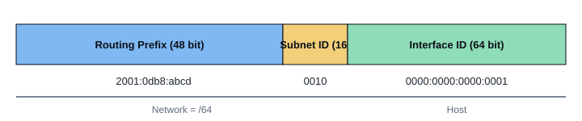

*شکل ۳: ساختار آدرس IPv6؛ ۶۴ بیت اول شبکه (Prefix + Subnet) و ۶۴ بیت آخر دستگاه.*

آدرس IPv6 یک عدد ۱۲۸ بیتی است. آن را به ۸ گروه ۱۶ بیتی تقسیم می‌کنیم و هر گروه را با ۴ رقم شانزده‌شانزدهی (Hex: ارقام ۰ تا ۹ و a تا f) می‌نویسیم، با دونقطه بین گروه‌ها:

``` text
2001:0db8:0010:0010:0000:0000:0000:0001
```

هر رقم Hex معادل ۴ بیت است. پس حساب کل بیت‌ها این‌طور می‌شود:

``` text
1 hex digit = 4 bits      (f = 1111 , a = 1010)
1 group     = 4 digits = 16 bits
8 groups    = 8 x 16   = 128 bits
```

مثل IPv4، آدرس دو بخش دارد: **Prefix** (شبکه) و **Interface ID** (دستگاه). در بیشتر شبکه‌ها Prefix برابر `/64` است: ۶۴ بیت اول شبکه و ۶۴ بیت آخر دستگاه. در IPv6 به‌جای «Subnet Mask» همیشه Prefix می‌نویسیم.

### ۲. دو قانون کوتاه‌نویسی

**قانون ۱: صفرهای ابتدای هر گروه را حذف کن.** مثال: `0db8` ← `db8` و `0010` ← `10` و `0000` ← `0`.

**قانون ۲: یک (فقط یک) رشته‌ی متوالی از گروه‌های تماماً صفر را با `::` جایگزین کن.**

``` text
Full   : 2001:0db8:0010:0010:0000:0000:0000:0001
Rule 1 : 2001:db8:10:10:0:0:0:1
Rule 2 : 2001:db8:10:10::1
```

> **چرا فقط یک بار ::؟**
>
> اگر دو بار بنویسید، معلوم نیست هرکدام چند گروه صفر را نشان می‌دهند. پس `2001::5::1` غلط است. اگر دو رشته‌ی صفر داشتید، `::` را روی **بلندترین** رشته بگذارید.

### ۳. مثال‌های کوتاه‌نویسی (ساده تا سخت)

#### مثال ساده

``` text
Full  : fe80:0000:0000:0000:0000:0000:0000:0001
Step 1: fe80:0:0:0:0:0:0:1
Step 2: fe80::1
```

#### مثال متوسط (دو رشته صفر)

``` text
Full  : 2001:0db8:0000:0000:0001:0000:0000:0005
Step 1: 2001:db8:0:0:1:0:0:5
Step 2: two zero-runs of equal length -> shorten the FIRST one
Result: 2001:db8::1:0:0:5
```

#### مثال سخت (برعکس: باز کردن)

``` text
Short  : 2001:db8:a::1:2
Groups written = 5  (2001, db8, a, 1, 2)
Missing groups = 8 - 5 = 3   (the :: is 3 zero groups)
Full   : 2001:0db8:000a:0000:0000:0000:0001:0002
```

### ۴. انواع آدرس IPv6

| نوع                | Prefix                   | کاربرد                                  | معادل در IPv4                  |
|--------------------|--------------------------|-----------------------------------------|--------------------------------|
| Global Unicast     | 2000::/3                 | آدرس قابل Route در اینترنت              | آدرس عمومی                     |
| Unique Local (ULA) | fc00::/7 (عملاً fd00::/8) | داخل سازمان                             | RFC 1918                       |
| Link-Local         | fe80::/10                | فقط روی یک لینک؛ هر Interface حتماً دارد | APIPA (ولی همیشه فعال و ضروری) |
| Multicast          | ff00::/8                 | ارسال به گروهی از دستگاه‌ها              | 224.0.0.0/4                    |
| Loopback           | ::1/128                  | خود دستگاه                              | 127.0.0.1                      |
| مستندات            | 2001:db8::/32            | در آموزش و Lab                          | TEST-NET                       |

**نکته‌ی مهم:** IPv6 **Broadcast ندارد**. کارهایی که Broadcast می‌کرد (مثل ARP) با Multicast انجام می‌شود. آدرس‌های ff02::1 (همه‌ی گره‌ها) و ff02::2 (همه‌ی روترها) را بشناسید.

### ۵. دستگاه‌ها چطور آدرس می‌گیرند؟

#### ۵-۱. Link-Local خودکار

همین که Interface بالا بیاید، دستگاه خودش یک آدرس `fe80::` می‌سازد. نیازی به DHCP و تنظیم دستی ندارد. تمام ارتباط‌های همسایگی (و Next-Hop روتینگ) با همین آدرس انجام می‌شود.

#### ۵-۲. EUI-64: ساخت Interface ID از MAC

MAC آدرس ۴۸ بیتی است؛ ۶۴ بیت لازم داریم. روش: وسط MAC عدد `fffe` را بگذار و بیت هفتم بایت اول را وارونه کن. مثال: MAC = `aabb.cc00.0100`:

``` text
MAC:            aa bb cc 00 01 00
Step 1 (insert fffe) : aa bb cc ff fe 00 01 00
Step 2 (flip U/L bit) : first byte aa XOR 02 = a8
Interface ID:   a8bb:ccff:fe00:0100
```

پس آدرس Link-Local می‌شود `fe80::a8bb:ccff:fe00:100`. (فقط ایده را بدانید: MAC در آدرس «نشت» می‌کند و برای حریم خصوصی، سیستم‌عامل‌های جدید به‌جای EUI-64 مقدار تصادفی می‌سازند.)

#### ۵-۳. SLAAC و کشف همسایه (NDP)

روتر هر چند ثانیه (یا به درخواست) پیام Router Advertisement (RA) می‌فرستد که می‌گوید «Prefix این لینک 2001:db8:10:10::/64 است». Host خودش Interface ID می‌سازد و آدرس می‌شود. به این روش SLAAC می‌گویند: بدون DHCP.

| پیام NDP                    | معادل       | کار                                   |
|-----------------------------|-------------|---------------------------------------|
| Router Solicitation (RS)    | —           | Host: «روتر هست؟»                     |
| Router Advertisement (RA)   | DHCP قسمتی  | روتر: Prefix و Gateway را اعلام می‌کند |
| Neighbor Solicitation (NS)  | ARP Request | «MAC فلان IPv6 چیست؟» (با Multicast)  |
| Neighbor Advertisement (NA) | ARP Reply   | پاسخ با MAC                           |

NDP از ICMPv6 استفاده می‌کند؛ بنابراین **نباید ICMPv6 را در فایروال کاملاً ببندید** وگرنه IPv6 کار نمی‌کند (اشتباه رایج).

### ۶. مثال کاربردی: Prefix و Subnet در IPv6

سازمان بلوک `2001:db8:abcd::/48` دارد. با ۱۶ بیت باقیمانده تا /64 می‌توانیم ۶۵۵۳۶ Subnet /64 بسازیم. محاسبه‌ی Host ندارد! هر VLAN را یک /64 می‌دهیم: `2001:db8:abcd:`**`10`**`::/64` برای VLAN10، `2001:db8:abcd:`**`20`**`::/64` برای VLAN20 و غیره. گروه چهارم را همان شماره‌ی VLAN بگذارید تا خوانا باشد.

مقایسه: در IPv4 باید هر بار محاسبه‌ی VLSM کنیم. در IPv6 همه /64 هستند و زندگی ساده است.

### ۷. تمرین‌ها

**ت1.** ۱. (ساده) کوتاه کن: 2001:0db8:0000:0000:0000:0000:0000:0001 *(پاسخ: 2-3-ت1 در بخش «پاسخ‌ها» انتهای فصل)*

**ت2.** ۲. (ساده) این چه نوع آدرسی است: fe80::1 ؟ fd12:3456::5 ؟ ff02::1 ؟ 2001:db8::5 ؟ *(پاسخ: 2-3-ت2 در بخش «پاسخ‌ها» انتهای فصل)*

**ت3.** ۳. (متوسط) باز کن: 2001:db8:0:1::5 *(پاسخ: 2-3-ت3 در بخش «پاسخ‌ها» انتهای فصل)*

**ت4.** ۴. (متوسط) آیا 2001:db8::1 و 2001:db8:0:0:1::1 در یک /64 هستند؟ *(پاسخ: 2-3-ت4 در بخش «پاسخ‌ها» انتهای فصل)*

**ت5.** ۵. (سخت) چرا نمی‌توان 2001::1::2 نوشت؟ *(پاسخ: 2-3-ت5 در بخش «پاسخ‌ها» انتهای فصل)*

**ت6.** ۶. (سخت) از 2001:db8:abcd::/48 برای ۴ VLAN (۱۰، ۲۰، ۳۰، ۹۹) Prefix بساز. *(پاسخ: 2-3-ت6 در بخش «پاسخ‌ها» انتهای فصل)*

### ۸. Lab هدایت‌شده: IPv6 بین R1 و SW1

شرط: در Lab `L00` هنوز VLAN10 روی R1 (`Gi0/0.10`) و SW1 (`Vlan10`) سالم است.

#### گام ۱: فعال‌کردن IPv6 روی روتر

``` text
R1# configure terminal
R1(config)# ipv6 unicast-routing
R1(config)# interface gi0/0.10
R1(config-subif)# ipv6 address 2001:db8:10:10::1/64
R1(config-subif)# end
R1# show ipv6 interface brief
```

باید دو آدرس ببینید: Link-Local (`FE80::...`) و آدرسی که دادید. فرمان `ipv6 unicast-routing` روتر را از «Host» به «روتر IPv6» تبدیل می‌کند و RA می‌فرستد.

#### گام ۲: سمت سوییچ

``` text
SW1# configure terminal
SW1(config)# interface vlan 10
SW1(config-if)# ipv6 address 2001:db8:10:10::2/64
SW1(config-if)# end
SW1# show ipv6 interface brief
```

در سوییچ‌های L2 ممکن است IPv6 فقط در CLI دیده شود. اگر دستور رد شد یا ping نشد، دقیقاً همان را ثبت کنید؛ این همان درس «پذیرفته‌شدن ≠ کارکردن» است.

#### گام ۳: Ping و NDP

``` text
R1# ping 2001:db8:10:10::2
R1# show ipv6 neighbors
R1# ping FE80::<LL-SW1>%GigabitEthernet0/0.10
```

در Ping با Link-Local باید Interface خروجی را مشخص کنید (چون fe80:: روی هر Interface تکراری است). جدول `show ipv6 neighbors` معادل `show ip arp` است.

#### گام ۴: دیدن RA

``` text
R1# show ipv6 interface gi0/0.10
```

در خروجی دنبال خط «ND advertised reachable time» و «Hosts use stateless autoconfig» بگردید؛ یعنی روتر Prefix را برای SLAAC اعلام می‌کند.

### ۹. Lab مستقل

برای VLANهای ۱۰ و ۲۰ و ۳۰ Capstone یک Prefix مثل `2001:db8:abcd::/48` انتخاب و در `02-design/ipv6-plan.md` بنویسید. روی R1 هر زیرواسط را یک /64 بدهید و `show ipv6 route connected` را ثبت کنید.

### ۱۰. عیب‌یابی

|         |                                                                                                                                    |
|---------|------------------------------------------------------------------------------------------------------------------------------------|
| Symptom | Ping IPv6 جواب نمی‌دهد ولی IPv4 کار می‌کند                                                                                           |
| سرنخ‌ها  | ۱) `ipv6 unicast-routing` فعال است؟ ؛ ۲) Prefix دو طرف یکی است؟ ؛ ۳) ACL یا فایروال ICMPv6 را بسته؟ ؛ ۴) فقط Link-Local کار می‌کند؟ |
| رفع     | تصحیح Prefix یا اجازه‌ی ICMPv6                                                                                                      |

### ۱۱. سؤال‌های مرور

**م1.** چرا IPv6 Broadcast ندارد؟ *(پاسخ: 2-3-م1 در بخش «پاسخ‌ها» انتهای فصل)*

**م2.** NS/NA معادل چه چیزی در IPv4 است؟ *(پاسخ: 2-3-م2 در بخش «پاسخ‌ها» انتهای فصل)*

**م3.** چرا ICMPv6 را نباید بست؟ *(پاسخ: 2-3-م3 در بخش «پاسخ‌ها» انتهای فصل)*

**م4.** /64 برای یک VLAN یعنی چه؟ *(پاسخ: 2-3-م4 در بخش «پاسخ‌ها» انتهای فصل)*

### English Corner: انگلیسی تخصصی این درس

این جمله‌ها از مستندات و محیط کار واقعی‌اند. بلند بخوانید و ترجمه را بپوشانید.

| English sentence                                                         | ترجمه                                                            |
|--------------------------------------------------------------------------|------------------------------------------------------------------|
| IPv6 has no broadcast; it uses multicast instead.                        | IPv6 Broadcast ندارد؛ به‌جای آن از Multicast استفاده می‌کند.       |
| Every IPv6 interface automatically gets a link-local address.            | هر Interface در IPv6 به‌طور خودکار یک Link-Local می‌گیرد.          |
| Hosts build their own address from the router advertisement using SLAAC. | Hostها با SLAAC از روی Router Advertisement آدرس خود را می‌سازند. |
| Do not block ICMPv6, or neighbor discovery will break.                   | ICMPv6 را نبندید، وگرنه Neighbor Discovery از کار می‌افتد.        |

**Q1.** Quick quiz (answer in English): Which IPv6 messages replace ARP? *(پاسخ: 2-3-Q1 در بخش «پاسخ‌ها» انتهای فصل)*

### ۱۲. تکلیف و چک‌لیست تسلط

- [ ] ۶ تمرین را حل کنم.
- [ ] Lab IPv6 را انجام و نتیجه‌ی واقعی (موفق/ناموفق) را ثبت کنم.
- [ ] IPv6 Plan را بنویسم.
- [ ] قوانین کوتاه‌نویسی را بدون نگاه بگویم.

### ۱۳. یادآوری اشتباهات شما

> **یادآوری**
>
> خروجی قبل از اجرا را پیش‌بینی کنید؛ و «Invalid input» همیشه به معنای ناسازگاری Image نیست.


#### کارت Lab — درس ۲-۳

| # | فیلد | محتوا |
|---|---|---|
| 1 | عنوان و هدف | برقراری IPv6 بین R1 و SW1 |
| 2 | پیش‌نیاز | درس ۲-۲ |
| 3 | توپولوژی | R1 Gi0/0.10 ↔ SW1 Vlan10 |
| 4 | تجهیزات | R1، SW1 |
| 5 | نسخه نرم‌افزار | vIOS-L2 15.2(20200924، Experimental) برای SW؛ vIOS 15.9(3)M9 برای R؛ VPCS (PNetLab)؛ PNetLab 4.2.8 |
| 6 | IP Plan | 2001:db8:10:10::1/64 و ::2/64 |
| 7 | وضعیت اولیه | IPv4 سالم |
| 8 | صورت مسئله | IPv6 بدهید، ping بزنید و جدول همسایه را ببینید |
| 9 | مراحل هدایت‌شده | همان بخش «Lab هدایت‌شده» همین درس (گام‌به‌گام) |
| 10 | تست عملکرد | `ping 2001:db8:10:10::2` ؛ `show ipv6 neighbors` |
| 11 | سناریوی خرابی | `ipv6 unicast-routing` فراموش شود |
| 12 | روش عیب‌یابی | `show ipv6 interface brief` و مقایسه‌ی Prefix |
| 13 | نتیجه‌ی مورد انتظار | ping موفق و دو ورودی همسایه |
| 14 | معیار پذیرش | ثبت نتیجه‌ی واقعی (موفق/ناموفق) از سوییچ |
| 15 | مستندات نهایی | `02-design/ipv6-plan.md` |
| 16 | Cleanup و بازگردانی | حذف آدرس‌های IPv6 |

> **وضعیت راستی‌آزمایی (خارج از ۱۶ فیلد):** **اجرا نشده (فقط طراحی).** اجرا نشده؛ IPv6 در Probe فقط CLI-Accepted بود؛ روی سوییچ ممکن است کار نکند.

---

<a id="l-2-4"></a>

## درس ۲-۴ — CLI سیسکو، مدیریت و بکاپ Config

**فصل ۲ - روز ۴ · پیش‌نیاز: فصل ۱ · ۶ ساعت**

### این درس درباره چیست و چرا باید یاد بگیریم؟

**چه چیزی یاد می‌گیریم:** کار حرفه‌ای با خط فرمان سیسکو (CLI): حالت‌ها، کمک‌گیری، تفاوت پیکربندی در حال اجرا و ذخیره‌شده، و مهم‌تر از همه **پشتیبان‌گیری و بازگشت (Rollback)**.

**چرا لازم است:** در دنیای واقعی بزرگ‌ترین ترس هر مدیر شبکه این است: «یک دستور زدم و ارتباط همه قطع شد، حالا چه کنم؟». کسی که بکاپ و Rollback بلد است، با آرامش کار می‌کند؛ کسی که بلد نیست، ساعت‌ها در قطعی می‌ماند.

- **در کار روزانه:** قبل از هر تغییر، نسخه‌ی فعلی را ذخیره می‌کنید و بعد از تغییر اگر خراب شد، در چند ثانیه برمی‌گردید.
- **در امنیت:** پیکربندی بکاپ‌شده سند حسابرسی است؛ می‌توانید ثابت کنید «چه چیزی، کی تغییر کرد».
- **در دوره:** Capstone مرحله‌ی «CHG (درخواست تغییر)» دارد که بدون Rollback پذیرفته نمی‌شود.

> **مسیر درس**
>
> حالت‌های CLI ← کمک‌گیری و میان‌بُرها ← Running و Startup ← بکاپ و Rollback ← مثال ساده/متوسط/سخت ← Lab ← عیب‌یابی.

#### اصطلاحات این درس (مخفف ← شکل کامل ← معنی)

| مخفف     | شکل کامل انگلیسی               | معنی فارسی                                          |
|----------|--------------------------------|-----------------------------------------------------|
| CLI      | Command Line Interface         | محیط خط فرمان                                       |
| EXEC     | Executive mode                 | حالت اجرایی دستورها                                 |
| NVRAM    | Non-Volatile RAM               | حافظه‌ای که با خاموشی پاک نمی‌شود؛ محل startup-config |
| RAM      | Random Access Memory           | حافظه موقت؛ محل running-config                      |
| TFTP     | Trivial File Transfer Protocol | انتقال فایل ساده و بدون رمزگذاری                    |
| SCP      | Secure Copy Protocol           | انتقال فایل امن روی SSH                             |
| DNS      | Domain Name System             | سیستم نام دامنه                                     |
| CHG      | Change Request                 | درخواست تغییر رسمی                                  |
| Rollback | Rollback                       | بازگشت به وضعیت سالم قبلی                           |
| MOTD     | Message Of The Day             | پیام نمایشی هنگام ورود                              |

### ۱. حالت‌های CLI (چهار اتاق یک ساختمان)

CLI سیسکو مثل ساختمانی با چند اتاق است که هرکدام اجازه‌ی کار متفاوتی دارد:

| حالت                  | Prompt           | چه کاری می‌شود کرد           | ورود/خروج                                          |
|-----------------------|------------------|-----------------------------|----------------------------------------------------|
| User EXEC             | `R1>`            | مشاهده‌ی محدود، ping         | ورود: `enable`                                     |
| Privileged EXEC       | `R1#`            | همه‌ی show، کپی فایل، reload | خروج: `disable`                                    |
| Global Config         | `R1(config)#`    | تغییر تنظیمات کل دستگاه     | ورود: `configure terminal` ؛ خروج: `end` یا `exit` |
| Interface/Line Config | `R1(config-if)#` | تنظیم یک Interface یا Line  | ورود: `interface ...`                              |

> **قاعده‌ی طلایی**
>
> دستورهای `show`، `ping`، `copy`، `monitor capture` و `reload` در EXEC هستند. دستورهای تنظیمی در Config. اگر در Config دستور show بزنید، با `do` جلو آن می‌توانید اجرا کنید: `do show ip route`.

### ۲. کمک‌گیری و میان‌بُرها (سرعت یک مهندس)

- `?` بعد از هر کلمه: گزینه‌های ممکن. مثال: `show ip ?`
- `Tab`: کامل‌کردن. `sh run` هم کافی است (مخفف یکتا).
- `show running-config | section interface`: فیلتر خروجی. `| include` و `| begin` هم داریم.
- فلش بالا: دستور قبلی. `Ctrl+A` ابتدای خط و `Ctrl+E` انتهای خط. `Ctrl+Shift+6` قطع دستور گیرکرده.

مثال: به‌جای خواندن ۲۰۰ خط config فقط این را بزنید:

``` text
R1# show running-config | section interface Gi0/0
R1# show ip interface brief | include up
```

### ۳. تنظیمات پایه‌ی یک دستگاه حرفه‌ای

``` text
R1(config)# hostname R1
R1(config)# no ip domain-lookup
R1(config)# service timestamps log datetime msec
R1(config)# line console 0
R1(config-line)# logging synchronous
R1(config-line)# exec-timeout 10 0
R1(config-line)# exit
R1(config)# banner motd # Authorized access only #
R1(config)# enable secret <PASSWORD>
R1(config)# end
```

خط‌به‌خط:

- `no ip domain-lookup`: جلوی «Translating…» را می‌گیرد (اشتباهی که قبلاً دیدید).
- `logging synchronous`: پیام‌های Log وسط تایپ شما نمی‌پرند.
- `exec-timeout 10 0`: بعد از ۱۰ دقیقه بی‌کاری Session بسته می‌شود (امنیت).
- `enable secret`: رمز ورود به Privileged با Hash قوی. **هرگز** `enable password` (متن ساده) نه. رمز واقعی را در Git نگذارید؛ اینجا فقط جانگهدار است.

### ۴. Running-config و Startup-config

دو نسخه از تنظیمات در دستگاه هست:

- **running-config**: در RAM، همین الان فعال است؛ با خاموش‌شدن می‌پرد.
- **startup-config**: در NVRAM، در بوت بعدی بارگذاری می‌شود.

تشبیه: running مثل «متنی که در Word تایپ کرده‌اید و ذخیره نکرده‌اید»؛ startup همان فایل ذخیره‌شده است.

``` text
R1# show running-config
R1# show startup-config
R1# copy running-config startup-config      (or: write memory)
R1# show archive                              (if supported)
```

اشتباه رایج: بعد از تغییر ذخیره نمی‌کنید و بعد از Reload همه‌چیز می‌پرد. جلوگیری: عادت کنید هر تغییر موفق ← `copy run start`.

### ۵. بکاپ و Rollback (قلب درس)

#### ۵-۱. بکاپ محلی روی Flash

``` text
R1# copy running-config flash:R1-before-change.cfg
R1# dir flash:
```

#### ۵-۲. بکاپ روی سرور (TFTP/SCP)

``` text
R1# copy running-config tftp://10.10.10.50/R1-2026-11-07.cfg
```

برای سرور بکاپ از یک VM لینوکسی استفاده می‌کنیم (در درس‌های بعد، با SCP امن). نام فایل = نام دستگاه + تاریخ. فایل‌های بکاپ **رمزِ هش‌شده** دارند ولی باز هم در جای امن (خارج از Git) نگه‌دارید.

#### ۵-۳. Rollback با Configure Replace

اگر Image شما قابلیت Archive دارد، می‌توانید کل تنظیمات را با یک فایل بکاپ جایگزین کنید (فقط تفاوت‌ها اعمال می‌شود):

``` text
R1# configure replace flash:R1-before-change.cfg list
R1# configure replace flash:R1-before-change.cfg force
```

گزینه‌ی `list` فقط تفاوت‌ها را نشان می‌دهد (Dry-run). اگر دستور در Image شما نبود، روش جایگزین: `copy flash:R1-before-change.cfg startup-config` و سپس `reload`.

#### ۵-۴. «Reload in»: شبکه‌ی ایمنی

``` text
R1# reload in 10
... risky change ...
R1# reload cancel        (if it worked)
```

مثل ماشین‌هایی که ده دقیقه بعد خودشان خاموش می‌شوند. اگر تغییر ارتباط شما را قطع کرد، دستگاه بعد از ۱۰ دقیقه به startup-config قبلی بر می‌گردد. این تکنیک نجات‌بخش است؛ مخصوصاً در تغییرات راه دور.

### ۶. مثال‌ها (ساده تا سخت)

**ساده**

اسم دستگاه را عوض کنید و ذخیره کنید: `hostname R1-HQ` ← `end` ← `copy run start` ← `show startup-config | include hostname`.

**متوسط**

قبل از تغییر IP یک Interface، بکاپ به Flash بگیرید؛ آدرس را تغییر دهید؛ ping کنید؛ اگر قطع شد با `configure replace` برگردید.

**سخت**

تغییر راه دور: با `reload in 5` شبکه‌ی ایمنی بگذارید؛ Mask یک Subinterface را تغییر دهید؛ اگر ارتباط قطع شد، ۵ دقیقه صبر می‌کنید و دستگاه با startup قبلی بالا می‌آید؛ اگر موفق بود `reload cancel` و `copy run start`.

### ۷. تمرین‌ها

**ت1.** ۱. Prompt زیر در کدام حالت است؟ R1(config-if)# *(پاسخ: 2-4-ت1 در بخش «پاسخ‌ها» انتهای فصل)*

**ت2.** ۲. تفاوت running و startup چیست؟ *(پاسخ: 2-4-ت2 در بخش «پاسخ‌ها» انتهای فصل)*

**ت3.** ۳. چطور در Config دستور show ip route را اجرا کنیم؟ *(پاسخ: 2-4-ت3 در بخش «پاسخ‌ها» انتهای فصل)*

**ت4.** ۴. چرا enable secret بهتر از enable password است؟ *(پاسخ: 2-4-ت4 در بخش «پاسخ‌ها» انتهای فصل)*

**ت5.** ۵. فایده‌ی reload in چیست؟ *(پاسخ: 2-4-ت5 در بخش «پاسخ‌ها» انتهای فصل)*

### ۸. Lab هدایت‌شده: تغییر، خراب‌کردن و Rollback

#### گام ۱: تنظیمات پایه (بخش ۳) را روی R1 و SW1 بزنید و ذخیره کنید

#### گام ۲: بکاپ

``` text
R1# copy running-config flash:R1-good.cfg
R1# copy running-config startup-config
R1# dir flash:
```

#### گام ۳: خراب‌کردن عمدی

``` text
R1(config)# interface gi0/0.10
R1(config-subif)# ip address 10.10.99.1 255.255.255.0
R1(config-subif)# end
R1# ping 10.10.10.2
```

پیش‌بینی: ping شکست می‌خورد چون Subnet عوض شد.

#### گام ۴: Rollback

``` text
R1# configure replace flash:R1-good.cfg force
R1# ping 10.10.10.2
```

اگر `configure replace` در Image شما پشتیبانی نشد (ثبت کنید)، با `copy flash:R1-good.cfg running-config` ادغام کنید و Interface را دستی اصلاح نمایید.

#### گام ۵: تمرین reload in

``` text
R1# reload in 5
(make a harmless change)
R1# reload cancel
```

### ۹. Lab مستقل

یک Runbook یک‌صفحه‌ای `03-ops/change-and-rollback.md` بنویسید: چک‌لیست قبل/حین/بعد تغییر، دستورهای بکاپ، Rollback، و Verification. بدون رمز.

### ۱۰. عیب‌یابی

|           |                                                  |
|-----------|--------------------------------------------------|
| Symptom   | بعد از Reload تنظیمات پرید                       |
| علت       | ذخیره نشده بود (فقط running)                     |
| رفع       | بازسازی از بکاپ؛ از این به بعد `copy run start`  |
| Symptom 2 | Rollback خطا می‌دهد                               |
| علت       | فایل بکاپ ناقص یا Archive پشتیبانی نمی‌شود        |
| رفع       | روش جایگزین: `copy file startup-config` + reload |

### ۱۱. سؤال‌های مرور

**م1.** سه حالت اصلی CLI؟ *(پاسخ: 2-4-م1 در بخش «پاسخ‌ها» انتهای فصل)*

**م2.** چرا بکاپ قبل از تغییر؟ *(پاسخ: 2-4-م2 در بخش «پاسخ‌ها» انتهای فصل)*

### English Corner: انگلیسی تخصصی این درس

این جمله‌ها از مستندات و محیط کار واقعی‌اند. بلند بخوانید و ترجمه را بپوشانید.

| English sentence                                                                     | ترجمه                                                                            |
|--------------------------------------------------------------------------------------|----------------------------------------------------------------------------------|
| Save the running configuration to NVRAM, or the changes will be lost after a reload. | running-config را در NVRAM ذخیره کنید، وگرنه بعد از Reload تغییرها از بین می‌رود. |
| Take a backup before every change so you can roll back quickly.                      | قبل از هر تغییر بکاپ بگیرید تا سریع Rollback کنید.                               |
| Use reload in 10 as a safety net during remote changes.                              | در تغییرهای راه دور از reload in 10 به‌عنوان شبکه‌ی ایمنی استفاده کنید.            |
| The enable secret is stored as a hash, unlike a plain-text enable password.          | enable secret به‌صورت Hash ذخیره می‌شود، برخلاف enable password متن ساده.          |

**Q1.** Quick quiz (answer in English): What is the difference between running-config and startup-config? *(پاسخ: 2-4-Q1 در بخش «پاسخ‌ها» انتهای فصل)*

### ۱۲. تکلیف و چک‌لیست تسلط

- [ ] تنظیمات پایه را روی همه‌ی دستگاه‌ها بزنم.
- [ ] بکاپ و Rollback را عملی انجام دهم و نتیجه را ثبت کنم.
- [ ] Runbook تغییر را بنویسم.

### ۱۳. یادآوری اشتباهات شما

> **یادآوری**
>
> دستور EXEC را در Config نزنید؛ کلمه‌ی ناشناخته نزنید (DNS Lookup)؛ بعد از هر تغییر موفق ذخیره کنید.


#### کارت Lab — درس ۲-۴

| # | فیلد | محتوا |
|---|---|---|
| 1 | عنوان و هدف | بکاپ، خراب‌کردن عمدی و Rollback |
| 2 | پیش‌نیاز | درس ۲-۳ |
| 3 | توپولوژی | R1 ↔ SW1 |
| 4 | تجهیزات | R1، SW1 |
| 5 | نسخه نرم‌افزار | vIOS-L2 15.2(20200924، Experimental) برای SW؛ vIOS 15.9(3)M9 برای R؛ VPCS (PNetLab)؛ PNetLab 4.2.8 |
| 6 | IP Plan | 10.10.10.0/24 |
| 7 | وضعیت اولیه | تنظیمات پایه ذخیره‌شده |
| 8 | صورت مسئله | قبل از تغییر بکاپ بگیرید، IP را خراب و با `configure replace` برگردانید |
| 9 | مراحل هدایت‌شده | همان بخش «Lab هدایت‌شده» همین درس (گام‌به‌گام) |
| 10 | تست عملکرد | ping پس از Rollback |
| 11 | سناریوی خرابی | تغییر IP Sub-interface |
| 12 | روش عیب‌یابی | مقایسه‌ی running با بکاپ |
| 13 | نتیجه‌ی مورد انتظار | ping بعد از Rollback موفق |
| 14 | معیار پذیرش | نتیجه‌ی `configure replace` (یا جایگزین) ثبت شود |
| 15 | مستندات نهایی | `03-ops/change-and-rollback.md` |
| 16 | Cleanup و بازگردانی | حذف فایل‌های بکاپ؛ `reload cancel` |

> **وضعیت راستی‌آزمایی (خارج از ۱۶ فیلد):** **اجرا نشده (فقط طراحی).** اجرا نشده؛ `configure replace`، `archive` و `flash:` روی vIOS-L2 در Probe نبوده‌اند (Untested).

---

<a id="l-2-5"></a>

## درس ۲-۵ — مدیریت امن با SSH

**فصل ۲ - روز ۵ · پیش‌نیاز: درس ۲-۴ · ۶ ساعت**

### این درس درباره چیست و چرا باید یاد بگیریم؟

**چه چیزی یاد می‌گیریم:** مدیریت امن دستگاه‌ها از راه دور با SSH، جایگزین قدیمی و ناامن Telnet. یاد می‌گیریم SSH چطور کار می‌کند، چطور روی روتر و سوییچ فعالش کنیم و چطور دسترسی را فقط به سیستم‌های مجاز محدود کنیم.

**چرا لازم است:** Telnet همه‌چیز (از جمله رمز) را به‌صورت متن ساده می‌فرستد. هر کسی در مسیر با Wireshark می‌تواند رمز ادمین را بخواند. SSH همین ارتباط را رمزگذاری می‌کند. در هر ممیزی امنیتی، فعال‌بودن Telnet یک «یافته‌ی جدی» است.

- **در کار روزانه:** ۹۹٪ مدیریت از راه دور با SSH انجام می‌شود.
- **در امنیت:** رمزگذاری، احراز هویت با کاربر و محدودیت مبدأ، سه لایه‌ی اولیه‌ی ایمنی مدیریت هستند.
- **در FortiGate:** همین مفاهیم برای مدیریت فایروال (فقط HTTPS و SSH از Subnet مدیریت) به‌کار می‌رود.

> **مسیر درس**
>
> چرا Telnet ناامن است ← SSH چطور کار می‌کند ← پیکربندی گام‌به‌گام ← محدودکردن دسترسی ← مثال ساده/متوسط/سخت ← Lab ← عیب‌یابی.

#### اصطلاحات این درس (مخفف ← شکل کامل ← معنی)

| مخفف          | شکل کامل انگلیسی            | معنی فارسی                               |
|---------------|-----------------------------|------------------------------------------|
| SSH           | Secure Shell                | پوسته امن؛ مدیریت رمزگذاری‌شده از راه دور |
| Telnet        | Teletype Network            | مدیریت از راه دور بدون رمزگذاری          |
| RSA           | Rivest-Shamir-Adleman       | الگوریتم کلید عمومی                      |
| VTY           | Virtual Teletype            | خطوط مجازی ورود از راه دور               |
| ACL           | Access Control List         | فهرست کنترل دسترسی                       |
| FQDN          | Fully Qualified Domain Name | نام کامل دامنه، مثل r1.lab.local         |
| MITM          | Man-In-The-Middle           | حمله مرد میانی                           |
| Wildcard Mask | Wildcard Mask               | معکوس Mask؛ بیت 0 یعنی باید یکسان باشد   |
| Fingerprint   | Host Key Fingerprint        | اثرانگشت کلید سرور برای تأیید هویت       |

### ۱. Telnet در برابر SSH

| ویژگی             | Telnet           | SSH             |
|-------------------|------------------|-----------------|
| رمزگذاری          | ندارد (متن ساده) | دارد            |
| پورت              | TCP 23           | TCP 22          |
| احراز هویت دستگاه | ندارد            | دارد (Host Key) |
| استفاده‌ی امروزی   | ممنوع            | استاندارد       |

مثال ملموس: Telnet مثل فریاد زدن رمز کارت بانکی وسط بازار است؛ SSH مثل گفتن آن در یک اتاق قفل‌شده.

### ۲. SSH چطور کار می‌کند؟ (ساده)

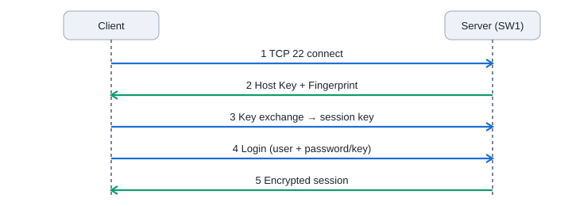

*شکل ۵: مراحل برقراری SSH؛ مرحله ۲ همان جایی است که «Host key changed» نشان می‌دهد.*

1.  **اتصال:** Client به پورت ۲۲ سرور وصل می‌شود.
2.  **هویت سرور:** سرور Host Key خود را نشان می‌دهد. Client اولین بار از شما می‌پرسد «اعتماد دارید؟» و اثرانگشت (Fingerprint) را ذخیره می‌کند. دفعه‌های بعد اگر عوض شد، هشدار می‌دهد (احتمال حمله‌ی Man-in-the-Middle).
3.  **کلید جلسه:** دو طرف با یک الگوریتم تبادل کلید (مثل Diffie-Hellman) یک کلید مشترک می‌سازند که هیچ‌کس در مسیر نمی‌داند.
4.  **احراز هویت کاربر:** رمز یا کلید عمومی.
5.  **ارتباط رمزشده** شروع می‌شود.

> **یادآوری از فصل ۱**
>
> هشدار «Host key changed» در برنامه‌ی SSH را قبلاً دیدید. آن‌جا هویت را با `ssh-keyscan` از یک مسیر مستقل تأیید کردیم. این دقیقاً همین مکانیزم است.

### ۳. پیکربندی SSH روی روتر/سوییچ (گام‌به‌گام)

``` text
R1(config)# hostname R1
R1(config)# ip domain-name lab.local
R1(config)# crypto key generate rsa modulus 2048
R1(config)# ip ssh version 2
R1(config)# username admin privilege 15 secret <PASSWORD>
R1(config)# line vty 0 4
R1(config-line)# login local
R1(config-line)# transport input ssh
R1(config-line)# exec-timeout 10 0
R1(config-line)# end
```

چرا هرکدام؟

- `hostname` و `ip domain-name`: بدون این دو، کلید RSA ساخته نمی‌شود (خطای رایج: «Please define a hostname other than Router»).
- `crypto key generate rsa modulus 2048`: ساخت جفت‌کلید. ۱۰۲۴ ضعیف است؛ حداقل ۲۰۴۸.
- `ip ssh version 2`: نسخه‌ی ۱ آسیب‌پذیر است.
- `username ... secret`: کاربر محلی با Hash. رمز واقعی را در Git نگذارید.
- `login local`: ورود با نام‌کاربری و رمز (نه فقط رمز Line).
- `transport input ssh`: Telnet را می‌بندد.

بررسی:

``` text
R1# show ip ssh
R1# show ssh
R1# show crypto key mypubkey rsa
```

در `show ip ssh` باید «SSH Enabled - version 2.0» ببینید.

### ۴. محدودکردن دسترسی (امنیت لایه‌ای)

فقط Subnet مدیریت (VLAN10) اجازه‌ی SSH داشته باشد:

``` text
R1(config)# ip access-list standard MGMT-ONLY
R1(config-std-nacl)# permit 10.10.10.0 0.0.0.255
R1(config-std-nacl)# deny any log
R1(config-std-nacl)# exit
R1(config)# line vty 0 4
R1(config-line)# access-class MGMT-ONLY in
R1(config-line)# end
```

`0.0.0.255` یک Wildcard Mask است؛ یعنی معکوسِ Subnet Mask. بیت 0 یعنی «باید مطابقت داشته باشد» و بیت 1 یعنی «مهم نیست».

``` text
Subnet mask   : 255.255.255.0
Wildcard mask : 0.0.0.255     (= 255.255.255.255 - 255.255.255.0)
```

`access-class` فقط ترافیک ورودی به VTY (دسترسی مدیریتی) را فیلتر می‌کند، نه ترافیک عبوری.

تنظیمات تکمیلی مفید: `ip ssh time-out 60` و `ip ssh authentication-retries 3`.

> **هشدار: قفل‌شدن از دستگاه**
>
> قبل از `access-class`، مطمئن شوید آدرس خودتان در ACL مجاز است؛ وگرنه خودتان بیرون می‌مانید. از `reload in 5` (درس قبل) به‌عنوان شبکه‌ی ایمنی استفاده کنید.

### ۵. مثال‌ها

**ساده**

از R1 به SW1 وصل شوید: `ssh -l admin 10.10.10.2`؛ اگر پرسید «Are you sure», بله.

**متوسط**

Telnet را غیرفعال کنید (`transport input ssh`) و ثابت کنید با `telnet 10.10.10.2` از R1 رد می‌شود (Connection refused).

**سخت**

ACL را طوری بنویسید که فقط ۲ آدرس مشخص (۱۰.۱۰.۱۰.۵۰ و ۱۰.۱۰.۱۰.۶۰) اجازه داشته باشند؛ و تست کنید از آدرس دیگر رد می‌شود. نکته: مبدأ تست را از Loopback روتر با `ssh -l admin -source-interface loopback0 ...` عوض کنید.

### ۶. تمرین‌ها

**ت1.** ۱. چرا Telnet ناامن است؟ *(پاسخ: 2-5-ت1 در بخش «پاسخ‌ها» انتهای فصل)*

**ت2.** ۲. چرا ip domain-name لازم است؟ *(پاسخ: 2-5-ت2 در بخش «پاسخ‌ها» انتهای فصل)*

**ت3.** ۳. Wildcard Mask برای 10.10.10.0/24؟ *(پاسخ: 2-5-ت3 در بخش «پاسخ‌ها» انتهای فصل)*

**ت4.** ۴. Wildcard Mask برای یک میزبان 10.10.10.50؟ *(پاسخ: 2-5-ت4 در بخش «پاسخ‌ها» انتهای فصل)*

**ت5.** ۵. Wildcard Mask برای 10.10.8.0/22؟ *(پاسخ: 2-5-ت5 در بخش «پاسخ‌ها» انتهای فصل)*

### ۷. Lab هدایت‌شده

#### گام ۱: SSH روی SW1

``` text
SW1(config)# ip domain-name lab.local
SW1(config)# crypto key generate rsa modulus 2048
SW1(config)# ip ssh version 2
SW1(config)# username admin privilege 15 secret <PASSWORD>
SW1(config)# line vty 0 4
SW1(config-line)# login local
SW1(config-line)# transport input ssh
SW1(config-line)# end
SW1# show ip ssh
```

#### گام ۲: اتصال از R1

``` text
R1# ssh -l admin 10.10.10.2
```

اگر خطای «no matching key exchange method» دیدید، Image قدیمی است؛ موقتاً در Lab با `ssh -o KexAlgorithms=...` (روی کلاینت) یا فعال‌کردن الگوریتم روی سرور حل می‌شود. در Lab مهم است بدانید چرا. در تولید، Image را به‌روز کنید.

#### گام ۳: بستن Telnet و تست

``` text
R1# telnet 10.10.10.2
```

باید رد شود (refused).

#### گام ۴: ACL مدیریت (با شبکه‌ی ایمنی)

``` text
SW1# reload in 5
SW1(config)# ip access-list standard MGMT-ONLY
SW1(config-std-nacl)# permit 10.10.10.0 0.0.0.255
SW1(config-std-nacl)# deny any log
SW1(config)# line vty 0 4
SW1(config-line)# access-class MGMT-ONLY in
(test SSH again; if OK:)
SW1# reload cancel
```

### ۸. Lab مستقل

برای هر ۳ دستگاه Lab یک «استاندارد مدیریت امن» بنویسید (`03-ops/secure-mgmt-standard.md`): SSH v2، RSA 2048، Telnet بسته، ACL مدیریت، Timeout. و روی هر دستگاه با یک چک‌لیست بسنجید.

### ۹. عیب‌یابی

|           |                                                                                                                                                                                                 |
|-----------|-------------------------------------------------------------------------------------------------------------------------------------------------------------------------------------------------|
| Symptom   | SSH وصل نمی‌شود                                                                                                                                                                                  |
| چک‌لیست    | ۱) `show ip ssh` فعال است؟ ؛ ۲) `transport input ssh` تنظیم است؟ ؛ ۳) نام‌کاربری وجود دارد؟ ؛ ۴) ACL مبدأ را بسته؟ ؛ ۵) مسیر و Gateway درست است؟ ؛ ۶) ping جواب می‌دهد؟ ؛ ۷) الگوریتم‌ها سازگارند؟ |
| Symptom 2 | کلید ساخته نمی‌شود                                                                                                                                                                               |
| رفع       | hostname و domain-name را بزنید.                                                                                                                                                                |

### ۱۰. سؤال‌های مرور

**م1.** Host Key برای چیست؟ *(پاسخ: 2-5-م1 در بخش «پاسخ‌ها» انتهای فصل)*

**م2.** access-class روی VTY چه فیلتر می‌کند؟ *(پاسخ: 2-5-م2 در بخش «پاسخ‌ها» انتهای فصل)*

### English Corner: انگلیسی تخصصی این درس

این جمله‌ها از مستندات و محیط کار واقعی‌اند. بلند بخوانید و ترجمه را بپوشانید.

| English sentence                                                                      | ترجمه                                                                      |
|---------------------------------------------------------------------------------------|----------------------------------------------------------------------------|
| Telnet sends credentials in clear text; SSH encrypts the whole session.               | Telnet اعتبارنامه‌ها را متن ساده می‌فرستد؛ SSH کل Session را رمزگذاری می‌کند. |
| Generate a 2048-bit RSA key pair before enabling SSH version 2.                       | قبل از فعال‌کردن SSH نسخه ۲، یک جفت‌کلید RSA ۲۰۴۸ بیتی بسازید.               |
| Restrict VTY access to the management subnet with an access class.                    | دسترسی VTY را با access-class به Subnet مدیریت محدود کنید.                 |
| The host key changed, so the client warned about a possible man-in-the-middle attack. | Host Key تغییر کرد، پس Client درباره‌ی احتمال حمله‌ی مرد میانی هشدار داد.    |

**Q1.** Quick quiz (answer in English): Why is Telnet considered insecure? *(پاسخ: 2-5-Q1 در بخش «پاسخ‌ها» انتهای فصل)*

### ۱۱. تکلیف و چک‌لیست تسلط

- [ ] SSH روی هر ۳ دستگاه فعال و تست شده.
- [ ] Telnet بسته شده و ثابت شده.
- [ ] ACL مدیریت با شبکه‌ی ایمنی تست شده.
- [ ] هیچ رمزی در Git نیست.

### ۱۲. یادآوری اشتباهات شما

> **یادآوری**
>
> قبل از تغییر راه دور، بکاپ و `reload in` بگذارید؛ خروجی را پیش‌بینی کنید؛ رمز در ریپو نریزید.


#### کارت Lab — درس ۲-۵

| # | فیلد | محتوا |
|---|---|---|
| 1 | عنوان و هدف | SSH امن و بستن Telnet |
| 2 | پیش‌نیاز | درس ۲-۴ |
| 3 | توپولوژی | R1 → SW1 (SSH) |
| 4 | تجهیزات | R1، SW1 |
| 5 | نسخه نرم‌افزار | vIOS-L2 15.2(20200924، Experimental) برای SW؛ vIOS 15.9(3)M9 برای R؛ VPCS (PNetLab)؛ PNetLab 4.2.8 |
| 6 | IP Plan | 10.10.10.1 و .2 |
| 7 | وضعیت اولیه | SSH فعال نیست |
| 8 | صورت مسئله | SSHv2، RSA 2048، Telnet بسته، ACL مدیریت با `reload in` |
| 9 | مراحل هدایت‌شده | همان بخش «Lab هدایت‌شده» همین درس (گام‌به‌گام) |
| 10 | تست عملکرد | `ssh -l admin 10.10.10.2` ؛ `telnet` رد شود |
| 11 | سناریوی خرابی | نبود `ip domain-name` یا ACL که خودتان را بیرون بگذارد |
| 12 | روش عیب‌یابی | `show ip ssh` ؛ `show running-config \| section line vty` |
| 13 | نتیجه‌ی مورد انتظار | SSH v2.0 فعال؛ Telnet refused |
| 14 | معیار پذیرش | Telnet واقعاً رد شود |
| 15 | مستندات نهایی | `03-ops/secure-mgmt-standard.md` (بدون رمز) |
| 16 | Cleanup و بازگردانی | برداشتن ACL تست؛ `reload cancel` |

> **وضعیت راستی‌آزمایی (خارج از ۱۶ فیلد):** **جزئی.** تولید کلید RSA و فعال‌شدن SSH دیده شده (`%SSH-5-ENABLED`)؛ ورود SSH، ACL مدیریت و رد Telnet اجرا نشده.

---

<a id="l-2-6"></a>

## درس ۲-۶ — Wireshark، ARP/ICMP و Gate G1

**فصل ۲ - روز ۶ · پیش‌نیاز: درس‌های ۲-۱ تا ۲-۵ · ۶ ساعت**

### این درس درباره چیست و چرا باید یاد بگیریم؟

**چه چیزی یاد می‌گیریم:** دیدن بسته‌ها روی سیم با Wireshark و فهمیدن ARP و ICMP. در پایان، آزمون عملی هفته (Gate G1) را می‌دهیم.

**چرا لازم است:** تا اینجا فقط «نتیجه» را دیدیم (ping موفق/ناموفق). Wireshark به شما «چشم» می‌دهد تا ببینید واقعاً چه اتفاقی افتاد. مثل پزشکی که به‌جای حدس‌زدن، عکس رادیولوژی می‌گیرد.

- **در کار روزانه:** وقتی «شبکه کند است» یا «اتصال قطع می‌شود»، فقط Capture می‌تواند ثابت کند مشکل از کجاست.
- **در امنیت:** تشخیص ARP Spoofing، اسکن پورت و ترافیک مشکوک.
- **در دوره:** از هفته‌های بعد، همه‌ی عیب‌یابی‌ها با Capture اثبات می‌شود.

> **مسیر درس**
>
> مفهوم فریم و بسته ← ARP ← ICMP ← گرفتن Capture ← فیلترها ← مثال ساده/متوسط/سخت ← Lab ← Gate G1.

#### اصطلاحات این درس (مخفف ← شکل کامل ← معنی)

| مخفف     | شکل کامل انگلیسی                  | معنی فارسی                            |
|----------|-----------------------------------|---------------------------------------|
| ARP      | Address Resolution Protocol       | تبدیل IP به MAC                       |
| ICMP     | Internet Control Message Protocol | پیام‌های کنترلی/تشخیصی مثل ping        |
| TTL      | Time To Live                      | عمر بسته؛ با هر روتر یک واحد کم می‌شود |
| MAC      | Media Access Control address      | آدرس فیزیکی کارت شبکه                 |
| BPF      | Berkeley Packet Filter            | سینتکس فیلتر هنگام Capture            |
| pcap     | Packet Capture                    | فایل ضبط بسته‌ها                       |
| MITM     | Man-In-The-Middle                 | حمله مرد میانی                        |
| Spoofing | Spoofing                          | جعل هویت (آدرس) در شبکه               |
| G1       | Gate 1                            | نقطه کنترل کیفیت پایان فصل ۲         |

### ۱. فریم، بسته و لایه‌ها (ساده)

مثل نامه‌ای که داخل پاکت و آن داخل یک بسته‌ی پستی است. داده را لایه‌به‌لایه می‌پیچند:

``` text
[ Ethernet: dst MAC | src MAC ]   Layer 2 (frame)
   [ IP: src IP | dst IP ]          Layer 3 (packet)
      [ ICMP or TCP/UDP ]           Layer 4 and above
         [ data ]
```

سوییچ با **MAC** تصمیم می‌گیرد (فریم)، روتر با **IP** (بسته). این تفاوت را همیشه به یاد داشته باشید.

### ۲. ARP: «این IP مال کیست؟»

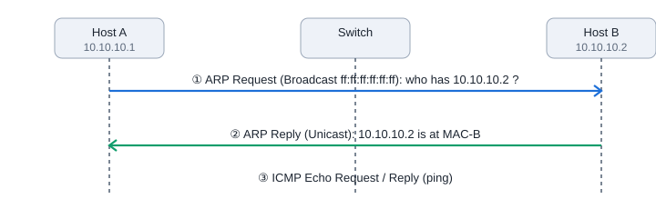

*شکل ۴: ping اول چرا کندتر است؟ چون اول ARP انجام می‌شود.*

Host فقط IP مقصد را می‌داند ولی فریم به MAC نیاز دارد. ARP این نگاشت را پیدا می‌کند:

1.  **ARP Request** (Broadcast به `ff:ff:ff:ff:ff:ff`): «چه کسی 10.10.10.2 را دارد؟ به 10.10.10.1 بگو.»
2.  همه‌ی دستگاه‌های VLAN دریافت می‌کنند؛ فقط صاحب IP جواب می‌دهد.
3.  **ARP Reply** (Unicast): «10.10.10.2 در MAC فلان است.»
4.  جواب در ARP Cache ذخیره می‌شود (چند دقیقه).

به همین دلیل اولین ping همیشه کندتر است یا گاهی یک بسته از دست می‌رود (`.!!!!`): اول باید ARP انجام شود.

مشاهده روی روتر: `show ip arp`

### ۳. ICMP: ابزار تشخیص

| Type | معنی                    | کجا می‌بینیم                              |
|------|-------------------------|------------------------------------------|
| 8    | Echo Request            | ping رفت                                 |
| 0    | Echo Reply              | ping برگشت                               |
| 3    | Destination Unreachable | مسیر/پورت وجود ندارد (`U` در ping سیسکو) |
| 11   | Time Exceeded           | TTL تمام شد (traceroute)                 |

**TTL:** هر روتر آن را ۱ کم می‌کند؛ اگر صفر شد بسته دور ریخته می‌شود تا در حلقه نماند. Windows معمولاً ۱۲۸ و لینوکس ۶۴ می‌فرستد؛ از روی TTL دریافتی می‌توان حدس زد بسته چند روتر رد شده.

### ۴. گرفتن Capture در PNetLab

- روی لینک بین دو دستگاه کلیک راست کنید (یا روی Interface) و **Capture** را بزنید؛ Wireshark روی سیستم شما باز می‌شود (PNetLab از مسیر وب و پروتکل مخصوص این کار را می‌کند).
- جایگزین روی خود IOS (در حالت EXEC، نه Config):

``` text
R1# monitor capture CAP1 interface gi0/0 both
R1# monitor capture CAP1 match any
R1# monitor capture CAP1 start
... ping ...
R1# monitor capture CAP1 stop
R1# show monitor capture CAP1 buffer brief
```

اگر دستور روی Image شما فقط «پذیرفته می‌شود ولی بسته‌ای نمی‌گیرد» (در Probe فصل ۱ دیدیم)، از Capture لینک PNetLab استفاده کنید. باز هم: پذیرفته‌شدن ≠ کارکردن.

### ۵. فیلترهای Wireshark (مهم‌ترین مهارت)

| فیلتر                           | معنی                     |
|---------------------------------|--------------------------|
| `arp`                           | فقط ARP                  |
| `icmp`                          | فقط ping                 |
| `ip.addr == 10.10.10.2`         | هر بسته‌ی مربوط به این IP |
| `eth.addr == aa:bb:cc:00:01:00` | بر اساس MAC              |
| `icmp.type == 8`                | فقط Echo Request         |
| `arp or icmp`                   | ترکیب با or/and          |
| `!arp`                          | همه به‌جز ARP             |

> **دو نوع فیلتر**
>
> **Capture Filter** (قبل از شروع، سبک‌تر، سینتکس BPF مثل `host 10.10.10.2`) و **Display Filter** (بعد از گرفتن، قدرتمندتر؛ جدول بالا).

### ۶. مثال‌ها

**ساده: ping اول**

Capture را شروع کنید، `clear arp` بزنید، `ping 10.10.10.2`. با فیلتر `arp or icmp` ببینید: اول ARP Request (Broadcast) و ARP Reply، بعد ۵ جفت Echo Request/Reply.

**متوسط: ping بیرون از Subnet**

از R1 به آدرسی در Subnet دیگر بزنید و ببینید MAC مقصد فریم، MAC Gateway است، نه MAC مقصد نهایی (ولی IP مقصد همان مقصد نهایی است). این مهم‌ترین نکته‌ی روتینگ است.

**سخت: عیب‌یابی با Capture**

Mask یک طرف را عمداً اشتباه کنید (درس ۲-۱) و Capture بگیرید: خواهید دید ARP Requestهای بدون جواب یا Echo Requestهای بدون Reply. یعنی مشکل در لایه ۲/۳ همان‌جاست و نه در برنامه.

### ۷. تمرین‌ها

**ت1.** ۱. ARP Request به چه MAC مقصدی فرستاده می‌شود؟ *(پاسخ: 2-6-ت1 در بخش «پاسخ‌ها» انتهای فصل)*

**ت2.** ۲. چرا اولین ping گاهی یک بسته از دست می‌دهد؟ *(پاسخ: 2-6-ت2 در بخش «پاسخ‌ها» انتهای فصل)*

**ت3.** ۳. در ping به مقصد بیرون از Subnet، MAC مقصد چیست؟ *(پاسخ: 2-6-ت3 در بخش «پاسخ‌ها» انتهای فصل)*

**ت4.** ۴. فیلتر برای دیدن فقط ping از 10.10.10.1؟ *(پاسخ: 2-6-ت4 در بخش «پاسخ‌ها» انتهای فصل)*

**ت5.** ۵. TTL=127 در جواب یعنی چه؟ *(پاسخ: 2-6-ت5 در بخش «پاسخ‌ها» انتهای فصل)*

### ۸. Lab هدایت‌شده

1.  در PNetLab روی لینک R1-SW1 Capture شروع کنید.
2.  روی R1: `clear arp` سپس `ping 10.10.10.2`.
3.  فیلتر `arp or icmp`: فریم‌ها را مشخص کنید و MAC/IPها را در جدولی یادداشت کنید.
4.  زمان بین ARP Request و Reply را بخوانید.
5.  Capture را به نام `pcap/ping-first.pcapng` ذخیره کنید (فایل را در Git نگذارید؛ ممکن است اطلاعات داشته باشد، فقط جدول خلاصه را بنویسید).

### ۹. Lab مستقل

یک سناریو: Gateway اشتباه روی یک Host (مثلاً `10.10.10.254` به‌جای `.1`). Capture بگیرید و در گزارش یک‌صفحه‌ای (`03-ops/ts14-gateway-wrong.md`) بنویسید: علامت چیست، چه بسته‌ای دیدید، چطور رفع کردید.

### ۱۰. Gate G1: آزمون عملی پایان فصل ۲

موارد زیر را بدون نگاه به درس انجام دهید و برای هر مورد یک «مدرک» (خروجی دستور) داشته باشید:

| \#  | وظیفه                                              | مدرک                                      |
|-----|----------------------------------------------------|-------------------------------------------|
| ۱   | Subnet کردن: ۴ مثال تصادفی (شبکه/Broadcast/Hostها) | جدول جواب‌ها                               |
| ۲   | VLSM برای ۴ بخش و ثبت در IP Plan                   | `02-design/ip-plan.md`                    |
| ۳   | IPv6: Prefix به VLANها، ping و جدول همسایه         | `show ipv6 neighbors`                     |
| ۴   | تنظیمات پایه + بکاپ + Rollback موفق                | خروجی `dir flash:` و ping بعد از Rollback |
| ۵   | SSH v2، Telnet بسته، ACL مدیریت                    | `show ip ssh` و تست رد Telnet             |
| ۶   | Capture ARP+ICMP و توضیح هر فریم                   | جدول MAC/IP                               |
| ۷   | رفع یک خرابی (Mask یا Gateway) با Capture          | گزارش یک‌صفحه‌ای                            |

**معیار قبولی:** حداقل ۶ از ۷ مورد با مدرک. هر مورد ناقص، بازبینی می‌شود و در «مرور اشتباهات» ثبت می‌گردد. وقتی تمام شد بگویید «G1 انجام شد» تا بررسی کنیم و فصل ۳ را شروع کنیم.

### ۱۱. سؤال‌های مرور

**م1.** تفاوت تصمیم سوییچ و روتر؟ *(پاسخ: 2-6-م1 در بخش «پاسخ‌ها» انتهای فصل)*

**م2.** ARP چرا Broadcast است؟ *(پاسخ: 2-6-م2 در بخش «پاسخ‌ها» انتهای فصل)*

**م3.** Echo Request و Reply چه Typeهایی هستند؟ *(پاسخ: 2-6-م3 در بخش «پاسخ‌ها» انتهای فصل)*

### English Corner: انگلیسی تخصصی این درس

این جمله‌ها از مستندات و محیط کار واقعی‌اند. بلند بخوانید و ترجمه را بپوشانید.

| English sentence                                                                     | ترجمه                                                                |
|--------------------------------------------------------------------------------------|----------------------------------------------------------------------|
| The first ping is slower because the host must resolve the MAC address with ARP.     | اولین ping کندتر است چون Host باید MAC را با ARP پیدا کند.           |
| Apply a display filter to isolate ICMP echo requests.                                | یک Display Filter بزنید تا فقط Echo Requestهای ICMP را جدا کنید.     |
| The destination MAC is the gateway's, while the destination IP stays the final host. | MAC مقصد، مال Gateway است در حالی که IP مقصد همان Host نهایی می‌ماند. |
| A packet is dropped when its TTL reaches zero.                                       | وقتی TTL به صفر برسد بسته دور ریخته می‌شود.                           |

**Q1.** Quick quiz (answer in English): Which Ethernet destination address does an ARP request use? *(پاسخ: 2-6-Q1 در بخش «پاسخ‌ها» انتهای فصل)*

### ۱۲. تکلیف و چک‌لیست تسلط

- [ ] Capture ping را انجام و توضیح دهم.
- [ ] ۵ فیلتر Wireshark را بدون نگاه بنویسم.
- [ ] Gate G1 را کامل کنم.

### ۱۳. یادآوری اشتباهات شما

> **یادآوری**
>
> دستور `monitor capture` در EXEC است؛ پذیرفته‌شدن دستور ≠ کار کردن آن؛ و فایل Capture را در Git نگذارید.


#### کارت Lab — درس ۲-۶ (Gate G1)

| # | فیلد | محتوا |
|---|---|---|
| 1 | عنوان و هدف | مشاهده‌ی ARP و ICMP با Wireshark و آزمون G1 |
| 2 | پیش‌نیاز | درس‌های ۲-۱ تا ۲-۵ |
| 3 | توپولوژی | Capture روی لینک R1-SW1 |
| 4 | تجهیزات | R1، SW1، Wireshark |
| 5 | نسخه نرم‌افزار | vIOS-L2 15.2(20200924، Experimental) برای SW؛ vIOS 15.9(3)M9 برای R؛ VPCS (PNetLab)؛ PNetLab 4.2.8 |
| 6 | IP Plan | 10.10.10.0/24 |
| 7 | وضعیت اولیه | ARP Cache خالی (`clear arp`) |
| 8 | صورت مسئله | ARP و ICMP را ببینید و MAC/IP هر فریم را جدول کنید؛ G1 را کامل کنید |
| 9 | مراحل هدایت‌شده | همان بخش «Lab هدایت‌شده» همین درس (گام‌به‌گام) |
| 10 | تست عملکرد | فیلتر `arp or icmp` |
| 11 | سناریوی خرابی | Gateway اشتباه روی یک Host |
| 12 | روش عیب‌یابی | Capture: ARP بدون پاسخ/ Echo بدون Reply |
| 13 | نتیجه‌ی مورد انتظار | ARP Request Broadcast و Reply Unicast؛ Echo Request/Reply |
| 14 | معیار پذیرش | جدول MAC/IP؛ G1 ≥ ۶ از ۷ |
| 15 | مستندات نهایی | جدول Capture؛ گزارش `03-ops/ts14-gateway-wrong.md` (فایل pcap در Git نباشد) |
| 16 | Cleanup و بازگردانی | `clear arp`؛ حذف فایل‌های Capture |

> **وضعیت راستی‌آزمایی (خارج از ۱۶ فیلد):** **اجرا نشده (فقط طراحی).** اجرا نشده؛ `monitor capture` فقط CLI-Accepted؛ Capture از PNetLab آزمایش نشده.

---

<a id="ans-2"></a>

<a id="l-2-7"></a>

## درس 2-7 — IPv6 عملی: آدرس‌دهی، Modified EUI-64، SLAAC و اندازه‌ی Prefix

**فصل 2 · درس افزوده برای انطباق با سرفصل رسمی CCNA 200-301 (مورد 1.4: Troubleshoot IPv6 address configuration, assignment, and prefix sizing — unicast and modified EUI 64) · پیش‌نیاز: ۲-۱ تا ۲-۶**

> **وضعیت:** نظری/مستندی؛ دستورها `Unverified`؛ Lab اجرا نشده.

### ۱) این درس درباره چیست و چرا باید یاد بگیریم؟

**چه چیزی یاد می‌گیریم:** آدرس IPv6 را بخوانیم و بنویسیم (فشرده‌سازی)، آدرس Link-local، Global Unicast و Unique Local را تشخیص دهیم، Modified EUI-64 را با دست محاسبه کنیم، تفاوت SLAAC و DHCPv6 را بدانیم و Prefix را درست انتخاب کنیم.

**چرا لازم است؟** IPv4 مثل شماره‌ی تلفن‌های ۷ رقمی است که تمام شده‌اند. IPv6 فضای آدرس عملاً بی‌پایان دارد، ولی قواعدش (به‌خصوص ساخت آدرس خودکار از MAC) سؤال ثابت آزمون CCNA و علت بسیاری از خطاهای عملی است: «چرا گوشی IPv6 گرفت ولی Gateway ندارد؟»

### ۲) توضیح از پایه

#### ۲-۱) ساختار

آدرس IPv6 ۱۲۸ بیت است و به ۸ گروه ۱۶ بیتی (هر کدام ۴ رقم هگزا) تقسیم می‌شود.

``` text
2001:0DB8:0001:0001:0000:0000:0000:0001
```

قواعد فشرده‌سازی:

1. صفرهای ابتدای هر گروه حذف می‌شود: `0001` ⇒ `1`.
2. یک رشته‌ی متوالی از گروه‌های صفر را (فقط یک‌بار) با `::` جایگزین کنید.

``` text
Full      : 2001:0DB8:0001:0001:0000:0000:0000:0001
Step 1    : 2001:DB8:1:1:0:0:0:1
Step 2    : 2001:DB8:1:1::1
```

#### ۲-۲) انواع مهم آدرس

| نوع | Prefix | کاربرد |
|---|---|---|
| Global Unicast | 2000::/3 | قابل‌مسیریابی در اینترنت |
| Link-local | FE80::/10 | فقط روی همان لینک |
| Unique Local | FC00::/7 (عملاً FD00::/8) | داخلی (مثل RFC1918) |
| Multicast | FF00::/8 | چندپخشی |
| Loopback | ::1/128 | خود دستگاه |
| Unspecified | ::/128 | آدرس نامشخص |

IPv6 Broadcast ندارد؛ جای آن Multicast است (مثلاً FF02::1 همه‌ی Nodeها).

#### ۲-۳) Modified EUI-64

EUI-64 = Extended Unique Identifier ۶۴ بیتی. روشی برای ساخت ۶۴ بیت پایینی آدرس (Interface ID) از MAC ۴۸ بیتی:

1. MAC را نصف کنید: بخش OUI (۲۴ بیت) و بخش دستگاه (۲۴ بیت).
2. بین آنها `FFFE` درج کنید.
3. بیت هفتم (Universal/Local) از بایت اول را **معکوس** کنید.

``` text
MAC            : 00:1A:2B:3C:4D:5E
Split          : 00:1A:2B | 3C:4D:5E
Insert FFFE    : 00:1A:2B:FF:FE:3C:4D:5E
First byte 00  : 00000000 -> flip bit 7 (value 0x02) -> 00000010 = 02
Interface ID   : 021A:2BFF:FE3C:4D5E
```

**چرا معکوس؟** در MAC بیت U/L برابر 0 یعنی «جهانی/Universal» است و در IPv6 قرارداد برعکس است؛ پس معکوس می‌شود. روش سریع: بایت اول را با `02` XOR کنید.

#### ۲-۴) SLAAC و DHCPv6

| روش | شرح |
|---|---|
| SLAAC | Host از RA، Prefix را می‌گیرد و Interface ID را خودش می‌سازد (EUI-64 یا تصادفی) |
| DHCPv6 Stateless | آدرس با SLAAC؛ DNS و ... از DHCPv6 (پرچم O) |
| DHCPv6 Stateful | آدرس هم از DHCPv6 (پرچم M) |

پرچم‌ها در RA: **M** = Managed (آدرس از DHCPv6) و **O** = Other (اطلاعات دیگر از DHCPv6).

نکته‌ی حریم خصوصی: EUI-64 MAC را در آدرس نشان می‌دهد؛ سیستم‌عامل‌های امروزی معمولاً Interface ID پایدار-مات (RFC 7217) یا موقت تصادفی (RFC 4941) می‌سازند.

#### ۲-۵) اندازه‌ی Prefix

| Prefix | کاربرد |
|---|---|
| /48 | سایت (معمولاً به یک سازمان داده می‌شود) |
| /56 | سایت کوچک/منزل |
| /64 | هر LAN (برای SLAAC الزامی) |
| /127 | لینک Point-to-Point بین روترها (RFC 6164) |
| /128 | Loopback/میزبان |

SLAAC فقط با Prefix طول 64 کار می‌کند.

### ۳) دستورهای سیسکو (Unverified)

``` text
ipv6 unicast-routing
interface GigabitEthernet0/0
 ipv6 address 2001:DB8:1:1::/64 eui-64
 no shutdown
interface GigabitEthernet0/1
 ipv6 address 2001:DB8:1:2::1/64
 ipv6 nd other-config-flag
```

``` text
show ipv6 interface brief
show ipv6 interface GigabitEthernet0/0
show ipv6 route
ping 2001:DB8:1:2::10
```

### ۴) مثال‌های حل‌شده از ساده به سخت

**ساده — فشرده‌سازی.** `2001:0db8:0000:0000:0000:ff00:0042:8329` ⇒ `2001:db8::ff00:42:8329`.

**متوسط — EUI-64 با Flip واقعی.** MAC `AC:DE:48:12:34:56`.

``` text
Split       : AC:DE:48 | 12:34:56
Insert      : AC:DE:48:FF:FE:12:34:56
AC in binary: 10101100  -> flip bit 7 -> 10101110 = AE
Interface ID: AEDE:48FF:FE12:3456
Prefix 2001:DB8:1:1::/64 -> 2001:DB8:1:1:AEDE:48FF:FE12:3456
```

**سخت — عیب‌یابی.** Host آدرس Global گرفته ولی به اینترنت نمی‌رسد.

1. `ipconfig` / `ip -6 addr`: Prefix درست؟
2. Gateway: `ip -6 route` ⇒ Default via `fe80::...` وجود دارد؟
3. روتر: `ipv6 unicast-routing` فعال است؟ (بدون آن روتر RA نمی‌فرستد.)
4. `show ipv6 interface` روی روتر: Prefix/Flags.
5. ping به Gateway Link-local با Interface: `ping fe80::1%12` (Windows) یا `ping6 -I eth0 fe80::1`.

نتیجه رایج: فراموشی `ipv6 unicast-routing`.

### ۵) Lab (اجرا نشده)

دو روتر و یک Host؛ آدرس با eui-64 بسازید و با محاسبه‌ی دستی مقایسه کنید.

### ۶) اصطلاحات این درس

| اصطلاح | شکل کامل | معنی |
|---|---|---|
| EUI-64 | Extended Unique Identifier 64-bit | ساخت Interface ID از MAC |
| SLAAC | Stateless Address Autoconfiguration | آدرس‌دهی خودکار بدون DHCP |
| RA | Router Advertisement | اعلان روتر |
| NDP | Neighbor Discovery Protocol | جایگزین ARP در IPv6 |
| ULA | Unique Local Address | آدرس داخلی |
| DHCPv6 | Dynamic Host Configuration Protocol for IPv6 | DHCP برای IPv6 |

### ۷) تمرین‌ها

**ت1.** (ساده) `FE80::1` چه نوع آدرسی است؟ *(پاسخ: 2-7-ت1 در بخش «پاسخ‌ها» انتهای فصل)*

**ت2.** (ساده) آدرس `2001:0DB8:0000:0000:0000:0000:0000:0001` را فشرده کنید. *(پاسخ: 2-7-ت2 در بخش «پاسخ‌ها» انتهای فصل)*

**ت3.** (متوسط) برای MAC `00:50:56:A1:B2:C3` و Prefix `2001:DB8:A::/64` آدرس EUI-64 بسازید. *(پاسخ: 2-7-ت3 در بخش «پاسخ‌ها» انتهای فصل)*

**ت4.** (سخت) Host آدرس Global دارد ولی Gateway ندارد؛ سه علت محتمل و آزمون هر یک. *(پاسخ: 2-7-ت4 در بخش «پاسخ‌ها» انتهای فصل)*

### ۸) English Corner

- *Modified EUI-64 inserts FFFE in the middle of the MAC and flips the universal/local bit.*
- *A /64 prefix is required for SLAAC.*
- **Q1.** Which flag in the RA tells hosts to use DHCPv6 for addresses? *(پاسخ: 2-7-Q1 در بخش «پاسخ‌ها» انتهای فصل)*

---

<a id="l-2-8"></a>

## درس 2-8 — مبانی شبکه‌ی بی‌سیم (Wireless): باند، کانال، RF، امنیت و معماری

**فصل 2 · درس افزوده برای انطباق با سرفصل رسمی CCNA 200-301 (مورد 1.5: Describe wireless principles — band and channel selection, RF characteristics, security protocols, cause of interference) · پیش‌نیاز: ۲-۰**

> **وضعیت:** نظری/مستندی؛ دستورها `Unverified`؛ Lab اجرا نشده.

### ۱) این درس درباره چیست و چرا باید یاد بگیریم؟

**چه چیزی یاد می‌گیریم:** شبکه‌ی بی‌سیم چطور کار می‌کند: باندها و کانال‌ها، ویژگی‌های سیگنال (dBm، SNR)، علت تداخل، پروتکل‌های امنیتی (WEP تا WPA3) و معماری‌های AP (مستقل، کنترلری، ابری).

**چرا لازم است؟** کابل شبکه «اختصاصی» است؛ هوا «مشترک» است. وقتی ۳۰ نفر در یک اتاق با یک کانال صحبت کنند، همه کند می‌شوند. اگر کانال و قدرت را درست انتخاب نکنید، شکایت «Wi-Fi کند است» هیچ‌وقت تمام نمی‌شود. و چون امنیت بی‌سیم از هوا عبور می‌کند، رمزنگاری ضعیف یعنی هر کس بیرون ساختمان بتواند ترافیک را بخواند.

### ۲) توضیح از پایه

#### ۲-۱) استانداردهای 802.11

| استاندارد | نام تجاری | باند | ویژگی کلیدی |
|---|---|---|---|
| 802.11b | — | 2.4 GHz | 11 Mbps |
| 802.11a | — | 5 GHz | 54 Mbps |
| 802.11g | — | 2.4 GHz | 54 Mbps |
| 802.11n | Wi-Fi 4 | 2.4 و 5 GHz | MIMO، کانال 40 MHz |
| 802.11ac | Wi-Fi 5 | 5 GHz | MU-MIMO (Downlink)، تا 160 MHz |
| 802.11ax | Wi-Fi 6 / 6E | 2.4، 5 و 6 GHz (6E) | OFDMA، کارایی در تراکم بالا |
| 802.11be | Wi-Fi 7 | 2.4، 5، 6 GHz | کانال 320 MHz، Multi-Link Operation |

MIMO = Multiple Input Multiple Output (چند آنتن برای چند جریان داده).

#### ۲-۲) باند و کانال

- **2.4 GHz:** برد بیشتر، ازدحام بیشتر. در آمریکا کانال‌های 1 تا 11، در اروپا 1 تا 13. فقط **سه کانال بدون هم‌پوشانی** با عرض 20 MHz: 1، 6، 11.
- **5 GHz:** کانال‌های زیاد بدون هم‌پوشانی، برد کمتر. بعضی کانال‌ها DFS (Dynamic Frequency Selection) دارند: اگر رادار تشخیص داده شود، AP باید کانال را ترک کند.
- **6 GHz (Wi-Fi 6E/7):** باند تمیز با کانال‌های بیشتر؛ فقط دستگاه‌های جدید.

قاعده‌ی طراحی: در 2.4 GHz فقط 1/6/11؛ AP‌های مجاور کانال متفاوت؛ کانال‌های 20 MHz در تراکم بالا.

#### ۲-۳) ویژگی‌های RF

- **فرکانس و طول موج:** فرکانس بالاتر ⇒ برد کمتر و نفوذ ضعیف‌تر در دیوار.
- **توان:** با dBm سنجیده می‌شود (نسبت به 1 mW).

``` text
dBm = 10 x log10(P in mW)
1 mW   =  0 dBm
10 mW  = 10 dBm
100 mW = 20 dBm
```

- قواعد سریع: **+3 dB یعنی دو برابر توان**، **+10 dB یعنی ده برابر**.
- **RSSI** = Received Signal Strength Indicator (قدرت سیگنال دریافتی، مثل -60 dBm).
- **Noise Floor:** نویز پس‌زمینه، مثلاً -90 dBm.
- **SNR** = Signal-to-Noise Ratio.

``` text
SNR (dB) = Signal (dBm) - Noise (dBm)
Signal = -65 dBm, Noise = -90 dBm -> SNR = 25 dB
```

راهنمای رایج طراحی (برای کیفیت صوت/تصویر): RSSI بهتر از حدود -67 dBm و SNR حدود 25 dB یا بیشتر. عدد دقیق را از راهنمای سازنده بگیرید.

- **EIRP** = توان تشعشعی مؤثر = توان فرستنده + بهره‌ی آنتن - تلفات کابل.
- **تضعیف (Attenuation):** دیوار بتنی، شیشه‌ی رنگی، آب (بدن انسان) و فلز سیگنال را ضعیف می‌کنند.

#### ۲-۴) علل تداخل

1. **Co-channel interference:** چند AP در یک کانال ⇒ باید نوبت بگیرند (CSMA/CA) و ظرفیت تقسیم می‌شود.
2. **Adjacent channel interference:** کانال‌های هم‌پوشان در 2.4 GHz (مثلاً 3 و 4).
3. **تداخل غیر Wi-Fi:** مایکروویو، Bluetooth، تلفن بی‌سیم، رادار (در DFS).
4. **Hidden node و دیوارها.**

#### ۲-۵) امنیت

| پروتکل | رمزنگاری | وضعیت |
|---|---|---|
| Open | ندارد | ناامن |
| WEP | RC4 | شکسته؛ ممنوع |
| WPA | TKIP | قدیمی؛ توصیه نمی‌شود |
| WPA2 | AES-CCMP | رایج؛ تا حد زیادی امن |
| WPA3 | SAE (Personal)، GCMP (Enterprise) | جدید؛ PMF اجباری |

- **Personal (PSK):** یک رمز مشترک؛ در WPA3 با SAE در برابر حدس آفلاین مقاوم‌تر.
- **Enterprise (802.1X):** هر کاربر هویت جدا با EAP و RADIUS؛ مناسب سازمان.
- **OWE (Enhanced Open):** رمزنگاری بدون رمز برای شبکه‌های باز (مهمان).
- PMF = Protected Management Frames (محافظت از فریم‌های مدیریتی در برابر Deauth جعلی).

#### ۲-۶) معماری

| مدل | شرح |
|---|---|
| Autonomous AP | هر AP مستقل پیکربندی می‌شود |
| Lightweight AP + WLC | WLC (Wireless LAN Controller) مدیریت مرکزی؛ AP با CAPWAP تونل می‌سازد (کنترل UDP 5246، داده UDP 5247) |
| Cloud-managed | مدیریت از ابر (مثل Meraki) |

مفاهیم: SSID (نام شبکه)، BSSID (MAC رادیوی AP)، BSS (یک AP و کلاینت‌هایش)، ESS (چند AP با یک SSID برای Roaming).

### ۳) مثال‌های حل‌شده از ساده به سخت

**ساده — تبدیل dBm.** فرستنده 100 mW. که برابر است با:

``` text
10 x log10(100) = 20 dBm
```

**متوسط — طرح کانال.** ۶ AP در یک راهرو خطی در 2.4 GHz: کانال‌ها به‌صورت 1، 6، 11، 1، 6، 11. AP‌های هم‌کانال دو AP فاصله دارند تا تداخل کم شود.

**متوسط — SNR.** کلاینت RSSI = -72 dBm و Noise = -92 dBm.

``` text
SNR = -72 - (-92) = 20 dB
```

برای ویدیو کم است؛ ⇒ AP نزدیک‌تر یا توان بیشتر.

**سخت — «Wi-Fi گاهی قطع می‌شود».** علائم: ظهر قطع‌قطع.

1. نقشه‌ی کانال: چند AP هم‌کانال؟
2. غیر Wi-Fi: مایکروویو آشپزخانه در 2.4 GHz (ساعت ناهار)؟
3. DFS: در 5 GHz رادار تشخیص داده می‌شود و AP کانال عوض می‌کند؟
4. روش: Spectrum Analyzer یا Log کنترلر.
5. رفع: انتقال دستگاه‌ها به 5 GHz، کانال ثابت غیر DFS، Band Steering.

### ۴) Lab (اجرا نشده)

با اپ تحلیل Wi-Fi کانال‌ها و RSSI یک محیط را ثبت و نقشه‌ی کانال بکشید.

### ۵) اصطلاحات این درس

| اصطلاح | شکل کامل | معنی |
|---|---|---|
| RF | Radio Frequency | فرکانس رادیویی |
| RSSI | Received Signal Strength Indicator | قدرت سیگنال |
| SNR | Signal-to-Noise Ratio | نسبت سیگنال به نویز |
| EIRP | Effective Isotropic Radiated Power | توان تشعشعی مؤثر |
| DFS | Dynamic Frequency Selection | ترک کانال هنگام رادار |
| WLC | Wireless LAN Controller | کنترلر بی‌سیم |
| CAPWAP | Control And Provisioning of Wireless Access Points | تونل AP و WLC |
| SSID | Service Set Identifier | نام شبکه |
| PMF | Protected Management Frames | محافظت فریم مدیریتی |

### ۶) تمرین‌ها

**ت1.** (ساده) کدام کانال‌های 2.4 GHz بدون هم‌پوشانی‌اند؟ *(پاسخ: 2-8-ت1 در بخش «پاسخ‌ها» انتهای فصل)*

**ت2.** (ساده) WPA2 و WPA3 را مقایسه کنید. *(پاسخ: 2-8-ت2 در بخش «پاسخ‌ها» انتهای فصل)*

**ت3.** (متوسط) Signal = -68 dBm و Noise = -95 dBm؛ SNR چیست؟ *(پاسخ: 2-8-ت3 در بخش «پاسخ‌ها» انتهای فصل)*

**ت4.** (سخت) دو علت تداخل در 2.4 GHz و روش تشخیص هر کدام. *(پاسخ: 2-8-ت4 در بخش «پاسخ‌ها» انتهای فصل)*

### ۷) English Corner

- *Use channels 1, 6 and 11 in the 2.4 GHz band to avoid overlap.*
- *WPA3 replaces the pre-shared key exchange with SAE.*
- **Q1.** What does SNR stand for? *(پاسخ: 2-8-Q1 در بخش «پاسخ‌ها» انتهای فصل)*

---

<a id="l-2-9"></a>

### بخش تکمیلی درس: سناریوی واقعی، مثال‌های بیشتر و عیب‌یابی

> بخش‌های زیر درس بالا را کامل می‌کنند: سناریوی گام‌به‌گام، مثال‌های بیشتر از ساده تا سخت، جدول عیب‌یابی و پرسش‌های مصاحبه. ابتدا بخش‌های اصلی بالا را مطالعه کنید.

### تکمیل عمیق: جدول عیب‌یابی سریع — Wireless

| علامت | شاهد برای بررسی | علت محتمل و رفع |
|---|---|---|
| Wi-Fi کند | RSSI و SNR | سیگنال ضعیف یا نویز؛ نزدیک‌تر کردن AP/تغییر کانال |
| قطع‌قطع ظهر | اسکن کانال/ساعت وقوع | تداخل مایکروویو یا DFS؛ کانال ثابت/5 GHz |
| وصل نمی‌شود با رمز درست | نوع امنیت AP و کلاینت | ناسازگاری WPA3/WPA2؛ Transition Mode |
| AP جدید شبکه را بد می‌کند | کانال هم‌پوشان | هم‌کانال؛ طرح 1/6/11 |

## درس 2-9 — عیب‌یابی اتصال کلاینت سیمی و بی‌سیم در Windows، macOS و Linux

**فصل 2 · درس افزوده برای انطباق با سرفصل رسمی CCNA 200-301 (مورد 1.6: Troubleshoot wired and wireless client connectivity — IP configuration, network reachability, wireless security parameters on Windows, MacOS, Linux) · پیش‌نیاز: ۲-۴، ۲-۷، ۲-۸**

> **وضعیت:** نظری/مستندی؛ دستورها `Unverified`؛ Lab اجرا نشده.

### ۱) این درس درباره چیست و چرا باید یاد بگیریم؟

**چه چیزی یاد می‌گیریم:** روش لایه‌به‌لایه برای پاسخ به «اینترنت من کار نمی‌کند» روی سه سیستم‌عامل، با تفسیر هر خروجی.

**چرا لازم است؟** اولین تماس پشتیبانی همیشه از کلاینت است. ادمینی که فقط روی سوییچ و روتر کار کرده، وقتی کاربر پشت تلفن می‌گوید «وصل می‌شود ولی کار نمی‌کند» بدون روش، گیج می‌شود. روش درست در دو دقیقه علت را به یکی از چهار دسته می‌رساند: لینک، آدرس IP، مسیر (Gateway)، یا DNS.

### ۲) روش چهارمرحله‌ای

``` text
Step 1  Link        : is the interface up / associated to the right SSID?
Step 2  IP config   : address, mask, gateway, DNS correct?
Step 3  Reachability: ping gateway -> ping external IP -> ping name
Step 4  Application : browser/app specific issue
```

قاعده: ping به **IP** و ping به **نام** را جدا بزنید. IP موفق و نام ناموفق = DNS.

### ۳) دستورها

#### Windows

``` text
ipconfig /all
ipconfig /release
ipconfig /renew
ipconfig /flushdns
netsh wlan show interfaces
netsh wlan show profiles
netsh wlan show wlanreport
ping 192.168.1.1
ping 8.8.8.8
ping www.example.com
tracert 8.8.8.8
nslookup www.example.com
```

#### macOS

``` text
networksetup -getinfo Wi-Fi
ifconfig en0
sudo wdutil info
ping -c 4 192.168.1.1
traceroute 8.8.8.8
scutil --dns
```

(ابزار قدیمی `airport -I` در نسخه‌های جدید macOS حذف شده؛ `wdutil` جایگزین است.)

#### Linux

``` text
ip addr
ip route
iw dev wlan0 link
nmcli dev wifi
nmcli -p device show wlan0
resolvectl status
ping -c 4 192.168.1.1
traceroute 8.8.8.8
dig www.example.com
```

### ۴) تفسیر نتایج

| مشاهده | معنی | اقدام |
|---|---|---|
| آدرس 169.254.x.x | APIPA؛ DHCP پاسخ نداده | DHCP/VLAN/Relay |
| آدرس درست ولی بدون Gateway | RA/DHCP ناقص | بررسی DHCP |
| Gateway اشتباه | Static غلط یا Rogue DHCP | بررسی |
| ping IP موفق، ping نام ناموفق | DNS | DNS سرور |
| ping Gateway ناموفق | مشکل L2/VLAN/امنیت | سوییچ/AP |
| «Connected, no internet» | Gateway/Internet/DNS | ping مرحله‌ای |
| پیوسته قطع | RSSI کم/تداخل | AP/کانال |
| رمز درست ولی وصل نمی‌شود | نوع امنیت/Band ناسازگار | WPA3/2، 5 GHz |

### ۵) مثال‌های حل‌شده از ساده به سخت

**ساده — APIPA.** دستور `ipconfig` آدرس `169.254.33.17` نشان می‌دهد. نتیجه: DHCP نیامده. مراحل: ۱) کابل/SSID ۲) VLAN پورت ۳) DHCP Server (درس ۷) ۴) `ipconfig /renew`.

**متوسط — فقط نام کار نمی‌کند.**

``` text
ping 8.8.8.8          -> reply
ping www.example.com  -> could not find host
nslookup www.example.com -> timeout
```

نتیجه DNS است. بررسی DNS که DHCP داده؛ تست دستی: `nslookup www.example.com 8.8.8.8`. اگر با 8.8.8.8 کار کرد، DNS داخلی مشکل دارد.

**سخت — بی‌سیم «وصل است ولی کند و قطع‌قطع».**

1. `netsh wlan show interfaces`: Signal 38٪، Radio type 802.11n، Channel 6، Band 2.4 GHz.
2. سیگنال کم و 2.4 GHz پرتراکم.
3. `netsh wlan show wlanreport`: علت قطع‌ها (Disassociation).
4. اقدام: انتقال به 5 GHz (SSID جدا یا Band Steering)، AP نزدیک‌تر، بررسی کانال‌های همسایه.
5. تأیید: Signal بالا 70٪ و ping پایدار.

### ۵-۱) بررسی پارامترهای امنیتی بی‌سیم

- نوع امنیت مطابقت دارد؟ (WPA2/WPA3)؛ کلاینت قدیمی WPA3 پشتیبانی نمی‌کند (Transition Mode).
- رمز با فاصله/حروف بزرگ و کوچک.
- 802.1X: گواهی/اعتبار کاربر، ساعت سیستم (گواهی)، Profile.

### ۶) Lab (اجرا نشده)

سه ماشین (Windows، macOS، Linux) و یک AP؛ سه خطای تزریقی (DHCP خاموش، DNS اشتباه، رمز اشتباه) را تشخیص دهید.

### ۷) اصطلاحات این درس

| اصطلاح | شکل کامل | معنی |
|---|---|---|
| APIPA | Automatic Private IP Addressing | آدرس 169.254 هنگام نبود DHCP |
| DNS | Domain Name System | سیستم نام دامنه |
| DHCP | Dynamic Host Configuration Protocol | تخصیص خودکار IP |
| BSSID | Basic Service Set Identifier | MAC رادیوی AP |
| 802.1X | — | احراز هویت مبتنی بر پورت |

### ۸) تمرین‌ها

**ت1.** (ساده) آدرس 169.254.x.x چه معنایی دارد؟ *(پاسخ: 2-9-ت1 در بخش «پاسخ‌ها» انتهای فصل)*

**ت2.** (ساده) چرا ping IP و ping نام را جدا می‌زنیم؟ *(پاسخ: 2-9-ت2 در بخش «پاسخ‌ها» انتهای فصل)*

**ت3.** (متوسط) ping Gateway موفق است ولی ping 8.8.8.8 نه؛ علت محتمل؟ *(پاسخ: 2-9-ت3 در بخش «پاسخ‌ها» انتهای فصل)*

**ت4.** (سخت) کلاینت بی‌سیم وصل می‌شود ولی پس از چند دقیقه قطع می‌شود؛ پنج گام تشخیص. *(پاسخ: 2-9-ت4 در بخش «پاسخ‌ها» انتهای فصل)*

### ۹) English Corner

- *If pinging an IP address works but pinging a name fails, the problem is DNS.*
- *An address starting with 169.254 means the client could not reach a DHCP server.*
- **Q1.** Which command shows the IP configuration on Windows? *(پاسخ: 2-9-Q1 در بخش «پاسخ‌ها» انتهای فصل)*

---

## پاسخ‌های فصل 2

> ابتدا بدون نگاه حل کنید. هر پاسخ با شناسه‌ی «درس-نوع+شماره» مشخص است (ت = تمرین، م = سؤال مرور، Q = Quick quiz انگلیسی).

**2-1-م1** — سؤال ۱: Mask = 255.255.255.224؛ تعداد کل آدرس؟

``` text
Block size = 256 - 224 = 32
n = 0
Total = 32
```

**2-1-م2** — سؤال ۲: Mask = 255.255.248.0؛ تعداد کل آدرس؟

``` text
Block size = 256 - 248 = 8
n = 1
Total = 8 x 256 = 2048
```

**2-1-م3** — سؤال ۳: Mask = 255.240.0.0؛ تعداد کل آدرس؟

``` text
Block size = 256 - 240 = 16
n = 2
Total = 16 x 256 x 256 = 1048576
```

**2-1-م4** — سؤال ۴ (بررسی با روش توان ۲): آیا جواب سؤال ۳ با 2 به توان بیت‌های میزبان می‌خواند؟

``` text
Mask 255.240.0.0 = /12
Host bits = 32 - 12 = 20
Total = 2 ^ 20 = 1048576   (same answer)
```

**2-1-ت1** — ۱ (ساده): 192.168.5.130/24

``` text
Network   = 192.168.5.0
Broadcast = 192.168.5.255
Hosts     = 254
```

**2-1-ت2** — ۲: 10.0.0.9/30

``` text
Block size = 256 - 252 = 4
9 is between 8 and 11
Network   = 10.0.0.8
Broadcast = 10.0.0.11
Hosts     = 10.0.0.9 - 10.0.0.10   (router-to-router link)
```

**2-1-ت3** — ۳: 192.168.1.100/27

``` text
Block size = 256 - 224 = 32
100 is between 96 and 127
Network   = 192.168.1.96
Broadcast = 192.168.1.127
Hosts     = 192.168.1.97 - 192.168.1.126  (30 hosts)
```

**2-1-ت4** — ۴: 192.168.0.200/25

``` text
Block size = 256 - 128 = 128
200 is in block 128..255
Network   = 192.168.0.128
Broadcast = 192.168.0.255
Hosts     = 126
```

**2-1-ت5** — ۵: به ۸ Host نیاز دارم؛ Prefix؟

``` text
Need   = 8 + 2 = 10
2^4 = 16 >= 10   (2^3 = 8 is not enough)
Prefix = 32 - 4 = /28   (14 usable hosts)
```

**2-1-ت6** — ۶ (سخت): 172.31.14.9/22

``` text
Mask       = 255.255.252.0
Block size = 256 - 252 = 4   (3rd octet)
14 is between 12 and 15
Network    = 172.31.12.0
Broadcast  = 172.31.15.255
Host count = 2^10 - 2 = 1022
```

**2-1-ت7** — ۷ (سخت): 10.1.200.15/19

``` text
Mask       = 255.255.224.0
Block size = 256 - 224 = 32   (3rd octet)
200 is in block 192..223
Network    = 10.1.192.0
Broadcast  = 10.1.223.255
Host count = 2^13 - 2 = 8190
```

**2-1-ت8** — ۸: آیا 10.10.20.77/26 و 10.10.20.130/26 هم‌شبکه‌اند؟

``` text
10.10.20.77  -> network 10.10.20.64   (64..127)
10.10.20.130 -> network 10.10.20.128  (128..191)
Different networks -> traffic must pass through a router
```

**2-1-م5** — آدرس شبکه و Broadcast با چه فرمولی پیدا می‌شود؟

برای پیدا کردن آدرس شبکه، آدرس IP را با Mask به‌صورت AND بیتی ترکیب کنید؛ یا ساده‌تر در octet جالب، آدرس را به پایین‌ترین مضرب Block size گرد کنید. Broadcast آدرس شبکه‌ی بعدی منهای یک است. مثال: 192.168.1.100/27 با بلوک ۳۲: شبکه 192.168.1.96، Broadcast 192.168.1.127.

``` text
Network = IP AND Mask ; Broadcast = next network - 1
100 / 32 = 3 -> 3 x 32 = 96 ; 96 + 32 - 1 = 127
```

شبکه: آدرس AND Mask (یا گرد به پایین به مضرب بلوک). Broadcast: شبکه بعدی منهای ۱.

**2-1-م6** — چرا Host قابل‌استفاده = آدرس‌ها منهای ۲ است؟

از هر Subnet دو آدرس برای Host قابل‌استفاده نیست: اولین (آدرس شبکه، همه‌ی بیت‌های میزبان صفر) و آخرین (Broadcast، همه‌ی بیت‌های میزبان یک). پس Host قابل‌استفاده برابر ۲ به توان بیت‌های میزبان منهای ۲ است؛ برای /30 فقط ۲ Host (لینک روتر-روتر).

``` text
Usable hosts = 2^h - 2
/30 : 2^2 - 2 = 2
```

یکی آدرس شبکه و یکی Broadcast است و به Host داده نمی‌شود.

**2-1-م7** — /26 چند Host دارد و بلوکش چند است؟

/26 یعنی ۶ بیت میزبان؛ کل ۶۴ آدرس و Host قابل‌استفاده ۶۲. Block size در octet چهارم 256−192=64 است و شبکه‌ها 0، 64، 128 و 192 هستند.

``` text
Host bits = 32 - 26 = 6 ; 2^6 = 64 ; usable = 62
```

62 Host؛ بلوک 64.

**2-1-م8** — Client با 169.254.x.x یعنی چه؟

آدرس 169.254.x.x یعنی APIPA/Link-Local: کلاینت DHCP Server پیدا نکرده و خودش آدرس ساخته است. این آدرس فقط روی همان لینک کار می‌کند و Gateway ندارد. بررسی: کابل/VLAN، DHCP Server یا Relay، Snooping (فصل ۴)، و `ipconfig /renew`.

DHCP جواب نداده؛ Client خودش آدرس Link-Local ساخته.

**2-1-م9** — دو Host در یک Subnet با چه روشی هم‌شبکه بودنشان را تشخیص می‌دهند؟

Host مقصد را با Mask خودش AND می‌کند و نتیجه را با آدرس شبکه‌ی خودش مقایسه می‌کند: اگر برابر بود Direct (ARP برای مقصد)، وگرنه بسته را به Default Gateway می‌فرستد. اشتباه Mask باعث می‌شود Host تصور کند مقصد هم‌شبکه است و ARP بفرستد که جواب نمی‌گیرد.

آدرس مقصد را با Mask خود AND می‌کنند و با شبکه خودشان مقایسه می‌کنند.

**2-1-Q1** — Quick quiz (answer in English): How many usable hosts are in a /27 subnet?

پاسخ انگلیسی در پایین آمده است؛ محاسبه: /27 یعنی ۵ بیت میزبان، ۳۲ آدرس و ۳۰ Host قابل‌استفاده.

``` text
2^5 - 2 = 30
```

30 (2^5 - 2).

**2-2-ت1** — ۱ (ساده): از 192.168.1.0/24 دو Subnet بساز: ۱۲۰ Host و ۱۰ Host

``` text
120 + 2 = 122 -> 128 -> /25
  192.168.1.0/25     hosts .1 - .126
10 + 2 = 12 -> 16 -> /28
  192.168.1.128/28   hosts .129 - .142
```

**2-2-ت2** — ۲ (ساده): لینک بین دو روتر از 10.1.1.0/24

``` text
Prefix    = /30
Network   = 10.1.1.0/30
Hosts     = 10.1.1.1 - 10.1.1.2
Broadcast = 10.1.1.3
```

**2-2-ت3** — ۳ (متوسط): از 172.16.0.0/24: ۶۰، ۳۰، ۱۰ Host

``` text
60 + 2 = 62 -> 64 -> /26
  172.16.0.0/26    hosts .1 - .62
30 + 2 = 32 -> /27
  172.16.0.64/27   hosts .65 - .94
10 + 2 = 12 -> 16 -> /28
  172.16.0.96/28   hosts .97 - .110
```

**2-2-ت4** — ۴ (متوسط): چرا نباید اول Subnet کوچک را بگذاریم؟

بلوک بزرگ باید روی مرز مضرب اندازه‌ی خودش شروع شود (مثلاً /26 روی 0، 64، 128، 192). اگر اول Subnet کوچک بگذارید، آدرس‌های ابتدایی مصرف می‌شود و بلوک بزرگ نمی‌تواند روی مرز درست بنشیند؛ «سوراخ» می‌ماند و آدرس هدر می‌رود. از این رو الگوریتم VLSM: مرتب‌سازی نزولی، اختصاص متوالی.

Subnet بزرگ باید روی مرز مضرب اندازه‌ی خودش شروع شود. اگر کوچک‌ها اول بیایند، «سوراخ‌هایی» می‌ماند که بزرگ‌ترها در آن جا نمی‌شوند.

**2-2-ت5** — ۵ (سخت): از 10.5.0.0/23: ۲۰۰ Host، ۷۰ Host، ۳۰ Host، دو لینک

``` text
200 + 2 = 202 -> 256 -> /24
  10.5.0.0/24
70 + 2 = 72 -> 128 -> /25
  10.5.1.0/25      hosts .1 - .126
30 + 2 = 32 -> /27
  10.5.1.128/27
Link 1 -> 10.5.1.160/30
Link 2 -> 10.5.1.164/30
Next free = 10.5.1.168
```

**2-2-ت6** — ۶ (سخت): آیا 192.168.1.64/26 و 192.168.1.100/27 هم‌پوشانی دارند؟

محدوده‌ی 192.168.1.64/26 از .64 تا .127 است و 192.168.1.100/27 در بلوک 96..127 قرار دارد؛ بازه‌ی دوم کاملاً داخل اولی است ⇒ هم‌پوشانی (Overlap). هم‌پوشانی باعث Routing اشتباه و ناپایداری می‌شود. رفع: Subnet دوم را در بازه‌ی غیرمتداخل (مثلاً 192.168.1.128/27) بگذارید و در IP Plan ثبت کنید.

``` text
192.168.1.64/26   covers .64  - .127
192.168.1.100/27  covers .96  - .127   (network .96)
The second range is inside the first -> OVERLAP (design error)
```

**2-2-م1** — VLSM چیست و چرا به آن نیاز داریم؟

VLSM (Variable Length Subnet Mask) یعنی تقسیم یک بلوک آدرس به Subnetهایی با اندازه‌های مختلف بر اساس نیاز واقعی. بدون آن همه‌ی Subnetها هم‌اندازه می‌شوند و برای لینک دو‌روتره /24 هدر می‌رود. VLSM آدرس را صرفه‌جویی می‌کند و برای Summary باید با دقت چیده شود.

تقسیم بلوک به Subnetهایی با اندازه‌های مختلف، تا هدررفت آدرس نداشته باشیم.

**2-2-م2** — چرا از بزرگ‌ترین نیاز شروع می‌کنیم؟

شروع از بزرگ‌ترین نیاز باعث می‌شود هر Subnet روی مرز درست بیفتد و «سوراخ» ایجاد نشود؛ سپس Subnetهای کوچک‌تر در ادامه می‌آیند و فضای باقی‌مانده پیوسته می‌ماند. این ترتیب باعث ساده‌تر شدن Summary و طراحی ثابت می‌شود.

برای اینکه هر Subnet روی مرز درست بیفتد و سوراخ ایجاد نشود.

**2-2-م3** — بهترین Prefix برای لینک بین دو روتر چیست؟

بهترین Prefix لینک بین دو روتر /30 است: ۴ آدرس، ۲ Host قابل‌استفاده. در لینک‌های Point-to-point ویژه /31 (RFC 3021) هم قابل‌استفاده است و یک آدرس صرفه‌جویی می‌کند؛ ولی همه‌ی تجهیزات از آن پشتیبانی نمی‌کنند (`Unverified`). در IPv6 معمولاً /127 یا /64 به‌کار می‌رود.

/30 (دو Host). (در IPv6 یا لینک‌های ویژه /31 هم استفاده می‌شود.)

**2-2-Q1** — Quick quiz (answer in English): Why do we sort requirements from largest to smallest in VLSM?

پاسخ انگلیسی در پایین آمده است؛ این ترتیب یک قاعده‌ی عملی بدون استثنا نیست ولی ساده‌ترین راه جلوگیری از هم‌پوشانی و سوراخ است.

So each block aligns on its boundary and no gaps or overlaps appear.

**2-3-ت1** — ۱. (ساده) کوتاه کن: 2001:0db8:0000:0000:0000:0000:0000:0001

قاعده‌ی کوتاه‌سازی IPv6: صفرهای ابتدای هر گروه حذف و بزرگ‌ترین دنباله‌ی گروه‌های صفر با «::» (فقط یک بار) جایگزین می‌شود. 2001:0db8:0000:0000:0000:0000:0000:0001 ← گروه‌های ۳ تا ۷ همه صفرند، پس 2001:db8::1.

`2001:db8::1`

**2-3-ت2** — ۲. (ساده) این چه نوع آدرسی است: fe80::1 ؟ fd12:3456::5 ؟ ff02::1 ؟ 2001:db8::5 ؟

fe80::/10 Link-Local (فقط روی همان لینک)، fd00::/8 (fc00::/7) ULA مشابه RFC1918 آدرس خصوصی IPv6، ff00::/8 Multicast (ff02::1 همه‌ی گره‌های لینک)، و 2001:db8::/32 بلوک مستندات است (در عمل Global Unicast). شناخت پیشوندها برای عیب‌یابی و Policy ضروری است.

Link-Local؛ ULA؛ Multicast (همه‌ی گره‌ها)؛ مستندات/Global.

**2-3-ت3** — ۳. (متوسط) باز کن: 2001:db8:0:1::5

برای باز کردن، :: را با گروه‌های صفر کامل کنید تا ۸ گروه ۴ رقمی شود: 2001:db8:0:1::5 ← 2001:0db8:0000:0001:0000:0000:0000:0005. هر گروه ۱۶ بیت و کل ۱۲۸ بیت است.

`2001:0db8:0000:0001:0000:0000:0000:0005`

**2-3-ت4** — ۴. (متوسط) آیا 2001:db8::1 و 2001:db8:0:0:1::1 در یک /64 هستند؟

دو آدرس را باز کنید و ۶۴ بیت اول (چهار گروه) را مقایسه کنید. A: 2001:0db8:0000:0000 و B: 2001:0db8:0000:0000 هر دو برابرند؛ پس هر دو در 2001:db8::/64 هستند. تفاوت در گروه پنجم (Interface ID) است که بخش میزبان است نه Subnet.

``` text
A = 2001:0db8:0000:0000:0000:0000:0000:0001
B = 2001:0db8:0000:0000:0001:0000:0000:0001
First 64 bits of A = 2001:0db8:0000:0000
First 64 bits of B = 2001:0db8:0000:0000
Equal -> same /64
```

**2-3-ت5** — ۵. (سخت) چرا نمی‌توان 2001::1::2 نوشت؟

«::» فقط یک بار مجاز است چون اگر دو بار بیاید تعداد گروه‌های صفر هر کدام معلوم نیست و ابهام ایجاد می‌شود (2001::1::2 می‌تواند چند آدرس مختلف باشد). پس آدرس نامعتبر است.

دو بار :: ابهام می‌سازد؛ نمی‌دانیم هر کدام چند گروه صفر هستند.

**2-3-ت6** — ۶. (سخت) از 2001:db8:abcd::/48 برای ۴ VLAN (۱۰، ۲۰، ۳۰، ۹۹) Prefix بساز.

از /48 چهار VLAN با /64 می‌سازید: گروه چهارم (Subnet ID) را VLAN قرار می‌دهید. نتیجه: 2001:db8:abcd:10::/64، 2001:db8:abcd:20::/64، 2001:db8:abcd:30::/64، 2001:db8:abcd:99::/64. استاندارد: هر VLAN یک /64 برای SLAAC.

2001:db8:abcd:10::/64، 2001:db8:abcd:20::/64، 2001:db8:abcd:30::/64، 2001:db8:abcd:99::/64.

**2-3-م1** — چرا IPv6 Broadcast ندارد؟

IPv6 Broadcast ندارد و با Multicast جایگزین شده است تا فقط دستگاه‌های مرتبط (مثلاً ff02::1 همه‌ی گره‌ها، ff02::2 روترها) بسته را پردازش کنند؛ بار روی Hostهای بی‌ارتباط کم می‌شود.

با Multicast جایگزین شده تا فقط دستگاه‌های مربوطه پردازش کنند.

**2-3-م2** — NS/NA معادل چه چیزی در IPv4 است؟

NS/NA (Neighbor Solicitation/Advertisement) معادل ARP Request/Reply در IPv4 است و با Multicast Solicited-node ارسال می‌شود؛ بخشی از NDP است.

ARP Request/Reply.

**2-3-م3** — چرا ICMPv6 را نباید بست؟

ICMPv6 را نباید بست چون NDP (NS/NA)، SLAAC (RS/RA) و PMTUD به آن وابسته‌اند؛ بستن آن IPv6 را از کار می‌اندازد. فقط انواع غیرضروری از بیرون فیلتر می‌شوند (RFC 4890).

NDP و SLAAC به آن وابسته‌اند.

**2-3-م4** — /64 برای یک VLAN یعنی چه؟

/64 برای یک VLAN یعنی ۶۴ بیت شبکه و ۶۴ بیت Interface ID؛ SLAAC و بسیاری از ویژگی‌های IPv6 به /64 وابسته‌اند. تقسیم به Subnet کوچک‌تر (مثل /120) فقط در موارد خاص (Loopback/لینک Point-to-point) و با آگاهی.

۶۴ بیت شبکه و ۶۴ بیت دستگاه؛ استاندارد SLAAC.

**2-3-Q1** — Quick quiz (answer in English): Which IPv6 messages replace ARP?

پاسخ انگلیسی در پایین آمده است. NS/NA با Multicast کار می‌کند، نه Broadcast.

Neighbor Solicitation and Neighbor Advertisement (NDP).

**2-4-ت1** — ۱. Prompt زیر در کدام حالت است؟ R1(config-if)#

Prompt «R1(config-if)#» یعنی Interface Configuration Mode که زیرمجموعه‌ی Global Configuration است. هر مد پیشوند خودش را دارد: User EXEC `>`، Privileged EXEC `#`، Global `(config)#`، Interface `(config-if)#`، Line `(config-line)#`.

Interface Config (زیرمجموعه‌ی Global Config).

**2-4-ت2** — ۲. تفاوت running و startup چیست؟

running-config در RAM است و فعال؛ با Reload از بین می‌رود. startup-config در NVRAM ذخیره می‌شود و هنگام بوت بارگذاری می‌شود. بنابراین پس از تغییر باید `copy running-config startup-config` (یا `write memory`) اجرا شود وگرنه تغییرات پس از Reload پاک می‌شود.

running در RAM و فعال؛ startup در NVRAM و برای بوت بعدی.

**2-4-ت3** — ۳. چطور در Config دستور show ip route را اجرا کنیم؟

داخل Config Mode برای اجرای دستور EXEC از `do` استفاده می‌شود: `do show ip route`. بدون آن باید با `end` به Privileged EXEC برگردید.

`do show ip route`

**2-4-ت4** — ۴. چرا enable secret بهتر از enable password است؟

`enable secret` رمز را با Hash قوی (Type 5/8/9) ذخیره می‌کند؛ `enable password` متن ساده یا Type 7 (قابل‌برگشت) است. در Config هرگز نباید رمز قابل‌خواندن باشد؛ `service password-encryption` فقط Type 7 می‌دهد و امنیت واقعی نیست.

secret با Hash قوی ذخیره می‌شود؛ password متن ساده یا Type 7 (ضعیف و قابل برگشت) است.

**2-4-ت5** — ۵. فایده‌ی reload in چیست؟

`reload in 5` دستگاه را پس از ۵ دقیقه Reload می‌کند؛ اگر تغییری باعث قطع شد، دستگاه با startup-config قبلی بالا می‌آید. پس از تأیید تغییر، `reload cancel` و ذخیره‌ی Config. شبکه‌ی ایمنی هنگام Config از راه دور.

اگر تغییر باعث قطع شد، دستگاه خودش به تنظیمات ذخیره‌شده‌ی قبلی بر می‌گردد.

**2-4-م1** — سه حالت اصلی CLI؟

سه حالت اصلی CLI: User EXEC (دستورهای محدود)، Privileged EXEC (دسترسی کامل show/debug) و Configuration (تغییر Config) با زیرحالت‌های Interface، Line، Router. ورود با `enable` و `configure terminal`.

User EXEC، Privileged EXEC، Config (و زیرحالت‌ها).

**2-4-م2** — چرا بکاپ قبل از تغییر؟

Backup قبل از تغییر نقطه‌ی بازگشت سریع است؛ در خرابی می‌توانید Config را بازگردانید و علت را بعداً بررسی کنید. ساده‌ترین روش: `copy running-config tftp:` یا ذخیره‌ی فایل در Git.

برای بازگشت سریع در صورت خرابی.

**2-4-Q1** — Quick quiz (answer in English): What is the difference between running-config and startup-config?

پاسخ انگلیسی در پایین آمده است؛ جمع‌بندی: تغییر روی running اعمال می‌شود و تا زمانی که ذخیره نشود پس از Reload از دست می‌رود.

Running-config is active in RAM; startup-config is saved in NVRAM and loaded at boot.

**2-5-ت1** — ۱. چرا Telnet ناامن است؟

Telnet نام کاربری، رمز و دستورها را به‌صورت متن ساده می‌فرستد؛ هر کس در مسیر (Capture) می‌تواند آن‌ها را بخواند. SSH ارتباط را رمز می‌کند و هویت سرور را با Host Key تأیید می‌کند. پس Telnet فقط در Lab ایزوله.

رمز و دستورها را بدون رمزگذاری می‌فرستد.

**2-5-ت2** — ۲. چرا ip domain-name لازم است؟

برای ساختن کلید RSA، IOS نام کامل دستگاه (hostname + domain = FQDN) را لازم دارد. دستور `ip domain-name lab.local` سپس `crypto key generate rsa modulus 2048`. بدون domain-name خطای «Please define a domain-name first».

برای ساخت کلید RSA، نام کامل (FQDN) لازم است.

**2-5-ت3** — ۳. Wildcard Mask برای 10.10.10.0/24؟

Wildcard Mask معکوس Subnet Mask است. برای 10.10.10.0/24 برابر 0.0.0.255 است (۲۵۵ منهای Mask).

``` text
255.255.255.255 - 255.255.255.0 = 0.0.0.255
```

`0.0.0.255`

**2-5-ت4** — ۴. Wildcard Mask برای یک میزبان 10.10.10.50؟

برای یک Host: Wildcard 0.0.0.0 یعنی همه‌ی بیت‌ها باید مطابق باشد، یا کوتاه‌تر `host 10.10.10.50`.

`0.0.0.0` یا ساده‌تر `host 10.10.10.50`.

**2-5-ت5** — ۵. Wildcard Mask برای 10.10.8.0/22؟

برای /22 (Mask 255.255.252.0): Wildcard برابر 0.0.3.255 است؛ یعنی ۴ شبکه‌ی /24 (octet سوم 8 تا 11).

``` text
255.255.255.255 - 255.255.252.0 = 0.0.3.255
```

`0.0.3.255`

**2-5-م1** — Host Key برای چیست؟

Host Key هویت سرور SSH را اثبات می‌کند؛ کلاینت در اولین اتصال آن را ذخیره می‌کند و اگر تغییر کند هشدار می‌دهد. این از حمله‌ی Man-in-the-Middle جلوگیری می‌کند.

اثبات هویت سرور و جلوگیری از حمله‌ی Man-in-the-Middle.

**2-5-م2** — access-class روی VTY چه فیلتر می‌کند؟

`access-class` روی VTY فقط اتصال‌های مدیریتی ورودی به دستگاه را فیلتر می‌کند (چه آدرسی مجاز به SSH باشد)؛ نه ترافیک عبوری. معمولاً فقط Subnet مدیریت را مجاز می‌کنند.

فقط ارتباط‌های مدیریتی ورودی به دستگاه را.

**2-5-Q1** — Quick quiz (answer in English): Why is Telnet considered insecure?

پاسخ انگلیسی در پایین آمده است. جایگزین: SSH v2 با کلید ۲۰۴۸ بیتی و ACL مدیریت.

It transmits usernames and passwords unencrypted, so anyone on the path can read them.

**2-6-ت1** — ۱. ARP Request به چه MAC مقصدی فرستاده می‌شود؟

ARP Request برای کشف MAC مقصد به Broadcast (ff:ff:ff:ff:ff:ff) فرستاده می‌شود چون MAC مقصد نامعلوم است؛ پاسخ Unicast است. ARP در IPv4 فقط داخل همان Subnet کار می‌کند.

Broadcast: ff:ff:ff:ff:ff:ff

**2-6-ت2** — ۲. چرا اولین ping گاهی یک بسته از دست می‌دهد؟

اولین ping ممکن است یک بسته از دست بدهد چون ARP حل نشده است؛ بسته‌ی اول صبر می‌کند یا Timeout می‌شود. پس از ثبت در جدول ARP پینگ‌های بعدی موفق‌اند. این رفتار عادی است و نشانه‌ی خرابی نیست.

چون ARP هنوز حل نشده؛ بسته‌ی اول صبر می‌کند یا تایم‌اوت می‌شود.

**2-6-ت3** — ۳. در ping به مقصد بیرون از Subnet، MAC مقصد چیست؟

برای مقصد بیرون از Subnet، Host بسته را به Default Gateway می‌فرستد؛ پس MAC مقصد لایه‌ی ۲ همان MAC Gateway است و IP مقصد همان آدرس بیرونی. این نکته در Capture دیده می‌شود.

MAC Default Gateway.

**2-6-ت4** — ۴. فیلتر برای دیدن فقط ping از 10.10.10.1؟

فیلتر Wireshark برای دیدن فقط ping از 10.10.10.1: icmp و ip.src برابر 10.10.10.1. برای Capture Filter (BPF) سینتکس متفاوت است: `icmp and src host 10.10.10.1`.

`icmp and ip.src == 10.10.10.1`

**2-6-ت5** — ۵. TTL=127 در جواب یعنی چه؟

TTL پیش‌فرض Windows برابر ۱۲۸ است؛ TTL=127 در جواب یعنی بسته از یک روتر عبور کرده است (یک Hop). Linux/Cisco معمولاً 64/255؛ با TTL می‌توان تعداد Hop و نوع سیستم را حدس زد.

احتمالاً مبدأ Windows (۱۲۸) بوده و از یک روتر عبور کرده.

**2-6-م1** — تفاوت تصمیم سوییچ و روتر؟

سوییچ با MAC (لایه‌ی ۲) و روتر با IP (لایه‌ی ۳) تصمیم می‌گیرد؛ سوییچ در VLAN فریم را Forward/Flood می‌کند و روتر بین Subnetها Route می‌کند.

سوییچ با MAC (لایه ۲)، روتر با IP (لایه ۳).

**2-6-م2** — ARP چرا Broadcast است؟

ARP Broadcast است چون MAC مقصد را نمی‌دانیم؛ از همه می‌پرسیم تا مالک IP پاسخ دهد. این Broadcast محدود به یک VLAN است.

چون MAC مقصد را نمی‌دانیم؛ همه را می‌پرسیم.

**2-6-م3** — Echo Request و Reply چه Typeهایی هستند؟

ICMP Echo Request نوع ۸ و Echo Reply نوع ۰ است؛ Destination Unreachable نوع ۳ و Time Exceeded نوع ۱۱ (traceroute). این Typeها را برای فیلتر و عیب‌یابی بدانید.

۸ و ۰.

**2-6-Q1** — Quick quiz (answer in English): Which Ethernet destination address does an ARP request use?

پاسخ انگلیسی در پایین آمده است؛ ARP Request به Broadcast و ARP Reply به Unicast فرستاده می‌شود.

The broadcast address ff:ff:ff:ff:ff:ff.

<a id="mist-2"></a>

### پاسخ‌های درس افزوده‌ی 2-0 (فصل 2)

**2-0-ت1** — Application، Presentation، Session، Transport، Network، Data Link، Physical.

مدل OSI هفت لایه دارد که از بالا به پایین عبارت‌اند از Application، Presentation، Session، Transport، Network، Data Link و Physical. نکته‌ی عملی عیب‌یابی: لایه‌ی ۱ و ۲ (لینک و MAC)، لایه‌ی ۳ (IP و Routing)، لایه‌ی ۴ (TCP/UDP و پورت) و لایه‌ی ۷ (سرویس). هر ابزار به یک لایه نگاه می‌کند: کابل‌تستر لایه‌ی ۱، `show mac address-table` لایه‌ی ۲، `ping` لایه‌ی ۳، `telnet host 443` لایه‌ی ۴. سلسله‌مراتب را برای ترتیب عیب‌یابی از پایین به بالا به‌کار ببرید.


**2-0-ت2** — L2: Frame؛ L3: Packet؛ L4: Segment (TCP) یا Datagram (UDP).

واحد داده (PDU) در هر لایه نام متفاوت دارد: لایه‌ی ۲ Frame (با MAC)، لایه‌ی ۳ Packet (با IP)، لایه‌ی ۴ Segment برای TCP و Datagram برای UDP. در Encapsulation هر لایه هدر خودش را جلوی داده‌ی لایه‌ی بالا می‌گذارد و در Decapsulation مقصد برعکس باز می‌کند. در Wireshark هم همین چیدمان را از بیرون به داخل می‌بینید: Ethernet > IP > TCP > HTTP.


**2-0-ت3** — هدر L2 (MAC)؛ IP و بالاتر بدون NAT ثابت می‌ماند و TTL یکی کم می‌شود.

در مسیر عبور از روتر، هدر لایه‌ی ۲ (MAC مبدأ و مقصد) در هر Hop دوباره ساخته می‌شود؛ ولی IP مبدأ و مقصد بدون NAT ثابت می‌ماند و فقط TTL یک واحد کم می‌شود. این توضیح می‌دهد چرا MAC مقصد در Capture همیشه MAC Gateway است نه MAC سرور دور، و چرا با NAT IP مبدأ تغییر می‌کند.


**2-0-ت4** — L1/L2 سالم (ping OK)؛ L3 OK؛ مشکل L4/L7: پورت 80 بسته/Policy/سرویس؛ آزمون با telnet/nc/curl.

اگر ping به سرور موفق است (لایه‌ی ۱ تا ۳ سالم) ولی صفحه‌ی وب باز نمی‌شود، مشکل در لایه‌ی ۴ یا ۷ است: پورت 80/443 بسته، Policy/ACL، یا سرویس خاموش. آزمون: `telnet server 443` یا `nc -vz server 443` یا `curl -v`. اگر پورت باز است، لایه‌ی ۷ (نرم‌افزار وب، گواهی) را بررسی کنید.


**2-0-Q1** — The data link layer (layer 2), using MAC addresses.

پاسخ انگلیسی در پایین آمده است. نکته‌ی عملی: سوییچ بر اساس MAC (لایه‌ی ۲) و روتر بر اساس IP (لایه‌ی ۳) تصمیم می‌گیرد؛ همین تفاوت ریشه‌ی بسیاری از اشتباهات طراحی است.


## اشتباهات و پرسش‌های ثبت‌شده‌ی فصل 2 (برای مرور)

- **نکته‌ی طراحی: شعبه با ۳۰ کاربر در /27 (Capstone IP Plan)** (پرسش، W2)
  /27 دقیقاً ۳۰ Host می‌دهد ولی Gateway هم یک آدرس مصرف می‌کند؛ پس برای ۳۰ کاربر حاشیه‌ی رشد نیست. بهتر است /26 (۶۲ Host) بگیریم. جدول بازنگری‌شده در 02-design/ip-plan.md است. قاعده: نیاز واقعی = کاربران + Gateway + حاشیه‌ی رشد.
- **بلوک 10.20.0.0/22 یعنی چه و عدد بلوک ۴ از کجا آمد؟** (پرسش، W2)
  /22 یعنی ۱۰ بیت میزبان و ۱۰۲۴ آدرس. Mask برابر 255.255.252.0 است و اندازه بلوک Octet سوم برابر ۲۵۶ منهای ۲۵۲ یعنی ۴ است؛ پس شبکه‌ها در Octet سوم هر ۴ عدد شروع می‌شوند و بلوک اول تا 10.20.3.255 می‌رود. شرح کامل در درس ۲-۲.
- **اشتباه Claude: فرمول و مراحل عددی داخل جمله‌ی فارسی** (اشتباه، W2)
  ترکیب فارسی، عدد و انگلیسی در متن راست‌به‌چپ ترتیب را به‌هم می‌ریزد. از این به بعد فرمول و محاسبه در بلوک مستقل چپ‌به‌راست و مراحل در فهرست شماره‌دار می‌آید.
- **اشتباه Claude: درس خیلی کوتاه و بدون مقدمه** (اشتباه، W2)
  هر درس باید با «چه چیزی و چرا» شروع شود، بعد توضیح ساده، مثال ساده/متوسط/سخت، تمرین و Lab. این قانون در CLAUDE.md ثبت شد.
- **نظم جدول‌ها و فهرست‌ها** (پرسش، W2)
  هر مورد از یک فهرست (مثلاً انواع IP خصوصی) در یک سطر جدا می‌آید و متن فارسی/انگلیسی در جدول درست نمایش داده می‌شود.

---

<a id="ch3"></a>

### پاسخ‌های درس افزوده‌ی 2-7 (فصل 2)

**2-7-ت1** — Link-local؛ فقط روی همان لینک معتبر است و از روتر عبور نمی‌کند.

**2-7-ت2** — `2001:DB8::1`.

**2-7-ت3** — MAC: 00:50:56:A1:B2:C3 ⇒ بعد از درج FFFE: 00:50:56:FF:FE:A1:B2:C3. بایت اول 00 با 02 XOR می‌شود: 02. Interface ID: 0250:56FF:FEA1:B2C3. آدرس: `2001:DB8:A::250:56FF:FEA1:B2C3` (صفر ابتدای گروه حذف شد).

**2-7-ت4** — ۱) `ipv6 unicast-routing` روی روتر خاموش است ⇒ `show running-config | include ipv6 unicast` ۲) RA نمی‌رسد/فیلتر شده ⇒ Wireshark `icmpv6.type == 134` ۳) Prefix طول 64 نیست ⇒ SLAAC کار نمی‌کند.

**2-7-Q1** — The M (Managed address configuration) flag.

### پاسخ‌های درس افزوده‌ی 2-8 (فصل 2)

**2-8-ت1** — 1، 6 و 11 (با عرض 20 MHz).

**2-8-ت2** — WPA2 با AES-CCMP رایج و امن (ولی PSK در برابر حدس آفلاین آسیب‌پذیر)؛ WPA3 با SAE، PMF اجباری و در Enterprise رمزنگاری قوی‌تر (GCMP-256).

**2-8-ت3** — SNR = Signal − Noise = -68 − (-95) = 27 dB.

**2-8-ت4** — ۱) تداخل هم‌کانال: چند AP در یک کانال؛ تشخیص با اسکن کانال‌ها ۲) تداخل غیر Wi-Fi مانند مایکروویو؛ تشخیص با Spectrum Analyzer و ارتباط با ساعت وقوع.

**2-8-Q1** — Signal-to-Noise Ratio.

### پاسخ‌های درس افزوده‌ی 2-9 (فصل 2)

**2-9-ت1** — APIPA؛ کلاینت DHCP Server را پیدا نکرده و خودش آدرس Link-local IPv4 ساخته است.

**2-9-ت2** — برای جداکردن مشکل شبکه (IP) از مشکل نام‌گذاری (DNS). IP موفق و نام ناموفق یعنی DNS.

**2-9-ت3** — مسیر بعد از Gateway: روتر/NAT/ISP یا Policy فایروال؛ مشکل کلاینت نیست چون Gateway پاسخ می‌دهد.

**2-9-ت4** — ۱) `netsh wlan show interfaces` برای Signal/Band ۲) `wlanreport` برای دلیل Disassociation ۳) بررسی تداخل/کانال ۴) Log کنترلر/AP برای Roaming/Deauth ۵) آزمون روی 5 GHz و AP نزدیک‌تر.

**2-9-Q1** — `ipconfig /all`.

### پاسخ‌های تکمیلی درس 2-0 (فصل 2)

**2-0-ت5** — 800 + 20 (TCP) + 20 (IP) + 14 (Ethernet) + 4 (FCS) = 858 بایت.

**2-0-ت6** — چون مقصد در شبکه‌ی دیگر است و فریم باید ابتدا به Gateway برسد؛ ARP فقط در همان شبکه‌ی L2 کار می‌کند، پس MAC گیت‌وی را می‌پرسد و IP مقصد نهایی در بسته می‌ماند.

**2-0-ت7** — پیام دوم (SYN,ACK از سرور): ack = 2000 + 1 = 2001. پیام سوم (ACK از کلاینت): ack = 9000 + 1 = 9001.

**2-0-Q2** — The Ethernet (layer 2) header is rebuilt at every hop; the IP header stays the same except the TTL.

---

# فصل 3 — Switching I: MAC، VLAN، Trunk، Router-on-a-Stick و SVI

> **یادداشت علمی v4.0 — فصل 3:** عمومی: MAC learning، VLAN 802.1Q، Trunk. مختص محصول: دستورات IOS، SVI، Router-on-a-Stick.
> فرض: Switch لایه‌ی ۲/۳ با VLAN Database استاندارد؛ رفتار Native VLAN و DTP وابسته به پلتفرم.
> مراجع: IEEE 802.1Q (استاندارد)؛ مستندات Cisco.


**مدت:** ۳۶ ساعت = ۶ روز × ۶ ساعت (هر درس یک روز؛ روز ۶ شامل آزمون کوچک) | **پیش‌نیاز:** فصل ۲.
**اهداف:**
1. رفتار سوییچ: Learning، Flooding، Forwarding، Aging.
2. VLAN/Access Port و VLAN Matrix.
3. Trunk 802.1Q، Native و Allowed (خطای `add`).
4. Inter-VLAN با Router-on-a-Stick و SVI (و تفاوت‌شان).
5. عیب‌یابی لایه‌ای (TS01 تا TS05).
**معیار تسلط فصل:** مسیر فریم را بدون نگاه توضیح دهید؛ VLAN Matrix بسازید؛ Trunk امن تنظیم کنید؛ دو روش Inter-VLAN را مقایسه و پیاده کنید؛ ≥ ۴ از ۵ TS با RCA.
**اشتباهات رایج:** `allowed vlan` بدون `add`؛ دو Gateway برای یک VLAN؛ فراموشی `ip routing`؛ فراموشی بکاپ قبل از تغییر Trunk.

**درس‌های فصل:**
- [درس ۳-۱ — سوییچ و جدول MAC](#l-3-1)
- [درس ۳-۲ — VLAN و Access Port](#l-3-2)
- [درس ۳-۳ — Trunk و 802.1Q](#l-3-3)
- [درس ۳-۴ — Router-on-a-Stick](#l-3-4)
- [درس ۳-۵ — SVI و سوییچ لایه ۳](#l-3-5)
- [درس ۳-۶ — عیب‌یابی و آزمون هفته](#l-3-6)

---

<a id="l-3-1"></a>

## درس 3-0 — Ethernet از پایه: فریم، Collision/Broadcast Domain، Duplex، الگوریتم یادگیری MAC و ارسال سوئیچ

**فصل 3 · بازنویسی عمیق · پیش‌نیاز: فصل ۲ (OSI و Encapsulation) · ≈ 8 ساعت**

> **وضعیت:** Cisco IOSv/IOSvL2 (vIOS 15.x)؛ خروجی‌ها نمونه‌ی آموزشی؛ Lab «اجرا نشده»؛ برخی ویژگی‌ها روی vIOS `Unverified`.

### ۱) هدف آموزشی

در پایان این درس باید بتوانید:

1. ساختار فریم Ethernet II و 802.1Q را فیلد‌به‌فیلد توضیح دهد.
2. CSMA/CD، Collision Domain و Broadcast Domain را تفسیر و تفاوت Hub/Bridge/Switch/Router را بگوید.
3. Duplex/Speed و اثر ناسازگاری (Duplex mismatch) را تحلیل کند.
4. الگوریتم Learning، Flooding، Forwarding و Filtering سوئیچ و Aging را گام‌به‌گام بنویسد.
5. ظرفیت جدول MAC و حمله‌ی MAC flooding را بفهمد.
6. مشکلات لایه‌ی ۱ و ۲ را با شمارنده‌های Interface کشف کند.

### ۲) مفهوم پایه: چیست و چرا؟

سوئیچ جادو نیست؛ یک «جدول» و چند قاعده است. اگر قواعد Learning/Flooding را دقیق ندانید، رفتار VLAN، STP، Port Security و حمله‌ها را نمی‌فهمید. این درس پایه‌ی کل فصل ۳ و ۴ است.

### ۳) توضیح عمیق فنی

#### ۱) فریم Ethernet II

``` text
| Preamble 7 | SFD 1 | Dst MAC 6 | Src MAC 6 | [802.1Q tag 4] | EtherType 2 | Payload 46-1500 | FCS 4 |
```

- حداقل فریم 64 بایت (بدون Preamble)، حداکثر 1518 (1522 با Tag).
- EtherType: 0x0800 IPv4، 0x86DD IPv6، 0x0806 ARP، 0x8100 VLAN Tag.
- FCS (CRC32) خطای بیت را کشف می‌کند؛ فریم خراب Drop می‌شود (و در Counter `CRC` ثبت).

#### ۲) CSMA/CD و Domainها

در Ethernet نیمه‌دوطرفه (Half-duplex، Hub) چند ایستگاه یک رسانه را به اشتراک می‌گذارند؛ CSMA/CD: گوش بده، اگر آزاد بود بفرست، اگر Collision شد Backoff. در Full-duplex (سوئیچ مدرن) Collision وجود ندارد.

| دستگاه | Collision Domain | Broadcast Domain |
|---|---|---|
| Hub | یکی برای همه | یکی |
| Switch (بدون VLAN) | هر پورت جدا | یکی برای همه‌ی پورت‌ها |
| Switch با VLAN | هر پورت جدا | هر VLAN جدا |
| Router | هر Interface جدا | هر Interface جدا |

#### ۳) Speed/Duplex و Mismatch

Auto-negotiation دو سر را هماهنگ می‌کند. اگر یک سر Fixed Full و دیگری Auto، سر Auto روی Half می‌افتد: **Duplex mismatch** ⇒ Collision/Late Collision/CRC، کندی شدید ولی لینک Up. شاهد: `show interfaces` شمارنده‌های `late collision`, `CRC`, `runts`.

#### ۴) الگوریتم سوئیچ

``` text
On frame arrival on port P in VLAN V:
 1 LEARN : table[V, SrcMAC] = (P, now)        (refresh aging timer)
 2 LOOKUP: dst unicast known?  yes -> FORWARD to table port (if != P)
                              no  -> FLOOD to all ports in V except P
 3 dst broadcast/multicast (unknown) -> FLOOD in V
 4 dst on same port P -> FILTER (drop)
Aging default 300 s (mac address-table aging-time)
```

#### ۵) ظرفیت و حمله

جدول MAC (CAM) محدود است (هزاران تا صدها هزار). **MAC flooding:** مهاجم هزاران فریم با MAC جعلی می‌فرستد؛ جدول پر می‌شود؛ سوئیچ برای مقصدهای جدید Flood می‌کند (شنود). دفاع: Port Security (۴-۴)، محدودیت MAC.

#### ۶) ابزارهای عیب‌یابی

``` text
show interfaces GigabitEthernet0/1       (duplex, speed, errors: CRC, runts, giants, collisions)
show mac address-table dynamic
show mac address-table count
show mac address-table aging-time
clear mac address-table dynamic
```

### ۴) طراحی و تصمیم‌گیری

| سؤال طراحی | گزینه‌ها و معیار انتخاب |
|---|---|
| Duplex | Auto در هر دو سر یا صریح در هر دو |
| Aging | 300 s پیش‌فرض؛ برای Mobility کمتر |
| Port Security | روی پورت‌های دسترسی |

### ۵) مثال‌های حل‌شده (ساده، متوسط، سخت)

**ساده (حل‌شده):** PC1→PC2: اولین فریم Unicast: PC2 ناشناخته ⇒ Flood؛ PC2 پاسخ می‌دهد ⇒ Learn؛ فریم‌های بعدی مستقیم.

**متوسط (تحلیل):** کاربری گزارش «لینک Up ولی بسیار کند». `show interfaces`: `late collision` و `CRC` بالا؛ یک سر auto و دیگری 100/full. رفع: هر دو auto یا هر دو صریح؛ شمارنده‌ها پاک و پایش.

**سخت (امنیت):** سوئیچ در VLAN 10 شنود را نشان می‌دهد: ترافیک Unicast دیگران روی پورت مهاجم دیده می‌شود. شواهد: `show mac address-table count` نزدیک سقف و MACهای تصادفی. علت: MAC flooding. رفع: Port Security با maximum 2، `violation restrict/shutdown`، Alert. آزمون: ارسال MAC جعلی از Lab ⇒ پورت Err-disable.

### ۷) پیاده‌سازی از مسیر CLI

``` text
show interfaces GigabitEthernet0/1
show mac address-table dynamic
show mac address-table count
mac address-table aging-time 300
```

### ۸) Verification (اثبات صحت)

- شمارنده‌های خطا صفر/ثابت.
- جدول MAC مطابق توپولوژی.

### ۹) Troubleshooting

| علامت | شاهد برای بررسی | علت محتمل و رفع |
|---|---|---|
| کند با لینک Up | `show interfaces` (collision/CRC) | Duplex mismatch |
| Flood زیاد | `show mac count` | MAC flooding/Aging کوتاه |
| MAC جابه‌جا می‌شود | Log MACFLAP | Loop/دو مسیر |

### ۱۰) نکات امنیتی

- Port Security و محدودیت MAC.
- Native VLAN/DTP را غیرفعال کنید.

### ۱۱) جمع‌بندی مفهومی

- فریم Ethernet: Dst/Src/Type/Payload/FCS.
- Collision Domain به‌ازای پورت؛ Broadcast Domain به‌ازای VLAN.
- Learn/Flood/Forward/Filter.
- Duplex mismatch علت کندی.
- MAC flooding و دفاع.

### ۱۲) تمرین و ارزیابی

**ت1.** (ساده) حداقل و حداکثر اندازه‌ی فریم Ethernet؟ *(پاسخ: 3-0-ت1)*

**ت2.** (ساده) سوئیچ برای مقصد ناشناخته چه می‌کند؟ *(پاسخ: 3-0-ت2)*

**ت3.** (متوسط) چند Collision و Broadcast Domain دارد سوئیچ ۴۸ پورتی با ۳ VLAN؟ *(پاسخ: 3-0-ت3)*

**ت4.** (متوسط) Duplex mismatch چه علائمی دارد؟ *(پاسخ: 3-0-ت4)*

**ت5.** (سخت) MAC flooding را شرح و دفاع کنید. *(پاسخ: 3-0-ت5)*

**ت6.** (سخت، طراحی) Aging را برای شبکه‌ی با Mobility زیاد تنظیم و دلیل بگویید. *(پاسخ: 3-0-ت6)*

**Q1.** Quick quiz (English): What does a switch do with a frame whose destination MAC is not in its table? *(پاسخ: 3-0-Q1)*

### ۱۳) اصطلاحات و English Corner

| مخفف | شکل کامل | معنی |
|---|---|---|
| CSMA/CD | Carrier Sense Multiple Access/Collision Detection | دسترسی چندگانه با تشخیص برخورد |
| CAM | Content Addressable Memory | حافظه‌ی جدول MAC |
| FCS | Frame Check Sequence | دنباله‌ی بررسی فریم |
| Aging | MAC aging | پیرشدن ورودی |

- *A switch learns source addresses and forwards by destination.* ← سوئیچ مبدأ را یاد می‌گیرد و بر اساس مقصد ارسال می‌کند.

### ۱۴) کارت Lab

**کارت Lab:** Ethernet/MAC. **وضعیت:** اجرا نشده. **Evidence:** `03-ops/ethernet-mac.md`.

### ۱۵) منابع

- IEEE 802.3
- IEEE 802.1Q
- Cisco Catalyst switching guides

## درس ۳-۱ — سوییچ و جدول MAC

**فصل ۳ - روز ۱ · پیش‌نیاز: فصل ۲ · ۶ ساعت**

### این درس درباره چیست و چرا باید یاد بگیریم؟

**چه چیزی یاد می‌گیریم:** سوییچ چطور تصمیم می‌گیرد فریم را از کدام پورت بفرستد؛ یعنی جدول MAC Address Table (که به آن CAM Table هم می‌گویند)، و چهار رفتار اصلی سوییچ: یاد‌گرفتن، پخش‌کردن، ارسال هدفمند و پاک‌کردن.

**چرا لازم است:** تمام ایده‌ی VLAN، Trunk و STP که در دو هفته‌ی آینده می‌خوانید، روی همین جدول بنا شده است. کسی که نداند سوییچ چطور فکر می‌کند، مشکلاتی مثل «ترافیک روی پورت‌های بی‌ربط دیده می‌شود» یا «MAC بین دو پورت پرش می‌کند» را نمی‌فهمد.

- **در کار روزانه:** پیدا کردن اینکه یک کامپیوتر به کدام پورت وصل است (`show mac address-table`) روزانه‌ترین کار یک ادمین شبکه است.
- **در امنیت:** حمله‌های MAC Flooding و MAC Spoofing همین جدول را هدف می‌گیرند؛ فهمیدنش پایه‌ی Port Security (فصل ۴) است.
- **در عیب‌یابی:** «Unknown Unicast Flooding» یکی از دلایل کندی شبکه است و فقط با فهم CAM قابل تشخیص است.

> **مسیر درس**
>
> سوییچ در برابر هاب ← چهار رفتار سوییچ ← مثال ساده/متوسط/سخت ← دستورها ← تمرین ← Lab ← عیب‌یابی ← English Corner.

#### اصطلاحات این درس (مخفف ← شکل کامل ← معنی)

| مخفف      | شکل کامل انگلیسی                   | معنی فارسی                                     |
|-----------|------------------------------------|------------------------------------------------|
| MAC       | Media Access Control address       | آدرس ۴۸ بیتی فیزیکی کارت شبکه                  |
| CAM       | Content Addressable Memory         | حافظه‌ی سریع جدول MAC سوییچ                     |
| Frame     | Ethernet Frame                     | بسته‌ی لایه ۲                                   |
| Unicast   | Unicast                            | ارسال به یک مقصد مشخص                          |
| Broadcast | Broadcast                          | ارسال به همه (ff:ff:ff:ff:ff:ff)               |
| Flooding  | Flooding                           | ارسال فریم از همه‌ی پورت‌ها به‌جز پورت ورودی      |
| Aging     | MAC Aging Time                     | زمان فراموشی ردیف بی‌استفاده (پیش‌فرض ۳۰۰ ثانیه) |
| OUI       | Organizationally Unique Identifier | ۳ بایت اول MAC؛ شناسه‌ی سازنده                  |
| VPCS      | Virtual PC Simulator               | کامپیوتر ساده‌ی PNetLab برای تست                |

### ۱. هاب در برابر سوییچ (یک مثال روزمره)

فرض کنید در یک سالن، یک نفر می‌خواهد با شخصی در آن صحبت کند. **هاب (Hub)** مثل داد زدن وسط سالن است: همه می‌شنوند، حتی کسانی که ربطی ندارند. **سوییچ (Switch)** مثل منشی‌ای است که اول یاد می‌گیرد هر شخص کجا نشسته و بعد پیام را فقط به همان میز می‌برد.

هاب‌ها امروز منسوخ‌اند. سوییچ این کار را با یک جدول انجام می‌دهد: «هر MAC پشت کدام پورت است؟»

### ۲. چهار رفتار سوییچ

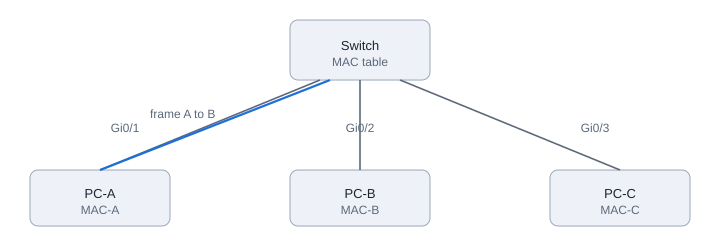

*شکل ۱: سوییچ و سه کامپیوتر؛ هر کامپیوتر به یک پورت وصل است.*

1.  **Learning (یادگیری):** هر فریمی که وارد می‌شود، سوییچ به MAC مبدأ آن نگاه می‌کند و در جدول می‌نویسد «این MAC پشت این پورت است».
2.  **Flooding (پخش):** اگر MAC مقصد در جدول نبود (یا Broadcast بود)، فریم از همه‌ی پورت‌ها به‌جز پورت ورودی فرستاده می‌شود.
3.  **Forwarding (ارسال هدفمند):** اگر MAC مقصد در جدول بود، فریم فقط از همان پورت می‌رود.
4.  **Aging (فراموشی):** ردیفی که ۳۰۰ ثانیه فریم جدیدی از آن نیامد، پاک می‌شود تا جدول پر و کهنه نشود.

> **یک قاعده‌ی مهم**
>
> سوییچ فقط MAC **مبدأ** را یاد می‌گیرد، هرگز MAC مقصد را. و Broadcast هیچ‌وقت مبدأ نیست؛ پس هرگز در جدول نمی‌آید.

### ۳. مثال ساده: اولین ارتباط A با B

جدول سوییچ در ابتدا خالی است. A (پورت Gi0/1) به B (پورت Gi0/2) فریم می‌فرستد:

``` text
Step 1: frame arrives on Gi0/1, src = MAC-A, dst = MAC-B
Step 2: learn  -> table: MAC-A = Gi0/1
Step 3: MAC-B is unknown -> FLOOD to Gi0/2 and Gi0/3
Step 4: B answers: src = MAC-B, dst = MAC-A  (arrives on Gi0/2)
Step 5: learn  -> table: MAC-B = Gi0/2
Step 6: MAC-A is known -> FORWARD only to Gi0/1
```

نتیجه: PC-C فقط فریم اول را می‌بیند. از پیام دوم به بعد، ارتباط A و B خصوصی می‌شود.

### ۴. مثال متوسط: ARP و Broadcast

در عمل، قبل از ping باید ARP انجام شود (درس ۲-۶). ARP Request یک Broadcast است:

``` text
ARP Request : dst = ff:ff:ff:ff:ff:ff  -> always flooded to all ports
ARP Reply   : dst = MAC-A (unicast)     -> forwarded only to Gi0/1
Then ping   : unicast both directions   -> no flooding anymore
```

یعنی هر ارتباط تازه با یک موج Flooding شروع می‌شود و بعد آرام می‌گیرد.

### ۵. مثال سخت: چند MAC پشت یک پورت و پرش MAC

سناریو ۱: پورت Gi0/3 به یک سوییچ دیگر وصل است. پشت آن ۲۰ کامپیوتر هست. نتیجه:

``` text
show mac address-table dynamic
  VLAN  Mac Address       Type     Ports
  1     aaaa.0000.0001    DYNAMIC  Gi0/3
  1     aaaa.0000.0002    DYNAMIC  Gi0/3
  ... 20 MACs on the same port (normal on an uplink)
```

سناریو ۲ (خطرناک): اگر یک MAC یک ثانیه از پورت Gi0/1 و ثانیه‌ی بعد از Gi0/2 بیاید، سوییچ پیام `%SW_MATM-4-MACFLAP_NOTIF` می‌دهد. این تقریباً همیشه نشانه‌ی **Loop** (حلقه) در شبکه است. در فصل ۴ (STP) می‌فهمید چرا و چطور جلویش را بگیریم.

### ۶. دستورهای کلیدی (خط‌به‌خط)

``` text
SW1# show mac address-table
SW1# show mac address-table dynamic
SW1# show mac address-table address aaaa.0000.0001
SW1# show mac address-table interface gi0/1
SW1# show mac address-table aging-time
SW1# clear mac address-table dynamic
```

- `dynamic`: فقط ردیف‌هایی که سوییچ خودش یاد گرفته (در برابر `static` که دستی نوشته می‌شود).
- `address` و `interface`: جستجو برای یک MAC یا یک پورت، مثل «پیدا کردن کامپیوتر گم‌شده».
- `clear ... dynamic`: جدول را پاک می‌کند (در Lab برای دیدن دوباره‌ی یادگیری). در شبکه‌ی واقعی با احتیاط، چون Flooding موقت ایجاد می‌کند.

### ۷. تمرین‌ها

**ت1.** ۱ (ساده): سوییچ کدام MAC را یاد می‌گیرد: مبدأ یا مقصد؟ *(پاسخ: 3-1-ت1 در بخش «پاسخ‌ها» انتهای فصل)*

**ت2.** ۲ (ساده): فریم با مقصد ff:ff:ff:ff:ff:ff چطور پخش می‌شود؟ *(پاسخ: 3-1-ت2 در بخش «پاسخ‌ها» انتهای فصل)*

**ت3.** ۳ (متوسط): جدول خالی است. A (Gi0/1) به B (Gi0/2) و بعد B به A می‌فرستد. چند Flood رخ می‌دهد؟ *(پاسخ: 3-1-ت3 در بخش «پاسخ‌ها» انتهای فصل)*

**ت4.** ۴ (متوسط): چرا ردیف یک MAC بعد از ۵ دقیقه ناپدید می‌شود؟ *(پاسخ: 3-1-ت4 در بخش «پاسخ‌ها» انتهای فصل)*

**ت5.** ۵ (سخت): MACFLAP روی MAC-X بین Gi0/1 و Gi0/2؛ محتمل‌ترین علت؟ *(پاسخ: 3-1-ت5 در بخش «پاسخ‌ها» انتهای فصل)*

### ۸. Lab هدایت‌شده: دیدن یادگیری و Flooding

توپولوژی: سوییچ `SW1` با سه کامپیوتر ساده‌ی VPCS در PNetLab. اگر ندارید، از منوی Add Object سه گره‌ی VPCS (`PC1` تا `PC3`) بسازید و به پورت‌های `Gi0/1` تا `Gi0/3` وصل کنید. همه در VLAN 1 (پیش‌فرض) هستند.

#### گام ۱: آدرس‌دهی VPCS

``` text
PC1> ip 10.10.1.11/24
PC2> ip 10.10.1.12/24
PC3> ip 10.10.1.13/24
```

#### گام ۲: جدول خالی

``` text
SW1# clear mac address-table dynamic
SW1# show mac address-table dynamic
```

#### گام ۳: ایجاد ترافیک و دیدن یادگیری

``` text
PC1> ping 10.10.1.12
SW1# show mac address-table dynamic
```

باید MAC دو VPCS را روی پورت‌های درست ببینید. MAC هر VPCS را با `show ip` روی خودش می‌بینید.

#### گام ۴: دیدن Flooding با Capture

1.  روی لینک PC3 به SW1 کلیک راست و Capture را شروع کنید.
2.  روی SW1: `clear mac address-table dynamic`.
3.  روی PC1: `ping 10.10.1.12`.
4.  در Wireshark فیلتر `arp or icmp`: ARP Request را می‌بینید (چون Broadcast است) ولی Echo Request بین PC1 و PC2 را **نباید** ببینید.

پیش‌بینی کنید و بعد با واقعیت مقایسه کنید. اگر Echo را روی PC3 دیدید، یعنی سوییچ هنوز MAC را یاد نگرفته بود.

#### گام ۵: Aging

``` text
SW1# show mac address-table aging-time
SW1(config)# mac address-table aging-time 60
```

یک دقیقه ترافیک نفرستید و دوباره `show mac address-table dynamic` را بزنید. بعد زمان را به 300 برگردانید.

### ۹. Lab مستقل

MAC یک VPCS را از روی جدول به پورتش ربط دهید، بدون نگاه به توپولوژی. بعد کابل PC2 را به پورت دیگر منتقل کنید و ثبت کنید چه مدت طول می‌کشد جدول درست شود. گزارش را در `03-ops/l2-cam-notes.md` بنویسید.

### ۱۰. عیب‌یابی

|           |                                                                          |
|-----------|--------------------------------------------------------------------------|
| Symptom   | ترافیک یک ارتباط روی پورت‌های بی‌ربط دیده می‌شود                            |
| علت محتمل | MAC مقصد در جدول نیست (Unknown Unicast Flooding) یا Aging خیلی کوتاه است |
| روش       | show mac address-table address ، Capture روی پورت سوم                    |
| Symptom 2 | پیام MACFLAP                                                             |
| علت       | Loop یا MAC تکراری                                                       |
| رفع       | پیدا کردن و قطع Loop (فصل ۴: STP)                                       |

### ۱۱. سؤال‌های مرور

**م1.** سوییچ چه چیزی را یاد می‌گیرد و از کجا؟ *(پاسخ: 3-1-م1 در بخش «پاسخ‌ها» انتهای فصل)*

**م2.** چرا Broadcast هیچ‌وقت در جدول MAC دیده نمی‌شود؟ *(پاسخ: 3-1-م2 در بخش «پاسخ‌ها» انتهای فصل)*

**م3.** Flooding یعنی چه؟ *(پاسخ: 3-1-م3 در بخش «پاسخ‌ها» انتهای فصل)*

### English Corner: انگلیسی تخصصی این درس

این جمله‌ها از مستندات و محیط کار واقعی‌اند. بلند بخوانید و ترجمه را بپوشانید.

| English sentence                                                          | ترجمه                                                               |
|---------------------------------------------------------------------------|---------------------------------------------------------------------|
| The switch learns the source MAC address of every incoming frame.         | سوییچ MAC مبدأ هر فریم ورودی را یاد می‌گیرد.                         |
| Unknown unicast frames are flooded out all ports except the ingress port. | فریم‌های Unicast ناشناخته از همه‌ی پورت‌ها به‌جز پورت ورودی پخش می‌شوند. |
| A MAC flap usually indicates a layer-2 loop.                              | MAC Flap معمولاً نشانه‌ی Loop در لایه ۲ است.                          |
| Entries age out after 300 seconds of inactivity.                          | ردیف‌ها بعد از ۳۰۰ ثانیه بی‌فعالیتی حذف می‌شوند.                       |

**Q1.** Quick quiz (answer in English): What does a switch do when the destination MAC is not in its table? *(پاسخ: 3-1-Q1 در بخش «پاسخ‌ها» انتهای فصل)*

### ۱۲. تکلیف و چک‌لیست تسلط

- [ ] ۵ تمرین را بدون نگاه حل کنم.
- [ ] Lab را انجام دهم و Flooding را با Capture ببینم.
- [ ] چهار رفتار سوییچ را بدون نگاه توضیح دهم.

### ۱۳. یادآوری اشتباهات شما

> **یادآوری**
>
> پیش‌بینی را قبل از اجرا بنویسید؛ دستور EXEC را در Config نزنید؛ فرمول و محاسبه را در بلوک مستقل بنویسید.


#### کارت Lab — درس ۳-۱

| # | فیلد | محتوا |
|---|---|---|
| 1 | عنوان و هدف | دیدن Learning/Flooding/Forwarding/Aging |
| 2 | پیش‌نیاز | فصل ۲ |
| 3 | توپولوژی | SW1 با PC1..PC3 (VPCS) روی Gi0/1..Gi0/3 |
| 4 | تجهیزات | SW1، ۳ VPCS |
| 5 | نسخه نرم‌افزار | vIOS-L2 15.2(20200924، Experimental) برای SW؛ vIOS 15.9(3)M9 برای R؛ VPCS (PNetLab)؛ PNetLab 4.2.8 |
| 6 | IP Plan | 10.10.1.11-13/24 (VLAN 1) |
| 7 | وضعیت اولیه | جدول MAC خالی (`clear mac address-table dynamic`) |
| 8 | صورت مسئله | ثابت کنید سوییچ MAC مبدأ را یاد می‌گیرد و Unknown Unicast پخش می‌شود |
| 9 | مراحل هدایت‌شده | همان بخش «Lab هدایت‌شده» همین درس (گام‌به‌گام) |
| 10 | تست عملکرد | `show mac address-table dynamic` ؛ Capture روی PC3 |
| 11 | سناریوی خرابی | Aging کوتاه (`mac address-table aging-time 60`) |
| 12 | روش عیب‌یابی | Capture روی پورت سوم |
| 13 | نتیجه‌ی مورد انتظار | MAC دو PC روی پورت درست؛ Echo بین PC1 و PC2 روی PC3 دیده نشود |
| 14 | معیار پذیرش | پیش‌بینی با نتیجه تطبیق داده شود |
| 15 | مستندات نهایی | `03-ops/l2-cam-notes.md` |
| 16 | Cleanup و بازگردانی | Aging را 300 کنید |

> **وضعیت راستی‌آزمایی (خارج از ۱۶ فیلد):** **اجرا نشده (فقط طراحی).** اجرا نشده؛ رفتار CAM/Flooding روی vIOS-L2 با VPCS دیده نشده.

---

<a id="l-3-2"></a>

## درس ۳-۲ — VLAN و Access Port

**فصل ۳ - روز ۲ · پیش‌نیاز: درس ۳-۱ · ۶ ساعت**

### این درس درباره چیست و چرا باید یاد بگیریم؟

**چه چیزی یاد می‌گیریم:** چطور یک سوییچ فیزیکی را به چند «شبکه‌ی مجازی جدا» یعنی VLAN تقسیم کنیم، پورت‌ها را به VLANها اختصاص دهیم (Access Port) و جدولی منظم به نام VLAN Matrix بسازیم.

**چرا لازم است:** بدون VLAN، همه‌ی دستگاه‌های سازمان در یک Broadcast Domain هستند: ترافیک حسابداری، دوربین‌ها و مهمان‌ها با هم قاطی می‌شود و یک کامپیوتر آلوده می‌تواند همه را ببیند. VLAN جداسازی را بدون خرید سوییچ جدا ممکن می‌کند.

- **در کار روزانه:** هر بار که کارمند جدید یا پرینتر جدید وصل می‌شود، باید پورتش را به VLAN درست ببرید.
- **در امنیت:** VLAN اولین لایه‌ی «Segmentation» است؛ در FortiGate بین VLANها Policy می‌نویسید.
- **در Capstone:** VLAN10 مدیریت، VLAN20 کاربران و VLAN30 سرورها همین هفته ساخته می‌شوند.

> **مسیر درس**
>
> Broadcast Domain ← VLAN چیست ← Access Port ← VLAN Matrix ← مثال ساده/متوسط/سخت ← دستورها ← تمرین ← Lab ← عیب‌یابی.

#### اصطلاحات این درس (مخفف ← شکل کامل ← معنی)

| مخفف             | شکل کامل انگلیسی                    | معنی فارسی                                     |
|------------------|-------------------------------------|------------------------------------------------|
| VLAN             | Virtual Local Area Network          | شبکه محلی مجازی؛ جداسازی منطقی در لایه ۲       |
| Broadcast Domain | Broadcast Domain                    | محدوده‌ای که Broadcast در آن می‌رسد              |
| Access Port      | Access Port                         | پورتی که فقط به یک VLAN تعلق دارد و Tag نمی‌زند |
| Native           | Native VLAN                         | VLAN بدون Tag روی Trunk (درس بعد)              |
| VLAN ID          | VLAN Identifier                     | شماره‌ی VLAN (۱ تا ۴۰۹۴)                        |
| SVI              | Switch Virtual Interface            | Interface مجازی L3 برای یک VLAN                |
| DHCP             | Dynamic Host Configuration Protocol | تخصیص خودکار آدرس                              |

### ۱. مشکل: یک Broadcast Domain بزرگ

یک ساختمان اداری را در نظر بگیرید که همه‌ی طبقه‌ها یک راه‌پله‌ی مشترک و بدون در دارند. هر صدایی که در یک طبقه بلند شود، همه‌ی ساختمان می‌شنوند. Broadcast در شبکه همین است: هر بار که یک دستگاه ARP یا DHCP می‌فرستد، همه‌ی دستگاه‌های سوییچ آن را دریافت می‌کنند.

هرچه دستگاه‌ها بیشتر شوند، Broadcast بیشتر و شبکه کندتر می‌شود؛ و از نظر امنیت، همه همسایه‌ی هم هستند.

### ۲. VLAN: در گذاشتن بین طبقه‌ها

VLAN سوییچ را به چند «سوییچ مجازی» تقسیم می‌کند. هر پورت عضو یک VLAN است و فریم‌ها فقط بین پورت‌های همان VLAN رد می‌شوند. دستگاه‌های VLAN متفاوت نه Broadcast یکدیگر را می‌بینند و نه بدون روتر با هم صحبت می‌کنند.

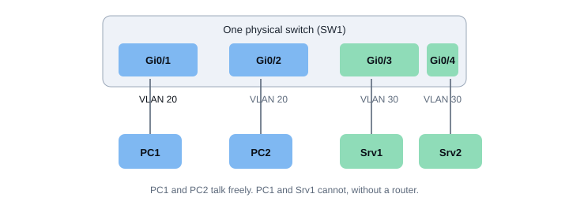

*شکل ۱: یک سوییچ فیزیکی، دو VLAN مجزا.*

#### قوانین VLAN

- VLAN با شماره شناخته می‌شود: ۱ تا ۴۰۹۴ (جزئیات در درس بعد).
- VLAN 1 پیش‌فرض است و بهتر است برای کاربران استفاده نشود.
- هر VLAN معمولاً یک Subnet IP جدا دارد: VLAN20 همان 10.10.20.0/24 در IP Plan ماست.
- Access Port فقط عضو یک VLAN است و دستگاه انتهایی (PC، پرینتر) به آن وصل می‌شود.

### ۳. VLAN Matrix: سند طراحی

قبل از تایپ هر دستور، یک جدول بسازید. ستون‌ها: شماره، نام، Subnet، Gateway، پورت‌ها. این جدول مرجع شماست:

| VLAN | Name    | Subnet        | Gateway    | Access Ports     |
|------|---------|---------------|------------|------------------|
| 10   | MGMT    | 10.10.10.0/24 | 10.10.10.1 | (مدیریت تجهیزات) |
| 20   | USERS   | 10.10.20.0/24 | 10.10.20.1 | Gi0/1, Gi0/2     |
| 30   | SERVERS | 10.10.30.0/24 | 10.10.30.1 | Gi0/3            |

### ۴. دستورها (خط‌به‌خط)

``` text
SW1(config)# vlan 20
SW1(config-vlan)# name USERS
SW1(config-vlan)# exit
SW1(config)# interface gi0/1
SW1(config-if)# switchport mode access
SW1(config-if)# switchport access vlan 20
SW1(config-if)# exit
```

- `vlan 20` + `name`: VLAN را می‌سازد و نام می‌دهد (نام فقط برای خوانایی است).
- `switchport mode access`: پورت را صریحاً Access می‌کند (نه خودکار).
- `switchport access vlan 20`: پورت را عضو VLAN 20 می‌کند. اگر VLAN وجود نداشته باشد، IOS آن را خودکار می‌سازد (خطای رایج: VLAN بدون نام).
- برای چند پورت: `interface range gi0/1 - 2`.

``` text
SW1# show vlan brief
SW1# show interfaces gi0/1 switchport
SW1# show running-config interface gi0/1
```

### ۵. مثال ساده: دو کامپیوتر در یک VLAN

``` text
PC1> ip 10.10.20.11/24 10.10.20.1
PC2> ip 10.10.20.12/24 10.10.20.1
PC1> ping 10.10.20.12     -> success (same VLAN 20)
```

### ۶. مثال متوسط: دو VLAN، بدون روتر

``` text
Srv1 (VLAN 30): 10.10.30.11/24
PC1  (VLAN 20): ping 10.10.30.11   -> FAILS
```

دلیل: دو Broadcast Domain جدا هستند و بدون Gateway (روتر یا SVI) بسته نمی‌تواند رد شود. در درس‌های ۳-۴ و ۳-۵ این مشکل را حل می‌کنیم.

### ۷. مثال سخت: پورت در VLAN اشتباه (TS03)

کاربری شکایت دارد «اینترنت ندارم». IP او 10.10.20.50/24 است ولی ping به Gateway جواب نمی‌دهد. روش عیب‌یابی:

1.  پورت او را پیدا کن: `show mac address-table address <MAC>`.
2.  VLAN آن پورت را ببین: `show vlan brief`.
3.  مقایسه کن: Subnet کامپیوتر با VLAN پورت یکی است؟
4.  اگر نه، پورت را به VLAN درست ببر و دوباره تست کن.

``` text
Symptom   : IP 10.10.20.x but port is in VLAN 30
Evidence  : show vlan brief -> Gi0/5 in VLAN 30
Fix       : switchport access vlan 20
Verify    : ping gateway success
```

### ۸. تمرین‌ها

**ت1.** ۱ (ساده): چرا VLAN باعث کاهش Broadcast می‌شود؟ *(پاسخ: 3-2-ت1 در بخش «پاسخ‌ها» انتهای فصل)*

**ت2.** ۲ (ساده): دو کامپیوتر در VLAN های 20 و 30 بدون روتر ping می‌کنند؛ نتیجه؟ *(پاسخ: 3-2-ت2 در بخش «پاسخ‌ها» انتهای فصل)*

**ت3.** ۳ (متوسط): دستورهای لازم برای ساختن VLAN 40 با نام GUEST و قراردادن Gi0/6 در آن *(پاسخ: 3-2-ت3 در بخش «پاسخ‌ها» انتهای فصل)*

**ت4.** ۴ (متوسط): خروجی show vlan brief چه چیزی نشان می‌دهد؟ *(پاسخ: 3-2-ت4 در بخش «پاسخ‌ها» انتهای فصل)*

**ت5.** ۵ (سخت): کاربر در VLAN 20 است ولی به Gateway نمی‌رسد؛ سه علت محتمل *(پاسخ: 3-2-ت5 در بخش «پاسخ‌ها» انتهای فصل)*

### ۹. Lab هدایت‌شده

#### گام ۱: ساخت VLANها (طبق VLAN Matrix)

``` text
SW1(config)# vlan 20
SW1(config-vlan)# name USERS
SW1(config-vlan)# vlan 30
SW1(config-vlan)# name SERVERS
SW1(config-vlan)# exit
```

#### گام ۲: اختصاص پورت‌ها

``` text
SW1(config)# interface range gi0/1 - 2
SW1(config-if-range)# switchport mode access
SW1(config-if-range)# switchport access vlan 20
SW1(config-if-range)# exit
SW1(config)# interface gi0/3
SW1(config-if)# switchport mode access
SW1(config-if)# switchport access vlan 30
SW1(config-if)# end
SW1# show vlan brief
```

#### گام ۳: تست

``` text
PC1> ip 10.10.20.11/24 10.10.20.1
PC2> ip 10.10.20.12/24 10.10.20.1
PC3> ip 10.10.30.11/24 10.10.30.1
PC1> ping 10.10.20.12     (expect: success)
PC1> ping 10.10.30.11     (expect: fail)
```

#### گام ۴: خراب‌کردن عمدی و رفع

``` text
SW1(config)# interface gi0/2
SW1(config-if)# switchport access vlan 30
(PC1 ping PC2 now fails)
SW1(config-if)# switchport access vlan 20
(ping works again)
```

#### گام ۵: ذخیره

``` text
SW1# copy running-config startup-config
```

### ۱۰. Lab مستقل

VLAN Matrix مفصل Capstone (مرکز) را با ۵ VLAN بنویسید و فایل `02-design/vlan-matrix.md` را بسازید: شماره، نام، Subnet، Gateway، پورت‌ها، توضیح.

### ۱۱. عیب‌یابی

|         |                                                                                                        |
|---------|--------------------------------------------------------------------------------------------------------|
| Symptom | PC به Gateway نمی‌رسد                                                                                   |
| چک‌لیست  | ۱) پورت در VLAN درست است؟ ؛ ۲) VLAN وجود دارد؟ ؛ ۳) پورت UP است؟ (TS01) ؛ ۴) IP/Mask/Gateway درست است؟ |
| ابزار   | show vlan brief ، show interfaces status                                                               |

### ۱۲. سؤال‌های مرور

**م1.** VLAN چه فایده‌ای دارد؟ *(پاسخ: 3-2-م1 در بخش «پاسخ‌ها» انتهای فصل)*

**م2.** Access Port چیست؟ *(پاسخ: 3-2-م2 در بخش «پاسخ‌ها» انتهای فصل)*

### English Corner: انگلیسی تخصصی این درس

این جمله‌ها از مستندات و محیط کار واقعی‌اند. بلند بخوانید و ترجمه را بپوشانید.

| English sentence                                       | ترجمه                                                    |
|--------------------------------------------------------|----------------------------------------------------------|
| A VLAN is a logical broadcast domain on a switch.      | VLAN یک Broadcast Domain منطقی روی سوییچ است.            |
| Assign the port to VLAN 20 as an access port.          | پورت را به‌عنوان Access Port به VLAN 20 اختصاص بدهید.     |
| Hosts in different VLANs need a router to communicate. | Hostها در VLANهای متفاوت برای ارتباط به روتر نیاز دارند. |
| Verify the VLAN membership with show vlan brief.       | عضویت VLAN را با show vlan brief بررسی کنید.             |

**Q1.** Quick quiz (answer in English): Why do hosts in different VLANs need a router? *(پاسخ: 3-2-Q1 در بخش «پاسخ‌ها» انتهای فصل)*

### ۱۳. تکلیف و چک‌لیست تسلط

- [ ] VLAN Matrix را کامل بنویسم.
- [ ] Lab را اجرا کنم و ping موفق و ناموفق را ثبت کنم.
- [ ] TS03 را عمداً بسازم و رفع کنم.

### ۱۴. یادآوری اشتباهات شما

> **یادآوری**
>
> «پذیرفته شدن دستور ≠ کار کردن»؛ همیشه با ping و show تأیید کنید. بعد از هر تغییر موفق ذخیره کنید.


#### کارت Lab — درس ۳-۲

| # | فیلد | محتوا |
|---|---|---|
| 1 | عنوان و هدف | ساخت VLAN و Access Port طبق VLAN Matrix |
| 2 | پیش‌نیاز | درس ۳-۱ |
| 3 | توپولوژی | SW1 با PC1..PC3 (VLAN 20/30) |
| 4 | تجهیزات | SW1، ۳ VPCS |
| 5 | نسخه نرم‌افزار | vIOS-L2 15.2(20200924، Experimental) برای SW؛ vIOS 15.9(3)M9 برای R؛ VPCS (PNetLab)؛ PNetLab 4.2.8 |
| 6 | IP Plan | VLAN20 10.10.20.0/24؛ VLAN30 10.10.30.0/24 |
| 7 | وضعیت اولیه | VLAN فقط 1 |
| 8 | صورت مسئله | VLAN 20 و 30 بسازید؛ ping داخل VLAN موفق و بین VLAN شکست |
| 9 | مراحل هدایت‌شده | همان بخش «Lab هدایت‌شده» همین درس (گام‌به‌گام) |
| 10 | تست عملکرد | `show vlan brief` ؛ ping |
| 11 | سناریوی خرابی | پورت PC2 در VLAN اشتباه |
| 12 | روش عیب‌یابی | مقایسه‌ی Subnet کامپیوتر با VLAN پورت |
| 13 | نتیجه‌ی مورد انتظار | ping هم‌VLAN موفق؛ بین‌VLAN شکست |
| 14 | معیار پذیرش | VLAN Matrix |
| 15 | مستندات نهایی | `02-design/vlan-matrix.md` |
| 16 | Cleanup و بازگردانی | حذف VLANها؛ پورت‌ها به VLAN 1 |

> **وضعیت راستی‌آزمایی (خارج از ۱۶ فیلد):** **جزئی.** ساخت/نام‌گذاری VLAN و `show vlan brief` Tested-OK؛ Access Port + VPCS و ping بین VLAN اجرا نشده.

---

<a id="l-3-3"></a>

## درس ۳-۳ — Trunk و 802.1Q

**فصل ۳ - روز ۳ · پیش‌نیاز: درس ۳-۲ · ۶ ساعت**

### این درس درباره چیست و چرا باید یاد بگیریم؟

**چه چیزی یاد می‌گیریم:** چطور چند VLAN را روی «یک کابل» بین دو سوییچ (یا سوییچ و روتر) عبور بدهیم. این کار با Trunk و استاندارد 802.1Q انجام می‌شود که به هر فریم یک برچسب (Tag) اضافه می‌کند.

**چرا لازم است:** بدون Trunk باید برای هر VLAN یک کابل جدا بین سوییچ‌ها بکشید. Trunk همه را در یک کابل جا می‌دهد؛ ولی یک اشتباه کوچک در آن (مثلاً پاک‌کردن لیست VLANهای مجاز) می‌تواند کل شعبه را قطع کند.

- **در کار روزانه:** تقریباً هر لینک بین سوییچ‌ها و بین سوییچ و فایروال Trunk است.
- **در امنیت:** Trunk نادرست راه حمله‌ی VLAN Hopping است؛ باید Native و Allowed را سفت کنید.
- **در FortiGate:** پورت فایروال که به سوییچ وصل می‌شود، همین Trunk را می‌بیند (VLAN Interface).

> **مسیر درس**
>
> مشکل: یک کابل برای هر VLAN ← Tag 802.1Q ← Native VLAN ← Allowed List ← مثال ساده/متوسط/سخت ← دستورها ← تمرین ← Lab ← عیب‌یابی.

#### اصطلاحات این درس (مخفف ← شکل کامل ← معنی)

| مخفف        | شکل کامل انگلیسی          | معنی فارسی                             |
|-------------|---------------------------|----------------------------------------|
| Trunk       | Trunk Port                | پورتی که چند VLAN را با Tag عبور می‌دهد |
| 802.1Q      | IEEE 802.1Q               | استاندارد Tag کردن VLAN در فریم اترنت  |
| Tag         | VLAN Tag                  | ۴ بایت اضافه به فریم؛ شامل VLAN ID     |
| TPID        | Tag Protocol Identifier   | مقدار 0x8100؛ نشان‌دهنده‌ی وجود Tag      |
| VID         | VLAN Identifier           | ۱۲ بیت شماره VLAN                      |
| PCP         | Priority Code Point       | ۳ بیت اولویت (QoS)                     |
| DTP         | Dynamic Trunking Protocol | پروتکل سیسکو برای مذاکره خودکار Trunk  |
| Native VLAN | Native VLAN               | VLANی که روی Trunk بدون Tag می‌رود      |

### ۱. مشکل: یک کابل برای هر VLAN؟

فرض کنید دو سوییچ در دو طبقه دارید و ۵ VLAN. بدون Trunk باید ۵ کابل بکشید. تصور کنید یک اتوبوس بین دو شهر. به‌جای ۵ ماشین جدا برای ۵ شرکت، یک اتوبوس مسافران همه‌ی شرکت‌ها را می‌برد؛ فقط باید روی هر مسافر یک برچسب بزنید تا در مقصد معلوم باشد مال کدام شرکت است.

### ۲. Tag 802.1Q چیست؟

سوییچ هنگام ورود فریم به Trunk، یک برچسب ۴ بایتی بین MAC مبدأ و نوع فریم می‌گذارد. سوییچ آن‌طرف، برچسب را می‌خواند و فریم را فقط در همان VLAN پخش می‌کند.

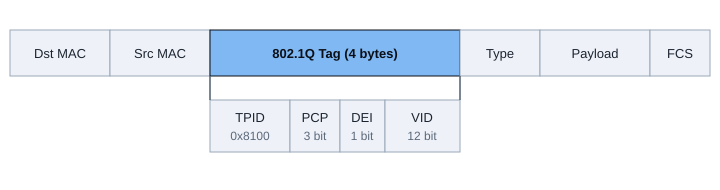

*شکل ۱: فریم اترنت با Tag ۴ بایتی 802.1Q؛ ۱۲ بیت آن شماره‌ی VLAN است.*

چون VID دوازده بیت است، تعداد VLANها محدود می‌شود:

``` text
VID bits         = 12
Total values     = 2 ^ 12 = 4096   (0 .. 4095)
Reserved         = 0 and 4095
Usable VLAN IDs  = 4096 - 2 = 4094   (1 .. 4094)
```

### ۳. Native VLAN: ترافیک بدون برچسب

یک VLAN روی Trunk بدون Tag می‌رود؛ به آن **Native VLAN** می‌گویند (پیش‌فرض VLAN 1). اگر دو سر Trunk Native متفاوت داشته باشند، ترافیک VLANها قاطی می‌شود و CDP پیام `Native VLAN mismatch` می‌دهد. همین امر راهی برای VLAN Hopping است.

> **توصیه‌ی امنیتی**
>
> Native را روی یک VLAN بدون استفاده (مثلاً 999) بگذارید و دو سر لینک یکی باشد.

### ۴. Allowed VLAN List: چه VLANهایی اجازه‌ی عبور دارند

پیش‌فرض Trunk همه‌ی VLANها (1 تا 4094) را عبور می‌دهد. بهتر است فقط VLANهای لازم مجاز باشند. اینجا یک اشتباه بسیار رایج هست:

``` text
switchport trunk allowed vlan 20,30        (REPLACES the whole list!)
switchport trunk allowed vlan add 40        (ADDS 40 to the existing list)
switchport trunk allowed vlan remove 30     (REMOVES 30 only)
```

> **هشدار (TS05: Human Error)**
>
> اگر برای افزودن VLAN جدید فقط بنویسید `allowed vlan 40` (بدون کلمه‌ی add)، کل لیست قبلی پاک می‌شود و فقط VLAN 40 می‌ماند. باقی VLANها بلافاصله قطع می‌شوند. همیشه از `add` استفاده کنید و قبلش `show interfaces trunk` را ببینید.

### ۵. دستورها (خط‌به‌خط)

``` text
SW1(config)# interface gi0/0
SW1(config-if)# switchport trunk encapsulation dot1q
SW1(config-if)# switchport mode trunk
SW1(config-if)# switchport trunk native vlan 999
SW1(config-if)# switchport trunk allowed vlan 10,20,30
SW1(config-if)# switchport nonegotiate
SW1(config-if)# end
```

- `trunk encapsulation dot1q`: روی بعضی سوییچ‌ها لازم است (اگر خطا داد، سوییچ فقط dot1q را پشتیبانی می‌کند و نیازی نیست).
- `mode trunk`: پورت را صریحاً Trunk می‌کند.
- `native vlan 999`: VLAN بدون Tag.
- `allowed vlan`: فهرست مجاز (اینجا برای اولین بار از فرم کامل استفاده شده).
- `nonegotiate`: DTP را خاموش می‌کند تا مذاکره‌ی ناخواسته رخ ندهد.

``` text
SW1# show interfaces trunk
SW1# show interfaces gi0/0 switchport
```

خروجی `show interfaces trunk` چهار بخش دارد: Mode و Status، Vlans allowed، Vlans allowed and active، و Vlans in spanning tree forwarding state. اگر VLANی در بخش اول هست ولی در دوم نیست، یعنی هنوز روی سوییچ ساخته نشده.

### ۶. مثال ساده: Trunk بین SW1 و SW2

``` text
SW1(config)# interface gi0/1
SW1(config-if)# switchport trunk encapsulation dot1q
SW1(config-if)# switchport mode trunk
(same on SW2)
SW1# show interfaces trunk       -> Gi0/1 trunking, allowed 1-4094
```

### ۷. مثال متوسط: دو سوییچ، دو VLAN

``` text
SW1: PC1 (VLAN 20) on Gi0/2        SW2: PC4 (VLAN 20) on Gi0/2
Trunk Gi0/1 between SW1 and SW2 carries VLAN 20 and 30
PC1 ping PC4 (same VLAN 20) -> success through the trunk
```

شرط: هر دو سوییچ باید VLAN 20 را داشته باشند و در لیست مجاز Trunk باشد.

### ۸. مثال سخت: عیب‌یابی TS04 و TS05

``` text
TS04 symptom : VLAN 30 hosts lost connectivity across the trunk
Evidence     : show interfaces trunk -> VLAN 30 missing from "allowed"
Fix          : switchport trunk allowed vlan add 30

TS05 cause   : someone typed "allowed vlan 40" (without add)
Result       : only VLAN 40 remains, 10/20/30 down
Prevention   : always use "add", always review show interfaces trunk
               before and after, keep a backup (lesson 2-4)
```

### ۹. تمرین‌ها

**ت1.** ۱ (ساده): چند بیت از Tag مخصوص VLAN ID است و چند VLAN قابل‌استفاده داریم؟ *(پاسخ: 3-3-ت1 در بخش «پاسخ‌ها» انتهای فصل)*

**ت2.** ۲ (ساده): تفاوت allowed vlan 40 با allowed vlan add 40؟ *(پاسخ: 3-3-ت2 در بخش «پاسخ‌ها» انتهای فصل)*

**ت3.** ۳ (متوسط): Native Mismatch چه عارضه‌ای دارد؟ *(پاسخ: 3-3-ت3 در بخش «پاسخ‌ها» انتهای فصل)*

**ت4.** ۴ (متوسط): چرا nonegotiate را می‌زنیم؟ *(پاسخ: 3-3-ت4 در بخش «پاسخ‌ها» انتهای فصل)*

**ت5.** ۵ (سخت): روی Trunk هستید و VLAN 30 در show interfaces trunk در ستون allowed نیست؛ ۳ دستور رفع *(پاسخ: 3-3-ت5 در بخش «پاسخ‌ها» انتهای فصل)*

### ۱۰. Lab هدایت‌شده

توپولوژی: `SW1` و `SW2` (گره دوم vIOSL2) با کابل بین `Gi0/1` هر دو. PC1 روی SW1 و PC4 روی SW2 هر دو در VLAN 20.

#### گام ۱: بکاپ

``` text
SW1# copy running-config flash:SW1-before-trunk.cfg
SW2# copy running-config flash:SW2-before-trunk.cfg
```

#### گام ۲: VLANها روی هر دو سوییچ

``` text
SW2(config)# vlan 20
SW2(config-vlan)# name USERS
SW2(config-vlan)# vlan 30
SW2(config-vlan)# name SERVERS
```

#### گام ۳: Trunk روی هر دو سر

``` text
SWx(config)# interface gi0/1
SWx(config-if)# switchport trunk encapsulation dot1q
SWx(config-if)# switchport mode trunk
SWx(config-if)# switchport trunk native vlan 999
SWx(config-if)# switchport trunk allowed vlan 20,30
SWx(config-if)# switchport nonegotiate
SWx# show interfaces trunk
```

#### گام ۴: تست

``` text
PC1> ip 10.10.20.11/24 10.10.20.1
PC4> ip 10.10.20.14/24 10.10.20.1
PC1> ping 10.10.20.14      (expect: success)
```

#### گام ۵: Capture و دیدن Tag

روی لینک بین SW1 و SW2 Capture بگیرید. فریم‌ها را باز کنید: در Wireshark باید «802.1Q Virtual LAN، ID: 20» ببینید. روی لینک PC1 همان فریم **بدون** Tag است (چون Access Port است).

#### گام ۶: ایجاد عمدی TS05 و رفع

``` text
SW1(config-if)# switchport trunk allowed vlan 30     (WRONG, replaces list)
PC1 ping PC4 -> fails
SW1(config-if)# switchport trunk allowed vlan add 20
PC1 ping PC4 -> works
```

### ۱۱. Lab مستقل

یک Runbook کوتاه `03-ops/trunk-change.md` بنویسید: «قبل از هر تغییر Trunk چه چیزی بررسی/بکاپ شود و چطور برگردیم». از `reload in` هم استفاده کنید.

### ۱۲. عیب‌یابی

|         |                                                                                                                          |
|---------|--------------------------------------------------------------------------------------------------------------------------|
| Symptom | یک VLAN از Trunk رد نمی‌شود                                                                                               |
| چک‌لیست  | ۱) VLAN در Allowed هست؟ ؛ ۲) VLAN روی هر دو سوییچ ساخته شده؟ ؛ ۳) Native دو سر یکی است؟ ؛ ۴) Trunk در حالت trunking است؟ |
| ابزار   | show interfaces trunk ، show vlan brief ، show cdp neighbors                                                             |

### ۱۳. سؤال‌های مرور

**م1.** Trunk چه کاری می‌کند؟ *(پاسخ: 3-3-م1 در بخش «پاسخ‌ها» انتهای فصل)*

**م2.** Native VLAN چیست؟ *(پاسخ: 3-3-م2 در بخش «پاسخ‌ها» انتهای فصل)*

### English Corner: انگلیسی تخصصی این درس

این جمله‌ها از مستندات و محیط کار واقعی‌اند. بلند بخوانید و ترجمه را بپوشانید.

| English sentence                                                   | ترجمه                                                         |
|--------------------------------------------------------------------|---------------------------------------------------------------|
| The trunk carries traffic for multiple VLANs using 802.1Q tagging. | Trunk ترافیک چند VLAN را با Tag 802.1Q عبور می‌دهد.            |
| A native VLAN mismatch can lead to VLAN hopping.                   | عدم تطابق Native VLAN می‌تواند به VLAN Hopping منجر شود.       |
| Use the add keyword to avoid overwriting the allowed VLAN list.    | از کلمه‌ی add استفاده کنید تا لیست VLANهای مجاز بازنویسی نشود. |
| Disable DTP with switchport nonegotiate.                           | DTP را با switchport nonegotiate خاموش کنید.                  |

**Q1.** Quick quiz (answer in English): Why is "switchport trunk allowed vlan 40" dangerous on a live trunk? *(پاسخ: 3-3-Q1 در بخش «پاسخ‌ها» انتهای فصل)*

### ۱۴. تکلیف و چک‌لیست تسلط

- [ ] Trunk را راه بیندازم و Tag را در Capture ببینم.
- [ ] TS04 و TS05 را بسازم و رفع کنم.
- [ ] جدول allowed/native هر لینک را در IP Plan ثبت کنم.

### ۱۵. یادآوری اشتباهات شما

> **یادآوری**
>
> قبل از تغییر Trunk بکاپ بگیرید؛ بعد از تغییر show را ببینید؛ فرمول‌ها و مراحل را در بلوک مستقل بنویسید.


#### کارت Lab — درس ۳-۳

| # | فیلد | محتوا |
|---|---|---|
| 1 | عنوان و هدف | Trunk 802.1Q با Native و Allowed و دیدن Tag |
| 2 | پیش‌نیاز | درس ۳-۲ |
| 3 | توپولوژی | SW1 Gi0/1 ↔ SW2 Gi0/1 |
| 4 | تجهیزات | SW1، SW2، PC1، PC4 |
| 5 | نسخه نرم‌افزار | vIOS-L2 15.2(20200924، Experimental) برای SW؛ vIOS 15.9(3)M9 برای R؛ VPCS (PNetLab)؛ PNetLab 4.2.8 |
| 6 | IP Plan | VLAN 20 و 30؛ 10.10.20.0/24 |
| 7 | وضعیت اولیه | VLANها روی هر دو ساخته شده |
| 8 | صورت مسئله | Trunk بسازید و خطای فراموشی `add` را ایجاد و رفع کنید |
| 9 | مراحل هدایت‌شده | همان بخش «Lab هدایت‌شده» همین درس (گام‌به‌گام) |
| 10 | تست عملکرد | `show interfaces trunk` ؛ Capture Tag 802.1Q |
| 11 | سناریوی خرابی | `allowed vlan 30` بدون add |
| 12 | روش عیب‌یابی | `show interfaces trunk` قبل/بعد |
| 13 | نتیجه‌ی مورد انتظار | VLAN 20 از Trunk رد شود؛ Tag در Capture |
| 14 | معیار پذیرش | بعد از رفع ping PC1↔PC4 موفق |
| 15 | مستندات نهایی | `03-ops/trunk-change.md` |
| 16 | Cleanup و بازگردانی | Allowed را به 20,30 و Native 999 برگردانید |

> **وضعیت راستی‌آزمایی (خارج از ۱۶ فیلد):** **جزئی.** Trunk 802.1Q روی یک سوییچ Tested-OK؛ Trunk بین دو سوییچ، Tag در Capture و `allowed vlan` اجرا نشده.

---

<a id="l-3-4"></a>

## درس ۳-۴ — Router-on-a-Stick

**فصل ۳ - روز ۴ · پیش‌نیاز: درس ۳-۳ · ۶ ساعت**

### این درس درباره چیست و چرا باید یاد بگیریم؟

**چه چیزی یاد می‌گیریم:** چطور VLANهای مختلف را به هم وصل کنیم. روش اول: یک روتر با یک کابل Trunk و چند Sub-interface؛ معروف به Router-on-a-Stick (RoAS).

**چرا لازم است:** همان‌طور که دیدید دو VLAN بدون روتر با هم صحبت نمی‌کنند. این درس کلید فهم «Inter-VLAN Routing» است و همین مفهوم در FortiGate با VLAN Interface تکرار می‌شود. کسی که RoAS را بفهمد، Gateway در FortiGate را هم می‌فهمد.

- **در کار روزانه:** شعبه‌های کوچک بدون سوییچ لایه ۳ از همین روش استفاده می‌کنند.
- **در امنیت:** وقتی ترافیک بین VLANها از روتر یا فایروال می‌گذرد، می‌شود ACL یا Policy گذاشت.
- **در Capstone:** فایروال FortiGate همین نقش را برای همه‌ی VLANها دارد.

> **مسیر درس**
>
> مشکل: ارتباط بین VLANها ← ایده‌ی Sub-interface ← مسیر بسته (Packet Flow) ← دستورها ← مثال ساده/متوسط/سخت ← تمرین ← Lab ← عیب‌یابی.

#### اصطلاحات این درس (مخفف ← شکل کامل ← معنی)

| مخفف                | شکل کامل انگلیسی          | معنی فارسی                                |
|---------------------|---------------------------|-------------------------------------------|
| RoAS                | Router on a Stick         | روتر با یک لینک Trunk و چند Sub-interface |
| Sub-interface       | Sub-interface             | Interface منطقی روی یک Interface فیزیکی   |
| Inter-VLAN          | Inter-VLAN Routing        | مسیریابی بین VLANها                       |
| Gateway             | Default Gateway           | دروازه‌ی پیش‌فرض هر VLAN                    |
| encapsulation dot1Q | IEEE 802.1Q encapsulation | دستور اتصال Sub-interface به یک VLAN      |
| L3                  | Layer 3                   | لایه شبکه (IP)                            |

### ۱. مشکل

PC1 در VLAN 20 و Srv1 در VLAN 30. هر کدام Subnet خودش را دارد؛ دو شبکه‌ی جدا که بدون «پل» به هم نمی‌رسند. این پل یک **روتر** است: وقتی PC1 بخواهد به Srv1 بفرستد، بسته را به Gateway خودش می‌دهد و روتر آن را به VLAN 30 می‌فرستد.

ساده‌ترین راه: برای هر VLAN یک پورت فیزیکی روتر. ولی روتر پورت زیادی ندارد. راه‌حل هوشمندانه: یک پورت و یک Trunk؛ و روی روتر برای هر VLAN یک «Interface مجازی» می‌سازیم.

### ۲. ایده‌ی Router-on-a-Stick

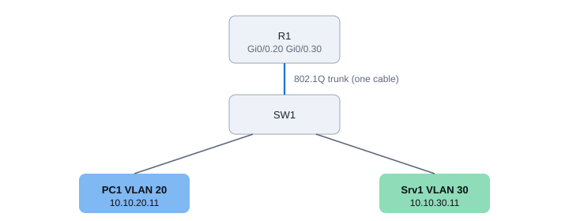

*شکل ۱: یک کابل Trunk بین روتر و سوییچ؛ روتر برای هر VLAN یک Sub-interface دارد.*

Sub-interface مثل چند میز در یک ساختمان است: یک در (کابل فیزیکی) دارد ولی هر میز برای یک شرکت (VLAN) کار می‌کند. هر Sub-interface یک آدرس IP دارد که همان Gateway آن VLAN است.

### ۳. مسیر بسته (Packet Flow)

PC1 (10.10.20.11، VLAN 20) به Srv1 (10.10.30.11، VLAN 30) ping می‌زند:

1.  PC1 می‌بیند Srv1 در Subnet دیگری است و بسته را به Gateway (10.10.20.1) می‌دهد؛ پس MAC مقصد فریم، MAC روتر است.
2.  سوییچ فریم را با Tag VLAN 20 روی Trunk به روتر می‌فرستد.
3.  روتر روی Gi0/0.20 دریافت می‌کند، جدول Route را می‌بیند (Connected: 10.10.30.0/24 روی Gi0/0.30).
4.  روتر فریم جدید با MAC مقصد Srv1 می‌سازد و با Tag VLAN 30 از همان کابل برمی‌گرداند.
5.  سوییچ Tag را برمی‌دارد و فریم را فقط به پورت Srv1 می‌دهد.

``` text
IP src/dst stay the same : 10.10.20.11 -> 10.10.30.11
MAC dst changes          : router MAC (hop 1) -> Srv1 MAC (hop 2)
VLAN tag changes         : 20 (in) -> 30 (out)
TTL                      : decreased by 1 at the router
```

> **نکته‌ی مهم**
>
> IP مبدأ و مقصد تغییر نمی‌کنند، ولی MAC و Tag در هر Hop عوض می‌شوند. این همان نکته‌ی «Routing» است که در Capture (درس ۲-۶) دیدید.

### ۴. دستورها (خط‌به‌خط)

``` text
SW1(config)# interface gi0/0
SW1(config-if)# switchport trunk encapsulation dot1q
SW1(config-if)# switchport mode trunk
SW1(config-if)# switchport trunk allowed vlan 10,20,30

R1(config)# interface gi0/0
R1(config-if)# no shutdown
R1(config-if)# no ip address
R1(config-if)# interface gi0/0.20
R1(config-subif)# encapsulation dot1Q 20
R1(config-subif)# ip address 10.10.20.1 255.255.255.0
R1(config-subif)# interface gi0/0.30
R1(config-subif)# encapsulation dot1Q 30
R1(config-subif)# ip address 10.10.30.1 255.255.255.0
R1(config-subif)# end
```

- Interface فیزیکی بدون IP و روشن (`no shutdown`) می‌ماند؛ فقط Sub-interfaceها آدرس دارند.
- `encapsulation dot1Q 20`: این Sub-interface فقط فریم‌های Tag 20 را می‌گیرد/می‌فرستد. شماره‌ی Sub-interface (.20) فقط یک نام است؛ ولی عرف این است که با VLAN یکی باشد.
- اگر Native VLAN داشتید، `encapsulation dot1Q 10 native` (طبق مستند Cisco، برای VLAN Native Trunk فقط با کلیدواژه‌ی `native` تنظیم شود و Native دو سر Trunk یکسان باشد).

``` text
R1# show ip interface brief
R1# show ip route connected
R1# show interfaces gi0/0.20
R1# ping 10.10.30.11
```

### ۵. مثال ساده: ping به Gateway

``` text
PC1> ping 10.10.20.1     -> success (R1 Gi0/0.20)
```

### ۶. مثال متوسط: ping بین دو VLAN

``` text
PC1> ping 10.10.30.11    -> success through R1
PC1> trace 10.10.30.11   -> hop 1 = 10.10.20.1 (router), hop 2 = 10.10.30.11
```

### ۷. مثال سخت: عیب‌یابی

|            |                                                                                                                                                                                                   |
|------------|---------------------------------------------------------------------------------------------------------------------------------------------------------------------------------------------------|
| Symptom    | PC1 به Gateway می‌رسد ولی به VLAN 30 نه                                                                                                                                                            |
| چک‌لیست     | ۱) Sub-interface .30 بالا است؟ ؛ ۲) `encapsulation dot1Q 30` درست است؟ ؛ ۳) VLAN 30 در Allowed ترانک است؟ ؛ ۴) Srv1 Gateway 10.10.30.1 دارد؟ ؛ ۵) `show ip route connected` هر دو Subnet را دارد؟ |
| علت متداول | Encapsulation اشتباه (مثلاً 3 به‌جای 30) یا فراموشی VLAN در Trunk (TS04)                                                                                                                            |

### ۸. تمرین‌ها

**ت1.** ۱ (ساده): چرا فقط یک کابل فیزیکی کافی است؟ *(پاسخ: 3-4-ت1 در بخش «پاسخ‌ها» انتهای فصل)*

**ت2.** ۲ (ساده): کدام آدرس IP روی Gi0/0.20 می‌نشیند؟ *(پاسخ: 3-4-ت2 در بخش «پاسخ‌ها» انتهای فصل)*

**ت3.** ۳ (متوسط): در مسیر PC1 به Srv1 کدام فیلدها عوض می‌شوند و کدام نه؟ *(پاسخ: 3-4-ت3 در بخش «پاسخ‌ها» انتهای فصل)*

**ت4.** ۴ (متوسط): اگر encapsulation dot1Q 3 به‌جای 30 بزنیم چه می‌شود؟ *(پاسخ: 3-4-ت4 در بخش «پاسخ‌ها» انتهای فصل)*

**ت5.** ۵ (سخت): نقطه‌ضعف RoAS چیست؟ *(پاسخ: 3-4-ت5 در بخش «پاسخ‌ها» انتهای فصل)*

### ۹. Lab هدایت‌شده

توپولوژی درس ۳-۲ را ادامه می‌دهیم: `R1` به `SW1` (Gi0/0 ↔ Gi0/0). VLAN 20 و 30 روی SW1 دارید.

#### گام ۱: بکاپ و Trunk

``` text
SW1# copy running-config flash:SW1-before-roas.cfg
SW1(config)# interface gi0/0
SW1(config-if)# switchport trunk encapsulation dot1q
SW1(config-if)# switchport mode trunk
SW1(config-if)# switchport trunk allowed vlan 10,20,30
```

#### گام ۲: Sub-interface روی R1

دستورهای بخش ۴ را بزنید (VLAN 10 همان Sub-interface قبلی L00 است و دست نمی‌خورد).

#### گام ۳: تست

``` text
PC1> ip 10.10.20.11/24 10.10.20.1
PC3> ip 10.10.30.11/24 10.10.30.1
PC1> ping 10.10.30.11    (expect: success)
R1# show ip route connected
```

#### گام ۴: Capture روی لینک R1-SW1

1.  PC1 ping به PC3 بزند.
2.  در Wireshark فریم‌ها را ببینید: Echo Request با VLAN 20 و MAC مقصد R1، و بعد همان بسته با VLAN 30 و MAC مقصد PC3.
3.  جدول تغییرات (IP/MAC/Tag/TTL) را بنویسید.

#### گام ۵: خراب‌کردن عمدی

``` text
R1(config)# interface gi0/0.30
R1(config-subif)# encapsulation dot1Q 3
PC1 ping PC3 -> fails
R1(config-subif)# encapsulation dot1Q 30
PC1 ping PC3 -> works
```

### ۱۰. Lab مستقل

یک VLAN جدید (مثلاً 40 GUEST) اضافه کنید: VLAN روی SW1، لیست Trunk (با `add`!)، Sub-interface روی R1، تست. مراحل را در `03-ops/add-vlan-runbook.md` بنویسید.

### ۱۱. سؤال‌های مرور

**م1.** Sub-interface چیست؟ *(پاسخ: 3-4-م1 در بخش «پاسخ‌ها» انتهای فصل)*

**م2.** چرا Interface فیزیکی IP ندارد؟ *(پاسخ: 3-4-م2 در بخش «پاسخ‌ها» انتهای فصل)*

### English Corner: انگلیسی تخصصی این درس

این جمله‌ها از مستندات و محیط کار واقعی‌اند. بلند بخوانید و ترجمه را بپوشانید.

| English sentence                                                                | ترجمه                                                                    |
|---------------------------------------------------------------------------------|--------------------------------------------------------------------------|
| The router uses sub-interfaces to route between VLANs over a single trunk link. | روتر با Sub-interfaceها از طریق یک لینک Trunk بین VLANها مسیریابی می‌کند. |
| Each sub-interface is the default gateway for its VLAN.                         | هر Sub-interface Gateway پیش‌فرض VLAN خودش است.                           |
| The VLAN tag changes at the router, but the IP addresses stay the same.         | Tag در روتر عوض می‌شود ولی آدرس‌های IP ثابت می‌مانند.                       |
| A wrong encapsulation ID breaks routing for that VLAN.                          | شناسه‌ی Encapsulation اشتباه، مسیریابی آن VLAN را خراب می‌کند.             |

**Q1.** Quick quiz (answer in English): What is the main drawback of router-on-a-stick? *(پاسخ: 3-4-Q1 در بخش «پاسخ‌ها» انتهای فصل)*

### ۱۲. تکلیف و چک‌لیست تسلط

- [ ] RoAS را راه بیندازم و ping بین VLANها را بگیرم.
- [ ] جدول تغییرات IP/MAC/Tag را از Capture بنویسم.
- [ ] یک VLAN جدید را با Runbook اضافه کنم.

### ۱۳. یادآوری اشتباهات شما

> **یادآوری**
>
> پیش‌بینی قبل از اجرا؛ بکاپ قبل از تغییر Trunk؛ خروجی واقعی را ثبت کنید.


#### کارت Lab — درس ۳-۴

| # | فیلد | محتوا |
|---|---|---|
| 1 | عنوان و هدف | Inter-VLAN با Router-on-a-Stick |
| 2 | پیش‌نیاز | درس ۳-۳ |
| 3 | توپولوژی | R1 Gi0/0 ↔ SW1 Gi0/0 (trunk) |
| 4 | تجهیزات | R1، SW1، ۲ VPCS |
| 5 | نسخه نرم‌افزار | vIOS-L2 15.2(20200924، Experimental) برای SW؛ vIOS 15.9(3)M9 برای R؛ VPCS (PNetLab)؛ PNetLab 4.2.8 |
| 6 | IP Plan | Gateway 10.10.20.1 و 10.10.30.1 |
| 7 | وضعیت اولیه | VLAN 20/30 روی SW1 |
| 8 | صورت مسئله | ping بین VLAN 20 و 30 از طریق R1 و تحلیل تغییر MAC/Tag |
| 9 | مراحل هدایت‌شده | همان بخش «Lab هدایت‌شده» همین درس (گام‌به‌گام) |
| 10 | تست عملکرد | `ping` ؛ `show ip route connected` ؛ Capture |
| 11 | سناریوی خرابی | `encapsulation dot1Q 3` به‌جای 30 |
| 12 | روش عیب‌یابی | مقایسه‌ی Encapsulation و Tag |
| 13 | نتیجه‌ی مورد انتظار | ping موفق؛ جدول IP/MAC/Tag/TTL |
| 14 | معیار پذیرش | تغییر Tag/MAC در Capture ثبت شود |
| 15 | مستندات نهایی | `03-ops/add-vlan-runbook.md` |
| 16 | Cleanup و بازگردانی | Shutdown زیرواسط‌ها |

> **وضعیت راستی‌آزمایی (خارج از ۱۶ فیلد):** **جزئی.** Router-on-a-Stick با SVI و ping ۱۰۰٪ Tested-OK (Probe)؛ ارتباط بین دو VLAN با VPCS اجرا نشده.

---

<a id="l-3-5"></a>

## درس ۳-۵ — SVI و سوییچ لایه ۳

**فصل ۳ - روز ۵ · پیش‌نیاز: درس ۳-۴ · ۶ ساعت**

### این درس درباره چیست و چرا باید یاد بگیریم؟

**چه چیزی یاد می‌گیریم:** روش دوم Inter-VLAN: سوییچ لایه ۳ با Interfaceهای مجازی به نام SVI. شرط بالا آمدن SVI، تفاوت با RoAS، و اینکه در Capstone ما چرا SVI فقط برای مدیریت استفاده می‌شود.

**چرا لازم است:** در شبکه‌های واقعی سازمانی، مسیریابی بین VLANها اغلب روی خود سوییچ انجام می‌شود، چون سریع‌تر است و به یک کابل واحد وابسته نیست. همچنین «SVI Down/Down» (TS09) از شایع‌ترین دلایل «Gateway جواب نمی‌دهد» است.

- **در کار روزانه:** هر سوییچ هسته (Core) در سازمان‌ها SVI دارد.
- **در امنیت:** Gateway روی سوییچ یعنی ACL می‌تواند روی SVI اعمال شود.
- **در Capstone:** Gateway همه‌ی VLANها فایروال است؛ SVI فقط برای مدیریت (VLAN10). «Lab A» (Gateway روی سوییچ هسته) جدا و جایگزین است.

> **مسیر درس**
>
> SVI چیست ← شرط Up بودن ← مقایسه با RoAS ← دستورها ← مثال ساده/متوسط/سخت ← تمرین ← Lab ← عیب‌یابی.

#### اصطلاحات این درس (مخفف ← شکل کامل ← معنی)

| مخفف       | شکل کامل انگلیسی                | معنی فارسی                                |
|------------|---------------------------------|-------------------------------------------|
| SVI        | Switch Virtual Interface        | Interface مجازی L3 برای یک VLAN روی سوییچ |
| L3 Switch  | Layer 3 Switch                  | سوییچی که مسیریابی IP هم انجام می‌دهد      |
| ip routing | ip routing                      | دستور فعال‌کردن مسیریابی روی سوییچ         |
| Up/Up      | Line protocol up / Interface up | وضعیت سالم Interface                      |
| Core       | Core Layer                      | هسته‌ی شبکه                                |
| ACL        | Access Control List             | فهرست کنترل دسترسی                        |

### ۱. SVI چیست؟

در RoAS روتر بیرون از سوییچ بود. در SVI، خود سوییچ یک «پای مجازی» داخل هر VLAN دارد؛ مثل اینکه یک نفر مستقیم داخل هر اتاق نشسته باشد. هر SVI یک آدرس IP دارد که Gateway آن VLAN است، و سوییچ با `ip routing` بین SVIها مسیریابی می‌کند.

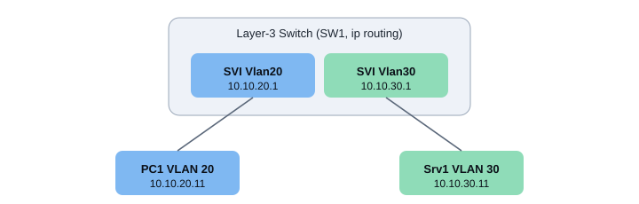

*شکل ۱: Gateway داخل خود سوییچ؛ ترافیک بین VLANها هیچ‌وقت سوییچ را ترک نمی‌کند.*

### ۲. شرط Up شدن SVI (مهم‌ترین نکته)

SVI فقط وقتی `up/up` می‌شود که همه‌ی شرط‌های زیر برقرار باشند:

1.  VLAN روی سوییچ ساخته شده باشد (`show vlan brief`).
2.  حداقل یک پورت لایه‌ی ۲ در آن VLAN فعال باشد: لینک Up **و در حالت STP Forwarding** (Access Port بالا، یا Trunk که VLAN را عبور می‌دهد). طبق مستند Cisco، تنظیم `switchport autostate exclude` یک پورت را از این محاسبه خارج می‌کند؛ اگر آن پورت تنها پورت VLAN باشد SVI down می‌ماند.
3.  SVI با `no shutdown` روشن شده باشد.

> **TS09: SVI Down/Down**
>
> اگر VLAN 30 هیچ پورت فعالی ندارد، `Vlan30` در حالت down/down می‌ماند و Gateway آن VLAN کار نمی‌کند، حتی اگر آدرس درست باشد. اول پورت را بالا بیاورید.

### ۳. مقایسه‌ی RoAS و SVI

| معیار       | Router-on-a-Stick        | SVI (L3 Switch) |
|-------------|--------------------------|-----------------|
| محل Gateway | روتر بیرونی              | خود سوییچ       |
| تعداد کابل  | یک Trunk                 | بدون کابل اضافه |
| سرعت        | محدود به لینک و CPU روتر | سخت‌افزاری، سریع |
| گلوگاه      | دارد (یک لینک)           | ندارد           |
| مناسب برای  | شعبه‌ی کوچک               | هسته‌ی سازمان    |

### ۴. دستورها (خط‌به‌خط)

``` text
SW1(config)# ip routing
SW1(config)# interface vlan 20
SW1(config-if)# ip address 10.10.20.1 255.255.255.0
SW1(config-if)# no shutdown
SW1(config-if)# interface vlan 30
SW1(config-if)# ip address 10.10.30.1 255.255.255.0
SW1(config-if)# no shutdown
SW1(config-if)# end
SW1# show ip interface brief
SW1# show ip route connected
```

- `ip routing`: سوییچ را از «فقط لایه ۲» به «مسیریاب» تبدیل می‌کند. بدون آن SVI آدرس دارد ولی بین VLANها Route نمی‌کند.
- `interface vlan 20`: SVI همان VLAN را می‌سازد (VLAN باید از قبل موجود باشد).
- `no shutdown`: SVI به‌طور پیش‌فرض خاموش است در بعضی نسخه‌ها؛ حتماً بزنید.

### ۵. مثال ساده: ping به SVI

``` text
PC1> ping 10.10.20.1    -> success (SVI Vlan20)
```

### ۶. مثال متوسط: ping بین VLAN

``` text
PC1> ping 10.10.30.11   -> success (routed inside SW1)
SW1# show ip route connected  -> 10.10.20.0/24 via Vlan20, 10.10.30.0/24 via Vlan30
```

### ۷. مثال سخت: TS09 و دو Gateway همزمان

``` text
Symptom   : Vlan30 shows down/down
Check     : show vlan brief          -> VLAN 30 has no active port
            show ip interface brief  -> Vlan30 down/down
Fix       : bring up Gi0/3 (the server port) or allow VLAN 30 on the trunk
Verify    : Vlan30 up/up, ping works

Conflict  : R1 Gi0/0.30 AND SW1 Vlan30 both = 10.10.30.1
Result    : duplicate IP, intermittent failures
Rule      : exactly one gateway per VLAN (shut down the other)
```

### ۸. تمرین‌ها

**ت1.** ۱ (ساده): ip routing برای چیست؟ *(پاسخ: 3-5-ت1 در بخش «پاسخ‌ها» انتهای فصل)*

**ت2.** ۲ (ساده): سه شرط Up شدن SVI *(پاسخ: 3-5-ت2 در بخش «پاسخ‌ها» انتهای فصل)*

**ت3.** ۳ (متوسط): VLAN 40 ساخته‌ایم و SVI دارد ولی down/down است؛ علت؟ *(پاسخ: 3-5-ت3 در بخش «پاسخ‌ها» انتهای فصل)*

**ت4.** ۴ (متوسط): چرا دو Gateway برای یک VLAN مشکل می‌سازد؟ *(پاسخ: 3-5-ت4 در بخش «پاسخ‌ها» انتهای فصل)*

**ت5.** ۵ (سخت): کدام روش برای ۱۰ گیگ ترافیک بین VLANها بهتر است و چرا؟ *(پاسخ: 3-5-ت5 در بخش «پاسخ‌ها» انتهای فصل)*

### ۹. Lab هدایت‌شده (Lab A: Gateway روی سوییچ)

#### گام ۱: خاموش‌کردن Gateway روتر برای VLAN 20 و 30

``` text
R1(config)# interface gi0/0.20
R1(config-subif)# shutdown
R1(config-subif)# interface gi0/0.30
R1(config-subif)# shutdown
```

#### گام ۲: SVIها روی SW1

دستورهای بخش ۴ را اجرا کنید و `show ip interface brief` را بگیرید؛ دو SVI باید up/up باشند.

#### گام ۳: تست

``` text
PC1> ping 10.10.20.1
PC1> ping 10.10.30.11    (routed inside SW1)
```

#### گام ۴: دیدن TS09

``` text
SW1(config)# interface gi0/3
SW1(config-if)# shutdown
SW1# show ip interface brief      -> Vlan30 down/down
SW1(config)# interface gi0/3
SW1(config-if)# no shutdown       -> Vlan30 up/up
```

#### گام ۵: برگشت به Capstone

برای Capstone اصلی (Gateway = فایروال) SVIهای 20 و 30 را `shutdown` کنید یا حذف کنید و فقط SVI مدیریت (VLAN10) بماند. تنظیمات را با `copy run start` ذخیره کنید.

### ۱۰. Lab مستقل

جدول مقایسه‌ی RoAS و SVI را از نتایج Lab خودتان (سرعت ping، Capture، تعداد Hop در trace) بسازید و در `03-ops/roas-vs-svi.md` ذخیره کنید.

### ۱۱. عیب‌یابی

|         |                                                                                                                                              |
|---------|----------------------------------------------------------------------------------------------------------------------------------------------|
| Symptom | Gateway جواب نمی‌دهد                                                                                                                          |
| چک‌لیست  | ۱) `ip routing` فعال است؟ ؛ ۲) SVI up/up است؟ ؛ ۳) VLAN پورت فعال دارد؟ ؛ ۴) Gateway تکراری روی روتر نیست؟ ؛ ۵) PC آدرس و Gateway درست دارد؟ |

### ۱۲. سؤال‌های مرور

**م1.** SVI چیست؟ *(پاسخ: 3-5-م1 در بخش «پاسخ‌ها» انتهای فصل)*

**م2.** چرا SVI down/down می‌شود؟ *(پاسخ: 3-5-م2 در بخش «پاسخ‌ها» انتهای فصل)*

### English Corner: انگلیسی تخصصی این درس

این جمله‌ها از مستندات و محیط کار واقعی‌اند. بلند بخوانید و ترجمه را بپوشانید.

| English sentence                                                  | ترجمه                                                        |
|-------------------------------------------------------------------|--------------------------------------------------------------|
| An SVI is the layer-3 gateway for a VLAN on a multilayer switch.  | SVI گیت‌وی لایه ۳ یک VLAN روی سوییچ چندلایه است.              |
| The SVI stays down until at least one port in the VLAN is active. | SVI تا وقتی دست‌کم یک پورت فعال در VLAN نباشد down می‌ماند.    |
| Enable ip routing to route between VLANs on the switch.           | برای مسیریابی بین VLANها روی سوییچ، ip routing را فعال کنید. |
| Never configure two gateways for the same VLAN.                   | هرگز دو Gateway برای یک VLAN تنظیم نکنید.                    |

**Q1.** Quick quiz (answer in English): When does an SVI come up? *(پاسخ: 3-5-Q1 در بخش «پاسخ‌ها» انتهای فصل)*

### ۱۳. تکلیف و چک‌لیست تسلط

- [ ] SVI را بالا بیاورم و ping بین VLANها بگیرم.
- [ ] TS09 را بسازم و رفع کنم.
- [ ] پیکربندی را به حالت Capstone اصلی برگردانم.

### ۱۴. یادآوری اشتباهات شما

> **یادآوری**
>
> دو Gateway هم‌زمان ممنوع؛ بکاپ قبل از تغییر؛ پذیرفته‌شدن دستور ≠ کار کردن.


#### کارت Lab — درس ۳-۵ (Lab A مقدماتی)

| # | فیلد | محتوا |
|---|---|---|
| 1 | عنوان و هدف | Gateway روی SVI و شرط Up |
| 2 | پیش‌نیاز | درس ۳-۴ |
| 3 | توپولوژی | SW1 با SVI 20/30 |
| 4 | تجهیزات | SW1، ۲ VPCS |
| 5 | نسخه نرم‌افزار | vIOS-L2 15.2(20200924، Experimental) برای SW؛ vIOS 15.9(3)M9 برای R؛ VPCS (PNetLab)؛ PNetLab 4.2.8 |
| 6 | IP Plan | 10.10.20.1/24 و 10.10.30.1/24 |
| 7 | وضعیت اولیه | Sub-interfaceهای R1 shutdown |
| 8 | صورت مسئله | `ip routing`، SVI و ping بین VLAN؛ ایجاد SVI Down/Down |
| 9 | مراحل هدایت‌شده | همان بخش «Lab هدایت‌شده» همین درس (گام‌به‌گام) |
| 10 | تست عملکرد | `show ip interface brief` ؛ ping |
| 11 | سناریوی خرابی | shutdown پورت‌های VLAN 30 (TS09) |
| 12 | روش عیب‌یابی | `show vlan brief` و پورت فعال VLAN |
| 13 | نتیجه‌ی مورد انتظار | Vlan up/up؛ ping موفق |
| 14 | معیار پذیرش | TS09 ساخته و رفع شود |
| 15 | مستندات نهایی | `03-ops/roas-vs-svi.md` |
| 16 | Cleanup و بازگردانی | برگشت به معماری اصلی (Gateway روی FortiGate): SVI 20/30 shutdown |

> **وضعیت راستی‌آزمایی (خارج از ۱۶ فیلد):** **جزئی.** `ip routing` و SVI up/up Tested-OK؛ سناریوی TS09 و ping بین VLAN اجرا نشده.

---

<a id="l-3-6"></a>

## درس ۳-۶ — عیب‌یابی و آزمون هفته

**فصل ۳ - روز ۶ · پیش‌نیاز: درس‌های ۳-۱ تا ۳-۵ · ۶ ساعت**

### این درس درباره چیست و چرا باید یاد بگیریم؟

**چه چیزی یاد می‌گیریم:** روش سیستماتیک عیب‌یابی شبکه (از لایه ۱ به بالا)، پنج سناریوی خرابی TS01 تا TS05، و آزمون عملی کوچک پایان هفته‌ی ۳.

**چرا لازم است:** ادمین خوب کسی نیست که همه‌چیز را حفظ است، کسی است که با روش، خرابی را سریع پیدا می‌کند. اگر «حدس» بزنید، ساعت‌ها هدر می‌دهید؛ اگر «لایه‌به‌لایه» بروید، اغلب در چند دقیقه علت را پیدا می‌کنید.

- **در کار روزانه:** ۸۰٪ تماس‌های پشتیبانی شبکه از لایه ۱ و ۲ است: کابل، پورت، VLAN.
- **در امنیت:** روش سیستماتیک جلوی «تغییر عجولانه» را می‌گیرد که خودش سبب خرابی جدید می‌شود.
- **در مصاحبه:** «چطور عیب‌یابی می‌کنید؟» سؤال ثابت هر مصاحبه است.

> **مسیر درس**
>
> روش لایه‌به‌لایه ← پنج سناریوی TS ← مثال ساده/متوسط/سخت ← تمرین ← Lab عیب‌یابی ← آزمون کوچک.

#### اصطلاحات این درس (مخفف ← شکل کامل ← معنی)

| مخفف        | شکل کامل انگلیسی         | معنی فارسی                                 |
|-------------|--------------------------|--------------------------------------------|
| TS          | Troubleshooting Scenario | سناریوی عیب‌یابی شماره‌دار دوره              |
| RCA         | Root Cause Analysis      | تحلیل علت ریشه‌ای                           |
| Duplex      | Duplex mode              | Half یا Full؛ حالت ارسال/دریافت همزمان     |
| Err-disable | Error-disabled           | پورتی که سوییچ آن را به‌خاطر خطا خاموش کرده |
| CDP         | Cisco Discovery Protocol | کشف همسایه‌های سیسکو                        |
| L1/L2/L3    | Layer 1/2/3              | فیزیکی / پیوند داده / شبکه                 |

### ۱. روش سیستماتیک: از پایین به بالا

مثل بررسی خرابی یک ماشین: اول ببین بنزین دارد (لایه ۱)، بعد استارت می‌خورد (لایه ۲)، بعد جاده را بلد است (لایه ۳). از پایین شروع کنید چون اگر کابل قطع باشد، بقیه‌ی چیزها بی‌معنی است.

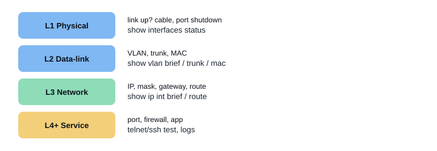

*شکل ۱: نردبان عیب‌یابی؛ از لایه ۱ شروع کنید و فقط وقتی لایه پایین سالم بود بالاتر بروید.*

#### چارچوب پنج‌مرحله‌ای

1.  **Symptom:** دقیقاً چه چیزی خراب است و برای چه کسی؟ (علامت، نه حدس)
2.  **Scope:** چند نفر؟ یک VLAN؟ همه؟
3.  **Hypothesis:** از پایین‌ترین لایه، یک فرضیه بساز.
4.  **Test:** با یک دستور show آن را بسنج.
5.  **Fix and Verify:** رفع، تأیید، ثبت در گزارش (RCA).

### ۲. پنج سناریوی این هفته

#### TS01: Interface Shutdown (ساده)

``` text
Symptom  : PC on Gi0/1 has no link
Evidence : show interfaces status -> Gi0/1 disabled / administratively down
Fix      : interface gi0/1 / no shutdown
Verify   : link up, ping works
```

#### TS02: Duplex/Speed Mismatch (مفهومی)

``` text
Symptom  : link is up but very slow, many CRC/late collisions
Cause    : one side half-duplex, the other full-duplex
Check    : show interfaces gi0/1 -> duplex, speed, errors
Fix      : set both sides to auto (or both manually identical)
```

در شبیه‌ساز، تنظیم Duplex ممکن است اثر واقعی نداشته باشد؛ این سناریو را مفهومی بدانید و در تجهیز واقعی تمرین کنید.

#### TS03: VLAN اشتباه روی Access Port

``` text
Symptom  : PC cannot reach its gateway
Evidence : show vlan brief -> port is in the wrong VLAN
Fix      : switchport access vlan 20
```

#### TS04: Allowed VLAN حذف‌شده روی Trunk

``` text
Symptom  : one VLAN lost across the trunk
Evidence : show interfaces trunk -> VLAN missing in "allowed"
Fix      : switchport trunk allowed vlan add 30
```

#### TS05: Human Error — جایگزینی Allowed List

``` text
Cause    : "allowed vlan 40" typed without "add"
Impact   : all VLANs except 40 are down on the trunk
Fix      : restore from backup or re-add: allowed vlan 10,20,30,40
Lesson   : always "add"; backup + review show before and after
```

### ۳. مثال ساده/متوسط/سخت

#### ساده

کاربر می‌گوید «شبکه قطع است». اول `show interfaces status`: اگر پورت `disabled` است، TS01.

#### متوسط

کاربر به سرور نمی‌رسد ولی به Gateway می‌رسد. لایه ۱ و ۲ سالم است؛ پس `show ip route` و Gateway سرور را ببینید (لایه ۳).

#### سخت

«فقط VLAN 30 از شعبه قطع است، بقیه خوب». نردبان: لینک Trunk up است (L1)، VLAN 30 در allowed نیست (L2) ⇒ TS04. در RCA: چه کسی/کی/چرا تغییر داد؟ چطور جلوگیری شود؟

### ۴. تمرین‌ها

**ت1.** ۱ (ساده): اولین لایه‌ای که چک می‌کنیم چیست؟ *(پاسخ: 3-6-ت1 در بخش «پاسخ‌ها» انتهای فصل)*

**ت2.** ۲ (ساده): پنج مرحله‌ی چارچوب عیب‌یابی را بنویس *(پاسخ: 3-6-ت2 در بخش «پاسخ‌ها» انتهای فصل)*

**ت3.** ۳ (متوسط): «ping به Gateway OK ولی به اینترنت نه»؛ کدام لایه؟ *(پاسخ: 3-6-ت3 در بخش «پاسخ‌ها» انتهای فصل)*

**ت4.** ۴ (سخت): یک Trunk بعد از «allowed vlan 40» همه را قطع کرد؛ سه اقدام بعدی *(پاسخ: 3-6-ت4 در بخش «پاسخ‌ها» انتهای فصل)*

### ۵. Lab هدایت‌شده: همه‌ی TSها را بسازید و رفع کنید

برای هر سناریو: (۱) بکاپ، (۲) خراب‌کردن عمدی، (۳) نوشتن Symptom و Evidence، (۴) رفع، (۵) Verify.

1.  TS01: `shutdown` روی پورت PC1 و رفع.
2.  TS03: بردن پورت PC2 به VLAN اشتباه و رفع.
3.  TS04: `allowed vlan remove 30` روی Trunk و رفع با `add 30`.
4.  TS05: `allowed vlan 40` (بدون add)، سپس برگرداندن از بکاپ.
5.  TS09: `shutdown` پورت سرور و دیدن SVI down/down.

### ۶. آزمون کوچک پایان هفته‌ی ۳ (بدون نگاه به درس)

| \#  | وظیفه                                | مدرک                      |
|-----|--------------------------------------|---------------------------|
| ۱   | MAC یک PC را به پورتش ربط بده        | show mac address-table    |
| ۲   | VLAN Matrix با ۳ VLAN و تنظیم پورت‌ها | show vlan brief           |
| ۳   | Trunk با Native 999 و Allowed        | show interfaces trunk     |
| ۴   | Inter-VLAN با RoAS یا SVI            | ping بین VLANها + Capture |
| ۵   | ۳ سناریو از TS01 تا TS05 با RCA      | گزارش یک‌صفحه‌ای            |

معیار قبولی: حداقل ۴ از ۵ مورد با مدرک. وقتی تمام شد بگویید «فصل ۳ انجام شد».

(آزمون رسمی Gate G2 در پایان فصل ۴ بعد از STP و EtherChannel است.)

### ۷. سؤال‌های مرور

**م1.** چرا از لایه ۱ شروع می‌کنیم؟ *(پاسخ: 3-6-م1 در بخش «پاسخ‌ها» انتهای فصل)*

**م2.** تفاوت TS04 و TS05؟ *(پاسخ: 3-6-م2 در بخش «پاسخ‌ها» انتهای فصل)*

### English Corner: انگلیسی تخصصی این درس

این جمله‌ها از مستندات و محیط کار واقعی‌اند. بلند بخوانید و ترجمه را بپوشانید.

| English sentence                                               | ترجمه                                                                    |
|----------------------------------------------------------------|--------------------------------------------------------------------------|
| Always start troubleshooting at layer 1 and work your way up.  | عیب‌یابی را همیشه از لایه ۱ شروع کنید و بالا بروید.                       |
| The interface is administratively down.                        | Interface به‌صورت مدیریتی خاموش است.                                      |
| Document the root cause and the fix in the RCA.                | علت ریشه‌ای و راه‌حل را در RCA مستند کنید.                                 |
| A typo in the allowed VLAN list can take down the whole trunk. | یک اشتباه تایپی در لیست VLANهای مجاز می‌تواند کل Trunk را از کار بیندازد. |

**Q1.** Quick quiz (answer in English): What are the five steps of the troubleshooting framework? *(پاسخ: 3-6-Q1 در بخش «پاسخ‌ها» انتهای فصل)*

### ۸. تکلیف و چک‌لیست تسلط

- [ ] پنج TS را ساخته و رفع کنم و گزارش RCA بنویسم.
- [ ] آزمون کوچک را کامل کنم.
- [ ] پیکربندی پایانی را ذخیره و بکاپ بگیرم.

### ۹. یادآوری اشتباهات شما

> **یادآوری**
>
> حدس نزنید؛ لایه‌به‌لایه بروید. بکاپ قبل از تغییر. هر نتیجه‌ی واقعی را ثبت کنید.


#### کارت Lab — درس ۳-۶

| # | فیلد | محتوا |
|---|---|---|
| 1 | عنوان و هدف | عیب‌یابی TS01..TS05 و آزمون کوچک |
| 2 | پیش‌نیاز | درس‌های ۳-۱ تا ۳-۵ |
| 3 | توپولوژی | همان توپولوژی درس‌های قبل |
| 4 | تجهیزات | SW1، SW2، R1، VPCS |
| 5 | نسخه نرم‌افزار | vIOS-L2 15.2(20200924، Experimental) برای SW؛ vIOS 15.9(3)M9 برای R؛ VPCS (PNetLab)؛ PNetLab 4.2.8 |
| 6 | IP Plan | طبق درس‌های قبل |
| 7 | وضعیت اولیه | بکاپ تنظیمات سالم |
| 8 | صورت مسئله | هر TS را بسازید، Symptom/Evidence/Fix/Verify/RCA بنویسید |
| 9 | مراحل هدایت‌شده | همان بخش «Lab هدایت‌شده» همین درس (گام‌به‌گام) |
| 10 | تست عملکرد | ping، show vlan/trunk، show ip route |
| 11 | سناریوی خرابی | پنج TS (shutdown، VLAN اشتباه، allowed حذف‌شده، allowed بدون add، SVI down) |
| 12 | روش عیب‌یابی | لایه‌ای L1→L3 |
| 13 | نتیجه‌ی مورد انتظار | هر TS با RCA رفع |
| 14 | معیار پذیرش | حداقل ۴ از ۵ مورد با مدرک |
| 15 | مستندات نهایی | `03-ops/rca-w3.md` |
| 16 | Cleanup و بازگردانی | بازگردانی از بکاپ سالم |

> **وضعیت راستی‌آزمایی (خارج از ۱۶ فیلد):** **اجرا نشده (فقط طراحی).** اجرا نشده؛ TS01 تا TS05 هنوز روی Image ساخته نشده‌اند.

---

<a id="ans-3"></a>

<a id="l-3-7"></a>

## درس 3-7 — PoE و تنظیم پورت سوییچ برای دستگاه‌های لبه (تلفن IP، Access Point، دوربین)

**فصل 3 · درس افزوده برای انطباق با سرفصل رسمی CCNA 200-301 (مورد 2.2: Configure Layer 2 switch port attributes for edge-host connectivity) · پیش‌نیاز: ۳-۱ تا ۳-۵**

> **وضعیت:** نظری/مستندی؛ دستورها `Unverified` و Lab اجرا نشده. خروجی‌های نمونه برای آموزش‌اند، نه اندازه‌گیری واقعی.

### ۱) این درس درباره چیست و چرا باید یاد بگیریم؟

**چه چیزی یاد می‌گیریم:** PoE (Power over Ethernet، یعنی «برق از روی کابل شبکه») چیست، استانداردهایش چه فرقی دارند، سوییچ چطور بودجه‌ی توان را مدیریت می‌کند و چطور پورت را برای هر نوع دستگاه لبه (کامپیوتر، چاپگر، تلفن IP، Access Point، دوربین) تنظیم می‌کنیم.

**چرا لازم است؟** تصور کنید ۴۰ تلفن IP و ۱۰ Access Point در یک ساختمان نصب می‌کنید. اگر هر کدام آداپتور برق جدا بخواهند، ۵۰ پریز، ۵۰ کابل برق و ۵۰ نقطه‌ی خرابی اضافه می‌شود. PoE یک کابل برای هر دو کار است. ولی برق «خرج» دارد: سوییچ بودجه‌ی محدودی دارد و اگر بیش از آن مصرف شود، پورت‌ها خاموش می‌شوند. مهندسی که بودجه را حساب نکرده باشد، روز نصب Access Point دهم می‌فهمد که پورت‌ها بالا نمی‌آیند.

### ۲) توضیح از پایه

#### ۲-۱) دو نقش: PSE و PD

- **PSE** = Power Sourcing Equipment، یعنی «تجهیز منبع برق»؛ همان سوییچ (یا Injector).
- **PD** = Powered Device، یعنی «دستگاه برق‌گیر»؛ تلفن، AP، دوربین.

سوییچ برق را بدون پرسیدن ارسال نمی‌کند؛ چون ممکن است کامپیوتر معمولی وصل شود و بسوزد. مراحل:

1. **Detection:** سوییچ ولتاژ کم می‌فرستد و مقاومت مشخصه‌ی PD (حدود 25 کیلواهم) را می‌سنجد.
2. **Classification:** PD با «کلاس» خود می‌گوید چه توانی لازم دارد.
3. **Power-up:** سوییچ برق را وصل می‌کند.
4. **Monitoring:** اگر دستگاه جدا شود یا اضافه‌بار شود، برق قطع می‌شود.

#### ۲-۲) استانداردهای IEEE

| استاندارد | نام رایج | حداکثر توان در PSE | حداکثر توان قابل‌استفاده در PD |
|---|---|---|---|
| 802.3af | PoE (Type 1) | 15.4 W | 12.95 W |
| 802.3at | PoE+ (Type 2) | 30 W | 25.5 W |
| 802.3bt Type 3 | PoE++ / 4PPoE | 60 W | 51 W |
| 802.3bt Type 4 | PoE++ | 100 W | 71.3 W |

نکته‌ی مهم: اختلاف ستون دوم و سوم «تلفات کابل» است. برای طراحی، توان **PD** را معیار بگیرید و بودجه را بر اساس توان **PSE** حساب کنید.

سیسکو دو برند اختصاصی هم دارد: UPOE (تا 60 W) و UPOE+ (تا 90 W)؛ مقادیر دقیق را از دیتاشیت مدل بخوانید.

#### ۲-۳) کلاس‌ها

کلاس‌های PD از 0 تا 8 هستند و هر کلاس سقف توان مشخصی دارد (مثلاً کلاس 3: 15.4 W در PSE). اگر سوییچ کلاس را نداند، به‌صورت پیش‌فرض بر اساس کلاس عمل می‌کند و ممکن است بیش از نیاز واقعی بودجه رزرو کند.

#### ۲-۴) بودجه‌ی توان (Power Budget)

``` text
Total PoE budget      = switch PoE power supply capacity (e.g. 370 W)
Allocated per port    = by class (default) or by actual consumption (if enabled)
Remaining budget      = Total - sum of allocated
```

اگر مجموع نیاز از بودجه بیشتر شود، سوییچ پورت‌های جدید را (طبق اولویت و ترتیب) برق نمی‌دهد.

### ۳) دستورهای سیسکو (Unverified)

``` text
interface GigabitEthernet1/0/5
 switchport mode access
 switchport access vlan 20
 power inline auto
 power inline max 15400
 spanning-tree portfast
```

- `power inline auto`: Detection و تأمین برق خودکار (پیش‌فرض).
- `power inline never`: برق هرگز ارسال نشود (مثلاً پورت چاپگر).
- `power inline static max 15400`: رزرو ثابت (میلی‌وات) برای PD‌هایی که کلاس درست اعلام نمی‌کنند.
- `power inline max <mW>`: سقف توان این پورت.

``` text
show power inline
show power inline GigabitEthernet1/0/5 detail
show power inline module 1
```

خروجی نمونه (آموزشی):

``` text
Available:370.0(w)  Used:96.5(w)  Remaining:273.5(w)
Interface Admin  Oper       Power   Device              Class Max
                             (Watts)
Gi1/0/5   auto   on         15.4    Cisco IP Phone 8845  4     30.0
Gi1/0/6   auto   on         25.5    AIR-AP2802I          4     30.0
Gi1/0/7   auto   off        0.0     n/a                  n/a   30.0
```

### ۴) مثال‌های حل‌شده از ساده به سخت

**ساده — تلفن + کامپیوتر پشت تلفن.** تلفن IP به پورت سوییچ وصل است و کامپیوتر به تلفن. پورت باید Access برای Data VLAN و Voice VLAN باشد:

``` text
interface GigabitEthernet1/0/10
 switchport mode access
 switchport access vlan 20
 switchport voice vlan 120
 power inline auto
 spanning-tree portfast
```

سوییچ با CDP/LLDP-MED به تلفن می‌گوید Voice VLAN کدام است؛ ترافیک تلفن با Tag 120 و کامپیوتر بدون Tag.

**متوسط — محاسبه‌ی بودجه.** سوییچ 24 پورت با بودجه 370 W. ۱۲ تلفن (هرکدام 7 W واقعی ولی کلاس 2 با رزرو 7 W) و ۸ AP (هرکدام 25.5 W).

``` text
Phones : 12 x 7.0   =  84.0 W
APs    :  8 x 25.5  = 204.0 W
Total  = 84.0 + 204.0 = 288.0 W
Remaining = 370 - 288 = 82 W
```

باقی‌مانده 82 W؛ برای ۲ AP دیگر (51 W) کافی است ولی برای ۴ AP (102 W) نه.

مراحل: ۱) هر گروه دستگاه را جمع بزنید ۲) از بودجه کم کنید ۳) حاشیه‌ی 20٪ بگذارید (370 × 0.2 = 74 W) ⇒ استفاده‌ی امن حداکثر 296 W.

**سخت — تلفن Class 4 ولی «بالا نمی‌آید».** علامت: Gi1/0/12 در حالت `off` و Log:

``` text
%ILPOWER-3-CONTROLLER_PORT_ERR: Controller port error, Interface Gi1/0/12: Power Controller reports power Imax error detected
```

روش عیب‌یابی:

1. `show power inline Gi1/0/12 detail` ⇒ کلاس و توان درخواستی.
2. اگر دستگاه بیش از `power inline max` می‌خواهد ⇒ سقف را افزایش دهید.
3. با کابل و تلفن دیگر آزمایش کنید (کابل خراب مقاومت زیاد می‌دهد).
4. اگر بودجه تمام شده ⇒ `show power inline` را ببینید.

### ۵) Lab (اجرا نشده)

۱) یک سوییچ با PoE و یک تلفن/AP. ۲) `show power inline` را ثبت کنید. ۳) `power inline never` و تأیید قطع برق. ۴) سقف توان را کم کنید و علامت را مشاهده کنید.

### ۶) اصطلاحات این درس

| اصطلاح | شکل کامل | معنی |
|---|---|---|
| PoE | Power over Ethernet | برق از روی کابل شبکه |
| PSE | Power Sourcing Equipment | منبع برق (سوییچ) |
| PD | Powered Device | دستگاه برق‌گیر |
| IEEE | Institute of Electrical and Electronics Engineers | نهاد استاندارد |
| LLDP-MED | Link Layer Discovery Protocol – Media Endpoint Discovery | تبادل VLAN و توان با تلفن |
| UPOE | Universal PoE | PoE سیسکو تا 60 W |

### ۷) تمرین‌ها

**ت1.** (ساده) PSE و PD را تعریف کنید. *(پاسخ: 3-7-ت1 در بخش «پاسخ‌ها» انتهای فصل)*

**ت2.** (ساده) تفاوت 802.3af و 802.3at از نظر توان چیست؟ *(پاسخ: 3-7-ت2 در بخش «پاسخ‌ها» انتهای فصل)*

**ت3.** (متوسط) سوییچ با بودجه 740 W دارید؛ ۲۰ AP با 25.5 W و ۳۰ تلفن با 7 W. بودجه کافی است؟ *(پاسخ: 3-7-ت3 در بخش «پاسخ‌ها» انتهای فصل)*

**ت4.** (سخت) AP روی پورت بالا نمی‌آید؛ چهار گام عیب‌یابی را بنویسید. *(پاسخ: 3-7-ت4 در بخش «پاسخ‌ها» انتهای فصل)*

### ۸) English Corner

- *The switch acts as the power sourcing equipment and the phone is the powered device.* سوییچ منبع برق و تلفن دستگاه برق‌گیر است.
- *Check the PoE budget before adding more access points.*
- **Q1.** What does `power inline never` do? *(پاسخ: 3-7-Q1 در بخش «پاسخ‌ها» انتهای فصل)*

---

<a id="l-3-8"></a>

## درس 3-8 — لایه‌ی ۱ در عمل: کابل مسی، فیبر، وضعیت Interface و خواندن شمارنده‌های خطا

**فصل 3 · درس افزوده برای سرفصل رسمی CCNA 200-301 (مورد 1.1: Diagnose interface and cable issues such as collisions, errors, mismatched duplex, speed, distance, interface, signal levels, pin out, and cable types) · پیش‌نیاز: ۳-۰**

> **وضعیت:** نظری/مستندی؛ دستورها `Unverified`؛ خروجی‌ها نمونه‌ی آموزشی‌اند؛ Lab اجرا نشده.

### ۱) این درس درباره چیست و چرا باید یاد بگیریم؟

**چه چیزی یاد می‌گیریم:** انواع کابل (مس و فیبر)، قواعد Pinout، معنی هر وضعیت Interface (`up/up`، `down/down` و ...)، و اینکه شمارنده‌هایی مثل CRC، Runt، Giant و Late Collision هر کدام چه علتی را نشان می‌دهند.

**چرا لازم است؟** بیش از نیمی از «شبکه کند است» و «پورت بالا نمی‌آید» ریشه‌ی فیزیکی دارد: کابل بد، کانکتور شل، فیبر برعکس، یا Duplex ناهمخوان. اگر لایه‌ی ۱ را نشناسید، ساعت‌ها Routing و Policy را بررسی می‌کنید در حالی که علت یک کابل است. قاعده‌ی عیب‌یابی: **از پایین شروع کنید.**

### ۲) توضیح از پایه

#### ۲-۱) کابل مسی UTP

UTP = Unshielded Twisted Pair، یعنی «زوج سیم تابیده‌ی بدون شیلد»؛ چهار زوج (۸ سیم).

| دسته | سرعت/فاصله‌ی معمول | نکته |
|---|---|---|
| Cat5e | تا 1 Gbps، حداکثر 100 متر | حداقل امروزی |
| Cat6 | تا 1 Gbps تا 100 m؛ 10 Gbps در فاصله‌ی کوتاه (حدود 55 m) | |
| Cat6a | 10 Gbps تا 100 m | |

**قاعده‌ی 100 متر:** حداکثر طول یک «Link» اترنت مسی 100 متر است (۹۰ متر کابل ثابت + ۱۰ متر پچ‌کورد). از این بیشتر ⇒ تضعیف، خطا، Late Collision. راه‌حل: سوییچ میانی یا فیبر.

#### ۲-۲) Pinout: T568A و T568B

ترتیب سیم‌ها از پین ۱ تا ۸:

``` text
T568A: 1 white-green, 2 green, 3 white-orange, 4 blue, 5 white-blue, 6 orange, 7 white-brown, 8 brown
T568B: 1 white-orange, 2 orange, 3 white-green, 4 blue, 5 white-blue, 6 green, 7 white-brown, 8 brown
```

- **Straight-through:** دو سر یک استاندارد (هر دو T568B). برای دو دستگاه «غیرمشابه»: PC ⇄ سوییچ، روتر ⇄ سوییچ.
- **Crossover:** یک سر T568A و سر دیگر T568B. برای دستگاه‌های «مشابه»: سوییچ ⇄ سوییچ، PC ⇄ PC.
- **Rollover:** کابل کنسول (ترتیب معکوس).

چرا Crossover؟ در Fast Ethernet (10/100) پین‌های 1 و 2 ارسال و 3 و 6 دریافت هستند. اگر دو سوییچ مستقیم وصل شوند، ارسال هر دو به ارسال دیگری می‌خورد؛ Crossover ارسال را به دریافت وصل می‌کند.

``` text
10/100BASE-TX : uses pins 1,2 (TX) and 3,6 (RX)
1000BASE-T    : uses all 4 pairs (8 pins), bidirectional on each pair
```

**Auto-MDIX:** سوییچ‌های امروزی خودکار جهت را تشخیص می‌دهند؛ پس Crossover معمولاً لازم نیست. روی IOS قدیمی: `mdix auto` (روی Interface).

#### ۲-۳) فیبر نوری

| نوع | هسته | فاصله | نمونه |
|---|---|---|---|
| Multimode (MMF) | 50/125 µm (OM3/OM4) | کوتاه، صدها متر | 1000BASE-SX، 10GBASE-SR |
| Single-mode (SMF) | 9/125 µm (OS2) | ده‌ها کیلومتر | 1000BASE-LX، 10GBASE-LR |

قواعد: SX/SR = Multimode و فاصله‌ی کوتاه؛ LX/LR = Single-mode و فاصله‌ی بلند. فیبر **جفت** است: یک رشته Tx و یک رشته Rx؛ Tx یک سمت باید به Rx سمت دیگر برسد. شایع‌ترین خطا: برعکس‌بودن جفت فیبر (Tx-Tx). مبدل‌ها: SFP (1G)، SFP+ (10G)، با کانکتور LC/SC. نوع فیبر و نوع SFP باید هماهنگ باشد (SX روی SMF یا LX روی MMF کوتاه، خطا و افت می‌دهد).

سطح سیگنال نوری با DOM (Digital Optical Monitoring) خوانده می‌شود:

``` text
show interfaces transceiver detail
```

عدد Rx Power (dBm) باید بین آستانه‌های Low/High همان خروجی باشد؛ آستانه‌ها برای هر ماژول متفاوت‌اند و از خود دستور خوانده می‌شوند. Rx خیلی کم ⇒ فیبر کثیف/خم‌شده/فاصله‌ی زیاد؛ خیلی زیاد ⇒ نیاز به Attenuator در لینک کوتاه با ماژول قوی.

#### ۲-۴) وضعیت Interface

``` text
show interfaces status
show ip interface brief
```

| Status / Protocol | معنی | علت رایج |
|---|---|---|
| administratively down / down | با `shutdown` خاموش شده | پیکربندی |
| down / down | لایه‌ی ۱ برقرار نیست | کابل، پورت، دستگاه مقابل خاموش، فیبر Tx/Rx |
| up / down | لایه‌ی ۱ برقرار، لایه‌ی ۲ نه | Encapsulation/Keepalive/Clocking (سریال) |
| up / up | سالم | — |
| err-disabled | امنیت/خطا پورت را بست | Port Security، BPDU Guard، Storm Control |

#### ۲-۵) Speed و Duplex

Auto-Negotiation سرعت و Duplex را بین دو سر هماهنگ می‌کند. قاعده: **هر دو سر Auto یا هر دو دستی با مقدار یکسان**. اگر یک سر دستی (مثلاً 100/full) و دیگری Auto باشد، سر Auto سرعت را حس می‌کند ولی Duplex را نمی‌تواند بفهمد و معمولاً Half می‌گذارد ⇒ **Duplex Mismatch**.

علامت Duplex Mismatch: لینک بالا است ولی کند است، سمت Half شمارنده‌ی Late Collision و سمت Full شمارنده‌ی CRC/Runt بالا می‌رود. Gigabit بدون Auto-Negotiation کار نمی‌کند.

#### ۲-۶) شمارنده‌های خطا

``` text
show interfaces GigabitEthernet0/1
show interfaces counters errors
clear counters GigabitEthernet0/1
```

| شمارنده | معنی | علت محتمل |
|---|---|---|
| CRC | فریم با Checksum خراب | کابل/کانکتور بد، تداخل، Duplex Mismatch |
| Runts | فریم کوچک‌تر از 64 بایت | Collision، Duplex Mismatch |
| Giants | فریم بزرگ‌تر از حد (1518/1522 بدون Jumbo) | MTU متفاوت، دستگاه خراب |
| Collisions | برخورد (فقط Half-duplex) | در Full-duplex نباید باشد |
| Late Collision | برخورد بعد از 64 بایت اول | کابل بیش از 100 m یا Duplex Mismatch |
| Input errors | جمع خطاهای ورودی | — |
| Output drops | بسته‌ی دور ریخته در صف خروجی | ازدحام (QoS) |
| Interface resets | ریست‌های لینک | Keepalive، کابل ناپایدار |

**نکته:** شمارنده‌ها از آخر ریست تجمعی‌اند. اگر عدد بزرگ ولی ثابت است، خطای قدیمی است. `clear counters` بزنید و دوباره نگاه کنید؛ فقط افزایش جدید مهم است.

``` text
Error rate % = errors / total packets x 100
50 CRC errors in 1,000,000 packets -> 0.005 %   (usually negligible)
5,000 CRC errors in 1,000,000 packets -> 0.5 %  (investigate)
```

### ۳) دستور TDR (تست کابل مسی)

``` text
test cable-diagnostics tdr interface GigabitEthernet0/1
show cable-diagnostics tdr interface GigabitEthernet0/1
```

TDR = Time Domain Reflectometer؛ طول و وضعیت هر زوج (Open، Short) را می‌گوید. (روی همه‌ی مدل‌ها نیست.)

### ۴) مثال‌های حل‌شده از ساده به سخت

**ساده — `down/down`.** تازه کامپیوتر وصل شده ولی چراغ پورت خاموش و `show interfaces status` ⇒ `notconnect`. گام‌ها: ۱) کابل را به پورت دیگر ببرید ۲) کابل دیگر ۳) PC روشن است؟ ۴) نوع کابل (پچ‌کورد قدیمی خراب) ۵) سمت دیگر `shutdown`؟

**متوسط — CRC بالا.**

``` text
Gi0/3 is up, line protocol is up
  5 minute input rate 2000 bits/sec
  1,200,000 packets input, 1,800,000,000 bytes
  4,800 input errors, 4,800 CRC, 0 frame, 0 overrun
```

``` text
CRC rate = 4800 / 1200000 x 100 = 0.4 %
```

مراحل: ۱) `clear counters` ۲) پس از 10 دقیقه دوباره ببینید ۳) اگر CRC همچنان در حال افزایش است: کابل را عوض کنید ۴) کابل نزدیک کابل برق؟ ۵) طول کابل؟ ۶) اگر فیبر: DOM.

**سخت — Duplex Mismatch.** کاربر سرور شکایت دارد: انتقال فایل 3 Mbps روی لینک 100 Mbps.

``` text
SW1 Gi0/5 (set: speed 100, duplex full):   input errors 0, CRC 5200, runts 310
Server NIC (auto):   half-duplex, late collisions 4800
```

تحلیل: سوییچ دستی Full و سرور Auto ⇒ سرور Half دیده است. سمت Half Late Collision دارد؛ سمت Full دچار CRC/Runt. رفع: هر دو Auto (ترجیحاً) یا هر دو دستی یکسان.

``` text
interface GigabitEthernet0/5
 speed auto
 duplex auto
```

تأیید: `show interfaces Gi0/5` ⇒ `Full-duplex, 100Mb/s` و شمارنده‌های جدید صفر.

**سخت — فیبر بالا نمی‌آید.**

1. `show interfaces transceiver detail`: Rx Power سمت A: `-40 dBm` (No signal).
2. Tx سمت A خوب است ⇒ مشکل مسیر یا سمت B.
3. جفت را جابه‌جا کنید (Tx/Rx برعکس).
4. نوع SFP و فیبر را مقایسه کنید (SX/LX).
5. کانکتور را تمیز کنید؛ پس از آن Rx باید در محدوده باشد.

### ۵) Lab (اجرا نشده)

دو سوییچ؛ `speed 100` در یک سمت و Auto در سمت دیگر؛ شمارنده‌ها را ثبت و رفع کنید.

### ۶) اصطلاحات این درس

| اصطلاح | شکل کامل | معنی |
|---|---|---|
| UTP | Unshielded Twisted Pair | زوج تابیده‌ی بدون شیلد |
| MDI/MDIX | Medium Dependent Interface (Crossover) | ترتیب پین Tx/Rx |
| SFP | Small Form-factor Pluggable | ماژول قابل‌تعویض |
| DOM | Digital Optical Monitoring | پایش نوری دیجیتال |
| CRC | Cyclic Redundancy Check | بررسی خطای فریم |
| TDR | Time Domain Reflectometer | تست طول/خطای کابل |
| MMF/SMF | Multimode/Single-mode Fiber | فیبر چندمد/تک‌مد |

### ۷) تمرین‌ها

**ت1.** (ساده) حداکثر طول لینک اترنت مسی چند متر است؟ *(پاسخ: 3-8-ت1 در بخش «پاسخ‌ها» انتهای فصل)*

**ت2.** (ساده) برای اتصال دو سوییچ در حالت بدون Auto-MDIX کدام کابل؟ *(پاسخ: 3-8-ت2 در بخش «پاسخ‌ها» انتهای فصل)*

**ت3.** (متوسط) 900 خطای CRC در 600000 بسته؛ درصد خطا؟ *(پاسخ: 3-8-ت3 در بخش «پاسخ‌ها» انتهای فصل)*

**ت4.** (متوسط) `up/down` و `down/down` چه فرقی دارند؟ *(پاسخ: 3-8-ت4 در بخش «پاسخ‌ها» انتهای فصل)*

**ت5.** (سخت) سمت A: Late Collision، سمت B: CRC؛ تشخیص و رفع. *(پاسخ: 3-8-ت5 در بخش «پاسخ‌ها» انتهای فصل)*

### ۸) English Corner

- *Late collisions usually indicate a duplex mismatch or a cable that is too long.*
- *Set both ends to auto-negotiate, or hard-code both ends identically.*
- **Q1.** What does a down/down interface status indicate? *(پاسخ: 3-8-Q1 در بخش «پاسخ‌ها» انتهای فصل)*

---

<a id="l-3-9"></a>

## درس 3-9 — CDP و LLDP: کشف همسایه و اعتبارسنجی مستندات شبکه

**فصل 3 · درس افزوده برای سرفصل رسمی CCNA 200-301 (مورد 2.3: Validate the accuracy of network documentation using CDP and LLDP) · پیش‌نیاز: ۳-۱ تا ۳-۵**

> **وضعیت:** نظری/مستندی؛ دستورها `Unverified`؛ خروجی‌ها نمونه‌ی آموزشی‌اند؛ Lab اجرا نشده.

### ۱) این درس درباره چیست و چرا باید یاد بگیریم؟

**چه چیزی یاد می‌گیریم:** CDP و LLDP چه می‌کنند، چه اطلاعاتی می‌دهند، چطور فعال/غیرفعال می‌شوند و چطور با آنها نمودار شبکه را با واقعیت تطبیق می‌دهیم.

**چرا لازم است؟** سند شبکه مثل نقشه‌ی شهر است: ماه به ماه قدیمی می‌شود. یک همکار کابل را جابه‌جا می‌کند و کسی نقشه را اصلاح نمی‌کند. وقتی اتفاقی بیفتد، به نقشه‌ی غلط تکیه می‌کنید. CDP/LLDP به هر دستگاه اجازه می‌دهند «بپرسد» چه کسی کنارش وصل است. بنابراین به‌جای گشتن بین رک‌ها، با یک دستور واقعیت را می‌بینید. اما همین پروتکل‌ها اطلاعات حساس را به همسایه افشا می‌کنند و باید روی پورت‌های غیرقابل‌اعتماد خاموش شوند.

### ۲) توضیح از پایه

| ویژگی | CDP | LLDP |
|---|---|---|
| سازنده | اختصاصی Cisco | استاندارد IEEE 802.1AB (چندسازنده) |
| لایه | ۲ | ۲ |
| مقصد Multicast | 01:00:0C:CC:CC:CC | 01:80:C2:00:00:0E |
| ارسال (پیش‌فرض Cisco) | هر 60 ثانیه | هر 30 ثانیه |
| Holdtime پیش‌فرض | 180 ثانیه | 120 ثانیه |
| پیش‌فرض روی IOS | روشن | **خاموش** |

CDP = Cisco Discovery Protocol. LLDP = Link Layer Discovery Protocol. هر دو فقط به **همسایه‌ی مستقیم** اطلاع می‌دهند؛ از روتر عبور نمی‌کنند.

اطلاعاتی که می‌دهند: نام دستگاه، پورت محلی و پورت مقابل، مدل (Platform)، قابلیت‌ها (Router، Switch، Phone)، آدرس مدیریتی، نسخه‌ی نرم‌افزار، VLAN Native، Duplex و توان PoE.

LLDP-MED افزوده‌ای برای تلفن‌ها: Voice VLAN و توان.

### ۳) دستورها (Unverified)

``` text
! CDP (enabled by default)
show cdp
show cdp neighbors
show cdp neighbors detail
cdp run
no cdp run
interface GigabitEthernet0/24
 no cdp enable

! LLDP (disabled by default on IOS)
lldp run
show lldp
show lldp neighbors
show lldp neighbors detail
interface GigabitEthernet0/24
 lldp transmit
 lldp receive
 no lldp transmit
 no lldp receive
```

خروجی نمونه:

``` text
SW1# show cdp neighbors
Capability Codes: R - Router, S - Switch, H - Host, I - IGMP, r - Repeater, P - Phone
Device ID    Local Intrfce  Holdtme  Capability  Platform    Port ID
SW2          Gig 0/1        152      S I         WS-C3750X   Gig 1/0/24
R1           Gig 0/2        170      R S I       ISR4331     Gig 0/0/1
```

### ۴) مثال‌های حل‌شده از ساده به سخت

**ساده — خواندن.** سطر اول می‌گوید پورت `Gig 0/1` به `SW2` و پورت `Gig 1/0/24` آن وصل است. نقشه را بکشید: SW1 Gi0/1 ⇄ Gi1/0/24 SW2.

**متوسط — تطبیق نقشه.**

``` text
Document says : SW1 Gi0/2 -> R1 Gi0/0/0
CDP says      : SW1 Gi0/2 -> R1 Gi0/0/1
```

نتیجه: سند اشتباه است (یا کابل جابه‌جا شده). مراحل: ۱) `show cdp neighbors detail` برای تأیید ۲) بررسی Interface روتر (IP و VLAN) ۳) اصلاح سند ۴) ثبت در CHG.

**متوسط — دستگاه غیر Cisco.** سوییچ سیسکو و یک FortiGate/Switch دیگر: CDP پاسخ نمی‌دهد؛ `lldp run` روی سوییچ و فعال‌سازی LLDP روی دستگاه مقابل. (در FortiGate: `config system interface; edit port1; set lldp-reception enable; set lldp-transmission enable`; Unverified.)

**سخت — کشف دستگاه ناشناس.** `show cdp neighbors` روی پورت Gi0/18 دستگاهی با نام `Phone-ABC` و Capability `H P` نشان می‌دهد ولی در سند این پورت خالی است.

1. `show cdp neighbors Gi0/18 detail` ⇒ IP، مدل.
2. `show mac address-table interface Gi0/18` ⇒ MACها.
3. بررسی VLAN و PoE (`show power inline Gi0/18`).
4. اگر مجاز نیست: پورت خاموش و گزارش امنیتی.
5. اگر مجاز است: سند به‌روز شود.

**ریسک امنیتی:** CDP/LLDP اطلاعات مدل و نسخه را برای هر دستگاه متصل می‌فرستند. روی پورت‌های کاربران و Uplink به بیرون خاموش کنید؛ فقط بین زیرساخت و پورت تلفن/AP که لازم است نگه دارید.

### ۵) Lab (اجرا نشده)

سه سوییچ و دو روتر؛ نمودار را فقط با CDP بکشید و سپس با نقشه‌ی اصلی مقایسه کنید.

### ۶) اصطلاحات این درس

| اصطلاح | شکل کامل | معنی |
|---|---|---|
| CDP | Cisco Discovery Protocol | کشف همسایه‌ی Cisco |
| LLDP | Link Layer Discovery Protocol | کشف همسایه‌ی استاندارد |
| TLV | Type-Length-Value | قالب فیلد اطلاعات |
| MED | Media Endpoint Discovery | افزونه‌ی دستگاه انتهایی |

### ۷) تمرین‌ها

**ت1.** (ساده) CDP پیش‌فرض روشن است یا LLDP؟ *(پاسخ: 3-9-ت1 در بخش «پاسخ‌ها» انتهای فصل)*

**ت2.** (ساده) چرا LLDP برای شبکه‌ی چندسازنده مناسب‌تر است؟ *(پاسخ: 3-9-ت2 در بخش «پاسخ‌ها» انتهای فصل)*

**ت3.** (متوسط) سند با CDP همخوانی ندارد؛ سه گام. *(پاسخ: 3-9-ت3 در بخش «پاسخ‌ها» انتهای فصل)*

**ت4.** (سخت) چرا باید CDP روی پورت کاربران خاموش شود؟ *(پاسخ: 3-9-ت4 در بخش «پاسخ‌ها» انتهای فصل)*

### ۸) English Corner

- *CDP is Cisco proprietary, while LLDP is an open IEEE standard.*
- *Disable discovery protocols on ports facing untrusted devices.*
- **Q1.** Which command lists CDP neighbors? *(پاسخ: 3-9-Q1 در بخش «پاسخ‌ها» انتهای فصل)*

---

<a id="l-3-10"></a>

### بخش تکمیلی درس: سناریوی واقعی، مثال‌های بیشتر و عیب‌یابی

> بخش‌های زیر درس بالا را کامل می‌کنند: سناریوی گام‌به‌گام، مثال‌های بیشتر از ساده تا سخت، جدول عیب‌یابی و پرسش‌های مصاحبه. ابتدا بخش‌های اصلی بالا را مطالعه کنید.

### تکمیل عمیق: جدول عیب‌یابی سریع — CDP و LLDP

| علامت | شاهد برای بررسی | علت محتمل و رفع |
|---|---|---|
| همسایه‌ای دیده نمی‌شود | `show cdp neighbors` | CDP خاموش یا دستگاه غیر Cisco؛ `lldp run` |
| نقشه با CDP نمی‌خواند | `show cdp neighbors detail` | کابل جابه‌جا شده؛ اصلاح سند |
| همسایه LLDP نیست | `show lldp neighbors` | LLDP پیش‌فرض خاموش؛ فعال‌سازی دو سر |
| اطلاعات بیش‌ازحد افشا | پورت کاربران | خاموش‌کردن CDP/LLDP روی پورت غیرقابل‌اعتماد |

## درس 3-10 — عیب‌یابی لایه‌ی ۲ و ۳ با show، ping توسعه‌یافته، traceroute و Packet Capture

**فصل 3 · درس افزوده برای سرفصل رسمی CCNA 200-301 (مورد 2.4: Troubleshoot basic Layer 2/Layer 3 connectivity and device operations using show commands, show logs, ping, extended ping, traceroute and packet capture output) · پیش‌نیاز: ۳-۶، ۲-۴**

> **وضعیت:** نظری/مستندی؛ دستورها `Unverified`؛ خروجی‌ها نمونه‌ی آموزشی‌اند؛ Lab اجرا نشده.

### ۱) این درس درباره چیست و چرا باید یاد بگیریم؟

**چه چیزی یاد می‌گیریم:** پنج ابزار پایه‌ی هر مهندس شبکه: `show`، Log، `ping` (ساده و توسعه‌یافته)، `traceroute` و خروجی Capture؛ و اینکه هر کدام چه سؤالی را جواب می‌دهد.

**چرا لازم است؟** مثل پزشک: دماسنج، فشارسنج، عکس و آزمایش خون هرکدام چیزی می‌گویند. اگر فقط `ping` بزنید و جواب ندهد، نمی‌دانید مشکل کجاست. با ترکیب ابزارها، مشکل را مثل «تقسیم نصف» محدود می‌کنید.

### ۲) توضیح از پایه

| ابزار | سؤال | لایه |
|---|---|---|
| `show interfaces`، `show ip interface brief` | لینک و IP سالم است؟ | 1-3 |
| `show mac address-table`، `show arp` | دستگاه کجا یاد گرفته شد؟ IP↔MAC؟ | 2 |
| `show ip route` | مسیر کدام است؟ | 3 |
| `show logging` | چه رویدادی ثبت شده؟ | همه |
| `ping` | رسیدن به مقصد؟ | 3 |
| `ping` توسعه‌یافته | رسیدن از منبع/اندازه/DF مشخص؟ | 3 |
| `traceroute` | مسیر Hopها و محل قطع؟ | 3 |
| Packet Capture | واقعاً روی سیم چه بود؟ | 2-7 |

#### ۲-۱) ping ساده

ICMP Echo Request. نتیجه‌ها روی IOS:

| نماد | معنی |
|---|---|
| `!` | پاسخ دریافت شد |
| `.` | Timeout (پاسخ نیامد) |
| `U` | Destination Unreachable |
| `N` | Network Unreachable |
| `Q` | Source Quench |
| `M` | Could not fragment (DF) |
| `?` | نوع بسته‌ی ناشناخته |

#### ۲-۲) ping توسعه‌یافته (Extended Ping)

بدون آرگومان، `ping` وارد پرسش و پاسخ می‌شود:

``` text
R1# ping
Protocol [ip]:
Target IP address: 10.20.0.10
Repeat count [5]: 100
Datagram size [100]: 1500
Timeout in seconds [2]:
Extended commands [n]: y
Source address or interface: 10.10.0.1
Type of service [0]:
Set DF bit in IP header? [no]: yes
Validate reply data? [no]:
Data pattern [0xABCD]:
Loose, Strict, Record, Timestamp, Verbose[none]:
Sweep range of sizes [n]: y
```

چرا لازم است؟

1. **Source:** برای آزمودن مسیر برگشت. اگر ping با منبع پیش‌فرض (IP نزدیک‌ترین Interface خروجی) جواب می‌دهد ولی با `10.10.0.1` نه، مسیر برگشت برای آن شبکه ندارد.
2. **Size و DF:** پیدا کردن MTU مسیر. اندازه‌ی ۱۵۰۰ با DF: اگر `M` آمد، بسته نمی‌تواند عبور کند.
3. **Repeat:** پایداری (Loss).
4. **Sweep:** افزایش خودکار اندازه.

#### ۲-۳) traceroute

TTL را از ۱ شروع و هر بار ۱ اضافه می‌کند؛ هر روتر با TTL=0 پیام ICMP Time Exceeded برمی‌گرداند. روی IOS مبنا UDP پورت‌های بالا (33434+) است؛ در Windows (`tracert`) ICMP.

``` text
R1# traceroute 198.51.100.10
  1 10.10.0.2 2 msec 1 msec 1 msec
  2 10.99.0.1 4 msec 3 msec 4 msec
  3 * * *
  4 198.51.100.10 12 msec 11 msec 12 msec
```

`* * *` یعنی Hop پاسخ نداده (ممکن است فایروال ICMP را ببندد، لزوماً قطع نیست؛ ردیف بعد پاسخ داد پس مسیر ادامه دارد). اگر همه‌ی ردیف‌های بعد `*` باشند، محل قطع/Drop آنجاست.

#### ۲-۴) Log

``` text
show logging
```

Severity (۰ تا ۷): 0 Emergency، 1 Alert، 2 Critical، 3 Error، 4 Warning، 5 Notification، 6 Informational، 7 Debug. نمونه:

``` text
*Nov 27 10:15:01: %LINK-3-UPDOWN: Interface GigabitEthernet0/3, changed state to down
*Nov 27 10:15:03: %SPANTREE-2-BLOCK_BPDUGUARD: Received BPDU on port Gi0/5 with BPDU Guard enabled. Disabling port.
```

قالب پیام: `%FACILITY-SEVERITY-MNEMONIC: متن`.

#### ۲-۵) Packet Capture روی IOS XE (Embedded Packet Capture)

``` text
monitor capture CAP1 interface GigabitEthernet0/0 both
monitor capture CAP1 match any
monitor capture CAP1 buffer size 10
monitor capture CAP1 start
! ... reproduce the problem ...
monitor capture CAP1 stop
show monitor capture CAP1 buffer brief
monitor capture CAP1 export flash:cap1.pcap
```

سپس فایل در Wireshark. نمونه‌ی خروجی خلاصه:

``` text
  1  0.000  10.10.0.5 -> 10.20.0.10  ICMP Echo request
  2  0.000  10.20.0.10 -> 10.10.0.5  ICMP Echo reply
```

### ۳) مثال‌های حل‌شده از ساده به سخت

**ساده — ping شکست می‌خورد.** `ping 10.20.0.10` ⇒ `.....`. بررسی: `show ip interface brief` (Interface up؟)، `show ip route 10.20.0.10` (مسیر؟)، `show arp` (MAC مقصد یاد گرفته شد؟).

**متوسط — ping از LAN کار می‌کند ولی از روتر نه؟** ping ساده از روتر منبع IP Interface خروجی را به‌کار می‌برد و ممکن است Route برگشت نداشته باشد. Extended Ping با Source=`10.10.0.1` همان شرایط کاربر را شبیه‌سازی می‌کند.

**متوسط — محاسبه‌ی Path MTU.**

``` text
ping 10.20.0.10 size 1500 df-bit  -> M.M.M
ping 10.20.0.10 size 1400 df-bit  -> !!!!!
Next test 1450, then 1425 ... until the largest size that passes is found.
```

در IOS مقدار `size` اندازه‌ی کل بسته‌ی IP (شامل هدر) است؛ بنابراین بزرگ‌ترین اندازه‌ی موفق با DF همان MTU مسیر است. (در Windows ‏`ping -l` فقط اندازه‌ی داده است و باید 28 بایت هدر IP و ICMP به آن اضافه شود.)

**سخت — یک Hop را بیابید.** از R1 به سرور:

``` text
1 10.10.0.2 1 msec
2 10.99.0.1 2 msec
3 * * *
4 * * *
```

1. محل قطع بعد از Hop 2 است.
2. روی R2 (`10.99.0.1`): `show ip route 198.51.100.10` ⇒ مسیر؟
3. Capture روی Interface خروجی R2: بسته می‌رود و بازنمی‌گردد؟
4. اگر می‌رود: بالادست (ISP/فایروال).
5. اگر نمی‌رود: Route/ACL روی R2.

**سخت — نتیجه‌ی Capture.** خروجی نشان می‌دهد SYN‌ها بدون SYN-ACK: مشکل بعد از روتر. SYN-ACK با RST: پورت بسته. پاسخ ICMP Unreachable: Route یا ACL.

### ۴) Lab (اجرا نشده)

سه روتر؛ یک ACL که ICMP را می‌بندد؛ با traceroute و Capture محل را بیابید.

### ۵) اصطلاحات این درس

| اصطلاح | شکل کامل | معنی |
|---|---|---|
| ICMP | Internet Control Message Protocol | پیام‌های کنترل/خطا |
| TTL | Time To Live | عمر بسته |
| DF | Don't Fragment | ممنوعیت Fragment |
| MTU | Maximum Transmission Unit | بزرگ‌ترین واحد ارسال |
| EPC | Embedded Packet Capture | ضبط بسته روی دستگاه |

### ۶) تمرین‌ها

**ت1.** (ساده) علامت `U` و `.` در ping چه معنایی دارند؟ *(پاسخ: 3-10-ت1 در بخش «پاسخ‌ها» انتهای فصل)*

**ت2.** (ساده) چرا Extended Ping Source دارد؟ *(پاسخ: 3-10-ت2 در بخش «پاسخ‌ها» انتهای فصل)*

**ت3.** (متوسط) traceroute پس از Hop 3 فقط `*` نشان می‌دهد؛ دو علت. *(پاسخ: 3-10-ت3 در بخش «پاسخ‌ها» انتهای فصل)*

**ت4.** (سخت) Capture نشان می‌دهد SYN بدون SYN-ACK؛ تفسیر. *(پاسخ: 3-10-ت4 در بخش «پاسخ‌ها» انتهای فصل)*

### ۷) English Corner

- *Use an extended ping with a source address to test the return path.*
- *An asterisk in traceroute output means no reply was received for that probe.*
- **Q1.** What does the M character in a ping result mean? *(پاسخ: 3-10-Q1 در بخش «پاسخ‌ها» انتهای فصل)*

---

## پاسخ‌های فصل 3

> ابتدا بدون نگاه حل کنید. هر پاسخ با شناسه‌ی «درس-نوع+شماره» مشخص است (ت = تمرین، م = سؤال مرور، Q = Quick quiz انگلیسی).

**3-1-ت1** — ۱ (ساده): سوییچ کدام MAC را یاد می‌گیرد: مبدأ یا مقصد؟

سوییچ فقط MAC مبدأ (Source) را یاد می‌گیرد: برای هر فریم ورودی، آدرس مبدأ را همراه شماره‌ی پورت ورودی در جدول CAM ثبت می‌کند. MAC مقصد فقط جست‌وجو می‌شود تا پورت خروجی انتخاب شود. اگر مقصد در جدول نباشد (Unknown unicast) فریم Flood می‌شود. این قاعده توضیح می‌دهد چرا Broadcast (که فقط مقصد است) هرگز در جدول MAC نمی‌آید.

``` text
Source MAC only.
Destination MAC is only looked up, never learned.
```

**3-1-ت2** — ۲ (ساده): فریم با مقصد ff:ff:ff:ff:ff:ff چطور پخش می‌شود؟

مقصد ff:ff:ff:ff:ff:ff آدرس Broadcast است؛ سوییچ آن را از همه‌ی پورت‌های همان VLAN به‌جز پورت ورودی (Flood) می‌فرستد. بنابراین Broadcast به همه‌ی Hostهای VLAN می‌رسد؛ همین دلیل محدودکردن VLAN و جلوگیری از Storm است. روتر آن را عبور نمی‌دهد.

``` text
Flooded out of all ports except the ingress port.
```

**3-1-ت3** — ۳ (متوسط): جدول خالی است. A (Gi0/1) به B (Gi0/2) و بعد B به A می‌فرستد. چند Flood رخ می‌دهد؟

گام ۱: A به B می‌فرستد؛ سوییچ MAC-A را روی Gi0/1 یاد می‌گیرد ولی MAC-B را نمی‌شناسد ⇒ Flood (۱ بار). گام ۲: B به A می‌فرستد؛ سوییچ MAC-B را روی Gi0/2 یاد می‌گیرد و چون MAC-A قبلاً یاد گرفته شده، فریم فقط به Gi0/1 می‌رود ⇒ بدون Flood. از این به بعد ارتباط A↔B Unicast است.

``` text
A -> B : 1 flood (B unknown)
B -> A : 0 floods (A learned)
```

``` text
1 flood  (A -> B: B unknown)
0 floods (B -> A: A already learned)
```

**3-1-ت4** — ۴ (متوسط): چرا ردیف یک MAC بعد از ۵ دقیقه ناپدید می‌شود؟

ردیف CAM پس از انقضای Aging Time (پیش‌فرض ۳۰۰ ثانیه) بدون دیدن فریم جدید از آن MAC حذف می‌شود تا جدول از Hostهای رفته پر نشود. هر فریم جدید Timer را تازه می‌کند. با `show mac address-table aging-time` ببینید؛ Aging کوتاه‌تر جدول را سبک‌تر ولی Flood را بیشتر می‌کند.

``` text
Aging time = 300 s. No frames from that MAC refresh the entry.
```

**3-1-ت5** — ۵ (سخت): MACFLAP روی MAC-X بین Gi0/1 و Gi0/2؛ محتمل‌ترین علت؟

MACFLAP یعنی یک MAC مرتب بین دو پورت جابه‌جا می‌شود. محتمل‌ترین علت حلقه‌ی لایه‌ی ۲ (STP خراب/خاموش) یا MAC تکراری (دو دستگاه با یک MAC، یا Virtual MAC/VM Migration) است. اقدام اول: یافتن و قطع حلقه (بررسی STP، کابل اضافی، سوییچ جعلی) و نه پاک‌کردن جدول؛ پاک‌کردن علامت را موقتاً پنهان می‌کند.

``` text
A layer-2 loop (or a duplicated MAC).
First action: find the loop and cut it, not clear the table.
```

**3-1-م1** — سوییچ چه چیزی را یاد می‌گیرد و از کجا؟

سوییچ MAC مبدأ فریم و پورتی که فریم از آن وارد شده را یاد می‌گیرد (و VLAN). این جدول CAM است. چون یادگیری دینامیک است، ورودی‌ها با Aging پاک می‌شوند.

MAC مبدأ فریم و پورتی که فریم از آن وارد شد.

**3-1-م2** — چرا Broadcast هیچ‌وقت در جدول MAC دیده نمی‌شود؟

چون Broadcast (ff:ff:ff:ff:ff:ff) آدرس مقصد است نه مبدأ؛ و سوییچ فقط Source MAC را یاد می‌گیرد. هیچ Host با MAC مبدأ Broadcast نمی‌فرستد.

چون Broadcast فقط مقصد است، نه مبدأ.

**3-1-م3** — Flooding یعنی چه؟

Flooding یعنی ارسال فریم از همه‌ی پورت‌های هم‌VLAN به‌جز ورودی؛ برای Broadcast، Multicast ناشناخته و Unknown Unicast. زیاد بودن Flood نشانه‌ی جدول MAC ناقص، حلقه یا حمله‌ی MAC Flooding است.

ارسال فریم از همه‌ی پورت‌ها به‌جز پورت ورودی.

**3-1-Q1** — Quick quiz (answer in English): What does a switch do when the destination MAC is not in its table?

پاسخ انگلیسی در پایین آمده است. نکته‌ی عملی: Unknown unicast flooding موقتی است و پس از اولین پاسخ، سوییچ مقصد را یاد می‌گیرد.

It floods the frame out of all ports except the one it arrived on.

**3-2-ت1** — ۱ (ساده): چرا VLAN باعث کاهش Broadcast می‌شود؟

هر VLAN یک Broadcast Domain جداست؛ Broadcast (مثل ARP و DHCP Discover) فقط داخل همان VLAN می‌رود. با ۱۰۰ Host در یک VLAN هر Broadcast به همه می‌رسد؛ با شکستن به ۴ VLAN ۲۵تایی، ترافیک Broadcast هر Host حدود ۷۵٪ کم می‌شود و امنیت هم بهتر می‌شود.

``` text
Each VLAN is a separate broadcast domain.
Broadcasts stay inside their VLAN.
```

**3-2-ت2** — ۲ (ساده): دو کامپیوتر در VLAN های 20 و 30 بدون روتر ping می‌کنند؛ نتیجه؟

بدون روتر/لایه‌ی ۳، دو کامپیوتر در VLAN 20 و 30 هم‌شبکه نیستند و ARP/ping شکست می‌خورد: Broadcast Domainها جدا و Gateway وجود ندارد. VLAN‌ها فقط با Inter-VLAN Routing (RoAS یا SVI) ارتباط می‌گیرند.

``` text
Fails: different broadcast domains, no gateway.
```

**3-2-ت3** — ۳ (متوسط): دستورهای لازم برای ساختن VLAN 40 با نام GUEST و قراردادن Gi0/6 در آن

VLAN را بسازید، نام بدهید و پورت را Access کرده در VLAN قرار دهید. بررسی: `show vlan brief`. اگر VLAN نباشد، پورت در حالت Inactive می‌ماند.

``` text
vlan 40
 name GUEST
interface gi0/6
 switchport mode access
 switchport access vlan 40
```

``` text
vlan 40
 name GUEST
interface gi0/6
 switchport mode access
 switchport access vlan 40
```

**3-2-ت4** — ۴ (متوسط): خروجی show vlan brief چه چیزی نشان می‌دهد؟

`show vlan brief` شناسه‌ی VLAN، نام، وضعیت (active/act/unsup) و پورت‌های Access هر VLAN را نشان می‌دهد. پورت‌های Trunk در آن دیده نمی‌شوند؛ برای آن‌ها `show interfaces trunk`. اولین ابزار تأیید VLAN است.

``` text
VLAN ID, Name, Status and the access ports of each VLAN.
```

**3-2-ت5** — ۵ (سخت): کاربر در VLAN 20 است ولی به Gateway نمی‌رسد؛ سه علت محتمل

سه علت: ۱) پورت کاربر در VLAN اشتباه است. ۲) VLAN ساخته نشده یا Shutdown است. ۳) IP/Mask/Gateway کامپیوتر اشتباه است (یا Trunk VLAN را عبور نمی‌دهد). بررسی به ترتیب: `show vlan brief`، `show interfaces switchport`، `ipconfig /all`، ping Gateway.

``` text
1) Port is in the wrong VLAN
2) VLAN does not exist or is shut down
3) Wrong IP/mask/gateway on the PC
```

**3-2-م1** — VLAN چه فایده‌ای دارد؟

VLAN Broadcast Domain را می‌شکند، ترافیک را جدا و امنیت و مقیاس‌پذیری را بهتر می‌کند؛ گروه‌بندی منطقی مستقل از مکان فیزیکی.

جداسازی Broadcast Domain و امنیت بیشتر.

**3-2-م2** — Access Port چیست؟

Access Port پورتی است که فقط یک VLAN دارد و فریم‌ها بدون Tag می‌رود؛ دستگاه انتهایی (PC، چاپگر) به آن وصل می‌شود. برعکس Trunk که چند VLAN با Tag حمل می‌کند.

پورتی که فقط عضو یک VLAN است و دستگاه انتهایی به آن وصل می‌شود.

**3-2-Q1** — Quick quiz (answer in English): Why do hosts in different VLANs need a router?

پاسخ انگلیسی در پایین آمده است. هر VLAN یک Subnet جدا دارد و برای عبور بین Subnetها Routing لازم است.

Because each VLAN is a separate broadcast domain (separate subnet), so traffic must be routed between them.

**3-3-ت1** — ۱ (ساده): چند بیت از Tag مخصوص VLAN ID است و چند VLAN قابل‌استفاده داریم؟

فیلد VLAN ID در Tag 802.1Q دوازده بیتی است: ۲^۱۲ = ۴۰۹۶ مقدار. VLAN 0 و 4095 رزرو است، پس ۴۰۹۴ VLAN قابل‌استفاده (۱ تا ۴۰۹۴)؛ VLANهای ۱۰۰۲ تا ۱۰۰۵ برای Token Ring/FDDI رزرو است.

``` text
2^12 = 4096 ; minus 0 and 4095 -> 4094 usable IDs
```

``` text
12 bits -> 4096 values -> minus 2 reserved -> 4094 usable IDs (1..4094)
```

**3-3-ت2** — ۲ (ساده): تفاوت allowed vlan 40 با allowed vlan add 40؟

`switchport trunk allowed vlan 40` لیست را به‌طور کامل با «فقط 40» جایگزین می‌کند و سایر VLANها قطع می‌شوند. `allowed vlan add 40` فقط VLAN 40 را به لیست موجود اضافه می‌کند. روی Trunk زنده همیشه از add استفاده کنید.

``` text
Without add: replaces the list.
With add: appends VLAN 40 to the existing list.
```

**3-3-ت3** — ۳ (متوسط): Native Mismatch چه عارضه‌ای دارد؟

عدم‌تطابق Native VLAN باعث هشدار CDP و Leak ترافیک Native به VLAN دیگر می‌شود (احتمال VLAN Hopping). باید Native در دو سر یکسان و ترجیحاً VLAN بلااستفاده (مثلاً 999) باشد.

``` text
CDP warning and traffic of the native VLAN leaks into another VLAN (VLAN hopping risk).
```

**3-3-ت4** — ۴ (متوسط): چرا nonegotiate را می‌زنیم؟

`switchport nonegotiate` مذاکره‌ی DTP را غیرفعال می‌کند تا پورت به‌صورت ناخواسته Trunk نشود (مثلاً با سوییچ جعلی). پیکربندی صریح: `switchport mode trunk` + `nonegotiate` روی Uplink و `mode access` روی پورت کاربر.

``` text
It disables DTP negotiation so the port cannot become a trunk unexpectedly.
```

**3-3-ت5** — ۵ (سخت): روی Trunk هستید و VLAN 30 در show interfaces trunk در ستون allowed نیست؛ ۳ دستور رفع

اگر VLAN 30 در ستون allowed نیست: ابتدا وضعیت را ببینید، سپس VLAN را اضافه کنید، سپس تأیید کنید. سه دستور:

``` text
show interfaces trunk
switchport trunk allowed vlan add 30
show interfaces trunk
```

``` text
show interfaces trunk
switchport trunk allowed vlan add 30
show interfaces trunk   (verify)
```

**3-3-م1** — Trunk چه کاری می‌کند؟

Trunk چند VLAN را با Tag 802.1Q روی یک لینک عبور می‌دهد تا برای هر VLAN کابل جدا لازم نباشد. بین سوییچ‌ها و سوییچ‌-روتر استفاده می‌شود.

چند VLAN را با Tag روی یک لینک عبور می‌دهد.

**3-3-م2** — Native VLAN چیست؟

Native VLAN VLANی است که روی Trunk بدون Tag می‌رود (پیش‌فرض 1). برای امنیت باید تغییر کند و در دو سر یکسان باشد.

VLANی که روی Trunk بدون Tag می‌رود.

**3-3-Q1** — Quick quiz (answer in English): Why is "switchport trunk allowed vlan 40" dangerous on a live trunk?

پاسخ انگلیسی در پایین آمده است؛ این خطا شایع‌ترین علت قطعی Trunk در Maintenance است: همیشه `add`.

It replaces the entire allowed list, so all other VLANs lose connectivity.

**3-4-ت1** — ۱ (ساده): چرا فقط یک کابل فیزیکی کافی است؟

Trunk همه‌ی VLANها را با Tag می‌برد؛ روتر روی همان Interface فیزیکی چند Sub-interface (Gi0/0.10، .20، .30) می‌سازد و هر کدام Gateway یک VLAN است. پس یک کابل کافی است. ریسک: همان یک لینک گلوگاه است.

``` text
The trunk carries all VLANs tagged; the router splits them into logical sub-interfaces.
```

**3-4-ت2** — ۲ (ساده): کدام آدرس IP روی Gi0/0.20 می‌نشیند؟

Sub-interface Gi0/0.20 آدرس Gateway VLAN 20 را می‌گیرد؛ مثلاً 10.10.20.1/24 (اولین Host Subnet). این همان آدرسی است که کلاینت‌ها به‌عنوان Default Gateway دارند. دستور: `encapsulation dot1Q 20` و `ip address 10.10.20.1 255.255.255.0`.

``` text
The default gateway of VLAN 20, e.g. 10.10.20.1/24 (first host of the subnet).
```

**3-4-ت3** — ۳ (متوسط): در مسیر PC1 به Srv1 کدام فیلدها عوض می‌شوند و کدام نه؟

در Routing بین VLAN: Source و Destination IP عوض نمی‌شود؛ ولی MAC مبدأ و مقصد در هر Hop عوض می‌شود (MAC روتر)، Tag VLAN تغییر می‌کند و TTL یک واحد کم می‌شود.

``` text
Unchanged: src IP, dst IP
Changed: src MAC, dst MAC, VLAN tag, TTL-1
```

``` text
Unchanged: source IP, destination IP
Changed: destination MAC, source MAC, VLAN tag, TTL (-1)
```

**3-4-ت4** — ۴ (متوسط): اگر encapsulation dot1Q 3 به‌جای 30 بزنیم چه می‌شود؟

Sub-interface با `encapsulation dot1Q 3` فقط فریم Tag 3 را می‌پذیرد؛ سوییچ Tag 30 می‌فرستد و روتر آن را نادیده می‌گیرد، پس Hostهای VLAN 30 به Gateway نمی‌رسند. بررسی: `show interfaces trunk`، `show run interface Gi0/0.30`.

``` text
R1 expects tag 3, but the switch sends tag 30 -> frames ignored -> VLAN 30 hosts cannot reach the gateway.
```

**3-4-ت5** — ۵ (سخت): نقطه‌ضعف RoAS چیست؟

نقطه‌ضعف RoAS: همه‌ی ترافیک بین VLANها روی یک لینک در هر دو جهت می‌رود (گلوگاه پهنای باند) و روتر نقطه‌ی شکست واحد است. برای Lab و شعبه‌ی کوچک کافی؛ برای کمپوس از SVI روی سوییچ L3 استفاده می‌شود.

``` text
All inter-VLAN traffic crosses the single link both ways (bandwidth bottleneck) and the router is a single point of failure.
```

**3-4-م1** — Sub-interface چیست؟

Sub-interface Interface منطقی روی یک Interface فیزیکی است که به یک VLAN (با Tag) وصل می‌شود و آدرس Gateway همان VLAN را دارد.

Interface منطقی روی یک Interface فیزیکی که به یک VLAN وصل است.

**3-4-م2** — چرا Interface فیزیکی IP ندارد؟

Interface فیزیکی فقط Trunk را حمل می‌کند و IP روی Sub-interfaceهاست؛ اگر IP هم روی فیزیکی بگذارید با Native VLAN تداخل می‌کند.

چون فقط Trunk را حمل می‌کند؛ آدرس‌ها روی Sub-interfaceها هستند.

**3-4-Q1** — Quick quiz (answer in English): What is the main drawback of router-on-a-stick?

پاسخ انگلیسی در پایین آمده است؛ اگر ترافیک بین VLANها زیاد باشد، لینک اشباع می‌شود و تأخیر بالا می‌رود؛ راه‌حل SVI.

All inter-VLAN traffic shares one link, creating a bandwidth bottleneck and a single point of failure.

**3-5-ت1** — ۱ (ساده): ip routing برای چیست؟

`ip routing` روی سوییچ L3 قابلیت مسیریابی را روشن می‌کند؛ بدون آن SVIها فقط Interface مدیریتی هستند و بین VLANها Route نمی‌شود. بعد از آن Routeهای Connected و Static/OSPF ساخته می‌شود.

``` text
It enables layer-3 routing on the switch so it can route between SVIs.
```

**3-5-ت2** — ۲ (ساده): سه شرط Up شدن SVI

SVI وقتی Up می‌شود که: ۱) VLAN وجود داشته باشد، ۲) حداقل یک پورت فعال در VLAN باشد (Access یا Trunk مجاز)، ۳) SVI با `no shutdown` فعال باشد. هر کدام نباشد SVI در حالت down/down می‌ماند.

``` text
1) VLAN exists
2) at least one active port in the VLAN
3) SVI is not shut down
```

**3-5-ت3** — ۳ (متوسط): VLAN 40 ساخته‌ایم و SVI دارد ولی down/down است؛ علت؟

VLAN 40 و SVI ساخته شده ولی down/down: هیچ پورت Up در VLAN 40 نیست و روی Trunk Up هم Allowed نیست. رفع: پورت Access به VLAN 40 اضافه یا `allowed vlan add 40` و بررسی `show vlan brief`.

``` text
No active (up) port in VLAN 40 and it is not allowed on a trunk to an up port.
```

**3-5-ت4** — ۴ (متوسط): چرا دو Gateway برای یک VLAN مشکل می‌سازد؟

دو Gateway برای یک VLAN یعنی دو دستگاه با همان IP/MAC‌ یا IPهای متفاوت بدون FHRP: Duplicate IP، ARP ناپایدار و رفتار ناهماهنگ. راه درست: یک Gateway یا FHRP (HSRP/VRRP) با VIP مشترک.

``` text
Duplicate IP/MAC confusion: hosts get inconsistent replies; traffic flaps.
```

**3-5-ت5** — ۵ (سخت): کدام روش برای ۱۰ گیگ ترافیک بین VLANها بهتر است و چرا؟

برای ۱۰ گیگ ترافیک بین VLANها SVI روی سوییچ L3 مناسب است: Routing سخت‌افزاری (CEF/ASIC) بدون گلوگاه لینک تکی. RoAS محدود به پهنای یک لینک و CPU روتر است.

``` text
SVI on a layer-3 switch: hardware routing, no single-link bottleneck.
```

**3-5-م1** — SVI چیست؟

SVI یک Interface مجازی لایه‌ی ۳ برای یک VLAN روی سوییچ L3 است و آدرس Gateway VLAN را می‌گیرد.

Interface مجازی لایه ۳ برای یک VLAN روی سوییچ.

**3-5-م2** — چرا SVI down/down می‌شود؟

SVI down/down می‌شود چون VLAN ساخته نشده، پورت Up در VLAN نیست یا SVI shutdown است.

چون VLAN پورت فعالی ندارد یا ساخته نشده یا SVI خاموش است.

**3-5-Q1** — Quick quiz (answer in English): When does an SVI come up?

پاسخ انگلیسی در پایین آمده است؛ هنگام عیب‌یابی سه شرط را به ترتیب بررسی کنید: VLAN، پورت، SVI.

When the VLAN exists, at least one port in the VLAN is up, and the SVI is not shut down.

**3-6-ت1** — ۱ (ساده): اولین لایه‌ای که چک می‌کنیم چیست؟

ابتدا لایه‌ی ۱ (فیزیکی): کابل، لینک، LED، Speed/Duplex، Shutdown. چون لایه‌های بالاتر به آن وابسته‌اند؛ بدون لینک، بررسی VLAN/IP بی‌معناست. ابزار: `show interfaces status`، شمارنده‌ی خطا.

``` text
Layer 1 (physical): cable, link, shutdown.
```

**3-6-ت2** — ۲ (ساده): پنج مرحله‌ی چارچوب عیب‌یابی را بنویس

چارچوب عیب‌یابی: Symptom (علامت)، Scope (دامنه: چه کسی، کجا)، Hypothesis (فرضیه)، Test (آزمون)، Fix و Verify (رفع و تأیید). با ثبت هر مرحله، عیب‌یابی قابل‌تکرار و قابل‌ممیزی می‌شود.

``` text
Symptom, Scope, Hypothesis, Test, Fix and Verify.
```

**3-6-ت3** — ۳ (متوسط): «ping به Gateway OK ولی به اینترنت نه»؛ کدام لایه؟

ping به Gateway موفق (L1/L2/L3 تا Gateway سالم) ولی اینترنت نه: مشکل لایه‌ی ۳ به بالا: Default Route، NAT، فایروال/ACL، DNS. بررسی: `traceroute`، `show ip route`، `nslookup`.

``` text
Layer 3 or above: routing/default route/NAT/firewall (L1 and L2 are fine).
```

**3-6-ت4** — ۴ (سخت): یک Trunk بعد از «allowed vlan 40» همه را قطع کرد؛ سه اقدام بعدی

پس از `allowed vlan 40` که همه را قطع کرد: ۱) بازیابی از Backup (یا `rollback`). ۲) `allowed vlan add 10,20,30`. ۳) تأیید با `show interfaces trunk` و ping و نوشتن RCA (علت: فراموشی add).

``` text
1) restore from backup
2) allowed vlan add 10,20,30
3) verify with show interfaces trunk and ping, then write the RCA
```

**3-6-م1** — چرا از لایه ۱ شروع می‌کنیم؟

از لایه‌ی ۱ شروع می‌کنیم چون لایه‌های بالاتر بدون آن کار نمی‌کنند؛ بررسی پایین‌به‌بالا از هدررفتن وقت جلوگیری می‌کند.

چون لایه‌های بالاتر به آن وابسته‌اند.

**3-6-م2** — تفاوت TS04 و TS05؟

TS04 حذف یک VLAN از لیست Trunk است (خطای Config)؛ TS05 جایگزینی کل لیست به‌خاطر اشتباه انسانی (فراموشی add). هر دو علامت مشابه (VLAN قطع) ولی علت و پیشگیری متفاوت.

TS04 حذف یک VLAN از لیست است؛ TS05 جایگزینی کل لیست به‌خاطر اشتباه انسانی (فراموشی add).

**3-6-Q1** — Quick quiz (answer in English): What are the five steps of the troubleshooting framework?

پاسخ انگلیسی در پایین آمده است؛ ترتیب ثابت: Symptom، Scope، Hypothesis، Test، Fix&Verify.

Symptom, Scope, Hypothesis, Test, Fix and Verify.

---

<a id="end1"></a>

### پاسخ‌های درس افزوده‌ی 3-0 (فصل 3)

**3-0-ت1** — حداقل 64 بایت، حداکثر 1518 بایت (1522 با 802.1Q).

**3-0-ت2** — Flood به همه‌ی پورت‌های همان VLAN به‌جز ورودی.

**3-0-ت3** — 48 Collision Domain (هر پورت)؛ 3 Broadcast Domain.

**3-0-ت4** — لینک Up، کندی، late collision/CRC/runts.

**3-0-ت5** — پر کردن CAM با MAC جعلی؛ سوئیچ Flood می‌کند؛ دفاع: Port Security max MAC، violation، Alert.

**3-0-ت6** — Aging کمتر (مثلاً 60–120 s) تا MAC جابه‌جاشده زودتر پاک شود؛ هزینه: Flood بیشتر؛ بر اساس اندازه‌گیری.

**3-0-Q1** — It floods the frame out of all ports in the same VLAN except the ingress port.

### پاسخ‌های درس افزوده‌ی 3-7 (فصل 3)

**3-7-ت1** — PSE همان تجهیز تأمین‌کننده‌ی برق (سوییچ یا Injector) و PD دستگاه مصرف‌کننده‌ی برق (تلفن، AP، دوربین) است.

**3-7-ت2** — 802.3af حداکثر 15.4 W در PSE (12.95 W در PD) می‌دهد؛ 802.3at (PoE+) تا 30 W در PSE (25.5 W در PD).

**3-7-ت3** — نیاز: 20 × 25.5 = 510 W و 30 × 7 = 210 W؛ جمع 720 W. بودجه 740 W است؛ باقی‌مانده فقط 20 W (حدود 2.7٪)، پس از نظر عددی کافی است ولی بدون حاشیه‌ی ایمن؛ باید حاشیه 20٪ (148 W) در نظر گرفت، یعنی برای این بار به سوییچ/منبع بزرگ‌تر نیاز است.

**3-7-ت4** — ۱) `show power inline <port> detail` برای کلاس و توان ۲) مقایسه با `power inline max` ۳) تعویض کابل/دستگاه ۴) بررسی بودجه‌ی باقی‌مانده.

**3-7-Q1** — It disables PoE on the port, so the switch never supplies power to the connected device.

### پاسخ‌های درس افزوده‌ی 3-8 (فصل 3)

**3-8-ت1** — 100 متر (۹۰ متر کابل ثابت + ۱۰ متر پچ‌کورد).

**3-8-ت2** — Crossover (یا Straight-through با Auto-MDIX فعال).

**3-8-ت3** — 900 / 600000 × 100 = 0.15٪.

**3-8-ت4** — `down/down`: لایه‌ی ۱ برقرار نیست (کابل، پورت، دستگاه مقابل)؛ `up/down`: لایه‌ی ۱ برقرار ولی لایه‌ی ۲ (Encapsulation/Keepalive) مشکل دارد.

**3-8-ت5** — Duplex Mismatch: سمت Half Late Collision و سمت Full CRC/Runt می‌بیند. رفع: هر دو Auto یا هر دو دستی با مقدار یکسان و تأیید با `show interfaces`.

**3-8-Q1** — The physical layer is not established (cable, port, or far-end device problem); administratively down is a separate status.

### پاسخ‌های درس افزوده‌ی 3-9 (فصل 3)

**3-9-ت1** — CDP روشن است؛ LLDP روی IOS به‌صورت پیش‌فرض خاموش است.

**3-9-ت2** — چون استاندارد IEEE 802.1AB و مستقل از سازنده است؛ CDP فقط دستگاه‌های Cisco را می‌شناسد.

**3-9-ت3** — ۱) `show cdp neighbors detail` برای تأیید واقعی ۲) بررسی کابل/Interface دو سر ۳) اصلاح سند و ثبت در CHG.

**3-9-ت4** — چون مدل، نسخه و آدرس مدیریتی را به دستگاه متصل (احتمالاً مخرب) افشا می‌کند؛ باید فقط بین زیرساخت لازم فعال بماند.

**3-9-Q1** — `show cdp neighbors`.

### پاسخ‌های درس افزوده‌ی 3-10 (فصل 3)

**3-10-ت1** — `U` = Destination Unreachable؛ `.` = Timeout (پاسخ نیامد).

**3-10-ت2** — برای تعیین آدرس منبع و آزمودن مسیر برگشت از آن شبکه، مثل کاربر واقعی.

**3-10-ت3** — ۱) Hop ICMP/UDP را فیلتر می‌کند ولی عبور می‌دهد (اگر Hop بعدی جواب بدهد) ۲) قطع/Drop در آن نقطه (اگر همه‌ی Hopهای بعد هم `*` باشند).

**3-10-ت4** — بسته به مقصد رسیده یا خارج شده ولی پاسخ برنمی‌گردد: Drop بعد از روتر (فایروال/ISP)، مسیر برگشت نامتقارن یا سرور پاسخ نمی‌دهد؛ باید Capture در Hopهای بعدی گرفت.

**3-10-Q1** — Could not fragment: بسته با DF بزرگ‌تر از MTU مسیر است.

---

# پایان بخش ۱ (فصل‌های ۱ تا ۳)

## ۱) خلاصه‌ی مهارت‌های کسب‌شده
- **زیرساخت/روش:** لایه‌های Lab، ایزولاسیون، Snapshot در برابر Backup، تغییر ایمن، Image Validation با شاهد.
- **IP:** باینری، Prefix/Mask، Subnetting، AND، VLSM، IP Plan؛ IPv6 (نمایش، انواع، NDP/SLAAC).
- **CLI و مدیریت:** حالت‌ها، بکاپ/Rollback، SSH امن، ACL مدیریت.
- **تحلیل بسته:** ARP/ICMP با Wireshark.
- **Switching:** CAM، VLAN، Trunk/802.1Q، RoAS، SVI، عیب‌یابی لایه‌ای.

## ۲) آزمون پایان سه فصل (۲۰ سؤال؛ پاسخ را پایین‌تر ببینید)
**س1** (مفهومی) — فرق Discovery و Change را در دو جمله بگویید و یک مثال بزنید.

**س2** (مفهومی) — چرا vSwitch بدون Uplink ایزولاسیون واقعی می‌دهد؟

**س3** (محاسبه) — 10.10.20.77/26: شبکه، Broadcast، Hostها و تعداد Host؟

**س4** (محاسبه) — به ۵۰ Host نیاز داریم؛ کوچک‌ترین Prefix؟

**س5** (محاسبه) — تعداد کل IP در 172.16.0.0/20 و Mask آن؟

**س6** (تحلیل) — 10.10.20.77/26 و 10.10.20.130/26 هم‌شبکه‌اند؟ چرا؟

**س7** (طراحی) — برای ۴ بخش (۱۰۰، ۵۰، ۱۲، لینک ۲) از 192.168.10.0/24 VLSM بسازید.

**س8** (IPv6) — `2001:0db8:0000:0000:0001:0000:0000:0005` را کوتاه کنید.

**س9** (IPv6) — چرا ICMPv6 را نباید کامل بست؟

**س10** (CLI) — تفاوت running-config و startup-config و دستور ذخیره؟

**س11** (CLI) — چرا قبل از تغییر راه دور `reload in 5` می‌گذاریم؟

**س12** (امنیت) — سه کنترل لازم برای SSH امن؟

**س13** (Wireshark) — ARP Request به چه MAC مقصدی فرستاده می‌شود و چرا؟

**س14** (سوییچ) — سوییچ MAC مبدأ را یاد می‌گیرد یا مقصد؟

**س15** (VLAN) — چرا دو Host در VLANهای مختلف بدون Gateway ارتباط نمی‌گیرند؟

**س16** (Trunk) — تفاوت `allowed vlan 40` و `allowed vlan add 40` و خطر اولی؟

**س17** (Inter-VLAN) — نقطه‌ضعف Router-on-a-Stick نسبت به SVI؟

**س18** (عیب‌یابی) — SVI `Vlan30` down/down است؛ سه شرط Up بودن و اقدام؟

**س19** (سناریو) — کاربر VLAN 20 به Gateway نمی‌رسد؛ پنج بررسی به ترتیب؟

**س20** (طراحی) — چرا مثال «شعبه با ۳۰ کاربر در /27» طراحی خوبی نیست؟


## ۳) پاسخ آزمون
- **س1:** Discovery فقط می‌خواند و وضع موجود (As-Is) را ثبت می‌کند؛ Change چیزی را تغییر می‌دهد و Backup/Rollback/تأیید می‌خواهد. مثال: `esxcli ... list` در برابر حذف یک Port Group.
- **س2:** چون هیچ مسیر فیزیکی به شبکه‌ی واقعی ندارد؛ ترافیک فقط بین VMهای متصل به همان vSwitch می‌ماند.
- **س3:** Block=64؛ شبکه 10.10.20.64؛ Broadcast 10.10.20.127؛ Hostها .65 تا .126؛ 62 Host.
- **س4:** ۵۰+۲=۵۲ ← ۶۴ ← /26 (۶۲ Host).
- **س5:** Mask 255.255.240.0؛ 2^12 = 4096 آدرس (۴۰۹۴ Host).
- **س6:** خیر؛ شبکه‌ها 10.10.20.64 و 10.10.20.128 هستند؛ ارتباط از Gateway می‌گذرد.
- **س7:** فروش /25 (.0)، فنی /26 (.128)، مدیریت /28 (.192)، لینک /30 (.208)؛ بزرگ‌ترین اول، بدون هم‌پوشانی.
- **س8:** `2001:db8::1:0:0:5` (:: روی اولین رشته‌ی صفر).
- **س9:** NDP/SLAAC به آن وابسته‌اند.
- **س10:** running در RAM و فعال؛ startup در NVRAM برای بوت بعدی؛ `copy running-config startup-config`.
- **س11:** اگر تغییر دسترسی را قطع کرد، دستگاه خودش به تنظیمات ذخیره‌شده برمی‌گردد.
- **س12:** SSH v2 با RSA ≥ 2048، Telnet بسته (`transport input ssh`)، ACL مدیریت روی VTY (+ کاربر محلی).
- **س13:** ff:ff:ff:ff:ff:ff (Broadcast)؛ چون MAC مقصد را نمی‌دانیم.
- **س14:** مبدأ؛ مقصد فقط جستجو می‌شود.
- **س15:** دو Broadcast Domain/Subnet جدا؛ مسیر بین آن‌ها لایه ۳ می‌خواهد.
- **س16:** اولی کل لیست را جایگزین می‌کند و بقیه‌ی VLANها قطع می‌شوند؛ دومی فقط اضافه می‌کند.
- **س17:** همه‌ی ترافیک بین VLANها از یک لینک Trunk می‌گذرد؛ گلوگاه و نقطه‌ی شکست واحد.
- **س18:** VLAN ساخته‌شده؛ حداقل یک پورت فعال در VLAN؛ SVI بدون shutdown. اقدام: پورت سرور را بالا بیاورید.
- **س19:** پورت UP؛ پورت در VLAN درست؛ VLAN وجود دارد؛ VLAN در Trunk مجاز؛ IP/Mask/Gateway کلاینت.
- **س20:** /27 دقیقاً ۳۰ Host می‌دهد ولی Gateway هم یک آدرس می‌گیرد؛ حاشیه‌ی رشد ندارد؛ /26 بهتر است.

## ۴) معیارهای تسلط (برای رفتن به بخش ۲)
| مهارت | سطح لازم | شاهد |
|---|---|---|
| Subnetting/VLSM | بدون ابزار، L3 | ۸ تمرین فصل ۲ + IP Plan مستقل |
| IPv6 پایه | L2 | کوتاه‌نویسی، انواع آدرس |
| CLI، بکاپ و Rollback، SSH | L3 | Lab Card ۲-۴ و ۲-۵ |
| Wireshark ARP/ICMP | L3 | Lab Card ۲-۶ (G1 ≥ ۶ از ۷) |
| VLAN/Trunk/Inter-VLAN | L3 | VLAN Matrix، Lab Card ۳-۲ تا ۳-۵ |
| عیب‌یابی لایه‌ای | L3 | ≥ ۴ از ۵ TS با RCA (۳-۶) |
| توضیح «چرا» (Route/VLAN/Gateway) | الزامی | پاسخ آزمون س۱۴ تا س۱۹ را با کلمات خودتان بنویسید |

## ۵) مشکلات و موارد باقی‌مانده (صریح)
1. **نتیجه‌ی واقعی Lab روی Image شما ثبت‌نشده** برای: CAM/VLAN/Trunk/SVI روی vIOS-L2 (طبق Probe: VLAN و Trunk و PVST Tested-OK؛ اما Violation Port-Security، DHCP Snooping، ACL و QoS فقط CLI-Accepted). از شما می‌خواهیم خروجی واقعی را بیاورید.
2. درس‌های ۱-A و ۱-B **قالب ۱۲ بخشی** را کامل ندارند (Runbook عملیاتی‌اند)؛ برای ممیزی: آیا بازنویسی لازم است؟
3. «مثال سازمانی» در همه‌ی درس‌ها صریح و جدا نیست؛ در درس‌های ۲-۲ و ۳-۵ موجود است و بقیه «مثال سخت» دارند.
4. ستون «کاربرد واقعی» در جدول اصطلاحات فقط در درس ۱-۰ هست.
5. شکل‌ها SVG هستند (در Markdown فقط از طریق فایل جدا دیده می‌شوند). اگر ChatGPT شکل را نمی‌خواند، متن زیر هر شکل کافی است.
6. اسکریپت‌های `phase0a/*.sh` در این فایل بازنویسی نشده‌اند (منبع: `phase0a/`).
7. Linux Image در PNetLab و Wireshark کلاینت: نسخه‌ها ثبت نشده است.

## ۶) پیش‌نیازهای بخش ۲ (فصل‌های ۴ تا ۶)
تسلط بر VLAN/Trunk/SVI؛ Lab سه‌روتری و سه‌سوییچی (RAM کافی: هر Node حدود 1 GB)؛ بکاپ سالم از SW1/SW2/R1؛ تأیید اینکه PVST/Rapid-PVST روی Image کار می‌کند (Probe).

## ۷) فهرست فایل‌های Lab و منابع مرتبط
| فایل | محتوا |
|---|---|
| `02-design/ip-plan-drill.md` | پاسخ Lab مستقل ۲-۱ (بررسی‌شده) |
| `02-design/ip-plan.md` | IP Plan Capstone (دو نسخه) |
| `phase0a/lab_inventory.md` ، `pnetlab_inventory.md` ، `cisco_feature_probe.md` | Inventory و Probe |
| `phase0a/FortiGate_Backup_Restore_Runbook.md` ، `fortigate_eval_tracker.md` | راهنمای بکاپ FortiGate و ردیاب لایسنس |
| `course/figures/ch*.svg` | شکل‌های این بخش |
| `course/Enterprise_Network_Course_Lessons.html` | منبع HTML (فصل‌های ۱–۸) |
| `course/Part01_MANIFEST.md` | فهرست دقیق وابستگی‌ها و فایل‌های هنوز ناموجود |
| Labهای ۳ فصل | «کارت Lab» انتهای هر درس |

## ۸) وضعیت دوره (برای ادامه)
| مورد | مقدار |
|---|---|
| آخرین فصل تکمیل‌شده | ۳ |
| آخرین درس تکمیل‌شده | ۳-۶ |
| مهارت‌های تأییدشده | هنوز ممیزی/آزمون واقعی انجام نشده |
| موضوعات نیازمند مرور | Subnetting بدون ابزار؛ خطای `allowed vlan` بدون add؛ مود CLI |
| موضوعات باقی‌مانده | فصل‌های ۴ تا ۳۲ |
| فصل بعدی | ۴ (Switching II) در بخش ۲ |
| فایل‌های تولیدشده | `Course_Part_01_Chapters_01-03.md` ، `Enterprise_Network_Security_Course_Master_Blueprint_v3.0.md` ، `course/figures/*.svg` |
| اصلاحات انجام‌شده | افزودن درس ۱-۰؛ جابه‌جایی پاسخ‌ها به انتهای فصل؛ کارت Lab؛ اهداف/معیار تسلط؛ آزمون بخش |


## ۹) ماتریس انطباق با قالب ۱۲ بخشی و استثناها
**راهنما:** ✔ کامل | ◐ جزئی | ✖ ندارد. بخش‌ها: ۱ معرفی، ۲ پیش‌نیاز، ۳ مفهوم، ۴ مثال ساده، ۵ مثال سازمانی، ۶ تصویر/توپولوژی، ۷ پیکربندی با توضیح (چه/چرا/خروجی/راستی‌آزمایی/بازگشت)، ۸ تست، ۹ عیب‌یابی، ۱۰ تمرین مستقل (پاسخ جدا)، ۱۱ مرور و معیار تسلط، ۱۲ واژگان.

| درس | ۱ | ۲ | ۳ | ۴ | ۵ | ۶ | ۷ | ۸ | ۹ | ۱۰ | ۱۱ | ۱۲ |
|---|---|---|---|---|---|---|---|---|---|---|---|---|
| 1-0 | ✔ | ✔ | ✔ | ✔ | ✔ | ◐ | ✔ | ✔ | ✔ | ✔ | ✔ | ✔ |
| 1-A | ✔ | ◐ | ◐ | ✖ | ◐ | ◐ | ◐ | ◐ | ✔ | ◐ | ◐ | ✖ |
| 1-B | ✔ | ◐ | ◐ | ✖ | ✖ | ✖ | ◐ | ◐ | ✔ | ◐ | ✔ | ✖ |
| 2-1 | ✔ | ✔ | ✔ | ✔ | ◐ | ✔ | ◐ | ✔ | ✔ | ✔ | ✔ | ◐ |
| 2-2 | ✔ | ✔ | ✔ | ✔ | ✔ | ✔ | ◐ | ◐ | ✔ | ✔ | ✔ | ◐ |
| 2-3 | ✔ | ✔ | ✔ | ✔ | ◐ | ✔ | ◐ | ◐ | ✔ | ✔ | ✔ | ◐ |
| 2-4 | ✔ | ✔ | ✔ | ✔ | ◐ | ✖ | ✔ | ✔ | ✔ | ✔ | ✔ | ◐ |
| 2-5 | ✔ | ✔ | ✔ | ✔ | ◐ | ✔ | ✔ | ✔ | ✔ | ✔ | ✔ | ◐ |
| 2-6 | ✔ | ✔ | ✔ | ✔ | ◐ | ✔ | ◐ | ✔ | ✔ | ✔ | ✔ | ◐ |
| 3-1 | ✔ | ✔ | ✔ | ✔ | ◐ | ✔ | ◐ | ✔ | ✔ | ✔ | ✔ | ◐ |
| 3-2 | ✔ | ✔ | ✔ | ✔ | ✔ | ✔ | ◐ | ✔ | ✔ | ✔ | ✔ | ◐ |
| 3-3 | ✔ | ✔ | ✔ | ✔ | ◐ | ✔ | ✔ | ✔ | ✔ | ✔ | ✔ | ◐ |
| 3-4 | ✔ | ✔ | ✔ | ✔ | ◐ | ✔ | ◐ | ✔ | ✔ | ✔ | ✔ | ◐ |
| 3-5 | ✔ | ✔ | ✔ | ✔ | ◐ | ✔ | ✔ | ✔ | ✔ | ✔ | ✔ | ◐ |
| 3-6 | ✔ | ✔ | ✔ | ✔ | ◐ | ✔ | ◐ | ◐ | ✔ | ✔ | ✔ | ◐ |

**استثناهای رسمی از قالب ۱۲ بخشی (دو درس):**
| درس | چه چیزی کم است | دلیل | برنامه |
|---|---|---|---|
| 1-A | مثال ساده، مثال سازمانی صریح، واژگان | Runbook عملیاتی «فقط‌خواندنی» برای محیط **خاص** شماست؛ مفاهیم آن در درس ۱-۰ آمده است | حفظ؛ درس ۱-۰ نقش مفهومی را دارد |
| 1-B | مثال ساده/سازمانی، شکل، واژگان | Runbook ساخت Lab و Probe؛ بیشتر ثبت شواهد است تا آموزش مفهوم | حفظ؛ در صورت نظر ممیز، بازنویسی با قالب کامل |
**انحراف‌های جزئی (در درس‌های ۲-۱ تا ۳-۶):** (الف) «مثال سازمانی» جدا و صریح همه‌جا نیست (✔ فقط ۲-۲ و ۳-۲)؛ (ب) ستون «کاربرد واقعی» در جدول واژگان نیست (فقط ۱-۰)؛ (ج) «خروجی مورد انتظار + بازگشت» برای هر دستور یکنواخت نیست؛ (د) درس ۲-۴ شکل ندارد. این‌ها **استثنا نیستند؛ بدهی اصلاحی‌اند** و بعد از ممیزی (در صورت تأیید) رفع می‌شوند.

## ۱۰) گزارش اصلاحات نسخه ۱٫۱ (پس از بازبینی کاربر)
| # | درخواست | اقدام | وضعیت |
|---|---|---|---|
| ۱ | تناقض زمان فصل ۱ | مدت فصل ۱ = ۳۶ ساعت: ۱-۰ (۶h) + ۱-A (۱۲h) + ۱-B (**۱۸h**، نه ۱۲) = ۳۶؛ روز هر درس در سرآیند و متای درس‌ها اصلاح شد | انجام شد |
| ۲ | وضعیت Labها | جدول «وضعیت راستی‌آزمایی» + یک خط وضعیت در هر کارت Lab؛ ۲ اجراشده، ۶ جزئی، ۷ اجرا نشده | انجام شد |
| ۳ | لینک‌ها/SVG/وابستگی‌ها | بررسی با `tools/check_part.py`؛ فهرست دقیق وابستگی در `course/Part01_MANIFEST.md`؛ بسته‌ی ZIP حسابرسی | انجام شد |
| ۴ | استثناهای قالب | بند ۹ همین فایل | انجام شد |
| ۵ | زمان‌بندی در Blueprint | Blueprint v3.0 §۴٫۲ (۳۶ ساعت هر فصل، قالب روز، روز آزمون) | انجام شد |
| ۶ | تأیید آمادگی | بند ۱۱ | انجام شد |
اصلاح اصطلاح: «هفته N» در متن فصل‌های ۱–۳ به «فصل N» تغییر کرد (هر فصل = یک هفته).

## ۱۱) تأیید آمادگی برای ممیزی
فصل‌های ۱ تا ۳ از نظر **ساختار و محتوا** برای ممیزی آماده‌اند. محدودیت‌ها که ممیز باید بداند: (۱) فقط ۲ از ۱۵ Lab اجراشده با شاهد است؛ بقیه پیش‌بینی‌اند؛ (۲) دو درس استثنا و چند انحراف جزئی (بند ۹)؛ (۳) شکل‌ها SVG جدا هستند (لینک در `course/figures/`)؛ (۴) نسخه‌ی کلاینت Wireshark و Image لینوکس ثبت نشده است.

**توقف برای ممیزی:** تدریس فصل ۴ تا دریافت نتیجه‌ی ممیزی شما شروع نمی‌شود.

---

# Enterprise Network & Security Engineering — دوره‌ی تخصصی Cisco و Enterprise Firewall
## بخش ۲ از ۱۱ — فصل‌های ۴ تا ۶

| مورد | مقدار |
|---|---|
| نام دوره | Enterprise Network & Security Engineering (Cisco + FortiGate) |
| شماره بخش | ۲ از ۱۱ |
| فصل‌های این فایل | ۴ ، ۵ ، ۶ |
| تاریخ تولید | ۲۰۲۶-۱۱-۲۶ |
| نسخه Blueprint | v3.0 (+ بازبینی ۱٫۱) |
| نسخه‌های نرم‌افزار | Cisco vIOS-L2 15.2(20200924، Experimental) ؛ Cisco vIOS 15.9(3)M9 ؛ VPCS ؛ PNetLab 4.2.8 ؛ ESXi 8.0U2 |
| وضعیت تکمیل | **فصل‌های ۴–۶ آماده‌ی ممیزی (محتوا از درس‌های موجود تبدیل شد).** Labها عمدتاً اجرا نشده‌اند (جدول وضعیت). |

> **قوانین خواندن:** تمرین‌ها و پرسش‌های مرور بدون پاسخ‌اند؛ پاسخ در «پاسخ‌های فصل». «اجرا نشده» یعنی خروجی‌ها **پیش‌نیاز/پیش‌بینی** هستند. «CLI-Accepted» ≠ «کار می‌کند». رمزها نمونه‌اند.

### وضعیت راستی‌آزمایی Labهای این بخش
خلاصه: جزئی: 7, اجرا نشده (فقط طراحی): 11.

| Lab | وضعیت |
|---|---|
| 4-1 | جزئی |
| 4-2 | جزئی |
| 4-3 | جزئی |
| 4-4 | جزئی |
| 4-5 | اجرا نشده (فقط طراحی) |
| 4-6 | اجرا نشده (فقط طراحی) |
| 5-1 | اجرا نشده (فقط طراحی) |
| 5-2 | اجرا نشده (فقط طراحی) |
| 5-3 | جزئی |
| 5-4 | اجرا نشده (فقط طراحی) |
| 5-5 | اجرا نشده (فقط طراحی) |
| 5-6 | اجرا نشده (فقط طراحی) |
| 6-1 | اجرا نشده (فقط طراحی) |
| 6-2 | اجرا نشده (فقط طراحی) |
| 6-3 | اجرا نشده (فقط طراحی) |
| 6-4 | جزئی |
| 6-5 | جزئی |
| 6-6 | اجرا نشده (فقط طراحی) |

---

<a id="ch4"></a>

> **نسخه‌ی اصلاح‌شده (v3.9؛ شامل دسته B):** این فایل نسخه‌ی توسعه‌یافته‌ی `course/Course_Part_02_Chapters_04-06.md` است؛ فایل اصلی حفظ شده است. درس‌های افزوده: ۵-۰ و ۵-۷ (فصل ۵). پاسخ‌های آن‌ها در «پاسخ‌های فصل» همان فصل است.

# فصل 4 — Switching II: STP، EtherChannel و امنیت L2

> **یادداشت علمی v4.0 — فصل 4:** عمومی: STP/RSTP، EtherChannel (LACP 802.1AX)، امنیت L2. مختص محصول: PVST+، دستورات IOS، پیش‌فرض‌ها.
> فرض: توپولوژی Lab؛ زمان‌های همگرایی تقریبی‌اند نه تضمین.
> مراجع: IEEE 802.1D/1w/1Q/1AX؛ Cisco.


**مدت:** ۳۶ ساعت | **پیش‌نیاز:** فصل ۳.
**اهداف:** STP/RSTP، Root، PortFast/BPDU Guard، EtherChannel/LACP، Port-Security، DHCP Snooping/DAI، طراحی سه‌لایه؛ **Gate G2**.
**معیار تسلط:** Root عمدی؛ جلوگیری از Loop؛ Channel بدون Mismatch؛ ≥ ۶ از ۷ مورد G2.
**اشتباهات رایج:** Root روی سوییچ دسترسی؛ PortFast روی لینک سوییچ؛ Mismatch در Channel؛ `maximum` کم.

**درس‌های فصل:**
- [درس 4-1 — حلقه در لایه ۲ و STP](#l-4-1)
- [درس 4-2 — Rapid-PVST، Root، PortFast و BPDU Guard](#l-4-2)
- [درس 4-3 — EtherChannel و LACP](#l-4-3)
- [درس 4-4 — Port Security](#l-4-4)
- [درس 4-5 — DHCP، Snooping و DAI](#l-4-5)
- [درس 4-6 — طراحی سه‌لایه و آزمون G2](#l-4-6)

---

<a id="l-4-1"></a>

## درس 4-1 — حلقه در لایه ۲ و STP

**فصل ۴ - روز ۱ · پیش‌نیاز: فصل ۳ · ۶ ساعت**

### این درس درباره چیست و چرا باید یاد بگیریم؟

**چه چیزی یاد می‌گیریم:** چرا یک «حلقه» (Loop) در لایه ۲ شبکه را در چند ثانیه از کار می‌اندازد، و پروتکل STP چطور با «بستن» بعضی پورت‌ها جلوی آن را می‌گیرد.

**چرا لازم است:** در لایه ۲ بسته‌ها TTL ندارند. اگر دو سوییچ با دو کابل به هم وصل شوند، یک Broadcast تا ابد بین آن‌ها می‌چرخد و هر دور بیشتر می‌شود (طوفان Broadcast). بدون STP، یک کابل اضافه که اشتباهاً وصل شود کل شعبه را قطع می‌کند.

- **در کار روزانه:** هر شبکه‌ی سازمانی لینک‌های اضافه (Redundant) دارد و باید بدون Loop باشد.
- **در امنیت:** مهاجم می‌تواند با BPDU جعلی خود را Root کند و ترافیک را از خودش عبور دهد.
- **در عیب‌یابی:** پیام MACFLAP و CPU ۱۰۰٪ سوییچ نشانه‌ی کلاسیک Loop است.

> **مسیر درس**
>
> مشکل Loop ← ایده‌ی STP ← BPDU و Root Bridge ← نقش و حالت پورت‌ها ← مثال ساده/متوسط/سخت ← Lab ← عیب‌یابی.

#### اصطلاحات این درس (مخفف ← شکل کامل ← معنی)

| مخفف            | شکل کامل انگلیسی          | معنی فارسی                                      |
|-----------------|---------------------------|-------------------------------------------------|
| STP             | Spanning Tree Protocol    | پروتکل درخت پوشا؛ جلوگیری از Loop در لایه ۲     |
| BPDU            | Bridge Protocol Data Unit | پیام کنترلی که سوییچ‌ها برای STP رد و بدل می‌کنند |
| Root Bridge     | Root Bridge               | سوییچ مرجع (ریشه‌ی درخت)                         |
| Bridge ID       | Bridge Identifier         | اولویت + MAC؛ کوچک‌تر برنده است                  |
| Root Port       | Root Port                 | پورتی که بهترین مسیر به Root را دارد            |
| Designated Port | Designated Port           | پورت فعال روی هر Segment که به Root نزدیک‌تر است |
| Blocking        | Blocking state            | پورت بسته برای جلوگیری از Loop                  |
| Path Cost       | Path Cost                 | هزینه‌ی مسیر بر اساس سرعت لینک                   |
| Storm           | Broadcast Storm           | طوفان Broadcast ناشی از Loop                    |

### ۱. مشکل: لینک اضافه یعنی Loop

برای اینکه با خراب‌شدن یک کابل شبکه قطع نشود، بین سوییچ‌ها لینک اضافه (Redundancy) می‌کشیم. اما در اترنت، فریم Broadcast از همه‌ی پورت‌ها به‌جز ورودی پخش می‌شود. اگر مسیر حلقه‌ای وجود داشته باشد، فریم بارها و بارها می‌چرخد.

مثال روزمره: یک چهارراه با خیابان‌های دایره‌ای که ماشین‌ها هیچ‌وقت خارج نمی‌شوند و هر دقیقه ماشین‌های بیشتری وارد می‌شود؛ خیلی زود کل شهر قفل می‌شود.

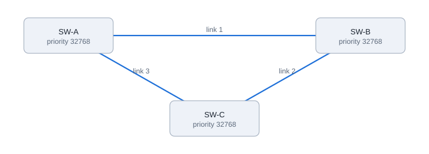

*شکل ۱: سه سوییچ با سه لینک؛ مثلثی که اگر STP نباشد Loop می‌سازد.*

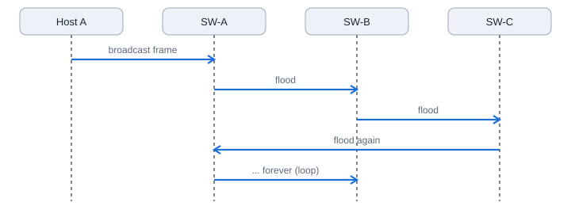

*شکل ۲: یک Broadcast بین سوییچ‌ها می‌چرخد و هیچ‌وقت تمام نمی‌شود.*

#### سه عارضه‌ی Loop

1.  **Broadcast Storm:** ترافیک تکراری پهنای باند را کامل مصرف می‌کند.
2.  **MAC Table Instability:** یک MAC مدام بین دو پورت پرش می‌کند (MACFLAP).
3.  **CPU بالا:** سوییچ مجبور است همین فریم‌ها را پردازش کند و دیگر جواب نمی‌دهد.

### ۲. ایده‌ی STP: یک درخت، بدون حلقه

STP از روی گراف شبکه یک «درخت» می‌سازد: یک ریشه (Root) انتخاب می‌کند و برای هر سوییچ فقط یک مسیر فعال به ریشه نگه می‌دارد. لینک‌های اضافه به‌صورت Blocking در حالت آماده‌باش می‌مانند و اگر لینک اصلی خراب شد، فعال می‌شوند.

#### مراحل کار STP (سه تصمیم)

1.  **انتخاب Root Bridge:** سوییچی با کوچک‌ترین Bridge ID برنده است.
2.  **انتخاب Root Port:** هر سوییچ غیر Root، پورتی را انتخاب می‌کند که کمترین هزینه تا Root را دارد.
3.  **انتخاب Designated Port:** روی هر Segment، پورتی که به Root نزدیک‌تر است فعال می‌ماند؛ پورت‌های باقی‌مانده Blocking می‌شوند.

#### Bridge ID چیست؟

Bridge ID از دو بخش ساخته می‌شود: اولویت (Priority) و MAC سوییچ. اولویت پیش‌فرض ۳۲۷۶۸ است. در PVST+ برای هر VLAN یک نمونه از STP اجرا می‌شود و شماره‌ی VLAN به اولویت اضافه می‌شود:

``` text
Bridge ID = Priority + VLAN ID + MAC address
Example (VLAN 10): 32768 + 10 = 32778 , MAC 0001.aaaa.0001
Lowest Bridge ID wins the Root election
```

اگر اولویت‌ها برابر بود، MAC کوچک‌تر برنده است. چون MAC معمولاً به سن سوییچ بستگی دارد، سوییچ «قدیمی‌ترین» ممکن است Root شود؛ همین یک اشتباه رایج طراحی است. باید Root را عمداً انتخاب کنیم (درس ۴-۲).

#### هزینه‌ی مسیر (Path Cost)

سوییچ‌ها هزینه‌ی مسیر تا Root را با جمع‌کردن هزینه‌ی لینک‌ها حساب می‌کنند. لینک سریع‌تر هزینه‌ی کمتر دارد:

| سرعت لینک | هزینه (روش کوتاه، Short) | هزینه (روش بلند، Long) |
|-----------|--------------------------|------------------------|
| 10 Mbps   | 100                      | 2,000,000              |
| 100 Mbps  | 19                       | 200,000                |
| 1 Gbps    | 4                        | 20,000                 |
| 10 Gbps   | 2                        | 2,000                  |

#### حالت‌ها و نقش پورت‌ها

| STP کلاسیک (802.1D) | کار پورت                                    |
|---------------------|---------------------------------------------|
| Blocking            | فریم داده نمی‌فرستد، فقط BPDU می‌شنود         |
| Listening           | BPDU می‌شنود و پردازش می‌کند، MAC یاد نمی‌گیرد |
| Learning            | MAC یاد می‌گیرد، هنوز داده نمی‌فرستد          |
| Forwarding          | کار عادی                                    |
| Disabled            | خاموش                                       |

در STP کلاسیک، تا Forwarding شدن یک پورت ۳۰ تا ۵۰ ثانیه طول می‌کشد. این تأخیر در شبکه‌ی امروز قابل‌قبول نیست؛ پس از RSTP استفاده می‌کنیم (درس بعد).

``` text
Blocking (20 s max age) -> Listening (15 s) -> Learning (15 s) -> Forwarding
Worst-case convergence = 20 + 15 + 15 = 50 seconds
```

### ۳. مثال ساده: دو سوییچ، دو لینک

SW-A و SW-B با دو کابل به هم وصل‌اند. هر دو با اولویت ۳۲۷۶۸. MAC سوییچ A کوچک‌تر است.

``` text
Election: priority equal (32768) -> lower MAC wins
Root Bridge = SW-A
On SW-B: both uplinks lead to Root with the same cost
  -> choose the lower port ID (Gi0/1) as Root Port
  -> Gi0/2 becomes Blocking (Alternate)
```

### ۴. مثال متوسط: سه سوییچ، مثلث

``` text
Bridge IDs: SW-A 32769.0001.aaaa.0001 (VLAN1)
            SW-B 32769.0001.aaaa.0002
            SW-C 32769.0001.aaaa.0003
Root Bridge = SW-A (lowest MAC)

SW-B -> Root: direct link, cost 4 (1G)          -> Root Port = link A-B
SW-C -> Root: direct link, cost 4 (1G)          -> Root Port = link A-C
Segment B-C: both sides cost 4 to Root; tie -> lower Bridge ID
  SW-B has lower ID than SW-C -> SW-B port is Designated (Forwarding)
  SW-C port on B-C is Alternate (Blocking)
```

نتیجه: فقط پورت SW-C سمت لینک B-C بسته می‌شود؛ مثلث به یک درخت (A در ریشه، B و C فرزند) تبدیل شد.

### ۵. مثال سخت: چرا Root اشتباه خطرناک است؟

در یک شعبه، یک سوییچ قدیمی دسترسی در انتهای شبکه، چون MAC کوچک دارد، Root می‌شود. حالا همه‌ی ترافیک بین سرورها و کاربران از لینک ۱۰۰ مگابیتی آن سوییچ عبور می‌کند.

``` text
Symptom  : network slow, traffic path goes through an old access switch
Check    : show spanning-tree vlan 10  -> "This bridge is the root" on the wrong switch
Cause    : default priority + lowest MAC
Fix      : set core switch priority lower (e.g. 4096) or "root primary"
```

### ۶. دستورهای مشاهده

``` text
SW1# show spanning-tree
SW1# show spanning-tree vlan 10
SW1# show spanning-tree summary
SW1# show spanning-tree root
SW1# show spanning-tree interface gi0/1 detail
```

- `show spanning-tree vlan 10`: Root، Bridge ID خودش، نقش هر پورت (Root/Desg/Altn) و حالت آن.
- `show spanning-tree root`: خلاصه‌ی Root هر VLAN.
- `show spanning-tree summary`: حالت STP و تعداد پورت‌ها به‌تفکیک.

### تمرین‌ها

**ت1.** ۱ (ساده): چرا Loop در لایه ۲ خطرناک‌تر از لایه ۳ است؟ *(پاسخ: 4-1-ت1 در بخش «پاسخ‌ها» انتهای فصل)*

**ت2.** ۲ (ساده): Root Bridge را چطور انتخاب می‌کنند؟ *(پاسخ: 4-1-ت2 در بخش «پاسخ‌ها» انتهای فصل)*

**ت3.** ۳ (متوسط): دو سوییچ با اولویت 32768 و 4096؛ کدام Root است؟ *(پاسخ: 4-1-ت3 در بخش «پاسخ‌ها» انتهای فصل)*

**ت4.** ۴ (متوسط): هزینه‌ی مسیر سه لینک ۱ گیگ پشت‌سرهم تا Root با روش Short؟ *(پاسخ: 4-1-ت4 در بخش «پاسخ‌ها» انتهای فصل)*

**ت5.** ۵ (سخت): در مثلث A (Root)، B، C با لینک‌های 1G، اگر لینک A-C خراب شود، SW-C از کدام مسیر Root را می‌بیند و هزینه چقدر است؟ *(پاسخ: 4-1-ت5 در بخش «پاسخ‌ها» انتهای فصل)*

### Lab هدایت‌شده

توپولوژی: سه سوییچ vIOSL2 به نام‌های `SW1`، `SW2` و `SW3` که مثلث می‌سازند (SW1-SW2، SW2-SW3، SW1-SW3). همه‌ی لینک‌ها Trunk هستند. اگر SW3 ندارید، یک گره‌ی سوم از همان Image اضافه کنید. **هشدار:** قبل از وصل‌کردن لینک سوم، STP باید فعال باشد؛ در Lab ما STP پیش‌فرض روشن است ولی همین را با `show spanning-tree summary` تأیید کنید.

#### گام ۱: بکاپ و حالت STP

``` text
SW1# copy running-config flash:SW1-before-stp.cfg
SW1# show spanning-tree summary
```

#### گام ۲: دیدن Root

``` text
SW1# show spanning-tree vlan 1
SW2# show spanning-tree vlan 1
SW3# show spanning-tree vlan 1
```

در سه خروجی، Bridge ID و Root را مقایسه کنید. روی کدام سوییچ نوشته «This bridge is the root»؟ پیش‌بینی کنید چه سوییچی است و بعد بسنجید.

#### گام ۳: پیدا کردن پورت Blocking

``` text
SWx# show spanning-tree vlan 1 | include Altn|Desg|Root
```

یک پورت Altn (Alternate) باید در مثلث پیدا کنید. آن را یادداشت کنید و نقش همه‌ی پورت‌ها را در یک جدول بنویسید.

#### گام ۴: شکستن لینک و دیدن Failover

``` text
SW2(config)# interface gi0/1
SW2(config-if)# shutdown
SW3# show spanning-tree vlan 1
```

پورت Alternate چقدر زود Forwarding شد؟ (در Rapid-PVST کمتر از چند ثانیه؛ در PVST کلاسیک ۳۰ تا ۵۰ ثانیه.) بعد پورت را `no shutdown` کنید.

### Lab مستقل

جدول «Bridge ID هر سوییچ، Root، نقش پورت‌ها» را برای VLAN 1 بسازید و در `03-ops/stp-baseline.md` ذخیره کنید. بدون رمز.

### عیب‌یابی

|         |                                                                                                                                  |
|---------|----------------------------------------------------------------------------------------------------------------------------------|
| Symptom | شبکه ناگهان بسیار کند شد و LEDهای لینک‌ها مدام چشمک می‌زنند                                                                        |
| سرنخ    | CPU بالا، پیام MACFLAP، ترافیک Broadcast زیاد                                                                                    |
| چک‌لیست  | ۱) show spanning-tree summary ؛ ۲) آیا کابل جدیدی وصل شده؟ ؛ ۳) آیا STP روی همه‌ی سوییچ‌ها فعال است؟ ؛ ۴) پورت Blocking وجود دارد؟ |
| رفع     | کابل اضافه را جدا کنید، STP را فعال کنید، سپس علت را مستند کنید                                                                  |

### سؤال‌های مرور

**م1.** چرا لایه ۲ به STP نیاز دارد؟ *(پاسخ: 4-1-م1 در بخش «پاسخ‌ها» انتهای فصل)*

**م2.** Root Bridge چه کسی است؟ *(پاسخ: 4-1-م2 در بخش «پاسخ‌ها» انتهای فصل)*

**م3.** Root Port و Designated Port چه فرقی دارند؟ *(پاسخ: 4-1-م3 در بخش «پاسخ‌ها» انتهای فصل)*

### English Corner: انگلیسی تخصصی این درس

این جمله‌ها از مستندات و محیط کار واقعی‌اند. بلند بخوانید و ترجمه را بپوشانید.

| English sentence                                              | ترجمه                                                 |
|---------------------------------------------------------------|-------------------------------------------------------|
| STP prevents layer-2 loops by blocking redundant links.       | STP با بستن لینک‌های اضافه جلوی Loop لایه ۲ را می‌گیرد. |
| The switch with the lowest bridge ID becomes the root bridge. | سوییچ با کوچک‌ترین Bridge ID Root می‌شود.               |
| A blocked port still receives BPDUs.                          | پورت Blocking هنوز BPDU دریافت می‌کند.                 |
| A broadcast storm can bring down the entire network.          | طوفان Broadcast می‌تواند کل شبکه را از کار بیندازد.    |

**Q1.** Quick quiz (answer in English): What does STP do with a redundant link? *(پاسخ: 4-1-Q1 در بخش «پاسخ‌ها» انتهای فصل)*

### تکلیف و چک‌لیست تسلط

- [ ] سه عارضه‌ی Loop را بگویم.
- [ ] Root را برای مثلث به‌دست آورم و نقش پورت‌ها را بنویسم.
- [ ] Lab را انجام دهم و Failover را ثبت کنم.

### یادآوری اشتباهات شما

> **یادآوری**
>
> پیش‌بینی قبل از اجرا؛ بکاپ قبل از تغییر؛ پذیرفته‌شدن دستور ≠ کار کردن؛ فرمول‌ها در بلوک مستقل.


#### کارت Lab — حلقه در لایه ۲ و STP

| # | فیلد | محتوا |
|---|---|---|
| 1 | عنوان و هدف | دیدن Root و نقش پورت‌ها در مثلث سه‌سوییچی |
| 2 | پیش‌نیاز | فصل 3 |
| 3 | توپولوژی | SW1-SW2-SW3 مثلث (Trunk) |
| 4 | تجهیزات | ۳ سوییچ vIOS-L2 |
| 5 | نسخه نرم‌افزار | vIOS-L2 15.2(20200924، Experimental) برای SW؛ vIOS 15.9(3)M9 برای R؛ VPCS؛ PNetLab 4.2.8 |
| 6 | IP Plan | VLAN 1 |
| 7 | وضعیت اولیه | PVST پیش‌فرض |
| 8 | صورت مسئله | Root/Port Role را بنویسید و Failover را ببینید |
| 9 | مراحل هدایت‌شده | همان بخش «Lab هدایت‌شده» همین درس |
| 10 | تست عملکرد | `show spanning-tree vlan 1` (Root، Altn) |
| 11 | سناریوی خرابی | Loop بدون STP (آموزشی) |
| 12 | روش عیب‌یابی | لایه‌ای/با شواهد (بخش عیب‌یابی همین درس) |
| 13 | نتیجه‌ی مورد انتظار | Root مشخص؛ یک پورت Altn |
| 14 | معیار پذیرش | جدول Role صحیح |
| 15 | مستندات نهایی | `03-ops/stp-baseline.md` |
| 16 | Cleanup و بازگردانی | `no shutdown` لینک‌ها |

> **وضعیت راستی‌آزمایی (خارج از ۱۶ فیلد):** **جزئی.** `show spanning-tree summary` در Probe Tested-OK (PVST)؛ Failover و مثلث اجرا نشده.

---

<a id="l-4-2"></a>

## درس 4-2 — Rapid-PVST، Root، PortFast و BPDU Guard

**فصل ۴ - روز ۲ · پیش‌نیاز: درس ۴-۱ · ۶ ساعت**

> **وضعیت:** Cisco IOSv/IOSvL2؛ خروجی‌ها و دستورها نمونه‌ی آموزشی‌اند؛ Lab «اجرا نشده»؛ ویژگی‌هایی که روی IOSvL2 آزمایش‌نشده‌اند `Unverified` هستند و باید با Probe (درس ۱-B) تأیید شوند.

### این درس درباره چیست و چرا باید یاد بگیریم؟

**چه چیزی یاد می‌گیریم:** نسخه‌ی سریع STP یعنی RSTP و پیاده‌سازی سیسکو Rapid-PVST+؛ انتخاب عمدی Root؛ و محافظ‌های PortFast و BPDU Guard و Root Guard.

**چرا لازم است:** STP کلاسیک تا ۵۰ ثانیه همگرا می‌شود و Root را به‌صورت تصادفی انتخاب می‌کند. در شبکه‌ی واقعی باید همگرایی چند ثانیه‌ای و Root از پیش‌تعیین‌شده داشته باشیم، و باید جلوی اتصال سوییچ یا BPDU ناخواسته به پورت کاربر را بگیریم.

- **در کار روزانه:** تقریباً همه‌ی سوییچ‌های سازمانی Rapid-PVST اجرا می‌کنند.
- **در امنیت:** BPDU Guard جلوی اتصال سوییچ جعلی (Rogue) را می‌گیرد؛ Root Guard جلوی Root شدن سوییچ ناخواسته را.
- **در عیب‌یابی:** پورت err-disabled بعد از وصل‌کردن یک سوییچ، کار BPDU Guard است.

> **مسیر درس**
>
> RSTP چه فرقی دارد ← تنظیم Root ← PortFast ← BPDU Guard و Root Guard ← مثال ساده/متوسط/سخت ← Lab ← عیب‌یابی.

#### اصطلاحات این درس (مخفف ← شکل کامل ← معنی)

| مخفف        | شکل کامل انگلیسی                      | معنی فارسی                                        |
|-------------|---------------------------------------|---------------------------------------------------|
| RSTP        | Rapid Spanning Tree Protocol (802.1w) | نسخه‌ی سریع STP                                    |
| PVST+       | Per-VLAN Spanning Tree Plus           | یک STP جدا برای هر VLAN (سیسکو)                   |
| Rapid-PVST+ | Rapid Per-VLAN Spanning Tree Plus     | RSTP به‌صورت Per-VLAN                              |
| PortFast    | PortFast                              | پورت لبه‌ای که فوراً Forwarding می‌شود               |
| BPDU Guard  | BPDU Guard                            | پورت را با دریافت BPDU خاموش می‌کند                |
| Root Guard  | Root Guard                            | جلوی Root شدن سوییچ ناخواسته از یک پورت را می‌گیرد |
| Alternate   | Alternate Port                        | پورت جایگزین سریع برای Root Port                  |
| Edge Port   | Edge Port                             | پورتی که به دستگاه انتهایی وصل است                |

### ۱. RSTP چه چیزی را سریع کرد؟

RSTP همان ایده‌ی STP است ولی به‌جای انتظار با تایمرها، سوییچ‌ها با هم «مذاکره» می‌کنند (Proposal/Agreement). حالت‌ها هم ساده‌تر شده‌اند:

| STP کلاسیک | RSTP       |
|------------|------------|
| Blocking   | Discarding |
| Listening  | Discarding |
| Learning   | Learning   |
| Forwarding | Forwarding |

نقش‌ها هم یک نقش جدید دارند:

| نقش             | معنی                                     |
|-----------------|------------------------------------------|
| Root Port       | بهترین مسیر به Root                      |
| Designated Port | پورت فعال هر Segment                     |
| Alternate Port  | پشتیبان Root Port (همگرایی در حد ثانیه)  |
| Backup Port     | پشتیبان Designated Port روی همان Segment |

``` text
STP  : 30-50 seconds to converge
RSTP : usually 1-2 seconds (link failure with alternate port)
```

### ۲. فعال‌کردن Rapid-PVST+

``` text
SW1(config)# spanning-tree mode rapid-pvst
SW1# show spanning-tree summary
```

در خروجی باید بنویسد `Switch is in rapid-pvst mode`. این دستور باید روی همه‌ی سوییچ‌ها یکسان زده شود؛ ترکیب حالت‌ها سازگار است ولی همگرایی سریع از دست می‌رود.

### ۳. تعیین عمدی Root

دو روش داریم. روش اول Macro است و خودش اولویت را کم می‌کند؛ روش دوم دستی است و دقیق‌تر:

``` text
SW1(config)# spanning-tree vlan 1,10,20,30 root primary
SW2(config)# spanning-tree vlan 1,10,20,30 root secondary

! manual equivalent:
SW1(config)# spanning-tree vlan 10 priority 4096
SW2(config)# spanning-tree vlan 10 priority 8192
```

- `root primary`: اولویت را به اندازه‌ای کم می‌کند که Root شود (معمولاً 24576 یا کمتر).
- `root secondary`: اولویت 28672 برای نقش Root پشتیبان.
- اولویت باید مضرب 4096 باشد (چون ۱۲ بیت دیگر برای شماره‌ی VLAN رزرو است).

``` text
Priority values allowed: 0, 4096, 8192, ... 61440 (multiples of 4096)
Default priority : 32768
Bridge priority in BPDU = Priority + VLAN ID  (e.g. 4096 + 10 = 4106)
```

> **قانون طراحی**
>
> Root را همیشه روی سوییچ هسته (Core / Distribution) بگذارید و Root پشتیبان را روی هم‌ترازش. هرگز نگذارید یک سوییچ دسترسی Root شود.

### ۴. PortFast: پورت کاربر را سریع بالا بیاور

پورتی که به کامپیوتر یا پرینتر وصل است نمی‌تواند Loop بسازد. پس نیازی نیست منتظر مراحل STP بماند. PortFast آن را فوراً Forwarding می‌کند:

``` text
SW1(config)# interface range gi0/1 - 4
SW1(config-if-range)# switchport mode access
SW1(config-if-range)# spanning-tree portfast

! or enable globally for all access ports:
SW1(config)# spanning-tree portfast default
```

> **هشدار**
>
> PortFast فقط روی پورت‌های دستگاه انتهایی. روی لینک بین سوییچ‌ها خطرناک است، چون ممکن است Loop بسازد. برای همین حتماً با BPDU Guard همراه می‌شود.

### ۵. BPDU Guard: اگر BPDU آمد، پورت را خاموش کن

پورت کاربر هرگز نباید BPDU دریافت کند. اگر دریافت کرد، یعنی کسی سوییچ وصل کرده. BPDU Guard پورت را به حالت err-disabled می‌برد:

``` text
SW1(config)# interface gi0/1
SW1(config-if)# spanning-tree bpduguard enable

! global default for PortFast ports:
SW1(config)# spanning-tree portfast bpduguard default

! recovery (optional, careful):
SW1(config)# errdisable recovery cause bpduguard
SW1(config)# errdisable recovery interval 300
```

``` text
SW1# show interfaces status err-disabled
SW1# show spanning-tree summary
SW1# show spanning-tree interface gi0/1 detail
```

بعد از رفع علت، پورت را دستی روشن کنید: `shutdown` سپس `no shutdown`. اگر `errdisable recovery` تنظیم شده باشد، بعد از ۳۰۰ ثانیه خودکار برمی‌گردد (ولی اگر علت هنوز هست، دوباره خاموش می‌شود).

### ۶. Root Guard: جلوی Root ناخواسته

روی پورت‌هایی که به سمت سوییچ‌های «مشتری» یا بیرون از کنترل شما می‌روند، اگر BPDU بهتر (ادعای Root) رسید، پورت وارد حالت `root-inconsistent` می‌شود و ترافیک را نمی‌پذیرد:

``` text
SW1(config)# interface gi0/10
SW1(config-if)# spanning-tree guard root
SW1# show spanning-tree inconsistentports
```

| ابزار      | روی کدام پورت                 | عکس‌العمل                       |
|------------|-------------------------------|--------------------------------|
| PortFast   | پورت دستگاه انتهایی           | فوراً Forwarding                |
| BPDU Guard | پورت دستگاه انتهایی           | err-disabled با دریافت BPDU    |
| Root Guard | پورت به سمت خارج از کنترل شما | root-inconsistent با BPDU برتر |

### ۷. مثال ساده/متوسط/سخت

#### ساده

``` text
Task  : make SW1 the root for VLAN 10
Cmd   : spanning-tree vlan 10 root primary
Verify: show spanning-tree vlan 10  -> "This bridge is the root"
```

#### متوسط

کاربری یک سوییچ کوچک خانگی را به پورت دیوار وصل می‌کند. بدون BPDU Guard ممکن است Loop بسازد یا Root شود؛ با BPDU Guard پورت خاموش می‌شود:

``` text
Log: %SPANTREE-2-BLOCK_BPDUGUARD: Received BPDU on port Gi0/3 with BPDU Guard enabled
Show: show interfaces status err-disabled -> Gi0/3 err-disabled bpduguard
```

#### سخت

در شبکه‌ی ۳ سوییچی، Root را روی SW1 و Root پشتیبان را روی SW2 بگذارید، روی پورت‌های دسترسی SW3 PortFast و BPDU Guard فعال کنید، روی پورت اتصال به شبکه‌ی خارجی Root Guard؛ سپس نشان دهید با قطع SW1 همگرایی کمتر از چند ثانیه است.

### تمرین‌ها

**ت1.** ۱ (ساده): چرا RSTP سریع‌تر است؟ *(پاسخ: 4-2-ت1 در بخش «پاسخ‌ها» انتهای فصل)*

**ت2.** ۲ (ساده): اولویت‌های مجاز؟ *(پاسخ: 4-2-ت2 در بخش «پاسخ‌ها» انتهای فصل)*

**ت3.** ۳ (متوسط): PortFast بدون BPDU Guard چه خطری دارد؟ *(پاسخ: 4-2-ت3 در بخش «پاسخ‌ها» انتهای فصل)*

**ت4.** ۴ (متوسط): پورت err-disabled شد؛ مراحل رفع؟ *(پاسخ: 4-2-ت4 در بخش «پاسخ‌ها» انتهای فصل)*

**ت5.** ۵ (سخت): Root Guard را روی کدام پورت‌ها می‌گذاریم و چرا؟ *(پاسخ: 4-2-ت5 در بخش «پاسخ‌ها» انتهای فصل)*

### Lab هدایت‌شده

همان مثلث SW1-SW2-SW3 از درس قبل. SW1 باید Root باشد.

#### گام ۱: Rapid-PVST روی هر سه

``` text
SWx(config)# spanning-tree mode rapid-pvst
SWx# show spanning-tree summary
```

#### گام ۲: Root و Root پشتیبان

``` text
SW1(config)# spanning-tree vlan 1 root primary
SW2(config)# spanning-tree vlan 1 root secondary
SW3# show spanning-tree root
```

#### گام ۳: PortFast و BPDU Guard روی پورت PC

``` text
SW3(config)# interface gi0/3
SW3(config-if)# switchport mode access
SW3(config-if)# spanning-tree portfast
SW3(config-if)# spanning-tree bpduguard enable
```

#### گام ۴: ایجاد عمدی تخلف

به پورت Gi0/3 به‌جای PC، یک سوییچ (SW4) وصل کنید. باید پیام BPDU Guard را ببینید:

``` text
SW3# show interfaces status err-disabled
SW3# show logging | include BPDUGUARD
```

اگر شبیه‌ساز BPDU Guard را اجرا نکرد (طبق Probe فقط پذیرفته شده بود)، دقیقاً همان را ثبت کنید و در Lab واقعی تکرار کنید.

#### گام ۵: رفع

``` text
SW3(config)# interface gi0/3
SW3(config-if)# shutdown
SW3(config-if)# no shutdown
```

### Lab مستقل

یک چک‌لیست «Hardening لایه ۲» یک‌صفحه‌ای بنویسید (Rapid-PVST، Root/Secondary، PortFast، BPDU Guard، Root Guard) در `03-ops/l2-hardening.md`.

### عیب‌یابی

|            |                                                              |
|------------|--------------------------------------------------------------|
| Symptom    | پورت کاربر خاموش شده و کاربر قطع است                         |
| سرنخ       | show interfaces status -\> err-disabled                      |
| علت متداول | BPDU Guard: سوییچ یا دستگاهی که BPDU می‌فرستد به پورت وصل شده |
| رفع        | دستگاه را جدا کنید و پورت را بالا بیاورید؛ علت را مستند کنید |

### سؤال‌های مرور

**م1.** PortFast برای چه پورتی؟ *(پاسخ: 4-2-م1 در بخش «پاسخ‌ها» انتهای فصل)*

**م2.** تفاوت BPDU Guard و Root Guard؟ *(پاسخ: 4-2-م2 در بخش «پاسخ‌ها» انتهای فصل)*

**م3.** چرا Root را دستی تعیین می‌کنیم؟ *(پاسخ: 4-2-م3 در بخش «پاسخ‌ها» انتهای فصل)*

### English Corner: انگلیسی تخصصی این درس

این جمله‌ها از مستندات و محیط کار واقعی‌اند. بلند بخوانید و ترجمه را بپوشانید.

| English sentence                                                           | ترجمه                                                                             |
|----------------------------------------------------------------------------|-----------------------------------------------------------------------------------|
| Enable PortFast on access ports to skip the listening and learning states. | PortFast را روی پورت‌های Access فعال کنید تا حالت‌های Listening و Learning رد شوند. |
| BPDU Guard puts the port in err-disabled state when a BPDU is received.    | BPDU Guard با دریافت BPDU پورت را به حالت err-disabled می‌برد.                     |
| Set the core switch as the root bridge for all VLANs.                      | سوییچ هسته را Root همه‌ی VLANها کنید.                                              |
| Root Guard prevents an unauthorized switch from becoming root.             | Root Guard جلوی Root شدن سوییچ غیرمجاز را می‌گیرد.                                 |

**Q1.** Quick quiz (answer in English): When should you not enable PortFast? *(پاسخ: 4-2-Q1 در بخش «پاسخ‌ها» انتهای فصل)*

### تکلیف و چک‌لیست تسلط

- [ ] Rapid-PVST و Root را تنظیم و تأیید کنم.
- [ ] BPDU Guard را بسازم، تخلف را ببینم و رفع کنم.
- [ ] چک‌لیست Hardening L2 را بنویسم.

### یادآوری اشتباهات شما

> **یادآوری**
>
> پیش‌بینی قبل از اجرا؛ بکاپ قبل از تغییر؛ پذیرفته‌شدن دستور ≠ کار کردن؛ فرمول‌ها در بلوک مستقل.


#### کارت Lab — Rapid-PVST، Root، PortFast و BPDU Guard

| # | فیلد | محتوا |
|---|---|---|
| 1 | عنوان و هدف | Rapid-PVST، Root، PortFast، BPDU Guard |
| 2 | پیش‌نیاز | درس 4-1 |
| 3 | توپولوژی | مثلث + PC |
| 4 | تجهیزات | ۳ سوییچ + VPCS |
| 5 | نسخه نرم‌افزار | vIOS-L2 15.2(20200924، Experimental) برای SW؛ vIOS 15.9(3)M9 برای R؛ VPCS؛ PNetLab 4.2.8 |
| 6 | IP Plan | PVST |
| 7 | وضعیت اولیه | Rapid-PVST |
| 8 | صورت مسئله | Root/Secondary و محافظت پورت |
| 9 | مراحل هدایت‌شده | همان بخش «Lab هدایت‌شده» همین درس |
| 10 | تست عملکرد | `show spanning-tree summary` |
| 11 | سناریوی خرابی | سوییچ جعلی به پورت BPDU Guard |
| 12 | روش عیب‌یابی | لایه‌ای/با شواهد (بخش عیب‌یابی همین درس) |
| 13 | نتیجه‌ی مورد انتظار | Rapid-PVST؛ پورت err-disabled با BPDU |
| 14 | معیار پذیرش | تخلف دیده/ثبت شود |
| 15 | مستندات نهایی | `03-ops/l2-hardening.md` |
| 16 | Cleanup و بازگردانی | shutdown/no shutdown پورت |

> **وضعیت راستی‌آزمایی (خارج از ۱۶ فیلد):** **جزئی.** Rapid-PVST در Config دیده شد؛ PortFast/BPDU Guard فقط CLI-Accepted؛ اجرای واقعی Guard آزمایش نشده.

---

<a id="l-4-3"></a>

## درس 4-3 — EtherChannel و LACP

**فصل ۴ - روز ۳ · پیش‌نیاز: درس ۴-۲ · ۶ ساعت**

> **وضعیت:** Cisco IOSv/IOSvL2؛ خروجی‌ها و دستورها نمونه‌ی آموزشی‌اند؛ Lab «اجرا نشده»؛ ویژگی‌هایی که روی IOSvL2 آزمایش‌نشده‌اند `Unverified` هستند و باید با Probe (درس ۱-B) تأیید شوند.

### این درس درباره چیست و چرا باید یاد بگیریم؟

**چه چیزی یاد می‌گیریم:** چطور چند کابل فیزیکی بین دو سوییچ را به‌صورت یک لینک منطقی (EtherChannel) در بیاوریم، با پروتکل LACP؛ و چرا دو سر لینک باید تنظیمات یکسان داشته باشند.

**چرا لازم است:** اگر بین دو سوییچ دو کابل بکشید، STP یکی را می‌بندد و نیمی از پهنای باند هدر می‌رود. EtherChannel دو (تا هشت) کابل را یکی می‌کند: پهنای باند جمع می‌شود و با قطع یک کابل ارتباط قطع نمی‌شود.

- **در کار روزانه:** لینک بین سوییچ‌های Core و Distribution تقریباً همیشه EtherChannel است.
- **در امنیت:** EtherChannel نادرست باعث Loop یا قطع ناگهانی می‌شود؛ کنترل Mismatch ضروری است.
- **در FortiGate:** همین مفهوم با «Aggregate Interface» در فایروال تکرار می‌شود.

> **مسیر درس**
>
> مشکل لینک‌های موازی ← Port-Channel ← LACP در برابر PAgP ← Load Balancing ← مثال ساده/متوسط/سخت ← Lab ← عیب‌یابی.

#### اصطلاحات این درس (مخفف ← شکل کامل ← معنی)

| مخفف         | شکل کامل انگلیسی                            | معنی فارسی                             |
|--------------|---------------------------------------------|----------------------------------------|
| EtherChannel | EtherChannel                                | تجمیع چند لینک فیزیکی در یک لینک منطقی |
| Port-Channel | Port-Channel                                | Interface منطقی حاصل از تجمیع          |
| LACP         | Link Aggregation Control Protocol (802.3ad) | پروتکل استاندارد مذاکره‌ی تجمیع         |
| PAgP         | Port Aggregation Protocol                   | پروتکل اختصاصی سیسکو برای تجمیع        |
| Active       | LACP Active                                 | پورت فعالانه مذاکره را شروع می‌کند      |
| Passive      | LACP Passive                                | پورت فقط منتظر مذاکره می‌ماند           |
| Hash         | Load-balancing hash                         | الگوریتم انتخاب لینک برای هر جریان     |

### ۱. مشکل: دو کابل، یک کابل کار می‌کند

دو سوییچ را با دو کابل ۱ گیگ وصل می‌کنیم تا هم پهنای باند بیشتر داشته باشیم و هم تحمل خطا. اما STP دو لینک موازی را «Loop» می‌داند و یکی را Block می‌کند. نتیجه: فقط ۱ گیگ، نه ۲ گیگ.

مثال روزمره: دو باند موازی در یک جاده که یکی را بسته‌اند چون فکر می‌کنند دور می‌زند. EtherChannel به STP می‌گوید این دو باند «یک جاده‌ی دوبانده» هستند.

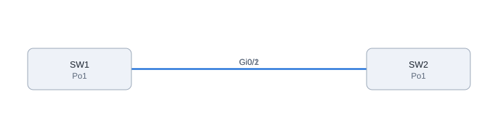

*شکل ۱: دو لینک فیزیکی که STP آن‌ها را یک لینک منطقی (Po1) می‌بیند.*

### ۲. EtherChannel چطور کار می‌کند؟

- چند پورت فیزیکی عضو یک **Port-Channel** می‌شوند.
- STP و Trunk فقط Port-Channel را می‌بینند، نه پورت‌های عضو.
- توزیع ترافیک به‌صورت Hash است: هر جریان (مثلاً یک جفت IP) یک لینک را می‌گیرد؛ پس یک جریان تنها از یک لینک می‌رود و ۱ گیگ می‌ماند، ولی چند جریان روی لینک‌ها پخش می‌شود.
- اگر یک لینک قطع شود، ترافیک به لینک‌های دیگر منتقل می‌شود.

> **نکته‌ی مهم**
>
> EtherChannel سرعت یک ارتباط تکی را بیشتر نمی‌کند؛ ظرفیت کل را بالا می‌برد و تحمل خطا می‌دهد.

### ۳. LACP یا PAgP یا ثابت؟

| حالت   | پروتکل                                  | Modeهای مجاز     |
|--------|-----------------------------------------|------------------|
| LACP   | استاندارد 802.3ad، با تجهیزات هر سازنده | active / passive |
| PAgP   | اختصاصی سیسکو                           | desirable / auto |
| Static | بدون مذاکره (خطرناک)                    | on               |

| ترکیب دو سر       | نتیجه                        |
|-------------------|------------------------------|
| active — active   | Channel تشکیل می‌شود          |
| active — passive  | Channel تشکیل می‌شود          |
| passive — passive | تشکیل نمی‌شود (هر دو منتظرند) |
| on — active       | تشکیل نمی‌شود (Mismatch)      |
| LACP — PAgP       | تشکیل نمی‌شود                 |

توصیه: همیشه LACP با `active` در هر دو سر.

### ۴. شرط‌های یکسان بودن پورت‌ها

همه‌ی پورت‌های عضو باید این‌ها را یکسان داشته باشند، وگرنه Channel بالا نمی‌آید یا Suspend می‌شود:

- سرعت و Duplex
- حالت Trunk/Access و VLANهای مجاز و Native
- VLAN دسترسی (برای Access)
- تنظیمات STP پورت

### ۵. دستورها (خط‌به‌خط)

``` text
SW1(config)# interface range gi0/1 - 2
SW1(config-if-range)# switchport trunk encapsulation dot1q
SW1(config-if-range)# switchport mode trunk
SW1(config-if-range)# channel-group 1 mode active
SW1(config-if-range)# exit
SW1(config)# interface port-channel 1
SW1(config-if)# switchport trunk allowed vlan 10,20,30
SW1(config-if)# switchport trunk native vlan 999
```

- `channel-group 1 mode active`: پورت را عضو Port-Channel شماره‌ی ۱ می‌کند و LACP را فعال.
- تنظیمات Trunk را هم روی Port-Channel بزنید (نه فقط پورت‌ها)، تا تغییرات یکجا اعمال شود.

``` text
SW1# show etherchannel summary
SW1# show etherchannel port-channel
SW1# show interfaces port-channel 1
SW1# show lacp neighbor
SW1# show etherchannel load-balance
```

در `show etherchannel summary` حروف داخل پرانتز مهم‌اند:

| علامت | معنی                         |
|-------|------------------------------|
| P     | پورت در Bundle است (سالم)    |
| I     | پورت مستقل (Stand-alone) است |
| D     | Down                         |
| s     | Suspended (Mismatch)         |
| SU    | Port-channel: L2 و In-use    |
| SD    | Port-channel: L2 و Down      |

### ۶. مثال‌ها

#### ساده

``` text
Po1(SU)  Gi0/1(P)  Gi0/2(P)
Meaning: Layer-2 port-channel in use, both members bundled
```

#### متوسط: Mismatch

``` text
Po1(SD)  Gi0/1(s)  Gi0/2(D)
Cause: native VLAN or allowed VLAN list differs on the two ports/sides
Fix  : make all member ports identical, then shutdown/no shutdown the ports
```

#### سخت: توزیع ترافیک (Load Balancing)

سوییچ با Hash روی مبدأ و مقصد MAC یا IP، لینک را انتخاب می‌کند. اگر فقط یک سرور به یک کلاینت ترافیک بفرستد، همیشه یک لینک پر می‌شود. راه‌حل: Hash بر اساس IP و پورت (در تجهیزات پشتیبان) یا افزایش تنوع جریان‌ها.

``` text
SW1(config)# port-channel load-balance src-dst-ip
SW1# show etherchannel load-balance
```

> **صادقانه درباره‌ی Lab**
>
> در شبیه‌ساز vIOSL2 موتور LACP روشن است ولی در Probe اولیه دیدیم Po1 بدون همتای واقعی در حالت `SD` می‌ماند (پیام «LACP currently not enabled on remote port»). پس Lab را با دو سوییچ شبیه‌سازی‌شده انجام دهید و اگر Bundle تشکیل نشد، ثبت کنید؛ این بخش در Lab واقعی (سخت‌افزار) کاملاً تمرین می‌شود.

### تمرین‌ها

**ت1.** ۱ (ساده): چرا EtherChannel لازم است؟ *(پاسخ: 4-3-ت1 در بخش «پاسخ‌ها» انتهای فصل)*

**ت2.** ۲ (ساده): LACP با کدام Modeها؟ *(پاسخ: 4-3-ت2 در بخش «پاسخ‌ها» انتهای فصل)*

**ت3.** ۳ (متوسط): کدام ترکیب Channel نمی‌سازد؟ *(پاسخ: 4-3-ت3 در بخش «پاسخ‌ها» انتهای فصل)*

**ت4.** ۴ (متوسط): تفسیر Po1(SD) Gi0/1(D) Gi0/2(D) *(پاسخ: 4-3-ت4 در بخش «پاسخ‌ها» انتهای فصل)*

**ت5.** ۵ (سخت): چرا ۲ لینک ۱G برای یک انتقال فایل تکی ۲G سرعت نمی‌دهد؟ *(پاسخ: 4-3-ت5 در بخش «پاسخ‌ها» انتهای فصل)*

### Lab هدایت‌شده

توپولوژی: SW1 و SW2 با دو کابل: `Gi0/1` و `Gi0/2` هر سمت. VLANها از درس ۳-۲.

#### گام ۱: بکاپ و تنظیم هر دو سر

``` text
SWx# copy running-config flash:SWx-before-ec.cfg
SWx(config)# interface range gi0/1 - 2
SWx(config-if-range)# switchport trunk encapsulation dot1q
SWx(config-if-range)# switchport mode trunk
SWx(config-if-range)# channel-group 1 mode active
```

#### گام ۲: بررسی

``` text
SWx# show etherchannel summary
SWx# show interfaces trunk
SWx# show spanning-tree vlan 1
```

در STP باید فقط Po1 را ببینید (نه Gi0/1 و Gi0/2 جداگانه).

#### گام ۳: خراب‌کردن عمدی (Mismatch)

``` text
SW2(config)# interface gi0/2
SW2(config-if)# switchport trunk native vlan 5
SW2# show etherchannel summary
```

وضعیت پورت را ببینید و سپس رفع کنید (Native را مثل بقیه کنید و پورت را `shutdown` / `no shutdown`).

#### گام ۴: تحمل خطا

``` text
SW1(config)# interface gi0/1
SW1(config-if)# shutdown
PC1> ping 10.10.20.14 -t   (should keep working over Gi0/2)
```

### Lab مستقل

در `03-ops/etherchannel-runbook.md` چک‌لیست «قبل از ساخت Channel» (یکسان‌بودن سرعت/VLAN/Native/Allowed) را بنویسید.

### عیب‌یابی

|         |                                                                                                                                 |
|---------|---------------------------------------------------------------------------------------------------------------------------------|
| Symptom | Port-channel بالا نمی‌آید (SD) یا پورت‌ها s هستند                                                                                 |
| چک‌لیست  | ۱) Modeها سازگارند؟ ؛ ۲) Native/Allowed/Trunk دو سر یکی است؟ ؛ ۳) سرعت/Duplex یکی است؟ ؛ ۴) کابل‌ها به همان پورت‌های درست وصل‌اند؟ |
| ابزار   | show etherchannel summary ، show lacp neighbor                                                                                  |
| رفع     | یکسان‌سازی پیکربندی، سپس shutdown و no shutdown پورت‌ها                                                                           |

### سؤال‌های مرور

**م1.** EtherChannel چه مشکلی را حل می‌کند؟ *(پاسخ: 4-3-م1 در بخش «پاسخ‌ها» انتهای فصل)*

**م2.** چرا LACP را ترجیح می‌دهیم؟ *(پاسخ: 4-3-م2 در بخش «پاسخ‌ها» انتهای فصل)*

### English Corner: انگلیسی تخصصی این درس

این جمله‌ها از مستندات و محیط کار واقعی‌اند. بلند بخوانید و ترجمه را بپوشانید.

| English sentence                                          | ترجمه                                                    |
|-----------------------------------------------------------|----------------------------------------------------------|
| Bundle the physical ports into a port-channel using LACP. | پورت‌های فیزیکی را با LACP در یک Port-Channel تجمیع کنید. |
| All member ports must have identical settings.            | همه‌ی پورت‌های عضو باید تنظیمات یکسان داشته باشند.         |
| Traffic is distributed across links using a hash.         | ترافیک با Hash بین لینک‌ها توزیع می‌شود.                   |
| The port-channel stays up if one member link fails.       | با قطع یک لینک عضو، Port-Channel بالا می‌ماند.            |

**Q1.** Quick quiz (answer in English): Why does a single file transfer not use the full bundled bandwidth? *(پاسخ: 4-3-Q1 در بخش «پاسخ‌ها» انتهای فصل)*

### تکلیف و چک‌لیست تسلط

- [ ] Channel را بسازم و در STP یک لینک ببینم.
- [ ] Mismatch را بسازم و رفع کنم.
- [ ] نتیجه‌ی واقعی Lab (SU یا SD) را ثبت کنم.

### یادآوری اشتباهات شما

> **یادآوری**
>
> پیش‌بینی قبل از اجرا؛ بکاپ قبل از تغییر؛ پذیرفته‌شدن دستور ≠ کار کردن؛ فرمول‌ها در بلوک مستقل.


#### کارت Lab — EtherChannel و LACP

| # | فیلد | محتوا |
|---|---|---|
| 1 | عنوان و هدف | EtherChannel (LACP) و عیب‌یابی Mismatch |
| 2 | پیش‌نیاز | درس 4-2 |
| 3 | توپولوژی | SW1 ⇄ SW2 (دو لینک) |
| 4 | تجهیزات | ۲ سوییچ |
| 5 | نسخه نرم‌افزار | vIOS-L2 15.2(20200924، Experimental) برای SW؛ vIOS 15.9(3)M9 برای R؛ VPCS؛ PNetLab 4.2.8 |
| 6 | IP Plan | Trunk تک‌لینک |
| 7 | وضعیت اولیه | Port-channel 1 |
| 8 | صورت مسئله | Bundle و تحمل خطا |
| 9 | مراحل هدایت‌شده | همان بخش «Lab هدایت‌شده» همین درس |
| 10 | تست عملکرد | `show etherchannel summary` |
| 11 | سناریوی خرابی | Native نامتقارن |
| 12 | روش عیب‌یابی | لایه‌ای/با شواهد (بخش عیب‌یابی همین درس) |
| 13 | نتیجه‌ی مورد انتظار | Po1(SU)؛ با قطع یک لینک ارتباط ادامه |
| 14 | معیار پذیرش | نتیجه‌ی واقعی (SU یا SD) ثبت شود |
| 15 | مستندات نهایی | `03-ops/etherchannel-runbook.md` |
| 16 | Cleanup و بازگردانی | حذف channel-group |

> **وضعیت راستی‌آزمایی (خارج از ۱۶ فیلد):** **جزئی.** LACP engine فعال (Po1(SD) تا همتای دوم)؛ Bundle کامل آزمایش نشده.

---

<a id="l-4-4"></a>

## درس 4-4 — Port Security

**فصل ۴ - روز ۴ · پیش‌نیاز: درس ۴-۳ · ۶ ساعت**

> **وضعیت:** Cisco IOSv/IOSvL2؛ خروجی‌ها و دستورها نمونه‌ی آموزشی‌اند؛ Lab «اجرا نشده»؛ ویژگی‌هایی که روی IOSvL2 آزمایش‌نشده‌اند `Unverified` هستند و باید با Probe (درس ۱-B) تأیید شوند.

### این درس درباره چیست و چرا باید یاد بگیریم؟

**چه چیزی یاد می‌گیریم:** چطور هر پورت دسترسی را به تعداد مشخصی از MACهای مجاز محدود کنیم (Port Security)، سه نوع واکنش (Violation) و بازیابی از err-disabled.

**چرا لازم است:** هر کسی با یک کابل و لپ‌تاپ می‌تواند به پورت خالی وصل شود. Port Security جلوی دستگاه‌های ناشناس را می‌گیرد و حمله‌ی پر‌کردن جدول MAC (MAC Flooding) را بی‌اثر می‌کند.

- **در کار روزانه:** برای پورت‌های میز کار و پرینتر در اکثر سازمان‌ها استفاده می‌شود.
- **در امنیت:** لایه‌ی اول کنترل دسترسی فیزیکی و جلوگیری از MAC Flooding.
- **در عیب‌یابی:** پورتی که ناگهان err-disabled شد، اغلب Violation است.

> **مسیر درس**
>
> تهدید ← Port Security ← انواع Violation ← Sticky MAC ← مثال ساده/متوسط/سخت ← Lab ← عیب‌یابی.

#### اصطلاحات این درس (مخفف ← شکل کامل ← معنی)

| مخفف          | شکل کامل انگلیسی    | معنی فارسی                             |
|---------------|---------------------|----------------------------------------|
| Port Security | Port Security       | محدودکردن MACهای مجاز روی پورت         |
| Violation     | Security Violation  | تخلف: MAC غیرمجاز یا بیش از حد         |
| Sticky        | Sticky MAC          | یادگیری و ذخیره‌ی خودکار MAC مجاز       |
| Shutdown      | Violation shutdown  | پورت را err-disabled می‌کند             |
| Restrict      | Violation restrict  | فریم غیرمجاز را دور می‌ریزد و لاگ می‌دهد |
| Protect       | Violation protect   | فریم غیرمجاز را بی‌صدا دور می‌ریزد       |
| MAC Flooding  | MAC Flooding attack | پرکردن جدول MAC با MACهای جعلی         |

### ۱. تهدید: «کسی کابل را به پورت خالی زد»

سوییچ پورت‌های متعددی دارد و معمولاً بعضی از آن‌ها در دیوار سالن آزاد هستند. مهمان یا مهاجم لپ‌تاپ را وصل می‌کند و به شبکه می‌رسد. تهدید دوم: مهاجم هزاران MAC جعلی می‌فرستد تا جدول MAC پر شود و سوییچ شروع به Flooding کند؛ آنگاه ترافیک را می‌شنود.

### ۲. ایده‌ی Port Security

روی هر پورت می‌گوییم: «فقط N تا MAC مجاز است، و آن‌ها این‌ها هستند». اگر MAC دیگری آمد، واکنش تعریف‌شده اجرا می‌شود. سه چیز باید تعیین کنیم:

1.  **حداکثر MAC** (Maximum): معمولاً ۱ برای کامپیوتر، ۲ برای کامپیوتر+IP Phone.
2.  **MACهای مجاز:** دستی (static)، یا یادگیری خودکار (sticky).
3.  **واکنش (Violation):** shutdown، restrict یا protect.

| Violation         | فریم غیرمجاز | پورت         | لاگ/شمارنده |
|-------------------|--------------|--------------|-------------|
| shutdown (پیش‌فرض) | دور ریخته    | err-disabled | بله         |
| restrict          | دور ریخته    | فعال می‌ماند  | بله         |
| protect           | دور ریخته    | فعال می‌ماند  | خیر         |

### ۳. دستورها (خط‌به‌خط)

``` text
SW1(config)# interface gi0/1
SW1(config-if)# switchport mode access
SW1(config-if)# switchport access vlan 20
SW1(config-if)# switchport port-security
SW1(config-if)# switchport port-security maximum 2
SW1(config-if)# switchport port-security violation restrict
SW1(config-if)# switchport port-security mac-address sticky
SW1(config-if)# switchport port-security aging time 10
SW1(config-if)# switchport port-security aging type inactivity
```

- `switchport port-security`: قابلیت را روشن می‌کند (فقط روی پورت Access/Trunk ثابت، نه Dynamic).
- `maximum 2`: حداکثر دو MAC.
- `violation restrict`: واکنش (پیش‌فرض shutdown).
- `mac-address sticky`: MACهای یادگرفته‌شده به running-config اضافه می‌شوند (با `copy run start` دائمی می‌شوند).
- `aging`: بعد از ۱۰ دقیقه بی‌فعالیتی، MAC ثابت‌نشده حذف می‌شود.

``` text
SW1# show port-security
SW1# show port-security interface gi0/1
SW1# show port-security address
SW1# show interfaces status err-disabled
```

مهم‌ترین خطوط `show port-security interface`:

| فیلد                     | معنی                                      |
|--------------------------|-------------------------------------------|
| Port Status              | Secure-up / Secure-down / Secure-shutdown |
| Violation Mode           | نوع واکنش                                 |
| Maximum MAC Addresses    | سقف                                       |
| Total MAC Addresses      | تعداد فعلی                                |
| Last Source Address      | آخرین MAC متخلف                           |
| Security Violation Count | تعداد تخلف‌ها                              |

### ۴. مثال‌ها

#### ساده: یک کامپیوتر، یک MAC

``` text
maximum 1 , sticky
PC1 connects -> its MAC is learned and stored
Another laptop plugged in -> violation
```

#### متوسط: Violation shutdown

``` text
Log: %PM-4-ERR_DISABLE: psecure-violation error detected on Gi0/1, putting Gi0/1 in err-disable state
show port-security interface gi0/1 -> Port Status: Secure-shutdown
```

رفع: دستگاه غیرمجاز را جدا کنید، سپس `shutdown` و `no shutdown`. یا برای رفع خودکار: `errdisable recovery cause psecure-violation`.

#### سخت: IP Phone و کامپیوتر

در میز کار، IP Phone به پورت وصل است و کامپیوتر پشت آن. پس دو MAC لازم است (یا Voice VLAN). maximum را ۳ بگذارید تا یک MAC برای Phone، یکی برای PC و یکی حاشیه برای تعویض دستگاه باشد.

``` text
Rule of thumb: maximum = number of expected devices + 1 spare
Too low -> user complaints; too high -> weaker protection
```

> **صادقانه درباره‌ی Lab**
>
> در Probe اولیه، دستور Port Security در vIOSL2 «پذیرفته» شد، ولی ممکن است تخلف واقعاً شناسایی نشود (شبیه‌ساز). برای هر گام، نتیجه‌ی واقعی را ثبت کنید. اگر کار نکرد، مفهوم را با خروجی نمونه یاد بگیرید و در تجهیز واقعی تمرین کنید.

### تمرین‌ها

**ت1.** ۱ (ساده): سه نوع Violation؟ *(پاسخ: 4-4-ت1 در بخش «پاسخ‌ها» انتهای فصل)*

**ت2.** ۲ (ساده): sticky یعنی چه؟ *(پاسخ: 4-4-ت2 در بخش «پاسخ‌ها» انتهای فصل)*

**ت3.** ۳ (متوسط): چرا بعد از reload ممکن است sticky پاک شود؟ *(پاسخ: 4-4-ت3 در بخش «پاسخ‌ها» انتهای فصل)*

**ت4.** ۴ (متوسط): پورت err-disabled شد؛ مراحل؟ *(پاسخ: 4-4-ت4 در بخش «پاسخ‌ها» انتهای فصل)*

**ت5.** ۵ (سخت): maximum را برای پورت Phone+PC چند می‌گذاریم و چرا؟ *(پاسخ: 4-4-ت5 در بخش «پاسخ‌ها» انتهای فصل)*

### Lab هدایت‌شده

#### گام ۱: فعال‌سازی روی پورت PC1

``` text
SW1(config)# interface gi0/1
SW1(config-if)# switchport mode access
SW1(config-if)# switchport access vlan 20
SW1(config-if)# switchport port-security
SW1(config-if)# switchport port-security maximum 1
SW1(config-if)# switchport port-security violation shutdown
SW1(config-if)# switchport port-security mac-address sticky
```

#### گام ۲: بررسی

``` text
PC1> ping 10.10.20.1
SW1# show port-security interface gi0/1
SW1# show running-config interface gi0/1
```

باید MAC یادگرفته‌شده را به‌صورت `sticky` در پیکربندی ببینید.

#### گام ۳: تخلف عمدی

PC1 را جدا کنید و PC2 (MAC متفاوت) را به همان پورت وصل کنید. نتیجه را با `show interfaces status err-disabled` و `show logging` بررسی کنید.

#### گام ۴: رفع

``` text
SW1(config)# interface gi0/1
SW1(config-if)# shutdown
SW1(config-if)# no shutdown
SW1# clear port-security sticky interface gi0/1
```

### Lab مستقل

استاندارد Port Security (حداکثر، Violation، Sticky، Recovery) را برای پورت‌های کاربر، پرینتر و Phone در `03-ops/port-security-standard.md` بنویسید.

### عیب‌یابی

|         |                                                                                                        |
|---------|--------------------------------------------------------------------------------------------------------|
| Symptom | کاربر مجاز قطع شد                                                                                      |
| چک‌لیست  | ۱) پورت err-disabled است؟ ؛ ۲) MAC جدیدی دیده شده؟ ؛ ۳) Maximum کم است؟ ؛ ۴) Sticky قدیمی تغییر نکرده؟ |
| ابزار   | show port-security interface ، show logging                                                            |
| رفع     | پاک‌کردن MAC قدیمی، تنظیم maximum، و بالا آوردن پورت                                                    |

### سؤال‌های مرور

**م1.** Port Security چه چیزی را کنترل می‌کند؟ *(پاسخ: 4-4-م1 در بخش «پاسخ‌ها» انتهای فصل)*

**م2.** تفاوت restrict و shutdown؟ *(پاسخ: 4-4-م2 در بخش «پاسخ‌ها» انتهای فصل)*

### English Corner: انگلیسی تخصصی این درس

این جمله‌ها از مستندات و محیط کار واقعی‌اند. بلند بخوانید و ترجمه را بپوشانید.

| English sentence                                                            | ترجمه                                                           |
|-----------------------------------------------------------------------------|-----------------------------------------------------------------|
| Port security limits the number of MAC addresses allowed on an access port. | Port Security تعداد MACهای مجاز روی پورت Access را محدود می‌کند. |
| Sticky MAC addresses are saved to the running configuration.                | MACهای Sticky در running-config ذخیره می‌شوند.                   |
| The port goes into the err-disabled state on a violation.                   | در صورت تخلف، پورت به حالت err-disabled می‌رود.                  |
| Always allow one spare MAC for device replacement.                          | همیشه یک MAC اضافه برای تعویض دستگاه در نظر بگیرید.             |

**Q1.** Quick quiz (answer in English): What is the default violation mode? *(پاسخ: 4-4-Q1 در بخش «پاسخ‌ها» انتهای فصل)*

### تکلیف و چک‌لیست تسلط

- [ ] Port Security را فعال و تخلف را تست کنم.
- [ ] نتیجه‌ی واقعی Lab را ثبت کنم.
- [ ] استاندارد را بنویسم.

### یادآوری اشتباهات شما

> **یادآوری**
>
> پیش‌بینی قبل از اجرا؛ بکاپ قبل از تغییر؛ پذیرفته‌شدن دستور ≠ کار کردن؛ فرمول‌ها در بلوک مستقل.


#### کارت Lab — Port Security

| # | فیلد | محتوا |
|---|---|---|
| 1 | عنوان و هدف | Port Security (maximum/sticky/violation) |
| 2 | پیش‌نیاز | درس 4-3 |
| 3 | توپولوژی | SW1 + PC1..PC3 |
| 4 | تجهیزات | SW1 + ۳ VPCS |
| 5 | نسخه نرم‌افزار | vIOS-L2 15.2(20200924، Experimental) برای SW؛ vIOS 15.9(3)M9 برای R؛ VPCS؛ PNetLab 4.2.8 |
| 6 | IP Plan | Access VLAN 20 |
| 7 | وضعیت اولیه | max 2/3 sticky |
| 8 | صورت مسئله | تخلف عمدی و بازیابی |
| 9 | مراحل هدایت‌شده | همان بخش «Lab هدایت‌شده» همین درس |
| 10 | تست عملکرد | `show port-security interface` |
| 11 | سناریوی خرابی | MAC سوم |
| 12 | روش عیب‌یابی | لایه‌ای/با شواهد (بخش عیب‌یابی همین درس) |
| 13 | نتیجه‌ی مورد انتظار | err-disabled؛ بازیابی |
| 14 | معیار پذیرش | Violation واقعی دیده یا محدودیت ثبت |
| 15 | مستندات نهایی | `03-ops/port-security-standard.md` |
| 16 | Cleanup و بازگردانی | shutdown/no shutdown |

> **وضعیت راستی‌آزمایی (خارج از ۱۶ فیلد):** **جزئی.** پیکربندی Port-Security Tested-OK (Max=2/Restrict)؛ اجرای Violation آزمایش نشده.

---

<a id="l-4-5"></a>

## درس 4-5 — DHCP، Snooping و DAI

**فصل ۴ - روز ۵ · پیش‌نیاز: درس ۴-۴ · ۶ ساعت**

### این درس درباره چیست و چرا باید یاد بگیریم؟

**چه چیزی یاد می‌گیریم:** چطور کلاینت از DHCP آدرس می‌گیرد (چهار مرحله‌ی DORA)، و دو سپر امنیتی لایه ۲ یعنی DHCP Snooping و DAI چطور جلوی سرور جعلی و جعل ARP را می‌گیرند.

**چرا لازم است:** اگر کسی یک مودم یا روتر خانگی را به شبکه وصل کند و DHCP Server جعلی راه بیندازد، کلاینت‌ها Gateway و DNS اشتباه می‌گیرند و ترافیک از مسیر مهاجم می‌گذرد (حمله‌ی Man-in-the-Middle). این یکی از رایج‌ترین حمله‌های داخلی است.

- **در کار روزانه:** «کاربر IP نمی‌گیرد» یا «IP اشتباه گرفته» مشکل روزانه‌ی پشتیبانی است.
- **در امنیت:** Snooping و DAI دو لایه‌ی استاندارد Hardening هستند.
- **در Capstone:** Windows Server DHCP همین هفته در W4 مطرح می‌شود؛ سوییچ باید فقط پورت آن را Trusted کند.

> **مسیر درس**
>
> DORA ← حمله‌ی DHCP جعلی ← DHCP Snooping ← DAI ← مثال ساده/متوسط/سخت ← Lab ← عیب‌یابی.

#### اصطلاحات این درس (مخفف ← شکل کامل ← معنی)

| مخفف         | شکل کامل انگلیسی                    | معنی فارسی                             |
|--------------|-------------------------------------|----------------------------------------|
| DHCP         | Dynamic Host Configuration Protocol | تخصیص خودکار IP، Mask، Gateway و DNS   |
| DORA         | Discover Offer Request Acknowledge  | چهار پیام DHCP                         |
| Rogue DHCP   | Rogue DHCP server                   | سرور DHCP جعلی                         |
| Snooping     | DHCP Snooping                       | تحلیل پیام‌های DHCP و جداکردن پورت مجاز |
| Trusted      | Trusted port                        | پورتی که اجازه‌ی عبور OFFER/ACK دارد    |
| Binding      | DHCP Snooping Binding table         | جدول MAC-IP-VLAN-Port                  |
| DAI          | Dynamic ARP Inspection              | بازرسی ARP بر اساس جدول Binding        |
| ARP Spoofing | ARP Spoofing                        | جعل پاسخ ARP برای شنود                 |

### ۱. DHCP چطور کار می‌کند؟ (DORA)

کلاینت تازه‌وارد IP ندارد و نمی‌داند سرور کجاست؛ پس فریاد می‌زند (Broadcast) و سرور جواب می‌دهد. چهار پیام داریم:

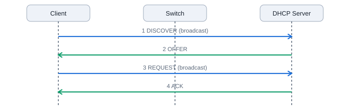

*شکل ۱: چهار مرحله‌ی DORA بین کلاینت و سرور.*

| مرحله | پیام        | نوع               | محتوا                            |
|-------|-------------|-------------------|----------------------------------|
| D     | Discover    | Broadcast         | کلاینت: «سرور DHCP هست؟»         |
| O     | Offer       | Unicast/Broadcast | سرور: «این IP را پیشنهاد می‌کنم»  |
| R     | Request     | Broadcast         | کلاینت: «همین IP را می‌خواهم»     |
| A     | Acknowledge | Unicast/Broadcast | سرور: «تأیید؛ مدت Lease این است» |

در پاسخ، سرور IP، Mask، Gateway، DNS و زمان اجاره (Lease) را می‌دهد. اگر هیچ پاسخی نرسد، کلاینت Windows خودش آدرس `169.254.x.x` می‌سازد (درس ۲-۱).

### ۲. تهدید: DHCP جعلی

چون Discover یک Broadcast است، هر سرور DHCP در شبکه می‌تواند جواب دهد؛ و کلاینت معمولاً اولین پاسخ را می‌پذیرد. مهاجم با یک سرور جعلی، Gateway را آدرس خودش می‌گذارد و همه‌ی ترافیک را می‌بیند.

### ۳. DHCP Snooping: فقط پورت مجاز OFFER بدهد

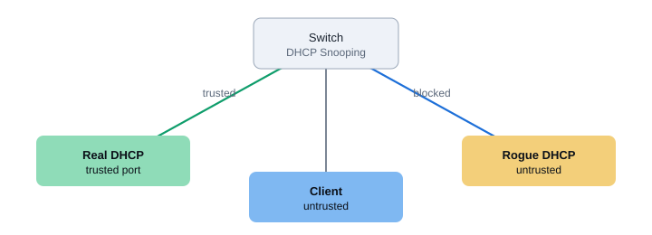

*شکل ۲: پورت سرور واقعی Trusted است؛ OFFER از پورت Untrusted مسدود می‌شود.*

سوییچ هر پورت را «Trusted» یا «Untrusted» می‌داند. پیام‌های سرور (Offer/ACK) فقط از پورت Trusted عبور می‌کنند. پورت کاربر Untrusted است؛ اگر DHCP Server روی آن دیده شود، مسدود می‌شود. سوییچ همچنین جدول Binding می‌سازد (MAC، IP، VLAN، پورت).

``` text
SW1(config)# ip dhcp snooping
SW1(config)# ip dhcp snooping vlan 20,30
SW1(config)# no ip dhcp snooping information option
SW1(config)# interface gi0/10
SW1(config-if)# ip dhcp snooping trust
SW1(config-if)# exit
SW1(config)# interface range gi0/1 - 4
SW1(config-if-range)# ip dhcp snooping limit rate 15
```

- `ip dhcp snooping` و `vlan`: قابلیت را عمومی و برای VLANهای مشخص فعال می‌کند.
- `trust`: فقط روی پورت به سمت DHCP Server (یا Uplink به سمت آن) و Trunkهای بین سوییچ‌ها.
- `limit rate`: سقف تعداد بسته‌ی DHCP در ثانیه برای جلوگیری از حمله‌ی Starvation.
- `no ... information option`: جلوگیری از Option 82 در بعضی سناریوها (مشکل رایج وقتی سرور Option 82 را قبول نمی‌کند).

``` text
SW1# show ip dhcp snooping
SW1# show ip dhcp snooping binding
SW1# show ip dhcp snooping statistics
```

### ۴. DAI: جعل ARP را متوقف کن

در ARP Spoofing مهاجم پاسخ ARP جعلی می‌فرستد: «IP Gateway مال MAC من است». DAI هر ARP را با جدول Binding مقایسه می‌کند؛ اگر IP و MAC با هم نخواند، بسته را می‌اندازد.

``` text
SW1(config)# ip arp inspection vlan 20,30
SW1(config)# interface gi0/10
SW1(config-if)# ip arp inspection trust
SW1# show ip arp inspection
SW1# show ip arp inspection statistics
```

> **شرط DAI**
>
> DAI به جدول Binding وابسته است؛ پس Snooping باید فعال باشد. برای دستگاه‌هایی با IP ثابت (سرور، پرینتر) باید ورودی دستی در Binding یا ARP ACL بنویسید، وگرنه DAI ترافیکشان را می‌اندازد.

### ۵. مثال‌ها

#### ساده

``` text
Client sends DISCOVER on Gi0/1 (untrusted)
Real server replies via Gi0/10 (trusted) -> OFFER passes
Binding: MAC aaaa.0000.0005  IP 10.10.20.50  VLAN 20  Gi0/1
```

#### متوسط: سرور جعلی

``` text
Rogue router on Gi0/3 (untrusted) sends OFFER
Switch drops it  -> client only hears the real server
Log: %DHCP_SNOOPING-5-DHCP_SNOOPING_UNTRUSTED_PORT
```

#### سخت: چرا بعد از فعال‌کردن Snooping هیچ‌کس IP نمی‌گیرد؟

``` text
Cause 1: the port to the DHCP server is NOT trusted -> OFFERs dropped
Cause 2: trunk between switches not trusted
Cause 3: Option 82 inserted and the server rejects it
Fix    : trust server/uplink ports; no ip dhcp snooping information option
```

> **صادقانه درباره‌ی Lab**
>
> طبق Probe اولیه، در vIOSL2 دستورهای DHCP Snooping و DAI فقط «پذیرفته» می‌شوند و ممکن است واقعاً بسته‌ها را بلوک نکنند. در Lab ما، Windows Server DHCP یک VM در ESXi است که در Capstone اصلی کامل می‌شود. اینجا نتیجه‌ی واقعی هر گام را ثبت کنید؛ و مفهوم و دستورها را کامل بدانید.

### تمرین‌ها

**ت1.** ۱ (ساده): نام چهار پیام DORA؟ *(پاسخ: 4-5-ت1 در بخش «پاسخ‌ها» انتهای فصل)*

**ت2.** ۲ (ساده): کدام پورت‌ها Trusted می‌شوند؟ *(پاسخ: 4-5-ت2 در بخش «پاسخ‌ها» انتهای فصل)*

**ت3.** ۳ (متوسط): DAI به چه چیزی وابسته است؟ *(پاسخ: 4-5-ت3 در بخش «پاسخ‌ها» انتهای فصل)*

**ت4.** ۴ (متوسط): کلاینت 169.254.x.x گرفته؛ دو علت محتمل؟ *(پاسخ: 4-5-ت4 در بخش «پاسخ‌ها» انتهای فصل)*

**ت5.** ۵ (سخت): چرا سرور با IP ثابت بعد از DAI قطع می‌شود؟ *(پاسخ: 4-5-ت5 در بخش «پاسخ‌ها» انتهای فصل)*

### Lab هدایت‌شده

سرور DHCP: یا یک VM ویندوزی/لینوکسی که بعداً می‌سازیم، یا موقتاً یک روتر با DHCP Pool. در این Lab، روی R1 یک Pool تست می‌سازیم.

#### گام ۱: DHCP موقت روی R1

``` text
R1(config)# ip dhcp excluded-address 10.10.20.1 10.10.20.10
R1(config)# ip dhcp pool USERS20
R1(dhcp-config)# network 10.10.20.0 255.255.255.0
R1(dhcp-config)# default-router 10.10.20.1
R1(dhcp-config)# dns-server 10.10.10.53
R1(dhcp-config)# lease 0 8
```

#### گام ۲: کلاینت VPCS آدرس بگیرد

``` text
PC1> ip dhcp
PC1> show ip
```

#### گام ۳: Snooping

``` text
SW1(config)# ip dhcp snooping
SW1(config)# ip dhcp snooping vlan 20
SW1(config)# interface gi0/0
SW1(config-if)# ip dhcp snooping trust
SW1# show ip dhcp snooping binding
```

#### گام ۴: DAI

``` text
SW1(config)# ip arp inspection vlan 20
SW1(config)# interface gi0/0
SW1(config-if)# ip arp inspection trust
```

نتیجه‌ی هر گام را ثبت کنید؛ اگر Binding ساخته نشد، همین را به‌عنوان محدودیت شبیه‌ساز ثبت کنید.

### Lab مستقل

یک «تحلیل خطر DHCP» یک‌صفحه‌ای بنویسید: ۳ تهدید، ۳ کنترل (Snooping، DAI، Port Security)، و ۳ دستور Verification در `03-ops/dhcp-l2-security.md`.

### عیب‌یابی

|         |                                                                                                                                                                  |
|---------|------------------------------------------------------------------------------------------------------------------------------------------------------------------|
| Symptom | بعد از Snooping کلاینت‌ها IP نمی‌گیرند                                                                                                                             |
| چک‌لیست  | ۱) پورت سرور Trusted است؟ ؛ ۲) Trunkهای بین سوییچ‌ها Trusted هستند؟ ؛ ۳) VLAN درست در لیست Snooping است؟ ؛ ۴) Option 82 مشکل می‌سازد؟ ؛ ۵) Rate Limit خیلی کم است؟ |
| ابزار   | show ip dhcp snooping ، show ip dhcp snooping binding                                                                                                            |
| رفع     | Trust صحیح و حذف Option 82                                                                                                                                       |

### سؤال‌های مرور

**م1.** DHCP Snooping چه مشکلی را حل می‌کند؟ *(پاسخ: 4-5-م1 در بخش «پاسخ‌ها» انتهای فصل)*

**م2.** DAI چطور کار می‌کند؟ *(پاسخ: 4-5-م2 در بخش «پاسخ‌ها» انتهای فصل)*

### English Corner: انگلیسی تخصصی این درس

این جمله‌ها از مستندات و محیط کار واقعی‌اند. بلند بخوانید و ترجمه را بپوشانید.

| English sentence                                                        | ترجمه                                                                |
|-------------------------------------------------------------------------|----------------------------------------------------------------------|
| Enable DHCP snooping on the access VLANs and trust only the uplink.     | DHCP Snooping را روی VLANهای Access فعال و فقط Uplink را Trust کنید. |
| A rogue DHCP server can redirect clients to a malicious gateway.        | سرور DHCP جعلی می‌تواند کلاینت‌ها را به Gateway مخرب هدایت کند.        |
| Dynamic ARP inspection validates ARP packets against the binding table. | DAI بسته‌های ARP را با جدول Binding اعتبارسنجی می‌کند.                 |
| The client fell back to an APIPA address.                               | کلاینت به آدرس APIPA برگشت.                                          |

**Q1.** Quick quiz (answer in English): Why must the trunk between switches be trusted for DHCP snooping? *(پاسخ: 4-5-Q1 در بخش «پاسخ‌ها» انتهای فصل)*

### تکلیف و چک‌لیست تسلط

- [ ] DORA را بدون نگاه توضیح دهم.
- [ ] Snooping و DAI را بنویسم و نتیجه‌ی واقعی را ثبت کنم.
- [ ] تحلیل خطر را بنویسم.

### یادآوری اشتباهات شما

> **یادآوری**
>
> پیش‌بینی قبل از اجرا؛ بکاپ قبل از تغییر؛ پذیرفته‌شدن دستور ≠ کار کردن؛ فرمول‌ها در بلوک مستقل.


#### کارت Lab — DHCP، Snooping و DAI

| # | فیلد | محتوا |
|---|---|---|
| 1 | عنوان و هدف | DHCP DORA، Snooping و DAI |
| 2 | پیش‌نیاز | درس 4-4 |
| 3 | توپولوژی | SW1 + DHCP (R1) + PC |
| 4 | تجهیزات | R1،SW1،VPCS |
| 5 | نسخه نرم‌افزار | vIOS-L2 15.2(20200924، Experimental) برای SW؛ vIOS 15.9(3)M9 برای R؛ VPCS؛ PNetLab 4.2.8 |
| 6 | IP Plan | VLAN 20 |
| 7 | وضعیت اولیه | Pool 10.10.20.0/24 |
| 8 | صورت مسئله | Binding و Trusted |
| 9 | مراحل هدایت‌شده | همان بخش «Lab هدایت‌شده» همین درس |
| 10 | تست عملکرد | `show ip dhcp snooping binding` |
| 11 | سناریوی خرابی | DHCP جعلی |
| 12 | روش عیب‌یابی | لایه‌ای/با شواهد (بخش عیب‌یابی همین درس) |
| 13 | نتیجه‌ی مورد انتظار | Binding ساخته شود؛ سرور جعلی بسته |
| 14 | معیار پذیرش | نتیجه‌ی واقعی ثبت |
| 15 | مستندات نهایی | `03-ops/dhcp-l2-security.md` |
| 16 | Cleanup و بازگردانی | no ip dhcp snooping |

> **وضعیت راستی‌آزمایی (خارج از ۱۶ فیلد):** **اجرا نشده (فقط طراحی).** DHCP Snooping/DAI در Probe فقط CLI-Accepted.

---

<a id="l-4-6"></a>

## درس 4-6 — طراحی سه‌لایه و آزمون G2

**فصل ۴ - روز ۶ · پیش‌نیاز: درس‌های ۴-۱ تا ۴-۵ · ۶ ساعت**

### این درس درباره چیست و چرا باید یاد بگیریم؟

**چه چیزی یاد می‌گیریم:** چطور شبکه‌ی سازمانی را در سه لایه (Access، Distribution، Core) طراحی می‌کنیم، چه زمانی «Collapsed Core» کافی است، عیب‌یابی خرابی‌های فصل ۴ (TS06 تا TS08)، و آزمون عملی Gate G2.

**چرا لازم است:** طراحی بد یعنی گسترش‌ناپذیری و عیب‌یابی سخت. طراحی لایه‌ای (Hierarchical) برای هر سازمان استانداردی است که جواب سؤال «این سوییچ را کجا بگذارم؟» را می‌دهد؛ و Gate G2 تضمین می‌کند Switching را عملی یاد گرفته‌اید.

- **در کار روزانه:** هر ساختمان یا شعبه با یکی از دو الگوی ۳لایه یا Collapsed Core طراحی می‌شود.
- **در امنیت:** لایه‌بندی یعنی نقاط کنترل مشخص (Policy روی Distribution/Core).
- **در Capstone:** شعبه‌ی کوچک Collapsed Core و مرکز ۳لایه‌ی ساده دارد.

> **مسیر درس**
>
> سه لایه ← Collapsed Core ← طراحی برای Capstone ← عیب‌یابی TS06-TS08 ← Lab ← Gate G2.

#### اصطلاحات این درس (مخفف ← شکل کامل ← معنی)

| مخفف           | شکل کامل انگلیسی   | معنی فارسی                                 |
|----------------|--------------------|--------------------------------------------|
| Access         | Access layer       | لایه‌ی اتصال کاربران و دستگاه‌ها             |
| Distribution   | Distribution layer | تجمیع Accessها، Policy و مسیریابی بین VLAN |
| Core           | Core layer         | هسته‌ی سریع شبکه                            |
| Collapsed Core | Collapsed Core     | ادغام Distribution و Core در یک لایه       |
| HLD            | High-Level Design  | طراحی سطح بالا                             |
| G2             | Gate 2             | آزمون عملی پایان فصل ۴                    |

### ۱. چرا سه لایه؟

شهری را تصور کنید که هر خانه مستقیماً به همه‌ی خانه‌ها خیابان دارد؛ ۱۰۰ خانه یعنی ۴۹۵۰ خیابان! لایه‌بندی مثل «کوچه، خیابان، بزرگراه» است: هر لایه کار مشخصی دارد و تعداد اتصال‌ها کم می‌ماند.

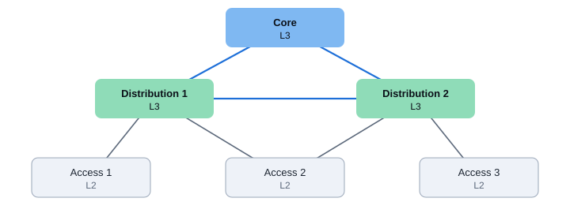

*شکل ۱: شبکه‌ی سه‌لایه؛ هر Access به دو Distribution وصل است (Redundancy).*

| لایه         | کار                                              | دستگاه نمونه  | ویژگی                    |
|--------------|--------------------------------------------------|---------------|--------------------------|
| Access       | اتصال کاربران، PortFast، Port Security، Snooping | سوییچ L2      | تعداد پورت زیاد، ساده    |
| Distribution | تجمیع، Gateway VLANها، ACL/Policy                | سوییچ L3      | Redundancy، EtherChannel |
| Core         | انتقال سریع بین Distributionها                   | سوییچ/روتر L3 | فقط سرعت و پایداری       |

### ۲. Collapsed Core: وقتی دو لایه کافی است

در شعبه‌ی کوچک، Distribution و Core را یکی می‌کنیم (دو سوییچ L3 که هم Gateway‌اند و هم هسته). این ارزان‌تر است و برای ۵۰ تا ۲۰۰ کاربر کافی.

| معیار   | سه‌لایه                  | Collapsed Core |
|---------|-------------------------|----------------|
| اندازه  | سازمان بزرگ/چند ساختمان | شعبه‌ی کوچک     |
| هزینه   | بیشتر                   | کمتر           |
| پیچیدگی | بیشتر                   | کمتر           |
| گسترش   | آسان‌تر                  | محدودتر        |

> **در Capstone ما**
>
> مرکز: Core/Distribution ساده روی یک جفت سوییچ؛ شعبه‌ها: Collapsed Core. Gateway اصلی همه‌ی VLANها FortiGate است و سوییچ‌ها L2 هستند (طبق تصمیم معماری).

### ۳. سه خرابی این هفته (TS06 تا TS08)

#### TS06: Root اشتباه

``` text
Symptom : slow network, traffic path goes through an old switch
Evidence: show spanning-tree -> wrong bridge is root
Fix     : spanning-tree vlan X root primary on the core switch
Verify  : show spanning-tree root
```

#### TS07: پورت err-disabled با BPDU Guard یا Port Security

``` text
Symptom : user port down, link light on
Evidence: show interfaces status err-disabled
Fix     : remove cause, shutdown / no shutdown
Verify  : port up, user online
```

#### TS08: EtherChannel Mismatch

``` text
Symptom : Po1(SD) or member ports (s)
Evidence: show etherchannel summary, show interfaces trunk
Fix     : make allowed/native/speed identical, bounce the ports
Verify  : Po1(SU), members (P)
```

### ۴. طراحی خودتان: HLD کوتاه

برای یک شعبه با ۱۵۰ کاربر، ۱۰ سرور و ۲۰ دستگاه مدیریتی، یک طراحی Collapsed Core بنویسید: چند سوییچ، چه VLANهایی، کجا Root، چه لینک‌هایی EtherChannel.

``` text
Branch (Collapsed Core)
- 2 x L3 core/distribution switches (EtherChannel between them)
- 3 x access switches, each uplinked to both cores
- VLAN 20 users, 30 servers, 10 management
- STP root: core 1 (secondary: core 2)
- Access: PortFast + BPDU Guard + Port Security + DHCP Snooping
```

### ۵. آزمون عملی Gate G2 (پایان فصل ۴)

بدون نگاه به درس، با مدرک (خروجی دستورها):

| \#  | وظیفه                                               | مدرک                                |
|-----|-----------------------------------------------------|-------------------------------------|
| ۱   | Rapid-PVST و Root/Secondary برای ۳ VLAN             | show spanning-tree root             |
| ۲   | PortFast + BPDU Guard روی پورت‌های کاربر و ساخت تخلف | show interfaces status err-disabled |
| ۳   | EtherChannel با LACP بین دو سوییچ                   | show etherchannel summary           |
| ۴   | Port Security با Sticky و ثبت تخلف                  | show port-security interface        |
| ۵   | DHCP Snooping + DAI (یا ثبت محدودیت شبیه‌ساز)        | show ip dhcp snooping               |
| ۶   | سه عیب TS06 تا TS08 با RCA                          | گزارش یک‌صفحه‌ای                      |
| ۷   | HLD شعبه‌ی Collapsed Core                            | فایل طراحی                          |

**معیار قبولی:** حداقل ۶ از ۷ مورد با مدرک (طبق Blueprint G2). وقتی تمام شد بگویید «G2 انجام شد».

### تمرین‌ها

**ت1.** ۱ (ساده): سه لایه‌ی شبکه؟ *(پاسخ: 4-6-ت1 در بخش «پاسخ‌ها» انتهای فصل)*

**ت2.** ۲ (ساده): Collapsed Core یعنی چه؟ *(پاسخ: 4-6-ت2 در بخش «پاسخ‌ها» انتهای فصل)*

**ت3.** ۳ (متوسط): چرا Access به دو Distribution وصل است؟ *(پاسخ: 4-6-ت3 در بخش «پاسخ‌ها» انتهای فصل)*

**ت4.** ۴ (سخت): در طراحی سه‌لایه، Root STP کجا باشد؟ *(پاسخ: 4-6-ت4 در بخش «پاسخ‌ها» انتهای فصل)*

### Lab هدایت‌شده

این Lab یک «مرور کل فصل ۴» است: روی مثلث SW1-SW2-SW3 همه‌ی تنظیمات را اعمال کنید.

1.  Rapid-PVST و Root/Secondary (درس ۴-۲).
2.  PortFast و BPDU Guard روی پورت کاربر (درس ۴-۲).
3.  EtherChannel بین SW1 و SW2 (درس ۴-۳).
4.  Port Security روی پورت PC (درس ۴-۴).
5.  Snooping و DAI (درس ۴-۵).
6.  پیکربندی را بکاپ و در Git (بدون رمز) ذخیره کنید.

``` text
SWx# show spanning-tree summary
SWx# show etherchannel summary
SWx# show port-security
SWx# show ip dhcp snooping
SWx# copy running-config flash:SWx-w4-final.cfg
```

### Lab مستقل

سه سناریوی TS06 تا TS08 را بسازید و هرکدام را با RCA یک‌صفحه‌ای در `03-ops/rca-w4.md` ثبت کنید.

### عیب‌یابی

|         |                                                                         |
|---------|-------------------------------------------------------------------------|
| Symptom | بعد از تغییرات فصل ۴ شبکه ناپایدار است                                 |
| روش     | لایه‌به‌لایه: لینک و STP و Channel و Port Security و DHCP                 |
| ابزار   | show spanning-tree ، show etherchannel summary ، show interfaces status |
| پیشگیری | تغییر مرحله‌ای با بکاپ و reload in                                       |

### سؤال‌های مرور

**م1.** چرا لایه‌بندی؟ *(پاسخ: 4-6-م1 در بخش «پاسخ‌ها» انتهای فصل)*

**م2.** Collapsed Core کی مناسب است؟ *(پاسخ: 4-6-م2 در بخش «پاسخ‌ها» انتهای فصل)*

### English Corner: انگلیسی تخصصی این درس

این جمله‌ها از مستندات و محیط کار واقعی‌اند. بلند بخوانید و ترجمه را بپوشانید.

| English sentence                                                     | ترجمه                                                      |
|----------------------------------------------------------------------|------------------------------------------------------------|
| A hierarchical design simplifies troubleshooting and scaling.        | طراحی سلسله‌مراتبی عیب‌یابی و مقیاس‌پذیری را ساده می‌کند.      |
| Every access switch has redundant uplinks to the distribution layer. | هر سوییچ Access Uplink پشتیبان به لایه‌ی Distribution دارد. |
| Collapsed core merges the core and distribution layers.              | Collapsed Core لایه‌های Core و Distribution را ادغام می‌کند. |
| Document the design before you configure.                            | پیش از پیکربندی، طراحی را مستند کنید.                      |

**Q1.** Quick quiz (answer in English): Why should the STP root never be an access switch? *(پاسخ: 4-6-Q1 در بخش «پاسخ‌ها» انتهای فصل)*

### تکلیف و چک‌لیست تسلط

- [ ] HLD شعبه را بنویسم.
- [ ] TS06 تا TS08 را با RCA ثبت کنم.
- [ ] Gate G2 را کامل کنم.

### یادآوری اشتباهات شما

> **یادآوری**
>
> پیش‌بینی قبل از اجرا؛ بکاپ قبل از تغییر؛ پذیرفته‌شدن دستور ≠ کار کردن؛ فرمول‌ها در بلوک مستقل.


#### کارت Lab — طراحی سه‌لایه و آزمون G2

| # | فیلد | محتوا |
|---|---|---|
| 1 | عنوان و هدف | طراحی سه‌لایه و TS06..TS08 + G2 |
| 2 | پیش‌نیاز | درس 4-5 |
| 3 | توپولوژی | مثلث + EtherChannel |
| 4 | تجهیزات | ۳ سوییچ + VPCS |
| 5 | نسخه نرم‌افزار | vIOS-L2 15.2(20200924، Experimental) برای SW؛ vIOS 15.9(3)M9 برای R؛ VPCS؛ PNetLab 4.2.8 |
| 6 | IP Plan | Baseline ف۴ |
| 7 | وضعیت اولیه | HLD شعبه |
| 8 | صورت مسئله | سه خرابی با RCA |
| 9 | مراحل هدایت‌شده | همان بخش «Lab هدایت‌شده» همین درس |
| 10 | تست عملکرد | show spanning-tree/etherchannel |
| 11 | سناریوی خرابی | TS06-08 |
| 12 | روش عیب‌یابی | لایه‌ای/با شواهد (بخش عیب‌یابی همین درس) |
| 13 | نتیجه‌ی مورد انتظار | هر خرابی RCA |
| 14 | معیار پذیرش | G2 ≥ ۶ از ۷ |
| 15 | مستندات نهایی | `03-ops/rca-w4.md` |
| 16 | Cleanup و بازگردانی | بازگشت به بکاپ |

> **وضعیت راستی‌آزمایی (خارج از ۱۶ فیلد):** **اجرا نشده (فقط طراحی).** اجرا نشده.

---

<a id="ans-4"></a>

## درس 4-7 — STP در عمق: تایمرها، محاسبه‌ی Convergence، RSTP، Loop Guard/UDLD/Root Guard و عیب‌یابی

**فصل 4 · بازنویسی عمیق · پیش‌نیاز: ۴-۱، ۴-۲، ۴-۶ · ≈ 8 ساعت**

> **وضعیت:** Cisco IOSv/IOSvL2 (vIOS 15.x)؛ خروجی‌ها نمونه‌ی آموزشی؛ Lab «اجرا نشده»؛ برخی ویژگی‌ها روی vIOS `Unverified`.

### ۱) هدف آموزشی

در پایان این درس باید بتوانید:

1. تایمرهای STP (Hello 2، Forward Delay 15، Max Age 20) و محاسبه‌ی Convergence 802.1D را انجام دهد.
2. تفاوت 802.1D و RSTP (Proposal/Agreement، Edge، Alternate/Backup) را توضیح دهد.
3. Root Guard، BPDU Guard، Loop Guard، UDLD را با سناریو انتخاب کند.
4. STP را با دستورهای `show spanning-tree` عیب‌یابی کند.
5. Root Placement و Priority را طراحی کند.

### ۲) مفهوم پایه: چیست و چرا؟

حلقه‌ی لایه‌ی ۲ شبکه را در ثانیه‌ها می‌کشد (Broadcast Storm). STP حلقه را می‌شکند، ولی تایمرها و رفتار هنگام خرابی را باید بدانید وگرنه «۵۰ ثانیه قطعی» و «Root اشتباه» می‌بینید.

### ۳) توضیح عمیق فنی

#### ۱) تایمرها (802.1D)

``` text
Hello = 2 s (BPDU from root)   Forward Delay = 15 s   Max Age = 20 s
Port states: Blocking -> Listening (15 s) -> Learning (15 s) -> Forwarding
Convergence after direct link failure ~= 30 s (FwdDelay x 2)
Convergence after indirect failure ~= MaxAge + 2 x FwdDelay = 20 + 30 = 50 s
```

#### ۲) RSTP (802.1w)

حالت‌ها: Discarding، Learning، Forwarding. نقش‌ها: Root، Designated، Alternate، Backup. **Proposal/Agreement** بین دو سوئیچ، Forwarding را در کمتر از ۱ ثانیه برقرار می‌کند. **Edge Port** (PortFast) بلافاصله Forwarding. Convergence معمولاً < ۱–۲ ثانیه.

#### ۳) محافظت‌ها

| ابزار | کار | سناریو |
|---|---|---|
| Root Guard | پورت را اگر BPDU بهتر آمد Root-inconsistent می‌کند | جلوگیری از Root شدن سوئیچ غیرمجاز |
| BPDU Guard | پورت Edge که BPDU دریافت کند Err-disable | سوئیچ/حلقه به پورت کاربر |
| Loop Guard | پورت Non-designated که BPDU را از دست بدهد Forward نمی‌شود | لینک یک‌طرفه |
| UDLD | لینک یک‌طرفه (Fiber) را کشف و پورت را می‌بندد | Fiber |
| BPDU Filter | BPDU را فیلتر (خطرناک) | موارد خاص |

#### ۴) طراحی Root

Root را عمداً روی Core بگذارید: Priority 4096 (Primary) و 8192 (Secondary) با `spanning-tree vlan X root primary`. Root اتفاقی (Priority پیش‌فرض 32768+VLAN و کوچک‌ترین MAC) ممکن است قدیمی‌ترین سوئیچ Access باشد.

#### ۵) عیب‌یابی

``` text
show spanning-tree vlan 10
show spanning-tree root
show spanning-tree interface Gi0/1 detail
show spanning-tree inconsistentports
debug spanning-tree events (lab only)
```

### ۴) طراحی و تصمیم‌گیری

| سؤال طراحی | گزینه‌ها و معیار انتخاب |
|---|---|
| Root | Core با priority صریح |
| Edge | PortFast + BPDU Guard |
| Fiber | UDLD+Loop Guard |
| STP mode | Rapid-PVST |

### ۵) مثال‌های حل‌شده (ساده، متوسط، سخت)

**ساده (حل‌شده):** Root Primary روی Core با Priority 4096؛ `show spanning-tree root` Root مورد انتظار.

**متوسط (محاسبه):** 802.1D: قطع کابل مستقیم روی Root Port ⇒ ≈ 30 s؛ قطع غیرمستقیم (سوئیچ میانی) ⇒ ≈ 50 s. با RSTP < 2 s.

**سخت (سناریو):** کاربر سوئیچ کوچک وصل کرد؛ Root جابه‌جا شد و ترافیک مسیر عوض شد. علت: Root Guard نبود. رفع: Root Guard روی پورت‌های رو به پایین Core؛ BPDU Guard روی Access؛ Alert بر `ROOTGUARD`/`BPDUGUARD`. آزمون: اتصال سوئیچ تست ⇒ پورت inconsistent/err-disable.

### ۷) پیاده‌سازی از مسیر CLI

``` text
spanning-tree mode rapid-pvst
spanning-tree vlan 1-4094 root primary
interface range GigabitEthernet0/10 - 24
 spanning-tree portfast
 spanning-tree bpduguard enable
interface GigabitEthernet0/1
 spanning-tree guard root
spanning-tree loopguard default
udld enable
```

### ۸) Verification (اثبات صحت)

- `show spanning-tree root`.
- آزمون Root Guard/BPDU Guard با سوئیچ تست.
- اندازه‌گیری Convergence با ping.

### ۹) Troubleshooting

| علامت | شاهد برای بررسی | علت محتمل و رفع |
|---|---|---|
| Root اشتباه | `show spanning-tree root` | Priority |
| Port err-disabled | Log | BPDU Guard/UDLD |
| Convergence کند | mode | pvst به rapid-pvst |

### ۱۰) نکات امنیتی

- BPDU/Root Guard در مرز.
- BPDU Filter با احتیاط.

### ۱۱) جمع‌بندی مفهومی

- تایمرها و Convergence 30/50 s در 802.1D.
- RSTP سریع.
- Guardها هرکدام یک تهدید.
- Root عمدی.

### ۱۲) تمرین و ارزیابی

**ت1.** (ساده) Hello/Forward Delay/Max Age پیش‌فرض؟ *(پاسخ: 4-7-ت1)*

**ت2.** (ساده) PortFast کجا استفاده می‌شود؟ *(پاسخ: 4-7-ت2)*

**ت3.** (متوسط) Convergence غیرمستقیم 802.1D؟ *(پاسخ: 4-7-ت3)*

**ت4.** (متوسط) Root Guard و BPDU Guard فرقشان؟ *(پاسخ: 4-7-ت4)*

**ت5.** (سخت) سوئیچ کاربر Root شد؛ تحلیل و رفع. *(پاسخ: 4-7-ت5)*

**ت6.** (سخت، طراحی) استاندارد STP برای دانشگاه. *(پاسخ: 4-7-ت6)*

**Q1.** Quick quiz (English): What does BPDU guard do when an edge port receives a BPDU? *(پاسخ: 4-7-Q1)*

### ۱۳) اصطلاحات و English Corner

| مخفف | شکل کامل | معنی |
|---|---|---|
| BPDU | Bridge Protocol Data Unit | بسته‌ی STP |
| UDLD | UniDirectional Link Detection | تشخیص لینک یک‌طرفه |
| RSTP | Rapid Spanning Tree Protocol | STP سریع |

- *Place the root bridge deliberately at the core.* ← Root Bridge را عمداً در Core قرار دهید.

### ۱۴) کارت Lab

**کارت Lab:** STP عمیق. **وضعیت:** اجرا نشده. **Evidence:** `03-ops/stp-deep.md`.

### ۱۵) منابع

- IEEE 802.1D/802.1w
- Cisco Spanning Tree Protocol guides

<a id="l-4-8"></a>

## درس 4-8 — Storm Control و RA Guard: جلوگیری از طوفان ترافیک و Router Advertisement جعلی

**فصل 4 · درس افزوده برای انطباق با سرفصل رسمی CCNA 200-301 (مورد 4.7: Configure Layer 2 security features؛ بخش‌های Storm Control و RA Guard) · پیش‌نیاز: ۴-۴، ۴-۵**

> **وضعیت:** نظری/مستندی؛ دستورها `Unverified`؛ Lab اجرا نشده.

### ۱) این درس درباره چیست و چرا باید یاد بگیریم؟

**چه چیزی یاد می‌گیریم:** دو سپر لایه‌ی ۲: (۱) **Storm Control** که جلوی طوفان Broadcast/Multicast/Unicast را می‌گیرد و (۲) **RA Guard** که جلوی روتر جعلی در شبکه‌ی IPv6 را می‌گیرد.

**چرا لازم است؟** تصور کنید در یک سالن یک نفر مدام با بلندگو داد می‌زند؛ هیچ‌کس نمی‌تواند حرف بزند. طوفان Broadcast همین است: یک حلقه‌ی L2 یا کارت شبکه‌ی خراب، میلیون‌ها فریم Broadcast تولید می‌کند و CPU همه‌ی دستگاه‌ها را پر می‌کند. RA Guard هم مثل کسی است که در سالن ادعا می‌کند «من مدیر هستم، همه از من پیروی کنید»؛ مهاجم با یک Router Advertisement جعلی خودش را Default Gateway معرفی می‌کند و ترافیک را از خود عبور می‌دهد (Man-in-the-Middle).

### ۲) Storm Control

#### ۲-۱) مفهوم

Storm Control ترافیک Broadcast، Multicast یا Unicast ناشناخته را روی هر پورت **اندازه می‌گیرد** و اگر از سطح (Threshold) گذشت، ترافیک اضافه را رد یا پورت را خاموش می‌کند.

Threshold را می‌توان به‌صورت درصد پهنای باند، bps یا pps داد.

#### ۲-۲) دستورها (Unverified)

``` text
interface GigabitEthernet1/0/10
 storm-control broadcast level 20.00 10.00
 storm-control multicast level 30.00
 storm-control unicast level 50.00
 storm-control action shutdown
 storm-control action trap
```

- `level 20.00 10.00`: سطح بالا (Rising) 20٪ و سطح پایین (Falling) 10٪.
- پیش‌فرض Action: ترافیک اضافه در بازه‌ی جاری (۱ ثانیه) **Drop** می‌شود (حالت filter).
- `action shutdown`: پورت `err-disabled` می‌شود.
- `action trap`: فقط SNMP Trap ارسال می‌شود.

بازیابی خودکار:

``` text
errdisable recovery cause storm-control
errdisable recovery interval 300
```

بررسی:

``` text
show storm-control
show storm-control broadcast
show interfaces Gi1/0/10 status err-disabled
```

#### ۲-۳) محاسبه‌ی Threshold

``` text
Port speed = 1 Gbps
Broadcast level = 20 %
Allowed broadcast = 1000 Mbps x 0.20 = 200 Mbps
```

در شبکه‌ی عادی Broadcast بسیار کمتر از 1٪ است؛ پس 20٪ بسیار سخاوتمندانه است. برای انتخاب عدد واقعی ابتدا Baseline بگیرید.

### ۳) RA Guard

#### ۳-۱) پیش‌زمینه: RA در IPv6

در IPv6 روترها با پیام **RA** (Router Advertisement، یعنی «اعلان روتر»؛ ICMPv6 Type 134) به Hostها می‌گویند: Prefix چیست، Default Gateway کیست و آیا از DHCPv6 استفاده کنند. Hostها با **SLAAC** (Stateless Address Autoconfiguration) آدرس می‌سازند.

#### ۳-۲) حمله

مهاجم با ابزاری (مثلاً `radvd` یا ابزارهای تست) RA جعلی می‌فرستد: خودش را Gateway معرفی می‌کند، Prefix اشتباه می‌دهد یا DNS مخرب (RDNSS). نتیجه: قطع شبکه یا شنود ترافیک. این حمله شبیه Rogue DHCP در IPv4 است.

#### ۳-۳) راه‌حل: RA Guard

RA Guard روی پورت سوییچ، پیام‌های RA را فقط از پورت‌هایی که «Router» هستند قبول می‌کند و از پورت‌های «Host» حذف می‌کند.

``` text
ipv6 nd raguard policy HOST-POLICY
 device-role host
ipv6 nd raguard policy ROUTER-POLICY
 device-role router
!
interface GigabitEthernet1/0/10
 ipv6 nd raguard attach-policy HOST-POLICY
interface GigabitEthernet1/0/1
 ipv6 nd raguard attach-policy ROUTER-POLICY
```

بررسی:

``` text
show ipv6 nd raguard policies
show ipv6 snooping counters
```

محدودیت: پیاده‌سازی‌های قدیمی با Fragmentation/Extension Header دور زده می‌شدند؛ RFC 7113 ضعف‌ها را توضیح داده است و باید نسخه‌ی سیستم‌عامل و پشتیبانی را بررسی کرد.

### ۴) مثال‌های حل‌شده از ساده به سخت

**ساده — کدام پورت Host و کدام Router؟** پورت متصل به روتر Uplink ⇒ `device-role router`. تمام پورت‌های کاربران ⇒ `device-role host`.

**متوسط — طوفان Broadcast.** علامت: CPU سوییچ 95٪ و کاربران کند. روش:

1. `show processes cpu sorted` و `show interfaces counters`.
2. پورتی که Broadcast بسیار بالا دارد را پیدا کنید.
3. `storm-control broadcast level 5` (Lab/Baseline) و `action shutdown`.
4. علت را (حلقه‌ی L2 یا کارت خراب) رفع کنید.

``` text
Gi1/0/14  Broadcast  rising=20.00  falling=10.00  action=shutdown  current=87.3%
```

**سخت — RA جعلی.** کاربران IPv6 ناگهان Default Gateway عجیب (`fe80::dead:beef`) دارند.

1. در کلاینت: `ipconfig` یا `ip -6 route` ⇒ Gateway نامعتبر.
2. با Wireshark: فیلتر `icmpv6.type == 134` ⇒ MAC فرستنده.
3. MAC را در جدول CAM بیابید: `show mac address-table address <mac>` ⇒ پورت.
4. پورت را خاموش و RA Guard روی همه‌ی پورت‌های Host فعال کنید.

### ۵) Lab (اجرا نشده)

دو ماشین و یک سوییچ؛ یک ماشین با ابزار تست RA؛ پیش و پس از RA Guard رفتار را مقایسه کنید.

### ۶) اصطلاحات این درس

| اصطلاح | شکل کامل | معنی |
|---|---|---|
| RA | Router Advertisement | اعلان روتر در IPv6 |
| SLAAC | Stateless Address Autoconfiguration | ساخت خودکار آدرس |
| NDP | Neighbor Discovery Protocol | کشف همسایه |
| MITM | Man-in-the-Middle | مهاجم میانی |
| RDNSS | Recursive DNS Server option | DNS در RA |

### ۷) تمرین‌ها

**ت1.** (ساده) Storm Control چه ترافیک‌هایی را کنترل می‌کند؟ *(پاسخ: 4-8-ت1 در بخش «پاسخ‌ها» انتهای فصل)*

**ت2.** (ساده) RA Guard چه حمله‌ای را می‌گیرد؟ *(پاسخ: 4-8-ت2 در بخش «پاسخ‌ها» انتهای فصل)*

**ت3.** (متوسط) روی لینک 10 Gbps سطح Broadcast برابر 1٪ است؛ چند Mbps مجاز است؟ *(پاسخ: 4-8-ت3 در بخش «پاسخ‌ها» انتهای فصل)*

**ت4.** (سخت) مراحل یافتن منبع RA جعلی را بنویسید. *(پاسخ: 4-8-ت4 در بخش «پاسخ‌ها» انتهای فصل)*

### ۸) English Corner

- *Storm control limits broadcast, multicast and unicast traffic on a port.*
- *RA guard drops router advertisements received on host-facing ports.*
- **Q1.** Which ICMPv6 message type is a router advertisement? *(پاسخ: 4-8-Q1 در بخش «پاسخ‌ها» انتهای فصل)*

---

<a id="l-4-9"></a>

### بخش تکمیلی درس: سناریوی واقعی، مثال‌های بیشتر و عیب‌یابی

> بخش‌های زیر درس بالا را کامل می‌کنند: سناریوی گام‌به‌گام، مثال‌های بیشتر از ساده تا سخت، جدول عیب‌یابی و پرسش‌های مصاحبه. ابتدا بخش‌های اصلی بالا را مطالعه کنید.

### تکمیل عمیق: جدول عیب‌یابی سریع — Storm Control و RA Guard

| علامت | شاهد برای بررسی | علت محتمل و رفع |
|---|---|---|
| پورت err-disabled با Storm Control | `show storm-control` و `show interfaces status err-disabled` | Broadcast/حلقه؛ رفع علت، سپس بازیابی پورت |
| Threshold خیلی حساس | Baseline ترافیک | افزایش آستانه بر پایه‌ی اندازه‌گیری |
| RA جعلی دیده می‌شود | Capture `icmpv6.type == 134` | RA Guard روی پورت‌های Host |
| RA Guard بی‌اثر | `show ipv6 nd raguard policies` | Policy attach نشده یا نقش پورت اشتباه |

## درس 4-9 — EtherChannel و LACP/PAgP: حالت‌ها، شرط تشکیل، Load Balancing و عیب‌یابی

**فصل 4 · درس افزوده برای سرفصل رسمی CCNA 200-301 (مورد 2.1.c: Layer 2/Layer 3 LACP port-channel/EtherChannel و 2.2: port channel and LACP) · پیش‌نیاز: ۴-۱ تا ۴-۳**

> **وضعیت:** نظری/مستندی؛ دستورها `Unverified`؛ خروجی‌ها نمونه‌ی آموزشی‌اند؛ Lab اجرا نشده.

### ۱) این درس درباره چیست و چرا باید یاد بگیریم؟

**چه چیزی یاد می‌گیریم:** چند لینک فیزیکی را چطور به یک لینک منطقی تبدیل کنیم، کدام ترکیب حالت‌های LACP/PAgP تشکیل می‌شود، چطور بار تقسیم می‌شود و چرا یک Port-Channel «Suspended» می‌شود.

**چرا لازم است؟** اگر بین دو سوییچ دو کابل 1 Gbps بکشید، STP یکی را Block می‌کند و پهنای باند عملاً 1 Gbps می‌ماند. EtherChannel دو کابل را «یک لینک 2 Gbps» نشان می‌دهد؛ STP هم فقط یک لینک می‌بیند. اگر یکی از کابل‌ها قطع شود، لینک منطقی بدون Reconvergence بالا می‌ماند.

### ۲) توضیح از پایه

#### ۲-۱) سه روش تشکیل

| روش | استاندارد | حالت‌ها |
|---|---|---|
| LACP | IEEE 802.3ad / 802.1AX | `active`، `passive` |
| PAgP | اختصاصی Cisco | `desirable`، `auto` |
| Static | — | `on` |

LACP = Link Aggregation Control Protocol؛ PAgP = Port Aggregation Protocol.

#### ۲-۲) جدول ترکیب‌ها

| سمت A | سمت B | نتیجه |
|---|---|---|
| active | active | تشکیل می‌شود |
| active | passive | تشکیل می‌شود |
| passive | passive | **تشکیل نمی‌شود** (هیچ‌کس شروع نمی‌کند) |
| desirable | desirable | تشکیل می‌شود |
| desirable | auto | تشکیل می‌شود |
| auto | auto | **تشکیل نمی‌شود** |
| on | on | تشکیل می‌شود (بدون مذاکره) |
| on | active/desirable | **تشکیل نمی‌شود** (پروتکل ناهمخوان) |

قاعده: در یک Port-Channel نمی‌توان LACP و PAgP را با هم قاطی کرد.

#### ۲-۳) شرط‌های لینک‌های عضو

همه‌ی Memberها باید یکسان باشند: Speed، Duplex، حالت Access/Trunk، VLAN مجاز Trunk، Native VLAN، تنظیمات STP. ناهمخوانی ⇒ عضو Suspended یا Port-Channel بالا نمی‌آید. LACP تا ۸ لینک فعال (و تا ۸ در Standby) می‌پذیرد.

#### ۲-۴) Load Balancing

بار **به‌ازای Flow** تقسیم می‌شود نه به‌ازای بسته: یک Hash از فیلدهای انتخاب‌شده (MAC/IP/Port) محاسبه و لینک مشخصی انتخاب می‌شود. یک Flow همیشه از یک لینک می‌رود (برای جلوگیری از بی‌ترتیبی بسته‌ها).

``` text
port-channel load-balance src-dst-ip
show etherchannel load-balance
```

نتیجه: اگر فقط یک Flow بزرگ داشته باشید (مثلاً Backup)، فقط یک لینک پر می‌شود و دیگری خالی می‌ماند. با افزایش تعداد Flowها توزیع یکنواخت‌تر می‌شود.

``` text
Hash index = (hash value) mod (number of active links)
Example: 2 links -> index 0 or 1 ; 4 links -> 0..3
```

#### ۲-۵) Layer 3 EtherChannel

``` text
interface Port-channel2
 no switchport
 ip address 10.99.0.1 255.255.255.252
```

Port-Channel بین دو سوییچ لایه‌ی ۳ با IP؛ بدون VLAN/STP.

### ۳) دستورها (Unverified)

``` text
interface range GigabitEthernet0/1 - 2
 switchport mode trunk
 channel-group 1 mode active
interface Port-channel1
 switchport mode trunk
 switchport trunk allowed vlan 10,20,30
```

``` text
show etherchannel summary
show etherchannel 1 detail
show lacp neighbor
show interfaces port-channel 1
```

خروجی نمونه و تفسیر پرچم‌ها:

``` text
Group  Port-channel  Protocol    Ports
1      Po1(SU)       LACP        Gi0/1(P)   Gi0/2(P)
```

| پرچم | معنی |
|---|---|
| S | Layer 2 |
| U | In use (فعال) |
| P | عضو Port-Channel (Bundled) |
| s | Suspended (ناهمخوانی) |
| D | Down |
| I | Stand-alone |
| H | Hot-standby |
| R | Layer 3 |

### ۴) مثال‌های حل‌شده از ساده به سخت

**ساده — ظرفیت.** 4 لینک 1 Gbps ⇒ پهنای باند کل 4 Gbps ولی هر Flow حداکثر 1 Gbps.

**متوسط — Port-Channel «Suspended».**

``` text
Po1(SD)   Gi0/1(s)   Gi0/2(P)
```

1. `show etherchannel 1 detail` ⇒ دلیل: Gi0/1 در حالت Access و Gi0/2 Trunk.
2. هر دو Memberها را یکسان کنید.
3. `interface range` را shutdown و سپس no shutdown کنید.
4. تأیید: `Po1(SU)`.

**متوسط — ترکیب غلط.** یک سمت `on` و سمت دیگر `active`؛ تشکیل نمی‌شود. رفع: هر دو `active` (یا یکی `active` و دیگری `passive`).

**سخت — «Port-Channel دو لینک دارد ولی فقط یک لینک پر است».**

1. `show etherchannel load-balance`: `src-mac`.
2. چون همه‌ی ترافیک از یک Router به یک Server می‌رود، MAC منبع/مقصد ثابت است ⇒ Hash ثابت.
3. تغییر به `src-dst-ip` یا `src-dst-port` (در صورت پشتیبانی).
4. اندازه‌گیری با چند Flow (iperf `-P 8`).

**سخت — Loop پس از Port-Channel.** یکی از Memberها با کابل مستقیم به سوییچ دیگری هم وصل شده. STP/LACP: ماشه‌ی `err-disabled`. بررسی `show spanning-tree` و Log.

### ۵) Lab (اجرا نشده)

دو سوییچ با دو لینک؛ ترکیب‌های جدول ۲-۲ را آزمایش کنید و `show etherchannel summary` را ثبت کنید.

### ۶) اصطلاحات این درس

| اصطلاح | شکل کامل | معنی |
|---|---|---|
| LACP | Link Aggregation Control Protocol | مذاکره‌ی استاندارد |
| PAgP | Port Aggregation Protocol | مذاکره‌ی Cisco |
| Bundle | — | مجموعه‌ی لینک‌های تجمیع‌شده |
| Flow | — | جریان ترافیک با 5-tuple یکسان |

### ۷) تمرین‌ها

**ت1.** (ساده) کدام ترکیب‌ها تشکیل می‌شوند: passive/passive، active/passive، auto/auto؟ *(پاسخ: 4-9-ت1 در بخش «پاسخ‌ها» انتهای فصل)*

**ت2.** (ساده) چرا STP فقط یک Port-Channel می‌بیند؟ *(پاسخ: 4-9-ت2 در بخش «پاسخ‌ها» انتهای فصل)*

**ت3.** (متوسط) چهار لینک 10 Gbps؛ حداکثر سرعت یک Flow؟ *(پاسخ: 4-9-ت3 در بخش «پاسخ‌ها» انتهای فصل)*

**ت4.** (سخت) `Po1(SD)` و `Gi0/1(s)`؛ مراحل رفع. *(پاسخ: 4-9-ت4 در بخش «پاسخ‌ها» انتهای فصل)*

### ۸) English Corner

- *Two passive LACP ports will never form a channel because neither side initiates.*
- *EtherChannel balances flows across links, not individual packets.*
- **Q1.** What does the (s) flag mean for a member port? *(پاسخ: 4-9-Q1 در بخش «پاسخ‌ها» انتهای فصل)*

---

<a id="l-4-10"></a>

## درس 4-10 — Rapid PVST+ به‌صورت محاسباتی: انتخاب Root، هزینه، Tie-break، نقش‌ها، حالت‌ها و خواندن show spanning-tree

**فصل 4 · درس افزوده برای سرفصل رسمی CCNA 200-301 (مورد 2.5: Configure operations of Rapid PVST+ — root port, root bridge primary/secondary, port names, port states and roles, PortFast, root guard, loop guard, BPDU guard) · پیش‌نیاز: ۴-۱، ۴-۲، ۴-۷**

> **وضعیت:** نظری/مستندی؛ دستورها `Unverified`؛ خروجی‌ها نمونه‌ی آموزشی‌اند؛ Lab اجرا نشده.

### ۱) این درس درباره چیست و چرا باید یاد بگیریم؟

**چه چیزی یاد می‌گیریم:** STP را مثل یک «مسابقه‌ی عددی» حل کنیم: چه کسی Root می‌شود، هر سوییچ کدام پورتش را Root Port می‌کند، روی هر لینک چه کسی Designated است و کدام پورت Alternate (مسدود) می‌ماند. و بتوانیم خروجی `show spanning-tree` را درست بخوانیم.

**چرا لازم است؟** سؤال آزمون CCNA تقریباً همیشه یک توپولوژی سه‌سوییچی با MAC و هزینه می‌دهد و می‌پرسد «کدام پورت Block می‌شود؟». اگر روش را ندانید، حدس می‌زنید. در عمل هم وقتی ترافیک از مسیر بد (مثلاً لینک 100 Mbps به‌جای 1 Gbps) می‌رود، علت معمولاً Root اشتباه است. مثل مسابقه‌ی ورزشی است: قاعده‌ی امتیازدهی ثابت است و اگر بدانید، نتیجه را از قبل می‌دانید.

### ۲) توضیح از پایه

#### ۲-۱) Bridge ID

``` text
Bridge ID = Bridge Priority (16 bits) + MAC address (48 bits)
Priority  = Priority value (4 bits, multiples of 4096) + Extended System ID = VLAN number (12 bits)
Default   = 32768 + VLAN
VLAN 10   -> 32768 + 10 = 32778
VLAN 1    -> 32769
```

**کمترین Bridge ID Root می‌شود.** اگر Priority برابر باشد، کمترین MAC برنده است. نتیجه‌ی خطرناک: سوییچ قدیمی با MAC کوچک بدون تنظیم، Root می‌شود. پس Root را دستی تعیین کنید:

``` text
spanning-tree vlan 10 root primary      ! priority becomes 24576 (or 4096 below current root)
spanning-tree vlan 10 root secondary    ! priority becomes 28672
spanning-tree vlan 10 priority 4096     ! explicit
```

مقادیر Priority فقط مضرب 4096 هستند: 0، 4096، 8192، ...، 61440.

#### ۲-۲) هزینه‌ی مسیر (Path Cost)

| سرعت | روش کوتاه (Short، پیش‌فرض قدیمی) | روش بلند (Long) |
|---|---|---|
| 10 Mbps | 100 | 2,000,000 |
| 100 Mbps | 19 | 200,000 |
| 1 Gbps | 4 | 20,000 |
| 10 Gbps | 2 | 2,000 |

``` text
spanning-tree pathcost method long
```

نکته: دو سر یک لینک و کل شبکه باید از یک روش استفاده کنند؛ وگرنه مقایسه‌ی هزینه‌ها بی‌معنی می‌شود.

**Root Path Cost** = مجموع هزینه‌ی پورت‌های **ورودی** (پورت‌هایی که BPDU را از سمت Root دریافت می‌کنند) در مسیر تا Root؛ یعنی هر سوییچ هزینه‌ی پورت دریافت‌کننده‌ی خودش را به عددی که از همسایه گرفته اضافه می‌کند.

#### ۲-۳) سه تصمیم برای هر سوییچ غیر Root

**۱) Root Port (یکی در هر سوییچ):** پورتی که کمترین Root Path Cost تا Root دارد. اگر مساوی بود به ترتیب:

1. کمترین **Sender Bridge ID** (سوییچ مقابل).
2. کمترین **Sender Port ID** (Port Priority پیش‌فرض 128 + شماره‌ی پورت).
3. (در آخر) کمترین Port ID محلی.

**۲) Designated Port (یکی در هر Segment/لینک):** پورتی که کمترین Root Path Cost را به آن Segment اعلام می‌کند. تساوی: کمترین Bridge ID، سپس کمترین Port ID. همه‌ی پورت‌های Root همیشه Designated هستند.

**۳) Alternate (RSTP):** پورت غیرRoot و غیرDesignated که BPDU بهتری از سوییچ دیگری دریافت می‌کند؛ مسیر پشتیبان Root Port. **Backup:** پشتیبان یک Designated Port روی همان سوییچ (وقتی دو پورت به یک Hub/Segment مشترک وصل‌اند).

#### ۲-۴) نقش‌ها و حالت‌ها

| نقش RSTP | حالت معمول |
|---|---|
| Root | Forwarding |
| Designated | Forwarding |
| Alternate | **Discarding** |
| Backup | **Discarding** |
| Disabled | — |

حالت‌های RSTP فقط سه تا هستند: **Discarding، Learning، Forwarding**. (در 802.1D قدیمی: Blocking، Listening، Learning، Forwarding، Disabled.) در Discarding بسته‌ی داده عبور نمی‌کند و MAC یاد گرفته نمی‌شود؛ BPDU می‌پذیرد.

**چرا Rapid سریع است؟** به‌جای انتظار برای تایمرها (Max Age 20 s + Forward Delay 2×15 s = تا 50 s)، سوییچ‌ها روی لینک‌های **Point-to-Point (Full-duplex)** با **Proposal/Agreement** در چند ثانیه‌ی کمتر همگرا می‌شوند. پورت Edge (PortFast) بلافاصله Forward می‌کند.

#### ۲-۵) PortFast و محافظ‌ها

| قابلیت | کار | دستور |
|---|---|---|
| PortFast | پورت Edge (به PC/سرور) بدون تأخیر Forward شود | `spanning-tree portfast` |
| PortFast Trunk | پورت Trunk به سرور/Hypervisor (Edge) | `spanning-tree portfast trunk` |
| BPDU Guard | اگر BPDU رسید پورت err-disabled | `spanning-tree bpduguard enable` |
| BPDU Filter | BPDU ارسال/دریافت نشود (خطرناک) | `spanning-tree bpdufilter enable` |
| Root Guard | پورت نتواند Root را عوض کند (BPDU برتر ⇒ root-inconsistent) | `spanning-tree guard root` |
| Loop Guard | اگر BPDU قطع شود پورت Non-designated به Forwarding نرود | `spanning-tree guard loop` |

``` text
spanning-tree mode rapid-pvst
spanning-tree portfast default
spanning-tree portfast bpduguard default
```

قاعده‌ی عملی: PortFast + BPDU Guard روی همه‌ی پورت‌های کاربر؛ Root Guard روی پورت‌هایی که به سوییچ‌های بیرون از کنترل شما می‌روند؛ Loop Guard روی لینک‌های Non-designated بین سوییچ‌ها (مخصوصاً در برابر لینک یک‌طرفه).

#### ۲-۶) تغییر توپولوژی (TCN)

وقتی پورت غیر Edge به Forwarding می‌رود یا از آن خارج می‌شود، سوییچ **Topology Change** اعلام می‌کند و جدول MAC سایر سوییچ‌ها (برای آن VLAN) سریع پاک می‌شود تا مسیرهای قدیمی نمانند. پورت‌های PortFast باعث TCN نمی‌شوند؛ پس نبود PortFast علت Flood و کندی‌های مقطعی هنگام روشن‌شدن PCها است.

### ۳) دستورهای بررسی

``` text
show spanning-tree vlan 10
show spanning-tree summary
show spanning-tree interface Gi0/1 detail
show spanning-tree inconsistentports
```

خروجی نمونه:

``` text
VLAN0010
  Spanning tree enabled protocol rstp
  Root ID    Priority    24586
             Address     0000.0000.0001
             Cost        4
             Port        1 (GigabitEthernet0/1)
  Bridge ID  Priority    32778
             Address     0000.0000.0002

Interface    Role Sts Cost    Prio.Nbr Type
Gi0/1        Root FWD 4       128.1    P2p
Gi0/2        Desg FWD 4       128.2    P2p
Gi0/3        Altn BLK 4       128.3    P2p
```

تفسیر: Root ID با Bridge ID محلی فرق دارد ⇒ این سوییچ Root نیست. Root Port = Gi0/1 با Cost 4 (لینک 1 Gbps). Gi0/3 `Altn` (Alternate) است. `P2p` یعنی لینک Full-duplex Point-to-Point. در خروجی IOS گاهی حالت Alternate را `BLK` (معادل Discarding) می‌نویسد.

### ۴) مثال‌های حل‌شده از ساده به سخت

**ساده — Root کیست؟** سه سوییچ همه Priority 32778 در VLAN 10: MACها `0000.0000.0001`، `...0002`، `...0003`. کمترین MAC ⇒ SW1 Root.

**متوسط — توپولوژی مثلثی با هزینه.**

``` text
SW1 -- SW2 : 1 Gbps  (cost 4)
SW1 -- SW3 : 100 Mbps (cost 19)
SW2 -- SW3 : 1 Gbps  (cost 4)
```

SW1 Root (MAC کمتر). گام‌ها:

1. SW2: مسیر مستقیم به SW1 = 4؛ از طریق SW3 = 19 + 4 = 23. ⇒ Root Port به SW1 با Root Path Cost = 4.
2. SW3: مسیر مستقیم به SW1 = 19؛ از طریق SW2 = 4 (هزینه‌ی SW2 تا Root) + 4 (لینک SW2–SW3) = 8. ⇒ Root Port به سمت SW2، Root Path Cost = 8.
3. Segment SW1–SW3: Designated = SW1 (Root Path Cost صفر). پورت SW3 به SW1 Root Port نیست و Designated هم نیست ⇒ **Alternate (Discarding)**.
4. Segment SW2–SW3: SW2 Cost 4 و SW3 Cost 8 ⇒ Designated = SW2؛ پورت SW3 همان Root Port است.

``` text
Root path cost via direct link SW3->SW1 = 19
Root path cost via SW2                 = 4 + 4 = 8     <- chosen
```

نتیجه: لینک 100 Mbps مستقیم SW1–SW3 Block می‌شود و ترافیک SW3 از SW2 می‌رود؛ اگر این لینک 10 Gbps بود، تصمیم عوض می‌شد.

**متوسط — Tie-break.** SW3 دو لینک موازی به SW2 دارد (هر دو 1 Gbps، Root Path Cost برابر). Sender Bridge ID هر دو SW2 است ⇒ مقایسه‌ی Sender Port ID: SW2 Gi0/1 (128.1) در برابر Gi0/2 (128.2) ⇒ پورت SW3 که به Gi0/1 سوییچ SW2 وصل است Root Port می‌شود و دیگری Alternate. برای تغییر: `spanning-tree port-priority` روی **پورت‌های SW2** (Sender).

**متوسط — جابه‌جایی Root.** سوییچ دسترسی به‌اشتباه Root شده. رفع: `spanning-tree vlan 10 root primary` روی هسته و `secondary` روی هسته‌ی دوم؛ Root Guard روی پورت‌های دسترسی. پس از تنظیم `show spanning-tree vlan 10` در هسته نشان دهد «This bridge is the root».

**سخت — «لینک بین دو سوییچ بالا نمی‌آید: root-inconsistent».**

``` text
%SPANTREE-2-ROOTGUARD_BLOCK: Root guard blocking port Gi0/5 on VLAN0010.
```

علت: از Gi0/5 BPDU برتر (Priority کمتر) رسیده؛ Root Guard اجازه نمی‌دهد. بررسی: `show spanning-tree inconsistentports` و `show spanning-tree vlan 10` در سوییچ مقابل. رفع: Priority سوییچ مقابل را (اگر باید پایین‌دست باشد) بالاتر کنید یا Root Guard را روی پورت نادرست حذف کنید. وقتی BPDU برتر قطع شد پورت خودکار بازیابی می‌شود.

**سخت — Loop Guard در برابر لینک یک‌طرفه.** فیبر Tx یک‌طرفه: BPDU از سمت Designated نمی‌رسد؛ Alternate پورت، فکر می‌کند Designated مرده و Forward می‌کند ⇒ حلقه. Loop Guard این پورت را `loop-inconsistent` نگه می‌دارد (Discarding). علامت: `%SPANTREE-2-LOOPGUARD_BLOCK`. رفع: لینک فیبر (Tx/Rx) را بررسی و UDLD را فعال کنید.

**سخت — PC روشن می‌شود و شبکه برای ۳۰ ثانیه می‌پرد.** پورت بدون PortFast: هر بار روشن‌شدن PC پورت از Discarding به Forwarding می‌رود و TCN ایجاد می‌شود. راه: `spanning-tree portfast` روی پورت‌های کاربر و BPDU Guard.

### ۵) Lab (اجرا نشده)

سه سوییچ در مثلث؛ Priority/MAC را تنظیم و پیش‌بینی خود را با `show spanning-tree` مقایسه کنید؛ سپس Root Guard و BPDU Guard را آزمایش کنید.

### ۶) اصطلاحات این درس

| اصطلاح | شکل کامل | معنی |
|---|---|---|
| STP | Spanning Tree Protocol | جلوگیری از حلقه‌ی L2 |
| RSTP | Rapid Spanning Tree Protocol | نسخه‌ی سریع STP (802.1w) |
| PVST+ | Per-VLAN Spanning Tree Plus | یک STP برای هر VLAN |
| BPDU | Bridge Protocol Data Unit | پیام STP |
| TCN | Topology Change Notification | اعلان تغییر توپولوژی |
| BID | Bridge ID | شناسه‌ی سوییچ |
| P2P | Point-to-Point | لینک نقطه‌به‌نقطه |

### ۷) تمرین‌ها

**ت1.** (ساده) Bridge ID برای VLAN 20 با Priority پیش‌فرض چیست؟ *(پاسخ: 4-10-ت1 در بخش «پاسخ‌ها» انتهای فصل)*

**ت2.** (ساده) سه حالت پورت در RSTP؟ *(پاسخ: 4-10-ت2 در بخش «پاسخ‌ها» انتهای فصل)*

**ت3.** (متوسط) سوییچ A (Priority 28672، MAC ...0009) و سوییچ B (Priority 28672، MAC ...0002)؛ Root کدام است؟ *(پاسخ: 4-10-ت3 در بخش «پاسخ‌ها» انتهای فصل)*

**ت4.** (متوسط) در مثلث با لینک SW1–SW2 برابر 10 Gbps (هزینه 2)، SW1–SW3 برابر 1 Gbps (هزینه 4) و SW2–SW3 برابر 1 Gbps (هزینه 4) و SW1 Root: Root Port SW3 کدام است؟ *(پاسخ: 4-10-ت4 در بخش «پاسخ‌ها» انتهای فصل)*

**ت5.** (سخت) `root-inconsistent` روی پورت دسترسی دیده می‌شود؛ علت و رفع. *(پاسخ: 4-10-ت5 در بخش «پاسخ‌ها» انتهای فصل)*

### ۸) English Corner

- *The switch with the lowest bridge ID becomes the root bridge.*
- *Root guard prevents a port from becoming a root port by blocking superior BPDUs.*
- **Q1.** What are the three RSTP port states? *(پاسخ: 4-10-Q1 در بخش «پاسخ‌ها» انتهای فصل)*

---

<a id="l-4-11"></a>

### بخش تکمیلی درس: سناریوی واقعی، مثال‌های بیشتر و عیب‌یابی

> بخش‌های زیر درس بالا را کامل می‌کنند: سناریوی گام‌به‌گام، مثال‌های بیشتر از ساده تا سخت، جدول عیب‌یابی و پرسش‌های مصاحبه. ابتدا بخش‌های اصلی بالا را مطالعه کنید.

### تکمیل عمیق: جدول عیب‌یابی سریع — Rapid PVST+

| علامت | شاهد برای بررسی | علت محتمل و رفع |
|---|---|---|
| Root سوییچ اشتباه است | `show spanning-tree vlan N` | Priority پیش‌فرض؛ `root primary` روی هسته |
| یک لینک پرسرعت Block است | هزینه‌ها و Root Path Cost | روش Short/Long ناهمخوان یا Root اشتباه |
| بعد از اتصال سوییچ جدید قطعی | Log `ROOTGUARD_BLOCK` | سوییچ جدید BPDU برتر داد؛ Priority یا Root Guard |
| روشن‌شدن PC کند | `show spanning-tree interface detail` | نبود PortFast؛ فعال‌سازی + BPDU Guard |

## درس 4-11 — Port Security، DHCP Snooping، DAI و IP Source Guard در جزئیات: Trust، Rate Limit، Binding و Violation

**فصل 4 · درس افزوده برای سرفصل رسمی CCNA 200-301 (مورد 4.7: Configure Layer 2 security features — DHCP snooping, dynamic ARP inspection, port security) · پیش‌نیاز: ۴-۴، ۴-۵**

> **وضعیت:** نظری/مستندی؛ دستورها `Unverified`؛ خروجی‌ها نمونه‌ی آموزشی‌اند؛ Lab اجرا نشده.

### ۱) این درس درباره چیست و چرا باید یاد بگیریم؟

**چه چیزی یاد می‌گیریم:** سه سپر لایه‌ی ۲ که به هم وابسته‌اند: Port Security (چه MACهایی)، DHCP Snooping (چه DHCP Serverی) و DAI (چه ARP‌هایی)، و IP Source Guard (چه IPهایی). و اینکه Trust، Rate Limit و Binding Table هرکدام چه نقشی دارند.

**چرا لازم است؟** شبکه‌ی داخلی «قابل‌اعتماد» نیست؛ یک کاربر با لپ‌تاپ می‌تواند DHCP Server جعلی راه بیندازد (مهاجم Gateway می‌شود)، یا با ARP Spoofing خود را Gateway معرفی کند (Man-in-the-Middle). این سه ویژگی مثل نگهبانی هستند که از هر پورت می‌پرسد: «آیا تو حق داری این پیام را بفرستی؟».

### ۲) توضیح از پایه

#### ۲-۱) Port Security

``` text
interface GigabitEthernet0/5
 switchport mode access
 switchport access vlan 10
 switchport port-security
 switchport port-security maximum 2
 switchport port-security mac-address sticky
 switchport port-security violation restrict
 switchport port-security aging time 10
 switchport port-security aging type inactivity
```

- پورت باید **Access یا Trunk ایستا** باشد (نه dynamic).
- `maximum`: بیشترین MAC مجاز (پیش‌فرض 1).
- **Sticky:** MACهای یادگرفته‌شده در Running-config ذخیره می‌شود (باید `write memory`).
- **Violation:**

| حالت | رفتار |
|---|---|
| protect | بسته‌ی MAC غیرمجاز حذف؛ بدون Log و بدون شمارنده |
| restrict | حذف + Log + شمارنده |
| shutdown (پیش‌فرض) | پورت `err-disabled` |

- بازیابی: `shutdown` و `no shutdown` یا `errdisable recovery cause psecure-violation`.

``` text
show port-security
show port-security interface Gi0/5
show port-security address
```

**تلفن IP + PC:** هر دو MAC از یک پورت دیده می‌شوند؛ بنابراین `maximum` باید برای آن‌ها کافی باشد (معمولاً 2؛ برخی تلفن‌ها نیاز به 3 دارند). با `show port-security address` تعداد واقعی را ببینید و Voice VLAN را هم در نظر بگیرید.

#### ۲-۲) DHCP Snooping

DHCP Snooping پیام‌های DHCP را بررسی می‌کند. پورت‌ها دو نوع‌اند:

- **Trusted:** پورتی که سمت DHCP Server یا Uplink مجاز است؛ پیام Offer/Ack از آن پذیرفته می‌شود.
- **Untrusted (پیش‌فرض):** پورت کاربر؛ پیام‌های سرور (Offer/Ack/NAK) از آن حذف می‌شود.

``` text
ip dhcp snooping
ip dhcp snooping vlan 10,20
ip dhcp snooping database flash:dhcp-snoop.db
interface GigabitEthernet0/24
 ip dhcp snooping trust
interface GigabitEthernet0/5
 ip dhcp snooping limit rate 15
```

- **Rate Limit:** تعداد بسته‌ی DHCP در ثانیه؛ بیش از آن ⇒ err-disabled (دفاع در برابر DHCP Starvation).
- **Binding Table:** برای هر لیز صحیح: MAC، IP، VLAN، Interface، Lease.

``` text
show ip dhcp snooping
show ip dhcp snooping binding
MacAddress          IpAddress    Lease(sec)  Type           VLAN  Interface
00:1A:2B:3C:4D:5E   10.10.0.15   86392       dhcp-snooping  10    GigabitEthernet0/5
```

- **Option 82:** سوییچ به‌طور پیش‌فرض اطلاعات Option 82 را به درخواست اضافه می‌کند. اگر سوییچ **پشت یک Relay** است (Relay خودش Option 82 می‌گذارد)، ممکن است پیام حذف شود. راه: `no ip dhcp snooping information option` یا Trust مناسب.

#### ۲-۳) DAI (Dynamic ARP Inspection)

ARP بی‌احراز هویت است: هر کس می‌تواند بگوید «IP 10.10.0.1 مال MAC من است». DAI هر ARP را با **Binding Table** DHCP Snooping تطبیق می‌دهد.

``` text
ip arp inspection vlan 10,20
interface GigabitEthernet0/24
 ip arp inspection trust
interface GigabitEthernet0/5
 ip arp inspection limit rate 15
ip arp inspection validate src-mac dst-mac ip
```

- Trust روی Uplinkها و پورت‌های روتر/سوییچ.
- **Rate Limit** پیش‌فرض روی پورت Untrusted: 15 بسته در ثانیه (پس از آن err-disabled).
- `validate`: بررسی‌های اضافه: src-mac (MAC فرستنده در هدر Ethernet برابر MAC در ARP)، dst-mac، ip (IPهای غیرمعتبر مثل 0.0.0.0).
- **میزبان با IP ثابت (بدون DHCP)** در Binding نیست و ARP او رد می‌شود. راه: ورودی ایستا:

``` text
arp access-list STATIC-HOSTS
 permit ip host 10.10.0.50 mac host 0011.2233.4455
ip arp inspection filter STATIC-HOSTS vlan 10
```

``` text
show ip arp inspection
show ip arp inspection interfaces
show ip arp inspection statistics vlan 10
```

#### ۲-۴) IP Source Guard

با Binding Table، ترافیک IP پورت را فقط از IP/MAC مجاز عبور می‌دهد.

``` text
interface GigabitEthernet0/5
 ip verify source port-security
```

### ۳) ترتیب راه‌اندازی صحیح

1. DHCP Snooping را فعال و **Trust** را روی Uplink/Server بگذارید.
2. Binding Table را بسازید (صبر برای Lease یا `renew` کلاینت‌ها).
3. سپس DAI (چون DAI به Binding وابسته است).
4. IP Source Guard (در صورت نیاز).
5. Port Security.

اگر DAI را قبل از Binding فعال کنید، ARP همه‌ی کلاینت‌های موجود رد می‌شود.

### ۴) مثال‌های حل‌شده از ساده به سخت

**ساده — Port Security.** `maximum 1` و یک PC؛ PC دوم (یا Hub) وصل شود ⇒ Violation. با `shutdown` پورت err-disabled می‌شود؛ `show interfaces status err-disabled` نشان می‌دهد. رفع: PC اضافه برداشته و `shutdown/no shutdown`.

**متوسط — DHCP Server جعلی.** کاربر با روتر کوچک خانگی، Offer می‌دهد.

1. پورت کاربر Untrusted ⇒ Offer حذف.
2. Log: `%DHCP_SNOOPING-5-DHCP_SNOOPING_UNTRUSTED_PORT: DHCP_SNOOPING drop message on untrusted port, message type: DHCPOFFER`.
3. بدون Snooping کلاینت‌ها Gateway اشتباه می‌گرفتند.

**متوسط — محاسبه‌ی Rate.** پورت با Limit 15 pps و کلاینتی که 100 Discover در ثانیه می‌فرستد (Starvation): پس از 15 در ثانیه پورت err-disabled و تلاش خنثی می‌شود.

**سخت — «بعد از فعال‌کردن DAI چاپگر (IP ثابت) قطع شد».**

1. `show ip arp inspection statistics vlan 10`: Drop‌ها.
2. Log: `%SW_DAI-4-DHCP_SNOOPING_DENY: ... ARP ... Invalid ARPs`.
3. چاپگر در Binding Table نیست.
4. راه: `arp access-list` ایستا با MAC/IP چاپگر (بالا) یا Static Binding.
5. تأیید: Drop شمارنده‌اش افزایش نیابد.

**سخت — Snooping و Relay.** سوییچ دسترسی پشت یک Relay (SVI روی سوییچ هسته)؛ کلاینت‌ها IP نمی‌گیرند. Log: `DHCP_SNOOPING ... Option 82 ... dropped`. رفع: `no ip dhcp snooping information option` روی سوییچ دسترسی (یا `ip dhcp relay information trust-all` روی Relay)، سپس آزمون Renew.

**سخت — ترکیب سه کنترل.** کاربر با MAC جعلی، IP جعلی و ARP جعلی: Port Security MAC را می‌بندد؛ DHCP Snooping IP نامجاز را بدون Binding رد می‌کند؛ DAI ARP نامعتبر را رد می‌کند. هیچ‌کدام تنها کافی نیستند؛ دفاع در عمق.

### ۵) Lab (اجرا نشده)

یک سوییچ، یک DHCP Server و دو کلاینت (یکی مهاجم آزمایشی)؛ Snooping + DAI + Port Security را به همین ترتیب فعال و Violationها را مشاهده کنید.

### ۶) اصطلاحات این درس

| اصطلاح | شکل کامل | معنی |
|---|---|---|
| DAI | Dynamic ARP Inspection | بررسی پویا‌ی ARP |
| ARP | Address Resolution Protocol | نگاشت IP به MAC |
| MITM | Man-in-the-Middle | مهاجم میانی |
| IPSG | IP Source Guard | تأیید IP مبدأ |
| pps | packets per second | بسته در ثانیه |

### ۷) تمرین‌ها

**ت1.** (ساده) تفاوت پورت Trusted و Untrusted در DHCP Snooping؟ *(پاسخ: 4-11-ت1 در بخش «پاسخ‌ها» انتهای فصل)*

**ت2.** (ساده) سه حالت Violation در Port Security؟ *(پاسخ: 4-11-ت2 در بخش «پاسخ‌ها» انتهای فصل)*

**ت3.** (متوسط) چرا DAI به DHCP Snooping وابسته است؟ *(پاسخ: 4-11-ت3 در بخش «پاسخ‌ها» انتهای فصل)*

**ت4.** (متوسط) سرور با IP ثابت بعد از DAI قطع شد؛ راه‌حل. *(پاسخ: 4-11-ت4 در بخش «پاسخ‌ها» انتهای فصل)*

**ت5.** (سخت) کلاینت‌ها پشت Relay IP نمی‌گیرند و Snooping فعال است؛ علت و رفع. *(پاسخ: 4-11-ت5 در بخش «پاسخ‌ها» انتهای فصل)*

### ۸) English Corner

- *DHCP snooping builds a binding table that dynamic ARP inspection relies on.*
- *Untrusted ports drop DHCP server messages such as offers and acknowledgements.*
- **Q1.** Which violation mode shuts the port down? *(پاسخ: 4-11-Q1 در بخش «پاسخ‌ها» انتهای فصل)*

---

## پاسخ‌های فصل 4

> ابتدا بدون نگاه حل کنید. شناسه: درس-نوع+شماره (ت = تمرین، م = مرور، Q = Quick quiz).

**4-1-ت1** — ۱ (ساده): چرا Loop در لایه ۲ خطرناک‌تر از لایه ۳ است؟

فریم لایه‌ی ۲ هیچ فیلد TTL ندارد، پس فریم Broadcast/Unknown-unicast در حلقه تا ابد می‌چرخد و با هر دور تکثیر می‌شود (Broadcast Storm)؛ CPU و پهنای باند سوییچ‌ها در چند ثانیه پر می‌شود. بسته‌ی لایه‌ی ۳ TTL دارد و پس از رسیدن به صفر دور ریخته می‌شود؛ پس حلقه‌ی L3 زودتر خود را محدود می‌کند. به همین دلیل STP لازم است.

``` text
Layer-2 frames have no TTL, so they never expire.
Layer-3 packets have a TTL and are dropped when it reaches 0.
```

**4-1-ت2** — ۲ (ساده): Root Bridge را چطور انتخاب می‌کنند؟

Root Bridge با کوچک‌ترین Bridge ID انتخاب می‌شود: ابتدا کمترین Priority (که با VLAN ID جمع می‌شود در PVST) و در صورت برابری کوچک‌ترین MAC. چون MAC معمولاً سوییچ قدیمی‌تر کوچک‌تر است، بدون تنظیم، قدیمی‌ترین سوییچ Root می‌شود: خطای شایع. راه: Priority را دستی (مثلاً 4096) روی Core بگذارید.

``` text
Bridge ID = Priority (+ VLAN ID) + MAC ; lowest wins
```

``` text
Lowest Bridge ID = lowest (Priority + VLAN ID), then lowest MAC address.
```

**4-1-ت3** — ۳ (متوسط): دو سوییچ با اولویت 32768 و 4096؛ کدام Root است؟

سوییچ با Priority ۴۰۹۶ Root می‌شود چون کوچک‌تر بهتر است و ۴۰۹۶ از ۳۲۷۶۸ کمتر است. MAC فقط وقتی Priority برابر باشد تعیین‌کننده است. در عمل برای اطمینان Root اصلی را 4096 و Secondary را 8192 تنظیم می‌کنند (`spanning-tree vlan X root primary/secondary`).

``` text
The switch with priority 4096 (lower value wins).
```

**4-1-ت4** — ۴ (متوسط): هزینه‌ی مسیر سه لینک ۱ گیگ پشت‌سرهم تا Root با روش Short؟

هزینه‌ی مسیر مجموع Costهای لینک‌ها در جهت Root است. روش Short (IEEE 802.1D 1998) برای 1 Gbps هزینه‌ی ۴ دارد؛ سه لینک پشت‌سرهم ۴+۴+۴=۱۲. روش Long (RSTP پیش‌فرض نسخه‌های جدید) برای 1G مقدار ۲۰۰۰ را می‌دهد؛ مهم است که همه‌ی سوییچ‌ها از یک روش استفاده کنند.

``` text
Cost = 4 + 4 + 4 = 12  (short method, 1 Gbps links)
```

``` text
Cost = 4 + 4 + 4 = 12
```

**4-1-ت5** — ۵ (سخت): در مثلث A (Root)، B، C با لینک‌های 1G، اگر لینک A-C خراب شود، SW-C از کدام مسیر Root را می‌بیند و هزینه چقدر است؟

قبل از خرابی A-C، C مسیر مستقیم به Root (هزینه ۴) و مسیر از B (۸) دارد؛ پورت به سمت B در حالت Alternate/Blocking است. با خرابی A-C، پورت Alternate به سمت B به Root Port تبدیل می‌شود و Forwarding می‌شود؛ هزینه ۸. در RSTP این انتقال معمولاً زیر ۱ ثانیه است؛ در STP کلاسیک تا ۵۰ ثانیه.

``` text
New path: C -> B -> A ; Cost = 4 + 4 = 8
```

``` text
New path: C -> B -> A
Cost = 4 (C-B) + 4 (B-A) = 8
The previously blocked port on C (towards B) becomes the Root Port.
```

**4-1-م1** — چرا لایه ۲ به STP نیاز دارد؟

چون فریم TTL ندارد و حلقه‌ی L2 فریم را بی‌پایان می‌چرخاند و Storm می‌سازد. STP با Block کردن لینک‌های مازاد (و بازکردن آن‌ها در خرابی) یک ساختار درختی بدون حلقه می‌سازد و هم‌زمان افزونگی نگه می‌دارد.

چون فریم TTL ندارد و در صورت وجود حلقه تا ابد می‌چرخد.

**4-1-م2** — Root Bridge چه کسی است؟

Root Bridge سوییچی با کوچک‌ترین Bridge ID (Priority سپس MAC) است. تمام مسیرها برای محاسبه‌ی Cost به سمت Root سنجیده می‌شوند؛ پس بهتر است Root سوییچ Core باشد، نه یک Access تصادفی.

سوییچی با کوچک‌ترین Bridge ID؛ یعنی کوچک‌ترین اولویت و سپس کوچک‌ترین MAC.

**4-1-م3** — Root Port و Designated Port چه فرقی دارند؟

Root Port پورتی در سوییچ غیر Root است که کوتاه‌ترین مسیر به Root را دارد (هر سوییچ غیر Root فقط یکی). Designated Port پورتی در هر Segment است که کوتاه‌ترین مسیر Segment به Root را دارد و ترافیک آن Segment را Forward می‌کند. پورت‌های دیگر Alternate/Blocking می‌شوند. همه‌ی پورت‌های Root سوییچ Designated هستند.

Root Port پورت غیر Root به سمت Root است؛ Designated Port پورت فعال هر Segment به سمت دورتر از Root.

**4-1-Q1** — Quick quiz (answer in English): What does STP do with a redundant link?

پاسخ انگلیسی در پایین آمده است؛ نکته‌ی عملی: پورت Blocked مسیر پشتیبان است نه «پورت خراب»؛ در خرابی لینک اصلی آن Forward می‌شود و افزونگی را فراهم می‌کند.

It places one of the ports in a blocking (alternate) state to prevent a loop, and unblocks it if the active link fails.

**4-2-ت1** — ۱ (ساده): چرا RSTP سریع‌تر است؟

RSTP به‌جای انتظار برای Timerها (Listening/Learning ~30 ثانیه)، سوییچ‌ها با Proposal/Agreement به‌صورت Handshake روی لینک Point-to-point مستقیماً Forwarding را می‌گیرند. پورت Alternate از قبل آماده است و پس از خرابی Root Port بلافاصله جایگزین می‌شود. نتیجه: همگرایی در حد ثانیه (کمتر از ۱ تا ۲ ثانیه) در مقابل ~۳۰–۵۰ ثانیه در STP.

``` text
Switches negotiate (proposal/agreement) instead of waiting for timers; alternate ports are ready.
```

**4-2-ت2** — ۲ (ساده): اولویت‌های مجاز؟

Priority باید مضرب ۴۰۹۶ باشد (۰، ۴۰۹۶، ... ۶۱۴۴۰) چون ۱۲ بیت بالای Bridge ID شامل Extended System ID (VLAN) است و فقط ۴ بیت برای Priority باقی می‌ماند. پیش‌فرض ۳۲۷۶۸. تنظیم عدد دیگر با خطا رد می‌شود.

``` text
Multiples of 4096 (0, 4096, 8192, ... 61440). Default 32768.
```

**4-2-ت3** — ۳ (متوسط): PortFast بدون BPDU Guard چه خطری دارد؟

PortFast پورت را فوراً Forwarding می‌کند و Listening/Learning را رد می‌کند. اگر کاربر یک سوییچ/Hub به آن وصل کند و حلقه بسازد، STP فرصت واکنش ندارد و Storm رخ می‌دهد. BPDU Guard با دیدن BPDU روی پورت PortFast آن را err-disable می‌کند. ترکیب PortFast+BPDU Guard استاندارد پورت کاربر است.

``` text
A switch plugged into a PortFast port can create a loop before STP reacts; BPDU Guard shuts the port.
```

**4-2-ت4** — ۴ (متوسط): پورت err-disabled شد؛ مراحل رفع؟

مراحل رفع err-disabled: ۱) `show interfaces status err-disabled` و Log برای علت (BPDU Guard، Port Security). ۲) علت را حذف کنید (سوییچ جعلی/دستگاه). ۳) `shutdown` سپس `no shutdown`. ۴) آزمون. اگر علت حذف نشود پورت دوباره می‌افتد. `errdisable recovery cause bpduguard interval 300` بازیابی خودکار را فعال می‌کند ولی علت را رفع نمی‌کند.

``` text
1) show interfaces status err-disabled
2) remove the cause (rogue switch)
3) shutdown, then no shutdown
4) verify
```

**4-2-ت5** — ۵ (سخت): Root Guard را روی کدام پورت‌ها می‌گذاریم و چرا؟

Root Guard روی پورت‌هایی که به سوییچ‌های خارج از کنترل شما (مشتری/Edge/ISP) می‌روند گذاشته می‌شود. اگر BPDU برتر (ادعای Root) برسد، پورت به حالت root-inconsistent می‌رود و ترافیک را Forward نمی‌کند تا سوییچ بیگانه Root نشود. وقتی BPDU برتر قطع شد، پورت خودکار بازیابی می‌شود. بر خلاف BPDU Guard، روی پورت کاربر نیست.

``` text
On ports that face switches you do not control (customer/edge); a superior BPDU there puts the port in root-inconsistent state so no foreign switch becomes root.
```

**4-2-م1** — PortFast برای چه پورتی؟

PortFast فقط برای پورت‌های دستگاه انتهایی (PC، پرینتر، تلفن) که از BPDU استفاده نمی‌کنند. روی لینک بین سوییچ‌ها خطرناک است چون ممکن است حلقه‌ی موقت بسازد.

فقط پورت دستگاه انتهایی (PC، پرینتر)، نه لینک بین سوییچ‌ها.

**4-2-م2** — تفاوت BPDU Guard و Root Guard؟

BPDU Guard روی پورت PortFast با دیدن هر BPDU پورت را خاموش می‌کند؛ Root Guard فقط BPDUهای برتر را بلوک می‌کند و پورت را روی Alternate/inconsistent نگه می‌دارد. یکی ضد سوییچ ناخواسته در پورت کاربر و دیگری ضد Root جعلی روی پورت اتصال به خارج.

BPDU Guard با هر BPDU پورت را خاموش می‌کند؛ Root Guard فقط BPDUهای برتر (ادعای Root) را بلوک می‌کند.

**4-2-م3** — چرا Root را دستی تعیین می‌کنیم؟

اگر Root دستی نباشد، قدیمی‌ترین (کوچک‌ترین MAC) سوییچ Root می‌شود که ممکن است ضعیف‌ترین سوییچ و در محل بد باشد. تنظیم دستی Root (Primary/Secondary) مسیر ترافیک را قابل‌پیش‌بینی و پایدار می‌کند.

تا سوییچ قدیمی یا ضعیف تصادفاً Root نشود و مسیر ترافیک قابل‌پیش‌بینی باشد.

**4-2-Q1** — Quick quiz (answer in English): When should you not enable PortFast?

پاسخ انگلیسی در پایین آمده است؛ قانون ساده: PortFast فقط روی Access/Edge پورت دستگاه انتهایی، نه Trunk و نه لینک سوییچ-به-سوییچ.

On trunk or switch-to-switch links, because it can create temporary loops.

**4-3-ت1** — ۱ (ساده): چرا EtherChannel لازم است؟

بدون EtherChannel، لینک‌های موازی بین دو سوییچ را STP Block می‌کند و پهنای باند اضافه استفاده نمی‌شود. EtherChannel چند لینک را به یک لینک منطقی تبدیل می‌کند: STP یک لینک می‌بیند، پهنای باند جمع می‌شود و خرابی یک لینک بدون Re-convergence تحمل می‌شود.

``` text
Without it STP blocks the parallel link; with it the links are bundled into one logical link.
```

**4-3-ت2** — ۲ (ساده): LACP با کدام Modeها؟

LACP دو Mode دارد: active (شروع مذاکره) و passive (فقط پاسخ). حداقل یک سر باید active باشد تا Channel بسازد. توصیه: هر دو active. PAgP (سیسکو) desirable/auto دارد. Mode on (بدون پروتکل) تنها وقتی که هر دو سر on باشند.

``` text
active and passive
```

**4-3-ت3** — ۳ (متوسط): کدام ترکیب Channel نمی‌سازد؟

ترکیب‌های ناموفق: passive-passive (هیچ‌کس شروع نمی‌کند)، on با active/passive (on پروتکل ندارد)، و LACP با PAgP (پروتکل‌های ناسازگار). مشخصات پورت‌ها (Speed/Duplex/VLAN/Trunk) هم باید یکسان باشد وگرنه عضو Suspended می‌شود.

``` text
passive-passive, on-active, LACP-PAgP
```

**4-3-ت4** — ۴ (متوسط): تفسیر Po1(SD) Gi0/1(D) Gi0/2(D)

Po1(SD) یعنی Port-channel لایه‌ی ۲ (S) و Down (D)؛ هر دو عضو (D) یعنی Down: کابل، پورت سمت مقابل یا Shutdown. بررسی: `show interfaces status`، Log، سمت مقابل و `show etherchannel summary`. SU = L2 Up، P = Bundled، I = Standalone، s = Suspended.

``` text
Port-channel is down; both member ports are down (cable or remote side down).
```

**4-3-ت5** — ۵ (سخت): چرا ۲ لینک ۱G برای یک انتقال فایل تکی ۲G سرعت نمی‌دهد؟

EtherChannel بار را با Hash (IP/MAC/پورت) بین لینک‌ها تقسیم می‌کند و یک جریان (Flow) همیشه روی یک عضو می‌رود تا ترتیب بسته‌ها حفظ شود. بنابراین یک انتقال فایل تکی حداکثر سرعت یک لینک (1G) را می‌بیند؛ چندین جریان بین لینک‌ها توزیع می‌شود. برای بهبود: الگوریتم Hash با پورت (`port-channel load-balance src-dst-port`).

``` text
A single flow is hashed to one member link, so one flow is limited to 1G; many flows spread across links.
```

**4-3-م1** — EtherChannel چه مشکلی را حل می‌کند؟

EtherChannel دو مشکل را حل می‌کند: پهنای باند بیشتر از لینک‌های موازی که STP Block می‌کرد، و تحمل خطا (خرابی یک لینک بدون قطع). همچنین Config STP را ساده می‌کند چون یک لینک منطقی است.

پهنای باند و تحمل خطا برای لینک‌های موازی که STP آن‌ها را نمی‌بندد.

**4-3-م2** — چرا LACP را ترجیح می‌دهیم؟

LACP (802.3ad) استاندارد IEEE است و بین سازنده‌های مختلف کار می‌کند؛ PAgP اختصاصی سیسکو. با LACP هم سیسکو-به-فورتی‌گیت/لینوکس ممکن است و خطاهای پیکربندی با Mode active/active و Fast timer کمتر می‌شود.

استاندارد است و با تجهیزات سازنده‌های مختلف کار می‌کند.

**4-3-Q1** — Quick quiz (answer in English): Why does a single file transfer not use the full bundled bandwidth?

پاسخ انگلیسی در پایین آمده است؛ جمع‌بندی: برای بهبود توزیع بار تعداد جریان‌های مختلف و Hash مناسب لازم است نه فقط افزودن لینک.

Because one flow is hashed onto a single member link.

**4-4-ت1** — ۱ (ساده): سه نوع Violation؟

سه حالت Violation: shutdown (پیش‌فرض؛ پورت err-disabled و Log)، restrict (فریم نامجاز دور ریخته و Log/شمارنده، پورت فعال)، protect (دور ریختن بدون Log). برای امنیت و ممیزی shutdown یا restrict بهتر از protect است چون Log دارند.

``` text
shutdown, restrict, protect
```

**4-4-ت2** — ۲ (ساده): sticky یعنی چه؟

Sticky یعنی سوییچ MACهای یادگرفته‌شده را به‌صورت خودکار به running-config اضافه می‌کند؛ پس بعد از ذخیره (`copy run start`) پایدار می‌ماند. مزیت: بدون لیست دستی MAC، پورت به اولین دستگاه‌ها قفل می‌شود. عیب: دستگاه عوض‌شده نیاز به پاک‌سازی دارد (`clear port-security sticky`).

``` text
The switch learns MAC addresses dynamically and stores them in the running-config.
```

**4-4-ت3** — ۳ (متوسط): چرا بعد از reload ممکن است sticky پاک شود؟

Sticky MACها فقط در running-config هستند؛ اگر `copy running-config startup-config` انجام نشود، بعد از reload پاک می‌شوند و سوییچ دوباره یاد می‌گیرد، یعنی امنیت غیرمنتظره عوض می‌شود. پس بعد از تغییر Port Security Config را ذخیره کنید.

``` text
Sticky MACs are only in running-config; without copy running-config startup-config they are lost.
```

**4-4-ت4** — ۴ (متوسط): پورت err-disabled شد؛ مراحل؟

مراحل: ۱) علت: `show port-security interface Gi0/5` و Log برای MAC متخلف. ۲) دستگاه نامجاز را بردارید یا MAC را مجاز کنید. ۳) `shutdown` و `no shutdown` (یا errdisable recovery). ۴) آزمون. بدون رفع علت، پورت دوباره می‌افتد.

``` text
1) find the offending MAC
2) remove the device
3) shutdown / no shutdown
4) verify
```

**4-4-ت5** — ۵ (سخت): maximum را برای پورت Phone+PC چند می‌گذاریم و چرا؟

پورت دارای تلفن IP و PC پشت آن حداقل دو MAC دارد؛ مقدار ۳ (تلفن + PC + یک رزرو) از قفل‌شدن ناخواسته هنگام تعویض دستگاه جلوگیری می‌کند. مقدار بیش‌ازحد بزرگ هدف Port Security را کم می‌کند؛ دلیل ۳ تعادل بین کاربرد و امنیت است.

``` text
3 (Phone + PC + one spare), to avoid unnecessary lockouts.
```

**4-4-م1** — Port Security چه چیزی را کنترل می‌کند؟

Port Security تعداد و هویت MACهای مجاز روی یک پورت را کنترل می‌کند تا دستگاه ناشناس، Switch/Hub جعلی یا حمله‌ی MAC Flooding روی پورت Access محدود شود.

تعداد و هویت MACهای مجاز روی یک پورت.

**4-4-م2** — تفاوت restrict و shutdown؟

restrict فریم نامجاز را دور می‌ریزد، Log و شمارنده می‌دهد ولی پورت فعال می‌ماند؛ shutdown پورت را err-disabled می‌کند و نیاز به ریست دارد. restrict برای محیط‌هایی که قطع کامل پورت نامطلوب است مناسب‌تر است.

restrict فریم را دور می‌ریزد و لاگ می‌دهد ولی پورت فعال می‌ماند؛ shutdown پورت را err-disabled می‌کند.

**4-4-Q1** — Quick quiz (answer in English): What is the default violation mode?

پاسخ انگلیسی در پایین آمده است؛ پیش‌فرض Violation برابر shutdown است: پورت err-disabled می‌شود و برای بازیابی باید shutdown/no shutdown یا errdisable recovery اجرا شود.

Shutdown: the port goes into err-disabled state.

**4-5-ت1** — ۱ (ساده): نام چهار پیام DORA؟

DORA مراحل گرفتن IP است: Discover (کلاینت Broadcast می‌کند)، Offer (سرور پیشنهاد می‌دهد)، Request (کلاینت پیشنهاد را درخواست می‌کند)، Acknowledge (سرور تأیید و Lease). اگر Offer نیاید، کلاینت APIPA (169.254.x.x) می‌گیرد.

``` text
Discover, Offer, Request, Acknowledge
```

**4-5-ت2** — ۲ (ساده): کدام پورت‌ها Trusted می‌شوند؟

Trusted: پورت به سمت DHCP Server قانونی و Trunk بین سوییچ‌ها (و گاهی Relay). پورت کاربر هرگز Trusted نیست. روی Untrusted فقط DISCOVER/REQUEST مجاز است و Offer/ACK دور ریخته می‌شود. این همان دفاع در برابر Rogue DHCP است.

``` text
Ports toward the legitimate DHCP server and inter-switch trunks. Never user ports.
```

**4-5-ت3** — ۳ (متوسط): DAI به چه چیزی وابسته است؟

DAI (Dynamic ARP Inspection) هر ARP را با جدول Binding DHCP Snooping (IP-MAC-پورت-VLAN) مقایسه می‌کند و ARP جعلی را دور می‌ریزد. بدون Binding (مثلاً IP Static) باید ARP ACL یا Static Binding داد وگرنه ARP مشروع هم Drop می‌شود.

``` text
The DHCP Snooping binding table (or static ARP ACL entries).
```

**4-5-ت4** — ۴ (متوسط): کلاینت 169.254.x.x گرفته؛ دو علت محتمل؟

APIPA (169.254.x.x) یعنی هیچ Offer دریافت نشده. دو علت محتمل: ۱) DHCP Server در دسترس/روشن نیست (VLAN/Relay اشتباه). ۲) Snooping Offer را Drop می‌کند چون پورت سرور/Trunk Trusted نیست. بررسی: `show ip dhcp snooping`، `show ip dhcp binding` و Capture روی کلاینت.

``` text
1) DHCP server unreachable/down
2) Snooping drops the OFFER (server port not trusted)
```

**4-5-ت5** — ۵ (سخت): چرا سرور با IP ثابت بعد از DAI قطع می‌شود؟

سرور با IP ثابت در جدول Binding DHCP نیست؛ DAI ARP آن را نامعتبر می‌بیند و Drop می‌کند و سرور قطع می‌شود. راه: Static Binding (`ip source binding`) یا ARP ACL (`arp access-list`) و `ip arp inspection filter`، یا Trusted کردن پورت سرور. پیش از فعال‌سازی DAI، سرورهای IP ثابت را فهرست کنید.

``` text
It has no DHCP binding entry; DAI drops its ARP packets. Fix: add a static binding / ARP ACL.
```

**4-5-م1** — DHCP Snooping چه مشکلی را حل می‌کند؟

DHCP Snooping سرور DHCP جعلی (Rogue) را مسدود می‌کند (Offer/ACK فقط از پورت Trusted) و جدول Binding IP-MAC-پورت می‌سازد که DAI و IP Source Guard از آن استفاده می‌کنند. بدون آن، یک پرینتر یا روتر خانگی اشتباه می‌تواند Gateway/DNS جعلی بدهد.

مسدودکردن سرور DHCP جعلی و ساخت جدول Binding.

**4-5-م2** — DAI چطور کار می‌کند؟

DAI پیام‌های ARP را رهگیری و با Binding Table مقایسه می‌کند؛ ARP با IP-MAC نامطابق دور ریخته می‌شود و حمله‌ی ARP Spoofing/MITM را خنثی می‌کند. باید روی VLANها فعال و پورت‌های Trunk/Uplink Trusted شوند.

هر ARP را با جدول Binding مقایسه می‌کند و ARP نامعتبر را می‌اندازد.

**4-5-Q1** — Quick quiz (answer in English): Why must the trunk between switches be trusted for DHCP snooping?

پاسخ انگلیسی در پایین آمده است؛ اگر Trunk بین سوییچ‌ها Untrusted باشد، Offer سرور که از Trunk می‌رسد Drop می‌شود و کلاینت‌های سوییچ دیگر IP نمی‌گیرند.

Otherwise legitimate DHCP replies arriving over the trunk are dropped.

**4-6-ت1** — ۱ (ساده): سه لایه‌ی شبکه؟

مدل سه‌لایه: Access (اتصال کاربران/سرورها، پورت‌های کاربر و سیاست‌های L2)، Distribution (تجمیع Accessها، سیاست، L3 بین VLANها، ACL/QoS)، Core (انتقال سریع و بدون سیاست بین Distributionها). هر لایه وظیفه و Scale مستقل دارد.

``` text
Access, Distribution, Core
```

**4-6-ت2** — ۲ (ساده): Collapsed Core یعنی چه؟

Collapsed Core یعنی Distribution و Core در یک لایه ادغام شده‌اند (مثلاً دو سوییچ L3 با HSRP). برای شعبه و سازمان کوچک مقرون‌به‌صرفه و ساده است؛ با رشد، یک لایه‌ی Core جدا لازم می‌شود. نقطه‌ی ضعف: Blast radius بزرگ‌تر.

``` text
Distribution and Core are merged into one layer (two layer-3 switches).
```

**4-6-ت3** — ۳ (متوسط): چرا Access به دو Distribution وصل است؟

اتصال Access به دو Distribution افزونگی می‌دهد: خرابی یک Uplink یا یک سوییچ Distribution، ارتباط را قطع نمی‌کند. با STP/RSTP یا Routed Access یکی فعال و دیگری Standby است؛ با Port-channel هر دو فعال. بدون این، یک خرابی Uplink کل Access را قطع می‌کند.

``` text
Redundancy: if one uplink or distribution switch fails, the other keeps the access switch online.
```

**4-6-ت4** — ۴ (سخت): در طراحی سه‌لایه، Root STP کجا باشد؟

Root STP باید روی Distribution/Core باشد، نه Access. اگر Access Root شود، ترافیک بین سوییچ‌ها از یک دستگاه کم‌ظرفیت لبه عبور می‌کند و مسیرهای زیربهینه می‌سازد. راه: Priority پایین روی Distribution و Root Guard روی Uplink Access.

``` text
On the Distribution/Core switches, never on access switches.
```

**4-6-م1** — چرا لایه‌بندی؟

لایه‌بندی مقیاس‌پذیری و کنترل را آسان می‌کند: هر لایه کار مشخص دارد، افزودن Access بدون دست‌زدن به Core، عیب‌یابی ساده‌تر و طراحی قابل‌تکرار.

برای مقیاس‌پذیری و کنترل: هر لایه کار مشخصی دارد.

**4-6-م2** — Collapsed Core کی مناسب است؟

Collapsed Core برای شعبه‌ی کوچک یا کاربران کم (چند ده تا چند صد) مناسب است. با رشد یا نیاز به جداسازی سیاست‌ها، Core جدا بسازید.

شعبه‌ی کوچک با کاربران کم.

**4-6-Q1** — Quick quiz (answer in English): Why should the STP root never be an access switch?

پاسخ انگلیسی در پایین آمده است؛ توصیه: Root را روی Distribution/Core با Priority صریح تنظیم و Root Guard را روی Uplinkهای Access اعمال کنید.

Because all traffic would flow through a low-capacity edge device instead of the core.

---

<a id="ch5"></a>

### پاسخ‌های درس افزوده‌ی 4-7 (فصل 4)

**4-7-ت1** — 2 s، 15 s، 20 s.

**4-7-ت2** — پورت‌های Edge (کاربر/سرور) تا بلافاصله Forwarding شوند.

**4-7-ت3** — Max Age + 2×Forward Delay = 50 s.

**4-7-ت4** — Root Guard Root شدن را در پورت مرزی جلو می‌گیرد؛ BPDU Guard پورت Edge را با دریافت BPDU می‌بندد.

**4-7-ت5** — Root Guard نبود؛ Root Guard روی Core و BPDU Guard روی Access؛ آزمون.

**4-7-ت6** — Rapid-PVST، Root Primary/Secondary، PortFast+BPDU Guard، Root Guard، UDLD روی Fiber.

**4-7-Q1** — It places the port in err-disabled state to protect the spanning tree.

### پاسخ‌های درس افزوده‌ی 4-8 (فصل 4)

**4-8-ت1** — Broadcast، Multicast و Unicast (ناشناخته). هر نوع جداگانه Threshold می‌گیرد.

**4-8-ت2** — Router Advertisement جعلی (Rogue RA) که مهاجم برای معرفی خود به‌عنوان Gateway یا دادن Prefix/DNS اشتباه می‌فرستد.

**4-8-ت3** — 10 Gbps = 10000 Mbps؛ 1٪ آن 100 Mbps. فرمول: 10000 × 0.01 = 100.

**4-8-ت4** — ۱) Capture با `icmpv6.type == 134` ۲) MAC فرستنده ۳) `show mac address-table address <mac>` برای پورت ۴) خاموش‌کردن پورت و فعال‌سازی RA Guard.

**4-8-Q1** — Type 134.

### پاسخ‌های درس افزوده‌ی 4-9 (فصل 4)

**4-9-ت1** — passive/passive: خیر؛ active/passive: بله؛ auto/auto: خیر.

**4-9-ت2** — چون Port-Channel یک لینک منطقی است؛ STP روی لینک منطقی اجرا می‌شود نه Memberها.

**4-9-ت3** — 10 Gbps؛ چون هر Flow با Hash روی یک لینک می‌ماند (ظرفیت کل 40 Gbps برای چند Flow).

**4-9-ت4** — ۱) `show etherchannel 1 detail` برای دلیل ۲) یکسان‌سازی Speed/Duplex/Mode/VLAN/Native Memberها ۳) shutdown/no shutdown روی Member ۴) تأیید `Po1(SU)` و `Gi0/1(P)`.

**4-9-Q1** — Suspended: the port's configuration does not match the channel, so it is not bundled.

### پاسخ‌های درس افزوده‌ی 4-10 (فصل 4)

**4-10-ت1** — 32768 + 20 = 32788.

**4-10-ت2** — Discarding، Learning، Forwarding.

**4-10-ت3** — Priority برابر است، پس کمترین MAC برنده است: سوییچ B (...0002) Root می‌شود.

**4-10-ت4** — مسیر مستقیم SW3→SW1 = 4؛ از طریق SW2 = 4 (SW3–SW2) + 2 (SW2–SW1) = 6. چون 4 < 6، Root Port SW3 همان لینک مستقیم به SW1 با Cost 4 است. روی Segment SW2–SW3: SW2 با Root Path Cost برابر 2 در برابر SW3 با 4 Designated می‌شود؛ پس پورت SW3 به سمت SW2 Alternate (Discarding) است.

**4-10-ت5** — از آن پورت BPDU برتر (Priority کمتر) از یک سوییچ ناخواسته رسیده و Root Guard آن را Block کرده است؛ رفع: سوییچ مقابل را از Root شدن بازدارید (Priority بالاتر/حذف) یا پورت را بررسی؛ پس از قطع BPDU برتر خودکار بازیابی می‌شود.

**4-10-Q1** — Discarding, learning and forwarding.

### پاسخ‌های درس افزوده‌ی 4-11 (فصل 4)

**4-11-ت1** — Trusted: پیام‌های DHCP Server (Offer/Ack) پذیرفته می‌شود (Uplink/سمت سرور)؛ Untrusted: این پیام‌ها حذف می‌شود (پورت کاربر).

**4-11-ت2** — protect (حذف بی‌صدا)، restrict (حذف + Log + شمارنده)، shutdown (err-disabled).

**4-11-ت3** — DAI ARP را با Binding Table که DHCP Snooping می‌سازد (MAC، IP، Interface) مقایسه می‌کند؛ بدون Binding همه‌ی ARPها رد می‌شود.

**4-11-ت4** — میزبان ایستا در Binding نیست؛ باید ورودی ایستا (`arp access-list` + `ip arp inspection filter` یا Static Binding) اضافه شود.

**4-11-ت5** — Option 82 اضافه‌شده توسط Snooping/Relay باعث حذف می‌شود؛ رفع: `no ip dhcp snooping information option` روی سوییچ یا Trust مناسب روی Relay.

**4-11-Q1** — shutdown.

---

# فصل 5 — Routing I: Static، Floating و OSPF

> **یادداشت علمی v4.0 — فصل 5:** عمومی: Static/Floating، OSPF (RFC 2328). مختص محصول: Admin Distance پیش‌فرض و دستورات IOS.
> فرض: Reference Bandwidth، Hello/Dead پیش‌فرض Ethernet؛ فرمول‌ها تقریب آموزشی (حدود اعتبار مشخص شده).
> مرجع: RFC 2328؛ Cisco OSPF docs.


**مدت:** ۳۶ ساعت | **پیش‌نیاز:** فصل ۴.
**اهداف:** Route Table/LPM/AD، Static، Default/Floating/IP SLA، OSPF (مفهوم + پیاده‌سازی)، عیب‌یابی Adjacency.
**معیار تسلط:** پیش‌بینی مسیر بسته؛ مسیر برگشت؛ OSPF سه‌روتری؛ ≥ ۴ از ۵ خطای OSPF.
**اشتباهات رایج:** «Static همیشه برنده است»؛ مسیر برگشت فراموش‌شده؛ Reference-Bandwidth ناهمسان.

**درس‌های فصل:**
- [درس 5-1 — جدول مسیریابی، LPM و AD](#l-5-1)
- [درس 5-2 — Static Route و مسیر برگشت](#l-5-2)
- [درس 5-3 — Default، Floating و IP SLA](#l-5-3)
- [درس 5-4 — مفهوم OSPF](#l-5-4)
- [درس 5-5 — پیاده‌سازی OSPF](#l-5-5)
- [درس 5-6 — عیب‌یابی مسیریابی و آزمون](#l-5-6)

---

<a id="l-5-1"></a>

## درس 5-0 — Control Plane و Data Plane: روتر چگونه یک بسته را واقعاً عبور می‌دهد؟

**فصل ۵ · درس افزوده (پیش‌درس ۵-۱) · پیش‌نیاز: فصل ۲ (ARP، ICMP، TTL) و فصل ۳ (MAC و Switching) · ≈ ۴ ساعت**

> **وضعیت:** محتوای مفهومی با منابع رسمی؛ دستورهای Cisco در Lab «اجرا نشده» و `Unverified` روی vIOS (برخی خروجی‌ها در Image نمونه ممکن است متفاوت باشد).

### ۱) هدف آموزشی

در پایان این درس باید بتوانید:

1. تفاوت **Control Plane**، **Data Plane** و **Management Plane** را با مثال توضیح دهید.
2. بگویید **RIB** و **FIB** چه هستند و چرا دو جدول جدا لازم است.
3. برای یک بسته‌ی واقعی بنویسید روتر چه مراحلی را انجام می‌دهد: دریافت، بررسی، Route Lookup، پیدا کردن MAC بعدی، بازنویسی هدر لایه ۲، کاهش TTL و ارسال.
4. توضیح دهید چرا «Route در جدول هست» با «بسته عبور می‌کند» یکی نیست.
5. با ابزارهای `show ip route`، `show ip cef` و `show adjacency` شواهد جمع کنید.

### ۲) پیش‌نیازها

- ساختار هدر IPv4 (فیلد TTL، آدرس مبدأ/مقصد) و تفاوت فریم لایه ۲ با بسته‌ی لایه ۳ (فصل ۲).
- ARP: چگونه IP به MAC تبدیل می‌شود (فصل ۲).
- Longest Prefix Match و AD در درس ۵-۱ (پس از این درس می‌آید؛ اینجا فقط به «جدول Route» نیاز دارید).

### ۳) مفهوم پایه: چرا این تفکیک به وجود آمد؟

روتر دو وظیفه‌ی کاملاً متفاوت دارد:

- **یادگیری مسیرها:** با دیگر روترها صحبت می‌کند (OSPF Hello، BGP Update)، الگوریتم اجرا می‌کند (SPF، انتخاب بهترین مسیر) و نتیجه را در جدول می‌نویسد. این کار نسبتاً کند و «هوشمند» است.
- **عبور دادن بسته‌ها:** میلیون‌ها بسته در ثانیه باید با کمترین تأخیر رد شوند. برای هر بسته نباید الگوریتم پیچیده اجرا شود؛ فقط یک جست‌وجوی سریع و بازنویسی هدر.

اگر هر دو کار با یک ساختار انجام می‌شد، هر بسته باید منتظر پردازش پروتکل مسیریابی می‌ماند. پس معماری مدرن آن‌ها را جدا می‌کند:

| صفحه (Plane) | وظیفه | مثال |
|---|---|---|
| Management Plane | مدیریت و پایش دستگاه | SSH، SNMP، Syslog، `show` |
| Control Plane | ساخت جدول‌ها و تصمیم‌ها | OSPF، BGP، ARP (پر کردن Cache)، STP |
| Data Plane (Forwarding Plane) | عبور سریع بسته‌های عبوری | Route Lookup، بازنویسی هدر، ACL، NAT |

> **یک تشبیه:** Control Plane مثل اداره‌ی نقشه‌برداری است که نقشه‌ی راه‌ها را می‌کشد و به‌روز می‌کند. Data Plane مثل پلیس راهنمایی است که فقط نقشه‌ی آماده را نگاه می‌کند و هر ماشین را سریع به سمت درست می‌فرستد. اگر پلیس هر بار منتظر نقشه‌کشی بماند، ترافیک قفل می‌شود.

### ۴) توضیح عمیق فنی

#### ۴-۱) RIB و FIB

- **RIB (Routing Information Base):** جدول مسیریابی که با `show ip route` می‌بینید. همه‌ی پروتکل‌ها (Connected، Static، OSPF، BGP) مسیرهای خود را می‌دهند و **بهترین مسیر هر Prefix** (بر اساس AD و Metric) در RIB می‌نشیند. RIB محصول Control Plane است.
- **FIB (Forwarding Information Base):** نسخه‌ی بهینه‌شده‌ی RIB برای جست‌وجوی سریع (در Cisco با **CEF** = Cisco Express Forwarding ساخته می‌شود). FIB ساختار درختی (Trie) است تا Longest Prefix Match سریع انجام شود. FIB محصول RIB است، نه جایگزین آن.
- **Adjacency Table:** برای هر Next-hop اطلاعات لایه ۲ آماده دارد (MAC مقصد بعدی، Interface خروجی). این جدول از ARP پر می‌شود. با آن، روتر هدر لایه ۲ جدید را از قبل آماده دارد.

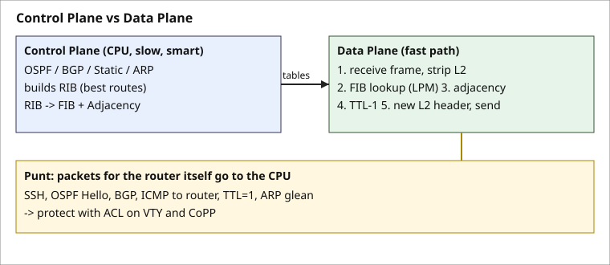

*شکل ۱: Control Plane جدول‌ها را می‌سازد؛ Data Plane فقط از جدول‌های آماده استفاده می‌کند.*

#### ۴-۲) Recursive Lookup (جست‌وجوی بازگشتی)

وقتی یک Static Route فقط Next-hop (نه Interface) دارد:

``` text
ip route 192.168.50.0 255.255.255.0 10.0.12.2
```

روتر باید بداند 10.0.12.2 از کدام Interface قابل‌دسترس است. پس یک جست‌وجوی دوم انجام می‌دهد: «10.0.12.2 در RIB به کدام Interface وصل است؟» جواب (Connected 10.0.12.0/30 روی Gi0/1) را می‌گیرد. این همان Recursive Lookup است. اگر Next-hop از طریق مسیری برسد که خودش به این Route وابسته است، حلقه یا Route ناپایدار می‌شود (نمونه در درس ۵-۳ آمده).

> **نکته‌ی عیب‌یابی:** اگر Next-hop قابل‌دسترس نباشد، Route در RIB **نصب نمی‌شود** (Static Route بدون Interface و بدون Next-hop معتبر نمی‌ماند). پس «Route را نوشتم ولی در جدول نیست» اغلب یعنی Next-hop حل‌نشدنی است.

#### ۴-۳) مراحل عبور یک بسته (Step by step)

برای بسته‌ای که از Client (192.168.1.10) به Server (172.16.5.20) می‌رود و از روتر R1 عبور می‌کند:

``` text
1. Frame arrives on Gi0/0: destination MAC = R1 Gi0/0 MAC  -> accepted
2. FCS check; strip L2 header (de-encapsulate) -> IP packet
3. Validate IP header (version, header checksum, TTL > 1)
4. Inbound features: ACL in, NAT inside->outside (if configured)
5. FIB lookup for 172.16.5.20 (Longest Prefix Match)
   result: next-hop 10.0.12.2, out interface Gi0/1
6. Adjacency lookup: next-hop 10.0.12.2 -> MAC aa:bb:cc:00:00:02
   (if missing: send ARP, packet waits / dropped, "glean" state)
7. TTL = TTL - 1; recompute IP header checksum
8. Outbound features: ACL out, QoS, NAT
9. Build new L2 header: src MAC = R1 Gi0/1, dst MAC = next-hop MAC
10. Transmit on Gi0/1
```

نکته‌های کلیدی این جریان:

- **MAC در هر Hop عوض می‌شود، IP نه** (بدون NAT). روتر هدر لایه ۲ را دور می‌اندازد و هدر جدید می‌سازد.
- **TTL در هر Hop یکی کم می‌شود.** اگر به ۰ برسد، روتر بسته را رها می‌کند و ICMP «Time Exceeded» می‌فرستد. traceroute همین را به کار می‌گیرد.
- **ARP برای Next-hop لازم است، نه برای مقصد نهایی** (اگر مقصد در شبکه‌ی مستقیماً متصل نباشد).
- اگر FIB مسیری نداشته باشد: بسته Drop و ICMP «Destination Unreachable» برمی‌گردد.

#### ۴-۴) مسیر «Punt»: وقتی Data Plane به Control Plane می‌دهد

بعضی بسته‌ها نباید در Data Plane (سریع) پردازش شوند و به CPU (Control Plane) فرستاده می‌شوند. به این **Punt** می‌گویند:

- بسته‌ای که مقصدش خود روتر است (SSH به روتر، OSPF Hello، BGP، ICMP به روتر).
- بسته‌ای با TTL = ۱ که باید ICMP Time Exceeded تولید شود.
- بسته‌ی اول برای مقصدی که ARP ندارد (Glean).
- بسته‌های با Option IP یا Fragmentation خاص.

چرا مهم است؟ CPU ظرفیت محدودی دارد. اگر مهاجم هزاران بسته به خود روتر بفرستد، CPU پر می‌شود و **Control Plane می‌میرد** (OSPF همسایه را از دست می‌دهد). برای همین Control Plane Policing و فهرست‌های محدودکننده وجود دارد (فصل ۸). همین منطق در FortiGate هم هست: ترافیک «Local-in» به CPU می‌رسد (فصل ۱۲).

### ۵) مثال حل‌شده

**شرایط:** R1 دو Interface دارد: Gi0/0 = 192.168.1.1/24 (LAN)، Gi0/1 = 10.0.12.1/30. جدول مسیرها شامل `172.16.5.0/24 via 10.0.12.2`. کلاینت 192.168.1.10 به 172.16.5.20 ping می‌زند. ARP برای 10.0.12.2 هنوز نداریم.

``` text
t0: Client sends frame: dst MAC = R1-Gi0/0, src IP .1.10, dst IP 172.16.5.20, TTL 128
t1: R1 FIB hit: 172.16.5.0/24 -> 10.0.12.2 via Gi0/1; adjacency incomplete
t2: R1 sends ARP "who has 10.0.12.2?" on Gi0/1 (first ping may be dropped)
t3: R2 replies ARP; adjacency complete
t4: second ping: TTL 128 -> 127, new L2 header dst = R2 MAC, forwarded
```

**تحلیل:** این توضیح می‌دهد چرا در Lab اغلب «اولین ping از ۵ ping تایم‌اوت می‌شود (نقطه .!!!!)». ARP هنوز کامل نبوده. این رفتار عادی است، نه خطا.

**مثال سخت (تحلیل خطا):** روتر R1 در جدول خود Route صحیح دارد (`show ip route 172.16.5.20` درست است) ولی ping موفق نمی‌شود. اولین فرضیه‌ها را بر اساس مراحل بالا مرتب کنید:

1. FIB با RIB ناهماهنگ است (نادر؛ `show ip cef 172.16.5.20` را بررسی کنید).
2. Adjacency ناقص است (`show adjacency` → Incomplete؛ ARP پاسخ نمی‌گیرد، مشکل لایه ۲ یا VLAN).
3. ACL خروجی یا ورودی بسته را می‌ریزد.
4. روتر مقصد Route برگشت ندارد (مشکل در جهت برگشت).

### ۶) طراحی و تصمیم‌گیری

| سؤال طراحی | گزینه‌ها | معیار انتخاب |
|---|---|---|
| Static Route با Next-hop یا Interface؟ | Next-hop / Interface / هر دو | روی Ethernet **حتماً Next-hop** (یا هر دو)، چون فقط Interface یعنی ARP برای هر مقصد (Proxy-ARP مصرفی) |
| ارسال Per-destination یا Per-packet؟ | CEF پیش‌فرض Per-destination | Per-packet ترتیب بسته‌ها را به‌هم می‌ریزد؛ به‌ندرت لازم است |
| CPU را چگونه محافظت کنیم؟ | ACL روی VTY، CoPP | هر سرویس مدیریتی فقط از شبکه‌ی مدیریت |

### ۷) پیاده‌سازی و Verification (CLI Cisco)

``` text
R1# show ip route 172.16.5.20
R1# show ip cef 172.16.5.20
R1# show ip cef 172.16.5.20 detail
R1# show adjacency detail
R1# show ip arp
R1# show ip traffic | include ICMP
R1# traceroute 172.16.5.20
```

نکات:

- `show ip cef` باید با `show ip route` هم‌خوان باشد (همان Next-hop و Interface).
- در `show adjacency` وضعیت `incomplete` یعنی MAC بعدی را نداریم.
- `show ip cef exact-route <src> <dst>` (در IOS-XE/IOS؛ `Unverified` روی vIOS) مسیر دقیق یک Flow را نشان می‌دهد.

### ۸) Troubleshooting (مبتنی بر شواهد)

| علامت | بررسی | تفسیر |
|---|---|---|
| Route هست ولی ping نمی‌رود | `show adjacency` | Incomplete = ARP حل نشده |
| فقط اولین ping Timeout است | بسته‌ی اول ARP | رفتار عادی |
| `Destination host unreachable` از R1 | `show ip route` | Route ندارد |
| `TTL expired in transit` | traceroute | حلقه‌ی مسیریابی |
| CPU روتر بالا ولی ترافیک عبوری کم | `show processes cpu sorted`، `show ip traffic` | بسته‌های Punt؛ حمله یا ICMP به روتر |

### ۹) نکات امنیتی

- ترافیک به **خود روتر** (Control/Management Plane) باید جدا کنترل شود، نه فقط ترافیک عبوری.
- ICMP Redirect و IP Source Route را در مرز غیرفعال کنید (`no ip redirects`، `no ip source-route`).
- هرگز SSH/SNMP روی همه‌ی Interfaceها باز نباشد.
- همین مفهوم در FortiGate: `allowaccess` روی Interface و Local-in Policy (فصل ۱۲ و ۱۳).

### ۱۰) جمع‌بندی مفهومی

- Control Plane جدول می‌سازد؛ Data Plane با جدول بسته را عبور می‌دهد.
- RIB بهترین مسیرها؛ FIB نسخه‌ی سریع آن؛ Adjacency اطلاعات L2 بعدی.
- در هر Hop: هدر L2 عوض، TTL یکی کم، IP (بدون NAT) ثابت.
- «Route هست» شرط لازم است، کافی نیست: FIB، Adjacency، ACL و Route برگشت هم لازم‌اند.
- بسته‌ی مقصد روتر به CPU می‌رود (Punt) و آسیب‌پذیر است.

### ۱۱) تمرین و ارزیابی

**ت1.** (ساده) تفاوت RIB و FIB چیست؟ *(پاسخ: 5-0-ت1)*

**ت2.** (ساده) در هر Hop کدام فیلد تغییر می‌کند: MAC مقصد، IP مقصد، TTL؟ *(پاسخ: 5-0-ت2)*

**ت3.** (متوسط) چرا Static Route فقط با Interface خروجی روی Ethernet مناسب نیست؟ *(پاسخ: 5-0-ت3)*

**ت4.** (متوسط) روی R1 مسیر 10.9.9.0/24 via 10.0.0.9 هست ولی 10.0.0.9 در هیچ Connected نیست. Route در جدول دیده می‌شود؟ توضیح دهید. *(پاسخ: 5-0-ت4)*

**ت5.** (سخت) در یک Lab ping از R1 به R3 اولین بار Timeout و بعد موفق است. بر پایه‌ی مراحل بسته توضیح دهید، سپس بگویید چه شواهدی ثابت می‌کند علت ARP است نه Route. *(پاسخ: 5-0-ت5)*

**ت6.** (سخت، طراحی) یک Control Plane Policing ساده را برای محافظت از CPU روتر شرح دهید: چه چیزی را فقط از شبکه‌ی مدیریت می‌پذیرید؟ *(پاسخ: 5-0-ت6)*

**م1.** Punt یعنی چه؟ *(پاسخ: 5-0-م1)*

**م2.** چرا اولین ping معمولاً از دست می‌رود؟ *(پاسخ: 5-0-م2)*

**Q1.** Quick quiz (English): Which plane builds the FIB, and which uses it to forward packets? *(پاسخ: 5-0-Q1)*

### ۱۲) اصطلاحات و English Corner

| مخفف | شکل کامل | معنی |
|---|---|---|
| RIB | Routing Information Base | جدول مسیرهای انتخاب‌شده |
| FIB | Forwarding Information Base | جدول سریع ارسال |
| CEF | Cisco Express Forwarding | ساز و کار ارسال سریع Cisco |
| Punt | Punt to CPU | فرستادن بسته به CPU |
| Glean | Glean adjacency | Adjacency ناقص که ARP لازم دارد |
| CoPP | Control Plane Policing | محدودسازی ترافیک به Control Plane |
| TTL | Time To Live | شمارنده‌ی عمر بسته |

- *The control plane builds the routing table; the data plane forwards packets using it.* ← Control Plane جدول را می‌سازد؛ Data Plane با آن بسته‌ها را ارسال می‌کند.
- *A route in the RIB does not guarantee that packets are forwarded.* ← وجود Route در RIB ارسال را تضمین نمی‌کند.

### ۱۳) منابع

- Cisco: «Cisco Express Forwarding Overview» (IP Switching Configuration Guide، IOS XE).
- RFC 1812 — Requirements for IP Version 4 Routers (فصل ۵: Forwarding).
- RFC 792 — ICMP (Time Exceeded و Destination Unreachable).
- RFC 6192 — Protecting the Router Control Plane.


## درس 5-1 — جدول مسیریابی، LPM و AD

**فصل ۵ - روز ۱ · پیش‌نیاز: فصل ۴ · ۶ ساعت**

### این درس درباره چیست و چرا باید یاد بگیریم؟

**چه چیزی یاد می‌گیریم:** روتر چطور تصمیم می‌گیرد هر بسته را به کدام سمت بفرستد: خواندن Routing Table، معنی کدها، قانون Longest Prefix Match، و دو معیار انتخاب بین مسیرها یعنی Administrative Distance و Metric.

**چرا لازم است:** تمام ارتباط بین شبکه‌ها (و بین VLANها، شعبه‌ها و اینترنت) به جدول مسیریابی بستگی دارد. اگر آن را درست نخوانید، نمی‌توانید بفهمید چرا یک بسته از مسیر غلط رفت یا اصلاً رد نشد. این درس پایه‌ی کل هفته‌های ۵ و ۶ و فایروال است.

- **در کار روزانه:** اولین دستور عیب‌یابی هر ارتباط بین شبکه‌ای `show ip route` است.
- **در امنیت:** Route اشتباه یعنی ترافیک از مسیر ناخواسته (مثلاً دور زدن فایروال) می‌رود.
- **در FortiGate:** Routing Table فایروال دقیقاً همین منطق را دارد (`get router info routing-table all`).

> **مسیر درس**
>
> روتر چیست ← جدول مسیریابی ← کدها ← Longest Prefix Match ← AD و Metric ← مثال ساده/متوسط/سخت ← Lab ← عیب‌یابی.

#### اصطلاحات این درس (مخفف ← شکل کامل ← معنی)

| مخفف                   | شکل کامل انگلیسی        | معنی فارسی                              |
|------------------------|-------------------------|-----------------------------------------|
| Routing Table          | Routing Table           | جدول مسیرهای شناخته‌شده‌ی روتر            |
| Next-hop               | Next-hop                | آدرس روتر بعدی در مسیر                  |
| LPM                    | Longest Prefix Match    | انتخاب Route با طولانی‌ترین Prefix مطابق |
| AD                     | Administrative Distance | اعتبار منبع Route؛ کمتر بهتر است        |
| Metric                 | Metric                  | هزینه‌ی مسیر در یک پروتکل                |
| Connected              | Connected route         | شبکه‌ای که مستقیماً به Interface وصل است  |
| Local                  | Local route             | آدرس خود Interface (/32)                |
| Static                 | Static route            | مسیر دستی                               |
| Gateway of last resort | Gateway of last resort  | مسیر پیش‌فرض                             |

### ۱. روتر چه کاری می‌کند؟

روتر مثل یک اداره‌ی پست است. نامه (بسته) می‌رسد؛ منشی فقط به آدرس مقصد نگاه می‌کند و در دفتر خود می‌بیند «برای این منطقه به کدام اداره بفرستم؟». او کل مسیر را نمی‌داند، فقط «قدم بعدی» (Next-hop) را می‌داند.

> **دو کار روتر**
>
> ۱) یاد گرفتن مسیرها (دستی یا با پروتکل). ۲) ارسال هر بسته بر اساس جدول مسیرها (Forwarding).

### ۲. جدول مسیریابی را بخوانیم

``` text
R1# show ip route
Codes: C - connected, L - local, S - static, O - OSPF

Gateway of last resort is 10.0.12.2 to network 0.0.0.0

S*    0.0.0.0/0 [1/0] via 10.0.12.2
      10.0.0.0/8 is variably subnetted, 4 subnets, 2 masks
C        10.0.12.0/30 is directly connected, GigabitEthernet0/1
L        10.0.12.1/32 is directly connected, GigabitEthernet0/1
O        10.0.23.0/30 [110/2] via 10.0.12.2, 00:05:10, GigabitEthernet0/1
C        192.168.1.0/24 is directly connected, Loopback10
```

هر خط یک Route است. با یک خط نمونه آشنا می‌شویم:

``` text
O   10.0.23.0/30 [110/2] via 10.0.12.2, 00:05:10, GigabitEthernet0/1
|   |            |  |     |          |         |
|   |            |  |     |          |         +-- exit interface
|   |            |  |     |          +-- age of the route
|   |            |  |     +-- next-hop address
|   |            |  +-- metric (OSPF cost)
|   |            +-- administrative distance
|   +-- destination prefix
+-- source code (O = OSPF)
```

| کد  | معنی                            |
|-----|---------------------------------|
| C   | Connected؛ شبکه‌ی مستقیماً وصل‌شده |
| L   | Local؛ آدرس خود Interface (/32) |
| S   | Static؛ دستی                    |
| S\* | Static به‌عنوان مسیر پیش‌فرض      |
| O   | OSPF                            |
| D   | EIGRP                           |
| R   | RIP                             |

### ۳. قانون اول: Longest Prefix Match

اگر چند Route با مقصد جور باشد، آن که Prefix بلندتر دارد (دقیق‌تر است) برنده است. مثل نشانی پستی: «تهران، ولیعصر، پلاک ۱۲» از «تهران» دقیق‌تر است.

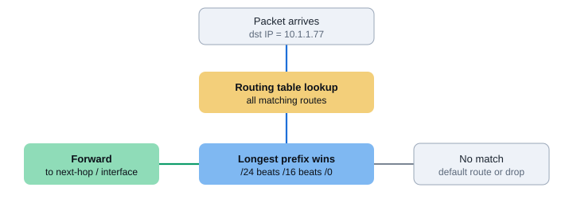

*شکل ۱: مراحل تصمیم روتر برای هر بسته.*

``` text
Routing table:
  10.0.0.0/8      via R-A
  10.1.0.0/16     via R-B
  10.1.1.0/24     via R-C
  0.0.0.0/0       via R-D (default)

Packet to 10.1.1.77:
  matches /0, /8, /16, /24  -> longest = /24  -> via R-C
Packet to 10.1.9.5:
  matches /0, /8, /16       -> longest = /16  -> via R-B
Packet to 8.8.8.8:
  matches /0 only           -> via R-D
```

> **نکته**
>
> اول طول Prefix تعیین می‌کند. فقط وقتی دو Route هم‌طول بودند، AD و Metric وارد می‌شوند.

### ۴. قانون دوم: Administrative Distance و Metric

فرض کنید همان شبکه را دو منبع مختلف (مثلاً Static و OSPF) به روتر معرفی کنند. روتر به منبعی که «معتبرتر» است اعتماد می‌کند. این اعتبار را AD می‌گویند و هرچه کمتر باشد بهتر است:

| منبع          | AD  |
|---------------|-----|
| Connected     | 0   |
| Static        | 1   |
| EIGRP (داخلی) | 90  |
| OSPF          | 110 |
| RIP           | 120 |

Metric هزینه‌ی مسیر **داخل یک پروتکل** است (مثلاً Cost در OSPF). Metricهای پروتکل‌های مختلف قابل مقایسه با هم نیستند؛ برای همین AD وجود دارد.

``` text
Decision order for the same destination:
1) Longest prefix       (most specific wins)
2) Lowest AD             (most trusted source)
3) Lowest metric         (best path inside one protocol)
4) ECMP                  (equal metric -> load share)
```

### ۵. مثال‌ها (ساده تا سخت)

#### ساده: بسته به شبکه‌ی Connected

``` text
Dest 192.168.1.50 -> matches C 192.168.1.0/24
Router ARPs for the host and delivers directly
```

#### متوسط: Static یا OSPF؟

``` text
Both learn 10.0.23.0/30:
  S  10.0.23.0/30 [1/0]   via 10.0.12.2
  O  10.0.23.0/30 [110/2] via 10.0.12.2
Same prefix -> lower AD (1) wins -> Static is installed
```

#### سخت: دو Route با Prefixهای مختلف

``` text
S  10.0.0.0/8   [1/0]   via 10.9.9.9   (static, AD 1)
O  10.0.23.0/30 [110/2] via 10.0.12.2   (OSPF, AD 110)
Packet to 10.0.23.5:
  both match; /30 is longer than /8 -> OSPF route wins
  (AD is NOT compared here; prefix length decides first)
```

این خطای ذهنی بسیار رایج است: «Static همیشه برنده است». نه! اول طول Prefix است.

### ۶. دستورهای مشاهده

``` text
R1# show ip route
R1# show ip route 10.1.1.77
R1# show ip route connected
R1# show ip route static
R1# show ip route ospf
R1# show ip protocols
R1# show ip cef 10.1.1.77
```

- `show ip route 10.1.1.77`: دقیقاً می‌گوید کدام Route برای این مقصد انتخاب می‌شود (بهترین ابزار عیب‌یابی).
- `show ip protocols`: پروتکل‌های مسیریابی فعال و تنظیماتشان.
- `show ip cef ...`: مسیر واقعی Forwarding (CEF).

### تمرین‌ها

**ت1.** ۱ (ساده): L و C چه فرقی دارند؟ *(پاسخ: 5-1-ت1 در بخش «پاسخ‌ها» انتهای فصل)*

**ت2.** ۲ (ساده): AD برای Static و OSPF؟ *(پاسخ: 5-1-ت2 در بخش «پاسخ‌ها» انتهای فصل)*

**ت3.** ۳ (متوسط): بسته به 10.1.1.77؛ Routeهای /8، /16 و /0 موجودند. کدام؟ *(پاسخ: 5-1-ت3 در بخش «پاسخ‌ها» انتهای فصل)*

**ت4.** ۴ (متوسط): آیا Metric یک Route در OSPF با RIP قابل مقایسه است؟ *(پاسخ: 5-1-ت4 در بخش «پاسخ‌ها» انتهای فصل)*

**ت5.** ۵ (سخت): Static 10.0.0.0/8 و OSPF 10.0.23.0/30 هر دو موجود؛ بسته به 10.0.23.5 از کجا می‌رود؟ *(پاسخ: 5-1-ت5 در بخش «پاسخ‌ها» انتهای فصل)*

### Lab هدایت‌شده

توپولوژی این هفته: سه روتر vIOS به نام‌های `R1`، `R2`، `R3` به‌صورت خطی. اتصال‌ها: `R1 Gi0/1 ↔ R2 Gi0/0` و `R2 Gi0/1 ↔ R3 Gi0/0`. اگر RAM روتر زیاد است، می‌توانید vIOS را ۵۱۲ مگابایت کنید (راهنمای CML). برای فعلاً فقط Connected داریم.

#### گام ۱: آدرس‌دهی

``` text
R1(config)# interface gi0/1
R1(config-if)# ip address 10.0.12.1 255.255.255.252
R1(config-if)# no shutdown
R1(config)# interface loopback 10
R1(config-if)# ip address 192.168.1.1 255.255.255.0

R2(config)# interface gi0/0
R2(config-if)# ip address 10.0.12.2 255.255.255.252
R2(config-if)# no shutdown
R2(config)# interface gi0/1
R2(config-if)# ip address 10.0.23.1 255.255.255.252
R2(config-if)# no shutdown

R3(config)# interface gi0/0
R3(config-if)# ip address 10.0.23.2 255.255.255.252
R3(config-if)# no shutdown
R3(config)# interface loopback 30
R3(config-if)# ip address 192.168.3.1 255.255.255.0
```

#### گام ۲: مشاهده

``` text
R1# show ip interface brief
R1# show ip route
R1# ping 10.0.12.2
R1# ping 192.168.3.1
```

پیش‌بینی: ping به همسایه OK، ولی به 192.168.3.1 شکست؛ چون R1 مسیری به آن ندارد. جدول R1 فقط C و L دارد؛ آن را یادداشت کنید.

#### گام ۳: LPM را خودتان بسنجید

از روی جدول بالا، با `show ip route 10.0.23.5` ببینید چه Routeی انتخاب می‌شود (هنوز هیچ؛ در درس بعد Static اضافه می‌کنیم).

### Lab مستقل

جدول مسیریابی هر سه روتر را (فقط C و L) در `03-ops/routing-baseline-w5.md` ذخیره و هر کد را توضیح دهید.

### عیب‌یابی

|         |                                                                                |
|---------|--------------------------------------------------------------------------------|
| Symptom | ping به شبکه‌ی دور شکست می‌خورد                                                  |
| روش     | show ip route \<destination\>؛ اگر «Network not in table» بود، مسیر وجود ندارد |
| چک‌لیست  | ۱) Route هست؟ ؛ ۲) Next-hop قابل‌دسترس است؟ ؛ ۳) مسیر برگشت هم دارد؟            |
| نکته    | برگشت (Return Path) را همیشه چک کنید؛ مسیر یک‌طرفه کار نمی‌کند                   |

### سؤال‌های مرور

**م1.** اولین چیزی که روتر برای انتخاب Route نگاه می‌کند؟ *(پاسخ: 5-1-م1 در بخش «پاسخ‌ها» انتهای فصل)*

**م2.** AD برای چیست؟ *(پاسخ: 5-1-م2 در بخش «پاسخ‌ها» انتهای فصل)*

### English Corner: انگلیسی تخصصی این درس

این جمله‌ها از مستندات و محیط کار واقعی‌اند. بلند بخوانید و ترجمه را بپوشانید.

| English sentence                                                       | ترجمه                                                  |
|------------------------------------------------------------------------|--------------------------------------------------------|
| The router selects the route with the longest matching prefix.         | روتر Route با طولانی‌ترین Prefix مطابق را انتخاب می‌کند. |
| Administrative distance expresses how trustworthy a routing source is. | AD نشان می‌دهد منبع Route چقدر قابل‌اعتماد است.          |
| There is no route to the destination network.                          | مسیری به شبکه‌ی مقصد وجود ندارد.                        |
| Check the return path as well.                                         | مسیر برگشت را هم بررسی کنید.                           |

**Q1.** Quick quiz (answer in English): Which is compared first: administrative distance or prefix length? *(پاسخ: 5-1-Q1 در بخش «پاسخ‌ها» انتهای فصل)*

### تکلیف و چک‌لیست تسلط

- [ ] خط‌به‌خط یک Route را توضیح دهم.
- [ ] LPM را با ۳ مثال حل کنم.
- [ ] Lab را انجام دهم.

### یادآوری اشتباهات شما

> **یادآوری**
>
> پیش‌بینی قبل از اجرا؛ بکاپ قبل از تغییر؛ پذیرفته‌شدن دستور ≠ کار کردن؛ فرمول‌ها در بلوک مستقل.


#### کارت Lab — جدول مسیریابی، LPM و AD

| # | فیلد | محتوا |
|---|---|---|
| 1 | عنوان و هدف | خواندن Route Table و LPM |
| 2 | پیش‌نیاز | فصل 4 |
| 3 | توپولوژی | R1-R2-R3 خطی |
| 4 | تجهیزات | ۳ vIOS |
| 5 | نسخه نرم‌افزار | vIOS-L2 15.2(20200924، Experimental) برای SW؛ vIOS 15.9(3)M9 برای R؛ VPCS؛ PNetLab 4.2.8 |
| 6 | IP Plan | Connected |
| 7 | وضعیت اولیه | Loopbackها |
| 8 | صورت مسئله | LPM و AD را پیش‌بینی کنید |
| 9 | مراحل هدایت‌شده | همان بخش «Lab هدایت‌شده» همین درس |
| 10 | تست عملکرد | `show ip route <dst>` |
| 11 | سناریوی خرابی | Route نبود |
| 12 | روش عیب‌یابی | لایه‌ای/با شواهد (بخش عیب‌یابی همین درس) |
| 13 | نتیجه‌ی مورد انتظار | جدول C/L |
| 14 | معیار پذیرش | پیش‌بینی با واقعیت تطبیق |
| 15 | مستندات نهایی | `03-ops/routing-baseline-w5.md` |
| 16 | Cleanup و بازگردانی | — |

> **وضعیت راستی‌آزمایی (خارج از ۱۶ فیلد):** **اجرا نشده (فقط طراحی).** اجرا نشده.

---

<a id="l-5-2"></a>

## درس 5-2 — Static Route و مسیر برگشت

**فصل ۵ - روز ۲ · پیش‌نیاز: درس ۵-۱ · ۶ ساعت**

### این درس درباره چیست و چرا باید یاد بگیریم؟

**چه چیزی یاد می‌گیریم:** ساخت مسیر دستی (Static Route) با Next-hop، تفاوت Next-hop و Exit-interface، اهمیت مسیر برگشت (Return Path) و خلاصه‌سازی با Static.

**چرا لازم است:** ساده‌ترین و قابل‌پیش‌بینی‌ترین مسیریابی است و در شعبه‌های کوچک و لینک اینترنت هنوز پرکاربرد است. اکثر «شبکه‌ی دور قابل‌دسترس نیست» ها به مسیر برگشت فراموش‌شده برمی‌گردد.

- **در کار روزانه:** Default Route به سمت ISP یا فایروال در ۹۰٪ شعبه‌ها Static است.
- **در امنیت:** Static Route قابل‌پیش‌بینی است و از تزریق مسیر جعلی جلوگیری می‌کند.
- **در FortiGate:** `config router static` دقیقاً همین مفهوم است.

> **مسیر درس**
>
> Static چیست ← Next-hop در برابر Interface ← مسیر برگشت ← خلاصه‌سازی ← مثال ساده/متوسط/سخت ← Lab ← عیب‌یابی.

#### اصطلاحات این درس (مخفف ← شکل کامل ← معنی)

| مخفف           | شکل کامل انگلیسی    | معنی فارسی                           |
|----------------|---------------------|--------------------------------------|
| Static Route   | Static Route        | مسیر دستی                            |
| Next-hop       | Next-hop IP         | آدرس روتر بعدی                       |
| Exit Interface | Exit Interface      | Interface خروجی                      |
| Return Path    | Return Path         | مسیر برگشت بسته                      |
| Recursive      | Recursive lookup    | جستجوی دوباره برای رسیدن به Next-hop |
| Null0          | Null0               | Interface مجازی دورریز               |
| Summary        | Route Summarization | خلاصه‌سازی چند Route در یکی           |

### ۱. Static Route چیست؟

یعنی خودتان به روتر می‌گویید: «برای رسیدن به شبکه X، بسته را به روتر Y بده». مثل اینکه به راننده‌ی تاکسی بگویید «برای رفتن به فرودگاه از این خیابان برو»؛ خودش تصمیم نمی‌گیرد، شما گفته‌اید.

فرمت:

``` text
ip route <destination network> <mask> <next-hop | exit-interface> [AD]

Example:
R1(config)# ip route 192.168.3.0 255.255.255.0 10.0.12.2
```

یعنی «برای شبکه‌ی 192.168.3.0/24، بسته را به 10.0.12.2 بده».

### ۲. Next-hop در برابر Exit-interface

| روش            | مثال                                               | کاربرد                                                   |
|----------------|----------------------------------------------------|----------------------------------------------------------|
| Next-hop       | ip route 192.168.3.0 255.255.255.0 10.0.12.2       | پیشنهاد اصلی؛ روی اترنت امن است                          |
| Exit-interface | ip route 192.168.3.0 255.255.255.0 gi0/1           | فقط لینک نقطه‌به‌نقطه (Serial)؛ روی اترنت ARP برای هر مقصد |
| هر دو          | ip route 192.168.3.0 255.255.255.0 gi0/1 10.0.12.2 | دقیق‌ترین (توصیه برای اترنت)                              |

> **قانون**
>
> روی اترنت فقط Exit-interface ننویسید؛ روتر برای هر مقصد ARP می‌زند و به Proxy-ARP وابسته می‌شود. Next-hop (یا هر دو) بنویسید.

«Recursive»: اگر Next-hop را بنویسید، روتر یک جستجوی دوم می‌کند تا Next-hop را از Connected/Route دیگری پیدا کند. به همین دلیل Next-hop باید حتماً در یک شبکه‌ی Connected یا شناخته‌شده باشد.

### ۳. مسیر برگشت: مهم‌ترین نکته

ارتباط دوطرفه است. اگر فقط R1 مسیر رفت را بداند، ولی R3 راه برگشت به 192.168.1.0/24 را نداند، پاسخ هرگز نمی‌رسد و ping شکست می‌خورد.

``` text
PC (192.168.1.10) -> R1 -> R2 -> R3 -> Server (192.168.3.10)
Forward path : R1 needs route to 192.168.3.0/24, R2 as well
Return path  : R3 needs route to 192.168.1.0/24, R2 as well
If any hop lacks the return route -> ping fails (one-way)
```

### ۴. خلاصه‌سازی با Static و Null0

به‌جای چند Route ریز، یک Route کلی می‌نویسیم. مثال: چهار شبکه‌ی 10.1.0.0/24 تا 10.1.3.0/24 را می‌توان با یک /22 خلاصه کرد:

``` text
10.1.0.0/24, 10.1.1.0/24, 10.1.2.0/24, 10.1.3.0/24
Third octet: 0,1,2,3 -> block size 4 -> /22
Summary = 10.1.0.0/22
```

برای جلوگیری از Loop هنگام خلاصه‌سازی روی مرز، گاهی یک Route به Null0 می‌گذارند تا بسته‌ی بی‌صاحب دور ریخته شود:

``` text
R2(config)# ip route 10.1.0.0 255.255.252.0 null0 200
```

AD برابر 200 است تا Routeهای واقعی (دقیق‌تر یا با AD کمتر) را بلوک نکند.

### ۵. مثال‌ها

#### ساده: یک مسیر

``` text
R1(config)# ip route 192.168.3.0 255.255.255.0 10.0.12.2
R1# show ip route static
S  192.168.3.0/24 [1/0] via 10.0.12.2
```

#### متوسط: مسیر رفت و برگشت

``` text
R1(config)# ip route 192.168.3.0 255.255.255.0 10.0.12.2
R1(config)# ip route 10.0.23.0 255.255.255.252 10.0.12.2
R2(config)# ip route 192.168.3.0 255.255.255.0 10.0.23.2
R2(config)# ip route 192.168.1.0 255.255.255.0 10.0.12.1
R3(config)# ip route 192.168.1.0 255.255.255.0 10.0.23.1
R3(config)# ip route 10.0.12.0 255.255.255.252 10.0.23.1
```

#### سخت: Next-hop غیرقابل‌دسترس

``` text
R1(config)# ip route 192.168.3.0 255.255.255.0 10.9.9.9
R1# show ip route 192.168.3.0
  -> Route is NOT installed: next-hop 10.9.9.9 is not reachable
Fix: use a next-hop inside a connected network (10.0.12.2)
```

### تمرین‌ها

**ت1.** ۱ (ساده): Static برای شبکه‌ی 172.16.5.0/24 با Next-hop 10.0.0.2 *(پاسخ: 5-2-ت1 در بخش «پاسخ‌ها» انتهای فصل)*

**ت2.** ۲ (ساده): چرا روی اترنت Next-hop می‌نویسیم؟ *(پاسخ: 5-2-ت2 در بخش «پاسخ‌ها» انتهای فصل)*

**ت3.** ۳ (متوسط): Summary چهار شبکه‌ی 10.2.4.0/24 تا 10.2.7.0/24؟ *(پاسخ: 5-2-ت3 در بخش «پاسخ‌ها» انتهای فصل)*

**ت4.** ۴ (متوسط): ping یک‌طرفه شکست می‌خورد؛ علت؟ *(پاسخ: 5-2-ت4 در بخش «پاسخ‌ها» انتهای فصل)*

**ت5.** ۵ (سخت): چرا Route به Null0 با AD 200؟ *(پاسخ: 5-2-ت5 در بخش «پاسخ‌ها» انتهای فصل)*

### Lab هدایت‌شده

#### گام ۱: مسیرهای رفت

``` text
R1(config)# ip route 10.0.23.0 255.255.255.252 10.0.12.2
R1(config)# ip route 192.168.3.0 255.255.255.0 10.0.12.2
R3(config)# ip route 10.0.12.0 255.255.255.252 10.0.23.1
R3(config)# ip route 192.168.1.0 255.255.255.0 10.0.23.1
R2(config)# ip route 192.168.1.0 255.255.255.0 10.0.12.1
R2(config)# ip route 192.168.3.0 255.255.255.0 10.0.23.2
```

#### گام ۲: تست

``` text
R1# ping 192.168.3.1 source 192.168.1.1
R1# traceroute 192.168.3.1 source 192.168.1.1
```

با `source` مبدأ را Loopback می‌کنیم تا شبکه‌ی LAN شبیه‌سازی شود.

#### گام ۳: خراب‌کردن عمدی مسیر برگشت

``` text
R3(config)# no ip route 192.168.1.0 255.255.255.0 10.0.23.1
R1# ping 192.168.3.1 source 192.168.1.1   (fails: no return)
R3(config)# ip route 192.168.1.0 255.255.255.0 10.0.23.1
```

Capture روی لینک R2-R3: Echo Request می‌رسد ولی Reply برنمی‌گردد.

### Lab مستقل

یک جدول «Static Route Plan» بنویسید: هر روتر، شبکه‌های مقصد، Next-hop و مسیر برگشت در `02-design/static-plan.md`.

### عیب‌یابی

|         |                                                                                                   |
|---------|---------------------------------------------------------------------------------------------------|
| Symptom | ping به شبکه‌ی دور شکست                                                                            |
| چک‌لیست  | ۱) Route رفت؟ ؛ ۲) Next-hop Connected است؟ ؛ ۳) Route برگشت؟ ؛ ۴) Mask درست؟ ؛ ۵) ACL یا فایروال؟ |
| ابزار   | show ip route \<destination\> ، traceroute ، Capture                                              |
| رفع     | افزودن مسیر گم‌شده                                                                                 |

### سؤال‌های مرور

**م1.** Static Route کی مناسب است؟ *(پاسخ: 5-2-م1 در بخش «پاسخ‌ها» انتهای فصل)*

**م2.** چرا مسیر برگشت مهم است؟ *(پاسخ: 5-2-م2 در بخش «پاسخ‌ها» انتهای فصل)*

### English Corner: انگلیسی تخصصی این درس

این جمله‌ها از مستندات و محیط کار واقعی‌اند. بلند بخوانید و ترجمه را بپوشانید.

| English sentence                                                | ترجمه                                        |
|-----------------------------------------------------------------|----------------------------------------------|
| Configure a static route pointing to the next-hop address.      | یک Static Route به آدرس Next-hop تنظیم کنید. |
| The route is not installed because the next-hop is unreachable. | Route نصب نشده چون Next-hop در دسترس نیست.   |
| Ping fails because there is no return route.                    | ping شکست می‌خورد چون Route برگشت وجود ندارد. |
| Summarize contiguous networks into a single route.              | شبکه‌های متوالی را در یک Route خلاصه کنید.    |

**Q1.** Quick quiz (answer in English): Why do we avoid exit-interface-only static routes on Ethernet? *(پاسخ: 5-2-Q1 در بخش «پاسخ‌ها» انتهای فصل)*

### تکلیف و چک‌لیست تسلط

- [ ] Static رفت و برگشت را بزنم و ping موفق بگیرم.
- [ ] مسیر برگشت را عمداً حذف کنم و Capture ببینم.
- [ ] Summary را بنویسم.

### یادآوری اشتباهات شما

> **یادآوری**
>
> پیش‌بینی قبل از اجرا؛ بکاپ قبل از تغییر؛ پذیرفته‌شدن دستور ≠ کار کردن؛ فرمول‌ها در بلوک مستقل.


#### کارت Lab — Static Route و مسیر برگشت

| # | فیلد | محتوا |
|---|---|---|
| 1 | عنوان و هدف | Static Route با مسیر رفت/برگشت |
| 2 | پیش‌نیاز | درس 5-1 |
| 3 | توپولوژی | R1-R2-R3 |
| 4 | تجهیزات | ۳ vIOS |
| 5 | نسخه نرم‌افزار | vIOS-L2 15.2(20200924، Experimental) برای SW؛ vIOS 15.9(3)M9 برای R؛ VPCS؛ PNetLab 4.2.8 |
| 6 | IP Plan | Connected |
| 7 | وضعیت اولیه | Static + برگشت |
| 8 | صورت مسئله | ping LAN1↔LAN3 |
| 9 | مراحل هدایت‌شده | همان بخش «Lab هدایت‌شده» همین درس |
| 10 | تست عملکرد | `ping ... source` |
| 11 | سناریوی خرابی | حذف مسیر برگشت |
| 12 | روش عیب‌یابی | لایه‌ای/با شواهد (بخش عیب‌یابی همین درس) |
| 13 | نتیجه‌ی مورد انتظار | ping موفق |
| 14 | معیار پذیرش | Return Path اثبات |
| 15 | مستندات نهایی | `02-design/static-plan.md` |
| 16 | Cleanup و بازگردانی | حذف Static |

> **وضعیت راستی‌آزمایی (خارج از ۱۶ فیلد):** **اجرا نشده (فقط طراحی).** اجرا نشده.

---

<a id="l-5-3"></a>

## درس 5-3 — Default، Floating و IP SLA

**فصل ۵ - روز ۳ · پیش‌نیاز: درس ۵-۲ · ۶ ساعت**

### این درس درباره چیست و چرا باید یاد بگیریم؟

**چه چیزی یاد می‌گیریم:** Default Route (0.0.0.0/0)، Route پشتیبان با AD بالا (Floating Static)، و رصد سلامت لینک با IP SLA برای Failover واقعی.

**چرا لازم است:** هر شعبه یک «در خروج» (اینترنت یا فایروال) دارد. اگر لینک اصلی خراب شود، باید ترافیک به لینک پشتیبان برود. Floating Static ساده‌ترین راه است؛ ولی بدون Tracking ممکن است Failover رخ ندهد چون لینک «بالا» است ولی اینترنت قطع.

- **در کار روزانه:** تقریباً هر شعبه Default Route دارد و بعضی یک لینک پشتیبان (4G/ISP دوم).
- **در امنیت:** Default Route تنها راه خروج است؛ اشتباه آن همه‌ی شبکه را ایزوله می‌کند.
- **در FortiGate:** Failover دو ISP با Distance/Priority و Link Monitor همین منطق است.

> **مسیر درس**
>
> Default Route ← Floating Static ← IP SLA و Track ← مثال ساده/متوسط/سخت ← Lab ← عیب‌یابی.

#### اصطلاحات این درس (مخفف ← شکل کامل ← معنی)

| مخفف            | شکل کامل انگلیسی           | معنی فارسی                           |
|-----------------|----------------------------|--------------------------------------|
| Default Route   | Default Route              | مسیر 0.0.0.0/0 برای هر مقصد ناشناخته |
| Floating Static | Floating Static Route      | Route پشتیبان با AD بالاتر           |
| IP SLA          | IP Service Level Agreement | پروب سلامت مسیر با ping              |
| Track           | Object Tracking            | وابستگی Route به وضعیت یک شیء        |
| Failover        | Failover                   | سوییچ خودکار به مسیر پشتیبان         |
| Reachability    | Reachability               | قابل‌دسترس بودن                       |

### ۱. Default Route: «هرجا نمی‌دانی، از اینجا برو»

Default Route همان آدرس ناشناخته در جدول است: مثل تابلوی «بقیه‌ی مسیرها» در بزرگراه. شبکه‌ی /0 همه‌ی آدرس‌ها را می‌پوشاند و چون کوتاه‌ترین Prefix است، فقط وقتی استفاده می‌شود که Route دقیق‌تری نباشد (LPM).

``` text
R1(config)# ip route 0.0.0.0 0.0.0.0 10.0.12.2
R1# show ip route
Gateway of last resort is 10.0.12.2 to network 0.0.0.0
S*   0.0.0.0/0 [1/0] via 10.0.12.2
```

### ۲. Floating Static: پشتیبان که «شناور» است

دو Default Route با دو AD متفاوت می‌نویسیم: اصلی با AD پیش‌فرض (1) و پشتیبان با AD بالاتر (مثلاً 200). روتر فقط Route با AD کمتر را نصب می‌کند؛ اگر آن حذف شد، پشتیبان «بالا می‌آید».

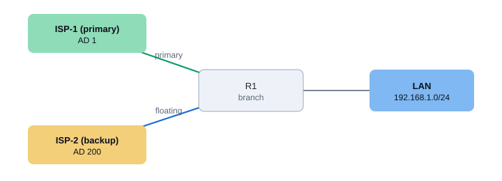

*شکل ۱: لینک اصلی با AD 1 و پشتیبان با AD 200.*

``` text
R1(config)# ip route 0.0.0.0 0.0.0.0 203.0.113.1
R1(config)# ip route 0.0.0.0 0.0.0.0 198.51.100.1 200
R1# show ip route 0.0.0.0
  -> only the AD 1 route is in the table
```

### ۳. مشکل: لینک «بالا» است ولی اینترنت نیست

Route Static تا وقتی Interface خروجی up/up است در جدول می‌ماند؛ حتی اگر Next-hop (ISP) خراب باشد. پس Floating به‌تنهایی Failover واقعی نیست. باید «سلامت واقعی» مسیر را بسنجیم: IP SLA با ping به Next-hop یا یک آدرس دور.

``` text
Interface up/up + ISP dead -> Static route still installed -> no failover
Solution: IP SLA probe + track -> route removed when probe fails
```

### ۴. IP SLA و Track (دستورها خط‌به‌خط)

``` text
R1(config)# ip sla 1
R1(config-ip-sla)# icmp-echo 203.0.113.1 source-interface gi0/1
R1(config-ip-sla-echo)# frequency 5
R1(config-ip-sla-echo)# exit
R1(config)# ip sla schedule 1 life forever start-time now
R1(config)# track 1 ip sla 1 reachability
R1(config)# ip route 0.0.0.0 0.0.0.0 203.0.113.1 track 1
R1(config)# ip route 0.0.0.0 0.0.0.0 198.51.100.1 200
```

- `ip sla 1` + `icmp-echo`: هر ۵ ثانیه ping به Next-hop اول.
- `schedule ... start-time now`: پروب را همین الان و برای همیشه شروع می‌کند.
- `track 1 ip sla 1 reachability`: شیء Track که وضعیت پروب را می‌داند.
- `ip route ... track 1`: این Route فقط وقتی در جدول است که Track بالا باشد.

``` text
R1# show ip sla statistics
R1# show track 1
R1# show ip route 0.0.0.0
```

### ۵. مثال‌ها

#### ساده

``` text
Single ISP: ip route 0.0.0.0 0.0.0.0 <ISP gateway>
```

#### متوسط: Floating

``` text
Primary link fails (interface down)
-> AD 1 route removed
-> AD 200 route installed automatically
```

#### سخت: ISP خراب ولی Interface بالا

``` text
Probe to 203.0.113.1 times out
-> track 1 goes Down
-> primary static removed
-> backup (AD 200) installed
Probe recovers -> primary returns (preempt)
```

> **صادقانه درباره‌ی Lab**
>
> طبق Probe اولیه، IP SLA روی IOS ما کار می‌کند. در Lab، لینک ISP را با قطع کابل (shutdown رو Interface دور) یا حذف Route همسایه شبیه‌سازی کنید و نتیجه‌ی واقعی را ثبت کنید.

### تمرین‌ها

**ت1.** ۱ (ساده): AD پیش‌فرض Static و Floating معمول؟ *(پاسخ: 5-3-ت1 در بخش «پاسخ‌ها» انتهای فصل)*

**ت2.** ۲ (ساده): چرا 0.0.0.0 0.0.0.0 همه‌ی مقاصد را می‌پوشاند؟ *(پاسخ: 5-3-ت2 در بخش «پاسخ‌ها» انتهای فصل)*

**ت3.** ۳ (متوسط): چرا Floating به‌تنهایی کافی نیست؟ *(پاسخ: 5-3-ت3 در بخش «پاسخ‌ها» انتهای فصل)*

**ت4.** ۴ (متوسط): دستور Route وابسته به Track؟ *(پاسخ: 5-3-ت4 در بخش «پاسخ‌ها» انتهای فصل)*

**ت5.** ۵ (سخت): چه چیزی را باید پروب کنیم؟ *(پاسخ: 5-3-ت5 در بخش «پاسخ‌ها» انتهای فصل)*

### Lab هدایت‌شده

روی R1 یک Interface دوم به R2 فرض می‌کنیم (یا Loopback). اگر ندارید، با `Loopback` هم می‌شود مسیر را شبیه‌سازی کرد.

#### گام ۱: Default اصلی و پشتیبان

``` text
R1(config)# ip route 0.0.0.0 0.0.0.0 10.0.12.2
R1(config)# ip route 0.0.0.0 0.0.0.0 10.0.99.2 200
R1# show ip route
```

#### گام ۲: IP SLA و Track

``` text
R1(config)# ip sla 1
R1(config-ip-sla)# icmp-echo 10.0.12.2 source-interface gi0/1
R1(config-ip-sla-echo)# frequency 5
R1(config)# ip sla schedule 1 life forever start-time now
R1(config)# track 1 ip sla 1 reachability
R1(config)# no ip route 0.0.0.0 0.0.0.0 10.0.12.2
R1(config)# ip route 0.0.0.0 0.0.0.0 10.0.12.2 track 1
R1# show track 1
```

#### گام ۳: شبیه‌سازی خرابی

``` text
R2(config)# interface gi0/0
R2(config-if)# shutdown
R1# show track 1
R1# show ip route 0.0.0.0
```

ثبت کنید چند ثانیه طول کشید تا Track پایین بیاید و Route پشتیبان نصب شود، و بعد از `no shutdown` چه شد.

### Lab مستقل

یک Runbook «Failover دو ISP» در `03-ops/dual-isp-failover.md` بنویسید: تنظیم، Verification، و آزمون خرابی.

### عیب‌یابی

|         |                                                                                                                      |
|---------|----------------------------------------------------------------------------------------------------------------------|
| Symptom | Failover رخ نمی‌دهد                                                                                                   |
| چک‌لیست  | ۱) AD پشتیبان بیشتر است؟ ؛ ۲) Track روی Route اصلی است؟ ؛ ۳) پروب به آدرس درست می‌رود؟ ؛ ۴) Interface هنوز up/up است؟ |
| ابزار   | show track ، show ip sla statistics ، show ip route                                                                  |
| رفع     | اصلاح پروب و AD                                                                                                      |

### سؤال‌های مرور

**م1.** Floating Static چیست؟ *(پاسخ: 5-3-م1 در بخش «پاسخ‌ها» انتهای فصل)*

**م2.** IP SLA برای چیست؟ *(پاسخ: 5-3-م2 در بخش «پاسخ‌ها» انتهای فصل)*

### English Corner: انگلیسی تخصصی این درس

این جمله‌ها از مستندات و محیط کار واقعی‌اند. بلند بخوانید و ترجمه را بپوشانید.

| English sentence                                                         | ترجمه                                         |
|--------------------------------------------------------------------------|-----------------------------------------------|
| Configure a floating static route with a higher administrative distance. | Floating Static با AD بالاتر تنظیم کنید.      |
| The track object goes down when the probe fails.                         | وقتی پروب شکست بخورد، شیء Track پایین می‌رود.  |
| The backup route is installed automatically.                             | Route پشتیبان خودکار نصب می‌شود.               |
| Always test failover before production.                                  | Failover را همیشه قبل از Production تست کنید. |

**Q1.** Quick quiz (answer in English): Why can a static route stay in the table even if the ISP is down? *(پاسخ: 5-3-Q1 در بخش «پاسخ‌ها» انتهای فصل)*

### تکلیف و چک‌لیست تسلط

- [ ] Floating و Track را تنظیم کنم.
- [ ] خرابی را شبیه‌سازی و زمان Failover را ثبت کنم.
- [ ] Runbook را بنویسم.

### یادآوری اشتباهات شما

> **یادآوری**
>
> پیش‌بینی قبل از اجرا؛ بکاپ قبل از تغییر؛ پذیرفته‌شدن دستور ≠ کار کردن؛ فرمول‌ها در بلوک مستقل.


#### کارت Lab — Default، Floating و IP SLA

| # | فیلد | محتوا |
|---|---|---|
| 1 | عنوان و هدف | Default، Floating و IP SLA/Track |
| 2 | پیش‌نیاز | درس 5-2 |
| 3 | توپولوژی | R1 + دو مسیر |
| 4 | تجهیزات | ۳ vIOS |
| 5 | نسخه نرم‌افزار | vIOS-L2 15.2(20200924، Experimental) برای SW؛ vIOS 15.9(3)M9 برای R؛ VPCS؛ PNetLab 4.2.8 |
| 6 | IP Plan | Static |
| 7 | وضعیت اولیه | Floating AD 200 |
| 8 | صورت مسئله | Failover با Track |
| 9 | مراحل هدایت‌شده | همان بخش «Lab هدایت‌شده» همین درس |
| 10 | تست عملکرد | `show track` |
| 11 | سناریوی خرابی | ISP خراب ولی لینک up |
| 12 | روش عیب‌یابی | لایه‌ای/با شواهد (بخش عیب‌یابی همین درس) |
| 13 | نتیجه‌ی مورد انتظار | Route پشتیبان نصب |
| 14 | معیار پذیرش | زمان Failover ثبت |
| 15 | مستندات نهایی | `03-ops/dual-isp-failover.md` |
| 16 | Cleanup و بازگردانی | حذف track |

> **وضعیت راستی‌آزمایی (خارج از ۱۶ فیلد):** **جزئی.** IP SLA icmp-echo در Probe Tested-OK؛ Failover کامل و Floating اجرا نشده.

---

<a id="l-5-4"></a>

## درس 5-4 — مفهوم OSPF

**فصل ۵ - روز ۴ · پیش‌نیاز: درس‌های ۵-۱ تا ۵-۳ · ۶ ساعت**

### این درس درباره چیست و چرا باید یاد بگیریم؟

**چه چیزی یاد می‌گیریم:** مفهوم پروتکل مسیریابی پویا OSPF: چرا Static در شبکه‌ی بزرگ جواب نمی‌دهد، چطور روترها همسایه می‌شوند، پایگاه داده‌ی مشترک (LSDB) چیست، و هزینه (Cost) چطور مسیر را انتخاب می‌کند.

**چرا لازم است:** در شبکه‌ای با ۵۰ روتر، نوشتن دستی هزاران Static غیرممکن است و با هر تغییر باید همه را اصلاح کنید. OSPF خودش مسیرها را پیدا می‌کند، با خرابی لینک در چند ثانیه مسیر جایگزین می‌سازد و استاندارد سازمان‌هاست.

- **در کار روزانه:** OSPF رایج‌ترین IGP در سازمان‌هاست.
- **در امنیت:** Adjacency بدون Authentication یعنی هر روتر جعلی می‌تواند مسیر تزریق کند.
- **در FortiGate:** FortiGate هم OSPF می‌فهمد و در Capstone با Cisco هم‌نشین می‌شود.

> **مسیر درس**
>
> چرا مسیریابی پویا ← OSPF چطور کار می‌کند ← حالت‌های همسایگی ← Cost و SPF ← مثال ساده/متوسط/سخت ← Lab ← عیب‌یابی.

#### اصطلاحات این درس (مخفف ← شکل کامل ← معنی)

| مخفف      | شکل کامل انگلیسی               | معنی فارسی                              |
|-----------|--------------------------------|-----------------------------------------|
| OSPF      | Open Shortest Path First       | پروتکل مسیریابی Link-State داخلی        |
| IGP       | Interior Gateway Protocol      | پروتکل مسیریابی داخل یک سازمان          |
| LSA       | Link-State Advertisement       | اعلان وضعیت لینک                        |
| LSDB      | Link-State Database            | پایگاه داده‌ی مشترک همه‌ی روترهای یک Area |
| SPF       | Shortest Path First (Dijkstra) | الگوریتم محاسبه‌ی کوتاه‌ترین مسیر         |
| Router ID | Router Identifier              | شناسه‌ی یکتای روتر (مثل IP)              |
| Adjacency | Adjacency                      | همسایگی کامل بین دو روتر                |
| Area      | OSPF Area                      | ناحیه؛ بخش‌بندی شبکه                     |
| Cost      | OSPF Cost                      | هزینه‌ی لینک بر اساس پهنای باند          |

### ۱. چرا مسیریابی پویا؟

فرض کنید ۱۰ روتر دارید. Static یعنی به هر روتر درباره‌ی هر شبکه بگویید؛ با اضافه‌شدن یک شبکه همه را عوض می‌کنید، و اگر لینکی خراب شود هیچ‌چیز خودکار تغییر نمی‌کند. مسیریابی پویا مثل گوگل‌مپ است: هر روتر وضعیت خودش را اعلام می‌کند و همه با هم نقشه‌ی یکسان می‌سازند.

### ۲. OSPF چطور کار می‌کند؟ (سه مرحله)

1.  **همسایه‌یابی:** روترها با پیام Hello همدیگر را پیدا می‌کنند.
2.  **تبادل نقشه:** هر روتر وضعیت لینک‌های خودش (LSA) را با همه‌ی روترهای Area به اشتراک می‌گذارد؛ نتیجه LSDB یکسان در همه است.
3.  **محاسبه‌ی مسیر:** هر روتر با الگوریتم SPF از روی LSDB کوتاه‌ترین مسیر به هر شبکه را حساب می‌کند.

> **تفاوت با RIP**
>
> OSPF «نقشه‌ی کامل» را دارد (Link-State)، نه فقط «شنیده‌های همسایه» (Distance Vector). برای همین سریع‌تر همگرا می‌شود و حلقه نمی‌سازد.

### ۳. همسایگی: از Down تا Full

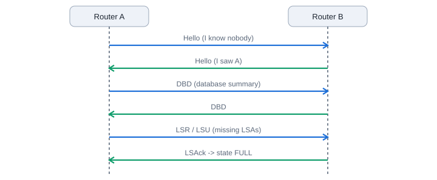

*شکل ۱: ساده‌شده‌ی تبادل پیام‌ها تا رسیدن به حالت Full.*

| حالت     | معنی                                              |
|----------|---------------------------------------------------|
| Down     | Hello نرسیده                                      |
| Init     | Hello دریافت شد ولی همسایه هنوز ما را ندیده       |
| 2-Way    | دوطرفه دیدیم (روی Broadcast: DR/BDR انتخاب می‌شود) |
| ExStart  | انتخاب Master/Slave برای تبادل                    |
| Exchange | تبادل خلاصه‌ی پایگاه داده (DBD)                    |
| Loading  | دریافت LSAهای مفقود                               |
| Full     | پایگاه‌ها یکسان؛ Adjacency کامل                    |

اگر روتری در ExStart یا Exchange گیر کرد، معمولاً MTU یا مشکل پایگاه داده است. اگر در Init می‌ماند، یکی از دو طرف Hello را نمی‌بیند (ACL، Hello/Dead، Subnet).

### ۴. شرط‌های تشکیل Adjacency

برای اینکه دو روتر همسایه شوند، این مقادیر باید یکی باشند:

- هر دو Interface در یک Subnet با Mask یکسان.
- Area یکسان.
- Hello و Dead Interval یکسان (پیش‌فرض اترنت: 10 و 40 ثانیه).
- Authentication یکسان.
- MTU برابر (یا `ip ospf mtu-ignore` در موارد خاص).
- Router ID یکتا.

``` text
Hello interval (Ethernet) = 10 s
Dead interval  (Ethernet) = 4 x Hello = 40 s
(Non-broadcast: Hello 30 s, Dead 120 s)
```

### ۵. Router ID

هر روتر یک شناسه‌ی ۳۲ بیتی شبیه IP دارد. اگر دستی تنظیم نکنید، بزرگ‌ترین IP روی Loopbackها، و در نبود Loopback بزرگ‌ترین IP روی Interfaceهای فعال انتخاب می‌شود. توصیه: همیشه دستی تنظیم کنید تا پایدار و قابل‌پیش‌بینی باشد:

``` text
R1(config)# router ospf 1
R1(config-router)# router-id 1.1.1.1
```

### ۶. Cost: چطور مسیر انتخاب می‌شود؟

هر لینک یک هزینه دارد که از پهنای باند به‌دست می‌آید. هزینه‌ی کل یک مسیر مجموع هزینه‌ی لینک‌های خروجی تا مقصد است و کمترین برنده می‌شود:

``` text
Cost = Reference bandwidth / Interface bandwidth
Default reference bandwidth = 100 Mbps

 10 Mbps  -> 100 / 10   = 10
100 Mbps  -> 100 / 100  = 1
  1 Gbps  -> 100 / 1000 = 0.1 -> rounded up to 1   (problem!)
 10 Gbps  -> also 1
```

> **مشکل شناخته‌شده**
>
> با مرجع ۱۰۰ مگابیت، لینک‌های ۱ و ۱۰ گیگابیت هزینه‌ی یکسان (۱) دارند؛ پس OSPF سریع‌تر را از کندتر تشخیص نمی‌دهد. راه‌حل: مرجع را بالا ببرید و در همه‌ی روترها یکسان کنید: `auto-cost reference-bandwidth 10000` (ده گیگ).

``` text
Reference 10000 Mbps:
  1 Gbps  -> 10000 / 1000  = 10
 10 Gbps  -> 10000 / 10000 = 1
100 Mbps  -> 10000 / 100   = 100
```

### ۷. مثال‌ها

#### ساده: دو روتر

``` text
R1 Gi0/1 10.0.12.1/30  <->  R2 Gi0/0 10.0.12.2/30, area 0
Hello exchanged -> neighbors -> state FULL
Each learns the other LANs automatically
```

#### متوسط: کدام مسیر؟

``` text
Path A: R1 -> R2 -> R3     cost 10 + 10 = 20
Path B: R1 -> R3 direct     cost 30
SPF picks Path A (20 < 30)
```

#### سخت: چرا Adjacency نمی‌شود؟

``` text
R1: ip ospf hello-interval 5   (dead 20)
R2: default (hello 10, dead 40)
Result: neighbors never reach 2-Way; hello/dead mismatch
Fix: make both sides identical
```

### تمرین‌ها

**ت1.** ۱ (ساده): سه مرحله‌ی کار OSPF؟ *(پاسخ: 5-4-ت1 در بخش «پاسخ‌ها» انتهای فصل)*

**ت2.** ۲ (ساده): Hello/Dead پیش‌فرض اترنت؟ *(پاسخ: 5-4-ت2 در بخش «پاسخ‌ها» انتهای فصل)*

**ت3.** ۳ (متوسط): Cost لینک 1 Gbps با Reference 100 Mbps؟ *(پاسخ: 5-4-ت3 در بخش «پاسخ‌ها» انتهای فصل)*

**ت4.** ۴ (متوسط): Cost لینک 100 Mbps با Reference 10000؟ *(پاسخ: 5-4-ت4 در بخش «پاسخ‌ها» انتهای فصل)*

**ت5.** ۵ (سخت): دو روتر در Init مانده‌اند؛ علت‌های محتمل؟ *(پاسخ: 5-4-ت5 در بخش «پاسخ‌ها» انتهای فصل)*

### Lab هدایت‌شده

در این درس فقط مشاهده‌ی مفهوم؛ پیکربندی کامل در درس بعد. ولی Router ID را می‌توانیم از الان برنامه‌ریزی کنیم:

| روتر | Router ID | Loopback               |
|------|-----------|------------------------|
| R1   | 1.1.1.1   | Loopback0 = 1.1.1.1/32 |
| R2   | 2.2.2.2   | Loopback0 = 2.2.2.2/32 |
| R3   | 3.3.3.3   | Loopback0 = 3.3.3.3/32 |

#### گام: ساخت Loopback0 روی هر روتر

``` text
R1(config)# interface loopback 0
R1(config-if)# ip address 1.1.1.1 255.255.255.255
R2(config)# interface loopback 0
R2(config-if)# ip address 2.2.2.2 255.255.255.255
R3(config)# interface loopback 0
R3(config-if)# ip address 3.3.3.3 255.255.255.255
```

سپس با Static قبلی، دسترسی به این Loopbackها را برقرار کنید (یا صبر کنید تا OSPF در درس بعد انجامش دهد).

### Lab مستقل

ترسیم دستی LSDB یک مثلث سه‌روتری روی کاغذ: هر روتر چه LSAهایی می‌سازد؟ و جدول Cost هر لینک را با Reference 10000 بنویسید.

### عیب‌یابی

|         |                                                                                                                           |
|---------|---------------------------------------------------------------------------------------------------------------------------|
| Symptom | دو روتر همسایه نمی‌شوند                                                                                                    |
| چک‌لیست  | ۱) Subnet و Mask یکی؟ ؛ ۲) Area یکی؟ ؛ ۳) Hello/Dead یکی؟ ؛ ۴) Authentication؟ ؛ ۵) MTU؟ ؛ ۶) Router ID تکراری؟ ؛ ۷) ACL؟ |
| ابزار   | show ip ospf neighbor ، show ip ospf interface ، debug ip ospf adj (با احتیاط)                                            |
| رفع     | یکسان‌سازی پارامتر ناسازگار                                                                                                |

### سؤال‌های مرور

**م1.** OSPF چه نوع پروتکلی است؟ *(پاسخ: 5-4-م1 در بخش «پاسخ‌ها» انتهای فصل)*

**م2.** Hello و Dead چیست؟ *(پاسخ: 5-4-م2 در بخش «پاسخ‌ها» انتهای فصل)*

### English Corner: انگلیسی تخصصی این درس

این جمله‌ها از مستندات و محیط کار واقعی‌اند. بلند بخوانید و ترجمه را بپوشانید.

| English sentence                                                                | ترجمه                                                           |
|---------------------------------------------------------------------------------|-----------------------------------------------------------------|
| OSPF routers exchange link-state advertisements to build an identical database. | روترهای OSPF با تبادل LSA پایگاه داده‌ی یکسان می‌سازند.           |
| Neighbors must agree on area, hello and dead timers.                            | همسایه‌ها باید روی Area و تایمرهای Hello/Dead توافق داشته باشند. |
| The lowest total cost path is selected.                                         | مسیر با کمترین هزینه‌ی کل انتخاب می‌شود.                          |
| Set the router ID manually for stability.                                       | Router ID را برای پایداری دستی تنظیم کنید.                      |

**Q1.** Quick quiz (answer in English): What are the three steps of OSPF operation? *(پاسخ: 5-4-Q1 در بخش «پاسخ‌ها» انتهای فصل)*

### تکلیف و چک‌لیست تسلط

- [ ] وضعیت‌های همسایگی را بدون نگاه بگویم.
- [ ] Cost را با دو Reference حساب کنم.
- [ ] Loopbackها را بسازم.

### یادآوری اشتباهات شما

> **یادآوری**
>
> پیش‌بینی قبل از اجرا؛ بکاپ قبل از تغییر؛ پذیرفته‌شدن دستور ≠ کار کردن؛ فرمول‌ها در بلوک مستقل.


#### کارت Lab — مفهوم OSPF

| # | فیلد | محتوا |
|---|---|---|
| 1 | عنوان و هدف | برنامه‌ریزی OSPF (Router-ID، Loopback) |
| 2 | پیش‌نیاز | درس 5-3 |
| 3 | توپولوژی | R1-R2-R3 |
| 4 | تجهیزات | ۳ vIOS |
| 5 | نسخه نرم‌افزار | vIOS-L2 15.2(20200924، Experimental) برای SW؛ vIOS 15.9(3)M9 برای R؛ VPCS؛ PNetLab 4.2.8 |
| 6 | IP Plan | Static |
| 7 | وضعیت اولیه | Loopback0 |
| 8 | صورت مسئله | Cost روی کاغذ |
| 9 | مراحل هدایت‌شده | همان بخش «Lab هدایت‌شده» همین درس |
| 10 | تست عملکرد | `show ip interface brief` |
| 11 | سناریوی خرابی | — |
| 12 | روش عیب‌یابی | لایه‌ای/با شواهد (بخش عیب‌یابی همین درس) |
| 13 | نتیجه‌ی مورد انتظار | Loopbackها بالا |
| 14 | معیار پذیرش | جدول Cost |
| 15 | مستندات نهایی | — |
| 16 | Cleanup و بازگردانی | حذف Loopback |

> **وضعیت راستی‌آزمایی (خارج از ۱۶ فیلد):** **اجرا نشده (فقط طراحی).** اجرا نشده.

---

<a id="l-5-5"></a>

## درس 5-5 — پیاده‌سازی OSPF

**فصل ۵ - روز ۵ · پیش‌نیاز: درس ۵-۴ · ۶ ساعت**

### این درس درباره چیست و چرا باید یاد بگیریم؟

**چه چیزی یاد می‌گیریم:** پیاده‌سازی OSPF تک‌ناحیه‌ای روی سه روتر: router ospf، معرفی شبکه‌ها، passive-interface، پخش Default Route، تنظیم Cost و بررسی با دستورهای show.

**چرا لازم است:** تا اینجا مفهوم را فهمیدید؛ حالا باید بتوانید یک شبکه‌ی چندروتری را در کمتر از ده دقیقه با OSPF بالا بیاورید و درستی‌اش را اثبات کنید. این مهارت در مصاحبه و کار روزانه مستقیماً سنجیده می‌شود.

- **در کار روزانه:** تنظیم OSPF برای شبکه‌ی جدید و عیب‌یابی همسایگی.
- **در امنیت:** Passive-interface جلوی ارسال Hello به سمت کاربران را می‌گیرد.
- **در Capstone:** Lab A (Cisco L3 Core) و ارتباط با FortiGate از همین مبانی استفاده می‌کند.

> **مسیر درس**
>
> طراحی ← دستورها خط‌به‌خط ← passive-interface ← default-information ← مثال ساده/متوسط/سخت ← Lab ← عیب‌یابی.

#### اصطلاحات این درس (مخفف ← شکل کامل ← معنی)

| مخفف                          | شکل کامل انگلیسی              | معنی فارسی                                         |
|-------------------------------|-------------------------------|----------------------------------------------------|
| network                       | OSPF network statement        | Interfaceها را با Wildcard به OSPF معرفی می‌کند     |
| Wildcard                      | Wildcard mask                 | معکوس Mask                                         |
| passive-interface             | Passive interface             | Interface که Hello نمی‌فرستد ولی شبکه‌اش اعلام می‌شود |
| default-information originate | Default information originate | پخش Default Route                                  |
| reference-bandwidth           | Auto-cost reference bandwidth | پهنای مرجع برای Cost                               |
| E2                            | OSPF External Type 2          | Route خارجی با Cost ثابت                           |

### ۱. طراحی Lab

``` text
R1 --10.0.12.0/30-- R2 --10.0.23.0/30-- R3
R1 LAN: 192.168.1.0/24 (Loopback10)
R3 LAN: 192.168.3.0/24 (Loopback30)
Router IDs: 1.1.1.1 , 2.2.2.2 , 3.3.3.3
All in area 0
```

اول Static درس قبل را حذف کنید تا نتیجه‌ی OSPF را درست ببینید.

``` text
R1(config)# no ip route 192.168.3.0 255.255.255.0 10.0.12.2
R1(config)# no ip route 10.0.23.0 255.255.255.252 10.0.12.2
(similarly remove statics on R2 and R3)
```

### ۲. دستورها (خط‌به‌خط)

``` text
R1(config)# router ospf 1
R1(config-router)# router-id 1.1.1.1
R1(config-router)# auto-cost reference-bandwidth 10000
R1(config-router)# network 10.0.12.0 0.0.0.3 area 0
R1(config-router)# network 192.168.1.0 0.0.0.255 area 0
R1(config-router)# passive-interface loopback 10
R1(config-router)# end
```

- `router ospf 1`: شماره‌ی Process فقط محلی است و لازم نیست با همسایه یکی باشد.
- `network ... area 0`: هر Interface که آدرسش در این بازه بیفتد در OSPF شرکت می‌کند. از Wildcard استفاده می‌شود: برای /30 برابر 0.0.0.3 و برای /24 برابر 0.0.0.255.
- `passive-interface`: روی Interface مربوط به LAN کاربران؛ شبکه‌اش اعلام می‌شود ولی Hello نمی‌رود (کاربر نمی‌تواند همسایه جعلی بسازد).
- `reference-bandwidth 10000`: باید در همه‌ی روترها یکسان باشد.

``` text
Wildcard = 255.255.255.255 - Mask
/30: 255.255.255.255 - 255.255.255.252 = 0.0.0.3
/24: 255.255.255.255 - 255.255.255.0   = 0.0.0.255
```

روش جایگزین (مدرن): فعال‌سازی روی خود Interface بدون `network`:

``` text
R1(config)# interface gi0/1
R1(config-if)# ip ospf 1 area 0
R1(config)# interface loopback 10
R1(config-if)# ip ospf 1 area 0
```

### ۳. Verification (چهار دستور اصلی)

``` text
R1# show ip ospf neighbor
R1# show ip ospf interface brief
R1# show ip route ospf
R1# show ip protocols
```

نمونه‌ی خروجی سالم:

``` text
R1# show ip ospf neighbor
Neighbor ID   Pri  State     Dead Time  Address     Interface
2.2.2.2         1  FULL/BDR  00:00:35   10.0.12.2   Gi0/1

R1# show ip route ospf
O   10.0.23.0/30 [110/20] via 10.0.12.2, Gi0/1
O   192.168.3.0/24 [110/21] via 10.0.12.2, Gi0/1
```

خوانش: State باید `FULL` باشد. مقدار Cost به‌صورت زیر حساب می‌شود (با Reference 10000 و لینک 1 گیگ):

``` text
Reference 10000, each 1G link = 10, Loopback = 1
R1 -> 10.0.23.0/30 : 10 (R1-R2) + 10 (R2-R3)        = 20
R1 -> 192.168.3.0/24: 10 + 10 + 1 (Loopback30)        = 21
```

### ۴. پخش Default Route

R1 به اینترنت (یا فایروال) وصل است و Default دارد. می‌خواهیم R2 و R3 هم بدانند:

``` text
R1(config)# ip route 0.0.0.0 0.0.0.0 203.0.113.1
R1(config)# router ospf 1
R1(config-router)# default-information originate
```

در R2 و R3 مسیر `O*E2 0.0.0.0/0` می‌بینید؛ E2 یعنی Route خارجی با Cost ثابت. اگر Default روی R1 نباشد، دستور بی‌اثر است (مگر با `always`).

### ۵. مثال‌ها

#### ساده

``` text
R1 and R2: both "network 10.0.12.0 0.0.0.3 area 0"
show ip ospf neighbor -> FULL
```

#### متوسط: ping سراسری

``` text
R1# ping 192.168.3.1 source 192.168.1.1
R3# ping 192.168.1.1 source 192.168.3.1
Both succeed through OSPF-learned routes
```

#### سخت: تغییر Cost برای هدایت مسیر

``` text
R2(config)# interface gi0/1
R2(config-if)# ip ospf cost 500
R1# show ip route 192.168.3.0   -> cost increases accordingly
Used to steer traffic to a preferred path
```

### تمرین‌ها

**ت1.** ۱ (ساده): Wildcard برای /27؟ *(پاسخ: 5-5-ت1 در بخش «پاسخ‌ها» انتهای فصل)*

**ت2.** ۲ (ساده): چرا Loopback را passive می‌کنیم؟ *(پاسخ: 5-5-ت2 در بخش «پاسخ‌ها» انتهای فصل)*

**ت3.** ۳ (متوسط): Cost 21 در R1 برای شبکه‌ی R3 را توضیح بده *(پاسخ: 5-5-ت3 در بخش «پاسخ‌ها» انتهای فصل)*

**ت4.** ۴ (متوسط): state ExStart گیر کرده؛ علت؟ *(پاسخ: 5-5-ت4 در بخش «پاسخ‌ها» انتهای فصل)*

**ت5.** ۵ (سخت): default-information originate بدون Default روی روتر چه می‌شود؟ *(پاسخ: 5-5-ت5 در بخش «پاسخ‌ها» انتهای فصل)*

### Lab هدایت‌شده

#### گام ۱: بکاپ و حذف Static

``` text
Rx# copy running-config flash:Rx-before-ospf.cfg
```

#### گام ۲: OSPF روی هر سه

``` text
R2(config)# router ospf 1
R2(config-router)# router-id 2.2.2.2
R2(config-router)# auto-cost reference-bandwidth 10000
R2(config-router)# network 10.0.12.0 0.0.0.3 area 0
R2(config-router)# network 10.0.23.0 0.0.0.3 area 0

R3(config)# router ospf 1
R3(config-router)# router-id 3.3.3.3
R3(config-router)# auto-cost reference-bandwidth 10000
R3(config-router)# network 10.0.23.0 0.0.0.3 area 0
R3(config-router)# network 192.168.3.0 0.0.0.255 area 0
R3(config-router)# passive-interface loopback 30
```

#### گام ۳: بررسی

``` text
Rx# show ip ospf neighbor
Rx# show ip route ospf
R1# ping 192.168.3.1 source 192.168.1.1
```

#### گام ۴: Capture Hello

روی لینک R1-R2 Capture بگیرید و فیلتر `ospf` بزنید. بسته‌های Hello را ببینید: هر ۱۰ ثانیه، به مقصد Multicast `224.0.0.5` (همه‌ی روترهای OSPF).

#### گام ۵: Failover

``` text
R2(config)# interface gi0/1
R2(config-if)# shutdown
R1# show ip route ospf   (route to R3 LAN disappears)
R2(config-if)# no shutdown
```

### Lab مستقل

یک «OSPF As-Built» در `03-ops/ospf-as-built.md` بنویسید: Router IDها، شبکه‌ها، Cost، خروجی show ip ospf neighbor و جدول Route.

### عیب‌یابی

|         |                                                                                                                                                   |
|---------|---------------------------------------------------------------------------------------------------------------------------------------------------|
| Symptom | Neighbor نیست یا Route نیامده                                                                                                                     |
| چک‌لیست  | ۱) network statement شامل Interface هست؟ ؛ ۲) Area یکی؟ ؛ ۳) passive-interface اشتباهی روی لینک؟ ؛ ۴) Hello/Dead؟ ؛ ۵) Reference bandwidth یکسان؟ |
| ابزار   | show ip ospf interface ، show ip protocols                                                                                                        |
| رفع     | اصلاح network یا حذف passive از لینک اتصال                                                                                                        |

### سؤال‌های مرور

**م1.** network statement چه می‌کند؟ *(پاسخ: 5-5-م1 در بخش «پاسخ‌ها» انتهای فصل)*

**م2.** passive-interface چه فایده‌ای دارد؟ *(پاسخ: 5-5-م2 در بخش «پاسخ‌ها» انتهای فصل)*

### English Corner: انگلیسی تخصصی این درس

این جمله‌ها از مستندات و محیط کار واقعی‌اند. بلند بخوانید و ترجمه را بپوشانید.

| English sentence                                                     | ترجمه                                                       |
|----------------------------------------------------------------------|-------------------------------------------------------------|
| Advertise the networks with the network command and a wildcard mask. | شبکه‌ها را با دستور network و Wildcard Mask اعلام کنید.      |
| Make user-facing interfaces passive.                                 | Interfaceهای سمت کاربر را Passive کنید.                     |
| The neighbor reached the FULL state.                                 | همسایه به حالت FULL رسید.                                   |
| The default route is injected into OSPF as an external type 2 route. | Default Route به‌صورت Route خارجی نوع ۲ در OSPF تزریق می‌شود. |

**Q1.** Quick quiz (answer in English): Which command verifies that neighbors reached FULL? *(پاسخ: 5-5-Q1 در بخش «پاسخ‌ها» انتهای فصل)*

### تکلیف و چک‌لیست تسلط

- [ ] OSPF را روی سه روتر بالا بیاورم و FULL ببینم.
- [ ] Hello را در Capture ببینم.
- [ ] OSPF As-Built را بنویسم.

### یادآوری اشتباهات شما

> **یادآوری**
>
> پیش‌بینی قبل از اجرا؛ بکاپ قبل از تغییر؛ پذیرفته‌شدن دستور ≠ کار کردن؛ فرمول‌ها در بلوک مستقل.


#### کارت Lab — پیاده‌سازی OSPF

| # | فیلد | محتوا |
|---|---|---|
| 1 | عنوان و هدف | OSPF تک‌ناحیه‌ای |
| 2 | پیش‌نیاز | درس 5-4 |
| 3 | توپولوژی | R1-R2-R3 |
| 4 | تجهیزات | ۳ vIOS |
| 5 | نسخه نرم‌افزار | vIOS-L2 15.2(20200924، Experimental) برای SW؛ vIOS 15.9(3)M9 برای R؛ VPCS؛ PNetLab 4.2.8 |
| 6 | IP Plan | Static حذف |
| 7 | وضعیت اولیه | OSPF area 0 |
| 8 | صورت مسئله | FULL و ping |
| 9 | مراحل هدایت‌شده | همان بخش «Lab هدایت‌شده» همین درس |
| 10 | تست عملکرد | `show ip ospf neighbor` |
| 11 | سناریوی خرابی | Hello/Area mismatch |
| 12 | روش عیب‌یابی | لایه‌ای/با شواهد (بخش عیب‌یابی همین درس) |
| 13 | نتیجه‌ی مورد انتظار | FULL؛ Route O |
| 14 | معیار پذیرش | OSPF As-Built |
| 15 | مستندات نهایی | `03-ops/ospf-as-built.md` |
| 16 | Cleanup و بازگردانی | حذف OSPF |

> **وضعیت راستی‌آزمایی (خارج از ۱۶ فیلد):** **اجرا نشده (فقط طراحی).** OSPF در Probe فقط CLI-Accepted.

---

<a id="l-5-6"></a>

## درس 5-6 — عیب‌یابی مسیریابی و آزمون

**فصل ۵ - روز ۶ · پیش‌نیاز: درس‌های ۵-۱ تا ۵-۵ · ۶ ساعت**

### این درس درباره چیست و چرا باید یاد بگیریم؟

**چه چیزی یاد می‌گیریم:** روش عیب‌یابی مسیریابی و پنج دلیل رایج تشکیل‌نشدن همسایگی OSPF؛ و آزمون کوچک پایان هفته‌ی ۵.

**چرا لازم است:** «شبکه‌ی دور در دسترس نیست» پرتکرارترین شکایت است و علتش یکی از چند مورد محدود است. اگر روش داشته باشید، ریشه را در چند دقیقه پیدا می‌کنید.

- **در کار روزانه:** عیب‌یابی مسیریابی مهارت پایه‌ی هر ادمین شبکه است.
- **در امنیت:** اشتباه مسیر یعنی ترافیک از مسیر ناخواسته یا نامشخص می‌رود.
- **در مصاحبه:** سناریوی «دو روتر همسایه نمی‌شوند» سؤال تکراری مصاحبه‌هاست.

> **مسیر درس**
>
> روش ۵ مرحله‌ای ← پنج خرابی OSPF ← مثال‌ها ← Lab عیب‌یابی ← آزمون کوچک.

#### اصطلاحات این درس (مخفف ← شکل کامل ← معنی)

| مخفف       | شکل کامل انگلیسی          | معنی فارسی                     |
|------------|---------------------------|--------------------------------|
| TS         | Troubleshooting Scenario  | سناریوی عیب‌یابی                |
| MTU        | Maximum Transmission Unit | بزرگ‌ترین اندازه‌ی بسته روی لینک |
| Mismatch   | Mismatch                  | عدم تطابق پارامتر دو طرف       |
| Asymmetric | Asymmetric routing        | مسیر رفت و برگشت متفاوت        |
| RCA        | Root Cause Analysis       | علت ریشه‌ای                     |
| Traceroute | traceroute                | نمایش مسیر Hop به Hop          |

### ۱. روش سیستماتیک مسیریابی

1.  **Symptom:** از کجا به کجا نمی‌رسد؟ (مبدأ و مقصد دقیق)
2.  **ping و traceroute:** تا کدام Hop می‌رسد؟
3.  **Route رفت:** `show ip route <مقصد>` روی هر روتر مسیر.
4.  **Route برگشت:** همان کار از سمت مقصد.
5.  **پروتکل:** همسایگی OSPF (`show ip ospf neighbor`) و فیلتر/ACL.

مهم‌ترین قاعده: Hop به Hop بروید و هر روتر را بررسی کنید؛ حدس ممنوع.

### ۲. پنج دلیل رایج Adjacency نشدن OSPF

#### ۱: Hello/Dead Mismatch

``` text
Symptom : neighbor stuck / flapping
Evidence: show ip ospf interface -> Hello 5 vs 10
Fix     : set the same hello/dead on both ends
```

#### ۲: Area Mismatch

``` text
Symptom : no neighbor; log "Mismatched area"
Evidence: show ip ospf interface -> Area 0 vs Area 1
Fix     : use the same area
```

#### ۳: Subnet/Mask Mismatch

``` text
Symptom : no neighbor
Evidence: 10.0.12.1/30 vs 10.0.12.2/29 (different masks)
Fix     : same subnet and mask
```

#### ۴: Authentication Mismatch

``` text
Symptom : neighbor does not form; log auth failure
Evidence: show ip ospf interface -> auth type/key differs
Fix     : same auth mode and key
```

#### ۵: MTU Mismatch

``` text
Symptom : stuck in ExStart/Exchange
Evidence: show interfaces -> MTU 1500 vs 1400
Fix     : same MTU (or ip ospf mtu-ignore as a temporary workaround)
```

### ۳. مسیر برگشت و مسیر نامتقارن

اگر رفت از R2 و برگشت از R3 باشد (Asymmetric)، فایروال‌ها و NAT اغلب ارتباط را قطع می‌کنند چون Stateful هستند. همیشه مسیر رفت و برگشت را جدا بررسی کنید.

### ۴. آزمون کوچک پایان هفته‌ی ۵ (بدون نگاه به درس)

| \#  | وظیفه                            | مدرک                          |
|-----|----------------------------------|-------------------------------|
| ۱   | LPM را برای ۳ بسته حل کنید       | جدول جواب                     |
| ۲   | Static رفت و برگشت بین دو LAN    | ping موفق                     |
| ۳   | Default + Floating + Track       | show track                    |
| ۴   | OSPF سه‌روتری و ping سراسری       | show ip ospf neighbor / route |
| ۵   | سه عیب OSPF را بسازید و رفع کنید | گزارش RCA                     |

معیار: حداقل ۴ از ۵ مورد. وقتی تمام شد بگویید «فصل ۵ انجام شد».

### تمرین‌ها

**ت1.** ۱ (ساده): اولین ابزار عیب‌یابی مسیریابی؟ *(پاسخ: 5-6-ت1 در بخش «پاسخ‌ها» انتهای فصل)*

**ت2.** ۲ (ساده): پنج دلیل Adjacency نشدن؟ *(پاسخ: 5-6-ت2 در بخش «پاسخ‌ها» انتهای فصل)*

**ت3.** ۳ (متوسط): در ExStart گیر کرده؛ اول چه چیزی را بررسی می‌کنی؟ *(پاسخ: 5-6-ت3 در بخش «پاسخ‌ها» انتهای فصل)*

**ت4.** ۴ (سخت): ping از A به B شکست می‌خورد ولی traceroute تا Hop آخر پیش می‌رود؛ حدس؟ *(پاسخ: 5-6-ت4 در بخش «پاسخ‌ها» انتهای فصل)*

### Lab هدایت‌شده

روی OSPF سه‌روتری، هر پنج خرابی را به ترتیب بسازید و رفع کنید:

1.  Hello: `ip ospf hello-interval 3` روی یک سمت.
2.  Area: network statement با area 1 روی یک سمت.
3.  Mask: Mask متفاوت روی Interface یک سمت.
4.  Authentication: `ip ospf authentication message-digest` فقط یک سمت.
5.  MTU: `ip mtu 1400` روی یک سمت.

``` text
Rx# show ip ospf neighbor
Rx# show ip ospf interface gi0/1
Rx# debug ip ospf adj   (use briefly; then: undebug all)
```

برای هر مورد Symptom، Evidence، Fix و Verify را یادداشت کنید. در شبیه‌ساز اگر رفتار با واقعیت فرق داشت، همان را ثبت کنید.

### Lab مستقل

گزارش RCA پنج‌گانه را در `03-ops/rca-ospf.md` بنویسید.

### عیب‌یابی

|         |                                                           |
|---------|-----------------------------------------------------------|
| Symptom | ارتباط به شبکه‌ی دور نیست                                  |
| روش     | Hop به Hop: Route رفت، Route برگشت، همسایگی، ACL          |
| ابزار   | ping ، traceroute ، show ip route ، show ip ospf neighbor |
| پیشگیری | مستندسازی As-Built و بکاپ قبل از تغییر                    |

### سؤال‌های مرور

**م1.** قدم اول عیب‌یابی مسیریابی؟ *(پاسخ: 5-6-م1 در بخش «پاسخ‌ها» انتهای فصل)*

**م2.** MTU Mismatch چه علامتی دارد؟ *(پاسخ: 5-6-م2 در بخش «پاسخ‌ها» انتهای فصل)*

### English Corner: انگلیسی تخصصی این درس

این جمله‌ها از مستندات و محیط کار واقعی‌اند. بلند بخوانید و ترجمه را بپوشانید.

| English sentence                                          | ترجمه                                                  |
|-----------------------------------------------------------|--------------------------------------------------------|
| Verify the route in both directions.                      | Route را در هر دو جهت بررسی کنید.                      |
| The adjacency is stuck in ExStart due to an MTU mismatch. | Adjacency به‌خاطر MTU Mismatch در ExStart گیر کرده است. |
| Use traceroute to find where the path breaks.             | با traceroute نقطه‌ی قطع مسیر را پیدا کنید.             |
| Document the root cause and the fix.                      | علت ریشه‌ای و راه‌حل را مستند کنید.                      |

**Q1.** Quick quiz (answer in English): A neighbor is stuck in ExStart. What is the most likely cause? *(پاسخ: 5-6-Q1 در بخش «پاسخ‌ها» انتهای فصل)*

### تکلیف و چک‌لیست تسلط

- [ ] پنج عیب OSPF را بسازم و رفع کنم.
- [ ] آزمون کوچک را کامل کنم.
- [ ] RCA را بنویسم.

### یادآوری اشتباهات شما

> **یادآوری**
>
> پیش‌بینی قبل از اجرا؛ بکاپ قبل از تغییر؛ پذیرفته‌شدن دستور ≠ کار کردن؛ فرمول‌ها در بلوک مستقل.


#### کارت Lab — عیب‌یابی مسیریابی و آزمون

| # | فیلد | محتوا |
|---|---|---|
| 1 | عنوان و هدف | عیب‌یابی مسیریابی و ۵ خطای OSPF |
| 2 | پیش‌نیاز | درس 5-5 |
| 3 | توپولوژی | R1-R2-R3 |
| 4 | تجهیزات | ۳ vIOS |
| 5 | نسخه نرم‌افزار | vIOS-L2 15.2(20200924، Experimental) برای SW؛ vIOS 15.9(3)M9 برای R؛ VPCS؛ PNetLab 4.2.8 |
| 6 | IP Plan | OSPF سالم |
| 7 | وضعیت اولیه | پنج خرابی |
| 8 | صورت مسئله | هر خرابی RCA |
| 9 | مراحل هدایت‌شده | همان بخش «Lab هدایت‌شده» همین درس |
| 10 | تست عملکرد | show ip ospf … |
| 11 | سناریوی خرابی | Hello/Area/Mask/Auth/MTU |
| 12 | روش عیب‌یابی | لایه‌ای/با شواهد (بخش عیب‌یابی همین درس) |
| 13 | نتیجه‌ی مورد انتظار | رفع هر پنج |
| 14 | معیار پذیرش | ≥ ۴ از ۵ |
| 15 | مستندات نهایی | `03-ops/rca-ospf.md` |
| 16 | Cleanup و بازگردانی | بازگشت Baseline |

> **وضعیت راستی‌آزمایی (خارج از ۱۶ فیلد):** **اجرا نشده (فقط طراحی).** اجرا نشده.

---

<a id="ans-5"></a>

## درس 5-7 — Convergence: وقتی لینک می‌میرد شبکه چه می‌کند؟

**فصل ۵ · درس افزوده (پس از ۵-۶) · پیش‌نیاز: درس‌های ۵-۱ تا ۵-۵ · ≈ ۶ ساعت**

> **وضعیت:** تحلیل مفهومی با منبع؛ اعداد زمان‌بندی نمونه‌اند و در Lab با vIOS «اجرا نشده» و `Unverified` هستند.

### ۱) هدف آموزشی

دانشجو در پایان می‌تواند:

1. مراحل چهارگانه‌ی Convergence را نام ببرد و برای هر مرحله زمان تقریبی بدهد.
2. زمان Detection در OSPF را با Hello/Dead و با BFD مقایسه و محاسبه کند.
3. توضیح دهد چرا سوئیچ لایه ۲ میانی «خرابی را پنهان می‌کند».
4. تأثیر Static Floating، IP SLA، Fast Hello و BFD را بسنجد و میان آن‌ها انتخاب کند.
5. پیامد قطع شدن را روی Session فایروال و کاربر توضیح دهد.

### ۲) پیش‌نیازها

OSPF (درس ۵-۴ و ۵-۵)، Floating Static و IP SLA (۵-۳)، Neighbor States، LSDB/SPF.

### ۳) مفهوم پایه: Convergence چیست و چرا مهم است؟

**Convergence (همگرایی)** یعنی بعد از یک تغییر (خرابی لینک، افتادن روتر، افزودن مسیر) همه‌ی روترها دوباره به یک تصویر هماهنگ و درست از شبکه برسند. تا آن لحظه، بعضی روترها هنوز بسته‌ها را به سمت مسیر خراب می‌فرستند (**Black Hole**) یا بسته‌ها بین دو روتر ناهماهنگ رفت‌وبرگشت می‌کنند (**Micro-loop**).

چرا برای ما مهم است؟

- در شبکه‌ی سازمانی، ۳۰ ثانیه قطعی یعنی Sessionهای TCP تایم‌اوت می‌شوند، تماس VoIP قطع می‌شود، و در فایروال Sessionهای Stateful باید دوباره ساخته شوند.
- Convergence کند یعنی «افزونگی (Redundancy) داریم ولی عملاً بی‌فایده است».
- تمام Failover در HA، SD-WAN و VPN (فصل‌های ۱۸ تا ۲۲) همین منطق «تشخیص + تصمیم + جایگزینی» را دارند.

### ۴) توضیح عمیق فنی

#### ۴-۱) چهار مرحله‌ی Convergence

``` text
Total convergence time =
    T_detect + T_propagate + T_compute + T_install
```

| مرحله | کار | عامل زمان |
|---|---|---|
| Detect | روتر می‌فهمد همسایه/لینک خراب است | Dead Timer، قطع Carrier، BFD |
| Propagate | خبر تغییر به بقیه می‌رسد | OSPF: Flooding LSA؛ BGP: Update + MRAI |
| Compute | جدول مجدد محاسبه می‌شود | OSPF: SPF (با Throttle) |
| Install | RIB و FIB به‌روز می‌شود | سرعت CPU/سخت‌افزار |

در شبکه‌های کوچک Lab، سه مرحله‌ی آخر معمولاً چند ده میلی‌ثانیه‌اند؛ **Detect بیشترین سهم را دارد**. پس بهینه‌سازی از Detect شروع می‌شود.

#### ۴-۲) Detection در OSPF

مقادیر رایج OSPF روی Ethernet (Broadcast/Point-to-Point) در پیاده‌سازی‌های متداول: Hello = 10 ثانیه، Dead = 40 ثانیه (۴ برابر Hello). **توجه (RFC 2328، خوانده‌شده):** RFC عدد پیش‌فرض ثابت نمی‌دهد؛ در پیوست C.3 برای LAN «Sample value: 10 seconds» و برای Dead «some multiple of HelloInterval (say 4)» آمده است. پس ۱۰/۴۰ «پیش‌فرض پیاده‌سازی» (مثلاً Cisco IOS؛ در این بازنگری از مستند Cisco بازخوانی نشد) است نه الزام پروتکل.

``` text
Detect time (worst case) = Dead interval
OSPF default: Dead = 40 s
```

> **حدود اعتبار (v4.0):** Dead interval زمان انتظار پیش از اعلام همسایه به‌عنوان «مرده» است؛ در مدل ساده «حداکثر تأخیر تشخیص برای قطع بی‌صدا» است، نه کل زمان همگرایی (SPF، انتشار LSA، به‌روزرسانی FIB و Session بعد از آن می‌آید). قطع لینک فیزیکی/BFD می‌تواند تشخیص را بسیار سریع‌تر کند. مقادیر پیش‌فرض (۱۰/۴۰) برای Ethernet Broadcast/Point-to-Point است و روی شبکه‌های دیگر فرق می‌کند.


یعنی اگر لینک «بی‌صدا» خراب شود (بسته‌ها فقط گم شوند)، تا ۴۰ ثانیه همسایه Up می‌ماند و ترافیک به سمت مسیر خراب می‌رود.

**دو حالت مهم:**

- **قطع مستقیم لینک (Carrier Loss):** کابل مستقیم بین دو روتر قطع شود. Interface فوراً Down می‌شود و OSPF در چند ده میلی‌ثانیه همسایه را می‌بندد؛ بدون انتظار Dead.
- **قطع غیرمستقیم:** بین دو روتر یک **سوئیچ لایه ۲** است. قطع لینک سوئیچ تا آن طرف روتر، Interface روتر را Down نمی‌کند (چون پورتش به سوئیچ هنوز Up است). این‌جا **فقط Dead Timer** خرابی را کشف می‌کند. این یکی از رایج‌ترین دلایل «Failover ما ۴۰ ثانیه طول می‌کشد».

#### ۴-۳) سه راه کوتاه‌کردن Detect

| روش | سازوکار | حداقل زمان معمول | هزینه/ریسک |
|---|---|---|---|
| Fast Hello | Hello 1 s، Dead 3–4 s (`ip ospf hello-interval` / `dead-interval`) | چند ثانیه | بار CPU و ریسک Flap با لینک ناپایدار |
| Sub-second Hello | `ip ospf dead-interval minimal hello-multiplier N` | کمتر از ۱ ثانیه | CPU بالاتر |
| BFD | پروتکل سبک جداگانه برای تشخیص خرابی (RFC 5880) | چند ده تا چند صد میلی‌ثانیه | نیاز به پشتیبانی دو سر؛ روی سخت‌افزار بهتر |

BFD = Bidirectional Forwarding Detection. OSPF/BGP از BFD می‌خواهند «اگر BFD قطع شد فوراً همسایه را ببند». مزیت: یک مکانیزم برای همه‌ی پروتکل‌ها، سبک‌تر از Hello سریع.

``` text
BFD detect time = interval x multiplier
Example: 300 ms x 3 = 900 ms
```

#### ۴-۴) Compute: SPF Throttle

اگر لینکی مدام قطع/وصل شود (Flap)، SPF پشت‌سرهم اجرا می‌شود و CPU پر می‌شود. پس OSPF محدودکننده دارد: `timers throttle spf <start> <hold> <max-wait>` (میلی‌ثانیه). اولین SPF سریع، بعدی‌ها با تأخیر فزاینده. تنظیم بیش از حد کند، Convergence را کند می‌کند؛ بیش از حد سریع، شبکه را ناپایدار.

#### ۴-۵) Black Hole و Micro-loop

- **Black Hole:** مسیر خراب هنوز در جدول است و بسته‌ها در آن ناپدید می‌شوند. زمانش = تا پایان Detect.
- **Micro-loop:** در مرحله‌ی گذار، R1 به R2 و R2 به R1 مسیر می‌دهد چون به‌روزرسانی‌ها هم‌زمان نرسیده‌اند. TTL این حلقه را در نهایت می‌کشد. در شبکه‌های حساس راه‌حل‌های پیشرفته (LFA) وجود دارد که خارج از این دوره است.

#### ۴-۶) Floating Static و IP SLA (مرور و پیوند)

- Floating Static با AD بیشتر مسیر پشتیبان می‌دهد، ولی اگر Detect نباشد (لینک Up ولی ISP قطع)، Route اصلی در جدول می‌ماند. **IP SLA + Track** این «قطع پنهان» را کشف می‌کند (درس ۵-۳).
- زمان Failover = (تعداد شکست لازم × فاصله‌ی Probe) + زمان Track.

``` text
IP SLA detect time ~= frequency x consecutive failures
Example: 5 s x 3 = 15 s
```

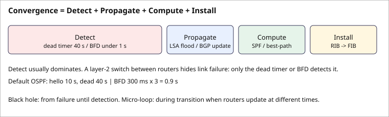

*شکل: چهار مرحله‌ی Convergence؛ Detect معمولاً غالب است.*

### ۵) مثال حل‌شده

**شرایط:** R1—SW—R2 (سوئیچ لایه ۲ بین آن‌ها)، OSPF Area 0، Hello 10/Dead 40. پورت سوئیچ سمت R2 کابلش کشیده می‌شود. R1 همچنان Up می‌بیند.

``` text
t=0 s     cable on SW->R2 pulled; R1 Gi0/0 still up (link to SW is up)
t=0..40 s R1 keeps sending packets to R2 via the dead path (black hole)
t=40 s    Dead timer expires on R1: neighbor Down
t=40.05   SPF recalculated; backup route (via R3) installed
t=40.1    traffic flows via backup path
Outage ~= 40 s
```

**راه‌حل‌ها و مقایسه:**

| راه‌حل | زمان قطعی تقریبی | یادداشت |
|---|---|---|
| پیش‌فرض | ~40 s | بدون هزینه |
| Fast Hello 1/4 | ~4 s | بار Hello 10 برابر |
| BFD 300×3 | ~1 s | نیاز به پشتیبانی دو سر |
| لینک مستقیم بدون سوئیچ | ~0.1 s (Carrier) | تغییر طراحی |

**مثال سخت:** در شبکه‌ی دو فایروال (فصل ۱۵)، Active/Standby با OSPF و لینک از طریق سوئیچ‌های L2 وصل است. تیم می‌گوید «Failover ما ۴۰ ثانیه است». با اعداد بالا بگویید دقیقاً چه چیزی مقصر است و دو راه اصلاح با ریسک هر کدام.

### ۶) طراحی و تصمیم‌گیری

| نیاز | پیشنهاد | دلیل |
|---|---|---|
| لینک بین روتر و فایروال از سوئیچ می‌گذرد | BFD یا Fast Hello | Carrier Loss دیده نمی‌شود |
| لینک WAN/ISP | IP SLA/Track یا BFD (اگر ISP پشتیبانی کند) | Up بودن Interface کافی نیست |
| شبکه‌ی پرنوسان (لینک ناپایدار) | زمان‌های محافظه‌کارانه + Dampening | جلوگیری از Flap |
| VoIP/Real-time | زیر ۱ ثانیه (BFD) | حساسیت Jitter |

اصل طراحی: **سریع‌ترین Convergence همیشه بهترین نیست؛ سریع‌ترین ممکنِ پایدار بهترین است.**

### ۷) پیاده‌سازی (CLI Cisco، نمونه)

``` text
R1(config)# interface GigabitEthernet0/0
R1(config-if)# ip ospf hello-interval 1
R1(config-if)# ip ospf dead-interval 4

! BFD (example, requires support on both ends and platform)
R1(config-if)# bfd interval 300 min_rx 300 multiplier 3
R1(config)# router ospf 1
R1(config-router)# bfd all-interfaces

R1# show ip ospf interface GigabitEthernet0/0
R1# show bfd neighbors
R1# show ip ospf neighbor
```

> **هشدار:** Hello/Dead باید در دو سر یکی باشد؛ در غیر این صورت همسایگی برقرار نمی‌شود. روی vIOS پشتیبانی BFD `Unverified` است.

### ۸) Troubleshooting

| علامت | شاهد | علت محتمل |
|---|---|---|
| Failover ~40 ثانیه | `show ip ospf neighbor` Dead Time | Detect فقط با Dead Timer |
| همسایگی Flap می‌شود | `%OSPF-5-ADJCHG` مکرر | زمان‌ها خیلی تهاجمی/لینک ناپایدار |
| Route پشتیبان نصب نمی‌شود | `show ip route`، `show ip ospf database` | AD/Cost/LSDB ناقص |
| بعد از Failover بعضی Sessionها نمی‌آیند | Session Table فایروال | State قبلی/NAT (فصل ۱۳، ۲۲) |

### ۹) نکات امنیتی

- BFD و Hello سریع را روی لینک‌های غیرقابل‌اعتماد با Authentication محافظت کنید (OSPF Authentication، بخش‌های فصل ۸).
- Timerهای تهاجمی می‌توانند در حمله‌ی DoS روی لینک، شبکه را ناپایدار کنند.
- Failover بی‌شواهد می‌تواند ترافیک را از مسیر «بازرسی‌نشده» (دور از فایروال) عبور دهد؛ پس مسیر پشتیبان هم باید از Policy امنیتی عبور کند.

### ۱۰) جمع‌بندی مفهومی

- Convergence = Detect + Propagate + Compute + Install؛ Detect معمولاً غالب است.
- پیش‌فرض OSPF: Dead 40 s؛ سوئیچ L2 میانی خرابی لینک را پنهان می‌کند.
- BFD و Fast Hello زمان Detect را کم می‌کنند، با هزینه‌ی پایداری.
- Floating Static بدون Track قطع پنهان ISP را نمی‌بیند.
- Convergence را باید در Lab اندازه گرفت (با ping پیوسته و timestamp)، نه حدس زد.

### ۱۱) تمرین و ارزیابی

**ت1.** (ساده) چهار مرحله‌ی Convergence را نام ببرید. *(پاسخ: 5-7-ت1)*

**ت2.** (ساده) Dead interval پیش‌فرض OSPF روی Ethernet چند ثانیه است؟ *(پاسخ: 5-7-ت2)*

**ت3.** (متوسط) BFD با interval 200 ms و multiplier 4 چه زمان Detect دارد؟ *(پاسخ: 5-7-ت3)*

**ت4.** (متوسط) چرا قطع کابل بین سوئیچ و روتر، Interface روتر مقابل را Down نمی‌کند؟ *(پاسخ: 5-7-ت4)*

**ت5.** (سخت) یک IP SLA با frequency 10 ثانیه و آستانه‌ی ۳ شکست متوالی دارید. بدترین زمان Detect را حساب کنید و بگویید برای VoIP قابل‌قبول است؟ *(پاسخ: 5-7-ت5)*

**ت6.** (سخت، طراحی) برای دو فایروال Active/Standby که با دو سوئیچ به روترها وصل‌اند، سه گزینه‌ی کاهش زمان Failover را با مزایا و ریسک مقایسه کنید. *(پاسخ: 5-7-ت6)*

**م1.** Black Hole چیست؟ *(پاسخ: 5-7-م1)*

**م2.** چرا Timer تهاجمی ممکن است شبکه را بی‌ثبات کند؟ *(پاسخ: 5-7-م2)*

**Q1.** Quick quiz (English): Which convergence phase usually dominates, and why? *(پاسخ: 5-7-Q1)*

### ۱۲) اصطلاحات و English Corner

| مخفف | شکل کامل | معنی |
|---|---|---|
| BFD | Bidirectional Forwarding Detection | تشخیص سریع خرابی مسیر |
| SPF | Shortest Path First | الگوریتم محاسبه‌ی مسیر |
| LSA | Link-State Advertisement | بسته‌ی اعلام وضعیت لینک |
| MRAI | Minimum Route Advertisement Interval | حداقل فاصله‌ی ارسال تغییر مسیر در BGP |
| Flap | Route/Link flap | قطع/وصل مکرر |
| Micro-loop | Micro-loop | حلقه‌ی کوتاه‌مدت هنگام همگرایی |

- *Convergence is complete when all routers have a consistent view of the topology.* ← وقتی همه‌ی روترها تصویر یکسانی از توپولوژی داشته باشند، Convergence کامل است.
- *Detection time dominates failover when a switch masks link failures.* ← وقتی سوئیچ خرابی لینک را پنهان کند، زمان تشخیص بر Failover غالب می‌شود.

### ۱۳) منابع

- RFC 2328 — OSPF Version 2 (Hello/Dead، SPF).
- RFC 5880 — Bidirectional Forwarding Detection (BFD).
- Cisco: «OSPF Support for Fast Hello Packets» و «Bidirectional Forwarding Detection» (IOS XE Configuration Guides).


<a id="l-5-9"></a>

## درس 5-9 — Static Routing کامل: Default، Network، Host و Floating Static برای IPv4 و IPv6

**فصل 5 · درس افزوده برای سرفصل رسمی CCNA 200-301 (مورد 3.1: Interpret a routing table و 3.2: Troubleshoot IPv4 and IPv6 static routing — default, network, host, floating static) · پیش‌نیاز: ۵-۱ تا ۵-۳، ۲-۷**

> **وضعیت:** نظری/مستندی؛ دستورها `Unverified`؛ خروجی‌ها نمونه‌ی آموزشی‌اند؛ Lab اجرا نشده.

### ۱) این درس درباره چیست و چرا باید یاد بگیریم؟

**چه چیزی یاد می‌گیریم:** چهار نوع Static Route (پیش‌فرض، شبکه، میزبان، Floating) هم در IPv4 و هم در IPv6؛ خواندن جدول مسیر؛ و عیب‌یابی «Route هست ولی ترافیک نمی‌رود».

**چرا لازم است؟** روتر مثل راننده‌ای است که فقط وقتی مقصد را بداند حرکت می‌کند. Static Route یعنی شما خودتان نقشه را به او می‌دهید: «برای رفتن به شبکه‌ی X از در Y خارج شو». ساده‌ترین مسیریابی است و هنوز در لبه‌ی سازمان (Default Route به ISP) و شعب کوچک کاربرد فراوان دارد. IPv6 هم همان منطق را دارد ولی با Syntax و چند نکته‌ی متفاوت (Link-local Next-hop).

### ۲) توضیح از پایه

#### ۲-۱) جدول مسیر را بخوانیم

``` text
R1# show ip route
Codes: L - local, C - connected, S - static, O - OSPF, * - candidate default
Gateway of last resort is 198.51.100.1 to network 0.0.0.0

S*    0.0.0.0/0 [1/0] via 198.51.100.1
      10.0.0.0/8 is variably subnetted, 4 subnets, 2 masks
C        10.10.0.0/24 is directly connected, GigabitEthernet0/0
L        10.10.0.1/32 is directly connected, GigabitEthernet0/0
S        10.20.0.0/24 [1/0] via 10.99.0.2
S        10.30.0.5/32 [1/0] via 10.99.0.3
```

هر خط: **کد منبع** + **Prefix/طول** + **[AD/Metric]** + **Next-hop یا Interface**.

- `[1/0]`: Administrative Distance=1 و Metric=0.
- `C`: شبکه‌ی مستقیم؛ `L`: آدرس خود Interface (/32).
- روتر **طولانی‌ترین Prefix مطابق** (Longest Prefix Match) را انتخاب می‌کند: برای 10.30.0.5 مسیر /32 از /24 و Default برنده است.
- اگر دو مسیر هم‌Prefix باشند، **AD کمتر** برنده است؛ اگر AD هم برابر بود، Metric.

#### ۲-۲) چهار نوع Static IPv4

| نوع | دستور | معنی |
|---|---|---|
| Network | `ip route 10.20.0.0 255.255.255.0 10.99.0.2` | شبکه‌ی مشخص |
| Default | `ip route 0.0.0.0 0.0.0.0 198.51.100.1` | هر مقصدی که مسیر بهتری ندارد |
| Host | `ip route 10.30.0.5 255.255.255.255 10.99.0.3` | یک میزبان (/32) |
| Floating | `ip route 0.0.0.0 0.0.0.0 203.0.113.1 250` | مسیر پشتیبان با AD بالا |

**Floating Static:** AD پیش‌فرض Static برابر 1 است. اگر مسیر پشتیبان با AD=250 بگذارید، تا وقتی مسیر اصلی (AD کمتر) در جدول هست، پشتیبان «روی آب شناور» و ناپیدا می‌ماند؛ با افتادن مسیر اصلی، وارد جدول می‌شود. برای اینکه AD پشتیبان از مسیر یادگرفته‌شده توسط OSPF (110) هم بالاتر باشد، مقدار بالاتر از 110 (مثلاً 200 یا 250) انتخاب می‌شود.

#### ۲-۳) Static IPv6

ابتدا `ipv6 unicast-routing` (بدون آن روتر IPv6 را Route نمی‌کند).

| نوع | دستور |
|---|---|
| Network | `ipv6 route 2001:db8:20::/64 2001:db8:12::2` |
| Default | `ipv6 route ::/0 2001:db8:12::2` |
| Host | `ipv6 route 2001:db8:20::5/128 2001:db8:12::3` |
| Floating | `ipv6 route ::/0 2001:db8:13::2 200` |
| Link-local Next-hop | `ipv6 route 2001:db8:20::/64 GigabitEthernet0/1 FE80::2` |

**نکته‌ی Link-local:** آدرس FE80:: فقط روی همان لینک معنا دارد (چند Interface می‌توانند FE80::1 داشته باشند)؛ پس باید Interface خروجی هم نوشته شود. اشاره‌ی فقط به Interface (`ipv6 route ... Gi0/1`) روی اترنت چندپخشی توصیه نمی‌شود؛ بهتر است Next-hop ذکر شود (Fully specified).

### ۳) Verification

``` text
show ip route static
show ip route 10.30.0.5
show ipv6 route static
show ipv6 route 2001:db8:20::5
show ipv6 neighbors
ping 10.20.0.1 source 10.10.0.1
ping ipv6 2001:db8:20::1
traceroute 10.20.0.1
```

### ۴) مثال‌های حل‌شده از ساده به سخت

**ساده — Default Route.** شعبه با یک روتر و یک ISP؛ تنها لازم: `ip route 0.0.0.0 0.0.0.0 198.51.100.1`. تأیید: `Gateway of last resort is 198.51.100.1`.

**متوسط — Longest Prefix Match.** جدول: `10.20.0.0/16` از Static و `10.20.5.0/24` از OSPF و `0.0.0.0/0`. بسته به 10.20.5.9: /24 برنده است (حتی اگر AD آن 110 بالاتر از Static با AD=1 باشد). **اولویت اول Prefix طولانی‌تر است؛ AD فقط بین مسیرهای هم‌Prefix مقایسه می‌شود.**

**متوسط — Floating.** دو ISP:

``` text
ip route 0.0.0.0 0.0.0.0 198.51.100.1
ip route 0.0.0.0 0.0.0.0 203.0.113.1 250
```

با `show ip route 0.0.0.0` فقط مسیر اول (AD=1) دیده می‌شود. اگر Interface ISP1 قطع شود (Line Down)، مسیر اول حذف و مسیر دوم نصب می‌شود. **هشدار:** اگر لینک بالا باشد ولی ISP بالادست مشکل داشته باشد، Static معمولی Route را حذف نمی‌کند؛ باید `ip sla` و Track به Route وصل شود (مفهوم مشابه Link Monitor فصل ۱۲).

**متوسط — IPv6 با Link-local.**

``` text
ipv6 unicast-routing
ipv6 route 2001:db8:20::/64 GigabitEthernet0/1 FE80::2
```

اگر Interface را ننویسید خطا: `% Interface has to be specified for a link-local nexthop`.

**سخت — Route هست ولی ping نمی‌رود.**

``` text
S  10.20.0.0/24 [1/0] via 10.99.0.2
```

مراحل:

1. `ping 10.99.0.2` (Next-hop قابل‌دسترس؟). اگر نه، Route نصب شده ولی بی‌فایده (در IOS Static فقط وقتی Next-hop از طریق Interface Up قابل‌حل باشد نصب می‌شود).
2. `show arp` (برای Next-hop؛ در IPv6: `show ipv6 neighbors`).
3. روتر مقابل مسیر برگشت دارد؟ (ping با `source` برای آزمودن).
4. Mask اشتباه؟ `10.20.0.0/24` در برابر شبکه‌ی واقعی /16.
5. ACL یا فایروال؟

**سخت — جداول متناقض.** دو روتر هرکدام Default Route به دیگری دارند ⇒ حلقه (TTL کم می‌شود). نشانه: traceroute رفت‌وبرگشت بین دو Hop. رفع: یکی از Routeها نادرست است؛ Default فقط به سمت خروجی.

### ۵) Lab (اجرا نشده)

سه روتر در خط؛ Static، Default، Host و Floating را بسازید؛ با قطع Interface رفتار Floating را مشاهده کنید.

### ۶) اصطلاحات این درس

| اصطلاح | شکل کامل | معنی |
|---|---|---|
| AD | Administrative Distance | اعتبار منبع مسیر |
| LPM | Longest Prefix Match | انتخاب طولانی‌ترین Prefix |
| NDP | Neighbor Discovery Protocol | ARP در IPv6 |
| SLA | Service Level Agreement (IP SLA) | پایش مسیر |
| Floating Static | — | Static با AD بالا برای پشتیبان |

### ۷) تمرین‌ها

**ت1.** (ساده) Default Route در IPv4 و IPv6 چگونه نوشته می‌شود؟ *(پاسخ: 5-9-ت1 در بخش «پاسخ‌ها» انتهای فصل)*

**ت2.** (ساده) AD پیش‌فرض Static چند است؟ *(پاسخ: 5-9-ت2 در بخش «پاسخ‌ها» انتهای فصل)*

**ت3.** (متوسط) برای 10.1.1.9 مسیرهای 10.1.0.0/16 (AD 1)، 10.1.1.0/24 (AD 110) و 0.0.0.0/0 هست؛ کدام انتخاب می‌شود؟ *(پاسخ: 5-9-ت3 در بخش «پاسخ‌ها» انتهای فصل)*

**ت4.** (متوسط) Floating Static برای OSPF (AD 110) چه AD باید داشته باشد؟ *(پاسخ: 5-9-ت4 در بخش «پاسخ‌ها» انتهای فصل)*

**ت5.** (سخت) Route IPv6 با Next-hop FE80::2 خطا می‌دهد؛ علت و رفع. *(پاسخ: 5-9-ت5 در بخش «پاسخ‌ها» انتهای فصل)*

### ۸) English Corner

- *A floating static route has a higher administrative distance than the primary route.*
- *The router always selects the longest matching prefix first.*
- **Q1.** Why does a link-local next hop require an exit interface? *(پاسخ: 5-9-Q1 در بخش «پاسخ‌ها» انتهای فصل)*

---

<a id="l-5-10"></a>

## درس 5-10 — OSPF تک‌ناحیه‌ای (OSPFv2 و OSPFv3): Router ID، همسایگی، DR/BDR، Point-to-Point و عیب‌یابی

**فصل 5 · درس افزوده برای سرفصل رسمی CCNA 200-301 (مورد 3.3: Configure single area OSPFv2 for IPv4 and OSPFv3 for IPv6 — neighbor adjacencies, point-to-point, broadcast DR/BDR selection, router ID) · پیش‌نیاز: ۵-۱ تا ۵-۳، ۲-۷**

> **وضعیت:** نظری/مستندی؛ دستورها `Unverified`؛ خروجی‌ها نمونه‌ی آموزشی‌اند؛ Lab اجرا نشده.

### ۱) این درس درباره چیست و چرا باید یاد بگیریم؟

**چه چیزی یاد می‌گیریم:** OSPF چطور همسایه پیدا می‌کند، Router ID چگونه انتخاب می‌شود، چرا روی اترنت DR/BDR داریم و روی لینک نقطه‌به‌نقطه نه، و چرا همسایگی «گیر» می‌کند.

**چرا لازم است؟** Static Route برای ۳ روتر خوب است؛ برای ۳۰ روتر، هر تغییر یعنی ۳۰ ویرایش دستی. OSPF Link-State است: هر روتر نقشه‌ی کامل شبکه را می‌سازد و خودکار کوتاه‌ترین مسیر را می‌یابد. مثل GPS که هر بار ترافیک تغییر کند، مسیر را دوباره حساب می‌کند. و چون OSPF هسته‌ی سؤال‌های آزمون است، باید همسایگی و انتخاب DR را از روی عدد حل کنید.

### ۲) توضیح از پایه

#### ۲-۱) مراحل کار

1. Hello بفرست و همسایه پیدا کن.
2. Adjacency (همسایگی کامل) بساز.
3. LSAها (Link-State Advertisement) را رد و بدل کن تا همه LSDB (پایگاه‌داده‌ی وضعیت لینک) یکسان داشته باشند.
4. SPF (الگوریتم Dijkstra) را اجرا کن و بهترین مسیر را در جدول مسیر بگذار.

#### ۲-۲) Router ID

یک عدد ۳۲ بیتی مثل IPv4 که هر روتر را یکتا می‌کند. ترتیب انتخاب:

1. دستور `router-id` (اولویت اول).
2. بالاترین آدرس IPv4 در Interfaceهای **Loopback** فعال.
3. بالاترین آدرس IPv4 در Interfaceهای فیزیکی فعال.

``` text
router ospf 1
 router-id 1.1.1.1
```

تغییر Router ID پس از راه‌اندازی تا `clear ip ospf process` (یا Reload) اعمال نمی‌شود. دو روتر با Router ID یکسان ⇒ همسایگی ناپایدار/مسیرهای اشتباه.

#### ۲-۳) نوع شبکه (Network Type)

| نوع | DR/BDR | Hello/Dead پیش‌فرض | مثال |
|---|---|---|---|
| Broadcast | دارد | 10 / 40 | اترنت (پیش‌فرض) |
| Point-to-Point | ندارد | 10 / 40 | سریال، Tunnel، اترنت با تنظیم |
| NBMA / Non-broadcast | دارد | 30 / 120 | Frame Relay (قدیمی) |

روی اترنت پیش‌فرض Broadcast است. برای لینک دو روتر که فقط دو نفرند، DR/BDR بی‌فایده است:

``` text
interface GigabitEthernet0/1
 ip ospf network point-to-point
```

(باید هر دو سر یکسان باشند؛ وگرنه Timerها/رفتار ناهمخوان می‌شود.)

#### ۲-۴) DR و BDR

در یک Segment چندروتری، اگر هر روتر با همه Adjacency بسازد، تعداد Adjacencyها N(N-1)/2 می‌شود. **DR** (Designated Router) نقطه‌ی مرکزی است: همه‌ی روترها فقط با DR و BDR (Backup DR) Adjacency Full می‌سازند. روترهای دیگر (**DROTHER**) با هم فقط تا حالت **2-Way** می‌روند (این طبیعی است).

- Multicast: همه‌ی روترهای OSPF 224.0.0.5؛ فقط DR/BDR 224.0.0.6.
- **انتخاب:** بالاترین **Priority** (0 تا 255، پیش‌فرض 1)؛ تساوی ⇒ بالاترین **Router ID**. Priority 0 یعنی هرگز DR/BDR نمی‌شود.
- **Non-preemptive:** اگر DR از قبل وجود دارد، روتر با Priority بالاتر که بعداً بیاید DR نمی‌شود؛ تنها وقتی DR از کار بیفتد BDR جایگزین می‌شود و BDR جدید انتخاب می‌شود. برای اعمال Priority جدید باید فرایند OSPF پاک شود.

``` text
interface GigabitEthernet0/0
 ip ospf priority 100
```

#### ۲-۵) حالت‌های همسایگی

``` text
Down -> Init -> 2-Way -> ExStart -> Exchange -> Loading -> Full
```

| حالت | معنی |
|---|---|
| Init | Hello همسایه دیده شد ولی روتر خودمان در Hello او نیست |
| 2-Way | دوطرفه؛ در Broadcast انتخاب DR/BDR اینجاست؛ DROTHERها اینجا می‌مانند |
| ExStart | تعیین Master/Slave برای تبادل DBD (اینجا MTU مهم است) |
| Exchange | تبادل خلاصه‌ی LSDB |
| Loading | درخواست LSAهای ناقص |
| Full | LSDB همگام |

#### ۲-۶) شرط‌های تشکیل همسایگی

باید یکسان: Area ID، **Subnet و Mask**، Hello/Dead، Authentication، Stub flag؛ و **Router ID یکتا**؛ MTU در ExStart.

#### ۲-۷) هزینه (Cost)

``` text
Cost = Reference Bandwidth / Interface Bandwidth
Default reference = 100 Mbps
FastEthernet 100M: 100/100 = 1
GigabitEthernet 1G: 100/1000 = 0.1 -> 1 (minimum)
10G: 1
```

مشکل: 100M و 1G و 10G همگی Cost=1. راه: `auto-cost reference-bandwidth 10000` (به Mbps) روی **همه‌ی روترها** یکسان.

### ۳) دستورها (Unverified)

**OSPFv2**

``` text
router ospf 1
 router-id 1.1.1.1
 network 10.10.0.0 0.0.0.255 area 0
 network 10.99.0.0 0.0.0.3 area 0
 passive-interface GigabitEthernet0/0
 auto-cost reference-bandwidth 10000
```

`network` با Wildcard مشخص می‌کند کدام Interfaceها وارد OSPF شوند. `passive-interface` روی پورت کاربران: شبکه اعلام می‌شود ولی Hello ارسال نمی‌شود (امنیت و کاهش بار). روش جایگزین: `ip ospf 1 area 0` روی Interface.

**OSPFv3 (IPv6)**

``` text
ipv6 unicast-routing
ipv6 router ospf 1
 router-id 1.1.1.1
interface GigabitEthernet0/1
 ipv6 address 2001:db8:12::1/64
 ipv6 ospf 1 area 0
```

تفاوت‌ها: فعال‌سازی روی Interface (نه `network`)؛ Adjacency با آدرس **Link-local**؛ Multicast FF02::5 و FF02::6؛ Router ID هنوز ۳۲ بیتی است و اگر روتر IPv4 ندارد **باید دستی** تنظیم شود.

**بررسی**

``` text
show ip ospf neighbor
show ip ospf interface brief
show ip ospf interface GigabitEthernet0/0
show ip protocols
show ip route ospf
show ipv6 ospf neighbor
show ipv6 route ospf
```

خروجی نمونه:

``` text
R1# show ip ospf neighbor
Neighbor ID   Pri State      Dead Time  Address      Interface
2.2.2.2       100 FULL/DR    00:00:34   10.10.0.2    GigabitEthernet0/0
3.3.3.3       1   2WAY/DROTHER 00:00:37 10.10.0.3    GigabitEthernet0/0
```

تفسیر: همسایه 2.2.2.2 با Priority 100 حالت `FULL/DR`؛ یعنی DR است. 3.3.3.3 `2WAY/DROTHER` ⇒ DROTHER و بین دو DROTHER طبیعی است.

### ۴) مثال‌های حل‌شده از ساده به سخت

**ساده — Router ID.** روتر با Loopback0 = 1.1.1.1، Gi0/0 = 10.10.0.2، Gi0/1 = 192.168.5.1 و بدون `router-id`. Loopback بر فیزیکی ترجیح دارد ⇒ RID = 1.1.1.1. اگر Loopback نداشت: بالاترین فیزیکی = 192.168.5.1.

**متوسط — انتخاب DR.** سه روتر روی یک اترنت (هم‌زمان بالا آمدند):

``` text
R1: Priority 1,  RID 3.3.3.3
R2: Priority 1,  RID 2.2.2.2
R3: Priority 50, RID 1.1.1.1
```

مراحل: ۱) بالاترین Priority: R3 (50) ⇒ DR ۲) بین R1 و R2 (Priority برابر) بالاترین RID: R1 (3.3.3.3) ⇒ BDR ۳) R2 = DROTHER.

**متوسط — Non-preemptive.** R2 اول بالا آمد و DR شد؛ سپس R3 با Priority 200 اضافه شد. R3 DR نمی‌شود؛ تا R2 خراب شود. اگر R2 خراب شد، BDR (مثلاً R1) DR می‌شود و برای BDR جدید انتخاب انجام می‌شود (R3 به‌خاطر Priority بالا BDR می‌شود).

**متوسط — ظرفیت.**

``` text
Full mesh adjacencies for 5 routers = 5 x 4 / 2 = 10
With DR/BDR: each DROTHER has 2 adjacencies (DR, BDR) ; total ~ 7
```

**متوسط — Point-to-Point.** لینک /30 بین دو روتر: `ip ospf network point-to-point` ⇒ DR انتخاب نمی‌شود و همگرایی سریع‌تر (بدون انتظار Wait Timer 40 ثانیه).

**سخت — همسایگی بالا نمی‌آید. چک‌لیست.**

1. `show ip ospf interface brief`: Interface در OSPF هست؟ (State: DR/BDR/DROTHER/P2P)
2. `show ip ospf neighbor`: خالی ⇒ Hello نمی‌رسد؛ بررسی `passive-interface` اشتباه.
3. `show ip ospf interface Gi0/0`: **Hello/Dead** دو سر یکسان؟ (مثلاً 10/40 در برابر 30/120)
4. Area، Subnet/Mask، Authentication.
5. `debug ip ospf adj` (محدود و کوتاه) پیام‌های `mismatched hello parameters` یا `mismatched area`.
6. ACL مانع 89 (OSPF IP Protocol 89).
7. اگر گیر در **ExStart**: MTU متفاوت ⇒ برابر کنید یا `ip ospf mtu-ignore`.
8. اگر `2WAY` برای دو DROTHER: طبیعی است، خطا نیست.

**سخت — `Router ID duplicate`.** Log: `%OSPF-4-DUP_RTRID_NBR`. دو روتر RID یکسان دارند (کپی Config). رفع: `router-id` یکتا و `clear ip ospf process`.

**سخت — مسیر زیرین به‌خاطر Cost.** لینک 1G و 100M هر دو Cost=1، OSPF ECMP می‌کند و بخشی از ترافیک را روی لینک کند می‌فرستد. رفع: `auto-cost reference-bandwidth 10000` یکسان در همه‌ی روترها:

``` text
Cost 1G  = 10000 / 1000  = 10
Cost 100M = 10000 / 100  = 100
```

### ۵) Lab (اجرا نشده)

سه روتر روی یک سوییچ؛ Priority/Router ID را تغییر دهید و DR را پیش‌بینی/تأیید کنید؛ سپس لینک P2P و OSPFv3.

### ۶) اصطلاحات این درس

| اصطلاح | شکل کامل | معنی |
|---|---|---|
| OSPF | Open Shortest Path First | پروتکل Link-State |
| LSA | Link-State Advertisement | اعلان وضعیت لینک |
| LSDB | Link-State Database | پایگاه‌داده‌ی وضعیت لینک |
| SPF | Shortest Path First | الگوریتم کوتاه‌ترین مسیر |
| DR / BDR | Designated / Backup Designated Router | روتر مرکزی Segment |
| DBD | Database Description | پیام توصیف پایگاه‌داده |

### ۷) تمرین‌ها

**ت1.** (ساده) ترتیب انتخاب Router ID؟ *(پاسخ: 5-10-ت1 در بخش «پاسخ‌ها» انتهای فصل)*

**ت2.** (ساده) Hello/Dead پیش‌فرض Broadcast؟ *(پاسخ: 5-10-ت2 در بخش «پاسخ‌ها» انتهای فصل)*

**ت3.** (متوسط) Priority/RID: A (1، 9.9.9.9)، B (1، 4.4.4.4)، C (0، 8.8.8.8)؛ DR و BDR؟ *(پاسخ: 5-10-ت3 در بخش «پاسخ‌ها» انتهای فصل)*

**ت4.** (متوسط) Cost لینک 1 Gbps با Reference پیش‌فرض و با 10000؟ *(پاسخ: 5-10-ت4 در بخش «پاسخ‌ها» انتهای فصل)*

**ت5.** (سخت) همسایگی در ExStart گیر می‌کند؛ علت و رفع. *(پاسخ: 5-10-ت5 در بخش «پاسخ‌ها» انتهای فصل)*

### ۸) English Corner

- *OSPF elects the designated router by highest priority, then by highest router ID.*
- *Two DROTHER routers on the same segment stay in the 2-Way state.*
- **Q1.** Which IP protocol number does OSPF use? *(پاسخ: 5-10-Q1 در بخش «پاسخ‌ها» انتهای فصل)*

---

## پاسخ‌های فصل 5

> ابتدا بدون نگاه حل کنید. شناسه: درس-نوع+شماره (ت = تمرین، م = مرور، Q = Quick quiz).

**5-1-ت1** — ۱ (ساده): L و C چه فرقی دارند؟

در جدول مسیر، C (Connected) خود شبکه‌ی متصل به Interface است (مثلاً 10.0.12.0/30) و L (Local) آدرس خود Interface روتر روی آن شبکه با Prefix /32 (مثلاً 10.0.12.1/32). L باعث می‌شود بسته‌ی مقصد خود روتر به CPU برسد. در عیب‌یابی، دیدن C بدون L یعنی Interface آدرس ندارد/Down است؛ و در IOS قدیمی L نمایش داده نمی‌شد.

``` text
C = the connected network (prefix); L = the local router address on it (/32).
```

**5-1-ت2** — ۲ (ساده): AD برای Static و OSPF؟

AD (Administrative Distance) اعتبار منبع Route است: Connected 0، Static 1، eBGP 20، EIGRP 90، OSPF 110، RIP 120، iBGP 200. کمتر بهتر. وقتی یک Prefix یکسان از دو منبع رسید، منبع با AD کمتر وارد RIB می‌شود؛ پس Static (1) بر OSPF (110) می‌چربد. از همین رو Floating Static با AD 200 فقط وقتی فعال می‌شود که مسیر اصلی برود.

``` text
Static 1, OSPF 110
```

**5-1-ت3** — ۳ (متوسط): بسته به 10.1.1.77؛ Routeهای /8، /16 و /0 موجودند. کدام؟

روتر همیشه بر اساس طولانی‌ترین Prefix مطابق (Longest Prefix Match) تصمیم می‌گیرد. 10.1.1.77 با هر سه مسیر مطابق است ولی /16 (10.1.0.0/16) از /8 و /0 دقیق‌تر است؛ پس /16 انتخاب می‌شود. اگر /24 مطابق هم بود، آن برنده بود. AD یا Metric در این مرحله نقشی ندارد.

``` text
10.1.1.77 matches: 10.0.0.0/8 , 10.1.0.0/16 , 0.0.0.0/0  -> longest = /16
```

``` text
/16 (longest matching prefix among those that match).
```

**5-1-ت4** — ۴ (متوسط): آیا Metric یک Route در OSPF با RIP قابل مقایسه است؟

خیر؛ هر پروتکل Metric خودش را دارد (OSPF: Cost پهنای باند، RIP: تعداد Hop، EIGRP: ترکیب پهنای باند/تأخیر) و واحدها قابل مقایسه نیستند. بین منابع مختلف، AD تصمیم می‌گیرد؛ Metric فقط بین مسیرهای همان پروتکل برای همان Prefix معنی دارد.

``` text
No. Different protocols use different metrics; AD decides between sources.
```

**5-1-ت5** — ۵ (سخت): Static 10.0.0.0/8 و OSPF 10.0.23.0/30 هر دو موجود؛ بسته به 10.0.23.5 از کجا می‌رود؟

ابتدا Longest Prefix Match: مقصد 10.0.23.5 با /8 و /30 مطابق است ولی /30 دقیق‌تر است، پس مسیر OSPF انتخاب می‌شود. AD فقط وقتی به‌کار می‌آید که دو مسیر دقیقاً همان Prefix را داشته باشند. این خطا شایع است: «Static دارم ولی ترافیک از OSPF می‌رود» ⇒ طول Prefix را نگاه کنید.

``` text
Via the OSPF route: /30 is the longest prefix. AD is only used for identical prefixes.
```

**5-1-م1** — اولین چیزی که روتر برای انتخاب Route نگاه می‌کند؟

قاعده‌ی اول در Forwarding طول Prefix است (Longest Prefix Match): هرچه Prefix طولانی‌تر باشد، مسیر دقیق‌تر و برنده است. بعد از انتخاب Prefix، اگر چند منبع برای همان Prefix باشد AD، و بعد Metric تصمیم می‌گیرند.

طول Prefix (Longest Prefix Match).

**5-1-م2** — AD برای چیست؟

AD برای انتخاب بین منابع مختلف یک Prefix یکسان است. مثال: 192.168.5.0/24 هم با OSPF (110) و هم با Static (1) آمده؛ Static وارد جدول می‌شود. AD ابزار کنترل «اعتماد» است و در Floating Static و Redistribution هم برای جلوگیری از حلقه به‌کار می‌رود.

انتخاب بین منابع مختلف Route برای یک Prefix یکسان.

**5-1-Q1** — Quick quiz (answer in English): Which is compared first: administrative distance or prefix length?

پاسخ انگلیسی در پایین آمده است؛ ترتیب تصمیم: Prefix length، سپس AD، سپس Metric. اشتباه رایج این است که AD را قبل از طول Prefix فرض کنند.

Prefix length (longest match) is compared first; AD only breaks ties between equal prefixes.

**5-2-ت1** — ۱ (ساده): Static برای شبکه‌ی 172.16.5.0/24 با Next-hop 10.0.0.2

Static Route شبکه‌ی مقصد، Mask و Next-hop را می‌گیرد. دستور بلوک زیر است؛ آدرس 10.0.0.2 باید از طریق یک Interface متصل در دسترس باشد وگرنه Route در جدول نصب نمی‌شود. برای تأیید: `show ip route static` و ping از Source مربوط. فراموش نکنید که روتر مقصد هم باید Route برگشت داشته باشد.

``` text
ip route 172.16.5.0 255.255.255.0 10.0.0.2
```

``` text
ip route 172.16.5.0 255.255.255.0 10.0.0.2
```

**5-2-ت2** — ۲ (ساده): چرا روی اترنت Next-hop می‌نویسیم؟

روی Ethernet Route با فقط Interface خروجی باعث می‌شود روتر برای هر مقصد ARP بفرستد و به Proxy ARP طرف مقابل وابسته شود؛ جدول ARP بزرگ و رفتار غیرقطعی می‌شود. Next-hop مشخص مسیر را قطعی می‌کند و فقط برای همان Next-hop ARP لازم است. برای لینک‌های Serial/Point-to-point Interface-only ایرادی ندارد.

``` text
Interface-only routes make the router ARP for every destination; next-hop is deterministic.
```

**5-2-ت3** — ۳ (متوسط): Summary چهار شبکه‌ی 10.2.4.0/24 تا 10.2.7.0/24؟

چهار شبکه‌ی /24 پیاپی از 10.2.4.0 تا 10.2.7.0 را با ۲ بیت (۴ بلوک) خلاصه می‌کنیم: Prefix 22 و شروع 10.2.4.0. بررسی: بلوک /22 در octet سوم اندازه‌ی ۴ دارد و 4 مضرب ۴ است ⇒ 10.2.4.0/22 تا 10.2.7.255.

``` text
10.2.4.0/24 .. 10.2.7.0/24 -> 10.2.4.0/22
```

``` text
Third octet 4..7 -> block 4 -> 10.2.4.0/22
```

**5-2-ت4** — ۴ (متوسط): ping یک‌طرفه شکست می‌خورد؛ علت؟

اگر ping از A به B موفق نیست ولی مسیر رفت درست است، تقریباً همیشه Route برگشت در یکی از Hopها یا در مقصد وجود ندارد. بررسی: `show ip route` در B/Gateway برای Source A، Debug محدود، Capture. رفع: Route برگشت یا Default روی مقصد. درس: Static دوطرفه است.

``` text
Missing return route on one of the hops.
```

**5-2-ت5** — ۵ (سخت): چرا Route به Null0 با AD 200؟

Route به Null0 با AD بالا (مثلاً 200) برای Summary است: ترافیک مقصدهای نامعتبر داخل Summary را دور می‌ریزد (جلوگیری از حلقه/Black-hole بالادستی) ولی چون AD بالاست، هر مسیر واقعی (دقیق‌تر یا AD کمتر) را بازنویسی نمی‌کند. مثال: Static 10.2.0.0/16 Null0 200 و OSPF 10.2.4.0/24 ⇒ ترافیک به 10.2.4.x از OSPF می‌رود.

``` text
To drop unmatched traffic inside a summary without overriding real (more specific or lower AD) routes.
```

**5-2-م1** — Static Route کی مناسب است؟

Static برای شبکه‌ی کوچک، لینک‌های ثابت و Default به ISP مناسب است: ساده، قابل پیش‌بینی، بدون ترافیک کنترل. در شبکه‌ی بزرگ مدیریت دستی Static خطا و دشوار می‌شود؛ آنجا Dynamic (OSPF/BGP) بهتر است. ترکیب رایج: Static Default به ISP و OSPF داخلی.

شبکه‌ی کوچک یا لینک‌های ثابت مثل Default به ISP.

**5-2-م2** — چرا مسیر برگشت مهم است؟

ارتباط شبکه‌ای دوطرفه است: بسته‌ی رفت و پاسخ برگشت هر دو باید مسیر داشته باشند. اگر Route برگشت نباشد، مقصد پاسخ را به جایی (یا هیچ‌جا) می‌فرستد و کلاینت فقط Timeout می‌بیند. بنابراین هنگام طراحی Static هر دو سمت را بنویسید و هر دو را آزمون کنید.

ارتباط دوطرفه است؛ بدون Route برگشت پاسخ نمی‌رسد.

**5-2-Q1** — Quick quiz (answer in English): Why do we avoid exit-interface-only static routes on Ethernet?

پاسخ انگلیسی در پایین آمده است. نکته‌ی عملی: با Interface-only، روتر هر آدرس مقصد را مستقیماً روی همان Ethernet فرض می‌کند و برای آن ARP می‌فرستد؛ اگر Proxy ARP نباشد، پاسخ نمی‌آید.

The router must ARP for every destination, relying on proxy ARP.

**5-3-ت1** — ۱ (ساده): AD پیش‌فرض Static و Floating معمول؟

AD پیش‌فرض Static برابر ۱ است. Floating Static با AD بزرگ‌تر از مسیر اصلی (معمولاً ۲۰۰) تنظیم می‌شود تا فقط وقتی مسیر اصلی از جدول حذف شد، نصب شود. مثال: `ip route 0.0.0.0 0.0.0.0 203.0.113.9 200` برای ISP پشتیبان.

``` text
Static default AD = 1; floating backup typically 200 (any value higher than the primary).
```

**5-3-ت2** — ۲ (ساده): چرا 0.0.0.0 0.0.0.0 همه‌ی مقاصد را می‌پوشاند؟

Prefix /0 با هر آدرسی مطابق است؛ چون کوتاه‌ترین Prefix است فقط وقتی استفاده می‌شود که هیچ مسیر طولانی‌تری مطابق نباشد: «آخرین راه». برای همین Default Route امن است و جایگزین مسیرهای دقیق نمی‌شود.

``` text
Prefix length 0 matches every address; it is only used when nothing longer matches.
```

**5-3-ت3** — ۳ (متوسط): چرا Floating به‌تنهایی کافی نیست؟

Floating Static فقط وقتی فعال می‌شود که Route اصلی از جدول حذف شود. اما Static به وضعیت Interface محلی وابسته است: اگر لینک به مودم up است ولی ISP قطع است، Route اصلی در جدول می‌ماند و Floating فعال نمی‌شود. برای تشخیص سلامت واقعی باید IP SLA و Track به کار رود.

``` text
The static route stays installed while the interface is up, even if the ISP is dead.
```

**5-3-ت4** — ۴ (متوسط): دستور Route وابسته به Track؟

با Track، Route فقط وقتی نصب می‌ماند که شیء Track Up باشد. دستور بلوک زیر را همراه IP SLA (icmp-echo) و `track 1 ip sla 1 reachability` می‌نویسید. Failover: SLA شکست ⇒ Track Down ⇒ Route حذف ⇒ Floating فعال.

``` text
ip sla 1
 icmp-echo 203.0.113.1
ip sla schedule 1 life forever start-time now
track 1 ip sla 1 reachability
ip route 0.0.0.0 0.0.0.0 203.0.113.1 track 1
```

``` text
ip route 0.0.0.0 0.0.0.0 203.0.113.1 track 1
```

**5-3-ت5** — ۵ (سخت): چه چیزی را باید پروب کنیم؟

باید Next-hop و ترجیحاً مقصدی فراتر از آن (آدرس پایدار در اینترنت یا شبکه‌ی ISP) را Probe کنیم؛ اگر فقط Next-hop (مودم/روتر ISP) را بزنیم، قطعی بالادست دیده نمی‌شود. چند Probe و Track ترکیبی (boolean OR) خطای کاذب را کم می‌کند.

``` text
The next-hop and ideally something beyond it (a reliable remote address) to detect upstream failure.
```

**5-3-م1** — Floating Static چیست؟

Floating Static مسیر پشتیبان با AD بالاتر است که فقط وقتی مسیر اصلی (AD کمتر) از جدول حذف شود نصب می‌شود. استفاده: ISP دوم، لینک پشتیبان. محدودیت: به تنهایی از قطعی «بالادست» خبر ندارد؛ نیاز به Track.

Route پشتیبان با AD بالاتر که فقط با حذف Route اصلی فعال می‌شود.

**5-3-م2** — IP SLA برای چیست؟

IP SLA سلامت واقعی مسیر را (با ICMP، TCP، HTTP) می‌سنجد و نتیجه را به Track می‌دهد. Failover بر پایه‌ی SLA دقیق‌تر از وضعیت Interface است. هشدار: Probe زیاد/شدید بار تولید می‌کند؛ Interval معقول (۵ تا ۱۰ ثانیه) بگذارید.

سنجش سلامت واقعی مسیر تا Failover درست انجام شود.

**5-3-Q1** — Quick quiz (answer in English): Why can a static route stay in the table even if the ISP is down?

پاسخ انگلیسی در پایین آمده است. نکته‌ی عملی: وضعیت Interface فقط لینک محلی را نشان می‌دهد؛ برای تشخیص قطعی ISP باید Probe انتها-به-انتها (IP SLA) داشته باشید.

Because it depends on the local interface state, not on end-to-end reachability.

**5-4-ت1** — ۱ (ساده): سه مرحله‌ی کار OSPF؟

سه مرحله‌ی کار OSPF: ۱) یافتن همسایه‌ها با Hello و ساخت Adjacency، ۲) تبادل LSAها تا همه‌ی روترهای Area LSDB یکسان داشته باشند، ۳) اجرای الگوریتم SPF (Dijkstra) روی LSDB برای ساخت درخت کوتاه‌ترین مسیر و نصب بهترین Routeها در RIB. هر مرحله‌ی خراب نشانه‌ی خاصی دارد: Init/2-Way (همسایه)، ExStart/Exchange (تبادل)، Full ولی بدون Route (SPF/Filter).

``` text
1) discover neighbors 2) exchange LSAs to build the same LSDB 3) run SPF to compute best paths
```

**5-4-ت2** — ۲ (ساده): Hello/Dead پیش‌فرض اترنت؟

روی Ethernet (Broadcast) Hello هر ۱۰ ثانیه و Dead برابر ۴۰ ثانیه (۴ برابر Hello) است. این مقادیر باید در دو سر لینک یکسان باشند وگرنه Adjacency ساخته نمی‌شود. برای P2P/NBMA مقادیر پیش‌فرض متفاوت است (NBMA 30/120).

``` text
10 s / 40 s
```

**5-4-ت3** — ۳ (متوسط): Cost لینک 1 Gbps با Reference 100 Mbps؟

Cost = Reference Bandwidth تقسیم بر Bandwidth لینک؛ با Reference پیش‌فرض ۱۰۰ Mbps و لینک ۱ Gbps حاصل ۰٫۱ است که به ۱ گرد می‌شود؛ پس Gigabit و Fast Ethernet هر دو Cost=۱ می‌گیرند. مشکل: OSPF سرعت‌ها را تشخیص نمی‌دهد؛ راه: `auto-cost reference-bandwidth` یکسان روی همه‌ی روترها.

``` text
Cost = 100 / 1000 = 0.1 -> 1
```

``` text
100 / 1000 = 0.1 -> rounded up to 1
```

**5-4-ت4** — ۴ (متوسط): Cost لینک 100 Mbps با Reference 10000؟

Cost برابر Reference تقسیم بر Bandwidth: ده‌هزار Mbps تقسیم بر ۱۰۰ Mbps می‌شود ۱۰۰. اینجا Reference بالا (10 Gbps) تنظیم شده و لینک ۱۰۰ Mbps هزینه‌ی ۱۰۰ و لینک ۱ Gbps هزینه‌ی ۱۰ می‌گیرد؛ تفاوت سرعت‌ها دیده می‌شود.

``` text
Cost = 10000 / 100 = 100
```

``` text
10000 / 100 = 100
```

**5-4-ت5** — ۵ (سخت): دو روتر در Init مانده‌اند؛ علت‌های محتمل؟

Init یعنی روتر Hello همسایه را دریافت کرده ولی همسایه Hello ما (با نام ما) را ندیده: ارتباط یک‌طرفه. علل: ACL که OSPF (IP 89/Multicast 224.0.0.5) را می‌بندد، عدم‌تطابق Hello/Dead، Subnet/Mask متفاوت، Area متفاوت، Authentication ناسازگار، Interface اشتباه در OSPF یا Passive. بررسی: `show ip ospf interface` و `debug ip ospf hello` (فقط Lab).

``` text
Hello not received on one side: ACL blocking, hello/dead mismatch, subnet/mask mismatch, wrong interface in OSPF.
```

**5-4-م1** — OSPF چه نوع پروتکلی است؟

OSPF پروتکل Link-State است: هر روتر LSDB کامل Area را می‌سازد (نقشه‌ی شبکه) و خودش با SPF بهترین مسیرها را می‌سازد؛ برخلاف RIP که فقط «شنیده» را می‌پذیرد. مزیت: همگرایی سریع و بدون حلقه؛ هزینه: CPU/حافظه و پیچیدگی طراحی (Area).

Link-State؛ هر روتر نقشه‌ی کامل Area را دارد.

**5-4-م2** — Hello و Dead چیست؟

Hello بسته‌ی دوره‌ای برای معرفی و کشف همسایه است؛ Dead مدت انتظار برای دریافت Hello است: اگر در این بازه Hello نیاید همسایه مرده اعلام و Adjacency قطع می‌شود. کوتاه‌کردن Timer همگرایی را سریع‌تر می‌کند ولی ریسک Flap دارد؛ BFD گزینه‌ی بهتر است.

Hello برای معرفی دوره‌ای؛ Dead زمان انتظار قبل از اعلام قطع همسایه.

**5-4-Q1** — Quick quiz (answer in English): What are the three steps of OSPF operation?

پاسخ انگلیسی در پایین آمده است؛ برای عیب‌یابی: مشکل Adjacency در مرحله‌ی اول، مشکل Database در مرحله‌ی دوم و مشکل Route در مرحله‌ی سوم دیده می‌شود.

Form neighbor adjacencies, exchange LSAs to build the LSDB, and run SPF to calculate best paths.

**5-5-ت1** — ۱ (ساده): Wildcard برای /27؟

Wildcard Mask معکوس Subnet Mask است. برای /27، Mask برابر 255.255.255.224 است و Wildcard برابر 0.0.0.31 (۳۲ آدرس). از آن در `network 10.1.1.0 0.0.0.31 area 0` استفاده می‌کنید.

``` text
Wildcard = 255.255.255.255 - 255.255.255.224 = 0.0.0.31
```

``` text
255.255.255.255 - 255.255.255.224 = 0.0.0.31
```

**5-5-ت2** — ۲ (ساده): چرا Loopback را passive می‌کنیم؟

Interface Loopback همسایه ندارد ولی شبکه‌ی آن باید اعلام شود (Router ID، مدیریت). `passive-interface Loopback0` Hello نمی‌فرستد ولی Prefix را اعلام می‌کند. روی Interfaceهای کاربر هم Passive می‌گذارند تا Adjacency ناخواسته (امنیت) ساخته نشود.

``` text
It does not need to form neighbors but its network must be advertised.
```

**5-5-ت3** — ۳ (متوسط): Cost 21 در R1 برای شبکه‌ی R3 را توضیح بده

Cost کل مسیر مجموع Costهای Interfaceهای خروجی است: دو لینک ۱۰ تایی (R1→R2 و R2→R3) و Cost ۱ برای Loopback شبکه‌ی R3. پس ۲۱. این محاسبه را با `show ip ospf interface` و جدول مسیر تأیید کنید.

``` text
Cost = 10 (R1-R2) + 10 (R2-R3) + 1 (Loopback) = 21
```

``` text
Two links of 10 each (R1-R2, R2-R3) plus 1 for the Loopback = 21.
```

**5-5-ت4** — ۴ (متوسط): state ExStart گیر کرده؛ علت؟

ExStart/Exchange گیرکردن معمولاً به MTU متفاوت دو Interface برمی‌گردد (DBD بزرگ رد می‌شود) یا Router ID تکراری. بررسی: `show ip ospf neighbor` و `show interface | include MTU`. رفع: یکسان‌سازی MTU یا `ip ospf mtu-ignore` (فقط موقت) و اصلاح Router ID.

``` text
Typically an MTU mismatch (or duplicate router ID).
```

**5-5-ت5** — ۵ (سخت): default-information originate بدون Default روی روتر چه می‌شود؟

`default-information originate` فقط در صورتی Default را در OSPF اعلام می‌کند که روتر خودش Route پیش‌فرض داشته باشد. با گزینه‌ی `always` حتی بدون Default اعلام می‌کند (خطرناک: Black-hole اگر روتر واقعاً خروجی ندارد). برای ISP دوگانه معمولاً بدون always و با Track.

``` text
Nothing is advertised unless "always" is used; the router needs its own default route.
```

**5-5-م1** — network statement چه می‌کند؟

دستور `network` تعیین می‌کند کدام Interfaceها (که آدرسشان در بازه‌ی Wildcard می‌افتد) در OSPF و در کدام Area شرکت کنند؛ یعنی هم Hello ارسال شود و هم Prefix اعلام گردد. خطا در Wildcard باعث نبود Adjacency یا اعلام ناخواسته می‌شود.

Interfaceهایی که آدرسشان در بازه است را وارد OSPF می‌کند.

**5-5-م2** — passive-interface چه فایده‌ای دارد؟

Passive Interface فقط Hello ارسال نمی‌کند و Adjacency نمی‌سازد، ولی شبکه‌ی آن را همچنان اعلام می‌کند. فایده: امنیت (کاربر نتواند همسایه‌ی OSPF بسازد)، کاهش ترافیک و جلوگیری از Adjacency ناخواسته.

Hello نمی‌فرستد؛ امنیت و کاهش ترافیک، ولی شبکه همچنان اعلام می‌شود.

**5-5-Q1** — Quick quiz (answer in English): Which command verifies that neighbors reached FULL?

پاسخ انگلیسی در پایین آمده است؛ همسایه‌ی سالم در حالت FULL (یا 2-WAY برای DROther) است و `show ip ospf neighbor` حالت و Dead Time را نشان می‌دهد.

show ip ospf neighbor

**5-6-ت1** — ۱ (ساده): اولین ابزار عیب‌یابی مسیریابی؟

اولین ابزار: `show ip route <destination>` برای دیدن Route و Next-hop، سپس `ping` و `traceroute` از Source واقعی (`ping ... source`). این سه نشان می‌دهد Route هست یا نه و بسته تا کجا می‌رود. بعد: ARP، Interface، ACL/Policy.

``` text
show ip route <destination> and ping/traceroute.
```

**5-6-ت2** — ۲ (ساده): پنج دلیل Adjacency نشدن؟

پنج دلیل اصلی نبود Adjacency: ۱) Hello/Dead متفاوت، ۲) Area ID متفاوت، ۳) Subnet/Mask متفاوت، ۴) Authentication ناسازگار، ۵) MTU متفاوت. موارد دیگر: ACL، Network Type، Router ID تکراری، پورت Passive. هر مورد را با `show ip ospf interface` و `debug ip ospf adj` (Lab) بررسی کنید.

``` text
Hello/Dead, Area, Subnet/Mask, Authentication, MTU.
```

**5-6-ت3** — ۳ (متوسط): در ExStart گیر کرده؛ اول چه چیزی را بررسی می‌کنی؟

در ExStart گیرکردن ← اول MTU دو Interface را مقایسه کنید (`show interface | include MTU`). علت: DBD بزرگ‌تر از MTU همسایه رد می‌شود و تبادل پیش نمی‌رود. رفع: یکسان‌سازی MTU. سپس Router ID و Authentication.

``` text
MTU mismatch between the two interfaces.
```

**5-6-ت4** — ۴ (سخت): ping از A به B شکست می‌خورد ولی traceroute تا Hop آخر پیش می‌رود؛ حدس؟

اگر traceroute تا Hop آخر می‌رسد ولی ping شکست می‌خورد: Route برگشت مقصد (پاسخ Echo نمی‌رسد) یا ACL/Firewall مقصد که ICMP Echo Reply را می‌بندد. بررسی: Capture روی مقصد، `show ip route` برای Source و ACL. این همان حالت Asymmetric/Return path است.

``` text
Return path issue at the destination or an ACL/firewall on the destination side.
```

**5-6-م1** — قدم اول عیب‌یابی مسیریابی؟

قدم اول: تعیین مبدأ و مقصد دقیق و بررسی Route رفت و برگشت. بدون آن نمی‌دانید کدام Hop را بررسی کنید و ممکن است خرابی در بخش نامربوط جست‌وجو شود.

تعیین مبدأ و مقصد دقیق و بررسی Route رفت و برگشت.

**5-6-م2** — MTU Mismatch چه علامتی دارد؟

عدم‌تطابق MTU باعث می‌شود همسایه در ExStart/Exchange بماند و Full نشود؛ معمولاً Hello و 2-Way سالم‌اند. شاهد: `show ip ospf neighbor` و Log «Nbr Exchange/ExStart». رفع: یکسان‌سازی MTU.

همسایه در ExStart/Exchange می‌ماند.

**5-6-Q1** — Quick quiz (answer in English): A neighbor is stuck in ExStart. What is the most likely cause?

پاسخ انگلیسی در پایین آمده است؛ نکته‌ی عملی: ExStart بدون Full عموماً MTU یا Router ID تکراری است، نه Hello/Dead.

An MTU mismatch between the two interfaces.

---

<a id="ch6"></a>

### پاسخ‌های درس‌های افزوده‌ی فصل 5 (۵-۰ و ۵-۷)

**5-0-ت1** — RIB جدول مسیرهای انتخاب‌شده‌ی Control Plane است؛ FIB نسخه‌ی بهینه‌ی آن برای جست‌وجوی سریع در Data Plane. RIB را پروتکل‌ها می‌سازند و FIB از RIB ساخته می‌شود.

**5-0-ت2** — MAC مقصد تغییر می‌کند (هدر L2 دوباره ساخته می‌شود) و TTL یکی کم می‌شود. IP مقصد بدون NAT ثابت می‌ماند.

**5-0-ت3** — با فقط Interface خروجی روی Ethernet، روتر برای هر مقصد جداگانه ARP می‌فرستد و به Proxy ARP طرف مقابل وابسته می‌شود؛ جدول ARP بزرگ و شکننده می‌شود. Next-hop (یا هر دو) درست‌تر است.

**5-0-ت4** — خیر، نصب نمی‌شود. Next-hop 10.0.0.9 قابل Recursive Lookup نیست (در هیچ Connected یا مسیر دیگر نیست)، پس Route معتبر نیست و در RIB دیده نمی‌شود (در پیکربندی هست، در جدول نه).

**5-0-ت5** — بسته‌ی اول چون Adjacency ناقص است ARP می‌فرستد و Drop می‌شود؛ پس از پاسخ ARP، بسته‌های بعدی ارسال می‌شوند. شاهد: `show ip route` Route درست را نشان می‌دهد؛ `show adjacency` قبلاً Incomplete و بعداً کامل است؛ `show ip arp` ورودی بعد از ping اول ساخته می‌شود.

**5-0-ت6** — CoPP/محدودسازی: SSH/SNMP/NTP فقط از شبکه‌ی مدیریت (ACL روی VTY و Class برای ترافیک مدیریتی)، پروتکل‌های مسیریابی فقط از همسایه‌های شناخته‌شده، ICMP به روتر نرخ‌محدود؛ بقیه‌ی ترافیک Punt محدود یا رد شود. هدف: CPU با ترافیک مهاجم اشباع نشود و Control Plane زنده بماند.

**5-0-م1** — Punt یعنی بسته‌ای که باید در CPU (Control Plane) پردازش شود، نه در مسیر سریع؛ مثل ترافیک مقصد‌ روتر یا TTL=1.

**5-0-م2** — چون ARP برای Next-hop هنوز حل نشده؛ بسته‌ی اول معمولاً Drop می‌شود و ARP می‌رود.

**5-0-Q1** — The control plane builds the RIB and FIB; the data plane uses the FIB (and adjacency table) to forward packets.

**5-7-ت1** — Detect، Propagate، Compute (SPF)، Install (RIB/FIB).

**5-7-ت2** — 40 ثانیه (Hello 10 ثانیه، Dead چهار برابر آن).

**5-7-ت3** — 200 ms × 4 = 800 ms.

**5-7-ت4** — چون لینک روتر به سوئیچ هنوز برقرار است؛ Carrier روتر قطع نشده. فقط Dead Timer یا BFD خرابی را می‌فهمد.

**5-7-ت5** — بدترین حالت حدود 10 × 3 = 30 ثانیه (به‌علاوه‌ی تا یک فاصله‌ی Probe برای شروع). برای VoIP قابل‌قبول نیست؛ BFD یا Probe سریع‌تر لازم است.

**5-7-ت6** — (۱) Fast Hello/Dead: ساده، بار CPU و ریسک Flap. (۲) BFD: Detect زیر یک ثانیه، نیاز به پشتیبانی دو سر و پیکربندی بیشتر. (۳) حذف سوئیچ میانی/Link-state tracking: Carrier Loss فوری، ولی تغییر طراحی. انتخاب بر پایه‌ی پشتیبانی پلتفرم و تحمل Flap.

**5-7-م1** — دوره‌ای که مسیر خراب هنوز در جدول است و بسته‌ها در آن ناپدید می‌شوند.

**5-7-م2** — چون خرابی‌های کوتاه (Jitter لینک) را «قطع» می‌گیرند و Flap و محاسبات پیاپی SPF رخ می‌دهد.

**5-7-Q1** — Detection usually dominates, because dead timers or probes take seconds while propagation, SPF and installation take milliseconds.

### پاسخ‌های درس افزوده‌ی 5-9 (فصل 5)

**5-9-ت1** — IPv4: `ip route 0.0.0.0 0.0.0.0 <next-hop>`؛ IPv6: `ipv6 route ::/0 <next-hop>`.

**5-9-ت2** — 1.

**5-9-ت3** — مسیر 10.1.1.0/24؛ چون Prefix طولانی‌تر است و LPM قبل از AD ارزیابی می‌شود.

**5-9-ت4** — بیشتر از 110 (مثلاً 200 یا 250) تا فقط هنگام نبود مسیر OSPF نصب شود.

**5-9-ت5** — چون FE80::2 فقط روی همان لینک معتبر است و روتر نمی‌داند از کدام Interface؛ باید Interface هم نوشته شود: `ipv6 route <prefix> GigabitEthernet0/1 FE80::2`.

**5-9-Q1** — Because the same link-local address can exist on every interface, so the router needs the interface to know on which link to send.

### پاسخ‌های درس افزوده‌ی 5-10 (فصل 5)

**5-10-ت1** — ۱) `router-id` دستی ۲) بالاترین IPv4 Loopback فعال ۳) بالاترین IPv4 Interface فیزیکی فعال.

**5-10-ت2** — Hello 10 ثانیه و Dead 40 ثانیه.

**5-10-ت3** — C با Priority 0 کنار می‌رود. بین A و B Priority برابر است؛ بالاترین RID: A (9.9.9.9) ⇒ DR و B (4.4.4.4) ⇒ BDR.

**5-10-ت4** — پیش‌فرض: 100/1000 = 0.1 که به حداقل 1 گرد می‌شود؛ با Reference 10000: 10000/1000 = 10.

**5-10-ت5** — MTU Interface دو سر متفاوت است (DBD بزرگ‌تر از MTU همسایه)؛ رفع: یکسان‌سازی MTU یا موقت `ip ospf mtu-ignore`.

**5-10-Q1** — IP protocol 89.

---

# فصل 6 — Routing II: OSPF پیشرفته، IPv6 و FHRP (Lab A)

> **یادداشت علمی v4.0 — فصل 6:** عمومی: OSPF Multi-Area، OSPFv3، FHRP (HSRP/VRRP RFC 5798). مختص محصول: HSRP اختصاصی Cisco.
> فرض: توپولوژی Lab؛ زمان Failover FHRP به Timer/Preempt وابسته است.
> مراجع: RFC 2328، RFC 5340، RFC 5798.


**مدت:** ۳۶ ساعت | **پیش‌نیاز:** فصل ۵.
**اهداف:** DR/BDR، OSPF چندناحیه‌ای، OSPFv3، HSRP، Lab A کامل؛ **Gate G3**.
**معیار تسلط:** Failover با Track؛ ABR و خلاصه‌سازی؛ As-Built Lab A.
**اشتباهات رایج:** دو Gateway برای یک VLAN؛ Preempt خاموش؛ Track فراموش‌شده.

**درس‌های فصل:**
- [درس 6-1 — DR/BDR، Network Type و Cost](#l-6-1)
- [درس 6-2 — OSPF چندناحیه‌ای](#l-6-2)
- [درس 6-3 — OSPFv3 و IPv6](#l-6-3)
- [درس 6-4 — HSRP و FHRP](#l-6-4)
- [درس 6-5 — پیاده‌سازی Lab A](#l-6-5)
- [درس 6-6 — عیب‌یابی و آزمون G3](#l-6-6)

---

<a id="l-6-1"></a>

## درس 6-1 — DR/BDR، Network Type و Cost

**فصل ۶ - روز ۱ · پیش‌نیاز: فصل ۵ · ۶ ساعت**

### این درس درباره چیست و چرا باید یاد بگیریم؟

**چه چیزی یاد می‌گیریم:** رفتار OSPF روی لینک‌های اشتراکی (اترنت): انتخاب DR و BDR، انواع شبکه (Network Type)، تنظیم Cost و سرعت شناسایی قطع (Timer، BFD به‌صورت مفهومی).

**چرا لازم است:** روی یک سوییچ با ۱۰ روتر، اگر همه با همه همسایه شوند ۴۵ همسایگی داریم. DR این را به ۱۰ ساده می‌کند. ولی اگر ندانید DR چیست، نمی‌توانید بفهمید چرا «همسایه‌ها در 2-Way مانده‌اند» که کاملاً عادی است.

- **در کار روزانه:** وقتی در show ip ospf neighbor حالت 2WAY/DROTHER می‌بینید، باید بدانید خطا نیست.
- **در امنیت:** Priority مناسب جلوی DR شدن روتر ناخواسته را می‌گیرد.
- **در Capstone:** لینک‌های نقطه‌به‌نقطه را point-to-point می‌کنیم تا DR لازم نشود.

> **مسیر درس**
>
> مشکل ← DR/BDR ← انتخاب ← Network Type ← Cost و Timer ← مثال ساده/متوسط/سخت ← Lab ← عیب‌یابی.

#### اصطلاحات این درس (مخفف ← شکل کامل ← معنی)

| مخفف         | شکل کامل انگلیسی                   | معنی فارسی                            |
|--------------|------------------------------------|---------------------------------------|
| DR           | Designated Router                  | روتر هماهنگ‌کننده‌ی یک Segment          |
| BDR          | Backup Designated Router           | DR پشتیبان                            |
| DROther      | DROther                            | روتر غیر DR/BDR                       |
| Priority     | OSPF Priority                      | اولویت انتخاب DR (پیش‌فرض ۱)           |
| Network Type | OSPF Network Type                  | نوع لینک: broadcast یا point-to-point |
| 224.0.0.5    | AllSPFRouters                      | Multicast همه‌ی روترهای OSPF           |
| 224.0.0.6    | AllDRouters                        | Multicast ویژه‌ی DR/BDR                |
| BFD          | Bidirectional Forwarding Detection | شناسایی سریع قطع لینک                 |

### ۱. مشکل: همه با همه

فرض کنید ۵ روتر روی یک سوییچ هستند. اگر هر روتر با هر روتر دیگر «همسایه‌ی کامل» (Full) شود، تعداد Adjacency می‌شود:

``` text
n routers, full mesh adjacencies = n x (n - 1) / 2
n = 5  -> 5 x 4 / 2   = 10
n = 10 -> 10 x 9 / 2  = 45
```

و هر تغییر، همه را درگیر می‌کند. راه‌حل: یک «سخنگو» انتخاب کنیم.

### ۲. DR و BDR

روی هر شبکه‌ی Broadcast (مثل اترنت) OSPF یک **DR** و یک **BDR** انتخاب می‌کند. هر روتر فقط با DR و BDR به حالت Full می‌رسد؛ با بقیه‌ی روترها (DROther) فقط تا 2-Way می‌ماند و این کاملاً طبیعی است.

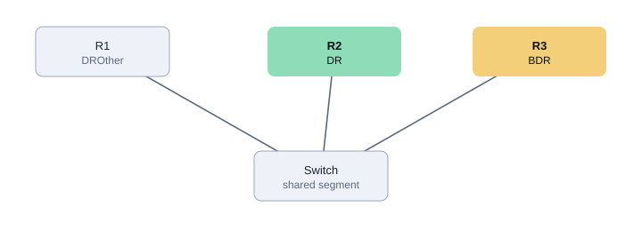

*شکل ۱: روی Segment مشترک، R2 DR و R3 BDR است؛ R1 فقط با این دو Full می‌شود.*

| رابطه             | حالت         |
|-------------------|--------------|
| DROther ↔ DROther | 2-Way (عادی) |
| DROther ↔ DR      | Full         |
| DROther ↔ BDR     | Full         |
| DR ↔ BDR          | Full         |

#### انتخاب DR

1.  بالاترین Priority (پیش‌فرض ۱؛ ۰ یعنی هرگز DR نشو).
2.  اگر برابر بود، بالاترین Router ID.

> **نکته‌ی مهم**
>
> انتخاب DR «غیرقابل‌پس‌گرفتن» است (Non-preemptive): اگر روتری با Priority بالاتر بعد از انتخاب وارد شود، DR فعلی کنار نمی‌رود، تا زمانی که OSPF Process دوباره راه بیفتد.

``` text
R2(config)# interface gi0/0
R2(config-if)# ip ospf priority 100
R1(config)# interface gi0/0
R1(config-if)# ip ospf priority 0      ! never become DR
R1# clear ip ospf process               ! re-run the election (careful)
```

### ۳. Network Type

روی لینک نقطه‌به‌نقطه (فقط دو روتر)، DR بی‌معنی است. با تغییر نوع به point-to-point، DR انتخاب نمی‌شود و همگرایی هم سریع‌تر است:

| نوع               | DR؟ | Hello/Dead | کاربرد               |
|-------------------|-----|------------|----------------------|
| broadcast (اترنت) | بله | 10/40      | پیش‌فرض اترنت         |
| point-to-point    | خیر | 10/40      | لینک دو روتر (توصیه) |
| non-broadcast     | بله | 30/120     | Frame Relay قدیمی    |

``` text
R1(config)# interface gi0/1
R1(config-if)# ip ospf network point-to-point
R2(config)# interface gi0/0
R2(config-if)# ip ospf network point-to-point   ! both ends the same
```

اگر یک سر broadcast و سر دیگر point-to-point باشد، همسایگی بالا می‌آید ولی Routeها نامعتبر می‌شود (مشکل رایج). همیشه دو سر را هم‌نوع کنید.

### ۴. تنظیم Cost برای هدایت ترافیک

``` text
R1(config)# interface gi0/1
R1(config-if)# ip ospf cost 50
Cost = Reference / bandwidth, or any manual value 1..65535
SPF picks the path with the lowest TOTAL cost
```

مثال: دو مسیر به یک مقصد داریم؛ لینک ۱ گیگی (Cost 10) و لینک پشتیبان ۱۰۰ مگی (Cost 100). روتر مسیر ۱ گیگ را انتخاب می‌کند. اگر بخواهید پشتیبان نباشد، با Cost دستی مسیر را عوض کنید.

### ۵. سرعت شناسایی قطع

با تایمر پیش‌فرض (Dead = 40 ثانیه)، قطع یک همسایه تا ۴۰ ثانیه دیر شناخته می‌شود. دو راه: کاهش Hello/Dead (تا ۱ ثانیه با `fast-hello`) یا BFD که در میلی‌ثانیه تشخیص می‌دهد. BFD فقط مفهومی و Unverified در Lab ماست.

``` text
R1(config-if)# ip ospf hello-interval 1
R1(config-if)# ip ospf dead-interval 4
(both ends must match; too aggressive timers cause flapping)
```

### ۶. مثال‌ها

#### ساده

``` text
show ip ospf neighbor
3.3.3.3  1  FULL/BDR   ...
2.2.2.2  1  FULL/DR    ...
```

#### متوسط: چرا 2WAY/DROTHER؟

``` text
R1 neighbor R4: state 2WAY/DROTHER
Both are DROthers -> normal, not an error
```

#### سخت: DR اشتباه

``` text
Old switch router became DR (highest router ID)
Fix: set priority 100 on the core router, priority 0 on edge routers,
     then clear ip ospf process (maintenance window)
```

### تمرین‌ها

**ت1.** ۱ (ساده): چند Adjacency برای ۶ روتر در Full Mesh؟ *(پاسخ: 6-1-ت1 در بخش «پاسخ‌ها» انتهای فصل)*

**ت2.** ۲ (ساده): DROther با DROther چه حالتی؟ *(پاسخ: 6-1-ت2 در بخش «پاسخ‌ها» انتهای فصل)*

**ت3.** ۳ (متوسط): انتخاب DR بر چه اساسی؟ *(پاسخ: 6-1-ت3 در بخش «پاسخ‌ها» انتهای فصل)*

**ت4.** ۴ (متوسط): چه زمانی point-to-point؟ *(پاسخ: 6-1-ت4 در بخش «پاسخ‌ها» انتهای فصل)*

**ت5.** ۵ (سخت): چرا بعد از تغییر Priority، DR عوض نشد؟ *(پاسخ: 6-1-ت5 در بخش «پاسخ‌ها» انتهای فصل)*

### Lab هدایت‌شده

سه روتر روی یک سوییچ (SW1) در یک Segment مشترک: R1، R2، R3 با Gi0/0 به SW1 وصل‌اند، شبکه‌ی 10.10.100.0/24 (آدرس‌ها .1 .2 .3).

#### گام ۱: OSPF روی Segment مشترک

``` text
Rx(config)# router ospf 1
Rx(config-router)# network 10.10.100.0 0.0.0.255 area 0
Rx# show ip ospf neighbor
```

DR و BDR را بخوانید (Router ID بالاتر DR می‌شود). نتیجه را یادداشت کنید.

#### گام ۲: تغییر Priority

``` text
R1(config)# interface gi0/0
R1(config-if)# ip ospf priority 100
R1# clear ip ospf process
```

دوباره show ip ospf neighbor: آیا R1 DR شد؟

#### گام ۳: point-to-point روی لینک دو روتر

یک لینک مستقیم R1-R2 با `ip ospf network point-to-point` در هر دو سر؛ مشاهده کنید حالت FULL/- بدون DR است.

### Lab مستقل

جدول «DR/BDR/DROther هر Segment» و Priorityها را در `03-ops/ospf-dr-plan.md` بنویسید.

### عیب‌یابی

|         |                                                                            |
|---------|----------------------------------------------------------------------------|
| Symptom | همسایه‌ها 2WAY مانده‌اند                                                     |
| تحلیل   | اگر هر دو DROther هستند، طبیعی است                                         |
| چک‌لیست  | ۱) DR/BDR موجود است؟ ؛ ۲) Priority دو طرف؟ ؛ ۳) نوع شبکه دو سر هم‌خوان است؟ |
| رفع     | تنظیم Priority یا point-to-point                                           |

### سؤال‌های مرور

**م1.** DR چرا لازم است؟ *(پاسخ: 6-1-م1 در بخش «پاسخ‌ها» انتهای فصل)*

**م2.** Network Type چه تأثیری دارد؟ *(پاسخ: 6-1-م2 در بخش «پاسخ‌ها» انتهای فصل)*

### English Corner: انگلیسی تخصصی این درس

این جمله‌ها از مستندات و محیط کار واقعی‌اند. بلند بخوانید و ترجمه را بپوشانید.

| English sentence                                                    | ترجمه                                                 |
|---------------------------------------------------------------------|-------------------------------------------------------|
| The DR reduces the number of adjacencies on a multi-access segment. | DR تعداد Adjacency را در Segment چندمسیره کم می‌کند.   |
| DROther routers stay in 2-Way with each other.                      | روترهای DROther با هم در 2-Way می‌مانند.               |
| Set the network type to point-to-point on two-router links.         | روی لینک دو روتر، نوع شبکه را point-to-point بگذارید. |
| DR election is non-preemptive.                                      | انتخاب DR غیرقابل‌پس‌گیری (Non-preemptive) است.         |

**Q1.** Quick quiz (answer in English): Why is 2-Way between two DROthers normal? *(پاسخ: 6-1-Q1 در بخش «پاسخ‌ها» انتهای فصل)*

### تکلیف و چک‌لیست تسلط

- [ ] DR/BDR را در Lab ببینم و تغییر دهم.
- [ ] point-to-point را تست کنم.
- [ ] جدول Priority را بنویسم.

### یادآوری اشتباهات شما

> **یادآوری**
>
> پیش‌بینی قبل از اجرا؛ بکاپ قبل از تغییر؛ پذیرفته‌شدن دستور ≠ کار کردن؛ فرمول‌ها در بلوک مستقل.


#### کارت Lab — DR/BDR، Network Type و Cost

| # | فیلد | محتوا |
|---|---|---|
| 1 | عنوان و هدف | DR/BDR و Network Type |
| 2 | پیش‌نیاز | فصل 5 |
| 3 | توپولوژی | ۳ روتر + سوییچ |
| 4 | تجهیزات | R1-R3 + SW1 |
| 5 | نسخه نرم‌افزار | vIOS-L2 15.2(20200924، Experimental) برای SW؛ vIOS 15.9(3)M9 برای R؛ VPCS؛ PNetLab 4.2.8 |
| 6 | IP Plan | OSPF area 0 |
| 7 | وضعیت اولیه | Segment مشترک |
| 8 | صورت مسئله | Priority و p2p |
| 9 | مراحل هدایت‌شده | همان بخش «Lab هدایت‌شده» همین درس |
| 10 | تست عملکرد | `show ip ospf neighbor` |
| 11 | سناریوی خرابی | DROther 2WAY |
| 12 | روش عیب‌یابی | لایه‌ای/با شواهد (بخش عیب‌یابی همین درس) |
| 13 | نتیجه‌ی مورد انتظار | DR/BDR تعیین |
| 14 | معیار پذیرش | ثبت نقش‌ها |
| 15 | مستندات نهایی | `03-ops/ospf-dr-plan.md` |
| 16 | Cleanup و بازگردانی | — |

> **وضعیت راستی‌آزمایی (خارج از ۱۶ فیلد):** **اجرا نشده (فقط طراحی).** اجرا نشده.

---

<a id="l-6-2"></a>

## درس 6-2 — OSPF چندناحیه‌ای

**فصل ۶ - روز ۲ · پیش‌نیاز: درس ۶-۱ · ۶ ساعت**

### این درس درباره چیست و چرا باید یاد بگیریم؟

**چه چیزی یاد می‌گیریم:** چرا OSPF را به چند ناحیه (Area) تقسیم می‌کنیم، نقش ABR و ASBR، انواع LSA به‌صورت خلاصه، خلاصه‌سازی بین ناحیه‌ها و انواع Stub Area.

**چرا لازم است:** در شبکه‌ی بزرگ، یک Area واحد یعنی هر تغییر کوچک در یک شعبه همه‌ی روترها را وادار به اجرای SPF می‌کند و جداول بزرگ می‌شوند. Areaها این تغییرات را محلی نگه می‌دارند و پایداری و مقیاس را بالا می‌برند.

- **در کار روزانه:** سازمان‌های چندشعبه‌ای از Area برای هر شعبه یا هر منطقه استفاده می‌کنند.
- **در امنیت:** Area مرز دسترسی نیز هست؛ می‌توان Routeهای ناخواسته را جلوی ورود به Area گرفت.
- **در Capstone:** Lab A می‌تواند ۲ Area (مرکز و شعبه) داشته باشد.

> **مسیر درس**
>
> چرا Area ← قانون Area 0 ← ABR/ASBR ← LSAها ← خلاصه‌سازی ← Stub ← Lab ← عیب‌یابی.

#### اصطلاحات این درس (مخفف ← شکل کامل ← معنی)

| مخفف     | شکل کامل انگلیسی                  | معنی فارسی                                       |
|----------|-----------------------------------|--------------------------------------------------|
| Area     | OSPF Area                         | ناحیه‌ی OSPF                                      |
| Backbone | Backbone Area 0                   | ناحیه‌ی مرکزی که همه‌ی Areaها باید به آن وصل باشند |
| ABR      | Area Border Router                | روتر مرزی بین دو Area                            |
| ASBR     | Autonomous System Boundary Router | روتر مرز با دنیای خارج OSPF                      |
| LSA      | Link-State Advertisement          | اعلان وضعیت لینک                                 |
| Stub     | Stub Area                         | ناحیه‌ای که Routeهای خارجی را نمی‌گیرد             |
| Summary  | Inter-area summary                | خلاصه‌سازی در ABR                                 |

### ۱. چرا Area؟

یک شهر بزرگ را به محله تقسیم می‌کنند؛ هر محله نقشه‌ی دقیق خودش را دارد و برای بقیه‌ی شهر فقط «خلاصه» می‌داند. OSPF هم همین‌طور: داخل هر Area نقشه‌ی کامل، و بین Areaها فقط خلاصه.

- تغییر لینک در یک Area فقط همان Area را به SPF می‌اندازد.
- جدول LSDB کوچک‌تر می‌شود.
- امکان خلاصه‌سازی مسیرها.

### ۲. قانون مهم: همه‌ی Areaها به Area 0 وصل

ترافیک بین دو Area معمولی باید از Area 0 (Backbone) بگذرد. Area 0 مثل بزرگراه مرکزی است و همه‌ی محله‌ها به آن راه دارند.

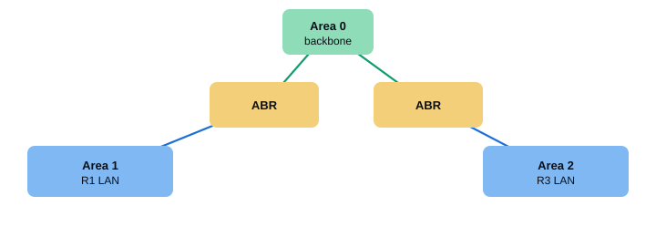

*شکل ۱: Area 1 و Area 2 از طریق ABRها به Area 0 وصل‌اند.*

### ۳. ABR و ASBR

| نقش             | تعریف                                                         | کار                              |
|-----------------|---------------------------------------------------------------|----------------------------------|
| Internal Router | همه‌ی Interfaceها در یک Area                                   | فقط LSDB همان Area               |
| ABR             | Interfaceها در دو Area یا بیشتر (یکی Area 0)                  | خلاصه و جابه‌جایی مسیر بین Areaها |
| ASBR            | Route را از پروتکل/منبع دیگر وارد OSPF می‌کند (Static، BGP...) | تزریق Route خارجی                |

``` text
R2(config)# router ospf 1
R2(config-router)# network 10.0.12.0 0.0.0.3 area 1
R2(config-router)# network 10.0.23.0 0.0.0.3 area 0
-> R2 has interfaces in area 1 and area 0 = ABR
```

### ۴. LSAها (به‌صورت خلاصه)

| نوع | نام          | کجا پخش می‌شود    | محتوا                           |
|-----|--------------|------------------|---------------------------------|
| 1   | Router LSA   | داخل Area        | لینک‌های یک روتر                 |
| 2   | Network LSA  | داخل Area        | Segment و روترهایش (توسط DR)    |
| 3   | Summary LSA  | بین Areaها (ABR) | Routeهای یک Area برای Area دیگر |
| 4   | ASBR Summary | بین Areaها       | مسیر رسیدن به ASBR              |
| 5   | External LSA | کل Domain        | Route خارجی (از ASBR)           |

در جدول مسیریابی: `O` یعنی Intra-area، `O IA` یعنی Inter-area (از LSA نوع ۳)، `O E1/E2` یعنی Route خارجی.

### ۵. خلاصه‌سازی در ABR

ABR می‌تواند چند شبکه‌ی ریز یک Area را به یک خلاصه تبدیل کند:

``` text
Area 1 networks: 10.1.0.0/24, 10.1.1.0/24, 10.1.2.0/24, 10.1.3.0/24
Summary: 10.1.0.0/22
```

``` text
R2(config)# router ospf 1
R2(config-router)# area 1 range 10.1.0.0 255.255.252.0
```

اثر: بقیه‌ی Areaها فقط یک Route (10.1.0.0/22) می‌بینند؛ تغییر یک شبکه‌ی ریز دیگر در سراسر شبکه پخش نمی‌شود.

### ۶. Stub Area

شعبه‌ای که فقط یک راه خروج دارد، نیازی ندارد همه‌ی Routeهای خارجی را بداند؛ کافی است یک Default Route از ABR بگیرد:

| نوع            | Routeهای خارجی (LSA 5)       | Default از ABR |
|----------------|------------------------------|----------------|
| Stub           | بلوک                         | بله            |
| Totally Stubby | بلوک (و Inter-area هم)       | بله            |
| NSSA           | Routeهای خارجی محلی با LSA 7 | اختیاری        |

``` text
! on all routers of the area:
R3(config-router)# area 2 stub
! totally stubby (only on the ABR add "no-summary"):
R2(config-router)# area 2 stub no-summary
```

> **قانون**
>
> همه‌ی روترهای یک Area باید نوع Stub یکسان داشته باشند (flag در Hello)، وگرنه همسایه نمی‌شوند.

### ۷. مثال‌ها

#### ساده: دو Area

``` text
R1 (area 1) -- R2 (ABR) -- R3 (area 0)
R3 shows: O IA 192.168.1.0/24 via R2
```

#### متوسط: چرا نمی‌شود Area 1 را مستقیم به Area 2 وصل کرد؟

همه‌ی Areaها باید به Area 0 وصل باشند؛ بین Areaهای غیر صفر Routeها مستقیماً رد نمی‌شود (باید از ABR و Area 0 بگذرد). اگر Area 2 فقط به Area 1 وصل باشد، مسیرها به Area 2 نمی‌رسد؛ برای رفع، Virtual Link (مفهومی) یا طراحی مجدد.

#### سخت: طراحی

سازمان با مرکز و ۳ شعبه: Area 0 = مرکز، هر شعبه یک Area (۱ تا ۳)، ABR روی روتر مرز شعبه. خلاصه‌ی هر شعبه یک /22.

### تمرین‌ها

**ت1.** ۱ (ساده): ABR چیست؟ *(پاسخ: 6-2-ت1 در بخش «پاسخ‌ها» انتهای فصل)*

**ت2.** ۲ (ساده): O IA یعنی؟ *(پاسخ: 6-2-ت2 در بخش «پاسخ‌ها» انتهای فصل)*

**ت3.** ۳ (متوسط): خلاصه‌ی 10.1.4.0/24 تا 10.1.7.0/24؟ *(پاسخ: 6-2-ت3 در بخش «پاسخ‌ها» انتهای فصل)*

**ت4.** ۴ (متوسط): چرا Stub باید روی همه‌ی روترهای Area باشد؟ *(پاسخ: 6-2-ت4 در بخش «پاسخ‌ها» انتهای فصل)*

**ت5.** ۵ (سخت): مزیت Totally Stubby؟ *(پاسخ: 6-2-ت5 در بخش «پاسخ‌ها» انتهای فصل)*

### Lab هدایت‌شده

سه روتر خطی R1—R2—R3 مثل فصل ۵. حالا R1 را در Area 1 و R3 را در Area 0 می‌گذاریم و R2 ABR می‌شود.

#### گام ۱: Areaها

``` text
R1(config)# router ospf 1
R1(config-router)# network 10.0.12.0 0.0.0.3 area 1
R1(config-router)# network 192.168.1.0 0.0.0.255 area 1

R2(config)# router ospf 1
R2(config-router)# network 10.0.12.0 0.0.0.3 area 1
R2(config-router)# network 10.0.23.0 0.0.0.3 area 0

R3(config)# router ospf 1
R3(config-router)# network 10.0.23.0 0.0.0.3 area 0
R3(config-router)# network 192.168.3.0 0.0.0.255 area 0
```

#### گام ۲: مشاهده

``` text
R3# show ip route ospf        (O IA for area 1 networks)
R2# show ip ospf database
R2# show ip ospf
```

#### گام ۳: خلاصه‌سازی

``` text
R2(config)# router ospf 1
R2(config-router)# area 1 range 192.168.0.0 255.255.252.0
R3# show ip route ospf
```

#### گام ۴: Stub

Area 1 را stub کنید (روی R1 و R2) و ببینید Default از ABR می‌آید.

### Lab مستقل

یک «OSPF Area Design» برای Capstone (مرکز + ۳ شعبه) بنویسید: Areaها، ABRها، خلاصه‌ها در `02-design/ospf-areas.md`.

### عیب‌یابی

|         |                                                                                    |
|---------|------------------------------------------------------------------------------------|
| Symptom | Route به یک Area دیگر نمی‌رسد                                                       |
| چک‌لیست  | ۱) Area 0 متصل است؟ ؛ ۲) ABR درست است؟ ؛ ۳) Stub یکسان است؟ ؛ ۴) خلاصه‌سازی نادرست؟ |
| ابزار   | show ip ospf ، show ip ospf database                                               |
| رفع     | اصلاح Area/Stub یا خلاصه‌سازی                                                       |

### سؤال‌های مرور

**م1.** چرا به Area 0 همه وصل‌اند؟ *(پاسخ: 6-2-م1 در بخش «پاسخ‌ها» انتهای فصل)*

**م2.** ASBR چه می‌کند؟ *(پاسخ: 6-2-م2 در بخش «پاسخ‌ها» انتهای فصل)*

### English Corner: انگلیسی تخصصی این درس

این جمله‌ها از مستندات و محیط کار واقعی‌اند. بلند بخوانید و ترجمه را بپوشانید.

| English sentence                                                         | ترجمه                                                 |
|--------------------------------------------------------------------------|-------------------------------------------------------|
| Segmenting the network into areas limits the scope of SPF recalculation. | تقسیم شبکه به Area دامنه‌ی محاسبه‌ی SPF را محدود می‌کند. |
| Every area must connect to the backbone area.                            | هر Area باید به Backbone وصل باشد.                    |
| The ABR summarizes routes between areas.                                 | ABR بین Areaها خلاصه‌سازی می‌کند.                       |
| A stub area receives a default route instead of external routes.         | Stub Area به‌جای Routeهای خارجی Default می‌گیرد.        |

**Q1.** Quick quiz (answer in English): What does an ABR do? *(پاسخ: 6-2-Q1 در بخش «پاسخ‌ها» انتهای فصل)*

### تکلیف و چک‌لیست تسلط

- [ ] دو Area بسازم و O IA ببینم.
- [ ] خلاصه‌سازی را تست کنم.
- [ ] طراحی Area Capstone را بنویسم.

### یادآوری اشتباهات شما

> **یادآوری**
>
> پیش‌بینی قبل از اجرا؛ بکاپ قبل از تغییر؛ پذیرفته‌شدن دستور ≠ کار کردن؛ فرمول‌ها در بلوک مستقل.


#### کارت Lab — OSPF چندناحیه‌ای

| # | فیلد | محتوا |
|---|---|---|
| 1 | عنوان و هدف | OSPF چندناحیه‌ای و خلاصه‌سازی |
| 2 | پیش‌نیاز | درس 6-1 |
| 3 | توپولوژی | R1-R2(ABR)-R3 |
| 4 | تجهیزات | ۳ vIOS |
| 5 | نسخه نرم‌افزار | vIOS-L2 15.2(20200924، Experimental) برای SW؛ vIOS 15.9(3)M9 برای R؛ VPCS؛ PNetLab 4.2.8 |
| 6 | IP Plan | Area 0 |
| 7 | وضعیت اولیه | Area 1 |
| 8 | صورت مسئله | O IA و Summary |
| 9 | مراحل هدایت‌شده | همان بخش «Lab هدایت‌شده» همین درس |
| 10 | تست عملکرد | `show ip route ospf` |
| 11 | سناریوی خرابی | Area mismatch |
| 12 | روش عیب‌یابی | لایه‌ای/با شواهد (بخش عیب‌یابی همین درس) |
| 13 | نتیجه‌ی مورد انتظار | O IA دیده شود |
| 14 | معیار پذیرش | طراحی Area |
| 15 | مستندات نهایی | `02-design/ospf-areas.md` |
| 16 | Cleanup و بازگردانی | حذف area |

> **وضعیت راستی‌آزمایی (خارج از ۱۶ فیلد):** **اجرا نشده (فقط طراحی).** اجرا نشده.

---

<a id="l-6-3"></a>

## درس 6-3 — OSPFv3 و IPv6

**فصل ۶ - روز ۳ · پیش‌نیاز: درس‌های ۲-۳ و ۶-۲ · ۶ ساعت**

### این درس درباره چیست و چرا باید یاد بگیریم؟

**چه چیزی یاد می‌گیریم:** مسیریابی IPv6 با OSPFv3: تفاوت با OSPFv2، فعال‌سازی روی Interface، Router ID، و استفاده از آدرس Link-Local برای Next-hop.

**چرا لازم است:** شبکه‌های امروز Dual-Stack هستند. اگر IPv6 را فقط «روشن» کنید ولی مسیریابی‌اش را ندانید، ارتباط بین VLANها و شعبه‌ها در IPv6 کار نمی‌کند و ترافیک از مسیر غیرکنترل‌شده می‌رود.

- **در کار روزانه:** سازمان‌های جدید IPv6 را همراه IPv4 اجرا می‌کنند.
- **در امنیت:** فراموش‌کردن IPv6 یک سطح حمله‌ی بدون پایش ایجاد می‌کند.
- **در Capstone:** Dual-Stack در بخشی از Lab و Policy فایروال بررسی می‌شود.

> **مسیر درس**
>
> تفاوت v2 و v3 ← فعال‌سازی ← Router ID ← Link-Local Next-hop ← مثال ساده/متوسط/سخت ← Lab ← عیب‌یابی.

#### اصطلاحات این درس (مخفف ← شکل کامل ← معنی)

| مخفف                 | شکل کامل انگلیسی     | معنی فارسی                           |
|----------------------|----------------------|--------------------------------------|
| OSPFv3               | OSPF version 3       | OSPF برای IPv6 (و Address Family)    |
| Link-Local           | Link-Local address   | آدرس fe80:: روی هر Interface         |
| Dual-Stack           | Dual-Stack           | اجرای هم‌زمان IPv4 و IPv6             |
| Address Family       | Address Family       | OSPFv3 با پشتیبانی IPv4 و IPv6       |
| ipv6 unicast-routing | ipv6 unicast-routing | فعال‌سازی مسیریابی IPv6 روی روتر      |
| Next-hop             | Next-hop             | روتر بعدی؛ در IPv6 معمولاً Link-Local |

### ۱. OSPFv3 چه فرقی دارد؟

ایده‌ی OSPF همان است (Area، LSDB، SPF). تفاوت‌ها:

| موضوع          | OSPFv2 (IPv4)    | OSPFv3 (IPv6)                        |
|----------------|------------------|--------------------------------------|
| آدرس           | IPv4             | IPv6 (و با Address Family هر دو)     |
| فعال‌سازی       | دستور network    | روی خود Interface (ipv6 ospf)        |
| Router ID      | از IPv4 Loopback | همچنان ۳۲ بیتی و باید دستی تنظیم شود |
| Next-hop       | IP همسایه        | Link-Local همسایه (fe80::)           |
| Authentication | بخشی از پروتکل   | با IPsec (یا Authentication Trailer) |
| Multicast      | 224.0.0.5/6      | ff02::5 / ff02::6                    |

> **نکته‌ی مهم**
>
> OSPFv3 حتی در شبکه‌ی «فقط IPv6» به یک Router ID ۳۲ بیتی (شکل IPv4) نیاز دارد. اگر روتر هیچ آدرس IPv4 نداشته باشد، باید دستی بدهید وگرنه فرایند بالا نمی‌آید.

### ۲. دستورها (خط‌به‌خط)

ابتدا مسیریابی IPv6 را روشن کنید (درس ۲-۳). بعد روی روتر:

``` text
R1(config)# ipv6 unicast-routing
R1(config)# ipv6 router ospf 1
R1(config-rtr)# router-id 1.1.1.1
R1(config-rtr)# exit
R1(config)# interface gi0/1
R1(config-if)# ipv6 address 2001:db8:12::1/64
R1(config-if)# ipv6 ospf 1 area 0
R1(config)# interface loopback 10
R1(config-if)# ipv6 address 2001:db8:1::1/64
R1(config-if)# ipv6 ospf 1 area 0
```

- `ipv6 router ospf 1`: Process (مثل v2، فقط محلی).
- `ipv6 ospf 1 area 0`: روی هر Interface (جایگزین network).
- آدرس Link-Local خودکار ساخته می‌شود و OSPFv3 با آن همسایه می‌شود.

``` text
R1# show ipv6 ospf neighbor
R1# show ipv6 route ospf
R1# show ipv6 ospf interface brief
```

### ۳. Next-hop با Link-Local

در جدول IPv6 Route، Next-hop آدرس Link-Local همسایه است (مثلاً FE80::2). چون Link-Local فقط روی همان لینک معنی دارد، Interface خروجی هم نوشته می‌شود:

``` text
O   2001:db8:3::/64 [110/20]
     via FE80::2, GigabitEthernet0/1
```

در Staticهای IPv6 هم اگر Next-hop را Link-Local بنویسید، باید Interface هم بدهید: `ipv6 route ... FE80::2 gi0/1`.

### ۴. مثال‌ها

#### ساده

``` text
Two routers, one /64 link, both: ipv6 ospf 1 area 0
show ipv6 ospf neighbor -> FULL
```

#### متوسط: ping IPv6 سراسری

``` text
R1# ping 2001:db8:3::1 source loopback10
```

#### سخت: چرا همسایه بالا نمی‌آید؟

``` text
Cause 1: ipv6 unicast-routing not enabled
Cause 2: no router-id and no IPv4 address -> process cannot start
Cause 3: different area or mismatched hello/dead
Cause 4: ACL blocking ff02::5 / OSPFv3 (protocol 89)
```

> **صادقانه درباره‌ی Lab**
>
> روی روتر vIOS، IPv6 و OSPFv3 تحت IOS واقعی اجرا می‌شود و باید کار کند. اگر روی SW (vIOSL2) IPv6 کامل نبود، همان محدودیت قبلی شبیه‌ساز است؛ نتیجه را ثبت کنید.

### تمرین‌ها

**ت1.** ۱ (ساده): OSPFv3 چطور فعال می‌شود؟ *(پاسخ: 6-3-ت1 در بخش «پاسخ‌ها» انتهای فصل)*

**ت2.** ۲ (ساده): Next-hop در IPv6 چه آدرسی است؟ *(پاسخ: 6-3-ت2 در بخش «پاسخ‌ها» انتهای فصل)*

**ت3.** ۳ (متوسط): چرا Router ID لازم است؟ *(پاسخ: 6-3-ت3 در بخش «پاسخ‌ها» انتهای فصل)*

**ت4.** ۴ (سخت): چرا Static IPv6 با Next-hop Link-Local به Interface هم نیاز دارد؟ *(پاسخ: 6-3-ت4 در بخش «پاسخ‌ها» انتهای فصل)*

### Lab هدایت‌شده

#### گام ۱: روی مثلث R1-R2-R3 (فصل ۵)

``` text
Rx(config)# ipv6 unicast-routing
Rx(config)# ipv6 router ospf 1
Rx(config-rtr)# router-id x.x.x.x
```

#### گام ۲: آدرس‌دهی و فعال‌سازی

برای لینک‌ها از 2001:db8:12::/64 و 2001:db8:23::/64 و برای LAN از 2001:db8:1::/64 و 2001:db8:3::/64 استفاده کنید؛ روی هر Interface `ipv6 ospf 1 area 0`.

#### گام ۳: بررسی

``` text
Rx# show ipv6 ospf neighbor
R1# show ipv6 route ospf
R1# ping 2001:db8:3::1 source loopback10
```

### Lab مستقل

یک «Dual-Stack Plan» (IPv4 و IPv6 هر VLAN و هر لینک) در `02-design/dual-stack-plan.md` بنویسید.

### عیب‌یابی

|         |                                                                                                          |
|---------|----------------------------------------------------------------------------------------------------------|
| Symptom | همسایگی OSPFv3 بالا نمی‌آید یا ping IPv6 شکست می‌خورد                                                      |
| چک‌لیست  | ۱) ipv6 unicast-routing؟ ؛ ۲) Router ID؟ ؛ ۳) ipv6 ospf روی Interface؟ ؛ ۴) Link-Local OK است؟ ؛ ۵) ACL؟ |
| ابزار   | show ipv6 ospf neighbor ، show ipv6 interface brief                                                      |
| رفع     | اصلاح مورد ناقص                                                                                          |

### سؤال‌های مرور

**م1.** تفاوت اصلی فعال‌سازی v2 و v3؟ *(پاسخ: 6-3-م1 در بخش «پاسخ‌ها» انتهای فصل)*

**م2.** چرا Router ID دستی؟ *(پاسخ: 6-3-م2 در بخش «پاسخ‌ها» انتهای فصل)*

### English Corner: انگلیسی تخصصی این درس

این جمله‌ها از مستندات و محیط کار واقعی‌اند. بلند بخوانید و ترجمه را بپوشانید.

| English sentence                                    | ترجمه                                                 |
|-----------------------------------------------------|-------------------------------------------------------|
| Enable IPv6 routing before configuring OSPFv3.      | پیش از OSPFv3 مسیریابی IPv6 را فعال کنید.             |
| OSPFv3 uses link-local addresses to form neighbors. | OSPFv3 با آدرس Link-Local همسایه می‌شود.               |
| Run dual-stack to support both IPv4 and IPv6.       | Dual-Stack را اجرا کنید تا هر دو پروتکل پشتیبانی شود. |
| Configure the router ID manually.                   | Router ID را دستی تنظیم کنید.                         |

**Q1.** Quick quiz (answer in English): Why does OSPFv3 still need an IPv4-style router ID? *(پاسخ: 6-3-Q1 در بخش «پاسخ‌ها» انتهای فصل)*

### تکلیف و چک‌لیست تسلط

- [ ] OSPFv3 را بالا بیاورم.
- [ ] Next-hop Link-Local را در Route ببینم.
- [ ] Dual-Stack Plan را بنویسم.

### یادآوری اشتباهات شما

> **یادآوری**
>
> پیش‌بینی قبل از اجرا؛ بکاپ قبل از تغییر؛ پذیرفته‌شدن دستور ≠ کار کردن؛ فرمول‌ها در بلوک مستقل.


#### کارت Lab — OSPFv3 و IPv6

| # | فیلد | محتوا |
|---|---|---|
| 1 | عنوان و هدف | OSPFv3 / IPv6 Routing |
| 2 | پیش‌نیاز | درس 6-2 |
| 3 | توپولوژی | R1-R2-R3 |
| 4 | تجهیزات | ۳ vIOS |
| 5 | نسخه نرم‌افزار | vIOS-L2 15.2(20200924، Experimental) برای SW؛ vIOS 15.9(3)M9 برای R؛ VPCS؛ PNetLab 4.2.8 |
| 6 | IP Plan | IPv4 سالم |
| 7 | وضعیت اولیه | 2001:db8::/48 |
| 8 | صورت مسئله | همسایگی v3 |
| 9 | مراحل هدایت‌شده | همان بخش «Lab هدایت‌شده» همین درس |
| 10 | تست عملکرد | `show ipv6 ospf neighbor` |
| 11 | سناریوی خرابی | بدون router-id |
| 12 | روش عیب‌یابی | لایه‌ای/با شواهد (بخش عیب‌یابی همین درس) |
| 13 | نتیجه‌ی مورد انتظار | FULL |
| 14 | معیار پذیرش | Dual-Stack Plan |
| 15 | مستندات نهایی | `02-design/dual-stack-plan.md` |
| 16 | Cleanup و بازگردانی | — |

> **وضعیت راستی‌آزمایی (خارج از ۱۶ فیلد):** **اجرا نشده (فقط طراحی).** IPv6 فقط CLI-Accepted.

---

<a id="l-6-4"></a>

## درس 6-4 — HSRP و FHRP

**فصل ۶ - روز ۴ · پیش‌نیاز: درس ۳-۵ · ۶ ساعت**

> **وضعیت:** Cisco IOSv/IOSvL2؛ خروجی‌ها و دستورها نمونه‌ی آموزشی‌اند؛ Lab «اجرا نشده»؛ ویژگی‌هایی که روی IOSvL2 آزمایش‌نشده‌اند `Unverified` هستند و باید با Probe (درس ۱-B) تأیید شوند.

### این درس درباره چیست و چرا باید یاد بگیریم؟

**چه چیزی یاد می‌گیریم:** چطور برای Default Gateway هر VLAN «پشتیبان» بگذاریم: پروتکل HSRP (و مقایسه با VRRP و GLBP)، آدرس مجازی، Priority، Preempt و Tracking.

**چرا لازم است:** Gateway نقطه‌ی شکست واحد (SPOF) است: اگر آن سوییچ یا روتر خاموش شود، تمام کاربران VLAN از شبکه بیرون می‌مانند حتی اگر روتر دوم سالم باشد، چون روی کلاینت‌ها فقط یک Gateway تنظیم شده است. FHRP این مشکل را حل می‌کند.

- **در کار روزانه:** تقریباً همه‌ی Coreهای سازمانی HSRP یا VRRP دارند.
- **در امنیت:** Authentication HSRP جلوی تصاحب نقش Active توسط دستگاه جعلی را می‌گیرد.
- **در Capstone:** Lab A-HA از HSRP برای Gateway دوگانه استفاده می‌کند.

> **مسیر درس**
>
> مشکل Gateway واحد ← ایده‌ی آدرس مجازی ← انتخاب Active ← Preempt و Track ← مثال ساده/متوسط/سخت ← Lab ← عیب‌یابی.

#### اصطلاحات این درس (مخفف ← شکل کامل ← معنی)

| مخفف       | شکل کامل انگلیسی                   | معنی فارسی                                  |
|------------|------------------------------------|---------------------------------------------|
| FHRP       | First Hop Redundancy Protocol      | خانواده‌ی پروتکل‌های پشتیبان Gateway          |
| HSRP       | Hot Standby Router Protocol        | پروتکل سیسکو برای Gateway پشتیبان           |
| VRRP       | Virtual Router Redundancy Protocol | نسخه‌ی استاندارد                             |
| GLBP       | Gateway Load Balancing Protocol    | نسخه‌ی سیسکو با تقسیم بار                    |
| Virtual IP | Virtual IP (VIP)                   | آدرس مشترک که کلاینت به‌عنوان Gateway می‌گیرد |
| Active     | Active router                      | روتری که ترافیک را عبور می‌دهد               |
| Standby    | Standby router                     | روتر آماده‌باش                               |
| Preempt    | Preempt                            | پس‌گرفتن نقش Active توسط روتر قوی‌تر          |
| SPOF       | Single Point Of Failure            | نقطه‌ی شکست واحد                             |

### ۱. مشکل: یک Gateway یعنی یک نقطه‌ی شکست

کلاینت‌ها فقط یک Default Gateway دارند. اگر دو Core بگذارید ولی کلاینت‌ها به Core-1 اشاره کنند، با خاموشی Core-1 همه قطع می‌شوند، حتی با وجود Core-2.

مثال روزمره: یک شرکت که فقط یک شماره‌ی تلفن دارد و اگر منشی نباشد کسی جواب نمی‌دهد. راه‌حل: یک «شماره‌ی مشترک» که هر کدام از دو منشی حاضر باشند پاسخ می‌دهند.

### ۲. ایده‌ی HSRP

دو (یا چند) روتر یک «روتر مجازی» می‌سازند با یک آدرس IP مجازی (VIP) و یک MAC مجازی. کلاینت‌ها VIP را به‌عنوان Gateway می‌گیرند. فقط یکی از روترها «Active» است و جواب ARP و ترافیک را می‌دهد. دیگری «Standby» است و Hello می‌شنود؛ اگر Active ساکت شد، فوراً Active می‌شود.

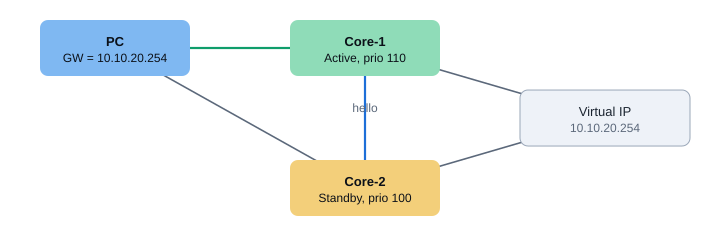

*شکل ۱: کلاینت VIP را Gateway می‌داند؛ Core-1 Active است و Core-2 در آماده‌باش.*

| موضوع       | HSRP v1        | HSRP v2        |
|-------------|----------------|----------------|
| Multicast   | 224.0.0.2      | 224.0.0.102    |
| Virtual MAC | 0000.0c07.acXX | 0000.0c9f.fXXX |
| تعداد Group | 0 تا 255       | 0 تا 4095      |
| IPv6        | ندارد          | دارد           |

XX یا XXX شماره‌ی Group به‌صورت Hex است. Hello پیش‌فرض ۳ ثانیه و Hold ۱۰ ثانیه است.

``` text
Default hello = 3 s, hold = 10 s -> failover up to ~10 s
Tuned (hello 1, hold 3) -> failover ~3 s
```

### ۳. انتخاب Active

1.  بالاترین Priority (پیش‌فرض ۱۰۰).
2.  اگر برابر بود، بالاترین IP روی Interface.

> **نکته‌ی مهم**
>
> پیش‌فرض Preempt خاموش است. اگر Core-1 (Priority بالاتر) خراب شود و بعد برگردد، نقش Active را پس نمی‌گیرد مگر اینکه `preempt` بزنید. معمولاً در طراحی می‌خواهیم Core اصلی دوباره Active شود، پس Preempt را روشن می‌کنیم.

### ۴. دستورها (خط‌به‌خط)

``` text
Core-1(config)# interface vlan 20
Core-1(config-if)# ip address 10.10.20.2 255.255.255.0
Core-1(config-if)# standby version 2
Core-1(config-if)# standby 20 ip 10.10.20.254
Core-1(config-if)# standby 20 priority 110
Core-1(config-if)# standby 20 preempt
Core-1(config-if)# standby 20 authentication md5 key-string <KEY>

Core-2(config)# interface vlan 20
Core-2(config-if)# ip address 10.10.20.3 255.255.255.0
Core-2(config-if)# standby version 2
Core-2(config-if)# standby 20 ip 10.10.20.254
Core-2(config-if)# standby 20 priority 100
Core-2(config-if)# standby 20 preempt
```

- هر Core آدرس واقعی خودش (.2 و .3) و یک VIP مشترک (.254) دارد.
- شماره‌ی Group (اینجا 20) هم‌شماره‌ی VLAN انتخاب می‌شود تا خوانا باشد.
- کلاینت‌ها Gateway را **.254** می‌گیرند، نه .2 یا .3.
- کلید Authentication را در ریپو نگذارید؛ اینجا فقط جانگهدار است.

``` text
Core-1# show standby brief
Core-1# show standby vlan 20
Core-1# show standby
```

``` text
Interface   Grp  Pri P State   Active    Standby    Virtual IP
Vl20         20  110 P Active  local     10.10.20.3 10.10.20.254
```

### ۵. Tracking: وقتی لینک بالادست خراب شد

اگر Core-1 Active است ولی لینک اصلی‌اش به بیرون خراب شود، همچنان Active می‌ماند و ترافیک را «سیاه‌چاله» می‌کند. با Track، Priority را در صورت خرابی لینک کم می‌کنیم تا Core-2 بگیرد:

``` text
Core-1(config)# track 10 interface gi0/3 line-protocol
Core-1(config)# interface vlan 20
Core-1(config-if)# standby 20 track 10 decrement 20
Effect: priority 110 - 20 = 90 < 100 -> Core-2 becomes Active (needs preempt on Core-2)
```

### ۶. VRRP و GLBP

| پروتکل | تعریف              | ویژگی                                  |
|--------|--------------------|----------------------------------------|
| HSRP   | سیسکو              | یک Active؛ رایج در Cisco               |
| VRRP   | استاندارد RFC 5798 | چند سازنده؛ مشابه HSRP (Master/Backup) |
| GLBP   | سیسکو              | چند Forwarder؛ تقسیم بار بین Gatewayها |

FortiGate از VRRP و FGCP (HA اختصاصی) پشتیبانی می‌کند. مفهوم همین است.

### ۷. مثال‌ها

#### ساده

``` text
Two cores, VIP .254, Core-1 priority 110 -> Active
PC gateway = .254 , ping works
```

#### متوسط: Failover

``` text
Core-1 shut down -> Core-2 becomes Active after hold time
PC keeps pinging with only a few lost packets
```

#### سخت: Failover بدون Track

``` text
Core-1 uplink fails but Core-1 stays Active (its VLAN interface is up)
Traffic is black-holed
Fix: track the uplink and decrement priority, or use routing protocol awareness
```

> **صادقانه درباره‌ی Lab**
>
> طبق Probe، «HSRP state» روی vIOSL2 تست شد و کار می‌کند. Failover واقعی (Virtual MAC) را با Capture بررسی کنید و اگر شبیه‌ساز رفتار متفاوتی داشت ثبت کنید.

### تمرین‌ها

**ت1.** ۱ (ساده): VIP چیست؟ *(پاسخ: 6-4-ت1 در بخش «پاسخ‌ها» انتهای فصل)*

**ت2.** ۲ (ساده): Active چطور انتخاب می‌شود؟ *(پاسخ: 6-4-ت2 در بخش «پاسخ‌ها» انتهای فصل)*

**ت3.** ۳ (متوسط): چرا Preempt؟ *(پاسخ: 6-4-ت3 در بخش «پاسخ‌ها» انتهای فصل)*

**ت4.** ۴ (متوسط): Failover پیش‌فرض چند ثانیه؟ *(پاسخ: 6-4-ت4 در بخش «پاسخ‌ها» انتهای فصل)*

**ت5.** ۵ (سخت): نقش Track چیست؟ *(پاسخ: 6-4-ت5 در بخش «پاسخ‌ها» انتهای فصل)*

### Lab هدایت‌شده

دو سوییچ L3: `Core-1` و `Core-2` (vIOSL2 با `ip routing`)، یک سوییچ دسترسی `Acc-1` که به هر دو Trunk است، و PC1 در VLAN 20.

#### گام ۱: SVI روی هر دو Core

``` text
Core-x(config)# ip routing
Core-x(config)# vlan 20
Core-1(config)# interface vlan 20
Core-1(config-if)# ip address 10.10.20.2 255.255.255.0
Core-1(config-if)# no shutdown
Core-2(config)# interface vlan 20
Core-2(config-if)# ip address 10.10.20.3 255.255.255.0
Core-2(config-if)# no shutdown
```

#### گام ۲: HSRP

``` text
Core-1(config-if)# standby version 2
Core-1(config-if)# standby 20 ip 10.10.20.254
Core-1(config-if)# standby 20 priority 110
Core-1(config-if)# standby 20 preempt
Core-2(config-if)# standby version 2
Core-2(config-if)# standby 20 ip 10.10.20.254
Core-2(config-if)# standby 20 preempt
Core-x# show standby brief
```

#### گام ۳: تست

``` text
PC1> ip 10.10.20.11/24 10.10.20.254
PC1> ping 10.10.20.254 -t
```

#### گام ۴: Failover

``` text
Core-1(config)# interface vlan 20
Core-1(config-if)# shutdown
Core-2# show standby brief
Core-1(config-if)# no shutdown   (preempt: Core-1 returns)
```

تعداد پکت گم‌شده و زمان Failover را ثبت کنید.

### Lab مستقل

یک «HSRP Plan» (Groupها، VIPها، Priorityها، Track) برای ۳ VLAN در `02-design/hsrp-plan.md` بنویسید.

### عیب‌یابی

|         |                                                                                                                              |
|---------|------------------------------------------------------------------------------------------------------------------------------|
| Symptom | Failover نمی‌شود یا هر دو Active هستند                                                                                        |
| چک‌لیست  | ۱) VIP و Group دو سر یکی؟ ؛ ۲) Version یکسان؟ ؛ ۳) Authentication مشابه؟ ؛ ۴) ارتباط L2 بین Coreها OK؟ ؛ ۵) Preempt/Priority |
| ابزار   | show standby brief ، show standby                                                                                            |
| نکته    | «دو Active» یعنی Hello به هم نمی‌رسد (قطع L2)                                                                                 |

### سؤال‌های مرور

**م1.** HSRP چه مشکلی را حل می‌کند؟ *(پاسخ: 6-4-م1 در بخش «پاسخ‌ها» انتهای فصل)*

**م2.** تفاوت HSRP و VRRP؟ *(پاسخ: 6-4-م2 در بخش «پاسخ‌ها» انتهای فصل)*

### English Corner: انگلیسی تخصصی این درس

این جمله‌ها از مستندات و محیط کار واقعی‌اند. بلند بخوانید و ترجمه را بپوشانید.

| English sentence                                               | ترجمه                                                     |
|----------------------------------------------------------------|-----------------------------------------------------------|
| HSRP provides a virtual gateway address shared by two routers. | HSRP یک آدرس Gateway مجازی بین دو روتر ارائه می‌کند.       |
| The router with the highest priority becomes active.           | روتر با بالاترین Priority Active می‌شود.                   |
| Enable preempt so the primary router regains the active role.  | Preempt را روشن کنید تا روتر اصلی نقش Active را پس بگیرد. |
| Track the uplink to trigger failover when it goes down.        | برای فعال‌شدن Failover هنگام قطع Uplink آن را Track کنید.  |

**Q1.** Quick quiz (answer in English): What happens to clients if the active HSRP router fails? *(پاسخ: 6-4-Q1 در بخش «پاسخ‌ها» انتهای فصل)*

### تکلیف و چک‌لیست تسلط

- [ ] HSRP را بسازم و Failover را ثبت کنم.
- [ ] Track را توضیح دهم.
- [ ] HSRP Plan را بنویسم.

### یادآوری اشتباهات شما

> **یادآوری**
>
> پیش‌بینی قبل از اجرا؛ بکاپ قبل از تغییر؛ پذیرفته‌شدن دستور ≠ کار کردن؛ فرمول‌ها در بلوک مستقل.


#### کارت Lab — HSRP و FHRP

| # | فیلد | محتوا |
|---|---|---|
| 1 | عنوان و هدف | HSRP: Active/Standby و Track |
| 2 | پیش‌نیاز | درس 6-3 |
| 3 | توپولوژی | Core-1/Core-2 + Acc |
| 4 | تجهیزات | ۳ سوییچ L3/L2 |
| 5 | نسخه نرم‌افزار | vIOS-L2 15.2(20200924، Experimental) برای SW؛ vIOS 15.9(3)M9 برای R؛ VPCS؛ PNetLab 4.2.8 |
| 6 | IP Plan | VLAN 20 |
| 7 | وضعیت اولیه | VIP .254 |
| 8 | صورت مسئله | Failover |
| 9 | مراحل هدایت‌شده | همان بخش «Lab هدایت‌شده» همین درس |
| 10 | تست عملکرد | `show standby brief` |
| 11 | سناریوی خرابی | Preempt خاموش |
| 12 | روش عیب‌یابی | لایه‌ای/با شواهد (بخش عیب‌یابی همین درس) |
| 13 | نتیجه‌ی مورد انتظار | Failover؛ بازگشت |
| 14 | معیار پذیرش | زمان Failover |
| 15 | مستندات نهایی | `02-design/hsrp-plan.md` |
| 16 | Cleanup و بازگردانی | — |

> **وضعیت راستی‌آزمایی (خارج از ۱۶ فیلد):** **جزئی.** HSRP State Tested-OK (Active)؛ Failover با روتر دوم آزمایش نشده.

---

<a id="l-6-5"></a>

## درس 6-5 — پیاده‌سازی Lab A

**فصل ۶ - روز ۵ · پیش‌نیاز: درس‌های ۶-۱ تا ۶-۴ · ۶ ساعت**

### این درس درباره چیست و چرا باید یاد بگیریم؟

**چه چیزی یاد می‌گیریم:** پیاده‌سازی کامل Lab A: Gateway روی Core با SVI و HSRP، OSPF به سمت Edge (که بعداً FortiGate می‌شود)، و تأیید مسیر رفت و برگشت.

**چرا لازم است:** این Lab تمام مباحث فصل ۳ تا ۶ را در یک طراحی واقعی کنار هم می‌گذارد: VLAN، Trunk، STP، EtherChannel، SVI، HSRP و OSPF. اگر این Lab را درست بسازید، یعنی شبکه‌ی Campus سیسکو را فهمیده‌اید. (یادآوری: Capstone اصلی ما الگوی B است؛ Lab A جدا و مکمل است.)

- **در کار روزانه:** این همان چیدمان معمول Campus سازمانی است.
- **در امنیت:** Return Path و Gateway مشخص، پایه‌ی هر Policy است.
- **در FortiGate:** در W9/W10 همین Lab با FGT به‌جای EDGE-R1 کامل می‌شود.

> **مسیر درس**
>
> طراحی ← جدول آدرس ← پیاده‌سازی مرحله‌ای ← Verification Matrix ← تست Failover ← عیب‌یابی.

#### اصطلاحات این درس (مخفف ← شکل کامل ← معنی)

| مخفف        | شکل کامل انگلیسی              | معنی فارسی                    |
|-------------|-------------------------------|-------------------------------|
| Lab A       | Lab A (Cisco L3 Core Gateway) | Gateway روی Core سیسکو        |
| Perimeter   | Perimeter firewall            | فایروال لبه‌ی شبکه             |
| Transit     | Transit link                  | لینک نقطه‌به‌نقطه به فایروال    |
| Return Path | Return Path                   | مسیر برگشت                    |
| As-Built    | As-Built documentation        | مستند وضعیت نهایی             |
| ECMP        | Equal-Cost Multi-Path         | تقسیم بار بین مسیرهای هم‌هزینه |

### ۱. طراحی

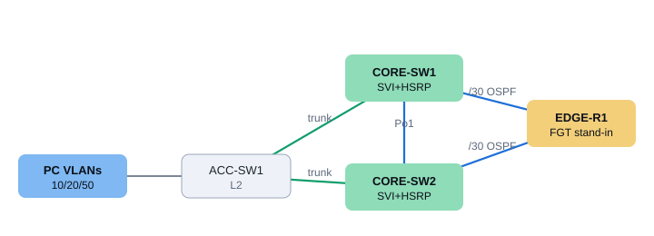

*شکل ۱: Lab A؛ VLANها روی Core (SVI + HSRP) و OSPF با Edge.*

``` text
VLAN 10 MGMT   10.10.10.0/24   VIP .254   Core-1 .2  Core-2 .3
VLAN 20 USERS  10.10.20.0/24   VIP .254   Core-1 .2  Core-2 .3
VLAN 50 GUEST  10.10.50.0/24   VIP .254   Core-1 .2  Core-2 .3

Core-1 <-> EDGE-R1 : 10.0.1.0/30   (.1 .2)
Core-2 <-> EDGE-R1 : 10.0.2.0/30   (.1 .2)
Core-1 <-> Core-2  : EtherChannel Po1 (trunk)
OSPF area 0 on Cores and Edge
EDGE-R1 loopback 0 = 8.8.8.8/32 (stand-in for "internet")
```

> **قاعده**
>
> هر VLAN دقیقاً یک Gateway دارد: VIP روی Core. هرگز دو Gateway همزمان (مثل SVI و Sub-interface روی R1).

### ۲. گام‌های پیاده‌سازی

#### گام ۱: VLAN و Trunk

``` text
! on Core-1, Core-2, ACC-SW1
vlan 10
 name MGMT
vlan 20
 name USERS
vlan 50
 name GUEST
! trunks: ACC <-> Core-1, ACC <-> Core-2, Core-1 <-> Core-2
interface gi0/x
 switchport trunk encapsulation dot1q
 switchport mode trunk
 switchport trunk allowed vlan 10,20,50
 switchport trunk native vlan 999
```

#### گام ۲: STP

``` text
Core-1(config)# spanning-tree mode rapid-pvst
Core-1(config)# spanning-tree vlan 10,20,50 root primary
Core-2(config)# spanning-tree vlan 10,20,50 root secondary
ACC-SW1(config)# interface range gi0/1 - 3
ACC-SW1(config-if-range)# spanning-tree portfast
ACC-SW1(config-if-range)# spanning-tree bpduguard enable
```

#### گام ۳: SVI و HSRP

``` text
Core-1(config)# ip routing
Core-1(config)# interface vlan 20
Core-1(config-if)# ip address 10.10.20.2 255.255.255.0
Core-1(config-if)# standby version 2
Core-1(config-if)# standby 20 ip 10.10.20.254
Core-1(config-if)# standby 20 priority 110
Core-1(config-if)# standby 20 preempt
! repeat for VLAN 10 and 50; Core-2 uses .3 and default priority
```

#### گام ۴: لینک‌های Routed به Edge

``` text
Core-1(config)# interface gi0/3
Core-1(config-if)# no switchport
Core-1(config-if)# ip address 10.0.1.1 255.255.255.252
Core-2(config)# interface gi0/3
Core-2(config-if)# no switchport
Core-2(config-if)# ip address 10.0.2.1 255.255.255.252
EDGE-R1(config)# interface gi0/0
EDGE-R1(config-if)# ip address 10.0.1.2 255.255.255.252
EDGE-R1(config)# interface gi0/1
EDGE-R1(config-if)# ip address 10.0.2.2 255.255.255.252
EDGE-R1(config)# interface loopback 0
EDGE-R1(config-if)# ip address 8.8.8.8 255.255.255.255
```

#### گام ۵: OSPF

``` text
Core-1(config)# router ospf 1
Core-1(config-router)# router-id 11.11.11.11
Core-1(config-router)# network 10.0.1.0 0.0.0.3 area 0
Core-1(config-router)# network 10.10.10.0 0.0.0.255 area 0
Core-1(config-router)# network 10.10.20.0 0.0.0.255 area 0
Core-1(config-router)# network 10.10.50.0 0.0.0.255 area 0
Core-1(config-router)# passive-interface default
Core-1(config-router)# no passive-interface gi0/3
! Core-2 same with its own link and router-id 12.12.12.12
EDGE-R1(config)# router ospf 1
EDGE-R1(config-router)# router-id 1.1.1.1
EDGE-R1(config-router)# network 10.0.1.0 0.0.0.3 area 0
EDGE-R1(config-router)# network 10.0.2.0 0.0.0.3 area 0
EDGE-R1(config-router)# network 8.8.8.8 0.0.0.0 area 0
EDGE-R1(config-router)# default-information originate always
```

OSPF Default از Edge می‌آید و Coreها خودشان Default را یاد می‌گیرند. EDGE-R1 باید مسیر برگشت به سه VLAN را از OSPF یاد بگیرد (Return Path).

### ۳. Verification Matrix

| تست         | دستور                                    | انتظار                                      |
|-------------|------------------------------------------|---------------------------------------------|
| VLAN/Trunk  | show interfaces trunk                    | VLAN 10,20,50 allowed                       |
| Root        | show spanning-tree root                  | Core-1 root                                 |
| HSRP        | show standby brief                       | Core-1 Active هر سه VLAN                    |
| OSPF        | show ip ospf neighbor                    | FULL با Edge و (اگر طراحی کردید) بین Coreها |
| Route       | show ip route ospf                       | Default و Routeهای VLAN روی Edge            |
| End-to-end  | PC ping 8.8.8.8                          | موفق                                        |
| Return Path | EDGE-R1# ping 10.10.20.11 source 8.8.8.8 | موفق                                        |

### ۴. آزمون Failover

۳ آزمایش، هرکدام را ثبت کنید:

1.  Core-1 را خاموش کنید: HSRP به Core-2 می‌رود؛ ping پایدار می‌ماند.
2.  لینک Core-1 به Edge را قطع کنید: OSPF مسیر را از Core-2 می‌گیرد.
3.  لینک ACC به Core-1 را قطع کنید: Rapid-PVST به مسیر جایگزین می‌رود.

``` text
Measure: lost packets and seconds to recover for each test.
Typical: HSRP ~10 s (tunable), OSPF dead 40 s (tunable), RSTP ~1-2 s
```

> **Asymmetric Routing**
>
> چون دو Core و دو لینک به Edge داریم، ممکن است رفت از Core-1 و برگشت از Core-2 باشد. در Lab ساده بی‌اثر است، ولی وقتی FortiGate Stateful بیاید (W9/W10) باید مسیرها را متقارن کنید؛ ریسکی که در طراحی نوشته‌ایم.

> **صادقانه درباره‌ی Lab**
>
> چند قابلیت (EtherChannel و برخی امنیت‌های L2) روی vIOSL2 ممکن است فقط پذیرفته شوند. اگر Po1 بالا نیامد، یک لینک عادی Trunk بگذارید و محدودیت را ثبت کنید. SVI، HSRP و OSPF روی این Imageها طبق Probe و درس‌های قبل قابل‌اجراست.

### تمرین‌ها

**ت1.** ۱ (ساده): Gateway هر VLAN در Lab A کدام آدرس است؟ *(پاسخ: 6-5-ت1 در بخش «پاسخ‌ها» انتهای فصل)*

**ت2.** ۲ (ساده): چرا لینک Core به Edge Routed است؟ *(پاسخ: 6-5-ت2 در بخش «پاسخ‌ها» انتهای فصل)*

**ت3.** ۳ (متوسط): Return Path برای 8.8.8.8 به VLAN 20 چطور ساخته می‌شود؟ *(پاسخ: 6-5-ت3 در بخش «پاسخ‌ها» انتهای فصل)*

**ت4.** ۴ (سخت): چه خطری در Dual Core + Dual Link برای فایروال Stateful هست؟ *(پاسخ: 6-5-ت4 در بخش «پاسخ‌ها» انتهای فصل)*

### Lab هدایت‌شده

همه‌ی گام‌های بخش ۲ را اجرا کنید، بعد ماتریس Verification و سه آزمون Failover. از هر مرحله بکاپ بگیرید:

``` text
Rx# copy running-config flash:Rx-labA-final.cfg
```

خروجی‌ها (بدون رمز) را در `03-ops/labA-as-built.md` ذخیره کنید.

### Lab مستقل

نمودار Packet Flow برای «PC به 8.8.8.8» و «8.8.8.8 به PC» را روی کاغذ بکشید و با Capture صحت را تأیید کنید.

### عیب‌یابی

|         |                                                                                                     |
|---------|-----------------------------------------------------------------------------------------------------|
| Symptom | PC به 8.8.8.8 نمی‌رسد                                                                                |
| روش     | از PC شروع کنید: Gateway ← Core Active ← OSPF ← Edge ← برگشت                                        |
| چک‌لیست  | ۱) VIP؟ ؛ ۲) Default روی Core؟ ؛ ۳) Edge مسیر برگشت دارد؟ ؛ ۴) HSRP Active درست؟ ؛ ۵) Trunk/Allowed |
| ابزار   | show standby brief ، show ip route ، traceroute                                                     |

### سؤال‌های مرور

**م1.** چرا Lab A و Capstone جدا هستند؟ *(پاسخ: 6-5-م1 در بخش «پاسخ‌ها» انتهای فصل)*

**م2.** Return Path چیست؟ *(پاسخ: 6-5-م2 در بخش «پاسخ‌ها» انتهای فصل)*

### English Corner: انگلیسی تخصصی این درس

این جمله‌ها از مستندات و محیط کار واقعی‌اند. بلند بخوانید و ترجمه را بپوشانید.

| English sentence                                            | ترجمه                                                      |
|-------------------------------------------------------------|------------------------------------------------------------|
| The core switches act as the default gateway for all VLANs. | سوییچ‌های Core Gateway پیش‌فرض همه‌ی VLANها هستند.            |
| OSPF advertises the VLAN subnets to the edge router.        | OSPF زیرشبکه‌های VLAN را به روتر Edge اعلام می‌کند.          |
| Verify the return path from the edge router.                | مسیر برگشت را از روتر Edge تأیید کنید.                     |
| Asymmetric routing can break stateful firewalls.            | مسیریابی نامتقارن می‌تواند فایروال‌های Stateful را مختل کند. |

**Q1.** Quick quiz (answer in English): Why must there be exactly one gateway per VLAN? *(پاسخ: 6-5-Q1 در بخش «پاسخ‌ها» انتهای فصل)*

### تکلیف و چک‌لیست تسلط

- [ ] Lab A را کامل بسازم.
- [ ] ماتریس Verification را پر کنم.
- [ ] سه Failover را ثبت کنم و As-Built را بنویسم.

### یادآوری اشتباهات شما

> **یادآوری**
>
> پیش‌بینی قبل از اجرا؛ بکاپ قبل از تغییر؛ پذیرفته‌شدن دستور ≠ کار کردن؛ فرمول‌ها در بلوک مستقل.


#### کارت Lab — پیاده‌سازی Lab A

| # | فیلد | محتوا |
|---|---|---|
| 1 | عنوان و هدف | Lab A: Core با SVI+HSRP+OSPF |
| 2 | پیش‌نیاز | درس 6-4 |
| 3 | توپولوژی | Acc-Core1/2-Edge |
| 4 | تجهیزات | ۴ سوییچ + Edge |
| 5 | نسخه نرم‌افزار | vIOS-L2 15.2(20200924، Experimental) برای SW؛ vIOS 15.9(3)M9 برای R؛ VPCS؛ PNetLab 4.2.8 |
| 6 | IP Plan | VLAN 10/20/50 |
| 7 | وضعیت اولیه | VIP .254 |
| 8 | صورت مسئله | ping 8.8.8.8 و Failover |
| 9 | مراحل هدایت‌شده | همان بخش «Lab هدایت‌شده» همین درس |
| 10 | تست عملکرد | ماتریس Verification |
| 11 | سناریوی خرابی | Route برگشت حذف |
| 12 | روش عیب‌یابی | لایه‌ای/با شواهد (بخش عیب‌یابی همین درس) |
| 13 | نتیجه‌ی مورد انتظار | Failover سه‌گانه |
| 14 | معیار پذیرش | As-Built |
| 15 | مستندات نهایی | `03-ops/labA-as-built.md` |
| 16 | Cleanup و بازگردانی | بازگشت Baseline |

> **وضعیت راستی‌آزمایی (خارج از ۱۶ فیلد):** **جزئی.** SVI/HSRP state Tested-OK؛ EtherChannel/OSPF و Failover کامل اجرا نشده.

---

<a id="l-6-6"></a>

## درس 6-6 — عیب‌یابی و آزمون G3

**فصل ۶ - روز ۶ · پیش‌نیاز: درس‌های ۶-۱ تا ۶-۵ · ۶ ساعت**

### این درس درباره چیست و چرا باید یاد بگیریم؟

**چه چیزی یاد می‌گیریم:** عیب‌یابی سناریوهای Routing و FHRP (TS15 تا TS18 و TS09) با روش Hop به Hop، و آزمون عملی Gate G3.

**چرا لازم است:** بعد از ساخت Lab A، مهارت اصلی «پیدا کردن خرابی» است. G3 تضمین می‌کند Routing و HSRP را عملی و با مدرک اثبات می‌کنید.

- **در کار روزانه:** سناریوی «بعضی VLANها قطع‌اند» همین الگو را دارد.
- **در امنیت:** RCA مکتوب مستندات حسابرسی است.
- **در مصاحبه:** سناریو و گزارش RCA سؤال تکراری هستند.

> **مسیر درس**
>
> روش Hop به Hop ← پنج خرابی ← Lab عیب‌یابی ← Gate G3.

#### اصطلاحات این درس (مخفف ← شکل کامل ← معنی)

| مخفف       | شکل کامل انگلیسی         | معنی فارسی              |
|------------|--------------------------|-------------------------|
| TS         | Troubleshooting Scenario | سناریوی عیب‌یابی         |
| RCA        | Root Cause Analysis      | تحلیل علت ریشه‌ای        |
| Black hole | Black hole               | سیاه‌چاله؛ ترافیک بی‌پاسخ |
| Flap       | Flapping                 | قطع و وصل مکرر          |
| G3         | Gate 3                   | آزمون عملی پایان فصل ۶ |
| As-Built   | As-Built                 | مستند وضعیت نهایی       |

### ۱. روش Hop به Hop

1.  مبدأ و مقصد دقیق را مشخص کنید.
2.  از مبدأ به Gateway: HSRP و VLAN.
3.  Gateway تا Edge: OSPF و Route.
4.  Edge تا مقصد.
5.  مسیر برگشت را جدا بررسی کنید.

در هر Hop یک سؤال: «این روتر Route دارد؟ بسته را به کجا می‌دهد؟ برگشت چطور؟»

### ۲. پنج سناریو

#### TS15: Route برگشت نبود

``` text
Symptom : PC reaches the Edge hop but not 8.8.8.8 replies
Evidence: EDGE-R1 has no route to 10.10.20.0/24 (not advertised)
Fix     : add network statement or static route on Edge
Verify  : ping from Edge to the VLAN IP works
```

#### TS16: OSPF Adjacency (Hello/MTU/Area)

``` text
Symptom : no neighbor between Core and Edge
Evidence: show ip ospf interface -> hello/area mismatch
Fix     : align the parameters
```

#### TS17: دو Gateway (HSRP) یا Preempt خاموش

``` text
Symptom : after recovery, old core does not become Active again
Cause   : preempt not enabled
Fix     : standby <grp> preempt
```

#### TS18: Track فراموش‌شده (Black hole)

``` text
Symptom : Core-1 is Active but its uplink is down -> traffic lost
Fix     : track the uplink and decrement priority
```

#### TS09: SVI Down/Down

``` text
Symptom : Vlan interface down/down -> gateway unreachable
Cause   : VLAN has no active port
Fix     : bring a port up in the VLAN / allow it on a trunk
```

### ۳. آزمون Gate G3 (پایان فصل ۶)

با مدرک و بدون نگاه به درس:

| \#  | وظیفه                                 | مدرک                            |
|-----|---------------------------------------|---------------------------------|
| ۱   | OSPF سه روتر (تک Area) + DR/BDR توضیح | show ip ospf neighbor           |
| ۲   | دو Area با ABR و خلاصه‌سازی            | show ip route (O IA)            |
| ۳   | OSPFv3 دو روتر (Dual-Stack)           | show ipv6 ospf neighbor         |
| ۴   | HSRP + Preempt + Track و Failover     | show standby brief + اندازه‌گیری |
| ۵   | Lab A کامل (ping تا 8.8.8.8 و برگشت)  | As-Built                        |
| ۶   | سه TS با RCA از TS15 تا TS18/TS09     | گزارش                           |
| ۷   | Packet Flow رفت و برگشت Lab A         | نمودار + Capture                |

**معیار قبولی:** حداقل ۶ از ۷ مورد با مدرک. وقتی تمام شد بگویید «G3 انجام شد».

### تمرین‌ها

**ت1.** ۱ (ساده): اولین قدم عیب‌یابی؟ *(پاسخ: 6-6-ت1 در بخش «پاسخ‌ها» انتهای فصل)*

**ت2.** ۲ (ساده): Black hole یعنی چه؟ *(پاسخ: 6-6-ت2 در بخش «پاسخ‌ها» انتهای فصل)*

**ت3.** ۳ (متوسط): HSRP Active است ولی Uplink قطع؛ راه‌حل؟ *(پاسخ: 6-6-ت3 در بخش «پاسخ‌ها» انتهای فصل)*

**ت4.** ۴ (سخت): چرا مسیر نامتقارن با فایروال Stateful مشکل می‌سازد؟ *(پاسخ: 6-6-ت4 در بخش «پاسخ‌ها» انتهای فصل)*

### Lab هدایت‌شده

در Lab A پنج خرابی را به ترتیب بسازید و رفع کنید؛ برای هر مورد Symptom، Evidence، Fix، Verify و RCA بنویسید.

1.  Route برگشت را از Edge حذف کنید.
2.  Hello interval یک سمت OSPF را تغییر دهید.
3.  Preempt را از Core-1 حذف کنید و Failover/Failback را ببینید.
4.  لینک Uplink را قطع کنید بدون Track.
5.  همه‌ی پورت‌های یک VLAN را shutdown کنید و SVI را ببینید.

### Lab مستقل

گزارش RCA پنج‌گانه را در `03-ops/rca-w6.md` بنویسید و Gate G3 را کامل کنید.

### عیب‌یابی

|         |                                                            |
|---------|------------------------------------------------------------|
| Symptom | بعد از تغییر، بخشی از شبکه قطع شد                          |
| روش     | Hop به Hop + مقایسه با As-Built                            |
| ابزار   | show standby brief ، show ip ospf neighbor ، show ip route |
| پیشگیری | بکاپ، تغییر مرحله‌ای و reload in                            |

### سؤال‌های مرور

**م1.** چرا Hop به Hop؟ *(پاسخ: 6-6-م1 در بخش «پاسخ‌ها» انتهای فصل)*

**م2.** چرا As-Built لازم است؟ *(پاسخ: 6-6-م2 در بخش «پاسخ‌ها» انتهای فصل)*

### English Corner: انگلیسی تخصصی این درس

این جمله‌ها از مستندات و محیط کار واقعی‌اند. بلند بخوانید و ترجمه را بپوشانید.

| English sentence                                                   | ترجمه                                             |
|--------------------------------------------------------------------|---------------------------------------------------|
| Troubleshoot hop by hop, starting from the source.                 | عیب‌یابی را Hop به Hop و از مبدأ شروع کنید.        |
| The standby router did not take over because preempt was disabled. | Standby چون Preempt خاموش بود نقش را نگرفت.       |
| Document each failure as an RCA.                                   | هر خرابی را به‌صورت RCA مستند کنید.                |
| Gate three covers routing and gateway redundancy.                  | Gate سوم Routing و پشتیبان Gateway را پوشش می‌دهد. |

**Q1.** Quick quiz (answer in English): What is the first thing to define when troubleshooting a connectivity issue? *(پاسخ: 6-6-Q1 در بخش «پاسخ‌ها» انتهای فصل)*

### تکلیف و چک‌لیست تسلط

- [ ] پنج TS را با RCA ثبت کنم.
- [ ] Gate G3 را کامل کنم.
- [ ] As-Built را به‌روز کنم.

### یادآوری اشتباهات شما

> **یادآوری**
>
> پیش‌بینی قبل از اجرا؛ بکاپ قبل از تغییر؛ پذیرفته‌شدن دستور ≠ کار کردن؛ فرمول‌ها در بلوک مستقل.


#### کارت Lab — عیب‌یابی و آزمون G3

| # | فیلد | محتوا |
|---|---|---|
| 1 | عنوان و هدف | عیب‌یابی Routing/FHRP و G3 |
| 2 | پیش‌نیاز | درس 6-5 |
| 3 | توپولوژی | Lab A |
| 4 | تجهیزات | Lab A |
| 5 | نسخه نرم‌افزار | vIOS-L2 15.2(20200924، Experimental) برای SW؛ vIOS 15.9(3)M9 برای R؛ VPCS؛ PNetLab 4.2.8 |
| 6 | IP Plan | Baseline |
| 7 | وضعیت اولیه | پنج خرابی |
| 8 | صورت مسئله | RCA |
| 9 | مراحل هدایت‌شده | همان بخش «Lab هدایت‌شده» همین درس |
| 10 | تست عملکرد | show standby/ospf |
| 11 | سناریوی خرابی | TS15-18،TS09 |
| 12 | روش عیب‌یابی | لایه‌ای/با شواهد (بخش عیب‌یابی همین درس) |
| 13 | نتیجه‌ی مورد انتظار | رفع |
| 14 | معیار پذیرش | G3 ≥ ۶ از ۷ |
| 15 | مستندات نهایی | `03-ops/rca-w6.md` |
| 16 | Cleanup و بازگردانی | — |

> **وضعیت راستی‌آزمایی (خارج از ۱۶ فیلد):** **اجرا نشده (فقط طراحی).** اجرا نشده.

---

<a id="ans-6"></a>

## درس 6-7 — OSPF در عمق: LSAهای Type 1–5/7، LSDB، SPF، انواع Area، Virtual-link و Summarization/Filtering

**فصل 6 · بازنویسی عمیق · پیش‌نیاز: ۵-۴، ۶-۱، ۶-۲ · ≈ 9 ساعت**

> **وضعیت:** Cisco IOSv/IOSvL2 (vIOS 15.x)؛ خروجی‌ها نمونه‌ی آموزشی؛ Lab «اجرا نشده»؛ برخی ویژگی‌ها روی vIOS `Unverified`.

### ۱) هدف آموزشی

در پایان این درس باید بتوانید:

1. انواع LSA (1، 2، 3، 4، 5، 7) و محتوا/دامنه‌ی هرکدام را توضیح دهد.
2. LSDB و الگوریتم SPF را (Cost، Tree) بفهمد و مسیر را دستی محاسبه کند.
3. Area typeها (Backbone، Standard، Stub، Totally Stubby، NSSA) و Virtual-link را با دلیل انتخاب کند.
4. Summarization (ABR/ASBR) و Filtering را طراحی کند.
5. LSDB را برای عیب‌یابی بخواند.
6. Convergence و SPF throttle را تحلیل کند.

### ۲) مفهوم پایه: چیست و چرا؟

OSPF را با «Neighbor Full» نمی‌توان فهمید؛ باید دانست چه چیزی در LSDB است و SPF چه می‌کند. تفاوت Router با DR/ABR/ASBR و اینکه LSA نوع ۳ چه کاری می‌کند برای طراحی چندناحیه‌ای حیاتی است.

### ۳) توضیح عمیق فنی

#### ۱) LSAها

| Type | نام | تولیدکننده | دامنه | محتوا |
|---|---|---|---|---|
| 1 | Router | هر روتر | Area | لینک‌ها و Cost |
| 2 | Network | DR | Area | روترهای متصل به Segment |
| 3 | Summary | ABR | بین Area | Prefix مقصدهای Area دیگر |
| 4 | ASBR Summary | ABR | بین Area | آدرس ASBR |
| 5 | External | ASBR | کل (جز Stub) | مسیرهای خارجی |
| 7 | NSSA External | ASBR در NSSA | Area | خارجی در NSSA؛ ABR به 5 تبدیل |

نشانه‌ی Route: `O` (Intra-area)، `O IA` (Type 3)، `O E1/E2` (Type 5)، `O N1/N2` (Type 7).

#### ۲) SPF

هر روتر LSDB Area را دارد و با Dijkstra درخت کوتاه‌ترین مسیر از خودش می‌سازد.

``` text
Cost = reference-bandwidth / interface bandwidth     (default ref 100 Mbps; Gi -> 1 -> change ref!)
E2 metric = external cost only; E1 = external + internal cost
```

`auto-cost reference-bandwidth 100000` (در همه‌ی روترها یکسان) برای لینک‌های Gigabit/10G ضروری است.

#### ۳) Area typeها

| نوع | LSA مجاز | مزیت |
|---|---|---|
| Backbone (0) | همه | مرکز |
| Standard | 1,2,3,4,5 | عمومی |
| Stub | بدون 5 (Default Route از ABR) | LSDB کوچک |
| Totally Stubby | بدون 3،4،5 (فقط Default) | حداقل LSDB |
| NSSA | بدون 5 ولی 7؛ Default خودکار نمی‌گیرد (باید `default-information-originate` روی ABR داده شود) | Stub با ASBR داخلی |

#### ۴) Virtual-link

Area بدون اتصال فیزیکی به Area 0 از طریق Virtual-link (در Transit Area) متصل می‌شود؛ **راه‌حل موقت** (پس از ادغام/مهاجرت)؛ طراحی دائمی نیست.

#### ۵) Summarization و Filtering

- **Inter-area:** `area X range 10.1.0.0 255.255.0.0` روی ABR.
- **External:** `summary-address` روی ASBR.
- Filtering: `area X filter-list prefix` (Type 3)، `distribute-list in` (محلی؛ LSDB را عوض نمی‌کند).

#### ۶) عیب‌یابی LSDB

``` text
show ip ospf database
show ip ospf database router self-originate
show ip ospf database summary
show ip ospf database external
show ip ospf border-routers
```

#### ۷) Convergence

SPF throttle (`timers throttle spf 50 200 5000`): تأخیر اولیه، Hold، حداکثر؛ LSA arrival throttle؛ BFD برای Detect.

### ۴) طراحی و تصمیم‌گیری

| سؤال طراحی | گزینه‌ها و معیار انتخاب |
|---|---|
| Area type | Stub/Totally Stubby برای شعب بدون خروج خارجی |
| Reference BW | بالا و یکسان |
| Summary | در ABR |
| Virtual-link | موقت |

### ۵) مثال‌های حل‌شده (ساده، متوسط، سخت)

**ساده (حل‌شده):** Route `O IA 10.2.0.0/16` در R1 ⇒ از LSA Type 3 توسط ABR؛ Cost = Cost تا ABR + Cost Summary.

**متوسط (محاسبه):** Gigabit و reference پیش‌فرض: Cost هر لینک 1 ⇒ OSPF بین 1G و 10G فرق نمی‌گذارد؛ با reference 100000 ⇒ 1G=100، 10G=10. آزمون: `show ip ospf interface` Cost.

**سخت (طراحی):** شعب ۲۰۰ Prefix دارند و LSDB بزرگ است. طرح: Area هر منطقه، Totally Stubby برای شعب بدون ASBR، Summary در ABR، Default از ABR؛ ASBR در NSSA. نتیجه: LSDB شعب از ۲۰۰۰ به ≈ ۱۰ LSA. ریسک: Suboptimal routing؛ آزمون.

### ۷) پیاده‌سازی از مسیر CLI

``` text
router ospf 1
 auto-cost reference-bandwidth 100000
 area 10 stub no-summary
 area 10 range 10.10.0.0 255.255.0.0
 timers throttle spf 50 200 5000
show ip ospf database
show ip ospf database summary
show ip route ospf
```

### ۸) Verification (اثبات صحت)

- LSDB مطابق Area type.
- Cost صحیح.
- Summary در ABR.

### ۹) Troubleshooting

| علامت | شاهد برای بررسی | علت محتمل و رفع |
|---|---|---|
| Route Inter-area نیست | database summary | Stub/Filter/Range |
| E2 مسیر غیربهینه | metric-type | E1/E2 |
| LSDB بزرگ | database | Area/Summary |

### ۱۰) نکات امنیتی

- OSPF Authentication.
- Filtering کنترل‌شده.

### ۱۱) جمع‌بندی مفهومی

- LSA 1–5/7.
- SPF/Cost/Reference BW.
- Area types.
- Virtual-link موقت.
- Summary/Filter.

### ۱۲) تمرین و ارزیابی

**ت1.** (ساده) LSA Type 3 را کدام روتر می‌سازد؟ *(پاسخ: 6-7-ت1)*

**ت2.** (ساده) `O IA` یعنی چه؟ *(پاسخ: 6-7-ت2)*

**ت3.** (متوسط) چرا reference-bandwidth باید تغییر کند؟ *(پاسخ: 6-7-ت3)*

**ت4.** (متوسط) Stub و Totally Stubby؟ *(پاسخ: 6-7-ت4)*

**ت5.** (سخت) LSDB شعب بزرگ؛ طرح. *(پاسخ: 6-7-ت5)*

**ت6.** (سخت، طراحی) چه موقع Virtual-link و چرا موقت؟ *(پاسخ: 6-7-ت6)*

**Q1.** Quick quiz (English): Which LSA type carries inter-area prefixes? *(پاسخ: 6-7-Q1)*

### ۱۳) اصطلاحات و English Corner

| مخفف | شکل کامل | معنی |
|---|---|---|
| LSA | Link-State Advertisement | بسته‌ی وضعیت لینک |
| LSDB | Link-State Database | پایگاه وضعیت لینک |
| ASBR | Autonomous System Boundary Router | روتر مرز AS |
| NSSA | Not-So-Stubby Area | Area نیمه‌Stub |

- *Use stub areas to reduce the link-state database.* ← برای کاهش LSDB از Area Stub استفاده کنید.

### ۱۴) کارت Lab

**کارت Lab:** OSPF عمیق. **وضعیت:** اجرا نشده. **Evidence:** `03-ops/ospf-deep.md`.

### ۱۵) منابع

- RFC 2328
- RFC 3101 (NSSA)
- Cisco OSPF design guide

<a id="l-6-8"></a>

## درس 6-8 — تفسیر وضعیت HSRP و VRRP: نقش‌ها، Priority، Preempt، Track و عیب‌یابی

**فصل 6 · درس افزوده برای سرفصل رسمی CCNA 200-301 (مورد 3.4: Interpret the operational status of First Hop Redundancy Protocols — HSRP and VRRP) · پیش‌نیاز: ۶-FHRP**

> **وضعیت:** نظری/مستندی؛ دستورها `Unverified`؛ خروجی‌ها نمونه‌ی آموزشی‌اند؛ Lab اجرا نشده.

### ۱) این درس درباره چیست و چرا باید یاد بگیریم؟

**چه چیزی یاد می‌گیریم:** HSRP و VRRP چه می‌کنند، هر وضعیت (Active، Standby، Master، Backup) چه معنایی دارد و چطور از روی خروجی `show` تشخیص دهیم کدام روتر Gateway واقعی است و چرا Failover رخ داده یا نداده است.

**چرا لازم است؟** تمام کامپیوترهای یک VLAN فقط یک Default Gateway می‌شناسند. اگر آن روتر بسوزد، همه بی‌اینترنت می‌مانند. FHRP (First Hop Redundancy Protocol، یعنی «پروتکل افزونگی اولین Hop») دو روتر را پشت یک **آدرس IP مجازی** می‌گذارد؛ Hostها به آدرس مجازی وصل‌اند و نمی‌دانند کدام روتر واقعاً جواب می‌دهد. سؤال آزمون «از روی خروجی show تفسیر کنید» است؛ پس باید خواندن را تمرین کنیم.

### ۲) توضیح از پایه

| ویژگی | HSRP | VRRP |
|---|---|---|
| مالک | Cisco | استاندارد باز (RFC 5798) |
| نقش‌ها | Active / Standby | Master / Backup |
| آدرس Multicast | 224.0.0.2 (v1) ، 224.0.0.102 (v2) | 224.0.0.18 |
| پروتکل | UDP 1985 | IP Protocol 112 |
| MAC مجازی | 0000.0C07.ACxx (v1) ، 0000.0C9F.Fxxx (v2) | 0000.5E00.01xx |
| Priority پیش‌فرض | 100 | 100 |
| Preempt پیش‌فرض | **خاموش** | **روشن** |
| Hello / Hold | 3 s / 10 s | Advertisement 1 s ؛ Master Down ≈ 3 × 1 + Skew |

`xx` در MAC همان شماره‌ی گروه (به هگزا) است: گروه 1 ⇒ `0000.0C07.AC01`.

#### ۲-۱) وضعیت‌های HSRP

``` text
Initial -> Learn -> Listen -> Speak -> Standby -> Active
```

- **Active:** روتر اصلی؛ به ARP آدرس مجازی با MAC مجازی جواب می‌دهد و ترافیک را عبور می‌دهد.
- **Standby:** پشتیبان؛ Hello Active را پایش و آماده‌ی جایگزینی.
- **Listen:** روتر سوم؛ Hello را می‌شنود ولی نقش ندارد.
- **Speak/Learn/Initial:** مراحل اولیه‌ی انتخاب.

VRRP فقط Master و Backup (و Init) دارد.

#### ۲-۲) انتخاب

بالاترین **Priority** برنده است؛ اگر برابر بود، بالاترین **IP Interface**. در VRRP روتری که آدرس مجازی را «مالک» آدرس واقعی خود دارد، Priority 255 می‌گیرد و حتماً Master است.

**Preempt:** اگر روتری با Priority بالاتر بعداً برگردد (یا Priority عوض شود)، آیا نقش را پس می‌گیرد؟ در HSRP تا `preempt` نباشد، خیر (Standby فعلی Active می‌ماند).

**Track:** اگر Uplink روتر Active قطع شود ولی Interface داخلی بالا باشد، ترافیک به چاه می‌رود. با Track، Priority کاهش می‌یابد تا Standby برنده شود.

### ۳) دستورها (Unverified)

**HSRP**

``` text
interface Vlan10
 ip address 10.10.0.2 255.255.255.0
 standby version 2
 standby 1 ip 10.10.0.254
 standby 1 priority 110
 standby 1 preempt
 standby 1 track 1 decrement 20
```

**VRRP (سینتکس کلاسیک)**

``` text
interface Vlan10
 ip address 10.10.0.2 255.255.255.0
 vrrp 1 ip 10.10.0.254
 vrrp 1 priority 110
 vrrp 1 preempt
```

(روی IOS XE جدید ممکن است قالب `fhrp version vrrp v3` و `vrrp 1 address-family ipv4` لازم باشد.)

**بررسی**

``` text
show standby brief
show standby Vlan10
show vrrp brief
show vrrp
```

### ۴) خواندن خروجی

``` text
R1# show standby brief
                     P indicates configured to preempt.
Interface   Grp  Pri P State    Active          Standby         Virtual IP
Vl10        1    110 P Active   local           10.10.0.3       10.10.0.254
```

تفسیر: R1 برای گروه 1 در VLAN10 `Active` است (Priority 110 با Preempt). Standby روتر 10.10.0.3 است. آدرس مجازی 10.10.0.254.

``` text
R2# show vrrp brief
Interface   Grp Pri Time  Own Pre State   Master addr     Group addr
Vl10        1   100 3609      Y  Backup  10.10.0.2       10.10.0.254
```

تفسیر: R2 `Backup` است؛ Master آدرس 10.10.0.2 (R1). `Pre Y` یعنی Preempt فعال.

### ۵) مثال‌های حل‌شده از ساده به سخت

**ساده — Gateway کلاینت.** کلاینت Gateway=10.10.0.254. ARP آن را به `0000.0C07.AC01` حل می‌کند (HSRP v1 گروه 1). با `show standby` روتر Active مشخص است.

**متوسط — محاسبه‌ی Track.** R1: Priority 110، Track Uplink با Decrement 20؛ R2: Priority 100 با Preempt.

``` text
R1 after Uplink fails = 110 - 20 = 90
R2 = 100 -> 100 > 90 and preempt enabled -> R2 becomes Active
```

اگر R2 Preempt نداشته باشد، حتی با 100 > 90 عوض نمی‌شود (خطای رایج).

**متوسط — Failover Time.** HSRP پیش‌فرض: Hold 10 ثانیه؛ پس پس از مرگ Active حدود ۱۰ ثانیه تا Standby جایگزین شود. با Timerهای کوتاه (`standby 1 timers msec 200 msec 750`) به کمتر از ۱ ثانیه می‌رسد (CPU بیشتر).

**سخت — هر دو Active هستند (Split).**

``` text
R1 show standby brief : Vl10 1 110 P Active  local   unknown   10.10.0.254
R2 show standby brief : Vl10 1 100   Active  local   unknown   10.10.0.254
```

تفسیر: هر دو `unknown` برای Standby یعنی Helloها به هم نمی‌رسند.

1. ارتباط L2 بین دو روتر (VLAN، Trunk، `allowed vlan`).
2. ACL/فایروال که UDP 1985/Multicast را می‌بندد.
3. شماره‌ی گروه یا نسخه‌ی HSRP متفاوت (v1/v2).
4. Authentication ناهمخوان.
5. پس از رفع: `show standby` باید Standby را نشان دهد.

**سخت — Flapping.** Failover هر چند دقیقه رخ می‌دهد: Preempt + Track با Uplink ناپایدار. رفع: `standby 1 preempt delay minimum 60` تا قبل از Preempt صبر کند.

### ۶) Lab (اجرا نشده)

دو سوییچ لایه‌ی ۳ و یک Host؛ HSRP را بسازید، Active را خاموش کنید و ping مداوم را بشمارید؛ سپس VRRP.

### ۷) اصطلاحات این درس

| اصطلاح | شکل کامل | معنی |
|---|---|---|
| FHRP | First Hop Redundancy Protocol | افزونگی Gateway |
| HSRP | Hot Standby Router Protocol | FHRP سیسکو |
| VRRP | Virtual Router Redundancy Protocol | FHRP استاندارد |
| VIP | Virtual IP | آدرس مجازی |
| Preempt | — | پس‌گرفتن نقش |

### ۸) تمرین‌ها

**ت1.** (ساده) Active و Standby در HSRP چه می‌کنند؟ *(پاسخ: 6-8-ت1 در بخش «پاسخ‌ها» انتهای فصل)*

**ت2.** (ساده) Preempt پیش‌فرض در HSRP و VRRP؟ *(پاسخ: 6-8-ت2 در بخش «پاسخ‌ها» انتهای فصل)*

**ت3.** (متوسط) Priority 120 با Track Decrement 30؛ پس از Fail چند؟ *(پاسخ: 6-8-ت3 در بخش «پاسخ‌ها» انتهای فصل)*

**ت4.** (متوسط) MAC مجازی HSRP v1 گروه 10؟ *(پاسخ: 6-8-ت4 در بخش «پاسخ‌ها» انتهای فصل)*

**ت5.** (سخت) دو روتر هر دو Active؛ پنج گام. *(پاسخ: 6-8-ت5 در بخش «پاسخ‌ها» انتهای فصل)*

### ۹) English Corner

- *Without preempt, a recovered higher-priority router does not take back the active role.*
- *HSRP is Cisco proprietary; VRRP is an open standard.*
- **Q1.** What does the word unknown in the Standby column indicate? *(پاسخ: 6-8-Q1 در بخش «پاسخ‌ها» انتهای فصل)*

---

## پاسخ‌های فصل 6

> ابتدا بدون نگاه حل کنید. شناسه: درس-نوع+شماره (ت = تمرین، م = مرور، Q = Quick quiz).

**6-1-ت1** — ۱ (ساده): چند Adjacency برای ۶ روتر در Full Mesh؟

در Full Mesh هر روتر با همه‌ی روترهای دیگر Adjacency می‌سازد. برای n روتر هر جفت یک بار شمرده می‌شود، پس تعداد جفت‌ها همان فرمول ترکیب است (محاسبه در بلوک زیر). برای شش روتر هر روتر با پنج روتر دیگر ارتباط دارد؛ چون هر ارتباط دو بار شمرده می‌شود، نتیجه نصف می‌شود: پانزده Adjacency. اگر روتر هفتم اضافه شود می‌شود بیست‌ویک؛ رشد درجه‌ی دوم است و همین دلیل وجود DR است: روی Segment مشترک با DR فقط هر روتر با DR و BDR (دو Adjacency) Full می‌شود.

``` text
Adjacencies = n x (n - 1) / 2 = 6 x 5 / 2 = 15
```

``` text
6 x 5 / 2 = 15
```

**6-1-ت2** — ۲ (ساده): DROther با DROther چه حالتی؟

دو DROther روی یک Segment چندگانه‌دسترسی به حالت 2-Way می‌رسند و Full نمی‌شوند. این رفتار «عادی» است نه خطا: آن‌ها LSDB را فقط از DR/BDR همگام می‌کنند. اگر `show ip ospf neighbor` دو DROther را در 2-Way نشان داد، مشکلی نیست؛ ولی اگر یک روتر با DR در 2-Way ماند، باید به دنبال عدم‌تطابق MTU، تایمر یا Authentication باشید.

``` text
2-Way (normal)
```

**6-1-ت3** — ۳ (متوسط): انتخاب DR بر چه اساسی؟

DR با بالاترین Priority (پیش‌فرض ۱) انتخاب می‌شود و در صورت برابری، بالاترین Router ID. Priority صفر یعنی «هرگز DR نشو». انتخاب غیر-Preemptive است: روتری که بعداً با Priority بالاتر برسد DR فعلی را کنار نمی‌زند. در طراحی عملی Priority را روی روترهای قوی‌تر (مثلاً Core) بالا می‌برند و روی روترهای کوچک ۰ می‌گذارند تا اتفاقی DR نشوند.

``` text
Highest priority, then highest router ID.
```

**6-1-ت4** — ۴ (متوسط): چه زمانی point-to-point؟

Network Type به‌صورت point-to-point برای لینک‌های دو‌روتره مناسب است: انتخاب DR/BDR انجام نمی‌شود، Adjacency سریع‌تر Full می‌شود و Hello/Dead تایمرها (۱۰/۴۰) پیش‌فرض می‌مانند. روی Ethernet دو‌روتره با `ip ospf network point-to-point` زمان همگرایی کم می‌شود. هر دو سر باید همان نوع را داشته باشند، وگرنه Adjacency ناپایدار یا ناقص می‌شود.

``` text
On links with exactly two routers; avoids DR election and speeds convergence.
```

**6-1-ت5** — ۵ (سخت): چرا بعد از تغییر Priority، DR عوض نشد؟

علت این است که انتخابات DR غیر-Preemptive است؛ تغییر Priority تا وقتی DR فعلی زنده است اثری ندارد. برای اعمال: فرایند OSPF را روی روترها دوباره راه‌اندازی می‌کنید (`clear ip ospf process`) یا Interface را shut/no shut می‌کنید. در Production این کار قطع کوتاه ایجاد می‌کند؛ پس در Maintenance Window و با آگاهی از اثر روی Adjacencyها انجام شود.

``` text
DR election is non-preemptive; the OSPF process must be cleared.
```

**6-1-م1** — DR چرا لازم است؟

روی Segment مشترک با n روتر، بدون DR تعداد Adjacency حدود n(n−1)/2 است و هر تغییر LSA به همه‌ی آن‌ها Flood می‌شود. DR نقطه‌ی مرکزی است: هر روتر LSA را فقط به DR (و BDR) می‌فرستد و DR آن را برای همه پخش می‌کند. نتیجه کاهش Adjacency، کاهش ترافیک Flood و پایداری بهتر. BDR یدک‌کش آماده است تا اگر DR افتاد، بدون انتخابات طولانی جایگزین شود.

تعداد Adjacency را در Segment مشترک کم می‌کند.

**6-1-م2** — Network Type چه تأثیری دارد؟

Network Type تعیین می‌کند آیا DR/BDR انتخاب شود، Hello/Dead چند ثانیه باشد و Next-hopها چگونه کشف شوند. مثال: Broadcast (Ethernet) انتخابات و تایمر ۱۰/۴۰؛ point-to-point بدون انتخابات؛ NBMA/Frame Relay قدیمی با Neighbor دستی. عدم‌تطابق Network Type بین دو سر یکی از علل رایج «Adjacency ناپایدار» است؛ شاهد: `show ip ospf interface` نوع و تایمرها را نشان می‌دهد.

انتخاب DR، تایمرها و رفتار همسایگی را تعیین می‌کند.

**6-1-Q1** — Quick quiz (answer in English): Why is 2-Way between two DROthers normal?

Only DR and BDR form full adjacencies with everyone; DROthers exchange LSAs via the DR.

**6-2-ت1** — ۱ (ساده): ABR چیست؟

ABR (Area Border Router) روتری است که حداقل یک Interface در Area 0 و Interface دیگر در Area دیگر دارد. LSDB جدا برای هر Area نگه می‌دارد، مسیرهای هر Area را به‌صورت LSA نوع ۳ خلاصه برای Areaهای دیگر می‌فرستد و محل خلاصه‌سازی (`area X range`) است. اگر ABR بخواهد کار کند باید به Backbone وصل باشد؛ در غیر این صورت از Virtual Link استفاده می‌شود.

``` text
A router with interfaces in two or more areas, one of which is area 0.
```

**6-2-ت2** — ۲ (ساده): O IA یعنی؟

`O IA` یعنی مسیر بین‌Area (Inter-Area): مقصد در Area دیگری است و مسیرش از LSA نوع ۳ آمده که ABR ساخته است. `O` یعنی داخل همان Area. در جدول مسیر، O IA با Metric مجموع هزینه‌ی تا ABR و هزینه‌ی ABR تا مقصد دیده می‌شود. اگر انتظار O IA داشتید ولی ندیدید، ABR/Area 0/Summary را بررسی کنید.

``` text
An inter-area route (from a type 3 LSA).
```

**6-2-ت3** — ۳ (متوسط): خلاصه‌ی 10.1.4.0/24 تا 10.1.7.0/24؟

محدوده‌ی 10.1.4.0/24 تا 10.1.7.0/24 چهار شبکه‌ی /24 پیاپی است. چهار شبکه یعنی ۲ بیت از octet سوم تغییر می‌کند؛ پس طول Prefix 24−2=22 و شروع بلوک عدد ۴ (چون ۴ مضرب ۴ است). نتیجه 10.1.4.0/22 که دقیقاً 10.1.4.0 تا 10.1.7.255 را پوشش می‌دهد. روی ABR: `area 1 range 10.1.4.0 255.255.252.0`. اگر شبکه‌ای مثل 10.1.5.0/24 در آن بازه موجود نباشد، Black-hole ممکن است ایجاد شود؛ Null0 محافظ است.

``` text
Block size = 4 (third octet) -> 10.1.4.0/22 covers 10.1.4.0-10.1.7.255
```

``` text
Third octet 4..7 -> block 4 -> 10.1.4.0/22
```

**6-2-ت4** — ۴ (متوسط): چرا Stub باید روی همه‌ی روترهای Area باشد؟

پرچم Stub در Hello بسته‌ها حمل می‌شود (E-bit). اگر یک روتر Stub باشد و دیگری نه، Hello نامطابق است و Adjacency ساخته نمی‌شود. به همین دلیل پیکربندی Stub باید روی همه‌ی روترهای Area انجام شود. در عیب‌یابی `show ip ospf` پرچم Area را نشان می‌دهد و `debug ip ospf adj` پیام «mismatch stub/transit area option» می‌دهد (فقط Lab).

``` text
The stub flag is carried in Hellos; a mismatch prevents adjacency.
```

**6-2-ت5** — ۵ (سخت): مزیت Totally Stubby؟

در Totally Stubby Area روترها فقط مسیرهای داخل Area به‌علاوه‌ی یک Default (از ABR) دارند؛ LSA نوع ۳ و ۴ و ۵ فیلتر می‌شود. مزیت: جدول مسیر و LSDB کوچک و همگرایی سریع‌تر برای روترهای ضعیف (شعبه). عیب: دید کمتر؛ مسیر خروج بهینه‌ی خارجی ممکن نیست و Default همه‌چیز است. پیکربندی: `area X stub no-summary` روی ABR و `area X stub` روی بقیه.

``` text
Routers in the area keep only intra-area routes plus one default route, minimizing tables.
```

**6-2-م1** — چرا به Area 0 همه وصل‌اند؟

قاعده‌ی OSPF چندناحیه‌ای: همه‌ی Areaها باید به Area 0 (Backbone) وصل باشند و ترافیک بین Areaها از آن عبور می‌کند. این طراحی از حلقه‌ی مسیریابی بین Areaها جلوگیری می‌کند (مدل Distance-Vector بین Area). اگر Area بدون اتصال فیزیکی به Backbone باشد، Virtual Link موقت است نه طراحی دائمی.

ترافیک بین Areaها از Backbone عبور می‌کند.

**6-2-م2** — ASBR چه می‌کند؟

ASBR (Autonomous System Boundary Router) مسیر خارجی را (از پروتکل دیگر یا Static) وارد OSPF می‌کند و آن را به‌صورت LSA نوع ۵ (یا ۷ در NSSA) پخش می‌کند. بقیه‌ی روترها با LSA نوع ۴ آدرس ASBR را می‌شناسند. این مسیرها با E1/E2 در جدول مسیر دیده می‌شوند. پیش‌نیاز Redistribution کنترل‌شده با Route-map است.

Route خارجی را وارد OSPF می‌کند.

**6-2-Q1** — Quick quiz (answer in English): What does an ABR do?

It connects areas to the backbone and exchanges (summarized) routes between them.

**6-3-ت1** — ۱ (ساده): OSPFv3 چطور فعال می‌شود؟

در OSPFv3 فعال‌سازی روی Interface انجام می‌شود نه با دستور network: ابتدا `ipv6 unicast-routing`، سپس `ipv6 router ospf N` برای تعریف فرایند و Router ID، و سپس روی هر Interface `ipv6 ospf N area A`. چون Adjacency روی Link-local ساخته می‌شود، حتی بدون آدرس Global هم همسایگی شکل می‌گیرد؛ ولی برای Reachability سراسری آدرس Global لازم است.

``` text
ipv6 unicast-routing, ipv6 router ospf N, and "ipv6 ospf N area A" on each interface.
```

**6-3-ت2** — ۲ (ساده): Next-hop در IPv6 چه آدرسی است؟

Next-hop در IPv6 آدرس Link-local همسایه (fe80::/10) است، نه آدرس Global؛ چون پروتکل‌های مسیریابی از Link-local برای ارتباط روی لینک استفاده می‌کنند. دلیل: Link-local ثابت و مستقل از Prefix Global است؛ تغییر Prefix Global ارتباط را قطع نمی‌کند. در `show ipv6 route` Next-hop به‌صورت fe80::... همراه Interface نمایش داده می‌شود.

``` text
The neighbor link-local address (fe80::).
```

**6-3-ت3** — ۳ (متوسط): چرا Router ID لازم است؟

OSPFv3 هم Router ID ۳۲بیتی دارد (قالب IPv4). اگر روتر هیچ آدرس IPv4 نداشته باشد، انتخاب خودکار ممکن نیست و Process شروع نمی‌شود یا هشدار می‌دهد. پس باید `router-id 1.1.1.1` را دستی تنظیم کرد. Router ID باید در کل Domain یکتا باشد.

``` text
OSPFv3 uses a 32-bit router ID; without any IPv4 address it must be set manually.
```

**6-3-ت4** — ۴ (سخت): چرا Static IPv6 با Next-hop Link-Local به Interface هم نیاز دارد؟

آدرس Link-local فقط در یک لینک یکتاست؛ دو لینک مختلف ممکن است همان fe80::1 را داشته باشند. بنابراین برای Static Route با Next-hop Link-local باید Interface خروجی هم ذکر شود تا روتر بداند آن آدرس روی کدام لینک است: `ipv6 route 2001:db8:2::/64 GigabitEthernet0/1 fe80::2`. بدون Interface فرمان رد می‌شود.

``` text
Link-local addresses are only unique per link, so the exit interface is required.
```

**6-3-م1** — تفاوت اصلی فعال‌سازی v2 و v3؟

در OSPFv2 با دستور network و Wildcard Interfaceها انتخاب می‌شوند؛ در OSPFv3 دستور مستقیم روی Interface است (`ipv6 ospf N area A`). یعنی تعریف Area روی Interface؛ این رفتار خطای Wildcard را حذف می‌کند و دقت بیشتری می‌دهد.

v3 روی Interface فعال می‌شود، نه با network.

**6-3-م2** — چرا Router ID دستی؟

چون OSPFv3 هم Router ID ۳۲بیتی IPv4 می‌خواهد و ممکن است روتر فقط IPv6 داشته باشد (شبکه‌ی IPv6-only). در چنین روتری بدون تنظیم دستی، Router ID ساخته نمی‌شود. ثبات Router ID هم مهم است: Loopback با آدرس ثابت و مستند.

چون ممکن است روتر IPv4 نداشته باشد.

**6-3-Q1** — Quick quiz (answer in English): Why does OSPFv3 still need an IPv4-style router ID?

Router IDs are 32-bit values in both versions, independent of the address family.

**6-4-ت1** — ۱ (ساده): VIP چیست؟

VIP (Virtual IP) آدرسی مشترک بین دو یا چند روتر است که کلاینت‌ها آن را به‌عنوان Default Gateway تنظیم می‌کنند. روتر Active صاحب VIP و MAC مجازی (در HSRP v1 الگوی 0000.0c07.acXX) است. اگر Active بیفتد، Standby همان VIP و MAC را می‌گیرد و کلاینت‌ها بدون تغییر تنظیمات ادامه می‌دهند. مثال: VLAN 10 با روترهای 10.10.10.2 و 10.10.10.3 و VIP 10.10.10.1؛ کلاینت‌ها فقط 10.10.10.1 را می‌شناسند.

``` text
A shared virtual IP address used as the clients' default gateway.
```

**6-4-ت2** — ۲ (ساده): Active چطور انتخاب می‌شود؟

Active با بالاترین Priority (پیش‌فرض ۱۰۰) انتخاب می‌شود؛ در صورت برابری، آدرس IP بالاتر روی همان Interface. این قاعده را برای طراحی می‌توانید دستی کنترل کنید: روتر ترجیحی را با Priority ۱۱۰ و `preempt` تنظیم می‌کنید. اگر دو روتر هم‌زمان بالا بیایند و Preempt نباشد، اولین روتری که بالا آمده Active می‌ماند حتی با Priority کمتر؛ پس Preempt را فراموش نکنید.

``` text
Highest priority, then highest IP address.
```

**6-4-ت3** — ۳ (متوسط): چرا Preempt؟

بدون Preempt، روتری با Priority بالاتر که پس از خرابی برمی‌گردد نقش Active را پس نمی‌گیرد؛ در نتیجه طراحی (مثلاً Core1 اصلی) بعد از هر Failover بهم می‌ریزد و ترافیک روی روتر ضعیف‌تر می‌ماند. با `standby 1 preempt delay minimum 60` نقش را با تأخیر امن پس می‌گیرد تا مسیرها/OSPF همگرا شوند و دوباره Flap نکند.

``` text
So the higher-priority router regains the Active role after it recovers.
```

**6-4-ت4** — ۴ (متوسط): Failover پیش‌فرض چند ثانیه؟

با Hello ۳ ثانیه و Hold ۱۰ ثانیه، Standby وقتی ۱۰ ثانیه Hello از Active نشنود آن را مرده فرض می‌کند؛ پس Failover حدود ۱۰ ثانیه است. برای سرویس‌های حساس تایمرها را کوتاه می‌کنند (`standby 1 timers msec 250 msec 750`) یا BFD می‌گذارند. هزینه: بار CPU و ریسک Flap با Loss کوتاه.

``` text
Default: hello 3 s, hold 10 s -> failover ~ 10 s
Fast   : hello 250 ms, hold 750 ms -> failover < 1 s (CPU cost)
```

``` text
About 10 s (hold time) with hello 3 / hold 10.
```

**6-4-ت5** — ۵ (سخت): نقش Track چیست؟

اگر Active باشد ولی Uplink آن قطع شود، HSRP هنوز Active است و Gateway ترافیک را می‌پذیرد ولی راه خروج ندارد: Black-hole. Track با `standby 1 track GigabitEthernet0/0 20` وقتی Uplink Down می‌شود Priority را ۲۰ واحد کم می‌کند؛ اگر Priority کمتر از Standby شود و Preempt فعال باشد، Standby Active می‌شود. نتیجه: قطع لینک → Failover خودکار. بدون Track یا SLA، شبکه «سالم ولی ناکارآمد» می‌ماند.

``` text
Lower the priority when an uplink fails so the standby takes over; otherwise traffic black-holes.
```

**6-4-م1** — HSRP چه مشکلی را حل می‌کند؟

Default Gateway واحد یک Single Point of Failure است: اگر روتر بیفتد همه‌ی کلاینت‌های آن VLAN اینترنت ندارند. FHRP (First Hop Redundancy Protocol) با VIP مشترک این SPOF را حذف می‌کند: دو روتر یک Gateway منطقی می‌سازند و کلاینت‌ها مطلع نمی‌شوند که Failover رخ داده.

وجود Gateway واحد به‌عنوان SPOF.

**6-4-م2** — تفاوت HSRP و VRRP؟

HSRP اختصاصی سیسکو (Active/Standby) است؛ VRRP استاندارد RFC (Master/Backup) و بین سازندگان قابل استفاده؛ GLBP (سیسکو) علاوه بر Redundancy بار را هم تقسیم می‌کند. در شبکه‌ی چندسازنده (مثلاً Cisco+FortiGate) VRRP انتخاب منطقی‌تر است؛ در Cisco‌-only HSRP رایج است. رفتارها مشابه‌اند ولی نام‌ها و تایمر پیش‌فرض متفاوت است.

HSRP اختصاصی سیسکو؛ VRRP استاندارد.

**6-4-Q1** — Quick quiz (answer in English): What happens to clients if the active HSRP router fails?

پاسخ انگلیسی اصلی در پایین آمده است؛ نکته‌ی عملی: چون Standby همان VIP و MAC مجازی را می‌گیرد، جدول ARP کلاینت‌ها معتبر می‌ماند و فقط چند ثانیه قطع ترافیک رخ می‌دهد (زمان تشخیص). Gratuitous ARP سوییچ‌ها را به‌روز می‌کند.

The standby router becomes active and answers for the same virtual IP and MAC, so clients keep their gateway.

**6-5-ت1** — ۱ (ساده): Gateway هر VLAN در Lab A کدام آدرس است؟

در Lab A هر VLAN آدرس Gateway مجازی HSRP دارد (الگوی 10.10.X.254) و کلاینت‌ها فقط همان را می‌شناسند، نه آدرس واقعی روترها. مزیت: با Failover Core، Gateway کلاینت تغییر نمی‌کند. آدرس واقعی هر Core مثلاً .252 و .253 و VIP .254 است؛ ثبت این جدول در As-Built لازم است.

``` text
The HSRP virtual IP (10.10.x.254).
```

**6-5-ت2** — ۲ (ساده): چرا لینک Core به Edge Routed است؟

لینک Routed بین Core و Edge از حلقه‌ی لایه‌ی ۲ (STP) جلوگیری می‌کند، بلوک‌شدن پورت توسط STP را حذف می‌کند و اجازه‌ی ECMP بین دو Core را می‌دهد: دو لینک هم‌زمان فعال. همگرایی با OSPF سریع‌تر از STP و محدوده‌ی خرابی (Blast radius) کوچک‌تر است. هزینه: پیچیدگی مسیریابی و خطر مسیر نامتقارن با فایروال Stateful.

``` text
To avoid layer-2 loops and use routing (OSPF) with ECMP between the two cores.
```

**6-5-ت3** — ۳ (متوسط): Return Path برای 8.8.8.8 به VLAN 20 چطور ساخته می‌شود؟

ترافیک VLAN 20 به 8.8.8.8 از Gateway می‌رود؛ برای برگشت، Edge باید بداند VLAN 20 پشت کدام Core است. Coreها Subnet VLANها را با OSPF به EDGE-R1 اعلام می‌کنند؛ در Edge یک Route O 10.10.20.0/24 دو Next-hop (ECMP) دارد. بدون این اعلام یا Static برگشتی، بسته‌ی برگشت Drop می‌شود: «Return Path». آزمون: `show ip route 10.10.20.0` در Edge و traceroute از VLAN 20.

``` text
OSPF advertises the VLAN subnets from the cores to EDGE-R1.
```

**6-5-ت4** — ۴ (سخت): چه خطری در Dual Core + Dual Link برای فایروال Stateful هست؟

با دو Core و دو لینک ECMP، بسته‌ی رفت ممکن است از Core1 برود و پاسخ از Core2 برگردد. فایروال Stateful فقط یک جهت را می‌بیند: برای بسته‌ی برگشت Session ندارد و آن را Drop می‌کند. راه‌حل‌ها: طراحی Symmetric (Cost/Weight)، Active-Standby به‌جای ECMP، Session sync در Cluster، یا Policy Route. این همان خطر اصلی فصل ۱۰ (مسیر نامتقارن) است.

``` text
Asymmetric routing: forward and return paths differ, and the stateful firewall drops the unmatched return.
```

**6-5-م1** — چرا Lab A و Capstone جدا هستند؟

Lab A تمرین پایه‌ی شبکه‌ی Cisco خالص (Gateway روی Cisco با HSRP) است تا مفاهیم L2/L3 را بدون فایروال بیاموزید. Capstone یک پروژه‌ی کامل است که Gateway روی FortiGate است تا Policy، NAT و Log در یک نقطه جمع شوند. جداسازی باعث می‌شود اول مبانی محکم شود و بعد با Security ترکیب گردد.

Lab A Gateway روی Cisco است؛ Capstone Gateway روی FortiGate تا Policy و Log در یک نقطه باشد.

**6-5-م2** — Return Path چیست؟

Return Path مسیر بسته‌ی پاسخ از مقصد تا کلاینت است. ارتباط دوطرفه شرط دارد: هم Forward و هم Return باید مسیر معتبر داشته باشند. شایع‌ترین علت «ping فقط یک‌طرفه» نبود Route برگشتی روی مقصد/Edge است. هنگام عیب‌یابی همیشه هر دو جهت را بررسی کنید.

مسیر برگشت پاسخ؛ بدون آن ارتباط دوطرفه نمی‌شود.

**6-5-Q1** — Quick quiz (answer in English): Why must there be exactly one gateway per VLAN?

پاسخ انگلیسی در پایین آمده است. نکته‌ی عملی: در HSRP فقط یک روتر همزمان به ARP پاسخ می‌دهد؛ اگر دو Gateway واقعی با یک IP پیکربندی شوند، IP Conflict و جدول ARP ناپایدار رخ می‌دهد و بسته‌ها بی‌نظم بین دو دستگاه می‌روند.

Two gateways cause duplicate IPs/MACs and inconsistent forwarding.

**6-6-ت1** — ۱ (ساده): اولین قدم عیب‌یابی؟

اولین قدم، تعریف دقیق مبدأ و مقصد مشکل است: چه کسی، به چه سرویسی، از کی، چه پیامی می‌بیند. سپس Hop به Hop از Source: لینک، VLAN، Gateway، Route، ACL/Policy، NAT، مقصد. بدون تعریف دقیق، ساعت‌ها صرف بررسی چیزهای نامربوط می‌شود. در Ticket بنویسید: Source IP، Dest IP/پورت، زمان، خطا، تغییر اخیر.

``` text
Define the exact source and destination, then check hop by hop.
```

**6-6-ت2** — ۲ (ساده): Black hole یعنی چه؟

Black-hole یعنی دستگاهی بسته را می‌پذیرد ولی هیچ مسیر معتبری برای ادامه ندارد و بی‌صدا آن را دور می‌اندازد؛ مثل Active HSRP با Uplink قطع. علامت: لینک‌ها up ولی ترافیک قطع و بدون پیام خطا. ابزار: traceroute که در یک Hop متوقف می‌شود، Track/IP SLA و مقایسه‌ی جدول مسیر.

``` text
Traffic is accepted by a device but silently dropped/has no valid path.
```

**6-6-ت3** — ۳ (متوسط): HSRP Active است ولی Uplink قطع؛ راه‌حل؟

با Track روی Uplink: وقتی Uplink قطع می‌شود Priority کم می‌شود و Standby Active می‌شود (با Preempt). مراحل: ۱) `standby 1 track Gi0/0 20`. ۲) `standby 1 preempt`. ۳) آزمون: قطع Uplink و دیدن `show standby brief`. معیار: Failover < ۱۵ ثانیه و بدون قطع طولانی.

``` text
Track the uplink and decrement priority.
```

**6-6-ت4** — ۴ (سخت): چرا مسیر نامتقارن با فایروال Stateful مشکل می‌سازد؟

فایروال Stateful جدول Session را با دیدن SYN می‌سازد. اگر مسیر برگشت از فایروال دیگر یا مسیر دیگر رد شود، فایروال اول فقط رفت را و فایروال دوم فقط برگشت را می‌بیند: برای برگشت Session نیست و Drop می‌کند. اثبات: Capture دو سمت (فقط SYN در یکی، فقط SYN-ACK در دیگری). رفع: مسیر Symmetric یا Session sync.

``` text
The firewall sees only one direction of a flow, no state entry exists, and drops the other direction.
```

**6-6-م1** — چرا Hop به Hop؟

Hop به Hop یعنی مسیر را از مبدأ تا مقصد به بخش‌های کوچک تقسیم کنید و هر بخش را آزمون کنید تا نقطه‌ی دقیق خرابی پیدا شود؛ حدس‌زدن جای آن را می‌گیرد و هم‌زمان چند متغیر را تغییر نمی‌دهید. ابزار: ping، traceroute، show route، show arp، log.

تا نقطه‌ی دقیق خرابی بدون حدس پیدا شود.

**6-6-م2** — چرا As-Built لازم است؟

As-Built سند وضعیت واقعی پس از پیاده‌سازی است: آدرس‌ها، VLANها، Route، نسخه‌ها و Config. هنگام عیب‌یابی، مرجع مقایسه است («چه چیزی تغییر کرده؟») و برای Rollback مرجع بازگشت. بدون آن، هر مشکل با «انگار قبلاً این‌طور بود» حل می‌شود.

مرجع مقایسه برای عیب‌یابی و Rollback.

**6-6-Q1** — Quick quiz (answer in English): What is the first thing to define when troubleshooting a connectivity issue?

پاسخ انگلیسی در پایین آمده است؛ نکته‌ی عملی: قبل از هر دستور، مشکل را با سه مورد تعریف کنید: Source، Destination و سرویس/پورت؛ این سه مورد جهت Capture و Policy Lookup را هم تعیین می‌کنند.

The exact source and destination of the failing traffic.

---

<a id="end2"></a>

### پاسخ‌های درس افزوده‌ی 6-7 (فصل 6)

**6-7-ت1** — ABR؛ Prefixهای Area دیگر را خلاصه می‌دهد.

ABR (Area Border Router) روتر مرزی بین Area‌هاست: LSDB هر Area را جدا نگه می‌دارد و Prefixهای Area را به‌صورت LSA نوع ۳ خلاصه برای Areaهای دیگر می‌فرستد. محل خلاصه‌سازی `area X range` و نقطه‌ی فیلتر LSA است. خرابی ABR بین Areaها ارتباط را قطع می‌کند؛ پس در طراحی دو ABR می‌گذارند.


**6-7-ت2** — مسیر Inter-area (Type 3).

LSA نوع ۳ (Summary) را ABR می‌سازد و مسیر را به‌عنوان Inter-area (O IA) به Areaهای دیگر اعلام می‌کند؛ Metric شامل هزینه‌ی تا ABR است. روتر داخلی مسیر کامل Area دیگر را نمی‌داند، فقط Prefix و هزینه‌ی رسیدن به ABR را.


**6-7-ت3** — پیش‌فرض 100 Mbps باعث Cost برابر 1 برای ≥ 100 Mbps می‌شود.

Cost = Reference Bandwidth / Bandwidth. با Reference پیش‌فرض ۱۰۰ Mbps، همه‌ی لینک‌های ≥۱۰۰ Mbps (Fast/Gigabit/10G) Cost برابر ۱ می‌گیرند و OSPF نمی‌تواند لینک سریع‌تر را ترجیح دهد. راه: `auto-cost reference-bandwidth 100000` روی همه‌ی روترها.

``` text
Cost = 100 Mbps / BW
1 Gbps -> 100/1000 = 0.1 -> rounded to 1 (same as 100 Mbps)
```


**6-7-ت4** — Stub بدون Type 5؛ Totally Stubby بدون Type 3/4/5 (فقط Default).

Stub: LSA نوع ۵ (خارجی) فیلتر می‌شود و یک Default از ABR داده می‌شود. Totally Stubby: علاوه بر نوع ۵، نوع ۳ و ۴ هم فیلتر می‌شود و فقط Default و مسیرهای داخل Area می‌ماند. هر چه Area کوچک‌تر باشد، LSDB کم‌تر و همگرایی سریع‌تر؛ ولی دید مسیر و انتخاب خروجی بهینه کمتر می‌شود.


**6-7-ت5** — Area منطقه‌ای، Totally Stubby، Summary، Default.

برای شعبه‌ی کوچک با یک ABR: Area جدا، Totally Stubby برای کوچک‌ترین جدول، Summary روی ABR برای محدودکردن LSA و Default Originate برای خروج. ترتیب تصمیم: ابتدا Areaبندی منطقه‌ای، بعد نوع Area، بعد Summary و Default. هر مرحله را با `show ip ospf database` تأیید کنید.


**6-7-ت6** — Area بی‌اتصال به 0؛ ناپایدار/پیچیده؛ باید با طراحی Area اصلاح شود.

Area بدون اتصال به Area 0 Virtual Link می‌خواهد که ناپایدار و پیچیده است و به لینک Transit Area وابسته است. اصلاح: اتصال فیزیکی/منطقی Area به Backbone یا ادغام/بازطراحی Areaها. Virtual Link فقط راه‌حل موقت (مثلاً در ادغام شرکت‌ها) است.


**6-7-Q1** — Type 3 summary LSAs generated by area border routers.

پاسخ انگلیسی در پایین آمده است؛ جمع‌بندی: LSA نوع ۳ توسط ABR تولید می‌شود، در Area مبدأ ساخته و در Areaهای دیگر Flood می‌شود؛ جدول مسیر آن را با O IA نشان می‌دهد.

### پاسخ‌های درس افزوده‌ی 6-8 (فصل 6)

**6-8-ت1** — Active ترافیک گروه را عبور می‌دهد و به ARP آدرس مجازی جواب می‌دهد؛ Standby پایش می‌کند و هنگام خرابی Active جای او را می‌گیرد.

**6-8-ت2** — HSRP: خاموش؛ VRRP: روشن.

**6-8-ت3** — 120 − 30 = 90.

**6-8-ت4** — گروه 10 به هگزا 0A ⇒ `0000.0C07.AC0A`.

**6-8-ت5** — ۱) ارتباط L2/VLAN بین دو روتر ۲) ACL/فایروال روی UDP 1985 ۳) شماره‌ی گروه/نسخه ۴) Authentication ۵) تأیید Standby با `show standby`.

**6-8-Q1** — The router has not heard from any standby neighbor, so hellos are not reaching each other.

---

# پایان بخش ۲ (فصل‌های ۴ تا ۶)

## ۱) خلاصه‌ی مهارت‌های کسب‌شده
- STP/RSTP و Root عمدی؛ PortFast/BPDU Guard؛ EtherChannel/LACP؛ Port-Security؛ DHCP Snooping/DAI؛ طراحی سه‌لایه.
- Route Table، LPM، AD؛ Static/Floating/IP SLA؛ OSPF تک‌ و چندناحیه‌ای؛ OSPFv3؛ HSRP؛ Lab A.

## ۲) آزمون پایان سه فصل
**س1** — Root Bridge چگونه انتخاب می‌شود و Bridge ID در PVST برای VLAN 10 با اولویت 32768 چیست؟

**س2** — PortFast بدون BPDU Guard چه خطری دارد؟

**س3** — کدام ترکیب Mode در LACP Channel نمی‌سازد؟

**س4** — سه نوع Violation در Port-Security و تفاوت shutdown/restrict؟

**س5** — DAI به چه چیزی وابسته است؟

**س6** — بسته به 10.1.1.77 و Routeهای /8 و /16 و /24 و /0؛ کدام؟

**س7** — Static (AD 1) برای 10.0.0.0/8 و OSPF برای 10.0.23.0/30؛ بسته به 10.0.23.5 کجا می‌رود؟

**س8** — پنج شرط Adjacency در OSPF؟

**س9** — Cost لینک 1 Gbps با Reference 10000 Mbps؟

**س10** — DR چگونه انتخاب می‌شود و غیرقابل‌پس‌گیری یعنی چه؟

**س11** — چرا HSRP به Preempt و Track نیاز دارد؟

**س12** — چرا Lab A دو Gateway برای یک VLAN را ممنوع می‌کند؟


## ۳) پاسخ آزمون
- **س1:** کوچک‌ترین Bridge ID؛ 32768+10 = 32778 و بعد MAC.
- **س2:** سوییچ متصل به پورت می‌تواند قبل از واکنش STP حلقه بسازد.
- **س3:** passive-passive، on-active، LACP-PAgP.
- **س4:** shutdown/restrict/protect؛ shutdown پورت را err-disabled می‌کند؛ restrict فریم را می‌اندازد و لاگ می‌دهد.
- **س5:** جدول Binding (DHCP Snooping) یا ARP ACL.
- **س6:** /24 (طولانی‌ترین Prefix).
- **س7:** OSPF؛ اول طول Prefix است نه AD.
- **س8:** Subnet/Mask، Area، Hello/Dead، Authentication، MTU (و Router-ID یکتا).
- **س9:** 10000/1000 = 10.
- **س10:** بالاترین Priority سپس Router-ID؛ با ورود روتر قوی‌تر DR عوض نمی‌شود مگر Process ریست شود.
- **س11:** Preempt: بازگشت Active؛ Track: کاهش Priority با خرابی Uplink.
- **س12:** IP/MAC تکراری و Forwarding ناسازگار.

## ۴) معیارهای تسلط
| مهارت | سطح | شاهد |
|---|---|---|
| STP/L2 امن | L3 | G2 (≥ ۶ از ۷) |
| Static/OSPF | L3-L4 | آزمون کوچک ف۵ |
| HSRP/Lab A | L3 | G3 |

## ۵) مشکلات و موارد باقی‌مانده (صریح)
1. اغلب Labها اجرا نشده‌اند؛ DHCP Snooping/DAI/PortFast/OSPF فقط CLI-Accepted. 2. درس‌ها از HTML تبدیل شدند و بدهی «مثال سازمانی/کاربرد واقعی واژگان» را دارند. 3. EtherChannel LACP نیازمند سوییچ دوم است.

## ۶) پیش‌نیازهای بخش بعد
Lab A و سوییچ‌ها؛ OSPF؛ آماده‌بودن Image CSR/IOSv برای BGP؛ تأیید Rapid-PVST/OSPF روی Image.

## ۷) فهرست Lab و منابع مرتبط
`phase0a/cisco_feature_probe.md` ، کارت‌های Lab همین فایل ، `02-design/*.md`

## ۸) وضعیت دوره
| مورد | مقدار |
|---|---|
| آخرین فصل تکمیل‌شده | ۶ |
| آخرین درس تکمیل‌شده | ۶-۶ |
| مهارت‌های تأییدشده | **هیچ‌کدام هنوز آزمون عملی واقعی نشده‌اند** (ممیزی/اجرای شما لازم است) |
| موضوعات نیازمند مرور | طبق «معیارهای تسلط» |
| فصل بعدی | ۷ |
| فایل تولیدشده | `course/Course_Part_02_Chapters_04-06.md` |

---

# Enterprise Network & Security Engineering — دوره‌ی تخصصی Cisco و Enterprise Firewall
## بخش ۳ از ۱۱ — فصل‌های ۷ تا ۹

| مورد | مقدار |
|---|---|
| نام دوره | Enterprise Network & Security Engineering (Cisco + FortiGate) |
| شماره بخش | ۳ از ۱۱ |
| فصل‌های این فایل | ۷ ، ۸ ، ۹ |
| تاریخ تولید | ۲۰۲۶-۱۱-۲۶ |
| نسخه Blueprint | v3.0 (+ بازبینی ۱٫۱) |
| نسخه‌های نرم‌افزار | Cisco vIOS-L2 15.2(20200924، Experimental) ؛ Cisco vIOS 15.9(3)M9 ؛ VPCS ؛ PNetLab 4.2.8 ؛ ESXi 8.0U2 |
| وضعیت تکمیل | **فصل‌های ۷–۹: ۷ و ۸ از درس‌های موجود تبدیل شد؛ فصل ۹ (BGP) جدید.** Labها عمدتاً اجرا نشده‌اند. |

> **قوانین خواندن:** تمرین‌ها و پرسش‌های مرور بدون پاسخ‌اند؛ پاسخ در «پاسخ‌های فصل». «اجرا نشده» یعنی خروجی‌ها **پیش‌نیاز/پیش‌بینی** هستند. «CLI-Accepted» ≠ «کار می‌کند». رمزها نمونه‌اند.

### وضعیت راستی‌آزمایی Labهای این بخش
خلاصه: اجرا نشده (فقط طراحی): 17, جزئی: 1.

| Lab | وضعیت |
|---|---|
| 7-1 | اجرا نشده (فقط طراحی) |
| 7-2 | اجرا نشده (فقط طراحی) |
| 7-3 | اجرا نشده (فقط طراحی) |
| 7-4 | اجرا نشده (فقط طراحی) |
| 7-5 | جزئی |
| 7-6 | اجرا نشده (فقط طراحی) |
| 8-1 | اجرا نشده (فقط طراحی) |
| 8-2 | اجرا نشده (فقط طراحی) |
| 8-3 | اجرا نشده (فقط طراحی) |
| 8-4 | اجرا نشده (فقط طراحی) |
| 8-5 | اجرا نشده (فقط طراحی) |
| 8-6 | اجرا نشده (فقط طراحی) |
| 9-1 | اجرا نشده (فقط طراحی) |
| 9-2 | اجرا نشده (فقط طراحی) |
| 9-3 | اجرا نشده (فقط طراحی) |
| 9-4 | اجرا نشده (فقط طراحی) |
| 9-5 | اجرا نشده (فقط طراحی) |
| 9-6 | اجرا نشده (فقط طراحی) |

---

<a id="ch7"></a>

> **نسخه‌ی اصلاح‌شده (v3.9؛ شامل دسته B):** این فایل نسخه‌ی توسعه‌یافته‌ی `course/Course_Part_03_Chapters_07-09.md` است؛ فایل اصلی حفظ شده است. درس‌های افزوده: ۹-۰ و ۹-۷ (فصل ۹). پاسخ‌های آن‌ها در «پاسخ‌های فصل» همان فصل است.

# فصل 7 — IP Services: DHCP، DNS، NTP، NAT، ACL، Syslog و QoS

> **یادداشت علمی v4.0 — فصل 7:** عمومی: DHCP/DNS/NTP/NAT/ACL/Syslog/QoS مفاهیم. مختص محصول: Cisco IOS.
> فرض: IPv4؛ NAT و ACL نمونه‌های Stateless/NAT Cisco؛ QoS مفهومی.
> مراجع: RFC 2131، 1034/1035، 5905، 3022، 5424.


**مدت:** ۳۶ ساعت | **پیش‌نیاز:** فصل ۶.
**اهداف:** DHCP/Relay، DNS/NTP، NAT/PAT، ACL، Syslog/SNMP، QoS، Service Matrix.
**معیار تسلط:** Relay و Scope؛ NAT قابل‌اثبات؛ ACL با ترتیب درست؛ لاگ با ساعت درست.
**اشتباهات رایج:** فراموشی helper-address؛ ACL بدون permit؛ SNMP v2c در تولید.

**درس‌های فصل:**
- [درس 7-1 — DHCP و Relay](#l-7-1)
- [درس 7-2 — DNS و NTP](#l-7-2)
- [درس 7-3 — NAT و PAT](#l-7-3)
- [درس 7-4 — ACL](#l-7-4)
- [درس 7-5 — Syslog و SNMP](#l-7-5)
- [درس 7-6 — QoS و Service Matrix](#l-7-6)

---

<a id="l-7-1"></a>

## درس 7-1 — DHCP و Relay

**فصل ۷ - روز ۱ · پیش‌نیاز: درس ۴-۵ · ۶ ساعت**

### این درس درباره چیست و چرا باید یاد بگیریم؟

**چه چیزی یاد می‌گیریم:** راه‌اندازی DHCP Server روی روتر/سوییچ سیسکو، رزرو آدرس، و DHCP Relay (ip helper-address) برای زمانی که سرور در VLAN دیگری است.

**چرا لازم است:** هیچ سازمانی آدرس‌ها را دستی روی صدها کامپیوتر نمی‌زند. DHCP این کار را خودکار می‌کند؛ ولی چون Discover یک Broadcast است و Broadcast از VLAN خارج نمی‌شود، بدون Relay هر VLAN باید سرور جدا داشته باشد. فراموش‌کردن Relay از رایج‌ترین خطاهاست.

- **در کار روزانه:** «کاربر آدرس نمی‌گیرد» پرتکرارترین تیکت است.
- **در امنیت:** Reservation و Snooping از آدرس‌های غیرمجاز جلوگیری می‌کنند.
- **در Capstone:** Windows Server DHCP مرکز برای همه‌ی VLANها Relay می‌شود.

> **مسیر درس**
>
> DHCP Pool ← آدرس‌های مستثنا ← Lease و Reservation ← Relay ← مثال ساده/متوسط/سخت ← Lab ← عیب‌یابی.

#### اصطلاحات این درس (مخفف ← شکل کامل ← معنی)

| مخفف        | شکل کامل انگلیسی                    | معنی فارسی                              |
|-------------|-------------------------------------|-----------------------------------------|
| DHCP        | Dynamic Host Configuration Protocol | تخصیص خودکار IP                         |
| Pool        | DHCP Pool                           | محدوده‌ی آدرس قابل‌واگذاری                |
| Lease       | Lease time                          | مدت اجاره‌ی آدرس                         |
| Reservation | DHCP Reservation                    | اختصاص آدرس ثابت به یک MAC              |
| Relay       | DHCP Relay Agent                    | انتقال Discover به سرور در VLAN دیگر    |
| giaddr      | Gateway IP address                  | آدرس Interface Relay داخل پیام          |
| Scope       | DHCP Scope                          | معادل Pool در Windows Server            |
| Option      | DHCP Option                         | اطلاعات اضافه مثل DNS (۶) و Gateway (۳) |

### ۱. DHCP روی روتر یا سوییچ

یک Pool تعریف می‌کنیم: بازه‌ی آدرس، Gateway، DNS و مدت اجاره. آدرس‌های ثابت (Gateway، سرورها، پرینترها) را «مستثنا» می‌کنیم تا به کسی داده نشود.

``` text
R1(config)# ip dhcp excluded-address 10.10.20.1 10.10.20.20
R1(config)# ip dhcp pool USERS20
R1(dhcp-config)# network 10.10.20.0 255.255.255.0
R1(dhcp-config)# default-router 10.10.20.1
R1(dhcp-config)# dns-server 10.10.10.53
R1(dhcp-config)# domain-name lab.local
R1(dhcp-config)# lease 0 8 0
```

- `excluded-address`: بازه‌ی .1 تا .20 هرگز داده نمی‌شود.
- `lease 0 8 0`: روز، ساعت، دقیقه؛ یعنی ۸ ساعت. برای Wi-Fi مهمان کوتاه‌تر، برای کاربران ثابت بلندتر.
- `dns-server` و `default-router`: Optionهای ۶ و ۳ که به کلاینت می‌رسند.

### ۲. Reservation: آدرس ثابت برای یک دستگاه

پرینتر باید همیشه یک IP داشته باشد ولی تنظیم دستی روی آن ممکن نیست. با MAC آن یک رزرو می‌سازیم:

``` text
R1(config)# ip dhcp pool PRINTER1
R1(dhcp-config)# host 10.10.20.50 255.255.255.0
R1(dhcp-config)# client-identifier 01aa.bbcc.0001.00
R1(dhcp-config)# default-router 10.10.20.1
```

نکته: `client-identifier` با 01 شروع می‌شود (نوع Ethernet) و بعد MAC می‌آید.

### ۳. مشکل: سرور در VLAN دیگر

DHCP Server معمولاً در VLAN سرورهاست، نه در VLAN کاربران. Discover یک Broadcast است و Router/Core آن را عبور نمی‌دهد. **DHCP Relay** روی Interface Gateway کاربران، Broadcast را می‌گیرد و به‌صورت Unicast به سرور می‌فرستد:

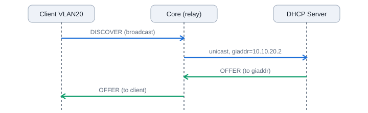

*شکل ۱: Relay، Discover را Unicast می‌کند و آدرس Interface خودش را در giaddr می‌گذارد تا سرور Pool درست را انتخاب کند.*

``` text
Core(config)# interface vlan 20
Core(config-if)# ip helper-address 10.10.30.10
! 10.10.30.10 = DHCP server in VLAN 30
```

سرور با **giaddr** می‌فهمد Discover از کدام Subnet آمده و Pool مربوط (VLAN 20) را به کلاینت می‌دهد. پس سرور باید Scope برای هر Subnet داشته باشد.

> **هشدار**
>
> `ip helper-address` علاوه بر DHCP، ۸ سرویس UDP دیگر را هم Forward می‌کند (TFTP، DNS، NetBIOS، TACACS و ...). در Hardening با `no ip forward-protocol udp ...` محدودشان می‌کنیم.

### ۴. دستورهای مشاهده

``` text
R1# show ip dhcp pool
R1# show ip dhcp binding
R1# show ip dhcp conflict
R1# show ip dhcp server statistics
R1# debug ip dhcp server events   (briefly)
```

- `binding`: کدام MAC چه IP گرفته و تا کی.
- `conflict`: آدرسی که قبل از واگذاری Ping داده شد و کسی جواب داد (تداخل).
- `pool`: تعداد آدرس‌های مصرف‌شده و باقی‌مانده.

### ۵. مثال‌ها

#### ساده

``` text
PC1> ip dhcp
DDORA IP 10.10.20.21/24 GW 10.10.20.1
```

#### متوسط: Relay

``` text
Server in VLAN 30, clients in VLAN 20
ip helper-address on Vlan20 -> clients get 10.10.20.x from the right scope
```

#### سخت: Pool تمام شد

``` text
Symptom : new clients get 169.254.x.x
Check   : show ip dhcp pool -> 0 free addresses
Cause   : lease too long + many short-lived devices (e.g. guest Wi-Fi)
Fix     : shorten the lease, enlarge the pool, clear stale bindings
```

### تمرین‌ها

**ت1.** ۱ (ساده): چرا آدرس Gateway را exclude می‌کنیم؟ *(پاسخ: 7-1-ت1 در بخش «پاسخ‌ها» انتهای فصل)*

**ت2.** ۲ (ساده): DHCP Relay چه می‌کند؟ *(پاسخ: 7-1-ت2 در بخش «پاسخ‌ها» انتهای فصل)*

**ت3.** ۳ (متوسط): giaddr برای چیست؟ *(پاسخ: 7-1-ت3 در بخش «پاسخ‌ها» انتهای فصل)*

**ت4.** ۴ (متوسط): ۲۵۴ آدرس، ۲۰ مستثنا؛ حداکثر کلاینت؟ *(پاسخ: 7-1-ت4 در بخش «پاسخ‌ها» انتهای فصل)*

**ت5.** ۵ (سخت): کاربران VLAN 20 آدرس نمی‌گیرند ولی VLAN 10 می‌گیرد؛ علت محتمل؟ *(پاسخ: 7-1-ت5 در بخش «پاسخ‌ها» انتهای فصل)*

### Lab هدایت‌شده

#### گام ۱: DHCP روی Core

``` text
Core(config)# ip dhcp excluded-address 10.10.20.1 10.10.20.20
Core(config)# ip dhcp pool USERS20
Core(dhcp-config)# network 10.10.20.0 255.255.255.0
Core(dhcp-config)# default-router 10.10.20.254
Core(dhcp-config)# dns-server 10.10.10.53
```

#### گام ۲: تست با VPCS

``` text
PC1> ip dhcp
PC1> show ip
Core# show ip dhcp binding
```

#### گام ۳: Relay

DHCP Pool را روی یک روتر دیگر (مثلاً R-SRV در VLAN 30) بسازید و روی `interface vlan 20` دستور helper-address بزنید؛ از VPCS دوباره آدرس بگیرید و Capture را ببینید: Discover Broadcast روی لینک PC، Unicast روی لینک سرور.

#### گام ۴: Reservation

یک رزرو برای MAC یکی از VPCSها بسازید و تأیید کنید همیشه همان IP را می‌گیرد.

### Lab مستقل

جدول «Scope Plan» (VLAN، Subnet، بازه، Excluded، Lease، DNS، Reservationها) را در `02-design/dhcp-plan.md` بنویسید.

### عیب‌یابی

|         |                                                                                                                                  |
|---------|----------------------------------------------------------------------------------------------------------------------------------|
| Symptom | کلاینت 169.254.x.x می‌گیرد                                                                                                        |
| چک‌لیست  | ۱) Relay تنظیم است؟ ؛ ۲) Scope برای آن Subnet هست؟ ؛ ۳) Pool پر نشده؟ ؛ ۴) Snooping/ACL جلوی Offer را نمی‌گیرد؟ ؛ ۵) مسیر به سرور |
| ابزار   | show ip dhcp binding ، show ip dhcp pool ، Capture                                                                               |
| رفع     | افزودن Relay یا Scope                                                                                                            |

### سؤال‌های مرور

**م1.** DHCP Relay کی لازم است؟ *(پاسخ: 7-1-م1 در بخش «پاسخ‌ها» انتهای فصل)*

**م2.** Reservation چیست؟ *(پاسخ: 7-1-م2 در بخش «پاسخ‌ها» انتهای فصل)*

### English Corner: انگلیسی تخصصی این درس

این جمله‌ها از مستندات و محیط کار واقعی‌اند. بلند بخوانید و ترجمه را بپوشانید.

| English sentence                                     | ترجمه                                                 |
|------------------------------------------------------|-------------------------------------------------------|
| Exclude the static addresses from the DHCP pool.     | آدرس‌های ثابت را از Pool DHCP مستثنا کنید.             |
| The relay agent forwards the broadcast as a unicast. | Relay Agent، Broadcast را به‌صورت Unicast ارسال می‌کند. |
| The client received an APIPA address.                | کلاینت آدرس APIPA گرفت.                               |
| Create a reservation for the printer.                | برای پرینتر یک Reservation بسازید.                    |

**Q1.** Quick quiz (answer in English): Why does a DHCP request not cross a router by default? *(پاسخ: 7-1-Q1 در بخش «پاسخ‌ها» انتهای فصل)*

### تکلیف و چک‌لیست تسلط

- [ ] DHCP و Reservation را بسازم.
- [ ] Relay را تست و Capture را تحلیل کنم.
- [ ] Scope Plan را بنویسم.

### یادآوری اشتباهات شما

> **یادآوری**
>
> پیش‌بینی قبل از اجرا؛ بکاپ قبل از تغییر؛ پذیرفته‌شدن دستور ≠ کار کردن؛ فرمول‌ها در بلوک مستقل.


#### کارت Lab — DHCP و Relay

| # | فیلد | محتوا |
|---|---|---|
| 1 | عنوان و هدف | DHCP Server و Relay |
| 2 | پیش‌نیاز | فصل 6 |
| 3 | توپولوژی | Core + R-SRV |
| 4 | تجهیزات | Core، روتر |
| 5 | نسخه نرم‌افزار | vIOS-L2 15.2(20200924، Experimental) برای SW؛ vIOS 15.9(3)M9 برای R؛ VPCS؛ PNetLab 4.2.8 |
| 6 | IP Plan | VLAN 20/30 |
| 7 | وضعیت اولیه | Pool/Relay |
| 8 | صورت مسئله | IP از VLAN دیگر |
| 9 | مراحل هدایت‌شده | همان بخش «Lab هدایت‌شده» همین درس |
| 10 | تست عملکرد | `show ip dhcp binding` |
| 11 | سناریوی خرابی | بدون helper |
| 12 | روش عیب‌یابی | لایه‌ای/با شواهد (بخش عیب‌یابی همین درس) |
| 13 | نتیجه‌ی مورد انتظار | Lease |
| 14 | معیار پذیرش | Scope Plan |
| 15 | مستندات نهایی | `02-design/dhcp-plan.md` |
| 16 | Cleanup و بازگردانی | — |

> **وضعیت راستی‌آزمایی (خارج از ۱۶ فیلد):** **اجرا نشده (فقط طراحی).** DHCP pool فقط CLI-Accepted.

---

<a id="l-7-2"></a>

## درس 7-2 — DNS و NTP

**فصل ۷ - روز ۲ · پیش‌نیاز: درس ۷-۱ · ۶ ساعت**

### این درس درباره چیست و چرا باید یاد بگیریم؟

**چه چیزی یاد می‌گیریم:** دو سرویس پایه که همه‌چیز به آن‌ها وابسته است: DNS (تبدیل نام به IP) و NTP (هماهنگی ساعت). چطور کار می‌کنند، چطور روی سیسکو تنظیم و بررسی می‌شوند، و چرا خرابی‌شان شبکه را «عجیب» می‌کند.

**چرا لازم است:** بیشتر شکایت‌های «اینترنت قطع است» در واقع «DNS خراب است». و Logها، Certificateها، Kerberos و Active Directory بدون ساعت درست بی‌معنی یا خراب می‌شوند؛ اختلاف بیش از ۵ دقیقه، ورود به دامنه را ناممکن می‌کند.

- **در کار روزانه:** ping به IP جواب می‌دهد ولی به نام نه؟ DNS است.
- **در امنیت:** Log با ساعت اشتباه برای تحلیل حادثه بی‌ارزش است.
- **در Capstone:** DNS و NTP مرکز روی Windows Server است و همه‌ی تجهیزات به آن اشاره می‌کنند.

> **مسیر درس**
>
> DNS چطور کار می‌کند ← رکوردها ← تنظیم روی سیسکو ← NTP و Stratum ← مثال ساده/متوسط/سخت ← Lab ← عیب‌یابی.

#### اصطلاحات این درس (مخفف ← شکل کامل ← معنی)

| مخفف     | شکل کامل انگلیسی            | معنی فارسی                                 |
|----------|-----------------------------|--------------------------------------------|
| DNS      | Domain Name System          | سیستم نام دامنه                            |
| Resolver | DNS Resolver                | سرویس‌دهنده‌ای که پرس‌وجوی کلاینت را حل می‌کند |
| A        | A record                    | نام به IPv4                                |
| AAAA     | AAAA record                 | نام به IPv6                                |
| PTR      | Pointer record              | IP به نام                                  |
| CNAME    | Canonical Name              | نام مستعار                                 |
| NTP      | Network Time Protocol       | پروتکل هماهنگی ساعت                        |
| Stratum  | Stratum                     | فاصله از منبع زمان دقیق                    |
| UTC      | Coordinated Universal Time  | زمان هماهنگ جهانی                          |
| FQDN     | Fully Qualified Domain Name | نام کامل دامنه                             |

### ۱. DNS چطور کار می‌کند؟

دفترچه‌ی تلفن را تصور کنید: شما نام «example.com» را می‌دانید و DNS «شماره» (IP) آن را می‌دهد. کلاینت از سرور DNS خودش می‌پرسد؛ اگر سرور پاسخ را نداشت، از سرورهای بالاتر می‌پرسد و در پایان جواب را می‌گیرد و برای مدتی نگه می‌دارد (Cache).

``` text
Client -> local DNS server : www.example.com ?
Local DNS -> root / TLD / authoritative servers (if not cached)
Local DNS -> client : 203.0.113.10   (cached for TTL seconds)
```

| رکورد | کار                 | مثال                             |
|-------|---------------------|----------------------------------|
| A     | نام به IPv4         | srv1.lab.local = 10.10.30.10     |
| AAAA  | نام به IPv6         | srv1.lab.local = 2001:db8:30::10 |
| PTR   | IP به نام (Reverse) | 10.10.30.10 = srv1.lab.local     |
| CNAME | نام مستعار          | www = srv1                       |
| MX    | سرور ایمیل          | mail.lab.local                   |
| NS    | سرور DNS یک Zone    | dns1.lab.local                   |

### ۲. تنظیم DNS روی سیسکو

``` text
R1(config)# ip domain-name lab.local
R1(config)# ip name-server 10.10.10.53
R1(config)# ip domain lookup
R1# ping srv1
R1# nslookup srv1  (not on all images)
```

> **یادآوری از دوره**
>
> در درس ۲-۴ گفتیم `no ip domain-lookup` برای جلوگیری از «Translating...». اگر DNS واقعی دارید و می‌خواهید روی دستگاه از نام استفاده کنید، `ip domain lookup` و `ip name-server` را بزنید.

روی کلاینت Windows: `nslookup srv1.lab.local` و `ipconfig /flushdns`.

### ۳. NTP: همه‌ی ساعت‌ها یکی

ساعت کامپیوترها کم‌کم از هم فاصله می‌گیرد (Drift). NTP آن‌ها را با یک منبع دقیق هماهنگ می‌کند. سلسله‌مراتب Stratum: منبع اتمی/GPS ‏Stratum 0، سروری که مستقیم به آن وصل است Stratum 1، و هر مرحله پایین‌تر یک عدد بیشتر.

``` text
Stratum 0 : atomic clock / GPS
Stratum 1 : server directly attached
Stratum 2 : synchronizes from stratum 1
...
Stratum 16 : unsynchronized (invalid)
```

#### تنظیم NTP روی سیسکو

``` text
R1(config)# clock timezone IRST 3 30
R1(config)# ntp server 10.10.10.53
R1(config)# ntp server 192.168.88.1 prefer
R1(config)# service timestamps log datetime msec localtime
R1(config)# service timestamps debug datetime msec localtime
R1# show ntp status
R1# show ntp associations
R1# show clock detail
```

- `clock timezone IRST 3 30`: ایران +۳:۳۰ (UTC). منطقه‌ی زمانی را در نظر بگیرید.
- `ntp server ... prefer`: منبع ترجیحی. چند منبع برای تحمل خطا.
- `show ntp status`: باید `Clock is synchronized` باشد.

``` text
R1# show ntp associations
  address        ref clock   st  when  poll reach  delay  offset
*~10.10.10.53   .GPS.       2   18    64   377    1.2   0.3

* = synchronized   ~ = configured   reach 377 = all last 8 polls succeeded
```

در Lab ما ESXi از MikroTik (192.168.88.1) NTP می‌گیرد؛ همان منبع می‌تواند ریشه‌ی Stratum کل Lab باشد.

### ۴. مثال‌ها

#### ساده

``` text
ping 10.10.30.10 works but ping srv1 fails
-> DNS problem (name resolution), not connectivity
```

#### متوسط: ساعت اشتباه

``` text
Syslog entries from R1 show 2000-01-01 and from SW1 2026-11-08
-> logs cannot be correlated; configure NTP on all devices
```

#### سخت: Kerberos و Windows

اگر ساعت یک کلاینت بیش از ۵ دقیقه با Domain Controller اختلاف داشته باشد، ورود به دامنه یا دسترسی به فایل‌سرور شکست می‌خورد، با پیام‌های مبهم احراز هویت. همیشه اول ساعت را بررسی کنید.

### تمرین‌ها

**ت1.** ۱ (ساده): A و PTR چه فرقی دارند؟ *(پاسخ: 7-2-ت1 در بخش «پاسخ‌ها» انتهای فصل)*

**ت2.** ۲ (ساده): Stratum 16 یعنی؟ *(پاسخ: 7-2-ت2 در بخش «پاسخ‌ها» انتهای فصل)*

**ت3.** ۳ (متوسط): ping به IP می‌رسد ولی به نام نه؛ علت؟ *(پاسخ: 7-2-ت3 در بخش «پاسخ‌ها» انتهای فصل)*

**ت4.** ۴ (متوسط): ساعت Windows 6 دقیقه عقب است؛ اثر؟ *(پاسخ: 7-2-ت4 در بخش «پاسخ‌ها» انتهای فصل)*

**ت5.** ۵ (سخت): reach 0 در show ntp associations یعنی؟ *(پاسخ: 7-2-ت5 در بخش «پاسخ‌ها» انتهای فصل)*

### Lab هدایت‌شده

#### گام ۱: NTP روی روترها

``` text
R1(config)# clock timezone IRST 3 30
R1(config)# ntp server 192.168.88.1
R1# show ntp status
R1# show ntp associations
```

اگر IP مسیر نداشت، در Lab ایزوله NTP محلی را روی یک روتر (`ntp master 3`) بسازید و بقیه را به آن وصل کنید:

``` text
R1(config)# ntp master 3
R2(config)# ntp server 10.0.12.1
R2# show ntp status
```

#### گام ۲: DNS

در PNetLab یک VM سبک (مثلاً لینوکس) به‌عنوان DNS بسازید یا فعلاً روی سیسکو یک نگاشت محلی بنویسید:

``` text
R1(config)# ip host srv1 10.10.30.10
R1# ping srv1
```

#### گام ۳: Syslog با ساعت درست

``` text
R1(config)# service timestamps log datetime msec localtime
R1# show logging | include %
```

### Lab مستقل

«Service Dependency Map» بنویسید: چه تجهیزی به DNS/NTP کدام سرور اشاره می‌کند؛ در `02-design/dns-ntp-map.md`.

### عیب‌یابی

|         |                                                                                                         |
|---------|---------------------------------------------------------------------------------------------------------|
| Symptom | IP کار می‌کند، نام نه (یا ساعت اشتباه)                                                                   |
| چک‌لیست  | ۱) DNS Server درست روی کلاینت؟ ؛ ۲) رکورد A هست؟ ؛ ۳) NTP reach؟ ؛ ۴) Timezone؟ ؛ ۵) فایروال UDP 53/123 |
| ابزار   | nslookup ، show ntp associations ، show clock detail                                                    |
| رفع     | اصلاح DNS/NTP                                                                                           |

### سؤال‌های مرور

**م1.** DNS چه می‌کند؟ *(پاسخ: 7-2-م1 در بخش «پاسخ‌ها» انتهای فصل)*

**م2.** چرا NTP برای امنیت مهم است؟ *(پاسخ: 7-2-م2 در بخش «پاسخ‌ها» انتهای فصل)*

### English Corner: انگلیسی تخصصی این درس

این جمله‌ها از مستندات و محیط کار واقعی‌اند. بلند بخوانید و ترجمه را بپوشانید.

| English sentence                                       | ترجمه                                                |
|--------------------------------------------------------|------------------------------------------------------|
| The device synchronizes its clock with the NTP server. | دستگاه ساعتش را با سرور NTP هماهنگ می‌کند.            |
| DNS resolves hostnames to IP addresses.                | DNS نام میزبان را به IP تبدیل می‌کند.                 |
| A time skew of more than five minutes breaks Kerberos. | اختلاف ساعت بیش از پنج دقیقه Kerberos را خراب می‌کند. |
| Flush the DNS cache on the client.                     | Cache DNS کلاینت را پاک کنید.                        |

**Q1.** Quick quiz (answer in English): Why do all devices need the same NTP source? *(پاسخ: 7-2-Q1 در بخش «پاسخ‌ها» انتهای فصل)*

### تکلیف و چک‌لیست تسلط

- [ ] NTP را بالا بیاورم و Synchronized ببینم.
- [ ] فرق خرابی DNS و اتصال را توضیح دهم.
- [ ] Dependency Map را بنویسم.

### یادآوری اشتباهات شما

> **یادآوری**
>
> پیش‌بینی قبل از اجرا؛ بکاپ قبل از تغییر؛ پذیرفته‌شدن دستور ≠ کار کردن؛ فرمول‌ها در بلوک مستقل.


#### کارت Lab — DNS و NTP

| # | فیلد | محتوا |
|---|---|---|
| 1 | عنوان و هدف | DNS و NTP |
| 2 | پیش‌نیاز | درس 7-1 |
| 3 | توپولوژی | R1,R2 + سرور |
| 4 | تجهیزات | R1،R2 |
| 5 | نسخه نرم‌افزار | vIOS-L2 15.2(20200924، Experimental) برای SW؛ vIOS 15.9(3)M9 برای R؛ VPCS؛ PNetLab 4.2.8 |
| 6 | IP Plan | — |
| 7 | وضعیت اولیه | ntp/ip host |
| 8 | صورت مسئله | Sync |
| 9 | مراحل هدایت‌شده | همان بخش «Lab هدایت‌شده» همین درس |
| 10 | تست عملکرد | `show ntp status` |
| 11 | سناریوی خرابی | reach 0 |
| 12 | روش عیب‌یابی | لایه‌ای/با شواهد (بخش عیب‌یابی همین درس) |
| 13 | نتیجه‌ی مورد انتظار | Synchronized |
| 14 | معیار پذیرش | Dependency Map |
| 15 | مستندات نهایی | `02-design/dns-ntp-map.md` |
| 16 | Cleanup و بازگردانی | — |

> **وضعیت راستی‌آزمایی (خارج از ۱۶ فیلد):** **اجرا نشده (فقط طراحی).** NTP فقط CLI-Accepted (Sync آزمایش نشده).

---

<a id="l-7-3"></a>

## درس 7-3 — NAT و PAT

**فصل ۷ - روز ۳ · پیش‌نیاز: درس‌های ۲-۱ و ۷-۱ · ۶ ساعت**

### این درس درباره چیست و چرا باید یاد بگیریم؟

**چه چیزی یاد می‌گیریم:** NAT و PAT: چطور آدرس‌های خصوصی با یک (یا چند) آدرس عمومی به اینترنت می‌روند؛ انواع Static، Dynamic و Overload؛ Inside/Outside؛ و جدول Translation.

**چرا لازم است:** آدرس‌های خصوصی (10.x، 192.168.x) در اینترنت Route نمی‌شوند. NAT مبدأ بسته را در لبه عوض می‌کند تا پاسخ برگردد. هر شبکه‌ی داخلی که به اینترنت وصل است NAT دارد؛ و خرابی آن (مثلاً NAT دوگانه) مبهم‌ترین مشکلات را می‌سازد.

- **در کار روزانه:** تقریباً همه‌ی اینترنت‌ها PAT هستند.
- **در امنیت:** NAT امنیت نیست؛ فقط پنهان‌سازی آدرس است. محافظ اصلی Policy فایروال است.
- **در FortiGate:** Policy NAT، IP Pool و VIP همین مفاهیم را در فایروال دارند (W10).

> **مسیر درس**
>
> چرا NAT ← Inside/Outside ← Static ← Dynamic ← PAT/Overload ← مثال ساده/متوسط/سخت ← Lab ← عیب‌یابی.

#### اصطلاحات این درس (مخفف ← شکل کامل ← معنی)

| مخفف          | شکل کامل انگلیسی            | معنی فارسی                      |
|---------------|-----------------------------|---------------------------------|
| NAT           | Network Address Translation | ترجمه‌ی آدرس                     |
| PAT           | Port Address Translation    | ترجمه‌ی آدرس و پورت (Overload)   |
| Inside Local  | Inside Local                | آدرس داخلی قبل از ترجمه         |
| Inside Global | Inside Global               | آدرس عمومی بعد از ترجمه         |
| Overload      | NAT Overload                | چند آدرس داخلی با یک آدرس عمومی |
| VIP           | Virtual IP                  | Port Forward در فایروال (DNAT)  |
| DNAT          | Destination NAT             | تغییر آدرس مقصد                 |
| SNAT          | Source NAT                  | تغییر آدرس مبدأ                 |

### ۱. NAT چرا و چطور؟

فرض کنید یک ساختمان اداری یک شماره‌ی تلفن بیرونی دارد و داخل داخلی‌ها (۱۰۱، ۱۰۲...). وقتی کارمند ۱۰۲ تماس می‌گیرد، گیرنده شماره‌ی بیرونی را می‌بیند؛ منشی (NAT) می‌داند پاسخ را به کدام داخلی بدهد. NAT هم همین جدول را نگه می‌دارد.

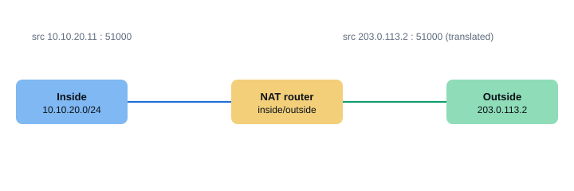

*شکل ۱: NAT مبدأ بسته را از آدرس داخلی به آدرس عمومی تبدیل می‌کند و در جدول نگه می‌دارد.*

| اصطلاح         | معنی                                   | مثال        |
|----------------|----------------------------------------|-------------|
| Inside Local   | آدرس داخلی (قبل از ترجمه)              | 10.10.20.11 |
| Inside Global  | آدرس داخلی از دید بیرون (بعد از ترجمه) | 203.0.113.2 |
| Outside Global | آدرس مقصد در اینترنت                   | 8.8.8.8     |

### ۲. سه نوع NAT

| نوع            | نگاشت                                   | کاربرد                         |
|----------------|-----------------------------------------|--------------------------------|
| Static NAT     | یک به یک ثابت                           | انتشار سرور (مثلاً وب) به بیرون |
| Dynamic NAT    | داخلی به Pool از چند آدرس عمومی         | نادر؛ وقتی چند IP عمومی داریم  |
| PAT / Overload | چند داخلی به یک IP عمومی با پورت متفاوت | اینترنت عادی                   |

PAT چطور؟ برای هر ارتباط، علاوه بر آدرس، شماره‌ی پورت مبدأ هم عوض می‌شود تا ارتباط‌ها از هم جدا بمانند:

``` text
10.10.20.11:51000 -> 203.0.113.2:51000
10.10.20.12:51000 -> 203.0.113.2:51001   (port changed to stay unique)
```

### ۳. دستورها (خط‌به‌خط)

#### PAT (Overload) با ACL

``` text
R1(config)# access-list 10 permit 10.10.20.0 0.0.0.255
R1(config)# interface gi0/0
R1(config-if)# ip nat inside
R1(config)# interface gi0/1
R1(config-if)# ip nat outside
R1(config)# ip nat inside source list 10 interface gi0/1 overload
```

- `ip nat inside / outside`: هر Interface را نقش می‌دهد؛ بدون این‌ها NAT کار نمی‌کند.
- `access-list 10`: مشخص می‌کند کدام ترافیک ترجمه شود (چه کسی «داخل» است).
- `overload`: PAT. `interface gi0/1`: از IP همان Interface خروجی استفاده شود.

#### Static NAT (انتشار سرور)

``` text
R1(config)# ip nat inside source static 10.10.30.10 203.0.113.10
! port forward only HTTPS:
R1(config)# ip nat inside source static tcp 10.10.30.10 443 203.0.113.10 443
```

#### مشاهده

``` text
R1# show ip nat translations
R1# show ip nat statistics
R1# clear ip nat translation *
R1# debug ip nat   (briefly)
```

``` text
Pro Inside global        Inside local        Outside local    Outside global
icmp 203.0.113.2:1       10.10.20.11:1       8.8.8.8:1        8.8.8.8:1
tcp  203.0.113.2:51000   10.10.20.12:51000   93.184.216.34:443 93.184.216.34:443
```

### ۴. مثال‌ها

#### ساده

``` text
PC (10.10.20.11) pings 8.8.8.8
show ip nat translations shows the entry with inside global 203.0.113.2
```

#### متوسط: Static برای سرور

``` text
Outside client -> 203.0.113.10:443
Router translates the destination to 10.10.30.10:443 (inbound)
Return traffic is translated back automatically
```

#### سخت: چرا NAT کار نمی‌کند؟

``` text
Cause 1: ip nat inside/outside missing or on the wrong interface
Cause 2: ACL does not match the inside subnet
Cause 3: missing default route to the ISP
Cause 4: double NAT (router and firewall both translate)
Check : show ip nat translations (empty?) , show ip nat statistics (misses)
```

### تمرین‌ها

**ت1.** ۱ (ساده): PAT چه چیزی را علاوه بر IP تغییر می‌دهد؟ *(پاسخ: 7-3-ت1 در بخش «پاسخ‌ها» انتهای فصل)*

**ت2.** ۲ (ساده): Inside Global چیست؟ *(پاسخ: 7-3-ت2 در بخش «پاسخ‌ها» انتهای فصل)*

**ت3.** ۳ (متوسط): دو دستور لازم برای NAT روی یک Interface؟ *(پاسخ: 7-3-ت3 در بخش «پاسخ‌ها» انتهای فصل)*

**ت4.** ۴ (متوسط): چرا NAT امنیت نیست؟ *(پاسخ: 7-3-ت4 در بخش «پاسخ‌ها» انتهای فصل)*

**ت5.** ۵ (سخت): NAT دوگانه (Double NAT) چه مشکلی می‌سازد؟ *(پاسخ: 7-3-ت5 در بخش «پاسخ‌ها» انتهای فصل)*

### Lab هدایت‌شده

روتر EDGE-R1 با Inside = لینک به Core و Outside = Loopback شبیه اینترنت (یا یک روتر دیگر).

#### گام ۱: PAT

``` text
EDGE-R1(config)# access-list 10 permit 10.10.0.0 0.0.255.255
EDGE-R1(config)# interface gi0/0
EDGE-R1(config-if)# ip nat inside
EDGE-R1(config)# interface gi0/2
EDGE-R1(config-if)# ip address 203.0.113.2 255.255.255.0
EDGE-R1(config-if)# ip nat outside
EDGE-R1(config)# ip nat inside source list 10 interface gi0/2 overload
```

#### گام ۲: تست

``` text
PC1> ping 203.0.113.1
EDGE-R1# show ip nat translations
EDGE-R1# show ip nat statistics
```

طبق Probe اولیه، دستور NAT در vIOSL2 «پذیرفته» می‌شود؛ روی روتر vIOS (IOS واقعی) باید کار کند. نتیجه‌ی واقعی را ثبت کنید.

#### گام ۳: Static NAT

یک سرور Inside را با Static منتشر کنید و از «بیرون» تست کنید.

#### گام ۴: قبل/بعد Capture

روی لینک Inside و Outside Capture بگیرید و آدرس مبدأ را مقایسه کنید.

### Lab مستقل

جدول «NAT Matrix» (Inside Local، Inside Global، نوع، سرویس) و تصویر Packet Flow قبل/بعد NAT را در `02-design/nat-matrix.md` بنویسید.

### عیب‌یابی

|         |                                                                                                                  |
|---------|------------------------------------------------------------------------------------------------------------------|
| Symptom | اینترنت ندارم؛ ping داخلی OK                                                                                     |
| چک‌لیست  | ۱) show ip nat translations خالی؟ ؛ ۲) inside/outside درست؟ ؛ ۳) ACL مطابق؟ ؛ ۴) Default route؟ ؛ ۵) Double NAT؟ |
| ابزار   | show ip nat statistics ، debug ip nat                                                                            |
| رفع     | اصلاح نقش Interface یا ACL                                                                                       |

### سؤال‌های مرور

**م1.** PAT چطور چند کاربر را با یک IP می‌برد؟ *(پاسخ: 7-3-م1 در بخش «پاسخ‌ها» انتهای فصل)*

**م2.** Static NAT برای چیست؟ *(پاسخ: 7-3-م2 در بخش «پاسخ‌ها» انتهای فصل)*

### English Corner: انگلیسی تخصصی این درس

این جمله‌ها از مستندات و محیط کار واقعی‌اند. بلند بخوانید و ترجمه را بپوشانید.

| English sentence                                                          | ترجمه                                                                 |
|---------------------------------------------------------------------------|-----------------------------------------------------------------------|
| Configure NAT overload on the outside interface.                          | NAT Overload را روی Interface خارجی تنظیم کنید.                       |
| The translation table shows the inside local and inside global addresses. | جدول Translation، آدرس‌های Inside Local و Inside Global را نشان می‌دهد. |
| NAT is not a security feature.                                            | NAT ویژگی امنیتی نیست.                                                |
| Double NAT breaks inbound port forwarding.                                | Double NAT ارسال پورت ورودی را خراب می‌کند.                            |

**Q1.** Quick quiz (answer in English): What does PAT add to the translation to keep sessions unique? *(پاسخ: 7-3-Q1 در بخش «پاسخ‌ها» انتهای فصل)*

### تکلیف و چک‌لیست تسلط

- [ ] PAT را بسازم و Translation را ببینم.
- [ ] Static NAT را تست کنم.
- [ ] NAT Matrix را بنویسم.

### یادآوری اشتباهات شما

> **یادآوری**
>
> پیش‌بینی قبل از اجرا؛ بکاپ قبل از تغییر؛ پذیرفته‌شدن دستور ≠ کار کردن؛ فرمول‌ها در بلوک مستقل.


#### کارت Lab — NAT و PAT

| # | فیلد | محتوا |
|---|---|---|
| 1 | عنوان و هدف | NAT/PAT |
| 2 | پیش‌نیاز | درس 7-2 |
| 3 | توپولوژی | Edge |
| 4 | تجهیزات | EDGE-R1 |
| 5 | نسخه نرم‌افزار | vIOS-L2 15.2(20200924، Experimental) برای SW؛ vIOS 15.9(3)M9 برای R؛ VPCS؛ PNetLab 4.2.8 |
| 6 | IP Plan | Inside/Outside |
| 7 | وضعیت اولیه | overload |
| 8 | صورت مسئله | Translation |
| 9 | مراحل هدایت‌شده | همان بخش «Lab هدایت‌شده» همین درس |
| 10 | تست عملکرد | `show ip nat translations` |
| 11 | سناریوی خرابی | inside/outside غلط |
| 12 | روش عیب‌یابی | لایه‌ای/با شواهد (بخش عیب‌یابی همین درس) |
| 13 | نتیجه‌ی مورد انتظار | Translation |
| 14 | معیار پذیرش | NAT Matrix |
| 15 | مستندات نهایی | `02-design/nat-matrix.md` |
| 16 | Cleanup و بازگردانی | — |

> **وضعیت راستی‌آزمایی (خارج از ۱۶ فیلد):** **اجرا نشده (فقط طراحی).** NAT فقط CLI-Accepted.

---

<a id="l-7-4"></a>

## درس 7-4 — ACL

**فصل ۷ - روز ۴ · پیش‌نیاز: درس‌های ۲-۵ و ۶-۵ · ۶ ساعت**

### این درس درباره چیست و چرا باید یاد بگیریم؟

**چه چیزی یاد می‌گیریم:** فهرست کنترل دسترسی (ACL): انواع Standard و Extended، قاعده‌ی «اولین تطابق» و Implicit Deny، جای درست گذاشتن ACL، و نوشتن Policy بین VLANها.

**چرا لازم است:** ACL اولین ابزار کنترل ترافیک روی سیسکوست و پایه‌ی فهم Policy فایروال است. ترتیب اشتباه یک قاعده یا فراموشی Implicit Deny می‌تواند کل شبکه را قطع کند یا درِ امنیت را باز بگذارد.

- **در کار روزانه:** جداکردن مهمان از شبکه‌ی داخلی و محدودکردن مدیریت (SSH).
- **در امنیت:** ACL، Least Privilege را در لایه‌ی شبکه پیاده می‌کند.
- **در FortiGate:** Policy فایروال همان منطق Top-Down و First Match را دارد (با Stateful بودن).

> **مسیر درس**
>
> ACL چیست ← First Match و Implicit Deny ← Standard در برابر Extended ← جای ACL ← مثال ساده/متوسط/سخت ← Lab ← عیب‌یابی.

#### اصطلاحات این درس (مخفف ← شکل کامل ← معنی)

| مخفف          | شکل کامل انگلیسی     | معنی فارسی                 |
|---------------|----------------------|----------------------------|
| ACL           | Access Control List  | فهرست قوانین permit/deny   |
| Standard      | Standard ACL         | فقط آدرس مبدأ              |
| Extended      | Extended ACL         | مبدأ، مقصد، پروتکل، پورت   |
| Implicit Deny | Implicit Deny        | انکار ضمنی در پایان هر ACL |
| Wildcard      | Wildcard mask        | معکوس Mask                 |
| ACE           | Access Control Entry | یک خط ACL                  |
| Stateless     | Stateless            | بدون حافظه‌ی وضعیت ارتباط   |
| established   | TCP established      | بسته‌های بعد از برقراری TCP |

### ۱. ACL چیست؟

ACL فهرستی از قوانین است. هر قانون می‌گوید: «اگر بسته با این مشخصات بود، اجازه بده (permit) یا ببند (deny)». مثل لیست مهمانان در ورودی یک سالن؛ نگهبان از بالای لیست شروع می‌کند و هر نامی را پیدا کرد همان‌جا تصمیم می‌گیرد.

> **دو قانون اصلی**
>
> ۱) **اولین تطابق** (First Match): از بالا به پایین؛ به محض اولین قانونی که جور شد، بقیه خوانده نمی‌شود. ۲) **Implicit Deny**: در انتهای هر ACL یک `deny any` نامرئی هست؛ پس هر چه صریحاً permit نشده، بسته می‌شود.

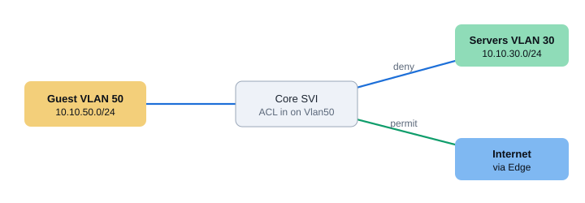

*شکل ۱: ACL روی ورودی SVI مهمان: دسترسی به سرورها بسته و اینترنت باز است.*

### ۲. Standard در برابر Extended

| معیار   | Standard             | Extended                 |
|---------|----------------------|--------------------------|
| شماره   | 1-99 و 1300-1999     | 100-199 و 2000-2699      |
| معیار   | فقط IP مبدأ          | مبدأ، مقصد، پروتکل، پورت |
| جای نصب | نزدیک مقصد           | نزدیک مبدأ               |
| کاربرد  | فیلتر ساده (مثل VTY) | Policy دقیق بین VLANها   |

(نکته: جای‌گذاری Standard نزدیک مقصد و Extended نزدیک مبدأ «قاعده‌ی عملی/آموزشی» است که در منابع آموزشی Cisco Community و CCNA آمده؛ مستند رسمی پیکربندی Cisco آن را الزام نکرده است.) چرا Standard نزدیک مقصد؟ چون فقط مبدأ را می‌شناسد؛ اگر نزدیک مبدأ بگذارید، ترافیک آن مبدأ به همه‌ی مقصدها بسته می‌شود. Extended را نزدیک مبدأ می‌گذارند تا ترافیک ناخواسته زودتر از شبکه خارج شود.

### ۳. دستورها (خط‌به‌خط)

روش Named که قابل‌ویرایش و خواناست:

``` text
Core(config)# ip access-list extended GUEST-IN
Core(config-ext-nacl)# remark block guests from internal networks
Core(config-ext-nacl)# deny ip 10.10.50.0 0.0.0.255 10.10.0.0 0.0.255.255
Core(config-ext-nacl)# permit udp 10.10.50.0 0.0.0.255 any eq 53
Core(config-ext-nacl)# permit tcp 10.10.50.0 0.0.0.255 any eq 80
Core(config-ext-nacl)# permit tcp 10.10.50.0 0.0.0.255 any eq 443
Core(config-ext-nacl)# deny ip any any log
Core(config-ext-nacl)# exit
Core(config)# interface vlan 50
Core(config-if)# ip access-group GUEST-IN in
```

- `remark`: توضیح خط‌به‌خط (حتماً بنویسید).
- اول `deny` برای شبکه‌ی داخلی (10.10.0.0/16)؛ بعد permitهای لازم (DNS، وب).
- `log`: برای دیدن Hit در Log (روی خطوط deny مفید است).
- `ip access-group NAME in`: ACL را روی ورودی Interface اعمال می‌کند.

``` text
Core# show access-lists
Core# show ip interface vlan 50 | include access list
Core# show running-config | section ip access-list
```

``` text
Extended IP access list GUEST-IN
    10 deny ip 10.10.50.0 0.0.0.255 10.10.0.0 0.0.255.255 (12 matches)
    20 permit udp 10.10.50.0 0.0.0.255 any eq domain (45 matches)
    30 permit tcp 10.10.50.0 0.0.0.255 any eq www
    40 permit tcp 10.10.50.0 0.0.0.255 any eq 443
    50 deny ip any any log (3 matches)
```

### ۴. نکته‌های حرفه‌ای

- **ترتیب مهم است:** اگر permit کلی را بالای deny بگذارید، deny هرگز اجرا نمی‌شود.
- **ACL فقط ترافیک عبوری را فیلتر می‌کند،** نه ترافیکی که خود روتر می‌سازد.
- **Stateless است:** برگشت ترافیک باید صراحتاً مجاز شود (مثلاً `established` برای TCP)؛ فایروال Stateful این را خودکار می‌کند.
- **جهت (in/out) را درست انتخاب کنید:** in = ورودی به Interface از بیرون؛ out = خروجی.
- **قبل از اعمال،** مطمئن شوید قانون مدیریت (SSH) شما را قطع نمی‌کند.

``` text
Return traffic example (TCP, stateless ACL):
  permit tcp any 10.10.20.0 0.0.0.255 established
matches only packets with ACK/RST bits set (replies), not new connections
```

### ۵. مثال‌ها

#### ساده: SSH فقط از مدیریت (Standard)

``` text
Core(config)# ip access-list standard MGMT-ONLY
Core(config-std-nacl)# permit 10.10.10.0 0.0.0.255
Core(config)# line vty 0 4
Core(config-line)# access-class MGMT-ONLY in
```

#### متوسط: کاربران فقط HTTPS و DNS به سرور

``` text
ip access-list extended USERS-TO-SRV
 permit tcp 10.10.20.0 0.0.0.255 host 10.10.30.10 eq 443
 permit udp 10.10.20.0 0.0.0.255 host 10.10.30.53 eq 53
 deny ip 10.10.20.0 0.0.0.255 10.10.30.0 0.0.0.255 log
 permit ip any any
```

#### سخت: چرا Ping کار می‌کند ولی HTTPS نه؟

``` text
Cause 1: ACL has permit icmp above, no permit for tcp 443
Cause 2: ACL applied in the wrong direction or on the wrong interface
Cause 3: implicit deny (no permit for the traffic)
Cause 4: return path ACL blocks the replies (stateless)
Check : show access-lists (hit counters), show ip interface ... | include access
```

### تمرین‌ها

**ت1.** ۱ (ساده): Implicit Deny چیست؟ *(پاسخ: 7-4-ت1 در بخش «پاسخ‌ها» انتهای فصل)*

**ت2.** ۲ (ساده): Extended را کجا می‌گذاریم؟ *(پاسخ: 7-4-ت2 در بخش «پاسخ‌ها» انتهای فصل)*

**ت3.** ۳ (متوسط): Wildcard برای 10.10.20.0/24؟ *(پاسخ: 7-4-ت3 در بخش «پاسخ‌ها» انتهای فصل)*

**ت4.** ۴ (متوسط): چرا ترتیب مهم است؟ *(پاسخ: 7-4-ت4 در بخش «پاسخ‌ها» انتهای فصل)*

**ت5.** ۵ (سخت): ACL روی VLAN مهمان هر چیزی را می‌بندد؛ چه چیزی فراموش شده؟ *(پاسخ: 7-4-ت5 در بخش «پاسخ‌ها» انتهای فصل)*

### Lab هدایت‌شده

روی Core از Lab A (یا هر روتر با دو VLAN):

#### گام ۱: Baseline

``` text
PC-guest> ping 10.10.30.10   (before ACL: success)
```

#### گام ۲: ACL و اعمال

ACL بخش ۳ را بسازید و روی `interface vlan 50` اعمال کنید (in). قبل از آن بکاپ بگیرید.

#### گام ۳: Verify

``` text
PC-guest> ping 10.10.30.10   (expect: fail)
PC-guest> ping 8.8.8.8        (expect: success via edge)
Core# show access-lists       (hit counters rise)
```

طبق Probe، ACL روی vIOSL2 «پذیرفته» می‌شود و ممکن است عملاً اعمال نشود؛ روی روتر vIOS (L3) تست کنید و نتیجه‌ی واقعی را ثبت کنید.

#### گام ۴: خراب‌کردن عمدی ترتیب

یک `permit ip any any` بالای deny بگذارید و ببینید deny بی‌اثر می‌شود؛ سپس با شماره‌ی خط ترتیب را اصلاح کنید.

### Lab مستقل

یک «Policy Matrix» (مبدأ VLAN، مقصد VLAN، سرویس، اجازه/انکار) برای ۳ VLAN در `02-design/policy-matrix.md` بنویسید.

### عیب‌یابی

|         |                                                                                                         |
|---------|---------------------------------------------------------------------------------------------------------|
| Symptom | ترافیک مجاز بسته شده یا ترافیک ممنوع رد می‌شود                                                           |
| چک‌لیست  | ۱) ACL روی کدام Interface و جهت؟ ؛ ۲) ترتیب خطوط؟ ؛ ۳) Hit Count؟ ؛ ۴) Implicit Deny؟ ؛ ۵) برگشت ترافیک |
| ابزار   | show access-lists ، show ip interface                                                                   |
| رفع     | اصلاح ترتیب یا افزودن permit                                                                            |

### سؤال‌های مرور

**م1.** اولین تطابق یعنی چه؟ *(پاسخ: 7-4-م1 در بخش «پاسخ‌ها» انتهای فصل)*

**م2.** تفاوت Stateless و Stateful؟ *(پاسخ: 7-4-م2 در بخش «پاسخ‌ها» انتهای فصل)*

### English Corner: انگلیسی تخصصی این درس

این جمله‌ها از مستندات و محیط کار واقعی‌اند. بلند بخوانید و ترجمه را بپوشانید.

| English sentence                                                     | ترجمه                                                          |
|----------------------------------------------------------------------|----------------------------------------------------------------|
| Apply the ACL inbound on the VLAN interface.                         | ACL را روی ورودی Interface مربوط به VLAN اعمال کنید.           |
| Rules are evaluated top-down, first match wins.                      | قوانین از بالا به پایین ارزیابی می‌شوند؛ اولین تطابق برنده است. |
| Add a remark to document the purpose of each entry.                  | برای مستندسازی هدف هر خط یک remark بگذارید.                    |
| The implicit deny drops everything that is not explicitly permitted. | Implicit Deny هر چه صریحاً مجاز نشده را می‌اندازد.               |

**Q1.** Quick quiz (answer in English): Where should a standard ACL be placed and why? *(پاسخ: 7-4-Q1 در بخش «پاسخ‌ها» انتهای فصل)*

### تکلیف و چک‌لیست تسلط

- [ ] ACL را بسازم و Hit Count ببینم.
- [ ] ترتیب اشتباه را بسازم و رفع کنم.
- [ ] Policy Matrix را بنویسم.

### یادآوری اشتباهات شما

> **یادآوری**
>
> پیش‌بینی قبل از اجرا؛ بکاپ قبل از تغییر؛ پذیرفته‌شدن دستور ≠ کار کردن؛ فرمول‌ها در بلوک مستقل.


#### کارت Lab — ACL

| # | فیلد | محتوا |
|---|---|---|
| 1 | عنوان و هدف | ACL استاندارد/Extended |
| 2 | پیش‌نیاز | درس 7-3 |
| 3 | توپولوژی | Core |
| 4 | تجهیزات | Core |
| 5 | نسخه نرم‌افزار | vIOS-L2 15.2(20200924، Experimental) برای SW؛ vIOS 15.9(3)M9 برای R؛ VPCS؛ PNetLab 4.2.8 |
| 6 | IP Plan | VLAN 50 |
| 7 | وضعیت اولیه | GUEST-IN |
| 8 | صورت مسئله | Hit Count |
| 9 | مراحل هدایت‌شده | همان بخش «Lab هدایت‌شده» همین درس |
| 10 | تست عملکرد | `show access-lists` |
| 11 | سناریوی خرابی | ترتیب غلط |
| 12 | روش عیب‌یابی | لایه‌ای/با شواهد (بخش عیب‌یابی همین درس) |
| 13 | نتیجه‌ی مورد انتظار | deny مهمان→سرور |
| 14 | معیار پذیرش | Policy Matrix |
| 15 | مستندات نهایی | `02-design/policy-matrix.md` |
| 16 | Cleanup و بازگردانی | — |

> **وضعیت راستی‌آزمایی (خارج از ۱۶ فیلد):** **اجرا نشده (فقط طراحی).** ACL فقط CLI-Accepted.

---

<a id="l-7-5"></a>

## درس 7-5 — Syslog و SNMP

**فصل ۷ - روز ۵ · پیش‌نیاز: درس ۷-۲ · ۶ ساعت**

### این درس درباره چیست و چرا باید یاد بگیریم؟

**چه چیزی یاد می‌گیریم:** پایش دستگاه‌ها: ارسال Log به سرور مرکزی با Syslog (سطح‌های ۰ تا ۷)، تنظیم سرور rsyslog، و پرس‌وجوی وضعیت با SNMP (v2c فقط در Lab و v3 امن).

**چرا لازم است:** وقتی شبکه خراب شد، اولین سؤال این است: «چه چیزی تغییر کرد؟». Log مرکزی با ساعت درست جواب می‌دهد. SNMP هم داده‌ی عددی (CPU، ترافیک، Interface) برای مانیتورینگ و هشدار می‌دهد. بدون این دو، مدیریت شبکه کور است.

- **در کار روزانه:** هر Interface که قطع/وصل می‌شود در Log دیده می‌شود.
- **در امنیت:** Log مرکزی پایه‌ی SIEM و تحلیل حادثه است؛ Community لو رفته یعنی نفوذ.
- **در Capstone:** Zabbix و rsyslog در Phase مانیتورینگ همین داده‌ها را می‌گیرند.

> **مسیر درس**
>
> Syslog و سطح‌ها ← سرور rsyslog ← SNMP v2c و v3 ← امنیت ← مثال ساده/متوسط/سخت ← Lab ← عیب‌یابی.

#### اصطلاحات این درس (مخفف ← شکل کامل ← معنی)

| مخفف      | شکل کامل انگلیسی                          | معنی فارسی               |
|-----------|-------------------------------------------|--------------------------|
| Syslog    | System Logging Protocol                   | ارسال پیام Log به سرور   |
| Severity  | Syslog severity                           | سطح اهمیت ۰ تا ۷         |
| rsyslog   | rsyslog                                   | سرور Syslog در لینوکس    |
| SNMP      | Simple Network Management Protocol        | پروتکل پایش و مدیریت     |
| MIB       | Management Information Base               | پایگاه اشیاء قابل‌پایش    |
| OID       | Object Identifier                         | شناسه‌ی هر شیء            |
| Community | SNMP Community                            | رمز ساده‌ی v2c (متن ساده) |
| Trap      | SNMP Trap                                 | اعلان غیرهم‌زمان دستگاه   |
| SIEM      | Security Information and Event Management | تحلیل متمرکز Log         |

### ۱. Syslog: دفتر ثبت وقایع

دستگاه هر رویداد مهم را به‌صورت یک خط پیام می‌نویسد: لینک بالا رفت، کاربر وارد شد، ACL بسته را رد کرد. هر پیام یک سطح اهمیت (Severity) دارد:

| سطح | نام           | معنی                |
|-----|---------------|---------------------|
| 0   | Emergency     | سیستم از کار افتاده |
| 1   | Alert         | نیاز به اقدام فوری  |
| 2   | Critical      | وضعیت بحرانی        |
| 3   | Error         | خطا                 |
| 4   | Warning       | هشدار               |
| 5   | Notice        | رویداد معمولی مهم   |
| 6   | Informational | اطلاعات             |
| 7   | Debug         | اشکال‌زدایی          |

قاعده: عدد کمتر یعنی مهم‌تر. اگر روی «سطح ۶» تنظیم کنید، سطح‌های ۰ تا ۶ ارسال می‌شود.

### ۲. تنظیم سیسکو برای ارسال Log

``` text
R1(config)# service timestamps log datetime msec localtime
R1(config)# logging host 10.10.10.60
R1(config)# logging trap informational
R1(config)# logging source-interface loopback 0
R1(config)# logging buffered 16384
R1(config)# logging console warnings
R1# show logging
```

- `logging host`: آدرس سرور rsyslog (UDP 514).
- `logging trap informational`: سطح ارسال (تا ۶).
- `source-interface loopback 0`: همه‌ی Logها با آدرس ثابت دستگاه می‌آیند.
- `buffered`: نگه‌داری در حافظه‌ی خود دستگاه (برای وقتی سرور نیست).

> **ساعت!**
>
> بدون NTP (درس ۷-۲)، Log بی‌ارزش است. اول NTP، بعد Syslog.

### ۳. سرور rsyslog (لینوکس)

روی VM مانیتورینگ (`MON`) rsyslog را برای دریافت UDP 514 فعال می‌کنیم و Log هر دستگاه را در فایل جدا می‌نویسیم:

``` text
# /etc/rsyslog.d/10-network.conf
module(load="imudp")
input(type="imudp" port="514")

template(name="PerHost" type="string"
  string="/var/log/network/%HOSTNAME%.log")
if ($fromhost-ip startswith "10.10.") then {
  action(type="omfile" dynaFile="PerHost")
  stop
}
```

``` text
sudo mkdir -p /var/log/network
sudo systemctl restart rsyslog
sudo ss -ulnp | grep 514
sudo tail -f /var/log/network/R1.log
```

این دستورها را شما روی VM اجرا می‌کنید؛ من فقط فرمان می‌دهم. VM هنوز ساخته نشده؛ در Phase مانیتورینگ ساخته می‌شود، اینجا مفهوم و پیکربندی را بشناسید.

### ۴. SNMP: سؤال‌وجواب با دستگاه

سرور مانیتورینگ هر چند ثانیه از دستگاه می‌پرسد (Poll): «CPU چند درصد؟ ترافیک Interface؟». هر مقدار با یک OID مشخص می‌شود. دستگاه می‌تواند خودش هم رویداد اعلام کند (Trap).

| نسخه | احراز هویت           | رمزگذاری       | توصیه   |
|------|----------------------|----------------|---------|
| v1   | Community (متن ساده) | ندارد          | ممنوع   |
| v2c  | Community (متن ساده) | ندارد          | فقط Lab |
| v3   | نام‌کاربری + SHA      | AES (authPriv) | تولید   |

#### v2c فقط برای Lab

``` text
R1(config)# ip access-list standard SNMP-MGR
R1(config-std-nacl)# permit host 10.10.10.60
R1(config)# snmp-server community <LAB-COMMUNITY> RO SNMP-MGR
R1(config)# snmp-server location LAB-HQ
R1(config)# snmp-server contact netadmin@lab.local
```

#### v3 امن

``` text
R1(config)# snmp-server group MON-GRP v3 priv
R1(config)# snmp-server user monitor MON-GRP v3 auth sha <AUTH-PASS> priv aes 128 <PRIV-PASS>
R1(config)# snmp-server host 10.10.10.60 version 3 priv monitor
R1(config)# snmp-server enable traps
```

> **نکته‌ی امنیتی**
>
> رمزها و Communityها را در ریپو و اسناد ننویسید؛ جانگهدار بگذارید و مقدار واقعی را در مدیریت رمز نگه دارید. Community پیش‌فرض (public/private) ممنوع است. دسترسی SNMP را با ACL به آدرس سرور مانیتورینگ محدود کنید. سینتکس v3 روی Image شما باید تأیید شود (Unverified).

``` text
R1# show snmp
R1# show snmp user
R1# show snmp host
! from the monitoring VM (Linux):
snmpwalk -v2c -c <LAB-COMMUNITY> 10.0.12.1 1.3.6.1.2.1.1.1.0
```

### ۵. مثال‌ها

#### ساده

``` text
Interface flaps -> log line on the server:
Nov  8 10:12:01 R1 %LINK-3-UPDOWN: Interface GigabitEthernet0/1, changed state to down
```

#### متوسط: تحلیل رویداد

``` text
10:12:01 %LINK-3-UPDOWN gi0/1 down
10:12:02 %OSPF-5-ADJCHG neighbor 2.2.2.2 Full -> Down
10:12:32 %LINK-3-UPDOWN gi0/1 up
10:12:40 %OSPF-5-ADJCHG neighbor 2.2.2.2 Down -> Full
Conclusion: a 31 s link outage caused an OSPF flap
```

#### سخت: چرا Log نمی‌رسد؟

``` text
Cause 1: no route to the log server
Cause 2: ACL/firewall blocks UDP 514
Cause 3: wrong logging trap level
Cause 4: server not listening (ss -ulnp)
Cause 5: wrong time makes entries look missing
```

### تمرین‌ها

**ت1.** ۱ (ساده): سطح Syslog برای «خطا»؟ *(پاسخ: 7-5-ت1 در بخش «پاسخ‌ها» انتهای فصل)*

**ت2.** ۲ (ساده): چرا v2c خطرناک است؟ *(پاسخ: 7-5-ت2 در بخش «پاسخ‌ها» انتهای فصل)*

**ت3.** ۳ (متوسط): logging trap warnings چه سطح‌هایی را می‌فرستد؟ *(پاسخ: 7-5-ت3 در بخش «پاسخ‌ها» انتهای فصل)*

**ت4.** ۴ (متوسط): چرا source-interface loopback؟ *(پاسخ: 7-5-ت4 در بخش «پاسخ‌ها» انتهای فصل)*

**ت5.** ۵ (سخت): Poll در برابر Trap؟ *(پاسخ: 7-5-ت5 در بخش «پاسخ‌ها» انتهای فصل)*

### Lab هدایت‌شده

#### گام ۱: Syslog روی روتر

``` text
R1(config)# service timestamps log datetime msec localtime
R1(config)# logging buffered 16384
R1(config)# logging host 10.10.10.60
R1(config)# logging trap informational
R1# show logging
```

#### گام ۲: تولید رویداد

``` text
R1(config)# interface loopback 99
R1(config-if)# shutdown
R1(config-if)# no shutdown
R1# show logging | include LINEPROTO
```

اگر سرور rsyslog ندارید، فقط `show logging` (Buffer) را بررسی کنید؛ بعداً سرور را می‌سازیم.

#### گام ۳: SNMP (فقط ساخت و Verify)

``` text
R1# show snmp
R1# show snmp community
```

طبق Probe، SNMP روی vIOSL2 فقط «پذیرفته» بود؛ روی روتر نتیجه را ثبت کنید.

### Lab مستقل

یک «Monitoring Matrix» بنویسید: هر دستگاه، ارسال Syslog (سطح)، SNMP (نسخه/ACL)، منبع NTP، در `02-design/monitoring-matrix.md`.

### عیب‌یابی

|         |                                                                                      |
|---------|--------------------------------------------------------------------------------------|
| Symptom | Log روی سرور نمی‌رسد                                                                  |
| چک‌لیست  | ۱) logging host درست؟ ؛ ۲) مسیر و ACL؟ ؛ ۳) سطح trap؟ ؛ ۴) سرور گوش می‌دهد؟ ؛ ۵) ساعت |
| ابزار   | show logging ، tcpdump روی سرور                                                      |
| رفع     | اصلاح مسیر یا سطح                                                                    |

### سؤال‌های مرور

**م1.** Syslog چیست؟ *(پاسخ: 7-5-م1 در بخش «پاسخ‌ها» انتهای فصل)*

**م2.** چرا SNMPv3؟ *(پاسخ: 7-5-م2 در بخش «پاسخ‌ها» انتهای فصل)*

### English Corner: انگلیسی تخصصی این درس

این جمله‌ها از مستندات و محیط کار واقعی‌اند. بلند بخوانید و ترجمه را بپوشانید.

| English sentence                                             | ترجمه                                               |
|--------------------------------------------------------------|-----------------------------------------------------|
| Send logs to a central syslog server for correlation.        | Logها را برای همبستگی به سرور Syslog مرکزی بفرستید. |
| SNMPv3 provides authentication and encryption.               | SNMPv3 احراز هویت و رمزگذاری دارد.                  |
| Never use the default community strings.                     | هرگز از Community پیش‌فرض استفاده نکنید.             |
| Make sure the clocks are synchronized before analyzing logs. | قبل از تحلیل Log مطمئن شوید ساعت‌ها هماهنگ‌اند.       |

**Q1.** Quick quiz (answer in English): What does a lower syslog severity number mean? *(پاسخ: 7-5-Q1 در بخش «پاسخ‌ها» انتهای فصل)*

### تکلیف و چک‌لیست تسلط

- [ ] Syslog را تنظیم و رویداد تولید کنم.
- [ ] تفاوت v2c و v3 را بگویم.
- [ ] Monitoring Matrix را بنویسم.

### یادآوری اشتباهات شما

> **یادآوری**
>
> پیش‌بینی قبل از اجرا؛ بکاپ قبل از تغییر؛ پذیرفته‌شدن دستور ≠ کار کردن؛ فرمول‌ها در بلوک مستقل.


#### کارت Lab — Syslog و SNMP

| # | فیلد | محتوا |
|---|---|---|
| 1 | عنوان و هدف | Syslog و SNMP |
| 2 | پیش‌نیاز | درس 7-4 |
| 3 | توپولوژی | R1 + MON |
| 4 | تجهیزات | R1 |
| 5 | نسخه نرم‌افزار | vIOS-L2 15.2(20200924، Experimental) برای SW؛ vIOS 15.9(3)M9 برای R؛ VPCS؛ PNetLab 4.2.8 |
| 6 | IP Plan | — |
| 7 | وضعیت اولیه | logging host |
| 8 | صورت مسئله | لاگ |
| 9 | مراحل هدایت‌شده | همان بخش «Lab هدایت‌شده» همین درس |
| 10 | تست عملکرد | `show logging` |
| 11 | سناریوی خرابی | سطح غلط |
| 12 | روش عیب‌یابی | لایه‌ای/با شواهد (بخش عیب‌یابی همین درس) |
| 13 | نتیجه‌ی مورد انتظار | لاگ رویداد |
| 14 | معیار پذیرش | Monitoring Matrix |
| 15 | مستندات نهایی | `02-design/monitoring-matrix.md` |
| 16 | Cleanup و بازگردانی | — |

> **وضعیت راستی‌آزمایی (خارج از ۱۶ فیلد):** **جزئی.** شروع Syslog Tested-OK؛ دریافت در سرور و SNMP آزمایش نشده.

---

<a id="l-7-6"></a>

## درس 7-6 — QoS و Service Matrix

**فصل ۷ - روز ۶ · پیش‌نیاز: درس‌های ۷-۱ تا ۷-۵ · ۶ ساعت**

### این درس درباره چیست و چرا باید یاد بگیریم؟

**چه چیزی یاد می‌گیریم:** مفهوم کیفیت سرویس (QoS): دسته‌بندی، علامت‌گذاری (DSCP)، صف‌بندی و محدودسازی؛ و جمع‌بندی هفته با «Service Matrix» و آزمون کوچک.

**چرا لازم است:** وقتی پهنای باند کم است، صدا و تصویر زنده (VoIP) باید جلوتر از دانلود فایل بروند وگرنه قطع‌وصل می‌شوند. QoS تعیین می‌کند چه ترافیکی اولویت دارد. حتی اگر روزانه استفاده نکنید، باید مفهومش را بدانید.

- **در کار روزانه:** تماس صوتی/ویدیویی و پشتیبان‌گیری هم‌زمان؛ QoS راه‌حل است.
- **در امنیت:** محدودسازی ترافیک مشکوک و جلوگیری از اشباع لینک.
- **در FortiGate:** Traffic Shaper همین مفاهیم را دارد.

> **مسیر درس**
>
> مشکل رقابت ترافیک ← چهار ابزار QoS ← DSCP ← مثال ساده/متوسط/سخت ← Lab ← Service Matrix ← آزمون.

#### اصطلاحات این درس (مخفف ← شکل کامل ← معنی)

| مخفف       | شکل کامل انگلیسی                   | معنی فارسی                       |
|------------|------------------------------------|----------------------------------|
| QoS        | Quality of Service                 | کیفیت سرویس؛ اولویت‌دهی ترافیک    |
| DSCP       | Differentiated Services Code Point | علامت ۶ بیتی اولویت در IP        |
| EF         | Expedited Forwarding (DSCP 46)     | اولویت بالا برای صدا             |
| AF         | Assured Forwarding                 | کلاس‌های تضمین‌شده                 |
| Policing   | Policing                           | قطع/کاهش ترافیک اضافی            |
| Shaping    | Shaping                            | کند کردن و صف‌کردن برای رعایت نرخ |
| Queuing    | Queuing                            | صف‌بندی بر اساس کلاس              |
| Class-map  | Class-map                          | تعریف کلاس ترافیک                |
| Policy-map | Policy-map                         | تعریف رفتار هر کلاس              |

### ۱. مشکل: رقابت روی یک لینک

جاده‌ای را تصور کنید که آمبولانس و کامیون باری هر دو در آن گرفتار ترافیک‌اند. آمبولانس (صدا) باید جلو برود؛ کامیون (دانلود) می‌تواند صبر کند. QoS همان «لاین ویژه» است.

### ۲. چهار ابزار QoS

| ابزار            | کار                                                 |
|------------------|-----------------------------------------------------|
| Classification   | تشخیص نوع ترافیک (با ACL یا DSCP)                   |
| Marking          | علامت‌گذاری اولویت (DSCP/CoS)                        |
| Queuing          | صف‌بندی؛ ترافیک مهم زودتر خارج می‌شود                 |
| Policing/Shaping | محدودکردن نرخ؛ Policing قطع می‌کند، Shaping صف می‌کند |

#### DSCP چیست؟

یک فیلد ۶ بیتی در هدر IP که اولویت را نشان می‌دهد؛ ۶ بیت یعنی ۶۴ مقدار:

``` text
DSCP bits = 6 -> 2 ^ 6 = 64 values (0 .. 63)
```

| کلاس         | DSCP | کاربرد              |
|--------------|------|---------------------|
| EF           | 46   | صدا (VoIP)          |
| AF41         | 34   | ویدیو               |
| AF31         | 26   | داده‌ی مهم           |
| BE (Default) | 0    | ترافیک عادی         |
| CS1          | 8    | کم‌اهمیت (Scavenger) |

### ۳. دستورها (MQC)

سیسکو QoS را با «Modular QoS CLI» می‌سازد: سه قدم Class-map، Policy-map، Service-policy:

``` text
R1(config)# ip access-list extended VOICE
R1(config-ext-nacl)# permit udp any any range 16384 32767
R1(config-ext-nacl)# exit
R1(config)# class-map match-any VOICE-CLASS
R1(config-cmap)# match access-group name VOICE
R1(config-cmap)# exit
R1(config)# policy-map WAN-OUT
R1(config-pmap)# class VOICE-CLASS
R1(config-pmap-c)# priority percent 20
R1(config-pmap-c)# set dscp ef
R1(config-pmap)# class class-default
R1(config-pmap-c)# fair-queue
R1(config-pmap-c)# exit
R1(config)# interface gi0/1
R1(config-if)# service-policy output WAN-OUT
```

- `priority percent 20`: ۲۰٪ پهنای باند برای صدا با اولویت مطلق (صف LLQ).
- `set dscp ef`: علامت‌گذاری EF.
- `class-default`: بقیه‌ی ترافیک.
- `service-policy output`: روی Interface خروجی اعمال می‌شود (QoS معمولاً روی خروجی صف می‌سازد).

``` text
R1# show policy-map interface gi0/1
R1# show class-map
R1# show policy-map
```

> **صادقانه**
>
> QoS در شبیه‌ساز vIOS ممکن است فقط پیکربندی را بپذیرد بدون صف‌بندی واقعی. هدف این درس فهم مفهوم و دستورهاست؛ نتیجه‌ی واقعی Lab را ثبت کنید.

### ۴. Service Matrix: جمع‌بندی فصل ۷

یک جدول که برای هر سرویس مشخص می‌کند «چه کسی، کجا، با چه تنظیمی»:

| سرویس  | سرور/دستگاه      | Client        | تنظیم کلیدی            | Verification             |
|--------|------------------|---------------|------------------------|--------------------------|
| DHCP   | Core/Windows     | همه‌ی VLANها   | Scope + helper-address | show ip dhcp binding     |
| DNS    | Windows          | همه           | ip name-server         | nslookup                 |
| NTP    | MikroTik/Windows | همه تجهیزات   | ntp server             | show ntp status          |
| NAT    | Edge/FGT         | VLANهای کاربر | overload               | show ip nat translations |
| ACL    | Core/FGT         | VLAN مهمان    | access-group           | show access-lists        |
| Syslog | MON VM           | همه تجهیزات   | logging host           | tail log                 |
| SNMP   | MON VM           | همه تجهیزات   | v3 + ACL               | snmpwalk                 |

### ۵. آزمون کوچک پایان هفته‌ی ۷ (بدون نگاه به درس)

| \#  | وظیفه                          | مدرک                     |
|-----|--------------------------------|--------------------------|
| ۱   | DHCP + Relay برای VLAN دیگر    | show ip dhcp binding     |
| ۲   | NTP روی همه‌ی تجهیزات           | show ntp status          |
| ۳   | PAT و Static NAT               | show ip nat translations |
| ۴   | ACL برای مهمان (Policy Matrix) | show access-lists        |
| ۵   | Syslog + مفهوم SNMPv3          | show logging             |
| ۶   | Service Matrix کامل            | فایل طراحی               |

معیار: حداقل ۵ از ۶ مورد. وقتی تمام شد بگویید «فصل ۷ انجام شد».

### تمرین‌ها

**ت1.** ۱ (ساده): DSCP چند بیت و چند مقدار؟ *(پاسخ: 7-6-ت1 در بخش «پاسخ‌ها» انتهای فصل)*

**ت2.** ۲ (ساده): فرق Policing و Shaping؟ *(پاسخ: 7-6-ت2 در بخش «پاسخ‌ها» انتهای فصل)*

**ت3.** ۳ (متوسط): سه قدم MQC؟ *(پاسخ: 7-6-ت3 در بخش «پاسخ‌ها» انتهای فصل)*

**ت4.** ۴ (متوسط): DSCP صدا؟ *(پاسخ: 7-6-ت4 در بخش «پاسخ‌ها» انتهای فصل)*

**ت5.** ۵ (سخت): چرا QoS را معمولاً روی خروجی اعمال می‌کنیم؟ *(پاسخ: 7-6-ت5 در بخش «پاسخ‌ها» انتهای فصل)*

### Lab هدایت‌شده

#### گام ۱: ساخت MQC

Class-map و Policy-map بخش ۳ را بسازید.

#### گام ۲: Verify

``` text
R1# show policy-map interface gi0/1
R1# show class-map
```

#### گام ۳: تولید ترافیک

ping با اندازه‌ی بزرگ و ترافیک ساده تولید کنید و شمارنده‌ی کلاس را ببینید؛ اگر شمارنده بالا نرفت، همان را به‌عنوان محدودیت شبیه‌ساز ثبت کنید.

### Lab مستقل

Service Matrix فصل ۷ را در `02-design/service-matrix.md` بنویسید و آزمون کوچک را کامل کنید.

### عیب‌یابی

|         |                                                                                               |
|---------|-----------------------------------------------------------------------------------------------|
| Symptom | صدا قطع‌وصل می‌شود                                                                              |
| چک‌لیست  | ۱) لینک اشباع است؟ ؛ ۲) کلاس صدا مطابق؟ ؛ ۳) policy روی Interface خروجی؟ ؛ ۴) DSCP حفظ می‌شود؟ |
| ابزار   | show policy-map interface                                                                     |
| رفع     | افزودن کلاس اولویت                                                                            |

### سؤال‌های مرور

**م1.** QoS برای چیست؟ *(پاسخ: 7-6-م1 در بخش «پاسخ‌ها» انتهای فصل)*

**م2.** DSCP چه می‌کند؟ *(پاسخ: 7-6-م2 در بخش «پاسخ‌ها» انتهای فصل)*

### English Corner: انگلیسی تخصصی این درس

این جمله‌ها از مستندات و محیط کار واقعی‌اند. بلند بخوانید و ترجمه را بپوشانید.

| English sentence                                        | ترجمه                                                         |
|---------------------------------------------------------|---------------------------------------------------------------|
| Classify the voice traffic and give it strict priority. | ترافیک صدا را دسته‌بندی کنید و اولویت مطلق بدهید.              |
| Apply the service policy in the outbound direction.     | Service Policy را روی جهت خروجی اعمال کنید.                   |
| Shaping buffers excess traffic while policing drops it. | Shaping ترافیک اضافه را بافر می‌کند، Policing آن را حذف می‌کند. |
| QoS only matters when the link is congested.            | QoS فقط هنگام ازدحام لینک اهمیت دارد.                         |

**Q1.** Quick quiz (answer in English): When does QoS actually make a difference? *(پاسخ: 7-6-Q1 در بخش «پاسخ‌ها» انتهای فصل)*

### تکلیف و چک‌لیست تسلط

- [ ] MQC را بسازم و Verify کنم.
- [ ] Service Matrix را بنویسم.
- [ ] آزمون کوچک را کامل کنم.

### یادآوری اشتباهات شما

> **یادآوری**
>
> پیش‌بینی قبل از اجرا؛ بکاپ قبل از تغییر؛ پذیرفته‌شدن دستور ≠ کار کردن؛ فرمول‌ها در بلوک مستقل.


#### کارت Lab — QoS و Service Matrix

| # | فیلد | محتوا |
|---|---|---|
| 1 | عنوان و هدف | QoS مقدماتی و Service Matrix |
| 2 | پیش‌نیاز | درس 7-5 |
| 3 | توپولوژی | R1 |
| 4 | تجهیزات | R1 |
| 5 | نسخه نرم‌افزار | vIOS-L2 15.2(20200924، Experimental) برای SW؛ vIOS 15.9(3)M9 برای R؛ VPCS؛ PNetLab 4.2.8 |
| 6 | IP Plan | — |
| 7 | وضعیت اولیه | MQC |
| 8 | صورت مسئله | شمارنده کلاس |
| 9 | مراحل هدایت‌شده | همان بخش «Lab هدایت‌شده» همین درس |
| 10 | تست عملکرد | `show policy-map interface` |
| 11 | سناریوی خرابی | Interface ورودی |
| 12 | روش عیب‌یابی | لایه‌ای/با شواهد (بخش عیب‌یابی همین درس) |
| 13 | نتیجه‌ی مورد انتظار | شمارنده |
| 14 | معیار پذیرش | Service Matrix |
| 15 | مستندات نهایی | `02-design/service-matrix.md` |
| 16 | Cleanup و بازگردانی | — |

> **وضعیت راستی‌آزمایی (خارج از ۱۶ فیلد):** **اجرا نشده (فقط طراحی).** QoS اجرا نشده.

---

<a id="ans-7"></a>

## درس 7-7 — امنیت سرویس‌های زیرساخت: DHCP Starvation/Rogue، DNS Poisoning/DNSSEC، NTP و راهکارهای دفاعی

**فصل 7 · بازنویسی عمیق · پیش‌نیاز: ۷-۱، ۷-۲، ۴-۵ · ≈ 8 ساعت**

> **وضعیت:** Cisco IOSv/IOSvL2 (vIOS 15.x)؛ خروجی‌ها نمونه‌ی آموزشی؛ Lab «اجرا نشده»؛ برخی ویژگی‌ها روی vIOS `Unverified`.

### ۱) هدف آموزشی

در پایان این درس باید بتوانید:

1. حمله‌های DHCP (Starvation، Rogue Server) و دفاع (Snooping، Rate Limit، Port Security) را توضیح دهد.
2. DNS Cache Poisoning، DNS Tunneling و DNSSEC را بفهمد و Resolver امن طراحی کند.
3. NTP Spoofing و Authentication را بداند.
4. Logging/Detection برای این سرویس‌ها طراحی کند.
5. سناریوهای واقعی را تحلیل و کنترل‌ها را اولویت‌بندی کند.

### ۲) مفهوم پایه: چیست و چرا؟

DHCP، DNS و NTP «سرویس‌های اعتماد» هستند: اگر مهاجم کنترلشان کند، شبکه را بدون هیچ Exploit پیچیده‌ای هدایت می‌کند: Gateway جعلی، DNS جعلی، زمان تغییریافته (Kerberos/Certificate خراب).

### ۳) توضیح عمیق فنی

#### ۱) DHCP

- **Starvation:** مهاجم با MACهای جعلی همه‌ی IPها را می‌گیرد ⇒ DoS.
- **Rogue DHCP:** سرور جعلی Gateway/DNS مهاجم را می‌دهد ⇒ MITM.

دفاع:

``` text
ip dhcp snooping
ip dhcp snooping vlan 10,20
interface Gi0/24 (uplink to legit DHCP)
 ip dhcp snooping trust
interface range Gi0/1-23
 ip dhcp snooping limit rate 15
 switchport port-security maximum 3
```

(+DAI مبتنی بر Binding، ۴-۵.)

#### ۲) DNS

| حمله | توضیح | دفاع |
|---|---|---|
| Cache Poisoning | پاسخ جعلی در Cache Resolver | DNSSEC، Source port randomization، Resolver به‌روز |
| DNS Spoofing لوکال | MITM | DAI، Snooping |
| DNS Tunneling | خروج داده در Query | Rate/Length/Entropy Detection، DNS Filter |
| DDoS Amplification | Open Resolver | بستن Recursion خارجی |

**DNSSEC:** امضای دیجیتال رکوردها؛ زنجیره‌ی اعتماد از Root؛ Validating Resolver جعل را رد می‌کند (SERVFAIL). محدودیت: پیچیدگی، پاسخ بزرگ‌تر (MTU/TCP).

#### ۳) NTP

حمله: Spoof/Reflection (monlist)، زمان اشتباه ⇒ Kerberos/Certificate/Log مختل. دفاع: `ntp authenticate` + کلید، ACL (`ntp access-group peer/serve-only`)، چند منبع، بستن Monlist/Control Query.

``` text
ntp authenticate
ntp authentication-key 1 md5 <KEY>
ntp trusted-key 1
ntp server 192.168.90.5 key 1
ntp access-group peer 10
```

#### ۴) Detection

DHCP: Rogue Offer از پورت Untrusted (Log Snooping)، افزایش Discover؛ DNS: Query طولانی/بی‌شمار/دامنه‌ی تازه؛ NTP: تغییر ناگهانی Offset.

#### ۵) اولویت

۱) DHCP Snooping+DAI (ارزان، مؤثر)؛ ۲) Resolver امن؛ ۳) NTP Auth؛ ۴) Detection.

### ۴) طراحی و تصمیم‌گیری

| سؤال طراحی | گزینه‌ها و معیار انتخاب |
|---|---|
| DHCP | Snooping+DAI+Rate |
| DNS | Resolver داخلی+DNSSEC+Filter |
| NTP | Auth+ACL+چند منبع |

### ۵) مثال‌های حل‌شده (ساده، متوسط، سخت)

**ساده (حل‌شده):** DHCP Snooping با Uplink Trust و Rate 15؛ Rogue Offer از پورت کاربر ⇒ Drop و Log.

**متوسط (تحلیل):** کاربران Gateway اشتباه می‌گیرند: Rogue DHCP؛ `show ip dhcp snooping binding`/Log؛ پورت مهاجم را یافتن؛ رفع.

**سخت (DNS Tunneling):** ترافیک DNS حجیم با Query طولانی به یک دامنه‌ی عجیب؛ تحلیل: Entropy/طول؛ شواهد: Log DNS؛ مهار: Block دامنه، DNS Filter، Rate limit؛ بررسی میزبان آلوده؛ PIR.

### ۷) پیاده‌سازی از مسیر CLI

``` text
ip dhcp snooping
ip dhcp snooping vlan 10
show ip dhcp snooping
show ip dhcp snooping binding
ntp authenticate
ntp authentication-key 1 md5 <KEY>
ntp trusted-key 1
show ntp associations
```

### ۸) Verification (اثبات صحت)

- Rogue DHCP آزمایشی (Lab) Drop.
- DNSSEC validation (dig +dnssec).
- NTP synchronized با Auth.

### ۹) Troubleshooting

| علامت | شاهد برای بررسی | علت محتمل و رفع |
|---|---|---|
| Gateway جعلی | Binding | Rogue |
| DNS SERVFAIL | dig +dnssec | DNSSEC/Trust |
| زمان اشتباه | ntp assoc | Spoof/Auth |

### ۱۰) نکات امنیتی

- سه سرویس اعتماد را محافظت کنید.
- Open Resolver ممنوع.

### ۱۱) جمع‌بندی مفهومی

- DHCP: Starvation/Rogue ⇒ Snooping.
- DNS: Poisoning/Tunneling ⇒ DNSSEC/Filter.
- NTP: Auth.
- Detection.

### ۱۲) تمرین و ارزیابی

**ت1.** (ساده) Rogue DHCP چه می‌کند؟ *(پاسخ: 7-7-ت1)*

**ت2.** (ساده) DHCP Snooping Trust روی کدام پورت؟ *(پاسخ: 7-7-ت2)*

**ت3.** (متوسط) DNSSEC چه چیزی را تضمین می‌کند؟ *(پاسخ: 7-7-ت3)*

**ت4.** (متوسط) چرا NTP Authentication؟ *(پاسخ: 7-7-ت4)*

**ت5.** (سخت) DNS Tunneling را چگونه تشخیص و مهار می‌کنید؟ *(پاسخ: 7-7-ت5)*

**ت6.** (سخت، طراحی) برنامه‌ی دفاع سه‌سرویس با اولویت. *(پاسخ: 7-7-ت6)*

**Q1.** Quick quiz (English): Which switch feature prevents rogue DHCP servers? *(پاسخ: 7-7-Q1)*

### ۱۳) اصطلاحات و English Corner

| مخفف | شکل کامل | معنی |
|---|---|---|
| DNSSEC | DNS Security Extensions | افزونه‌ی امنیتی DNS |
| Starvation | DHCP starvation | تخلیه‌ی Pool DHCP |
| Snooping | DHCP snooping | پایش DHCP روی سوئیچ |

- *Protect DHCP, DNS and NTP as trust services.* ← DHCP، DNS و NTP را به‌عنوان سرویس‌های اعتماد محافظت کنید.

### ۱۴) کارت Lab

**کارت Lab:** امنیت سرویس‌ها. **وضعیت:** اجرا نشده. **Evidence:** `03-ops/infra-security.md`.

### ۱۵) منابع

- RFC 4033 (DNSSEC)
- RFC 5905 (NTPv4)
- Cisco DHCP snooping/DAI guides

<a id="l-7-8"></a>

## درس 7-8 — انواع رکورد DNS و عیب‌یابی نام‌ها: A، AAAA، CNAME، MX، NS، PTR

**فصل 7 · درس افزوده برای انطباق با سرفصل رسمی CCNA 200-301 (مورد 4.4: Diagnose issues with DNS records — A, AAAA, CNAME, MX, NS, PTR) · پیش‌نیاز: ۷-۲**

> **وضعیت:** نظری/مستندی؛ دستورها `Unverified`؛ Lab اجرا نشده. دامنه‌های مثال همه `example.com` هستند.

### ۱) این درس درباره چیست و چرا باید یاد بگیریم؟

**چه چیزی یاد می‌گیریم:** هر نوع رکورد DNS چه چیزی را می‌گوید و وقتی «سایت باز نمی‌شود» یا «ایمیل نمی‌رسد» کدام رکورد را باید بررسی کنیم.

**چرا لازم است؟** DNS دفترچه‌ی تلفن اینترنت است. ولی دفترچه چند ستون دارد: شماره‌ی وب‌سایت، شماره‌ی صندوق ایمیل، شماره‌ی دفتر مرکزی، و حتی «از شماره به نام». ادمینی که فقط `nslookup` ساده می‌زند، علت «ایمیل نمی‌رسد» را نمی‌یابد چون ایمیل رکورد دیگری (MX) استفاده می‌کند.

### ۲) توضیح از پایه

| رکورد | معنی | مثال |
|---|---|---|
| A | نام ⇒ آدرس IPv4 | `www.example.com. A 198.51.100.10` |
| AAAA | نام ⇒ آدرس IPv6 | `www.example.com. AAAA 2001:db8::10` |
| CNAME | نام مستعار (Alias) به نام دیگر | `shop.example.com. CNAME www.example.com.` |
| MX | سرور ایمیل دامنه + اولویت | `example.com. MX 10 mail1.example.com.` |
| NS | سرورهای مرجع (Authoritative) دامنه | `example.com. NS ns1.example.com.` |
| PTR | آدرس ⇒ نام (معکوس) | `10.100.51.198.in-addr.arpa. PTR www.example.com.` |
| SOA | مشخصات Zone (سریال، Refresh، ...) | — |
| TXT | متن آزاد (مثلاً SPF) | — |

**قواعد مهم**

1. **CNAME** نمی‌تواند همراه رکورد دیگر روی همان نام باشد و برای ریشه‌ی دامنه (Apex) مجاز نیست.
2. **MX** عدد کمتر = اولویت بیشتر. MX باید به نام اشاره کند که رکورد A/AAAA دارد، نه CNAME.
3. **PTR** در Zone معکوس است: بایت‌های IPv4 برعکس + `in-addr.arpa`. برای IPv6: نیبل‌ها برعکس + `ip6.arpa`.
4. **TTL** مدت نگهداری در Cache است؛ تغییر رکورد تا پایان TTL در Cacheها دیده نمی‌شود.

#### ترتیب ترجمه‌ی نام در کلاینت

``` text
1 local hosts file
2 local resolver cache
3 configured DNS server (recursive resolver)
4 root -> TLD -> authoritative server (if not cached)
```

### ۳) دستورها

``` text
nslookup -type=A www.example.com
nslookup -type=AAAA www.example.com
nslookup -type=MX example.com
nslookup -type=NS example.com
nslookup -type=PTR 10.100.51.198.in-addr.arpa
nslookup www.example.com 8.8.8.8

dig www.example.com A +short
dig example.com MX +short
dig -x 198.51.100.10 +short
dig example.com NS +trace
```

روی IOS (برای خود روتر):

``` text
ip domain name example.com
ip name-server 10.20.0.5
ip domain lookup
show hosts
ping www.example.com
```

### ۴) مثال‌های حل‌شده از ساده به سخت

**ساده — نام به IP.** `dig www.example.com A +short` ⇒ `198.51.100.10`. اگر پاسخ نیامد: `dig @8.8.8.8` برای مقایسه (DNS داخلی یا خارجی؟).

**متوسط — PTR.** IP `198.51.100.10` ⇒ نام Zone معکوس:

``` text
IP            : 198.51.100.10
Reverse the 4 octets : 10.100.51.198
Query name    : 10.100.51.198.in-addr.arpa
```

مراحل: ۱) بایت‌ها را برعکس کنید ۲) `.in-addr.arpa` اضافه کنید ۳) نوع PTR را بپرسید. بسیاری از سرورهای ایمیل بدون PTR درست، پیام را رد می‌کنند.

**سخت — «ایمیل به example.com نمی‌رسد ولی سایت باز می‌شود».**

1. `dig example.com MX +short` ⇒ هیچ پاسخ. (وب با A کار می‌کند؛ ایمیل با MX.)
2. اگر MX هست: `10 mail1.example.com.` ⇒ `dig mail1.example.com A +short`. اگر MX به CNAME اشاره کند، برخی سرورها مشکل دارند.
3. `dig example.com NS +short` و سپس هر NS را مستقیماً بپرسید؛ اگر یک NS پاسخ متفاوت بدهد (Lame/Out-of-sync)، نتیجه‌ی متناوب می‌گیرید.
4. SOA Serial را بین NSها مقایسه کنید.
5. TTL قدیمی: پس از اصلاح، منتظر پایان TTL بمانید یا Cache را پاک کنید (`ipconfig /flushdns`).

مثال خطای CNAME ریشه:

``` text
example.com.  CNAME  other.net.     <-- invalid at the zone apex (conflicts with SOA/NS/MX)
```

رفع: A/AAAA یا ALIAS/ANAME (قابلیت ارائه‌دهنده‌ی DNS).

### ۵) Lab (اجرا نشده)

با یک سرور DNS آزمایشی (BIND یا Windows DNS) هر شش رکورد را بسازید و با nslookup/dig بپرسید.

### ۶) اصطلاحات این درس

| اصطلاح | شکل کامل | معنی |
|---|---|---|
| DNS | Domain Name System | سیستم نام دامنه |
| A / AAAA | Address record | رکورد آدرس IPv4/IPv6 |
| CNAME | Canonical Name | نام مستعار |
| MX | Mail Exchanger | سرور ایمیل |
| NS | Name Server | سرور نام مرجع |
| PTR | Pointer | نگاشت معکوس |
| SOA | Start of Authority | مشخصات Zone |
| TTL | Time To Live | مدت نگهداری در Cache |

### ۷) تمرین‌ها

**ت1.** (ساده) کدام رکورد برای نشانی IPv6 است؟ *(پاسخ: 7-8-ت1 در بخش «پاسخ‌ها» انتهای فصل)*

**ت2.** (ساده) نام Zone معکوس برای 192.0.2.25 چیست؟ *(پاسخ: 7-8-ت2 در بخش «پاسخ‌ها» انتهای فصل)*

**ت3.** (متوسط) دو MX با اولویت 10 و 20 داریم؛ ایمیل ابتدا به کدام ارسال می‌شود؟ *(پاسخ: 7-8-ت3 در بخش «پاسخ‌ها» انتهای فصل)*

**ت4.** (سخت) سایت باز می‌شود ولی ایمیل نمی‌رسد؛ چهار گام عیب‌یابی. *(پاسخ: 7-8-ت4 در بخش «پاسخ‌ها» انتهای فصل)*

### ۸) English Corner

- *A CNAME record maps an alias name to a canonical name.*
- *The MX record with the lowest preference value is tried first.*
- **Q1.** Which record type is used for reverse lookups? *(پاسخ: 7-8-Q1 در بخش «پاسخ‌ها» انتهای فصل)*

---

<a id="l-7-9"></a>

## درس 7-9 — DHCPv4 روی IOS: Server، Relay، کشف خطا و عیب‌یابی

**فصل 7 · درس افزوده برای سرفصل رسمی CCNA 200-301 (مورد 1.7: Troubleshoot DHCPv4 client, server, and relay on IOS devices) · پیش‌نیاز: ۷-۱**

> **وضعیت:** نظری/مستندی؛ دستورها `Unverified`؛ خروجی‌ها نمونه‌ی آموزشی‌اند؛ Lab اجرا نشده.

### ۱) این درس درباره چیست و چرا باید یاد بگیریم؟

**چه چیزی یاد می‌گیریم:** DHCP روی روتر/سوییچ Cisco چطور Server و Relay می‌شود، فرایند DORA، و نقشه‌ی عیب‌یابی از سمت Client، Server و Relay.

**چرا لازم است؟** DHCP مثل متصدی «شماره‌ی پذیرش» است: هر کس می‌آید، شماره‌ی شبکه (IP) می‌گیرد. اگر متصدی نباشد یا در طبقه‌ی دیگر باشد و کسی راهنمایی نکند، همه با آدرس 169.254 می‌مانند. شکایت «اینترنت ندارم» اغلب همین است.

### ۲) توضیح از پایه

#### ۲-۱) DORA

``` text
1 Discover : client broadcast (src 0.0.0.0:68 -> 255.255.255.255:67) "any DHCP server?"
2 Offer    : server offers an address + options
3 Request  : client accepts one offer (broadcast, names the server)
4 Ack      : server confirms the lease
```

Client UDP/68، Server UDP/67. چون Discover Broadcast است، از روتر عبور نمی‌کند؛ برای Server در VLAN دیگر **Relay** لازم است.

#### ۲-۲) Relay

Relay Broadcast کلاینت را به Unicast تبدیل و به سرور می‌فرستد و فیلد **giaddr** (آدرس Interface خود) را درج می‌کند. سرور با giaddr تشخیص می‌دهد کدام Pool را بدهد.

#### ۲-۳) پارامترها

Lease (مدت اجاره)، Default Gateway، DNS، Domain، (اختیاری) Option 43/66/150 برای AP/تلفن. Client در 50٪ Lease (T1) تمدید و در 87.5٪ (T2) Rebinding می‌کند.

### ۳) دستورها (Unverified)

**Server روی IOS**

``` text
ip dhcp excluded-address 10.10.0.1 10.10.0.10
ip dhcp pool USERS
 network 10.10.0.0 255.255.255.0
 default-router 10.10.0.1
 dns-server 10.20.0.5
 domain-name example.com
 lease 1 0 0
```

`lease 1 0 0` یعنی ۱ روز، ۰ ساعت، ۰ دقیقه.

**Relay**

``` text
interface Vlan10
 ip address 10.10.0.1 255.255.255.0
 ip helper-address 10.20.0.5
```

`ip helper-address` به‌صورت پیش‌فرض چند سرویس UDP (از جمله DHCP/BOOTP، DNS، TFTP، TACACS، NetBIOS، Time) را Forward می‌کند.

**Client روی IOS**

``` text
interface GigabitEthernet0/1
 ip address dhcp
```

**بررسی**

``` text
show ip dhcp pool
show ip dhcp binding
show ip dhcp conflict
show ip dhcp server statistics
debug ip dhcp server packet
undebug all
```

### ۴) مثال‌های حل‌شده از ساده به سخت

**ساده — محاسبه‌ی ظرفیت Pool.** شبکه 10.10.0.0/24: ۲۵۴ آدرس قابل‌استفاده؛ استثنا ۱۰ آدرس.

``` text
Usable hosts = 254
Excluded     = 10  (10.10.0.1 - 10.10.0.10)
Available    = 254 - 10 = 244 leases
```

اگر ۲۶۰ دستگاه داشته باشید، Pool خالی می‌شود ⇒ Pool بزرگ‌تر (/23) یا Lease کوتاه‌تر.

**متوسط — Relay ندارد.** VLAN10 در سوییچ لایه‌ی ۳ و Server در 10.20.0.5. کلاینت‌ها 169.254. روش:

1. `show running-config interface Vlan10` ⇒ `ip helper-address` نیست.
2. افزودن helper.
3. `debug ip dhcp server packet` روی Server: Discover دریافت می‌شود؟
4. Server Pool برای `10.10.0.0/24` دارد؟ (انتخاب Pool با giaddr)
5. مسیر برگشت به 10.10.0.1.

**سخت — «Pool تمام شد ولی دستگاه کم است».**

``` text
show ip dhcp binding   (lots of entries for phones that reconnect)
show ip dhcp conflict  (addresses detected as in use)
```

علل: Lease طولانی برای دستگاه‌های موقت (مهمان)، آدرس‌های Static داخل Pool (Conflict). رفع: Lease کوتاه برای Guest، افزودن آدرس Static به `excluded-address`، `clear ip dhcp conflict *` پس از رفع.

**سخت — DHCP Snooping.** اگر DHCP Snooping فعال باشد و Uplink به سمت Server `trust` نباشد، Offer حذف می‌شود. `show ip dhcp snooping`؛ رفع: `ip dhcp snooping trust` روی Uplink. (درس ۴-۵)

#### نقشه‌ی عیب‌یابی

| سمت | بررسی |
|---|---|
| Client | `ipconfig /all`، 169.254؟ ، کابل/VLAN |
| Relay | helper، IP Interface، Route به Server |
| Server | Pool، excluded، Lease خالی؟ ، debug |
| امنیت | Snooping Trust، ACL UDP 67/68 |

### ۵) Lab (اجرا نشده)

سه دستگاه: Client، روتر Relay، Server؛ ابتدا بدون helper، سپس با helper.

### ۶) اصطلاحات این درس

| اصطلاح | شکل کامل | معنی |
|---|---|---|
| DHCP | Dynamic Host Configuration Protocol | تخصیص خودکار IP |
| DORA | Discover, Offer, Request, Acknowledge | چهار مرحله |
| giaddr | Gateway IP address | آدرس Relay در پیام |
| BOOTP | Bootstrap Protocol | پیش‌ساز DHCP |

### ۷) تمرین‌ها

**ت1.** (ساده) چهار مرحله‌ی DORA. *(پاسخ: 7-9-ت1 در بخش «پاسخ‌ها» انتهای فصل)*

**ت2.** (ساده) چرا Relay لازم است؟ *(پاسخ: 7-9-ت2 در بخش «پاسخ‌ها» انتهای فصل)*

**ت3.** (متوسط) شبکه /23 و ۲۰ آدرس excluded؛ ظرفیت Pool؟ *(پاسخ: 7-9-ت3 در بخش «پاسخ‌ها» انتهای فصل)*

**ت4.** (سخت) کلاینت‌ها 169.254 دارند؛ پنج گام. *(پاسخ: 7-9-ت4 در بخش «پاسخ‌ها» انتهای فصل)*

### ۸) English Corner

- *The relay agent inserts its own address in the giaddr field.*
- *If clients receive 169.254.x.x addresses, they did not get a DHCP offer.*
- **Q1.** Which UDP ports does DHCP use? *(پاسخ: 7-9-Q1 در بخش «پاسخ‌ها» انتهای فصل)*

---

<a id="l-7-10"></a>

## درس 7-10 — NAT روی IOS XE: Static، Dynamic با Pool، PAT و چهار آدرس NAT

**فصل 7 · درس افزوده برای سرفصل رسمی CCNA 200-301 (مورد 4.3: Configure NAT/PAT on IOS XE routers) · پیش‌نیاز: ۷-۳**

> **وضعیت:** نظری/مستندی؛ دستورها `Unverified`؛ خروجی‌ها نمونه‌ی آموزشی‌اند؛ Lab اجرا نشده.

### ۱) این درس درباره چیست و چرا باید یاد بگیریم؟

**چه چیزی یاد می‌گیریم:** سه نوع NAT (Static، Dynamic با Pool، PAT/Overload)، چهار اصطلاح آدرس (Inside/Outside Local/Global)، و اینکه NAT در چه ترتیبی نسبت به Routing انجام می‌شود. در درس ۷-۳ Static و PAT را دیدید؛ اینجا Dynamic با Pool و عیب‌یابی عمیق را کامل می‌کنیم.

**چرا لازم است؟** ۲۰۰ کامپیوتر دارید و فقط ۵ آدرس عمومی. NAT مثل یک «میز پذیرش» است که نام داخلی را به یک شماره‌ی بیرونی تبدیل می‌کند. تصمیم اینکه کدام نوع NAT را به‌کار ببرید یعنی بدانید چند کاربر هم‌زمان خارج می‌شوند و آیا سرور داخلی باید از بیرون در دسترس باشد.

### ۲) توضیح از پایه

#### ۲-۱) چهار آدرس

| اصطلاح | معنی | مثال |
|---|---|---|
| Inside Local | آدرس واقعی میزبان داخلی | 10.10.0.5 |
| Inside Global | آدرس عمومی میزبان داخلی (پس از NAT) | 203.0.113.2 |
| Outside Global | آدرس واقعی مقصد بیرونی | 198.51.100.8 |
| Outside Local | آدرس مقصد بیرونی آن‌طور که داخل می‌بیند (معمولاً برابر Outside Global) | 198.51.100.8 |

حفظ: «Inside» = دستگاه ما؛ «Local» = آنچه داخل می‌بیند؛ «Global» = آنچه اینترنت می‌بیند.

#### ۲-۲) سه نوع

| نوع | نگاشت | ظرفیت | کاربرد |
|---|---|---|---|
| Static | یک‌به‌یک ثابت | یک Inside ↔ یک Global | انتشار سرور |
| Dynamic | یک‌به‌یک از Pool | به‌اندازه‌ی Pool | چند IP عمومی، هر کاربر یک IP |
| PAT (Overload) | چند به یک با پورت | هزاران | استفاده‌ی عمومی |

PAT = Port Address Translation؛ تفاوت کاربران با شماره‌ی پورت Source ساخته می‌شود.

#### ۲-۳) ترتیب عملیات

- **Inside → Outside:** ابتدا Routing، سپس NAT. (روتر برای مقصد مسیر پیدا می‌کند و سپس آدرس مبدأ را عوض می‌کند.)
- **Outside → Inside:** ابتدا NAT، سپس Routing. (آدرس مقصد ترجمه می‌شود و سپس مسیر یافته می‌شود.)

این ترتیب توضیح می‌دهد چرا ACL روی Interface Outside باید آدرس **Inside Global** را ببیند و ACL Inside آدرس **Inside Local** را.

### ۳) دستورها (Unverified)

**Interfaceها**

``` text
interface GigabitEthernet0/0
 ip nat inside
interface GigabitEthernet0/1
 ip nat outside
```

**Dynamic NAT (بدون Overload)**

``` text
access-list 10 permit 10.10.0.0 0.0.0.255
ip nat pool PUB 203.0.113.10 203.0.113.14 netmask 255.255.255.248
ip nat inside source list 10 pool PUB
```

پنج آدرس (۱۰ تا ۱۴). پنج کاربر هم‌زمان می‌توانند خارج شوند؛ کاربر ششم تا آزادشدن یک نگاشت (Timeout پیش‌فرض ۲۴ ساعت) نمی‌تواند.

**PAT با Pool**

``` text
ip nat inside source list 10 pool PUB overload
```

**PAT با آدرس Interface**

``` text
ip nat inside source list 10 interface GigabitEthernet0/1 overload
```

**Static**

``` text
ip nat inside source static 10.30.0.10 203.0.113.20
ip nat inside source static tcp 10.30.0.10 443 203.0.113.20 443
```

**مشاهده و پاک‌سازی**

``` text
show ip nat translations
show ip nat statistics
clear ip nat translation *
clear ip nat translation inside 10.10.0.5
debug ip nat
undebug all
```

خروجی نمونه:

``` text
Pro Inside global        Inside local       Outside local      Outside global
tcp 203.0.113.2:1024     10.10.0.5:49152    198.51.100.8:443   198.51.100.8:443
```

### ۴) مثال‌های حل‌شده از ساده به سخت

**ساده — ظرفیت Dynamic.** Pool از 203.0.113.10 تا 203.0.113.14.

``` text
Addresses in pool = 14 - 10 + 1 = 5
```

پس حداکثر ۵ میزبان هم‌زمان. با `show ip nat statistics` عدد `misses` افزایش می‌یابد وقتی Pool پر شود.

**متوسط — PAT و ظرفیت.** با یک IP عمومی و PAT، هر Inside Global تا حدود ۶۴ هزار نگاشت پورت می‌دهد (پورت‌های بالا). اگر ۲۰۰ کاربر هر کدام ۵۰۰ اتصال داشته باشند:

``` text
Total translations = 200 x 500 = 100,000
Capacity per IP ~ 64,000
Needed IPs = ceil(100000 / 64000) = 2
```

پس یک IP کافی نیست؛ دو IP در Pool با Overload.

**متوسط — Static برای سرور وب.** `ip nat inside source static tcp 10.30.0.10 443 203.0.113.20 443`؛ از بیرون به `203.0.113.20:443` ⇒ ترجمه به سرور داخلی. حتماً ACL بیرونی باید 443 را به **203.0.113.20** (Inside Global) اجازه دهد.

**سخت — «NAT برای بعضی کاربران کار می‌کند».** `access-list 10 permit 10.10.0.0 0.0.0.127` فقط /25 اول را می‌پوشاند؛ کاربران 10.10.0.128 تا .255 ترجمه نمی‌شوند. اشتباه Wildcard. `show ip nat statistics` و `show access-lists 10` (Match count). رفع: `0.0.0.255`.

**سخت — دو علت هم‌زمان.** NAT ترجمه نمی‌کند و `show ip nat translations` خالی است.

1. `ip nat inside`/`outside` روی Interface اشتباه یا ناقص؟
2. ACL تطبیق دارد؟
3. Default Route به سمت Outside؟
4. اگر ترجمه ایجاد می‌شود ولی پاسخ نمی‌آید: ISP آدرس Inside Global را Route نکرده یا ACL Outside آن را می‌بندد.
5. `debug ip nat` (فقط لحظه‌ای): خط‌های `NAT*: s=10.10.0.5->203.0.113.2` را ببینید.

### ۵) Lab (اجرا نشده)

یک روتر با سه Interface (Inside، Outside، سرور)؛ Dynamic با Pool سه‌آدرسی، سپس PAT و Static؛ ظرفیت را با ۴ کلاینت بیازمایید.

### ۶) اصطلاحات این درس

| اصطلاح | شکل کامل | معنی |
|---|---|---|
| NAT | Network Address Translation | ترجمه‌ی آدرس |
| PAT | Port Address Translation | ترجمه با پورت |
| ACL | Access Control List | فهرست کنترل دسترسی |
| Wildcard | — | ماسک معکوس ACL |
| ISP | Internet Service Provider | ارائه‌دهنده‌ی اینترنت |

### ۷) تمرین‌ها

**ت1.** (ساده) Inside Local و Inside Global را تعریف کنید. *(پاسخ: 7-10-ت1 در بخش «پاسخ‌ها» انتهای فصل)*

**ت2.** (ساده) تفاوت Dynamic NAT و PAT؟ *(پاسخ: 7-10-ت2 در بخش «پاسخ‌ها» انتهای فصل)*

**ت3.** (متوسط) Pool از 198.51.100.20 تا 198.51.100.29؛ چند میزبان هم‌زمان؟ *(پاسخ: 7-10-ت3 در بخش «پاسخ‌ها» انتهای فصل)*

**ت4.** (متوسط) ACL `permit 10.10.4.0 0.0.0.255` کدام شبکه را می‌پوشاند؟ *(پاسخ: 7-10-ت4 در بخش «پاسخ‌ها» انتهای فصل)*

**ت5.** (سخت) NAT ترجمه می‌کند ولی پاسخ برنمی‌گردد؛ چهار علت. *(پاسخ: 7-10-ت5 در بخش «پاسخ‌ها» انتهای فصل)*

### ۸) English Corner

- *Dynamic NAT maps each inside host to a unique address from a pool.*
- *PAT uses unique source port numbers to share one global address.*
- **Q1.** Which address does the internet see for an inside host? *(پاسخ: 7-10-Q1 در بخش «پاسخ‌ها» انتهای فصل)*

---

<a id="l-7-11"></a>

## درس 7-11 — ACL کامل: Standard، Extended، Numbered، Named، Wildcard، جای‌گذاری و ویرایش

**فصل 7 · درس افزوده برای سرفصل رسمی CCNA 200-301 (مورد 4.6: Configure IPv4 access control lists — standard, extended, numbered, and named) · پیش‌نیاز: ۷-۴**

> **وضعیت:** نظری/مستندی؛ دستورها `Unverified`؛ خروجی‌ها نمونه‌ی آموزشی‌اند؛ Lab اجرا نشده.

### ۱) این درس درباره چیست و چرا باید یاد بگیریم؟

**چه چیزی یاد می‌گیریم:** ACL را از پایه بنویسیم: Wildcard را حساب کنیم، Standard و Extended را بشناسیم، Numbered و Named را بنویسیم، محل و جهت اعمال را درست انتخاب کنیم و ACL را بدون پاک‌کردن کامل ویرایش کنیم.

**چرا لازم است؟** ACL مثل فهرست مهمانان یک مهمانی است: نگهبان از بالا به پایین فهرست را می‌خواند و اولین سطر مطابق را اجرا می‌کند؛ اگر نامی نبود، رد می‌شود. اشتباه در ترتیب یا جهت یعنی یا همه رد می‌شوند یا همه رد نمی‌شوند. ACL پایه‌ی فیلتر روی روتر، NAT، VTY و QoS است.

### ۲) توضیح از پایه

#### ۲-۱) قواعد حاکم

1. **از بالا به پایین**، اولین مطابقت اعمال می‌شود (First Match) و ارزیابی تمام می‌شود.
2. **Implicit Deny:** در انتهای هر ACL یک `deny any` نامرئی هست.
3. هر Interface، **در هر جهت** (in/out) و **برای هر پروتکل**، فقط **یک** ACL دارد.
4. ACL ترافیکی که **خود روتر** می‌فرستد را فیلتر نمی‌کند.
5. ACL خالی (ایجادشده بدون خط) ⇒ همه‌چیز Permit (چون چیزی برای Deny نیست)؛ ولی یک ACL با حتی یک خط، Implicit Deny دارد.

#### ۲-۲) انواع

| نوع | شماره | چه چیزی را می‌سنجد |
|---|---|---|
| Standard | 1–99 و 1300–1999 | فقط **آدرس مبدأ** |
| Extended | 100–199 و 2000–2699 | مبدأ، مقصد، پروتکل، پورت |
| Named Standard/Extended | نام | همان قابلیت با نام و ویرایش آسان‌تر |

#### ۲-۳) Wildcard Mask

Wildcard «معکوس Subnet Mask» است: بیت **0** یعنی «باید مطابق باشد»، بیت **1** یعنی «مهم نیست».

``` text
Wildcard = 255.255.255.255 - Subnet Mask
/24 : mask 255.255.255.0   -> wildcard 0.0.0.255
/26 : mask 255.255.255.192 -> wildcard 0.0.0.63
/22 : mask 255.255.252.0   -> wildcard 0.0.3.255
host: 0.0.0.0   (keyword: host x.x.x.x)
any : 255.255.255.255 (keyword: any)
```

مثال: `192.168.10.0 0.0.0.63` ⇒ آدرس‌های 192.168.10.0 تا 192.168.10.63.

مثال بازه‌ی چندشبکه‌ای: 172.16.32.0/20 ⇒ mask 255.255.240.0 ⇒ wildcard `0.0.15.255` ⇒ 172.16.32.0 تا 172.16.47.255.

#### ۲-۳-۱) سنتکس Extended

``` text
access-list 110 permit tcp 10.10.0.0 0.0.0.255 host 10.20.0.10 eq 443
access-list 110 deny   tcp 10.10.0.0 0.0.0.255 any eq 23
access-list 110 permit ip any any
```

عملگرهای پورت: `eq`، `neq`، `gt`، `lt`، `range 8000 8100`. TCP با `established` (بسته‌هایی با ACK/RST). ICMP با نوع: `permit icmp any any echo-reply`. کلمه‌ی `log` برای ثبت هر تطبیق.

#### ۲-۴) جای‌گذاری (Placement)

- **Standard** فقط مبدأ را می‌بیند؛ پس **نزدیک مقصد** (تا ترافیک مجاز دیگر مبدأ مسدود نشود).
- **Extended** دقیق است؛ پس **نزدیک مبدأ** (تا ترافیک بی‌فایده در شبکه نچرخد).

#### ۲-۵) جهت

- **in:** بسته‌ی ورودی به Interface، قبل از Routing.
- **out:** بسته‌ی خروجی از Interface، پس از Routing.

``` text
interface GigabitEthernet0/0
 ip access-group 110 in
interface GigabitEthernet0/1
 ip access-group BLOCK-TELNET out
```

### ۳) ACL نام‌دار و ویرایش

``` text
ip access-list extended BLOCK-TELNET
 10 deny tcp 10.10.0.0 0.0.0.255 any eq 23
 20 permit ip any any
```

- هر خط **Sequence Number** دارد (پیش‌فرض گام 10).
- درج خط میانی: `15 permit tcp host 10.10.0.5 any eq 22`.
- حذف: `no 20`.
- مرتب‌سازی شماره‌ها: `ip access-list resequence BLOCK-TELNET 10 10`.
- ویرایش ACL شماره‌دار هم با `ip access-list extended 110` ممکن است (در IOS مدرن).

**ACL برای مدیریت راه‌دور (VTY):**

``` text
access-list 10 permit 10.50.0.0 0.0.0.255
line vty 0 4
 access-class 10 in
```

### ۴) بررسی

``` text
show access-lists
show ip access-lists BLOCK-TELNET
show ip interface GigabitEthernet0/0 | include access list
```

خروجی نمونه با شمارنده:

``` text
Extended IP access list BLOCK-TELNET
    10 deny tcp 10.10.0.0 0.0.0.255 any eq telnet (15 matches)
    20 permit ip any any (1204 matches)
```

### ۵) مثال‌های حل‌شده از ساده به سخت

**ساده — Standard.** فقط شبکه‌ی 10.10.0.0/24 به سرور وب دسترسی داشته باشد: Standard روی Interface نزدیک سرور:

``` text
access-list 10 permit 10.10.0.0 0.0.0.255
interface GigabitEthernet0/2
 ip access-group 10 out
```

**متوسط — Extended.** VLAN کاربران فقط HTTPS و DNS به سرورها؛ همه‌ی دیگر رد، ICMP مجاز:

``` text
ip access-list extended USERS-IN
 10 permit tcp 10.10.0.0 0.0.0.255 10.20.0.0 0.0.0.255 eq 443
 20 permit udp 10.10.0.0 0.0.0.255 host 10.20.0.5 eq 53
 30 permit icmp 10.10.0.0 0.0.0.255 any
 40 deny   ip any any log
interface GigabitEthernet0/0
 ip access-group USERS-IN in
```

**متوسط — محاسبه‌ی Wildcard.** بخواهید 192.168.8.0 تا 192.168.11.255 را بپوشانید: 4 شبکه‌ی /24 پیاپی ⇒ /22 ⇒ mask 255.255.252.0 ⇒ wildcard 0.0.3.255.

``` text
permit ip 192.168.8.0 0.0.3.255 any
```

**سخت — «ACL گذاشتم و همه‌ی ترافیک قطع شد».**

1. آخر ACL `permit ip any any` نبود و Implicit Deny همه‌چیز را رد کرد.
2. DHCP: کلاینت Discover را از 0.0.0.0 به 255.255.255.255 UDP 67 می‌فرستد؛ اگر ACL ورودی آن را اجازه ندهد، DHCP قطع می‌شود: `permit udp any eq 68 any eq 67`.
3. پروتکل‌های مسیریابی (OSPF=89، EIGRP=88) روی Interface اگر ACL بسته باشد از بین می‌روند.
4. `show access-lists` شمارنده‌ی `deny` در حال افزایش است ⇒ علت.

**سخت — ACL درست ولی بی‌اثر.**

1. جهت اشتباه: ACL `in` روی Interface خروجی گذاشته‌شده.
2. ترتیب: خط عمومی بالاتر از خط خاص (`permit ip any any` قبل از `deny`).
3. ACL روی Interface نیست: `show ip interface | include access list`.
4. ترافیک خود روتر (مثلاً ping از روتر) فیلتر نمی‌شود.

**سخت — Established.** `permit tcp any any established` فقط TCP را (با پرچم ACK/RST) می‌گذارد؛ یک حمله‌ی ACK Scan را مسدود نمی‌کند و ACL بدون وضعیت است (Stateless). برای وضعیت واقعی: فایروال Stateful (فصل ۱۱).

### ۶) Lab (اجرا نشده)

دو شبکه و یک روتر؛ ACL Extended با `log`؛ جهت in/out را عوض کنید و `show access-lists` را ببینید.

### ۷) اصطلاحات این درس

| اصطلاح | شکل کامل | معنی |
|---|---|---|
| ACL | Access Control List | فهرست کنترل دسترسی |
| ACE | Access Control Entry | یک خط ACL |
| Wildcard | — | ماسک معکوس |
| VTY | Virtual Teletype | خطوط ورود راه‌دور |
| Stateless | — | بدون حافظه‌ی Session |

### ۸) تمرین‌ها

**ت1.** (ساده) Wildcard برای /27 چیست؟ *(پاسخ: 7-11-ت1 در بخش «پاسخ‌ها» انتهای فصل)*

**ت2.** (ساده) Standard و Extended کجا قرار می‌گیرند؟ *(پاسخ: 7-11-ت2 در بخش «پاسخ‌ها» انتهای فصل)*

**ت3.** (متوسط) `172.16.64.0 0.0.15.255` چه بازه‌ای را می‌پوشاند؟ *(پاسخ: 7-11-ت3 در بخش «پاسخ‌ها» انتهای فصل)*

**ت4.** (متوسط) چگونه خط 20 را از ACL نام‌دار حذف و خط 15 را درج می‌کنید؟ *(پاسخ: 7-11-ت4 در بخش «پاسخ‌ها» انتهای فصل)*

**ت5.** (سخت) پس از اعمال ACL، DHCP قطع شد؛ علت و رفع. *(پاسخ: 7-11-ت5 در بخش «پاسخ‌ها» انتهای فصل)*

### ۹) English Corner

- *Place standard ACLs close to the destination and extended ACLs close to the source.*
- *Every ACL ends with an implicit deny.*
- **Q1.** Which ACL numbers are used for extended access lists? *(پاسخ: 7-11-Q1 در بخش «پاسخ‌ها» انتهای فصل)*

---

## پاسخ‌های فصل 7

> ابتدا بدون نگاه حل کنید. شناسه: درس-نوع+شماره (ت = تمرین، م = مرور، Q = Quick quiz).

**7-1-ت1** — ۱ (ساده): چرا آدرس Gateway را exclude می‌کنیم؟

آدرس Gateway (مثلاً 10.10.20.1) به روتر/Interface اختصاص دارد. اگر DHCP همان را به کلاینتی بدهد، Conflict IP رخ می‌دهد: Gateway و کلاینت هر دو ARP پاسخ می‌دهند و ارتباط ناپایدار می‌شود. پس با `ip dhcp excluded-address 10.10.20.1 10.10.20.20` بازه‌ی ثابت‌ها (Gateway، سرورها، چاپگر) را از Pool خارج می‌کنیم.

``` text
So the DHCP server never hands out the gateway address to a client.
```

**7-1-ت2** — ۲ (ساده): DHCP Relay چه می‌کند؟

DHCP Discover یک Broadcast است و روتر Broadcast را عبور نمی‌دهد. DHCP Relay (`ip helper-address 10.99.0.5` روی Interface/SVI کلاینت) درخواست را به Unicast به سرور تبدیل می‌کند و giaddr را با آدرس Interface خود پر می‌کند. نتیجه: یک سرور مرکزی برای چند VLAN.

``` text
It converts the client broadcast into a unicast to a DHCP server on another subnet.
```

**7-1-ت3** — ۳ (متوسط): giaddr برای چیست؟

giaddr (Gateway IP Address) آدرس Interface Relay را در بسته‌ی DHCP می‌گذارد. سرور از giaddr می‌فهمد درخواست از کدام Subnet آمده و Scope مناسب را انتخاب می‌کند. اگر برای آن Subnet Scope تعریف نشده باشد، سرور جواب نمی‌دهد. پس Scope هر VLAN باید دقیقاً با Subnet Interface Relay هماهنگ باشد.

``` text
It tells the server which subnet the request came from, so it picks the right scope.
```

**7-1-ت4** — ۴ (متوسط): ۲۵۴ آدرس، ۲۰ مستثنا؛ حداکثر کلاینت؟

از ۲۵۴ آدرس قابل‌استفاده‌ی یک /24، ۲۰ آدرس مستثنا (Gateway، سرورها) کم می‌شود و ۲۳۴ آدرس برای کلاینت می‌ماند. در طراحی واقعی حاشیه‌ی ۲۰٪ برای رشد بگذارید و Lease کوتاه (مثلاً ۸ ساعت) برای شبکه‌ی مهمان.

``` text
Usable = 254 - 20 = 234 clients
```

``` text
254 - 20 = 234
```

**7-1-ت5** — ۵ (سخت): کاربران VLAN 20 آدرس نمی‌گیرند ولی VLAN 10 می‌گیرد؛ علت محتمل؟

VLAN 10 آدرس می‌گیرد ولی VLAN 20 نه: دو علت اصلی: ۱) `ip helper-address` روی SVI Vlan20 نیست، ۲) برای Subnet VLAN 20 Scope روی سرور وجود ندارد یا پر است. بررسی: `show run interface Vlan20`، `show ip dhcp pool`، و Capture. رفع: افزودن helper و Scope؛ آزمون `ipconfig /renew`.

``` text
Missing ip helper-address on Vlan20 (or no scope for that subnet on the server).
```

**7-1-م1** — DHCP Relay کی لازم است؟

DHCP Relay وقتی لازم است که سرور DHCP در Subnet دیگری از کلاینت باشد؛ در معماری سازمانی تقریباً همیشه. در شبکه‌ی کوچک که روتر خودش DHCP Server است Relay لازم نیست.

وقتی سرور DHCP در Subnet دیگری است.

**7-1-م2** — Reservation چیست؟

Reservation یعنی اختصاص دائمی یک آدرس به MAC مشخص داخل Pool: دستگاه همیشه همان IP را می‌گیرد ولی مدیریت مرکزی روی DHCP می‌ماند (مثلاً چاپگر). مزیت بر IP ثابت دستی: تغییر آدرس در یک نقطه و بدون Config دستگاه.

اختصاص آدرس ثابت به یک MAC در Pool.

**7-1-Q1** — Quick quiz (answer in English): Why does a DHCP request not cross a router by default?

پاسخ انگلیسی در پایین آمده است. نکته‌ی عملی: Discover با مقصد 255.255.255.255 و Source 0.0.0.0 است؛ روتر Broadcast را Forward نمی‌کند، بنابراین Relay (helper) لازم است.

Because it is a broadcast and routers do not forward broadcasts.

**7-2-ت1** — ۱ (ساده): A و PTR چه فرقی دارند؟

رکورد A نام را به IPv4 تبدیل می‌کند (www.example.com → 203.0.113.10)؛ AAAA برای IPv6؛ PTR برعکس (IP → نام) در ناحیه‌ی in-addr.arpa برای Reverse Lookup است. Logها، SSH و ابزارهای امنیتی از PTR برای نمایش نام استفاده می‌کنند. نبود PTR باعث کندی برخی سرویس‌ها (مثل SSH/Mail) می‌شود.

``` text
A maps a name to an IP; PTR maps an IP back to a name (reverse lookup).
```

**7-2-ت2** — ۲ (ساده): Stratum 16 یعنی؟

Stratum تعداد Hop تا منبع زمان مرجع است (۰ = ساعت اتمی/GPS، ۱ = سرور مستقیم به آن). Stratum 16 یعنی «Unsynchronized»: دستگاه هیچ منبع معتبر ندارد. در `show ntp status` پیام Clock is unsynchronized دیده می‌شود. بررسی: دسترسی UDP 123، Server درست، Authentication.

``` text
The device is not synchronized (invalid time source).
```

**7-2-ت3** — ۳ (متوسط): ping به IP می‌رسد ولی به نام نه؛ علت؟

اگر ping IP موفق ولی ping نام ناموفق است: مشکل Resolve نام: DNS Server تنظیم‌نشده یا اشتباه، رکورد نبود، Policy/ACL که UDP/TCP 53 را می‌بندد، Suffix اشتباه. بررسی: `nslookup name`، `ipconfig /all`، تغییر DNS برای تست. این از «مشکل شبکه» جداست.

``` text
DNS resolution failure (no/wrong DNS server, missing record).
```

**7-2-ت4** — ۴ (متوسط): ساعت Windows 6 دقیقه عقب است؛ اثر؟

Kerberos حداکثر اختلاف ساعت (Clock Skew) پیش‌فرض ۵ دقیقه را تحمل می‌کند. ساعت ۶ دقیقه عقب یعنی Ticket نامعتبر و ورود به دامنه/سرویس‌ها شکست می‌خورد (خطای KRB_AP_ERR_SKEW). راه: همگام‌سازی NTP (`w32tm /resync`)، تنظیم NTP Server درست و بررسی PDC Emulator.

``` text
Kerberos authentication to the domain fails (allowed skew is about 5 minutes).
```

**7-2-ت5** — ۵ (سخت): reach 0 در show ntp associations یعنی؟

Reach مقدار هشت‌بیتی (octal) از آخرین هشت Poll است؛ reach 0 یعنی هیچ‌کدام موفق نبوده: سرور در دسترس نیست، UDP 123 فیلتر است، ACL/Firewall، یا Source اشتباه. رفع: ping/Route، Policy 123، `ntp source`. reach 377 یعنی هر هشت Poll موفق.

``` text
None of the recent polls succeeded: server unreachable or filtered.
```

**7-2-م1** — DNS چه می‌کند؟

DNS نام قابل‌خواندن را به IP (و برعکس) تبدیل می‌کند؛ همه‌ی سرویس‌ها از آن استفاده می‌کنند. Resolver محلی، Forwarder و Authoritative نقش‌های مختلف دارند؛ خرابی DNS شبیه «قطع اینترنت» دیده می‌شود.

نام را به IP تبدیل می‌کند.

**7-2-م2** — چرا NTP برای امنیت مهم است؟

برای تحلیل Log و شناسایی حمله باید ترتیب رویدادها در همه‌ی دستگاه‌ها قابل‌مقایسه باشد؛ و Kerberos، گواهی TLS و احراز هویت به ساعت صحیح وابسته‌اند. همه‌ی دستگاه‌ها باید یک منبع NTP واحد و مطمئن داشته باشند.

تحلیل Log و احراز هویت به ساعت صحیح وابسته است.

**7-2-Q1** — Quick quiz (answer in English): Why do all devices need the same NTP source?

پاسخ انگلیسی در پایین آمده است. نکته‌ی عملی: منبع مشترک Timestamp Correlation در SIEM را ممکن می‌کند؛ اختلاف چند ثانیه‌ای هم ترتیب رویدادها را به‌هم می‌ریزد.

So timestamps in logs and certificates are consistent and events can be correlated.

**7-3-ت1** — ۱ (ساده): PAT چه چیزی را علاوه بر IP تغییر می‌دهد؟

PAT علاوه بر IP، پورت مبدأ را (و گاهی ICMP ID) تغییر می‌دهد تا چند Host داخلی با یک IP عمومی یکتا شناخته شوند؛ جدول NAT جفت (IP:Port داخلی ↔ IP:Port عمومی) نگه می‌دارد. ظرفیت حدود ۶۴ هزار پورت به‌ازای هر IP و مقصد است.

``` text
The source port, so many hosts can share one public IP.
```

**7-3-ت2** — ۲ (ساده): Inside Global چیست؟

Inside Global آدرس Host داخلی پس از ترجمه، آن‌طور که از بیرون دیده می‌شود (مثلاً 203.0.113.10)؛ Inside Local آدرس واقعی داخلی (10.10.0.5). Outside Local/Global برای مقصد. فهمیدن این چهار اصطلاح برای خواندن `show ip nat translations` ضروری است.

``` text
The inside host's address as seen from outside after translation.
```

**7-3-ت3** — ۳ (متوسط): دو دستور لازم برای NAT روی یک Interface؟

دو دستور: `ip nat inside` روی Interface LAN و `ip nat outside` روی Interface WAN، به‌علاوه‌ی دستور `ip nat inside source list ACL interface WAN overload`. اگر Interface inside/outside را اشتباه بگذارید ترجمه رخ نمی‌دهد یا مسیر معکوس می‌شود.

``` text
ip nat inside on the LAN interface and ip nat outside on the WAN interface.
```

**7-3-ت4** — ۴ (متوسط): چرا NAT امنیت نیست؟

NAT فقط آدرس‌ها را پنهان می‌کند و ترافیک را فیلتر نمی‌کند؛ یعنی «امنیت از روی ابهام». حفاظت واقعی از ACL/Firewall Policy و Stateful Inspection می‌آید. به‌علاوه در IPv6 NAT معمولاً لازم نیست ولی Firewall لازم است. باور رایج «NAT = فایروال» اشتباه و خطرناک است.

``` text
It only hides addresses; it does not filter traffic. A firewall policy provides the protection.
```

**7-3-ت5** — ۵ (سخت): NAT دوگانه (Double NAT) چه مشکلی می‌سازد؟

Double NAT یعنی ترجمه در دو دستگاه پشت‌سرهم (مثلاً روتر خانگی و روتر ISP): Port Forward ورودی از دستگاه بیرونی نمی‌رسد، IP واقعی کاربر در Log گم می‌شود، VPN/SIP/بازی دچار مشکل می‌شود و عیب‌یابی دشوار است. راه: NAT فقط یک نقطه (Edge) یا حالت Bridge روی دستگاه اول.

``` text
Translations at two devices break inbound port forwards and complicate troubleshooting.
```

**7-3-م1** — PAT چطور چند کاربر را با یک IP می‌برد؟

PAT با تغییر پورت مبدأ برای هر ارتباط، چند کاربر را روی یک IP می‌برد؛ جدول ترجمه پاسخ برگشتی را به کاربر درست نگاشت می‌کند. محدودیت: تعداد پورت‌ها و Timeout جدول.

با تغییر پورت مبدأ برای هر ارتباط.

**7-3-م2** — Static NAT برای چیست؟

Static NAT یک آدرس داخلی را به یک آدرس عمومی ثابت نگاشت می‌کند تا سرور (وب، Mail) از بیرون در دسترس باشد؛ ترجمه دوطرفه و پایدار است. حتماً با ACL/Policy همراه شود تا فقط پورت‌های لازم باز باشد.

انتشار یک سرور داخلی با آدرس ثابت به بیرون.

**7-3-Q1** — Quick quiz (answer in English): What does PAT add to the translation to keep sessions unique?

پاسخ انگلیسی در پایین آمده است؛ شماره‌ی پورت مبدأ در جدول ترجمه ذخیره می‌شود و بسته‌ی برگشتی با همان پورت به کاربر درست نگاشت می‌شود.

The source port number.

**7-4-ت1** — ۱ (ساده): Implicit Deny چیست؟

Implicit Deny یک «deny any» نامرئی در انتهای هر ACL است. اگر بسته با هیچ ردیفی مطابقت نکند رد می‌شود. پس ACLی که فقط deny دارد همه چیز را می‌بندد و باید permit صریح برای ترافیک لازم (مثلاً `permit ip any any` یا سرویس‌های مشخص) داشت.

``` text
An invisible "deny any" at the end of every ACL.
```

**7-4-ت2** — ۲ (ساده): Extended را کجا می‌گذاریم؟

Extended ACL (Source/Dest/Protocol/Port) نزدیک به مبدأ گذاشته می‌شود تا ترافیک نامطلوب زود بسته شود و پهنای باند هدر نرود. Standard ACL فقط Source را می‌بیند و نزدیک مقصد می‌گذارند تا ترافیک مشروع دیگر را از همان Source نبندد.

``` text
Close to the source of the traffic.
```

**7-4-ت3** — ۳ (متوسط): Wildcard برای 10.10.20.0/24؟

Wildcard Mask معکوس Subnet Mask است: برای /24، Mask 255.255.255.0 و Wildcard برابر 0.0.0.255. از آن در `permit ip 10.10.20.0 0.0.0.255 any` استفاده می‌شود؛ صفر یعنی «باید مطابق باشد» و یک یعنی «اهمیت ندارد».

``` text
Wildcard = 255.255.255.255 - 255.255.255.0 = 0.0.0.255
```

``` text
0.0.0.255
```

**7-4-ت4** — ۴ (متوسط): چرا ترتیب مهم است؟

ACL از بالا به پایین بررسی می‌شود و در اولین تطابق متوقف می‌شود. اگر یک permit کلی بالای deny خاص باشد، deny هرگز اجرا نمی‌شود. بنابراین قواعد خاص‌تر بالا و عام‌تر پایین؛ و بررسی ترتیب با `show access-lists` و شمارنده‌ی Match.

``` text
Evaluation stops at the first match; a broad permit above a deny makes the deny unreachable.
```

**7-4-ت5** — ۵ (سخت): ACL روی VLAN مهمان هر چیزی را می‌بندد؛ چه چیزی فراموش شده؟

ACL مهمان همه چیز را می‌بندد چون permit برای سرویس‌های لازم نداشته: DNS (UDP/53) و وب (TCP 80/443) و DHCP (UDP 67/68). به‌خاطر Implicit Deny هر چه صریحاً مجاز نشده رد می‌شود. رفع: permit برای DNS و وب و deny برای شبکه‌ی داخلی و permit نهایی برای اینترنت.

``` text
A permit for DNS (udp/53) and required web ports, because of the implicit deny.
```

**7-4-م1** — اولین تطابق یعنی چه؟

«اولین تطابق» یعنی بررسی از بالا به پایین و توقف در اولین ردیف مطابق؛ ردیف‌های بعدی نادیده گرفته می‌شود. ترتیب قواعد منطق ACL را تعیین می‌کند.

بررسی از بالا به پایین و توقف در اولین قانون مطابق.

**7-4-م2** — تفاوت Stateless و Stateful؟

ACL استاندارد/Extended Stateless است: هر بسته را مستقل بررسی می‌کند و بسته‌ی برگشتی هم باید صریحاً مجاز شود (مگر `established`). Firewall Stateful وضعیت اتصال را نگه می‌دارد و برگشت را خودکار می‌پذیرد.

Stateless هر بسته را مستقل بررسی می‌کند؛ Stateful وضعیت ارتباط را نگه می‌دارد.

**7-4-Q1** — Quick quiz (answer in English): Where should a standard ACL be placed and why?

پاسخ انگلیسی در پایین آمده است. توضیح: Standard ACL فقط Source را می‌سنجد؛ اگر نزدیک مبدأ باشد، ترافیک آن Source به مقاصد مشروع دیگر هم بسته می‌شود؛ پس نزدیک مقصد.

Close to the destination, because it matches only the source address.

**7-5-ت1** — ۱ (ساده): سطح Syslog برای «خطا»؟

سطوح Syslog از ۰ تا ۷: 0 Emergency، 1 Alert، 2 Critical، 3 Error، 4 Warning، 5 Notice، 6 Informational، 7 Debug. سطح «خطا» برابر ۳ است. عدد کوچک‌تر یعنی شدیدتر.

``` text
3 (Error)
```

**7-5-ت2** — ۲ (ساده): چرا v2c خطرناک است؟

SNMP v2c رشته‌ی Community را به‌صورت متن ساده می‌فرستد و رمزگذاری و احراز هویت واقعی ندارد؛ هر کسی که Capture کند، Community را می‌بیند و می‌تواند (با write) Config را تغییر دهد. از v3 با authPriv (SHA/AES) استفاده کنید و ACL برای Managerها بگذارید.

``` text
The community string is sent in clear text and there is no encryption.
```

**7-5-ت3** — ۳ (متوسط): logging trap warnings چه سطح‌هایی را می‌فرستد؟

`logging trap warnings` پیام‌های سطح ۰ تا ۴ (Emergency تا Warning) را به Syslog Server می‌فرستد؛ سطح ۵ تا ۷ نمی‌رود. انتخاب سطح تعادل بین اطلاعات و حجم Log است؛ Debug فقط برای Lab.

``` text
Levels 0 to 4 (emergencies to warnings).
```

**7-5-ت4** — ۴ (متوسط): چرا source-interface loopback؟

`logging source-interface Loopback0` باعث می‌شود Source IP پیام‌ها همیشه یکی و پایدار باشد حتی اگر Interface فیزیکی خراب شود؛ SIEM و ACL سرور بر اساس آن آدرس کار می‌کنند. این رویه برای SNMP، NTP و TACACS+ هم توصیه می‌شود.

``` text
The log source address stays stable even if a physical interface fails.
```

**7-5-ت5** — ۵ (سخت): Poll در برابر Trap؟

Poll: سرور مدیریت (NMS) به‌صورت دوره‌ای از دستگاه می‌پرسد (مثلاً هر ۵ دقیقه)؛ Trap: دستگاه خودش هنگام رویداد (قطع لینک) پیام می‌فرستد. Poll پایش مداوم و روند را می‌دهد؛ Trap سرعت. بهترین حالت ترکیب هر دو.

``` text
Poll: the server asks periodically. Trap: the device sends an event on its own.
```

**7-5-م1** — Syslog چیست؟

Syslog ارسال پیام‌های رویداد دستگاه‌ها به یک سرور مرکزی است تا ذخیره، جست‌وجو، هشدار و ممیزی ممکن شود؛ بدون آن Log در خود دستگاه با Reload پاک می‌شود.

ارسال پیام رویدادها به سرور مرکزی.

**7-5-م2** — چرا SNMPv3؟

SNMPv3 احراز هویت (کاربر/SHA) و رمزگذاری (AES) دارد و از Replay/Spoofing جلوگیری می‌کند؛ v2c فقط Community متنی دارد.

احراز هویت و رمزگذاری دارد، برخلاف v2c.

**7-5-Q1** — Quick quiz (answer in English): What does a lower syslog severity number mean?

پاسخ انگلیسی در پایین آمده است؛ سطح ۰ شدیدترین و ۷ کم‌اهمیت‌ترین است؛ در `logging trap warnings` همه‌ی سطح‌های ≤۴ ارسال می‌شود.

A more severe event (0 = emergency, 7 = debug).

**7-6-ت1** — ۱ (ساده): DSCP چند بیت و چند مقدار؟

DSCP شش بیت (۶ بیت) در فیلد ToS هدر IP است و ۶۴ مقدار (۰ تا ۶۳) دارد؛ مثال EF=46، AF41=34، CS1=8. دو بیت باقی‌مانده ECN است. Markرا باید در لبه‌ی اعتماد انجام داد و در شبکه Trust کرد.

``` text
6 bits, 64 values.
```

**7-6-ت2** — ۲ (ساده): فرق Policing و Shaping؟

Policing ترافیک مازاد بر نرخ را Drop یا Re-mark می‌کند؛ Shaping آن را در صف نگه می‌دارد و با تأخیر می‌فرستد تا نرخ هموار شود. Policing معمولاً ورودی و برای محافظت؛ Shaping خروجی و برای تطبیق با نرخ ISP.

``` text
Policing drops/marks excess traffic; shaping buffers and delays it to smooth the rate.
```

**7-6-ت3** — ۳ (متوسط): سه قدم MQC؟

سه قدم MQC: `class-map` برای شناسایی ترافیک، `policy-map` برای تعیین عمل (priority، bandwidth، police)، و `service-policy` برای اعمال روی Interface (input/output). ترتیب را رعایت کنید و با `show policy-map interface` بررسی کنید.

``` text
class-map, policy-map, service-policy
```

**7-6-ت4** — ۴ (متوسط): DSCP صدا؟

ترافیک صدای IP با DSCP برابر EF (۴۶) علامت‌گذاری می‌شود و در صف Priority (LLQ) قرار می‌گیرد تا تأخیر و Jitter کم باشد. سیگنالینگ (SIP) معمولاً CS3 و ویدئو AF41.

``` text
EF (46).
```

**7-6-ت5** — ۵ (سخت): چرا QoS را معمولاً روی خروجی اعمال می‌کنیم؟

صف و ازدحام وقتی شکل می‌گیرد که ترافیک بیشتر از ظرفیت Interface خروجی باشد (مثلاً LAN سریع به WAN کند)؛ بنابراین Queuing و Shaping روی خروجی اعمال می‌شود. ورودی فقط Classification/Marking/Policing.

``` text
Congestion (queues) forms when sending out a slower/limited interface, so queuing is applied on egress.
```

**7-6-م1** — QoS برای چیست؟

QoS هنگام کمبود پهنای باند ترافیک حساس (صدا، ویدئو، کنترل) را اولویت می‌دهد و ترافیک کم‌اهمیت (دانلود) را محدود می‌کند؛ ظرفیت اضافه نمی‌سازد.

اولویت‌دهی ترافیک حساس هنگام کمبود پهنای باند.

**7-6-م2** — DSCP چه می‌کند؟

DSCP اولویت/کلاس سرویس بسته را در هدر IP علامت می‌زند تا تجهیزات مسیر بر اساس آن صف و Drop را تعیین کنند.

اولویت ترافیک را در هدر IP علامت می‌زند.

**7-6-Q1** — Quick quiz (answer in English): When does QoS actually make a difference?

پاسخ انگلیسی در پایین آمده است؛ در لینک خالی QoS اثری ندارد؛ فقط وقتی ازدحام باشد صف‌بندی و اولویت معنی پیدا می‌کند.

Only when there is congestion on a link.

---

<a id="ch8"></a>

### پاسخ‌های درس افزوده‌ی 7-7 (فصل 7)

**7-7-ت1** — Gateway/DNS مهاجم را به کلاینت‌ها می‌دهد و ترافیک را منحرف می‌کند.

**7-7-ت2** — پورت رو به DHCP Server/Uplink مجاز.

**7-7-ت3** — اصالت و یکپارچگی پاسخ DNS با امضای دیجیتال.

**7-7-ت4** — جلوگیری از Spoof زمان که Kerberos/Certificate/Log را مختل می‌کند.

**7-7-ت5** — Query طولانی/Entropy/حجم، Log DNS، Block دامنه، DNS Filter، بررسی میزبان.

**7-7-ت6** — Snooping+DAI، Resolver امن، NTP Auth، Detection.

**7-7-Q1** — DHCP snooping, which only allows DHCP server messages from trusted ports.

### پاسخ‌های درس افزوده‌ی 7-8 (فصل 7)

**7-8-ت1** — AAAA.

**7-8-ت2** — بایت‌ها برعکس: 25.2.0.192 ⇒ `25.2.0.192.in-addr.arpa`.

**7-8-ت3** — به MX با اولویت 10 (عدد کمتر ترجیح دارد)؛ اگر در دسترس نبود، MX با 20.

**7-8-ت4** — ۱) `dig example.com MX +short` ۲) بررسی A/AAAA نام MX ۳) مقایسه‌ی پاسخ NSها و SOA Serial ۴) بررسی TTL/Cache و پاک‌سازی.

**7-8-Q1** — PTR.

### پاسخ‌های درس افزوده‌ی 7-9 (فصل 7)

**7-9-ت1** — Discover، Offer، Request، Acknowledge.

**7-9-ت2** — چون Discover Broadcast است و از روتر عبور نمی‌کند؛ Relay آن را به Unicast سمت سرور تبدیل می‌کند و giaddr می‌گذارد.

**7-9-ت3** — /23 دارای 510 آدرس قابل‌استفاده است (512 − 2)؛ 510 − 20 = 490.

**7-9-ت4** — ۱) VLAN/کابل کلاینت ۲) `ip helper-address` روی Interface ۳) مسیر Relay به Server ۴) Pool مناسب giaddr و آدرس‌های excluded ۵) DHCP Snooping Trust و ACL پورت 67/68.

**7-9-Q1** — UDP 67 (server) and 68 (client).

### پاسخ‌های درس افزوده‌ی 7-10 (فصل 7)

**7-10-ت1** — Inside Local آدرس واقعی (خصوصی) میزبان داخلی؛ Inside Global آدرس عمومی همان میزبان پس از NAT.

**7-10-ت2** — Dynamic هر میزبان را به یک آدرس یکتا از Pool نگاشت می‌کند (ظرفیت = تعداد آدرس‌ها)؛ PAT چند میزبان را با شماره‌ی پورت روی یک (یا چند) آدرس مشترک می‌کند (ظرفیت بسیار بیشتر).

**7-10-ت3** — 29 − 20 + 1 = 10 آدرس ⇒ حداکثر ۱۰ میزبان هم‌زمان.

**7-10-ت4** — شبکه‌ی 10.10.4.0/24 (آدرس‌های 10.10.4.0 تا 10.10.4.255).

**7-10-ت5** — ۱) ISP آدرس Inside Global را Route نکرده ۲) ACL Outside آن را می‌بندد ۳) Route برگشت/Default ناقص ۴) تعارض Pool با Interface یا آدرس تکراری.

**7-10-Q1** — The inside global address.

### پاسخ‌های درس افزوده‌ی 7-11 (فصل 7)

**7-11-ت1** — /27 ⇒ mask 255.255.255.224 ⇒ wildcard 0.0.0.31.

**7-11-ت2** — Standard نزدیک مقصد؛ Extended نزدیک مبدأ.

**7-11-ت3** — Wildcard 0.0.15.255 ⇒ بازه‌ی 172.16.64.0 تا 172.16.79.255 (معادل 172.16.64.0/20).

**7-11-ت4** — `ip access-list extended NAME` سپس `no 20` و `15 permit ...`.

**7-11-ت5** — Implicit Deny یا نبود `permit udp any eq 68 any eq 67`، چون Discover از 0.0.0.0 به 255.255.255.255 UDP 67 می‌رود؛ رفع: اجازه‌ی DHCP قبل از خط Deny و بررسی شمارنده‌ها.

**7-11-Q1** — 100–199 and 2000–2699.

---

# فصل 8 — Hardening، AAA، Automation و As-Built (CP1)

> **یادداشت علمی v4.0 — فصل 8:** عمومی: Hardening، AAA، Automation. مختص محصول: IOS.
> فرض: خروجی‌ها آموزشی؛ AAA با RADIUS/TACACS+ مفهومی.
> مرجع: RFC 2865 (RADIUS)؛ مستند Cisco.


**مدت:** ۳۶ ساعت | **پیش‌نیاز:** فصل ۷.
**اهداف:** Hardening، AAA، JSON/YAML/REST، Netmiko، Ansible، Git، As-Built؛ **CP1**.
**معیار تسلط:** Baseline امن؛ بکاپ خودکار read-only؛ As-Built کامل.
**اشتباهات رایج:** قفل‌شدن با AAA؛ رمز در Git؛ اجرای خودکار بدون `--check`.

**درس‌های فصل:**
- [درس 8-1 — Hardening تجهیزات](#l-8-1)
- [درس 8-2 — AAA و سطح‌های دسترسی](#l-8-2)
- [درس 8-3 — JSON، YAML و REST](#l-8-3)
- [درس 8-4 — Python و Netmiko](#l-8-4)
- [درس 8-5 — Ansible](#l-8-5)
- [درس 8-6 — Git، As-Built و CP1](#l-8-6)

---

<a id="l-8-1"></a>

## درس 8-1 — Hardening تجهیزات

**فصل ۸ - روز ۱ · پیش‌نیاز: درس‌های ۲-۵، ۴-۲ و ۷-۴ · ۶ ساعت**

### این درس درباره چیست و چرا باید یاد بگیریم؟

**چه چیزی یاد می‌گیریم:** سخت‌سازی (Hardening) تجهیزات سیسکو: بستن سرویس‌های غیرضروری، محافظت از سه صفحه‌ی دستگاه (مدیریت، کنترل، داده)، و تهیه‌ی یک چک‌لیست استاندارد قابل‌اجرا روی همه‌ی دستگاه‌ها.

**چرا لازم است:** تجهیز شبکه‌ی «روشن‌شده و کار می‌کند» با تنظیمات پیش‌فرض آسیب‌پذیر است: سرویس‌های اضافه، رمزهای ضعیف، Telnet و پورت‌های باز. بیشتر نفوذها از پیکربندی ضعیف است، نه ضعف الگوریتم. Hardening ارزان‌ترین کنترل امنیتی است.

- **در کار روزانه:** هر دستگاه جدید قبل از ورود به Production باید طبق چک‌لیست سخت‌سازی شود.
- **در امنیت:** کاهش سطح حمله (Attack Surface).
- **در Capstone:** CP1 (نقطه‌ی بازبینی ۱) بر اساس همین استاندارد ارزیابی می‌شود.

> **مسیر درس**
>
> سه صفحه‌ی دستگاه ← چک‌لیست مدیریت ← کنترل ← داده ← مثال ساده/متوسط/سخت ← Lab ← عیب‌یابی.

#### اصطلاحات این درس (مخفف ← شکل کامل ← معنی)

| مخفف             | شکل کامل انگلیسی              | معنی فارسی                |
|------------------|-------------------------------|---------------------------|
| Hardening        | Device hardening              | سخت‌سازی؛ کاهش سطح حمله    |
| Attack Surface   | Attack Surface                | مجموع نقاط قابل‌حمله       |
| Management Plane | Management Plane              | مدیریت دستگاه (SSH، SNMP) |
| Control Plane    | Control Plane                 | پروتکل‌های مسیریابی/STP    |
| Data Plane       | Data Plane                    | ترافیک کاربران            |
| CDP              | Cisco Discovery Protocol      | کشف همسایه (اطلاعات‌افشا)  |
| LLDP             | Link Layer Discovery Protocol | نسخه‌ی استاندارد CDP       |
| CoPP             | Control Plane Policing        | محدودسازی ترافیک به CPU   |

### ۱. سه صفحه‌ی هر دستگاه

یک تجهیز شبکه سه «لایه‌ی کار» دارد؛ هر کدام راه حمله‌ی خودش را دارد:

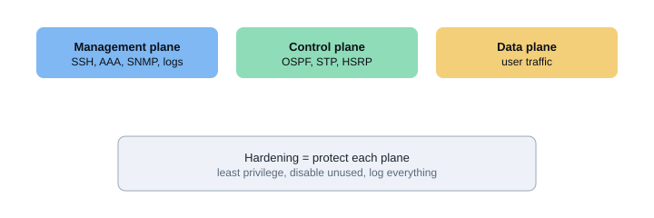

*شکل ۱: سه صفحه‌ی دستگاه و هدف Hardening.*

| صفحه       | کار                   | خطر                      | کنترل                           |
|------------|-----------------------|--------------------------|---------------------------------|
| Management | ورود ادمین، SNMP، Log | دسترسی غیرمجاز           | SSH، ACL، AAA، رمز قوی          |
| Control    | OSPF، STP، HSRP       | تزریق مسیر/Root جعلی     | Authentication، BPDU/Root Guard |
| Data       | ترافیک کاربران        | اسکن، Spoofing، Flooding | ACL، Port Security، Snooping    |

### ۲. چک‌لیست Management Plane

``` text
! 1. strong local credentials, hashed
enable secret <SECRET>
username admin privilege 15 secret <PASSWORD>
service password-encryption
no enable password

! 2. SSH only, version 2, key >= 2048
ip domain-name lab.local
crypto key generate rsa modulus 2048
ip ssh version 2
ip ssh time-out 60
ip ssh authentication-retries 3
line vty 0 4
 transport input ssh
 login local
 exec-timeout 10 0
 access-class MGMT-ONLY in
line console 0
 exec-timeout 10 0
 logging synchronous

! 3. brute-force protection
login block-for 120 attempts 5 within 60
login on-failure log
login on-success log

! 4. banners
banner login # Authorized access only #

! 5. turn off unneeded management
no ip http server
no ip http secure-server
no service pad
no service finger
no ip bootp server
```

- `service password-encryption`: رمزهای Type 7 را مخفی می‌کند ولی ضعیف است؛ رمز واقعی را فقط با `secret` بگذارید.
- `login block-for`: بعد از ۵ تلاش ناموفق در ۶۰ ثانیه، ۱۲۰ ثانیه ورود بسته می‌شود.
- `no ip http server`: وب‌مدیریت بدون نیاز را می‌بندد.

> **هشدار**
>
> رمز واقعی را در ریپو نگذارید (جانگهدار). و قبل از اعمال ACL/تغییر VTY از راه دور، `reload in 5` بگذارید تا قفل نشوید (درس ۲-۴).

### ۳. چک‌لیست Control Plane

``` text
! Layer 2
spanning-tree mode rapid-pvst
spanning-tree portfast bpduguard default
spanning-tree guard root     (on edge facing ports)

! Neighbor discovery: only where needed
no cdp run                   (or: no cdp enable on user-facing ports)
lldp run                     (only on trusted links)

! Routing: passive interfaces and authentication
router ospf 1
 passive-interface default
 no passive-interface gi0/1
interface gi0/1
 ip ospf authentication message-digest
 ip ospf message-digest-key 1 md5 <OSPF-KEY>
```

CDP/LLDP اطلاعات دستگاه (نام، IP، Image) را برای هر همسایه می‌گوید. روی پورت‌های کاربر باید خاموش باشد، چون مهاجم اطلاعات ارزشمند می‌گیرد.

### ۴. چک‌لیست Data Plane

``` text
! unused access ports: shut down and park in an unused VLAN
interface range gi0/10 - 24
 switchport mode access
 switchport access vlan 999
 shutdown

! disable negotiation, avoid VLAN hopping
interface range gi0/1 - 24
 switchport nonegotiate

! trunks: explicit native + allowed
interface gi0/0
 switchport trunk native vlan 999
 switchport trunk allowed vlan 10,20,50

! anti-spoofing basics
no ip source-route
no ip proxy-arp     (on user-facing interfaces)
no ip redirects
no ip unreachables  (on untrusted interfaces)
```

«VLAN 999 بدون استفاده» جای پارک پورت‌های خالی است؛ حتی اگر کسی کابل بزند، به شبکه‌ی خالی می‌رسد.

### ۵. مثال‌ها

#### ساده: بستن وب‌مدیریت

``` text
Core# show ip http server status
HTTP server status: Enabled
Core(config)# no ip http server
```

#### متوسط: پورت‌های خالی

``` text
Before: 18 unused ports, all in VLAN 1, no shutdown (open door)
After : shutdown + VLAN 999 for all unused ports
```

#### سخت: کنترل خودکار

``` text
Compare each device against the golden baseline:
  show running-config | include http|telnet|cdp|snmp
Any deviation = finding; record it and fix with a CHG.
```

> **صادقانه**
>
> بعضی دستورها (مثل `login block-for` یا `service-policy`) روی Imageهای شبیه‌ساز ممکن است محدود باشند. نتیجه‌ی واقعی را ثبت کنید و در تجهیز واقعی تکرار کنید.

### تمرین‌ها

**ت1.** ۱ (ساده): سه صفحه‌ی دستگاه؟ *(پاسخ: 8-1-ت1 در بخش «پاسخ‌ها» انتهای فصل)*

**ت2.** ۲ (ساده): چرا no ip http server؟ *(پاسخ: 8-1-ت2 در بخش «پاسخ‌ها» انتهای فصل)*

**ت3.** ۳ (متوسط): چرا پورت‌های خالی shutdown و VLAN 999؟ *(پاسخ: 8-1-ت3 در بخش «پاسخ‌ها» انتهای فصل)*

**ت4.** ۴ (متوسط): چرا CDP روی پورت کاربر خاموش؟ *(پاسخ: 8-1-ت4 در بخش «پاسخ‌ها» انتهای فصل)*

**ت5.** ۵ (سخت): قبل از Hardening VTY از راه دور چه شبکه‌ی ایمنی می‌گذاریم؟ *(پاسخ: 8-1-ت5 در بخش «پاسخ‌ها» انتهای فصل)*

### Lab هدایت‌شده

یک دستگاه (مثلاً Core-1) را با چک‌لیست سخت‌سازی کنید، مرحله‌ای و با بکاپ:

#### گام ۱: بکاپ و Baseline

``` text
Core-1# copy running-config flash:Core1-before-hardening.cfg
Core-1# show running-config | include http|telnet|cdp|snmp|password
```

#### گام ۲: Management Plane

بخش ۲ را اعمال کنید (با `reload in 5`).

#### گام ۳: Control/Data Plane

بخش‌های ۳ و ۴ را اعمال و `reload cancel` کنید.

#### گام ۴: بازبینی

``` text
Core-1# show running-config | include http|telnet|cdp|password
Core-1# show ip ssh
Core-1# show login
```

### Lab مستقل

«Hardening Baseline» (چک‌لیست ≥ ۲۰ بند با Verification) را در `03-ops/hardening-baseline.md` بنویسید.

### عیب‌یابی

|         |                                                                                                               |
|---------|---------------------------------------------------------------------------------------------------------------|
| Symptom | بعد از Hardening دسترسی SSH قطع شد                                                                            |
| چک‌لیست  | ۱) ACL VTY شامل آدرس شما؟ ؛ ۲) transport input ssh؟ ؛ ۳) کلید RSA و نام‌کاربری؟ ؛ ۴) login block-for فعال شده؟ |
| رفع     | از Console وارد شوید و اصلاح کنید یا reload in منتظر بماند                                                    |
| پیشگیری | بکاپ + reload in                                                                                              |

### سؤال‌های مرور

**م1.** Hardening چیست؟ *(پاسخ: 8-1-م1 در بخش «پاسخ‌ها» انتهای فصل)*

**م2.** چرا Management Plane مهم‌ترین است؟ *(پاسخ: 8-1-م2 در بخش «پاسخ‌ها» انتهای فصل)*

### English Corner: انگلیسی تخصصی این درس

این جمله‌ها از مستندات و محیط کار واقعی‌اند. بلند بخوانید و ترجمه را بپوشانید.

| English sentence                                       | ترجمه                                                       |
|--------------------------------------------------------|-------------------------------------------------------------|
| Disable all unused services and ports.                 | همه‌ی سرویس‌ها و پورت‌های بلااستفاده را غیرفعال کنید.          |
| Restrict management access to a dedicated subnet.      | دسترسی مدیریتی را به یک Subnet اختصاصی محدود کنید.          |
| Use secret instead of password for stored credentials. | برای رمزهای ذخیره‌شده به‌جای password از secret استفاده کنید. |
| Compare every device against a hardening baseline.     | هر دستگاه را با Baseline سخت‌سازی مقایسه کنید.               |

**Q1.** Quick quiz (answer in English): Why is "enable secret" preferred over "enable password"? *(پاسخ: 8-1-Q1 در بخش «پاسخ‌ها» انتهای فصل)*

### تکلیف و چک‌لیست تسلط

- [ ] Hardening را روی یک دستگاه اجرا و Verify کنم.
- [ ] Baseline را بنویسم.
- [ ] بکاپ قبل/بعد را نگه دارم.

### یادآوری اشتباهات شما

> **یادآوری**
>
> پیش‌بینی قبل از اجرا؛ بکاپ قبل از تغییر؛ پذیرفته‌شدن دستور ≠ کار کردن؛ فرمول‌ها در بلوک مستقل.


#### کارت Lab — Hardening تجهیزات

| # | فیلد | محتوا |
|---|---|---|
| 1 | عنوان و هدف | Hardening سه صفحه‌ی دستگاه |
| 2 | پیش‌نیاز | فصل 7 |
| 3 | توپولوژی | Core-1 |
| 4 | تجهیزات | Core-1 |
| 5 | نسخه نرم‌افزار | vIOS-L2 15.2(20200924، Experimental) برای SW؛ vIOS 15.9(3)M9 برای R؛ VPCS؛ PNetLab 4.2.8 |
| 6 | IP Plan | Baseline |
| 7 | وضعیت اولیه | چک‌لیست |
| 8 | صورت مسئله | Verify |
| 9 | مراحل هدایت‌شده | همان بخش «Lab هدایت‌شده» همین درس |
| 10 | تست عملکرد | `show running-config \| include http\|telnet` |
| 11 | سناریوی خرابی | قفل شدن از VTY |
| 12 | روش عیب‌یابی | لایه‌ای/با شواهد (بخش عیب‌یابی همین درس) |
| 13 | نتیجه‌ی مورد انتظار | بدون http/telnet |
| 14 | معیار پذیرش | Baseline Hardening |
| 15 | مستندات نهایی | `03-ops/hardening-baseline.md` |
| 16 | Cleanup و بازگردانی | reload cancel |

> **وضعیت راستی‌آزمایی (خارج از ۱۶ فیلد):** **اجرا نشده (فقط طراحی).** اجرا نشده.

---

<a id="l-8-2"></a>

## درس 8-2 — AAA و سطح‌های دسترسی

**فصل ۸ - روز ۲ · پیش‌نیاز: درس ۸-۱ · ۶ ساعت**

### این درس درباره چیست و چرا باید یاد بگیریم؟

**چه چیزی یاد می‌گیریم:** کنترل «چه کسی، چه کاری، چه زمانی» روی دستگاه: AAA (احراز هویت، مجوز، حسابداری)، سطح‌های دسترسی (Privilege Level)، و مفهوم TACACS+ و RADIUS.

**چرا لازم است:** اگر همه‌ی ادمین‌ها یک رمز مشترک بدانند، نمی‌توانید بگویید «چه کسی این تغییر را داد». AAA هر ادمین را جدا می‌شناسد، دسترسی را به نیاز او محدود می‌کند (Least Privilege) و ثبت می‌کند چه دستوری زد.

- **در کار روزانه:** کارمند کمک‌حال فقط show می‌بیند؛ ارشد تنظیم می‌کند.
- **در امنیت:** مسئولیت‌پذیری (Accountability) و اصل Least Privilege.
- **در Capstone:** Admin FortiGate هم با Profile و Trusted Host همین منطق را دارد.

> **مسیر درس**
>
> سه A ← Local AAA ← Privilege Level ← TACACS+ و RADIUS ← مثال ساده/متوسط/سخت ← Lab ← عیب‌یابی.

#### اصطلاحات این درس (مخفف ← شکل کامل ← معنی)

| مخفف      | شکل کامل انگلیسی                                      | معنی فارسی                              |
|-----------|-------------------------------------------------------|-----------------------------------------|
| AAA       | Authentication, Authorization, Accounting             | احراز هویت، مجوز، حسابداری              |
| TACACS+   | Terminal Access Controller Access-Control System Plus | پروتکل AAA سیسکو برای مدیریت دستگاه     |
| RADIUS    | Remote Authentication Dial-In User Service            | پروتکل AAA برای دسترسی شبکه             |
| Privilege | Privilege level                                       | سطح دسترسی 0 تا 15                      |
| RBAC      | Role-Based Access Control                             | دسترسی بر اساس نقش                      |
| Fallback  | Fallback                                              | روش جایگزین وقتی سرور AAA در دسترس نیست |

### ۱. سه A

| حرف            | معنی       | سؤال                     |
|----------------|------------|--------------------------|
| Authentication | احراز هویت | تو کیستی؟                |
| Authorization  | مجوز       | چه کاری مجازی انجام دهی؟ |
| Accounting     | حسابداری   | چه کاری انجام دادی؟      |

مثال: ورود به ساختمان: کارت (هویت)، دسترسی فقط به طبقه‌ی خودت (مجوز)، و دفتر ورود و خروج (ثبت).

### ۲. Local AAA (بدون سرور)

``` text
R1(config)# username netadmin privilege 15 secret <PASSWORD1>
R1(config)# username helpdesk privilege 5 secret <PASSWORD2>
R1(config)# aaa new-model
R1(config)# aaa authentication login default local
R1(config)# aaa authorization exec default local
R1(config)# aaa accounting exec default start-stop group tacacs+
R1(config)# line vty 0 4
R1(config-line)# login authentication default
```

> **هشدار قفل‌شدن**
>
> `aaa new-model` رفتار ورود را عوض می‌کند. قبل از آن حتماً یک کاربر محلی بسازید، با `reload in 5` کار کنید، و همیشه یک روش Fallback (Local) بگذارید.

### ۳. سطح‌های دسترسی (Privilege Level)

| سطح        | معنی                              |
|------------|-----------------------------------|
| 0          | دستورهای حداقلی (logout، exit...) |
| 1          | User EXEC (مشاهده‌ی محدود)         |
| 5 (سفارشی) | مثلاً show و ping برای کمک‌حال      |
| 15         | دسترسی کامل (Privileged EXEC)     |

``` text
R1(config)# privilege exec level 5 show running-config
R1(config)# privilege exec level 5 show ip interface brief
R1(config)# privilege exec level 5 ping
R1(config)# privilege exec level 5 traceroute
```

کاربر helpdesk با سطح ۵ فقط دستورهایی که به سطح ۵ داده‌اید را می‌بیند. راه امن‌تر و مدرن‌تر: Role-Based CLI (Parser View).

### ۴. TACACS+ و RADIUS

به‌جای ساختن کاربر روی ۵۰ دستگاه، یک سرور مرکزی کاربران را نگه می‌دارد؛ دستگاه از سرور می‌پرسد.

| ویژگی                              | TACACS+       | RADIUS             |
|------------------------------------|---------------|--------------------|
| سازنده                             | سیسکو         | استاندارد          |
| پورت                               | TCP 49        | UDP 1812/1813      |
| رمزگذاری                           | کل بسته       | فقط رمز            |
| مجوز دستور (Command Authorization) | بله، دقیق     | محدود              |
| کاربرد معمول                       | مدیریت دستگاه | VPN، Wi-Fi، 802.1X |

``` text
R1(config)# tacacs server TAC1
R1(config-server-tacacs)# address ipv4 10.10.10.70
R1(config-server-tacacs)# key <TACACS-KEY>
R1(config)# aaa group server tacacs+ TAC-GRP
R1(config-sg-tacacs+)# server name TAC1
R1(config)# aaa authentication login default group TAC-GRP local
R1(config)# aaa authorization exec default group TAC-GRP local
```

ترتیب در انتها یعنی: اول سرور، اگر در دسترس نبود Local (Fallback). این دستورها نیاز به سرور واقعی دارند؛ در Lab فقط ساخت و مفهوم را می‌بینیم و بعداً در FortiGate با RADIUS/LDAP کار می‌کنیم.

### ۵. مثال‌ها

#### ساده

``` text
Two users: netadmin (priv 15) and helpdesk (priv 5)
helpdesk logs in via SSH and can only run show and ping
```

#### متوسط: ثبت فعالیت

``` text
Accounting on: every exec session and command is logged to the AAA server
Audit question "who changed the ACL at 14:05?" is answerable
```

#### سخت: سرور AAA از کار افتاد

``` text
Config: group TAC-GRP local
TAC server down  -> login falls back to the local user (still works)
Without "local" -> everyone is locked out (only console recovery)
```

### تمرین‌ها

**ت1.** ۱ (ساده): سه A؟ *(پاسخ: 8-2-ت1 در بخش «پاسخ‌ها» انتهای فصل)*

**ت2.** ۲ (ساده): TACACS+ چه پورتی؟ *(پاسخ: 8-2-ت2 در بخش «پاسخ‌ها» انتهای فصل)*

**ت3.** ۳ (متوسط): چرا Local را Fallback می‌گذاریم؟ *(پاسخ: 8-2-ت3 در بخش «پاسخ‌ها» انتهای فصل)*

**ت4.** ۴ (متوسط): Privilege 15 یعنی؟ *(پاسخ: 8-2-ت4 در بخش «پاسخ‌ها» انتهای فصل)*

**ت5.** ۵ (سخت): TACACS+ در برابر RADIUS برای مدیریت دستگاه؟ *(پاسخ: 8-2-ت5 در بخش «پاسخ‌ها» انتهای فصل)*

### Lab هدایت‌شده

#### گام ۱: بکاپ و شبکه‌ی ایمنی

``` text
R1# copy running-config flash:R1-before-aaa.cfg
R1# reload in 10
```

#### گام ۲: کاربران و AAA محلی

بخش ۲ را اجرا کنید.

#### گام ۳: تست

از R2 با `ssh -l helpdesk` وارد شوید و ببینید فقط دستورهای سطح ۵ کار می‌کنند. با netadmin وارد شوید و تنظیم بزنید.

#### گام ۴: برداشتن reload

``` text
R1# reload cancel
R1# copy running-config startup-config
```

### Lab مستقل

یک «Access Matrix» (نقش‌ها، سطح، دستورها، دستگاه‌ها) در `03-ops/access-matrix.md` بنویسید.

### عیب‌یابی

|         |                                                                                                    |
|---------|----------------------------------------------------------------------------------------------------|
| Symptom | بعد از aaa new-model هیچ‌کس وارد نمی‌شود                                                             |
| چک‌لیست  | ۱) کاربر محلی وجود دارد؟ ؛ ۲) login authentication روی VTY؟ ؛ ۳) Fallback؟ ؛ ۴) سرور AAA در دسترس؟ |
| رفع     | Console + اصلاح؛ یا انتظار برای reload in                                                          |
| پیشگیری | همیشه شبکه‌ی ایمنی                                                                                  |

### سؤال‌های مرور

**م1.** Authorization چیست؟ *(پاسخ: 8-2-م1 در بخش «پاسخ‌ها» انتهای فصل)*

**م2.** چرا Accounting؟ *(پاسخ: 8-2-م2 در بخش «پاسخ‌ها» انتهای فصل)*

### English Corner: انگلیسی تخصصی این درس

این جمله‌ها از مستندات و محیط کار واقعی‌اند. بلند بخوانید و ترجمه را بپوشانید.

| English sentence                                                 | ترجمه                                                       |
|------------------------------------------------------------------|-------------------------------------------------------------|
| AAA controls who can log in, what they can do and what they did. | AAA تعیین می‌کند چه کسی وارد شود، چه کاری کند و چه کرده است. |
| Configure a local fallback in case the AAA server is down.       | برای زمانی که سرور AAA قطع است Fallback محلی بگذارید.       |
| Apply least privilege to each role.                              | برای هر نقش اصل حداقل دسترسی را رعایت کنید.                 |
| TACACS+ encrypts the entire payload.                             | TACACS+ کل بار بسته را رمز می‌کند.                           |

**Q1.** Quick quiz (answer in English): What happens if you configure AAA with no local fallback and the server is down? *(پاسخ: 8-2-Q1 در بخش «پاسخ‌ها» انتهای فصل)*

### تکلیف و چک‌لیست تسلط

- [ ] AAA محلی را با دو سطح بسازم.
- [ ] Fallback را توضیح دهم.
- [ ] Access Matrix را بنویسم.

### یادآوری اشتباهات شما

> **یادآوری**
>
> پیش‌بینی قبل از اجرا؛ بکاپ قبل از تغییر؛ پذیرفته‌شدن دستور ≠ کار کردن؛ فرمول‌ها در بلوک مستقل.


#### کارت Lab — AAA و سطح‌های دسترسی

| # | فیلد | محتوا |
|---|---|---|
| 1 | عنوان و هدف | AAA محلی و Privilege |
| 2 | پیش‌نیاز | درس 8-1 |
| 3 | توپولوژی | R1 |
| 4 | تجهیزات | R1،R2 |
| 5 | نسخه نرم‌افزار | vIOS-L2 15.2(20200924، Experimental) برای SW؛ vIOS 15.9(3)M9 برای R؛ VPCS؛ PNetLab 4.2.8 |
| 6 | IP Plan | — |
| 7 | وضعیت اولیه | دو کاربر |
| 8 | صورت مسئله | ورود helpdesk |
| 9 | مراحل هدایت‌شده | همان بخش «Lab هدایت‌شده» همین درس |
| 10 | تست عملکرد | `show privilege` |
| 11 | سناریوی خرابی | بدون fallback |
| 12 | روش عیب‌یابی | لایه‌ای/با شواهد (بخش عیب‌یابی همین درس) |
| 13 | نتیجه‌ی مورد انتظار | دسترسی سطحی |
| 14 | معیار پذیرش | Access Matrix |
| 15 | مستندات نهایی | `03-ops/access-matrix.md` |
| 16 | Cleanup و بازگردانی | reload cancel |

> **وضعیت راستی‌آزمایی (خارج از ۱۶ فیلد):** **اجرا نشده (فقط طراحی).** اجرا نشده.

---

<a id="l-8-3"></a>

## درس 8-3 — JSON، YAML و REST

**فصل ۸ - روز ۳ · پیش‌نیاز: فصل ۷ · ۶ ساعت**

### این درس درباره چیست و چرا باید یاد بگیریم؟

**چه چیزی یاد می‌گیریم:** زبان مشترک اتوماسیون: JSON و YAML، مفهوم REST API (متدها و کدهای وضعیت)، و ابزار curl؛ همراه با تمرین خواندن داده‌ی ساختاریافته.

**چرا لازم است:** دستگاه‌ها و سرویس‌های امروزی (FortiGate، Zabbix، Ansible، ابزارهای ابری) همه با API و JSON صحبت می‌کنند. اگر نتوانید JSON بخوانید و یک درخواست API بفرستید، از بخش بزرگی از کار مدرن بیرون می‌مانید.

- **در کار روزانه:** API فایروال برای گرفتن لیست Policy یا اضافه‌کردن Object.
- **در امنیت:** اتوماسیون ایمن (Token، Least Privilege) و جلوگیری از افشای رمز.
- **در FortiGate:** REST API فایروال با Token (W9 به بعد).

> **مسیر درس**
>
> داده ساختاریافته ← JSON ← YAML ← REST ← curl ← مثال ساده/متوسط/سخت ← Lab ← عیب‌یابی.

#### اصطلاحات این درس (مخفف ← شکل کامل ← معنی)

| مخفف     | شکل کامل انگلیسی                  | معنی فارسی                     |
|----------|-----------------------------------|--------------------------------|
| JSON     | JavaScript Object Notation        | قالب داده‌ی کلید-مقدار          |
| YAML     | YAML Ain't Markup Language        | قالب خوانای انسان برای تنظیمات |
| API      | Application Programming Interface | رابط برنامه‌نویسی               |
| REST     | Representational State Transfer   | سبک API مبتنی بر HTTP          |
| HTTP     | HyperText Transfer Protocol       | پروتکل وب                      |
| Token    | API token                         | کلید دسترسی به API             |
| Endpoint | API endpoint                      | آدرس یک منبع API               |
| jq       | jq                                | ابزار خط فرمان برای JSON       |

### ۱. چرا داده «ساختاریافته»؟

خروجی `show ip interface brief` برای انسان خوانا و برای برنامه دشوار است؛ باید ستون‌ها را جدا کرد و هر نسخه فرق می‌کند. اگر دستگاه همین اطلاعات را به‌صورت «کلید و مقدار» بدهد، برنامه مستقیم می‌خواند.

### ۲. JSON

JSON از دو ساختار ساخته می‌شود: شیء (Object) داخل آکولاد و آرایه (Array) داخل کروشه. مقدارها: رشته، عدد، true/false، null:

``` text
{
  "hostname": "R1",
  "interfaces": [
    { "name": "Gi0/0", "ip": "10.0.12.1", "status": "up" },
    { "name": "Gi0/1", "ip": null,        "status": "down" }
  ],
  "ospf_enabled": true,
  "uptime_days": 42
}
```

خواندن: `hostname` کلید است و `"R1"` مقدار. `interfaces` آرایه‌ای از دو شیء است. قواعد: کلیدها با دابل‌کوتیشن، بین عناصر ویرگول، بدون ویرگول آخر.

``` text
Path examples:
  hostname            -> "R1"
  interfaces[0].ip    -> "10.0.12.1"
  interfaces[1].status-> "down"
```

### ۳. YAML

همان داده، بدون آکولاد، با تورفتگی (فاصله‌ها، نه Tab):

``` text
hostname: R1
interfaces:
  - name: Gi0/0
    ip: 10.0.12.1
    status: up
  - name: Gi0/1
    ip: null
    status: down
ospf_enabled: true
uptime_days: 42
```

> **قانون YAML**
>
> تورفتگی معنی دارد. دو فاصله برای هر سطح؛ هرگز Tab. یک فاصله‌ی اضافه ساختار را خراب می‌کند. Ansible با YAML کار می‌کند.

### ۴. REST API و HTTP

REST یعنی هر «منبع» (مثلاً یک Interface) یک آدرس (URL) دارد و با متدهای HTTP روی آن کار می‌کنیم:

| متد    | کار           | مثال             |
|--------|---------------|------------------|
| GET    | خواندن        | لیست Interfaceها |
| POST   | ساختن         | Object جدید      |
| PUT    | جایگزینی کامل | به‌روزرسانی کامل  |
| PATCH  | تغییر جزئی    | یک فیلد          |
| DELETE | حذف           | حذف Object       |

| کد وضعیت | معنی            |
|----------|-----------------|
| 200      | موفق            |
| 201      | ساخته شد        |
| 400      | درخواست نامعتبر |
| 401      | احراز هویت نشده |
| 403      | دسترسی ممنوع    |
| 404      | یافت نشد        |
| 500      | خطای سرور       |

### ۵. curl و jq

ابزار خط فرمان برای ارسال درخواست HTTP. در Lab ما، سرویس API لوکال و Token نمونه استفاده می‌شود (بدون رمز واقعی):

``` text
# GET request with a token header (token comes from an environment variable)
curl -s -H "Authorization: Bearer $LAB_TOKEN" https://10.10.10.80/api/v2/monitor/system/status

# pretty print and pick a field with jq
curl -s -H "Authorization: Bearer $LAB_TOKEN" https://10.10.10.80/api/v2/monitor/system/status | jq ".results.hostname"

# POST a JSON body
curl -s -X POST -H "Content-Type: application/json" -d "{\"name\":\"web1\"}" https://10.10.10.80/api/v2/cmdb/firewall/address
```

> **امنیت**
>
> Token را در دستور یا فایل ذخیره‌شده در Git ننویسید؛ از متغیر محیطی یا مدیر رمز استفاده کنید. `-k` (نادیده‌گرفتن Certificate) فقط در Lab و با علم به خطر.

### ۶. مثال‌ها

#### ساده: خواندن JSON

``` text
From the JSON above: what is the IP of Gi0/0?  -> 10.0.12.1
```

#### متوسط: تبدیل به YAML

همان شیء Gi0/1 را به YAML بنویسید (بخش ۳).

#### سخت: خطای 401

``` text
curl returns HTTP 401
Causes: missing/expired token, wrong header name, wrong scheme (Bearer vs api_key),
        token tied to a different source IP (trusted host)
Do not retry blindly: fix auth first
```

### تمرین‌ها

**ت1.** ۱ (ساده): تفاوت Object و Array؟ *(پاسخ: 8-3-ت1 در بخش «پاسخ‌ها» انتهای فصل)*

**ت2.** ۲ (ساده): GET چه می‌کند؟ *(پاسخ: 8-3-ت2 در بخش «پاسخ‌ها» انتهای فصل)*

**ت3.** ۳ (متوسط): کد 403 یعنی؟ *(پاسخ: 8-3-ت3 در بخش «پاسخ‌ها» انتهای فصل)*

**ت4.** ۴ (متوسط): چرا YAML با Tab خراب می‌شود؟ *(پاسخ: 8-3-ت4 در بخش «پاسخ‌ها» انتهای فصل)*

**ت5.** ۵ (سخت): چرا Token در Git ممنوع؟ *(پاسخ: 8-3-ت5 در بخش «پاسخ‌ها» انتهای فصل)*

### Lab هدایت‌شده

این Lab روی لپ‌تاپ/VM شماست و به تجهیزات دست نمی‌زند.

#### گام ۱: فایل JSON بسازید

با یک ویرایشگر، JSON بخش ۲ را در `interfaces.json` ذخیره کنید.

#### گام ۲: خواندن با jq

``` text
jq ".hostname" interfaces.json
jq ".interfaces[].name" interfaces.json
jq ".interfaces[] | select(.status==\"down\")" interfaces.json
```

#### گام ۳: تبدیل به YAML

همان داده را دستی به YAML بنویسید و با یک ابزار آنلاین/محلی اعتبارسنجی کنید.

#### گام ۴: درخواست API آزمایشی

اگر API لوکال ندارید، با یک سرویس عمومی تست (مثلاً یک API نمونه) یک GET بزنید و کد وضعیت را بخوانید؛ بعداً با FortiGate تکرار می‌کنیم.

### Lab مستقل

سه خروجی show را (دستی) به JSON ساختاریافته تبدیل کنید و در `04-automation/data-samples/` ذخیره کنید.

### عیب‌یابی

|         |                                                         |
|---------|---------------------------------------------------------|
| Symptom | JSON خطای Parse می‌دهد                                   |
| چک‌لیست  | ۱) دابل‌کوتیشن؟ ؛ ۲) ویرگول آخر؟ ؛ ۳) آکولاد/کروشه بسته؟ |
| ابزار   | jq ، validator                                          |
| رفع     | اصلاح دستور نگارشی                                      |

### سؤال‌های مرور

**م1.** REST چیست؟ *(پاسخ: 8-3-م1 در بخش «پاسخ‌ها» انتهای فصل)*

**م2.** چرا YAML برای Ansible؟ *(پاسخ: 8-3-م2 در بخش «پاسخ‌ها» انتهای فصل)*

### English Corner: انگلیسی تخصصی این درس

این جمله‌ها از مستندات و محیط کار واقعی‌اند. بلند بخوانید و ترجمه را بپوشانید.

| English sentence                                             | ترجمه                                           |
|--------------------------------------------------------------|-------------------------------------------------|
| The API returns the data in JSON format.                     | API داده را به قالب JSON برمی‌گرداند.            |
| Send a GET request with the authorization header.            | یک درخواست GET با هدر Authorization بفرستید.    |
| The server responded with HTTP 401, so the token is invalid. | سرور HTTP 401 داد، پس Token نامعتبر است.        |
| Keep tokens in environment variables, not in the repository. | Tokenها را در متغیر محیطی نگه دارید نه در ریپو. |

**Q1.** Quick quiz (answer in English): What is the difference between PUT and PATCH? *(پاسخ: 8-3-Q1 در بخش «پاسخ‌ها» انتهای فصل)*

### تکلیف و چک‌لیست تسلط

- [ ] JSON را بخوانم و بنویسم.
- [ ] YAML را بنویسم.
- [ ] curl/jq را تمرین کنم.

### یادآوری اشتباهات شما

> **یادآوری**
>
> پیش‌بینی قبل از اجرا؛ بکاپ قبل از تغییر؛ پذیرفته‌شدن دستور ≠ کار کردن؛ فرمول‌ها در بلوک مستقل.


#### کارت Lab — JSON، YAML و REST

| # | فیلد | محتوا |
|---|---|---|
| 1 | عنوان و هدف | JSON/YAML/REST |
| 2 | پیش‌نیاز | درس 8-2 |
| 3 | توپولوژی | PC |
| 4 | تجهیزات | PC شما |
| 5 | نسخه نرم‌افزار | vIOS-L2 15.2(20200924، Experimental) برای SW؛ vIOS 15.9(3)M9 برای R؛ VPCS؛ PNetLab 4.2.8 |
| 6 | IP Plan | — |
| 7 | وضعیت اولیه | نمونه فایل |
| 8 | صورت مسئله | jq |
| 9 | مراحل هدایت‌شده | همان بخش «Lab هدایت‌شده» همین درس |
| 10 | تست عملکرد | `jq` |
| 11 | سناریوی خرابی | Parse error |
| 12 | روش عیب‌یابی | لایه‌ای/با شواهد (بخش عیب‌یابی همین درس) |
| 13 | نتیجه‌ی مورد انتظار | خواندن مقدار |
| 14 | معیار پذیرش | نمونه‌ها |
| 15 | مستندات نهایی | `04-automation/data-samples/` |
| 16 | Cleanup و بازگردانی | — |

> **وضعیت راستی‌آزمایی (خارج از ۱۶ فیلد):** **اجرا نشده (فقط طراحی).** روی PC شما؛ اجرا نشده.

---

<a id="l-8-4"></a>

## درس 8-4 — Python و Netmiko

**فصل ۸ - روز ۴ · پیش‌نیاز: درس‌های ۸-۱ و ۸-۳ · ۶ ساعت**

### این درس درباره چیست و چرا باید یاد بگیریم؟

**چه چیزی یاد می‌گیریم:** نوشتن یک اسکریپت Python با کتابخانه‌ی Netmiko که به چند دستگاه با SSH وصل شود، فقط دستورهای مشاهده (`show`) اجرا کند و پیکربندی را بکاپ بگیرد؛ بدون ذخیره‌ی رمز در کد.

**چرا لازم است:** گرفتن بکاپ از ۵۰ سوییچ به‌صورت دستی ساعت‌ها طول می‌کشد و فراموش می‌شود. یک اسکریپت ساده همین کار را در دقیقه‌ها و هر شب انجام می‌دهد و یک «تاریخچه‌ی تغییرات» می‌سازد. این اولین قدم عملی اتوماسیون است و ریسکش (چون فقط read است) پایین است.

- **در کار روزانه:** بکاپ شبانه و گزارش Inventory.
- **در امنیت:** اسکریپت اشتباه می‌تواند همه‌ی دستگاه‌ها را همزمان خراب کند؛ برای همین فقط read-only و تست روی یک دستگاه.
- **در Capstone:** بکاپ خودکار Config همه‌ی تجهیزات در Git.

> **مسیر درس**
>
> چرا Netmiko ← محیط امن ← اسکریپت قدم‌به‌قدم ← خطاها ← مثال ساده/متوسط/سخت ← Lab ← عیب‌یابی.

#### اصطلاحات این درس (مخفف ← شکل کامل ← معنی)

| مخفف                 | شکل کامل انگلیسی           | معنی فارسی                                |
|----------------------|----------------------------|-------------------------------------------|
| Python               | Python                     | زبان برنامه‌نویسی                          |
| Netmiko              | Netmiko                    | کتابخانه‌ی Python برای SSH به تجهیزات شبکه |
| venv                 | Python virtual environment | محیط جدا برای بسته‌ها                      |
| Idempotent           | Idempotent                 | اجرای چندباره = نتیجه‌ی یکسان              |
| Read-only            | Read-only                  | فقط خواندن؛ بدون تغییر                    |
| Inventory            | Device inventory           | فهرست دستگاه‌ها                            |
| Environment variable | Environment variable       | متغیر محیطی برای نگه‌داری رمز              |

### ۱. ایده

Netmiko یک «کاربر خودکار» است: با SSH وارد دستگاه می‌شود، دستور می‌زند و خروجی را برمی‌گرداند.

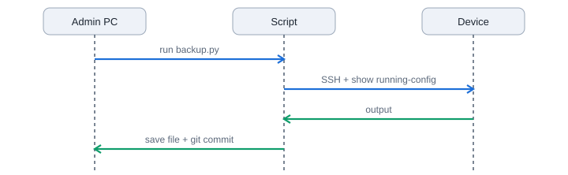

*شکل ۱: اسکریپت با SSH به دستگاه وصل می‌شود، show می‌زند و خروجی را ذخیره می‌کند.*

### ۲. آماده‌سازی محیط (روی PC/VM شما)

این دستورها را شما روی دستگاه خودتان اجرا می‌کنید (من فقط فرمان می‌دهم و به شبکه‌ی شما متصل نمی‌شوم):

``` text
python3 -m venv netauto
source netauto/bin/activate          # Windows: netauto\Scripts\activate
pip install netmiko
pip freeze > requirements.txt
```

رمز را در متغیر محیطی می‌گذاریم، نه در کد:

``` text
export NET_USER=netadmin
export NET_PASS='<your-password>'
# Windows PowerShell:  $env:NET_USER="netadmin"; $env:NET_PASS="<your-password>"
```

### ۳. Inventory

فایل `inventory.yaml` فقط آدرس‌ها و نوع دستگاه را دارد؛ رمز ندارد:

``` text
devices:
  - name: CORE-SW1
    host: 10.10.10.2
    device_type: cisco_ios
  - name: CORE-SW2
    host: 10.10.10.3
    device_type: cisco_ios
  - name: EDGE-R1
    host: 10.10.10.1
    device_type: cisco_ios
```

### ۴. اسکریپت (Read-only)

``` text
import os, sys, datetime, pathlib
import yaml
from netmiko import ConnectHandler
from netmiko.exceptions import NetmikoTimeoutException, NetmikoAuthenticationException

USER = os.environ.get("NET_USER")
PASS = os.environ.get("NET_PASS")
if not USER or not PASS:
    sys.exit("Set NET_USER and NET_PASS first")

# read-only: only show commands are allowed
ALLOWED = ("show ",)
COMMANDS = ["show running-config", "show version", "show ip interface brief"]
for c in COMMANDS:
    assert c.startswith(ALLOWED), "only show commands are allowed"

out_dir = pathlib.Path("backups")
out_dir.mkdir(exist_ok=True)
stamp = datetime.date.today().isoformat()

with open("inventory.yaml") as f:
    inventory = yaml.safe_load(f)["devices"]

for dev in inventory:
    params = {"device_type": dev["device_type"], "host": dev["host"],
              "username": USER, "password": PASS, "timeout": 20}
    try:
        with ConnectHandler(**params) as conn:
            for cmd in COMMANDS:
                text = conn.send_command(cmd)
                name = cmd.replace(" ", "_")
                (out_dir / f"{dev['name']}_{name}_{stamp}.txt").write_text(text)
        print(f"OK   {dev['name']}")
    except NetmikoTimeoutException:
        print(f"FAIL {dev['name']}: timeout")
    except NetmikoAuthenticationException:
        print(f"FAIL {dev['name']}: authentication")
    except Exception as e:
        print(f"FAIL {dev['name']}: {e}")
```

توضیح بخش‌ها:

- رمز از متغیر محیطی خوانده می‌شود، نه از کد.
- `ALLOWED`: اسکریپت فقط اجازه‌ی show دارد؛ اگر دستور دیگری اضافه شود برنامه می‌ایستد.
- `try/except`: خرابی یک دستگاه بقیه را متوقف نمی‌کند.
- فایل خروجی هر دستگاه و تاریخ دارد؛ در Git نگه‌داری می‌شود (درس ۸-۶).

### ۵. قبل از اجرا: چک‌لیست ایمنی

1.  اول روی **یک** دستگاه تست کنید.
2.  فقط دستورهای show.
3.  رمز در متغیر محیطی؛ فایل خروجی هم ممکن است Hash رمز داشته باشد؛ خروجی را در Git عمومی نگذارید.
4.  حد تعداد اتصال همزمان؛ در Lab ما یکی‌یکی.
5.  لاگ اجرا را نگه دارید.

### ۶. مثال‌ها

#### ساده: یک دستگاه

``` text
Inventory has 1 device -> script prints "OK CORE-SW1" and one file per command
```

#### متوسط: خطای SSH

``` text
FAIL CORE-SW2: timeout
Check: ping, SSH enabled, VTY ACL allows the automation host, route
```

#### سخت: تغییرات امن

وقتی بخواهید پیکربندی هم بزنید (`send_config_set`)، اول `--check` یا Dry-run، تغییر روی یک دستگاه، تأیید، بعد بقیه؛ و بکاپ قبل از تغییر. اتوماسیون خطا را سریع‌تر و گسترده‌تر پخش می‌کند.

> **دسترسی در PNetLab**
>
> گره‌های PNetLab به‌طور پیش‌فرض از بیرون SSH ندارند. یا مدیریت را به Lab وصل می‌کنید (VLAN10 مدیریت با آدرس قابل‌دسترس از VM اتوماسیون)، یا از `cisco_ios_telnet` روی پورت Console PNetLab استفاده می‌کنید. این تصمیم را قبل از اجرا با هم می‌گیریم؛ من به تجهیزات شما وصل نمی‌شوم.

### تمرین‌ها

**ت1.** ۱ (ساده): چرا رمز در متغیر محیطی؟ *(پاسخ: 8-4-ت1 در بخش «پاسخ‌ها» انتهای فصل)*

**ت2.** ۲ (ساده): read-only یعنی چه؟ *(پاسخ: 8-4-ت2 در بخش «پاسخ‌ها» انتهای فصل)*

**ت3.** ۳ (متوسط): چرا try/except؟ *(پاسخ: 8-4-ت3 در بخش «پاسخ‌ها» انتهای فصل)*

**ت4.** ۴ (متوسط): چرا اول روی یک دستگاه؟ *(پاسخ: 8-4-ت4 در بخش «پاسخ‌ها» انتهای فصل)*

**ت5.** ۵ (سخت): چه چیزی در خروجی show running-config حساس است؟ *(پاسخ: 8-4-ت5 در بخش «پاسخ‌ها» انتهای فصل)*

### Lab هدایت‌شده

این Lab روی PC/VM شماست؛ هر گام را خودتان اجرا و نتیجه را گزارش می‌کنید:

1.  محیط و بسته‌ها را بسازید (بخش ۲).
2.  `inventory.yaml` را با یک دستگاه بسازید.
3.  اسکریپت را اجرا کنید و فایل خروجی را ببینید.
4.  یک دستگاه را عمداً با آدرس اشتباه بگذارید و خطا را ببینید.
5.  سپس با ۳ دستگاه اجرا کنید.

### Lab مستقل

اسکریپت را به «گزارش Inventory» (hostname، Version، Interfaceهای down) گسترش دهید؛ بدون هیچ تغییر روی دستگاه. در `04-automation/backup.py` (بدون رمز) ذخیره کنید.

### عیب‌یابی

|         |                                                                        |
|---------|------------------------------------------------------------------------|
| Symptom | اسکریپت به دستگاه وصل نمی‌شود                                           |
| چک‌لیست  | ۱) ping؟ ؛ ۲) SSH روشن؟ ؛ ۳) ACL VTY؟ ؛ ۴) رمز/کاربر؟ ؛ ۵) device_type |
| ابزار   | ssh دستی ، debug Netmiko با session_log                                |
| رفع     | اصلاح اتصال                                                            |

### سؤال‌های مرور

**م1.** Netmiko چه می‌کند؟ *(پاسخ: 8-4-م1 در بخش «پاسخ‌ها» انتهای فصل)*

**م2.** چرا Read-only برای شروع؟ *(پاسخ: 8-4-م2 در بخش «پاسخ‌ها» انتهای فصل)*

### English Corner: انگلیسی تخصصی این درس

این جمله‌ها از مستندات و محیط کار واقعی‌اند. بلند بخوانید و ترجمه را بپوشانید.

| English sentence                                                    | ترجمه                                                     |
|---------------------------------------------------------------------|-----------------------------------------------------------|
| The script connects over SSH and saves the running configuration.   | اسکریپت با SSH وصل می‌شود و running-config را ذخیره می‌کند. |
| Store credentials in environment variables.                         | اعتبارنامه‌ها را در متغیر محیطی نگه دارید.                 |
| Test on a single device before running against the whole inventory. | قبل از اجرا روی کل Inventory روی یک دستگاه تست کنید.      |
| Handle exceptions so one failure does not stop the run.             | خطاها را مدیریت کنید تا یک شکست اجرا را متوقف نکند.       |

**Q1.** Quick quiz (answer in English): Why is a read-only script a safe first step in network automation? *(پاسخ: 8-4-Q1 در بخش «پاسخ‌ها» انتهای فصل)*

### تکلیف و چک‌لیست تسلط

- [ ] اسکریپت را روی یک دستگاه اجرا کنم.
- [ ] هیچ رمزی در کد یا ریپو نباشد.
- [ ] خروجی بکاپ را ذخیره کنم.

### یادآوری اشتباهات شما

> **یادآوری**
>
> پیش‌بینی قبل از اجرا؛ بکاپ قبل از تغییر؛ پذیرفته‌شدن دستور ≠ کار کردن؛ فرمول‌ها در بلوک مستقل.


#### کارت Lab — Python و Netmiko

| # | فیلد | محتوا |
|---|---|---|
| 1 | عنوان و هدف | Python/Netmiko بکاپ read-only |
| 2 | پیش‌نیاز | درس 8-3 |
| 3 | توپولوژی | PC + SW |
| 4 | تجهیزات | PC،SW |
| 5 | نسخه نرم‌افزار | vIOS-L2 15.2(20200924، Experimental) برای SW؛ vIOS 15.9(3)M9 برای R؛ VPCS؛ PNetLab 4.2.8 |
| 6 | IP Plan | SSH فعال |
| 7 | وضعیت اولیه | inventory.yaml |
| 8 | صورت مسئله | بکاپ |
| 9 | مراحل هدایت‌شده | همان بخش «Lab هدایت‌شده» همین درس |
| 10 | تست عملکرد | اجرای اسکریپت |
| 11 | سناریوی خرابی | timeout |
| 12 | روش عیب‌یابی | لایه‌ای/با شواهد (بخش عیب‌یابی همین درس) |
| 13 | نتیجه‌ی مورد انتظار | فایل بکاپ |
| 14 | معیار پذیرش | backup.py |
| 15 | مستندات نهایی | `04-automation/backup.py` |
| 16 | Cleanup و بازگردانی | — |

> **وضعیت راستی‌آزمایی (خارج از ۱۶ فیلد):** **اجرا نشده (فقط طراحی).** اجرا نشده؛ مسیر SSH به Node بررسی نشده.

---

<a id="l-8-5"></a>

## درس 8-5 — Ansible

**فصل ۸ - روز ۵ · پیش‌نیاز: درس‌های ۸-۳ و ۸-۴ · ۶ ساعت**

### این درس درباره چیست و چرا باید یاد بگیریم؟

**چه چیزی یاد می‌گیریم:** ابزار Ansible برای مدیریت پیکربندی چند دستگاه: Inventory، Playbook، ماژول‌های `ios_command` و `ios_config`، مفهوم Idempotency، و حالت‌های امن `--check` و `--diff`.

**چرا لازم است:** Python به شما آزادی کامل می‌دهد ولی همه‌چیز را خودتان باید بنویسید. Ansible تنظیمات را «توصیفی» می‌کند: بگویید «این Banner و این NTP روی همه‌ی ۵ دستگاه باشد»، و خودش فقط تفاوت‌ها را اعمال می‌کند. نتیجه یکنواختی تنظیمات و سرعت است.

- **در کار روزانه:** استقرار استاندارد (Banner، NTP، Syslog) روی ده‌ها دستگاه.
- **در امنیت:** Playbook = سند قابل‌بازبینی و Rollback؛ Vault برای رمزها.
- **در Capstone:** اعمال Baseline سخت‌سازی روی همه‌ی تجهیزات Cisco.

> **مسیر درس**
>
> چرا Ansible ← Inventory ← Playbook ← Idempotency ← Check/Diff ← مثال ساده/متوسط/سخت ← Lab ← عیب‌یابی.

#### اصطلاحات این درس (مخفف ← شکل کامل ← معنی)

| مخفف        | شکل کامل انگلیسی | معنی فارسی                 |
|-------------|------------------|----------------------------|
| Ansible     | Ansible          | ابزار اتوماسیون بدون Agent |
| Playbook    | Playbook         | فایل YAML مراحل کار        |
| Module      | Ansible module   | واحد عمل مثل ios_config    |
| Inventory   | Inventory        | فهرست دستگاه‌ها و گروه‌ها    |
| Idempotency | Idempotency      | اجرای مکرر، نتیجه‌ی یکسان   |
| Vault       | Ansible Vault    | رمزگذاری فایل‌های حساس      |
| Check mode  | --check          | اجرای آزمایشی بدون تغییر   |
| Diff        | --diff           | نمایش تفاوت                |

> **محدودیت‌های مستند/تجربی `ios_config`:** در Check mode ماژول `cisco.ios.ios_config` اغلب نمی‌تواند Diff در برابر running-config بسازد (هشدار «unable to perform diff against running-config due to check mode»)؛ برای مقایسه از `diff_against: intended` با فایل `intended_config` استفاده کنید. دستورهای مخفف Idempotent نیستند، و ACLها چون IOS شماره‌ی Sequence را در running-config نمی‌گذارد ممکن است همیشه `changed` بشوند؛ پس نتیجه‌ی اجرای دوم را (باید `changed=0` باشد) حتماً آزمون کنید. (منبع: مستند collection و گزارش‌های جامعه‌ی Ansible؛ نسخه‌ی خود را بسنجید.)

### ۱. تفاوت اسکریپت و Ansible

| موضوع      | اسکریپت Python             | Ansible                            |
|------------|----------------------------|------------------------------------|
| سبک        | دستوری: «این کارها را بکن» | توصیفی: «وضعیت باید این باشد»      |
| اجرای مکرر | ممکن است دوباره اعمال شود  | فقط تفاوت اعمال می‌شود (Idempotent) |
| تنظیم      | کد                         | YAML                               |
| یادگیری    | نیاز به برنامه‌نویسی        | ساده‌تر برای ادمین                  |

### ۲. نصب و Inventory

``` text
python3 -m venv ansenv && source ansenv/bin/activate
pip install ansible ansible-pylibssh
ansible-galaxy collection install cisco.ios
ansible --version
```

``` text
# inventory.ini
[cisco]
CORE-SW1 ansible_host=10.10.10.2
CORE-SW2 ansible_host=10.10.10.3
EDGE-R1  ansible_host=10.10.10.1

[cisco:vars]
ansible_network_os=cisco.ios.ios
ansible_connection=ansible.netcommon.network_cli
ansible_user={{ lookup('env','NET_USER') }}
ansible_password={{ lookup('env','NET_PASS') }}
```

رمز دوباره از متغیر محیطی می‌آید؛ در فایل ننویسید.

### ۳. Playbook اول: فقط خواندن

``` text
# show_version.yml
- name: Collect version
  hosts: cisco
  gather_facts: false
  tasks:
    - name: Run show version
      cisco.ios.ios_command:
        commands:
          - show version
      register: out

    - name: Print first lines
      ansible.builtin.debug:
        msg: "{{ out.stdout_lines[0][:3] }}"
```

``` text
ansible-playbook -i inventory.ini show_version.yml
```

### ۴. Playbook تنظیم: Banner و NTP

``` text
# baseline.yml
- name: Apply baseline
  hosts: cisco
  gather_facts: false
  tasks:
    - name: Set login banner
      cisco.ios.ios_banner:
        banner: login
        text: "Authorized access only"
        state: present

    - name: Set NTP and syslog
      cisco.ios.ios_config:
        lines:
          - ntp server 10.10.10.53
          - logging host 10.10.10.60
          - service timestamps log datetime msec localtime
```

#### اجرای امن (سه قدم)

1.  **Check:** `ansible-playbook baseline.yml --check --diff --limit CORE-SW1` فقط نشان می‌دهد چه تغییر می‌کند.
2.  **یک دستگاه:** بدون `--check` ولی با `--limit CORE-SW1`.
3.  **همه:** بعد از تأیید، بدون `--limit`.

> **Idempotency**
>
> اگر Banner و NTP قبلاً تنظیم شده باشند، اجرای دوباره `changed=0` می‌دهد. این یعنی Playbook «حالت مطلوب» را می‌گوید، نه «کار».

``` text
PLAY RECAP
CORE-SW1 : ok=2 changed=1 unreachable=0 failed=0   (first run)
CORE-SW1 : ok=2 changed=0 unreachable=0 failed=0   (second run: idempotent)
```

### ۵. Vault: رمز امن

اگر مجبور شدید رمز در فایل بگذارید، با Vault رمزگذاری کنید:

``` text
ansible-vault create secrets.yml
ansible-playbook -i inventory.ini baseline.yml --ask-vault-pass
```

فایل Vault هم نباید به‌همراه کلیدش در Git عمومی برود.

### ۶. مثال‌ها

#### ساده

``` text
ios_command: show version on all hosts -> read-only, safe
```

#### متوسط: همگن‌سازی

``` text
Baseline applied to 5 devices -> all have the same NTP/syslog/banner
Second run -> changed=0
```

#### سخت: تغییر خطرناک

``` text
Wrong ios_config line (e.g. removing the VTY ACL) pushed to ALL devices at once
-> everyone loses SSH
Prevention: --check/--diff first, --limit to one device, backup before, reload in on critical changes
```

> **صادقانه**
>
> اجرای Ansible روی IOS شبیه‌ساز ممکن است به‌خاطر نسخه‌ی SSH یا الگوریتم‌ها خطا بدهد. اگر شد، خطا را ثبت کنید؛ این هم بخشی از یادگیری است.

### تمرین‌ها

**ت1.** ۱ (ساده): Idempotency چیست؟ *(پاسخ: 8-5-ت1 در بخش «پاسخ‌ها» انتهای فصل)*

**ت2.** ۲ (ساده): --check چه می‌کند؟ *(پاسخ: 8-5-ت2 در بخش «پاسخ‌ها» انتهای فصل)*

**ت3.** ۳ (متوسط): چرا --limit؟ *(پاسخ: 8-5-ت3 در بخش «پاسخ‌ها» انتهای فصل)*

**ت4.** ۴ (متوسط): رمز را کجا نگه می‌داریم؟ *(پاسخ: 8-5-ت4 در بخش «پاسخ‌ها» انتهای فصل)*

**ت5.** ۵ (سخت): تفاوت ios_command و ios_config؟ *(پاسخ: 8-5-ت5 در بخش «پاسخ‌ها» انتهای فصل)*

### Lab هدایت‌شده

روی PC/VM شما:

1.  Inventory با ۲ دستگاه بسازید.
2.  Playbook `show_version.yml` را اجرا کنید.
3.  `baseline.yml` را با `--check --diff --limit` اجرا کنید.
4.  روی یک دستگاه اعمال و سپس روی همه.
5.  دوباره اجرا کنید و `changed=0` را تأیید کنید.

### Lab مستقل

یک Playbook «hardening-lite» (Banner، no ip http server، NTP، Syslog) در `04-automation/baseline.yml` بنویسید؛ بدون رمز.

### عیب‌یابی

|         |                                                                                                 |
|---------|-------------------------------------------------------------------------------------------------|
| Symptom | Playbook خطای اتصال می‌دهد                                                                       |
| چک‌لیست  | ۱) network_cli و network_os؟ ؛ ۲) collection نصب است؟ ؛ ۳) SSH کار می‌کند؟ ؛ ۴) رمز/متغیر محیطی؟ |
| ابزار   | ansible -m ping ، -vvv                                                                          |
| رفع     | اصلاح Inventory یا اتصال                                                                        |

### سؤال‌های مرور

**م1.** Ansible در چه چیزی بهتر از اسکریپت است؟ *(پاسخ: 8-5-م1 در بخش «پاسخ‌ها» انتهای فصل)*

**م2.** --diff چه نشان می‌دهد؟ *(پاسخ: 8-5-م2 در بخش «پاسخ‌ها» انتهای فصل)*

### English Corner: انگلیسی تخصصی این درس

این جمله‌ها از مستندات و محیط کار واقعی‌اند. بلند بخوانید و ترجمه را بپوشانید.

| English sentence                                              | ترجمه                                                     |
|---------------------------------------------------------------|-----------------------------------------------------------|
| Run the playbook in check mode before applying changes.       | قبل از اعمال تغییرات Playbook را در Check Mode اجرا کنید. |
| The task is idempotent, so the second run reports no changes. | Task Idempotent است، پس اجرای دوم تغییری گزارش نمی‌کند.    |
| Limit the run to a single host first.                         | ابتدا اجرا را به یک میزبان محدود کنید.                    |
| Encrypt secrets with Ansible Vault.                           | رمزها را با Ansible Vault رمز کنید.                       |

**Q1.** Quick quiz (answer in English): What does changed=0 on a second run tell you? *(پاسخ: 8-5-Q1 در بخش «پاسخ‌ها» انتهای فصل)*

### تکلیف و چک‌لیست تسلط

- [ ] Playbook را با Check/Diff اجرا کنم.
- [ ] Idempotency را ببینم.
- [ ] هیچ رمزی در Git نباشد.

### یادآوری اشتباهات شما

> **یادآوری**
>
> پیش‌بینی قبل از اجرا؛ بکاپ قبل از تغییر؛ پذیرفته‌شدن دستور ≠ کار کردن؛ فرمول‌ها در بلوک مستقل.


#### کارت Lab — Ansible

| # | فیلد | محتوا |
|---|---|---|
| 1 | عنوان و هدف | Ansible Baseline |
| 2 | پیش‌نیاز | درس 8-4 |
| 3 | توپولوژی | PC + SW |
| 4 | تجهیزات | PC،SW |
| 5 | نسخه نرم‌افزار | vIOS-L2 15.2(20200924، Experimental) برای SW؛ vIOS 15.9(3)M9 برای R؛ VPCS؛ PNetLab 4.2.8 |
| 6 | IP Plan | SSH فعال |
| 7 | وضعیت اولیه | baseline.yml |
| 8 | صورت مسئله | changed=0 دوم |
| 9 | مراحل هدایت‌شده | همان بخش «Lab هدایت‌شده» همین درس |
| 10 | تست عملکرد | `ansible-playbook --check` |
| 11 | سناریوی خرابی | خطای اتصال |
| 12 | روش عیب‌یابی | لایه‌ای/با شواهد (بخش عیب‌یابی همین درس) |
| 13 | نتیجه‌ی مورد انتظار | Idempotent |
| 14 | معیار پذیرش | Playbook |
| 15 | مستندات نهایی | `04-automation/baseline.yml` |
| 16 | Cleanup و بازگردانی | — |

> **وضعیت راستی‌آزمایی (خارج از ۱۶ فیلد):** **اجرا نشده (فقط طراحی).** اجرا نشده.

---

<a id="l-8-6"></a>

## درس 8-6 — Git، As-Built و CP1

**فصل ۸ - روز ۶ · پیش‌نیاز: درس‌های ۸-۴ و ۸-۵ · ۶ ساعت**

### این درس درباره چیست و چرا باید یاد بگیریم؟

**چه چیزی یاد می‌گیریم:** نسخه‌بندی پیکربندی‌ها با Git (commit، diff، branch)، جلوگیری از ورود رمز به ریپو، مقایسه‌ی روش دستی و خودکار، و تکمیل مستند Cisco Campus As-Built برای نقطه‌ی بازبینی CP1.

**چرا لازم است:** وقتی شبکه خراب شد، سؤال اول «چه چیزی تغییر کرد؟» است. Git هر تغییر را با زمان و دلیل نگه می‌دارد و با `git diff` تفاوت را نشان می‌دهد. As-Built هم تصویر دقیق شبکه‌ی ساخته‌شده است و بدون آن هیچ‌چیز قابل‌نگه‌داری نیست.

- **در کار روزانه:** تاریخچه‌ی Config و بازگشت به نسخه‌ی قبل.
- **در امنیت:** جلوگیری از افشای رمز در Git و ثبت تغییرات برای حسابرسی.
- **در Capstone:** CP1 پایان فاز Cisco و آغاز FortiGate است.

> **مسیر درس**
>
> Git چیست ← دستورها ← فایل‌های حساس ← مقایسه‌ی دستی و خودکار ← As-Built ← CP1 ← عیب‌یابی.

#### اصطلاحات این درس (مخفف ← شکل کامل ← معنی)

| مخفف            | شکل کامل انگلیسی       | معنی فارسی                    |
|-----------------|------------------------|-------------------------------|
| Git             | Git                    | سیستم کنترل نسخه              |
| Commit          | Commit                 | ثبت یک نسخه با پیام           |
| Diff            | Diff                   | تفاوت دو نسخه                 |
| Branch          | Branch                 | شاخه‌ی موازی کار               |
| Remote          | Remote repository      | ریپوی راه دور                 |
| .gitignore      | .gitignore             | فهرست فایل‌هایی که ثبت نمی‌شوند |
| As-Built        | As-Built documentation | مستند وضعیت نهایی             |
| CP1             | Checkpoint 1           | نقطه‌ی بازبینی پایان فاز Cisco |
| Secret scanning | Secret scanning        | جست‌وجوی رمز در ریپو           |

### ۱. Git به زبان ساده

Git مثل «Ctrl+Z با حافظه‌ی نامحدود» است: هر بار که چیزی را مهم می‌دانید، یک «عکس» (commit) می‌گیرید با یک پیام؛ بعداً هر عکس را می‌بینید و تفاوت‌ها را مقایسه می‌کنید.

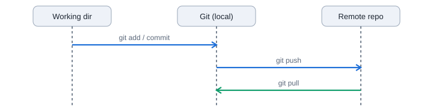

*شکل ۱: جریان کار Git؛ تغییر ← commit محلی ← push به ریپو.*

### ۲. دستورهای اصلی

``` text
git init                                   # create a repository
git status                                 # what changed?
git add configs/CORE-SW1.cfg               # stage a file
git commit -m "CORE-SW1: add NTP and syslog (CHG-0012)"
git log --oneline                          # history
git diff                                   # unstaged changes
git diff HEAD~1 HEAD -- configs/CORE-SW1.cfg   # compare two versions
git checkout -b feature/hardening          # new branch
git restore configs/CORE-SW1.cfg           # undo local changes to a file
```

- پیام commit باید بگوید «چه کسی/چرا» (شماره‌ی CHG).
- `git diff` بعد از هر بکاپ: اگر تفاوتی هست، یعنی کسی تغییر داده؛ بدون تفاوت = شبکه تغییر نکرده.

### ۳. رمز در Git: خط قرمز

``` text
# .gitignore
backups/*.raw
*.vault
secrets*.yml
.env
*.pcap
*.pcapng
```

قبل از commit فایل‌های Config را از رمزها پاک‌سازی (Sanitize) کنید:

``` text
# redact secrets from a config before committing
sed -E -e "s/(secret [0-9] ).*/\1<REDACTED>/" \
       -e "s/(password [0-9] ).*/\1<REDACTED>/" \
       -e "s/(snmp-server community ).*/\1<REDACTED>/" \
       CORE-SW1.raw > configs/CORE-SW1.cfg
```

> **اگر رمز اشتباهی commit شد**
>
> ۱) فوراً رمز را عوض کنید (فرض کنید لو رفته). ۲) تاریخچه را پاک‌سازی کنید (فقط با راهنمایی؛ حذف از commit‌های قبلی ساده نیست). ۳) Secret Scanning را فعال کنید. هرگز فقط «پاک‌کردن فایل در commit بعدی» را کافی ندانید.

### ۴. دستی در برابر خودکار: قضاوت مستدل

| معیار            | دستی               | خودکار                     |
|------------------|--------------------|----------------------------|
| سرعت (۵۰ دستگاه) | ساعت‌ها             | دقیقه‌ها                    |
| خطای تایپی       | محتمل              | کم                         |
| یکنواختی         | کم                 | زیاد                       |
| ریسک خطای گسترده | محدود به یک دستگاه | همه‌ی دستگاه‌ها همزمان       |
| ردپا/Audit       | دستی               | Playbook + Git             |
| یادگیری          | کم                 | نیاز به مهارت              |
| مناسب برای       | تغییر یک‌باره/خاص   | تغییرات تکراری و استاندارد |

نتیجه: اتوماسیون ابزار است، نه جایگزین قضاوت. تغییر پرریسک را با Check، یک دستگاه، سپس همه و همیشه با بکاپ انجام دهید.

### ۵. Cisco Campus As-Built (محصول CP1)

مستند نهایی بخش Cisco باید این‌ها را داشته باشد:

| بخش              | محتوا                                      | منبع                         |
|------------------|--------------------------------------------|------------------------------|
| ۱. توپولوژی      | نمودار فیزیکی و منطقی                      | Lab A و PNetLab              |
| ۲. IP Plan       | VLAN، Subnet، Gateway                      | 02-design/ip-plan.md         |
| ۳. VLAN Matrix   | VLAN، پورت‌ها                               | 02-design/vlan-matrix.md     |
| ۴. L2            | STP، EtherChannel، Port Security، Snooping | تنظیمات و show               |
| ۵. L3            | OSPF، HSRP، Default                        | As-Built Lab A               |
| ۶. سرویس‌ها       | DHCP، DNS، NTP، NAT، ACL، Syslog، SNMP     | Service Matrix               |
| ۷. Hardening     | Baseline و نتیجه‌ی بازبینی                  | 03-ops/hardening-baseline.md |
| ۸. Runbookها     | Change/Rollback و TSها                     | 03-ops                       |
| ۹. Config Backup | نسخه‌های Git (Sanitize‌شده)                  | Git                          |
| ۱۰. محدودیت‌ها    | موارد Unverified و نتیجه‌ی واقعی Lab        | یادداشت Lab                  |

### ۶. نقطه‌ی بازبینی CP1

CP1 پایان فاز Cisco (فصل ۱ تا ۸) است. چک‌لیست قبولی:

| \#  | معیار                               | مدرک                  |
|-----|-------------------------------------|-----------------------|
| ۱   | IP Plan و VLAN Matrix کامل          | فایل‌های طراحی         |
| ۲   | Lab A کامل و Failover تست‌شده        | As-Built + نتیجه‌ی تست |
| ۳   | Hardening Baseline روی همه‌ی تجهیزات | گزارش مقایسه          |
| ۴   | Service Matrix و سرویس‌ها            | فایل Matrix           |
| ۵   | بکاپ Git (بدون رمز)                 | git log               |
| ۶   | Gate G1، G2، G3 گذرانده             | سوابق                 |
| ۷   | لیست درس‌آموخته‌ها و اشتباهات         | صفحه‌ی مرور            |

**معیار قبولی:** هر ۷ مورد. با پایان CP1 و تأیید شما، فاز FortiGate (فصل ۹ به بعد) شروع می‌شود. تا آن زمان FortiGate را بوت نمی‌کنیم تا ساعت Evaluation مصرف نشود.

### ۷. مثال‌ها

#### ساده

``` text
git add backups/CORE-SW1.cfg && git commit -m "baseline backup"
```

#### متوسط: پیدا کردن تغییر

``` text
git diff HEAD~1 HEAD -- backups/CORE-SW1.cfg
+ no ip http server        (someone hardened the device)
```

#### سخت: رمز لو رفته

``` text
A SNMP community appeared in a committed config
Action: rotate the community immediately, sanitize history, enable secret scanning, add sanitize step before commit
```

### تمرین‌ها

**ت1.** ۱ (ساده): commit چیست؟ *(پاسخ: 8-6-ت1 در بخش «پاسخ‌ها» انتهای فصل)*

**ت2.** ۲ (ساده): git diff چه می‌کند؟ *(پاسخ: 8-6-ت2 در بخش «پاسخ‌ها» انتهای فصل)*

**ت3.** ۳ (متوسط): چرا رمز را بعد از commit اشتباهی باید عوض کنیم؟ *(پاسخ: 8-6-ت3 در بخش «پاسخ‌ها» انتهای فصل)*

**ت4.** ۴ (متوسط): دستی یا خودکار برای ۵۰ دستگاه؟ *(پاسخ: 8-6-ت4 در بخش «پاسخ‌ها» انتهای فصل)*

**ت5.** ۵ (سخت): CP1 چه چیزی را می‌سنجد؟ *(پاسخ: 8-6-ت5 در بخش «پاسخ‌ها» انتهای فصل)*

### Lab هدایت‌شده

روی PC/VM شما:

1.  یک ریپوی جدید برای Config بسازید (`git init`).
2.  بکاپ‌های فصل ۸-۴ را با اسکریپت Sanitize کنید و commit کنید.
3.  یک تغییر کوچک روی یک دستگاه بدهید، دوباره بکاپ بگیرید و `git diff` را ببینید.
4.  `.gitignore` را بسازید و تأیید کنید فایل‌های حساس commit نمی‌شوند.
5.  As-Built را بنویسید و چک‌لیست CP1 را پر کنید.

### Lab مستقل

مستند «Cisco Campus As-Built» (۱۰ بخش) را در `03-ops/campus-as-built.md` کامل کنید. این محصول CP1 است.

### عیب‌یابی

|         |                                                                             |
|---------|-----------------------------------------------------------------------------|
| Symptom | git push رد می‌شود یا رمز در ریپو است                                        |
| چک‌لیست  | ۱) .gitignore؟ ؛ ۲) Sanitize انجام شده؟ ؛ ۳) Secret scan؟ ؛ ۴) Remote درست؟ |
| ابزار   | git status ، git log ، grep برای الگوهای رمز                                |
| رفع     | عوض‌کردن رمز و پاک‌سازی                                                       |

### سؤال‌های مرور

**م1.** Git برای Config چه فایده‌ای دارد؟ *(پاسخ: 8-6-م1 در بخش «پاسخ‌ها» انتهای فصل)*

**م2.** CP1 چیست؟ *(پاسخ: 8-6-م2 در بخش «پاسخ‌ها» انتهای فصل)*

### English Corner: انگلیسی تخصصی این درس

این جمله‌ها از مستندات و محیط کار واقعی‌اند. بلند بخوانید و ترجمه را بپوشانید.

| English sentence                                                      | ترجمه                                                          |
|-----------------------------------------------------------------------|----------------------------------------------------------------|
| Commit every configuration change with a meaningful message.          | هر تغییر پیکربندی را با پیام معنادار commit کنید.              |
| Use git diff to see what changed between two backups.                 | با git diff ببینید بین دو بکاپ چه تغییر کرده است.              |
| Never commit passwords or API tokens.                                 | هرگز رمز یا Token را commit نکنید.                             |
| The as-built document describes the network as it was actually built. | مستند As-Built شبکه را همان‌طور که واقعاً ساخته شده توصیف می‌کند. |

**Q1.** Quick quiz (answer in English): What should you do if a secret was committed to the repository? *(پاسخ: 8-6-Q1 در بخش «پاسخ‌ها» انتهای فصل)*

### تکلیف و چک‌لیست تسلط

- [ ] ریپوی Config را بسازم و diff ببینم.
- [ ] As-Built را کامل کنم.
- [ ] چک‌لیست CP1 را پر کنم.

### یادآوری اشتباهات شما

> **یادآوری**
>
> پیش‌بینی قبل از اجرا؛ بکاپ قبل از تغییر؛ پذیرفته‌شدن دستور ≠ کار کردن؛ فرمول‌ها در بلوک مستقل.


#### کارت Lab — Git، As-Built و CP1

| # | فیلد | محتوا |
|---|---|---|
| 1 | عنوان و هدف | Git/As-Built/CP1 |
| 2 | پیش‌نیاز | درس 8-5 |
| 3 | توپولوژی | PC |
| 4 | تجهیزات | PC |
| 5 | نسخه نرم‌افزار | vIOS-L2 15.2(20200924، Experimental) برای SW؛ vIOS 15.9(3)M9 برای R؛ VPCS؛ PNetLab 4.2.8 |
| 6 | IP Plan | — |
| 7 | وضعیت اولیه | Repo Config |
| 8 | صورت مسئله | git diff |
| 9 | مراحل هدایت‌شده | همان بخش «Lab هدایت‌شده» همین درس |
| 10 | تست عملکرد | `git log` |
| 11 | سناریوی خرابی | رمز در commit |
| 12 | روش عیب‌یابی | لایه‌ای/با شواهد (بخش عیب‌یابی همین درس) |
| 13 | نتیجه‌ی مورد انتظار | As-Built کامل |
| 14 | معیار پذیرش | چک‌لیست CP1 |
| 15 | مستندات نهایی | `03-ops/campus-as-built.md` |
| 16 | Cleanup و بازگردانی | — |

> **وضعیت راستی‌آزمایی (خارج از ۱۶ فیلد):** **اجرا نشده (فقط طراحی).** اجرا نشده.

---

<a id="ans-8"></a>

<a id="l-8-10"></a>

## درس 8-10 — هوش مصنوعی در عملیات شبکه: Agentic AI، نوشتن Prompt و ارزیابی خروجی

**فصل 8 · درس افزوده برای انطباق با سرفصل رسمی CCNA 200-301 نسخه‌ی v2.0 (مورد 5.1: Describe the role of agentic AI in network operations؛ 5.2: Select a prompt for generative AI … data classification, output format, persona, instructions) · پیش‌نیاز: ۸-۱ تا ۸-۶**

> **وضعیت:** نظری؛ این بخش مهارت کار با ابزار است، نه دستور تجهیز. هیچ داده‌ی واقعی یا رمز نباید در ابزار AI خارجی گذاشته شود.

### ۱) این درس درباره چیست و چرا باید یاد بگیریم؟

**چه چیزی یاد می‌گیریم:** AI تولیدی (Generative AI) و AI عامل‌محور (Agentic AI) چیست، چه کارهایی در عملیات شبکه برایشان مناسب است، یک Prompt خوب چه اجزایی دارد و چطور خروجی AI را قبل از اجرا راستی‌آزمایی می‌کنیم.

**چرا لازم است؟** AI مثل یک همکار تازه‌کار بسیار سریع و بسیار مطمئن‌به‌خود است: گاهی عالی کمک می‌کند و گاهی با اعتمادبه‌نفس کامل چیز غلط می‌گوید (توهم/Hallucination). مهندسی که بلد باشد درست سؤال بپرسد و جواب را درست وارسی کند، چند برابر سریع‌تر می‌شود؛ مهندسی که کورکورانه دستور را کپی کند، شبکه را از کار می‌اندازد. و سرنوشت داده‌ی محرمانه‌ای که در یک ابزار خارجی چسبانده شود، قابل‌بازگشت نیست.

### ۲) توضیح از پایه

#### ۲-۱) دو مفهوم

| مفهوم | شرح | مثال در شبکه |
|---|---|---|
| Generative AI | به یک درخواست پاسخ متنی/کد می‌دهد | توضیح خروجی `show ip ospf neighbor` |
| Agentic AI | هدف می‌گیرد، چند گام برنامه می‌ریزد و با ابزارها اقدام می‌کند | بررسی خودکار آلارم، جمع‌آوری `show`ها، پیشنهاد علت، ارسال تیکت |

عامل‌محور بودن یعنی AI خودش چند قدم برمی‌دارد؛ پس **کنترل انسان (Human-in-the-loop)** و محدودکردن دسترسی (فقط خواندن) اهمیت بیشتری دارد.

#### ۲-۲) کاربردهای مناسب

1. خلاصه‌سازی Log و Syslog.
2. توضیح Config/خروجی دستور برای تازه‌کارها.
3. پیش‌نویس CHG، Runbook و گزارش PIR.
4. تولید پیش‌نویس اسکریپت (Ansible/Python) که انسان بازبینی می‌کند.
5. پیشنهاد فرضیه برای عیب‌یابی.

#### ۲-۳) خطرها

- **Hallucination:** دستور یا ویژگی ناموجود.
- **نشت داده:** چسباندن Config با رمز/IP واقعی.
- **تعصب به نسخه:** پاسخ برای نسخه‌ی دیگر.
- **اقدام خودکار خطرناک:** Agent با دسترسی نوشتن.

#### ۲-۴) طبقه‌بندی داده (Data Classification)

| سطح | مثال | قاعده |
|---|---|---|
| عمومی | مستندات رسمی | آزاد |
| داخلی | توپولوژی بدون رمز | فقط ابزار تأییدشده |
| محرمانه | Config با Secret، IP مشتری | ممنوع در ابزار خارجی؛ ابتدا Sanitize |
| بسیار محرمانه | کلید، رمز، داده‌ی کاربر | ممنوع |

#### ۲-۵) اجزای یک Prompt خوب

``` text
Persona      : who the AI should act as (senior network engineer)
Context/Data : sanitized input + data classification note
Instructions : the task, step by step, constraints
Output format: table / bullet list / commands with verification steps
Constraints  : version (IOS XE 17.x), do not suggest destructive commands
```

### ۳) مثال‌های حل‌شده از ساده به سخت

**ساده — Prompt ضعیف و قوی.**

ضعیف: «OSPF من کار نمی‌کند.»

قوی:

``` text
Act as a senior network engineer.
Context: two Cisco IOS XE routers, single-area OSPF; neighbor stuck in EXSTART.
Data (sanitized, no passwords): output of "show ip ospf neighbor" and "show interface Gi0/0 | include MTU" from both routers.
Task: list the three most likely causes in order of probability and the show command that confirms each.
Output: a table with columns Cause, Evidence to check, Command.
Do not suggest changes that restart the routing process.
```

**متوسط — پاک‌سازی Config.** قبل از ارسال: حذف `password`، `secret`، `snmp community`، IPهای واقعی (جایگزین `10.x.x.x` نمونه). فهرست جایگزینی را نگه دارید تا پاسخ را برگردانید.

``` text
sed -E 's/(password|secret|community) .*/\1 REDACTED/' running.cfg > clean.cfg
```

**سخت — ارزیابی خروجی عامل (Agent).** Agent پیشنهاد می‌دهد: «برای رفع قطعی `no router ospf 1` را اجرا کن». روش ارزیابی:

1. آیا دستور مخرب است؟ بله؛ OSPF حذف می‌شود ⇒ رد.
2. آیا مدارک پشتیبان دارد؟ نه (فقط ادعا).
3. جایگزین: ابتدا `show`های فقط‌خواندنی، سپس تغییر کوچک با CHG و Rollback.
4. ثبت: «پیشنهاد AI رد شد؛ علت: عدم Evidence و ریسک بالا».

قانون: **هر دستور پیشنهادی AI را قبل از اجرا با مستند رسمی و در Lab راستی‌آزمایی کنید.**

### ۴) Lab (اجرا نشده)

یک Log نمونه را Sanitize کنید، Prompt بنویسید، پاسخ را با مستند Cisco بسنجید و موارد نادرست را فهرست کنید.

### ۵) اصطلاحات این درس

| اصطلاح | شکل کامل | معنی |
|---|---|---|
| AI | Artificial Intelligence | هوش مصنوعی |
| LLM | Large Language Model | مدل زبانی بزرگ |
| Prompt | — | دستور/سؤال ورودی |
| Hallucination | — | پاسخ ساختگی با اطمینان |
| HITL | Human-in-the-loop | انسان در چرخه‌ی تصمیم |

### ۶) تمرین‌ها

**ت1.** (ساده) تفاوت Generative و Agentic AI؟ *(پاسخ: 8-10-ت1 در بخش «پاسخ‌ها» انتهای فصل)*

**ت2.** (ساده) اجزای یک Prompt خوب را نام ببرید. *(پاسخ: 8-10-ت2 در بخش «پاسخ‌ها» انتهای فصل)*

**ت3.** (متوسط) کدام داده نباید در ابزار AI خارجی قرار گیرد؟ *(پاسخ: 8-10-ت3 در بخش «پاسخ‌ها» انتهای فصل)*

**ت4.** (سخت) AI دستوری مخرب پیشنهاد داد؛ چهار گام ارزیابی. *(پاسخ: 8-10-ت4 در بخش «پاسخ‌ها» انتهای فصل)*

### ۷) English Corner

- *Always verify AI-generated commands against vendor documentation before applying them.*
- *Keep a human in the loop for any change on production devices.*
- **Q1.** Name the four components of a good prompt mentioned in this lesson. *(پاسخ: 8-10-Q1 در بخش «پاسخ‌ها» انتهای فصل)*

---

<a id="l-8-11"></a>

## درس 8-11 — AAA برای مدیریت دستگاه: حساب محلی، TACACS+ و RADIUS

**فصل 8 · درس افزوده برای سرفصل رسمی CCNA 200-301 (مورد 4.1: Configure network devices with local usernames and as an AAA client — TACACS+ and RADIUS — for management) · پیش‌نیاز: ۸-۱ تا ۸-۳**

> **وضعیت:** نظری/مستندی؛ دستورها `Unverified`؛ هیچ رمز واقعی در ریپو نیست؛ Lab اجرا نشده.

### ۱) این درس درباره چیست و چرا باید یاد بگیریم؟

**چه چیزی یاد می‌گیریم:** ورود به دستگاه با حساب محلی، سپس انتقال به AAA مرکزی با TACACS+ یا RADIUS، فرق آنها و چطور از قفل‌شدن بیرون از دستگاه جلوگیری کنیم.

**چرا لازم است؟** اگر ۵۰ روتر دارید و ۱۰ مهندس، حساب محلی یعنی ۵۰۰ حساب برای مدیریت؛ هر وقت کسی استعفا دهد باید روی ۵۰ دستگاه حذفش کنید. با AAA مرکزی یک حساب در یک سرور و همه‌چیز: چه کسی وارد شد (Authentication)، چه چیزی اجازه دارد (Authorization)، چه کرد (Accounting).

### ۲) توضیح از پایه

#### ۲-۱) سه A

| بخش | پرسش | مثال |
|---|---|---|
| Authentication | تو کی هستی؟ | نام کاربری و رمز |
| Authorization | چه کاری مجازی؟ | فقط `show`؛ یا سطح 15 |
| Accounting | چه کردی؟ | ثبت هر دستور و زمان |

#### ۲-۲) حساب محلی

``` text
username admin privilege 15 secret S3cr3t!Pass
enable secret EnableP@ss
line vty 0 4
 login local
 transport input ssh
```

`secret` (Hash) به‌جای `password` (قابل‌بازگردانی). سطح دسترسی 0 تا 15؛ 15 کامل.

#### ۲-۳) TACACS+ در برابر RADIUS

| معیار | TACACS+ | RADIUS |
|---|---|---|
| منشأ | Cisco | IETF |
| انتقال | TCP 49 | UDP 1812 (Auth) / 1813 (Acct) |
| رمزنگاری | کل Payload | فقط فیلد رمز |
| AAA | جدا (Authorization مستقل) | Authn و Authz ترکیبی |
| مجوز دستور (Command Authorization) | دارد | ندارد |
| کاربرد اصلی | مدیریت دستگاه | دسترسی شبکه (VPN، 802.1X، Wi-Fi) |

قاعده: **مدیریت دستگاه ⇒ TACACS+؛ دسترسی کاربران به شبکه ⇒ RADIUS.**

### ۳) دستورها (Unverified)

``` text
aaa new-model
tacacs server TAC1
 address ipv4 10.50.0.10
 key TacKey123
aaa group server tacacs+ TACGRP
 server name TAC1
aaa authentication login default group TACGRP local
aaa authorization exec default group TACGRP local
aaa accounting commands 15 default start-stop group TACGRP
line vty 0 4
 login authentication default
 transport input ssh
```

``` text
radius server RAD1
 address ipv4 10.50.0.11 auth-port 1812 acct-port 1813
 key RadKey123
aaa group server radius RADGRP
 server name RAD1
aaa authentication login RADLOGIN group RADGRP local
```

**منطق `group TACGRP local`:** ابتدا سرور؛ اگر **پاسخ نداد (Timeout/قطع)**، حساب محلی. اگر سرور پاسخ بدهد و رد کند، رد قطعی است (به Local نمی‌رود).

بررسی:

``` text
show aaa servers
test aaa group TACGRP user1 Pass new-code
debug aaa authentication
debug tacacs
undebug all
show users
```

### ۴) مثال‌های حل‌شده از ساده به سخت

**ساده — محلی.** `username` با `secret`، `login local` روی vty و `transport input ssh`. تأیید: ssh از PC.

**متوسط — انتقال به TACACS+.** مراحل ایمن:

1. حساب محلی اضطراری بسازید (در بالا).
2. `aaa new-model` و تعریف سرور.
3. **ابتدا** در همین Session دیگر (Session اول را باز نگه دارید) ورود را با کاربر سرور آزمایش کنید.
4. `local` را آخر لیست نگه دارید.
5. برای کنسول جداگانه: `aaa authentication login CON local` و `line con 0; login authentication CON` تا حتی با خرابی سرور از Console وارد شوید.

**متوسط — Accounting.** `aaa accounting commands 15 default start-stop` هر دستور سطح 15 را با نام کاربر و زمان به سرور می‌فرستد؛ برای ردیابی «چه کسی OSPF را پاک کرد؟».

**سخت — «با TACACS+ نمی‌توانم وارد شوم».**

1. `show aaa servers`: وضعیت سرور (UP/DEAD) و شمارنده‌ی Timeout.
2. Key ناهمخوان؟ (علامت: سرور پاسخ را Decrypt نمی‌کند؛ Log سرور: «invalid packet»).
3. منبع ارتباط: `ip tacacs source-interface Loopback0` و سرور آدرس Loopback را می‌شناسد؟
4. Route/ACL TCP 49؟
5. ترتیب: اگر `local` اول باشد، سرور اصلاً استفاده نمی‌شود.
6. `test aaa group TACGRP user1 Pass new-code` پاسخ می‌دهد؟

**سخت — قفل‌شدن.** `aaa authentication login default group TACGRP` بدون `local` و سرور خراب: دیگر هیچ‌کس نمی‌تواند وارد شود. راه نجات: Console با روش جداگانه (Method List بدون سرور) یا Password Recovery فیزیکی. پیشگیری: همیشه `local` آخر و آزمون قبل از `write memory`.

### ۵) Lab (اجرا نشده)

یک روتر و یک سرور TACACS+ (مثلاً `tac_plus`/ISE Lab)؛ کاربر عادی با فقط `show` و کاربر ادمین؛ Accounting را در Log سرور ببینید.

### ۶) اصطلاحات این درس

| اصطلاح | شکل کامل | معنی |
|---|---|---|
| AAA | Authentication, Authorization, Accounting | هویت، مجوز، حسابداری |
| TACACS+ | Terminal Access Controller Access-Control System Plus | AAA مدیریتی |
| RADIUS | Remote Authentication Dial-In User Service | AAA دسترسی شبکه |
| NAS | Network Access Server | دستگاه سرویس‌گیرنده‌ی AAA |
| VTY | Virtual Teletype | خطوط ورود راه‌دور |

### ۷) تمرین‌ها

**ت1.** (ساده) AAA یعنی چه؟ *(پاسخ: 8-11-ت1 در بخش «پاسخ‌ها» انتهای فصل)*

**ت2.** (ساده) کدام پروتکل Command Authorization دارد؟ *(پاسخ: 8-11-ت2 در بخش «پاسخ‌ها» انتهای فصل)*

**ت3.** (متوسط) `group TACGRP local` چه رفتاری دارد وقتی سرور رمز را رد کند؟ و وقتی سرور خاموش است؟ *(پاسخ: 8-11-ت3 در بخش «پاسخ‌ها» انتهای فصل)*

**ت4.** (سخت) بعد از فعال‌سازی AAA قفل شدید؛ دو راه ورود و پیشگیری. *(پاسخ: 8-11-ت4 در بخش «پاسخ‌ها» انتهای فصل)*

### ۸) English Corner

- *TACACS+ separates authentication, authorization and accounting; RADIUS combines authentication and authorization.*
- *Always keep a local fallback account when you migrate to AAA.*
- **Q1.** Which transport and port does TACACS+ use? *(پاسخ: 8-11-Q1 در بخش «پاسخ‌ها» انتهای فصل)*

---

<a id="l-8-12"></a>

### بخش تکمیلی درس: سناریوی واقعی، مثال‌های بیشتر و عیب‌یابی

> بخش‌های زیر درس بالا را کامل می‌کنند: سناریوی گام‌به‌گام، مثال‌های بیشتر از ساده تا سخت، جدول عیب‌یابی و پرسش‌های مصاحبه. ابتدا بخش‌های اصلی بالا را مطالعه کنید.

### تکمیل عمیق: جدول عیب‌یابی سریع — AAA

| علامت | شاهد برای بررسی | علت محتمل و رفع |
|---|---|---|
| ورود با TACACS+ نمی‌شود | `show aaa servers` | Key/Source/Route؛ سپس Local fallback |
| قفل کامل بعد از AAA | کنسول | Method List بدون local؛ بازیابی و افزودن local |
| Accounting ثبت نمی‌شود | `show aaa accounting` | start-stop و گروه سرور بررسی شود |
| RADIUS Reject | Log سرور | Secret/NAS ناهمخوان |

## درس 8-12 — رویکردهای مدیریت شبکه: Device-based، Controller-based، Cloud، Automation و Infrastructure as Code

**فصل 8 · درس افزوده برای سرفصل رسمی CCNA 200-301 (مورد 5.3: Describe network management approaches — device-based, cloud-based, controller-based, automation-based, and infrastructure as code؛ و 5.5: Ansible) · پیش‌نیاز: ۸-۴ تا ۸-۶**

> **وضعیت:** نظری/مستندی؛ دستورها `Unverified`؛ هیچ API/رمز واقعی در ریپو نیست؛ Lab اجرا نشده.

### ۱) این درس درباره چیست و چرا باید یاد بگیریم؟

**چه چیزی یاد می‌گیریم:** پنج رویکرد مدیریت شبکه، تفاوت آنها، مفهوم Northbound/Southbound API، REST و فرمت‌های JSON/YAML، و اینکه IaC (Infrastructure as Code) چطور شبکه را مثل نرم‌افزار قابل‌بازبینی می‌کند.

**چرا لازم است؟** اگر باید NTP را روی ۵۰ روتر عوض کنید و هر روتر ۲ دقیقه طول بکشد، ۱۰۰ دقیقه کار تکراری است و ۵۰ فرصت اشتباه. با اتوماسیون یک بار می‌نویسید و ۵۰ بار اجرا می‌کنید؛ و Git ثابت می‌کند «چه چیزی، کی، توسط چه کسی» تغییر کرد.

### ۲) توضیح از پایه

#### ۲-۱) پنج رویکرد

| رویکرد | شرح | مثال |
|---|---|---|
| Device-based | هر دستگاه جداگانه با CLI/GUI | SSH به هر روتر |
| Controller-based | کنترلر مرکزی سیاست را به دستگاه‌ها می‌دهد | Cisco Catalyst Center (DNA Center)، SD-WAN Manager |
| Cloud-based | مدیریت از ابر | Meraki Dashboard |
| Automation-based | اسکریپت/ابزار تغییر را اجرا می‌کند | Ansible، Python |
| Infrastructure as Code | وضعیت مطلوب شبکه در فایل متنی و در Git | Ansible + Git، Terraform |

#### ۲-۲) Northbound و Southbound

``` text
Applications / Scripts
      ^   Northbound API (REST)
 [ Controller ]
      v   Southbound (NETCONF, RESTCONF, CLI/SSH, SNMP)
 Network devices
```

- **Northbound:** کنترلر ⇦ برنامه‌ها (معمولاً REST).
- **Southbound:** کنترلر ⇦ دستگاه‌ها.

#### ۲-۳) REST و فرمت‌ها

REST = Representational State Transfer؛ API روی HTTP. متدها:

| متد | عمل (CRUD) |
|---|---|
| GET | خواندن |
| POST | ایجاد |
| PUT | جایگزینی کامل |
| PATCH | تغییر جزئی |
| DELETE | حذف |

کدهای پاسخ: 200 OK، 201 Created، 204 No Content، 400 Bad Request، 401 Unauthorized، 403 Forbidden، 404 Not Found، 500 Server Error.

``` text
GET https://r1.example.com/restconf/data/ietf-interfaces:interfaces
Accept: application/yang-data+json
```

JSON نمونه:

``` text
{
  "interface": {
    "name": "GigabitEthernet1",
    "enabled": true,
    "ipv4": { "address": [ { "ip": "10.10.0.1", "netmask": "255.255.255.0" } ] }
  }
}
```

YAML (خوانا‌تر، برای Ansible): ساختار با Indent. NETCONF/RESTCONF بر پایه‌ی مدل داده‌ی YANG کار می‌کنند.

#### ۲-۴) Ansible

Ansible بدون Agent از طریق SSH/API به دستگاه وصل می‌شود. اجزا: **Inventory** (فهرست دستگاه‌ها)، **Playbook** (مراحل)، **Module** (کار). ویژگی مهم: **Idempotent** یعنی اجرای مکرر همان نتیجه را می‌دهد و اگر شبکه همان‌طور باشد، تغییری ایجاد نمی‌کند.

``` text
# inventory.ini
[routers]
r1 ansible_host=10.50.0.1
r2 ansible_host=10.50.0.2
[routers:vars]
ansible_network_os=cisco.ios.ios
ansible_connection=network_cli
```

``` text
# ntp.yml
- name: Set NTP
  hosts: routers
  gather_facts: false
  tasks:
    - name: Configure NTP server
      cisco.ios.ios_config:
        lines:
          - ntp server 10.50.0.20
```

اجرا: `ansible-playbook -i inventory.ini ntp.yml`.

#### ۲-۵) IaC

وضعیت مطلوب (Desired State) در فایل نوشته و در Git نگه داشته می‌شود؛ ابزار شبکه را با آن هم‌گام می‌کند. مزیت‌ها: تاریخچه‌ی تغییرات، Review قبل از اجرا (Pull Request)، تکرارپذیری، کشف **Drift** (تفاوت واقعیت با فایل). Declarative = «چه می‌خواهم» (Terraform)؛ Imperative = «چه کارهایی بکن» (اسکریپت). 

### ۳) مثال‌های حل‌شده از ساده به سخت

**ساده — انتخاب رویکرد.** ۳ روتر در یک Lab: Device-based کافی است. ۳۰۰ سوییچ در ۵۰ ساختمان: Controller یا Automation.

**متوسط — محاسبه‌ی صرفه‌جویی.**

``` text
Manual   = 50 devices x 2 min = 100 min
Ansible  = 10 min (write) + 3 min (run) = 13 min (first time)
Next time: 3 min
```

**متوسط — خواندن Playbook.** `hosts: routers` گروه را مشخص می‌کند؛ `ios_config` خط‌های Config را در حالت Global اعمال می‌کند؛ اجرای دوم هیچ تغییری (`changed=0`) نشان می‌دهد چون Idempotent.

**سخت — Drift.** فایل Git می‌گوید `ntp server 10.50.0.20` ولی روی R2 `10.50.0.99` است (کسی دستی عوض کرده).

1. `ansible-playbook --check --diff` تفاوت را نشان می‌دهد.
2. اجرای عادی، دستگاه را به وضعیت Git برمی‌گرداند.
3. ثبت اینکه چه کسی دستی تغییر داد (Log AAA).
4. فرایند: تغییر فقط از Git (Pull Request).

**سخت — خطای API.** درخواست `POST` پاسخ `401`: رمز/توکن نامعتبر؛ `403`: دسترسی کافی ندارد؛ `404`: مسیر اشتباه؛ `400`: JSON غلط. با این کدها علت را می‌توان سریع محدود کرد.

### ۴) Lab (اجرا نشده)

دو روتر مجازی؛ Playbook NTP را بنویسید، دوبار اجرا کنید و `changed` را ببینید؛ سپس یک تغییر دستی و کشف Drift.

### ۵) اصطلاحات این درس

| اصطلاح | شکل کامل | معنی |
|---|---|---|
| API | Application Programming Interface | رابط برنامه‌نویسی |
| REST | Representational State Transfer | معماری API روی HTTP |
| JSON | JavaScript Object Notation | قالب داده |
| YAML | YAML Ain't Markup Language | قالب داده‌ی خوانا |
| YANG | Yet Another Next Generation | زبان مدل داده |
| IaC | Infrastructure as Code | زیرساخت به‌صورت کد |
| SDN | Software-Defined Networking | شبکه‌ی نرم‌افزارمحور |

### ۶) تمرین‌ها

**ت1.** (ساده) پنج رویکرد مدیریت شبکه را نام ببرید. *(پاسخ: 8-12-ت1 در بخش «پاسخ‌ها» انتهای فصل)*

**ت2.** (ساده) Northbound و Southbound؟ *(پاسخ: 8-12-ت2 در بخش «پاسخ‌ها» انتهای فصل)*

**ت3.** (متوسط) Idempotent یعنی چه؟ *(پاسخ: 8-12-ت3 در بخش «پاسخ‌ها» انتهای فصل)*

**ت4.** (متوسط) پاسخ 401 و 404 چه می‌گویند؟ *(پاسخ: 8-12-ت4 در بخش «پاسخ‌ها» انتهای فصل)*

**ت5.** (سخت) Drift چیست و چگونه کشف می‌شود؟ *(پاسخ: 8-12-ت5 در بخش «پاسخ‌ها» انتهای فصل)*

### ۷) English Corner

- *A northbound API lets applications talk to the controller.*
- *Idempotent playbooks can be run repeatedly without causing unintended changes.*
- **Q1.** Which HTTP method creates a new resource? *(پاسخ: 8-12-Q1 در بخش «پاسخ‌ها» انتهای فصل)*

---

## پاسخ‌های فصل 8

> ابتدا بدون نگاه حل کنید. شناسه: درس-نوع+شماره (ت = تمرین، م = مرور، Q = Quick quiz).

**8-1-ت1** — ۱ (ساده): سه صفحه‌ی دستگاه؟

هر دستگاه شبکه سه صفحه (Plane) دارد: Management (دسترسی مدیر: SSH، SNMP، Syslog)، Control (پروتکل‌های مسیریابی، STP، ARP)، Data (عبور ترافیک کاربر). Hardening باید هر سه را پوشش دهد: ACL روی VTY و CoPP برای Control و فیلتر/Port Security برای Data. مدیریت مهم‌ترین است چون کنترل کامل می‌دهد.

``` text
Management, control and data plane.
```

**8-1-ت2** — ۲ (ساده): چرا no ip http server؟

`no ip http server` سرویس HTTP بدون رمزگذاری را می‌بندد و سطح حمله را کم می‌کند؛ هر سرویس اضافه آسیب‌پذیری بالقوه است. اگر GUI لازم است `ip http secure-server` با ACL و گواهی. قاعده: هر سرویس بی‌استفاده را خاموش کنید.

``` text
To close an unnecessary management service and reduce the attack surface.
```

**8-1-ت3** — ۳ (متوسط): چرا پورت‌های خالی shutdown و VLAN 999؟

پورت خالی با Shutdown و عضویت در VLAN بلااستفاده (مثلاً 999 بدون SVI) مانع می‌شود دستگاه جعلی با اتصال به پورت آزاد به شبکه دسترسی یابد. ترکیب: shutdown، VLAN مرده، BPDU Guard و Port Security. هنگام نیاز پورت با CHG فعال می‌شود.

``` text
So that a rogue device plugged into an unused port gets no access.
```

**8-1-ت4** — ۴ (متوسط): چرا CDP روی پورت کاربر خاموش؟

CDP نام دستگاه، IP، نسخه‌ی IOS و Interface را برای هر Host مجاور افشا می‌کند؛ مهاجم می‌تواند از آن برای شناسایی هدف و آسیب‌پذیری استفاده کند. روی پورت کاربر `no cdp enable` (و LLDP مشابه) بگذارید؛ روی Uplink بین سوییچ‌ها لازم است.

``` text
It leaks device information (name, IP, software) to any host.
```

**8-1-ت5** — ۵ (سخت): قبل از Hardening VTY از راه دور چه شبکه‌ی ایمنی می‌گذاریم؟

پیش از Hardening از راه دور (مثلاً محدودکردن VTY) Backup بگیرید و `reload in 5` را اجرا کنید: اگر قفل شدید، پس از ۵ دقیقه دستگاه به Config ذخیره‌شده برمی‌گردد. پس از تأیید `reload cancel` و ذخیره. همچنین کنسول آماده نگه دارید.

``` text
Backup the config and use "reload in 5" so a mistake does not lock you out.
```

**8-1-م1** — Hardening چیست؟

Hardening کاهش سطح حمله با بستن سرویس‌های اضافه، رمزنگاری مدیریت، ACL، AAA، Banner، Timeout و غیرفعال‌سازی پروتکل‌های ناامن (Telnet، HTTP، v2c) است. هدف: دستگاهی که حتی اگر در معرض شبکه باشد، سطح حمله‌ی کمی دارد.

کاهش سطح حمله با بستن سرویس‌های اضافه و تنظیم امن.

**8-1-م2** — چرا Management Plane مهم‌ترین است؟

Management Plane دسترسی کامل به Config و کنترل دستگاه می‌دهد؛ مهاجمی که آن را بگیرد می‌تواند مسیر، ACL، VLAN و Log را تغییر دهد. پس پیش از هر چیز باید SSH، AAA، ACL مدیریت و Logging کنترل شود.

کنترل کامل دستگاه را می‌دهد.

**8-1-Q1** — Quick quiz (answer in English): Why is "enable secret" preferred over "enable password"?

پاسخ انگلیسی در پایین آمده است. نکته‌ی عملی: `enable secret` از الگوریتم قوی (Type 5/8/9) و `enable password` متن ساده/Type 7 (قابل‌برگشت) استفاده می‌کند؛ هرگز password.

Secret is stored as a strong hash; password is clear text or weak Type 7.

**8-2-ت1** — ۱ (ساده): سه A؟

AAA: Authentication (کیستی؟)، Authorization (چه کارهایی مجاز است؟)، Accounting (چه کرد؟ ثبت). با هم احراز هویت مرکزی، کنترل دسترسی دقیق و Audit را فراهم می‌کنند.

``` text
Authentication, Authorization, Accounting.
```

**8-2-ت2** — ۲ (ساده): TACACS+ چه پورتی؟

TACACS+ روی TCP/49 کار می‌کند و کل Payload را محافظت (obfuscate) می‌کند؛ RADIUS روی UDP (1812/1813) و فقط فیلد رمز را. دقت: طبق RFC 8907 محافظت TACACS+ «Obfuscation» است نه رمزنگاری مدرن؛ برای الزامات سخت‌گیرانه آن را داخل شبکه‌ی مدیریت جدا یا تونل امن ببرید. TCP به TACACS+ قابلیت اطمینان و Timeout واضح می‌دهد.

``` text
TCP 49
```

**8-2-ت3** — ۳ (متوسط): چرا Local را Fallback می‌گذاریم؟

اگر AAA Server در دسترس نباشد، بدون Fallback محلی هیچ‌کس نمی‌تواند وارد دستگاه شود. با `aaa authentication login default group tacacs+ local` وقتی سرور پاسخ ندهد حساب محلی (Break-glass) استفاده می‌شود. حساب محلی باید رمز قوی و استفاده‌ی نادر داشته باشد.

``` text
If the AAA server is unreachable you can still log in with a local account.
```

**8-2-ت4** — ۴ (متوسط): Privilege 15 یعنی؟

Privilege 15 دسترسی کامل مدیریتی (همه‌ی دستورها شامل Config) است؛ 1 فقط User EXEC. در عمل سطح‌های میانی (مثلاً 5 برای NOC با show و ping) تعریف و با TACACS+ Command Authorization کنترل می‌شود. اصل Least Privilege.

``` text
Full administrative access.
```

**8-2-ت5** — ۵ (سخت): TACACS+ در برابر RADIUS برای مدیریت دستگاه؟

TACACS+ کل Payload را رمز می‌کند و Authorization دستور-به‌دستور (Command Authorization) دارد؛ RADIUS فقط رمز را رمز می‌کند و Authorization آن مناسب Network Access (VPN/802.1X). برای مدیریت دستگاه TACACS+ ترجیح داده می‌شود و برای VPN/Wi-Fi RADIUS.

``` text
TACACS+ encrypts the whole packet and supports granular command authorization.
```

**8-2-م1** — Authorization چیست؟

Authorization تعیین می‌کند کاربر احراز‌شده چه کارهایی (دستور، Privilege، شبکه) مجاز است. مثال: کاربر NOC فقط show، مهندس شبکه Config، ممیز فقط خواندنی.

تعیین اینکه کاربر چه کارهایی مجاز است.

**8-2-م2** — چرا Accounting؟

Accounting ثبت می‌کند چه کسی، چه زمانی، چه دستوری یا چه Session اجرا کرد؛ برای مسئولیت‌پذیری، Audit و تحقیق پس از حادثه ضروری است. بدون آن «کار چه کسی بود؟» جواب ندارد.

ثبت اینکه چه کسی چه کرده؛ برای مسئولیت‌پذیری.

**8-2-Q1** — Quick quiz (answer in English): What happens if you configure AAA with no local fallback and the server is down?

پاسخ انگلیسی در پایین آمده است؛ بدون Fallback و با سرور قطع، همه قفل می‌شوند و فقط از کنسول با بازیابی رمز (Password Recovery) وارد می‌شوید؛ پس همیشه Local Fallback و Backup کنسول.

Everyone is locked out of the device, except via console recovery.

**8-3-ت1** — ۱ (ساده): تفاوت Object و Array؟

Object مجموعه‌ی کلید/مقدار داخل { } است (مثل یک رکورد)، Array فهرست مرتب داخل [ ] (مثل چند دستگاه). JSON ترکیب این دو است؛ در YAML Object با «کلید: مقدار» و Array با «- » نمایش داده می‌شود.

``` text
Object = key/value pairs in { }; Array = ordered list in [ ].
```

**8-3-ت2** — ۲ (ساده): GET چه می‌کند؟

GET منبع را بدون تغییر می‌خواند؛ Safe و Idempotent است. POST ایجاد، PUT جایگزینی کامل، PATCH تغییر جزئی، DELETE حذف. در API دستگاه شبکه ابتدا GET برای آزمون بگیرید.

``` text
Reads a resource without changing it.
```

**8-3-ت3** — ۳ (متوسط): کد 403 یعنی؟

403 Forbidden یعنی هویت شما شناخته شد ولی اجازه‌ی دسترسی ندارید (Authorization)؛ 401 یعنی احراز هویت نشدید. 404 منبع نیست، 5xx خطای سرور. در API Fortinet/Cisco تفکیک 401/403 برای رفع مهم است.

``` text
Forbidden: authenticated but not allowed.
```

**8-3-ت4** — ۴ (متوسط): چرا YAML با Tab خراب می‌شود؟

در YAML ساختار با Indentation (فاصله) تعیین می‌شود و Tab مجاز نیست؛ استفاده از Tab Parser را خراب می‌کند یا ساختار را اشتباه می‌خواند. استاندارد: ۲ فاصله و ویرایشگر با نمایش Whitespace و Linter.

``` text
Indentation defines structure and tabs are not allowed.
```

**8-3-ت5** — ۵ (سخت): چرا Token در Git ممنوع؟

Token/Password اگر در Git باشد، هر کس به Repo دسترسی دارد (و تاریخچه حتی پس از حذف) می‌تواند از آن استفاده کند. باید در متغیر محیطی یا Secret Store/Vault باشد و در `.gitignore`؛ و اگر لو رفت فوراً Rotate شود.

``` text
Anyone with repo access could use it; it must come from a secret store or environment variable.
```

**8-3-م1** — REST چیست؟

REST معماری API مبتنی بر HTTP است: هر منبع URL دارد و عمل با Method (GET/POST/PUT/DELETE) و نتیجه با کد وضعیت و بدنه‌ی JSON. بیشتر تجهیزات مدرن (FortiGate، Cisco DNA/RESTCONF) API مشابه دارند.

API مبتنی بر HTTP که هر منبع یک URL دارد.

**8-3-م2** — چرا YAML برای Ansible؟

YAML خوانا، مناسب برای Config‌های انسانی و پایه‌ی Ansible (Playbook، Inventory) است. ولی به Indentation حساس است؛ پس Lint کنید.

خوانا و برای تنظیمات مناسب است.

**8-3-Q1** — Quick quiz (answer in English): What is the difference between PUT and PATCH?

پاسخ انگلیسی در پایین آمده است؛ PUT منبع را کامل جایگزین می‌کند (فیلد جاافتاده حذف می‌شود)، PATCH فقط فیلدهای ارسالی را تغییر می‌دهد؛ برای تغییر کوچک PATCH امن‌تر است.

PUT replaces the whole resource; PATCH modifies part of it.

**8-4-ت1** — ۱ (ساده): چرا رمز در متغیر محیطی؟

رمز در متغیر محیطی (`os.environ`) می‌ماند و در کد و Git نمی‌رود؛ با تغییر رمز فقط محیط عوض می‌شود. بهتر: Vault. هرگز رمز در اسکریپت، لاگ یا خروجی نمایش داده نشود.

``` text
So the password never ends up in the source code or in Git.
```

**8-4-ت2** — ۲ (ساده): read-only یعنی چه؟

Read-only یعنی اسکریپت فقط دستور show اجرا می‌کند و هیچ تغییری روی دستگاه نمی‌دهد؛ خطا فقط روی خروجی اثر دارد. شروع Automation از Read-only (Inventory، Backup، Audit) ریسک را کم می‌کند.

``` text
The script only runs show commands and never changes the device.
```

**8-4-ت3** — ۳ (متوسط): چرا try/except؟

try/except اجازه می‌دهد اگر یک دستگاه خاموش/کند/Auth Fail باشد، اسکریپت برای بقیه‌ی دستگاه‌ها ادامه دهد و خطا را Log کند؛ وگرنه یک خطا کل اجرا را قطع می‌کند و نتیجه ناقص می‌ماند.

``` text
So a failing device does not stop the run for the remaining devices.
```

**8-4-ت4** — ۴ (متوسط): چرا اول روی یک دستگاه؟

اجرا ابتدا روی یک دستگاه (Pilot) دامنه‌ی خطا (Blast radius) را کوچک می‌کند؛ اگر دستور اشتباه باشد فقط یک دستگاه آسیب می‌بیند. پس از تأیید، گروهی کوچک و سپس همه.

``` text
To limit the blast radius of a mistake.
```

**8-4-ت5** — ۵ (سخت): چه چیزی در خروجی show running-config حساس است؟

`show running-config` شامل Hash رمزها، SNMP Community، کلیدهای TACACS/RADIUS، IPهای داخلی و ACL است؛ انتشار یا Commit آن در Git عمومی خطرناک است. فایل‌ها را رمزگذاری یا Sanitize کنید و دسترسی محدود.

``` text
Password hashes, SNMP communities, keys; do not publish the files.
```

**8-4-م1** — Netmiko چه می‌کند؟

Netmiko کتابخانه‌ی پایتون است که با SSH به تجهیز شبکه وصل می‌شود، دستور اجرا می‌کند و خروجی را برمی‌گرداند؛ تفاوت Promptها و Paging را مدیریت می‌کند.

با SSH به تجهیز شبکه وصل شده و دستور اجرا می‌کند.

**8-4-م2** — چرا Read-only برای شروع؟

Read-only ریسک کم و قابل‌برگشت دارد و ارزش بالا (Inventory، Backup، Audit) می‌دهد؛ اعتماد تیم را برای Automation تغییردهنده می‌سازد.

ریسک کم و قابل‌بازگشت.

**8-4-Q1** — Quick quiz (answer in English): Why is a read-only script a safe first step in network automation?

پاسخ انگلیسی در پایین آمده است؛ اسکریپت Read-only حتی با باگ هم قطعی ایجاد نمی‌کند، پس برای شروع Automation امن‌ترین انتخاب است.

It cannot change any device, so a bug cannot cause an outage.

**8-5-ت1** — ۱ (ساده): Idempotency چیست؟

Idempotency یعنی اجرای مجدد Playbook اگر وضعیت مطلوب برقرار باشد هیچ تغییری نمی‌دهد (changed=0). مزیت Ansible بر اسکریپت: امن برای تکرار و هم‌ترازکردن (Drift correction).

``` text
Running the same playbook again changes nothing if the desired state is already in place.
```

**8-5-ت2** — ۲ (ساده): --check چه می‌کند؟

`--check` حالت Dry-run است: نشان می‌دهد چه چیزی تغییر می‌کرد بدون اعمال. همراه `--diff` تفاوت دقیق را می‌بینید. پیش از اجرای واقعی همیشه `--check` بزنید.

``` text
A dry run: shows what would change without changing anything.
```

**8-5-ت3** — ۳ (متوسط): چرا --limit؟

`--limit sw-lab-01` اجرا را روی یک دستگاه (Pilot) محدود می‌کند تا خطا گسترده نشود. پس از اطمینان، `--limit` گروهی و سپس همه.

``` text
To run on a single device first and limit the blast radius.
```

**8-5-ت4** — ۴ (متوسط): رمز را کجا نگه می‌داریم؟

رمز در متغیر محیطی یا Ansible Vault (رمزگذاری‌شده) نگه داشته می‌شود، نه متن ساده در Git. Vault Password نیز جدا و محافظت‌شده باشد.

``` text
Environment variables or Ansible Vault, never plain text in Git.
```

**8-5-ت5** — ۵ (سخت): تفاوت ios_command و ios_config؟

`ios_command` دستورهای Exec/show را اجرا می‌کند (خواندن)؛ `ios_config` خطوط پیکربندی را اعمال می‌کند (تغییر). برای Audit از ios_command و برای تغییر از ios_config (با `--check`).

``` text
ios_command runs exec/show commands; ios_config pushes configuration lines.
```

**8-5-م1** — Ansible در چه چیزی بهتر از اسکریپت است؟

Ansible برای تنظیم توصیفی (Desired State) و Idempotent روی چند دستگاه بهتر از اسکریپت است: Inventory، متغیرها، Roleها و گزارش changed.

تنظیم توصیفی و Idempotent برای چند دستگاه.

**8-5-م2** — --diff چه نشان می‌دهد؟

`--diff` تفاوت پیکربندی قبل و بعد را نشان می‌دهد؛ برای ممیزی و تأیید تغییر پیش از اعمال.

تفاوت پیکربندی قبل و بعد.

**8-5-Q1** — Quick quiz (answer in English): What does changed=0 on a second run tell you?

پاسخ انگلیسی در پایین آمده است؛ changed=0 در اجرای دوم یعنی دستگاه از قبل مطابق وضعیت مطلوب است و Playbook Idempotent است.

The device already matches the desired state; the playbook is idempotent.

**8-6-ت1** — ۱ (ساده): commit چیست؟

commit یک Snapshot ثبت‌شده از فایل‌ها با پیام و شناسه است؛ تاریخچه و بازگشت را ممکن می‌کند. پیام باید دلیل را بگوید («اضافه‌کردن ACL مهمان – CHG123»).

``` text
A recorded snapshot of the files with a message.
```

**8-6-ت2** — ۲ (ساده): git diff چه می‌کند؟

`git diff` تفاوت بین نسخه‌ها (یا Working tree و Commit) را نشان می‌دهد؛ برای بازبینی Config قبل از Commit/Push و مقایسه‌ی As-Built با وضعیت فعلی.

``` text
Shows the differences between versions.
```

**8-6-ت3** — ۳ (متوسط): چرا رمز را بعد از commit اشتباهی باید عوض کنیم؟

پس از Commit اشتباه رمز، هر کس به Repo/تاریخچه دسترسی دارد می‌تواند آن را بخواند؛ حذف از Commit بعدی کافی نیست. باید رمز فوراً عوض (Rotate)، تاریخچه پاک‌سازی (filter-repo) و Secret Scanning فعال شود.

``` text
Anyone with repository access (or history) could have already read it.
```

**8-6-ت4** — ۴ (متوسط): دستی یا خودکار برای ۵۰ دستگاه؟

برای ۵۰ دستگاه و تغییر استاندارد تکرارشونده، خودکار (Ansible) با Check Mode و Pilot روی یک دستگاه بهتر است؛ دستی خطا و ناهمگونی می‌سازد. تغییرات یک‌باره و پیچیده را می‌توان دستی با CHG انجام داد.

``` text
Automated for repeated standard changes, with check mode and a single-device pilot.
```

**8-6-ت5** — ۵ (سخت): CP1 چه چیزی را می‌سنجد؟

CP1 (Checkpoint 1) کامل‌بودن طراحی کمپوس سیسکو را می‌سنجد: اسناد (As-Built)، Lab A، Hardening، سرویس‌ها، Backup و Gateهای قبلی. هدف: آماده‌بودن برای ورود به فاز FortiGate.

``` text
Completeness of the Cisco campus design: documents, Lab A, hardening, services, backup and gates.
```

**8-6-م1** — Git برای Config چه فایده‌ای دارد؟

Git برای Config تاریخچه، Diff و Rollback می‌دهد؛ می‌توانید ببینید چه کسی چه چیز را کی تغییر داد و در صورت خطا نسخه‌ی قبل را بازگردانید.

تاریخچه، Diff و Rollback.

**8-6-م2** — CP1 چیست؟

CP1 نقطه‌ی بازبینی پایان فاز Cisco قبل از ورود به FortiGate است؛ مرزی برای اطمینان از کامل‌بودن مبانی.

نقطه‌ی بازبینی پایان فاز Cisco قبل از FortiGate.

**8-6-Q1** — Quick quiz (answer in English): What should you do if a secret was committed to the repository?

پاسخ انگلیسی در پایین آمده است؛ ترتیب: Rotate، پاک‌سازی تاریخچه، Secret Scanning، بررسی لاگ دسترسی.

Rotate the secret immediately, clean the history and enable secret scanning.

---

<a id="ch9"></a>

### پاسخ‌های درس افزوده‌ی 8-10 (فصل 8)

**8-10-ت1** — Generative AI به یک درخواست پاسخ می‌دهد؛ Agentic AI هدف می‌گیرد، چند گام برنامه می‌ریزد و با ابزارها اقدام می‌کند؛ پس به کنترل انسانی و دسترسی محدود نیاز دارد.

**8-10-ت2** — Persona، Context/Data (با طبقه‌بندی)، Instructions، Output format (و Constraints).

**8-10-ت3** — Config با رمز/Secret/Community، کلیدها، داده‌ی کاربران و IP مشتری؛ داده‌ی محرمانه فقط پس از Sanitize و در ابزار تأییدشده.

**8-10-ت4** — ۱) مخرب‌بودن دستور ۲) مدرک پشتیبان ۳) جایگزین کم‌ریسک (show سپس تغییر کوچک با CHG/Rollback) ۴) ثبت دلیل رد/پذیرش.

**8-10-Q1** — Persona, data/context, instructions, output format.

### پاسخ‌های درس افزوده‌ی 8-11 (فصل 8)

**8-11-ت1** — Authentication (هویت)، Authorization (مجوز)، Accounting (حسابداری/ثبت).

**8-11-ت2** — TACACS+.

**8-11-ت3** — اگر سرور پاسخ بدهد و رد کند، رد نهایی است و به Local نمی‌رود؛ اگر سرور در دسترس نباشد (Timeout)، روش بعدی یعنی حساب محلی استفاده می‌شود.

**8-11-ت4** — ورود از Console با Method List جداگانه (بدون سرور) یا بازیابی رمز فیزیکی. پیشگیری: `local` آخر لیست، آزمون با Session دوم و Method جدا برای Console قبل از ذخیره.

**8-11-Q1** — TCP port 49.

### پاسخ‌های درس افزوده‌ی 8-12 (فصل 8)

**8-12-ت1** — Device-based، Controller-based، Cloud-based، Automation-based، Infrastructure as Code.

**8-12-ت2** — Northbound: کنترلر به برنامه‌ها (معمولاً REST)؛ Southbound: کنترلر به دستگاه‌ها (NETCONF، RESTCONF، SSH، SNMP).

**8-12-ت3** — اجرای مکرر همان نتیجه را می‌دهد و اگر وضعیت از قبل درست باشد، تغییری نمی‌کند.

**8-12-ت4** — 401: احراز هویت نامعتبر/ناموجود؛ 404: مسیر یا منبع یافت نشد.

**8-12-ت5** — اختلاف وضعیت واقعی دستگاه با وضعیت مطلوب در Git؛ با اجرای Playbook در حالت `--check --diff` یا مقایسه‌ی Config با فایل کشف می‌شود.

**8-12-Q1** — POST.

---

# فصل 9 — BGP عملی و Route Filtering

> **یادداشت علمی v4.0 — فصل 9:** عمومی: BGP Path Vector (RFC 4271)؛ ترتیب Best Path و Attributeها. مختص محصول: **ترتیب Cisco تأییدشده با سند 13753؛ ترتیب FortiGate تأیید نشده**.
> فرض: مسیرهای معتبر، Next-hop قابل‌دسترس، بدون `as-path ignore`. «AS_PATH کوتاه‌تر» قاعده‌ی مطلق نیست.
> مراجع: RFC 4271، RFC 7454؛ Cisco Doc ID 13753 (تأییدشده).


**مدت:** ۳۶ ساعت (۶ روز × ۶ ساعت) | **پیش‌نیاز:** فصل ۶ (OSPF)، فصل ۷ (ACL/NAT).
**اهداف:** ۱) مفهوم BGP و تفاوت eBGP/iBGP. ۲) برپایی Peering و اعلام شبکه. ۳) iBGP با Loopback و `next-hop-self`. ۴) کنترل مسیر با Local Preference، AS-Path Prepend و MED. ۵) فیلتر مسیر با Prefix-List و Route-Map. ۶) عیب‌یابی BGP.
**چرا برای فایروال؟** FortiGate در شبکه‌ی دو ISP و Hub-and-Spoke BGP صحبت می‌کند؛ بدون فهم BGP نمی‌توان مسیر برگشت و Failover را تحلیل کرد. **عمق:** نه CCNP؛ فقط آنچه فایروال لازم دارد.
**معیار تسلط فصل:** برپایی eBGP/iBGP بدون راهنما؛ توضیح انتخاب بهترین مسیر؛ ساخت یک فیلتر؛ پیدا کردن علت «Peer در Active/Idle».
**اشتباهات رایج:** فراموشی `next-hop-self` در iBGP؛ `network` بدون Route دقیق در جدول؛ نبود مسیر TCP 179 بین Peerها؛ Route-Map بدون `permit` پایانی.

**درس‌های فصل:**
- [درس 9-1 — مفهوم BGP: AS، eBGP/iBGP و حالت‌های Peer](#l-9-1)
- [درس 9-2 — eBGP عملی: Peering و اعلام شبکه](#l-9-2)
- [درس 9-3 — iBGP: Loopback Peering و next-hop-self](#l-9-3)
- [درس 9-4 — انتخاب بهترین مسیر: Weight، Local-Pref، AS-Path، MED](#l-9-4)
- [درس 9-5 — Route Filtering: Prefix-List، Route-Map و Community](#l-9-5)
- [درس 9-6 — عیب‌یابی BGP و آزمون کوچک فصل](#l-9-6)

---

<a id="l-9-1"></a>

## درس 9-0 — چرا BGP؟ مسیریابی میان سازمان‌ها و اینترنت از پایه

**فصل ۹ · درس افزوده (پیش‌درس ۹-۱) · پیش‌نیاز: فصل ۵ و ۶ (Routing، OSPF)، درس ۵-۷ · ≈ ۴ ساعت**

> **وضعیت:** مفهومی و مبتنی بر RFC 4271 و مستند Cisco؛ Labها «اجرا نشده».

### ۱) هدف آموزشی

در پایان می‌توانید:

1. توضیح دهید چرا IGPهایی مثل OSPF برای اینترنت مناسب نیستند و BGP چه مشکلی را حل می‌کند.
2. **Autonomous System (AS)** را تعریف کنید و AS خصوصی/عمومی را بشناسید.
3. بگویید BGP یک پروتکل **Path Vector** است و از این ویژگی چه نتیجه‌ای می‌گیریم (جلوگیری از Loop، اعمال Policy).
4. تفاوت eBGP و iBGP را در رفتار، AD و Loop Prevention بگویید.
5. بگویید BGP به‌جای «کوتاه‌ترین مسیر» «**Policy**» را مبنای انتخاب می‌گیرد و پیامد آن را در طراحی با ISP و فایروال توضیح دهید.

### ۲) پیش‌نیازها

OSPF و Link-State (فصل ۵ و ۶)، Administrative Distance، Redistribution مقدماتی (فصل ۱۰ در ادامه)، TCP (فصل ۲).

### ۳) مفهوم پایه: چرا IGP کافی نیست؟

OSPF فرض می‌کند همه‌ی روترها زیر یک مدیریت‌اند و از همه‌ی لینک‌ها اطلاع کامل دارند (LSDB). این فرض در اینترنت غلط است:

- **مقیاس:** اینترنت صدها هزار Prefix دارد؛ Flooding LSA در این مقیاس غیرممکن است.
- **اعتماد:** هر سازمان قوانین و منافع خود را دارد؛ نمی‌خواهیم توپولوژی داخلی‌مان را به رقیب نشان دهیم.
- **سیاست:** سازمان می‌خواهد بگوید «ترافیک را از ISP-A بفرست، چون ارزان‌تر است» (نه صرفاً «کوتاه‌ترین»).

BGP برای همین ساخته شد: مسیریابی میان **سیستم‌های خودمختار**، با کنترل Policy و مقیاس‌پذیری بالا.

> **تشبیه:** OSPF مثل نقشه‌ی راه داخل یک شهر است که همه‌ی خیابان‌ها را می‌دانید. BGP مثل «توافق‌نامه‌ی گمرکی بین کشورها» است: هر کشور فقط می‌گوید «از طریق من به این مقصدها می‌رسید» و بقیه‌ی جزئیات داخلی را نمی‌گوید.

### ۴) توضیح عمیق فنی

#### ۴-۱) AS و ASN

**AS (Autonomous System)** مجموعه‌ای از شبکه‌ها و روترها زیر یک سیاست مسیریابی واحد است. هر AS یک شماره دارد (ASN):

| محدوده | نوع | کاربرد |
|---|---|---|
| 1 تا 64495 (تقریباً) | عمومی (۲ بایتی) | اینترنت |
| 64512 تا 65534 | خصوصی (۲ بایتی) | Lab و داخلی؛ **در دوره از این‌ها استفاده می‌کنیم** |
| ۴ بایتی (تا ~4.29 میلیارد) | عمومی/خصوصی | RFC 6793 |

(جزئیات دقیق رزرو ASN را از IANA بررسی کنید؛ این جدول تقریبی است و `Unverified` تا تطبیق با ثبت IANA.)

#### ۴-۲) Path Vector

BGP برای هر Prefix **فهرست ASهای عبوری (AS_PATH)** را حمل می‌کند:

``` text
Prefix 203.0.113.0/24  AS_PATH = 65002 65003 65004
```

نتیجه:

- **جلوگیری از Loop:** اگر روتری ASN خودش را در AS_PATH ببیند، آن Update را رد می‌کند. بنابراین BGP بدون LSDB و بدون الگوریتم SPF هم حلقه نمی‌سازد (در سطح AS).
- **انتخاب با Policy:** می‌توان روی AS_PATH فیلتر یا طول مسیر را به‌عنوان معیار گذاشت.
- **Metric عددی ندارد:** BGP «Metric» واحدی مثل Cost ندارد؛ مجموعه‌ای از **Attribute**ها (Weight، Local-Pref، AS_PATH، Origin، MED ...) است که الگوریتم انتخاب بهترین مسیر آن‌ها را به ترتیب می‌سنجد (درس ۹-۴ و ۹-۷).

#### ۴-۳) Session و TCP

BGP با **TCP پورت 179** بین دو Neighbor (Peer) برقرار می‌شود؛ پس پایداری و Reachability لایه ۳ پیش‌شرط است. دو Peer باید آدرس یکدیگر را صریحاً تنظیم کنند (BGP Neighbor را کشف نمی‌کند؛ برخلاف OSPF Hello Multicast). پیام‌ها: **OPEN، KEEPALIVE، UPDATE، NOTIFICATION** (RFC 4271).

- OPEN: ASN، Hold Time، BGP Identifier (Router-ID) و قابلیت‌ها.
- KEEPALIVE: زنده بودن.
- UPDATE: اعلام یا پس‌گرفتن Prefix و Attributeها.
- NOTIFICATION: خطا و بستن Session.

زمان‌های پیش‌فرض Cisco: Keepalive 60 s و Hold 180 s (RFC پیشنهاد 30 و 90 دارد؛ Hold نهایی میان دو Peer کوچک‌تر دو مقدار می‌شود). پس Detect پیش‌فرض خرابی BGP تا ۱۸۰ ثانیه است؛ با BFD یا Timer کوتاه‌تر کم می‌شود (مرتبط با درس ۵-۷).

#### ۴-۴) eBGP و iBGP

| ویژگی | eBGP | iBGP |
|---|---|---|
| Peer | AS متفاوت | AS یکسان |
| AD پیش‌فرض Cisco | 20 | 200 |
| TTL پیش‌فرض Session | 1 (مستقیم‌ متصل) | 255 |
| افزودن ASN به AS_PATH | بله، هنگام خروج | خیر |
| Next-hop | تغییر به آدرس خود روتر | **بدون تغییر** (باید `next-hop-self` بگذاریم، درس ۹-۳) |
| قانون Loop | رد Update با ASN خودی | **Split Horizon iBGP**: مسیر یادگرفته‌شده از iBGP Peer به iBGP Peer دیگر داده نمی‌شود |

قانون iBGP Split Horizon دلیل لزوم **Full Mesh** در iBGP یا استفاده از **Route Reflector/Confederation** است (مقیاس).

> **چرا iBGP لازم است؟** تا مسیرهایی که از ISP یاد گرفته‌ایم به همه‌ی روترهای مرزی AS خودمان برسد و همه یک تصمیم یکسان بگیرند، بدون این‌که BGP را به IGP تبدیل (Redistribute) کنیم (فصل ۱۰ خطرات آن را می‌گوید).

#### ۴-۵) BGP و IGP: تقسیم کار

- **IGP (OSPF):** Reachability داخل AS (Loopbackها، لینک‌ها).
- **BGP:** مسیرهای خارجی و Policy.
- BGP برای رسیدن به Next-hop از IGP کمک می‌گیرد (Recursive Lookup؛ درس ۵-۰). اگر IGP Next-hop را نداشته باشد، مسیر BGP «Inaccessible» و غیرقابل‌استفاده است.

### ۵) مثال حل‌شده

**سازمان ما: AS 65010** با دو ISP: ISP-A (AS 65100) و ISP-B (AS 65200). هر دو مسیر پیش‌فرض و Prefixهای اینترنتی می‌دهند. می‌خواهیم ترافیک خروجی از A برود و B پشتیبان باشد.

``` text
Our AS 65010 ---- eBGP ---- ISP-A (AS 65100)  (preferred)
              \--- eBGP ---- ISP-B (AS 65200)  (backup)
```

- چرا BGP؟ چون هر دو ISP به یک Prefix می‌رسند و تصمیم «کدام ISP» Policy است، نه Metric.
- با OSPF نمی‌توان از ISP پیش‌فرض مسیر انتخابی ساخت و AS_PATH/Policy را حمل کرد.
- ما Local-Preference بالاتری برای مسیرهای ISP-A می‌گذاریم (درس ۹-۴).

**مثال سخت (تحلیل):** Prefix 198.51.100.0/24 از ISP-A با AS_PATH `65100 65300` و از ISP-B با AS_PATH `65200` می‌رسد. فرض‌ها: هر دو مسیر معتبرند و Next-hop هر دو قابل‌دسترس است؛ روی روتر ما هیچ Weight/Local-Preference دستی نگذاشته‌ایم (هر دو مقدار پیش‌فرض)؛ مسیر محلی (Locally originated) برای این Prefix وجود ندارد و دستور `bgp bestpath as-path ignore` فعال نیست. در این شرایط، و در الگوریتم Cisco IOS/IOS XE، معیارهای مقدم (Weight، Local-Pref، مسیر محلی) مساوی‌اند و در گام AS_PATH مسیر کوتاه‌تر (ISP-B) انتخاب می‌شود. این یک نتیجه‌ی **مشروط به همین فرض‌هاست**، نه قاعده‌ی مطلق: اگر Local-Pref مسیر A بالاتر باشد، A بدون سنجش AS_PATH برنده است (کامل در درس ۹-۷).

### ۶) طراحی و تصمیم‌گیری

| سؤال | گزینه | معیار |
|---|---|---|
| آیا اصلاً BGP لازم است؟ | بله / فقط Static Default | بیش از یک ISP، نیاز به Policy، یا اتصال به AS دیگر؛ برای تک‌ISP معمولاً Default Static کافی است |
| eBGP یا Static برای شعب؟ | هر دو ممکن | تعداد شعب و نیاز به Failover خودکار |
| iBGP Full Mesh یا RR؟ | Full Mesh / Route Reflector | تعداد روتر؛ بالای ~۵–۶ روتر RR |
| ASN خصوصی؟ | در Lab بله؛ در تولید معمولاً ASN خود یا ASN خصوصی ISP | سیاست ISP |

### ۷) پیاده‌سازی مقدماتی و Verification

پیکربندی کامل در درس ۹-۲ می‌آید. در این‌جا فقط شواهد را بشناسید:

``` text
R1# show ip bgp summary
R1# show ip bgp neighbors 10.0.12.2
R1# show ip bgp
R1# show ip route bgp
```

- `show ip bgp summary`: وضعیت Neighbor و تعداد Prefix دریافتی (State/PfxRcd).
- وضعیت‌های Session: Idle → Connect → Active → OpenSent → OpenConfirm → **Established** (درس ۹-۱).

### ۸) Troubleshooting اولیه

| علامت | شاهد | علت محتمل |
|---|---|---|
| Session بالا نمی‌آید (Active/Idle) | `show ip bgp summary`، ping Neighbor | Reachability، ASN/آدرس Neighbor اشتباه، ACL TCP 179 |
| Established ولی Prefix نمی‌آید | `show ip bgp neighbors ... received-routes`/PfxRcd | Policy/Filter، `network` نادرست |
| Route در BGP هست ولی در RIB نه | `show ip bgp` | Next-hop غیرقابل‌دسترس یا AD/مسیر بهتر از منبع دیگر |

### ۹) نکات امنیتی

- BGP پروتکلی با اعتماد ضمنی است؛ اعلان نادرست (Route Leak/Hijack) می‌تواند ترافیک را منحرف کند. در مرز با ISP **همیشه Prefix-List ورودی/خروجی** بگذارید (درس ۹-۵ و ۹-۷).
- Session را با TTL Security/Authentication محافظت کنید (درس ۹-۷).
- ISP نباید Prefix خصوصی یا Bogon از ما بپذیرد و ما هم نباید بپذیریم (RFC 7454).

### ۱۰) جمع‌بندی مفهومی

- BGP برای مقیاس و Policy میان ASها ساخته شد؛ OSPF برای داخل AS.
- BGP Path Vector است؛ AS_PATH هم Loop را می‌گیرد و هم ابزار Policy است.
- Metric یگانه ندارد؛ مجموعه‌ی Attributeها به ترتیب سنجیده می‌شوند.
- Session روی TCP/179 و با Neighbor دستی است؛ iBGP Split Horizon دارد.
- BGP به IGP برای Next-hop وابسته است.

### ۱۱) تمرین و ارزیابی

**ت1.** (ساده) AS چیست؟ *(پاسخ: 9-0-ت1)*

**ت2.** (ساده) BGP روی کدام پروتکل و پورت کار می‌کند؟ *(پاسخ: 9-0-ت2)*

**ت3.** (متوسط) AD پیش‌فرض eBGP و iBGP در Cisco چند است و چرا فرق دارد؟ *(پاسخ: 9-0-ت3)*

**ت4.** (متوسط) چرا Loop در BGP با AS_PATH کشف می‌شود؟ *(پاسخ: 9-0-ت4)*

**ت5.** (سخت) سازمان دو ISP دارد. چه زمانی Static Default کافی است و چه زمانی BGP لازم است؟ سه معیار بدهید. *(پاسخ: 9-0-ت5)*

**ت6.** (سخت، طراحی) برای ۸ روتر مرزی AS چرا Full Mesh iBGP مشکل‌ساز است؟ تعداد Sessionها را حساب کنید و راه‌حل را بگویید. *(پاسخ: 9-0-ت6)*

**م1.** چهار پیام BGP را نام ببرید. *(پاسخ: 9-0-م1)*

**م2.** چرا BGP بدون IGP کار کامل نمی‌کند؟ *(پاسخ: 9-0-م2)*

**Q1.** Quick quiz (English): Why is BGP called a path vector protocol? *(پاسخ: 9-0-Q1)*

### ۱۲) اصطلاحات و English Corner

| مخفف | شکل کامل | معنی |
|---|---|---|
| AS | Autonomous System | سیستم خودمختار |
| ASN | AS Number | شماره‌ی AS |
| eBGP | External BGP | BGP میان ASهای مختلف |
| iBGP | Internal BGP | BGP داخل یک AS |
| RR | Route Reflector | بازتاب‌دهنده‌ی مسیر |
| Path Vector | Path vector protocol | پروتکل مبتنی بر فهرست مسیر |

- *BGP selects routes by policy, not only by shortest path.* ← BGP مسیر را بر اساس Policy انتخاب می‌کند، نه فقط کوتاه‌ترین.
- *An AS_PATH containing my own ASN means a loop.* ← وجود ASN خودم در AS_PATH یعنی حلقه.

### ۱۳) منابع

- RFC 4271 — A Border Gateway Protocol 4 (BGP-4).
- RFC 6793 — BGP Support for Four-Octet AS Numbers.
- RFC 7454 (BCP 194) — BGP Operations and Security.
- Cisco: [Select BGP Best-path Algorithm](https://www.cisco.com/c/en/us/support/docs/ip/border-gateway-protocol-bgp/13753-25.html).


## درس 9-1 — BGP از درون: ماشین حالت Session، پیام‌ها، Capabilities، Timerها و تفسیر `show ip bgp summary`

**فصل 9 · بازنویسی عمیق · پیش‌نیاز: ۹-۰، ۵-۷ · ≈ 8 ساعت**

> **وضعیت:** Cisco IOSv 15.9/CSR1000v 17.03؛ خروجی‌ها نمونه‌ی آموزشی؛ Lab «اجرا نشده»؛ برخی ویژگی‌ها روی vIOS `Unverified`.

<!--deep-->

### هدف آموزشی

در پایان این درس باید بتوانید:

1. شش حالت Session در BGP (Idle، Connect، Active، OpenSent، OpenConfirm، Established) را به ترتیب و با علت گیرکردن هرکدام توضیح دهید.
2. چهار پیام BGP (OPEN، UPDATE، KEEPALIVE، NOTIFICATION) را بشناسید و محتوای مهم هرکدام را بگویید.
3. Hold Time و Keepalive را محاسبه و رفتار Session هنگام خرابی را پیش‌بینی کنید.
4. خروجی `show ip bgp summary` و `show ip bgp neighbors` را سطر به سطر تفسیر کنید.
5. با روش لایه‌ای علت «Session بالا نمی‌آید» را از روی نام حالت پیدا کنید.
6. Capabilities (۴-byte ASN، Route Refresh، Multiprotocol، Graceful Restart) را بشناسید.

### چرا باید این درس را یاد بگیریم؟

تصور کنید دو شرکت می‌خواهند قرارداد همکاری ببندند. قبل از هر معامله چند مرحله باید طی شود: تماس تلفنی (آیا پاسخ می‌دهند؟)، معرفی (من فلانم، این‌ها توانایی‌های من است)، تأیید (قبول است؟) و بعد شروع کار. اگر قرارداد نهایی نشد، باید بدانید در **کدام مرحله** گیر کرده‌اید تا بدانید به چه کسی زنگ بزنید. Session BGP هم دقیقاً همین مراحل را دارد و هر مرحله اسم دارد. وقتی مهندس باتجربه می‌گوید «همسایه در Active مانده»، یعنی «هنوز TCP برقرار نشده» و فوراً می‌داند کجا را نگاه کند؛ مهندس تازه‌کار ساعت‌ها Policy و Prefix را می‌خواند در حالی که مشکل یک ACL روی پورت 179 است.

BGP پروتکل «ستون فقرات اینترنت» است. هر سازمانی که به دو ISP وصل شود، IP مستقل از ISP بگیرد یا شبکه‌ی چندشعبه‌ی بزرگ بسازد، BGP را به‌کار می‌برد. پایه‌ی عیب‌یابی BGP شناخت ماشین حالت است.

### BGP روی چه چیزی سوار است؟

برخلاف OSPF که مستقیماً روی IP (پروتکل 89) کار می‌کند، BGP روی **TCP پورت 179** سوار است. این یعنی:

- اگر دو سر نتوانند TCP به 179 بسازند (Route نیست، ACL/فایروال، IP اشتباه)، هرگز Session نمی‌شود.
- BGP همسایه‌ها را خودکار کشف نمی‌کند؛ باید با `neighbor` صریح تعریف شوند.
- یک طرف «Initiator» TCP است (کلاینت) و طرف دیگر «Listener» (روی 179). اگر هر دو هم‌زمان شروع کنند، BGP Collision Detection انجام می‌دهد و یکی را نگه می‌دارد.

### ماشین حالت BGP

``` text
Idle -> Connect -> Active -> OpenSent -> OpenConfirm -> Established
```

| حالت | معنی | علت‌های رایج گیرکردن |
|---|---|---|
| Idle | هنوز شروع نشده؛ منتظر رویداد Start | Route به Peer نیست، `neighbor shutdown`، پس از خطا Backoff، ASN اشتباه قبل از OPEN |
| Connect | TCP در حال برقراری است | Handshake کامل نشده؛ در حال تلاش |
| Active | TCP ناموفق بود و دوباره تلاش می‌کند | Peer نیست، TCP 179 مسدود، `update-source` اشتباه، IP همسایه اشتباه |
| OpenSent | TCP بالا؛ OPEN ما رفت؛ منتظر OPEN او | Peer پاسخ نمی‌دهد، ACL یک‌طرفه، MTU، MD5 ناهمخوان |
| OpenConfirm | OPEN او رسید؛ منتظر KEEPALIVE نهایی | پارامتر نامناسب (Hold، ASN) |
| Established | Session برقرار؛ UPDATE رد و بدل می‌شود | — |

**نکته‌ی گمراه‌کننده:** `Active` یعنی «فعالانه تلاش می‌کنم وصل شوم»، نه «فعال و سالم». سالم یعنی `Established`.

### چهار پیام BGP

| پیام | چه می‌گوید | فیلدهای مهم |
|---|---|---|
| OPEN | «من این هستم، این توانایی‌ها را دارم» | نسخه، ASN، Hold Time، BGP Identifier (Router ID)، Capabilities |
| UPDATE | «این مسیرها اضافه/حذف شد» | Withdrawn Routes، Path Attributes (AS-Path، Next-hop، ...)، NLRI (Prefixها) |
| KEEPALIVE | «هنوز زنده‌ام» | پیام کوتاه بدون داده، هر یک‌سوم Hold Time |
| NOTIFICATION | «خطا؛ Session را می‌بندم» | کد و زیرکد خطا (مثلاً Bad Peer AS، Hold Timer Expired) |

NOTIFICATION بعد از ارسال، Session را می‌بندد؛ بنابراین کد آن بهترین سرنخ است. نمونه‌ی Logهای رایج:

``` text
%BGP-3-NOTIFICATION: sent to neighbor 10.0.12.2 2/2 (peer in wrong AS) 2 bytes FDEA
%BGP-5-ADJCHANGE: neighbor 10.0.12.2 Down - BGP Notification sent, hold time expired
```

کد `2/2` یعنی OPEN Message Error، زیرکد Bad Peer AS؛ و `FDEA` همان ASN اشتباه است (65002 به هگزا).

### Hold Time و Keepalive

هر طرف در OPEN یک Hold Time پیشنهاد می‌کند و **کمترین** مقدار انتخاب می‌شود. Keepalive یک‌سوم Hold است.

``` text
Negotiated Hold = min(HoldA, HoldB)
Keepalive      = Hold / 3
Cisco default  : Keepalive 60 s, Hold 180 s
```

اگر ظرف Hold Time هیچ پیامی (KEEPALIVE یا UPDATE) نرسد، همسایه مرده فرض و Session بسته می‌شود. یعنی با پیش‌فرض‌ها قطع بی‌صدای لینک تا ۳ دقیقه تشخیص داده نمی‌شود. ابزارهای تشخیص سریع‌تر: BFD (کمتر از ۱ ثانیه)، یا Timerهای کوتاه‌تر (با ریسک Flap روی لینک ناپایدار).

### Capabilities

در OPEN، قابلیت‌های اختیاری مذاکره می‌شوند:

- **4-byte ASN (RFC 6793):** ASNهای بالاتر از 65535.
- **Route Refresh:** درخواست ارسال مجدد Prefixها بدون ریست Session (`clear ip bgp soft in`).
- **Multiprotocol (MP-BGP):** IPv6، VPNv4 و ...
- **Graceful Restart:** حفظ مسیر هنگام Restart.

اگر یک سر Capability لازم را نداشته باشد، Session یا بدون آن قابلیت بالا می‌آید یا (در موارد اجباری) رد می‌شود.

### خواندن `show ip bgp summary`

``` text
BGP router identifier 1.1.1.1, local AS number 65001
Neighbor     V  AS     MsgRcvd MsgSent TblVer InQ OutQ Up/Down  State/PfxRcd
10.0.12.2    4  65002  120     118     8      0   0    00:35:02  3
10.0.13.3    4  65003  0       0       0      0   0    never     Active
```

ستون‌ها:

- **V:** نسخه (4).
- **AS:** ASN همسایه.
- **MsgRcvd/MsgSent:** تعداد پیام؛ اگر `0` است یعنی هیچ ارتباطی نبوده.
- **InQ/OutQ:** پیام‌های در صف پردازش/ارسال؛ عدد بزرگ و ثابت یعنی پردازش کند یا لینک گیر.
- **Up/Down:** مدت بالا بودن (یا `never`).
- **State/PfxRcd:** اگر عدد است ⇒ Established و تعداد Prefix دریافتی؛ اگر نام حالت (Idle/Active/...) است ⇒ Session بالا نیست.

### راه‌اندازی یک eBGP ساده و `update-source`

``` text
router bgp 65001
 neighbor 10.0.12.2 remote-as 65002
 neighbor 10.0.12.2 description to-R2
```

وقتی Peering با Loopback است (برای افزونگی):

``` text
router bgp 65001
 neighbor 10.255.0.2 remote-as 65001
 neighbor 10.255.0.2 update-source Loopback0
```

بدون `update-source` TCP از آدرس Interface خروجی ساخته می‌شود و همسایه آن را نمی‌شناسد (چون روی Loopback تعریف کرده). برای eBGP چندگامی (همسایه مستقیم نیست): `neighbor X ebgp-multihop 2` چون TTL پیش‌فرض eBGP برابر 1 است.

### مثال‌های حل‌شده

#### مثال ساده — تفسیر یک سطر

``` text
10.0.12.2    4  65002  120  118  8  0  0  00:35:02  3
```

۱) ستون آخر عدد است ⇒ Established ۲) سه Prefix دریافت شده ۳) ۳۵ دقیقه بالاست ۴) پیام‌ها در دو جهت تقریباً برابر ⇒ ارتباط دوطرفه. هیچ اقدامی لازم نیست.

#### مثال متوسط — محاسبه‌ی Hold Time

R1 پیشنهاد Hold=180 و R2 پیشنهاد Hold=90.

``` text
Negotiated Hold = min(180, 90) = 90 s
Keepalive       = 90 / 3 = 30 s
```

اگر لینک ناگهان قطع شود بی‌صدا، حداکثر ۹۰ ثانیه تا Down.

#### مثال متوسط — همسایه در Active

``` text
10.0.13.3    4  65003  0  0  0  0  0  never  Active
```

۱) `never` و `MsgRcvd=0` ⇒ مشکل قبل از OPEN، یعنی TCP. ۲) `ping 10.0.13.3`. ۳) `show ip route 10.0.13.3`. ۴) `telnet 10.0.13.3 179`: اگر `Connection refused/timeout` ⇒ ACL/فایروال/سرویس BGP روی طرف مقابل. ۵) بررسی `remote-as`، IP همسایه، `update-source`. ۶) پس از رفع، حالت از Active به OpenSent و بعد Established می‌رود.

#### مثال متوسط — ASN اشتباه

Log: `sent to neighbor ... 2/2 (peer in wrong AS)`. R1 `remote-as 65003` زده ولی همسایه 65002 است. رفع: `neighbor 10.0.12.2 remote-as 65002`. نتیجه: حالت پس از OpenSent به Idle می‌رفت و دوباره تلاش می‌کرد؛ پس از رفع Established.

#### مثال سخت — «Session هر ۳ دقیقه می‌افتد»

Log: `Down - BGP Notification sent, hold time expired`.

1. Hold Timer Expired ⇒ ظرف ۱۸۰ ثانیه هیچ پیامی نرسید.
2. لینک ۴۰٪ Packet-loss دارد؛ سه KEEPALIVE پشت سر هم گم می‌شود.
3. `ping x repeat 1000` برای اندازه‌گیری Loss.
4. `show ip bgp neighbors X | include hold|keepalive` برای مقادیر.
5. راه‌حل‌ها: رفع Loss لینک؛ QoS برای ترافیک کنترل (BGP با DSCP CS6)؛ BFD؛ یا Timer 20/60 فقط اگر لینک پایدار شود.
6. شاهد پس از رفع: `Up/Down` طولانی و شمارنده‌ی Flap ثابت (`show ip bgp neighbors | include Connections established`).

#### مثال سخت — MD5 ناهمخوان

Log: `%TCP-6-BADAUTH: Invalid MD5 digest from 10.0.12.2(179) to 10.0.12.1(...)`. حالت در Active یا Idle؛ TCP ساخته می‌شود ولی بسته‌ها رد می‌شود. رفع: `neighbor X password` یکسان در دو سر (و بدون فاصله‌ی اضافه). تأیید: Log دیگر ظاهر نمی‌شود و Established.

### Lab هدایت‌شده (فقط Lab؛ اجرا نشده)

1. دو روتر، لینک 10.0.12.0/30، ASN 65001 و 65002.
2. تنظیم `neighbor` در دو سر و مشاهده‌ی حالت‌ها با `debug ip bgp events` (کوتاه) یا `show ip bgp summary` تکراری.
3. تزریق خطا: ASN اشتباه ⇒ NOTIFICATION؛ ACL روی 179 ⇒ Active؛ MD5 ناهمخوان.
4. اندازه‌گیری Hold Time با `show ip bgp neighbors`.
5. ثبت Evidence: خروجی‌ها و زمان.

### عیب‌یابی سریع

| علامت | شاهد | علت | رفع |
|---|---|---|---|
| Idle | `show ip bgp summary` | Route به Peer ندارد/`shutdown` | Route، `no shutdown` |
| Active | `telnet X 179` | TCP مسدود/IP اشتباه | ACL، IP، update-source |
| OpenSent گیر | Log NOTIFICATION | ASN/Hold/Capability | پارامتر |
| Flap | Hold Timer Expired | Loss لینک | رفع لینک/BFD |
| Established ولی PfxRcd=0 | `received-routes` | Filter یا ISP | Policy |

### نکات امنیتی

- MD5/TCP-AO برای احراز هویت Session؛ `ttl-security` (GTSM) برای eBGP مستقیم.
- `maximum-prefix` برای محافظت.
- ACL فقط برای IP همسایه روی TCP/179.
- Log تغییرات Session (`bgp log-neighbor-changes`).

### جمع‌بندی

BGP روی TCP/179 سوار است و Session شش حالت دارد؛ نام حالت علت را می‌گوید. چهار پیام: OPEN (معرفی)، UPDATE (مسیر)، KEEPALIVE (زنده‌بودن) و NOTIFICATION (خطا). Hold Time کمترین مقدار دو سر است و Keepalive یک‌سوم آن. برای عیب‌یابی از لایه‌ی TCP شروع کنید و بعد Session و Prefix.

### تمرین و ارزیابی

**ت1.** (ساده) در `State/PfxRcd` عدد 5 یعنی چه؟ *(پاسخ: 9-1-ت1)*

**ت2.** (ساده) Active یعنی چه؟ *(پاسخ: 9-1-ت2)*

**ت3.** (متوسط) Hold نهایی بین 180 و 90؟ *(پاسخ: 9-1-ت3)*

**ت4.** (متوسط) چرا update-source لازم است؟ *(پاسخ: 9-1-ت4)*

**ت5.** (سخت) Session هر ۳ دقیقه می‌افتد؛ تحلیل. *(پاسخ: 9-1-ت5)*

**ت6.** (سخت، طراحی) تنظیم Timer برای Failover سریع با ریسک Flap. *(پاسخ: 9-1-ت6)*

**Q1.** Quick quiz (English): Which BGP state indicates that the TCP connection has failed and is being retried? *(پاسخ: 9-1-Q1)*

### اصطلاحات و English Corner

| مخفف | شکل کامل | معنی |
|---|---|---|
| FSM | Finite State Machine | ماشین حالت |
| Hold time | BGP hold timer | تایمر نگه‌داشتن |
| Capability | BGP capability | قابلیت اعلام‌شده |

- *Read the neighbor state to locate the failure.* ← از حالت Neighbor برای مکان‌یابی خرابی استفاده کنید.

### کارت Lab

**کارت Lab:** BGP FSM. **Evidence:** `03-ops/bgp-fsm.md`.

### منابع

- RFC 4271
- RFC 5492 (Capabilities)
- Cisco BGP configuration guide

<a id="l-9-2"></a>

## درس 9-2 — eBGP عملی: Peering، اعلام Prefix با `network`/Redistribute، AD، Verification و خطاهای رایج

**فصل 9 · بازنویسی عمیق · پیش‌نیاز: ۹-۰، ۹-۱ · ≈ 8 ساعت**

> **وضعیت:** Cisco IOSv 15.9/CSR1000v 17.03؛ خروجی‌ها نمونه‌ی آموزشی؛ Lab «اجرا نشده»؛ برخی ویژگی‌ها روی vIOS `Unverified`.

<!--deep-->

### هدف آموزشی

در پایان این درس باید بتوانید:

1. eBGP را بین دو AS راه‌اندازی و وضعیت آن را تأیید کنید.
2. Prefix را با `network` و Redistribute اعلام کنید و تفاوت و ریسک هرکدام را بگویید.
3. شرط اعلام `network` (وجود Route دقیق) و نقش Route به Null0 را توضیح دهید.
4. AD، TTL و `ebgp-multihop` در eBGP را بدانید.
5. از اعلام اشتباه (Route Leak) با Filter جلوگیری کنید.
6. خروجی `advertised-routes` و `received-routes` را بخوانید.

### چرا باید یاد بگیریم؟

وقتی سازمان شما به اینترنت وصل می‌شود، با ISP بین «دو سازمان مستقل» صحبت می‌کنید. هرکدام ASN (Autonomous System Number، یعنی «شماره‌ی سیستم خودمختار») دارند. eBGP همان BGP بین دو AS متفاوت است. مثل دو کشور که قرارداد مرزی می‌بندند: هر کشور فقط می‌گوید «این شهرها مال من است» و کاری به داخل کشور دیگر ندارد. اشتباه در اینجا فقط یک قطعی ساده نیست: اگر Prefix اشتباه اعلام کنید، ممکن است بخشی از ترافیک اینترنت از شبکه‌ی شما عبور کند یا آدرس‌های شما را کسی دیگر ببرد. پس هم باید راه‌اندازی را بلد باشید، هم «چه چیزی را اعلام می‌کنم؟» را دقیق کنترل کنید.

### مفاهیم پایه

#### ASN و دو نوع BGP

- **eBGP:** بین دو ASN متفاوت (سازمان–ISP).
- **iBGP:** داخل یک ASN (درس ۹-۳).

ASNهای 64512 تا 65534 «خصوصی» هستند (مثل IP خصوصی) و برای اتصال به ISP معمولاً ISP آنها را حذف (remove-private-as) می‌کند. ASN عمومی را RIR (مثل RIPE) می‌دهد.

#### ویژگی‌های پیش‌فرض eBGP

| ویژگی | مقدار |
|---|---|
| TTL بسته‌ها | 1 (همسایه باید مستقیم باشد) |
| Administrative Distance | 20 (از OSPF=110 و RIP=120 معتبرتر) |
| Next-hop به همسایه | خود فرستنده |
| AS-Path | ASN فرستنده به ابتدای AS-Path اضافه می‌شود |

TTL=1 یعنی اگر بین دو روتر یک Hop دیگر باشد (مثلاً Peering با Loopback)، Session بالا نمی‌آید؛ راه: `ebgp-multihop` یا Peering مستقیم.

#### دو راه اعلام Prefix

**۱) دستور `network`:** یک Prefix مشخص را اعلام می‌کند **به شرط اینکه دقیقاً همان Prefix (آدرس و Mask) در جدول Routing باشد**. این شرط مثل «سند ملک»: بدون سند ثبت‌شده نمی‌توانید ملک را اعلام کنید.

``` text
router bgp 65001
 network 198.51.100.0 mask 255.255.255.0
!
ip route 198.51.100.0 255.255.255.0 Null0
```

Route به `Null0` (چاه) تضمین می‌کند Prefix همیشه در جدول هست (حتی اگر زیرشبکه‌ها پایین باشند) و برای اعلام Summary معمول است؛ ترافیک داخلی با Route دقیق‌تر (LPM) به مقصد واقعی می‌رسد و بقیه به Null0 می‌رود.

**۲) Redistribute:** مسیرهای یک پروتکل دیگر (OSPF، Static، Connected) را وارد BGP می‌کند. خطرناک است چون «هر چیزی» را اعلام می‌کند؛ باید با Route-map/Prefix-list کنترل شود.

``` text
router bgp 65001
 redistribute connected route-map ONLY-MY-NETS
```

#### Origin Code

هر مسیر یک Origin دارد: `i` (IGP، از `network`)، `e` (EGP قدیمی)، `?` (Incomplete، از Redistribute). در انتخاب بهترین مسیر `i` بر `?` ترجیح دارد.

### نمودار

``` text
   AS 65001 (Us)                         AS 64500 (ISP)
 +--------------+   203.0.113.0/30    +--------------+
 | R1  Lo0      |---------------------| ISP-R        |
 | 198.51.100.0 |  eBGP TCP/179       | learns       |
 | /24 (Null0)  |                     | 198.51.100.0 |
 +--------------+                     +--------------+
```

### پیکربندی کامل (Cisco)

``` text
ip prefix-list MY-NETS seq 5 permit 198.51.100.0/24
ip prefix-list ISP-IN seq 5 permit 0.0.0.0/0
!
router bgp 65001
 bgp router-id 1.1.1.1
 bgp log-neighbor-changes
 neighbor 203.0.113.1 remote-as 64500
 neighbor 203.0.113.1 description ISP-A
 neighbor 203.0.113.1 prefix-list MY-NETS out
 neighbor 203.0.113.1 prefix-list ISP-IN in
 neighbor 203.0.113.1 maximum-prefix 100 80
 network 198.51.100.0 mask 255.255.255.0
!
ip route 198.51.100.0 255.255.255.0 Null0
```

### Verification

``` text
show ip bgp summary
show ip bgp neighbors 203.0.113.1 advertised-routes
show ip bgp neighbors 203.0.113.1 received-routes
show ip bgp 198.51.100.0
show ip route bgp
```

نمونه‌ی `advertised-routes`:

``` text
   Network          Next Hop            Metric LocPrf Weight Path
*> 198.51.100.0/24  0.0.0.0                  0         32768 i
```

`Next Hop 0.0.0.0` و Weight 32768 یعنی مسیر محلی (Originated). فقط همین Prefix باید اعلام شود.

### مثال‌های حل‌شده

#### مثال ساده — Peering و اعلام

R1 (65001) و ISP (64500). مراحل: ۱) `neighbor` ۲) Route به Null0 ۳) `network` ۴) تأیید `advertised-routes` فقط 198.51.100.0/24 ۵) در ISP `show ip bgp 198.51.100.0` مسیر با AS-Path `65001 i` را نشان دهد.

#### مثال متوسط — Prefix اعلام نمی‌شود

علامت: `advertised-routes` خالی.

1. `show ip route 198.51.100.0 255.255.255.0` ⇒ `Network not in table`.
2. `network` فقط با Route دقیق (آدرس و Mask) اعلام می‌کند.
3. افزودن Route به Null0 (یا Route واقعی).
4. `clear ip bgp 203.0.113.1 soft out`.
5. دوباره `advertised-routes`.

#### مثال متوسط — AD و مسیر OSPF

Prefix 10.50.0.0/16 هم از OSPF (AD 110) و هم از eBGP (AD 20) یاد گرفته شد. مسیر eBGP در جدول مسیر می‌ماند. اگر مسیر داخلی ترجیح باشد: `distance bgp 20 200 200` (eBGP, iBGP, local) یا Filter. دقت: AD فقط برای انتخاب بین پروتکل‌هاست؛ داخل BGP از ترتیب Best Path استفاده می‌شود.

#### مثال متوسط — eBGP با Loopback

دو روتر با دو لینک موازی؛ Peering با Loopback:

``` text
neighbor 10.255.0.2 remote-as 64500
neighbor 10.255.0.2 update-source Loopback0
neighbor 10.255.0.2 ebgp-multihop 2
```

و Route Static به Loopback مقابل از هر دو لینک. بدون `ebgp-multihop` TTL=1 باعث Active می‌شود.

#### مثال سخت — Route Leak

دو ISP دارید. Redistribute اشتباه باعث شد Prefixهای ISP-A به ISP-B اعلام شود.

1. شاهد: `show ip bgp neighbors <ISP-B> advertised-routes` تعداد زیادی Prefix خارجی.
2. اثر: ISP-B شما را مسیر Transit می‌بیند؛ ترافیک سنگین، خطر امنیتی و نارضایتی ISP.
3. رفع فوری: `neighbor <ISP-B> prefix-list MY-NETS out` و `clear ip bgp <ISP-B> soft out`.
4. رفع ریشه‌ای: حذف Redistribute BGP→BGP.
5. پیشگیری: Prefix-list Outbound روی همه‌ی eBGPها، `maximum-prefix` ورودی، بازبینی دوره‌ای.

#### مثال سخت — مسیر پیش‌فرض از ISP

ISP فقط Default Route می‌دهد: `received-routes` شامل 0.0.0.0/0. با `neighbor ... prefix-list ISP-IN in` فقط Default پذیرفته می‌شود. در جدول Routing: `B* 0.0.0.0/0 [20/0] via 203.0.113.1`. برای خروج با دو ISP: Local-pref (درس ۹-۴).

### Lab هدایت‌شده (اجرا نشده)

1. دو روتر با ASN 65001 و 64500؛ لینک /30.
2. Peering، Route Null0 و `network`؛ تأیید در هر دو سر.
3. تزریق خطا: حذف Null0 ⇒ Prefix اعلام نمی‌شود؛ حذف Prefix-list ⇒ اعلام اضافه؛ TTL (Loopback بدون multihop).
4. Filter Outbound و آزمون منفی.
5. ثبت Evidence.

### عیب‌یابی سریع

| علامت (مشاهده) | علت محتمل (باید اثبات شود) | اقدام پس از اثبات |
|---|---|---|
| Active | TCP 179/IP/TTL | Route، ACL، multihop |
| Prefix اعلام نمی‌شود | Route دقیق نیست | Null0 |
| Prefix زیاد اعلام می‌شود | Redistribute/نبود Filter | Prefix-list |
| مسیر BGP انتخاب نمی‌شود | AD/Best Path | بررسی |
| Session می‌افتد | max-prefix | سقف مناسب |

### نکات امنیتی

- Outbound فقط Prefix خودتان؛ Inbound فقط آنچه انتظار دارید و رد Bogon.
- `maximum-prefix`، MD5/TCP-AO، `ttl-security hops 1`.
- RPKI/ROA (در سطح ISP) برای اعتبارسنجی مبدأ.

### جمع‌بندی

eBGP بین دو AS است (TTL=1، AD=20). `network` فقط با Route دقیق اعلام می‌کند و Route به Null0 برای Summary رایج است. Redistribute خطرناک است؛ همیشه با Prefix-list کنترل کنید. اعلام اشتباه به ISP دوم یک Route Leak است؛ Outbound Filter و `maximum-prefix` محافظ‌اند.

### تمرین و ارزیابی

**ت1.** (ساده) چرا `network` باید با RIB دقیقاً مطابق باشد؟ *(پاسخ: 9-2-ت1)*

**ت2.** (ساده) AD پیش‌فرض eBGP؟ *(پاسخ: 9-2-ت2)*

**ت3.** (متوسط) eBGP با Loopback چه دستورهایی می‌خواهد؟ *(پاسخ: 9-2-ت3)*

**ت4.** (متوسط) `redistribute connected` چه ریسکی دارد؟ *(پاسخ: 9-2-ت4)*

**ت5.** (سخت) Prefix با `r` در Table یعنی چه؟ *(پاسخ: 9-2-ت5)*

**ت6.** (سخت، طراحی) برگه‌ی eBGP دو سازمان. *(پاسخ: 9-2-ت6)*

**Q1.** Quick quiz (English): Why might a prefix configured with the network command not be advertised? *(پاسخ: 9-2-Q1)*

### اصطلاحات و English Corner

| مخفف | شکل کامل | معنی |
|---|---|---|
| RIB failure | BGP RIB failure | نصب‌نشدن مسیر BGP در RIB |
| multihop | eBGP multihop | eBGP چندگامی |

- *The network command requires an exact route in the routing table.* ← دستور network یک Route دقیق در جدول مسیریابی می‌خواهد.

### کارت Lab

**کارت Lab:** eBGP. **Evidence:** `03-ops/ebgp.md`.

### منابع

- RFC 4271
- Cisco BGP guide

<a id="l-9-3"></a>

## درس 9-3 — iBGP: Full-mesh/RR، Loopback Peering، `next-hop-self`، Synchronization و Split-horizon

**فصل 9 · بازنویسی عمیق · پیش‌نیاز: ۹-۱، ۹-۲، ۶-۱ · ≈ 8 ساعت**

> **وضعیت:** Cisco IOSv 15.9/CSR1000v 17.03؛ خروجی‌ها نمونه‌ی آموزشی؛ Lab «اجرا نشده»؛ برخی ویژگی‌ها روی vIOS `Unverified`.

<!--deep-->

### هدف آموزشی

در پایان این درس باید بتوانید:

1. دو قانون عجیب iBGP (عدم بازپخش به iBGP دیگر و حفظ Next-hop) را با دلیل توضیح دهید.
2. تعداد Session در Full-mesh را حساب کنید و Route Reflector را برای کاهش آن به‌کار ببرید.
3. Peering با Loopback و `update-source` را پیکربندی و تأیید کنید.
4. مسیر `inaccessible` را با `next-hop-self` یا IGP رفع کنید.
5. Cluster-ID و طراحی RR دوتایی را توضیح دهید.
6. iBGP را در برابر Synchronization و حلقه‌ها بشناسید.

### چرا باید یاد بگیریم؟

وقتی AS شما دو یا چند روتر مرزی دارد (مثلاً دو اتصال به دو ISP)، روترهای داخلی باید بدانند اینترنت از کدام در بهتر است. iBGP مسیرهای یادگرفته‌شده از بیرون را بین روترهای **داخل همان AS** پخش می‌کند. تصور کنید یک شرکت چند شعبه دارد و هر مدیر شعبه گزارش‌های بیرونی را به مدیران دیگر می‌دهد. ولی iBGP دو قاعده‌ی عجیب دارد که اگر ندانید، مسیرها «گم» می‌شوند یا «Inactive» می‌مانند: این‌ها بیشترین سؤال آزمون و بیشترین علت خرابی در طراحی BGP داخلی‌اند.

### قاعده‌ی اول: عدم بازپخش (iBGP Split Horizon)

روتری که مسیری را از یک همسایه‌ی **iBGP** یاد گرفته، آن را به همسایه‌ی **iBGP دیگر** نمی‌دهد.

**چرا؟** در eBGP حلقه با AS-Path تشخیص داده می‌شود (اگر ASN خودم را در مسیر ببینم، رد می‌کنم). ولی داخل AS هیچ ASN اضافه نمی‌شود؛ AS-Path تغییر نمی‌کند و روتر نمی‌تواند حلقه را از روی AS-Path بفهمد. پس برای جلوگیری از حلقه، BGP قانون ساده‌ای گذاشته: مسیر iBGP را به iBGP بعدی نده.

**نتیجه:** اگر سه روتر A، B، C داریم و A↔B و B↔C همسایه iBGP‌اند، مسیری که A به B داده توسط B به C نمی‌رسد. باید A با C هم Peer شود (Full-mesh) یا B «Route Reflector» باشد.

### Full-mesh و Route Reflector

``` text
Full-mesh sessions = N x (N - 1) / 2
N = 6  -> 15 ; N = 20 -> 190 ; N = 100 -> 4950
```

برای ۲۰ روتر ۱۹۰ Session؛ بی‌مقیاس. **Route Reflector (RR)** روتری است که مسیرهای یک Client را به Clientهای دیگر «بازتاب» می‌دهد. Clientها فقط با RR Peer می‌شوند؛ تعداد Session ≈ N−1.

``` text
router bgp 65001
 neighbor 10.255.0.1 remote-as 65001
 neighbor 10.255.0.1 route-reflector-client
```

قواعد بازتاب RR: مسیر از Client ⇒ به همه‌ی Clientها و Non-clientها؛ از Non-client ⇒ فقط به Clientها. برای جلوگیری از حلقه‌ی RR دو صفت اضافه می‌شود: **Originator-ID** (Router ID روتر اصلی) و **Cluster-List** (فهرست Cluster-IDهایی که مسیر از آنها گذشته). روتری که Originator-ID خودش یا Cluster-ID خودش را ببیند، مسیر را رد می‌کند.

**RR دوتایی:** برای افزونگی دو RR با **Cluster-ID یکسان** (ساده‌تر؛ هر Client به هر دو RR وصل) یا متفاوت (Cluster-List بیشتر؛ مسیرها از هر دو می‌آید). مقدار پیش‌فرض Cluster-ID همان Router ID است.

### قاعده‌ی دوم: Next-hop تغییر نمی‌کند

مسیر 8.8.8.0/24 را R2 (مرزی) از ISP با Next-hop = 203.0.113.1 (روتر ISP) یاد می‌گیرد. R2 آن را به R1 (داخلی) می‌دهد **با همان Next-hop**. R1 باید راهی به 203.0.113.1 داشته باشد؛ ولی این آدرس بیرون از AS است و IGP شما آن را نمی‌شناسد ⇒ مسیر در جدول BGP هست ولی با علامت «inaccessible» Inactive می‌ماند.

راه‌حل‌ها:

1. **`next-hop-self` روی روتر مرزی:** هنگام ارسال به iBGP، Next-hop را برابر خودش (آدرس Loopback/Interface) می‌گذارد.
2. اعلام شبکه‌ی لینک ISP در IGP (به‌صورت passive-interface) تا Next-hop قابل‌رسیدن شود (خطر: آدرس‌های بیرونی در IGP).

``` text
router bgp 65001
 neighbor 10.255.0.1 remote-as 65001
 neighbor 10.255.0.1 update-source Loopback0
 neighbor 10.255.0.1 next-hop-self
```

### Peering با Loopback

Peering با آدرس Interface فیزیکی با قطع آن لینک Session را می‌اندازد. با Loopback، تا زمانی که IGP مسیری به Loopback مقابل دارد، Session از هر مسیر زنده می‌ماند. شرط‌ها: ۱) IGP هر دو Loopback را اعلام کند ۲) `update-source Loopback0` در **هر دو** سر ۳) TTL (iBGP پیش‌فرض 255 است و نیازی به multihop ندارد).

### Synchronization (قدیمی)

در نسخه‌های قدیمی IOS قانونی بود که مسیر iBGP را فقط وقتی به جدول می‌گذاشت که IGP هم همان Prefix را داشته باشد. امروز غیرفعال است (`no synchronization`) و فقط در سؤال‌های تاریخی می‌آید؛ در طراحی‌های امروزی iBGP روی همه‌ی روترها یا RR/MPLS استفاده می‌شود.

### نمودار

``` text
   ISP-A            ISP-B
     |                |
    R2 (border)     R3 (border)        AS 65001
      \              /
       +----- RR ----+     <- RR reflects R2's routes to R3 and R1
              |
             R1 (internal client)
```

### مثال‌های حل‌شده

#### مثال ساده — شمارش Session

6 روتر iBGP: Full-mesh = 6×5/2 = 15. با یک RR و 5 Client: 5 Session. با دو RR (هر Client به هر دو + RR به هم): 5×2 + 1 = 11 Session.

#### مثال متوسط — مسیر Inactive

R1: `show ip bgp 8.8.8.0`:

``` text
BGP routing table entry for 8.8.8.0/24
  Path: 203.0.113.1 (inaccessible) from 10.255.0.2 (10.255.0.2)
```

تحلیل: Next-hop 203.0.113.1 در IGP R1 نیست. رفع روی R2: `neighbor 10.255.0.1 next-hop-self` و `clear ip bgp 10.255.0.1 soft out`. بعد: Next-hop = 10.255.0.2 که OSPF می‌شناسد و مسیر `*>` می‌شود.

#### مثال متوسط — Loopback Peering

``` text
R1: neighbor 10.255.0.2 remote-as 65001
    neighbor 10.255.0.2 update-source Loopback0
R2: neighbor 10.255.0.1 remote-as 65001
    neighbor 10.255.0.1 update-source Loopback0
```

اگر فقط در یک سر `update-source` باشد، سر دیگر TCP را از آدرس غلط می‌بیند و Session بالا نمی‌آید. آزمون: `ping 10.255.0.2 source Loopback0` موفق، سپس Established.

#### مثال سخت — Client سوم مسیر را نمی‌بیند

A و C هر دو Client RR=B. A مسیر را به B داده؛ C نمی‌بیند.

1. روی B: `show ip bgp neighbors <C> advertised-routes`.
2. `route-reflector-client` برای C تنظیم شده؟ (اگر نه، B آن را Non-client می‌بیند و از Client به Non-client بازتاب می‌دهد؛ ولی اگر B خودش هم iBGP Non-client از A است، بازتاب نمی‌شود.)
3. Cluster-List: اگر C Cluster-ID خودش را در Cluster-List ببیند، مسیر را رد می‌کند؛ `show ip bgp 8.8.8.0` Cluster-ID.
4. اگر RR دوتایی با Cluster-ID متفاوت، هر مسیر دوبار می‌آید ولی حلقه نمی‌شود.

#### مثال سخت — طراحی RR دوتایی

شرکت 40 روتر؛ دو RR (RR1، RR2) با Cluster-ID مشترک 1.1.1.1؛ هر Client به هر دو. RR1 و RR2 با هم Peer نمی‌شوند (چون Cluster-ID یکسان مسیرها را رد می‌کند). اگر یکی بیفتد دیگری همه‌ی مسیرها را دارد. Session: 40×2 = 80 به‌جای 780 Full-mesh. اگر Cluster-ID متفاوت باشد و RRها Peer باشند، مسیرها دو بار و مسیر بازگشتی با Cluster-List رد می‌شود.

### Lab هدایت‌شده (اجرا نشده)

1. سه روتر در AS 65001 و OSPF برای Loopbackها.
2. iBGP بین R1–R2 و R2–R3 (بدون R1–R3): مسیر R1 به R3 نمی‌رسد؛ علت را توضیح دهید.
3. R2 را RR کنید و تأیید.
4. eBGP از R2 به ISP؛ Next-hop inaccessible در R1 و رفع با `next-hop-self`.
5. Evidence: `show ip bgp`، `show ip route bgp`.

### عیب‌یابی سریع

| علامت (مشاهده) | علت محتمل (باید اثبات شود) | اقدام پس از اثبات |
|---|---|---|
| مسیر Inactive (inaccessible) | Next-hop بیرونی | next-hop-self |
| مسیر به همسایه‌ی سوم نمی‌رسد | قانون عدم بازپخش | RR/Full-mesh |
| Session Loopback بالا نمی‌آید | update-source/IGP | هر دو سر و IGP |
| مسیر دوبار می‌آید | RR با Cluster-ID متفاوت | طراحی |
| حلقه‌ی RR | Originator/Cluster | Cluster-ID درست |

### نکات امنیتی

- MD5/TCP-AO حتی برای iBGP؛ iBGP باید فقط بین Loopbackهای شناخته‌شده باشد.
- ACL TCP/179 فقط از Loopbackهای داخلی.
- RR نقطه‌ی حساس است؛ افزونگی و پایش.

### جمع‌بندی

iBGP مسیر را از یک همسایه‌ی iBGP به همسایه‌ی iBGP دیگر نمی‌دهد؛ پس Full-mesh یا Route Reflector لازم است. Next-hop تغییر نمی‌کند؛ `next-hop-self` یا IGP لازم است. Peering با Loopback + `update-source` پایدارتر است. RR از Originator-ID و Cluster-List برای جلوگیری از حلقه استفاده می‌کند.

### تمرین و ارزیابی

**ت1.** (ساده) چرا iBGP Full-mesh می‌خواهد؟ *(پاسخ: 9-3-ت1)*

**ت2.** (ساده) next-hop-self چیست؟ *(پاسخ: 9-3-ت2)*

**ت3.** (متوسط) تعداد Session Full-mesh برای ۲۰ روتر؟ *(پاسخ: 9-3-ت3)*

**ت4.** (متوسط) چرا Peering با Loopback؟ *(پاسخ: 9-3-ت4)*

**ت5.** (سخت) Next-hop inaccessible؛ رفع. *(پاسخ: 9-3-ت5)*

**ت6.** (سخت، طراحی) RR دوتایی با Cluster-ID. *(پاسخ: 9-3-ت6)*

**Q1.** Quick quiz (English): Why does iBGP not change the next hop by default? *(پاسخ: 9-3-Q1)*

### اصطلاحات و English Corner

| مخفف | شکل کامل | معنی |
|---|---|---|
| RR | Route Reflector | بازتاب‌دهنده |
| Split-horizon | Split horizon | قاعده‌ی عدم بازگرداندن مسیر |

- *Use next-hop-self on border routers.* ← روی روترهای مرزی next-hop-self بگذارید.

### کارت Lab

**کارت Lab:** iBGP. **Evidence:** `03-ops/ibgp.md`.

### منابع

- RFC 4271
- RFC 4456

<a id="l-9-4"></a>

## درس 9-4 — کنترل مسیر BGP: Weight، Local-Pref، AS-Path Prepend، MED، Community — طراحی ورودی/خروجی با مثال

**فصل 9 · بازنویسی عمیق · پیش‌نیاز: ۹-۱ تا ۹-۳، ۹-۷ · ≈ 9 ساعت**

> **وضعیت:** Cisco IOSv 15.9/CSR1000v 17.03؛ خروجی‌ها نمونه‌ی آموزشی؛ Lab «اجرا نشده»؛ برخی ویژگی‌ها روی vIOS `Unverified`.

<!--deep-->

### هدف آموزشی

در پایان این درس باید بتوانید:

1. فرق کنترل ترافیک خروجی (Weight، Local-pref) و ورودی (AS-Path Prepend، MED، Community) را بگویید.
2. ترتیب کامل انتخاب بهترین مسیر BGP را بدانید و با آن مثال‌ها را حل کنید.
3. Route-map برای تنظیم Local-pref، Prepend و MED بنویسید.
4. دلیل «تغییر اعمال نمی‌شود» را (Soft reset، ترتیب، Weight) تشخیص دهید.
5. محدودیت‌های تأثیر روی ترافیک ورودی را توضیح دهید.
6. Community را به‌عنوان ابزار هماهنگی با ISP بشناسید.

### چرا باید یاد بگیریم؟

OSPF کوتاه‌ترین مسیر را می‌خواهد؛ BGP **سیاست** می‌خواهد. مدیر شبکه می‌گوید «ترافیک خروجی ما از ISP-A برود مگر قطع باشد»، «برای دریافت ترافیک، ISP-B را ترجیح بدهید». این تصمیم‌ها مالی هم هستند: ISP-A ارزان‌تر و ISP-B گران‌تر است. اگر نتوانید سیاست را در BGP بیان کنید، ترافیک از جایی می‌رود که BGP پیش‌فرض می‌خواهد (معمولاً کوتاه‌ترین AS-Path) و ممکن است گران باشد یا کند.

نکته‌ی بسیار مهم: **خروجی را شما کنترل می‌کنید؛ ورودی را فقط پیشنهاد می‌دهید.** چون ورودی را ISPها و اینترنت تصمیم می‌گیرند.

### دو جهت ترافیک

| جهت | ابزار | دامنه | بالاتر/کمتر بهتر |
|---|---|---|---|
| خروجی | Weight (Cisco) | فقط همان روتر | بالاتر |
| خروجی | Local Preference | کل AS (iBGP) | بالاتر |
| ورودی | AS-Path Prepend | به همسایه‌ی eBGP | کوتاه‌تر |
| ورودی | MED | همسایه‌ی ISP (یک AS) | کمتر |
| ورودی | Community | درخواست از ISP | طبق مستند ISP |

### ترتیب کامل انتخاب بهترین مسیر BGP (Cisco)

وقتی چند مسیر برای یک Prefix وجود دارد، BGP به این ترتیب مقایسه می‌کند و در هر مرحله اگر برنده معلوم شد متوقف می‌شود:

1. **Weight** بالاتر (فقط Cisco، محلی).
2. **Local Preference** بالاتر.
3. مسیری که روتر خودش **Originate** کرده (network/redistribute/aggregate).
4. **AS-Path** کوتاه‌تر.
5. **Origin Code**: IGP (i) < EGP (e) < Incomplete (?).
6. **MED** کمتر (فقط بین مسیرهای همسایه‌ی یک AS).
7. **eBGP** بر iBGP.
8. **IGP Metric** کمتر تا Next-hop.
9. (در صورت ECMP/Multipath شرایط).
10. مسیر قدیمی‌تر (برای ثبات eBGP)، سپس **Router ID** کمتر، سپس آدرس همسایه کمتر.

برای حفظ: «**W**e **L**ove **O**ranges **A**s **O**ranges **M**ean **E**xtra **I**ce **R**ing». یعنی Weight، Local-pref، Originate، AS-Path، Origin، MED، eBGP، IGP metric، Router-ID.

### Local Preference (خروجی در کل AS)

``` text
route-map FROM-ISP1 permit 10
 set local-preference 200
!
router bgp 65001
 neighbor 203.0.113.1 route-map FROM-ISP1 in
 neighbor 198.51.100.1 remote-as 64501
```

همه‌ی مسیرهای دریافتی از ISP1 Local-pref 200 می‌گیرند (پیش‌فرض 100). Local-pref در iBGP به همه‌ی روترهای AS پخش می‌شود؛ پس **همه** خروج را از ISP1 ترجیح می‌دهند.

**Weight** فقط روی همان روتر است و بالاتر از Local-pref ارزیابی می‌شود.

### AS-Path Prepend (تأثیر بر ورودی)

``` text
route-map TO-ISP2 permit 10
 set as-path prepend 65001 65001 65001
!
router bgp 65001
 neighbor 198.51.100.1 route-map TO-ISP2 out
```

وقتی Prefix شما را به ISP2 با AS-Path «65001 65001 65001 65001» اعلام می‌کنید، دنیا مسیر ISP1 (AS-Path کوتاه‌تر) را برای رسیدن به شما ترجیح می‌دهد. **این فقط یک پیشنهاد است:** اگر بخشی از اینترنت Local-pref بالاتری به ISP2 داده باشد، Prepend بی‌اثر است. Prepend زیاد (بیش از ۳–۵) بی‌معنی است و بعضی ISPها آن را فیلتر می‌کنند.

### MED

MED (Multi-Exit Discriminator) به همسایه‌ی eBGP می‌گوید «از بین چند اتصال ما، این یکی را ترجیح بده»؛ عدد کمتر بهتر. فقط بین مسیرهایی که از **یک AS** می‌آیند مقایسه می‌شود (مگر `always-compare-med`).

``` text
route-map TO-ISP1-MED permit 10
 set metric 50
route-map TO-ISP2-MED permit 10
 set metric 100
```

### Community

برچسب ۳۲ بیتی (مثلاً 64500:80) روی مسیر. بسیاری از ISPها مستند می‌کنند که «اگر Community 64500:80 بفرستید، Local-pref را 80 قرار می‌دهیم» یا «Prepend سه‌بار در مسیر اروپا». Community قابل‌اعتمادتر از Prepend است چون ISP صریحاً پیاده می‌کند. ارسال: `neighbor X send-community`.

### Soft Reset

پس از تغییر Route-map باید Session را بدون ریست کامل بازخوانی کنید:

``` text
clear ip bgp 203.0.113.1 soft in     (re-process received routes)
clear ip bgp 203.0.113.1 soft out    (re-advertise)
```

بدون این، Policy جدید روی مسیرهای قدیمی اعمال نمی‌شود.

### مثال‌های حل‌شده

#### مثال ساده — Local-pref برای خروج

ISP1 اصلی، ISP2 پشتیبان. Route-map FROM-ISP1 با LocPrf 200؛ FROM-ISP2 با 100 (پیش‌فرض). `show ip bgp 8.8.8.0` دو مسیر را با LocPrf 200 و 100 نشان می‌دهد؛ `>` روی 200. با قطع ISP1 مسیر ISP2 جایگزین.

#### مثال متوسط — کدام مسیر برنده است؟

``` text
Path A: Weight 0, LocPrf 100, AS-Path 65002 65010, Origin i, MED 50
Path B: Weight 0, LocPrf 100, AS-Path 65003,       Origin i, MED 100
```

Weight و LocPrf برابر ⇒ Originate هیچ‌کدام ⇒ AS-Path: A دو ASN، B یک ASN ⇒ **B برنده**. MED مقایسه نمی‌شود چون قبل‌تر تصمیم گرفته شد.

#### مثال متوسط — حل ترتیب با عدد

دو مسیر:

``` text
Path X: Weight 100, LocPrf 100, AS-Path length 3
Path Y: Weight 0,   LocPrf 300, AS-Path length 1
```

Weight بالاترین اولویت است ⇒ **X برنده** حتی با AS-Path بدتر و LocPrf کمتر. این نمونه‌ی «Weight محلی همه‌چیز را می‌شکند».

#### مثال متوسط — Prepend

اعلام Prefix به ISP2 با Prepend سه‌بار. از دید یک سایت در اینترنت: مسیر ISP1: «64500 65001» (۲ ASN)، مسیر ISP2: «64501 65001 65001 65001 65001» (۵ ASN) ⇒ ISP1. اگر آن سایت Local-pref بالاتر به ISP2 داده، ISP2 می‌ماند.

#### مثال سخت — تغییر اعمال نمی‌شود

Local-pref را روی R1 عوض کردیم ولی R3 هنوز مسیر قبلی را انتخاب می‌کند.

1. Local-pref در iBGP پخش می‌شود؛ آیا R1 مسیر را با LocPrf جدید به R3 داده؟ `show ip bgp` روی R3.
2. Route-map `in` روی R1 اعمال شده؟ `show ip bgp neighbors X policy`.
3. فراموشی `clear ip bgp ... soft in`.
4. روی R3 Weight تنظیم شده؟ Weight قبل از Local-pref است.
5. iBGP با `next-hop-self`؟ مسیر Inactive نشده؟
6. رفع و تأیید.

#### مثال سخت — طراحی کامل Dual-ISP

هدف: خروج از ISP1، ورود ترجیحاً از ISP1، ISP2 پشتیبان.

- ورودی از ISP1: Local-pref 200؛ از ISP2: 100.
- خروجی به ISP2: Prepend سه‌بار؛ به ISP1: بدون Prepend.
- MED فقط در صورت وجود دو اتصال به یک ISP.
- آزمون: قطع ISP1؛ همه‌ی ترافیک از ISP2؛ بازگشت ISP1 ⇒ Failback. اندازه‌گیری با ping و traceroute.

### Lab هدایت‌شده (اجرا نشده)

1. سه روتر: AS 65001 با دو eBGP به AS 64500 و 64501.
2. Local-pref و Prepend؛ مشاهده‌ی Best Path با `show ip bgp`.
3. تغییر Weight و مقایسه.
4. Soft reset و تأیید.
5. ثبت جدول «چه تغییری ← چه اثری».

### عیب‌یابی سریع

| علامت (مشاهده) | علت محتمل (باید اثبات شود) | اقدام پس از اثبات |
|---|---|---|
| خروجی عوض نمی‌شود | Weight/Local-pref/Soft reset | بررسی ترتیب، `soft in` |
| ورودی عوض نمی‌شود | ISP Local-pref بالاتر | Community |
| MED نادیده | AS متفاوت | `always-compare-med` یا همان AS |
| مسیر اشتباه انتخاب شد | ترتیب نادیده | جدول ترتیب |

### نکات امنیتی

- Route-map اشتباه می‌تواند ترافیک را از لینک ناخواسته بفرستد؛ Backup و آزمون.
- Prepend بی‌حد بی‌معنی است و ممکن است فیلتر شود.

### جمع‌بندی

خروجی با Weight و Local-pref (بالاتر بهتر) و ورودی با Prepend/MED/Community (پیشنهاد) کنترل می‌شود. ترتیب: Weight، Local-pref، Originate، AS-Path، Origin، MED، eBGP، IGP metric، Router-ID. پس از تغییر Policy حتماً Soft reset.

### تمرین و ارزیابی

**ت1.** (ساده) خروج را با چه کنترل می‌کنیم؟ *(پاسخ: 9-4-ت1)*

**ت2.** (ساده) Prepend چه می‌کند؟ *(پاسخ: 9-4-ت2)*

**ت3.** (متوسط) چرا Prepend روی Inbound برای خروج بی‌اثر است؟ *(پاسخ: 9-4-ت3)*

**ت4.** (متوسط) MED چه زمانی مقایسه می‌شود؟ *(پاسخ: 9-4-ت4)*

**ت5.** (سخت) ورودی ۷۰/۳۰ را چگونه طراحی می‌کنید؟ *(پاسخ: 9-4-ت5)*

**ت6.** (سخت، طراحی) Policy کامل دو ISP. *(پاسخ: 9-4-ت6)*

**Q1.** Quick quiz (English): Which BGP attribute is best for influencing outbound traffic within an AS? *(پاسخ: 9-4-Q1)*

### اصطلاحات و English Corner

| مخفف | شکل کامل | معنی |
|---|---|---|
| Community | BGP community | برچسب مسیر |
| MED | Multi-Exit Discriminator | نشانه‌ی ترجیح ورود |

- *Local preference controls outbound; prepending only influences inbound.* ← Local-Pref خروجی را کنترل می‌کند؛ Prepend فقط ورودی را تحت‌تأثیر می‌گذارد.

### کارت Lab

**کارت Lab:** کنترل مسیر. **Evidence:** `03-ops/bgp-policy.md`.

### منابع

- Cisco BGP best path
- RFC 1997 (Communities)

<a id="l-9-5"></a>

## درس 9-5 — Route Filtering در BGP: Prefix-List، AS-Path ACL، Route-map، Max-prefix و دفاع از Route Leak

**فصل 9 · بازنویسی عمیق · پیش‌نیاز: ۹-۴، ۹-۷، ۱۰-۱ · ≈ 9 ساعت**

> **وضعیت:** Cisco IOSv 15.9/CSR1000v 17.03؛ خروجی‌ها نمونه‌ی آموزشی؛ Lab «اجرا نشده»؛ برخی ویژگی‌ها روی vIOS `Unverified`.

<!--deep-->

### هدف آموزشی

در پایان این درس باید بتوانید:

1. Prefix-list را با `ge/le` بنویسید و رفتار آن را روی چند Prefix مثال محاسبه کنید.
2. AS-Path ACL (Regex) بنویسید.
3. Route-map با `match/set` برای فیلتر و تغییر مسیر بسازید.
4. `maximum-prefix` را برای محافظت به‌کار ببرید.
5. فیلتر Inbound/Outbound را روی eBGP طراحی و آزمون کنید.
6. مسیر رد‌شده را با `received-routes` و Soft-reconfiguration بیابید.

### چرا باید یاد بگیریم؟

اینترنت بر پایه‌ی اعتماد کار می‌کند. BGP پیش‌فرض هر چیزی را می‌پذیرد و هر چیزی را اعلام می‌کند. یک اشتباه کوچک (مثلاً Redistribute همه‌چیز) می‌تواند اینترنت یک کشور را از کار بیندازد (Route Leak) یا به مهاجمی اجازه دهد آدرس شما را بربایید (Prefix Hijack). تصور کنید نگهبان مرز را: در ورود فقط افراد دارای مدرک را می‌پذیرد و در خروج فقط کالای ثبت‌شده را. فیلتر BGP همین است.

### ابزارها

| ابزار | فیلتر بر اساس | مثال کاربرد |
|---|---|---|
| Prefix-list | آدرس و طول Prefix | فقط /24 خودم را اعلام کن |
| AS-Path ACL | مسیر AS (Regex) | فقط مسیرهای مشتری |
| Route-map | ترکیب شرط و عمل | Match و Set |
| Community list | برچسب | رد مسیرهای برچسب‌دار |
| maximum-prefix | تعداد Prefix | قطع Session در سیل مسیر |

### Prefix-list و `ge/le`

شکل: `ip prefix-list NAME seq N permit|deny <prefix>/<len> [ge A] [le B]`.

- بدون `ge/le`: فقط همان Prefix و همان طول.
- `le B`: طول از طول Prefix تا B.
- `ge A`: طول از A تا 32 (یا `le`).
- `ge A le B`: بازه.

``` text
ip prefix-list EX seq 5  permit 10.0.0.0/8
ip prefix-list EX seq 10 permit 10.0.0.0/8 le 24
ip prefix-list EX seq 15 permit 0.0.0.0/0 ge 25
```

نتیجه برای چند Prefix:

| Prefix | سطر 5 | سطر 10 | سطر 15 |
|---|---|---|---|
| 10.0.0.0/8 | مطابق | مطابق | — |
| 10.1.0.0/16 | خیر | مطابق (16 ≤ 24) | — |
| 10.1.1.0/25 | خیر | خیر (25 > 24) | — |
| 192.0.2.0/26 | — | — | مطابق (26 ≥ 25) |
| 0.0.0.0/0 | — | — | خیر |

قاعده‌ی حفظ: `le 32` یعنی «این Prefix و همه‌ی زیرشبکه‌ها»؛ `ge 25` یعنی «فقط Prefixهای ریز».

### الگوی فیلتر امن

**Outbound (به ISP):** فقط Prefix خودتان.

``` text
ip prefix-list MY-NETS seq 5 permit 198.51.100.0/24
router bgp 65001
 neighbor 203.0.113.1 prefix-list MY-NETS out
```

**Inbound (از ISP):** رد Bogon (آدرس‌های خصوصی/نامعتبر) و پذیرش مورد انتظار.

``` text
ip prefix-list BOGONS seq 5  deny 10.0.0.0/8 le 32
ip prefix-list BOGONS seq 10 deny 172.16.0.0/12 le 32
ip prefix-list BOGONS seq 15 deny 192.168.0.0/16 le 32
ip prefix-list BOGONS seq 20 deny 127.0.0.0/8 le 32
ip prefix-list BOGONS seq 25 permit 0.0.0.0/0 le 24
router bgp 65001
 neighbor 203.0.113.1 prefix-list BOGONS in
```

`permit 0.0.0.0/0 le 24` یعنی هر Prefix تا /24 (طول‌های بلندتر مثل /25 و /32 رد می‌شوند؛ در اینترنت عمومی Prefix کوچک‌تر از /24 معمولاً فیلتر می‌شود).

### AS-Path ACL

Regex روی AS-Path:

| الگو | معنی |
|---|---|
| `^$` | مسیر خالی (Prefix محلی) |
| `^65100$` | دقیقاً یک ASN: 65100 |
| `^65100_` | با 65100 شروع شود |
| `_65100$` | به 65100 ختم شود (مبدأ) |
| `_65100_` | 65100 در هر جای مسیر |
| `.*` | هر مسیر |

``` text
ip as-path access-list 10 permit ^65100(_65100)*$
router bgp 65001
 neighbor 192.0.2.2 filter-list 10 in
```

این فقط مسیرهایی را می‌پذیرد که کاملاً از AS مشتری 65100 (با Prepend احتمالی) آمده‌اند. آزمون: `show ip bgp regexp ^65100`.

### Route-map

``` text
route-map CUST-IN permit 10
 match ip address prefix-list CUST-NETS
 set local-preference 200
route-map CUST-IN deny 20
```

اگر Prefix با CUST-NETS مطابق باشد Local-pref 200 می‌گیرد؛ بقیه رد می‌شود (Deny صریح در Route-map انتها هم Implicit است).

### maximum-prefix

``` text
neighbor 203.0.113.1 maximum-prefix 1000 80 restart 5
```

اگر تعداد Prefix دریافتی به 80٪ (800) رسد هشدار؛ در 1000 Session قطع (Notification) و پس از ۵ دقیقه تلاش مجدد. مقدار را بر اساس انتظار واقعی (مثلاً ISP فقط Default می‌دهد: ۱۰) بگذارید.

### Soft-reconfiguration و مشاهده‌ی مسیر رد‌شده

``` text
neighbor 203.0.113.1 soft-reconfiguration inbound
show ip bgp neighbors 203.0.113.1 received-routes
show ip bgp neighbors 203.0.113.1 routes
```

`received-routes` همه‌ی مسیرهای دریافتی (قبل از Policy)، `routes` مسیرهای پذیرفته‌شده. تفاوت = مسیرهای فیلترشده. (امروزه Route Refresh جایگزین خوبی است.)

### مثال‌های حل‌شده

#### مثال ساده — Outbound

فقط 198.51.100.0/24 اعلام شود. Prefix-list MY-NETS، اعمال out، تأیید `advertised-routes`.

#### مثال متوسط — حل Prefix-list با عدد

Prefix-list:

``` text
ip prefix-list T seq 5 permit 172.16.0.0/12 ge 16 le 24
```

آزمون: 172.16.0.0/12 (طول 12 < 16) ⇒ رد. 172.20.0.0/16 ⇒ مطابق. 172.20.5.0/24 ⇒ مطابق. 172.20.5.128/25 ⇒ رد (25 > 24). 172.32.0.0/16 ⇒ رد (خارج از /12).

#### مثال متوسط — max-prefix

ISP باید فقط Default بدهد (1 Prefix). `maximum-prefix 10 80`. اگر ISP به‌اشتباه جدول کامل (900 هزار) فرستاد، Session قطع می‌شود و روتر شما مصرف CPU/حافظه‌ی عظیم را ندارد.

#### مثال سخت — مسیر مشتری با Regex

می‌خواهیم از مشتری فقط Prefixهایی بپذیریم که ASN مبدأ 65100 است (نه Transit).

``` text
ip as-path access-list 20 permit ^65100(_65100)*$
ip prefix-list CUST seq 5 permit 192.0.2.0/24 le 24
route-map CUST-IN permit 10
 match as-path 20
 match ip address prefix-list CUST
```

اگر مشتری مسیری با AS دیگری (مثلاً «65100 65200») بفرستد رد می‌شود. این از Transit ناخواسته جلوگیری می‌کند.

#### مثال سخت — عیب‌یابی مسیر نیامده

مسیر 8.8.8.0/24 از ISP نمی‌آید.

1. `show ip bgp neighbors X received-routes` ⇒ هست؟ اگر هست ولی `routes` نیست ⇒ فیلتر شما.
2. `show ip bgp neighbors X policy` ⇒ کدام Prefix-list/Route-map.
3. `show ip prefix-list BOGONS 8.8.8.0/24` ⇒ آیا مطابق Deny است؟
4. اگر `received-routes` هم نیست ⇒ ISP نمی‌فرستد یا Filter ISP.
5. رفع و `clear ip bgp X soft in`.

### Lab هدایت‌شده (اجرا نشده)

1. دو روتر؛ فیلتر Outbound و آزمون منفی (Prefix اضافه را اعلام کنید و ببینید رد می‌شود).
2. Bogon Inbound؛ ارسال 10.0.0.0/8 از روتر مقابل و تأیید رد.
3. AS-Path ACL و `show ip bgp regexp`.
4. `maximum-prefix` با ارسال ۲۰ Prefix.
5. Evidence.

### عیب‌یابی سریع

| علامت (مشاهده) | علت محتمل (باید اثبات شود) | اقدام پس از اثبات |
|---|---|---|
| مسیر مجاز رد می‌شود | Prefix-list/seq | `show ip prefix-list` |
| Prefix ناخواسته اعلام می‌شود | نبود Out Filter | Prefix-list |
| Session قطع می‌شود | max-prefix | سقف یا ISP |
| Regex مطابق نمی‌شود | الگو | `show ip bgp regexp` |

### نکات امنیتی

- Outbound = فقط مال خودم؛ Inbound = فقط انتظار؛ هر دو.
- RPKI/IRR-based filtering در ISP؛ Bogon و Prefix طولانی‌تر از /24.
- `maximum-prefix` همیشه.

### جمع‌بندی

فیلتر BGP لایه‌ی دفاعی اصلی است: Prefix-list برای آدرس و طول (`ge/le`)، AS-Path ACL برای مسیر، Route-map برای ترکیب، `maximum-prefix` برای سیل. همیشه Outbound و Inbound هر دو.

### تمرین و ارزیابی

**ت1.** (ساده) `le 24` یعنی چه؟ *(پاسخ: 9-5-ت1)*

**ت2.** (ساده) `^$` چیست؟ *(پاسخ: 9-5-ت2)*

**ت3.** (متوسط) Route Leak چیست؟ *(پاسخ: 9-5-ت3)*

**ت4.** (متوسط) چرا Max-prefix؟ *(پاسخ: 9-5-ت4)*

**ت5.** (سخت) Leak را کشف و رفع کنید. *(پاسخ: 9-5-ت5)*

**ت6.** (سخت، طراحی) استاندارد فیلتر ISP. *(پاسخ: 9-5-ت6)*

**Q1.** Quick quiz (English): What does the AS-path regex ^$ match? *(پاسخ: 9-5-Q1)*

### اصطلاحات و English Corner

| مخفف | شکل کامل | معنی |
|---|---|---|
| Bogon | Bogon prefix | Prefix نامعتبر |
| Route leak | Route leak | نشت مسیر |

- *Filter both inbound and outbound BGP prefixes.* ← Prefixهای BGP را هم ورودی و هم خروجی فیلتر کنید.

### کارت Lab

**کارت Lab:** فیلتر BGP. **Evidence:** `03-ops/bgp-filter.md`.

### منابع

- RFC 7454
- Cisco BGP filtering guide

<a id="l-9-6"></a>

## درس 9-6 — عیب‌یابی BGP و آزمون فصل ۹: روش لایه‌ای، پنج پرونده‌ی کامل، کلید و Rubric

**فصل 9 · بازنویسی عمیق · پیش‌نیاز: ۹-۰ تا ۹-۵، ۹-۷ · ≈ 12 ساعت**

> **وضعیت:** Cisco IOSv 15.9/CSR1000v 17.03؛ خروجی‌ها نمونه‌ی آموزشی؛ Lab «اجرا نشده»؛ دستورهای vIOS `Unverified` تا اجرای Lab.

<!--deep-->

### هدف آموزشی

در پایان این درس باید بتوانید:

1. روش پنج‌لایه‌ی عیب‌یابی BGP (TCP، Session، Prefix، Best Path، Forwarding) را اجرا کنید.
2. پنج پرونده‌ی رایج را با شاهد تشخیص دهید.
3. دستورهای `show` را به‌ترتیب درست و با تفسیر صحیح به‌کار ببرید.
4. Evidence و گزارش RCA بنویسید.
5. آزمون منفی پس از رفع را اجرا کنید.
6. Rubric آزمون فصل ۹ را بشناسید.

### چرا باید یاد بگیریم؟

عیب‌یابی BGP اگر حدسی باشد ساعت‌ها طول می‌کشد؛ اگر لایه‌ای باشد، اغلب در چند دقیقه می‌رسید. پزشک وقتی بیمار می‌آید اول نبض و فشار را می‌گیرد، بعد آزمایش‌های پیچیده. در BGP هم اول «آیا TCP برقرار می‌شود؟» بعد «Session؟» بعد «Prefix؟» و در آخر «چرا این مسیر انتخاب شد؟». هر لایه فقط وقتی بررسی می‌شود که لایه‌ی قبل سالم باشد.

### روش پنج لایه

| لایه | سؤال | ابزار |
|---|---|---|
| 1 TCP | آیا TCP/179 برقرار می‌شود؟ | `ping`، `telnet X 179`، ACL |
| 2 Session | آیا Established است؟ | `show ip bgp summary` |
| 3 Prefix | آیا می‌آید/می‌رود؟ | `advertised-routes`، `received-routes` |
| 4 Best Path | چرا این مسیر انتخاب شد؟ | `show ip bgp <prefix>` |
| 5 Forwarding | آیا بسته واقعاً می‌رود؟ | `traceroute`، `show ip cef`، فایروال |

### دستورهای کلیدی

``` text
show ip bgp summary
show ip bgp neighbors 10.0.12.2
show ip bgp neighbors 10.0.12.2 advertised-routes
show ip bgp neighbors 10.0.12.2 received-routes
show ip bgp 8.8.8.0
show ip route 8.8.8.0
show ip cef 8.8.8.0
debug ip bgp events        (briefly; then undebug all)
```

### پنج پرونده‌ی رایج

**پرونده ۱ — Idle:** `State=Idle`. علت‌ها: Route به Peer ندارد، `neighbor shutdown`، Backoff پس از خطا. بررسی: `show ip route <peer>`، `show run | include shutdown`.

**پرونده ۲ — Active:** TCP برقرار نمی‌شود. بررسی: `ping`، `telnet 179`، ACL، `update-source`، IP همسایه، MD5.

**پرونده ۳ — Established ولی PfxRcd=0:** Filter (شما یا ISP)، یا ISP چیزی اعلام نمی‌کند. بررسی: `received-routes` و `policy`.

**پرونده ۴ — مسیر Inactive:** Next-hop غیرقابل‌دسترس (`inaccessible`) یا مسیر بهتر با AD کمتر. بررسی: `show ip bgp <prefix>` و `show ip route`.

**پرونده ۵ — Prefix ناخواسته اعلام می‌شود (Leak):** Redistribute/Filter ناقص. بررسی: `advertised-routes`.

### قالب Evidence

``` text
Time     : 2026-11-27 10:20
Symptom  : neighbor 10.0.13.3 stays in Active
Layer    : 1 (TCP)
Command  : telnet 10.0.13.3 179 -> connection timed out
Cause    : ACL 101 on R3 blocks TCP/179 from R1
Fix      : permit tcp host 10.0.13.1 host 10.0.13.3 eq 179
Verify   : show ip bgp summary -> Established, PfxRcd 4
Negative : ACL still blocks other sources (tested from 10.0.99.9)
```

### مثال‌های حل‌شده

#### مثال ساده — Established ولی PfxRcd=0

۱) Session بالا ⇒ لایه‌ی ۱ و ۲ سالم ۲) `received-routes` ⇒ خالی ⇒ ISP چیزی نمی‌دهد یا Filter ISP؛ `received-routes` با Soft-reconfig ⇒ اگر مسیر هست ولی `routes` ندارد ⇒ Filter شما ۳) تماس با ISP برای تأیید ۴) پس از رفع PfxRcd>0.

#### مثال متوسط — مسیر هست ولی ترافیک نمی‌رود

``` text
R1# show ip bgp 8.8.8.0
 * i 8.8.8.0/24 10.255.0.2  100  0 64500 i
```

بدون `>`: Best نیست. علت: Next-hop `10.255.0.2` باید قابل‌دسترس باشد؛ `show ip route 10.255.0.2` ⇒ ندارد ⇒ IGP/`next-hop-self`. پس از رفع `*>`.

#### مثال متوسط — لایه‌به‌لایه

علامت: «اینترنت قطع است». ۱) `show ip bgp summary` ⇒ `Active`. ۲) `ping 203.0.113.1` ⇒ موفق. ۳) `telnet 203.0.113.1 179` ⇒ refused. ۴) ISP می‌گوید پورت 179 به IP ما اجازه ندارد (IP عوض شده). ۵) اصلاح IP/Route در ISP. ۶) Established و Prefix.

#### مثال سخت — Flap هر چند دقیقه

Log: `Down - Peer closed the session`؛ تعداد Flap بالا. بررسی: `show ip bgp neighbors | include Connections|Last reset`. علل: `maximum-prefix` (Notification 6/1 Cease)، لینک ناپایدار، MD5. هر کدام کد متفاوت دارد: Cease (6/x) برای max-prefix؛ Hold Timer (4/0).

#### مثال سخت — Leak و رفع کامل

ISP-B تماس می‌گیرد: «شما Prefixهای ISP-A را اعلام کرده‌اید». رفع: ۱) Outbound Prefix-list فوری ۲) `clear ip bgp soft out` ۳) علت: `redistribute bgp` ۴) RCA: Change Review نبود ۵) پیشگیری: Prefix-list در همه‌ی eBGPها و آزمون منفی در CHG.

### Lab / آزمون فصل ۹ (اجرا نشده)

پنج پرونده را با تزریق خطا بسازید (ACL، ASN، Filter، Next-hop، Leak) و برای هر کدام Evidence و RCA بنویسید. **Rubric:** روش لایه‌ای ۳۰، Evidence ۳۰، رفع ۲۰، آزمون منفی ۱۰، گزارش ۱۰.

### عیب‌یابی سریع

| علامت | لایه | اولین دستور |
|---|---|---|
| Idle/Active | 1 | `ping`, `telnet 179` |
| OpenSent | 2 | Log NOTIFICATION |
| PfxRcd=0 | 3 | `received-routes` |
| مسیر Inactive | 4 | `show ip bgp <prefix>` |
| ترافیک نمی‌رود | 5 | `traceroute`, فایروال |

### جمع‌بندی

از لایه‌ی TCP شروع کنید و بالا بروید. هر پرونده Evidence دارد: علامت، لایه، دستور، علت، رفع، تأیید، آزمون منفی. بیشتر مشکلات BGP در لایه‌ی ۱ و ۳ (TCP و Filter) هستند.

### تمرین و ارزیابی

**ت1.** (ساده) Active یعنی چه و اولین بررسی؟ *(پاسخ: 9-6-ت1)*

**ت2.** (ساده) PfxRcd=0 یعنی چه؟ *(پاسخ: 9-6-ت2)*

**ت3.** (متوسط) rib-failure چیست و رفعش؟ *(پاسخ: 9-6-ت3)*

**ت4.** (متوسط) Next-hop inaccessible در iBGP؟ *(پاسخ: 9-6-ت4)*

**ت5.** (سخت) دو عیب هم‌زمان را چگونه جدا می‌کنید؟ *(پاسخ: 9-6-ت5)*

**ت6.** (سخت، طراحی) چک‌لیست یک‌صفحه‌ای BGP. *(پاسخ: 9-6-ت6)*

**Q1.** Quick quiz (English): Which command shows prefixes that BGP could not install in the RIB? *(پاسخ: 9-6-Q1)*

### اصطلاحات و English Corner

| مخفف | شکل کامل | معنی |
|---|---|---|
| RIB | Routing Information Base | جدول مسیر |

- *Troubleshoot BGP layer by layer.* ← BGP را لایه‌به‌لایه عیب‌یابی کنید.

### کارت Lab

**کارت Lab:** آزمون BGP (اجرا نشده). **Evidence:** `03-ops/rca-bgp.md`.

### منابع

- درس‌های ۹-۱ تا ۹-۵
- Cisco BGP troubleshooting guide

## درس 9-7 — انتخاب بهترین مسیر BGP (کامل)، پایداری و امنیت Session

**فصل ۹ · درس افزوده (تکمیل ۹-۴ و ۹-۵) · پیش‌نیاز: درس‌های ۹-۰ تا ۹-۵ · ≈ ۷ ساعت**

> **وضعیت:** ترتیب انتخاب مسیر از مستند رسمی Cisco با عنوان «Select BGP Best-path Algorithm» (Document ID 13753؛ [لینک](https://www.cisco.com/c/en/us/support/docs/ip/border-gateway-protocol-bgp/13753-25.html)) تأیید شد و RFC 4271؛ ترتیب Tie-breakerهای انتهایی بسته به پلتفرم/نسخه فرق دارد؛ Labها «اجرا نشده».

### ۱) هدف آموزشی

دانشجو در پایان می‌تواند:

1. ترتیب سنجش Attributeها در الگوریتم انتخاب بهترین مسیر Cisco را به‌درستی بنویسد.
2. برای دو یا سه مسیر نمونه گام‌به‌گام برنده را تعیین و دلیل را توضیح دهد.
3. تفاوت اثر Weight، Local-Pref، AS-Path Prepend و MED را بداند و ابزار مناسب هر هدف (ورودی/خروجی ترافیک) را انتخاب کند.
4. پایداری Session (Timer، BFD، Graceful Restart) و Convergence BGP را توضیح دهد.
5. اقدام‌های امنیتی پایه‌ی BGP را پیاده و بسنجد: Prefix-List، Max-Prefix، TTL Security، Authentication.

### ۲) پیش‌نیازها

درس‌های ۹-۰ (Path Vector)، ۹-۴ (Attributeها)، ۹-۵ (Prefix-List و Route-Map)، ۵-۷ (Convergence).

### ۳) مفهوم پایه: چرا ترتیب مهم است؟

BGP چند مسیر برای یک Prefix دریافت می‌کند ولی فقط **یکی** را بهترین می‌داند و در RIB می‌گذارد (و به Peerها اعلام می‌کند). انتخاب با مقایسه‌ی پشت‌سرهم Attributeها انجام می‌شود: **اگر یک مرحله برنده را مشخص کند، مراحل بعد اصلاً سنجیده نمی‌شوند.** پس «Weight 0 و AS_PATH کوتاه‌تر» هرگز بر «Local-Pref بالاتر» غلبه نمی‌کند. اشتباه در ترتیب = اشتباه در پیش‌بینی مسیر = قطعی یا مسیر نامطلوب.

### ۴) توضیح عمیق فنی

#### ۴-۱) ترتیب مراحل (Cisco IOS/IOS XE، مطابق مستند رسمی)

نکته‌ی مدل: BGP هر مسیر معتبر را به‌ترتیب با «بهترین مسیر فعلی» مقایسه می‌کند. پس از **حذف مسیرهای نامعتبر** (مثلاً Next-hop غیرقابل‌دسترس، یا مسیری که به‌خاطر Loop/Policy رد شده)، معیارهای زیر از بالا به پایین اعمال می‌شوند و **اولین معیاری که تفاوت ایجاد کند** برنده را تعیین می‌کند.

``` text
Cisco IOS / IOS XE (document 13753), highest priority first:
0. Precondition   : path is valid; NEXT_HOP is reachable (inaccessible next-hop paths are ignored)
1. Weight         : highest wins (Cisco-specific, local to the router)
2. Local Preference: highest wins (default 100, if the attribute is absent)
3. Locally originated (network/redistribute preferred over aggregate-address); AIGP if configured
4. AS_PATH length : shortest wins (skipped with 'bgp bestpath as-path ignore'; AS_SET counts as 1)
5. Origin         : IGP < EGP < Incomplete
6. MED            : lowest wins; compared only when the neighboring (first) AS is the same
                    unless 'bgp always-compare-med'; missing MED treated as 0 unless 'med missing-as-worst'
7. eBGP over iBGP
8. Lowest IGP metric to the BGP next hop
9. Multipath installation decision
10. Oldest path (when both are external), unless 'bgp bestpath compare-routerid'
11. Lowest router ID (Originator ID if present)
12. Minimum cluster-list length (route reflectors)
13. Lowest neighbor address
```

**نسبت RFC 4271 با الگوریتم Cisco (خوانده‌شده در این بازنگری):** RFC 4271 بخش 9.1.2.2 می‌گوید معیارهای شکستن تساوی «MUST be applied in the order specified»: کوتاه‌ترین AS_PATH ← کمترین ORIGIN ← MED (فقط بین مسیرهای همان AS همسایه) ← ترجیح eBGP بر iBGP ← کمترین هزینه‌ی IGP تا NEXT_HOP ← کمترین BGP Identifier ← کمترین آدرس Peer. «Local Preference» در RFC در فاز ۱ (Degree of Preference) محاسبه می‌شود، و **Weight در RFC تعریف نشده و ویژگی Cisco است**. ردیف‌های ۱ تا ۳ Cisco (Weight، Local-Pref، مسیر محلی) و ریزمراحل ۹ تا ۱۳ افزوده‌های پیاده‌سازی‌اند. نگاشت ORIGIN به IGP<EGP<INCOMPLETE از بخش 5.1.1 RFC است که بازخوانی نشد.

**FortiOS (وضعیت نهایی بازنگری):** ترتیب کامل Best Path و وجود/نقش `weight` برای Neighbor در FortiOS در صفحات رسمی قابل‌خواندن 7.0 **پیدا نشد → نیازمند تأیید**. فقط وجود گزینه‌های `always-compare-med`، `deterministic-med`، `default-local-preference`، `distance-external/internal/local` در CLI Reference `config router bgp` 7.0.0 از خلاصه‌ی صفحه دیده شد (بدون مقدار پیش‌فرض/توضیح). مستندات 7.0 همچنین از BGP multipath/additional-path (`ibgp-multipath`، `additional-path`) برای ADVPN یاد می‌کنند؛ نحوه‌ی انتخاب میان مسیرها در آن صفحه شرح داده نشده. بنابراین هیچ ترتیب یا پیش‌فرضی برای FortiOS در این درس قطعی نیست.

نکات دقیق:

- **تفاوت پلتفرم:** این ترتیب مربوط به Cisco IOS/IOS XE است. ترتیب و مجموعه‌ی معیارها در FortiOS الزاماً همین نیست (مثلاً Weight مفهومی Cisco-specific است). در منابع رسمی FortiOS 7.0 که برای این بازنگری در دسترس بود، **ترتیب کامل Best Path در FortiOS تأیید نشد**؛ بنابراین دانشجو نباید ترتیب Cisco را به FortiGate تعمیم دهد و باید جدول مستند همان نسخه‌ی FortiOS را بخواند (وضعیت: «نیازمند بررسی»).
- Weight فقط روی همان روتر معنا دارد و به Peerها اعلام نمی‌شود.
- Local-Pref در کل AS (iBGP) پخش می‌شود و برای **انتخاب خروجی ترافیک** است.
- MED پیش‌فرض فقط بین مسیرهای یک AS همسایه مقایسه می‌شود. `bgp always-compare-med` را باید در کل AS یکسان فعال کرد، وگرنه خطر ناسازگاری و حلقه وجود دارد (طبق همان مستند). رفتار `deterministic-med` را در مستند نسخه‌ی خودتان بررسی کنید.
- مرحله‌های ۹ به بعد (Multipath، قدیمی‌ترین مسیر، Router-ID) Tie-breaker هستند و در عمل کمتر تعیین‌کننده‌اند.

#### ۴-۲) کدام Attribute برای چه هدفی؟

| هدف | کنترل ورودی یا خروجی؟ | ابزار | محدوده |
|---|---|---|---|
| ترجیح یک ISP برای **خروج** ترافیک | خروجی | Local-Pref (یا Weight روی یک روتر) | کل AS |
| ترجیح یک لینک برای **ورود** ترافیک از اینترنت | ورودی | AS-Path Prepend (برای ISPها)، MED (برای یک ISP مشخص)، Community (اگر ISP بپذیرد) | غیرقطعی؛ تصمیم نهایی با ISP است |
| فقط یک روتر مرزی | محلی | Weight | همان روتر |

> **نکته‌ی بسیار مهم:** ما فقط روی **ترافیک خروجی** کنترل کامل داریم. برای ترافیک ورودی فقط «نشانه می‌دهیم» (Prepend/MED) و ISP تصمیم می‌گیرد. این یکی از اشتباهات رایج طراحی است.

#### ۴-۳) مثال محاسبه‌ی گام‌به‌گام

مسیرها به Prefix 198.51.100.0/24:

``` text
Path A: via ISP-A, Weight 0,   LocalPref 100, AS_PATH 65100 65300 (2 hops), Origin IGP, MED 50
Path B: via ISP-B, Weight 0,   LocalPref 200, AS_PATH 65200 65301 65302 (3 hops), Origin IGP, MED 10
```

مراحل: Weight هر دو 0 ← تساوی. Local-Pref: B (200) از A (100) بزرگ‌تر ← **B برنده**؛ AS_PATH و MED سنجیده نمی‌شوند.

اگر هر دو Local-Pref 100 بودند (و Weight و مسیر محلی نیز تساوی باشد، و هر دو مسیر معتبر باشند): AS_PATH کوتاه‌تر ← **A برنده**. اگر AS_PATH هم برابر بود: Origin، سپس MED (در صورت یکسان‌بودن AS همسایه).

#### ۴-۳ب) مثال حل‌شده‌ی دوم: چرا «AS_PATH کوتاه‌تر» همیشه برنده نیست

**فرض‌ها (برای هر دو مثال):** پلتفرم Cisco IOS/IOS XE؛ هر مسیر معتبر و Next-hop آن قابل‌دسترس؛ `as-path ignore` و `always-compare-med` غیرفعال.

**مثال الف — سه مسیر، مقایسه‌ی مرحله‌ای.** Prefix 198.51.100.0/24:

``` text
P1: via ISP-A (eBGP), Weight 0, LP 100, AS_PATH 65100 65300       (2), Origin IGP,        MED 50
P2: via ISP-B (eBGP), Weight 0, LP 100, AS_PATH 65200             (1), Origin IGP,        MED 10
P3: via iBGP peer R2, Weight 0, LP 100, AS_PATH 65200 65301 65302 (3), Origin Incomplete, MED 0
```

1. اعتبار: هر سه مسیر معتبر و Next-hop قابل‌دسترس ⇒ هر سه وارد مقایسه.
2. Weight: هر سه 0 ⇒ تساوی. Local-Pref: هر سه 100 ⇒ تساوی. مسیر محلی: هیچ‌کدام ⇒ تساوی.
3. AS_PATH: P2 با طول 1 از P1 (2) و P3 (3) کوتاه‌تر است ⇒ **P2 برنده؛ P1 و P3 حذف**. Origin و MED سنجیده نمی‌شوند (MED مسیر P2 از AS 65200 و P1 از AS 65100 است و اصولاً قابل‌مقایسه نبود).
4. نتیجه: P2، و دلیل: «اولین معیاری که تفاوت ایجاد کرد AS_PATH بود».

**مثال ب — سه علت متفاوت که کوتاه‌ترین AS_PATH برنده نمی‌شود:**

``` text
Case 1 (Local-Pref): A: LP 200, AS_PATH len 3   vs   B: LP 100, AS_PATH len 1
   -> LP is compared before AS_PATH -> A wins although its path is longer.
Case 2 (Weight)    : A: Weight 100 (this router only), len 4   vs   B: Weight 0, len 1
   -> Weight is compared first -> A wins on this router; other routers in the AS may choose B.
Case 3 (Reachability): B has the shortest AS_PATH but its NEXT_HOP has no IGP/connected route
   -> B is inaccessible and ignored; A is chosen even if longer.
```

درس‌ها: (۱) ترتیب مهم‌تر از «طول» است؛ (۲) Weight فقط محلی است و ممکن است روترهای یک AS تصمیم متفاوت بگیرند؛ (۳) مسیر نامعتبر هرگز وارد رقابت نمی‌شود؛ (۴) با `bgp bestpath as-path ignore` اصلاً AS_PATH سنجیده نمی‌شود.

**سوءبرداشت‌های رایج:** «BGP کوتاه‌ترین مسیر را انتخاب می‌کند» ← نه؛ BGP سیاست‌محور است و AS_PATH فقط یکی از معیارهاست و در ترتیب Cisco بعد از Weight/Local-Pref/مسیر محلی می‌آید. «MED همه‌ی مسیرها را مقایسه می‌کند» ← پیش‌فرض فقط برای همان AS همسایه.

#### ۴-۴) AS-Path Prepend و MED در عمل

- **Prepend:** ASN خودمان را چند بار در AS_PATH Outbound تکرار می‌کنیم تا مسیر «بلندتر و بدتر» به نظر برسد (برای کاهش جذب ترافیک ورودی از یک ISP).
- **MED:** پیشنهاد به همسایه‌ی AS دیگر که «از کدام لینک وارد شو». کمتر بهتر. دوطرفه نیست؛ همسایه ممکن است نادیده بگیرد.

#### ۴-۵) پایداری Session و Convergence BGP

| عامل | رفتار پیش‌فرض | نکته |
|---|---|---|
| Keepalive/Hold | 60 / 180 s (پیش‌فرض Cisco طبق دانش عملیاتی؛ RFC 4271 بخش 10: HoldTime «پیشنهادی» 90 ثانیه و Keepalive یک‌سوم آن؛ Hold باید صفر یا حداقل ۳ ثانیه باشد و مقدار مذاکره‌شده کوچک‌ترِ دو طرف است) | Detect خرابی تا ۱۸۰ ثانیه؛ با `neighbor timers` یا BFD کم می‌شود |
| BFD | اختیاری | زیر ثانیه؛ نیاز دو سر |
| MRAI | eBGP ~30 s، iBGP ~5 s (پیش‌فرض‌های متداول؛ `Unverified` روی vIOS) | فاصله‌ی ارسال به‌روزرسانی؛ Convergence را کند می‌کند |
| Graceful Restart | اختیاری | حفظ ارسال هنگام ریستارت Control Plane؛ ریسک نگه‌داشتن مسیر کهنه |
| Soft Reconfiguration / Route Refresh | — | اعمال Policy جدید بدون ریست Session |

``` text
BGP failure detect (default) <= Hold time = 180 s
BGP failure detect with BFD 300 ms x 3 ~= 0.9 s
```

تغییر Policy: بعد از تغییر Route-map/Prefix-List باید `clear ip bgp <neighbor> soft in|out` (یا Route Refresh) بزنید؛ ریست کامل Session (`clear ip bgp *`) در تولید ممنوع است مگر با Change.

#### ۴-۶) امنیت BGP (RFC 7454)

``` text
Router(config-router)# neighbor 203.0.113.1 password <BGP-MD5-LAB>
Router(config-router)# neighbor 203.0.113.1 ttl-security hops 1
Router(config-router)# neighbor 203.0.113.1 maximum-prefix 1000 80 warning-only
Router(config-router)# neighbor 203.0.113.1 prefix-list FROM-ISP in
Router(config-router)# neighbor 203.0.113.1 prefix-list TO-ISP out
```

- **Prefix-List ورودی:** رد Bogon (آدرس‌های خصوصی RFC 1918، Loopback، Link-local، Multicast و ...)، رد Default اگر نخواستیم، رد Prefixهای خودمان از بیرون.
- **Prefix-List خروجی:** فقط Prefixهای متعلق به خودمان؛ جلوگیری از Route Leak (عبوردادن مسیر ISP-A به ISP-B و تبدیل ما به Transit ناخواسته).
- **Max-Prefix:** اگر Peer ناگهان تعداد غیرعادی Prefix فرستاد، هشدار یا قطع Session (محافظت از حافظه و جدول).
- **TTL Security (GTSM):** Session eBGP مستقیم؛ Session با TTL برابر 255 فرستاده می‌شود و بسته‌ای که TTL آن کمتر از 255 منهای تعداد Hop مجاز باشد رد می‌شود؛ پس جعل از راه دور (چند Hop آن‌طرف‌تر) ممکن نیست.
- **Authentication:** MD5 (قدیمی) یا TCP-AO (جدیدتر) در صورت پشتیبانی.
- **RPKI/ROA:** اعتبارسنجی مبدأ Prefix (مفهومی؛ فراتر از Lab).

> **توجه:** رمزها در مثال‌ها فرضی‌اند و در ریپو ذخیره نمی‌شوند.

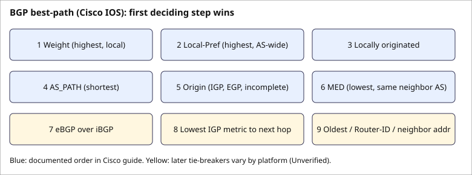

*شکل: ترتیب انتخاب بهترین مسیر BGP؛ اولین مرحله‌ی تعیین‌کننده برنده است.*

### ۵) مثال حل‌شده (سناریوی Route Leak)

سازمان ما (AS 65010) به ISP-A و ISP-B وصل است. بدون Prefix-List خروجی، همه‌ی مسیرهایی که از ISP-A یاد می‌گیریم به ISP-B هم اعلام می‌شود (به‌شرطی که پیش‌فرض‌های BGP و Policy آن را بدهند).

``` text
ISP-A routes -> our router -> advertised to ISP-B   (we become a transit AS)
Result: ISP-B may send transit traffic through our small links -> congestion/outage
```

**اصلاح:** Prefix-List خروجی فقط Prefixهای خودمان (مثلاً 203.0.113.0/24) را اجازه می‌دهد.

**مثال سخت:** پس از اعمال Local-Pref 200 برای ISP-A، ترافیک خروجی به A می‌رود ولی ترافیک ورودی مشتریان هنوز از B می‌آید. توضیح دهید چرا و راه‌حل (Prepend + هماهنگی با ISP).

### ۶) طراحی و تصمیم‌گیری

| سؤال | تصمیم پیشنهادی |
|---|---|
| ISP اصلی/پشتیبان خروجی | Local-Pref (نه Weight) تا همه‌ی روترهای AS یکسان تصمیم بگیرند |
| ورود ترافیک | Prepend + MED + (در صورت پشتیبانی) Community؛ انتظار کنترل کامل نداشته باشید |
| محافظت Session | TTL Security + Authentication + Max-Prefix |
| Filter | همیشه Prefix-List ورودی/خروجی در مرز ISP |
| تغییر Policy | Soft reconfiguration، نه ریست کامل |

### ۷) پیاده‌سازی (CLI Cisco، نمونه)

``` text
ip prefix-list MY-PFX seq 5 permit 203.0.113.0/24
ip prefix-list BOGONS seq 5 deny 10.0.0.0/8 le 32
ip prefix-list BOGONS seq 10 deny 172.16.0.0/12 le 32
ip prefix-list BOGONS seq 15 deny 192.168.0.0/16 le 32
ip prefix-list BOGONS seq 20 deny 0.0.0.0/0
ip prefix-list BOGONS seq 25 permit 0.0.0.0/0 le 24

route-map SET-LP-A permit 10
 set local-preference 200

router bgp 65010
 neighbor 192.0.2.1 remote-as 65100
 neighbor 192.0.2.1 route-map SET-LP-A in
 neighbor 192.0.2.1 prefix-list BOGONS in
 neighbor 192.0.2.1 prefix-list MY-PFX out
 neighbor 192.0.2.1 maximum-prefix 1000 80 warning-only
```

Verification:

``` text
R1# show ip bgp 198.51.100.0/24
R1# show ip bgp neighbors 192.0.2.1 advertised-routes
R1# show ip bgp neighbors 192.0.2.1 received-routes
R1# show ip bgp summary
R1# clear ip bgp 192.0.2.1 soft in
```

(`received-routes` نیاز به `soft-reconfiguration inbound` دارد؛ `Unverified` روی vIOS.)

### ۸) Troubleshooting

| علامت | شاهد | علت محتمل |
|---|---|---|
| مسیر غیرمنتظره انتخاب شد | `show ip bgp <prefix>` با Best | Attribute بالاتر در ترتیب |
| Prefix نمی‌آید | `received-routes`، Prefix-List | Filter ورودی/Bogon |
| ISP-B ترافیک ناخواسته می‌فرستد | `advertised-routes` | نبودن Prefix-List خروجی |
| Session ناپایدار | Log، Hold، `show ip bgp neighbors` | Timer، لینک، Max-prefix |
| Route نصب نشد | Next-hop در RIB | Next-hop غیرقابل‌دسترس |

### ۹) نکات امنیتی

- BGP Hijack و Route Leak سابقه‌ی واقعی در حوادث بزرگ اینترنت دارند؛ فیلتر ورودی/خروجی حداقل دفاع است.
- Max-Prefix در برابر «سرریز Table» یا اشتباه ISP محافظت می‌کند.
- TTL Security و Authentication Session را در برابر جعل TCP/RST محافظت می‌کنند.
- در Lab ایزوله بدون اینترنت حمله‌ی واقعی تست نمی‌شود؛ فقط رفتار با Peer مجاز.

### ۱۰) جمع‌بندی مفهومی

- ترتیب: Weight → Local-Pref → Local → AS_PATH → Origin → MED → eBGP/iBGP → IGP metric → Tie-break.
- اولین مرحله‌ی تعیین‌کننده برنده است؛ مراحل بعدی سنجیده نمی‌شوند.
- خروجی را با Local-Pref کنترل می‌کنیم؛ ورودی را فقط می‌توانیم تحت تأثیر قرار دهیم.
- Hold پیش‌فرض ۱۸۰ ثانیه است؛ با BFD سریع‌تر.
- امنیت: Prefix-List ورودی/خروجی، Max-Prefix، TTL Security، Authentication.

### ۱۱) تمرین و ارزیابی

**ت1.** (ساده) پنج مرحله‌ی اول انتخاب مسیر Cisco را به ترتیب بنویسید. *(پاسخ: 9-7-ت1)*

**ت2.** (ساده) Weight در کجا معتبر است؟ *(پاسخ: 9-7-ت2)*

**ت3.** (متوسط) دو مسیر: A (LP 150، AS_PATH طول 3) و B (LP 100، AS_PATH طول 1). کدام انتخاب می‌شود؟ چرا؟ *(پاسخ: 9-7-ت3)*

**ت4.** (متوسط) چرا برای کنترل خروج ترافیک Local-Pref بهتر از Weight است؟ *(پاسخ: 9-7-ت4)*

**ت5.** (سخت) دو مسیر با LP، Weight و AS_PATH برابر؛ A: Origin IGP، B: Origin Incomplete، MED A=100 و B=10. کدام برنده است؟ *(پاسخ: 9-7-ت5)*

**ت6.** (سخت، طراحی) سازمان می‌خواهد ترافیک ورودی را از ISP-A بگیرد و B پشتیبان باشد. چه ابزارهایی دارد و محدودیت چیست؟ *(پاسخ: 9-7-ت6)*

**ت7.** (سخت، امنیت) پنج خط محافظ Session eBGP با ISP را فهرست کنید و دلیل هر کدام. *(پاسخ: 9-7-ت7)*

**م1.** Max-Prefix برای چیست؟ *(پاسخ: 9-7-م1)*

**م2.** Soft reset چرا بهتر از ریست کامل است؟ *(پاسخ: 9-7-م2)*

**Q1.** Quick quiz (English): Which attribute is evaluated first on Cisco routers, and is it advertised to peers? *(پاسخ: 9-7-Q1)*

### ۱۲) اصطلاحات و English Corner

| مخفف | شکل کامل | معنی |
|---|---|---|
| LP | Local Preference | اولویت محلی (در کل AS) |
| MED | Multi-Exit Discriminator | نشانه‌ی ترجیح ورود برای همسایه |
| MRAI | Minimum Route Advertisement Interval | حداقل فاصله‌ی ارسال تغییر |
| GTSM | Generalized TTL Security Mechanism | حفاظت TTL Session |
| RPKI | Resource Public Key Infrastructure | اعتبارسنجی مالکیت Prefix |
| ROA | Route Origin Authorization | مجوز مبدأ مسیر |

- *Local preference influences outbound traffic; AS-path prepending only influences inbound traffic.* ← Local-Pref خروج را تحت تأثیر می‌گذارد؛ Prepend فقط ورود.
- *Always filter prefixes on eBGP sessions.* ← در Sessionهای eBGP همیشه Prefix را فیلتر کنید.

### ۱۳) منابع

- Cisco: [Select BGP Best-path Algorithm](https://www.cisco.com/c/en/us/support/docs/ip/border-gateway-protocol-bgp/13753-25.html).
- RFC 4271 — BGP-4 (§9.1: Decision Process).
- RFC 7454 (BCP 194) — BGP Operations and Security (Max-prefix، TTL Security، فیلتر Prefix).
- RFC 5880 — BFD.


## پاسخ‌های فصل 9

> ابتدا بدون نگاه حل کنید. شناسه: درس-نوع+شماره (ت = تمرین، م = مرور).


### پاسخ‌های بازنویسی عمیق درس 9-1

**9-1-ت1** — Session Established و ۵ Prefix دریافت شده.

ستون آخر `show ip bgp summary` یا حالت (Idle/Active/...) را نشان می‌دهد یا اگر Session برقرار باشد، تعداد Prefix دریافتی را. عدد ۵ یعنی Session در حالت Established است و ۵ Prefix از این Neighbor دریافت و پذیرفته شده است. ستون Up/Down مدت برقراری را می‌گوید. اگر عدد ۰ بود Session بالاست ولی Prefixی دریافت نشده: به سراغ فیلتر ورودی یا اعلام‌نکردن Peer بروید (درس ۹-۶).

**9-1-ت2** — TCP برقرار نشده و تلاش دوباره می‌شود.

Active در BGP یعنی «روتر فعالانه در حال تلاش برای ساختن اتصال TCP به Peer است ولی موفق نشده». این حالت سالم نیست و نباید با «فعال و سالم» اشتباه شود. علل: Peer در دسترس نیست، پورت 179 بسته است، آدرس Neighbor یا update-source اشتباه است، یا ACL/Firewall. اولین بررسی: `ping`، `show ip route <peer>` و `telnet <peer> 179`.

**9-1-ت3** — کوچک‌تر: 90 ثانیه (Keepalive 30).

Hold Time نهایی کوچک‌ترین مقدار پیشنهادی دو سر است؛ پس بین ۱۸۰ و ۹۰، مقدار ۹۰ ثانیه اعمال می‌شود و Keepalive معمولاً یک‌سوم Hold یعنی ۳۰ ثانیه. نتیجه: اگر Peer ۹۰ ثانیه چیزی نفرستد Session با NOTIFICATION بسته می‌شود. هماهنگ‌کردن تایمر دو سر برای پیش‌بینی‌پذیری بهتر است.

``` text
Hold = min(180, 90) = 90 s ; Keepalive = 90 / 3 = 30 s
```

**9-1-ت4** — تا TCP از Loopback/آدرس درست ساخته شود و با Neighbor دیگر مطابق باشد.

Session BGP روی TCP است و آدرس Source بسته را Neighbor با دستور neighbor خودش می‌شناسد. وقتی از Loopback Peer می‌کنید، باید `update-source Loopback0` بگذارید تا TCP از آدرس Loopback ساخته شود؛ وگرنه بسته با آدرس Interface خروجی می‌رود و Neighbor آن را به‌عنوان Peer ناشناخته رد می‌کند. در iBGP Loopback به‌همراه IGP پایداری را بالا می‌برد چون Session با خرابی یک لینک نمی‌افتد.

**9-1-ت5** — Loss باعث Hold Timer Expired؛ رفع Loss/QoS/BFD.

Session هر چند دقیقه می‌افتد و NOTIFICATION «Hold Timer Expired» می‌دهد: ۴۰٪ Loss باعث می‌شود چند Keepalive پشت‌سرهم گم شود و Hold (۱۸۰ ثانیه) تمام شود. رفع علت: کاهش Loss (کابل، QoS برای ترافیک کنترل)، یا BFD برای تشخیص سریع‌تر. تنظیم Timer کوتاه‌تر فقط سرعت تشخیص را زیاد می‌کند و ریسک Flap را هم؛ ریشه‌ی Loss باید رفع شود.

**9-1-ت6** — Timer کوتاه+BFD؛ آزمون لینک ناپایدار؛ Dampening.

Failover سریع BGP: Timer را کوتاه یا BFD (تشخیص زیر ثانیه) فعال می‌کنند. ریسک: لینک ناپایدار با هر Loss کوتاه Session را می‌اندازد و Flap پیاپی ایجاد می‌کند. راه کاهش: آزمون روی لینک ناپایدار، Dampening/Hold-down، و سنجش میزان Loss واقعی پیش از کاهش Timer. معیار: Failover < ۳ ثانیه بدون Flap در آزمون ۲۴ ساعته.

**9-1-Q1** — Active.

در حالت Active، TCP به Peer برقرار نشده و روتر دوباره تلاش می‌کند. بررسی اولیه: Reachability، پورت 179 و ACL.

### پاسخ‌های بازنویسی عمیق درس 9-2

**9-2-ت1** — BGP فقط Prefixی را اعلام می‌کند که Route دقیق در RIB دارد.

دستور `network` فقط Prefixی را اعلام می‌کند که در RIB با همان Mask دقیق وجود داشته باشد. اگر Route /16 داشته باشید و `network` برای /24 بنویسید، اعلام نمی‌شود. راه: Route Null0 دقیق برای Summary یا نوشتن Prefix واقعی. این رایج‌ترین علت «Prefix در BGP نیست» است.

**9-2-ت2** — 20.

Administrative Distance پیش‌فرض eBGP برابر ۲۰ است (iBGP ۲۰۰). یعنی در رقابت با OSPF (110) مسیر eBGP وارد RIB می‌شود. اگر Static با AD 1 همان Prefix را داشته باشد، BGP در RIB نمی‌نشیند و در `show ip bgp` با علامت r (RIB-failure) دیده می‌شود.

**9-2-ت3** — update-source، ebgp-multihop و Route به Loopback Peer.

برای eBGP با Loopback باید سه چیز باشد: `neighbor X update-source Loopback0` برای آدرس Source، `neighbor X ebgp-multihop 2` چون TTL پیش‌فرض eBGP برابر ۱ است و Loopback یک Hop بیشتر فاصله دارد، و Route Static/IGP به Loopback Peer. بدون هر یک Session بالا نمی‌آید.

**9-2-ت4** — نشت مسیرهای ناخواسته و Origin Incomplete؛ کنترل کم.

`redistribute connected/static` همه‌ی مسیرهای موجود را با Origin Incomplete وارد BGP می‌کند؛ ریسک: نشت مسیرهای ناخواسته (آدرس‌های داخلی یا لینک‌ها) به اینترنت و کنترل کم. ترجیح: `network` با Route-map/Prefix-list برای کنترل دقیق.

**9-2-ت5** — RIB-failure؛ مسیر با AD بهتر از منبع دیگر در RIB است.

`r` در `show ip bgp` یعنی RIB-failure: مسیر BGP معتبر است ولی مسیر بهتری با AD کمتر از منبع دیگر (مثلاً Static) در RIB نشسته؛ پس BGP نصب نمی‌شود. با `show ip bgp rib-failure` علت را ببینید و AD/Static را اصلاح کنید.

**9-2-ت6** — ASN، Peer IP، Prefix-list، Max-prefix، Auth.

برگه‌ی eBGP دو سازمان شامل: ASN هر دو، آدرس Peer، Prefixهای مجاز اعلام و دریافت (Prefix-list)، Max-prefix، Authentication (MD5)، TTL Security، تماس NOC و Timer/BFD. این برگه پیش از فعال‌سازی امضا می‌شود تا اشتباه کانفیگ ISP یا خودمان به Leak نرسد.

**9-2-Q1** — Because there is no exactly matching route in the routing table.

چون BGP فقط Prefixی را اعلام می‌کند که Route دقیقاً مطابق در RIB باشد؛ برای Summary باید Route Null0 با همان Mask ساخت.

### پاسخ‌های بازنویسی عمیق درس 9-3

**9-3-ت1** — Split-horizon: مسیر iBGP به iBGP Peer داده نمی‌شود.

قاعده‌ی Split-horizon در iBGP: مسیری که از یک iBGP Peer یاد گرفته شده به iBGP Peer دیگر داده نمی‌شود تا حلقه‌ی AS_PATH-بدون-تغییر ایجاد نشود (در iBGP AS_PATH تغییر نمی‌کند). نتیجه: همه‌ی روترهای iBGP باید Full-mesh باشند یا از Route Reflector استفاده شود.

**9-3-ت2** — Next-hop را آدرس خود روتر قرار می‌دهد.

`next-hop-self` Next-hop مسیرهایی را که به iBGP Peer می‌دهد آدرس خود روتر قرار می‌دهد. چون پیش‌فرض iBGP تغییر Next-hop نمی‌دهد و Next-hop خارجی (آدرس ISP) ممکن است در IGP نباشد، روتر داخلی آن را Inaccessible می‌بیند. با next-hop-self مسیر قابل‌استفاده می‌شود.

**9-3-ت3** — 20×19/2 = 190.

Full-mesh برای n روتر n(n−1)/2 Session دارد. برای ۲۰ روتر ۱۹۰ Session؛ مدیریت و CPU سخت می‌شود. راه: Route Reflector با تعداد Session تقریباً خطی (هر Client با RR).

``` text
Sessions = 20 x 19 / 2 = 190
```

**9-3-ت4** — پایداری با وجود چند مسیر؛ نیاز IGP.

Peering iBGP با Loopback باعث می‌شود Session با خرابی یک لینک نیفتد (IGP مسیر جایگزین به Loopback می‌دهد) و Session مستقل از Interface فیزیکی باشد. پیش‌نیاز: IGP (OSPF) Reachability Loopback را بدهد و `update-source Loopback0`.

**9-3-ت5** — next-hop-self یا IGP Reachability؛ ریست نرم.

Next-hop inaccessible: مسیر BGP در Table است ولی Next-hop (خارجی) در RIB نیست. راه: `neighbor X next-hop-self` روی روتر مرزی یا Redistribute/Passive کردن شبکه‌ی لینک خارجی در IGP. پس از تغییر `clear ip bgp X soft` و تأیید `>` و Route در RIB.

**9-3-ت6** — طرح.

طرح Route Reflector دوتایی: RR1 و RR2 طبق مستند Cisco اگر در یک Cluster‌اند باید Cluster-ID یکسان و Client/Non-client یکسان داشته باشند (در غیر این صورت هر RR با Router ID خودش Cluster-ID می‌گیرد)، Clientها با هر دو Session دارند؛ در خرابی RR1، RR2 جایگزین می‌شود. Session شمار حدود 2×n به‌جای n(n−1)/2. آزمون: قطع RR1 و دیدن Convergence و نبود حلقه.

**9-3-Q1** — To preserve the original exit point information; hence the next hop must be reachable via the IGP.

iBGP عمداً Next-hop را عوض نمی‌کند تا اطلاعات خروج اصلی حفظ شود؛ بنابراین Next-hop باید از طریق IGP قابل‌دسترس باشد.

### پاسخ‌های بازنویسی عمیق درس 9-4

**9-4-ت1** — Local-Pref (کل AS) یا Weight (محلی).

برای کنترل خروج: Local-Preference در کل AS (مقدار بزرگ‌تر بهتر) و Weight فقط محلی روی همان روتر (سیسکو). در طراحی دو ISP معمولاً Local-Pref 200 برای ISP ترجیحی ست می‌شود و `clear ip bgp soft in` اعمال می‌شود.

**9-4-ت2** — AS_PATH را بلندتر نشان می‌دهد تا کم‌ترجیح شود.

AS-Path Prepend شماره‌ی AS خودمان را چند بار به مسیرهای ارسالی اضافه می‌کند تا مسیر بلندتر و کم‌ترجیح دیده شود. برای تأثیر روی ورود ترافیک استفاده می‌شود؛ تضمینی نیست چون ISP می‌تواند Local-Pref خودش را اعمال کند.

**9-4-ت3** — Prepend مسیرهای ارسالی را تغییر می‌دهد نه ترجیح خودمان برای دریافتی.

Prepend روی ورودی برای کنترل خروج بی‌اثر است چون Prepend مسیرهای ارسالی را تغییر می‌دهد، نه ترجیح ما برای مسیرهای دریافتی. برای خروج باید Local-Pref/Weight روی مسیرهای دریافتی گذاشت.

**9-4-ت4** — فقط بین Pathهای همان AS همسایه.

MED فقط بین مسیرهای دریافتی از همان AS همسایه مقایسه می‌شود (پیش‌فرض)؛ بین دو AS مختلف مقایسه نمی‌شود مگر با `bgp always-compare-med`. کم‌تر بهتر است و برای پیشنهاد نقطه‌ی ورود به همسایه به‌کار می‌رود.

**9-4-ت5** — تقسیم Prefix، Prepend، Community، اندازه‌گیری.

برای تقسیم ورودی ۷۰/۳۰ بین دو ISP: Prefix را به دو نیمه تقسیم کنید و هر نیمه را با اولویت متفاوت اعلام کنید (نیمه‌ی بالا ترجیحاً از A، نیمه‌ی پایین از B)، Prepend برای مسیر پشتیبان، Community طبق مستند ISP و اندازه‌گیری ترافیک ورودی با Looking Glass/NetFlow. نتیجه تضمینی نیست؛ آزمون و تنظیم تکراری لازم است.

**9-4-ت6** — Local-Pref+Prefix-list+Prepend+Community.

Policy کامل دو ISP: Local-Pref 200 برای ISP-A (خروج)، Prefix-list خروجی فقط Prefixهای خودمان، Prepend 3× روی ISP-B برای ورودی، Community Action طبق ISP، Max-prefix و `soft` پس از هر تغییر. آزمون: traceroute خروجی و مشاهده‌ی ترافیک ورودی.

**9-4-Q1** — Local preference.

Local Preference ویژگی‌ای است که کل AS (iBGP) می‌بیند و مسیر خروج را تعیین می‌کند؛ Prepend فقط ورودی را تحت تأثیر می‌گذارد.

### پاسخ‌های بازنویسی عمیق درس 9-5

**9-5-ت1** — طول Prefix حداکثر 24.

در Prefix-list، `le 24` یعنی طول Prefix حداکثر ۲۴ (مثلاً 10.0.0.0/8 le 24 همه‌ی زیرمجموعه‌های تا /24)، و `ge` حداقل طول. این برای فیلتر Prefixهای خیلی طولانی (/25 تا /32) که نباید در اینترنت دیده شوند کاربرد دارد.

**9-5-ت2** — AS_PATH خالی؛ مسیرهای خودمان.

عبارت `^$` در AS-path access-list یعنی AS_PATH خالی؛ مسیرهایی که خودمان مبدأ آن‌ها هستیم. با `filter-list ... out` فقط Prefixهای خودمان اعلام می‌شود و از Transit شدن جلوگیری می‌کند.

**9-5-ت3** — اعلام مسیرهای یک ISP به ISP دیگر و تبدیل ما به Transit.

Route Leak یعنی مسیرهای یک ISP (مثلاً A) به ISP دیگر (B) اعلام شود و ما به‌ناخواسته Transit شویم؛ ترافیک اضافی و شکایت ISPها. جلوگیری: فیلتر خروجی با `^$` و Prefix-list، و فیلتر ورودی.

**9-5-ت4** — محافظت جدول/حافظه در برابر اشتباه یا حمله.

Max-prefix تعداد Prefixهای دریافتی از Neighbor را محدود می‌کند و در اشتباه/حمله (ارسال ۲۰۰ هزار Prefix) از پر شدن RIB و حافظه جلوگیری می‌کند؛ با هشدار در ۸۰٪ و قطع یا Warning-only. مقدار را از واقعیت ISP بگیرید.

**9-5-ت5** — advertised-routes، filter-list ^$ out، soft out.

کشف و رفع Leak: ۱) `show ip bgp neighbors X advertised-routes` Prefixهای اضافه را نشان می‌دهد. ۲) `filter-list ^$ out` و Prefix-list خروجی. ۳) `clear ip bgp X soft out`. ۴) آزمون: دوباره advertised-routes. ۵) اطلاع ISP.

**9-5-ت6** — Bogon in، Prefix out، Max-prefix، RPKI مفهومی.

استاندارد فیلتر ISP: ورودی Bogon و Prefixهای خصوصی/طولانی را رد کند و Max-prefix بگذارد؛ خروجی فقط Prefixهای خود. RPKI/ROA (اعتبارسنجی مبدأ) به‌عنوان لایه‌ی بعدی مفهومی. RFC 7454 مرجع بهترین رویه است.

**9-5-Q1** — Routes with an empty AS path, i.e., locally originated routes.

`^$` مسیرهای با AS_PATH خالی را تطبیق می‌دهد؛ یعنی مسیرهایی که خودمان مبدأ هستیم.

### پاسخ‌های بازنویسی عمیق درس 9-6


### پاسخ‌های بازنویسی عمیق درس 9-6

**9-6-ت1** — TCP برقرار نشده و تلاش دوباره می‌شود؛ ابتدا `telnet peer 179` و ACL/Reachability.

Active یعنی TCP برقرار نشده و تلاش تکرار می‌شود؛ ابتدا `telnet peer 179` و بررسی ACL/Reachability.

**9-6-ت2** — Session برقرار است ولی Prefixی دریافت نشده؛ فیلتر ورودی یا Peer اعلام نمی‌کند.

**9-6-ت3** — مسیر BGP در Table است ولی مسیر بهتر (AD کمتر) در RIB نشسته؛ رفع با حذف/تنظیم AD.

**9-6-ت4** — Next-hop خارجی در IGP نیست؛ `next-hop-self` یا Redistribute شبکه‌ی لینک.

**9-6-ت5** — اول لایه‌ی پایین‌تر را رفع و آزمون کنید، بعد بالاتر؛ ثبت اثر هر تغییر.

**9-6-ت6** — هفت گام، دستور هر گام، خروجی مورد انتظار، اقدام.

چک‌لیست BGP: هفت گام (Session، TCP، Received، Policy، Best path، RIB، Forwarding) با دستور و خروجی مورد انتظار.

**9-6-Q1** — show ip bgp rib-failure.

### پاسخ‌های درس‌های افزوده‌ی فصل 9 (۹-۰ و ۹-۷)

**9-0-ت1** — AS مجموعه‌ای از شبکه‌ها و روترها زیر یک مدیریت و سیاست مسیریابی واحد است که با یک ASN شناخته می‌شود.

**9-0-ت2** — TCP پورت 179.

**9-0-ت3** — eBGP = 20 و iBGP = 200. مسیر خارجی (eBGP) معتبرتر از مسیری است که از داخل AS یاد گرفته‌ایم؛ و iBGP نباید جلوی IGP را بگیرد.

**9-0-ت4** — هر AS هنگام عبور ASN خود را به AS_PATH اضافه می‌کند. اگر روتری ASN خودش را در AS_PATH ببیند، یعنی مسیر قبلاً از AS او گذشته و Update را رد می‌کند.

**9-0-ت5** — Static Default کافی است وقتی یک ISP، نیاز به Policy نیست و Failover خودکار لازم نیست. BGP لازم است وقتی: بیش از یک ISP با Policy انتخاب مسیر، نیاز به اعلام Prefix خودمان به اینترنت، یا اتصال به ASهای دیگر/شعب با Failover خودکار.

**9-0-ت6** — تعداد Sessionها n(n−1)/2 = 8×7/2 = 28. با رشد n به‌صورت درجه‌ی دو زیاد می‌شود؛ راه‌حل: Route Reflector (هر Client فقط با RR) یا Confederation.

**9-0-م1** — OPEN، KEEPALIVE، UPDATE، NOTIFICATION.

**9-0-م2** — چون BGP برای رسیدن به Next-hop (Recursive Lookup) به Reachability داخلی از IGP یا Static نیاز دارد؛ بدون آن مسیر BGP غیرقابل‌استفاده است.

**9-0-Q1** — Because each route carries the list of ASes it has passed through (the AS_PATH), which is used for loop prevention and policy.

**9-7-ت1** — Weight، Local Preference، مسیرهای Locally originated، AS_PATH کوتاه‌تر، Origin (IGP < EGP < Incomplete).

**9-7-ت2** — فقط روی همان روتر؛ به Peerها اعلام نمی‌شود.

**9-7-ت3** — A برنده است. Local-Pref قبل از AS_PATH سنجیده می‌شود (150 > 100) و مرحله‌ی AS_PATH اصلاً بررسی نمی‌شود.

**9-7-ت4** — Local-Pref در کل AS (iBGP) پخش می‌شود و همه‌ی روترهای AS یکسان تصمیم می‌گیرند؛ Weight فقط محلی است و ناسازگاری ایجاد می‌کند.

**9-7-ت5** — Weight/LP/AS_PATH برابرند؛ مرحله‌ی Origin: IGP (A) از Incomplete (B) بهتر است؛ پس A برنده می‌شود و MED سنجیده نمی‌شود (MED بعد از Origin می‌آید).

**9-7-ت6** — ابزارها: AS-Path Prepend روی B، MED، و Community (اگر ISP بپذیرد). محدودیت: ورودی را ISPها و دیگر ASها تعیین می‌کنند؛ ما فقط «پیشنهاد» می‌دهیم و کنترل کامل نداریم.

**9-7-ت7** — (۱) Prefix-List ورودی: رد Bogon و Prefixهای نامعتبر. (۲) Prefix-List خروجی: فقط Prefixهای خودمان تا Route Leak نشود. (۳) Max-Prefix: محافظت از حافظه/جدول. (۴) TTL Security (GTSM): جلوگیری از جعل از راه دور. (۵) Authentication (MD5/TCP-AO): جلوگیری از تزریق به Session.

**9-7-م1** — محدود کردن تعداد Prefix دریافتی از یک Peer؛ هشدار یا قطع Session هنگام تعداد غیرعادی.

**9-7-م2** — بدون قطع Session و بدون قطع ترافیک، Policy جدید اعمال می‌شود؛ ریست کامل همه‌ی مسیرها را موقتاً از بین می‌برد.

**9-7-Q1** — Weight is evaluated first; it is Cisco-specific, local to the router and is not advertised to peers.


# پایان بخش ۳ (فصل‌های ۷ تا ۹)

## ۱) خلاصه‌ی مهارت‌های کسب‌شده
- DHCP/Relay، DNS/NTP، NAT/PAT، ACL، Syslog/SNMP، QoS؛ Hardening، AAA، JSON/YAML/REST، Netmiko، Ansible، Git، As-Built.
- BGP: eBGP/iBGP، انتخاب مسیر، فیلتر، عیب‌یابی.

## ۲) آزمون پایان سه فصل
**س1** — giaddr در DHCP Relay چیست؟

**س2** — Stratum 16 یعنی چه؟

**س3** — PAT چه چیزی را علاوه بر IP تغییر می‌دهد؟

**س4** — Implicit deny در ACL؟

**س5** — Syslog severity 3 و 6؟

**س6** — چرا SNMPv3؟

**س7** — سه کنترل Management Plane در Hardening؟

**س8** — چرا AAA Fallback محلی؟

**س9** — Idempotency در Ansible؟

**س10** — حالت سالم Peer BGP؟

**س11** — Local-Pref در برابر MED؟

**س12** — چرا Prefix-List روی eBGP؟


## ۳) پاسخ آزمون
- **س1:** آدرس Interface Relay؛ سرور از آن Scope را تشخیص می‌دهد.
- **س2:** ناهمگام (نامعتبر).
- **س3:** پورت مبدأ.
- **س4:** deny any نامرئی در پایان؛ هر چه permit نشده بسته می‌شود.
- **س5:** Error و Informational.
- **س6:** احراز هویت و رمزگذاری دارد؛ v2c متن ساده است.
- **س7:** SSH v2/ACL VTY/AAA یا secret؛ بستن http/telnet.
- **س8:** اگر سرور AAA قطع شد قفل نشویم.
- **س9:** اجرای دوباره بدون تغییر اگر حالت مطلوب برقرار است.
- **س10:** Established.
- **س11:** LocPrf داخل AS و بالاتر بهتر؛ MED برای همسایه و کمتر بهتر.
- **س12:** جلوگیری از نشت/پذیرش مسیر ناخواسته.

## ۴) معیارهای تسلط
| مهارت | سطح | شاهد |
|---|---|---|
| IP Services | L3 | Service Matrix |
| Hardening/Automation | L2-L3 | CP1 As-Built |
| BGP پایه | L3 | رفع ۵ خرابی |

## ۵) مشکلات و موارد باقی‌مانده (صریح)
1. Labهای ۷ و ۸ اجرا نشده. 2. فصل ۹ جدید و بدون تجربه‌ی Image (BGP روی vIOS باید کار کند ولی آزمایش نشده). 3. SNMPv3/AAA/TACACS سینتکس `Unverified`.

## ۶) پیش‌نیازهای بخش بعد
BGP عملی روی دو vIOS؛ آماده‌بودن Image دوم برای ISP-Sim.

## ۷) فهرست Lab و منابع مرتبط
کارت‌های Lab همین فایل ، `03-ops/*.md` (خروجی دانشجو)

## ۸) وضعیت دوره
| مورد | مقدار |
|---|---|
| آخرین فصل تکمیل‌شده | ۹ |
| آخرین درس تکمیل‌شده | ۹-۶ |
| مهارت‌های تأییدشده | **هیچ‌کدام هنوز آزمون عملی واقعی نشده‌اند** (ممیزی/اجرای شما لازم است) |
| موضوعات نیازمند مرور | طبق «معیارهای تسلط» |
| فصل بعدی | ۱۰ |
| فایل تولیدشده | `course/Course_Part_03_Chapters_07-09.md` |

---

# Enterprise Network & Security Engineering — دوره‌ی تخصصی Cisco و Enterprise Firewall
## بخش ۴ از ۱۱ — فصل‌های ۱۰ تا ۱۲

| مورد | مقدار |
|---|---|
| نام دوره | Enterprise Network & Security Engineering (Cisco + FortiGate) |
| شماره بخش | ۴ از ۱۱ |
| فصل‌های این فایل | ۱۰ ، ۱۱ ، ۱۲ |
| تاریخ تولید | ۲۰۲۶-۱۱-۲۶ |
| نسخه Blueprint | v3.0 (+ بازبینی ۱٫۱) |
| نسخه‌های نرم‌افزار | FortiOS 7.0.3 (اسمی؛ بوت‌نشده؛ تأیید با `get system status`) ؛ Cisco vIOS-L2 15.2(20200924، Experimental) ؛ Cisco vIOS 15.9(3)M9 ؛ VPCS ؛ PNetLab 4.2.8 ؛ ESXi 8.0U2 ؛ CSR1000v 17.03.02 (IOS-XE؛ آزمایش‌نشده) |
| وضعیت تکمیل | **فصل‌های ۱۰–۱۲ تولید شد؛ مبانی تا Baseline FortiGate.** همه‌ی Labها «اجرا نشده»؛ FortiGate هنوز بوت نشده. محتوای FortiGate از مستند عمومی FortiOS 7.0 و دانش مؤلف است و باید در بوت اول تطبیق داده شود. |

> **قوانین خواندن:** تمرین‌ها و پرسش‌های مرور بدون پاسخ‌اند؛ پاسخ در «پاسخ‌های فصل». «اجرا نشده» یعنی خروجی‌ها **پیش‌نیاز/پیش‌بینی** هستند. «CLI-Accepted» ≠ «کار می‌کند». رمزها نمونه‌اند.

### وضعیت راستی‌آزمایی Labهای این بخش
خلاصه: اجرا نشده (فقط طراحی): 20.

| Lab | وضعیت |
|---|---|
| 10-1 | اجرا نشده (فقط طراحی) |
| 10-2 | اجرا نشده (فقط طراحی) |
| 10-3 | اجرا نشده (فقط طراحی) |
| 10-4 | اجرا نشده (فقط طراحی) |
| 10-5 | اجرا نشده (فقط طراحی) |
| 10-6 | اجرا نشده (فقط طراحی) |
| 10-7 | اجرا نشده (فقط طراحی) |
| 11-1 | اجرا نشده (فقط طراحی) |
| 11-2 | اجرا نشده (فقط طراحی) |
| 11-3 | اجرا نشده (فقط طراحی) |
| 11-4 | اجرا نشده (فقط طراحی) |
| 11-5 | اجرا نشده (فقط طراحی) |
| 11-6 | اجرا نشده (فقط طراحی) |
| 12-1 | اجرا نشده (فقط طراحی) |
| 12-2 | اجرا نشده (فقط طراحی) |
| 12-3 | اجرا نشده (فقط طراحی) |
| 12-4 | اجرا نشده (فقط طراحی) |
| 12-5 | اجرا نشده (فقط طراحی) |
| 12-6 | اجرا نشده (فقط طراحی) |
| 12-7 | اجرا نشده (فقط طراحی) |

---

<a id="ch10"></a>

> **نسخه‌ی اصلاح‌شده (v3.1، دسته B):** این فایل نسخه‌ی توسعه‌یافته‌ی `course/Course_Part_04_Chapters_10-12.md` است؛ فایل اصلی حفظ شده است. درس‌های افزوده: ۱۰-۸ و ۱۰-۹ (فصل ۱۰). پاسخ‌های آن‌ها در «پاسخ‌های فصل» همان فصل است.

> **نسخه‌ی اصلاح‌شده (v3.9):** نسخه‌ی توسعه‌یافته‌ی فایل اصلی؛ درس‌های افزوده: ۱۰-۸، ۱۰-۹، ۱۱-۰، ۱۱-۷، ۱۲-۰، ۱۲-۸، ۱۲-۹ (دسته‌های B و A). فایل اصلی در `course/` حفظ شده است. پاسخ‌های درس‌های افزوده در «پاسخ‌های فصل» همان فصل است.

# فصل 10 — Redistribution، ECMP، PBR، VRF-lite و Asymmetric Routing

> **یادداشت علمی v4.0 — فصل 10:** عمومی: Redistribution، ECMP، PBR، VRF-lite، Asymmetric. مختص محصول: Cisco IOS.
> فرض: Metric/AD پیش‌فرض؛ ECMP و Hash به پلتفرم وابسته است.
> مراجع: Cisco؛ RFC 4271/2328 برای رفتار پروتکل.


**مدت:** ۳۶ ساعت | **پیش‌نیاز:** فصل ۹ (BGP)، فصل ۶ (OSPF).
**اهداف:** انتقال مسیر بین پروتکل‌ها بدون حلقه؛ توزیع بار با ECMP؛ هدایت ترافیک با PBR؛ جداسازی جداول مسیریابی با VRF-lite؛ تحلیل و رفع مسیر نامتقارن.
**چرا برای فایروال؟** فایروال Stateful با مسیر نامتقارن خراب می‌شود؛ ECMP/PBR/VRF همان ابزارهایی هستند که باعث نامتقارن‌شدن یا جداسازی می‌شوند.
**معیار تسلط:** Redistribution دوطرفه با Tag و بدون حلقه؛ پیش‌بینی مسیر ECMP؛ PBR با Track؛ VRF مستقل؛ تشخیص Asymmetric با traceroute دوطرفه.
**اشتباهات رایج:** Redistribution بدون `subnets`؛ حلقه‌ی دوطرفه؛ PBR روی Interface اشتباه؛ نشت VRF ناخواسته؛ بررسی مسیر فقط در یک جهت.

**درس‌های فصل:**
- [درس 10-1 — Redistribution: مفهوم و Seed Metric](#l-10-1)
- [درس 10-2 — Redistribution دوطرفه و جلوگیری از حلقه با Tag](#l-10-2)
- [درس 10-3 — ECMP و توزیع بار](#l-10-3)
- [درس 10-4 — Policy-Based Routing (PBR)](#l-10-4)
- [درس 10-5 — VRF-lite: جداسازی جدول مسیریابی](#l-10-5)
- [درس 10-6 — Asymmetric Routing: تحلیل مسیر رفت و برگشت](#l-10-6)
- [درس 10-7 — طراحی مسیر برای چندفایروالی و آزمون کوچک](#l-10-7)

---

<a id="l-10-1"></a>

## درس 10-1 — Redistribution: مفهوم، Seed Metric، Subnets و Route Type

**فصل 10 · بازنویسی عمیق · پیش‌نیاز: ۶-۱، ۶-۴، ۹-۲ · ≈ 9 ساعت**

> **وضعیت:** Cisco IOSv 15.9/CSR1000v 17.03؛ خروجی‌ها نمونه‌ی آموزشی؛ Lab «اجرا نشده»؛ دستورهای vIOS `Unverified` تا اجرای Lab.

<!--deep-->

### هدف آموزشی

در پایان این درس باید بتوانید:

1. توضیح دهید چرا Redistribution لازم است و چه خطرهایی دارد.
2. Seed Metric را برای OSPF، EIGRP و RIP تعیین کنید.
3. فرق E1 و E2 را با محاسبه‌ی عددی نشان دهید.
4. Redistribute یک‌طرفه را بین OSPF و EIGRP پیکربندی و تأیید کنید.
5. نقش `subnets`، `metric` و `route-map` را بدانید.
6. خرابی «مسیر وارد نمی‌شود» را با روش مرحله‌ای عیب‌یابی کنید.

### چرا باید یاد بگیریم؟

در سازمان‌های واقعی چند پروتکل مسیریابی کنار هم زندگی می‌کنند: هسته با OSPF، شعب با EIGRP، لبه با BGP. دلیل‌ها تاریخی و سازمانی‌اند (ادغام شرکت‌ها، سازنده‌های متفاوت، مهاجرت تدریجی). هر پروتکل «زبان» خودش را دارد و مستقیم با دیگری حرف نمی‌زند. **Redistribution** یک «مترجم» است که مسیرهای یک زبان را به زبان دیگر می‌گوید. مثل دو شهر با دو واحد پول: بدون نرخ تبدیل نمی‌توان معامله کرد. اگر نرخ (Metric) را اشتباه بدهید، یا مسیر وارد نمی‌شود یا ترافیک از مسیر نادرست می‌رود، یا بدتر: حلقه‌ی مسیریابی می‌سازید (درس بعد).

### چرا Metric مسئله است؟

هر پروتکل مقیاس متفاوتی دارد:

| پروتکل | معیار | نکته |
|---|---|---|
| RIP | تعداد Hop (۱ تا ۱۵؛ ۱۶ = غیرقابل‌دسترس) | ساده |
| OSPF | Cost = Reference BW / BW | ۱ تا ۶۵۵۳۵ برای هر لینک |
| EIGRP | ترکیب Bandwidth، Delay (پیش‌فرض)، Reliability، Load، MTU | ۵ عدد |
| BGP | صفات (AS-Path، MED و ...) | سیاست‌محور |

مسیر OSPF با Cost=20 در EIGRP چه معنایی دارد؟ هیچ. پس وقتی مسیر از OSPF وارد EIGRP می‌شود باید یک **Seed Metric** (متریک اولیه) تعیین کنید؛ بعد از ورود، EIGRP به آن Hop به Hop هزینه اضافه می‌کند.

### قواعد هر پروتکل

**ورود به OSPF:** مسیر به‌عنوان **External** (LSA نوع 5 در Area عادی، نوع 7 در NSSA) وارد می‌شود. روتری که این کار را می‌کند **ASBR** (Autonomous System Boundary Router) است. Seed Metric پیش‌فرض 20 (برای BGP: 1) است و نوع آن E2 است.

- **E2 (پیش‌فرض):** متریک خارجی در مسیر ثابت می‌ماند؛ هزینه‌ی داخلی OSPF تا ASBR **اضافه نمی‌شود**.
- **E1:** متریک خارجی + هزینه‌ی داخلی تا ASBR.

``` text
E2 total = external metric (e.g. 20)
E1 total = external metric + internal cost to ASBR = 20 + 15 = 35
```

E1 زمانی مفید است که چند ASBR یک Prefix را اعلام می‌کنند و می‌خواهید روتر نزدیک‌ترین ASBR را انتخاب کند؛ E2 ممکن است ASBR دورتر را (چون متریک خارجی کمتر) بردارد.

**ورود به EIGRP:** باید ۵ عدد بدهید: Bandwidth (Kbps)، Delay (ده‌میکروثانیه)، Reliability (1–255)، Load (1–255)، MTU.

``` text
redistribute ospf 1 metric 10000 100 255 1 1500
```

به‌جای تکرار در هر `redistribute`، می‌توان `default-metric 10000 100 255 1 1500` زیر `router eigrp` گذاشت. اگر هیچ‌کدام نباشد، مسیرها وارد EIGRP نمی‌شوند (از قدیمی‌ترین خطاها). EIGRP مسیر وارد‌شده را با AD برابر **170** (External) می‌سازد.

**ورود به RIP:** `default-metric` یا `metric` به Hop؛ مقدار 16 یعنی غیرقابل‌دسترس.

**کلمه‌ی `subnets` در Cisco:** `redistribute <proto> subnets` در OSPF؛ بدون آن فقط شبکه‌های Classful وارد می‌شوند و زیرشبکه‌ها (مثلاً 10.5.1.0/24) رد می‌شوند.

### پیکربندی‌های نمونه

**EIGRP → OSPF:**

``` text
router ospf 1
 redistribute eigrp 100 subnets metric 20 metric-type 1
```

**OSPF → EIGRP:**

``` text
router eigrp 100
 redistribute ospf 1 metric 10000 100 255 1 1500
```

**مسیرهای Connected و Static:**

``` text
router ospf 1
 redistribute connected subnets
 redistribute static subnets
```

**فیلتر با Route-map (توصیه):**

``` text
ip prefix-list EIGRP-NETS seq 5 permit 10.5.0.0/16 le 24
route-map E2O permit 10
 match ip address prefix-list EIGRP-NETS
 set metric 30
 set metric-type type-1
router ospf 1
 redistribute eigrp 100 subnets route-map E2O
```

### Verification

``` text
show ip route eigrp                 (on ASBR: are the routes there?)
show ip ospf database external      (Type 5 LSAs)
show ip route 10.5.0.0              (on a far OSPF router)
show ip protocols
```

در روتر دور OSPF: `O E2 10.5.0.0/16 [110/20] via ...` یعنی مسیر خارجی E2 با Metric 20. با `metric-type 1`: `O E1 ... [110/35]`.

### مثال‌های حل‌شده

#### مثال ساده — Redistribute اول

OSPF Area 0 و EIGRP AS 100 در R5. مراحل: ۱) `redistribute eigrp 100 subnets metric 20` در OSPF ۲) `show ip route` در R1 (OSPF): مسیرهای `O E2` از EIGRP ۳) ping به شبکه‌ی EIGRP. اگر `subnets` را فراموش کنید ممکن است فقط /8 (Classful) بیاید.

#### مثال متوسط — E1 در برابر E2 با عدد

R1 فاصله‌ی داخلی تا ASBR-A برابر 10 و تا ASBR-B برابر 40. هر دو Prefix 10.5.0.0/16 را با Seed=20 اعلام می‌کنند.

``` text
E2 : via A = 20 ; via B = 20 -> tie (both 20)  -> picks by lowest forward cost to ASBR = A
E1 : via A = 20 + 10 = 30 ; via B = 20 + 40 = 60 -> picks A
```

با E2 در تساوی، OSPF از «هزینه‌ی داخلی تا ASBR» برای شکستن تساوی استفاده می‌کند. ولی اگر B متریک خارجی 15 داشت: E2: B=15 < A=20 ⇒ B برنده (حتی دورتر)؛ E1: A=30 < B=55 ⇒ A. این مثال تفاوت واقعی را نشان می‌دهد.

#### مثال متوسط — Seed در EIGRP

مسیر OSPF با لینک 10 Mbps و تأخیر 100 μs: `metric 10000 10 255 1 1500` (Bandwidth به Kbps=10000 برای 10 Mbps، Delay=10 (ده‌میکروثانیه برابر 100 μs)). Metric EIGRP با Bandwidth و Delay کمینه‌شده محاسبه می‌شود؛ اگر Seed را بدون دقت بدهید، EIGRP لینک‌های واقعی را سریع‌تر یا کندتر از واقعیت می‌بیند. در عمل یک مقدار مشخص و ثابت (مثلاً لینک پیش‌فرض ۱ Gbps) انتخاب و مستند می‌شود.

#### مثال متوسط — مسیر وارد نمی‌شود

علامت: Prefix EIGRP در OSPF دیده نمی‌شود.

1. `show ip route eigrp` در ASBR ⇒ Prefix هست؟ (اگر نه، مشکل EIGRP است نه Redistribution)
2. `show run | section router ospf` ⇒ `subnets`؟ `metric`؟
3. `show ip ospf database external` ⇒ LSA نوع 5 هست؟
4. روتر دور: Area Stub؟ (در Stub Area LSA نوع 5 وارد نمی‌شود؛ NSSA لازم است)
5. Route-map/Prefix-list رد می‌کند؟
6. پس از رفع، `O E2` ظاهر می‌شود.

#### مثال سخت — دو ASBR و انتخاب مسیر بهینه

شبکه‌ی 10.5.0.0/16 از دو شعبه‌ی EIGRP (A و B) اعلام می‌شود. هدف: روتر هر منطقه از ASBR نزدیک‌تر استفاده کند. راه‌حل: `metric-type 1` و Seed برابر ⇒ انتخاب بر پایه‌ی هزینه‌ی داخلی. آزمون: traceroute از دو منطقه؛ اگر هر دو از A می‌روند، Seed/نوع را بررسی کنید.

#### مثال سخت — Redistribute در Stub/NSSA

ASBR در Area 10 که Stub است؛ LSA نوع 5 ممنوع است و Redistribute بی‌اثر. راه: تبدیل Area به NSSA (`area 10 nssa`) که LSA نوع 7 اجازه می‌دهد و در ABR به نوع 5 تبدیل می‌شود. نشانه: `show ip ospf database nssa-external`.

### Lab هدایت‌شده (اجرا نشده)

1. سه روتر: R1 (OSPF)، R5 (هر دو پروتکل، ASBR)، R9 (EIGRP).
2. Redistribute EIGRP→OSPF با `subnets metric 20`؛ آزمون `O E2`.
3. تغییر به E1 و مقایسه‌ی Metric.
4. OSPF→EIGRP بدون Seed ⇒ مسیر وارد نمی‌شود؛ سپس با Seed.
5. Evidence و جدول «تنظیم ← اثر».

### عیب‌یابی سریع

| علامت (مشاهده) | علت محتمل (باید اثبات شود) | اقدام پس از اثبات |
|---|---|---|
| مسیر وارد EIGRP نمی‌شود | Seed نیست | `metric` یا `default-metric` |
| فقط شبکه‌ی Classful وارد OSPF می‌شود | `subnets` ندارد | افزودن |
| در Stub مسیر نمی‌آید | LSA 5 ممنوع | NSSA |
| Metric عجیب | E1/E2 | مقایسه |

### نکات امنیتی

- Redistribute بدون Filter می‌تواند مسیرهای ناخواسته (مثلاً Static به Null0) را وارد کند؛ همیشه Route-map/Prefix-list.
- تغییر Redistribute را با CHG و آزمون ثبت کنید.

### جمع‌بندی

Redistribution مترجم بین پروتکل‌ها است. Seed Metric ضروری است. در OSPF مسیر خارجی E2 (ثابت) یا E1 (+ هزینه‌ی داخلی) است و `subnets` را فراموش نکنید. در EIGRP ۵ عدد لازم است. Filter و آزمون از ورود مسیر ناخواسته جلوگیری می‌کند.

### تمرین و ارزیابی

**ت1.** (ساده) Seed Metric پیش‌فرض Redistribution به OSPF چند است؟ *(پاسخ: 10-1-ت1)*

**ت2.** (ساده) چرا EIGRP و RIP Metric پیش‌فرض ندارند؟ *(پاسخ: 10-1-ت2)*

**ت3.** (متوسط) تفاوت E1 و E2؟ *(پاسخ: 10-1-ت3)*

**ت4.** (متوسط) اگر `subnets` نباشد چه می‌شود؟ *(پاسخ: 10-1-ت4)*

**ت5.** (سخت) دو ASBR و تصمیم Type. *(پاسخ: 10-1-ت5)*

**ت6.** (سخت، طراحی) طرح Redistribution یک‌طرفه با فیلتر. *(پاسخ: 10-1-ت6)*

**Q1.** Quick quiz (English): What happens if you redistribute into EIGRP without specifying a metric? *(پاسخ: 10-1-Q1)*

### اصطلاحات و English Corner

| مخفف | شکل کامل | معنی |
|---|---|---|
| ASBR | Autonomous System Boundary Router | روتر مرزی دامنه |
| E2 | OSPF External Type 2 | مسیر خارجی نوع ۲ |
| Seed | Seed metric | Metric اولیه |

- *Redistribution injects routes from one protocol into another.* ← Redistribution مسیرهای یک پروتکل را به دیگری تزریق می‌کند.

### کارت Lab

**کارت Lab:** Redistribution یک‌طرفه. **Evidence:** `03-ops/redist1.md`.

### منابع

- Cisco IOS IP Routing guide: Redistribution
- RFC 2328 (OSPF) بخش External

<a id="l-10-2"></a>

## درس 10-2 — Redistribution دوطرفه، Route Feedback و جلوگیری از حلقه با Tag

**فصل 10 · بازنویسی عمیق · پیش‌نیاز: ۱۰-۱ · ≈ 9 ساعت**

> **وضعیت:** Cisco IOSv 15.9/CSR1000v 17.03؛ خروجی‌ها نمونه‌ی آموزشی؛ Lab «اجرا نشده»؛ دستورهای vIOS `Unverified` تا اجرای Lab.

<!--deep-->

### هدف آموزشی

در پایان این درس باید بتوانید:

1. Route Feedback و حلقه‌ی Redistribution دوطرفه را توضیح دهید.
2. با Route Tag حلقه را شناسایی و جلوگیری کنید.
3. نقش Administrative Distance را در انتخاب مسیر نادرست بفهمید.
4. Redistribute دوطرفه‌ی ایمن را با Route-map طراحی کنید.
5. حلقه را از روی traceroute و جدول مسیر تشخیص دهید.
6. راه‌حل‌های جایگزین (یک‌طرفه + Default، Summary) را بشناسید.

### چرا باید یاد بگیریم؟

Redistribute یک‌طرفه نسبتاً ایمن است. ولی در بسیاری از شبکه‌ها دو پروتکل در **دو نقطه** به هم وصل‌اند (برای افزونگی) و باید دوطرفه Redistribute شود. اینجا خطرناک‌ترین حالت است: مسیری که از A به B رفته، می‌تواند از نقطه‌ی دیگر دوباره به A برگردد و A آن را «جدید» بداند. نتیجه: مسیر زیرین (Suboptimal)، ناپایداری یا حلقه. مثل دو دفتر پست که هر کدام نامه‌ی «جدید» را به دیگری می‌فرستند و نامه بی‌انتها می‌چرخد. راه‌حل مهر «ارسال‌شده» است؛ در شبکه این مهر **Route Tag** است.

### Route Feedback — سناریو

``` text
          OSPF Area 0                       EIGRP AS 100
   +----------------+                 +------------------+
   |  R1 --- R2     |                 |   R9             |
   +--|------|------+                 +----|----|--------+
      |      |                             |    |
     ASBR-1 ASBR-2 -------------------------+----+
   (R3: redistributes both ways)   (R4: redistributes both ways)
```

مراحل مشکل:

1. شبکه‌ی 10.5.0.0/24 در EIGRP (R9) وجود دارد.
2. R3 آن را به OSPF Redistribute می‌کند (LSA نوع 5).
3. R4 در OSPF این مسیر را می‌بیند و آن را دوباره به EIGRP Redistribute می‌کند (به‌عنوان مسیر External).
4. حالا EIGRP یک مسیر اصلی (AD 90) و یک مسیر External (AD 170) دارد. تا وقتی مسیر اصلی هست، مشکلی دیده نمی‌شود.
5. با قطع مسیر اصلی، مسیر چرخشی (از طریق R3→OSPF→R4) نصب می‌شود؛ ترافیک می‌چرخد و ممکن است حلقه شود.

### راه‌حل ۱: Route Tag

Tag یک عدد (۱ تا ۴ میلیارد) است که به مسیر هنگام Redistribute می‌چسبد و در پروتکل می‌ماند (در OSPF و EIGRP پشتیبانی می‌شود).

``` text
! On R3 and R4 (both ASBRs)
route-map EIGRP-TO-OSPF permit 10
 set tag 100
route-map OSPF-TO-EIGRP deny 10
 match tag 100
route-map OSPF-TO-EIGRP permit 20
!
router ospf 1
 redistribute eigrp 100 subnets route-map EIGRP-TO-OSPF
router eigrp 100
 redistribute ospf 1 route-map OSPF-TO-EIGRP metric 10000 100 255 1 1500
```

منطق: مسیری که از EIGRP به OSPF می‌رود Tag 100 می‌گیرد؛ هنگام برگشت از OSPF به EIGRP، اگر Tag=100 دارد رد می‌شود. بنابراین مسیرهای اصیل OSPF (بدون Tag) به EIGRP می‌روند و مسیرهای «برگشتی» نمی‌روند.

### راه‌حل ۲: Prefix-list

اگر می‌دانید کدام Prefixها از کدام سمت‌اند، فقط همان‌ها را اجازه دهید:

``` text
ip prefix-list OSPF-ORIG seq 5 permit 10.1.0.0/16 le 24
ip prefix-list EIGRP-ORIG seq 5 permit 10.5.0.0/16 le 24
```

### راه‌حل ۳: AD

مشکل زمانی بدتر می‌شود که AD مسیر وارد‌شده کمتر از مسیر اصلی شود. مثلاً OSPF External=110 و EIGRP External=170، EIGRP Internal=90، OSPF Internal=110. اگر در یک روتر دو مسیر برای یک Prefix از دو پروتکل هست، AD بین آنها حکم می‌کند؛ مسیر درست ممکن است بازنده شود. با تنظیم `distance` می‌توان مسیر External را بدتر کرد یا مسیر خاصی را ترجیح داد:

``` text
router eigrp 100
 distance eigrp 90 150
```

(Internal=90، External=150.)

### راه‌حل ۴: طراحی ساده‌تر

- ترجیحاً **یک نقطه** Redistribute (یک جفت روتر ASBR با افزونگی کنترل‌شده).
- یک‌طرفه + **Default Route** از هسته به EIGRP، و Summary از EIGRP به OSPF.
- حداقل Redistribute و حداکثر Summarization.

### Verification

``` text
show ip route 10.5.0.0
show ip ospf database external 10.5.0.0
show ip eigrp topology 10.5.0.0
traceroute 10.5.0.1
show route-map
```

برای دیدن Tag: `show ip route 10.5.0.0` خط «Route tag 100»؛ `show ip ospf database external` فیلد «External Route Tag».

### مثال‌های حل‌شده

#### مثال ساده — شناسایی Feedback

R3 و R4 هر دو دوطرفه. `show ip route 10.5.0.0` در R4 دو مسیر دارد: EIGRP داخلی (via R9) و EIGRP External با Source «Redistributed from OSPF». نشانه‌ی Feedback.

#### مثال متوسط — اجرای Tag

با بالا: پس از اعمال Route-map، در R4 فقط مسیر داخلی باقی می‌ماند و مسیر External حذف می‌شود. تأیید: `show ip eigrp topology 10.5.0.0` یک ورودی. آزمون منفی: قطع لینک R9–R4؛ مسیر باید از R3 برود (مسیر EIGRP داخلی از R3) و بدون حلقه.

#### مثال متوسط — AD نامطلوب

در R4 مسیر اصلی EIGRP (AD 90) و مسیر OSPF External (AD 110). EIGRP ترجیح داده می‌شود؛ خوب. ولی اگر `distance` را 80 برای OSPF External تنظیم کرده باشند، مسیر OSPF برنده می‌شود و ترافیک زیرین می‌رود. بررسی: `show ip protocols` فیلد Distance.

#### مثال سخت — حلقه‌ی واقعی

علامت: traceroute به 10.5.0.1:

``` text
1 R1 2 R3 3 R4 4 R3 5 R4 6 R3 ... (TTL exceeded)
```

1. Hopها تکراری R3↔R4 ⇒ حلقه.
2. `show ip route 10.5.0.1` در R3: Next-hop R4؛ در R4: Next-hop R3.
3. علت: دو Redistribute بدون Tag پس از قطع مسیر اصلی؛ هر کدام دیگری را مسیر می‌بیند.
4. رفع فوری: `clear ip route 10.5.0.0` یا غیرفعال‌کردن یک Redistribute؛ سپس Tag.
5. آزمون منفی: بازگردانی لینک، قطع دوباره؛ بدون حلقه.
6. RCA: نبود Review و فقدان Tag در طراحی.

#### مثال سخت — طراحی جایگزین

به‌جای دوطرفه: هسته → EIGRP فقط Default (`ip route 0.0.0.0 0.0.0.0` + `redistribute static`)؛ EIGRP → OSPF فقط Summary (10.5.0.0/16). تعداد مسیرها کم، حلقه ناممکن. مزیت: سادگی و پایداری؛ عیب: مسیریابی بهینه‌ی کمتر (ترافیک از نقطه‌ی ثابت می‌رود).

### Lab هدایت‌شده (اجرا نشده)

1. توپولوژی دو ASBR (R3، R4) بین OSPF و EIGRP.
2. دوطرفه بدون Tag؛ قطع مسیر اصلی؛ مشاهده‌ی Feedback/حلقه با traceroute.
3. اعمال Tag و تکرار آزمون.
4. تغییر AD و بررسی اثر.
5. طراحی جایگزین با Default/Summary.

### عیب‌یابی سریع

| علامت (مشاهده) | علت محتمل (باید اثبات شود) | اقدام پس از اثبات |
|---|---|---|
| حلقه | Feedback | Tag |
| مسیر زیرین | AD | `distance`/Filter |
| ناپایداری دوره‌ای | دو نقطه | یک‌طرفه |
| Tag دیده نمی‌شود | `set tag` نیست | Route-map |

### نکات امنیتی

- Redistribution خطای رایج در تغییر است؛ Review و آزمون در Lab اجباری.
- Tag و Prefix-list را مستند کنید.

### جمع‌بندی

Redistribute دوطرفه در دو نقطه Feedback و حلقه می‌سازد. Route Tag (set tag و match tag) مسیر را نشان‌گذاری می‌کند؛ Prefix-list و AD تنظیم‌کننده‌اند. ساده‌ترین راه: طراحی با یک‌طرفه + Default/Summary.

### تمرین و ارزیابی

**ت1.** (ساده) Route Feedback چیست؟ *(پاسخ: 10-2-ت1)*

**ت2.** (ساده) Tag چه کاری می‌کند؟ *(پاسخ: 10-2-ت2)*

**ت3.** (متوسط) چرا Route-map باید روی هر دو ASBR باشد؟ *(پاسخ: 10-2-ت3)*

**ت4.** (متوسط) AD External OSPF و EIGRP؟ *(پاسخ: 10-2-ت4)*

**ت5.** (سخت) پس از R-B حلقه شد؛ تحلیل. *(پاسخ: 10-2-ت5)*

**ت6.** (سخت، طراحی) برگه‌ی Tag سازمان. *(پاسخ: 10-2-ت6)*

**Q1.** Quick quiz (English): Why is route tagging used in two-way redistribution? *(پاسخ: 10-2-Q1)*

### اصطلاحات و English Corner

| مخفف | شکل کامل | معنی |
|---|---|---|
| Tag | Route tag | برچسب مسیر |
| Feedback | Route feedback | بازگشت مسیر |

- *Tag routes at the boundary to stop loops.* ← مسیرها را در مرز Tag کنید تا حلقه نشود.

### کارت Lab

**کارت Lab:** دوطرفه با Tag. **Evidence:** `03-ops/redist2.md`.

### منابع

- Cisco IOS Route-map guide
- RFC 2328

<a id="l-10-3"></a>

## درس 10-3 — ECMP و توزیع بار: Equal-cost، Hashing و Load Balancing

**فصل 10 · بازنویسی عمیق · پیش‌نیاز: ۶-۱، ۱۰-۱ · ≈ 8 ساعت**

> **وضعیت:** Cisco IOSv 15.9/CSR1000v 17.03؛ خروجی‌ها نمونه‌ی آموزشی؛ Lab «اجرا نشده»؛ دستورهای vIOS `Unverified` تا اجرای Lab.

<!--deep-->

### هدف آموزشی

در پایان این درس باید بتوانید:

1. ECMP را تعریف کنید و شرط تشکیل آن را بگویید.
2. توضیح دهید چرا توزیع به‌ازای Flow است نه بسته.
3. Hash و عوامل آن (IP، پورت) و اثر روی یکنواختی بار را بفهمید.
4. با `show ip cef exact-route` مسیر یک Flow را تعیین کنید.
5. خطر نامتقارن بودن ECMP با فایروال را تشخیص دهید.
6. `maximum-paths` و محدودیت‌ها را تنظیم کنید.

### چرا باید یاد بگیریم؟

دو لینک با هزینه‌ی برابر دارید. اگر فقط یکی استفاده شود، نصف ظرفیت هدر می‌رود. ECMP (Equal-Cost Multi-Path، یعنی «چندمسیره با هزینه‌ی برابر») هر دو مسیر را در جدول می‌گذارد و ترافیک را بین آنها تقسیم می‌کند. مثل دو باجه‌ی بانک که مشتریان به هر دو فرستاده می‌شوند. ولی «تقسیم» به‌ظاهر ساده، جزئیات خطرناکی دارد: یک Flow بزرگ فقط یک لینک را پر می‌کند و رفت و برگشت ممکن است از دو مسیر بروند.

### شرط تشکیل ECMP

- پروتکل مسیریابی چند مسیر با **Metric برابر** برای یک Prefix یاد گرفته (OSPF با Cost برابر، EIGRP با Metric برابر یا `variance`، Static با AD/Distance برابر، BGP با شرایط Multipath).
- تعداد مسیرها ≤ `maximum-paths` (OSPF پیش‌فرض 4 در بسیاری از IOS؛ قابل افزایش تا 16 یا بیشتر).

``` text
router ospf 1
 maximum-paths 8
```

جدول مسیر:

``` text
O  10.20.0.0/24 [110/20] via 10.1.1.2, Gi0/0
                [110/20] via 10.1.2.2, Gi0/1
```

### Flow و Hash

برای جلوگیری از بی‌ترتیبی بسته‌ها (که TCP را کند می‌کند)، روتر همه‌ی بسته‌های یک **Flow** را از یک مسیر می‌فرستد. Flow معمولاً با 5-tuple تعریف می‌شود:

``` text
5-tuple = source IP, destination IP, protocol, source port, destination port
```

روتر از فیلدها یک **Hash** می‌سازد و با `Hash mod تعداد مسیرها` مسیر را انتخاب می‌کند.

``` text
index = hash(5-tuple) mod N
N = 2 -> index in {0,1} ; N = 4 -> index in {0..3}
```

در CEF سیسکو، الگوریتم پیش‌فرض بر پایه‌ی IP مبدأ و مقصد (و در بعضی پلتفرم‌ها پورت) است. اگر فقط IP استفاده شود، دو میزبان که به هم صحبت می‌کنند همه‌ی Flowهایشان یک مسیر را می‌گیرد.

### نکته: یک Flow = یک لینک

``` text
Two 1 Gbps links in ECMP. One 900 Mbps backup transfer -> one link carries 900 Mbps; the other link idle.
```

ECMP ظرفیت **کل** را بالا می‌برد، نه ظرفیت **یک Flow** را. برای Flow بزرگ باید لینک سریع‌تر یا EtherChannel (که آن هم Hash دارد) یا Flow موازی (iperf -P).

### ابزارهای بررسی

``` text
show ip route 10.20.0.0
show ip cef 10.20.0.5
show ip cef exact-route 10.10.0.5 10.20.0.5
show ip cef 10.20.0.5 internal
show interfaces | include rate
```

`exact-route` نشان می‌دهد این جفت IP از کدام Next-hop می‌رود.

### ECMP و فایروال Stateful

اگر دو مسیر ECMP از **دو فایروال جدا** عبور کنند، رفت و برگشت ممکن است از دو فایروال متفاوت بروند و Stateful شکست بخورد (فصل ۲۳). راه‌ها: Hash متقارن (مرتب‌سازی IP/پورت در Hash)، SNAT، Session Sync، یا Active/Standby به‌جای ECMP.

### مثال‌های حل‌شده

#### مثال ساده — دو مسیر

`show ip route 10.20.0.0` دو Next-hop نشان می‌دهد؛ `maximum-paths` اگر 1 باشد فقط یکی. با `maximum-paths 4` هر دو.

#### مثال متوسط — اندازه‌گیری توزیع

۱۰۰۰ Flow با Hash یکنواخت و N=2: انتظار ≈۵۰۰ و ۵۰۰ (با انحراف تصادفی ±۳٪). با دو Flow: احتمال هر دو روی یک لینک:

``` text
P(both flows on the same path) = 1 / N = 1 / 2 = 50 %
P(10 flows all on the same path) = (1/2)^9 ~ 0.2 %
```

یعنی با Flow کم، توزیع نامتوازن شایع است.

#### مثال متوسط — iperf

``` text
iperf3 -c 10.20.0.10 -P 1   -> one flow: one link
iperf3 -c 10.20.0.10 -P 16  -> 16 flows: both links used
```

مقایسه‌ی `show interfaces ... | include rate` دو لینک.

#### مثال متوسط — exact-route

``` text
R1# show ip cef exact-route 10.10.0.5 10.20.0.5
10.10.0.5 -> 10.20.0.5 : GigabitEthernet0/0 (next hop 10.1.1.2)
R1# show ip cef exact-route 10.10.0.6 10.20.0.5
10.10.0.6 -> 10.20.0.5 : GigabitEthernet0/1 (next hop 10.1.2.2)
```

دو میزبان مختلف مسیرهای مختلف می‌گیرند.

#### مثال سخت — ECMP و دو فایروال

دو مسیر ECMP: Gi0/0 به FW-A و Gi0/1 به FW-B. رفت از Gi0/0 (FW-A)، پاسخ سرور بر اساس Hash روتر مقابل از FW-B. Sniffer: FW-A SYN؛ FW-B SYN-ACK ⇒ Drop. راه‌حل: SNAT روی FW-A (برگشت به IP FW-A و همان مسیر)، یا Hash متقارن در هر دو روتر (استفاده از min/max(IP) در Hash)، یا حذف ECMP. تأیید: ۱۰۰ بار curl بدون خطا.

#### مثال سخت — یک لینک خالی

`show interfaces`: لینک A ۹۰۰ Mbps، B ۵۰ Mbps. علل: ۱) Flow بزرگ ۲) Hash فقط IP و دو میزبان ۳) EtherChannel با Hash `src-mac`. رفع: Hash با پورت (`ip cef load-sharing algorithm include-ports source destination` طبق پلتفرم) و آزمون با Flow زیاد.

### Lab هدایت‌شده (اجرا نشده)

1. روتر با دو مسیر هم‌هزینه؛ تأیید ECMP در جدول.
2. iperf با ۱ و ۱۶ Stream؛ مقایسه‌ی شمارنده‌ها.
3. `exact-route` برای چند جفت IP.
4. افزودن فایروال Stateful روی یک مسیر و مشاهده‌ی Drop؛ رفع با SNAT.

### عیب‌یابی سریع

| علامت (مشاهده) | علت محتمل (باید اثبات شود) | اقدام پس از اثبات |
|---|---|---|
| یک لینک خالی | Flow کم/Hash | Flow بیشتر/Hash پورت |
| قطع Session | نامتقارن با فایروال | SNAT/Hash متقارن |
| مسیر دوم نیست | Metric نابرابر/maximum-paths | تنظیم |
| تأخیر بی‌ثبات | مسیرهای با تأخیر متفاوت | بررسی |

### جمع‌بندی

ECMP بار را به‌ازای Flow تقسیم می‌کند؛ Hash از فیلدهای بسته می‌آید. ظرفیت یک Flow بیش از یک لینک نمی‌شود. ECMP با فایروال Stateful بدون SNAT/Hash متقارن خطرناک است. `exact-route` مسیر Flow را نشان می‌دهد.

### تمرین و ارزیابی

**ت1.** (ساده) شرط ECMP؟ *(پاسخ: 10-3-ت1)*

**ت2.** (ساده) Per-flow چیست؟ *(پاسخ: 10-3-ت2)*

**ت3.** (متوسط) چرا Per-packet برای TCP بد است؟ *(پاسخ: 10-3-ت3)*

**ت4.** (متوسط) maximum-paths پیش‌فرض OSPF؟ *(پاسخ: 10-3-ت4)*

**ت5.** (سخت) توزیع ۹۰/۱۰ را چطور حل کنید؟ *(پاسخ: 10-3-ت5)*

**ت6.** (سخت، طراحی) ECMP دو فایروال. *(پاسخ: 10-3-ت6)*

**Q1.** Quick quiz (English): Why is per-flow load balancing preferred over per-packet? *(پاسخ: 10-3-Q1)*

### اصطلاحات و English Corner

| مخفف | شکل کامل | معنی |
|---|---|---|
| ECMP | Equal-Cost Multi-Path | چندمسیری هم‌هزینه |
| CEF | Cisco Express Forwarding | ارسال سریع سیسکو |

- *Per-flow hashing keeps a flow on one path.* ← Hash روی جریان، جریان را روی یک مسیر نگه می‌دارد.

### کارت Lab

**کارت Lab:** ECMP. **Evidence:** `03-ops/ecmp.md`.

### منابع

- Cisco CEF guide

<a id="l-10-4"></a>

## درس 10-4 — Policy-Based Routing (PBR): مسیریابی بر اساس سیاست با Route-map، Track و Failover

**فصل 10 · بازنویسی عمیق · پیش‌نیاز: ۶-۱، ۸-۱، ۱۰-۱ · ≈ 10 ساعت**

> **وضعیت:** Cisco IOSv 15.9/CSR1000v 17.03؛ خروجی‌ها نمونه‌ی آموزشی؛ Lab «اجرا نشده»؛ دستورهای vIOS `Unverified` تا اجرای Lab.

<!--deep-->

### هدف آموزشی

در پایان این درس باید بتوانید:

1. PBR را تعریف کنید و فرق آن با Routing مبتنی بر مقصد را بگویید.
2. PBR را با ACL و Route-map در Cisco و با `config router policy` در FortiGate بسازید.
3. ترتیب ارزیابی PBR نسبت به جدول Routing را بدانید.
4. با Next-hop غیرقابل‌دسترس و Verify-availability کار کنید.
5. خطرهای نامتقارن بودن و CPU را تشخیص دهید.
6. PBR را با traceroute و شمارنده‌ها تأیید کنید.

### چرا باید یاد بگیریم؟

Routing معمولی مثل راننده‌ای است که فقط به «مقصد» نگاه می‌کند. گاهی می‌خواهید تصمیم بر اساس «چه کسی» یا «چه سرویسی» باشد: «ترافیک مهمان از ISP ارزان، ترافیک مدیران از ISP اصلی»، «VoIP از لینک A». **Policy-Based Routing (PBR)** این امکان را می‌دهد: قبل از جدول مسیر، بسته را با شرط‌ها می‌سنجید و Next-hop/Interface را مستقیماً تعیین می‌کند. PBR قدرتمند است ولی خطر هم دارد: دور زدن جدول مسیر، مسیر نامتقارن و فشار روی CPU.

### منطق PBR

``` text
packet arrives -> PBR rules (in order) -> if a rule matches: use its next-hop/interface
                                        -> if none matches: normal routing table
```

- شرط‌ها: منبع، مقصد، پروتکل، پورت (با ACL)، اندازه‌ی بسته، Interface ورودی.
- عمل: Next-hop، Interface خروجی، Default Next-hop (فقط اگر مسیر دقیق نباشد)، تنظیم DSCP.
- معمولاً روی **ورودی** Interface اعمال می‌شود و ترافیک برگشت را تغییر نمی‌دهد.
- طبق رفتار پیش‌فرض Cisco/FortiGate، اگر هیچ Rule مطابق نبود، Routing عادی انجام می‌شود (Drop نمی‌شود).

### پیکربندی Cisco

``` text
ip access-list extended GUEST-NETS
 permit ip 10.10.99.0 0.0.0.255 any
!
route-map PBR permit 10
 match ip address GUEST-NETS
 set ip next-hop 198.51.100.1
!
interface GigabitEthernet0/1
 ip policy route-map PBR
```

**Next-hop مرده و تأیید دسترسی:** اگر Next-hop خراب شود ولی Interface بالا بماند، PBR همچنان بسته را به آن می‌فرستد (چاه). با IP SLA و Track:

``` text
ip sla 10
 icmp-echo 198.51.100.1 source-interface GigabitEthernet0/2
 frequency 5
ip sla schedule 10 life forever start-time now
track 10 ip sla 10 reachability
route-map PBR permit 10
 match ip address GUEST-NETS
 set ip next-hop verify-availability 198.51.100.1 1 track 10
```

### پیکربندی FortiGate

``` text
config router policy
 edit 1
  set input-device "port2"
  set src "10.10.99.0/24"
  set dst "0.0.0.0/0"
  set gateway 198.51.100.1
  set output-device "port3"
 next
end
```

بررسی: `diagnose firewall proute list`. در FortiOS PBR **قبل** از جدول Routing ارزیابی می‌شود؛ مسیریابی SD-WAN هم نوعی PBR پیشرفته است.

### Verification

``` text
show route-map PBR            (policy routing matches)
show ip policy
debug ip policy               (briefly)
traceroute 8.8.8.8 source 10.10.99.5
show access-lists GUEST-NETS  (hit counts)
```

در `show route-map` شمارنده‌ی «Policy routing matches: N packets» اثبات می‌کند Rule کار می‌کند.

### مثال‌های حل‌شده

#### مثال ساده — مهمان از ISP دوم

شبکه‌ی مهمان 10.10.99.0/24 از ISP2 خارج شود، بقیه از ISP1. Route-map بالا. تأیید: traceroute با Source مهمان از Hop ISP2؛ با Source کاربر عادی از ISP1.

#### مثال متوسط — بر اساس سرویس

VoIP (UDP 5060 و RTP 16384–32767) از لینک A:

``` text
ip access-list extended VOIP
 permit udp any any eq 5060
 permit udp any any range 16384 32767
route-map PBR permit 10
 match ip address VOIP
 set ip next-hop 203.0.113.1
```

بررسی: `show access-lists VOIP` شمارنده‌ی match.

#### مثال متوسط — خطای ترتیب

دو Sequence: 10 برای 10.10.0.0/16 به ISP-A و 20 برای 10.10.99.0/24 به ISP-B. چون 10 اول است و /16 مهمان را هم می‌گیرد، Sequence 20 هرگز اجرا نمی‌شود (Shadow). رفع: ترتیب خاص ⇒ عام.

#### مثال سخت — Next-hop مرده

ISP-A خراب (Interface بالا). مهمان‌ها بی‌اینترنت. بدون Track ترافیک به چاه. با `verify-availability` و Track، وقتی SLA شکست می‌خورد Rule دیگر اعمال نمی‌شود و ترافیک از جدول عادی (یا Rule بعدی) می‌رود. شاهد: `show track 10` Down و traceroute مسیر جایگزین.

#### مثال سخت — نامتقارن

PBR روی ورودی LAN، ترافیک مهمان را از ISP-B می‌فرستد؛ پاسخ سرور (با SNAT به IP ISP-B) از ISP-B برمی‌گردد (خوب). بدون SNAT، پاسخ به IP داخلی از مسیر پیش‌فرض (ISP-A) می‌آید و فایروال Stateful بین راه Drop می‌کند. رفع: SNAT متناسب با خروجی و Policy دوطرفه‌ی هماهنگ.

### Lab هدایت‌شده (اجرا نشده)

1. روتر با دو ISP (دو Interface)؛ دو شبکه‌ی داخلی.
2. PBR مهمان به ISP2؛ traceroute و شمارنده‌ها.
3. IP SLA/Track و قطع ISP2؛ مشاهده‌ی Failover.
4. خطای ترتیب Sequence و رفع.
5. در FortiGate: `config router policy` و `diagnose firewall proute list`.

### عیب‌یابی سریع

| علامت (مشاهده) | علت محتمل (باید اثبات شود) | اقدام پس از اثبات |
|---|---|---|
| PBR اعمال نمی‌شود | ACL/ترتیب/Interface | `show route-map`، `show ip policy` |
| قطع کامل | Next-hop مرده | Track/SLA |
| فقط یک‌طرفه کار می‌کند | نامتقارن | SNAT/Policy دوطرفه |
| CPU بالا | PBR نرم‌افزاری | سخت‌افزار/محدودکردن |

### نکات امنیتی

- PBR می‌تواند ACLها و فایروال‌ها را دور بزند؛ آزمون و Review.
- مستندسازی Ruleها و مالک.

### جمع‌بندی

PBR قبل از جدول Routing با شرط‌های منبع/سرویس Next-hop را تعیین می‌کند. بدون تطابق، Routing عادی. Track و Verify-availability از Next-hop مرده جلوگیری می‌کنند؛ نامتقارن و ترتیب Rule خطاهای رایج‌اند.

### تمرین و ارزیابی

**ت1.** (ساده) PBR بر چه اساسی تصمیم می‌گیرد؟ *(پاسخ: 10-4-ت1)*

**ت2.** (ساده) PBR روی کدام Interface اعمال می‌شود؟ *(پاسخ: 10-4-ت2)*

**ت3.** (متوسط) تفاوت next-hop و default next-hop؟ *(پاسخ: 10-4-ت3)*

**ت4.** (متوسط) بسته‌ای که با هیچ Sequence از Route-map PBR مطابقت نکند چه می‌شود؟ *(پاسخ: 10-4-ت4)*

**ت5.** (سخت) Failover PBR را طراحی کنید. *(پاسخ: 10-4-ت5)*

**ت6.** (سخت، طراحی) PBR برای دو ISP با ریسک‌ها. *(پاسخ: 10-4-ت6)*

**Q1.** Quick quiz (English): What is the purpose of the track keyword with a PBR next hop? *(پاسخ: 10-4-Q1)*

### اصطلاحات و English Corner

| مخفف | شکل کامل | معنی |
|---|---|---|
| PBR | Policy-Based Routing | مسیریابی سیاست‌محور |
| SLA | IP SLA | پایش لینک |

- *PBR overrides destination-based routing.* ← PBR مسیریابی مبتنی بر مقصد را لغو می‌کند.

### کارت Lab

**کارت Lab:** PBR (اجرا نشده). **Evidence:** `03-ops/pbr.md`.

### منابع

- Cisco IOS IP Routing: Policy-Based Routing

<a id="l-10-5"></a>

## درس 10-5 — VRF-lite: چند جدول مسیریابی مستقل، Overlap آدرس و ارتباط با فایروال

**فصل 10 · بازنویسی عمیق · پیش‌نیاز: ۶-۱، ۱۰-۴ · ≈ 10 ساعت**

> **وضعیت:** Cisco IOSv 15.9/CSR1000v 17.03؛ خروجی‌ها نمونه‌ی آموزشی؛ Lab «اجرا نشده»؛ دستورهای vIOS `Unverified` تا اجرای Lab.

<!--deep-->

### هدف آموزشی

در پایان این درس باید بتوانید:

1. VRF و VRF-lite را تعریف و کاربرد آن را بگویید.
2. VRF با آدرس هم‌پوشان را بسازید و Interface را به آن اختصاص دهید.
3. پروتکل مسیریابی را در VRF پیکربندی کنید.
4. دستورهای ping/show را با `vrf` به‌کار ببرید.
5. فرق VRF و VDOM را بدانید.
6. خطاهای رایج (ترتیب دستور، Router ID) را رفع کنید.

### چرا باید یاد بگیریم؟

دو مشتری هر دو شبکه‌ی 10.1.1.0/24 دارند و به یک روتر وصل‌اند. در یک جدول مسیر نمی‌توان دو Route با یک Prefix برای دو مقصد داشت. **VRF (Virtual Routing and Forwarding)** یک «جدول مسیر مجازی» می‌دهد. مثل ساختمانی با دو طبقه‌ی کاملاً جدا که هر کدام واحد شماره‌ی 101 دارند و تداخل ندارند. کاربردها: ISPها (VPN مشتریان)، سازمان‌هایی که شبکه‌های کاملاً جدا می‌خواهند (مهمان، مدیریت، PCI)، و Labهای چندمستاجره.

### مفاهیم

- هر **VRF** جدول مسیر، جدول ARP و (اختیاری) نمونه‌ی پروتکل مسیریابی مستقل دارد.
- هر **Interface** فقط به **یک** VRF تعلق دارد (پیش‌فرض Global/Default).
- ترافیک بین VRFها به‌صورت پیش‌فرض عبور نمی‌کند (ایزولاسیون)؛ فقط با Route Leaking کنترل‌شده (درس 10-8) یا عبور از فایروال.
- **VRF-lite:** VRF بدون MPLS؛ هر لینک بین روترها باید برای هر VRF Interface/Subinterface جدا داشته باشد.

### پیکربندی (Cisco)

``` text
ip vrf CUST-A
 rd 65001:100
ip vrf CUST-B
 rd 65001:200
!
interface GigabitEthernet0/1
 ip vrf forwarding CUST-A
 ip address 10.1.1.1 255.255.255.0
interface GigabitEthernet0/2
 ip vrf forwarding CUST-B
 ip address 10.1.1.1 255.255.255.0
```

**نکته‌ی مهم ترتیب:** `ip vrf forwarding` باید **قبل از** `ip address` باشد؛ تغییر VRF آدرس IP را پاک می‌کند و باید دوباره وارد شود.

(در نسخه‌های جدید IOS XE: `vrf definition CUST-A` + `address-family ipv4` + `vrf forwarding CUST-A`.)

**پروتکل در VRF:**

``` text
router ospf 10 vrf CUST-A
 network 10.1.1.0 0.0.0.255 area 0
router ospf 20 vrf CUST-B
 network 10.1.1.0 0.0.0.255 area 0
!
ip route vrf CUST-A 0.0.0.0 0.0.0.0 10.1.1.254
```

### Verification

``` text
show ip vrf
show ip vrf interfaces
show ip route vrf CUST-A
show ip ospf 10 neighbor
ping vrf CUST-A 10.1.1.5
traceroute vrf CUST-A 10.1.1.5
show ip arp vrf CUST-A
```

بدون `vrf` همه‌ی دستورها روی جدول Global هستند و جواب «اشتباه» می‌دهند.

### VRF و VDOM

| معیار | VRF | VDOM (FortiGate) |
|---|---|---|
| جدول مسیر | جدا | جدا |
| Policy/NAT | مشترک | جدا |
| ادمین | مشترک | جدا |
| ایزولاسیون | Routing | کامل (Policy، Log، ادمین) |

VDOM سطح بالاتری از جداسازی است؛ VRF مفهوم مسیریابی است.

### مثال‌های حل‌شده

#### مثال ساده — آدرس هم‌پوشان

دو VRF هر دو 10.1.1.1/24 روی دو Interface. تأیید: `show ip route vrf CUST-A` و `CUST-B` هر دو `C 10.1.1.0/24` با Interface‌های مختلف. `ping vrf CUST-A 10.1.1.5` فقط به میزبان مشتری A می‌رسد.

#### مثال متوسط — OSPF در VRF

CUST-A با OSPF به روتر مشتری. `show ip ospf 10 neighbor` همسایه‌ی Full؛ `show ip route vrf CUST-A ospf` مسیرهای یادگرفته. اگر به‌جای `router ospf 10 vrf CUST-A` فرایند Global را بسازید، همسایه در VRF Global دیده می‌شود نه CUST-A.

#### مثال متوسط — خطای ترتیب

Interface قبلاً IP داشت؛ `ip vrf forwarding CUST-A` را زدید. پیام: `% Interface GigabitEthernet0/1 IPv4 disabled and address(es) removed due to enabling VRF CUST-A`. باید IP را دوباره بنویسید.

#### مثال سخت — «همسایه OSPF بالا نمی‌آید»

1. `show ip vrf interfaces` ⇒ Interface در VRF درست؟
2. فرایند OSPF با `vrf` درست؟
3. `ping vrf CUST-A <peer>` موفق؟
4. Router-ID: دو فرایند OSPF (A و B) در یک روتر؛ هر کدام Router-ID جدا (`router-id 1.1.1.1` و `1.1.1.2`).
5. ACL/فایروال بین دو سر.
6. پس از رفع Full.

#### مثال سخت — نشت ناخواسته

از CUST-A به 10.99.0.5 (سرویس مشترک در Global) ping می‌رود بدون اجازه. علت: Route Static `ip route vrf CUST-A 10.99.0.0 255.255.255.0 10.99.1.1 global` قدیمی. شاهد: `show ip route vrf CUST-A 10.99.0.5`. رفع: حذف Route و آزمون منفی.

### Lab هدایت‌شده (اجرا نشده)

1. روتر با دو VRF و دو مشتری هم‌آدرس.
2. OSPF جدا برای هر VRF.
3. آزمون ping بین VRFها (باید شکست بخورد).
4. خطای ترتیب `vrf forwarding` و رفع.
5. ثبت جدول مسیرها.

### عیب‌یابی سریع

| علامت (مشاهده) | علت محتمل (باید اثبات شود) | اقدام پس از اثبات |
|---|---|---|
| ping جواب نمی‌دهد | بدون `vrf` | `ping vrf X` |
| آدرس پاک شد | ترتیب دستور | IP دوباره |
| همسایه بالا نمی‌آید | Process بدون vrf | `router ospf N vrf X` |
| Router-ID تکراری | دو Process | RID جدا |

### جمع‌بندی

VRF جدول مسیر مجازی است؛ هر Interface یک VRF. ترتیب `vrf forwarding` قبل از `ip address` مهم است. پروتکل و دستورهای ping/show باید `vrf` را بدانند. ایزولاسیون پیش‌فرض است و نشت باید کنترل‌شده باشد.

### تمرین و ارزیابی

**ت1.** (ساده) VRF چیست؟ *(پاسخ: 10-5-ت1)*

**ت2.** (ساده) چرا IP هنگام forwarding پاک می‌شود؟ *(پاسخ: 10-5-ت2)*

**ت3.** (متوسط) چگونه ping کنید؟ *(پاسخ: 10-5-ت3)*

**ت4.** (متوسط) RD چیست؟ *(پاسخ: 10-5-ت4)*

**ت5.** (سخت) سه مشتری با اینترنت مشترک. *(پاسخ: 10-5-ت5)*

**ت6.** (سخت، طراحی) جداسازی با فایروال. *(پاسخ: 10-5-ت6)*

**Q1.** Quick quiz (English): What does VRF-lite provide? *(پاسخ: 10-5-Q1)*

### اصطلاحات و English Corner

| مخفف | شکل کامل | معنی |
|---|---|---|
| VRF | Virtual Routing and Forwarding | مسیریابی مجازی |
| RD | Route Distinguisher | تمایزدهنده‌ی مسیر |

- *VRF separates routing tables.* ← VRF جدول‌های مسیریابی را جدا می‌کند.

### کارت Lab

**کارت Lab:** VRF (اجرا نشده). **Evidence:** `03-ops/vrf.md`.

### منابع

- Cisco VRF-lite configuration guide

<a id="l-10-6"></a>

## درس 10-6 — Asymmetric Routing: تحلیل رفت و برگشت، اثر بر فایروال و راه‌حل‌ها

**فصل 10 · بازنویسی عمیق · پیش‌نیاز: ۱۰-۳، ۱۱-۱، ۱۱-۳ · ≈ 10 ساعت**

> **وضعیت:** Cisco IOSv 15.9/CSR1000v 17.03؛ خروجی‌ها نمونه‌ی آموزشی؛ Lab «اجرا نشده»؛ دستورهای vIOS `Unverified` تا اجرای Lab.

<!--deep-->

### هدف آموزشی

در پایان این درس باید بتوانید:

1. مسیر نامتقارن را تعریف و علل رایج آن را بگویید.
2. اثر آن را روی فایروال Stateful توضیح دهید.
3. با Sniffer هم‌زمان و traceroute آن را اثبات کنید.
4. راه‌حل‌ها را به‌ترتیب اولویت اعمال کنید.
5. RPF را در این زمینه بفهمید.
6. شواهد و ریسک راه‌حل را مستند کنید.

### چرا باید یاد بگیریم؟

مسیر رفت و برگشت همیشه یکی نیست: دو ISP، ECMP، PBR، شبکه‌ی چندمسیره. برای **روتر** بی‌مسئله است چون هر بسته مستقل است. برای **فایروال Stateful** مشکل‌ساز است: Session را با SYN می‌سازد و پاسخ را با آن می‌خواند؛ اگر پاسخ از فایروال دیگری بیاید که SYN را ندیده، رد می‌کند. مثل نگهبانی که فقط ورود را ثبت کرده و کسی از در دیگر خارج می‌شود؛ او را نمی‌شناسد. نتیجه «گاهی کار می‌کند، گاهی نه» است و سخت‌ترین خرابی‌ها.

### علل رایج

1. **دو ISP بدون SNAT:** خروج از ISP-A ولی IP مبدأ داخلی؛ پاسخ از ISP دیگر.
2. **ECMP** با Hash متفاوت رفت و برگشت.
3. **PBR** که فقط مسیر رفت را تغییر می‌دهد.
4. **دو فایروال موازی** بدون Session Sync.
5. **سرور چندکارته** که پاسخ را از کارت دیگر می‌فرستد.
6. **Route نامتقارن بین سایت‌ها** (مثلاً دو Tunnel با Metric متفاوت).

### اثر روی فایروال Stateful

``` text
Client -> FW-A -> Server        (SYN: Session created on FW-A)
Server -> FW-B -> Client        (SYN-ACK arrives at FW-B: no session)
FW-B: "no session matched" -> Drop
```

علامت‌ها: اتصال شروع می‌شود و گیر می‌کند؛ بعضی اتصال‌ها کار و بعضی نه؛ در Log: `no session matched`، `Denied by forward policy check (policy 0)`. **RPF (Reverse Path Forwarding)** هم ممکن است Drop کند: بسته از Interface‌ای آمده که Route به مبدأ از آن نمی‌گذرد.

### اثبات

**۱) traceroute از دو سر** (در Lab):

``` text
Forward : PC -> R1 -> FW-A -> ISP-A -> Server
Return  : Server -> ISP-B -> FW-B -> R1 -> PC
```

**۲) Sniffer هم‌زمان روی هر دو فایروال:**

``` text
FW-A: diagnose sniffer packet any 'host 10.10.0.5 and tcp port 443' 4 20 l   -> SYN, ACK
FW-B: diagnose sniffer packet any 'host 10.10.0.5 and tcp port 443' 4 20 l   -> SYN-ACK only
```

**۳) Route رفت و برگشت:**

``` text
get router info routing-table details <dst>   (forward decision)
get router info routing-table details <src>   (return decision on the other side)
```

### راه‌حل‌ها به ترتیب اولویت

1. **طراحی متقارن:** رفت و برگشت از یک فایروال (ساده‌ترین و امن‌ترین).
2. **SNAT:** IP مبدأ را به IP همان فایروال/ISP ترجمه کنید تا برگشت از همان مسیر باشد.
3. **Policy Route/SD-WAN Rule هماهنگ** برای دو جهت.
4. **Session Sync** (HA Active-Active) تا هر دو فایروال Session را بدانند.
5. **سست‌کردن بازرسی** (`asymroute`): آخرین راه؛ امنیت و Evidence کم می‌شود.

### مثال‌های حل‌شده

#### مثال ساده — دو ISP بدون SNAT

کاربر 10.10.0.5 از ISP-A خارج می‌شود (Policy Route). سرور اینترنتی پاسخ را به 10.10.0.5 می‌فرستد؛ چون IP خصوصی است، اینترنت آن را به هیچ‌جا نمی‌برد و پاسخ اصلاً نمی‌رسد. با SNAT به IP ISP-A پاسخ همان مسیر را برمی‌گردد.

#### مثال متوسط — Sniffer

FW-A: SYN و ACK دیده، SYN-ACK نه. FW-B: SYN-ACK دیده، SYN نه ⇒ رفت از A و برگشت از B. اثبات با زمان‌ها و Sequence در دو سمت.

#### مثال متوسط — RPF

فایروال بسته‌ای با Src=10.10.0.5 از port3 دریافت می‌کند ولی Route به 10.10.0.0/24 از port2 است:

``` text
msg="reverse path check fail, drop"
```

رفع: Route درست یا `set src-check disable` (فقط با پذیرش ریسک Spoofing).

#### مثال سخت — ECMP و دو فایروال

دو لینک با ECMP به دو فایروال. اتصال‌ها بی‌نظم قطع می‌شوند. راه‌ها: Hash متقارن، SNAT، یا حذف ECMP و Active/Standby. آزمون: ۱۰۰ بار curl:

``` text
for i in $(seq 1 100); do curl -s -o /dev/null -w "%{http_code}\n" https://app.example.com; done | sort | uniq -c
```

انتظار ۱۰۰ × 200.

#### مثال سخت — ریسک راه‌حل

SNAT پنهان می‌کند IP واقعی کاربر در Log سرور؛ ردیابی با Log فایروال (NAT mapping) انجام شود. و `asymroute` حتی برای یک بازه‌ی کوتاه، حملات Spoofing را ممکن می‌کند؛ باید با CHG و پایش.

### Lab هدایت‌شده (اجرا نشده)

1. دو فایروال موازی و یک سرور.
2. مسیر برگشت را عمداً از فایروال دیگر بگذارید؛ مشاهده‌ی Drop.
3. Sniffer دو سمت.
4. رفع با SNAT؛ آزمون ۱۰۰ بار curl.

### عیب‌یابی سریع

| علامت (مشاهده) | علت محتمل (باید اثبات شود) | اقدام پس از اثبات |
|---|---|---|
| SYN-ACK Drop | نامتقارن | SNAT/طراحی |
| گاهی کار می‌کند | ECMP | Hash/SNAT |
| فقط یک سرور | چندکارته | policy routing روی سرور |
| RPF fail | Route | تصحیح |

### جمع‌بندی

مسیر نامتقارن برای روتر بی‌اشکال و برای فایروال Stateful مرگبار است. با traceroute و Sniffer دو سمت اثبات کنید. راه‌حل: متقارن، SNAT، Policy Route، Session Sync و آخر `asymroute`.

### تمرین و ارزیابی

**ت1.** (ساده) Asymmetric یعنی؟ *(پاسخ: 10-6-ت1)*

**ت2.** (ساده) چرا Stateful Drop می‌کند؟ *(پاسخ: 10-6-ت2)*

**ت3.** (متوسط) سه علت؟ *(پاسخ: 10-6-ت3)*

**ت4.** (متوسط) چگونه ثابت کنیم؟ *(پاسخ: 10-6-ت4)*

**ت5.** (سخت) راه‌حل سازمان. *(پاسخ: 10-6-ت5)*

**ت6.** (سخت، طراحی) Active-Active. *(پاسخ: 10-6-ت6)*

**Q1.** Quick quiz (English): Why do stateful firewalls drop asymmetric flows? *(پاسخ: 10-6-Q1)*

### اصطلاحات و English Corner

| مخفف | شکل کامل | معنی |
|---|---|---|
| Asymmetric | Asymmetric routing | مسیر نامتقارن |

- *Asymmetric paths break stateful inspection.* ← مسیر نامتقارن بازرسی حالت‌دار را خراب می‌کند.

### کارت Lab

**کارت Lab:** Asymmetric (اجرا نشده). **Evidence:** `03-ops/asym.md`.

### منابع

- Fortinet FortiOS 7.0: Asymmetric routing

<a id="l-10-7"></a>

## درس 10-7 — طراحی مسیر چندفایروالی و آزمون جامع فصل ۱۰: پروژه‌ی حل‌شده‌ی کامل

**فصل 10 · بازنویسی عمیق · پیش‌نیاز: ۱۰-۱ تا ۱۰-۶ · ≈ 12 ساعت**

> **وضعیت:** Cisco IOSv 15.9/CSR1000v 17.03؛ خروجی‌ها نمونه‌ی آموزشی؛ Lab «اجرا نشده»؛ دستورهای vIOS `Unverified` تا اجرای Lab.

<!--deep-->

### هدف آموزشی

در پایان این درس باید بتوانید:

1. اثر ترکیبی Redistribution، ECMP، PBR، VRF و مسیر نامتقارن را در یک طراحی ببینید.
2. برای هر جریان مسیر رفت و برگشت را بنویسید و نقاط Stateful را علامت بزنید.
3. خطرهای ترکیبی را فهرست و اولویت‌بندی کنید.
4. راه‌حل را مرحله‌ای (یک تغییر در هر زمان) اعمال و آزمون کنید.
5. آزمون Failover را با عدد انجام دهید.
6. گزارش طراحی و Evidence بنویسید.

### چرا باید یاد بگیریم؟

مفاهیم فصل ۱۰ هیچ‌کدام تنها نیستند. در عمل Redistribute باعث ECMP می‌شود؛ ECMP با فایروال Stateful نامتقارن می‌شود؛ PBR مسیر رفت را عوض می‌کند و برگشت را نه؛ VRF ایزولاسیون می‌دهد ولی Leak ناخواسته می‌سازد. این درس مثل «آزمون رانندگی» است: همه‌ی مهارت‌ها در یک مسیر. هدف دیدن «اثر ترکیبی» و رعایت یک انضباط ساده است: **یک تغییر در هر زمان، آزمون پس از هر تغییر.**

### چارچوب حل

1. **توپولوژی** را بکشید: همه‌ی دستگاه‌ها، پروتکل‌ها، Zone/VRF و فایروال‌ها.
2. **جریان‌ها** را فهرست کنید: مبدأ، مقصد، سرویس.
3. برای هر جریان **مسیر رفت و برگشت** (Hop به Hop) و **NAT** را بنویسید.
4. **نقاط Stateful** (فایروال) و **نقاط تصمیم** (PBR، ECMP، Redistribution) را علامت بزنید.
5. **خطرها** را بنویسید: حلقه، نامتقارن، Shadow، Leak.
6. **راه‌حل** با کمترین پیچیدگی انتخاب کنید.
7. **آزمون** مثبت و منفی و Failover.
8. **Evidence** و گزارش.

### پروژه‌ی نمونه

سازمان با دو ISP، دو فایروال Edge (FW-A و FW-B) و دو منطقه‌ی داخلی (OSPF هسته، EIGRP شعب). نیازها:

- N1: کاربران از ISP-A خارج شوند؛ در قطع ISP-A به ISP-B.
- N2: مهمان فقط از ISP-B.
- N3: شبکه‌ی EIGRP شعب برای هسته قابل‌دسترس باشد.
- N4: Failover کمتر از ۱۰ ثانیه.
- N5: هیچ مسیر نامتقارنی که Session را قطع کند.

### طراحی پیشنهادی

``` text
Users  -> Core (OSPF) -> ECMP? no: Active/Standby default via FW-A, backup via FW-B (Floating)
Guests -> PBR (src 10.10.99.0/24) -> ISP-B next-hop (with SLA track)
Branches (EIGRP) <-> ASBR pair -> OSPF (one-way + summary 10.5.0.0/16, tag 100, default down)
FW-A/FW-B: SNAT to egress interface IP (so return path = forward path)
```

تصمیم‌ها و دلیل:

- ECMP کنار گذاشته شد چون دو فایروال Stateful جدا هستند؛ به‌جای آن Floating Static/SD-WAN.
- PBR برای مهمان + Track برای Next-hop.
- Redistribute یک‌طرفه + Summary + Tag.
- SNAT روی هر Edge برای تضمین برگشت.

### آزمون‌ها

| # | آزمون | انتظار | شاهد |
|---|---|---|---|
| T1 | کاربر → اینترنت | از ISP-A | traceroute، Session |
| T2 | قطع ISP-A | ISP-B ظرف <10 s | ping مداوم |
| T3 | مهمان → اینترنت | ISP-B | traceroute با Source مهمان |
| T4 | قطع ISP-B | مهمان بی‌اینترنت (طبق سیاست) یا ISP-A | Track |
| T5 | EIGRP→OSPF | Prefix خلاصه | `show ip route` |
| T6 | حلقه | وجود ندارد | traceroute بدون تکرار |
| T7 | نامتقارن | رفت/برگشت یکی | Sniffer دو سمت |

### محاسبه‌ی Failover

``` text
Failover = detection + convergence
detection (IP SLA 5 s x 3 failures = 15 s)  -> too slow for <10 s
use: interval 2 s, failures 3 -> 6 s  + convergence ~1 s = ~7 s  (meets target)
```

### مثال‌های حل‌شده

#### مثال ساده — طراحی پایه

جریان کاربر: Core → FW-A (Policy، SNAT به IP خروجی FW-A) → ISP-A. برگشت: ISP-A → FW-A (Session) → Core. هر دو جهت از FW-A؛ متقارن.

#### مثال متوسط — آزمون Failover

``` text
ping -i 0.2 8.8.8.8
(ISP-A cut) lost 28 packets x 0.2 s = 5.6 s outage
```

۵٫۶ ثانیه < ۱۰ ثانیه ⇒ N4 برآورده؛ ثبت.

#### مثال متوسط — PBR مهمان

traceroute با Source مهمان از Hop ISP-B؛ `show route-map` شمارنده‌ی match افزایش. با قطع ISP-B و Track، Rule غیرفعال و مهمان طبق سیاست (بدون اینترنت یا ISP-A) رفتار می‌کند.

#### مثال سخت — خرابی ترکیبی

Redistribute بی‌Tag حلقه ساخت و هم‌زمان ECMP ناخواسته نامتقارن. ترتیب رفع:

1. ابتدا حلقه: Tag/Filter؛ آزمون T6.
2. سپس نامتقارن: حذف ECMP/افزودن SNAT؛ آزمون T7.
3. پس از هر رفع، همه‌ی آزمون‌ها دوباره.
4. ثبت: «رفع ۱ ← اثر ← آزمون».

#### مثال سخت — دو مسیر بازگشت

با Summary 10.5.0.0/16 و یک مسیر Specific از دو ASBR، روتر Core مسیر Specific را (LPM) ترجیح می‌دهد و ترافیک از ASBR نادرست می‌رود. رفع: Summary فقط از ASBR مرجع؛ Specific فیلتر شود. آزمون: traceroute به چند Host.

### Lab هدایت‌شده (اجرا نشده)

1. توپولوژی بالا را بسازید.
2. جدول T1–T7 را اجرا و Evidence ثبت کنید.
3. دو خرابی تزریقی (حلقه + نامتقارن) را به‌ترتیب رفع کنید.
4. گزارش: طراحی، شواهد، ریسک‌ها.

### Rubric

``` text
Design 25 | Routing 25 | Failover 25 | Evidence 15 | Report 10
```

### عیب‌یابی سریع

| علامت (مشاهده) | علت محتمل (باید اثبات شود) | اقدام پس از اثبات |
|---|---|---|
| حلقه | Redistribute | Tag |
| Drop متناوب | نامتقارن | SNAT |
| Failover کند | Timer SLA | کاهش |
| Leak | Route نشتی | حذف/Filter |

### جمع‌بندی

طراحی چندفایروالی یعنی کنترل اثر ترکیبی مفاهیم. جریان‌ها، مسیر رفت و برگشت، نقاط Stateful، خطرها و آزمون‌های اندازه‌گیری‌شده را بنویسید و یک تغییر در هر زمان اعمال کنید.

### تمرین و ارزیابی

**ت1.** (ساده) چرا NAT فقط Edge؟ *(پاسخ: 10-7-ت1)*

**ت2.** (ساده) نقش Local-pref؟ *(پاسخ: 10-7-ت2)*

**ت3.** (متوسط) چرا Track در PBR؟ *(پاسخ: 10-7-ت3)*

**ت4.** (متوسط) Guest را چگونه جدا کردید؟ *(پاسخ: 10-7-ت4)*

**ت5.** (سخت) Asymmetric پس از لینک دوم؛ تحلیل. *(پاسخ: 10-7-ت5)*

**ت6.** (سخت، طراحی) طرح را برای سه ISP گسترش دهید. *(پاسخ: 10-7-ت6)*

**Q1.** Quick quiz (English): Which tool ensures PBR stops using a dead next hop? *(پاسخ: 10-7-Q1)*

### اصطلاحات و English Corner

| مخفف | شکل کامل | معنی |
|---|---|---|
| HA | High Availability | دسترس‌پذیری بالا |

- *Test negative cases as well as positive ones.* ← علاوه بر مثبت، حالت‌های منفی را هم آزمون کنید.

### کارت Lab

**کارت Lab:** پروژه‌ی فصل ۱۰ (اجرا نشده). **Evidence:** `03-ops/multi-fw.md`.

### منابع

- درس‌های ۱۰-۱ تا ۱۰-۶

## درس 10-8 — Route Leaking میان VRFها و جدول Global: طراحی کنترل‌شده

**فصل ۱۰ · درس افزوده (تکمیل ۱۰-۵) · پیش‌نیاز: درس‌های ۱۰-۱ تا ۱۰-۵ · ≈ ۶ ساعت**

> **وضعیت:** مفهومی با مثال VRF-lite؛ ویژگی‌های Leaking بسته به پلتفرم فرق دارد (IOS vs IOS-XE vs CSR)؛ Lab «اجرا نشده»؛ برخی دستورها `Unverified` روی vIOS.

<!--deep-->

### هدف آموزشی

در پایان این درس باید بتوانید:

1. Route Leaking را تعریف و کاربرد و ریسک آن را بگویید.
2. نشت ایستا بین VRF و Global را پیکربندی کنید.
3. با RD/RT و Import/Export آشنا شوید.
4. نشت را با Prefix-list/Route-map کنترل کنید.
5. آزمون منفی ایزولاسیون را اجرا کنید.
6. نشت ناخواسته را پیدا و رفع کنید.

### چرا باید یاد بگیریم؟

VRFها عمداً ایزوله‌اند. ولی گاهی یک **سرویس مشترک** (DNS، NTP، Syslog، مدیریت) باید برای همه‌ی VRFها در دسترس باشد. «Route Leaking» یعنی فقط چند Prefix مشخص بین VRFها منتقل شود، نه همه‌چیز. مثل راهروی مشترک بین دو واحد که فقط برای نگهبانی باز است. ریسک: اگر نشت بی‌قید باشد، ایزولاسیون شکسته و هم‌پوشانی آدرس مشکل‌ساز می‌شود. پس باید دقیق و کنترل‌شده باشد.

### روش‌ها

**۱) Static Route بین VRF و Global:**

``` text
! From VRF CUST-A to a shared service in the Global table
ip route vrf CUST-A 10.99.0.0 255.255.255.0 10.99.1.1 global
! From Global back to CUST-A
ip route 10.1.1.0 255.255.255.0 GigabitEthernet0/1 10.1.1.2
```

کلمه‌ی `global` یعنی Next-hop در جدول Global جست‌وجو می‌شود. مسیر برگشت هم لازم است؛ وگرنه ترافیک می‌رود و برنمی‌گردد.

**۲) Import/Export با Route Target (RT):** در VRF استاندارد (MPLS L3VPN یا VRF-lite با BGP): هر VRF با `route-target export X` مسیرهایش را برچسب می‌زند و VRF دیگر با `route-target import X` همان‌ها را می‌گیرد.

``` text
ip vrf SHARED
 rd 65001:1
 route-target export 65001:1
 route-target import 65001:100
ip vrf CUST-A
 rd 65001:100
 route-target export 65001:100
 route-target import 65001:1
```

CUST-A فقط مسیرهای SHARED را (RT 65001:1) و SHARED فقط CUST-A را می‌گیرد؛ CUST-B (اگر RT متفاوت) هیچ‌چیز نمی‌گیرد.

**۳) فایروال بین VRFها:** امن‌ترین روش: ترافیک بین VRFها از یک فایروال (با Policy و Log) عبور کند؛ نشت Routing نیست بلکه «ارتباط کنترل‌شده».

### کنترل نشت

``` text
ip prefix-list SHARED-ONLY seq 5 permit 10.99.0.0/24
route-map EXPORT-SHARED permit 10
 match ip address prefix-list SHARED-ONLY
ip vrf SHARED
 export map EXPORT-SHARED
```

فقط 10.99.0.0/24 صادر می‌شود، نه کل جدول.

### Verification

``` text
show ip route vrf CUST-A 10.99.0.5
ping vrf CUST-A 10.99.0.5
show ip vrf detail
show bgp vpnv4 unicast all    (if BGP-based)
```

### مثال‌های حل‌شده

#### مثال ساده — DNS مشترک

DNS 10.99.0.5 در Global. CUST-A و CUST-B هر دو باید آن را ببینند: دو Static `ip route vrf X 10.99.0.0/24 ... global` و Route برگشت. آزمون: `ping vrf CUST-A 10.99.0.5` موفق و `ping vrf CUST-A 10.1.1.5` در VRF CUST-B شکست (ایزولاسیون بین مشتریان حفظ).

#### مثال متوسط — RT محدود

SHARED RT 1، CUST-A 100، CUST-B 200. CUST-A و CUST-B فقط RT 1 را import می‌کنند. بنابراین هر دو SHARED را می‌بینند ولی همدیگر را نه.

#### مثال متوسط — آزمون منفی

از CUST-A: `ping vrf CUST-A 10.2.2.5` (شبکه‌ی CUST-B) باید شکست بخورد؛ `show ip route vrf CUST-A 10.2.2.5` ⇒ `Network not in table`. اگر موفق بود، نشتی هست.

#### مثال سخت — نشت ناخواسته

دو VRF هر دو Default Route را از Global می‌گیرند (`ip route vrf X 0.0.0.0 0.0.0.0 <GW> global`). ترافیک A→B از Global می‌گذرد و به B می‌رسد (Hairpin). شاهد: traceroute از A به B از Global. رفع: Default فقط برای اینترنت؛ ACL/فایروال در Global بین دو شبکه؛ Prefix-list.

#### مثال سخت — هم‌پوشانی

CUST-A و CUST-B هر دو 10.1.1.0/24 دارند و هر دو به SHARED نشت دارند؛ SHARED نمی‌تواند 10.1.1.5 را مبهم تشخیص دهد. راه: NAT ۱:۱ به آدرس‌های یکتا قبل از نشت، یا Renumber.

### Lab هدایت‌شده (اجرا نشده)

1. سه VRF: SHARED، CUST-A، CUST-B.
2. نشت ایستا و آزمون مثبت/منفی.
3. RT Import/Export (اگر BGP).
4. نشت ناخواسته عمدی و کشف با traceroute.

### عیب‌یابی سریع

| علامت (مشاهده) | علت محتمل (باید اثبات شود) | اقدام پس از اثبات |
|---|---|---|
| ping شکست (نشت شده) | Route برگشت نیست | Route دو جهته |
| دو مشتری همدیگر را می‌بینند | RT مشترک/Default | RT/ACL |
| مسیر نمی‌آید | RT/export map | بررسی |
| هم‌پوشانی | آدرس یکسان | NAT/Renumber |

### نکات امنیتی

- ترجیحاً نشت را با فایروال و Log انجام دهید؛ Routing خالص ردپا ندارد.
- بازبینی دوره‌ای Routeهای `global`.

### جمع‌بندی

Route Leaking انتقال کنترل‌شده‌ی چند Prefix بین VRFها است. با Static، RT یا فایروال انجام می‌شود. مسیر برگشت، Prefix-list و آزمون منفی الزامی‌اند.

### تمرین و ارزیابی

**ت1.** (ساده) VRF چه چیزی را از هم جدا می‌کند؟ *(پاسخ: 10-8-ت1)*

**ت2.** (ساده) چرا Leak باید دوطرفه باشد؟ *(پاسخ: 10-8-ت2)*

**ت3.** (متوسط) چرا برای DNS مشترک /32 بهتر از /8 است؟ *(پاسخ: 10-8-ت3)*

**ت4.** (متوسط) آزمون منفی در Leak چیست و چرا لازم است؟ *(پاسخ: 10-8-ت4)*

**ت5.** (سخت) دو VRF با آدرس‌های 10.0.0.0/24 هم‌پوشان دارید. Leak ممکن است؟ راه‌حل را شرح دهید. *(پاسخ: 10-8-ت5)*

**ت6.** (سخت، طراحی) برای ۳ VRF (Corp، Guest، Servers) و یک DNS مشترک، جدول Leak و تست‌های مثبت/منفی را بنویسید. *(پاسخ: 10-8-ت6)*

**م1.** تفاوت Leak و عبور از فایروال را بگویید. *(پاسخ: 10-8-م1)*

**Q1.** Quick quiz (English): Why should route leaking be limited to host routes? *(پاسخ: 10-8-Q1)*

### اصطلاحات و English Corner

| مخفف | شکل کامل | معنی |
|---|---|---|
| VRF | Virtual Routing and Forwarding | جدول مسیریابی مجازی مستقل |
| RT | Route Target | برچسب Import/Export در VRF با MPLS |
| Leak | Route leaking | نشت عمدی مسیر بین جداول |
| Multi-tenant | Multi-tenancy | چندمستأجری |

- *Route leaking should be minimal, bidirectional and documented.* ← Leak باید حداقلی، دوطرفه و مستند باشد.
- *Always run a negative test to prove isolation.* ← همیشه آزمون منفی برای اثبات جداسازی انجام دهید.

### منابع

- Cisco: «Configuring VRF-lite» و «Route leaking / Inter-VRF routing» (IOS XE IP Routing Configuration Guides).
- RFC 4364 — BGP/MPLS IP VPNs (مفهوم VRF و Route Target).

## درس 10-9 — ECMP: Hashing، Load Balancing واقعی و خرابی‌های پنهان

**فصل ۱۰ · درس افزوده (تکمیل ۱۰-۳ و ۱۰-۶) · پیش‌نیاز: ۱۰-۳، ۱۰-۶، ۵-۰ · ≈ ۵ ساعت**

> **وضعیت:** مفهومی؛ رفتار Hash در Lab vIOS «اجرا نشده» و `Unverified`.

<!--deep-->

### هدف آموزشی

در پایان این درس باید بتوانید:

1. Hash ECMP و عوامل توزیع را در عمق توضیح دهید.
2. Polarization و راه رفع آن را بدانید.
3. اثر خرابی لینک (Rehash) را پیش‌بینی کنید.
4. توزیع بار را با iperf و شمارنده اندازه بگیرید.
5. مسئله‌ی احتمال با Flow کم را حساب کنید.
6. خرابی‌های پنهان ECMP را تشخیص دهید.

### چرا باید یاد بگیریم؟

ECMP ساده به نظر می‌رسد ولی خطاهای پنهان دارد: «چرا یک لینک پر است و دیگری خالی؟»، «چرا با قطع یک لینک، Session قطع شد؟»، «چرا دو لایه‌ی روتر همه‌ی ترافیک را روی یک شاخه می‌ریزند؟». این درس دلیل ریاضی و فنی این رفتارها را می‌گوید.

### Hash چگونه کار می‌کند؟

1. فیلدهای بسته (مثلاً IP مبدأ/مقصد، پروتکل، پورت‌ها) انتخاب می‌شود.
2. یک تابع Hash روی آنها اجرا می‌شود.
3. `index = hash mod N` شماره‌ی مسیر.

قاعده: Flow همیشه همان فیلدها را دارد ⇒ همان Hash ⇒ همان مسیر.

### سه خطای پنهان

**۱) Flow کم ⇒ توزیع نامتوازن.**

``` text
P(all k flows on the same one of N paths) = (1/N)^(k-1)
N = 2, k = 2  -> 1/2 = 50 %
N = 2, k = 10 -> (1/2)^9 ~ 0.2 %
```

با دو Flow در ۵۰٪ مواقع هر دو روی یک لینک می‌افتند. ECMP برای «تعداد زیاد Flow» خوب است.

**۲) Polarization.** وقتی چند لایه‌ی روتر (Spine/Leaf یا Core/Distribution) از الگوریتم و Seed یکسان استفاده کنند، تصمیم‌ها همبسته‌اند: لایه‌ی اول Flow را روی شاخه‌ی ۱ می‌گذارد و لایه‌ی دوم هم با همان Hash همان شاخه‌ی ۱ را انتخاب می‌کند ⇒ همه‌ی Flowها از یک مسیر. راه: Seed/Algorithm متفاوت در لایه‌ها (در IOS: `ip cef load-sharing algorithm universal <id>` یا `include-ports`)، یا شامل‌کردن فیلدهای مختلف.

**۳) Rehash با خرابی.** با افتادن یک لینک، N عوض می‌شود (مثلاً از 4 به 3) و `hash mod 3` Flowها را دوباره توزیع می‌کند؛ **همه‌ی Flowها** (نه فقط Flowهای لینک خراب) ممکن است مسیر عوض کنند. در حضور Stateful بین راه، Sessionها قطع می‌شود. راه: Resilient Hashing (در بعضی پلتفرم‌ها) که فقط Flowهای خراب را جابه‌جا می‌کند، یا Session Sync.

### اندازه‌گیری

``` text
iperf3 -c 10.20.0.10 -P 16 -t 20
show interfaces GigabitEthernet0/0 | include rate
show interfaces GigabitEthernet0/1 | include rate
show ip cef exact-route 10.10.0.5 10.20.0.5
```

شاخص: نسبت بار دو لینک. هدف نزدیک به ۱:۱؛ نسبت ۹:۱ یعنی Polarization یا Flow ناکافی.

### مثال‌های حل‌شده

#### مثال ساده — احتمال

``` text
2 flows, 2 paths: P(same path) = 1/2 = 50 %
100 flows, 2 paths: expected split ~ 50/50 (+/- 5)
```

#### مثال متوسط — iperf

با `-P 1` یک لینک ۹۰۰ Mbps و دیگری 0؛ با `-P 16` تقریباً ۴۵۰/۴۵۰. اگر باز یک‌طرفه بماند: Hash فقط IP و هر دو Host ثابت‌اند؛ `include-ports`.

#### مثال متوسط — اثر Rehash

4 لینک؛ Flowهای A، B، C، D روی لینک‌های 0..3. لینک 2 می‌افتد: `mod 3`. Flowهای 0، 1 و 3 هم ممکن است جابه‌جا شوند. اگر مسیر شامل NAT/فایروال Stateful باشد، این Sessionها قطع می‌شود. آزمون: ping/Session باز و قطع یک لینک؛ شمارش اتصال‌های قطع‌شده.

#### مثال سخت — Polarization

دو لایه Spine-Leaf با الگوریتم یکسان. هر Flow در لایه‌ی اول شاخه‌ی ۰ و لایه‌ی دوم هم شاخه‌ی ۰:

``` text
Layer1: link0 90 % , link1 10 %
Layer2 (below link0): link0 90 %, link1 10 %
```

نتیجه: یک مسیر ۸۱٪ کل بار. رفع: Seed متفاوت در لایه‌ی دوم؛ آزمون با ۱۰۰ Flow و مقایسه‌ی شمارنده‌ها.

#### مثال سخت — خرابی پنهان

لینک 1 از ۴ لینک خطای CRC دارد ولی `up/up`. ECMP همچنان ۲۵٪ ترافیک را به آن می‌دهد ⇒ کندی و Retransmission برای ۲۵٪ Flowها. تشخیص: `show interfaces counters errors`. رفع: حذف لینک خراب از ECMP یا رفع فیزیکی (درس 3-8). درس: ECMP خطای کیفیت لینک را نمی‌بیند؛ پایش خطا لازم است.

### Lab هدایت‌شده (اجرا نشده)

1. دو مسیر برابر؛ iperf با ۱ و ۱۶ Stream.
2. `exact-route` برای چند جفت IP.
3. قطع یک لینک از ۴ و بررسی Rehash.
4. تزریق خطای فیزیکی روی یک لینک و مشاهده‌ی اثر.

### عیب‌یابی سریع

| علامت (مشاهده) | علت محتمل (باید اثبات شود) | اقدام پس از اثبات |
|---|---|---|
| یک لینک پر | Flow کم/Polarization | Flow بیشتر/Seed |
| قطع Session هنگام خرابی | Rehash | Resilient/Sync |
| کندی بخشی از Flowها | لینک خراب در ECMP | پایش خطا |
| تأخیر ناهمگن | مسیرهای نابرابر | بررسی |

### جمع‌بندی

ECMP با Hash توزیع می‌کند: Flow کم ⇒ نامتوازن؛ Polarization ⇒ همه روی یک مسیر؛ Rehash هنگام خرابی ⇒ جابه‌جایی همه‌ی Flowها. با iperf و شمارنده اندازه بگیرید و خطای لینک را پایش کنید.

### تمرین و ارزیابی

**ت1.** (ساده) شرط ECMP چیست؟ *(پاسخ: 10-9-ت1)*

**ت2.** (ساده) چرا بار بر پایه‌ی Flow است؟ *(پاسخ: 10-9-ت2)*

**ت3.** (متوسط) چرا دو لینک ۱ گیگ برای یک دانلود تک‌Flow ۲ گیگ نمی‌دهند؟ *(پاسخ: 10-9-ت3)*

**ت4.** (متوسط) Polarization یعنی چه؟ *(پاسخ: 10-9-ت4)*

**ت5.** (سخت) ECMP پشت دو فایروال Stateful ایجاد Drop می‌کند. سه راه‌حل را مقایسه کنید. *(پاسخ: 10-9-ت5)*

**ت6.** (سخت) نشان دهید چگونه می‌فهمید یک Flow مشخص از کدام لینک می‌رود. *(پاسخ: 10-9-ت6)*

**م1.** Per-packet load sharing چه ایراد دارد؟ *(پاسخ: 10-9-م1)*

**Q1.** Quick quiz (English): Why does ECMP hash per flow instead of per packet? *(پاسخ: 10-9-Q1)*

### اصطلاحات و English Corner

| مخفف | شکل کامل | معنی |
|---|---|---|
| ECMP | Equal-Cost Multi-Path | چند مسیر هم‌هزینه |
| Hash | Hash function | تابع تبدیل فیلدها به شماره‌ی مسیر |
| Flow | Network flow | رشته‌ی بسته‌های یک ارتباط |
| Elephant flow | Elephant flow | Flow بسیار بزرگ |
| Reordering | Packet reordering | به‌هم‌ریختن ترتیب بسته‌ها |

- *ECMP balances flows, not individual packets.* ← ECMP Flowها را متوازن می‌کند، نه بسته‌ها.
- *A single flow never exceeds the speed of one link.* ← یک Flow هرگز از سرعت یک لینک بیشتر نمی‌شود.

### منابع

- Cisco: «Cisco Express Forwarding — Load Balancing» (IP Switching Configuration Guide).
- RFC 2991 — Multipath Issues in Unicast and Multicast Next-Hop Selection.
- RFC 2992 — Analysis of an Equal-Cost Multi-Path Algorithm.

## پاسخ‌های فصل 10

> ابتدا بدون نگاه حل کنید. شناسه: درس-نوع+شماره (ت = تمرین، م = مرور).


### پاسخ‌های بازنویسی عمیق درس 10-1

**10-1-ت1** — ۲۰ و نوع E2 (برای BGP مقدار ۱).

هنگام Redistribution به OSPF، مسیرها به‌صورت External Type 2 (E2) با Metric ثابت ۲۰ وارد می‌شوند (برای BGP مقدار ۱). یعنی هر روتر OSPF هزینه‌ی خارجی ۲۰ را می‌بیند و هزینه‌ی داخلی تا ASBR را جمع نمی‌کند. با `metric` و `metric-type 1` می‌توان مقدار و نوع را تغییر داد.

**10-1-ت2** — Metric OSPF/BGP قابل تبدیل نیست؛ نبود Metric یعنی بی‌نهایت و مسیر منتقل نمی‌شود؛ باید دستی بدهید.

**10-1-ت3** — E2 فقط Metric خارجی؛ E1 هزینه‌ی داخلی تا ASBR را هم جمع می‌کند.

**10-1-ت4** — فقط مسیرهای classful منتقل می‌شوند؛ زیرشبکه‌ها نمی‌روند.

بدون کلمه‌ی `subnets` در `redistribute ... ospf`، فقط مسیرهای classful (مثلاً /8، /16، /24 کلاس‌دار) وارد OSPF می‌شوند و زیرشبکه‌ها (مثل 172.16.5.0/24) ناپدید می‌شوند؛ این شایع‌ترین علت «مسیر Redistribute نمی‌رسد» است. رفع: افزودن `subnets` و آزمون با `show ip route ospf`.

**10-1-ت5** — E1 برای انتخاب نزدیک‌ترین ASBR؛ آزمون با traceroute.

با چند ASBR، E2 همه‌ی روترهای OSPF را با Metric برابر می‌بیند و ممکن است ترافیک به ASBR دورتر برود. E1 هزینه‌ی داخلی تا ASBR را هم جمع می‌کند و نزدیک‌ترین ASBR را ترجیح می‌دهد. آزمون: traceroute از دو نقطه‌ی مختلف و مقایسه‌ی ASBR انتخاب‌شده.

**10-1-ت6** — فقط Prefixهای لازم با Prefix-list+Route-map، Seed صریح، E1 در صورت چند ASBR و آزمون منفی روی Prefix غیرمجاز.

**10-1-Q1** — The routes are not redistributed because the seed metric is infinite.


### پاسخ‌های بازنویسی عمیق درس 10-2

**10-2-ت1** — مسیری که به پروتکل دیگر رفته دوباره به مبدأ برگردد.

Route Feedback یعنی مسیری که از دامنه‌ی A به B تزریق شده، توسط ASBR دوم دوباره به A برگردانده شود. نتیجه: مسیر با AD بهتر ممکن است مسیر اصلی را بازنویسی کند و حلقه یا مسیر زیربهینه بسازد. این در Redistribution دوطرفه با دو ASBR رایج است.

**10-2-ت2** — مبدأ مسیر را علامت می‌زند تا بازگشت آن رد شود.

Tag برچسب عددی روی مسیر است که مبدأ را مشخص می‌کند. با Route-map، مسیری که Tag دارد در جهت بازگشت رد می‌شود؛ مثلاً مسیرهای EIGRP→OSPF با Tag 100 و در جهت OSPF→EIGRP با `match tag 100` deny می‌شوند تا برنگردند.

**10-2-ت3** — وگرنه ASBR بدون Route-map حلقه می‌سازد.

اگر Route-map فقط روی یک ASBR باشد، ASBR دیگر بدون فیلتر مسیرها را برمی‌گرداند و حلقه ساخته می‌شود. پس همه‌ی ASBRها باید Route-map یکسان داشته باشند و پس از تغییر آزمون شوند.

**10-2-ت4** — 110 و 170.

AD مسیر خارجی OSPF برابر ۱۱۰ و EIGRP External برابر ۱۷۰ است. اگر مسیر از OSPF به EIGRP رفته و برگردد، رقابت AD ممکن است مسیر اصلی را بازنویسی کند؛ Tag این را از ریشه قطع می‌کند.

**10-2-ت5** — Route-map فقط روی R-A؛ یکسان‌سازی و آزمون.

پس از افزودن R-B حلقه شد چون Route-map فقط روی R-A بود. مراحل: ۱) `show route-map` روی R-B. ۲) یکسان‌سازی Tag و Route-map. ۳) آزمون: traceroute و `show ip route` برای مسیر مشکوک؛ ۴) قطع یک لینک و تأیید نبود حلقه.

**10-2-ت6** — مبدأ، Tag، جهت، Route-map و مالک.

برگه‌ی Tag سازمان: برای هر دامنه شناسه‌ی Tag (OSPF=100، EIGRP=200، BGP=300)، جهت Redistribution، Route-map مربوط، مالک و تاریخ بازبینی. این برگه از اشتباه هنگام اضافه‌شدن ASBR جدید جلوگیری می‌کند.

**10-2-Q1** — To prevent routes from being re-redistributed back into their source domain, avoiding loops.


### پاسخ‌های بازنویسی عمیق درس 10-3

**10-3-ت1** — Metric و AD برابر.

شرط ECMP: چند مسیر با Metric و AD برابر به همان Prefix، و تعداد مسیرها ≤ `maximum-paths` (مقدار پیش‌فرض بسته به پلتفرم/نسخه فرق دارد). اگر Cost حتی یک واحد فرق کند ECMP نمی‌شود؛ برای تنظیم Cost یکسان `ip ospf cost` به‌کار می‌رود.

**10-3-ت2** — هر جریان همیشه از یک مسیر.

Per-flow یعنی هر جریان (مثلاً یک اتصال TCP) با Hash روی IP/پورت‌ها همیشه از یک مسیر می‌رود. مزیت: ترتیب بسته‌ها حفظ می‌شود و با دستگاه Stateful سازگار است؛ عیب: توزیع بار ممکن است ناهموار باشد.

**10-3-ت3** — بسته‌ها نامرتب می‌رسند.

Per-packet بسته‌ها را بین مسیرها می‌چرخاند و چون تأخیر مسیرها متفاوت است، بسته‌ها نامرتب می‌رسند؛ TCP آن را Loss فرض می‌کند و سرعت را پایین می‌آورد و فایروال Stateful ممکن است Session را بشکند. پس برای TCP بد است.

**10-3-ت4** — بسته به پلتفرم/نسخه؛ در بسیاری از Imageها ۴.

مقدار پیش‌فرض `maximum-paths` در OSPF به پلتفرم و نسخه‌ی IOS بستگی دارد (در مستند Cisco عدد ثابتی داده نشده؛ در بسیاری از Imageها ۴ است و حداکثر مجاز بسته به پلتفرم می‌تواند ۸ یا ۱۶ باشد). با `show ip protocols` خط «Maximum path» را ببینید. اگر تعداد مسیرهای برابر از این حد بیشتر باشد فقط به همان تعداد در RIB می‌آید.

**10-3-ت5** — الگوریتم Hash با پورت؛ آزمون با چند جریان.

توزیع ۹۰/۱۰ معمولاً نشانه‌ی Hash ناهموار (چند جریان بزرگ با Src/Dst ثابت) است. راه: الگوریتم Hash که پورت را هم لحاظ کند (`ip cef load-sharing algorithm include-ports source destination`؛ پیش‌فرض الگوریتم universal است)، و آزمون با iperf چند جریان.

**10-3-ت6** — Symmetric hash/Active-Standby.

ECMP بین دو فایروال Stateful فقط با Symmetric Hash (هر دو جهت جریان از یک فایروال) یا طراحی Active-Standby/Session sync ایمن است. در غیر این صورت Asymmetric رخ می‌دهد (درس ۱۰-۶).

**10-3-Q1** — It preserves packet order within a flow and works with stateful devices.


### پاسخ‌های بازنویسی عمیق درس 10-4


### پاسخ‌های بازنویسی عمیق درس 10-4

**10-4-ت1** — بر اساس ACL (مبدأ، پروتکل، پورت) و نه فقط مقصد.

PBR با ACL تصمیم می‌گیرد: مبدأ، مقصد، پروتکل و پورت. به‌خلاف مسیریابی عادی که فقط مقصد را می‌بیند. مثال: ترافیک 10.10.20.0/24 از ISP-A و بقیه از ISP-B.

**10-4-ت2** — Interface ورودی ترافیک.

PBR روی Interface ورودی ترافیک (`ip policy route-map`) اعمال می‌شود؛ نه روی خروجی. برای ترافیک خود روتر از `ip local policy` استفاده می‌شود.

**10-4-ت3** — default فقط وقتی مسیر مشخص در RIB نباشد استفاده می‌شود.

`set ip next-hop` حتی اگر مسیر مشخص در RIB باشد، Next-hop تعیین‌شده را ترجیح می‌دهد؛ `set ip default next-hop` فقط وقتی استفاده می‌شود که RIB مسیر مشخصی (غیر از Default) نداشته باشد.

**10-4-ت4** — با جدول مسیریابی عادی ارسال می‌شود (Drop نمی‌شود).

طبق مستند Cisco، بسته‌ای که با هیچ Sequence از Route-map مطابقت نکند یا با `deny` مطابق شود، از PBR خارج شده و با جدول مسیریابی عادی ارسال می‌شود (برخلاف تصور رایج «deny ضمنی = Drop»). پس Sequence پایانی خالی لازم نیست؛ خطر واقعی Sequence بدون `match` با `set` است که همه‌ی بسته‌ها را به همان Next-hop می‌برد.

**10-4-ت5** — IP SLA+Track، verify-availability، Next-hop دوم، آزمون قطع لینک.

Failover PBR: `ip sla` با icmp-echo روی Next-hop، `track 1 ip sla 1 reachability`، و `set ip next-hop verify-availability X 10 track 1` به‌همراه Next-hop دوم. آزمون: قطع لینک ISP-A و دیدن اینکه ترافیک Finance به Next-hop دوم می‌رود (شمارنده‌ها و traceroute).

**10-4-ت6** — ACL، Track، Failover، مستند و آزمون منفی؛ ریسک: Next-hop مرده.

PBR دو ISP: ACL برای Finance، Route-map با Track و Next-hop دوم، Failover آزمون‌شده، مستند و آزمون منفی (ترافیک غیر Finance از مسیر عادی). ریسک اصلی: Next-hop مرده؛ جبران با Track.

**10-4-Q1** — To stop using the next hop when it becomes unreachable.

### پاسخ‌های بازنویسی عمیق درس 10-5


### پاسخ‌های بازنویسی عمیق درس 10-5

**10-5-ت1** — جدول مسیریابی مجازی مستقل روی همان روتر.

VRF یک جدول مسیریابی مجازی مستقل روی همان روتر است: Interfaceها، Routeها و پروتکل‌ها در هر VRF جدا هستند؛ پس آدرس‌های تکراری (مثلاً دو مشتری با 192.168.1.0/24) مشکلی ندارند.

**10-5-ت2** — چون Interface به جدول دیگری منتقل می‌شود و IP قبلی در جدول Global ثبت بوده.

**10-5-ت3** — ping vrf NAME.

ping بدون vrf در جدول Global اجرا می‌شود؛ برای تست داخل VRF `ping vrf CUST-A 192.168.1.2` و `traceroute vrf ...` لازم است. فراموشی این دستور شایع‌ترین «ping کار نمی‌کند» در VRF است.

**10-5-ت4** — شناسه‌ی یکتا برای Prefix در VRF.

RD (Route Distinguisher) مقدار یکتا (مثلاً 65000:1) است که Prefix را در VRF متمایز می‌کند تا در MPLS/BGP آدرس‌های تکراری با هم قاطی نشوند. در VRF-lite لازم نیست ولی استاندارد پیکربندی است.

**10-5-ت5** — VRF جدا، فایروال Zone، NAT جدا، آزمون منفی.

سه مشتری با اینترنت مشترک: سه VRF، Default هر VRF به Interface/Zone جدا در فایروال، NAT جدا برای هر مشتری، و آزمون منفی (مشتری A به B نرسد). ریسک: Leak ناخواسته از Static یا Redistribute.

**10-5-ت6** — VRF+Zone+Policy+Log.

جداسازی با فایروال: VRF مسیرها را جدا می‌کند و Zone/Policy فایروال تعیین می‌کند چه چیزی بین Zoneها عبور کند. فقط VRF امنیت کامل نیست؛ Policy و Log لازم است.

**10-5-Q1** — Multiple isolated routing tables on one router without MPLS.

### پاسخ‌های بازنویسی عمیق درس 10-6


### پاسخ‌های بازنویسی عمیق درس 10-6

**10-6-ت1** — رفت و برگشت از مسیر یا فایروال متفاوت.

Asymmetric یعنی بسته‌ی رفت و برگشت یک جریان از مسیر یا فایروال متفاوت عبور کنند. در Stateless مشکلی نیست؛ در Stateful باعث Drop می‌شود.

**10-6-ت2** — Session اولیه را ندیده.

فایروال Stateful فقط وقتی بسته‌ی برگشت را می‌پذیرد که Session اولیه (SYN) را دیده باشد؛ در Asymmetric فایروال دوم SYN را ندیده و `no session matched` می‌دهد و Drop می‌کند.

**10-6-ت3** — ECMP، دو ISP، Redistribution.

سه علت رایج: ECMP/Per-packet بین فایروال‌ها، دو ISP با Policy ورودی/خروجی متفاوت (Local-pref و Prepend)، و Redistribution/Route-map ناهمگون. موارد دیگر: HA نادرست و NAT متفاوت.

**10-6-ت4** — Capture دو سویه.

با Capture هم‌زمان روی هر دو فایروال: FW1 فقط SYN و FW2 فقط SYN-ACK را می‌بیند؛ و traceroute از دو سر مسیر متفاوت نشان می‌دهد. این دو شاهد با هم Asymmetric را ثابت می‌کنند.

**10-6-ت5** — Symmetric یا Session sync.

راه سازمان: طراحی Symmetric (Local-pref/Weight/PBR تا هر دو جهت از یک فایروال) یا Cluster با Session sync. `asymroute` فقط موقت و ضعیف‌کننده‌ی امنیت است.

**10-6-ت6** — Sync+Hash+آزمون.

Active-Active با Session sync: فعال‌سازی session-pickup، آزمون قطع FW1 و ماندگاری Sessionها، و اندازه‌گیری Delay Sync. جایگزین ساده‌تر: Active-Standby. معیار: صفر قطع Session در Failover آزمایشی.

**10-6-Q1** — They never saw the initial packet, so no session exists.


### پاسخ‌های بازنویسی عمیق درس 10-7


### پاسخ‌های بازنویسی عمیق درس 10-7

**10-7-ت1** — رد‌یابی ساده و جلوگیری از NAT دوباره.

NAT فقط روی Edge: Log و رد‌یابی ساده می‌شود، IP واقعی کاربر در Internal دیده می‌شود و NAT دوباره (Double NAT) مشکلات VPN/Port-forward نمی‌سازد.

**10-7-ت2** — تعیین ISP خروجی در کل AS.

Local-pref (مقدار بزرگ‌تر بهتر) در کل AS از طریق iBGP پخش می‌شود و ISP خروجی را برای همه‌ی روترها تعیین می‌کند؛ ابزار اصلی کنترل خروج.

**10-7-ت3** — بدون آن ترافیک به Next-hop مرده می‌رود.

بدون Track، PBR به Next-hop مرده ادامه می‌دهد و ترافیک بی‌صدا Drop می‌شود. Track/IP SLA Next-hop مرده را از Policy خارج می‌کند و Failover را ممکن می‌سازد.

**10-7-ت4** — VRF جدا، Default مستقل، Policy فایروال، آزمون منفی.

Guest در VRF جدا قرار می‌گیرد با Default مستقل به Interface فایروال؛ Policy فایروال فقط اینترنت را مجاز می‌کند و آزمون منفی (Guest→Servers) رد می‌شود و Log دارد.

**10-7-ت5** — Capture، Local-pref/Prepend، آزمون.

Asymmetric پس از لینک دوم: Capture روی هر دو فایروال، اصلاح Local-pref/Prepend یا PBR تا هر دو جهت از یک فایروال برود، و آزمون تکرار (Capture Symmetric).

**10-7-ت6** — Local-pref، Prepend، PBR، Track، VRF.

طرح سه‌ISP: Local-pref برای ترتیب خروج، Prepend برای ورود، PBR با Track برای ترافیک حساس، VRF برای مهمان و آزمون Failover هر ISP؛ مستندسازی ریسک و Rollback.

**10-7-Q1** — IP SLA with a track object.

IP SLA به‌همراه Track Object می‌تواند Next-hop مرده را از PBR کنار بگذارد.

### پاسخ‌های درس‌های افزوده‌ی فصل 10 (۱۰-۸ و ۱۰-۹)

**10-8-ت1** — جدول‌های مسیریابی (و در نتیجه Reachability لایه ۳) را؛ آدرس‌ها می‌توانند هم‌پوشان باشند.

**10-8-ت2** — چون بسته‌ی پاسخ برای برگشت به مبدأ نیاز به Route دارد؛ Leak یک‌طرفه باعث Drop یا Asymmetric می‌شود.

**10-8-ت3** — /32 فقط همان سرور را باز می‌کند؛ /8 صدها هزار آدرس و سرویس دیگر را هم قابل‌دسترس می‌کند و سطح حمله را بزرگ می‌کند.

**10-8-ت4** — آزمونی که باید شکست بخورد (مثلاً ping از Guest به Corp). اثبات می‌کند جداسازی هنوز برقرار است و Leak فراتر از هدف نیست.

**10-8-ت5** — Leak مستقیم ممکن نیست چون Prefix تکراری است (مسیر مبهم). راه‌حل: NAT (ترجمه‌ی یک طرف)، تغییر Addressing، یا عبور از فایروال/Proxy که NAT و Policy را بر عهده بگیرد.

**10-8-ت6** — Leak فقط DNS (/32) از SHARED به هر سه VRF و Subnet هر VRF برای برگشت در SHARED. تست مثبت: هر VRF به DNS برسد. تست منفی: Guest به Corp و Servers نرسد؛ Corp به Guest نرسد؛ Guest به Servers نرسد.

**10-8-م1** — Leak مسیر را مستقیم باز می‌کند و بازرسی/Log ندارد؛ عبور از فایروال ترافیک را Inspect و Log می‌کند.

**10-8-Q1** — Because a host route opens only the single required service, minimizing exposure and the risk of unintended reachability.

**10-9-ت1** — چند مسیر به یک Prefix با AD و Metric برابر (و پشتیبانی/تنظیم `maximum-paths`).

**10-9-ت2** — برای جلوگیری از Reordering بسته‌ها در یک ارتباط TCP؛ با Hash همه‌ی بسته‌های یک Flow یک مسیر را می‌گیرند.

**10-9-ت3** — چون یک Flow فقط یک لینک را می‌گیرد؛ حداکثر سرعت آن سرعت یک لینک است.

**10-9-ت4** — وقتی Hash یا الگوریتم یکسان در چند Hop پشت‌سرهم یا تنوع کم فیلدها باعث می‌شود ترافیک روی یک مسیر جمع شود.

**10-9-ت5** — (۱) Hash متقارن تا رفت و برگشت از یک فایروال بگذرد: ساده ولی به تجهیزات وابسته است. (۲) Active-Passive یا Session Sync بین فایروال‌ها: مؤثر ولی پیچیده‌تر و گاه Needs-License. (۳) Policy Routing/SNAT برای برگشت از همان فایروال: عملی ولی عیب‌یابی را سخت می‌کند.

**10-9-ت6** — با `show ip cef exact-route <src> <dst>` (در پلتفرم‌هایی که پشتیبانی می‌کنند) یا با مقایسه‌ی شمارنده‌ی ترافیک Interfaceها و Capture روی هر لینک هنگام ایجاد همان Flow.

**10-9-م1** — بسته‌های یک Flow روی مسیرهای مختلف می‌روند و Reordering ایجاد می‌شود؛ TCP کند می‌شود.

**10-9-Q1** — To avoid packet reordering within a connection, which would degrade TCP performance.


# فصل 11 — مبانی فایروال

> **یادداشت علمی v4.0 — فصل 11:** عمومی: مدل تهدید، Stateful/Stateless، Defense in Depth، Packet Flow مفهومی. مختص محصول: کمتر.
> فرض: مدل ساده‌شده؛ فرمول Risk تقریب آموزشی (حدود اعتبار در متن).
> مراجع: NIST SP 800-30/800-61 (مفهومی)؛ MITRE ATT&CK.


**مدت:** ۳۶ ساعت | **پیش‌نیاز:** فصل ۷ (ACL/NAT)، فصل ۸، فصل ۱۰ (مسیر نامتقارن).
**اهداف:** Stateless/Stateful؛ Session؛ Zone و Trust Boundary؛ Default Deny و Least Privilege؛ مسیر بسته در فایروال؛ ترافیک عبوری در برابر ترافیک خود فایروال؛ تفاوت Routing، Policy، ACL، NAT؛ Segmentation؛ **Gate G4**.
**چرا اینجا؟** قبل از FortiGate باید «چرا» را بدانید تا هر منو و دستور برایتان معنی داشته باشد.
**معیار تسلط:** پاسخ به ۱۰ پرسش مسیر بسته برای یک ارتباط؛ نوشتن Policy Matrix با Least Privilege؛ توضیح تفاوت ACL/Policy/NAT با مثال.
**اشتباهات رایج:** گمان اینکه NAT امنیت است؛ ترتیب Policy؛ فراموشی Default Deny؛ نادیده‌گرفتن ترافیک خود فایروال.

**درس‌های فصل:**
- [درس 11-1 — فایروال چیست؟ Stateless در برابر Stateful](#l-11-1)
- [درس 11-2 — Zone، Trust Boundary، Default Deny و Least Privilege](#l-11-2)
- [درس 11-3 — مسیر بسته در فایروال و ترافیک عبوری در برابر ترافیک خود فایروال](#l-11-3)
- [درس 11-4 — ACL، Policy و NAT: تفاوت‌ها و ارتباط‌ها](#l-11-4)
- [درس 11-5 — Session، Timeout، MTU/MSS و ریشه‌ی خرابی‌های TCP/UDP](#l-11-5)
- [درس 11-6 — کارگاه طراحی Policy و ۱۰ پرسش مسیر بسته + Gate G4](#l-11-6)

---

<a id="l-11-1"></a>

## درس 11-0 — مدل تهدید، مرز اعتماد و Defense in Depth: قبل از نوشتن اولین Policy

**فصل ۱۱ · درس افزوده (پیش‌درس ۱۱-۱) · پیش‌نیاز: فصل ۲، ۴، ۱۰ · ≈ ۶ ساعت**

> **وضعیت:** مفهومی؛ مستقل از برند؛ مبنای تصمیم‌های فصل‌های ۱۲ تا ۳۲.

### ۱) هدف آموزشی

در پایان می‌توانید:

1. **دارایی (Asset)، تهدید (Threat)، آسیب‌پذیری (Vulnerability)، ریسک (Risk)** و کنترل (Control) را تعریف و تفکیک کنید.
2. یک **مدل تهدید ساده** برای یک شبکه‌ی سازمانی بسازید (چه چیزی را از چه کسی و از چه راهی محافظت می‌کنیم).
3. **مرز اعتماد (Trust Boundary)** را روی نقشه مشخص و برای هر مرز یک کنترل تعیین کنید.
4. **Defense in Depth** را با مثال لایه‌به‌لایه توضیح دهید و بگویید چرا یک فایروال به‌تنهایی کافی نیست.
5. **Least Privilege** را به Policy واقعی تبدیل کنید و تفاوت **Default Deny** و **Default Allow** را بگویید.
6. مسیر **North-South** و **East-West** را تفکیک و کنترل‌های هرکدام را انتخاب کنید.

### ۲) پیش‌نیازها

VLAN و Subnet (فصل ۳ و ۲)، Routing (فصل ۵)، مفهوم NAT و DMZ در حد آشنایی.

### ۳) مفهوم پایه: چرا قبل از Policy باید «فکر کرد»؟

بسیاری از شبکه‌ها فایروال دارند ولی ناامن‌اند، چون Policyها بر پایه‌ی «کار بیفتد» نوشته شده‌اند، نه بر پایه‌ی تحلیل ریسک. نتیجه: `any → any → ALL → accept` که فایروال را به یک روتر گران‌قیمت تبدیل می‌کند.

مهندس امنیت به‌جای سؤال «چطور این پورت را باز کنم؟» می‌پرسد:

1. چه چیزی ارزشمند است؟ (Asset: دیتابیس مشتری، AD، سرور مالی)
2. چه کسی/چه چیزی می‌تواند به آن آسیب بزند؟ (Threat: مهاجم خارجی، کارمند ناراضی، بدافزار)
3. از چه راهی؟ (Attack Path: VPN، ایمیل، سرور وب، حرکت جانبی)
4. کدام کنترل جلوی هر مسیر را می‌گیرد؟ و اگر آن کنترل شکست خورد، کنترل بعدی چیست؟

> **تشبیه:** امنیت یک بانک فقط «در ورودی» نیست: در ورودی، نگهبان، دوربین، درب شیشه‌ای، صندوق‌های جدا، خزانه، و دستور بازرسی. اگر یکی بشکند، بقیه می‌مانند. این Defense in Depth است.

### ۴) توضیح عمیق فنی

#### ۴-۱) واژگان ریسک

| واژه | تعریف | مثال |
|---|---|---|
| Asset | چیزی که ارزش دارد | پایگاه‌داده‌ی مشتریان |
| Threat | عامل بالقوه‌ی آسیب | باج‌افزار، مهاجم خارجی |
| Vulnerability | ضعفی که تهدید از آن استفاده می‌کند | سرور بدون Patch، رمز پیش‌فرض |
| Risk | احتمال × اثر | احتمال بالا × اثر زیاد = ریسک بالا |
| Control | اقدام کاهش ریسک | فایروال، Patch، MFA، Segmentation |

``` text
Risk ~= Likelihood x Impact
```

ریسک صفر وجود ندارد؛ هدف کاهش به سطح قابل‌قبول و مدیریت باقی‌مانده است.

#### ۴-۲) مدل تهدید ساده (چهار سؤال)

یک چارچوب عملی (الهام‌گرفته از STRIDE و مدل‌های ساده): برای هر سیستم بپرسید:

1. **چه چیزی می‌سازیم/محافظت می‌کنیم؟** (نقشه + جریان داده)
2. **چه چیزی می‌تواند خراب شود؟** (Spoofing، Tampering، Information Disclosure، DoS، Elevation)
3. **چه کاری برایش می‌کنیم؟** (کنترل)
4. **آیا کافی است؟** (آزمون/Verification)

STRIDE = Spoofing (جعل هویت)، Tampering (دستکاری)، Repudiation (انکار)، Information disclosure (افشا)، Denial of service (انکار سرویس)، Elevation of privilege (ارتقای دسترسی).

#### ۴-۳) Trust Boundary و Zone

**مرز اعتماد** جایی است که سطح اعتماد تغییر می‌کند: Internet ↔ DMZ، DMZ ↔ LAN، Guest ↔ Corporate، Server ↔ Management. **هر عبور از مرز باید کنترل شود** (Policy + Log). شبکه را به **Zoneها** تقسیم می‌کنیم؛ هر Zone سطح اعتماد مشابه دارد:

| Zone | سطح اعتماد | نمونه |
|---|---|---|
| Internet (Untrust) | صفر | همه‌ی اینترنت |
| DMZ | پایین/متوسط | وب‌سرور عمومی |
| Users | متوسط | PC کارمندان |
| Servers | بالا | اپلیکیشن/DB |
| Management | بسیار بالا | سرورهای مدیریت، OOB |
| Guest | صفر/بسیار پایین | مهمان |

قانون عبور: از اعتماد کمتر به بیشتر **سخت‌تر**؛ از بالاتر به پایین‌تر معمولاً مجاز با Inspection.

#### ۴-۴) Defense in Depth

لایه‌های کنترل (از بیرون به داخل):

``` text
1 Perimeter     : edge firewall, DoS protection, IPS
2 Network       : segmentation (VLAN/Zone), ACL, internal firewall
3 Host          : EDR/antivirus, host firewall, patching
4 Application   : WAF, secure coding, authentication
5 Data          : encryption, backup, DLP
6 Identity      : MFA, least privilege, privileged access management
7 Monitoring    : logs, SIEM, alerting, incident response
```

ایده: **هیچ لایه‌ای را کامل فرض نکن.** اگر مهاجم لایه‌ی ۱ را رد کند، لایه‌ی ۲ حرکت جانبی را محدود می‌کند.

#### ۴-۵) Least Privilege و Default Deny

- **Least Privilege:** هر کاربر/سیستم فقط حداقل دسترسی لازم.
- **Default Deny:** هر چه صریحاً مجاز نشده، رد است؛ برخلاف Default Allow که همه‌چیز مجاز است مگر ممنوع.
- در Policy: Source دقیق (نه all)، Destination دقیق، Service دقیق (نه ALL)، زمان‌بندی در صورت نیاز، Log فعال.

``` text
BAD : srcintf=any dstintf=any src=all dst=all service=ALL action=accept
GOOD: srcintf=users dstintf=servers src=Users-subnet dst=App-1 service=HTTPS action=accept log=all
```

#### ۴-۶) North-South و East-West

- **North-South:** ورود/خروج از سازمان (اینترنت). سنتی‌ترین نقطه‌ی کنترل.
- **East-West:** ترافیک داخلی بین سرورها/کاربران. بیشتر حملات واقعی پس از نفوذ اولیه از همین مسیر **حرکت جانبی (Lateral Movement)** می‌کنند. اگر فقط لبه کنترل شود، مهاجمی که یک PC را بگیرد آزادانه به سرورها می‌رسد.

نتیجه: **Segmentation داخلی** و Policy بین Zoneهای داخلی ضروری است (فصل ۲۴: Data Center).

### ۵) مثال حل‌شده

**سازمان کوچک:** وب‌سرور عمومی (DMZ)، اپلیکیشن و دیتابیس (Servers)، کاربران، Guest، Management.

مدل تهدید:

| Asset | Threat | مسیر حمله | کنترل |
|---|---|---|---|
| DB مشتری | مهاجم پس از نفوذ به وب‌سرور | DMZ → Servers | Policy فقط وب‌سرور→App روی پورت لازم؛ App→DB؛ هیچ مسیر DMZ→DB |
| AD | بدافزار روی PC | Users → DC | فقط پروتکل‌های لازم (Kerberos/LDAP) از Users به DC؛ Log |
| فایروال | مدیر ناشناس | اینترنت → GUI مدیریت | غیرفعال‌سازی `allowaccess` روی WAN، Trusted Host، MFA |
| Guest | کاربر مهمان آلوده | Guest → Users | Zone جدا، فقط اینترنت |

``` text
Users   -> Internet : HTTP/HTTPS/DNS      allow + UTM
Users   -> Servers  : HTTPS to app only   allow + log
Servers -> DB       : TCP 1433 only       allow + log
DMZ     -> Servers  : TCP 8080 to app only
DMZ     -> DB       : none (deny)
Guest   -> Internet : HTTP/HTTPS/DNS only
Guest   -> any internal : deny
any     -> any      : implicit deny + log
```

**مثال سخت:** مدیر شبکه می‌خواهد برای عیب‌یابی «موقتاً» همه‌چیز را باز کند. با مدل تهدید توضیح دهید چرا خطرناک است و روش جایگزین ایمن چیست (Policy موقت با Source دقیق + زمان‌بندی + Log + حذف بعد از اتمام، با Change). 

### ۶) طراحی و تصمیم‌گیری

| تصمیم | گزینه‌ها | معیار |
|---|---|---|
| تعداد Zone | کم (ساده) / زیاد (امن‌تر) | ریسک، پیچیدگی عملیات |
| فایروال یکتا یا چندلایه | تک/دوتایی | ریسک + بودجه؛ برای داده‌ی حساس: دو لایه (فصل ۱۵) |
| Inspection کامل یا انتخابی | UTM همه/انتخابی | Performance (فصل ۱۶) |
| Logging | همه‌ی Deny + Allow مهم | فضا، هزینه |

### ۷) پیاده‌سازی و Verification (مفهومی)

- نقشه‌ی Zoneها و جدول Policy Matrix (Source Zone، Destination Zone، Service، Action) را قبل از پیکربندی بنویسید.
- پس از پیاده‌سازی: **آزمون مثبت** (مجاز موفق) و **آزمون منفی** (غیرمجاز شکست) برای هر خط.
- ابزار: `nmap` از هر Zone، `ping/curl`، و Log فایروال.

### ۸) Troubleshooting (مبتنی بر طراحی)

| علامت | علت محتمل |
|---|---|
| «همه چیز کار می‌کند» ولی ناامن | Policy any-any؛ آزمون منفی انجام نشده |
| سرویس کار نمی‌کند | Service/Port ناقص، یا Zone اشتباه |
| Log حجیم و بی‌فایده | Log همه‌ی Allow بدون هدف |

### ۹) نکات امنیتی

- بزرگ‌ترین اشتباه: تصمیم امنیتی بدون مدل تهدید.
- Policyهای موقت را با تاریخ انقضا بنویسید.
- مرز مدیریتی (Management) را جدا نگه دارید و از اینترنت قابل‌دسترس نکنید.

### ۱۰) جمع‌بندی مفهومی

- Risk = احتمال × اثر؛ کنترل ریسک را کم می‌کند، صفر نمی‌کند.
- مرز اعتماد = جایی که سطح اعتماد عوض می‌شود؛ هر عبور کنترل می‌شود.
- Defense in Depth: چند لایه‌ی مستقل.
- Default Deny و Least Privilege پایه‌ی Policy خوب‌اند.
- East-West را هم کنترل کنید؛ حرکت جانبی واقعی‌ترین مسیر بعد از نفوذ است.

### ۱۱) تمرین و ارزیابی

**ت1.** (ساده) Asset، Threat و Vulnerability را با مثال تعریف کنید. *(پاسخ: 11-0-ت1)*

**ت2.** (ساده) Trust Boundary یعنی چه؟ *(پاسخ: 11-0-ت2)*

**ت3.** (متوسط) چرا Default Deny امن‌تر از Default Allow است؟ *(پاسخ: 11-0-ت3)*

**ت4.** (متوسط) چرا فایروال لبه به‌تنهایی از حرکت جانبی جلوگیری نمی‌کند؟ *(پاسخ: 11-0-ت4)*

**ت5.** (سخت) برای شبکه‌ای با Users، Servers، DMZ، Guest و Management جدول Policy Matrix بنویسید و برای هر سطر یک دلیل ذکر کنید. *(پاسخ: 11-0-ت5)*

**ت6.** (سخت، طراحی) مهاجمی از طریق VPN کاربر آلوده به شبکه نفوذ کرده است. چهار لایه‌ی Defense in Depth که باید او را متوقف کنند نام ببرید. *(پاسخ: 11-0-ت6)*

**م1.** STRIDE سرنام چیست؟ *(پاسخ: 11-0-م1)*

**Q1.** Quick quiz (English): What is lateral movement and which control limits it? *(پاسخ: 11-0-Q1)*

### ۱۲) اصطلاحات و English Corner

| مخفف | شکل کامل | معنی |
|---|---|---|
| STRIDE | Spoofing, Tampering, Repudiation, Information disclosure, DoS, Elevation | مدل دسته‌بندی تهدید |
| DiD | Defense in Depth | دفاع چندلایه |
| NS/EW | North-South / East-West | ترافیک ورود/خروج و ترافیک داخلی |
| LM | Lateral Movement | حرکت جانبی مهاجم |
| MFA | Multi-Factor Authentication | احراز چندعاملی |
| DMZ | Demilitarized Zone | ناحیه‌ی واسط |

- *Never rely on a single control; layer your defenses.* ← هرگز فقط به یک کنترل اتکا نکنید؛ دفاع را لایه‌ای کنید.
- *Segment the network to limit lateral movement.* ← شبکه را بخش‌بندی کنید تا حرکت جانبی محدود شود.

### ۱۳) منابع

- NIST SP 800-30 — Guide for Conducting Risk Assessments.
- NIST SP 800-41 Rev.1 — Guidelines on Firewalls and Firewall Policy.
- Microsoft: STRIDE Threat Modeling.
- MITRE ATT&CK — Lateral Movement (مفهومی).

### بخش تکمیلی درس: سناریوی واقعی، مثال‌های بیشتر و عیب‌یابی

> بخش‌های زیر درس بالا را کامل می‌کنند: سناریوی گام‌به‌گام، مثال‌های بیشتر از ساده تا سخت، جدول عیب‌یابی و پرسش‌های مصاحبه. ابتدا بخش‌های اصلی بالا را مطالعه کنید.

### تکمیل عمیق: مدل تهدید و Defense in Depth قبل از نوشتن اولین Policy

#### چرا باید یاد بگیریم؟

Policy بدون مدل تهدید مثل قفل‌گذاری بی‌دانستن اینکه دزد از کجا می‌آید است. اول باید بپرسید: «چه چیزی ارزش دارد؟ چه کسی می‌خواهد آن را؟ از کدام مسیر؟».

#### مدل ساده

``` text
Asset      : ERP database, customer data
Threat     : external attacker, malware, insider, misconfiguration
Path       : internet -> web -> app -> db ; user PC -> server
Control    : segmentation, policy, IPS, MFA, logging
Residual   : what remains after controls
```

#### Defense in Depth

لایه‌های مستقل: محیط (فایروال)، شبکه (Segmentation)، میزبان (EDR/Patch)، برنامه (WAF)، داده (رمزنگاری)، هویت (MFA)، پایش (Log). شکست یک لایه نباید همه را بشکند.

#### مثال ساده — مرز اعتماد

Trust Boundary جایی است که سطح اعتماد تغییر می‌کند: اینترنت→DMZ، DMZ→داخل، Users→Servers.

#### مثال متوسط — امتیاز ریسک

``` text
Risk = Likelihood (1-5) x Impact (1-5)
Web exposed to internet: 4 x 5 = 20 (high)
Internal print server  : 2 x 2 = 4  (low)
```

> **حدود اعتبار (v4.0):** «احتمال × اثر» یک **ابزار رتبه‌بندی نیمه‌کمّی آموزشی** است، نه مدل کامل ریسک. مقیاس‌های ۱ تا ۵ ترتیبی‌اند (نه احتمال یا هزینه‌ی واقعی)، حاصل‌ضرب مقادیر متفاوت را ممکن است برابر کند (۵×۱ و ۱×۵) در حالی که ماهیت‌شان فرق دارد، و به برآورد انسانی وابسته است. برای تصمیم، فرض‌های برآورد، دارایی/تهدید/آسیب‌پذیری و کنترل‌های موجود را کنار عدد بنویسید؛ عدد را «تضمین» ندانید. (مدل‌های کامل‌تر مثل ISO/IEC 27005 یا FAIR فراتر از دامنه‌ی این درس‌اند.)


#### مثال سخت — کنترل جایگزین

سرور قدیمی بدون Patch که نمی‌توان ارتقا داد: کنترل جبرانی: Segmentation شدید، فقط پورت لازم، IPS، پایش.

#### Lab

یک جدول دارایی/تهدید/کنترل برای شبکه‌ی خودتان بنویسید.

#### عیب‌یابی طراحی

| علامت (مشاهده) | علت محتمل (باید اثبات شود) | اقدام پس از اثبات |
|---|---|---|
| کنترل بی‌هدف | بدون مدل | مدل تهدید |
| یک لایه | بدون عمق | لایه‌ها |
| ریسک نامعلوم | بدون امتیاز | ارزیابی |

#### پرسش‌ها با پاسخ

**۱. Trust boundary؟** تغییر سطح اعتماد.
**۲. Defense in depth؟** لایه‌های مستقل.
**۳. کنترل جبرانی؟** جایگزین وقتی Patch ممکن نیست.

#### English Corner

- *Threat modeling asks what to protect, from whom, and via which path.*
- Q: What is a compensating control?

## درس 11-1 — فایروال چیست؟ Stateless در برابر Stateful، و چرا هر دو مهم‌اند

**فصل 11 · بازنویسی عمیق · پیش‌نیاز: ۱۱-۰، ۲-۱ · ≈ 9 ساعت**

> **وضعیت:** مفهومی و مستقل از نسخه؛ مثال‌های FortiOS 7.0.3 نامی (بوت‌نشده)؛ Lab «اجرا نشده»؛ دستورهای FortiGate `Unverified`.

<!--deep-->

### هدف آموزشی

در پایان این درس باید بتوانید:

1. فایروال را تعریف و جایگاه آن را در شبکه توضیح دهید.
2. فرق Stateless (ACL/Packet Filter) و Stateful را با مثال بگویید.
3. Session Table و چرخه‌ی عمر یک اتصال را شرح دهید.
4. فرق Stateful با Application-aware/NGFW را بدانید.
5. محدودیت‌های Stateful (ظرفیت، نامتقارن، UDP) را فهرست کنید.
6. حمله‌ی ACK Scan را روی ACL و فایروال مقایسه کنید.

### چرا باید یاد بگیریم؟

ساختمانی را تصور کنید. قفل در ورودی فقط می‌پرسد «کارت دارید؟». نگهبان می‌پرسد «شما را قبلاً دیده‌ام؟ کسی شما را دعوت کرده؟ از کدام در رفتید؟». فایروال دستگاهی است که ترافیک بین شبکه‌ها را بر اساس **سیاست** مجاز یا ممنوع می‌کند. نسل اول فقط «کارت» را می‌دید (فیلتر بسته)؛ نسل‌های بعدی «حافظه» (Stateful) و بعد «محتوا» (UTM/NGFW) را اضافه کردند. این درس اساس همه‌ی فصل‌های بعد است: Policy، NAT، Session، عیب‌یابی همه به همین تفاوت برمی‌گردد.

### نسل‌های فایروال

| نسل | ویژگی | مثال |
|---|---|---|
| Packet Filter (Stateless) | هر بسته مستقل با ACL | ACL روتر |
| Stateful Inspection | Session و وضعیت اتصال | فایروال کلاسیک |
| Application-aware | تشخیص برنامه (L7) | Application Control |
| NGFW/UTM | IPS، AV، Web، SSL Inspection | FortiGate |

### Stateless (ACL)

هر بسته را فقط با قواعد می‌سنجد؛ حافظه‌ای از بسته‌ی قبل ندارد. پس برای وب باید هم رفت و هم برگشت را بنویسید:

``` text
permit tcp 10.10.0.0 0.0.0.255 any eq 443
permit tcp any eq 443 10.10.0.0 0.0.0.255 established
```

`established` یعنی بسته‌ی TCP با پرچم ACK یا RST. ولی ACL نمی‌داند این ACK پاسخ یک درخواست واقعی است یا بسته‌ی جعلی؛ مهاجم می‌تواند بسته‌ی ACK ساختگی بفرستد و از ACL عبور کند (ACK Scan).

### Stateful

برای هر اتصال یک **Session** (یک رکورد در Session Table) می‌سازد و بسته‌ها را با آن تطبیق می‌دهد:

``` text
Proto  Src               Dst                 State        Timeout
tcp    10.10.0.5:49152   198.51.100.8:443    ESTABLISHED  3600
```

وقتی کاربر به وب می‌رود:

1. SYN از Interface داخلی می‌رسد.
2. Policy بررسی می‌شود؛ مجاز ⇒ Session ساخته می‌شود.
3. بسته‌ی برگشت (SYN-ACK) با Session تطبیق داده و **خودکار** پذیرفته می‌شود (بدون قاعده‌ی برگشت).
4. اتصال بسته (FIN/RST) یا Timeout ⇒ Session حذف.

پس فقط «جهت آغاز اتصال» را در Policy می‌نویسید.

### مزیت‌ها

- امنیت: بسته‌ی بدون Session (ACK/SYN-ACK جعلی) رد می‌شود.
- سادگی: قاعده‌ی برگشت لازم نیست.
- ردیابی: Log در سطح اتصال، نه بسته.
- زیربنای NAT و بازرسی عمیق.

### محدودیت‌ها

- **ظرفیت Session Table:** هر دستگاه سقف Session دارد؛ سیل (SYN Flood) آن را پر می‌کند.
- **نیاز به مسیر متقارن:** بسته‌ی برگشت باید از همان فایروال بگذرد.
- **UDP/ICMP:** اتصال ندارند؛ فایروال «Session مجازی» با Timeout کوتاه می‌سازد.
- **پروتکل‌های چندکاناله (FTP، SIP):** باید ALG/Helper باشد.
- **CPU و حافظه.**

### مثال‌های حل‌شده

#### مثال ساده — تفاوت قاعده‌ها

وب برای شبکه‌ی داخلی:

``` text
ACL (stateless): 2 rules (out + return established)
Firewall (stateful): 1 policy (inside -> outside 443), return automatic
```

#### مثال متوسط — حمله‌ی ACK

مهاجم از اینترنت به سرور 10.20.0.10 بسته‌ی TCP با ACK=1 می‌فرستد (بدون Handshake).

- ACL با `established`: عبور می‌دهد (چون ACK دارد). اگر سرور پاسخ RST بدهد، مهاجم می‌فهمد پورت باز/بسته است و ساختار شبکه را شناسایی می‌کند.
- فایروال Stateful: Session ندارد ⇒ Drop. Log: `no session matched`.

#### مثال متوسط — چرخه‌ی عمر Session

``` text
t=0    SYN        -> session created (SYN_SENT)
t=0.1  SYN-ACK    -> state ESTABLISHED
t=0.2  ... data ... 
t=30   FIN/ACK    -> TIME_WAIT/closing
t=60   removed
```

اگر اتصال بدون FIN رها شود، Timeout (ساعت‌ها برای TCP، ثانیه برای UDP) حذفش می‌کند.

#### مثال سخت — نامتقارن

SYN از فایروال A و SYN-ACK از B. B Session ندارد و Drop می‌کند. علامت: «اتصال بعضی وقت‌ها کار می‌کند». اثبات: Sniffer دو سمت. رفع: طراحی متقارن/SNAT/Session Sync (درس ۲۳).

#### مثال سخت — ظرفیت

دستگاه با سقف 200,000 Session. در حمله‌ی SYN Flood 50,000 SYN/ثانیه: Table در ۴ ثانیه پر می‌شود:

``` text
200000 / 50000 = 4 seconds to fill
```

دفاع: DoS Policy با آستانه (درس 16-10)، SYN Cookie، Timeout کوتاه برای SYN_RECV.

### Lab هدایت‌شده (اجرا نشده)

1. یک ACL ساده برای وب بنویسید و `established` را حذف کنید؛ اثر را ببینید.
2. با `hping3` یک ACK Scan (در Lab) بفرستید و تفاوت ACL/فایروال را ثبت کنید.
3. Session Table را با `diagnose sys session list` ببینید.

### عیب‌یابی سریع

| علامت (مشاهده) | علت محتمل (باید اثبات شود) | اقدام پس از اثبات |
|---|---|---|
| پاسخ وب رد می‌شود (ACL) | قاعده‌ی برگشت نیست | `established` یا Stateful |
| اتصال گیر می‌کند | نامتقارن | Sniffer دو سمت |
| Table پر | سیل | DoS Policy |
| FTP/SIP مشکل | ALG | فعال‌سازی |

### جمع‌بندی

Stateless هر بسته را جدا می‌سنجد و قاعده‌ی برگشت می‌خواهد؛ Stateful با Session برگشت را خودکار می‌پذیرد و بسته‌ی بدون Session را رد می‌کند. محدودیت‌ها: ظرفیت، تقارن، UDP/ALG.

### تمرین و ارزیابی

**ت1.** (ساده) تفاوت Stateless و Stateful؟ *(پاسخ: 11-1-ت1)*

**ت2.** (ساده) NGFW چه چیزی اضافه دارد؟ *(پاسخ: 11-1-ت2)*

**ت3.** (متوسط) چرا ACL برگشتی با eq 443 خطرناک است؟ *(پاسخ: 11-1-ت3)*

**ت4.** (متوسط) UDP چطور Session می‌گیرد؟ *(پاسخ: 11-1-ت4)*

**ت5.** (سخت) CPU کم و نیاز به NGFW. *(پاسخ: 11-1-ت5)*

**ت6.** (سخت، طراحی) انتخاب نوع فایروال برای مرز. *(پاسخ: 11-1-ت6)*

**Q1.** Quick quiz (English): What does a stateful firewall store for each allowed connection? *(پاسخ: 11-1-Q1)*

### اصطلاحات و English Corner

| مخفف | شکل کامل | معنی |
|---|---|---|
| NGFW | Next-Generation Firewall | فایروال نسل بعد |
| SYN | Synchronize flag | پرچم شروع اتصال |

- *A stateful firewall tracks connection state.* ← فایروال حالت‌دار وضعیت اتصال را دنبال می‌کند.

### کارت Lab

**کارت Lab:** Stateful. **Evidence:** `03-ops/stateful.md`.

### منابع

- Fortinet FortiOS 7.0 Administration Guide: Firewall policy
- RFC 793

<a id="l-11-2"></a>

## درس 11-2 — Zone، Trust Boundary، Default Deny و Least Privilege: از ماتریس تا Policy

**فصل 11 · بازنویسی عمیق · پیش‌نیاز: ۱۱-۰، ۱۱-۱ · ≈ 10 ساعت**

> **وضعیت:** مفهومی و مستقل از نسخه؛ مثال‌های FortiOS 7.0.3 نامی (بوت‌نشده)؛ Lab «اجرا نشده»؛ دستورهای FortiGate `Unverified`.

<!--deep-->

### هدف آموزشی

در پایان این درس باید بتوانید:

1. Zone، Trust Level و Trust Boundary را تعریف کنید.
2. اصل Default Deny و Least Privilege را توضیح دهید.
3. از نیاز کسب‌وکار، ماتریس ارتباط بسازید.
4. ماتریس را به Policy تبدیل و آزمون مثبت و منفی بنویسید.
5. intrazone را بفهمید و ریسک آن را کنترل کنید.
6. Policy را با Lookup اثبات کنید.

### چرا باید یاد بگیریم؟

شبکه‌ی سازمان یکدست نیست. اینترنت، DMZ (سرورهای عمومی)، کاربران، سرورهای داخلی، مدیریت و مهمان هرکدام «سطح اعتماد» متفاوتی دارند. تصور کنید ساختمان اداری: لابی (عمومی)، طبقات کارکنان (متوسط)، اتاق سرور (بسیار محرمانه). ورود از لابی به اتاق سرور از چند در می‌گذرد، هر دری کارت‌خوان جدا. **Zone** و **Trust Boundary** این منطق را به شبکه می‌آورند. بسیاری از نفوذها پس از ورود اولیه با «حرکت جانبی» ادامه می‌یابند؛ Zoneبندی و Policy حداقلی مانع آن است.

### مفاهیم

- **Zone:** گروه Interface/شبکه‌هایی با سطح اعتماد و سیاست یکسان.
- **Trust Level:** مثلاً Internet=0، DMZ=30، Users=50، Servers=70، Mgmt=90.
- **Trust Boundary:** مرزی که ترافیک از یک سطح به سطح دیگر می‌رود؛ فایروال باید در آن باشد.
- **Default Deny:** هرچه مجاز نشده ممنوع است.
- **Least Privilege:** فقط همان دسترسی لازم، به همان مقصد و همان سرویس.

### قاعده‌ی جریان بین Zoneها

| از → به | قاعده‌ی کلی |
|---|---|
| اطمینان پایین → بالا | بسیار محدود؛ فقط سرویس مشخص |
| بالا → پایین | معمولاً بیشتر مجاز ولی با Log |
| هم‌سطح | بر اساس نیاز |
| Internet → داخل | فقط VIP/سرویس منتشر |

### روش: از ماتریس به Policy

**گام ۱ — فهرست Zoneها:** Internet، DMZ، Users، Servers، Mgmt، Guest.

**گام ۲ — ماتریس نیاز:**

| از ↓ / به → | Internet | DMZ | Servers | Mgmt |
|---|---|---|---|---|
| Users | HTTP/S، DNS | HTTPS | HTTPS، SMB | — |
| Guest | HTTP/S، DNS | — | — | — |
| Internet | — | HTTPS (VIP) | — | — |
| Mgmt | — | SSH | SSH | همه |

خانه‌ی خالی یعنی Deny.

**گام ۳ — تبدیل به Policy:**

``` text
Policy 10 USERS -> SRV  HTTPS,SMB       accept log
Policy 20 USERS -> INET HTTP,HTTPS,DNS  accept nat log
Policy 30 GUEST -> INET HTTP,HTTPS,DNS  accept nat log
Policy 40 INET  -> DMZ  HTTPS (VIP)     accept log
Policy 50 MGMT  -> any  SSH,HTTPS,ICMP  accept log
Policy 90 any   -> any  ALL             deny   log
```

**گام ۴ — آزمون:** برای هر Policy یک آزمون مثبت؛ برای هر خانه‌ی خالی چند آزمون منفی.

### intrazone

در FortiGate اگر دو Interface در یک Zone باشند، ترافیک بین آنها با `intrazone` کنترل می‌شود: `allow` (آزاد) یا `deny` (ابتدا ممنوع و با Policy صریح). برای ایزولاسیون واقعی `deny` بگذارید.

``` text
config system zone
 edit "ZN-DMZ"
  set interface "port2" "port5"
  set intrazone deny
 next
end
```

### Verification

``` text
diagnose firewall iprope lookup 10.10.0.5 40000 10.20.0.10 445 tcp port2     # policy 10
diagnose firewall iprope lookup 10.99.0.5 40000 10.50.0.20 22 tcp port4      # deny (guest -> mgmt)
```

### مثال‌های حل‌شده

#### مثال ساده — خواندن ماتریس

Users→Servers: HTTPS و SMB؛ Users→Mgmt: خالی ⇒ Deny. اگر کاربری SSH به Mgmt بزند، `policy 90` و Log Deny.

#### مثال متوسط — حداقل دسترسی

درخواست: «دسترسی Users به Servers». پاسخ ضعیف: `Users -> Servers ALL`. پاسخ درست: `Users -> SRV-ERP HTTPS`. اگر یک کاربر آلوده شود، فقط یک سرویس در معرض است. شمارش: ALL (65535 پورت × همه‌ی سرورها) در برابر یک پورت روی یک سرور.

#### مثال متوسط — آزمون منفی

``` text
from GUEST: nc -zv 10.20.0.10 443   -> timeout (expected)
from USERS: nc -zv 10.50.0.20 22    -> timeout (expected)
```

Log هر دو `action=deny policyid=90`.

#### مثال سخت — Zone با intrazone باز

دو Interface DMZ در یک Zone با `intrazone allow`. وب‌سرور هک‌شده مستقیم به DB در همان Zone می‌رود (بدون Policy). شاهد: Session بدون Policy ID. رفع: `set intrazone deny` و Policy صریح Web→App و App→DB.

#### مثال سخت — ماتریس ناقص

پس از Segmentation، مدیر شکایت دارد «چاپگر کار نمی‌کند». ماتریس سطر «Users→Printers» نداشت. با Log Deny ۳۰ روزه (Flow Discovery) کشف می‌شود؛ Policy `USERS -> PRN tcp/9100` اضافه می‌شود. درس: ماتریس را با مالکان سرویس مرور کنید.

### Lab هدایت‌شده (اجرا نشده)

1. چهار Zone؛ ماتریس را بکشید.
2. Policyها را بنویسید و Lookup اجرا کنید.
3. آزمون منفی و Log.
4. intrazone deny و مشاهده‌ی اثر.

### عیب‌یابی سریع

| علامت (مشاهده) | علت محتمل (باید اثبات شود) | اقدام پس از اثبات |
|---|---|---|
| Policy ALL | تنبلی | تنگ‌کردن |
| Zone باز | intrazone allow | deny |
| قطع برنامه | ماتریس ناقص | Log + افزودن |
| بی‌آزمون | غفلت | آزمون منفی |

### جمع‌بندی

Zone با سطح اعتماد، Default Deny و Least Privilege. از ماتریس شروع کنید؛ هر خانه‌ی پر یک Policy؛ هر خانه‌ی خالی یک آزمون منفی. intrazone را deny کنید و با Lookup و Log اثبات کنید.

### تمرین و ارزیابی

**ت1.** (ساده) Default Deny یعنی چه؟ *(پاسخ: 11-2-ت1)*

**ت2.** (ساده) Least Privilege؟ *(پاسخ: 11-2-ت2)*

**ت3.** (متوسط) چرا ماتریس؟ *(پاسخ: 11-2-ت3)*

**ت4.** (متوسط) چرا ترتیب مهم است؟ *(پاسخ: 11-2-ت4)*

**ت5.** (سخت) Policy ALL را چطور تنگ می‌کنید؟ *(پاسخ: 11-2-ت5)*

**ت6.** (سخت، طراحی) ماتریس ۵ Zone و آزمون. *(پاسخ: 11-2-ت6)*

**Q1.** Quick quiz (English): What does default deny mean? *(پاسخ: 11-2-Q1)*

### اصطلاحات و English Corner

| مخفف | شکل کامل | معنی |
|---|---|---|
| DMZ | Demilitarized Zone | منطقه‌ی حائل |
| Trust boundary | Trust boundary | مرز اعتماد |

- *Apply least privilege to every rule.* ← به هر Rule حداقل دسترسی را بدهید.

### کارت Lab

**کارت Lab:** ماتریس Zone (اجرا نشده). **Evidence:** `03-ops/zone-matrix.md`.

### منابع

- Fortinet FortiOS 7.0 Administration Guide: Firewall policies
- NIST SP 800-41 Rev.1

<a id="l-11-3"></a>

## درس 11-3 — مسیر بسته در فایروال: Transit، Local-in، Local-out و ترتیب DNAT/Route/Policy/SNAT

**فصل 11 · بازنویسی عمیق · پیش‌نیاز: ۱۱-۱، ۱۱-۲ · ≈ 10 ساعت**

> **وضعیت:** مفهومی و مستقل از نسخه؛ مثال‌های FortiOS 7.0.3 نامی (بوت‌نشده)؛ Lab «اجرا نشده»؛ دستورهای FortiGate `Unverified`.

<!--deep-->

### هدف آموزشی

در پایان این درس باید بتوانید:

1. سه نوع ترافیک Transit، Local-in و Local-out را تمایز دهید.
2. مراحل پردازش یک بسته‌ی عبوری را به ترتیب بگویید.
3. بدانید هر کنترل (Policy، allowaccess، DoS، NAT) در کدام مرحله است.
4. با Debug Flow مراحل را مشاهده کنید.
5. خطای رایج «Policy عادی برای مدیریت» را تشخیص دهید.
6. ترتیب DNAT، Routing، Policy و SNAT را بدانید.

### چرا باید یاد بگیریم؟

هر قابلیت فایروال در مرحله‌ی مشخصی از مسیر بسته اجرا می‌شود. اگر ترتیب را ندانید، Policy را جای اشتباه می‌نویسید. مثلاً می‌خواهید SSH به خود فایروال را ببندید و Policy عادی `Users -> any SSH deny` می‌گذارید؛ بی‌اثر است چون ترافیک مقصد خود فایروال **Local-in** است و Policy عبوری آن را نمی‌بیند. این نقشه‌ی ذهنی پایه‌ی عیب‌یابی در همه‌ی فصل‌های بعد است.

### سه نوع ترافیک

| نوع | منشأ ← مقصد | کنترل |
|---|---|---|
| Transit | از میان فایروال (A → B) | Firewall Policy |
| Local-in | به خود فایروال (SSH، ping، SNMP، VPN) | `allowaccess`، Local-in Policy |
| Local-out | از خود فایروال (NTP، DNS، Syslog، FortiGuard) | تنظیم سرویس، Route، Source IP |

### مراحل ترافیک Transit

``` text
1  Ingress interface (link, VLAN)
2  Session lookup: existing session? -> fast path
3  DoS policy / anomaly checks
4  RPF (reverse path forwarding) check
5  DNAT (VIP) / pre-routing
6  Routing decision (policy route first, then route table)
7  Firewall policy lookup
8  UTM / inspection (AV, IPS, web, app)
9  SNAT (policy NAT / IP pool)
10 Egress interface
```

نکات:

- اگر Session موجود است، بسته مستقیم از مسیر سریع می‌گذرد و Policy دوباره بررسی نمی‌شود.
- **DNAT قبل از Policy و Routing** است؛ پس Policy ورودی VIP باید به **IP عمومی (VIP)** اشاره کند.
- **SNAT بعد از Policy** است؛ Policy آدرس **قبل از SNAT** را می‌بیند.
- **RPF** قبل از Policy است؛ اگر Route مبدأ از Interface دیگر باشد، بسته Drop می‌شود.

### Local-in و Local-out

**Local-in:** ترافیک با مقصد یکی از IPهای فایروال. اول `allowaccess` Interface (ping، https، ssh، snmp، fgfm، ...) و سپس Local-in Policy (در FortiGate) آن را کنترل می‌کند.

``` text
config firewall local-in-policy
 edit 1
  set intf "port1"
  set srcaddr "all"
  set dstaddr "all"
  set service "HTTPS" "SSH"
  set action deny
  set schedule "always"
 next
end
```

**Local-out:** ترافیکی که فایروال می‌سازد؛ تنظیم Source Interface/IP و Routing آن مستقل از Policy عبوری است. مشکلات رایج: Update FortiGuard نمی‌رسد، Syslog نمی‌رسد، NTP کار نمی‌کند ⇒ Route/DNS/Source IP.

### مشاهده با Debug Flow

``` text
diagnose debug reset
diagnose debug flow filter addr 10.20.0.10
diagnose debug flow show function-name enable
diagnose debug flow trace start 10
diagnose debug enable
```

نمونه خروجی (ساده):

``` text
msg="vd-root received a packet(proto=6, 10.10.0.5:40000->10.20.0.10:443)"
msg="allocate a new session-0003f1"
msg="find a route: gw-10.20.0.1 via port3"
msg="Allowed by Policy-10"
```

پایان: `diagnose debug disable` و `diagnose debug reset`.

### مثال‌های حل‌شده

#### مثال ساده — کدام نوع؟

| ترافیک | نوع | کنترل |
|---|---|---|
| PC → سرور ERP | Transit | Firewall Policy |
| PC → SSH به فایروال | Local-in | allowaccess/Local-in |
| فایروال → NTP | Local-out | NTP/Route |
| فایروال → Syslog | Local-out | source-ip/Route |

#### مثال متوسط — ترتیب DNAT/Policy

VIP 203.0.113.10:443 → 10.30.0.10:443. بسته‌ی ورودی Dst=203.0.113.10. مراحل: DNAT (Dst→10.30.0.10) ⇒ Routing (Egress به DMZ) ⇒ Policy lookup با dstaddr=VIP-WEB (آدرس قبل از DNAT برای تطبیق VIP) ⇒ UTM ⇒ خروج. اگر Policy با IP داخلی نوشته شود Lookup مطابق نمی‌شود.

#### مثال متوسط — اشتباه رایج

مهندس برای بستن SSH به فایروال، `Users -> any SSH deny` گذاشت. آزمون: `ssh admin@FW` از Users هنوز کار می‌کند. علت: Local-in است. رفع: حذف `ssh` از `allowaccess` Interface یا Local-in Policy. تأیید: Timeout.

#### مثال سخت — Update نمی‌رسد

FortiGuard Update شکست می‌خورد. Local-out:

1. `execute ping update.fortiguard.net`؟
2. DNS فایروال درست؟ (`config system dns`)
3. Route به اینترنت؟ (Default)
4. NAT خروجی برای ترافیک خود فایروال؟ (از IP Interface خروجی)
5. Policy Local-out/ISP که پورت 443/8890 را می‌بندد؟
6. `diagnose debug application update -1` (کوتاه).

#### مثال سخت — RPF در مسیر Transit

کاربر پشت Interface جدید (port6) به سرور می‌رود. Debug: `reverse path check fail`. Route به شبکه‌ی کاربر از port2 است نه port6. رفع: Route درست (Static) یا `set src-check disable` (با ریسک Spoofing؛ ثبت استثنا).

### Lab هدایت‌شده (اجرا نشده)

1. سه ترافیک (Transit، Local-in، Local-out) را تولید کنید.
2. Debug Flow را اجرا و مراحل را علامت بزنید.
3. اشتباه «Policy برای SSH به فایروال» را بسازید و رفع کنید.
4. VIP و ترتیب DNAT/Policy را مشاهده کنید.

### عیب‌یابی سریع

| علامت (مشاهده) | علت محتمل (باید اثبات شود) | اقدام پس از اثبات |
|---|---|---|
| SSH به FW باز است | Local-in | allowaccess |
| Update نمی‌رسد | Local-out | Route/DNS |
| Policy VIP مطابق نمی‌شود | آدرس قبل از DNAT | dst=VIP |
| RPF fail | Route | تصحیح |

### جمع‌بندی

Transit با Policy؛ Local-in با allowaccess/Local-in؛ Local-out با تنظیم سرویس و Route. ترتیب Transit: Session، DoS، RPF، DNAT، Routing، Policy، UTM، SNAT. با Debug Flow ببینید.

### تمرین و ارزیابی

**ت1.** (ساده) DNAT قبل یا بعد Policy؟ *(پاسخ: 11-3-ت1)*

**ت2.** (ساده) Local-in چیست؟ *(پاسخ: 11-3-ت2)*

**ت3.** (متوسط) چرا Policy VIP با IP داخلی کار نمی‌کند؟ *(پاسخ: 11-3-ت3)*

**ت4.** (متوسط) RPF چیست؟ *(پاسخ: 11-3-ت4)*

**ت5.** (سخت) Admin به https نمی‌رسد؛ مسیر عیب‌یابی. *(پاسخ: 11-3-ت5)*

**ت6.** (سخت، طراحی) نقشه‌ی Flow سازمان. *(پاسخ: 11-3-ت6)*

**Q1.** Quick quiz (English): Does destination NAT occur before or after the policy lookup? *(پاسخ: 11-3-Q1)*

### اصطلاحات و English Corner

| مخفف | شکل کامل | معنی |
|---|---|---|
| RPF | Reverse Path Forwarding | بررسی مسیر معکوس |
| VIP | Virtual IP | آدرس مجازی |

- *Trace the packet stage by stage.* ← بسته را مرحله‌به‌مرحله ردیابی کنید.

### کارت Lab

**کارت Lab:** Flow (اجرا نشده). **Evidence:** `03-ops/packet-walk.md`.

### منابع

- Fortinet FortiOS 7.0 Administration Guide: Packet flow
- FortiOS 7.0 Troubleshooting guide

<a id="l-11-4"></a>

## درس 11-4 — ACL، Policy و NAT: تفاوت‌ها، ارتباط‌ها و ترکیب درست

**فصل 11 · بازنویسی عمیق · پیش‌نیاز: ۱۱-۱، ۱۱-۳ · ≈ 10 ساعت**

> **وضعیت:** مفهومی و مستقل از نسخه؛ مثال‌های FortiOS 7.0.3 نامی (بوت‌نشده)؛ Lab «اجرا نشده»؛ دستورهای FortiGate `Unverified`.

<!--deep-->

### هدف آموزشی

در پایان این درس باید بتوانید:

1. سه سؤال متفاوت ACL/Policy، NAT و Routing را از هم جدا کنید.
2. ترتیب DNAT، Policy و SNAT را در یک جریان توضیح دهید.
3. آدرس قبل و بعد از NAT را در Policy درست به‌کار ببرید.
4. NAT ۱:۱ روی Tunnel با آدرس هم‌پوشان را طراحی کنید.
5. خطای «Policy مطابق نمی‌شود» را از روی ترتیب NAT تشخیص دهید.
6. ACL را با Policy مقایسه کنید.

### چرا باید یاد بگیریم؟

ACL، Policy، NAT و Routing اغلب با هم قاطی می‌شوند ولی سه سؤال متفاوتی را جواب می‌دهند: **«اجازه هست؟»** (ACL/Policy)، **«آدرس چه شود؟»** (NAT)، **«از کجا برود؟»** (Routing). ترکیب غلط آنها یکی از رایج‌ترین علل خطاست. مثلاً Policy را با آدرس داخلی می‌نویسید ولی Policy «قبل از DNAT» ارزیابی می‌شود؛ یا Route را بعد از NAT فرض می‌کنید ولی قبل از آن است.

### سه سؤال

| ابزار | سؤال | مثال |
|---|---|---|
| Policy/ACL | مجاز است؟ | Users→ERP HTTPS accept |
| NAT | آدرس چه شود؟ | 10.10.0.5 → 203.0.113.2 |
| Routing | از کدام Interface/Next-hop؟ | 0.0.0.0/0 via port1 |

### ACL و Policy

| ویژگی | ACL | Firewall Policy |
|---|---|---|
| وضعیت | بدون حافظه | Stateful |
| معیار | آدرس، پورت، پروتکل | + Interface، کاربر، برنامه، زمان |
| عمل | permit/deny | accept/deny + UTM + NAT + Log |
| محل | Interface (in/out) | Interface/Zone جفتی |

### ترتیب پردازش در یک جریان با NAT

برای ترافیک ورودی به VIP:

``` text
Client 198.51.100.50 -> 203.0.113.10:443
1 DNAT : dst 203.0.113.10 -> 10.30.0.10
2 Route : to 10.30.0.10 via DMZ interface
3 Policy: INET -> DMZ, dstaddr = VIP-WEB (the VIP object), service HTTPS
4 SNAT : (optional) src can be translated
```

برای ترافیک خروجی با SNAT:

``` text
User 10.10.0.5 -> 198.51.100.8:443
1 Route : egress port1
2 Policy: USERS -> INET (src = 10.10.0.5, pre-SNAT)
3 SNAT  : src -> 203.0.113.2
```

**نتیجه‌ی مهم:** Policy آدرس **مبدأ قبل از SNAT** و آدرس **مقصد قبل از DNAT (یعنی خود VIP)** را می‌بیند.

### NAT یک‌به‌یک روی Tunnel (آدرس هم‌پوشان)

دو سایت هر دو 192.168.1.0/24. در سایت A، سایت B را به 10.222.1.0/24 ترجمه می‌کنیم:

``` text
Real B host      : 192.168.1.10
As seen at site A: 10.222.1.10  (VIP mapping 10.222.1.0/24 -> 192.168.1.0/24)
```

Policy و Route در A باید با **10.222.1.0/24** نوشته شوند و DNS هم نام را به آدرس ترجمه‌شده حل کند.

### مثال‌های حل‌شده

#### مثال ساده — Users به اینترنت

Routing: خروج port1. Policy: Users→Internet accept. NAT: با IP Interface. `diagnose sys session list` فیلد snat را نشان می‌دهد.

#### مثال متوسط — VIP و Policy

``` text
config firewall vip
 edit "VIP-WEB"
  set extip 203.0.113.10
  set mappedip "10.30.0.10"
 next
end
config firewall policy
 edit 40
  set srcintf "port1"
  set dstintf "port2"
  set dstaddr "VIP-WEB"
  set service "HTTPS"
  set action accept
 next
end
```

اگر به‌جای VIP-WEB آدرس 10.30.0.10 را بنویسید، Lookup بسته‌ی ورودی مطابق نمی‌شود (policy 0).

#### مثال متوسط — ACL به Policy

ACL: `permit tcp 10.10.0.0/24 host 10.20.0.10 eq 443`. معادل Policy: srcaddr NET-USERS، dstaddr SRV-ERP، service HTTPS. تفاوت: برگشت خودکار؛ Log و UTM اختیاری.

#### مثال سخت — NAT ۱:۱ روی Tunnel

A (10.1.0.0/24) و B (192.168.1.0/24) و A هم 192.168.1.0/24 (محلی) دارد؟ نه؛ فرض: B هم‌پوشان با شبکه‌ی داخلی A (192.168.1.0/24). راه: در A یک VIP بنویسید:

``` text
config firewall vip
 edit "B-HOSTS"
  set extip 10.222.1.0-10.222.1.255
  set mappedip "192.168.1.0-192.168.1.255"
  set extintf "TO-B"
 next
end
```

Policy: `LAN -> TO-B` با dstaddr=B-HOSTS. DNS: نام سرور B ⇒ 10.222.1.x. آزمون: `ping 10.222.1.10` از LAN؛ Debug Flow نشان می‌دهد DNAT به 192.168.1.10.

#### مثال سخت — «Policy مطابق نمی‌شود»

1. `diagnose firewall iprope lookup` با آدرس‌ها؛ نتیجه policy 0.
2. اگر Policy ورودی VIP است: dstaddr را بررسی (VIP، نه IP داخلی).
3. اگر خروجی با SNAT است: srcaddr قبل از NAT (IP داخلی).
4. Interface/Zone درست؟
5. Policy بالاتر ترافیک را می‌گیرد؟ (Shadow)

### Lab هدایت‌شده (اجرا نشده)

1. VIP ساخته و Policy با IP داخلی بنویسید؛ مشاهده‌ی Drop.
2. اصلاح به VIP و آزمون.
3. SNAT و Lookup با آدرس قبل از NAT.
4. NAT ۱:۱ آزمایشی برای آدرس هم‌پوشان.

### عیب‌یابی سریع

| علامت (مشاهده) | علت محتمل (باید اثبات شود) | اقدام پس از اثبات |
|---|---|---|
| Policy مطابق نمی‌شود | آدرس قبل/بعد NAT | dstaddr=VIP |
| NAT بی‌اثر | Policy بدون nat | `set nat enable` |
| Route اشتباه | Interface | بررسی |
| آدرس هم‌پوشان | VIP ۱:۱ | تنظیم |

### جمع‌بندی

Policy مجاز بودن، NAT آدرس و Routing مسیر را تعیین می‌کند. DNAT قبل از Policy، SNAT بعد از آن؛ پس Policy VIP را می‌بیند. NAT ۱:۱ آدرس‌های هم‌پوشان را حل می‌کند ولی Policy/DNS باید با آدرس ترجمه‌شده هماهنگ باشد.

### تمرین و ارزیابی

**ت1.** (ساده) NAT چه می‌کند؟ *(پاسخ: 11-4-ت1)*

**ت2.** (ساده) PAT چیست؟ *(پاسخ: 11-4-ت2)*

**ت3.** (متوسط) چرا VIP بدون Policy کار نمی‌کند؟ *(پاسخ: 11-4-ت3)*

**ت4.** (متوسط) Hairpin چیست؟ *(پاسخ: 11-4-ت4)*

**ت5.** (سخت) Hairpin را چطور حل می‌کنید؟ *(پاسخ: 11-4-ت5)*

**ت6.** (سخت، طراحی) انتشار سه سرویس. *(پاسخ: 11-4-ت6)*

**Q1.** Quick quiz (English): Why does a VIP alone not allow traffic through? *(پاسخ: 11-4-Q1)*

### اصطلاحات و English Corner

| مخفف | شکل کامل | معنی |
|---|---|---|
| PAT | Port Address Translation | ترجمه‌ی پورت |
| VIP | Virtual IP | آدرس مجازی |

- *NAT alone does not permit traffic.* ← NAT به‌تنهایی ترافیک را مجاز نمی‌کند.

### کارت Lab

**کارت Lab:** NAT و VIP (اجرا نشده). **Evidence:** `02-design/fgt-nat.md`.

### منابع

- Fortinet FortiOS 7.0 Administration Guide: NAT; Virtual IPs

<a id="l-11-5"></a>

## درس 11-5 — Session، Timeout، MTU/MSS و ریشه‌ی خرابی‌های «نیمه‌کارکرده» TCP/UDP

**فصل 11 · بازنویسی عمیق · پیش‌نیاز: ۱۱-۱، ۴-۲، ۱۱-۳ · ≈ 10 ساعت**

> **وضعیت:** مفهومی و مستقل از نسخه؛ مثال‌های FortiOS 7.0.3 نامی (بوت‌نشده)؛ Lab «اجرا نشده»؛ دستورهای FortiGate `Unverified`.

<!--deep-->

### هدف آموزشی

در پایان این درس باید بتوانید:

1. چرخه‌ی Session و Timeoutهای TCP/UDP/ICMP را بشناسید.
2. MTU، MSS و Fragmentation را با محاسبه توضیح دهید.
3. PMTUD و Blackhole را تشخیص دهید.
4. MSS Clamp را در Policy و Tunnel تنظیم کنید.
5. خرابی‌های «نیمه‌کارکرده» را دسته‌بندی کنید.
6. با Capture ریشه‌ی مشکل را اثبات کنید.

### چرا باید یاد بگیریم؟

بدترین خرابی‌ها «گاهی کار می‌کند» هستند: سایت باز می‌شود ولی تصاویر نه؛ ping جواب می‌دهد ولی وب نه؛ SSH بعد از یک ساعت بی‌کاری قطع می‌شود. این‌ها معمولاً از سه علت می‌آیند: **Timeout**، **MTU/MSS** و **مسیر نامتقارن**. این درس دو علت اول را با محاسبه و آزمون باز می‌کند.

### Session و Timeout

Session پس از مدتی بدون ترافیک حذف می‌شود. مقادیر نمونه (پیش‌فرض‌ها را از مستند نسخه بخوانید):

| پروتکل/حالت | Timeout نمونه |
|---|---|
| TCP ESTABLISHED | 3600 s (1 ساعت) |
| TCP SYN_SENT / SYN_RECV | چند ثانیه تا دقیقه |
| TCP TIME_WAIT | کوتاه |
| UDP | حدود 60 s |
| ICMP | چند ثانیه |

نتیجه: اتصال بی‌کار TCP پس از ۳۶۰۰ ثانیه حذف می‌شود؛ بسته‌ی بعدی کلاینت Session ندارد و RST می‌گیرد یا Drop می‌شود. راه‌ها: Keepalive در برنامه/کلاینت (کمتر از Timeout)، یا افزایش Timeout برای Service/Policy خاص.

``` text
ssh -o ServerAliveInterval=60 user@server
```

### MTU، MSS و Fragmentation

- **MTU (Maximum Transmission Unit):** بزرگ‌ترین بسته‌ی IP روی لینک (اترنت 1500).
- **MSS (Maximum Segment Size):** بزرگ‌ترین داده‌ی TCP در یک Segment.

``` text
MSS = MTU - IP header (20) - TCP header (20) = 1500 - 40 = 1460
```

اگر در مسیر لینکی با MTU کمتر باشد (مثلاً Tunnel با 1400)، بسته‌ی بزرگ‌تر باید:

1. **Fragment** شود (اگر DF=0)، یا
2. **Drop** شود و ICMP «Fragmentation Needed» (Type 3 Code 4) برگردد (اگر DF=1).

**PMTUD (Path MTU Discovery):** فرستنده با DF=1 می‌فرستد و از ICMP Type 3 Code 4 اندازه‌ی مجاز را می‌فهمد و MSS را کم می‌کند. **اگر ICMP در مسیر فیلتر شود (Blackhole)،** فرستنده نمی‌فهمد و بسته‌های بزرگ بی‌صدا گم می‌شود؛ بسته‌های کوچک (ping معمولی، Handshake) رد می‌شوند. علامت: «ping جواب می‌دهد ولی HTTPS نه» یا «صفحه شروع می‌شود و بعد گیر می‌کند».

### MSS Clamp

مستقل از ICMP، فایروال MSS را در SYN کاهش می‌دهد تا از ابتدا بسته‌ها کوچک باشد:

``` text
config firewall policy
 edit 30
  set tcp-mss-sender 1360
  set tcp-mss-receiver 1360
 next
end
```

و روی Tunnel (Cisco): `ip tcp adjust-mss 1360`.

### آزمون Path MTU

``` text
ping -f -l 1472 198.51.100.8      (Windows; payload 1472 + 28 = 1500)
ping -M do -s 1472 198.51.100.8   (Linux)
```

کاهش اندازه تا اولین موفقیت:

``` text
Max successful payload = 1372  ->  Path MTU = 1372 + 28 = 1400  ->  MSS = 1400 - 40 = 1360
```

### مثال‌های حل‌شده

#### مثال ساده — Timeout SSH

SSH پس از ۱ ساعت بی‌کاری می‌افتد. علت: Timeout ۳۶۰۰ s. رفع: `ServerAliveInterval 60`. تأیید: `diagnose sys session list` expire بازنشانی می‌شود.

#### مثال متوسط — محاسبه‌ی MSS

لینک با MTU 1400:

``` text
MSS = 1400 - 20 - 20 = 1360
```

Clamp روی 1360؛ پس از آن HTTPS و دانلود بزرگ بدون Retransmission.

#### مثال متوسط — ping بزرگ

``` text
ping -f -l 1472 X -> "Packet needs to be fragmented but DF set"
ping -f -l 1372 X -> reply
```

Path MTU = 1400.

#### مثال سخت — دو علت هم‌زمان

DNS با پاسخ بزرگ (DNSSEC) + TCP/53 بسته + MTU کوچک. Capture: Query UDP، پاسخ با بیت TC (Truncated)؛ کلاینت با TCP تلاش می‌کند و SYN رد می‌شود. رفع: باز کردن TCP/53 و MSS Clamp. آزمون: `dig +tcp` و `dig +bufsize=1232`.

#### مثال سخت — Blackhole IPsec

Tunnel IPsec با MTU مؤثر 1427. ICMP Type 3 Code 4 توسط ISP/فایروال مسدود است. نشانه: دانلود فایل بزرگ گیر می‌کند؛ Capture: Retransmission بسته‌ی 1460 و نبود ICMP. رفع: MSS Clamp 1360 روی Policy Tunnel. تأیید: iperf و curl بدون Retransmission.

### Lab هدایت‌شده (اجرا نشده)

1. Path MTU را با ping اندازه بگیرید.
2. MSS Clamp را فعال و قبل/بعد را با Wireshark مقایسه کنید (`tcp.options.mss_val`).
3. Timeout را با اتصال بی‌کار آزمایش و Keepalive اضافه کنید.

### عیب‌یابی سریع

| علامت (مشاهده) | علت محتمل (باید اثبات شود) | اقدام پس از اثبات |
|---|---|---|
| قطع بعد ۱ ساعت | Timeout | Keepalive |
| ping ok، HTTPS نه | MTU | MSS Clamp |
| صفحه نیمه | Blackhole | Clamp/باز کردن ICMP |
| DNS گاهی | TC/TCP53 | باز کردن |

### جمع‌بندی

Timeout اتصال بی‌کار را حذف می‌کند؛ Keepalive لازم است. MSS = MTU − ۴۰. PMTUD به ICMP وابسته است؛ Blackhole با MSS Clamp حل می‌شود. Path MTU را با ping و DF بسنجید.

### تمرین و ارزیابی

**ت1.** (ساده) MSS برای MTU 1500؟ *(پاسخ: 11-5-ت1)*

**ت2.** (ساده) علامت Black-hole؟ *(پاسخ: 11-5-ت2)*

**ت3.** (متوسط) محاسبه برای MTU 1400. *(پاسخ: 11-5-ت3)*

**ت4.** (متوسط) چرا ICMP لازم است؟ *(پاسخ: 11-5-ت4)*

**ت5.** (سخت) SSH بعد ۵ دقیقه می‌پرد. *(پاسخ: 11-5-ت5)*

**ت6.** (سخت، طراحی) MSS روی IPsec و آزمون. *(پاسخ: 11-5-ت6)*

**Q1.** Quick quiz (English): What causes an MTU black hole? *(پاسخ: 11-5-Q1)*

### اصطلاحات و English Corner

| مخفف | شکل کامل | معنی |
|---|---|---|
| MTU | Maximum Transmission Unit | حداکثر اندازه‌ی بسته |
| MSS | Maximum Segment Size | حداکثر قطعه |

- *Lower the MSS on tunnels.* ← MSS را روی تونل‌ها کاهش دهید.

### کارت Lab

**کارت Lab:** MTU (اجرا نشده). **Evidence:** `03-ops/mtu-mss.md`.

### منابع

- Fortinet FortiOS 7.0 Administration Guide: Session TTL
- RFC 1191
- RFC 4821

<a id="l-11-6"></a>

## درس 11-6 — کارگاه طراحی Policy، ۱۰ پرسش مسیر بسته و آزمون G4: پروژه‌ی حل‌شده‌ی کامل

**فصل 11 · بازنویسی عمیق · پیش‌نیاز: ۱۱-۰ تا ۱۱-۷ · ≈ 12 ساعت**

> **وضعیت:** FortiOS 7.0.3 نامی (بوت‌نشده)؛ دستورها طبق مستندات 7.0 ولی `Unverified` تا اجرای Lab؛ Lab «اجرا نشده».

<!--deep-->

### هدف آموزشی

در پایان این درس باید بتوانید:

1. یک طراحی Policy کامل را از نیاز تا آزمون انجام دهید.
2. ده پرسش مسیر بسته را برای هر Policy پاسخ دهید.
3. آزمون مثبت و منفی بنویسید و Evidence ثبت کنید.
4. خطاهای تزریقی (srcintf، Shadow، NAT) را با Lookup تشخیص دهید.
5. Rubric آزمون G4 را بشناسید.
6. گزارش طراحی را مستند کنید.

### چرا باید یاد بگیریم؟

تا وقتی خودتان یک مجموعه Policy را از ماتریس تا آزمون نسازید، مفهوم جا نمی‌افتد. G4 (Gate چهارم) همین مهارت را می‌سنجد: از «نیازهای کسب‌وکار» به «Policy قابل‌اثبات». مثل طراحی یک ساختمان و بعد بازدید با فهرست: برای هر در، قفل و کلید و آزمایش.

### ده پرسش مسیر بسته

برای هر جریان این ده پرسش را بنویسید:

1. Interface ورودی؟
2. Session موجود است؟
3. RPF مجاز است؟
4. DNAT دارد؟
5. Route/Interface خروجی؟
6. کدام Policy؟
7. UTM لازم است؟
8. SNAT دارد؟
9. Interface خروجی نهایی؟
10. مسیر برگشت چیست؟

### پروژه‌ی نمونه

شعبه با Zoneهای Users، Servers، DMZ، Guest، Mgmt و Internet.

**نیازها:**

- R1: Users به اینترنت (وب، DNS).
- R2: Users به ERP (HTTPS) و Fileserver (SMB).
- R3: Internet به وب DMZ (HTTPS).
- R4: Mgmt مدیریت دستگاه‌ها (SSH/HTTPS).
- R5: Guest فقط اینترنت.

**Policy:**

``` text
10 USERS -> INET   HTTP,HTTPS,DNS  accept nat log
20 USERS -> SRV    HTTPS,SMB       accept log
30 INET  -> DMZ    HTTPS (VIP-WEB) accept log
40 MGMT  -> any    SSH,HTTPS       accept log
50 GUEST -> INET   HTTP,HTTPS,DNS  accept nat log
90 any   -> any    ALL             deny log
```

**آزمون‌ها:**

| # | آزمون | انتظار |
|---|---|---|
| T1 | Users→اینترنت HTTPS | accept policy 10 |
| T2 | Users→ERP 443 | accept policy 20 |
| T3 | Guest→Servers 443 | deny policy 90 |
| T4 | Internet→DMZ 443 | accept policy 30 |
| T5 | Internet→Servers 445 | deny |
| T6 | Users→Mgmt 22 | deny |
| T7 | Mgmt→Servers 22 | accept policy 40 |

### روش آزمون

``` text
diagnose firewall iprope lookup 10.10.0.5 40000 10.20.0.10 443 tcp port2     # policy 20
diagnose firewall iprope lookup 10.99.0.5 40000 10.20.0.10 443 tcp port4     # policy 90
```

و آزمون واقعی با `curl`/`nc`، سپس Log:

``` text
execute log filter field policyid 90
execute log display
```

### مثال‌های حل‌شده

#### مثال ساده — مسیر Users→ERP

ingress port2؛ Session جدید؛ RPF ok؛ بدون DNAT؛ Route port3؛ Policy 20؛ UTM (اختیاری)؛ بدون SNAT (داخلی به داخلی)؛ egress port3؛ برگشت از همان.

#### مثال متوسط — خطای تزریقی srcintf

Policy 20 با srcintf=port5 (اشتباه). سؤال ۶: Lookup ⇒ policy 90. رفع: srcintf=port2؛ آزمون T2 دوباره.

#### مثال متوسط — Shadow

Policy 15 `USERS -> any ALL accept` قبل از 20. T3 (Guest→Servers) هنوز رد می‌شود ولی T6 (Users→Mgmt) باز است: Policy 15 همه‌چیز را می‌گیرد. رفع: حذف/تنگ‌کردن 15 و ترتیب.

#### مثال سخت — طراحی کامل با گزارش

1. ماتریس ۶×۶.
2. ده Policy و ده آزمون مثبت/منفی.
3. اجرای آزمون‌ها و ثبت Evidence (Lookup+Log+زمان).
4. سه خطای تزریقی و رفع.
5. گزارش: نیاز ⇒ طراحی ⇒ آزمون ⇒ نتیجه ⇒ محدودیت‌ها.

**Rubric G4:** ماتریس ۲۰، Policy ۳۰، مسیر بسته ۲۰، آزمون ۲۰، گزارش ۱۰.

### Lab هدایت‌شده (اجرا نشده)

1. FortiGate (یا شبیه‌ساز) با Zoneها.
2. Policyها را بسازید و T1–T7 را اجرا کنید.
3. سه خطا را تزریق و با Lookup پیدا کنید.
4. گزارش بنویسید.

### عیب‌یابی سریع

| علامت (مشاهده) | علت محتمل (باید اثبات شود) | اقدام پس از اثبات |
|---|---|---|
| policy 90 به‌جای مجاز | srcintf/Address | تصحیح |
| ترافیک ممنوع باز است | Shadow | ترتیب |
| NAT نمی‌شود | nat disable | enable |
| آزمون منفی نبود | غفلت | افزودن |

### جمع‌بندی

از نیاز به ماتریس، از ماتریس به Policy، برای هر Policy ده پرسش مسیر بسته و آزمون مثبت/منفی با Lookup و Log. Shadow و srcintf نادرست خطاهای رایج‌اند.

### تمرین و ارزیابی

**ت1.** (ساده) Default Deny کجاست؟ *(پاسخ: 11-6-ت1)*

**ت2.** (ساده) DB از Internet؟ *(پاسخ: 11-6-ت2)*

**ت3.** (متوسط) چرا Deny صریح با وجود Implicit Deny؟ *(پاسخ: 11-6-ت3)*

**ت4.** (متوسط) NAT کجا؟ *(پاسخ: 11-6-ت4)*

**ت5.** (سخت) ۱۶ آزمون منفی را فهرست کنید. *(پاسخ: 11-6-ت5)*

**ت6.** (سخت، طراحی) بهبود طرح. *(پاسخ: 11-6-ت6)*

**Q1.** Quick quiz (English): Name one negative test for a DMZ policy. *(پاسخ: 11-6-Q1)*

### اصطلاحات و English Corner

| مخفف | شکل کامل | معنی |
|---|---|---|
| G4 | Gate 4 | دروازه‌ی ۴ |

- *Test both allowed and denied flows.* ← هم جریان مجاز و هم ممنوع را آزمون کنید.

### کارت Lab

**کارت Lab:** کارگاه Policy G4 (اجرا نشده). **Evidence:** `03-ops/g4.md`.

### منابع

- درس‌های فصل ۱۱
- Fortinet FortiOS 7.0 Administration Guide: Firewall policies

## درس 11-7 — Stateful Inspection از درون: State Table، TCP State و Timeout

**فصل ۱۱ · درس افزوده (تکمیل ۱۱-۱) · پیش‌نیاز: ۱۱-۰، ۱۱-۱، فصل ۲ (TCP) · ≈ ۶ ساعت**

> **وضعیت:** مفهومی با مثال Linux conntrack؛ رفتار FortiGate در فصل ۱۲ و ۱۳ ادامه می‌یابد؛ Labها «اجرا نشده».

<!--deep-->

### هدف آموزشی

در پایان این درس باید بتوانید:

1. State Table و ورودی‌های آن را بخوانید.
2. حالت‌های TCP و گذار بین آنها را بشناسید.
3. اعتبارسنجی بسته در برابر Session (Sequence Window) را توضیح دهید.
4. Timeout هر حالت و اثر آن را بدانید.
5. حمله‌ی SYN Flood و دفاع آن را شرح دهید.
6. رفتار UDP و ICMP را در فایروال Stateful بفهمید.

### چرا باید یاد بگیریم؟

دانستن اینکه Session چگونه ساخته و حذف می‌شود، رفتارهای عجیب را توضیح می‌دهد: چرا Policy را حذف کردم ولی اتصال ادامه دارد؟ چرا بسته‌ی ACK جعلی رد می‌شود؟ چرا سیل SYN دستگاه را از پا می‌اندازد؟ این درس «زیر کاپوت» فایروال Stateful است.

### State Table

هر ورودی معمولاً این اطلاعات را دارد:

- پروتکل، IP/پورت مبدأ و مقصد (و پس از NAT).
- حالت اتصال.
- Timeout باقی‌مانده.
- Policy که اجازه داده، Interface ورودی/خروجی.
- شمارنده‌های بایت/بسته.
- شماره‌های Sequence مورد انتظار (برای TCP).

### حالت‌های TCP

``` text
CLOSED -> SYN_SENT -> SYN_RECV -> ESTABLISHED -> FIN_WAIT -> TIME_WAIT -> CLOSED
```

| حالت | معنی | Timeout معمول |
|---|---|---|
| SYN_SENT | SYN فرستاده شد | کوتاه (ثانیه‌ها) |
| SYN_RECV | SYN-ACK دیده شد | کوتاه |
| ESTABLISHED | اتصال برقرار | طولانی (ساعت) |
| FIN_WAIT/CLOSE_WAIT | در حال بستن | کوتاه |
| TIME_WAIT | پایان اتصال | چند ثانیه |

### اعتبارسنجی بسته

فایروال علاوه بر آدرس/پورت، **Sequence/ACK Number** را با پنجره‌ی مورد انتظار می‌سنجد. بسته‌ای با Sequence خارج از پنجره (حمله‌ی تزریق/RST جعلی) رد می‌شود. این سطح دفاع را ACL ندارد.

### UDP و ICMP

UDP اتصال ندارد؛ فایروال برای اولین بسته یک Session «شبه‌حالتی» می‌سازد و پاسخ‌ها را در همان پنجره‌ی Timeout می‌پذیرد. ICMP Echo Reply فقط اگر Echo Request قبلی ثبت شده باشد پذیرفته می‌شود. ICMP خطا (Type 3، 11) با اتصال مرتبط مجاز است (Related).

### SYN Flood

مهاجم هزاران SYN با IP مبدأ جعلی می‌فرستد. فایروال برای هرکدام Session (SYN_RECV) می‌سازد و منتظر ACK می‌ماند؛ ACK هرگز نمی‌رسد. Table پر می‌شود و اتصال‌های واقعی رد می‌شود.

``` text
Table fill time = capacity / SYN rate
200000 / 20000 per s = 10 s
```

**دفاع‌ها:** DoS Policy (`tcp_syn_flood` با آستانه)، SYN Proxy/Cookie (فایروال به‌جای سرور Handshake را انجام می‌دهد و فقط پس از ACK درست Session می‌سازد)، Timeout کوتاه‌تر برای حالت نیمه‌باز، Rate Limit.

### مشاهده

``` text
diagnose sys session list
diagnose sys session stat
diagnose sys session filter dst 10.20.0.10
```

### مثال‌های حل‌شده

#### مثال ساده — بسته‌ی بدون Session

SYN-ACK بدون SYN: Session ندارد ⇒ Drop (Log: no session matched).

#### مثال متوسط — خواندن یک Session

``` text
proto=6 proto_state=01 duration=35 expire=3565 timeout=3600
org=5320/42  reply=48200/55
policy_id=20
```

`proto_state=01` یعنی ESTABLISHED (کد حالت)؛ expire/timeout نشان می‌دهد ۳۵ ثانیه از آخرین تازه‌سازی گذشته؛ بایت/بسته‌ی رفت (org) و برگشت (reply).

#### مثال متوسط — RST جعلی

مهاجم RST با Sequence تصادفی می‌فرستد تا اتصال را قطع کند. فایروال Sequence را با پنجره می‌سنجد؛ خارج از پنجره ⇒ رد. احتمال حدس درست پنجره‌ی 64K از 2^32: 

``` text
P(correct) ~ window / 2^32 = 65535 / 4294967296 ~ 0.0015 %
```

#### مثال سخت — SYN Flood

علامت: Session Table ۹۸٪ پر، کاربران قطع. `diagnose sys session stat`: بیشتر SYN_RECV از IPهای متنوع. اقدام: ۱) DoS Policy با `tcp_syn_flood` (مثلاً آستانه‌ی 5×Peak) روی Interface ورودی ۲) فعال‌سازی SYN Proxy (در صورت پشتیبانی) ۳) Block IPهای پرتکرار ۴) هماهنگی ISP. پس از رفع: Table به حد عادی؛ آزمون با ابزار تولید ترافیک در Lab ایزوله.

#### مثال سخت — Timeout ناسازگار

TIME_WAIT طولانی در Table باعث پر شدن پورت‌های NAT می‌شود (۶۴ هزار پورت برای یک IP). علامت: اتصال‌های جدید به یک مقصد شکست می‌خورند. رفع: IP Pool بزرگ‌تر، Timeout کوتاه‌تر برای TIME_WAIT، Keepalive/Connection pooling در برنامه.

### Lab هدایت‌شده (اجرا نشده)

1. یک اتصال بسازید و Session را بخوانید.
2. SYN-ACK جعلی (hping3) بفرستید و Drop را ببینید.
3. SYN Flood آزمایشی در Lab ایزوله و DoS Policy.
4. شمارنده‌ها را قبل/بعد مقایسه کنید.

### عیب‌یابی سریع

| علامت (مشاهده) | علت محتمل (باید اثبات شود) | اقدام پس از اثبات |
|---|---|---|
| Drop ACK | بدون Session | مسیر نامتقارن؟ |
| Table پر | SYN Flood | DoS Policy |
| پورت NAT تمام | TIME_WAIT | IP Pool |
| قطع RST | Sequence | بررسی |

### جمع‌بندی

Session حالت، Timeout، Sequence و شمارنده دارد. فایروال Stateful بسته را با Session و پنجره‌ی Sequence می‌سنجد. SYN Flood Table را پر می‌کند؛ دفاع: DoS Policy و SYN Proxy.

### تمرین و ارزیابی

**ت1.** (ساده) تفاوت Stateless و Stateful را بگویید. *(پاسخ: 11-7-ت1)*

**ت2.** (ساده) 5-tuple شامل چه فیلدهایی است؟ *(پاسخ: 11-7-ت2)*

**ت3.** (متوسط) چرا پس از ایجاد Session، Policy برای هر بسته بازبینی نمی‌شود؟ *(پاسخ: 11-7-ت3)*

**ت4.** (متوسط) ۱۵۰۰ اتصال در ثانیه با عمر متوسط ۴۵ ثانیه چند Session هم‌زمان می‌سازد؟ *(پاسخ: 11-7-ت4)*

**ت5.** (سخت) SSH کاربر پس از ۲۰ دقیقه سکوت قطع می‌شود. سه راه‌حل با مزایا/ریسک بدهید. *(پاسخ: 11-7-ت5)*

**ت6.** (سخت، طراحی) برای سرور وب روی اینترنت، محافظت در برابر SYN Flood را از سه لایه (فایروال، سرور، شبکه) شرح دهید. *(پاسخ: 11-7-ت6)*

**م1.** Half-open Session چیست؟ *(پاسخ: 11-7-م1)*

**Q1.** Quick quiz (English): Why are return packets accepted by a stateful firewall without an explicit rule? *(پاسخ: 11-7-Q1)*

### اصطلاحات و English Corner

| مخفف | شکل کامل | معنی |
|---|---|---|
| Stateful | Stateful inspection | بازرسی با حافظه‌ی اتصال |
| 5-tuple | 5-tuple | پنج فیلد شناسایی Session |
| Half-open | Half-open connection | اتصال نیمه‌باز |
| ALG | Application Layer Gateway | دروازه‌ی لایه‌ی کاربرد |
| SYN cookie | SYN cookie | مکانیزم دفاع بدون ذخیره‌ی State |
| conntrack | Connection tracking | ردیابی اتصال در Linux |

- *A stateful firewall matches return traffic against existing sessions.* ← فایروال Stateful ترافیک برگشتی را با Sessionهای موجود تطبیق می‌دهد.
- *Session exhaustion is a common denial-of-service target.* ← پر شدن جدول Session هدف رایج DoS است.

### منابع

- NIST SP 800-41 Rev.1 — Guidelines on Firewalls and Firewall Policy (Stateful Inspection).
- RFC 9293 — Transmission Control Protocol (TCP).
- Linux kernel documentation: nf_conntrack sysctl.

## پاسخ‌های فصل 11

> ابتدا بدون نگاه حل کنید. شناسه: درس-نوع+شماره (ت = تمرین، م = مرور).


### پاسخ‌های بازنویسی عمیق درس 11-1

**11-1-ت1** — Stateful وضعیت اتصال را نگه می‌دارد و برگشت را خودکار می‌پذیرد.

**11-1-ت2** — برنامه، کاربر و محتوا.

**11-1-ت3** — هر کس با Source-port 443 می‌تواند وارد شود.

**11-1-ت4** — شبه‌Session با Timeout کوتاه.

**11-1-ت5** — ابتدا Stateful سپس بازرسی انتخابی و اندازه‌گیری.

**11-1-ت6** — Stateful+IPS انتخابی؛ معیار Throughput.

**11-1-Q1** — A session entry with addresses, ports, protocol, state and timeout.


### پاسخ‌های بازنویسی عمیق درس 11-2


### پاسخ‌های بازنویسی عمیق درس 11-2

**11-2-ت1** — هر ترافیک که صریحاً مجاز نشده رد می‌شود.

Default Deny یعنی هر ترافیکی که صراحتاً مجاز نشده رد می‌شود؛ پایه‌ی امنیت مبتنی بر «فهرست مجاز». در FortiGate Implicit Deny انتهای لیست است ولی Log ندارد؛ پس Deny صریح با Log هم بسازید تا Alert و ممیزی ممکن شود.

**11-2-ت2** — حداقل دسترسی لازم برای انجام کار.

Least Privilege یعنی هر کاربر/سیستم فقط حداقل دسترسی لازم برای کارش را دارد: مقصد، پورت و زمان مشخص به‌جای ALL. مثال: Users فقط HTTPS به SRV-APP نه به کل شبکه‌ی سرورها.

**11-2-ت3** — برای اینکه هر مسیر مجاز مستند، قابل ممیزی و قابل آزمون باشد.

ماتریس Zone-to-Zone نشان می‌دهد هر مسیر مجاز چیست؛ منبع Policyها، مرجع ممیزی و پایه‌ی آزمون مثبت/منفی است. بدون ماتریس Policyها ad-hoc می‌شوند و تعداد مسیرهای ناخواسته نامعلوم می‌ماند.

**11-2-ت4** — First Match؛ اگر عام بالا باشد خاص هرگز اجرا نمی‌شود.

چون First Match است: اولین Policy مطابق اعمال می‌شود. اگر Policy عام (مثلاً Users→all ALL) بالاتر باشد، Policyهای خاص هرگز اجرا نمی‌شوند؛ پس خاص بالا و عام پایین، و Deny صریح آخر.

**11-2-ت5** — Log، استخراج مقاصد/سرویس‌ها، Policy خاص، غیرفعال‌سازی ALL، مشاهده، حذف.

تنگ‌سازی Policy ALL: Log را روشن، ۱۴ تا ۳۰ روز جمع‌آوری، مقصد/سرویس‌های واقعی را استخراج، Policyهای خاص بساز و بالای ALL بگذار، ALL را غیرفعال و دو هفته مشاهده، سپس حذف با Backup و مستندسازی.

**11-2-ت6** — جدول ماتریس + ۹ آزمون مثبت و ۱۶ منفی.

ماتریس ۵ Zone: ۲۵ خانه که ۹ خانه مجاز (آزمون مثبت) و ۱۶ خانه ممنوع (آزمون منفی) است. برای هر خانه‌ی ممنوع باید Deny و Log دیده شود؛ این ۲۵ آزمون Evidence طراحی هستند.

**11-2-Q1** — Any traffic not explicitly allowed is blocked.

Default deny blocks everything not permitted. در عمل این یعنی هر سرویس جدید باید با Policy صریح و CHG وارد شود.

### پاسخ‌های بازنویسی عمیق درس 11-3


### پاسخ‌های بازنویسی عمیق درس 11-3

**11-3-ت1** — قبل؛ پس Policy با VIP یا آدرس بعد DNAT مطابقت می‌کند.

DNAT (VIP) قبل از Route و Policy انجام می‌شود؛ پس Policy باید با آدرس پس از DNAT یا شیء VIP نوشته شود نه آدرس عمومی. SNAT بعد از Policy اعمال می‌شود.

**11-3-ت2** — ترافیک به مقصد خود فایروال.

Local-in ترافیکی است که مقصدش خود فایروال است (Admin، BGP، IPsec، DNS). کنترل آن با Allowaccess روی Interface و Local-in policy است؛ Firewall Policy عادی آن را کنترل نمی‌کند.

**11-3-ت3** — Policy مقصد را با شیء VIP تطبیق می‌دهد.

Policy مقصد را با شیء VIP (که DNAT را تعریف می‌کند) تطبیق می‌دهد. اگر آدرس داخلی (10.30.0.10) را به‌جای VIP بنویسید، Policy تطبیق نمی‌کند و `Denied by forward policy check` می‌بینید.

**11-3-ت4** — بررسی اینکه Route به Source از همان Interface ورودی است.

RPF بررسی می‌کند Route به آدرس مبدأ از همان Interface ورودی است. اگر نیست (مثلاً Asymmetric یا Spoof) بسته Drop می‌شود: `reverse path check fail`. رفع: Route برگشت یا طراحی Symmetric.

**11-3-ت5** — Debug flow، allowaccess، Local-in، Trusted host.

Admin به https نمی‌رسد: Debug flow پیام `iprope_in_check() check failed` می‌دهد؛ بررسی allowaccess https روی Interface، Local-in policy و Trusted host؛ رفع و آزمون ورود.

**11-3-ت6** — Transit، Local-in، Local-out، ابزار اثبات هر مرحله.

نقشه‌ی Flow سازمان: Transit (Users→Internet)، Local-in (Admin/BGP/IPsec)، Local-out (NTP/FortiGuard/Syslog) و برای هر کدام ابزار اثبات: Debug flow، Sniffer، Session، Log.

**11-3-Q1** — Before; policies match the translated destination.

DNAT occurs before policy lookup; therefore policies must reference the VIP or translated destination.

### پاسخ‌های بازنویسی عمیق درس 11-4


### پاسخ‌های بازنویسی عمیق درس 11-4

**11-4-ت1** — آدرس/پورت بسته را بازنویسی می‌کند.

NAT آدرس و/یا پورت بسته را بازنویسی می‌کند (SNAT مبدأ، DNAT مقصد). NAT به‌تنهایی اجازه‌ی عبور نمی‌دهد؛ Policy تصمیم‌گیرنده است.

**11-4-ت2** — ترجمه‌ی چند Host با یک IP با استفاده از پورت‌های مختلف.

PAT چند Host داخلی را با یک IP عمومی ترجمه می‌کند و برای تمایز، پورت مبدأ را تغییر می‌دهد؛ ظرفیت تقریبی ۶۴ هزار پورت به‌ازای IP و مقصد.

**11-4-ت3** — NAT اجازه نمی‌دهد؛ Policy لازم است.

VIP فقط ترجمه‌ی مقصد را تعریف می‌کند؛ بدون Policy که اجازه‌ی عبور بدهد ترافیک Implicit Deny می‌شود. پس VIP + Policy (dst=VIP) هر دو لازم‌اند.

**11-4-ت4** — دسترسی داخلی به IP عمومی سرور داخلی.

Hairpin یعنی کاربر داخلی به IP عمومی سروری که داخل همان شبکه است وصل شود: بسته به فایروال می‌رسد و DNAT می‌شود ولی پاسخ سرور مستقیم به کاربر می‌رود و Session ناقص می‌ماند.

**11-4-ت5** — Split DNS یا Hairpin NAT؛ آزمون.

Hairpin را با Split DNS (DNS داخلی IP داخلی را بدهد، ترجیح) یا Hairpin NAT (SNAT برای این جریان) حل می‌کنند؛ آزمون: nslookup و باز شدن سایت از LAN.

**11-4-ت6** — سه VIP، سه Policy، آزمون منفی.

انتشار سه سرویس: سه VIP (با Port-forward حداقل)، سه Policy با dst=VIP و Service مشخص، Log All و آزمون منفی (پورت غیرمجاز رد شود).

**11-4-Q1** — A VIP only translates addresses; a firewall policy must still permit the traffic.

A VIP only translates addresses; a firewall policy is still needed to permit the traffic.

### پاسخ‌های بازنویسی عمیق درس 11-5


### پاسخ‌های بازنویسی عمیق درس 11-5

**11-5-ت1** — 1460.

MSS برای MTU 1500 برابر 1500−20−20=1460 است.

``` text
MSS = MTU - IP(20) - TCP(20) = 1460
```

**11-5-ت2** — Handshake ok، بسته‌ی بزرگ بی‌پاسخ.

علامت Black-hole: Handshake و بسته‌های کوچک (ping معمولی) موفق؛ بسته‌ی بزرگ بی‌پاسخ و Retransmission. علت: بسته‌ی بزرگ با DF از لینک کوچک‌تر عبور نمی‌کند و ICMP Frag-needed بسته شده است.

**11-5-ت3** — 1360.

MSS برای MTU 1400: 1400−40=1360.

``` text
MSS = 1400 - 40 = 1360
```

**11-5-ت4** — PMTUD برای اطلاع از MTU مسیر.

ICMP Fragmentation-needed (Type 3 Code 4) به فرستنده می‌گوید MTU مسیر کوچک‌تر است (PMTUD). اگر فایروال آن را ببندد، Black-hole می‌شود؛ پس این نوع ICMP را مجاز کنید.

**11-5-ت5** — Timeout/Keepalive.

SSH پس از ۵ دقیقه بیکاری قطع می‌شود چون Timeout Session کوتاه است؛ راه: افزایش `session-ttl` برای پورت 22 یا Keepalive در کلاینت، و آزمون ۳۰ دقیقه بیکاری.

**11-5-ت6** — اندازه‌گیری PMTU، clamp، دانلود ۱۰۰MB.

MSS روی IPsec: PMTU را با ping DF اندازه بگیرید (مثلاً 1400)، MSS=PMTU−40 با حاشیه (1360)، روی Policy تونل تنظیم و با دانلود ۱۰۰MB سه بار آزمون کنید.

**11-5-Q1** — Large DF packets are dropped while ICMP fragmentation-needed messages are blocked.

An MTU black hole happens when large DF packets are dropped while ICMP fragmentation-needed messages are blocked.

### پاسخ‌های بازنویسی عمیق درس 11-6


### پاسخ‌های بازنویسی عمیق درس 11-6

**11-6-ت1** — Policy 99 در انتها با Log.

Default Deny در Policy 99 در انتهای لیست با Log All قرار دارد؛ هر ترافیک مجازنشده Deny و ثبت می‌شود و برای Alert و ممیزی استفاده می‌شود.

**11-6-ت2** — هیچ مسیری ندارد؛ ممنوع.

DB از اینترنت هیچ مسیری ندارد: نه VIP، نه Policy؛ فقط APP→DB با Policy 60. آزمون منفی: اتصال از INET به SRV-DB رد و Log شود.

**11-6-ت3** — Implicit Log ندارد؛ صریح برای Alert.

Implicit Deny Log ندارد؛ Deny صریح با Log برای Alert و ممیزی لازم است (مثلاً تلاش DMZ→DB).

**11-6-ت4** — فقط Policy 10، 40، 80.

NAT فقط روی Policy 10 (SNAT کاربران)، 40 (DNAT/VIP وب) و 80 (SNAT خروج سرورها به Update) است؛ بقیه‌ی Policyها بدون NAT.

**11-6-ت5** — هر خانه‌ی «-» ماتریس: INET→SRV/USR/MGT، DMZ→USR/MGT، SRV→DMZ/USR/MGT، USR→MGT، MGT→INET و ... با نتیجه‌ی deny.

۱۶ آزمون منفی: هر خانه‌ی «-» ماتریس؛ مثلاً INET→SRV، INET→USR، INET→MGT، DMZ→USR، DMZ→MGT، SRV→DMZ، SRV→USR، SRV→MGT، USR→MGT، MGT→INET و ...؛ همه باید Deny و Log داشته باشند.

**11-6-ت6** — SSO/MFA برای Admin، Segment بیشتر DMZ، WAF (Needs-License).

بهبود طرح: SSO/MFA برای Admin، Segment بیشتر در DMZ، WAF برای وب (Needs-License)، Alert روی Deny بین لایه‌ها و بازبینی فصلی Policy.

**11-6-Q1** — Attempt a direct connection from the DMZ to the database and confirm it is denied.

A negative test: connect from the DMZ to the database and verify it is denied and logged.

### پاسخ‌های درس افزوده‌ی 11-0 (فصل 11)

**11-0-ت1** — Asset ارزش‌دار (DB)؛ Threat عامل آسیب (باج‌افزار)؛ Vulnerability ضعف قابل‌سوءاستفاده (سرور بدون Patch).

**11-0-ت2** — نقطه‌ای که سطح اعتماد عوض می‌شود (مثلاً Internet↔DMZ)؛ هر عبور باید با Policy و Log کنترل شود.

**11-0-ت3** — چون هر چه صریحاً مجاز نشده رد می‌شود؛ خطای فراموشی به باز بودن نمی‌انجامد.

**11-0-ت4** — مهاجمی که یک PC داخلی را بگیرد از مسیر East-West بدون عبور از لبه به سرورها می‌رسد؛ نیاز به Segmentation داخلی.

**11-0-ت5** — نمونه: Users→Internet: HTTP/HTTPS/DNS + UTM؛ Users→Servers: فقط HTTPS به اپ؛ Servers→DB: فقط TCP 1433؛ DMZ→Servers: فقط 8080 به اپ؛ DMZ→DB: ممنوع؛ Guest→Internet فقط وب/DNS؛ Guest→داخل ممنوع؛ Management فقط از شبکه‌ی مدیریت؛ هر چیز دیگر Implicit deny+Log. دلیل هر سطر: Least Privilege و جلوگیری از مسیر حمله.

**11-0-ت6** — Segmentation/Policy حداقلی، IPS/Inspection، MFA و Least Privilege هویتی، EDR روی میزبان، Monitoring/Alert (SIEM).

**11-0-م1** — Spoofing، Tampering، Repudiation، Information disclosure، Denial of service، Elevation of privilege.

**11-0-Q1** — Lateral movement is an attacker moving between internal systems after the first compromise; internal segmentation and least-privilege policies limit it.


### پاسخ‌های درس افزوده‌ی 11-7 (فصل 11)

**11-7-ت1** — Stateless هر بسته را مستقل می‌سنجد؛ Stateful ارتباط را در جدول State می‌شناسد و برگشت را با Session مطابقت می‌دهد.

**11-7-ت2** — IP مبدأ، پورت مبدأ، IP مقصد، پورت مقصد، پروتکل.

**11-7-ت3** — نتیجه‌ی ارزیابی در Session ذخیره می‌شود؛ بسته‌های بعدی با Session مطابقت می‌کنند و بررسی مجدد هزینه‌ی CPU دارد.

**11-7-ت4** — 1500 × 45 = 67,500 Session هم‌زمان (تقریبی).

**11-7-ت5** — (۱) Keepalive در SSH: ساده و بی‌ریسک. (۲) افزایش Timeout فقط برای سرویس SSH: جدول بزرگ‌تر. (۳) Timeout بلند برای همه: ریسک Exhaustion.

**11-7-ت6** — فایروال: DoS Policy/SYN cookie و Rate limit؛ سرور: SYN backlog/cookies؛ شبکه: Upstream scrubbing/ISP و ACL.

**11-7-م1** — اتصال که فقط SYN دیده شده و هنوز Handshake کامل نشده؛ Timeout کوتاه دارد.

**11-7-Q1** — Because the return packet matches an existing session entry created by the outbound packet.

# فصل 12 — FortiGate I: معماری، Interface، Zone، Object، Routing، Admin و Backup (معماری ۱)

> **یادداشت علمی v4.0 — فصل 12:** عمومی: Interface/Zone/Object/Routing. مختص محصول: **FortiOS 7.0.x**، Packet Flow مدل مفهومی ساده‌شده.
> فرض: Transit؛ ترتیب دقیق داخلی FortiOS به نسخه/Offload/Local-in/Local-out وابسته؛ جدول رسمی ترتیب کامل در این بازنگری تأیید نشد.
> مراجع: Fortinet Docs 7.0 (Policy routes، Local out، تأییدشده).


**مدت:** ۳۶ ساعت | **پیش‌نیاز:** فصل ۱۱ (G4)، فصل ۸ (CP1).
**اهداف:** اولین بوت و تأیید نسخه؛ Interface/VLAN؛ Zone و Object؛ Static Route/Default؛ Admin/RBAC و سخت‌سازی مدیریت؛ Backup/Restore. **هر کار هم با GUI و هم با CLI** آموزش داده می‌شود.
**هشدار نسخه و آزمایش:** Image `fortinet-7.0.3` **تا کنون بوت نشده**. منوها و دستورها از مستند عمومی FortiOS 7.0 و دانش مؤلف هستند و در بوت اول باید مقایسه شوند. بوت اول فقط با **تأیید صریح شما** و در Lab ایزوله انجام می‌شود (ساعت Evaluation شروع می‌شود؛ طبق `phase0a/fortigate_eval_tracker.md` تاریخ را خودتان ثبت می‌کنید).
**معیار تسلط:** ساخت Baseline کامل (Interface/Zone/Object/Route/Admin) با GUI و CLI؛ اثبات با دستورهای get/show؛ بکاپ و بازیابی موفق.
**اشتباهات رایج:** قفل‌شدن با Trusted Host؛ `allowaccess` روی WAN؛ فراموشی بکاپ قبل از تغییر؛ حذف Interface دارای Policy.

**درس‌های فصل:**
- [درس 12-1 — معماری FortiGate، اولین بوت و تأیید نسخه](#l-12-1)
- [درس 12-2 — Interface، VLAN، Role و Administrative Access](#l-12-2)
- [درس 12-3 — Zone و Objectها: Address، Service، Group و استاندارد نام‌گذاری](#l-12-3)
- [درس 12-4 — Static Route، Default Route و Policy Route](#l-12-4)
- [درس 12-5 — Admin، RBAC و سخت‌سازی مدیریت](#l-12-5)
- [درس 12-6 — Backup/Restore، Firmware و Lifecycle](#l-12-6)
- [درس 12-7 — آزمون پایان فصل ۱۲ و تحلیل خطا (مدیریت قفل‌شده)](#l-12-7)

---

<a id="l-12-1"></a>

## درس 12-0 — Packet Flow در FortiGate: مسیر یک بسته از ورود تا خروج

**فصل ۱۲ · درس افزوده (پیش‌درس ۱۲-۱) · پیش‌نیاز: ۵-۰، ۱۱-۰، ۱۱-۷ · ≈ ۸ ساعت**

> **وضعیت (FortiOS 7.0.3، `Unverified` روی Image):** ترتیب مراحل بر پایه‌ی مستند رسمی «Debugging the packet flow» (Administration Guide 7.0) و مقاله‌های جامعه‌ی Fortinet است؛ جزئیات داخلی نسخه‌ی دقیق باید با `get system status` و Debug واقعی تأیید شود. Lab «اجرا نشده».

> **نکته‌ی علمی v4.0 — حدود اعتبار مدل:** جریان ده‌مرحله‌ای این درس یک «**مدل مفهومی ساده‌شده برای آموزش**» است، نه شرح ثابت و کامل همه‌ی حالات FortiOS. ترتیب دقیق داخلی به نسخه، نوع ترافیک (Transit، Local-in، Local-out)، وجود Session، Hardware Offload، IPsec، Proxy-based Inspection و تنظیمات خاص بستگی دارد. در منابع رسمی FortiOS 7.0 که برای این بازنگری قابل‌دسترسی بود، یک جدول رسمی «ترتیب کامل مراحل» **تأیید نشد**؛ آنچه با منبع رسمی تأیید شد: ترتیب Policy Route ← Routing Table (درس ۴-۴)، حالت‌های Inspection (Flow/Proxy) و ماهیت Local-out. هرجا در متن «مفهوم عمومی شبکه» و «رفتار مختص FortiOS» جدا شده، همین تفکیک مدنظر است.

### ۱) هدف آموزشی

دانشجو در پایان می‌تواند برای یک بسته‌ی واقعی توضیح دهد:

1. از کدام Interface وارد شده، آیا Session موجودی دارد یا جدید است.
2. اگر VIP/DNAT هست، چه موقع و چگونه آدرس مقصد عوض می‌شود.
3. کدام **Route** انتخاب می‌شود و چرا (Route Lookup).
4. کدام **Policy** مطابق می‌شود و چه ترتیبی دارد (Policy Lookup).
5. چه تغییری روی آدرس‌ها اعمال می‌شود (SNAT/IP Pool).
6. چه **Security Profileهایی** اعمال می‌شوند و Session چگونه ساخته می‌شود.
7. چرا بسته عبور کرد یا Drop شد؛ و با Debug Flow آن را اثبات کند.

### ۲) پیش‌نیازها

مسیر عبور در روتر (۵-۰)، مدل تهدید و Stateful (۱۱-۰، ۱۱-۷)، NAT مقدماتی، مفهوم Zone و Interface.

### ۳) مفهوم پایه: چرا Packet Flow مهم‌ترین موضوع FortiGate است؟

وقتی کاربر می‌گوید «سایت باز نمی‌شود»، علت می‌تواند Route، Policy، NAT، Profile، DNS، MTU یا Session باشد. اگر ترتیب پردازش را ندانید، حدس می‌زنید؛ اگر بدانید، **هر مرحله را جداگانه با شواهد بررسی** و دقیقاً مرحله‌ای که بسته در آن رفتار غیرمنتظره دارد را پیدا می‌کنید. تمام عیب‌یابی در فصل ۱۴ و ۲۸ بر همین مسیر ساخته می‌شود.

> **تشبیه:** FortiGate مثل فرودگاه است: ورود (Interface)، بررسی بلیت قبلی (Session Lookup)، تعیین گیت (Route)، کنترل امنیتی (Policy + Profile)، تغییر مشخصات (NAT)، خروج. اگر مسافری در کنترل امنیتی مانده، به گیت دیگر رسیدن بی‌معنی است.

### ۴) توضیح عمیق فنی

#### ۴-۱) نمای کلی (ترتیب منطقی)

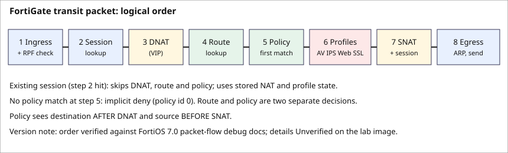

*شکل ۱: ترتیب منطقی: Ingress → Session Lookup → DNAT → Route → Policy → SNAT/Profile → Egress.*

``` text
1. Ingress           : packet arrives on an interface (L2 checks, VLAN)
2. Anti-spoofing     : reverse path check (RPF)   [position not confirmed by an official table]
3. Session lookup    : is it an existing session (fast path)?
                       YES -> apply session state (NAT, profile) and forward
                       NO  -> continue (new session)
4. DNAT / VIP        : destination NAT (before routing and policy)
5. Route lookup      : find egress interface and next-hop
6. Policy lookup     : match firewall policy (in order, first match)
7. Security profiles : AV / IPS / Web / App / SSL (if enabled in policy)
8. SNAT              : source NAT (policy NAT or IP pool)
9. Session create    : finalize session entry with NAT info (Debug shows a new session ALLOCATED earlier, before route/policy)
10. Egress           : ARP/next-hop MAC, send
```

**شاهد رسمی (FortiOS 7.0.3، صفحه‌ی «Debugging the packet flow»، خوانده‌شده):** نمونه‌ی Trace در مستند به این ترتیب است: بسته‌ی SYN دریافت می‌شود ← «SYN sent and a new session is allocated» ← Lookup برای Gateway/Route ← انتخاب پورت برای Source NAT ← «Matched security policy» (`Allowed by Policy-3: SNAT`) ← اعمال Source NAT. مستند همچنین می‌گوید «FortiASIC NP4 or NP6 interface pairs that offload traffic will change the packet flow». دو نتیجه: (۱) **Session در Debug پیش از Route/Policy «تخصیص» می‌یابد**؛ پس «Session create» در مرحله‌ی ۹ مدل ساده فقط به معنای ثبت نهایی ورودی است و تخصیص اولیه زودتر رخ می‌دهد؛ (۲) این یک **نمونه‌ی Trace** است نه جدول رسمی ترتیب؛ ترتیب DNAT/RPF/Profile در این صفحه نشان داده نشد.

**حدود اعتبار این ترتیب (مدل مفهومی ساده‌شده):**

| بخش | نوع دانش | توضیح |
|---|---|---|
| Route Lookup و Policy Lookup به‌عنوان دو تصمیم جدا | مفهوم عمومی فایروال/روتر | در هر فایروال Stateful تقریباً صادق است |
| DNAT پیش از Policy | مفهوم مشترک NAT/فایروال + رفتار FortiOS (VIP) | Policy مقصد post-DNAT را می‌بیند؛ جزئیات Central NAT متفاوت است |
| RPF قبل از Session | رفتار FortiOS | تنظیم‌پذیر؛ حالت Strict/Loose و `asymroute` اثر دارند |
| ترتیب Session Lookup نسبت به سایر مراحل | رفتار FortiOS + Offload | بسته‌ی Offload شده ممکن است اصلاً به CPU نرسد |
| Security Profile پس از Policy | رفتار FortiOS | در Proxy mode بازرسی روی جریان بازسازی‌شده انجام می‌شود |
| SNAT پس از Policy | رفتار FortiOS | NAT خروجی با Central NAT یا IP Pool متفاوت پیکربندی می‌شود |

این مدل برای **ترافیک عبوری (Transit)** است. ترافیک Local-in/Local-out و ترافیک IPsec مسیر متفاوت دارند (۴-۸ و ۱۲-۸).

دو نکته‌ی فراتر از جدول:

- **DNAT قبل از Route و Policy** اتفاق می‌افتد؛ بنابراین Policy باید بر اساس آدرس **مقصد بعد از DNAT** (آدرس داخلی) تطبیق شود، نه IP عمومی VIP. در مستند Fortinet و مقاله‌ی Central NAT این ترتیب «ingress → session lookup → DNAT → route → policy → SNAT» آمده است.
- **SNAT بعد از Policy** است؛ Policy مبدأ اصلی (قبل از SNAT) را می‌بیند.

#### ۴-۲) Ingress و Anti-spoofing (RPF)

FortiGate هر بسته‌ی ورودی را با **Reverse Path Forwarding (RPF)** می‌سنجد: آیا بهترین مسیر به آدرس **مبدأ** از همان Interfaceی که بسته آمده می‌گذرد؟ اگر نه، به‌عنوان جعل/Asymmetric Drop می‌شود (Debug: `reverse path check fail, drop`). این یکی از شایع‌ترین دلایل Drop در شبکه‌های نامتقارن یا با Route ناقص است (فصل ۱۰-۶، ۲۳).

#### ۴-۳) Session Lookup — ترافیک جدید در برابر ترافیک دارای Session

- **ترافیک جدید (بسته‌ی اول):** Session پیدا نمی‌شود؛ Route Lookup، Policy Lookup و (در صورت نیاز) NAT اجرا می‌شود و نتیجه در Session ثبت می‌گردد.
- **ترافیک دارای Session:** بسته‌های بعدی هر دو جهت (Original و Reply) با ورودی Session تطبیق می‌خورند و معمولاً **Policy Lookup کامل دوباره انجام نمی‌شود**؛ NAT و وضعیت ذخیره‌شده در Session اعمال می‌شود. پاسخ‌های برگشتی بدون Policy جداگانه عبور می‌کنند چون Session دارند.

**چرا نمی‌توان گفت «Session موجود هرگز Route یا Policy را دوباره بررسی نمی‌کند»؟** چون رفتار به عوامل زیر وابسته است و تعمیم مطلق نادرست است:

1. **تغییر Route:** Session معمولاً به Interface/Gateway ثبت‌شده وابسته می‌ماند، ولی FortiOS گزینه‌هایی برای بازبینی مسیر Session دارد (در منابع غیررسمی نام‌هایی مثل `snat-route-change` دیده می‌شود، ولی **وجود، نام دقیق، پیش‌فرض و رفتار هیچ‌یک در صفحات رسمی خوانده‌شده‌ی 7.0.0/7.0.3 تأیید نشد؛ هیچ گزینه‌ای در این درس به‌عنوان مستند‌شده معرفی نمی‌شود → نیازمند بررسی در CLI Reference نسخه‌ی هدف**؛ از `session-route-check` هم هیچ شاهدی به دست نیامد).
2. **تغییر Policy:** تغییر یا حذف Policy ممکن است Sessionهای موجود را فوراً قطع نکند، ولی در بعضی نسخه‌ها/حالت‌ها (مثلاً Proxy-based، یا Policyهایی که Session را با Policy ID مرتبط می‌کنند، یا Session Helper/UTM) Session دوباره ارزیابی یا بازنشانی می‌شود. این رفتار را بدون مستند نسخه قطعی ننویسید.
3. **Offload (NPU):** Session Offload شده (روی مدل‌های دارای پردازنده‌ی شبکه) در سخت‌افزار پردازش می‌شود و تغییرات نرم‌افزاری ممکن است نیاز به پاک‌کردن/بازسازی Session داشته باشد.
4. **انقضای Session:** Timeout هر پروتکل، Session را پایان می‌دهد و بسته‌ی بعدی دوباره «جدید» محسوب می‌شود.

**جمع‌بندی آموزشی (قابل‌اتکا):** «Session موجود *معمولاً* بدون ارزیابی مجدد Policy ادامه می‌یابد؛ بنابراین بعد از تغییر Route/Policy، نتیجه را با **اتصال جدید** آزمون کنید و برای Session قدیمی وضعیت (`diagnose sys session list`) را ببینید؛ پاک‌کردن Session (فقط با فیلتر و Change) راه تضمین ارزیابی دوباره است.» جزئیات وابسته به نسخه: نیازمند بررسی.

#### ۴-۴) Route Lookup

انتخاب Interface خروجی و Next-hop با همان قواعد (LPM، Distance، Priority، Policy Route). در FortiOS: ترتیب بررسی (مستند رسمی FortiOS 7.0، بخش Policy routes — تأییدشده): فایروال از بالای فهرست Policy Route شروع می‌کند؛ اگر Policy Route تطبیق نخورد یا Interface/Gateway آن کامل نباشد یا مسیر فعالی نیابد، **Routing Table** بررسی می‌شود. نقش **SD-WAN Rule** (Service) نیز در همین مرحله‌ی انتخاب مسیر است، ولی ترتیب دقیق آن نسبت به Policy Route در نسخه‌ی هدف و **Route Cache/FIB** در منابع این بازنگری تأیید نشد → نیازمند بررسی. نکته‌ی تأییدشده: برای ترافیک برگشتی، Policy Route بررسی نمی‌شود، و رفتار خروج برگشتی به تنظیم Auxiliary Session بستگی دارد. (جزئیات SD-WAN: فصل ۲۱.) **Zone** و Interface خروجی همین‌جا مشخص می‌شود.

> تفاوت مهم: **Routing می‌گوید بسته از کجا برود؛ Policy می‌گوید اجازه‌ی عبور دارد یا نه.** هر دو باید درست باشند؛ Route درست و Policy غایب = Drop؛ Policy درست و Route غلط = Drop یا مسیر اشتباه.

#### ۴-۵) Policy Lookup

بررسی Policyها **از بالا به پایین؛ اولین تطبیق برنده است (First Match)**. فیلدهای تطبیق: Incoming Interface/Zone، Outgoing Interface/Zone، Source (آدرس/کاربر/دستگاه)، Destination، Service، Schedule. اگر هیچ Policy مطابق نباشد، **Implicit Deny** (Policy شناسه‌ی 0) و ثبت `Denied by forward policy check (policy 0)`.

#### ۴-۶) Security Profile Inspection

پس از تطبیق Policy، اگر Profileها وصل باشند (AV، IPS، Web Filter، Application Control، SSL Inspection ...)، بسته/جریان بر اساس **Inspection Mode (Flow یا Proxy)** بازرسی می‌شود. در 7.0 حالت بازرسی در **هر Policy** تنظیم می‌شود (`set inspection-mode flow|proxy`). جزئیات در فصل ۱۶.

#### ۴-۷) NAT و ساخت Session

اگر Policy NAT فعال باشد، آدرس مبدأ به IP خروجی Interface یا IP Pool تغییر می‌کند و در Session ذخیره می‌شود تا بسته‌های بعدی و پاسخ بدون پردازش مجدد ترجمه شوند. پس هر Session دو جهت دارد: Original و Reply.

#### ۴-۸) سه حالت: Transit، Local-in و Local-out

| حالت | تعریف | سازوکار اصلی | نکته |
|---|---|---|---|
| **Transit (Forward)** | مبدأ و مقصد هیچ‌کدام خود FortiGate نیستند | Route + **Firewall Policy** (Forward) | مدل ۱۰مرحله‌ای بالا |
| **Local-in** | مقصد = خود FortiGate (SSH/HTTPS/ping/IKE/…) | `allowaccess` روی Interface + **Local-in Policy** (+ DoS Policy پیش از آن) | Firewall Policy عادی اعمال نمی‌شود |
| **Local-out** | مبدأ = خود FortiGate (DNS، FortiGuard، Syslog، NTP) | Routing Table (پیش‌فرض)، یا SD-WAN/Interface دستی | مستند رسمی 7.0: Local out «relies on routing table lookups» مگر SD-WAN/Interface دستی انتخاب شود (تأییدشده) |

سوءبرداشت رایج: «همه‌ی ترافیک مرتبط با فایروال را با Forward Policy کنترل می‌کنم.» ← ترافیک مدیریتی به خود دستگاه با Local-in و `allowaccess` کنترل می‌شود. جزئیات: درس ۱۲-۸.

#### ۴-۹) VIP/DNAT — حداقل لازم برای فهم Flow

- در مدل مفهومی، **مقصد بسته پیش از Route/Policy ترجمه می‌شود**؛ بنابراین Route Lookup بر مقصد جدید (داخلی) انجام می‌شود و Policy باید به **شیء VIP یا مقصد post-DNAT طبق نسخه/حالت** اشاره کند (در FortiOS معمولاً شیء VIP در `dstaddr`؛ در Central NAT رفتار متفاوت است — درس ۱۳-۳).
- Policy بدون Policy مقابل VIP کار نمی‌کند؛ VIP فقط «ترجمه» است نه «اجازه».
- پاسخ سرور داخلی با Session برعکس ترجمه می‌شود (Reverse DNAT/SNAT).

#### ۴-۱۰) Hardware Acceleration و رابطه‌اش با Flow (فقط آنچه منبع پشتیبانی می‌کند)

- **تأییدشده (مستند 7.0.3، نقل صریح):** جفت‌Interfaceهای FortiASIC NP4/NP6 که ترافیک را Offload می‌کنند، Packet Flow را تغییر می‌دهند (برای Debug مهم است).
- **از خلاصه‌ی مستند 7.0.0 (نه متن صریح):** «بسیاری از مدل‌ها» پردازنده‌ی شبکه (NP) و «بیشتر مدل‌ها» واحد SPU دارند؛ برخی مدل‌های ورودی CP ندارند. فهرست مدل‌به‌مدل پیدا نشد؛ پس **هرگز Offload را به همه‌ی دستگاه‌ها تعمیم ندهید**.
- **نیازمند تأیید (منبع قابل‌خواندن نبود):** شرایط دقیقی که Session عمومی Offload نمی‌شود (مثلاً با Proxy-based Profile، Traffic Shaping)، رابطه‌ی Flow-based UTM با NTurbo/IPSA (در مستند فقط عنوان‌های «NTurbo offloads flow-based processing» و «IPSA offloads flow-based advanced pattern matching» دیده شد)، و جزئیات `npu-offload`/`auto-asic-offload` (در خلاصه‌ی صفحه‌ی IPsec آمد ولی متن صریح خوانده نشد).
- **پیامد آموزشی مطمئن:** هنگام عیب‌یابی، اگر Sniffer/Debug همه‌ی بسته‌ها را نشان نمی‌دهد، Offload را به‌عنوان یک فرضیه (نه علت اثبات‌شده) بررسی کنید.

### ۵) مثال حل‌شده: Debug Flow

**توپولوژی:** LAN (port2، 192.168.10.0/24) و WAN (port1). کلاینت 192.168.10.5 به 8.8.8.8 پورت 443 وصل می‌شود. Policy 10: LAN→WAN با NAT.

``` text
FGT # diagnose debug reset
FGT # diagnose debug flow filter addr 8.8.8.8
FGT # diagnose debug flow filter port 443
FGT # diagnose debug flow show function-name enable
FGT # diagnose debug flow trace start 10
FGT # diagnose debug enable
```

خروجی نمونه‌ی **مفهومی** (ساده‌شده؛ فرمت واقعی در نسخه‌ی شما را با Lab تأیید کنید):

``` text
id=20085 trace_id=1 func=print_pkt_detail msg="vd-root:0 received a packet(proto=6, 192.168.10.5:51200->8.8.8.8:443) from port2. flag [S], seq ..."
id=20085 trace_id=1 func=init_ip_session_common msg="allocate a new session-00004a2b"
id=20085 trace_id=1 func=vf_ip_route_input_common msg="find a route: flag=00000000 gw-203.0.113.1 via port1"
id=20085 trace_id=1 func=fw_forward_handler msg="Allowed by Policy-10: SNAT"
id=20085 trace_id=1 func=__ip_session_run_tuple msg="SNAT 192.168.10.5->203.0.113.10:51200"
```

**تحلیل خط‌به‌خط:**

| خط | معنی | مرحله |
|---|---|---|
| received a packet ... from port2 | ورود، جدید است (flag S) | Ingress |
| allocate a new session | Session موجود نبود | Session lookup |
| find a route ... via port1 | Route انتخاب شد | Route lookup |
| Allowed by Policy-10 | Policy مطابق | Policy lookup |
| SNAT ... | ترجمه‌ی مبدأ | NAT |

``` text
FGT # diagnose debug disable
FGT # diagnose debug flow trace stop
FGT # diagnose debug reset
```

> **هشدار:** Debug Flow را حتماً پس از کار Disable/Reset کنید. در مستند رسمی آمده که برای مشاهده‌ی Packet Flow روی پلتفرم‌های دارای **NP4/NP6** باید Offload غیرفعال شود (`diagnose npu fastpath disable`) و نسخه‌ی 7.0.12 اضافه می‌کند مانیتور Flow برای ترافیک Offloadشده در NP6/NP7 کار نمی‌کند (درس ۱۲-۹). FortiGate-VM معمولاً NP ندارد (`Unverified`).

**مثال متوسط (Drop):**

``` text
... msg="Denied by forward policy check (policy 0)"
```

یعنی هیچ Policy مطابق نبود. علت‌های رایج: Interface/Zone اشتباه، Service نادرست، Source/Destination اشتباه، یا ترتیب Policyها.

**مثال سخت (RPF):**

``` text
... msg="reverse path check fail, drop"
```

یعنی بهترین مسیر به مبدأ از Interface ورودی نمی‌گذرد: Route ناقص/Asymmetric. بررسی: `get router info routing-table details <src-ip>`.

### ۶) طراحی و تصمیم‌گیری

| تصمیم | معیار |
|---|---|
| Policy بر اساس Interface یا Zone | Zone برای سادگی چند Interface؛ Interface برای دقت |
| DNAT با VIP | Policy مقصد = IP داخلی (post-DNAT) |
| Policy NAT یا Central NAT | Central NAT برای سیاست NAT متمرکز؛ توجه به ترتیب |
| Inspection Mode per policy | Flow (سبک‌تر) / Proxy (قابلیت بیشتر) طبق نیاز |

### ۷) پیاده‌سازی: GUI و CLI

**GUI:**

1. Policy & Objects → Firewall Policy: ترتیب Policyها را ببینید (ستون ID، Hit Count).
2. Log & Report → Forward Traffic: فیلتر بر اساس Source/Destination برای دیدن Action و Policy ID.
3. Network → Diagnostics → Packet Capture: Capture با Filter.
4. (در 7.0) Policy → ستون Bytes/Sessions برای Hit.

**CLI:**

``` text
get router info routing-table details 8.8.8.8
get router info routing-table all
diagnose firewall iprope lookup 192.168.10.5 51200 8.8.8.8 443 tcp port2
diagnose sys session filter dst 8.8.8.8
diagnose sys session list
diagnose sniffer packet any "host 8.8.8.8 and port 443" 4 20 l
```

- `iprope lookup`: شبیه‌سازی Policy Lookup (دقت فرمت `Unverified`).
- `session list`: ورودی Session شامل Policy و NAT است.

### ۸) Troubleshooting (یک الگوی ثابت)

1. Ingress: بسته در Sniffer روی Interface ورودی دیده می‌شود؟
2. RPF: خطای reverse path check دارد؟
3. Session: جدید است یا موجود؟
4. Route: Interface خروجی درست است؟
5. Policy: کدام Policy؟ (ID)
6. NAT/Profile: ترجمه و Profile چیست؟
7. Egress: بسته در Interface خروجی دیده می‌شود؟ پاسخ برمی‌گردد؟

اگر بسته در مرحله‌ی N ناپدید شود، علت در همان مرحله است. این «روش تقسیم مسیر» تمام عیب‌یابی بعدی است.

### ۹) نکات امنیتی

- Debug Flow بار CPU دارد و ممکن است اطلاعات حساس نشان دهد؛ با Filter دقیق و زمان کوتاه.
- Policy با Implicit Deny و Log باعث می‌شود تلاش‌های ناموفق دیده شوند؛ Logging Policy 0 را فعال کنید.
- DNAT/VIP بدون Policy دقیق، سرویس داخلی را برای همه باز می‌کند.

### ۱۰) جمع‌بندی مفهومی

- ترتیب: Ingress → RPF → Session → DNAT → Route → Policy → Profile → SNAT → Session → Egress.
- DNAT قبل از Route/Policy؛ SNAT بعد از Policy.
- Session موجود *معمولاً* بدون ارزیابی مجدد Policy ادامه می‌یابد؛ اما این یک قاعده‌ی مطلق نیست و به نسخه، Offload، Proxy mode و تنظیمات Route-change بستگی دارد (۴-۳).
- Transit، Local-in و Local-out سه مسیر متفاوت‌اند (۴-۸).
- Routing و Policy دو تصمیم جدا هستند؛ هر دو لازم‌اند.
- Debug Flow + Session + Routing Table سه شاهد اصلی‌اند.

### ۱۱) تمرین و ارزیابی

**ت1.** (ساده) ترتیب مراحل پردازش یک بسته‌ی جدید را بنویسید. *(پاسخ: 12-0-ت1)*

**ت2.** (ساده) Implicit Deny چه شناسه‌ای دارد و چه Log می‌دهد؟ *(پاسخ: 12-0-ت2)*

**ت3.** (متوسط) VIP پورت 443 را به 10.1.1.10 می‌برد. Policy باید مقصد را چه بگذارد؟ چرا؟ *(پاسخ: 12-0-ت3)*

**ت4.** (متوسط) چرا Route درست و Policy غایب باعث Drop می‌شود؟ *(پاسخ: 12-0-ت4)*

**ت5.** (سخت) بسته‌ای در Sniffer روی port2 دیده می‌شود ولی روی port1 نه. فهرست علت‌ها را به ترتیب بررسی بنویسید. *(پاسخ: 12-0-ت5)*

**ت6.** (سخت، طراحی) Debug Flow نشان می‌دهد `reverse path check fail`. سه علت و روش اثبات هر کدام را بنویسید. *(پاسخ: 12-0-ت6)*

**م1.** SNAT بعد از کدام مرحله است؟ *(پاسخ: 12-0-م1)*

**Q1.** Quick quiz (English): Does a reply packet of an existing session go through policy lookup again? *(پاسخ: 12-0-Q1)*

### ۱۲) اصطلاحات و English Corner

| مخفف | شکل کامل | معنی |
|---|---|---|
| RPF | Reverse Path Forwarding | بررسی مسیر معکوس برای ضد جعل |
| DNAT | Destination NAT | ترجمه‌ی مقصد |
| SNAT | Source NAT | ترجمه‌ی مبدأ |
| VIP | Virtual IP | آدرس مجازی برای DNAT |
| Policy ID 0 | Implicit deny | Policy ضمنی رد |
| Debug flow | Packet flow debug | ردگیری گام‌به‌گام بسته |

- *In the simplified model the policy is evaluated for the first packet of a session; real behavior can vary by version and offload.* ← در مدل ساده، Policy برای بسته‌ی اول Session ارزیابی می‌شود؛ رفتار واقعی بسته به نسخه و Offload می‌تواند متفاوت باشد.
- *Check routing and policy as two separate decisions.* ← Routing و Policy را دو تصمیم جدا بررسی کنید.

### ۱۳) منابع

- Fortinet Docs: [Debugging the packet flow](https://docs.fortinet.com/document/fortigate/7.0.3/administration-guide/54688/debugging-the-packet-flow) (FortiOS 7.0 Administration Guide).
- Fortinet Community: «Central NAT: Packet processing, troubleshooting steps and traffic flow» و «FortiGate Debug Flow Functions» (غیررسمی؛ `Unverified` تا تأیید روی Lab).
- Fortinet Docs: FortiOS 7.0 CLI Reference (`diagnose debug flow`).

### بخش تکمیلی درس: سناریوی واقعی، مثال‌های بیشتر و عیب‌یابی

> بخش‌های زیر درس بالا را کامل می‌کنند: سناریوی گام‌به‌گام، مثال‌های بیشتر از ساده تا سخت، جدول عیب‌یابی و پرسش‌های مصاحبه. ابتدا بخش‌های اصلی بالا را مطالعه کنید.

### تکمیل عمیق: Packet Flow در FortiGate — مسیر یک بسته از ورود تا خروج

#### چرا باید یاد بگیریم؟

بدون نقشه‌ی ذهنی از مسیر بسته، هر عیب‌یابی حدس است. اگر بدانید بسته ابتدا Anti-spoofing (RPF) می‌شود، سپس DNAT، سپس Routing، سپس Policy و بعد SNAT، هر خطایی را می‌توانید به یکی از این ایستگاه‌ها نسبت دهید.

#### ایستگاه‌ها (مسیر Transit)

``` text
1 Ingress interface        (link, VLAN)
2 Session lookup           (existing session? -> fast path)
3 DoS policy / anomaly
4 RPF (reverse path check)
5 DNAT (VIP) / pre-routing
6 Routing decision (route lookup, PBR first)
7 Firewall policy lookup
8 UTM / inspection
9 SNAT (policy NAT / IP pool)
10 Egress interface
```

#### مثال ساده — دنبال‌کردن SYN

Users (10.10.0.5) به 198.51.100.8:443: ورودی port2 ⇒ Session جدید ⇒ RPF موفق ⇒ Route به port1 ⇒ Policy 30 ⇒ SNAT ⇒ خروج.

#### مثال متوسط — جای هر خطا

| علامت Debug | ایستگاه |
|---|---|
| reverse path check fail | RPF |
| no route to host | Routing |
| Denied by forward policy check | Policy |
| no session matched | Session/نامتقارن |

#### مثال سخت — VIP و Policy

با VIP، DNAT قبل از Routing و Policy انجام می‌شود؛ پس Policy باید به **IP عمومی (VIP)** اشاره کند نه IP داخلی؛ Route باید به IP ترجمه‌شده نگاه کند.

#### Lab

برای ۳ جریان (Users→Internet، Internet→VIP، Users→Mgmt) ایستگاه‌ها را فهرست کنید.

#### عیب‌یابی

| علامت (مشاهده) | علت محتمل (باید اثبات شود) | اقدام پس از اثبات |
|---|---|---|
| RPF | Route | تصحیح |
| Policy 0 | Interface/Address | تصحیح |
| نامتقارن | مسیر | طراحی |

#### پرسش‌ها با پاسخ

**۱. DNAT قبل یا بعد Route؟** قبل.
**۲. SNAT؟** بعد از Policy.
**۳. PBR؟** پیش از Routing عادی.

#### English Corner

- *Destination NAT happens before the routing decision; source NAT happens after policy.*
- Q: At which stage does the reverse path check occur?

## درس 12-1 — معماری FortiGate، اولین بوت و تأیید نسخه

**فصل 12 · بازنویسی عمیق · پیش‌نیاز: ۱۲-۰، ۱۱-۳ · ≈ 9 ساعت**

> **وضعیت:** FortiOS 7.0.3 نامی (بوت‌نشده)؛ دستورها طبق مستندات 7.0 ولی `Unverified` تا اجرای Lab؛ Lab «اجرا نشده».

<!--deep-->

### هدف آموزشی

در پایان این درس باید بتوانید:

1. اجزای معماری FortiGate (FortiOS، CPU، NPU، Management plane، Data plane، VDOM) را توضیح دهید.
2. مراحل اولین بوت امن (کنسول، IP پیش‌فرض، رمز، Timezone/NTP، Hostname) را اجرا کنید.
3. نسخه، Serial، لایسنس و وضعیت HA را از `get system status` بخوانید.
4. تطبیق نسخه‌ی دستگاه با مستندات و دوره را بسنجید.
5. روش‌های دسترسی (Console، SSH، HTTPS، API) و ریسک هرکدام را بشناسید.
6. برگه‌ی اولین بوت را بنویسید و Backup اولیه بگیرید.

### چرا باید یاد بگیریم؟

وقتی با یک دستگاه ناآشنا شروع می‌کنید، اولین سؤال‌ها این است: «چه سیستم‌عاملی؟ چه نسخه‌ای؟ لایسنس دارد؟ چه چیزی را می‌توانم تنظیم کنم؟». مثل رانندگی با ماشین جدید: قبل از حرکت باید بدانید دنده، فرمان و ترمز کجاست. در FortiGate بسیاری از رفتارها و منوها به **نسخه‌ی FortiOS** بستگی دارد. اگر مستند 7.2 را بخوانید و دستگاه 7.0 باشد، دستور وجود ندارد. و اگر اولین بوت را بی‌دقت انجام دهید (رمز پیش‌فرض، مدیریت باز روی WAN)، دستگاه از همان ساعت اول آسیب‌پذیر است. این درس پایه‌ی همه‌ی فصل‌های FortiGate است.

### معماری

| جزء | نقش |
|---|---|
| FortiOS | سیستم‌عامل اختصاصی؛ CLI، GUI، API |
| CPU | پردازش عمومی، UTM (Proxy)، Control Plane |
| NPU/SPU | تراشه‌ی شتاب‌دهنده‌ی ترافیک (Session Offload، IPsec، NAT) |
| Management plane | ورود ادمین (CLI، GUI، REST API)، تنظیمات |
| Data plane | عبور و بازرسی ترافیک |
| VDOM | دامنه‌ی مجازی؛ پیش‌فرض یک VDOM به نام root |
| FortiGuard | سرویس ابری امضاها (AV، IPS، Web) |

**مدل‌ها:** سخت‌افزاری (شاخص‌ها: Throughput، Session، IPsec، SSL Inspection) و **VM** (FortiGate-VM). در Lab ما VM است؛ NPU ندارد و بسیاری از قابلیت‌ها به لایسنس وابسته‌اند.

### دسترسی‌ها

| روش | مناسب برای | نکته امنیتی |
|---|---|---|
| Console (RJ45/USB/سریال) | اولین بوت، بازیابی | فیزیکی؛ امن‌ترین |
| SSH | مدیریت روزمره | Trusted Host و کلید |
| HTTPS (GUI) | مدیریت گرافیکی | فقط از Mgmt؛ TLS قوی |
| REST API | اتوماسیون | توکن، Trusted Host |
| HTTP/Telnet | — | **غیرفعال** |

IP پیش‌فرض مدیریت بسیاری از مدل‌ها 192.168.1.99/24 روی `mgmt`/`internal` و کاربر `admin` با رمز خالی است (طبق مدل). **باید فوراً تغییر کنید.**

### اولین بوت امن (برگه)

1. اتصال Console؛ ورود `admin` (رمز خالی) و تغییر فوری رمز (بلند و منحصر‌به‌فرد).
2. `get system status` برای نسخه/Serial/لایسنس.
3. Hostname، Timezone، NTP.
4. تنظیم Interface مدیریتی و `allowaccess` فقط لازم.
5. `trusthost` برای ادمین.
6. غیرفعال‌سازی سرویس‌های ناامن.
7. Backup اولیه (Config خام).
8. ثبت Evidence: خروجی `get system status` با زمان.

### دستورها (Unverified)

``` text
get system status
config system global
 set hostname "FGT-HQ-01"
 set timezone 26
 set admintimeout 10
end
config system ntp
 set ntpsync enable
 set server "10.50.0.20"
end
config system admin
 edit "admin"
  set password ***
 next
end
config system interface
 edit "mgmt"
  set ip 10.50.0.1 255.255.255.0
  set allowaccess ping https ssh
 next
end
execute backup config tftp initial.conf 10.50.0.30
```

(کد Timezone را از `set timezone ?` در همان نسخه بخوانید.)

### خواندن `get system status`

``` text
Version: FortiGate-VM64 v7.0.3,build...,(GA)
Virus-DB: ...
Serial-Number: FGVM...
License Status: Valid/Trial
Hostname: FGT-HQ-01
Operation Mode: NAT
Current virtual domain: root
Virtual domain configuration: disable
Current HA mode: standalone
System time: ...
```

نکات: `Operation Mode` (NAT/Transparent)، `Virtual domain configuration` (disable/multi-vdom)، `Current HA mode` و `System time` (برای Log و گواهی‌ها).

### مثال‌های حل‌شده

#### مثال ساده — کدام نسخه؟

`get system status` ⇒ v7.0.3. مستندات 7.0 را بخوانید. اگر مستند 7.2 را دارید، منوها و دستورها ممکن است فرق کنند؛ تفاوت را در Release Notes بسنجید.

#### مثال متوسط — اولین بوت

۱) Console، رمز admin تغییر ۲) Hostname FGT-HQ-01 ۳) NTP ۴) `mgmt` با HTTPS/SSH/ping ۵) Backup ۶) Evidence. زمان: ≈ ۳۰ دقیقه. اگر ساعت اشتباه باشد، Log و گواهی‌ها (TLS، Kerberos، MFA) دچار مشکل می‌شود.

#### مثال متوسط — «ویژگی در GUI نیست»

1. لایسنس/مدل؟ (دیتاشیت)
2. Feature Visibility (System ← Feature Visibility) خاموش؟
3. نسخه‌ی FortiOS؟ (Release Notes)
4. حالت VDOM/Operation mode؟
5. دسترسی ادمین (Profile)؟

#### مثال سخت — نسخه‌ی دستگاه v7.2 است

دوره بر پایه‌ی 7.0.3 است. اقدام: ۱) مفاهیم یکسان‌اند (Policy، NAT، VPN) ۲) برای هر دستور `?` را در CLI بزنید و مستند 7.2 را بخوانید ۳) تفاوت Syntax را در یادداشت ثبت کنید ۴) ارتقا/کاهش نسخه فقط با مسیر رسمی ۵) دستورهای «Unverified» را با نسخه‌ی واقعی راستی‌آزمایی کنید.

#### مثال سخت — مدیریت باز روی WAN

پس از نصب، GUI از اینترنت در دسترس است. ریسک: Brute-force و آسیب‌پذیری. رفع: حذف `https/ssh` از `allowaccess` WAN؛ `trusthost`؛ Local-in Policy؛ بررسی Log ورود ناموفق. شاهد: اسکن پورت از بیرون (Lab) و `show system interface`.

### Lab هدایت‌شده (اجرا نشده)

1. FortiGate VM بوت‌شده؛ Console.
2. اجرای برگه‌ی اولین بوت و ثبت Evidence.
3. تغییر عمدی `allowaccess` و بازگردانی.
4. مقایسه‌ی `get system status` قبل/بعد.

### عیب‌یابی سریع

| علامت (مشاهده) | علت محتمل (باید اثبات شود) | اقدام پس از اثبات |
|---|---|---|
| GUI باز نمی‌شود | allowaccess/IP | Console |
| ویژگی نیست | لایسنس/Visibility | بررسی |
| Log زمان اشتباه | NTP | تنظیم |
| دستور خطا | نسخه | `?` و مستند |

### جمع‌بندی

FortiGate از FortiOS، CPU و NPU ساخته شده؛ نسخه رفتار را تعیین می‌کند. اولین بوت: Console، رمز، Hostname، NTP، Mgmt محدود، Backup و Evidence. نسخه و لایسنس را از `get system status` بخوانید.

### تمرین و ارزیابی

**ت1.** (ساده) کدام دستور نسخه را نشان می‌دهد؟ *(پاسخ: 12-1-ت1)*

**ت2.** (ساده) چرا NTP مهم است؟ *(پاسخ: 12-1-ت2)*

**ت3.** (متوسط) چرا نسخه‌ی دستگاه باید با دوره تطبیق شود؟ *(پاسخ: 12-1-ت3)*

**ت4.** (متوسط) رمز پیش‌فرض را چه کنیم؟ *(پاسخ: 12-1-ت4)*

**ت5.** (سخت) نسخه v7.2 است؛ چه می‌کنید؟ *(پاسخ: 12-1-ت5)*

**ت6.** (سخت، طراحی) برگه‌ی اولین بوت. *(پاسخ: 12-1-ت6)*

**Q1.** Quick quiz (English): Which command displays the FortiOS version and serial number? *(پاسخ: 12-1-Q1)*

### اصطلاحات و English Corner

| مخفف | شکل کامل | معنی |
|---|---|---|
| NPU | Network Processor Unit | پردازنده‌ی شبکه |
| VDOM | Virtual Domain | دامنه‌ی مجازی |
| NTP | Network Time Protocol | هماهنگ‌سازی زمان |

- *Always verify the firmware version first.* ← همیشه اول نسخه‌ی Firmware را تأیید کنید.

### کارت Lab

**کارت Lab:** اولین بوت (اجرا نشده). **Evidence:** `03-ops/fgt-asbuilt-1.md`.

### منابع

- Fortinet FortiOS 7.0 Administration Guide: Getting started
- FortiOS 7.0.3 Release Notes

<a id="l-12-2"></a>

## درس 12-2 — Interface، VLAN، Role، Administrative Access و سخت‌سازی پورت‌های FortiGate

**فصل 12 · بازنویسی عمیق · پیش‌نیاز: ۱۲-۱، ۳-۱، ۴-۱ · ≈ 10 ساعت**

> **وضعیت:** FortiOS 7.0.3 نامی (بوت‌نشده)؛ دستورها طبق مستندات 7.0 ولی `Unverified` تا اجرای Lab؛ Lab «اجرا نشده».

<!--deep-->

### هدف آموزشی

در پایان این درس باید بتوانید:

1. انواع Interface (Physical، VLAN، Aggregate، Loopback، Zone) را بشناسید.
2. VLAN Sub-interface را با ID و IP بسازید.
3. `role` و `allowaccess` را با اصل حداقل مدیریت تنظیم کنید.
4. Trusted Host، Local-in Policy و سخت‌سازی را به‌کار ببرید.
5. «لینک بالا ولی VLAN کار نمی‌کند» را عیب‌یابی کنید.
6. طراحی Interface یک شعبه را بنویسید.

### چرا باید یاد بگیریم؟

Interface هم دروازه‌ی ورود ترافیک است و هم دروازه‌ی ورود مدیریت. یک تنظیم اشتباه `allowaccess` روی WAN پنل مدیریت را به اینترنت می‌دهد. یک VLAN ID اشتباه یا Trunk ناقص روی سوییچ، کاربران را بی‌شبکه می‌کند. مثل در و قفل ساختمان: اگر قفل را فراموش کنید (allowaccess باز)، هر کس وارد می‌شود؛ اگر شماره‌ی واحد را اشتباه بزنید (VLAN)، کسی پیدایش نمی‌کند.

### انواع Interface

| نوع | توضیح |
|---|---|
| Physical | پورت واقعی (port1، wan1) |
| VLAN | زیرواسط با برچسب 802.1Q روی Physical |
| Aggregate | چند پورت (LACP 802.3ad) یک لینک |
| Redundant | Active/Backup بین دو پورت |
| Loopback | مجازی همیشه بالا (برای Router-ID، منبع Syslog، IPsec) |
| Software Switch/Zone | گروه‌بندی (درس 12-3 و 12-10) |

### VLAN

``` text
config system interface
 edit "vlan10"
  set vdom "root"
  set interface "port2"
  set vlanid 10
  set ip 10.10.0.1 255.255.255.0
  set allowaccess ping
  set role lan
 next
end
```

سوییچ مقابل باید Trunk با VLAN 10 مجاز باشد (`switchport trunk allowed vlan 10,20`) و Native VLAN درست باشد.

### role

`role` (lan، wan، dmz، undefined) رفتار GUI و پیش‌فرض‌ها را تعیین می‌کند (مثلاً Interface با role wan در لیست خروجی NAT پیش‌فرض و بعضی سرویس‌های مدیریتی محدود).

### allowaccess

سرویس‌هایی که روی آن Interface به خود فایروال پاسخ می‌دهند:

| مقدار | سرویس | توصیه |
|---|---|---|
| ping | ICMP | LAN/Mgmt؛ WAN فقط در صورت نیاز |
| https | GUI | فقط Mgmt |
| ssh | CLI | فقط Mgmt |
| snmp | SNMP | فقط Mgmt/Monitoring |
| fgfm | FortiManager | فقط شبکه‌ی FMG |
| http / telnet | ناامن | **غیرفعال** |
| fabric | Security Fabric | فقط Fabric |

### سخت‌سازی

1. **Trusted Host:** ادمین فقط از شبکه‌ی Mgmt.
2. **Local-in Policy:** محدودیت مبدأ/سرویس به خود فایروال.
3. **TLS قوی و timeout:** `admin-https-ssl-versions tlsv1-2 tlsv1-3`، `admintimeout`.
4. **Lockout:** `admin-lockout-threshold`.
5. **Banner** هشدار.
6. غیرفعال‌سازی `ping` از اینترنت در صورت سیاست.

``` text
config system admin
 edit "netadmin"
  set trusthost1 10.50.0.0 255.255.255.0
 next
end
config system global
 set admin-https-ssl-versions tlsv1-2 tlsv1-3
 set admin-lockout-threshold 5
 set admin-lockout-duration 300
end
```

### مثال‌های حل‌شده

#### مثال ساده — VLAN

VLAN 10 با IP 10.10.0.1/24 روی port2. تأیید: `get system interface physical`، سپس ping به PC در VLAN 10. اگر ping شکست خورد: Trunk سوییچ را بررسی.

#### مثال متوسط — طراحی شعبه

``` text
port1  WAN   203.0.113.2/29   role wan   allowaccess: (none)
port2  LAN   Trunk: vlan10 users 10.10.0.1/24, vlan20 servers 10.20.0.1/24
port3  DMZ   10.30.0.1/24
mgmt   MGMT  10.50.0.1/24    allowaccess ping https ssh
```

قواعد: WAN بدون مدیریت؛ فقط Mgmt مدیریت.

#### مثال متوسط — لینک بالا، VLAN کار نمی‌کند

1. سوییچ: `show interfaces trunk` ⇒ VLAN 10 در Allowed و Active؟
2. Native VLAN هر دو سر یکسان؟
3. VLAN ID دو سر یکسان؟
4. FortiGate: Interface Up، IP درست؟
5. ARP: `get system arp`.
6. Policy برای VLAN (ترافیک بدون Policy رد می‌شود).

#### مثال سخت — Brute-force از اینترنت

Log: ۵۰۰ ورود ناموفق به https از 203.0.113.50. رفع:

1. `allowaccess` WAN: حذف https/ssh.
2. Local-in Policy: فقط IPهای مجاز.
3. Lockout.
4. IP مهاجم Block (Quarantine/Policy).
5. MFA برای ادمین.
6. بررسی ورود موفق مشکوک (Event Log).

شاهد: اسکن پورت از بیرون: پورت 443/22 filtered.

#### مثال سخت — ادمین قفل

پس از تغییر allowaccess مدیریت قطع شد. نجات: Console؛ پیشگیری: `cfg-save revert` (درس ۱۲-۷)، Session دوم باز، تست از شبکه‌ی Mgmt.

### Lab هدایت‌شده (اجرا نشده)

1. VLAN 10 و 20 روی port2 با Trunk.
2. allowaccess حداقل؛ اسکن پورت از LAN.
3. Trusted Host و آزمون ورود از IP غیرمجاز.
4. Lockout آزمایشی.

### عیب‌یابی سریع

| علامت (مشاهده) | علت محتمل (باید اثبات شود) | اقدام پس از اثبات |
|---|---|---|
| VLAN بدون ارتباط | Trunk/ID | سوییچ |
| GUI از WAN باز | allowaccess | حذف |
| ورود رد می‌شود | trusthost | منبع |
| قفل ادمین | Lockout | منتظر/Console |

### جمع‌بندی

Interface انواع دارد؛ VLAN با ID و Trunk درست. `allowaccess` فقط لازم و فقط روی Mgmt؛ Trusted Host، Local-in، TLS و Lockout سخت‌سازی‌اند.

### تمرین و ارزیابی

**ت1.** (ساده) allowaccess چیست؟ *(پاسخ: 12-2-ت1)*

**ت2.** (ساده) VLAN Sub-interface چیست؟ *(پاسخ: 12-2-ت2)*

**ت3.** (متوسط) چرا نباید https روی WAN باز باشد؟ *(پاسخ: 12-2-ت3)*

**ت4.** (متوسط) لینک up ولی VLAN کار نمی‌کند؛ علت‌ها؟ *(پاسخ: 12-2-ت4)*

**ت5.** (سخت) از اینترنت Brute-force می‌شود؛ طرح رفع. *(پاسخ: 12-2-ت5)*

**ت6.** (سخت، طراحی) Interfaceهای یک شعبه با WAN، LAN، DMZ، Mgmt. *(پاسخ: 12-2-ت6)*

**Q1.** Quick quiz (English): Which setting controls which management services are reachable on an interface? *(پاسخ: 12-2-Q1)*

### اصطلاحات و English Corner

| مخفف | شکل کامل | معنی |
|---|---|---|
| LACP | Link Aggregation Control Protocol | پروتکل تجمیع لینک |
| Trunk | 802.1Q trunk | لینک حامل چند VLAN |

- *Never expose management services on the WAN interface.* ← هرگز سرویس‌های مدیریتی را روی Interface WAN باز نگذارید.

### کارت Lab

**کارت Lab:** Interface و VLAN (اجرا نشده). **Evidence:** `02-design/fgt-interfaces.md`.

### منابع

- Fortinet FortiOS 7.0 Administration Guide: Interfaces
- FortiOS 7.0 Hardening guide

<a id="l-12-3"></a>

## درس 12-3 — Zone و Objectها: Address، Service، Group، Schedule و استاندارد نام‌گذاری

**فصل 12 · بازنویسی عمیق · پیش‌نیاز: ۱۲-۲، ۱۱-۲ · ≈ 10 ساعت**

> **وضعیت:** FortiOS 7.0.3 نامی (بوت‌نشده)؛ دستورها طبق مستندات 7.0 ولی `Unverified` تا اجرای Lab؛ Lab «اجرا نشده».

<!--deep-->

### هدف آموزشی

در پایان این درس باید بتوانید:

1. Zone را بسازید و مزیت آن بر Interface مستقل را توضیح دهید.
2. انواع Address (Subnet، Range، FQDN، Geography) و Group را بسازید.
3. Service سفارشی و Group بسازید.
4. Schedule (Recurring، One-time) تعریف کنید و اثر آن بر Session را بفهمید.
5. استاندارد نام‌گذاری و comment را اعمال کنید.
6. Objectها را ممیزی و پاک‌سازی کنید.

### چرا باید یاد بگیریم؟

به‌جای نوشتن IP و پورت در هر Policy، یک «نام» می‌دهید (SRV-ERP). با تغییر IP فقط یک Object عوض می‌شود، نه ده‌ها Policy. و اگر نام‌گذاری استاندارد باشد، Policy مثل جمله خوانده می‌شود. بدون استاندارد، بعد از دو سال ۸۰۰ Object بی‌نام و تکراری دارید که هیچ‌کس جرأت حذفشان را ندارد. Object خوب مثل برچسب روی کارتن‌های انبار است.

### Zone

Zone گروهی از Interfaceها است که در Policy به‌عنوان یک واحد استفاده می‌شوند.

``` text
config system zone
 edit "ZN-DMZ"
  set interface "port3" "port5"
  set intrazone deny
 next
end
```

- Interface عضو Zone در Policy مستقل انتخاب نمی‌شود؛ باید Zone را انتخاب کرد.
- `intrazone`: `allow` ⇒ ترافیک بین اعضای Zone آزاد؛ `deny` ⇒ نیاز به Policy صریح.
- مزیت: افزودن Interface جدید به Zone، Policyها را خودکار پوشش می‌دهد.

### Address

| نوع | مثال | کاربرد |
|---|---|---|
| Subnet | 10.10.0.0/24 | شبکه/میزبان |
| IP Range | 10.10.0.10-10.10.0.50 | بازه |
| FQDN | `*.example.com` یا `app.example.com` | نام دامنه |
| Geography | Country | محدودیت جغرافیایی |
| Wildcard | 10.0.0.0 و ماسک معکوس | الگو |

``` text
config firewall address
 edit "NET-USERS"
  set subnet 10.10.0.0 255.255.255.0
  set comment "VLAN10 users; owner NOC"
 next
 edit "FQDN-SAAS"
  set type fqdn
  set fqdn "app.example.com"
 next
end
config firewall addrgrp
 edit "GRP-SERVERS"
  set member "SRV-ERP" "SRV-DB"
 next
end
```

**خطر FQDN:** نیازمند DNS صحیح؛ اگر DNS جواب ندهد یا IP عوض شود، Policy بدون هشدار رفتار را تغییر می‌دهد؛ TTL کوتاه؛ بهتر است DNS فایروال قابل‌اعتماد باشد.

### Service

``` text
config firewall service custom
 edit "SVC-APP-8443"
  set tcp-portrange 8443
 next
end
config firewall service group
 edit "GRP-WEB"
  set member "HTTP" "HTTPS"
 next
end
```

از Serviceهای از پیش‌تعریف‌شده (HTTP، HTTPS، DNS، SSH) تا حد ممکن استفاده کنید.

### Schedule

``` text
config firewall schedule recurring
 edit "WORK-HOURS"
  set day monday tuesday wednesday thursday friday
  set start 08:00
  set end 18:00
 next
end
config firewall schedule onetime
 edit "MAINT-2026-12-03"
  set start 22:00 2026/12/03
  set end 23:00 2026/12/03
 next
end
```

Session باز ساعت 17:59 پس از پایان Schedule تا Timeout می‌ماند؛ برای قطع فوری Session را پاک کنید.

### استاندارد نام‌گذاری

| نوع | قالب | مثال |
|---|---|---|
| Address شبکه | NET-<نام> | NET-USERS |
| Address میزبان | SRV-/HOST-<نام> | SRV-ERP |
| Group | GRP-<نام> | GRP-SERVERS |
| Service | SVC-<نام>-<پورت> | SVC-APP-8443 |
| Zone | ZN-<نام> | ZN-DMZ |
| Schedule | SCH-<نام> | SCH-WORK |
| VIP | VIP-<نام> | VIP-WEB-443 |

و در `comment` مالک و دلیل.

### مثال‌های حل‌شده

#### مثال ساده — مزیت Object

IP سرور ERP عوض شد (10.20.0.10 → 10.20.0.50). اگر Object SRV-ERP باشد، یک ویرایش؛ اگر IP مستقیم در 12 Policy بود، ۱۲ ویرایش و خطر فراموشی.

#### مثال متوسط — Zone و Policy

دو Interface DMZ (port3 و port5) در ZN-DMZ. Policy: `ZN-USERS -> ZN-DMZ HTTPS accept`. افزودن port6 به ZN-DMZ ⇒ Policy آن را هم می‌پوشاند. با `intrazone deny`، ترافیک بین سرورهای DMZ فقط با Policy صریح.

#### مثال متوسط — خطر FQDN

Policy با FQDN-SAAS؛ DNS فایروال به سرور داخلی که از کار افتاد ⇒ FQDN resolve نمی‌شود ⇒ Address خالی ⇒ Policy مطابق نمی‌شود. شاهد: `diagnose firewall iprope lookup` و `diagnose test application dnsproxy 3`. رفع: DNS افزونه/Forwarder و پایش.

#### مثال سخت — ممیزی ۲۰۰ Object

1. Export و فهرست Objectها با تعداد Reference (GUI: ستون Ref.).
2. Ref=0 و عمر بیش از ۹۰ روز ⇒ کاندید حذف.
3. تکراری: دو Object با همان Subnet ⇒ ادغام.
4. نام‌گذاری غیراستاندارد ⇒ تغییر نام همراه با CHG.
5. Object بدون comment ⇒ مالک‌یابی.
6. Backup و حذف تدریجی (ابتدا Policyها را به Object ادغام‌شده منتقل).

#### مثال سخت — استاندارد شرکت

شرکت ۵۰ شعبه؛ قرارداد: `<SITE>-<TYPE>-<NAME>` مثل `HQ-NET-USERS`، `BR12-SRV-DC1`. Script بررسی نام (regex) در CI روی Config Export: `^(HQ|BR[0-9]{2})-(NET|SRV|GRP|SVC)-[A-Za-z0-9_-]+$`. شاهد: گزارش Objectهای ناسازگار.

### Lab هدایت‌شده (اجرا نشده)

1. ده Object با قرارداد نام و comment.
2. Zone با intrazone deny و Policy.
3. FQDN و آزمون Lookup.
4. Schedule و رفتار Session پس از پایان.

### عیب‌یابی سریع

| علامت (مشاهده) | علت محتمل (باید اثبات شود) | اقدام پس از اثبات |
|---|---|---|
| Interface در Policy نیست | عضو Zone | Zone را انتخاب |
| Policy مطابق نمی‌شود (FQDN) | DNS | بررسی/Forwarder |
| Object تکراری | بی‌استاندارد | ادغام |
| Session پس از Schedule | Timeout | Clear |

### جمع‌بندی

Zone گروه Interface؛ Objectها Address/Service/Group/Schedule با نام‌گذاری و comment. FQDN به DNS وابسته است. ممیزی Ref و تکراری، فرایند دوره‌ای است.

### تمرین و ارزیابی

**ت1.** (ساده) مزیت Address Object چیست؟ *(پاسخ: 12-3-ت1)*

**ت2.** (ساده) intrazone deny چه می‌کند؟ *(پاسخ: 12-3-ت2)*

**ت3.** (متوسط) چرا Interface عضو Zone در Policy قابل انتخاب نیست؟ *(پاسخ: 12-3-ت3)*

**ت4.** (متوسط) خطر Object FQDN؟ *(پاسخ: 12-3-ت4)*

**ت5.** (سخت) ۲۰۰ Object را ممیزی کنید. *(پاسخ: 12-3-ت5)*

**ت6.** (سخت، طراحی) استاندارد نام‌گذاری شرکت. *(پاسخ: 12-3-ت6)*

**Q1.** Quick quiz (English): Why use zones instead of individual interfaces in policies? *(پاسخ: 12-3-Q1)*

### اصطلاحات و English Corner

| مخفف | شکل کامل | معنی |
|---|---|---|
| FQDN | Fully Qualified Domain Name | نام کامل دامنه |

- *Use a naming standard for every object.* ← برای هر Object استاندارد نام‌گذاری بگذارید.

### کارت Lab

**کارت Lab:** Objectها (اجرا نشده). **Evidence:** `02-design/fgt-objects.md`.

### منابع

- Fortinet FortiOS 7.0 Administration Guide: Firewall objects; Zones

<a id="l-12-4"></a>

## درس 12-4 — Static Route، Default Route، Policy Route، Distance/Priority و Failover

**فصل 12 · بازنویسی عمیق · پیش‌نیاز: ۱۲-۲، ۱۰-۴ · ≈ 10 ساعت**

> **وضعیت:** FortiOS 7.0.3 نامی (بوت‌نشده)؛ دستورها طبق مستندات 7.0 ولی `Unverified` تا اجرای Lab؛ Lab «اجرا نشده».

<!--deep-->

### هدف آموزشی

در پایان این درس باید بتوانید:

1. Static، Default و Policy Route را در FortiGate بسازید.
2. Distance و Priority را بشناسید و با Link Monitor ترکیب کنید.
3. زمان تشخیص قطع را محاسبه کنید.
4. ترتیب Policy Route و جدول مسیر را بدانید.
5. جدول مسیر را بخوانید (`routing-table all` و `database`).
6. Failover دو ISP را آزمون و ثبت کنید.

### چرا باید یاد بگیریم؟

Routing تعیین می‌کند ترافیک از کدام Interface و به کدام Next-hop خارج شود. Policy درست با Route نادرست بی‌فایده است. و در FortiGate Dual-ISP اگر Link Monitor نباشد، قطع واقعی ISP تشخیص داده نمی‌شود. مثل نقشه‌ی راه: حتی با بهترین مجوز، اگر نقشه اشتباه باشد به مقصد نمی‌رسید.

### مفاهیم

- **Static Route:** مقصد + Gateway + Interface.
- **Default Route:** `0.0.0.0/0`.
- **Distance:** اعتبار (کمتر بهتر)؛ پیش‌فرض Static=10.
- **Priority:** بین Routeهای هم‌Distance، **کمتر** اولویت بیشتر (در FortiGate).
- **Policy Route:** قبل از جدول Routing ارزیابی می‌شود.
- **Link Monitor:** پایش مسیر با ping/HTTP؛ در شکست Route را غیرفعال می‌کند.

### جدول مسیر

``` text
get router info routing-table all
get router info routing-table database
get router info routing-table details 198.51.100.8
```

`all` فقط بهترین مسیرها (فعال)؛ `database` همه‌ی مسیرها (حتی غیرفعال) با Distance/Priority.

### پیکربندی

``` text
config router static
 edit 1
  set dst 0.0.0.0 0.0.0.0
  set gateway 203.0.113.1
  set device "port1"
  set distance 10
 next
 edit 2
  set dst 0.0.0.0 0.0.0.0
  set gateway 198.51.100.1
  set device "port2"
  set distance 20
 next
end
config system link-monitor
 edit "ISP1"
  set srcintf "port1"
  set server "8.8.8.8"
  set gateway-ip 203.0.113.1
  set interval 1000
  set failtime 5
  set recoverytime 5
  set update-static-route enable
 next
end
```

`update-static-route enable` یعنی با شکست Monitor، Route وابسته غیرفعال می‌شود.

**زمان تشخیص:**

``` text
Detection time = interval x failtime = 1000 ms x 5 = 5 s
```

> **حدود اعتبار (v4.0):** این رابطه یک **تقریب آموزشی و حد پایین نظری** است، نه تضمین زمانی. زمان واقعی به نحوه‌ی اجرای Probe (Interval، Timeout، همزمانی)، گم‌شدن تصادفی بسته‌ها، تنظیم failtime/recoverytime، زمان به‌روزرسانی Route/FIB، بازسازی Session/NAT، پروتکل مسیریابی و BFD، و رفتار برنامه‌ی کاربر بستگی دارد. برای عدد قابل‌اتکا باید در محیط هدف **اندازه‌گیری** شود (در این دوره اندازه‌گیری انجام نشده است).


### Policy Route

``` text
config router policy
 edit 1
  set input-device "port2"
  set src "10.10.99.0/24"
  set dst "0.0.0.0/0"
  set gateway 198.51.100.1
  set output-device "port3"
 next
end
```

بررسی: `diagnose firewall proute list`. اگر مطابق نبود، جدول عادی.

### مثال‌های حل‌شده

#### مثال ساده — Default

``` text
config router static
 edit 1
  set gateway 203.0.113.1
  set device "port1"
 next
end
```

تأیید: `get router info routing-table all` ⇒ `S* 0.0.0.0/0 [10/0] via 203.0.113.1, port1`.

#### مثال متوسط — Dual-ISP

Route 1 (distance 10، port1) و Route 2 (distance 20، port2)؛ `routing-table all` فقط Route 1؛ `database` هر دو (Route 2 با Standby). با شکست Monitor، Route 1 غیرفعال و Route 2 فعال.

#### مثال متوسط — محاسبه‌ی قطع

``` text
ping -i 0.2 8.8.8.8
lost 38 packets x 0.2 s = 7.6 s outage
```

۵ ثانیه تشخیص + ~۲٫۶ ثانیه همگرایی/Session. اگر هدف ۵ ثانیه: `interval 500` و `failtime 5` ⇒ 2.5 s.

#### مثال سخت — Failover ناقص

ISP-A بالادست مشکل دارد (لینک Up). بدون Link Monitor، Route فعال می‌ماند. با Monitor: `diagnose sys link-monitor status` ⇒ `dead`، Route دوم فعال. سپس Sessionهای قدیمی: Clear با فیلتر (گزینه‌های خودکار مثل `snat-route-change` در منبع رسمی تأیید نشد).

#### مثال سخت — Policy Route و Failover

Policy Route برای مهمان با Gateway ISP-B؛ ISP-B می‌افتد. بدون Health-check ترافیک به چاه می‌رود. با SD-WAN یا `set gateway` + Link Monitor مربوط. شاهد: `diagnose firewall proute list` و traceroute.

### Lab هدایت‌شده (اجرا نشده)

1. دو Interface WAN و دو Route.
2. Link Monitor؛ قطع بالادست (مثلاً ACL) و اندازه‌گیری.
3. Policy Route برای یک شبکه.
4. ثبت جدول «Route ← Distance ← فعال؟».

### عیب‌یابی سریع

| علامت (مشاهده) | علت محتمل (باید اثبات شود) | اقدام پس از اثبات |
|---|---|---|
| Failover نمی‌شود | Monitor ندارد | افزودن |
| Policy Route اثر ندارد | ترتیب/Interface | `proute list` |
| Session قدیم | Clear | فیلتر |
| Route دوم فعال نمی‌شود | Distance/Monitor | `database` |

### جمع‌بندی

Static/Default با Distance و Priority؛ Link Monitor قطع واقعی را می‌فهمد؛ Policy Route قبل از جدول. زمان تشخیص = interval × failtime. بعد از Failover Sessionهای قدیمی را مدیریت کنید.

### تمرین و ارزیابی

**ت1.** (ساده) Distance چیست؟ *(پاسخ: 12-4-ت1)*

**ت2.** (ساده) Priority چه فرقی با Distance دارد؟ *(پاسخ: 12-4-ت2)*

**ت3.** (متوسط) چرا Link-monitor لازم است؟ *(پاسخ: 12-4-ت3)*

**ت4.** (متوسط) Policy Route قبل یا بعد از جدول مسیر؟ *(پاسخ: 12-4-ت4)*

**ت5.** (سخت) پس از Policy Route برخی Sessionها قطع می‌شوند؛ تحلیل. *(پاسخ: 12-4-ت5)*

**ت6.** (سخت، طراحی) دو ISP با Primary/Backup. *(پاسخ: 12-4-ت6)*

**Q1.** Quick quiz (English): Which attribute breaks the tie between static routes with equal distance? *(پاسخ: 12-4-Q1)*

### اصطلاحات و English Corner

| مخفف | شکل کامل | معنی |
|---|---|---|
| RPF | Reverse Path Forwarding | بررسی مسیر معکوس |
| Blackhole | Blackhole route | مسیر دورریز |

- *A route decides the egress interface before the policy lookup.* ← Route قبل از Policy Interface خروجی را تعیین می‌کند.

### کارت Lab

**کارت Lab:** Route و Failover (اجرا نشده). **Evidence:** `02-design/fgt-routing.md`.

### منابع

- Fortinet FortiOS 7.0 Administration Guide: Static routing; Link monitor; Policy routes

<a id="l-12-5"></a>

## درس 12-5 — Admin، RBAC، MFA و سخت‌سازی مدیریت FortiGate

**فصل 12 · بازنویسی عمیق · پیش‌نیاز: ۱۲-۲، ۱۲-۱ · ≈ 10 ساعت**

> **وضعیت:** FortiOS 7.0.3 نامی (بوت‌نشده)؛ دستورها طبق مستندات 7.0 ولی `Unverified` تا اجرای Lab؛ Lab «اجرا نشده».

<!--deep-->

### هدف آموزشی

در پایان این درس باید بتوانید:

1. RBAC را با Admin Profile و ادمین‌های مجزا پیاده کنید.
2. MFA (FortiToken، OTP، RADIUS) را برای ادمین فعال کنید.
3. حساب Break-glass و سیاست رمز را طراحی کنید.
4. Trusted Host، Local-in و Lockout را ترکیب کنید.
5. ممیزی ورود و تغییر (Event Log) را تنظیم و بررسی کنید.
6. گزارش ممیزی هفتگی بنویسید.

### چرا باید یاد بگیریم؟

اگر همه‌ی ادمین‌ها Super Admin باشند، خطای هر نفر خطای کل است، و در حادثه نمی‌دانید چه کسی چه کرد. دسترسی مدیریتی فایروال بالاترین قدرت در شبکه است؛ مهاجمی که ادمین شود همه‌چیز را دارد. RBAC (Role-Based Access Control، یعنی «دسترسی بر پایه‌ی نقش») به هر نفر فقط همان کارِ لازم را می‌دهد؛ MFA رمز لورفته را بی‌اثر می‌کند؛ Log و ممیزی پاسخگویی را ممکن می‌سازد. مثل کلید ساختمان: کارگر نظافت کلید همه‌ی اتاق‌ها را ندارد.

### Admin Profile

Profile مجوزها را به گروه‌های دسترسی (Access Group) می‌دهد: `read`، `read-write`، `none` برای هر گروه (netgrp، fwgrp، loggrp، sysgrp، vpngrp، utmgrp، ...).

``` text
config system accprofile
 edit "noc-ro"
  set netgrp read
  set fwgrp read
  set loggrp read
  set sysgrp read
 next
 edit "fw-eng"
  set netgrp read-write
  set fwgrp read-write
  set loggrp read
 next
end
```

ادمین‌ها:

``` text
config system admin
 edit "noc1"
  set accprofile "noc-ro"
  set trusthost1 10.50.0.0 255.255.255.0
  set vdom "root"
 next
end
```

### نقش‌ها

| نقش | Profile | دسترسی |
|---|---|---|
| NOC | noc-ro | فقط خواندن |
| مهندس شبکه | fw-eng | Policy/Route |
| امنیت | sec-an | Log/UTM |
| Super Admin | super_admin | دو نفر، MFA اجباری |
| Break-glass | super_admin | حساب اضطراری در Vault |

### MFA

- **FortiToken** (سخت‌افزاری یا موبایل): `set two-factor fortitoken`.
- **OTP ایمیل/SMS**.
- **RADIUS+MFA** (NPS/FortiAuthenticator).

``` text
config system admin
 edit "fw1"
  set two-factor fortitoken
  set fortitoken "FTKMOB..."
 next
end
```

نیازمند ساعت دقیق (NTP) برای TOTP؛ توکن زمان‌محور است.

### حساب Break-glass

حساب اضطراری برای وقتی که MFA/AD از کار افتاده: رمز بسیار بلند در Vault، استفاده فقط با دو نفر و ثبت، تغییر پس از استفاده، هشدار روی هر ورود.

### سخت‌سازی

``` text
config system global
 set admin-lockout-threshold 5
 set admin-lockout-duration 300
 set admintimeout 10
end
config system password-policy
 set status enable
 set minimum-length 14
 set min-upper-case-letter 1
 set min-number 1
 set expire-status enable
 set expire-day 90
end
```

### ممیزی

``` text
config log eventfilter
 set event enable
 set system enable
end
```

Event Log ورود/خروج و تغییر Config (`cfgpath`, `user`, `action`). هفتگی با CHGها تطبیق دهید؛ تغییر بدون CHG یعنی خارج از فرایند.

### مثال‌های حل‌شده

#### مثال ساده — Profile فقط‌خواندنی

NOC با `noc-ro`: ورود موفق؛ تلاش برای تغییر Policy ⇒ «Permission denied». Log رویداد ثبت شد.

#### مثال متوسط — MFA

ادمین `fw1` با FortiToken: ورود ⇒ رمز + OTP. آزمون منفی: ورود بدون OTP رد؛ ساعت نادرست (۲ دقیقه اختلاف) ⇒ OTP رد: NTP را بررسی.

#### مثال متوسط — ممیزی هفتگی

``` text
execute log filter category 1
execute log filter field user "netadmin"
execute log display
```

فهرست تغییرات هفته ⇒ تطبیق با CHG-110 تا CHG-118؛ تغییر ناشناس ⇒ بررسی.

#### مثال سخت — «تغییر بدون ردپا»

Policy 47 حذف شده و کسی نمی‌داند. ۱) Event Log: `Action=delete cfgpath=firewall.policy` ۲) کاربر و IP منبع ۳) تطبیق با CHG ۴) اگر ادمین مشترک بود (admin) ⇒ ضعف: حساب مشترک ممنوع؛ حساب‌های شخصی ۵) بازگردانی از Backup.

#### مثال سخت — طراحی MFA ایمن

۵ ادمین؛ همه MFA؛ دو Super Admin؛ Break-glass. سناریوی خرابی: سرور MFA/AD از کار افتاده ⇒ ادمین نمی‌تواند وارد شود ⇒ Break-glass با دو نفر و ثبت. آزمون: شبیه‌سازی خرابی و ورود اضطراری، سپس چرخش رمز.

### Lab هدایت‌شده (اجرا نشده)

1. سه Profile و سه ادمین.
2. MFA برای یک ادمین.
3. آزمون منفی (Profile فقط‌خواندنی، IP غیرمجاز، بدون OTP).
4. گزارش ممیزی.

### عیب‌یابی سریع

| علامت (مشاهده) | علت محتمل (باید اثبات شود) | اقدام پس از اثبات |
|---|---|---|
| همه Super Admin | سهل‌انگاری | Profile |
| OTP رد می‌شود | ساعت | NTP |
| تغییر بی‌ردپا | حساب مشترک/Log خاموش | حساب شخصی، eventfilter |
| قفل ادمین | Lockout | Break-glass/Console |

### جمع‌بندی

RBAC با Profile و ادمین شخصی، Trusted Host، MFA، Break-glass، Lockout و Event Log. ممیزی هفتگی با CHG تطبیق دهید.

### تمرین و ارزیابی

**ت1.** (ساده) RBAC چیست؟ *(پاسخ: 12-5-ت1)*

**ت2.** (ساده) Trusted host چه می‌کند؟ *(پاسخ: 12-5-ت2)*

**ت3.** (متوسط) Lockout چه فایده‌ای دارد؟ *(پاسخ: 12-5-ت3)*

**ت4.** (متوسط) چرا Break-glass؟ *(پاسخ: 12-5-ت4)*

**ت5.** (سخت) Brute-force از یک IP؛ پاسخ. *(پاسخ: 12-5-ت5)*

**ت6.** (سخت، طراحی) سه سطح دسترسی و چک‌لیست. *(پاسخ: 12-5-ت6)*

**Q1.** Quick quiz (English): What does a trusted host setting restrict? *(پاسخ: 12-5-Q1)*

### اصطلاحات و English Corner

| مخفف | شکل کامل | معنی |
|---|---|---|
| MFA | Multi-Factor Authentication | احراز چندعاملی |
| RBAC | Role-Based Access Control | کنترل دسترسی نقش‌محور |

- *Apply least privilege to administrator accounts.* ← به حساب‌های Admin حداقل دسترسی بدهید.

### کارت Lab

**کارت Lab:** سخت‌سازی Admin (اجرا نشده). **Evidence:** `03-ops/fgt-admin-standard.md`.

### منابع

- Fortinet FortiOS 7.0 Administration Guide: Administrators; Hardening
- FortiOS 7.0 Hardening guide

<a id="l-12-6"></a>

## درس 12-6 — Backup/Restore، Firmware Upgrade، Rollback و Lifecycle

**فصل 12 · بازنویسی عمیق · پیش‌نیاز: ۱۲-۱، ۱۲-۵ · ≈ 10 ساعت**

> **وضعیت:** FortiOS 7.0.3 نامی (بوت‌نشده)؛ دستورها طبق مستندات 7.0 ولی `Unverified` تا اجرای Lab؛ Lab «اجرا نشده».

<!--deep-->

### هدف آموزشی

در پایان این درس باید بتوانید:

1. Backup و Restore را اجرا و صحت آن را تأیید کنید.
2. مسیر ارتقای FortiOS (Upgrade Path) و Release Notes را بخوانید.
3. برنامه‌ی ارتقا (Pre/Post-check، Window) را بنویسید.
4. Rollback را طراحی و تمرین کنید.
5. چرخه‌ی عمر (EoS/EoL) و Patch را پیگیری کنید.
6. ارتقای HA را در سطح مفهومی بدانید.

### چرا باید یاد بگیریم؟

بدون Backup آزمون‌شده، یک خطای ساده ساعت‌ها قطعی می‌سازد. و ارتقا مثل تعویض موتور هواپیما در پرواز است: اگر مسیر، Backup و Rollback آماده نباشد، دستگاه بوت نمی‌شود یا ویژگی‌ای که لازم دارید شکسته می‌شود. بسیاری از حوادث امنیتی هم از نسخه‌ی قدیمی بدون Patch می‌آید؛ پس مدیریت چرخه‌ی عمر بخشی از امنیت است.

### Backup

``` text
execute backup config tftp cfg-2026-11-27.conf 10.50.0.30
execute backup config usb cfg.conf
show full-configuration          (CLI view)
```

بهترین‌روش:

1. **قبل از هر تغییر** Backup؛ نام‌گذاری با تاریخ/CHG.
2. **Hash** (`sha256sum`) برای سلامت.
3. نگهداری **خارج از دستگاه**، رمزنگاری‌شده (Config حاوی Secretها).
4. **Restore آزمایشی** ماهانه در Lab.

Restore:

``` text
execute restore config tftp cfg-2026-11-27.conf 10.50.0.30
```

(دستگاه Reboot می‌شود؛ نسخه‌ی Config با Firmware سازگار باشد.)

### ارتقا

**مراحل:**

1. Release Notes نسخه‌ی مقصد: تغییر Syntax، پیش‌فرض، Known Issues.
2. **Upgrade Path** رسمی: ممکن است مرحله‌ای باشد (A→B→C).
3. Lab: ارتقا با Config کپی‌شده.
4. Backup + Image قبلی.
5. پنجره‌ی تغییر و اطلاع‌رسانی.
6. اجرا (GUI/CLI): `execute restore image tftp new.out 10.50.0.30`.
7. Post-check.
8. تصمیم Rollback.

### Pre/Post-check

| مورد | قبل | بعد |
|---|---|---|
| نسخه | `get system status` | نسخه‌ی جدید |
| تعداد Policy | `show firewall policy` (شمارش) | یکسان |
| Tunnel | `diagnose vpn tunnel list` | همه Up |
| HA | `get system ha status` | in-sync |
| Route | `get router info routing-table all` | بدون تفاوت غیرمنتظره |
| UTM | وضعیت FortiGuard | Update فعال |
| Log | Syslog | ادامه |

### Rollback

``` text
execute restore image tftp old.out 10.50.0.30
execute restore config tftp cfg-before.conf 10.50.0.30
```

**معیار Rollback از قبل:** «اگر ظرف ۳۰ دقیقه سرویس حیاتی برنگشت». Rollback هم باید در Lab تمرین شود (زمان‌گیری).

### چرخه‌ی عمر

- **EoS (End of Support) / EoL (End of Life):** تاریخ‌ها را از سایت رسمی Fortinet پیگیری کنید.
- Patch امنیتی: PSIRT را دنبال کنید؛ آسیب‌پذیری قابل‌بهره‌برداری از اینترنت اولویت اول.
- ارتقای برنامه‌ریزی‌شده (سالانه/نیم‌سالانه).

### مثال‌های حل‌شده

#### مثال ساده — Backup با Hash

``` text
execute backup config tftp cfg-2026-11-27.conf 10.50.0.30
sha256sum cfg-2026-11-27.conf   -> store beside file
```

#### مثال متوسط — برنامه‌ی ارتقا

T-14 مطالعه‌ی Release Notes؛ T-7 Lab؛ T-1 Backup + Hash + Image قبلی؛ T0 پنجره ۲۲:۰۰ تا ۲۳:۰۰؛ T+30m Post-check؛ T+24h پایش؛ بستن CHG.

#### مثال متوسط — Restore آزمایشی

Config را در Lab VM Restore کنید؛ تعداد Policy/Route/Interface با مبدأ مقایسه؛ زمان Restore (RTO) = ۸ دقیقه ثبت.

#### مثال سخت — ارتقا SSL-VPN را شکست

پس از ارتقا Portal باز نشد. تحلیل: Release Notes می‌گوید Syntax تغییر کرده. گام‌ها: ۱) Post-check شکست ۲) معیار Rollback: ۳۰ دقیقه ۳) ۱۰ دقیقه تلاش برای رفع (اصلاح Syntax) ناموفق ۴) Rollback Image+Config ۵) تأیید بازگشت ۶) CHG «ناموفق + درس» ۷) آزمون در Lab با Syntax جدید قبل از تلاش بعدی.

#### مثال سخت — Config ناسازگار

Config نسخه‌ی جدید را روی نسخه‌ی قدیم Restore کردید؛ برخی سطرها نامعتبر. درس: Config را فقط با همان نسخه (یا نسخه‌ی سازگار) Restore کنید؛ Backup Image هم داشته باشید.

### Lab هدایت‌شده (اجرا نشده)

1. Backup و Hash.
2. Restore در Lab و مقایسه.
3. ارتقا و Rollback آزمایشی روی VM (Snapshot قبل).
4. جدول Pre/Post-check.

### عیب‌یابی سریع

| علامت (مشاهده) | علت محتمل (باید اثبات شود) | اقدام پس از اثبات |
|---|---|---|
| Restore شکست | نسخه | هم‌نسخه |
| بوت نمی‌شود | Image | Console/Rollback |
| ویژگی شکست | Syntax | Release Notes |
| Config ناقص | مسیر ارتقا | Backup |

### جمع‌بندی

Backup قبل از هر تغییر + Hash + Restore آزمایشی. ارتقا: Release Notes، Upgrade Path، Lab، پنجره، Post-check و معیار Rollback از قبل. چرخه‌ی عمر و PSIRT را پیگیری کنید.

### تمرین و ارزیابی

**ت1.** (ساده) چرا Backup رمزگذاری شود؟ *(پاسخ: 12-6-ت1)*

**ت2.** (ساده) Upgrade Path Tool چیست؟ *(پاسخ: 12-6-ت2)*

**ت3.** (متوسط) قبل Upgrade چه بررسی می‌کنید؟ *(پاسخ: 12-6-ت3)*

**ت4.** (متوسط) چرا HA ابتدا Secondary؟ *(پاسخ: 12-6-ت4)*

**ت5.** (سخت) Boot loop بعد Upgrade؛ پاسخ. *(پاسخ: 12-6-ت5)*

**ت6.** (سخت، طراحی) برنامه‌ی CHG برای Upgrade. *(پاسخ: 12-6-ت6)*

**Q1.** Quick quiz (English): Why must you plan a rollback before upgrading firmware? *(پاسخ: 12-6-Q1)*

### اصطلاحات و English Corner

| مخفف | شکل کامل | معنی |
|---|---|---|
| EoS | End of Support | پایان پشتیبانی |
| CHG | Change request | درخواست تغییر |

- *Back up before every change.* ← قبل از هر تغییر Backup بگیرید.

### کارت Lab

**کارت Lab:** Backup/Restore (اجرا نشده). **Evidence:** `03-ops/fgt-backup-log.md`.

### منابع

- Fortinet FortiOS 7.0 Administration Guide: Backup and restore; Firmware
- Fortinet Upgrade Path Tool

## درس 12-8 — Transit، Local-in و Local-out: سه نوع ترافیک و سه مسیر پردازش

**فصل ۱۲ · درس افزوده (پس از ۱۲-۶) · پیش‌نیاز: ۱۲-۰، ۵-۰ · ≈ ۶ ساعت**

> **وضعیت (FortiOS 7.0.3، `Unverified` روی Image):** دسته‌بندی مفهومی است؛ نام دقیق دستورها با CLI Reference 7.0 تطبیق داده شود. Lab «اجرا نشده».

<!--deep-->

### هدف آموزشی

در پایان این درس باید بتوانید:

1. Transit، Local-in و Local-out را در FortiGate تمایز دهید و کنترل هرکدام را بگویید.
2. `allowaccess` و Local-in Policy را بنویسید.
3. Source IP/Interface سرویس‌های Local-out را تنظیم کنید.
4. با Debug Flow هر سه نوع را شناسایی کنید.
5. خطاهای رایج (Policy برای مدیریت، Update/NTP نمی‌رسد) را رفع کنید.
6. تست‌های مثبت و منفی بنویسید.

### چرا باید یاد بگیریم؟

بسیاری تصور می‌کنند Firewall Policy همه‌ی ترافیک را کنترل می‌کند. ولی Policy فقط ترافیک **عبوری** را می‌بیند. ترافیک به خود فایروال (SSH، ping، SNMP، VPN) مسیر جدا دارد. و ترافیکی که فایروال می‌سازد (NTP، Syslog، FortiGuard) هم مسیر خودش را. اگر این سه را قاطی کنید، یا مدیریت را ناخواسته باز می‌گذارید یا Update و Log کار نمی‌کند.

### سه نوع ترافیک

| نوع | مبدأ ← مقصد | کنترل |
|---|---|---|
| Transit | از میان فایروال | Firewall Policy (+NAT/UTM) |
| Local-in | به IP خود فایروال | `allowaccess` + Local-in Policy |
| Local-out | از خود فایروال | تنظیمات سرویس، Route، Source IP |

### Local-in

دو لایه:

1. **allowaccess** Interface: اگر سرویس باز نباشد، فایروال اصلاً پاسخ نمی‌دهد.
2. **Local-in Policy**: محدودیت مبدأ/سرویس برای ترافیک به خود فایروال.

``` text
config firewall local-in-policy
 edit 1
  set intf "port1"
  set srcaddr "TRUSTED-IPS"
  set dstaddr "all"
  set service "HTTPS" "SSH"
  set action accept
  set schedule "always"
 next
 edit 2
  set intf "port1"
  set srcaddr "all"
  set dstaddr "all"
  set service "HTTPS" "SSH"
  set action deny
  set schedule "always"
 next
end
```

Local-in Policy اول مطابقت‌یافته‌ها را اعمال می‌کند؛ Deny پس از Accept.

### Local-out

سرویس‌های خود فایروال و تنظیم منبع:

``` text
config system ntp
 set ntpsync enable
 set source-ip 10.50.0.1
end
config log syslogd setting
 set status enable
 set server 10.50.0.20
 set source-ip 10.50.0.1
end
config system dns
 set primary 10.20.0.5
end
```

این ترافیک از Routing و (برای NAT) Interface خروجی می‌گذرد؛ مشکل رایج: آدرس مبدأ ناخواسته (IP WAN) یا نبود Route.

### Debug Flow برای تمایز

``` text
diagnose debug flow filter addr 10.10.0.5
diagnose debug flow trace start 10
diagnose debug enable
```

Transit: «allocate a new session» + Policy. Local-in: نشانه‌ی «local-in» (در بعضی نسخه‌ها)/پاسخ مستقیم. Local-out: Session با مبدأ IP خود فایروال.

### مثال‌های حل‌شده

#### مثال ساده — کدام نوع؟

| ترافیک | نوع |
|---|---|
| ping PC به سرور | Transit |
| ping PC به 10.10.0.1 (IP FW) | Local-in |
| FW به NTP | Local-out |
| FW به FortiGuard | Local-out |

#### مثال متوسط — Local-in Policy

فقط 10.50.0.0/24 به GUI/SSH WAN: Policy 1 accept برای `TRUSTED-IPS` و Policy 2 deny. آزمون مثبت: از 10.50.0.5 `ssh` موفق. آزمون منفی: از 198.51.100.9 Timeout و Log Deny.

#### مثال متوسط — اشتباه رایج

`Users -> any SSH deny` برای بستن SSH به فایروال. بی‌اثر چون Local-in است. رفع: حذف `ssh` از `allowaccess` یا Local-in Policy.

#### مثال سخت — Update نمی‌رسد

FortiGuard Update شکست می‌خورد:

1. `execute ping update.fortiguard.net`؟
2. DNS فایروال؟
3. Route Default؟
4. NAT: ترافیک خروجی فایروال از Interface خروجی با IP همان Interface (Source NAT خودکار)؛ اگر IP خصوصی است و ISP آن را Route نمی‌کند، Source IP را به IP عمومی ببرید.
5. ISP/فایروال بالادست پورت 443/8890 را می‌بندد؟
6. `diagnose debug application update -1` (کوتاه).

#### مثال سخت — Syslog از Interface اشتباه

Syslog با IP WAN ارسال می‌شود ولی سرور فقط IP Mgmt را می‌شناسد. رفع: `set source-ip 10.50.0.1`؛ شاهد: `tcpdump` روی سرور.

### Lab هدایت‌شده (اجرا نشده)

1. سه ترافیک را تولید و Debug Flow را اجرا کنید.
2. Local-in Policy و آزمون مثبت/منفی.
3. Source IP برای NTP و Syslog.
4. خطای «Policy عادی برای مدیریت».

### عیب‌یابی سریع

| علامت (مشاهده) | علت محتمل (باید اثبات شود) | اقدام پس از اثبات |
|---|---|---|
| ping به FW نه | allowaccess | افزودن |
| SSH از اینترنت باز | allowaccess/Local-in | حذف/محدود |
| Update/NTP نمی‌رسد | Route/Source | تنظیم |
| Policy بی‌اثر روی FW | نوع Local-in | local-in-policy |

### جمع‌بندی

Transit با Policy، Local-in با allowaccess و Local-in Policy، Local-out با تنظیم سرویس و Source IP. اشتباه رایج: Policy عبوری برای مدیریت.

### تمرین و ارزیابی

**ت1.** (ساده) سه نوع ترافیک را نام ببرید. *(پاسخ: 12-8-ت1)*

**ت2.** (ساده) کدام تنظیم Ping به فایروال را روی یک Interface مجاز می‌کند؟ *(پاسخ: 12-8-ت2)*

**ت3.** (متوسط) چرا Firewall Policy برای SSH به خود فایروال کافی/لازم نیست؟ *(پاسخ: 12-8-ت3)*

**ت4.** (متوسط) ping از CLI به شبکه‌ی پشت VPN شکست می‌خورد؛ چرا؟ *(پاسخ: 12-8-ت4)*

**ت5.** (سخت) مدیریت را فقط از 192.168.90.0/24 مجاز کنید؛ سه لایه‌ی کنترل را بنویسید. *(پاسخ: 12-8-ت5)*

**ت6.** (سخت، طراحی) فایروال Syslog را به سرور 192.168.90.20 می‌فرستد ولی Log نمی‌رسد؛ مراحل بررسی Local-out را مرتب کنید. *(پاسخ: 12-8-ت6)*

**م1.** Trusted Host چیست؟ *(پاسخ: 12-8-م1)*

**Q1.** Quick quiz (English): Which mechanism controls traffic destined to the firewall itself? *(پاسخ: 12-8-Q1)*

### اصطلاحات و English Corner

| مخفف | شکل کامل | معنی |
|---|---|---|
| Local-in | Local-in traffic | ترافیک ورودی به خود فایروال |
| Local-out | Local-out traffic | ترافیک خروجی از خود فایروال |
| Transit | Transit traffic | ترافیک عبوری |
| allowaccess | Administrative access | سرویس‌های مجاز روی Interface |
| Trusted host | Trusted host | IP مجاز برای ورود Admin |

- *Firewall policies do not control traffic destined to the firewall itself.* ← Policyها ترافیک مقصد خود فایروال را کنترل نمی‌کنند.
- *Restrict management access to a dedicated network.* ← دسترسی مدیریتی را به شبکه‌ی اختصاصی محدود کنید.

### منابع

- Fortinet Docs: FortiOS 7.0 Administration Guide — Interface settings (Administrative access)، Local-in policy؛ CLI Reference `config firewall local-in-policy`، `config system interface`.
- Fortinet: «Hardening your FortiOS» (مقاله‌ی رسمی؛ نسخه‌ی 7.0 را بررسی کنید).

## درس 12-9 — Hardware Acceleration (NPU/SPU) و Session Offload: اثر بر عملکرد و عیب‌یابی

**فصل ۱۲ · درس افزوده (پس از ۱۲-۸) · پیش‌نیاز: ۱۲-۰، ۱۱-۷ · ≈ ۴ ساعت**

> **وضعیت:** مفهومی. FortiGate-VM در Lab ما سخت‌افزار NP ندارد؛ بنابراین رفتار Offload در Lab «اجرا نشده» است. دستورها `Unverified`.

<!--deep-->

### هدف آموزشی

در پایان این درس باید بتوانید:

1. NPU/SPU و Session Offload را تعریف و فایده‌ی آن را بگویید.
2. شرایط Offload و عواملی که آن را غیرفعال می‌کنند بشناسید.
3. وضعیت Offload یک Session را از `session list` بخوانید.
4. Offload را برای عیب‌یابی موقتاً خاموش کنید.
5. اثر UTM/Proxy بر ظرفیت را محاسبه کنید.
6. مدل را بر پایه‌ی Throughput با UTM انتخاب کنید.

### چرا باید یاد بگیریم؟

فایروال سخت‌افزاری با تراشه‌ی ویژه (NPU) Sessionهای ساده را بدون درگیری CPU عبور می‌دهد و Throughput چند برابر می‌شود. ولی هنگام عیب‌یابی، بسته‌ها دیگر CPU را نمی‌بینند و Sniffer/Debug ناقص می‌شود؛ و UTM عمیق ممکن است Offload را غیرفعال کند و ظرفیت به‌شدت افت کند. اگر این‌ها را ندانید یا دیتاشیت را اشتباه بخوانید (Firewall Throughput به‌جای Throughput با UTM)، دستگاه را کم‌ظرفیت می‌خرید.

### مفاهیم

- **CPU:** پردازش همه‌منظوره؛ کند ولی انعطاف‌پذیر.
- **NPU (Network Processing Unit):** تراشه‌ی ویژه‌ی انتقال بسته (Firewall، NAT، IPsec ساده).
- **SPU (Security Processing Unit):** NPU + CP (Content Processor) برای رمزنگاری/AV.
- **Session Offload:** بسته‌ی اول Session را CPU بررسی و تصمیم می‌گیرد؛ سپس Session به NPU منتقل می‌شود و بقیه‌ی بسته‌ها سخت‌افزاری عبور می‌کنند.

``` text
packet 1 (SYN) -> CPU: policy, route, NAT -> decision
packet 2..N     -> NPU: forwarded in hardware (CPU not involved)
```

### شرایط Offload

برقرار بودن این‌ها (طبق مستند مدل/نسخه):

- Policy بدون UTM عمیق Proxy-based (یا فقط Flow-based محدود).
- بدون Traffic Shaping/QoS پیچیده (در بعضی مدل‌ها).
- پروتکل‌های پشتیبانی‌شده (TCP/UDP معمول).
- `auto-asic-offload` روی Policy فعال (پیش‌فرض).

عوامل غیرفعال‌کننده: Proxy-based UTM (AV/Web عمیق)، SSL Inspection، IPS (بسته به نسخه)، بعضی ALG و Session خاص.

### مشاهده

``` text
diagnose sys session list
 ... npu info: flag=0x81/0x81, offload=8/8, ips_offload=0/0 ...
get hardware npu np6 session-stats 0   (model dependent)
```

وجود `npu info` و `offload=` یعنی Session Offload شده.

### کنترل

``` text
config firewall policy
 edit 30
  set auto-asic-offload disable
 next
end
```

فقط موقت برای عیب‌یابی؛ سپس برگردانید.

### اثر روی ظرفیت

دیتاشیت چند عدد دارد: Firewall Throughput، IPsec VPN، IPS، NGFW (Threat Protection)، SSL Inspection. عدد واقعی شما همان است که مطابق **ویژگی‌هایی که فعال می‌کنید**.

``` text
Firewall 20 Gbps ; IPS 5 Gbps ; NGFW 3 Gbps ; SSL inspection 2 Gbps
```

اگر ترافیک شما 4 Gbps با IPS و AV است، NGFW=3 Gbps کافی نیست.

### مثال‌های حل‌شده

#### مثال ساده — دیدن Offload

`session list` ⇒ `npu info: offload=8/8` ⇒ Session Offload شده و CPU درگیر نیست. در Sniffer فقط چند بسته‌ی اول دیده می‌شود.

#### مثال متوسط — خاموش‌کردن موقت

برای Capture کامل: `set auto-asic-offload disable` روی Policy 30؛ Session جدید ایجاد شود (Sessionهای قدیمی همان می‌مانند؛ Clear). پس از آزمون enable.

#### مثال متوسط — انتخاب مدل

نیاز: 4 Gbps ترافیک با IPS+AV، ۱۰٪ رشد، N+1 HA.

``` text
Required = 4 x 1.1 = 4.4 Gbps (NGFW)
Model A NGFW 3 Gbps  -> no
Model B NGFW 6 Gbps  -> ok (headroom 6/4.4 = 1.36)
```

#### مثال سخت — SSL Inspection

۹۰٪ ترافیک رمز است. SSL Inspection: 2 Gbps. با 4 Gbps ترافیک و ۹۰٪ رمز:

``` text
Encrypted traffic = 4 x 0.9 = 3.6 Gbps > SSL inspection capacity 2 Gbps
```

باید Inspection را فقط روی دسته‌های پرریسک (Exemption)، یا مدل بزرگ‌تر. اندازه‌گیری با iperf و `diagnose sys top`.

#### مثال سخت — Debug Flow بی‌خروجی

فقط بسته‌ی اول Session دیده می‌شود؛ بقیه Offload. برای دیدن همه: خاموش‌کردن Offload موقتاً یا Sniffer روی Interface بالادست. در VM (بدون NPU) این مسئله نیست؛ پس رفتار Lab با دستگاه واقعی متفاوت است.

### Lab هدایت‌شده (اجرا نشده)

۱) `session list` روی دستگاه سخت‌افزاری و دیدن `npu info` ۲) Offload خاموش و مقایسه‌ی Sniffer ۳) مقایسه‌ی Throughput با/بدون UTM (iperf) و جدول ظرفیت. در VM: مفهومی.

### عیب‌یابی سریع

| علامت (مشاهده) | علت محتمل (باید اثبات شود) | اقدام پس از اثبات |
|---|---|---|
| Sniffer ناقص | Offload | موقتاً خاموش |
| CPU بالا | UTM/Inspection | Profile/مدل |
| Debug flow بی‌خروجی | Offload | بسته‌ی اول |
| Throughput کم | UTM Offload نمی‌شود | مدل |

### جمع‌بندی

NPU Sessionهای ساده را سخت‌افزاری عبور می‌دهد. Proxy-based UTM و SSL Inspection ظرفیت را کم می‌کنند؛ مدل را بر پایه‌ی Throughput با ویژگی‌های فعال انتخاب کنید. Offload را فقط موقت برای عیب‌یابی خاموش کنید.

### تمرین و ارزیابی

**ت1.** (ساده) NPU چه می‌کند؟ *(پاسخ: 12-9-ت1)*

**ت2.** (ساده) چرا Debug Flow ممکن است ترافیک را نبیند؟ *(پاسخ: 12-9-ت2)*

**ت3.** (متوسط) چرا IPS Throughput را کم می‌کند؟ *(پاسخ: 12-9-ت3)*

**ت4.** (متوسط) چرا عدد Throughput Datasheet برای انتخاب مدل کافی نیست؟ *(پاسخ: 12-9-ت4)*

**ت5.** (سخت) برنامه‌ی تست کنترل‌شده برای مقایسه‌ی Throughput با و بدون Profile بنویسید. *(پاسخ: 12-9-ت5)*

**م1.** Slow path و Fast path چه فرقی دارند؟ *(پاسخ: 12-9-م1)*

**Q1.** Quick quiz (English): Why can offloaded traffic be missing from debug flow output? *(پاسخ: 12-9-Q1)*

### اصطلاحات و English Corner

| مخفف | شکل کامل | معنی |
|---|---|---|
| NPU | Network Processor Unit | پردازنده‌ی شبکه‌ی سخت‌افزاری |
| CP | Content Processor | پردازنده‌ی محتوا/رمز |
| ASIC | Application-Specific Integrated Circuit | مدار مجتمع اختصاصی |
| Offload | Session offload | واگذاری Session به سخت‌افزار |

- *Offloaded sessions bypass the CPU for forwarding.* ← Sessionهای Offloadشده ارسال را بدون CPU انجام می‌دهند.
- *Disable offload only temporarily when debugging.* ← Offload را فقط موقت و برای Debug غیرفعال کنید.

### منابع

- Fortinet Docs: [Debugging the packet flow](https://docs.fortinet.com/document/fortigate/7.0.3/administration-guide/54688/debugging-the-packet-flow) و بخش Hardware acceleration در Administration Guide 7.0 (مدل خود را بررسی کنید).
- Fortinet: FortiGate datasheet مدل مورد استفاده.

<a id="l-12-7"></a>

## درس 12-7 — آزمون پایان فصل ۱۲ و تحلیل خطا: مدیریت قفل‌شده، Route اشتباه و Interface

**فصل 12 · بازنویسی عمیق · پیش‌نیاز: ۱۲-۰ تا ۱۲-۶ · ≈ 12 ساعت**

> **وضعیت:** FortiOS 7.0.3 نامی (بوت‌نشده)؛ دستورها طبق مستندات 7.0 ولی `Unverified` تا اجرای Lab؛ Lab «اجرا نشده».

<!--deep-->

### هدف آموزشی

در پایان این درس باید بتوانید:

1. دلیل قفل‌شدن از مدیریت و راه‌های پیشگیری را بگویید.
2. `cfg-save revert` را فعال و رفتار آن را آزمون کنید.
3. روش تغییر ایمن (Session دوم، Backup، Revert) را اجرا کنید.
4. با Console بازگشت از قفل را تمرین کنید.
5. آزمون پایان فصل ۱۲ را مستند کنید.
6. گزارش تحلیل خطا بنویسید.

### چرا باید یاد بگیریم؟

رایج‌ترین حادثه‌ی خودساخته: ادمین با تغییر `allowaccess`، Route یا Policy خودش را از مدیریت قفل می‌کند و باید به محل برود یا Console بخواهد. روش ایمن در شبکه‌های حرفه‌ای «تغییر با بازگشت خودکار» است: اگر تأیید نکردید، دستگاه خودش به وضع قبل برمی‌گردد. مثل نصب نرم‌افزار با «بازگرداندن خودکار» در Windows. در این درس این رفتار را تمرین و مستند می‌کنید.

### cfg-save revert

``` text
config system global
 set cfg-save revert
 set cfg-revert-timeout 600
end
```

رفتار (طبق مستند FortiOS):

- با `revert`، تغییرات Config **فوراً اعمال** می‌شود ولی در Flash **ذخیره نمی‌شود** تا شما با `execute cfg save` تأیید کنید.
- اگر ظرف `cfg-revert-timeout` ثانیه تأیید نکنید، دستگاه Reboot و به آخرین Config ذخیره‌شده برمی‌گردد.

``` text
execute cfg save          (confirm and save)
execute cfg reload        (revert immediately)
```

اگر خودتان را قفل کنید، فقط منتظر بمانید (۱۰ دقیقه) یا از Console `execute cfg reload`.

### روش تغییر ایمن

1. Backup.
2. Session مدیریتی دوم باز (برای تست).
3. `cfg-save revert` فعال.
4. تغییر.
5. آزمون: ورود جدید از شبکه‌ی Mgmt؛ ping؛ Policy.
6. اگر درست بود `execute cfg save`.
7. اگر قفل شدید، صبر برای Revert.
8. ثبت در CHG.

### Console به‌عنوان آخرین راه

``` text
# physical/serial console
config system interface
 edit "mgmt"
  set allowaccess ping https ssh
 next
end
```

Console باید در دسترس باشد (Serial Server/Out-of-band). در VM: کنسول Hypervisor.

### مثال‌های حل‌شده

#### مثال ساده — Revert

تغییر `allowaccess` روی Interface مدیریتی به `ping` فقط؛ GUI قطع. با `cfg-save revert` و ۶۰۰ ثانیه: پس از ۱۰ دقیقه دستگاه بازمی‌گردد و GUI برمی‌گردد.

#### مثال متوسط — آزمون

۱) `cfg-revert-timeout 120` برای آزمون ۲) allowaccess عمداً تغییر ۳) صبر ۲ دقیقه ۴) دستگاه Reboot و بازگشت ۵) ثبت زمان واقعی. نتیجه: زمان بازگشت ≈ ۲ دقیقه + Reboot.

#### مثال متوسط — تأیید

پس از تغییر Route، ping به Gateway و ورود جدید موفق؛ `execute cfg save` و Log: «config saved». بدون این، با Reboot تغییر از بین می‌رفت.

#### مثال سخت — حذف Default Route

کارآموز Default Route را حذف کرد؛ GUI از راه دور قطع (چون مدیریت از اینترنت بود). راه: Console، Route بازگردانی. درس‌ها: مدیریت فقط از Mgmt؛ Revert؛ CHG؛ Backup.

#### مثال سخت — تحلیل خطا

علت اصلی: عدم Revert و مدیریت روی WAN. اقدامات اصلاحی: ۱) `cfg-save revert` استاندارد کار ۲) Mgmt جدا ۳) Console/OOB ۴) Checklist پیش از تغییر ۵) آموزش.

**Rubric:** برنامه‌ریزی ۲۰، اجرا ۳۰، Rollback ۲۵، Evidence ۱۵، گزارش ۱۰.

### Lab هدایت‌شده (اجرا نشده)

1. فعال‌سازی revert (۱۲۰ ثانیه).
2. تغییر عمدی allowaccess و مشاهده‌ی بازگشت.
3. Console و بازگردانی دستی.
4. گزارش.

### عیب‌یابی سریع

| علامت (مشاهده) | علت محتمل (باید اثبات شود) | اقدام پس از اثبات |
|---|---|---|
| قفل مدیریت | allowaccess/Route | صبر Revert/Console |
| Revert نشد | Timeout زیاد | کم |
| ذخیره‌ی ناخواسته | `cfg save` | دقت |
| Console نیست | OOB | تهیه |

### جمع‌بندی

برای تغییر پرریسک `cfg-save revert` فعال کنید، Session دوم باز، تست و سپس `execute cfg save`. Console راه آخر است. مستند و درس‌آموخته‌ها را ثبت کنید.

### تمرین و ارزیابی

**ت1.** (ساده) راه نجات مدیریت قفل؟ *(پاسخ: 12-7-ت1)*

**ت2.** (ساده) ARP incomplete یعنی؟ *(پاسخ: 12-7-ت2)*

**ت3.** (متوسط) چرا Distance مهم است؟ *(پاسخ: 12-7-ت3)*

**ت4.** (متوسط) پیشگیری از قفل‌شدن؟ *(پاسخ: 12-7-ت4)*

**ت5.** (سخت) دو عیب همزمان؟ *(پاسخ: 12-7-ت5)*

**ت6.** (سخت، طراحی) Runbook تغییر Interface. *(پاسخ: 12-7-ت6)*

**Q1.** Quick quiz (English): How can you regain management access after a bad allowaccess change? *(پاسخ: 12-7-Q1)*

### اصطلاحات و English Corner

| مخفف | شکل کامل | معنی |
|---|---|---|
| ARP | Address Resolution Protocol | تبدیل IP به MAC |

- *Keep console access ready before risky changes.* ← پیش از تغییر پرریسک کنسول را آماده نگه دارید.

### کارت Lab

**کارت Lab:** آزمون فصل ۱۲ (اجرا نشده). **Evidence:** `03-ops/fgt-asbuilt-1.md`.

### منابع

- Fortinet FortiOS 7.0 Administration Guide: Interfaces; Routing

### ضمیمه: پرونده‌ی کامل حل‌شده — «بعد از تغییر Interface دیگر وارد فایروال نمی‌شوم»

**ورودی (گزارش):** مدیر شبکه ساعت ۲۳:۱۰ allowaccess روی port2 را ویرایش کرده و اتصال SSH/HTTPS قطع شده؛ ping به 10.99.0.1 جواب می‌دهد.

**گام ۱ — تعریف علامت:** ping ok (لایه‌ی ۳ سالم)؛ https/ssh نه ⇒ مشکل Local-in یا allowaccess، نه لینک.

**گام ۲ — اقدام اضطراری:** اتصال از کنسول (نه از شبکه).

``` text
config system interface
 edit "port2"
  set allowaccess https ssh ping
 next
end
```

**گام ۳ — Verification:** `show system interface port2` سپس ورود از شبکه با https. انتظار: صفحه‌ی ورود باز می‌شود.

**گام ۴ — RCA کوتاه:**

``` text
Cause    : allowaccess overwritten with 'ping' only (set replaces the list)
Impact   : management lost for 14 min
Fix      : restored via console
Prevent  : change management interface only with console ready + scheduled revert
```

**درس:** در CLI فرمان `set allowaccess` کل فهرست را جایگزین می‌کند (نه افزودن)؛ برای افزودن از `append` استفاده کنید (`Unverified` در 7.0.3): `append allowaccess https`.

<a id="l-12-10"></a>

## درس 12-10 — FortiGate در لایه‌ی ۲: Transparent Mode، Virtual Wire Pair و Software Switch

**فصل 12 · درس افزوده برای انطباق با سرفصل رسمی NSE 4 (FortiOS 7.0): «Configure FortiGate interfaces or VDOMs to operate as Layer 2 devices» · پیش‌نیاز: ۱۲-۰، ۱۲-۲، ۱۲-۳**

> **وضعیت:** نظری/مستندی؛ FortiOS 7.0.3 نامی (بوت نشده)؛ دستورها `Unverified`؛ Lab اجرا نشده.

### ۱) این درس درباره چیست و چرا باید یاد بگیریم؟

**چه چیزی یاد می‌گیریم:** سه روش برای اینکه FortiGate مثل «سوییچ/سیم» رفتار کند: Transparent Mode (VDOM)، Virtual Wire Pair و Software Switch.

**چرا لازم است؟** فرض کنید شبکه‌ی موجودی دارید با آدرس‌دهی ثابت، و می‌خواهید فایروال را بدون تغییر IP و Route بین سوییچ و روتر بگذارید. اگر فایروال در حالت Route/NAT باشد باید آدرس‌ها و مسیرها را عوض کنید. اگر در حالت L2 باشد، مثل یک «سیم هوشمند» وارد می‌شود: ترافیک را بازرسی می‌کند ولی IP/Routing را عوض نمی‌کند. این سناریو در آزمون NSE4 هم آمده است.

### ۲) مفهوم پایه: چیست و چرا؟ (از صفر، با زبان ساده)

**چرا FortiGate در لایه‌ی ۲؟** گاهی باید فایروال را بدون تغییر آدرس‌دهی و Route وارد شبکه‌ی موجود کرد. در حالت Transparent یا Virtual Wire فایروال مثل «سیم هوشمند» رفتار می‌کند: ترافیک را بازرسی می‌کند ولی IP/Routing را عوض نمی‌کند.

**سه روش:** Transparent (VDOM Bridge با IP مدیریتی)، Virtual Wire Pair (دقیقاً دو Interface)، Software Switch (چند Interface در یک LAN L3).

**جمع‌بندی اصلی درس:** #### ۲-۱) حالت‌های عملکرد هر VDOM

| Mode | رفتار |
|---|---|
| NAT/Route (پیش‌فرض) | Interfaceها L3 با IP؛ Routing و NAT |
| Transparent | فایروال مثل Bridge L2؛ یک IP مدیریتی؛ بدون Routing/NAT معمول |

در Transparent، فایروال MAC آدرس‌ها را یاد می‌گیرد و فریم‌ها را بین Interfaceها Forward می‌کند ولی Policy و UTM را اعمال می‌کند.

#### ۲-۲) Virtual Wire Pair

دو Interface که مثل یک «سیم» به هم وصل می‌شوند. هر ترافیک وارد شده از یکی از دو Interface، از دیگری خارج می‌شود؛ بدون Learning MAC و بدون IP. نیاز به Policy بین دو Interface دارد.

#### ۲-۳) Software Switch

چند Interface که در یک دامنه‌ی L2 (یک Bridge) قرار می‌گیرند و **یک IP مشترک** روی Interface سوییچ می‌گیرند. در حالت NAT/Route کار می‌کند و برای ساخت یک LAN از چند پورت مفید است. (در مدل‌های دارای Hardware Switch، پورت‌های داخلی با چیپ سخت‌افزاری سوییچ می‌شوند.)

#### ۲-۴) مقایسه

| معیار | Transparent | Virtual Wire Pair | Software Switch |
|---|---|---|---|
| IP روی Interface | فقط IP مدیریتی | ندارد | IP روی Switch Interface |
| Routing/NAT | ندارد (L2) | ندارد | دارد |
| مقیاس Interface | چند | دقیقاً 2 | چند |
| کاربرد | درج فایروال بدون تغییر IP | بازرسی بین دو نقطه (مثلاً IPS Inline) | یک LAN از چند پورت |

### ۳) دستورها (Unverified)

**Transparent Mode**

``` text
config system settings
 set opmode transparent
 set manageip 192.168.1.99/24
 set gateway 192.168.1.1
end
```

هشدار: تغییر Mode ممکن است Config را پاک/ناسازگار کند؛ ابتدا Backup بگیرید.

**Virtual Wire Pair**

``` text
config system virtual-wire-pair
 edit "VWP1"
  set member "port3" "port4"
 next
end
config firewall policy
 edit 100
  set name "VWP-INSPECT"
  set srcintf "port3"
  set dstintf "port4"
  set srcaddr "all"
  set dstaddr "all"
  set service "ALL"
  set action accept
  set logtraffic all
 next
end
```

(برای جهت مقابل هم Policy لازم است.)

**Software Switch**

``` text
config system switch-interface
 edit "SW-LAN"
  set vdom "root"
  set member "port5" "port6"
  set type switch
 next
end
config system interface
 edit "SW-LAN"
  set ip 10.60.0.1 255.255.255.0
  set allowaccess ping
 next
end
```

### ۴) مثال‌های حل‌شده از ساده به سخت

**ساده — کدام حالت؟** می‌خواهیم بین سوییچ هسته و روتر لبه یک فایروال را بدون تغییر IP قرار دهیم ⇒ Transparent یا Virtual Wire.

**متوسط — تصمیم.** فقط دو پورت و نیاز به IPS روی ترافیک ⇒ Virtual Wire (ساده‌تر). اگر چند VLAN و Management IP لازم است ⇒ Transparent.

**سخت — حلقه‌ی L2.** پس از درج فایروال Transparent بین دو سوییچ، شبکه کند و Broadcast زیاد شد.

1. دو مسیر L2 موازی بین سوییچ‌ها (یکی از فایروال، دیگری مستقیم) ⇒ حلقه.
2. STP: فایروال به‌صورت پیش‌فرض BPDU را عبور نمی‌دهد؛ تنظیم `stpforward` (روی Interface) تا STP حلقه را ببیند.
3. با `show spanning-tree` روی سوییچ‌ها بررسی کنید.
4. یا یکی از مسیرها را حذف کنید.

``` text
config system interface
 edit "port3"
  set stpforward enable
 next
end
```

### ۵) Lab (اجرا نشده)

#### مثال ساده

دو پورت و نیاز به IPS Inline: Virtual Wire Pair.

#### مثال متوسط — مقایسه

Transparent برای چند VLAN و IP مدیریتی؛ Software Switch برای ساخت LAN از چند پورت با Gateway.

#### مثال سخت — حلقه

درج فایروال بین دو سوییچ با مسیر موازی حلقه ساخت؛ `stpforward enable` یا حذف مسیر اضافه.

#### مثال‌های اصلی درس (مرور)

FortiGate VM با دو پورت: یک بار Virtual Wire و یک بار Transparent؛ ping بین دو سمت با IP یکسان و Log Policy را ببینید.

### ۶) اصطلاحات این درس

| اصطلاح | شکل کامل | معنی |
|---|---|---|
| VDOM | Virtual Domain | دامنه‌ی مجازی |
| STP | Spanning Tree Protocol | جلوگیری از حلقه‌ی L2 |
| BPDU | Bridge Protocol Data Unit | پیام STP |
| VLAN | Virtual LAN | شبکه‌ی محلی مجازی |
| NAT | Network Address Translation | ترجمه‌ی آدرس |

### ۷) تمرین‌ها

**ت1.** (ساده) Transparent Mode چه تفاوتی با NAT/Route دارد؟ *(پاسخ: 12-10-ت1 در بخش «پاسخ‌ها» انتهای فصل)*

**ت2.** (ساده) Virtual Wire Pair چند Interface دارد؟ *(پاسخ: 12-10-ت2 در بخش «پاسخ‌ها» انتهای فصل)*

**ت3.** (متوسط) چرا Software Switch IP دارد ولی Virtual Wire نه؟ *(پاسخ: 12-10-ت3 در بخش «پاسخ‌ها» انتهای فصل)*

**ت4.** (سخت) پس از درج فایروال Transparent حلقه ایجاد شد؛ علت و رفع. *(پاسخ: 12-10-ت4 در بخش «پاسخ‌ها» انتهای فصل)*

### ۸) English Corner

- *In transparent mode the FortiGate forwards frames like a bridge but still applies firewall policies.*
- *A virtual wire pair connects exactly two interfaces.*
- **Q1.** Which mode lets you insert a FortiGate without changing IP addressing? *(پاسخ: 12-10-Q1 در بخش «پاسخ‌ها» انتهای فصل)*

---

<a id="l-12-11"></a>

### بخش تکمیلی درس: سناریوی واقعی، مثال‌های بیشتر و عیب‌یابی

> بخش‌های زیر درس بالا را کامل می‌کنند: سناریوی گام‌به‌گام، مثال‌های بیشتر از ساده تا سخت، جدول عیب‌یابی و پرسش‌های مصاحبه. ابتدا بخش‌های اصلی بالا را مطالعه کنید.

### تکمیل عمیق: جدول عیب‌یابی سریع — حالت‌های Layer 2

| علامت | شاهد برای بررسی | علت محتمل و رفع |
|---|---|---|
| حلقه پس از درج فایروال | `show spanning-tree` سوییچ‌ها | BPDU عبور نمی‌کند؛ `stpforward` یا حذف مسیر موازی |
| ترافیک VWP رد می‌شود | Policy دو جهت | Policy برای یک جهت؛ افزودن جهت مقابل |
| Transparent: دسترسی مدیریتی نیست | `manageip`/gateway | IP مدیریتی یا allowaccess |
| Software Switch بدون ارتباط بین پورت‌ها | Policy intra-switch | تنظیم intra-switch-policy |

## درس 12-11 — Fortinet Security Fabric: معماری، اتصال FortiGateها و Automation

**فصل 12 · درس افزوده برای انطباق با سرفصل رسمی NSE 4 (FortiOS 7.0): «Implement the Fortinet Security Fabric» · پیش‌نیاز: ۱۲-۱، ۲۶-۰**

> **وضعیت:** نظری/مستندی؛ FortiOS 7.0.3 نامی؛ دستورها `Unverified`؛ بخش‌هایی به لایسنس نیاز دارند (Needs-License)؛ Lab اجرا نشده.

### ۱) این درس درباره چیست و چرا باید یاد بگیریم؟

**چه چیزی یاد می‌گیریم:** Security Fabric چیست، چطور چند FortiGate به هم وصل می‌شوند (Root و Downstream)، چه چیزی در Fabric به اشتراک گذاشته می‌شود و Automation Stitch چیست.

**چرا لازم است؟** اگر هر فایروال/سوییچ/AP یک جزیره باشد، مهاجم از شکاف بین جزایر عبور می‌کند. Security Fabric مثل «سیستم هشدار یکپارچه‌ی ساختمان» است: اگر دوربین یک طبقه خطر ببیند، در همه‌ی طبقات واکنش نشان داده می‌شود (مثلاً دستگاه آلوده در همه‌ی فایروال‌ها قرنطینه شود).

### ۲) مفهوم پایه: چیست و چرا؟ (از صفر، با زبان ساده)

**چرا Security Fabric؟** اگر هر محصول امنیتی جزیره باشد، مهاجم از شکاف بین جزایر عبور می‌کند. Fabric آنها را یکپارچه می‌کند: Root و Downstream FortiGate، FortiAnalyzer، Switch/AP و غیره، با دید و واکنش مشترک (Automation Stitch).

**جمع‌بندی اصلی درس:** #### ۲-۱) اجزا

- **Root FortiGate:** بالاترین FortiGate Fabric؛ دید کامل توپولوژی.
- **Downstream FortiGate:** FortiGateهایی که به Root (یا میانی) وصل می‌شوند.
- **سایر محصولات:** FortiAnalyzer (Log)، FortiManager، FortiSwitch/FortiAP، FortiClient EMS، FortiSandbox و ...
- **Fabric Connectors:** اتصال به سرویس‌های دیگر (Cloud، SDN، Threat Feed، FSSO).

#### ۲-۲) چه چیزی دیده/اجرا می‌شود

1. **Topology Views:** نقشه‌ی فیزیکی و منطقی.
2. **Security Rating:** امتیازدهی تنظیمات بر اساس بهترین‌روش‌ها (بخشی با لایسنس).
3. **Automation (Stitch):** ترکیب Trigger (رویداد) + Action (واکنش).
4. **Single Pane of Glass:** مدیریت/مشاهده‌ی مرکزی.

#### ۲-۳) Automation Stitch

``` text
Trigger : Compromised host detected (IOC) / Event log / Config change
Action  : Quarantine host / Send email / Run CLI script / Webhook
```

مثال: «اگر FortiClient EMS میزبانی را آلوده اعلام کرد، Address آن را در Group قرنطینه بگذار تا Policy آن را ببندد.» (EMS: Needs-License).

### ۳) دستورها (Unverified)

**Root**

``` text
config system csf
 set status enable
 set group-name "CORP-FABRIC"
 set group-password ***
end
```

**Downstream**

``` text
config system csf
 set status enable
 set group-name "CORP-FABRIC"
 set group-password ***
 set upstream-ip 10.50.0.1
end
```

سپس روی Root در GUI (Security Fabric ← Fabric Connectors/Physical Topology) دستگاه Downstream را **Authorize** کنید. ارتباط Fabric روی پورت مخصوص (طبق مستند، TCP/8013) انجام می‌شود و باید Policy/Allowaccess لازم باز باشد (`set allowaccess fabric` روی Interface مربوطه).

``` text
config system interface
 edit "port5"
  set allowaccess ping fabric
 next
end
```

بررسی:

``` text
get system status
diagnose sys csf downstream
```

### ۴) مثال‌های حل‌شده از ساده به سخت

**ساده — تشخیص نقش.** دو FortiGate: HQ و Branch. HQ Root؛ Branch Downstream با `upstream-ip` برابر HQ.

**متوسط — Stitch ساده.** Trigger: «Configuration changed»؛ Action: ارسال ایمیل به NOC. فایده: هر تغییر خارج از CHG فوری دیده می‌شود (ارتباط با درس ۳۲-۰).

**سخت — Downstream «Pending» می‌ماند.**

1. Root روی `fabric` در allowaccess Interface رو به Downstream مجاز؟
2. `group-name` و `group-password` یکسان؟
3. Downstream به `upstream-ip` می‌رسد؟ (`execute ping`، Policy Local-in)
4. ساعت/NTP برای گواهی‌ها.
5. در Root Authorize شده؟

### ۵) Lab (اجرا نشده)

#### مثال ساده

HQ = Root؛ Branch = Downstream با `upstream-ip`.

#### مثال متوسط — Stitch

Trigger: تغییر Config؛ Action: ایمیل به NOC.

#### مثال سخت — Downstream در Pending

Authorize در Root، `allowaccess fabric`، group-name/password، ارتباط به upstream-ip، NTP.

#### مثال‌های اصلی درس (مرور)

دو FortiGate VM؛ ساخت Fabric و دیدن Topology؛ ساخت یک Stitch ایمیل.

### ۶) اصطلاحات این درس

| اصطلاح | شکل کامل | معنی |
|---|---|---|
| CSF | Cooperative Security Fabric | نام داخلی Fabric در CLI |
| EMS | Endpoint Management Server | مدیریت FortiClient |
| IOC | Indicator of Compromise | نشانه‌ی آلودگی |
| NOC | Network Operations Center | مرکز عملیات شبکه |

### ۷) تمرین‌ها

**ت1.** (ساده) Root و Downstream چیست؟ *(پاسخ: 12-11-ت1 در بخش «پاسخ‌ها» انتهای فصل)*

**ت2.** (ساده) Stitch از چه دو بخش ساخته می‌شود؟ *(پاسخ: 12-11-ت2 در بخش «پاسخ‌ها» انتهای فصل)*

**ت3.** (متوسط) سه شرط اتصال Downstream. *(پاسخ: 12-11-ت3 در بخش «پاسخ‌ها» انتهای فصل)*

**ت4.** (سخت) Downstream در حالت Pending؛ پنج گام عیب‌یابی. *(پاسخ: 12-11-ت4 در بخش «پاسخ‌ها» انتهای فصل)*

### ۸) English Corner

- *The root FortiGate must authorize each downstream device joining the Security Fabric.*
- *An automation stitch combines a trigger and an action.*
- **Q1.** What is the purpose of the Security Rating feature? *(پاسخ: 12-11-Q1 در بخش «پاسخ‌ها» انتهای فصل)*

---

## پاسخ‌های فصل 12

> ابتدا بدون نگاه حل کنید. شناسه: درس-نوع+شماره (ت = تمرین، م = مرور).


### پاسخ‌های بازنویسی عمیق درس 12-1

**12-1-ت1** — `get system status`؛ خروجی Version/Serial/License را دارد.

`get system status` نسخه (Version/Build)، Serial، License، Hostname و Operation Mode را نشان می‌دهد؛ اولین دستور برای تأیید نسخه‌ی دستگاه.

**12-1-ت2** — زمان صحیح برای Log، گواهی و Correlation در SIEM لازم است.

NTP زمان صحیح می‌دهد؛ Log، گواهی TLS و Correlation در SIEM به آن وابسته‌اند؛ اختلاف چند دقیقه ترتیب رویدادها را به‌هم می‌ریزد.

**12-1-ت3** — دستورها و رفتارها بین نسخه‌ها فرق دارند (مثلاً SD-WAN/SSL-VPN)؛ بدون تطبیق ممکن است دستور خطا بدهد یا رفتار متفاوت باشد.

**12-1-ت4** — فوراً قوی کنیم و در ریپو ذخیره نکنیم.

رمز پیش‌فرض را فوراً به رمز قوی تغییر دهید و در ریپو/سند ذخیره نکنید؛ رمز در Vault و تغییر نام/غیرفعال‌سازی admin پیش‌فرض.

**12-1-ت5** — ثبت، مقایسه با Release Notes، علامت Unverified، عدم Downgrade بدون Backup.

نسخه‌ی v7.2 به‌جای 7.0.3: نسخه را ثبت، با Release Notes مقایسه، دستورهای مشکوک را `Unverified` علامت بزنید و بدون Backup و تأیید Downgrade نکنید.

**12-1-ت6** — نسخه، سریال، License، hostname، NTP، DNS، رمز، Backup اولیه.

برگه‌ی اولین بوت: نسخه، سریال، License، Hostname، NTP، DNS، رمز قوی، Backup اولیه و ثبت در Inventory.

**12-1-Q1** — get system status.

`get system status` shows the version, serial number and license state.

### پاسخ‌های بازنویسی عمیق درس 12-2

**12-2-ت1** — فهرست سرویس‌های مدیریتی/تشخیصی که روی آن Interface به خود FortiGate اجازه‌ی اتصال دارند (https، ssh، ping، ...). هرچه بیشتر، سطح حمله بیشتر.

**12-2-ت2** — Interface منطقی با vlanid که روی یک پورت فیزیکی/Aggregate ساخته می‌شود تا چند شبکه‌ی جدا روی یک لینک Trunk داشته باشیم.

VLAN Sub-interface یک Interface منطقی با vlanid است که روی پورت فیزیکی یا Aggregate ساخته می‌شود تا چند شبکه‌ی جدا روی یک لینک Trunk داشته باشیم.

**12-2-ت3** — پنل مدیریت از اینترنت قابل Brute-force و سوءاستفاده از آسیب‌پذیری می‌شود؛ مدیریت باید فقط از شبکه‌ی Mgmt و با Trusted host باشد.

**12-2-ت4** — Trunk نبودن پورت سوییچ، VLAN غیرمجاز، vlanid اشتباه؛ شاهد: ARP incomplete.

لینک up ولی VLAN کار نمی‌کند: Trunk نبودن پورت سوییچ، VLAN غیرمجاز یا vlanid اشتباه؛ شاهد: ARP incomplete. رفع روی سوییچ و آزمون ping.

**12-2-ت5** — حذف https/ssh از WAN، Mgmt جدا، Trusted host، Local-in policy، MFA، بررسی Log و آزمون nmap.

حذف https/ssh از WAN، مدیریت فقط از Mgmt با Trusted host، Local-in policy، MFA، بررسی Log و آزمون nmap از اینترنت (پورت‌های 22/443 بسته).

**12-2-ت6** — جدول: نام، IP، Role، allowaccess، VLAN، Zone؛ Mgmt فقط https/ssh با Trusted host.

جدول Interfaceهای شعبه: نام، IP، Role، allowaccess، VLAN و Zone؛ Mgmt فقط https/ssh با Trusted host؛ WAN بدون مدیریت.

**12-2-Q1** — allowaccess.

`allowaccess` controls which management services are reachable on the interface.

### پاسخ‌های بازنویسی عمیق درس 12-3

**12-3-ت1** — یک نقطه‌ی تعریف؛ تغییر آدرس در یک جا همه‌ی Policyها را به‌روز می‌کند و Policy خوانا می‌شود.

Address Object یک نقطه‌ی تعریف است؛ تغییر آدرس سرور در یک جا همه‌ی Policyها را به‌روز می‌کند و Policy خواناتر می‌شود.

**12-3-ت2** — ترافیک بین Interfaceهای همان Zone را بدون Policy رد می‌کند.

`intrazone deny` ترافیک بین Interfaceهای همان Zone را بدون Policy صریح رد می‌کند؛ امن‌تر از allow.

**12-3-ت3** — چون Zone جایگزین آن Interface‌ها در Policy است.

Interface عضو Zone در Policy مستقیماً انتخاب نمی‌شود چون Zone جایگزین آن است؛ باید Zone را انتخاب کرد.

**12-3-ت4** — وابستگی به DNS؛ اگر DNS خراب شود Policy کار نمی‌کند.

Object FQDN به DNS وابسته است؛ اگر Resolver خراب شود Policy کار نمی‌کند؛ فقط جایی که DNS مطمئن است.

**12-3-ت5** — Export، Where-used، تأیید مالک، Backup، حذف/ادغام، استاندارد نام.

ممیزی ۲۰۰ Object: Export، Where-used، تأیید مالک، Backup، حذف/ادغام، اعمال استاندارد نام؛ معیار: صفر Object بی‌مالک.

**12-3-ت6** — جدول پیشوندها، مالک، Comment، مثال.

استاندارد نام‌گذاری: NET-/HOST-/SRV-/RNG-/FQDN-/TCP-/UDP-/GRP-/ZN- همراه Comment مالک و دلیل.

**12-3-Q1** — Zones group interfaces with the same role so policies are shorter and easier to maintain.

Zones group interfaces with the same role so policies stay short and easy to maintain.

### پاسخ‌های بازنویسی عمیق درس 12-4

**12-4-ت1** — اعتبار منبع Route؛ کمتر بهتر؛ بین Routeهای مختلف به یک مقصد انتخاب می‌کند.

Distance اعتبار منبع Route است (کمتر بهتر) و بین Routeهای مختلف به یک مقصد انتخاب می‌کند؛ Static پیش‌فرض ۱۰ در FortiOS.

**12-4-ت2** — Priority بین Routeهای هم‌Distance تعیین‌کننده است.

Priority بین Routeهای هم‌Distance به یک مقصد تعیین‌کننده است (کمتر ترجیح)؛ دو Default با Distance برابر و Priority متفاوت یعنی Primary/Backup.

**12-4-ت3** — Gateway ممکن است زنده باشد ولی ISP قطع؛ Monitor به مقصد خارجی Route را غیرفعال می‌کند.

Gateway ISP ممکن است زنده باشد ولی ISP قطع؛ Link-monitor به مقصد خارجی (مثل 8.8.8.8) Route را غیرفعال می‌کند و Failover می‌شود.

**12-4-ت4** — قبل از جدول مسیر.

Policy Route قبل از جدول مسیر اعمال می‌شود؛ پس مسیر «عجیب» اغلب از `diagnose firewall proute list` پیداست.

**12-4-ت5** — RPF و Route برگشت؛ هماهنگی NAT/Route؛ آزمون.

پس از Policy Route برخی Sessionها قطع می‌شوند: RPF و Route برگشت؛ NAT و Route باید هماهنگ باشند؛ آزمون Debug flow.

**12-4-ت6** — Distance برابر، Priority 1/10، Link-monitor با failtime/recoverytime، آزمون قطع.

دو ISP: Distance برابر، Priority 1/10، Link-monitor با failtime/recoverytime مناسب، آزمون قطع ISP و Failover.

**12-4-Q1** — Priority.

Priority breaks the tie between static routes with equal distance.

### پاسخ‌های بازنویسی عمیق درس 12-5

**12-5-ت1** — کنترل دسترسی بر اساس نقش؛ هر مدیر فقط به اندازه‌ی نقشش دسترسی دارد.

RBAC کنترل دسترسی نقش‌محور است: هر مدیر فقط به اندازه‌ی نقشش دسترسی دارد (Super، Network، ReadOnly).

**12-5-ت2** — ورود Admin را به آدرس‌های مشخص محدود می‌کند.

Trusted host ورود Admin را به آدرس‌های مشخص محدود می‌کند؛ حتی با رمز لورفته از بیرون نمی‌توان وارد شد.

**12-5-ت3** — پس از چند تلاش ناموفق حساب/مبدأ را موقتاً قفل می‌کند و Brute-force را کند می‌کند.

Lockout پس از چند تلاش ناموفق حساب یا مبدأ را موقتاً قفل می‌کند و Brute-force را کند می‌کند.

**12-5-ت4** — دسترسی اضطراری وقتی MFA/SSO در دسترس نیست؛ با Alert و Rotate.

Break-glass حساب اضطراری برای وقتی که MFA/SSO در دسترس نیست؛ رمز طولانی در گاوصندوق، Alert روی استفاده و Rotate پس از آن.

**12-5-ت5** — Lockout، Local-in، Trusted host، Alert و Log.

Brute-force از یک IP: Lockout، Local-in، Trusted host، Alert و بررسی Log؛ مدیریت را از WAN حذف کنید.

**12-5-ت6** — طبق متن.

سه سطح: Super (۲ نفر با MFA)، Network Admin (fwgrp/netgrp رایت)، ReadOnly (NOC)؛ Break-glass جدا.

**12-5-Q1** — The source addresses from which an administrator may log in.

A trusted host restricts the source addresses from which an administrator may log in.

### پاسخ‌های بازنویسی عمیق درس 12-6

**12-6-ت1** — حاوی رمزها و کلیدهاست و افشا یعنی نفوذ.

Backup حاوی رمزها و کلیدهاست؛ افشای آن یعنی نفوذ؛ باید رمزگذاری و محدود شود.

**12-6-ت2** — ابزار Fortinet که مسیر نسخه‌های پشتیبانی‌شده را می‌دهد.

Upgrade Path Tool ابزار Fortinet است که مسیر نسخه‌های پشتیبانی‌شده (و نسخه‌ی میانی) را می‌دهد.

**12-6-ت3** — Backup، Release Notes، Known Issues، Window، Rollback، نسخه‌ی فعلی.

پیش از Upgrade: Backup، Release Notes، Known Issues، Window، Rollback و نسخه‌ی فعلی/Path.

**12-6-ت4** — تا سرویس با Failover حفظ شود.

در HA ابتدا Secondary ارتقا می‌یابد تا با Failover سرویس حفظ شود و سپس Primary قبلی.

**12-6-ت5** — کنسول، Partition قبلی، Restore، گزارش.

Boot loop پس از Upgrade: کنسول، Boot از Partition قبلی، Restore Config در صورت نیاز و گزارش علت.

**12-6-ت6** — هدف، Window، Path، Backup، Rollback، آزمون، تأیید.

برنامه‌ی CHG Upgrade: هدف، Window، Path، Backup، Rollback، آزمون و تأیید.

**12-6-Q1** — Because a failed upgrade can cause outage and you must restore service quickly.

A failed upgrade can cause an outage, so a rollback must be planned in advance.

### پاسخ‌های بازنویسی عمیق درس 12-7

**12-7-ت1** — کنسول و بازگرداندن allowaccess.

قفل‌شدن مدیریت: از کنسول وارد شوید و allowaccess را بازگردانید (`set allowaccess https ssh ping`).

**12-7-ت2** — لایه‌ی ۲ مشکل دارد.

ARP incomplete یعنی لایه‌ی ۲ مشکل دارد (VLAN/Trunk/کابل)، نه Policy.

**12-7-ت3** — Route با Distance کمتر برنده می‌شود.

Route با Distance کمتر برنده می‌شود؛ پس Static اشتباه با Distance کوچک مسیر Default را می‌دزدد.

**12-7-ت4** — تغییر از Mgmt جدا، Rollback/زمان‌بندی، کنسول آماده.

پیشگیری: تغییر مدیریت از Mgmt جدا، Rollback/زمان‌بندی، کنسول آماده و Backup.

**12-7-ت5** — ابتدا لایه‌ی پایین‌تر.

دو عیب هم‌زمان: ابتدا لایه‌ی پایین‌تر (VLAN) و بعد Route؛ هر کدام جدا آزمون.

**12-7-ت6** — Backup، Window، کنسول، آزمون، Rollback.

Runbook تغییر Interface: Backup، Window، کنسول آماده، آزمون و Rollback.

**12-7-Q1** — Log in via the console and restore the setting.

Log in via the console and restore the management setting.

### پاسخ‌های درس افزوده‌ی 12-0 (فصل 12)

**12-0-ت1** — Ingress، RPF، Session lookup، DNAT، Route lookup، Policy lookup، Profiles، SNAT، ساخت Session، Egress.

**12-0-ت2** — Policy ID 0؛ Log: Denied by forward policy check (policy 0).

**12-0-ت3** — مقصد = IP داخلی (10.1.1.10) چون DNAT قبل از Policy انجام می‌شود (post-DNAT).

**12-0-ت4** — Route فقط مسیر را می‌دهد؛ Policy اجازه‌ی عبور را؛ بدون Policy Implicit deny می‌شود.

**12-0-ت5** — ۱) Debug Flow: Denied policy؟ ۲) RPF؟ ۳) Route به port1 هست؟ ۴) Offload باعث نبودن در Debug؟ ۵) NAT/Profile؟ ۶) لینک/ARP روی port1.

**12-0-ت6** — ۱) Route ناقص به مبدأ؛ ۲) Asymmetric (برگشت از Interface دیگر)؛ ۳) مسیر مبدأ به Interface دیگر اشاره می‌کند. اثبات: get router info routing-table details و Sniffer.

**12-0-م1** — بعد از Policy lookup (و بعد از Route/Profile).

**12-0-Q1** — No; reply packets match the existing session and skip policy lookup.


### پاسخ‌های درس افزوده‌ی 12-8 (فصل 12)

**12-8-ت1** — Transit، Local-in، Local-out.

**12-8-ت2** — allowaccess ping روی Interface.

**12-8-ت3** — Policy فقط Transit را کنترل می‌کند؛ SSH به فایروال Local-in است و با allowaccess/Local-in Policy/Trusted Host کنترل می‌شود.

**12-8-ت4** — Local-out با Source IP پیش‌فرض Interface خروجی (Tunnel) می‌رود که در Selector نیست؛ Source را به IP داخلی تغییر دهید.

**12-8-ت5** — allowaccess فقط روی Interface مدیریتی، Trusted Host برای Admin و Local-in Policy (accept از MGMT-NET، deny بقیه).

**12-8-ت6** — Route به سرور، Source IP، ping از CLI، Sniffer روی Interface خروجی، تنظیم syslog (server/port/status)، ACL سرور.

**12-8-م1** — فهرست IPهایی که Admin اجازه‌ی ورود از آن‌ها را دارد.

**12-8-Q1** — Local-in policies together with the interface administrative-access settings and trusted hosts.


### پاسخ‌های درس افزوده‌ی 12-9 (فصل 12)

**12-9-ت1** — Sessionهای ساخته‌شده را در سخت‌افزار ارسال می‌کند و CPU را سبک می‌کند.

**12-9-ت2** — چون ترافیک Offloadشده از مسیر CPU/Kernel نمی‌گذرد و Debug آن را نمی‌بیند.

**12-9-ت3** — بازرسی محتوا در CPU/CP انجام می‌شود و Offload را محدود می‌کند.

**12-9-ت4** — Datasheet معمولاً Firewall خام بدون UTM است؛ با Profile فعال Throughput کم می‌شود.

**12-9-ت5** — Baseline بدون Profile (iperf)، فعال‌کردن یک Profile، تکرار با همان بار و تعداد Session، ثبت CPU/Throughput/Latency، مقایسه.

**12-9-م1** — Slow path در CPU با بررسی کامل؛ Fast path Session موجود را سریع می‌فرستد (و NPU در سخت‌افزار).

**12-9-Q1** — Because offloaded packets are forwarded in hardware and never reach the CPU path that debug flow monitors.

### پاسخ‌های درس افزوده‌ی 12-10 (فصل 12)

**12-10-ت1** — در Transparent فایروال L2 است (Bridge با IP مدیریتی، بدون Routing/NAT معمول)؛ در NAT/Route فایروال L3 است با IP روی Interfaceها.

**12-10-ت2** — دقیقاً دو Interface.

**12-10-ت3** — Software Switch چند پورت را به یک LAN L3 تبدیل می‌کند و باید Gateway/IP داشته باشد؛ Virtual Wire فقط یک سیم L2 بین دو پورت است و Routing ندارد.

**12-10-ت4** — دو مسیر L2 موازی ساخت حلقه؛ فایروال BPDU را عبور نمی‌داد. رفع: `stpforward enable` یا حذف مسیر اضافه؛ تأیید با `show spanning-tree`.

**12-10-Q1** — Transparent mode (یا Virtual Wire Pair).

### پاسخ‌های درس افزوده‌ی 12-11 (فصل 12)

**12-11-ت1** — Root بالاترین FortiGate در Fabric با دید کامل توپولوژی؛ Downstream FortiGateهایی که به آن (یا یک میانی) وصل و توسط Root Authorize می‌شوند.

**12-11-ت2** — Trigger (رویداد) و Action (واکنش).

**12-11-ت3** — group-name/password یکسان، `upstream-ip` قابل‌دسترس و allowaccess `fabric` روی Interface، و Authorize در Root.

**12-11-ت4** — ۱) allowaccess fabric روی Root ۲) group-name/password ۳) ارتباط شبکه به upstream-ip ۴) NTP/زمان ۵) Authorize در Root.

**12-11-Q1** — It scores the configuration against best practices and recommends improvements.

---

# پایان بخش ۴ (فصل‌های ۱۰ تا ۱۲)

## ۱) خلاصه‌ی مهارت‌های کسب‌شده
- Redistribution با Tag، ECMP، PBR، VRF-lite، تحلیل Asymmetric.
- مبانی فایروال: Stateful، Zone، Default Deny، مسیر بسته، MTU/MSS.
- FortiGate: بوت و نسخه، Interface/VLAN، Zone/Object، Routing، Admin، Backup (GUI و CLI).

## ۲) آزمون پایان سه فصل
**س1** — چرا Redistribution دوطرفه Tag می‌خواهد؟

**س2** — ECMP Per-flow یا Per-packet و اثر آن بر فایروال؟

**س3** — PBR کجا اعمال می‌شود و قبل/بعد از Route Table؟

**س4** — VRF چه می‌کند؟

**س5** — Asymmetric چرا Stateful را خراب می‌کند؟

**س6** — Stateless در برابر Stateful؟

**س7** — Local-in چیست؟

**س8** — MSS چگونه محاسبه می‌شود؟

**س9** — چرا نسخه‌ی Image را قبل از طراحی ثبت می‌کنیم؟

**س10** — Distance در برابر Priority در Static FortiGate؟

**س11** — Trusted Host چه خطری دارد؟

**س12** — چرا بکاپ Config را در Git نمی‌گذاریم؟


## ۳) پاسخ آزمون
- **س1:** جلوگیری از بازگشت مسیر و حلقه/Flap.
- **س2:** Per-flow؛ Session باید روی یک مسیر بماند.
- **س3:** Interface ورودی؛ قبل از Route Table.
- **س4:** جدول مسیریابی مستقل.
- **س5:** Session فقط یک جهت را می‌بیند.
- **س6:** Stateless هر بسته جدا؛ Stateful Session نگه می‌دارد.
- **س7:** ترافیک به خود فایروال.
- **س8:** MTU − 40.
- **س9:** قابلیت/دستور وابسته به نسخه است.
- **س10:** Distance بین منابع؛ Priority تای‌بریک.
- **س11:** قفل‌شدن از مدیریت.
- **س12:** Hash رمز/کلید دارد.

## ۴) معیارهای تسلط
| مهارت | سطح | شاهد |
|---|---|---|
| کنترل مسیر | L3 | Walk + Tag |
| مبانی فایروال | L3 | G4 |
| Baseline FGT | L3 | As-Built (GUI+CLI) |

## ۵) مشکلات و موارد باقی‌مانده (صریح)
1. FortiGate هنوز بوت نشده؛ همه‌ی دستورها/منوها آزمایش‌نشده. 2. VRF-lite/PBR/BGP روی vIOS آزمایش‌نشده. 3. عمق درس‌های فصل ۱۰–۱۲ کمتر از فصل‌های ۱–۸ است (فشرده‌تر).

## ۶) پیش‌نیازهای بخش بعد
بوت اول FortiGate با تأیید شما؛ Snapshot؛ تأیید `get system status`؛ ثبت تاریخ Evaluation.

## ۷) فهرست Lab و منابع مرتبط
`phase0a/FortiGate_Backup_Restore_Runbook.md` ، `phase0a/fortigate_eval_tracker.md` ، کارت‌های Lab همین فایل

## ۸) وضعیت دوره
| مورد | مقدار |
|---|---|
| آخرین فصل تکمیل‌شده | ۱۲ |
| آخرین درس تکمیل‌شده | ۱۲-۶ |
| مهارت‌های تأییدشده | **هیچ‌کدام هنوز آزمون عملی واقعی نشده‌اند** (ممیزی/اجرای شما لازم است) |
| موضوعات نیازمند مرور | طبق «معیارهای تسلط» |
| فصل بعدی | ۱۳ |
| فایل تولیدشده | `course/Course_Part_04_Chapters_10-12.md` |

---

# Enterprise Network & Security Engineering — دوره‌ی تخصصی Cisco و Enterprise Firewall
## بخش ۵ از ۱۱ — فصل‌های ۱۳ تا ۱۵

| مورد | مقدار |
|---|---|
| نام دوره | Enterprise Network & Security Engineering (Cisco + FortiGate) |
| شماره بخش | ۵ از ۱۱ |
| فصل‌های این فایل | ۱۳ ، ۱۴ ، ۱۵ |
| تاریخ تولید | ۲۰۲۶-۱۱-۲۶ |
| نسخه Blueprint | v3.0 (+ بازبینی ۱٫۱) |
| نسخه‌های نرم‌افزار | FortiOS 7.0.3 (اسمی؛ بوت‌نشده؛ تأیید با `get system status`) ؛ Cisco vIOS-L2 15.2(20200924، Experimental) ؛ Cisco vIOS 15.9(3)M9 ؛ VPCS ؛ PNetLab 4.2.8 ؛ ESXi 8.0U2 ؛ CSR1000v 17.03.02 (IOS-XE؛ آزمایش‌نشده) |
| وضعیت تکمیل | **فصل‌های ۱۳–۱۵ تولید شد؛ Policy/NAT، ابزارهای عیب‌یابی، معماری دوفایروالی.** Labها «اجرا نشده»؛ دستورها آزمایش‌نشده. |

> **قوانین خواندن:** تمرین‌ها و پرسش‌های مرور بدون پاسخ‌اند؛ پاسخ در «پاسخ‌های فصل». «اجرا نشده» یعنی خروجی‌ها **پیش‌نیاز/پیش‌بینی** هستند. «CLI-Accepted» ≠ «کار می‌کند». رمزها نمونه‌اند.

### وضعیت راستی‌آزمایی Labهای این بخش
خلاصه: اجرا نشده (فقط طراحی): 18.

| Lab | وضعیت |
|---|---|
| 13-1 | اجرا نشده (فقط طراحی) |
| 13-2 | اجرا نشده (فقط طراحی) |
| 13-3 | اجرا نشده (فقط طراحی) |
| 13-4 | اجرا نشده (فقط طراحی) |
| 13-5 | اجرا نشده (فقط طراحی) |
| 13-6 | اجرا نشده (فقط طراحی) |
| 14-1 | اجرا نشده (فقط طراحی) |
| 14-2 | اجرا نشده (فقط طراحی) |
| 14-3 | اجرا نشده (فقط طراحی) |
| 14-4 | اجرا نشده (فقط طراحی) |
| 14-5 | اجرا نشده (فقط طراحی) |
| 14-6 | اجرا نشده (فقط طراحی) |
| 15-1 | اجرا نشده (فقط طراحی) |
| 15-2 | اجرا نشده (فقط طراحی) |
| 15-3 | اجرا نشده (فقط طراحی) |
| 15-4 | اجرا نشده (فقط طراحی) |
| 15-5 | اجرا نشده (فقط طراحی) |
| 15-6 | اجرا نشده (فقط طراحی) |

---

<a id="ch13"></a>

> **نسخه‌ی اصلاح‌شده (v3.9):** نسخه‌ی توسعه‌یافته‌ی فایل اصلی؛ درس‌های افزوده: ۱۳-۷، ۱۴-۷ (دسته A). فایل اصلی در `course/` حفظ شده است. پاسخ‌های درس‌های افزوده در «پاسخ‌های فصل» همان فصل است.

# فصل 13 — FortiGate II: Policy، Session، NAT، VIP، IP Pool و Central NAT (تک‌فایروالی کامل)

> **یادداشت علمی v4.0 — فصل 13:** عمومی: Policy First-Match، NAT، Session. مختص محصول: VIP، IP Pool، Central NAT در FortiOS.
> فرض: اثر تغییر بر Session موجود وابسته به نسخه/Offload/Proxy؛ «Session هرگز دوباره ارزیابی نمی‌شود» تعمیم نادرست است.
> مراجع: Fortinet Docs 7.0؛ جزئیات Session/Route-change نیازمند بررسی.


**مدت:** ۳۶ ساعت | **پیش‌نیاز:** فصل ۱۲ (Baseline)، فصل ۱۱ (G4).
**اهداف:** Firewall Policy (اجزا، ترتیب، Log)؛ NAT (Policy NAT، IP Pool، Central NAT)؛ VIP/Port-forward و Hairpin؛ Session Table؛ مدیریت Policy (Shadow، تداخل Object، Hit Count)؛ سناریوهای خرابی؛ **Gate G5**. هر موضوع با GUI و CLI.
**نسخه:** FortiOS 7.0.3 اسمی؛ همه‌ی دستورها آزمایش‌نشده روی Image شما (در بوت اول مقایسه شوند).
**معیار تسلط:** سناریوی تک‌فایروالی (اینترنت، VIP، Policy محدود) کامل و با Packet Walk اثبات؛ پیدا کردن Policy اشتباه، NAT اشتباه و Shadow با شواهد.
**اشتباهات رایج:** ترتیب Policy؛ `set nat enable` فراموش‌شده؛ VIP بدون Policy؛ Policy «all/all»؛ Log خاموش.

**درس‌های فصل:**
- [درس 13-1 — اجزای Firewall Policy، ترتیب و Log](#l-13-1)
- [درس 13-2 — NAT: Policy NAT، IP Pool و Central NAT](#l-13-2)
- [درس 13-3 — VIP، Port-Forward و Hairpin NAT](#l-13-3)
- [درس 13-4 — Session Table، Timeout و ابزارهای Session](#l-13-4)
- [درس 13-5 — مدیریت Policy: Shadow، تداخل Object، Hit Count و Schedule](#l-13-5)
- [درس 13-6 — سناریوهای خرابی (Policy/NAT/Route) و آزمون G5](#l-13-6)

---

<a id="l-13-1"></a>

## درس 13-1 — Firewall Policy: اجزا، قاعده‌ی First Match، Implicit Deny و Log

**فصل 13 · بازنویسی عمیق · پیش‌نیاز: ۱۱-۲، ۱۲-۳، ۱۲-۴ · ≈ 10 ساعت**

> **وضعیت:** FortiOS 7.0.3 نامی (بوت‌نشده)؛ دستورها طبق مستندات 7.0 ولی `Unverified` تا اجرای Lab؛ Lab «اجرا نشده».

<!--deep-->

### هدف آموزشی

در پایان این درس باید بتوانید:

1. اجزای یک Firewall Policy و نقش هرکدام را بگویید.
2. قاعده‌ی First Match، Implicit Deny و Policy 0 را توضیح دهید.
3. ترتیب Policyها را از خاص به عام و بدون Shadow بنویسید.
4. با `iprope lookup` بدون ترافیک Policy مطابق را پیدا کنید.
5. Logging را در سطح Policy و Implicit Deny تنظیم کنید.
6. یک مجموعه‌ی Policy کامل را با آزمون مثبت و منفی اثبات کنید.

### چرا باید یاد بگیریم؟

Policy قلب فایروال است. تقریباً هر حادثه‌ی امنیتی یا قطعی در فایروال به یک Policy برمی‌گردد: یا بیش‌ازحد باز (امنیت)، یا اشتباه/به‌ترتیب نادرست (قطعی). باید Policy را مثل یک جمله‌ی دقیق بخوانید و بنویسید: «چه کسی، از کجا، به کجا، چه سرویسی، چه کاری، چه زمانی، با چه بازرسی و آیا ثبت شود». مثل نگهبانی که فهرست مهمانان را از بالا به پایین می‌خواند و اولین سطر مطابق را اجرا می‌کند؛ اگر نامی نبود، رد می‌کند. جابه‌جایی دو سطر می‌تواند همه را داخل کند یا همه را بیرون.

### اجزای Policy

| جزء | نقش | مثال |
|---|---|---|
| Incoming Interface/Zone | ورودی | port2 / ZN-USERS |
| Outgoing Interface/Zone | خروجی | port1 / ZN-INET |
| Source | چه کسی (آدرس، گروه، کاربر) | NET-USERS |
| Destination | به چه کسی | SRV-ERP / VIP-WEB / all |
| Schedule | چه زمانی | always / WORK-HOURS |
| Service | پورت/پروتکل | HTTPS، DNS |
| Action | عمل | accept / deny |
| NAT | ترجمه | enable + IP Pool |
| Security Profiles | بازرسی | AV، IPS، Web |
| Log | ثبت | all / utm / disable |

### First Match و Implicit Deny

``` text
packet -> Policy 10? match -> apply, stop
       -> Policy 20? match -> apply, stop
       -> ...
       -> no match -> Implicit Deny (policy 0)
```

- **First Match:** از بالا به پایین؛ اولین مطابقت اعمال می‌شود.
- **Implicit Deny (Policy 0):** اگر هیچ Policy مطابق نباشد، بسته رد می‌شود. این قاعده در GUI دیده نمی‌شود و **به‌صورت پیش‌فرض Log ندارد.**
- **Shadow:** Policy که هرگز اجرا نمی‌شود چون Policy بالاتر همه‌ی ترافیکش را می‌گیرد.

### ترتیب درست: از خاص به عام

``` text
10 USERS -> SERVERS  svc HTTPS,SMB       accept log all
20 GUEST -> INTERNET svc HTTP,HTTPS,DNS  accept nat log utm
30 USERS -> INTERNET svc HTTP,HTTPS,DNS  accept nat log utm
90 any   -> any      svc ALL             deny   log all
```

اگر Policy 30 با `dstaddr all` قبل از 10 بود، ترافیک USERS→SERVERS (اگر در Zone اینترنت هم می‌شد دید) را می‌گرفت؛ و اگر 90 (Deny) بالاتر بود، هیچ‌چیز کار نمی‌کرد.

### Lookup بدون ترافیک

``` text
diagnose firewall iprope lookup <src> <sport> <dst> <dport> <proto> <srcintf>
diagnose firewall iprope lookup 10.10.0.5 40000 10.20.0.10 445 tcp port2
 -> policy 10
diagnose firewall iprope lookup 10.10.0.5 40000 203.0.113.10 22 tcp port2
 -> policy 90 (deny)
```

Lookup بسته‌ی فرضی را مثل بسته‌ی واقعی Policy می‌سنجد بدون اینکه ترافیک بفرستد؛ ابزار اصلی آزمون قبل/بعد از تغییر.

### Logging

سه حالت `logtraffic`: `all` (همه‌ی Sessionها)، `utm` (فقط رویدادهای UTM)، `disable`. Deny ضمنی:

``` text
config log setting
 set fwpolicy-implicit-log enable
end
```

یا بهتر: Policy Deny صریح با `logtraffic all` در انتها.

### مثال‌های حل‌شده

#### مثال ساده — خواندن یک Policy

``` text
edit 30
 set srcintf "port2"
 set dstintf "port1"
 set srcaddr "NET-USERS"
 set dstaddr "all"
 set service "HTTP" "HTTPS" "DNS"
 set action accept
 set nat enable
 set logtraffic all
```

«کاربران NET-USERS که از port2 وارد می‌شوند، به هر مقصد از port1 با HTTP/HTTPS/DNS اجازه دارند، با NAT و ثبت کامل».

#### مثال متوسط — Shadow

``` text
ID 30 USERS -> any  svc ALL  accept
ID 10 USERS -> SRV  svc HTTPS accept log
```

Policy 10 هرگز اجرا نمی‌شود (Hit Count صفر). رفع: `move 10 before 30` و تنگ‌کردن 30 (service محدود).

#### مثال متوسط — اثبات با Lookup

۱) آزمون مثبت: Users→ERP:443 ⇒ policy 10 ۲) آزمون منفی: Users→Mgmt:22 ⇒ policy 90 ۳) آزمون Guest→Servers ⇒ 90. ثبت خروجی‌ها در Evidence.

#### مثال سخت — اسکن دیده نمی‌شود

اسکن پورت از اینترنت: Log ندارد. علت: Deny ضمنی بی‌Log. رفع: `fwpolicy-implicit-log enable` یا Policy 90. شاهد: Log با `policyid=90` و `action=deny` برای هر پورت اسکن‌شده. حجم Log هم مدیریت شود (Rate).

#### مثال سخت — تغییر امن

افزودن Policy جدید: ۱) Backup ۲) Lookup قبل ۳) ایجاد با Disable ۴) Lookup بعد (باید مطابق شود) ۵) Enable ۶) آزمون واقعی و Log ۷) Hit Count افزایش ۸) CHG بسته. اگر Lookup بعد policy 0 دهد، Interface/Address/Service را بازبینی.

### مسیر GUI (مستندی، Unverified)

1. Policy & Objects → Firewall Policy → Create New.
2. Name، Incoming/Outgoing Interface، Source، Destination، Schedule، Service را پر کنید.
3. Action = ACCEPT؛ NAT را بر اساس نیاز؛ Log = All Sessions.
4. Comments را بنویسید؛ OK.
5. با کشیدن (Drag) ترتیب را اصلاح کنید؛ ستون ID و Hit Count را فعال کنید.

### Lab هدایت‌شده (اجرا نشده)

1. چهار Policy بالا را بسازید.
2. چهار Lookup (دو مثبت، دو منفی).
3. Shadow عمدی و مشاهده‌ی Hit Count.
4. Deny بی‌Log و فعال‌سازی Log.

### عیب‌یابی سریع

| علامت (مشاهده) | علت محتمل (باید اثبات شود) | اقدام پس از اثبات |
|---|---|---|
| Policy اجرا نمی‌شود | Shadow | ترتیب |
| Deny بی‌Log | implicit | Deny صریح |
| ترافیک رد می‌شود | Interface/Address | Lookup |
| همه باز است | Policy ALL | تنگ‌کردن |

### جمع‌بندی

Policy: Interface، Source، Destination، Service، Schedule، Action، NAT، Profile، Log. First Match از بالا؛ Implicit Deny بی‌Log. خاص به عام، Lookup برای اثبات، Deny صریح با Log در انتها.

### تمرین و ارزیابی

**ت1.** (ساده) First Match یعنی چه؟ *(پاسخ: 13-1-ت1)*

**ت2.** (ساده) چرا Outgoing Interface را خود ما انتخاب می‌کنیم ولی Route تعیین می‌کند؟ *(پاسخ: 13-1-ت2)*

**ت3.** (متوسط) Policy 3 (Deny all) بالای Policy 2 است. چه می‌شود و چطور کشف می‌کنید؟ *(پاسخ: 13-1-ت3)*

**ت4.** (متوسط) تفاوت Log All Sessions و Security Events؟ *(پاسخ: 13-1-ت4)*

**ت5.** (سخت) برای DB فقط از App مجاز باشد. Policyها را بنویسید و آزمون منفی را شرح دهید. *(پاسخ: 13-1-ت5)*

**ت6.** (سخت، طراحی) استاندارد Policy برای سازمان ۳ شعبه‌ای. *(پاسخ: 13-1-ت6)*

**Q1.** Quick quiz (English): Why does an explicit deny rule with logging help compared to the implicit deny? *(پاسخ: 13-1-Q1)*

### اصطلاحات و English Corner

| مخفف | شکل کامل | معنی |
|---|---|---|
| Policy | Firewall policy | قاعده‌ی فایروال |
| Shadow | Shadowed rule | قاعده‌ی پنهان‌شده |
| Hit count | Policy hit count | شمارنده‌ی تطابق |

- *The first matching policy wins.* ← اولین Policy مطابق برنده است.
- *Always log denied traffic.* ← ترافیک ردشده را همیشه Log کنید.

### کارت Lab

**کارت Lab:** سه Policy و آزمون ترتیب (اجرا نشده). **Evidence:** `03-ops/policy-review.md`.

### منابع

- Fortinet FortiOS 7.0 Administration Guide: Firewall policies
- FortiOS 7.0 CLI Reference: config firewall policy

<a id="l-13-2"></a>

## درس 13-2 — NAT در FortiGate: Policy NAT، IP Pool، Central NAT و انتخاب درست

**فصل 13 · بازنویسی عمیق · پیش‌نیاز: ۱۱-۴، ۱۳-۱ · ≈ 10 ساعت**

> **وضعیت:** FortiOS 7.0.3 نامی (بوت‌نشده)؛ دستورها طبق مستندات 7.0 ولی `Unverified` تا اجرای Lab؛ Lab «اجرا نشده».

<!--deep-->

### هدف آموزشی

در پایان این درس باید بتوانید:

1. انواع NAT در FortiGate (Interface NAT، IP Pool انواع، Central NAT) را تمایز دهید.
2. ظرفیت NAT/IP Pool را محاسبه کنید.
3. Policy NAT را با IP Pool بسازید و تأیید کنید.
4. Central NAT و تفاوت رفتار آن را بدانید.
5. Pool Exhaustion را تشخیص و رفع کنید.
6. NAT را با Session و Sniffer اثبات کنید.

### چرا باید یاد بگیریم؟

آدرس‌های خصوصی (10.x، 192.168.x) در اینترنت مسیر ندارند. NAT آنها را به آدرس عمومی ترجمه می‌کند. تصمیم اینکه چه نوع NAT، با چند IP عمومی و چطور ردیابی شود، بر ظرفیت، تجربه‌ی کاربر و ممیزی اثر مستقیم دارد. مثل میز پذیرش شرکت که نام داخلی را به شماره‌ی بیرونی تبدیل می‌کند: اگر شماره‌ها کم باشد، صف می‌شود.

### انواع NAT

| نوع | شرح | کاربرد |
|---|---|---|
| Interface NAT | با IP Interface خروجی | ساده‌ترین |
| IP Pool Overload (PAT) | چند IP عمومی با تغییر پورت | ظرفیت بالا |
| IP Pool One-to-One | هر کاربر یک IP | نیاز IP اختصاصی |
| Fixed Port Range | هر کاربر بازه‌ی پورت ثابت | ردیابی |
| Port Block Allocation (PBA) | بلوک پورت به هر کاربر | Log کم‌حجم (CGN) |
| Central NAT | ترجمه از Policy جدا | مدیریت متمرکز |

### ظرفیت

یک IP عمومی حدود ۶۴ هزار پورت دارد (۱۰۲۴ تا ۶۵۵۳۵). پورت **به‌ازای هر مقصد** (IP:Port) جدا شمرده می‌شود؛ پس مقصدهای متنوع فشار را کم می‌کنند و مقصد واحد (CDN) بدترین حالت است.

``` text
Users 1200 x sessions per user 60 = 72000 sessions
Ports per IP ~ 64500
Worst case (one destination): 72000 / 64500 = 1.12 -> 2 IPs
With 50 % headroom: 3 IPs
```

### IP Pool

``` text
config firewall ippool
 edit "POOL-INET"
  set type overload
  set startip 203.0.113.20
  set endip 203.0.113.22
 next
end
config firewall policy
 edit 30
  set nat enable
  set ippool enable
  set poolname "POOL-INET"
 next
end
```

IP Poolها باید توسط ISP به فایروال Route شوند؛ و برای `one-to-one` تعداد IP ≥ تعداد کاربران هم‌زمان.

### Central NAT

وقتی فعال شود (`set central-nat enable` در `config system settings`)، `nat enable` در Policy اثر ندارد و ترجمه با `central-snat-map` انجام می‌شود:

``` text
config firewall central-snat-map
 edit 1
  set srcintf "port2"
  set dstintf "port1"
  set orig-addr "NET-USERS"
  set dst-addr "all"
  set nat-ippool "POOL-INET"
 next
end
```

مزیت: ترجمه از Policy جدا و یک‌جا. اشتباه رایج: پس از فعال‌سازی، «NAT ناگهان کار نمی‌کند» چون map ندارید.

### مشاهده

``` text
diagnose sys session list     (snat field)
diagnose sys session filter src 10.10.0.5
diagnose firewall ippool-all list
diagnose firewall ippool-all stats   (exhaustion)
```

### مثال‌های حل‌شده

#### مثال ساده — Interface NAT

Policy `set nat enable` بدون Pool: Src IP با آدرس port1 ترجمه می‌شود. Session: `snat 10.10.0.5:40000->203.0.113.2:40000`.

#### مثال متوسط — محاسبه‌ی Pool

۱۲۰۰ کاربر؛ هر کدام ۶۰ Session؛ مقصدها متنوع (۵۰۰۰ مقصد متفاوت). کل 72000؛ با مقصد متنوع هر IP عملاً ظرفیت بسیار بیشتر دارد. ولی برای بدترین حالت ۳ IP. شاهد: `ippool-all stats` برای عدد واقعی.

#### مثال متوسط — Central NAT

پس از فعال‌سازی Central NAT کاربران اینترنت ندارند. علت: map ندارد. رفع: `central-snat-map` برای NET-USERS. Lookup و Session تأیید.

#### مثال سخت — «پاسخ نمی‌آید»

Session SNAT به 203.0.113.21 ساخته می‌شود ولی پاسخی نیست. Sniffer WAN: فقط خروج. علت: ISP آن IP را Route نکرده. رفع: هماهنگی ISP/IP Interface. آزمون: `curl --interface` و Session.

#### مثال سخت — Pool Exhaustion

Log: «IP pool exhausted». `ippool-all stats`: Pool پر. علل: Pool کوچک، مقصد واحد، اتصال‌های بی‌پایان (UDP)، DoS. رفع: افزایش IP، PBA، کاهش Timeout، بررسی مبدأ پرمصرف. شاهد: کاهش `exhausted`.

### مسیر GUI (مستندی، Unverified)

1. Policy & Objects → IP Pools → Create New (Type Overload، Start/End IP).
2. Firewall Policy → NAT = Enable → Dynamic IP Pool → انتخاب Pool.
3. برای Central NAT: System → Feature Visibility → Central SNAT را روشن؛ Policy & Objects → Central SNAT → Create New.

### Lab هدایت‌شده (اجرا نشده)

1. Interface NAT و مشاهده‌ی snat.
2. Pool با دو IP و مشاهده‌ی چرخش.
3. Central NAT و خطای «بدون map».
4. محاسبه‌ی ظرفیت و آزمون بار.

### عیب‌یابی سریع

| علامت (مشاهده) | علت محتمل (باید اثبات شود) | اقدام پس از اثبات |
|---|---|---|
| پاسخ نمی‌آید | Pool Route نشده | ISP |
| NAT اعمال نمی‌شود | Central NAT/Policy | map/enable |
| Pool پر | ظرفیت | افزایش/PBA |
| IP ثابت لازم | overload | one-to-one |

### جمع‌بندی

NAT انواع دارد؛ Pool با Overload، One-to-One یا PBA. ظرفیت = Session/پورت به‌ازای مقصد. Central NAT جدول جدا دارد. ISP باید Pool را Route کند.

### تمرین و ارزیابی

**ت1.** (ساده) PAT چیست؟ *(پاسخ: 13-2-ت1)*

**ت2.** (ساده) تفاوت Overload و One-to-One؟ *(پاسخ: 13-2-ت2)*

**ت3.** (متوسط) برآورد ظرفیت یک IP؟ *(پاسخ: 13-2-ت3)*

**ت4.** (متوسط) چرا پس از Central NAT اینترنت قطع شد؟ *(پاسخ: 13-2-ت4)*

**ت5.** (سخت) ۱۰۰۰ کاربر، ۸۰ Session هر نفر. *(پاسخ: 13-2-ت5)*

**ت6.** (سخت، طراحی) NAT برای سه Zone با Poolهای متفاوت. *(پاسخ: 13-2-ت6)*

**Q1.** Quick quiz (English): What happens to the NAT option in policies after Central NAT is enabled? *(پاسخ: 13-2-Q1)*

### اصطلاحات و English Corner

| مخفف | شکل کامل | معنی |
|---|---|---|
| PAT | Port Address Translation | ترجمه‌ی پورت |
| PBA | Port Block Allocation | تخصیص بلوک پورت |
| CGN | Carrier-Grade NAT | NAT مقیاس اپراتور |

- *The pool must be routed to you by the ISP.* ← ISP باید Pool را به شما Route کند.

### کارت Lab

**کارت Lab:** NAT و Pool (اجرا نشده). **Evidence:** `02-design/fgt-nat.md`.

### منابع

- Fortinet FortiOS 7.0 Administration Guide: NAT
- FortiOS 7.0: IP pools
- FortiOS 7.0: Central NAT

<a id="l-13-3"></a>

## درس 13-3 — VIP، Port-Forward و Hairpin NAT: انتشار امن سرویس داخلی

**فصل 13 · بازنویسی عمیق · پیش‌نیاز: ۱۳-۱، ۱۳-۲ · ≈ 10 ساعت**

> **وضعیت:** FortiOS 7.0.3 نامی (بوت‌نشده)؛ دستورها طبق مستندات 7.0 ولی `Unverified` تا اجرای Lab؛ Lab «اجرا نشده».

<!--deep-->

### هدف آموزشی

در پایان این درس باید بتوانید:

1. VIP و DNAT را توضیح دهید و فرق One-to-One و Port-forward را بگویید.
2. VIP و Policy ورودی را بسازید.
3. آزمون مثبت و منفی انتشار سرویس را اجرا کنید.
4. مشکل Hairpin و راه‌حل‌های آن را بدانید.
5. نیازمندی‌های Route/ARP برای IP عمومی را بشناسید.
6. امنیت سرویس منتشرشده (WAF/IPS/DoS) را اعمال کنید.

### چرا باید یاد بگیریم؟

برای انتشار سرویس داخلی (وب‌سرور DMZ) به اینترنت، ترافیکی که به **آدرس عمومی** می‌رسد باید به آدرس داخلی ترجمه شود (DNAT). VIP (Virtual IP) این کار را می‌کند: مثل منشی‌ای که تماس را به داخلی مناسب وصل می‌کند. اشتباه در VIP یا Policy یا Route یک سرویس را از دسترس خارج یا بیش‌ازحد در معرض می‌گذارد.

### VIP

``` text
config firewall vip
 edit "VIP-WEB-443"
  set extintf "port1"
  set extip 203.0.113.10
  set mappedip "10.30.0.10"
  set portforward enable
  set extport 443
  set mappedport 443
 next
end
```

- **One-to-One (بدون portforward):** همه‌ی پورت‌ها به سرور داخلی؛ سطح حمله بزرگ.
- **Port-forward:** فقط پورت مشخص؛ توصیه‌شده.

### Policy ورودی

``` text
config firewall policy
 edit 40
  set name "INET-to-WEB"
  set srcintf "port1"
  set dstintf "port3"
  set srcaddr "all"
  set dstaddr "VIP-WEB-443"
  set service "HTTPS"
  set action accept
  set logtraffic all
 next
end
```

`dstaddr` باید خود VIP باشد، نه IP داخلی. VIP بدون Policy ترافیکی را عبور نمی‌دهد.

### پیش‌نیازهای شبکه

- IP عمومی VIP باید به فایروال برسد: ISP آن را Route کند یا (در یک زیرشبکه‌ی مشترک) فایروال به ARP پاسخ دهد (Proxy ARP خودکار برای VIP).
- سرور داخلی Default Gateway را فایروال داشته باشد (برگشت از فایروال).
- DNS خارجی نام را به IP عمومی ببرد.

### Hairpin

کاربر LAN با آدرس/نام عمومی سایت (https://203.0.113.10) می‌رود. ترافیک از Interface داخلی وارد و باید به DMZ برود؛ پاسخ ممکن است مستقیم به کاربر برگردد و Session ناقص بماند.

راه‌ها (ترجیحی ⇒ جایگزین):

1. **Split DNS:** نام داخلی به IP داخلی (ساده‌ترین و کم‌ریسک‌ترین).
2. VIP با `extintf any` و Policy از Interface داخلی + (در صورت لزوم) SNAT.
3. توجه: `nat-source-vip` تنظیم Hairpin نیست و برای SNAT ترافیک خروجی سرور است.

### امنیت

فقط پورت لازم؛ UTM (IPS، AV، WAF، درس 16-8)؛ DoS Policy برای VIP؛ Log کامل؛ Rate Limit؛ Patch سرور.

### مثال‌های حل‌شده

#### مثال ساده — انتشار وب

VIP-WEB-443 + Policy 40. آزمون: `curl -vk https://203.0.113.10` ⇒ 200. Session: DNAT به 10.30.0.10:443.

#### مثال متوسط — آزمون مثبت/منفی

``` text
curl -vk https://203.0.113.10        -> 200 (policy 40)
nmap -p 22,80,3389 203.0.113.10      -> filtered (only 443 exposed)
diagnose sys session list            -> dnat 203.0.113.10:443 -> 10.30.0.10:443
```

#### مثال متوسط — VIP One-to-One در برابر Port-forward

با One-to-One تمام پورت‌های سرور (مثلاً 3389) به اینترنت باز می‌شود (اگر Policy اجازه دهد). با Port-forward فقط 443. محاسبه‌ی سطح حمله: 65535 پورت در برابر 1.

#### مثال سخت — VIP بدون پاسخ

1. Policy با dst=VIP؟ (نه IP داخلی)
2. Default Gateway سرور؟
3. IP عمومی به فایروال Route می‌شود؟ (`diagnose sniffer packet port1 'host 203.0.113.10'`)
4. Debug Flow: «DNAT» دیده می‌شود؟
5. فایروال سرور (Host) 443 را می‌پذیرد؟
6. ISP/ACL بالادست؟

#### مثال سخت — Hairpin

کاربر داخلی به https://203.0.113.10 می‌رود و کار نمی‌کند. روش: Split DNS (ترجیح). اگر ممکن نبود: VIP با extintf any، Policy `ZN-USERS -> ZN-DMZ` و در صورت نیاز SNAT تا پاسخ از فایروال برگردد. آزمون: curl از LAN.

### مسیر GUI (مستندی، Unverified)

1. Policy & Objects → Virtual IPs → Create New.
2. Firewall Policy → Destination = VIP.
3. Service را روی پورت لازم محدود کنید.

### Lab هدایت‌شده (اجرا نشده)

1. VIP و Policy بسازید.
2. آزمون مثبت/منفی با curl/nmap.
3. Policy با IP داخلی بنویسید و خطا را ببینید.
4. Hairpin و Split DNS.

### عیب‌یابی سریع

| علامت (مشاهده) | علت محتمل (باید اثبات شود) | اقدام پس از اثبات |
|---|---|---|
| VIP کار نمی‌کند | Policy dst | VIP |
| پاسخ برنمی‌گردد | GW سرور | تنظیم |
| IP عمومی نمی‌رسد | Route ISP | هماهنگی |
| Hairpin | هم‌شبکه | Split DNS |

### جمع‌بندی

VIP آدرس عمومی را DNAT می‌کند؛ Port-forward امن‌تر از One-to-One است. Policy باید به VIP اشاره کند؛ Route/GW برگشت لازم است. Hairpin با Split DNS حل می‌شود.

### تمرین و ارزیابی

**ت1.** (ساده) VIP چیست؟ *(پاسخ: 13-3-ت1)*

**ت2.** (ساده) Policy باید به چه مقصدی اشاره کند؟ *(پاسخ: 13-3-ت2)*

**ت3.** (متوسط) چرا Port Forward امن‌تر است؟ *(پاسخ: 13-3-ت3)*

**ت4.** (متوسط) علت Hairpin؟ *(پاسخ: 13-3-ت4)*

**ت5.** (سخت) VIP کار نمی‌کند؛ مراحل بررسی. *(پاسخ: 13-3-ت5)*

**ت6.** (سخت، طراحی) انتشار سه سرویس. *(پاسخ: 13-3-ت6)*

**Q1.** Quick quiz (English): Why must the policy destination reference the VIP object? *(پاسخ: 13-3-Q1)*

### اصطلاحات و English Corner

| مخفف | شکل کامل | معنی |
|---|---|---|
| VIP | Virtual IP | آدرس مجازی |
| DNAT | Destination NAT | ترجمه‌ی مقصد |

- *Publish only the required port.* ← فقط پورت لازم را منتشر کنید.

### کارت Lab

**کارت Lab:** VIP (اجرا نشده). **Evidence:** `02-design/fgt-vip.md`.

### منابع

- Fortinet FortiOS 7.0 Administration Guide: Virtual IPs

<a id="l-13-4"></a>

## درس 13-4 — Session Table: ساختار، Timeout، فیلتر و پاک‌سازی

**فصل 13 · بازنویسی عمیق · پیش‌نیاز: ۱۱-۱، ۱۱-۷، ۱۳-۱ · ≈ 10 ساعت**

> **وضعیت:** FortiOS 7.0.3 نامی (بوت‌نشده)؛ دستورها طبق مستندات 7.0 ولی `Unverified` تا اجرای Lab؛ Lab «اجرا نشده».

<!--deep-->

### هدف آموزشی

در پایان این درس باید بتوانید:

1. ساختار Session Table و فیلدهای مهم `session list` را بخوانید.
2. Timeout و expire را تفسیر کنید.
3. با `session filter` Sessionهای خاص را پیدا و پاک کنید.
4. علت «Policy را حذف کردم ولی کار می‌کند» را توضیح دهید.
5. تعداد Session و نشت را پایش کنید.
6. Offload و Session را مرتبط بفهمید.

### چرا باید یاد بگیریم؟

Session نشان می‌دهد «در این لحظه چه چیزی باز است». بسیاری از رفتارهای عجیب (تغییر Policy اثر نمی‌کند، مسیر قدیمی می‌ماند، اتصال بعد از ساعت‌ها قطع می‌شود) با دیدن Session روشن می‌شود. Session Table مثل دفتر نگهبان است: هر ورودی یک اتصال فعال.

### خواندن Session

``` text
session info: proto=6 proto_state=01 duration=35 expire=3565 timeout=3600 flags=00000000
statistic(bytes/packets/allow_err): org=5320/42/1 reply=48200/55/1 tuples=2
orgin->sink: org pre->post, reply pre->post dev=5->3/3->5 gwy=198.51.100.1/10.10.0.5
hook=post dir=org act=snat 10.10.0.5:40000->203.0.113.10:443(198.51.100.2:40000)
hook=pre  dir=reply act=dnat 203.0.113.10:443->198.51.100.2:40000(10.10.0.5:40000)
policy_id=10 auth_info=0 chk_client_info=0 vd=0
```

| فیلد | معنی |
|---|---|
| proto=6 | TCP (17=UDP، 1=ICMP) |
| proto_state=01 | حالت (01 = Established) |
| duration | عمر (ثانیه) |
| expire / timeout | زمان باقی‌مانده / Timeout کل |
| org / reply | بایت/بسته رفت و برگشت |
| act=snat/dnat | ترجمه‌ها (قبل و بعد) |
| policy_id | Policy مجازکننده |
| dev | Interface ورودی/خروجی |

### فیلتر و پاک‌سازی

``` text
diagnose sys session filter clear
diagnose sys session filter src 10.10.0.5
diagnose sys session filter dport 443
diagnose sys session list
diagnose sys session clear
diagnose sys session filter clear
diagnose sys session stat
diagnose sys session full-stat
```

**هشدار:** `clear` بدون فیلتر همه‌ی Sessionها را می‌بندد.

### Timeout

مقدار سراسری TCP ۳۶۰۰ ثانیه (پیش‌فرض)؛ UDP حدود ۶۰ ثانیه. Timeout هر Service/Policy می‌تواند آن را بازنویسی کند؛ برای SSH طولانی یا برنامه‌ی ویژه:

``` text
config system session-ttl
 config port
  edit 22
   set protocol 6
   set timeout 14400
  next
 end
end
```

### Session و تغییر Policy

Session موجود *معمولاً* با تغییر Policy/Route خودبه‌خود عوض نمی‌شود و تا انقضا یا پاک‌سازی همان می‌ماند؛ ولی این یک قاعده‌ی مطلق نیست (به نسخه، Offload، Inspection Mode و تنظیمات Route-change وابسته است؛ جزئیات نسخه‌ای نیازمند بررسی در مستند). پس پس از تغییر، آزمون را با اتصال **جدید** انجام دهید، یا Session‌های مربوط را با فیلتر پاک کنید.

### نشت و پایش

`diagnose sys session stat` تعداد کل/جدید/رد‌شده. روند افزایش بی‌انقطاع ⇒ نشت (DoS، Timeout طولانی، UDP بی‌پایان). بررسی Top مبدأ: `diagnose sys session list | grep ...` یا Log.

### مثال‌های حل‌شده

#### مثال ساده — خواندن

از Session بالا: TCP، Established، ۳۵ ثانیه عمر، Policy 10، SNAT به 198.51.100.2:40000، ۴۲ بسته رفت و ۵۵ بسته برگشت.

#### مثال متوسط — حذف Policy ولی کار می‌کند

FTP (Policy 5) را حذف کردید ولی کاربری هنوز FTP دارد.

``` text
diagnose sys session filter dport 21
diagnose sys session list     -> policy_id=5, expire=3200
diagnose sys session clear
diagnose sys session filter clear
```

پس از پاک‌سازی اتصال جدید رد و Log `policyid=90`.

#### مثال متوسط — محاسبه‌ی Timeout

``` text
expire 3565 s of timeout 3600 -> 35 s since last packet
```

#### مثال سخت — نشت Session

`session stat` تعداد 120,000 (ظرفیت 200,000) و رو به رشد. بررسی: ۱) Top مبدأ ۲) UDP DNS به 8.8.8.8 از یک کلاینت (۳۰ هزار Session؛ DoS ناخواسته/بدافزار) ۳) Timeout UDP ۴) DoS Policy `udp_flood`. اقدام: مهار کلاینت، Policy، و پایش. شاهد: کاهش Session.

#### مثال سخت — SSH قطع می‌شود

SSH بعد از ۱ ساعت بی‌کاری قطع می‌شود: Timeout ۳۶۰۰. راه: Keepalive یا `session-ttl` برای پورت 22 (۴ ساعت) با CHG. شاهد: expire جدید.

### مسیر GUI (مستندی، Unverified)

1. Dashboard → FortiView Sessions (یا Monitor → Firewall User/Session).
2. فیلتر و Kill Session در GUI.

### Lab هدایت‌شده (اجرا نشده)

1. یک اتصال بسازید و Session را بخوانید.
2. Policy را حذف و Session را مشاهده؛ سپس Clear با فیلتر.
3. `session-ttl` سفارشی.
4. نشت آزمایشی UDP و `stat`.

### عیب‌یابی سریع

| علامت (مشاهده) | علت محتمل (باید اثبات شود) | اقدام پس از اثبات |
|---|---|---|
| تغییر بی‌اثر | Session قدیم | Clear با فیلتر |
| قطع بعد از ساعت | Timeout | Keepalive/ttl |
| Session زیاد | DoS/UDP | بررسی/Policy |
| clear همه | بی‌فیلتر | فیلتر |

### جمع‌بندی

Session رکورد اتصال است: حالت، Timeout، NAT، Policy و شمارنده. تغییر Policy معمولاً Session موجود را فوراً عوض نمی‌کند (وابسته به نسخه/حالت)؛ برای اطمینان با فیلتر پاک کنید و با اتصال جدید آزمون بزنید. Timeout و نشت را پایش کنید.

### تمرین و ارزیابی

**ت1.** (ساده) proto=6 یعنی؟ *(پاسخ: 13-4-ت1)*

**ت2.** (ساده) چرا clear فیلترشده؟ *(پاسخ: 13-4-ت2)*

**ت3.** (متوسط) Policy حذف شد ولی ترافیک می‌گذرد؛ چرا؟ *(پاسخ: 13-4-ت3)*

**ت4.** (متوسط) timeout پیش‌فرض TCP؟ *(پاسخ: 13-4-ت4)*

**ت5.** (سخت) SSH قطع می‌شود. *(پاسخ: 13-4-ت5)*

**ت6.** (سخت، طراحی) جدول timeout سازمان. *(پاسخ: 13-4-ت6)*

**Q1.** Quick quiz (English): Why should a session filter be set before running clear? *(پاسخ: 13-4-Q1)*

### اصطلاحات و English Corner

| مخفف | شکل کامل | معنی |
|---|---|---|
| TTL | Time To Live | زمان زنده‌ماندن |
| NPU | Network Processing Unit | پردازنده‌ی شبکه |

- *Never clear all sessions in production.* ← هرگز همه‌ی Sessionها را در Production پاک نکنید.

### کارت Lab

**کارت Lab:** Session (اجرا نشده). **Evidence:** `03-ops/session-notes.md`.

### منابع

- Fortinet FortiOS 7.0 Administration Guide: Session table
- FortiOS 7.0 CLI: diagnose sys session

<a id="l-13-5"></a>

## درس 13-5 — مدیریت Policy در طول زمان: Shadow، Overlap، Hit Count، Schedule و بازبینی فصلی

**فصل 13 · بازنویسی عمیق · پیش‌نیاز: ۱۳-۱، ۱۳-۴ · ≈ 10 ساعت**

> **وضعیت:** FortiOS 7.0.3 نامی (بوت‌نشده)؛ دستورها طبق مستندات 7.0 ولی `Unverified` تا اجرای Lab؛ Lab «اجرا نشده».

<!--deep-->

### هدف آموزشی

در پایان این درس باید بتوانید:

1. Shadow، Overlap، تکراری و Policy بی‌استفاده را تشخیص دهید.
2. Hit Count را درست تفسیر کنید و محدودیت‌های آن را بدانید.
3. Policy را به‌صورت ایمن (Disable، مشاهده، حذف) پاک‌سازی کنید.
4. Policy بیش‌ازحد باز (ALL) را تدریجی تنگ کنید.
5. گزارش ممیز بنویسید و بازبینی فصلی برنامه‌ریزی کنید.
6. Comment و مالک را الزامی کنید.

### چرا باید یاد بگیریم؟

Policy مثل لباس‌های کمد جمع می‌شود: ۸۰ تا ۸۰۰ Policy که کسی نمی‌داند چرا هستند. هر Policy اضافه یعنی سطح حمله، پیچیدگی عیب‌یابی و ریسک تغییر. ممیزان (Audit) دقیقاً همین را می‌پرسند: «چه کسی مالک این Policy است؟ چرا باز است؟ آخرین استفاده چه زمانی بود؟». بازبینی دوره‌ای مثل مرتب‌کردن کمد است: لازم، ولی باید با احتیاط انجام شود تا لباس مهمی دور ریخته نشود.

### مشکلات رایج

| مشکل | معنی | خطر |
|---|---|---|
| Shadow | Policy هرگز اجرا نمی‌شود چون بالاتر همه را می‌گیرد | بی‌فایده، گمراه‌کننده |
| Overlap | دو Policy ترافیک مشترک دارند | رفتار غیرمنتظره |
| تکراری | دو Policy یکسان | نگهداری |
| بی‌استفاده | Hit=0 | سطح حمله |
| بیش‌ازحد باز | ALL/ALL | ریسک امنیتی |
| بی‌Log | `logtraffic disable` | کوری در حادثه |
| بی‌مالک | بدون comment | ممیزی |

### Hit Count

`Hit Count` تعداد دفعات تطبیق و «آخرین استفاده». ابزار تشخیص بی‌استفاده. محدودیت‌ها:

- با Reset شمارنده یا Reboot (در بعضی نسخه‌ها) صفر می‌شود.
- استفاده‌ی **فصلی** (پایان سال مالی) را در بازه‌ی کوتاه نمی‌بیند.
- پس Log ۱۲ ماهه را هم بررسی کنید.

``` text
diagnose firewall iprope show 100004 <policyid>   (model/version dependent)
```

### روش ایمن پاک‌سازی

``` text
1 Backup + Hash
2 Classify (A: hit 0 & old, B: ALL, C: no log, D: duplicate/shadow)
3 Ask owners (ticket/email) for class A
4 Disable (not delete) approved ones
5 Observe 2 weeks (deny logs, user complaints)
6 Delete after sign-off
7 Report
```

### تنگ‌کردن Policy بیش‌ازحد باز

1. Log ۳۰ روزه روی Policy ALL (`logtraffic all`).
2. فهرست مقصد/سرویس‌های واقعی.
3. Policy خاص برای هر جریان بالاتر از ALL.
4. ALL را Disable.
5. مشاهده؛ سپس حذف.

### گزارش ممیز

| ID | نام | مالک | دلیل | Hit | ریسک | تصمیم |
|---|---|---|---|---|---|---|
| 47 | LEGACY-FTP | NOC | پروژه‌ی تمام‌شده | 0 | متوسط | حذف |
| 55 | USERS-ALL | IT | تنگ‌سازی | 1.2M | بالا | جایگزینی |

### مثال‌های حل‌شده

#### مثال ساده — طبقه‌بندی

Export: ۸۰ Policy؛ ۱۲ با Hit=0؛ ۳ ALL؛ ۵ بی‌Log؛ ۴ تکراری. فهرست کار: A=12، B=3، C=5، D=4.

#### مثال متوسط — اجرای ایمن

مالکان: ۹ مورد حذف تأیید؛ ۳ مورد (فصلی) باقی. Disable ۹ مورد ⇒ دو هفته مشاهده‌ی Deny Log؛ هیچ شکایتی ⇒ حذف. ثبت: CHG-120.

#### مثال متوسط — شناسایی Shadow

``` text
Policy 20: USERS -> any ALL accept (Hit 1.2M)
Policy 30: USERS -> SRV HTTPS accept (Hit 0)
```

30 Shadow است. رفع: جابه‌جایی 30 قبل از 20 یا حذف 30.

#### مثال سخت — تنگ‌کردن ALL

Policy `USERS-ALL` همه‌ی ترافیک را مجاز می‌کند. Log ۳۰ روزه: مقصدها: ۱۴ سرور داخلی، اینترنت (443/80/53)، یک سرویس ناشناخته (tcp/8080 به 10.60.0.5). اقدام: ۱) Policyهای خاص ۲) تماس با مالک 10.60.0.5 ۳) ALL غیرفعال ۴) مشاهده ۱ هفته ۵) حذف. اگر برنامه‌ی فصلی شکست خورد، Rollback (Enable).

#### مثال سخت — Hit Count گمراه‌کننده

Policy «YEAR-END-REPORT» Hit=0 در ۶ ماه؛ حذف شد؛ پایان سال گزارش مالی قطع. درس: Log ۱۲ ماهه و پرسش از مالک؛ برچسب «فصلی» در comment.

### مسیر GUI (مستندی، Unverified)

1. Policy & Objects → Firewall Policy؛ ستون‌ها: Hit Count، Last Used، Bytes را فعال کنید.
2. روی Policy راست‌کلیک → Show Matching Logs.
3. Disable با Status toggle.
4. Schedules: Policy & Objects → Schedules.

### Lab هدایت‌شده (اجرا نشده)

1. Export Policy و طبقه‌بندی.
2. Shadow عمدی و تشخیص.
3. Disable/مشاهده/حذف.
4. گزارش ممیز.

### عیب‌یابی سریع

| علامت (مشاهده) | علت محتمل (باید اثبات شود) | اقدام پس از اثبات |
|---|---|---|
| حذف و قطع | استفاده‌ی فصلی | Disable اول |
| Policy بی‌مالک | comment نیست | ثبت |
| Shadow | ترتیب | مرتب |
| Hit عجیب | Reset | Log |

### جمع‌بندی

بازبینی دوره‌ای: Shadow، Overlap، بی‌استفاده، ALL، بی‌Log. Disable قبل از حذف، مالک و comment، Log ۱۲ ماهه. گزارش ممیز شفاف.

### تمرین و ارزیابی

**ت1.** (ساده) Shadowed Policy چیست؟ *(پاسخ: 13-5-ت1)*

**ت2.** (ساده) چرا Hit Count به‌تنهایی کافی نیست؟ *(پاسخ: 13-5-ت2)*

**ت3.** (متوسط) Schedule تمام شد؛ Session باز چه می‌شود؟ *(پاسخ: 13-5-ت3)*

**ت4.** (متوسط) چرا ابتدا غیرفعال و بعد حذف؟ *(پاسخ: 13-5-ت4)*

**ت5.** (سخت) Policy ALL کاربران→سرورها را تنگ کنید. *(پاسخ: 13-5-ت5)*

**ت6.** (سخت، طراحی) فرایند بازبینی فصلی ۴ هفته‌ای با گزارش. *(پاسخ: 13-5-ت6)*

**Q1.** Quick quiz (English): Why is it safer to disable a policy before deleting it? *(پاسخ: 13-5-Q1)*

### اصطلاحات و English Corner

| مخفف | شکل کامل | معنی |
|---|---|---|
| Shadowed | Shadowed policy | Policy پنهان‌شده |
| Owner | Policy owner | مالک Policy |

- *Review policies quarterly with the business owner.* ← Policyها را فصلی با مالک کسب‌وکار بازبینی کنید.

### کارت Lab

**کارت Lab:** بازبینی Policy (اجرا نشده). **Evidence:** `03-ops/policy-review.md`.

### منابع

- Fortinet FortiOS 7.0 Administration Guide: Firewall policies; Schedules
- NIST SP 800-41 Rev.1 §4.4

<a id="l-13-6"></a>

## درس 13-6 — سناریوهای خرابی Policy/NAT/Route، روش ۱۰ گامی و آزمون G5

**فصل 13 · بازنویسی عمیق · پیش‌نیاز: ۱۳-۱ تا ۱۳-۵، ۱۴-۱ · ≈ 10 ساعت**

> **وضعیت:** FortiOS 7.0.3 نامی (بوت‌نشده)؛ دستورها طبق مستندات 7.0 ولی `Unverified` تا اجرای Lab؛ Lab «اجرا نشده».

<!--deep-->

### هدف آموزشی

در پایان این درس باید بتوانید:

1. سه خانواده‌ی خرابی (Policy، NAT، Route/RPF) را تمایز دهید.
2. روش ده‌گامی عیب‌یابی را اجرا کنید.
3. هر خانواده را با Lookup، Session و Debug Flow اثبات کنید.
4. RCA بنویسید.
5. آزمون G5 را با Rubric بشناسید.
6. دو خرابی هم‌زمان را یکی‌یکی رفع کنید.

### چرا باید یاد بگیریم؟

بیشتر خرابی‌های فایروال در سه خانواده‌اند: Policy (مجوز)، NAT (ترجمه)، Route (مسیر). تشخیص «کدام خانواده» نصف کار است. مثل پزشکی که ابتدا می‌پرسد «قلب؟ ریه؟ معده؟» و سپس آزمایش مناسب را درخواست می‌کند. G5 این مهارت را با سه خرابی تزریقی می‌سنجد.

### روش ده‌گامی

1. **علامت:** دقیق (چه، کی، برای چه کسی).
2. **Scope:** یک نفر یا همه؟
3. **Route:** `get router info routing-table details <dst>`.
4. **Policy:** `diagnose firewall iprope lookup ...`.
5. **NAT:** Session (snat/dnat)؛ Pool.
6. **Session:** `diagnose sys session filter ...`.
7. **DNS:** نام درست حل می‌شود؟
8. **MTU:** ping با DF.
9. **Wire:** Sniffer + Debug Flow.
10. **تأیید:** آزمون مثبت و منفی.

### نشانه‌های هر خانواده

| نشانه | خانواده |
|---|---|
| `policy 0` در Lookup/Debug | Policy |
| Session SNAT ولی SYN بی‌پاسخ | NAT/بالادست |
| `reverse path check fail` | Route/RPF |
| `no route to host` | Route |
| فقط بعضی کاربران | Policy منبع/Address |

### سه پرونده‌ی کامل

**پرونده ۱ — Policy:** «کاربران به پورتال داخلی نمی‌رسند». Lookup: `10.10.0.5 → 10.20.0.30:443` ⇒ policy 0. بررسی: Policy 15 با srcintf=port5 (پس از Migration عوض شده). رفع: srcintf=ZN-USERS. تأیید: Lookup ⇒ policy 15؛ `curl -vk https://10.20.0.30` ⇒ 200.

**پرونده ۲ — NAT:** «نیمی از سایت‌ها باز نمی‌شود». Session: SNAT به 203.0.113.21؛ پاسخ نمی‌آید. علت: IP Pool که ISP Route نکرده. رفع: IP درست یا Interface Address. تأیید: Sniffer پاسخ برمی‌گردد.

**پرونده ۳ — Route/RPF:** «پس از افزودن لینک دوم Sessionها قطع می‌شوند». Debug: `reverse path check fail, drop`. Route به مبدأ از port3 در حالی که بسته از port4 آمده. رفع: Route برگشت/Policy Route. تأیید: Debug Flow Allowed.

### قالب RCA

``` text
Title   : Users cannot reach portal 2026-11-27
Impact  : 60 users, 12 min
Cause   : policy 15 srcintf wrong after migration
Fix     : srcintf corrected
Prevent : pre/post-change lookup test list, review of migrated policies
```

### مثال‌های حل‌شده

#### مثال ساده — Lookup

``` text
diagnose firewall iprope lookup 10.10.0.5 40000 10.20.0.30 443 tcp port2
 -> policy 0 (deny)
```

Policy نیست/Interface نامنطبق. با بررسی GUI: Policy 15 با port5.

#### مثال متوسط — جدا کردن NAT از Route

Sniffer port1: SYN با Src SNAT خروجی؛ SYN-ACK نمی‌آید. نتیجه: Route و Policy و NAT درست؛ مشکل بالادست (Pool/ISP). تأیید: ping از IP Pool به 8.8.8.8 (`execute ping-options source`).

#### مثال متوسط — RPF

Debug `reverse path check fail`. `get router info routing-table details 10.10.0.5` ⇒ via port3؛ بسته از port4. رفع: Route یا Interface صحیح.

#### مثال سخت — دو خرابی هم‌زمان

Policy اشتباه + Route ناقص. اگر هر دو را هم‌زمان تغییر دهید، نمی‌دانید کدام اثر داشت. روش: ۱) ابتدا Route؛ آزمون ۲) سپس Policy؛ آزمون ۳) ثبت. بعد از هر رفع Lookup/Session تازه.

#### مثال سخت — آزمون G5

سه خرابی تزریقی؛ برای هرکدام: Evidence (Lookup/Debug/Session)، علت، رفع، آزمون منفی. **Rubric:** کشف ۳۰، رفع ۳۰، Evidence ۲۰، آزمون ۱۰، صداقت ۱۰.

### تعمیق علمی v4.1: چرا سه خانواده‌ی خرابی متفاوت‌اند و چطور از هم تفکیک می‌شوند

**زنجیره‌ی علت‌ومعلول:**
- **Policy:** بسته به فایروال می‌رسد و Route دارد، ولی هیچ Policy با (Interface ورودی، Interface خروجی، Source، Destination، Service) تطبیق نمی‌خورد ⇒ Implicit Deny. اثر قابل‌مشاهده: Timeout/Refused بدون SYN خروجی در Sniffer.
- **NAT:** Policy مجاز کرده و بسته خارج می‌شود ولی مبدأ ترجمه‌شده برای بالادست بی‌مسیر است (Pool مسیر نشده یا IP اشتباه) ⇒ SYN بدون SYN-ACK. اثر: SYN خروجی با Src ترجمه‌شده در Sniffer.
- **Route/RPF:** مسیر رفت یا برگشت با Interface بسته نمی‌خواند ⇒ Drop در RPF یا خروج از لینک اشتباه. اثر: `reverse path check fail` یا بسته‌ی خروجی از Interface نامنتظره.

**جدول تفکیک (هر ردیف فرضیه است نه حکم):**
| مشاهده | فرضیه‌ی قوی‌تر | آزمون رد‌کننده‌ی فرضیه‌ی رقیب |
|---|---|---|
| SYN ورودی هست، SYN خروجی نیست | Policy یا Route داخل فایروال | Lookup: policy 0؟ Route به مقصد؟ |
| SYN خروجی هست، SYN-ACK نیست | NAT/بالادست/Route برگشت | Sniffer سمت بیرون؛ ping با Source آدرس Pool |
| SYN-ACK ورودی هست ولی به کلاینت نمی‌رسد | Route/Policy برگشت یا Asymmetric | Session و RPF |
| فقط برخی کاربران | Address/Interface Policy | Lookup برای IP هر دو کاربر |

**مثال حل‌شده (سه‌علتی):** سه شکایت هم‌زمان؛ اگر هر سه را یکجا تغییر دهید، نمی‌دانید کدام علت واقعی بود. استدلال: رفع یکی ⇒ آزمون ⇒ بعدی. اگر بعد از رفع اولی علامت دیگری ناپدید شد، آن علامت معلول مشترک بوده است.

**سوءبرداشت‌ها:** «policy 0 یعنی Route وجود ندارد» (نه؛ فقط Policy تطبیق نخورد)، «NAT سالم است چون Session دارای SNAT است» (Session فقط ترجمه‌ی داخلی را نشان می‌دهد؛ مسیر بالادست باید جدا آزمایش شود).

### Lab هدایت‌شده (اجرا نشده)

1. سه خرابی را بسازید.
2. ده‌گامی را اجرا و Evidence جمع کنید.
3. RCA بنویسید.

### عیب‌یابی سریع

| علامت (مشاهده) | علت محتمل (باید اثبات شود) | اقدام پس از اثبات |
|---|---|---|
| policy 0 | Policy | Interface/Address |
| SYN بی‌پاسخ | NAT/بالادست | Pool/ISP |
| RPF fail | Route | تصحیح |
| چند خطا | هم‌زمان | یکی‌یکی |

### جمع‌بندی

سه خانواده: Policy، NAT، Route. ده‌گامی علامت تا تأیید. هر خرابی Evidence و RCA می‌خواهد؛ یک رفع در هر زمان.

### تمرین و ارزیابی

**ت1.** (ساده) اولین گام عیب‌یابی؟ *(پاسخ: 13-6-ت1)*

**ت2.** (ساده) no reply یعنی؟ *(پاسخ: 13-6-ت2)*

**ت3.** (متوسط) RPF fail چیست؟ *(پاسخ: 13-6-ت3)*

**ت4.** (متوسط) چرا یک تغییر هر بار؟ *(پاسخ: 13-6-ت4)*

**ت5.** (سخت) دو عیب هم‌زمان را چگونه جدا می‌کنید؟ *(پاسخ: 13-6-ت5)*

**ت6.** (سخت، طراحی) قالب گزارش حادثه. *(پاسخ: 13-6-ت6)*

**Q1.** Quick quiz (English): Which tool shows the policy that would match a given flow? *(پاسخ: 13-6-Q1)*

### اصطلاحات و English Corner

| مخفف | شکل کامل | معنی |
|---|---|---|
| RCA | Root Cause Analysis | تحلیل ریشه‌ای |

- *Change one variable at a time.* ← هر بار فقط یک متغیر را تغییر دهید.

### کارت Lab

**کارت Lab:** G5 (اجرا نشده). **Evidence:** `03-ops/rca-fgt-1.md`.

### منابع

- Fortinet FortiOS 7.0 Administration Guide: Troubleshooting

## درس 13-7 — Session، تغییر Policy/Route و NAT در برابر Routing: چرا «تنظیم را عوض کردم ولی اثر نکرد»؟

**فصل ۱۳ · درس افزوده (تکمیل ۱۳-۶) · پیش‌نیاز: ۱۲-۰، ۱۱-۷، ۱۳-۱ تا ۱۳-۶ · ≈ ۶ ساعت**

> **وضعیت (FortiOS 7.0.3، `Unverified` روی Image):** رفتارها از مستند Fortinet و دانش عملیاتی است؛ نام دقیق پارامترها با CLI Reference 7.0 تطبیق داده شود. Lab «اجرا نشده».

<!--deep-->

### هدف آموزشی

در پایان این درس باید بتوانید:

1. شش علت «تنظیم را عوض کردم ولی اثر نکرد» را بشناسید.
2. فرق نقش Route و NAT (Interface در برابر IP) را بدانید.
3. اثر Session، Offload، DNS/ARP Cache را بفهمید.
4. روش آزمون صحیح پس از تغییر را اجرا کنید.
5. Distance/Priority و `routing-table database` را بخوانید.
6. Central NAT را در این زمینه بشناسید.

### چرا باید یاد بگیریم؟

«تنظیم را عوض کردم ولی اثر نکرد» پرتکرارترین شکایت است. علت‌ها محدودند و قابل‌فهرست‌اند؛ اگر بدانید، به‌جای تغییر بیشتر (و خراب‌تر) علت را پیدا می‌کنید. مثل کلید که می‌چرخانید و ماشین روشن نمی‌شود: اول چک می‌کنید باتری یا دنده، نه اینکه موتور را باز کنید.

### شش علت

1. **Session قدیمی** معمولاً مسیر/Policy/NAT ثبت‌شده‌ی قبلی را نگه می‌دارد (فرض: Session برقرار و Offload/Route-change خاصی در کار نیست؛ رفتار دقیق وابسته به نسخه است).
2. **Shadow:** Policy بالاتر ترافیک را می‌گیرد.
3. **Route بهتر** هنوز فعال است (Distance/Priority).
4. **Central NAT** فعال و تنظیم NAT Policy بی‌اثر.
5. **Offload (NPU):** Sessionهای شتاب‌داده.
6. **Cache:** DNS/ARP/مرورگر.

### نقش Route و NAT

Route **Interface/Next-hop** را تعیین می‌کند؛ NAT فقط **آدرس** را عوض می‌کند. اگر Pool B تنظیم شد ولی خروج هنوز از Interface A است، باید Route/Policy Route عوض شود. بالعکس، تغییر Route بدون NAT متناسب پاسخ را برنمی‌گرداند.

### چه زمانی تغییر بر Session موجود اثر می‌گذارد؟ (استدلال، نه حفظ‌کردن)

برای پاسخ باید پرسید «Session چه چیزی را ذخیره کرده و آن چیز وابسته به چه تغییری است؟»:

| تغییر | وابستگی Session | اثر محتمل | فرض/محدودیت |
|---|---|---|---|
| حذف/Disable Policy | Policy ID ذخیره‌شده | ممکن است Session ادامه یابد یا نسخه/حالت‌بسته قطعش کند | وابسته به نسخه؛ با Session List تأیید شود |
| تغییر Route (Gateway/Interface) | Interface خروجی/NAT ثبت‌شده | اگر Route-check/بازبینی Session فعال نباشد Session قدیمی می‌ماند؛ ممکن است قطع شود چون مقصد پاسخ را به IP قدیم می‌فرستد | نام و رفتار گزینه‌ها نیازمند بررسی |
| تغییر NAT (Pool) | IP ترجمه‌شده ذخیره‌شده | Session قدیمی با IP قدیم؛ Session جدید با Pool جدید | معمولاً قطعی |
| تغییر Profile UTM | Profile هنگام ایجاد Session | Sessionهای موجود ممکن است Profile قدیم را نگه دارند | وابسته به Flow/Proxy |
| Session Offload | وضعیت در NPU | تغییر نرم‌افزاری ممکن است دیرتر دیده شود | وابسته به مدل |

نتیجه‌ی روشی: (۱) «خودکار اثر می‌کند» و «هرگز اثر نمی‌کند» هر دو ادعای مطلق‌اند؛ (۲) آزمون با **اتصال جدید** و مشاهده‌ی Policy ID/NAT در Session؛ (۳) فقط در صورت لزوم و با فیلتر Clear.

سؤال انتقالی: Policy مبدأ کاربران با Web Filter سخت‌گیرانه‌تر شد ولی دانلود در حال انجام ادامه دارد. سه علت محتمل و آزمون تفکیک هرکدام را بنویسید. (راهنما: Session قدیمی، Offload، Profile در Flow-based.)

### روش آزمون صحیح پس از تغییر

1. اتصال **جدید** (نه Session قدیمی).
2. `iprope lookup` برای پیش‌بینی.
3. `session list` برای تأیید Policy/NAT.
4. Log.
5. اگر لازم، Clear با فیلتر.

### بررسی Route

``` text
get router info routing-table all
get router info routing-table database
get router info routing-table details 198.51.100.8
```

`all` فعال‌ها؛ `database` همه‌ی Routeها با Distance/Priority. Route جدید با Distance بیشتر فعال نمی‌شود چون قدیمی بهتر است.

### مثال‌های حل‌شده

#### مثال ساده — Session

Policy FTP حذف شد ولی کار می‌کند ⇒ `session list` (policy_id=5) ⇒ Clear با فیلتر.

#### مثال متوسط — Route

Default جدید (Distance 20) اضافه شد ولی خروج هنوز ISP قدیمی (Distance 10). `routing-table database` هر دو؛ `all` فقط قدیمی. رفع: Distance جدید کمتر یا قدیمی حذف/Priority.

#### مثال متوسط — Central NAT

Policy NAT را به Pool B تغییر دادید و بی‌اثر. `config system settings` ⇒ `central-nat enable`. رفع: `central-snat-map`.

#### مثال سخت — NAT در برابر Route

Policy NAT به Pool B (IP ISP-B) ولی ترافیک از Interface ISP-A خارج می‌شود (Route). ISP-A بسته با IP ISP-B را (Spoofed) رد می‌کند. باید Route/Policy Route هم به ISP-B بروند. اثبات: Sniffer port1 (ISP-A) بسته با Src اشتباه.

#### مثال سخت — Offload

پس از تغییر Policy بسته‌ها هنوز از Session شتاب‌داده می‌روند. `session list` ⇒ npu info؛ Clear Session برای اعمال Policy جدید.

#### مثال سخت — Cache

DNS قدیمی (TTL بالا) ⇒ کاربر هنوز IP قدیمی. `ipconfig /flushdns` و بررسی TTL؛ ARP قدیمی پس از تغییر IP/MAC ⇒ `arp -d`.

### Lab هدایت‌شده (اجرا نشده)

1. شش سناریو را بسازید و ببینید.
2. روش آزمون صحیح را تمرین کنید.
3. جدول «تغییر ← انتظار ← مشاهده».

### عیب‌یابی سریع

| علامت (مشاهده) | علت محتمل (باید اثبات شود) | اقدام پس از اثبات |
|---|---|---|
| بی‌اثر | Session | Clear |
| بی‌اثر | Route بهتر | Priority/Distance |
| بی‌اثر | Central NAT | map |
| NAT درست ولی خروج اشتباه | Route | Policy Route |

### جمع‌بندی

شش علت: Session، Shadow، Route بهتر، Central NAT، Offload، Cache. Route Interface را تعیین می‌کند و NAT آدرس را. آزمون با اتصال جدید و Lookup/Session.

### تمرین و ارزیابی

**ت1.** (ساده) چرا تغییر Policy روی Session موجود فوراً اثر نمی‌کند؟ *(پاسخ: 13-7-ت1)*

**ت2.** (ساده) چرا Filter قبل از Clear لازم است؟ *(پاسخ: 13-7-ت2)*

**ت3.** (متوسط) تفاوت DNAT و Routing را با مثال VIP بگویید. *(پاسخ: 13-7-ت3)*

**ت4.** (متوسط) از `act=snat` در خروجی session چه می‌فهمید؟ *(پاسخ: 13-7-ت4)*

**ت5.** (سخت) پس از Failover ISP بعضی دانلودها قفل‌اند؛ علت و راه‌حل با شواهد. *(پاسخ: 13-7-ت5)*

**ت6.** (سخت، طراحی) چک‌لیست ۵ مرحله‌ای تغییر Policy در تولید بنویسید. *(پاسخ: 13-7-ت6)*

**م1.** Timeout پیش‌فرض TCP Established به چه قابل تنظیم است؟ *(پاسخ: 13-7-م1)*

**Q1.** Quick quiz (English): Why must you apply a filter before clearing sessions? *(پاسخ: 13-7-Q1)*

### اصطلاحات و English Corner

| مخفف | شکل کامل | معنی |
|---|---|---|
| Session TTL | Session time-to-live | عمر Session |
| act=snat | NAT action in session | عمل ترجمه ثبت‌شده |
| Clear | Clear session | حذف Session |
| Pickup | Session pickup | حفظ Session هنگام Failover |

- *Changing a policy does not affect established sessions until they expire or are cleared.* ← تغییر Policy تا پایان یا پاک‌شدن Session روی Sessionهای برقرار اثر ندارد.
- *Never clear all sessions in production without a change window.* ← هرگز در تولید بدون Change Window همه‌ی Sessionها را پاک نکنید.

### منابع

- Fortinet Docs: FortiOS 7.0 Administration Guide — Session table، NAT؛ CLI Reference `diagnose sys session`.
- Fortinet Community: «Troubleshooting Tip: Central NAT Packet processing» (غیررسمی؛ `Unverified`).

## پاسخ‌های فصل 13

> ابتدا بدون نگاه حل کنید. شناسه: درس-نوع+شماره (ت = تمرین، م = مرور).


### پاسخ‌های بازنویسی عمیق درس 13-1

**13-1-ت1** — FortiGate Policyها را از بالا بررسی می‌کند و اولین Policyای که با Interface، Source، Destination، Service و Schedule جور شود اعمال می‌شود؛ بقیه بررسی نمی‌شوند.

**13-1-ت2** — در Policy باید جفت ورودی/خروجی را بنویسیم؛ ولی بسته فقط وقتی به آن Policy می‌رسد که Route همان خروجی را انتخاب کرده باشد؛ اگر Route خروجی دیگری بدهد، Policy تطابق نمی‌کند.

**13-1-ت3** — Policy 2 هرگز اجرا نمی‌شود (Shadowed). Hit Count آن صفر می‌ماند و Policy Lookup ID 3 را نشان می‌دهد؛ رفع با جابه‌جایی.

**13-1-ت4** — All Sessions شروع و پایان هر Session را ثبت می‌کند (مناسب عیب‌یابی، حجم زیاد)؛ Security Events فقط رویدادهای UTM را (حجم کم).

**13-1-ت5** — Policy A: ZN-APP→ZN-DB، Source SRV-APP، Service TCP-1433، ACCEPT، Log All. Policy پایین‌تر: ZN-USERS→ZN-DB Deny با Log. آزمون منفی: از یک کاربر telnet به 1433 ⇒ رد، و در Log action=deny و policyid Deny دیده می‌شود.

**13-1-ت6** — نام‌گذاری یکسان، Comment/Owner، ترتیب خاص→عام، Deny صریح با Log، بازبینی فصلی Hit Count ۰، حذف Policy ALL/ALL، ثبت تغییرات و Backup قبل از تغییر.

**13-1-Q1** — Because the implicit deny does not log by default, while an explicit deny creates auditable log entries.


### پاسخ‌های بازنویسی عمیق درس 13-2

**13-2-ت1** — ترجمه‌ی چند آدرس داخلی به یک آدرس عمومی با استفاده از پورت مبدأ متفاوت.

**13-2-ت2** — Overload چند Host را روی یک/چند IP اشتراکی می‌برد؛ One-to-One هر IP داخلی را به یک IP عمومی ثابت می‌نگارد.

**13-2-ت3** — حدود ۶۴۵۰۰ پورت قابل‌استفاده؛ پس حدود همین تعداد Session هم‌زمان به یک مقصد:پورت.

**13-2-ت4** — Policy NAT نادیده گرفته می‌شود و SNAT Map خالی است.

**13-2-ت5** — ۸۰۰۰۰ Session ⇒ از سقف یک IP بیشتر؛ Pool حداقل دو IP؛ ترجیحاً ۳ برای حاشیه؛ آزمون بار.

**13-2-ت6** — Central SNAT Map جدا برای هر Zone، Pool جدا، ثبت ماتریس و Log.

**13-2-Q1** — It is ignored; translation must be defined in central SNAT map entries.


### پاسخ‌های بازنویسی عمیق درس 13-3

**13-3-ت1** — ترجمه‌ی مقصد (DNAT) از IP عمومی به IP داخلی.

**13-3-ت2** — به شیء VIP.

Policy باید به شیء VIP (نه آدرس داخلی) اشاره کند، چون DNAT قبل از Policy انجام می‌شود و Policy مقصد را با VIP تطبیق می‌دهد؛ اگر آدرس داخلی بنویسید `Denied by forward policy check` می‌بینید.

**13-3-ت3** — فقط پورت‌های لازم را در معرض می‌گذارد.

Port-forward فقط پورت‌های لازم (مثلاً 443) را در معرض می‌گذارد؛ در Static NAT یک‌به‌یک همه‌ی پورت‌های سرور از اینترنت قابل‌دسترس می‌شود که سطح حمله را بزرگ می‌کند.

**13-3-ت4** — سرور و کاربر هم‌شبکه‌اند و پاسخ مستقیم می‌دهد و فایروال دور زده می‌شود.

**13-3-ت5** — Policy، Route، ARP، Session، Log، آزمون منفی.

VIP کار نمی‌کند: ۱) Policy با dst=VIP وجود دارد؟ ۲) Route سرور و Gateway آن به فایروال؟ ۳) ARP/IP عمومی روی WAN؟ ۴) Session و DNAT در `session list`. ۵) Log. ۶) آزمون منفی پورت دیگر.

**13-3-ت6** — سه VIP جدا، Policy جدا، Zone DMZ، Log، آزمون منفی.

انتشار سه سرویس: سه VIP جدا (هر کدام پورت خودش)، سه Policy با Service مشخص، سرورها در Zone DMZ، Log All و آزمون منفی (پورت غیرمجاز رد شود).

**13-3-Q1** — Because DNAT happens before policy lookup and the policy matches the VIP.


### پاسخ‌های بازنویسی عمیق درس 13-4

**13-4-ت1** — TCP.

proto=6 یعنی TCP (17 UDP و 1 ICMP). این فیلد در `session list` نوع پروتکل Session را نشان می‌دهد.

**13-4-ت2** — تا Sessionهای دیگر قطع نشوند.

`session clear` بدون فیلتر همه‌ی Sessionها را می‌بندد و قطعی سراسری می‌سازد؛ با فیلتر src/dst/port فقط Sessionهای مشخص پاک می‌شود.

**13-4-ت3** — با فرض اینکه Session برقرار است و رفتار خاصی (Route-change، Proxy-based) فعال نیست، Session معمولاً تا انقضا با Policy/NAT قدیمی می‌ماند. چون این رفتار به نسخه وابسته است، علت را با `diagnose sys session list` (Policy ID و NAT در Session) اثبات کنید، سپس با فیلتر دقیق Clear کنید و اتصال جدید را آزمون بزنید. پاک‌کردن بدون فیلتر همه‌ی کاربران را قطع می‌کند.

**13-4-ت4** — حدود ۳۶۰۰ ثانیه (طبق نسخه تأیید شود).

Timeout پیش‌فرض TCP Established حدود ۳۶۰۰ ثانیه است، ولی مقدار دقیق بسته به نسخه فرق دارد؛ با `get system session-ttl` تأیید شود (`Unverified` تا Lab).

**13-4-ت5** — timeout پورت 22 افزایش یا Keepalive.

SSH Admin قطع می‌شود چون Timeout Session کوتاه است؛ راه: timeout پورت 22 را در `session-ttl` افزایش دهید یا Keepalive در کلاینت (`ServerAliveInterval`) تنظیم کنید.

**13-4-ت6** — سرویس، پورت، timeout و دلیل.

جدول Timeout سازمان: سرویس، پورت، Timeout و دلیل (مثلاً SSH Admin: 22: 7200: بیکاری طولانی)؛ همه‌ی تغییرات با CHG ثبت شود.

**13-4-Q1** — Without a filter all sessions are cleared causing an outage.


### پاسخ‌های بازنویسی عمیق درس 13-5


### پاسخ‌های بازنویسی عمیق درس 13-5

**13-5-ت1** — Policyای که هرگز اجرا نمی‌شود چون Policy بالاتر همه‌ی ترافیک آن را می‌گیرد. مثلاً ALL بالای HTTPS.

**13-5-ت2** — با Reboot/Reset صفر می‌شود و استفاده‌ی فصلی را نمی‌بیند؛ باید با Log تاریخی و مالک تأیید شود.

Hit Count با Reboot/Reset صفر می‌شود و استفاده‌ی فصلی (مثلاً پایان سال مالی) را نمی‌بیند؛ پس قبل از حذف با Log تاریخی ۱۲ ماهه و تأیید مالک بررسی شود.

**13-5-ت3** — تا انقضا یا پاک‌سازی می‌ماند؛ برای قطع فوری Session را با فیلتر پاک کنید.

پس از پایان Schedule، Sessionهای موجود تا انقضا باقی می‌مانند و فقط Sessionهای جدید رد می‌شوند؛ برای قطع فوری Session را با فیلتر پاک کنید.

**13-5-ت4** — برای Rollback سریع اگر سرویس مخفی وابسته باشد.

ابتدا غیرفعال و بعد حذف: اگر سرویس مخفی به Policy وابسته باشد، با فعال‌کردن دوباره Rollback سریع می‌شود؛ حذف نیازمند بازگرداندن از Backup است.

**13-5-ت5** — Log ۱۴–۳۰ روز، استخراج مقصد/پورت، Policy خاص بالای ALL، غیرفعال‌سازی ALL، مشاهده، حذف؛ همراه Backup و Rollback.

**13-5-ت6** — Export، تأیید مالک، Window با Backup، مشاهده/حذف؛ گزارش: ID، مالک، دلیل، Hit، ریسک، تصمیم.

فرایند فصلی: Export Policy و Hit، تأیید مالک، Window با Backup، مشاهده و حذف؛ گزارش شامل ID، مالک، دلیل، Hit، ریسک و تصمیم است.

**13-5-Q1** — Disabling allows quick rollback if an unknown dependency appears.


### پاسخ‌های بازنویسی عمیق درس 13-6

**13-6-ت1** — تعریف دقیق علامت.

اولین گام تعریف دقیق علامت است: چه کسی، به چه سرویسی، از کجا، از کی و چه پیامی می‌بیند؛ سپس Route و بقیه‌ی گام‌ها.

**13-6-ت2** — پاسخ برنگشته؛ SNAT/Route/سرور.

no reply یعنی Session ساخته شده ولی پاسخ برنگشته: SNAT اشتباه، Route برگشت یا سرور پاسخ نمی‌دهد؛ با Sniffer دو سمت مشخص می‌شود.

**13-6-ت3** — Route معکوس مبدأ از Interface ورودی نیست.

RPF fail یعنی Route برگشت به مبدأ از همان Interface ورودی نیست؛ با `get router info routing-table details <src>` بررسی و Route/Asymmetric رفع شود.

**13-6-ت4** — برای دانستن اثر هر تغییر.

یک تغییر در هر بار تا بدانید کدام تغییر مشکل را حل کرد و ریشه‌ی اصلی پنهان نشود.

**13-6-ت5** — اول یکی را رفع، آزمون، سپس دومی.

دو عیب هم‌زمان: ابتدا یکی را رفع و آزمون کنید، بعد دومی؛ ثبت اثر هر تغییر در Evidence.

**13-6-ت6** — Timeline، Impact، Cause، Fix، Prevention.

قالب گزارش حادثه: Timeline، Impact، Cause، Fix و Prevention؛ هر بخش با شواهد.

**13-6-Q1** — The policy lookup (iprope lookup).

### پاسخ‌های درس افزوده‌ی 13-7 (فصل 13)

**13-7-ت1** — در مدل ساده، Policy برای بسته‌ی اول ارزیابی و نتیجه در Session ذخیره می‌شود؛ بنابراین تغییر بعدی *معمولاً* تا انقضا/Clear روی Session موجود اثر ندارد.

**13-7-ت2** — بدون Filter همه‌ی Sessionها پاک و ارتباط همه‌ی کاربران قطع می‌شود.

**13-7-ت3** — Routing مسیر را تعیین می‌کند؛ VIP/DNAT مقصد را به IP داخلی ترجمه می‌کند؛ هر دو لازم‌اند.

**13-7-ت4** — مبدأ بسته ترجمه (SNAT) شده است؛ آدرس ترجمه‌شده در پرانتز دیده می‌شود.

**13-7-ت5** — Session روی WAN قدیمی با SNAT قدیمی مانده؛ شاهد: session list؛ راه‌حل: Clear فیلترشده و تنظیم Failover/Timeout.

**13-7-ت6** — ۱) Backup؛ ۲) تغییر Policy؛ ۳) Clear فیلترشده‌ی Sessionهای مرتبط؛ ۴) آزمون مثبت/منفی؛ ۵) ثبت Evidence و Rollback.

**13-7-م1** — در Global یا Per-Policy با session-ttl (نام دقیق با CLI Reference تطبیق شود).

**13-7-Q1** — Because clearing without a filter removes every session and disconnects all users.

# فصل 14 — ابزارهای عیب‌یابی FortiOS: Sniffer، Debug Flow، Session، Routing، MTU/MSS و Log

> **یادداشت علمی v4.0 — فصل 14:** عمومی: روش علامت/شاهد/فرضیه، Sniffing. مختص محصول: `diagnose` FortiOS.
> فرض: خروجی‌ها نمونه‌ی آموزشی؛ Offload بر Sniffer اثر می‌گذارد؛ علامت ≠ علت.
> مرجع: Fortinet Docs 7.0؛ Wireshark.


**مدت:** ۳۶ ساعت | **پیش‌نیاز:** فصل ۱۳.
**اهداف:** چارچوب ۱۰ پرسش؛ Packet Sniffer؛ Debug Flow؛ Session/Routing/iprope؛ MTU/MSS/DNS/TCP؛ Log Analysis؛ آزمون Packet Walk.
**چرا اینجا؟** عیب‌یابی باید از همین حالا در همه‌ی فصل‌های بعد ابزار شما باشد.
**نسخه:** FortiOS 7.0.3 اسمی (آزمایش‌نشده روی Image).
**معیار تسلط:** با Sniffer و Debug Flow علت موفقیت/شکست یک ارتباط را در ≤ ۱۰ دقیقه با شواهد بگویید.
**اشتباهات رایج:** Sniffer بدون فیلتر؛ فراموشی `diagnose debug disable/reset`؛ Debug روی دستگاه شلوغ؛ نخواندن Route/Policy ID در خروجی.

**درس‌های فصل:**
- [درس 14-1 — چارچوب ۱۰ پرسش عیب‌یابی و مدل ابزارها](#l-14-1)
- [درس 14-2 — Packet Sniffer (CLI و GUI) و Wireshark](#l-14-2)
- [درس 14-3 — Debug Flow: خواندن تصمیم فایروال](#l-14-3)
- [درس 14-4 — Session، Routing و iprope: ابزارهای تکمیلی](#l-14-4)
- [درس 14-5 — MTU/MSS، DNS و مشکلات TCP/UDP](#l-14-5)
- [درس 14-6 — تحلیل Log، Packet Walk و آزمون فصل](#l-14-6)

---

<a id="l-14-1"></a>

## درس 14-1 — چارچوب ۱۰ پرسش عیب‌یابی و نقشه‌ی ابزارها

**فصل 14 · بازنویسی عمیق · پیش‌نیاز: ۱۳-۶، ۱۱-۳، ۱۲-۰ · ≈ 10 ساعت**

> **وضعیت:** FortiOS 7.0.3 نامی (بوت‌نشده)؛ دستورها طبق مستندات 7.0 ولی `Unverified` تا اجرای Lab؛ Lab «اجرا نشده».

<!--deep-->

### هدف آموزشی

در پایان این درس باید بتوانید:

1. ده پرسش ثابت عیب‌یابی را به ترتیب بپرسید و برای هرکدام ابزار مناسب انتخاب کنید.
2. ابزارها (ping، traceroute، sniffer، debug flow، session، routing، log) را روی نقشه‌ی مسیر بسته جای دهید.
3. از علامت مبهم «کار نمی‌کند» به فرضیه‌ی قابل‌آزمون برسید.
4. هر گام را با Evidence (خروجی دستور + زمان + فیلتر) ثبت کنید.
5. ابزارهای سنگین (debug) را ایمن به‌کار ببرید.
6. بعد از رفع، آزمون مثبت و منفی بزنید.

### چرا باید یاد بگیریم؟

پزشک خوب قبل از نسخه‌نوشتن می‌پرسد: «کجا درد دارد؟ از کی؟ چه کرده‌اید؟ تب دارید؟». سپس آزمایش مناسب می‌خواهد. پزشک بد مستقیم آنتی‌بیوتیک می‌دهد. عیب‌یاب شبکه هم همین است: مهندس تازه‌کار مستقیم `debug flow` می‌زند و در خروجی غرق می‌شود؛ مهندس ارشد اول Scope را می‌پرسد و ۸۰٪ مسیر را حذف می‌کند. چارچوب ده پرسش جلوی «حدس‌زدن» و «تغییر هم‌زمان چند چیز» را می‌گیرد و باعث می‌شود هر ساعت عیب‌یابی Evidence تولید کند.

### مفهوم پایه: چرا ترتیب مهم است؟

هر پرسش یک **فرضیه** را رد یا تأیید می‌کند. مثلاً اگر ثابت شد «بسته اصلاً به FortiGate نمی‌رسد»، دیگر Policy و NAT بی‌ربط‌اند. پرسش‌ها از «ارزان و رد‌کننده‌ی بزرگ» به «گران و جزئی» مرتب شده‌اند:

``` text
Scope  ->  L1/L2  ->  arrives?  ->  route  ->  policy  ->  NAT/session
       ->  leaves?  ->  reply?  ->  DNS/MTU/app  ->  verify
```

### ده پرسش و ابزارها

| # | پرسش | ابزار |
|---|---|---|
| 1 | دقیقاً چه چیزی، از کجا به کجا، برای چه کسی؟ | گفتگو، Ticket |
| 2 | از چه زمانی؟ چه چیزی تغییر کرد؟ | Log، CHG، Config diff |
| 3 | لایه‌ی ۱–۲ سالم است؟ | `get system interface physical`، VLAN، لینک |
| 4 | بسته به FortiGate می‌رسد؟ | sniffer ورودی |
| 5 | Route رفت و برگشت هست؟ | `get router info routing-table details` |
| 6 | Policy مطابق است؟ | `iprope lookup`، Debug Flow |
| 7 | NAT/Session درست است؟ | `diagnose sys session list` |
| 8 | بسته خارج می‌شود؟ | sniffer خروجی |
| 9 | پاسخ برمی‌گردد؟ | sniffer (مقصد به ما) |
| 10 | DNS/MTU/برنامه؟ | nslookup، ping DF، curl |

### نقشه‌ی ابزار روی مسیر بسته

``` text
 [PC] --(1)--> [port2 FGT port1] --(2)--> [ISP] --> [Server]
   ^                |  ^   |
   |                v  |   v
   |            route policy NAT session
 ping/curl      (get router) (iprope) (session list)
 traceroute        sniffer on both interfaces
```

- **ping/traceroute:** از دید کاربر؛ ولی ICMP ممکن است Policy جدا داشته باشد.
- **sniffer:** حقیقت روی سیم؛ مستقل از Policy.
- **debug flow:** تصمیم داخلی فایروال (Route، Policy، NAT).
- **session list:** وضعیت اتصال و NAT واقعی.
- **log:** تاریخچه و الگو.

### قاعده‌ی انتخاب ابزار از روی علامت

| علامت | ابزار اول | تفسیر |
|---|---|---|
| Timeout | Route، sniffer | بسته گم شده |
| Connection refused | Policy/سرویس | پاسخ RST |
| کند | MTU، CPU، Session | مشکل کیفیت |
| فقط بعضی کاربران | Policy/Address | Scope |
| فقط HTTPS | MTU، SSL Inspection | لایه‌ی بالاتر |
| بعد از تغییر | Config diff | علت زمانی |

### ایمنی ابزارهای سنگین

- `debug flow` روی ترافیک زیاد CPU را بالا می‌برد: **حتماً فیلتر** و **محدودیت تعداد**.
- همیشه پایان: `diagnose debug disable` و `diagnose debug reset`.
- sniffer با `count` محدود.
- در ساعت اوج، روی دستگاه Production فقط فیلتر باریک.

### مثال‌های حل‌شده

#### مثال ساده — ثبت Evidence

علامت: «سایت داخلی باز نمی‌شود» (فقط یک کاربر).

``` text
Q1 scope  : user 10.10.0.5 only (others ok)
Q5 route  : via port3 ok
Q6 policy : iprope lookup -> policy 0 (deny)
Cause     : user is in a new subnet not in address group
Fix       : add subnet to ADDR-USERS
Verify    : lookup -> policy 15; curl OK
```

Scope «فقط یک کاربر» فوراً Policy/Address را مشکوک کرد.

#### مثال متوسط — انتخاب ابزار

علامت: Timeout به `app.example.com`.

1. Q5 Route: وجود دارد.
2. Q6 Lookup: policy 30.
3. Q7 Session: فقط `SYN_SENT`.
4. Q8 Sniffer port1: SYN خارج، SYN-ACK نیست.
5. نتیجه: مشکل بالادست یا NAT.

Debug Flow لازم نشد؛ sniffer کافی بود.

#### مثال سخت — دو علت پشت‌سرهم

پس از رفع NAT (Pool اشتباه)، سایت باز می‌شود ولی بارگذاری فایل بزرگ قطع می‌شود. Q10 آزمون کامل شکست خورد ⇒ علت دوم MTU (PMTUD بلاک). درس: بعد از هر رفع، **آزمون کامل** (نه فقط ping)، و هر علت جدا ثبت شود.

### مسیر GUI (مستندی، Unverified)

1. Network → Diagnostics → Packet Capture.
2. Dashboard → FortiView.
3. Log & Report → Forward Traffic.

### Lab هدایت‌شده (اجرا نشده)

1. یک خرابی NAT و یک خرابی Policy بسازید.
2. ده پرسش را برای هرکدام پر کنید.
3. Evidence را در قالب جدول ثبت کنید.

### عیب‌یابی سریع

| علامت (مشاهده) | علت محتمل (باید اثبات شود) | اقدام پس از اثبات |
|---|---|---|
| حدس‌زدن | بی‌چارچوب | ده پرسش |
| چند تغییر هم‌زمان | بی‌انضباط | یکی‌یکی |
| بی‌Evidence | ثبت نشده | الگوی ثبت |
| CPU بالا | debug بدون فیلتر | disable/reset |

### نکات امنیتی

Debug و sniffer ممکن است داده‌ی حساس (رمز، توکن) نشان دهند؛ فایل pcap را ایمن نگه دارید و پس از پایان حذف کنید.

### جمع‌بندی

ده پرسش با ابزار مشخص؛ اول Scope، بعد پایین‌رفتن از لایه‌ها با Evidence؛ ابزار سنگین با فیلتر؛ پایان با آزمون مثبت و منفی.

### تمرین و ارزیابی

**ت1.** (ساده) چرا از لایه‌ی پایین شروع می‌کنیم؟ *(پاسخ: 14-1-ت1)*

**ت2.** (ساده) Sniffer را چرا با شمارنده می‌زنیم؟ *(پاسخ: 14-1-ت2)*

**ت3.** (متوسط) Sniffer ورودی خالی است؛ علت‌های محتمل؟ *(پاسخ: 14-1-ت3)*

**ت4.** (متوسط) تفاوت sniffer و debug flow؟ *(پاسخ: 14-1-ت4)*

**ت5.** (سخت) برخی سایت‌ها باز می‌شوند؛ مسیر عیب‌یابی؟ *(پاسخ: 14-1-ت5)*

**ت6.** (سخت، طراحی) چک‌لیست یک‌صفحه‌ای ده‌پرسشی. *(پاسخ: 14-1-ت6)*

**Q1.** Quick quiz (English): Which tool reveals the policy and route decision made for a packet? *(پاسخ: 14-1-Q1)*

### اصطلاحات و English Corner

| مخفف | شکل کامل | معنی |
|---|---|---|
| DF | Don't Fragment | بدون تکه‌سازی |
| PMTU | Path MTU | MTU مسیر |

- *Start from the lowest layer and move up.* ← از پایین‌ترین لایه شروع کنید و بالا بروید.

### کارت Lab

**کارت Lab:** ده پرسش (اجرا نشده). **Evidence:** `03-ops/ten-questions.md`.

### منابع

- Fortinet FortiOS 7.0 Administration Guide: Troubleshooting tools
- FortiOS 7.0 Troubleshooting guide

<a id="l-14-2"></a>

## درس 14-2 — Packet Sniffer در CLI و GUI و تحلیل pcap با Wireshark: از فیلتر تا نتیجه‌گیری

**فصل 14 · بازنویسی عمیق · پیش‌نیاز: ۱۴-۱ · ≈ 10 ساعت**

> **وضعیت:** FortiOS 7.0.3 نامی (بوت‌نشده)؛ دستورها طبق مستندات 7.0 ولی `Unverified` تا اجرای Lab؛ Lab «اجرا نشده».

<!--deep-->

### هدف آموزشی

در پایان این درس باید بتوانید:

1. Sniffer را در CLI و GUI با فیلتر دقیق اجرا کنید.
2. سطوح Verbosity (۱ تا ۶) را بشناسید و انتخاب کنید.
3. pcap بگیرید و در Wireshark تحلیل کنید.
4. با Sniffer ثابت کنید «بسته رسید/نرسید» و «پاسخ آمد/نیامد».
5. دو Interface (ورودی و خروجی) را مقایسه کنید.
6. NAT را روی سیم ببینید.

### چرا باید یاد بگیریم؟

Sniffer مثل دوربین مداربسته‌ی راهرو است: نه نظر می‌دهد نه تفسیر؛ فقط نشان می‌دهد چه کسی از کجا رد شد. وقتی Policy و Route را درست می‌دانید و باز هم کار نمی‌کند، تنها حقیقت مستقل روی سیم است. عبارت مشهور مهندسان: «Packet capture doesn't lie».

### دستور پایه

``` text
diagnose sniffer packet <interface|any> '<filter>' <verbosity> <count> <timestamp>
```

| پارامتر | معنی |
|---|---|
| interface | نام Interface یا any |
| filter | سینتکس BPF مثل host، port، proto |
| verbosity | ۱ تا ۶ |
| count | تعداد بسته (۰ = بی‌پایان) |
| timestamp | `a` = زمان مطلق |

### سطوح Verbosity

| سطح | نمایش |
|---|---|
| 1 | فقط سرآیند IP |
| 2 | سرآیند + payload (hex) |
| 3 | سرآیند + payload + Ethernet |
| 4 | سرآیند + نام Interface |
| 5 | سرآیند + payload + Interface |
| 6 | سرآیند + payload + Ethernet + Interface |

در عمل: **4** برای دیدن مسیر و Interface؛ **6** برای ذخیره و تبدیل به pcap.

### فیلترهای کاربردی

``` text
'host 10.10.0.5'
'host 10.10.0.5 and tcp port 443'
'src 10.10.0.5 and dst 198.51.100.8'
'icmp'
'udp port 53'
'not port 22'
```

### نمونه خروجی سطح ۴

``` text
diagnose sniffer packet any 'host 198.51.100.8 and tcp port 443' 4 20 a
2026-11-27 10:15:01.100 port2 in  10.10.0.5.50000 -> 198.51.100.8.443: syn
2026-11-27 10:15:01.101 port1 out 203.0.113.2.50000 -> 198.51.100.8.443: syn
```

دو چیز دیده می‌شود: ورود روی port2 با IP داخلی و **خروج روی port1 با IP عمومی** (NAT). اگر خط دوم نبود، بسته در FortiGate گم شده؛ اگر SYN-ACK نیامد، مشکل بالادست است.

### pcap و Wireshark

1. در CLI با سطح 6 اجرا و خروجی را در فایل متنی ذخیره کنید.
2. با اسکریپت `fgt2eth.pl` (ابزار Fortinet) به pcap تبدیل کنید یا از GUI: Network > Packet Capture.
3. در Wireshark: `tcp.analysis.retransmission`، `tcp.flags.syn==1`، `ip.addr==...`.

### Packet Capture در GUI

GUI: Network > Packet Capture ⇒ Interface، فیلتر، تعداد ⇒ Start ⇒ Download pcap. مزیت: سنگین نیست و مستقیم pcap می‌دهد.

### خواندن الگوها

| الگو | معنی |
|---|---|
| SYN بدون SYN-ACK | مقصد/بالادست بلاک |
| SYN ⇒ RST | سرویس بسته |
| SYN ورودی ولی خروجی نیست | Policy/Route در FGT |
| تکرار SYN | Retransmission، گم‌شدن |
| ICMP frag needed | MTU |

### مثال‌های حل‌شده

#### مثال ساده — بسته می‌رسد؟

دستور: `diagnose sniffer packet port2 'host 10.10.0.5 and icmp' 4 5 a`. اگر ICMP Echo دیده شد، بسته به FortiGate رسیده؛ اگر نه، مشکل پیش از FGT (کابل/VLAN/Switch).

#### مثال متوسط — SYN بدون جواب

``` text
port2 in  10.10.0.5.50000 -> 198.51.100.8.443: syn
port1 out 203.0.113.2.50000 -> 198.51.100.8.443: syn
(no syn-ack)
```

FGT درست عمل کرد؛ مشکل بالادست (ISP/مقصد بلاک یا Pool مسیر نشده). اقدام: Ticket با این Evidence.

#### مثال متوسط — SYN خارج نمی‌شود

port2 SYN دیده شد، port1 هیچ. پس FGT بسته را گم کرده: Policy deny یا Route ⇒ حالا Debug Flow (درس بعد).

#### مثال سخت — MTU با Sniffer

``` text
port1 in  198.51.100.8 > 203.0.113.2: icmp: 198.51.100.8 unreachable - need to frag (mtu 1400)
```

مقصد/میانی PMTUD پیام داده؛ اگر این پیام به کلاینت نرسد (Policy ICMP) اتصال‌های بزرگ گیر می‌کنند. رفع: اجازه‌ی ICMP یا Clamp MSS.

#### مثال سخت — مقایسه‌ی دو Interface

برای NAT: ورودی بسته با Src داخلی، خروجی با Src Pool. اگر خروجی هنوز Src داخلی است، NAT اعمال نشده (Policy بدون NAT یا Central NAT).

### مسیر GUI (مستندی، Unverified)

1. Network → Diagnostics → Packet Capture → Create New.
2. Interface، Filter، Count را بنویسید؛ Start؛ Download.

### Lab هدایت‌شده (اجرا نشده)

1. ping از PC و Sniffer در دو Interface.
2. ساخت Deny و دیدن نبود بسته‌ی خروجی.
3. ذخیره pcap و بازکردن در Wireshark.

### عیب‌یابی سریع

| علامت (مشاهده) | علت محتمل (باید اثبات شود) | اقدام پس از اثبات |
|---|---|---|
| خروجی خالی | فیلتر اشتباه | ساده‌تر |
| همه‌چیز می‌بینید | بی‌فیلتر | host/port |
| بسته دیده نمی‌شود | Offload | موقتاً unset offload (آزمایشی) |
| CPU بالا | بی‌count | count |

### نکات امنیتی

Sniffer ترافیک رمزنشده را آشکار می‌کند؛ دسترسی را به Admin محدود و pcap را حذف کنید.

### جمع‌بندی

Sniffer حقیقت روی سیم است: فیلتر دقیق، Verbosity 4 برای مسیر، دو Interface، الگوها (SYN بدون پاسخ، RST، frag needed)، و pcap برای Wireshark.

### تمرین و ارزیابی

**ت1.** (ساده) verbosity 4 چه نشان می‌دهد؟ *(پاسخ: 14-2-ت1)*

**ت2.** (ساده) count چیست؟ *(پاسخ: 14-2-ت2)*

**ت3.** (متوسط) SYN بدون SYN-ACK یعنی؟ *(پاسخ: 14-2-ت3)*

**ت4.** (متوسط) چرا Offload اثر دارد؟ *(پاسخ: 14-2-ت4)*

**ت5.** (سخت) Asymmetric را با Sniffer ثابت کنید. *(پاسخ: 14-2-ت5)*

**ت6.** (سخت، طراحی) روش Capture امن. *(پاسخ: 14-2-ت6)*

**Q1.** Quick quiz (English): Which sniffer verbosity includes the interface name? *(پاسخ: 14-2-Q1)*

### اصطلاحات و English Corner

| مخفف | شکل کامل | معنی |
|---|---|---|
| BPF | Berkeley Packet Filter | فیلتر بسته |
| pcap | Packet capture file | فایل Capture |

- *Capture with a narrow filter.* ← با فیلتر محدود Capture کنید.

### کارت Lab

**کارت Lab:** Sniffer (اجرا نشده). **Evidence:** `03-ops/sniffer-notes.md`.

### منابع

- Fortinet FortiOS 7.0 Administration Guide: Packet capture
- Wireshark User Guide

<a id="l-14-3"></a>

## درس 14-3 — Debug Flow: خواندن تصمیم فایروال خط‌به‌خط با مثال‌های Allowed، Denied و RPF

**فصل 14 · بازنویسی عمیق · پیش‌نیاز: ۱۴-۱، ۱۴-۲ · ≈ 10 ساعت**

> **وضعیت:** FortiOS 7.0.3 نامی (بوت‌نشده)؛ دستورها طبق مستندات 7.0 ولی `Unverified` تا اجرای Lab؛ Lab «اجرا نشده».

<!--deep-->

### هدف آموزشی

در پایان این درس باید بتوانید:

1. Debug Flow را با فیلتر و محدودیت ایمن اجرا کنید.
2. خروجی را خط‌به‌خط بخوانید (Route، Policy، NAT).
3. سه نتیجه‌ی Allowed، Denied، RPF را تشخیص دهید.
4. پیام‌های مهم و معنی آن‌ها را بشناسید.
5. دستورهای پایان‌دادن را بدانید.
6. با Sniffer و Session ترکیب کنید.

### چرا باید یاد بگیریم؟

Sniffer می‌گوید «بسته رسید و نرفت»؛ Debug Flow می‌گوید **چرا**. مثل دیدن گزارش داور بعد از اینکه می‌بینید گل رد شد. بدون آن، مجبورید حدس بزنید. با آن، یک خط مثل `no matching policy` یا `reverse path check fail` علت را مستقیم می‌دهد.

### راه‌اندازی

``` text
diagnose debug reset
diagnose debug flow filter clear
diagnose debug flow filter addr 10.10.0.5
diagnose debug flow filter dport 443
diagnose debug flow show function-name enable
diagnose debug console timestamp enable
diagnose debug flow trace start 20
diagnose debug enable
# ... reproduce ...
diagnose debug disable
diagnose debug reset
```

`trace start 20` فقط ۲۰ بسته را ردیابی می‌کند (ایمنی).

### پیام‌های مهم

| پیام | معنی |
|---|---|
| `vd-root received a packet` | ورود بسته |
| `find a route: gw-... via ...` | Route پیدا شد |
| `no route` / `Denied: failed to find route` | Route نیست |
| `Allowed by Policy-N` | Policy مجاز |
| `Denied by forward policy check (policy 0)` | Policy نیست |
| `reverse path check fail, drop` | RPF |
| `SNAT ...` | ترجمه‌ی مبدأ |
| `DNAT ...` | ترجمه‌ی مقصد |
| `iprope_in_check() check failed` | رد شدن در ورودی خود FGT |

### سه نتیجه‌ی متفاوت

**Allowed:**

``` text
id=20085 trace_id=1 msg="vd-root received a packet(proto=6, 10.10.0.5:50000->198.51.100.8:443) from port2."
id=20085 trace_id=1 msg="allocate a new session-00001a2b"
id=20085 trace_id=1 msg="find a route: flag=00000000 gw-203.0.113.1 via port1"
id=20085 trace_id=1 msg="Allowed by Policy-30: SNAT"
id=20085 trace_id=1 msg="SNAT 10.10.0.5->203.0.113.2:50000"
```

**Denied (policy):**

``` text
msg="Denied by forward policy check (policy 0)"
```

**RPF:**

``` text
msg="reverse path check fail, drop"
```

### روش تفسیر

1. ورود: از کدام Interface (درست است؟).
2. Route: gw و خروجی.
3. Policy: شماره/Deny.
4. NAT: چه ترجمه‌ای.
5. پایان: Allowed یا Drop.

### مثال‌های حل‌شده

#### مثال ساده — Allowed

خطوط بالا: ورود port2، Route از port1، Policy 30 با SNAT. نتیجه: FortiGate سالم است؛ مشکل بعد از آن (بالادست) ⇒ Sniffer SYN-ACK.

#### مثال متوسط — Denied

`Denied by forward policy check (policy 0)`. بررسی: ورود از port5 (نه ZN-USERS). رفع: افزودن Interface به Zone/Policy. پس از رفع Debug تازه: `Allowed by Policy-15`.

#### مثال متوسط — No route

`Denied: failed to find route`. `get router info routing-table details 198.51.100.8` ⇒ خالی. رفع: Default Route یا Static. تأیید: Debug ⇒ `find a route`.

#### مثال سخت — RPF

لینک دوم اضافه شد؛ Sessionها قطع. Debug: `reverse path check fail`. Route به مبدأ از port3؛ بسته از port4. رفع: Route برگشت صحیح یا Policy Route/ `set src-check disable` (فقط موقت و با ریسک).

#### مثال سخت — SNAT ناخواسته

`Allowed by Policy-12: SNAT` ولی انتظار NAT نبود (ترافیک بین Zoneهای داخلی). رفع: `set nat disable`. نکته: Debug قبل از تغییر اثبات می‌کند.

### تعمیق علمی v4.1: Debug Flow چه چیزی را نشان می‌دهد و چه چیزی را اثبات نمی‌کند

**سازوکار (مدل آموزشی؛ جزئیات داخلی وابسته به نسخه):** Debug Flow پیام‌های نرم‌افزاری را برای بسته‌هایی چاپ می‌کند که از **مسیر نرم‌افزاری** عبور می‌کنند و با `filter` مطابقت دارند؛ `trace start N` فقط N بسته را ردیابی می‌کند. مستند رسمی 7.0.3 صریحاً می‌گوید جفت‌Interfaceهای NP4/NP6 که Offload می‌کنند، Packet Flow را تغییر می‌دهند. پس **نبودن پیام برای بسته‌های بعدی یک Session لزوماً به معنای نبودن بسته نیست** (ممکن است Offload شده باشد).

**زنجیره‌ی علت‌ومعلول برای خواندن خروجی:**
1. `received a packet ... from portX` ⇒ بسته به مسیر نرم‌افزاری رسید (Interface ورودی را اینجا تأیید کنید).
2. `allocate a new session` ⇒ در Trace رسمی نمونه، Session پیش از Route/Policy تخصیص می‌یابد؛ پس این خط «بسته‌ی اول/Session جدید» را نشان می‌دهد نه «اجازه‌ی عبور».
3. `find a route ... via portY` ⇒ نتیجه‌ی Route Lookup؛ مسیر درست بودن Gateway را نمی‌رساند.
4. `Allowed by Policy-N` / `Denied by forward policy check (policy 0)` ⇒ نتیجه‌ی تطبیق Policy؛ `policy 0` یعنی هیچ Policy تطبیق نخورد (Interface/Address/Service/Schedule) نه الزاماً «Route نبود».
5. `SNAT ...` ⇒ ترجمه‌ی مبدأ انجام شد؛ نمی‌گوید بالادست پاسخ می‌دهد.

| پیام | چه تصمیمی گرفته شد | آزمون بعدی | چه چیزی را **اثبات نمی‌کند** |
|---|---|---|---|
| `Allowed by Policy-N` | Policy N برای بسته‌ی اول انتخاب شد | Sniffer خروجی و پاسخ | پاسخ سرور، سلامت مسیر بالادست |
| `Denied by forward policy check (policy 0)` | Policy مطابق نبود | Lookup و بررسی Interface/Address | علت دقیق Mismatch |
| `reverse path check fail, drop` | RPF رد کرد | Route به مبدأ | اینکه Route بد است یا Asymmetric |
| `find a route ... gw-...` | Route انتخاب شد | `routing-table details` | قابل‌دسترس‌بودن Next-hop |

**سوءبرداشت‌های رایج:** (۱) «Allowed یعنی مشکل از فایروال نیست»—فقط یعنی تصمیم داخلی مجاز بود. (۲) «پیام نیامد یعنی بسته نیامد»—فیلتر اشتباه یا Offload. (۳) «فرمت پیام ثابت است»—بین نسخه‌ها فرق می‌کند؛ نمونه‌های این درس ساده‌شده‌اند.

**مثال حل‌شده — دو خروجی با علامت یکسان (Timeout):** (الف) `Allowed by Policy-30: SNAT` ⇒ فایروال مجاز کرد؛ اقدام: Sniffer در Interface خروجی؛ اگر SYN خارج شد و SYN-ACK نیامد، فرضیه‌ی بالادست/NAT/Route برگشت. (ب) `Denied by forward policy check (policy 0)` ⇒ فرضیه‌ی Policy/Interface؛ اقدام: `iprope lookup` با Interface درست. این‌که دو علامت یکسان دو علت متفاوت دارند همان تفاوت علامت و علت است.

**سؤال انتقالی:** Debug Flow فقط بسته‌ی اول را نشان می‌دهد و Sniffer بسته‌های بعدی را نشان می‌دهد؛ اگر بخواهید «Session وسط ارتباط قطع شد» را تحلیل کنید، کدام ابزارها را و با چه فرضیه‌هایی ترکیب می‌کنید؟

### Lab هدایت‌شده (اجرا نشده)

1. سه حالت را بسازید.
2. Debug را با فیلتر اجرا و پایان دهید.
3. پیام‌ها را جدول کنید.

### عیب‌یابی سریع

| علامت (مشاهده) | علت محتمل (باید اثبات شود) | اقدام پس از اثبات |
|---|---|---|
| خروجی نیست | فیلتر/enable | مرور |
| خروجی طوفانی | بی‌فیلتر | filter و count |
| trace قطع نمی‌شود | disable نشده | reset |
| تغییر Offload | session شتاب | clear session |

### نکات امنیتی

Debug را روی Production با فیلتر باریک و زمان کوتاه اجرا کنید؛ در پایان حتماً disable/reset.

### جمع‌بندی

Debug Flow: ورود، Route، Policy، NAT. سه نتیجه Allowed/Denied/RPF؛ پیام‌ها علت را مستقیم می‌گویند؛ همیشه فیلتر، count و پایان.

### تمرین و ارزیابی

**ت1.** (ساده) trace start 20 چه می‌کند؟ *(پاسخ: 14-3-ت1)*

**ت2.** (ساده) Allowed by Policy-2 یعنی؟ *(پاسخ: 14-3-ت2)*

**ت3.** (متوسط) policy 0 یعنی؟ *(پاسخ: 14-3-ت3)*

**ت4.** (متوسط) RPF fail چیست؟ *(پاسخ: 14-3-ت4)*

**ت5.** (سخت) RPF را رفع کنید. *(پاسخ: 14-3-ت5)*

**ت6.** (سخت، طراحی) الگوی ثبت Debug. *(پاسخ: 14-3-ت6)*

**Q1.** Quick quiz (English): What does "reverse path check fail" indicate? *(پاسخ: 14-3-Q1)*

### اصطلاحات و English Corner

| مخفف | شکل کامل | معنی |
|---|---|---|
| RPF | Reverse Path Forwarding | مسیر معکوس |

- *Always disable debug when finished.* ← پس از اتمام Debug را خاموش کنید.

### کارت Lab

**کارت Lab:** Debug flow (اجرا نشده). **Evidence:** `03-ops/debug-flow.md`.

### منابع

- Fortinet FortiOS 7.0 Administration Guide: Debug flow
- FortiOS 7.0 Troubleshooting guide

<a id="l-14-4"></a>

## درس 14-4 — Session، Routing و iprope: ابزارهای تکمیلی برای اثبات تصمیم‌ها

**فصل 14 · بازنویسی عمیق · پیش‌نیاز: ۱۴-۱ تا ۱۴-۳ · ≈ 10 ساعت**

> **وضعیت:** FortiOS 7.0.3 نامی (بوت‌نشده)؛ دستورها طبق مستندات 7.0 ولی `Unverified` تا اجرای Lab؛ Lab «اجرا نشده».

<!--deep-->

### هدف آموزشی

در پایان این درس باید بتوانید:

1. `diagnose sys session list` را با فیلتر بخوانید (state، proto_state، NAT).
2. جدول Routing را با سه دستور (all، database، details) بررسی کنید.
3. `iprope lookup` را برای پیش‌بینی Policy به‌کار ببرید.
4. Session، Route و Policy را برای اثبات یک تصمیم ترکیب کنید.
5. Session را با فیلتر ایمن پاک کنید.
6. `get router info kernel` و Policy Route را بشناسید.

### چرا باید یاد بگیریم؟

Sniffer «بسته‌ها» را نشان می‌دهد و Debug Flow «تصمیم لحظه‌ای» را؛ ولی **وضعیت پایدار** (چه Sessionهایی باز است، چه Routeی فعال است، کدام Policy برنده می‌شود) را سه دستور دیگر می‌دهند. مثل پزشکی که علاوه بر نوار قلب، پرونده‌ی پزشکی و آزمایش خون هم می‌بیند. این سه ابزار ارزان و بی‌خطرند و اغلب بدون هیچ debugی علت را نشان می‌دهند.

### Session list

``` text
diagnose sys session filter clear
diagnose sys session filter src 10.10.0.5
diagnose sys session filter dst 198.51.100.8
diagnose sys session filter dport 443
diagnose sys session list
```

نمونه:

``` text
session info: proto=6 proto_state=01 duration=35 expire=3565 timeout=3600
state=may_dirty npu
statistic(bytes/packets/allow_err): org=1540/12/1 reply=9800/11/1
orgin->sink: org pre->post, reply pre->post dev=5->3/3->5 gwy=203.0.113.1/10.10.0.5
hook=post dir=org act=snat 10.10.0.5:50000->198.51.100.8:443(203.0.113.2:50000)
hook=pre dir=reply act=dnat 198.51.100.8:443->203.0.113.2:50000(10.10.0.5:50000)
policy_id=30 auth_info=0 chk_client_info=0 vd=0
```

| فیلد | معنی |
|---|---|
| proto/proto_state | TCP و وضعیت (01=established) |
| timeout/expire | زمان باقی‌مانده |
| act=snat | ترجمه‌ی مبدأ |
| policy_id | Policy تطبیق‌خورده |
| dev=5->3 | Interface ورودی و خروجی (index) |
| npu | شتاب‌داده‌شده |

### Routing

``` text
get router info routing-table all
get router info routing-table database
get router info routing-table details 198.51.100.8
get router info kernel
```

- `all`: Routeهای فعال.
- `database`: همه‌ی Routeها با Distance/Priority (حتی غیرفعال).
- `details <ip>`: Route برنده برای یک مقصد.
- `kernel`: FIB واقعی که Kernel استفاده می‌کند.

### iprope lookup

``` text
diagnose firewall iprope lookup 10.10.0.5 50000 198.51.100.8 443 tcp port2
```

پیش‌بینی می‌کند چه Policyی تطبیق می‌خورد؛ بدون ایجاد ترافیک واقعی. پارامتر آخر Interface ورودی است.

### ترکیب سه ابزار

``` text
Route   -> egress interface (port1)
Policy  -> policy 30 (srcintf->dstintf pair)
Session -> actual NAT & state
```

اگر سه مورد با هم سازگار باشند و باز هم کار نکند، مشکل خارج از FGT است.

### پاک‌کردن Session

``` text
diagnose sys session filter src 10.10.0.5
diagnose sys session clear
diagnose sys session filter clear
```

هشدار: بدون فیلتر، `clear` **همه‌ی** Sessionها را پاک می‌کند و قطعی ایجاد می‌شود.

### مثال‌های حل‌شده

#### مثال ساده — Session باز؟

`filter dst 198.51.100.8` و `list`: `proto_state=01` یعنی Established؛ اتصال برقرار. `proto_state=02` (SYN_SENT) یعنی پاسخی نیامده.

#### مثال متوسط — Policy و NAT واقعی

Session ⇒ `policy_id=30 act=snat ...(203.0.113.2)`. با این Evidence ثابت می‌شود چه Policyی و چه IPی ترجمه کرده؛ حدس لازم نیست.

#### مثال متوسط — Route بهتر

Default جدید اضافه شد ولی ترافیک از مسیر قدیمی می‌رود. `routing-table database` هر دو را نشان می‌دهد؛ `all` فقط قدیمی (Distance کمتر). رفع: Priority/Distance.

#### مثال سخت — Session قدیمی

Policy عوض شد ولی کاربر هنوز با قانون قدیمی کار می‌کند. Session: `policy_id=5` (قدیمی). رفع: `session filter` ⇒ `clear` فقط برای همان کاربر.

#### مثال سخت — Offload

`npu` در Session: ترافیک شتاب‌داده؛ Sniffer ممکن است همه‌ی بسته‌ها را نشان ندهد. برای آزمون: Session را پاک و موقت Offload را محدود کنید (آزمایشی).

### مسیر GUI (مستندی، Unverified)

1. Monitor → Routing Monitor.
2. Network → Policy Routes.

### Lab هدایت‌شده (اجرا نشده)

1. اتصال بزنید و Session را بخوانید.
2. Route دوم اضافه و database/all را مقایسه کنید.
3. Lookup قبل و بعد از تغییر Policy.

### عیب‌یابی سریع

| علامت (مشاهده) | علت محتمل (باید اثبات شود) | اقدام پس از اثبات |
|---|---|---|
| Session نیست | بسته نرسیده/Deny | Sniffer/Debug |
| SYN_SENT | پاسخ نیامده | بالادست |
| Policy قدیمی | Session قدیمی | clear با فیلتر |
| Route نامنتظره | Distance | database |

### نکات امنیتی

پاک‌کردن Session کاربران را قطع می‌کند؛ با فیلتر و در پنجره‌ی مجاز. Sessionها اطلاعات IP و ترافیک را نشان می‌دهند؛ دسترسی محدود.

### جمع‌بندی

Session، Routing و iprope سه ابزار بی‌خطر برای اثبات Policy، NAT و Route‌اند؛ ترکیب آن‌ها بسیاری از خرابی‌ها را بدون debug حل می‌کند.

### تمرین و ارزیابی

**ت1.** (ساده) routing-table database چیست؟ *(پاسخ: 14-4-ت1)*

**ت2.** (ساده) ARP incomplete؟ *(پاسخ: 14-4-ت2)*

**ت3.** (متوسط) Policy Route قبل یا بعد از جدول مسیر؟ *(پاسخ: 14-4-ت3)*

**ت4.** (متوسط) iprope lookup؟ *(پاسخ: 14-4-ت4)*

**ت5.** (سخت) ترافیک از ISP اشتباه می‌رود. *(پاسخ: 14-4-ت5)*

**ت6.** (سخت، طراحی) پرونده‌ی شواهد. *(پاسخ: 14-4-ت6)*

**Q1.** Quick quiz (English): Which command lists policy routes? *(پاسخ: 14-4-Q1)*

### اصطلاحات و English Corner

| مخفف | شکل کامل | معنی |
|---|---|---|
| ARP | Address Resolution Protocol | تبدیل IP به MAC |

- *Prove each decision with evidence.* ← هر تصمیم را با شواهد ثابت کنید.

### کارت Lab

**کارت Lab:** ابزارهای تکمیلی (اجرا نشده). **Evidence:** `03-ops/full-picture.md`.

### منابع

- Fortinet FortiOS 7.0 Administration Guide: Routing monitor
- FortiOS 7.0 CLI Reference: get router info

<a id="l-14-5"></a>

## درس 14-5 — MTU/MSS، DNS و مشکلات TCP/UDP: عیب‌یابی «نیمه‌کارکرده» با محاسبه و آزمون پایدار

**فصل 14 · بازنویسی عمیق · پیش‌نیاز: ۱۱-۵، ۱۴-۱، ۱۴-۲ · ≈ 10 ساعت**

> **وضعیت:** FortiOS 7.0.3 نامی (بوت‌نشده)؛ دستورها طبق مستندات 7.0 ولی `Unverified` تا اجرای Lab؛ Lab «اجرا نشده».

<!--deep-->

### هدف آموزشی

در پایان این درس باید بتوانید:

1. MTU و MSS را تعریف و رابطه‌ی آن‌ها را محاسبه کنید.
2. علائم «نیمه‌کارکرده» (ping بله، فایل بزرگ نه) را تشخیص دهید.
3. با `ping -f -l` (Windows) یا `ping -M do -s` (Linux) MTU مسیر را پیدا کنید.
4. TCP MSS Clamp را روی FortiGate تنظیم کنید.
5. DNS را از چهار زاویه عیب‌یابی کنید.
6. تفاوت مشکلات TCP و UDP را بشناسید.

### چرا باید یاد بگیریم؟

یکی از آزاردهنده‌ترین خرابی‌ها: «ping جواب می‌دهد، سایت باز می‌شود ولی فایل بزرگ یا ایمیل با پیوست قطع می‌شود». علت اغلب MTU است. مثل جاده‌ای که تنها کامیون‌های کوچک را رد می‌کند: ماشین‌های سبک (ping) رد می‌شوند ولی کامیون (بسته‌ی بزرگ) گیر می‌کند. DNS هم «تلفن‌چی» شبکه است؛ اگر خراب باشد، همه‌چیز «اینترنت قطع است» به نظر می‌رسد در حالی که IPها کار می‌کنند.

### MTU و MSS

| اصطلاح | معنی |
|---|---|
| MTU (Maximum Transmission Unit) | بزرگ‌ترین اندازه‌ی بسته‌ی IP در یک لینک (معمولاً ۱۵۰۰) |
| MSS (Maximum Segment Size) | بزرگ‌ترین payload TCP |
| PMTUD | کشف MTU مسیر با ICMP |

``` text
MSS = MTU - IP header (20) - TCP header (20)
MSS = 1500 - 20 - 20 = 1460
```

با تونل (IPsec حدود ۷۰–۷۵ بایت overhead):

``` text
Effective MTU = 1500 - 73 = 1427 (approx)
MSS           = 1427 - 40 = 1387
```

### چرا PMTUD گاهی شکست می‌خورد؟

بسته‌ی بزرگ با بیت DF (Don't Fragment) فرستاده می‌شود؛ مسیر کوچک‌تر ICMP «Fragmentation needed» برمی‌گرداند؛ اگر Firewall این ICMP را بلاک کند، فرستنده هرگز نمی‌فهمد ⇒ اتصال گیر می‌کند (Black hole).

### یافتن MTU مسیر

``` text
Windows: ping -f -l 1472 198.51.100.8
Linux  : ping -M do -s 1472 198.51.100.8
```

1472 + 28 (ICMP+IP) = 1500. اگر شکست خورد، کم کنید (1452، 1400 ...) تا موفق شود؛ MTU = عدد موفق + 28.

### راه‌حل: MSS Clamp

``` text
config firewall policy
    edit 30
        set tcp-mss-sender 1360
        set tcp-mss-receiver 1360
    next
end
```

یا روی Interface: `set tcp-mss 1360`. این کار MSS را در SYN تنظیم می‌کند تا بسته‌ها از ابتدا کوچک باشند.

### DNS — چهار زاویه

| زاویه | آزمون |
|---|---|
| Resolver کاربر | `nslookup name 10.20.0.53` |
| DNS خود FGT | `execute ping name` |
| مسیر DNS | UDP/53 و TCP/53 در Policy |
| پاسخ بزرگ | TCP/53 یا EDNS |

### TCP در برابر UDP

- TCP: Handshake، Retransmission؛ علامت: Timeout/RST.
- UDP: بی‌اتصال؛ علامت: بی‌پاسخ ساکت؛ Session کوتاه (UDP timeout).
- DNS روی UDP؛ پاسخ بزرگ ⇒ TCP.

### مثال‌های حل‌شده

#### مثال ساده — محاسبه‌ی MSS

Ethernet: MTU 1500 ⇒ MSS 1460 (بلوک بالا).

#### مثال متوسط — یافتن MTU مسیر

ping 1472 DF ⇒ «Packet needs to be fragmented». 1452 ⇒ شکست. 1400 ⇒ موفق. 1420 ⇒ موفق؛ 1430 ⇒ شکست. حداکثر موفق 1420 ⇒ MTU = 1420 + 28 = 1448 (محاسبه در بلوک).

``` text
Path MTU = 1420 + 28 = 1448
MSS      = 1448 - 40  = 1408
```

#### مثال متوسط — DNS

نام باز نمی‌شود ولی IP باز می‌شود. `nslookup` به DNS داخلی ⇒ Timeout. Policy UDP/53 به DNS Server وجود نداشت. رفع: افزودن سرویس DNS. تأیید: nslookup جواب.

#### مثال سخت — فایل بزرگ و IPsec

Site-to-Site: وب سبک باز می‌شود، دانلود ۵۰MB قطع. IPsec overhead ⇒ MTU موثر ۱۴۲۷؛ ICMP frag بلاک. رفع: MSS Clamp 1360 روی Policy تونل. تأیید: دانلود کامل و Sniffer: SYN با `mss 1360`.

#### مثال سخت — DNS بزرگ

پاسخ DNSSEC بزرگ (>512 بایت) روی UDP قطع می‌شود؛ fallback TCP/53 بلاک. رفع: TCP/53 مجاز.

### تعمیق علمی v4.1: MTU/MSS و DNS — سازوکار و حدود اعتبار

**MTU/MSS و PMTUD (مفهوم عمومی TCP/IP؛ RFC 9293 برای MSS):** MSS اندازه‌ی حداکثر **داده‌ی TCP** است، نه اندازه‌ی کل بسته. برای IPv4 با سرآیند بدون Option: MSS = MTU − 20 (IP) − 20 (TCP)؛ برای IPv6: MSS = MTU − 40 − 20.

``` text
IPv4: MSS = MTU - 20 - 20   (MTU 1500 -> 1460)
IPv6: MSS = MTU - 40 - 20   (MTU 1500 -> 1440)
```

**PMTUD چگونه کار می‌کند:** فرستنده بسته را با DF می‌فرستد؛ اگر مسیر کوچک‌تر باشد، روتر میانی بسته را حذف و ICMP «Fragmentation Needed» (IPv4: نوع 3 کد 4) یا «Packet Too Big» (ICMPv6 نوع 2) برمی‌گرداند. اگر Firewall این ICMP را حذف کند، فرستنده هرگز نمی‌فهمد ⇒ Black hole. **MSS Clamp** این وابستگی را برای TCP کاهش می‌دهد چون MSS را در SYN پایین می‌آورد؛ فقط برای TCP، فقط روی SYN، و وقتی دو سر آن را رعایت کنند مؤثر است. UDP (مثل بعضی ترافیک تونل) با MSS درست نمی‌شود.

**علامت‌های نیمه‌کارکرده و علت‌های رقیب:**
| علامت | فرضیه‌ها | تفکیک |
|---|---|---|
| ping کوچک OK، فایل بزرگ می‌ایستد | MTU/PMTUD، تلفات | `ping` با DF و اندازه‌های متغیر؛ Sniffer: ICMP frag needed؟ |
| فقط HTTPS (نه HTTP) کند | MTU، SSL Inspection/CPU، DNS | Capture: ClientHello بزرگ بدون ServerHello؟ |
| نام باز نمی‌شود ولی IP باز می‌شود | DNS، Policy UDP/TCP 53 | `nslookup` به Resolver مشخص |

**DNS (حدود اعتبار):** DNS روی UDP است و برای پاسخ‌های بزرگ/کوتاه‌شده (بیت TC) به TCP برمی‌گردد؛ پس بلاک TCP/53 می‌تواند فقط بعضی نام‌ها را خراب کند. تنظیم اندازه‌ی بافر EDNS(0) و اثر Fragment روی UDP به پیاده‌سازی Resolver وابسته است؛ مقدار پیشنهادی صنعت (مثل ۱۲۳۲ بایت پس از DNS Flag Day 2020) را از منبع رسمی همان Resolver تأیید کنید (در این بازنگری بازخوانی نشد).

**سوءبرداشت‌ها:** «ping موفق یعنی MTU سالم است» (ping کوچک است)؛ «Fragment همیشه بد است» (در برخی طراحی‌ها لازم و قابل‌قبول است)؛ «MSS Clamp مشکل MTU را برای همه‌ی پروتکل‌ها حل می‌کند» (فقط TCP).

**مثال حل‌شده:** MTU مسیر 1400 با IPv4: MSS = 1400 − 40 = 1360 (Clamp ≤ 1360). اگر ICMP بلاک باشد و Clamp نباشد، Session بزرگ گیر می‌کند؛ با Clamp، SYN با `mss 1360` دیده می‌شود. فرض: هر دو سر TCP عادی و بدون Option افزایشی.

**سؤال انتقالی:** در IPv6 با MTU 1280 (کمینه‌ی RFC 8200 برای IPv6)، MSS Clamp چقدر می‌شود و چرا Fragmentation در IPv6 مثل IPv4 توسط روتر میانی انجام نمی‌شود؟

### Lab هدایت‌شده (اجرا نشده)

1. MTU مسیر را با ping DF پیدا کنید.
2. MSS Clamp بگذارید و SYN را در Sniffer ببینید.
3. DNS را از چهار زاویه آزمون کنید.

### عیب‌یابی سریع

| علامت (مشاهده) | علت محتمل (باید اثبات شود) | اقدام پس از اثبات |
|---|---|---|
| فایل بزرگ قطع | MTU/PMTUD | Clamp/ICMP |
| نام نه، IP بله | DNS | Policy/Resolver |
| UDP بی‌جواب | Policy/Session | سرویس |
| فقط HTTPS کند | MTU/Inspection | Clamp |

### نکات امنیتی

ICMP را کامل بلاک نکنید؛ نوع 3 کد 4 را مجاز کنید. DNS را فقط به Resolverهای مجاز اجازه دهید.

### جمع‌بندی

MTU/MSS با فرمول؛ علامت نیمه‌کارکرده نشانه‌ی MTU؛ آزمون ping DF؛ Clamp؛ DNS از چهار زاویه؛ TCP و UDP علائم متفاوت دارند.

### تمرین و ارزیابی

**ت1.** (ساده) MSS برای MTU 1400؟ *(پاسخ: 14-5-ت1)*

**ت2.** (ساده) علامت Black-hole؟ *(پاسخ: 14-5-ت2)*

**ت3.** (متوسط) ping IP ok ولی نام no؟ *(پاسخ: 14-5-ت3)*

**ت4.** (متوسط) چرا ICMP لازم است؟ *(پاسخ: 14-5-ت4)*

**ت5.** (سخت) IPsec دانلود می‌ایستد. *(پاسخ: 14-5-ت5)*

**ت6.** (سخت، طراحی) آزمون پایدار. *(پاسخ: 14-5-ت6)*

**Q1.** Quick quiz (English): How do you measure path MTU with ping? *(پاسخ: 14-5-Q1)*

### اصطلاحات و English Corner

| مخفف | شکل کامل | معنی |
|---|---|---|
| MSS | Maximum Segment Size | حداکثر قطعه |

- *Lower the MSS on tunnels.* ← MSS را روی تونل‌ها کاهش دهید.

### کارت Lab

**کارت Lab:** MTU/DNS (اجرا نشده). **Evidence:** `03-ops/mtu-mss.md`.

### منابع

- Fortinet FortiOS 7.0 Administration Guide: Troubleshooting
- RFC 1191

<a id="l-14-6"></a>

## درس 14-6 — تحلیل Log، Packet Walk و آزمون عملی فصل ۱۴: سه پرونده‌ی کامل

**فصل 14 · بازنویسی عمیق · پیش‌نیاز: ۱۴-۱ تا ۱۴-۵ · ≈ 12 ساعت**

> **وضعیت:** FortiOS 7.0.3 نامی (بوت‌نشده)؛ دستورها طبق مستندات 7.0 ولی `Unverified` تا اجرای Lab؛ Lab «اجرا نشده».

<!--deep-->

### هدف آموزشی

در پایان این درس باید بتوانید:

1. Log ترافیک را برای یافتن الگو فیلتر و تفسیر کنید.
2. Packet Walk را برای یک جریان کامل (داخل → اینترنت) بنویسید.
3. سه پرونده‌ی کامل را با روش ده‌پرسشی حل کنید.
4. Evidence را در جدول ثبت کنید.
5. RCA کوتاه بنویسید.
6. آزمون عملی فصل را بشناسید.

### چرا باید یاد بگیریم؟

عیب‌یابی یعنی ترکیب همه‌ی ابزارها روی یک پرونده. مثل خلبانی که همه‌ی ابزارها را در شرایط واقعی تمرین می‌کند. در این درس سه پرونده‌ی کامل از علامت تا رفع حل می‌شود تا مهارت در عمل جا بیفتد.

### Log ترافیک

GUI: Log & Report > Forward Traffic. فیلدهای مهم: Source، Destination، Policy ID، Action، Result، Sent/Received.

| Action | معنی |
|---|---|
| accept | مجاز |
| deny | رد با Policy |
| close/timeout | پایان Session |
| ip-conn | Session بدون پاسخ |

CLI: `execute log filter category 0`، `execute log filter field dstip 198.51.100.8`، `execute log display`.

### Packet Walk

``` text
1 PC 10.10.0.5 -> DNS 10.20.0.53 (UDP 53)  resolve name
2 PC -> default gateway (ARP)
3 FGT port2 receives SYN (Sniffer in)
4 Route lookup -> port1
5 Policy lookup -> policy 30
6 SNAT 10.10.0.5 -> 203.0.113.2
7 Session created
8 SYN leaves port1 (Sniffer out)
9 SYN-ACK returns, reverse NAT
10 ACK ... data
```

### پرونده ۱ — کاربران به اینترنت نمی‌رسند

1. Scope: همه.
2. L1/L2: port2 up.
3. Sniffer port2: ICMP از PC دیده می‌شود.
4. Route: Default حذف شده (CHG دیروز).
5. Debug: `Denied: failed to find route`.
6. رفع: Default برگشت؛ تأیید: ping، curl.
7. RCA: Static Route اشتباهی حذف شد؛ Change با Peer Review.

### پرونده ۲ — فقط HTTPS کند

1. HTTP سریع، HTTPS کند.
2. Sniffer: `ICMP need to frag`.
3. MTU مسیر ۱۴۴۸؛ Clamp وجود ندارد.
4. رفع: Clamp 1360.
5. تأیید: سرعت و `mss 1360` در SYN.

### پرونده ۳ — یک سرور از اینترنت

1. VIP + Policy وجود دارد.
2. Lookup خارجی: policy 0.
3. علت: Policy از port1 به DMZ ولی Interface مقصد اشتباه (port4).
4. رفع: dstintf DMZ؛ تأیید: Debug `DNAT` و Session.

### قالب Evidence

| گام | دستور | خروجی کلیدی | نتیجه |
|---|---|---|---|
| Route | `routing-table details` | no route | علت |
| Debug | `debug flow` | Denied route | تأیید |
| رفع | Default Route | via port1 | حل |
| Verify | `curl` | 200 | تأیید |

### مثال‌های حل‌شده

#### مثال ساده — خواندن Log

Log: `srcip=10.10.0.5 dstip=198.51.100.8 policyid=30 action=accept sent=1.2KB rcvd=0`. rcvd=0 یعنی پاسخی نیامده ⇒ بالادست.

#### مثال متوسط — الگوی زمانی

خرابی هر شب ۲:۰۰. Log: `action=deny policyid=0` از ۱:۵۹. بررسی: Script پشتیبان Policy را موقت Disable می‌کند. رفع: اصلاح Script.

#### مثال سخت — پرونده‌ی ترکیبی

علامت: «اپلیکیشن کند و گاهی قطع». یافته‌ها: ۱) Route درست ۲) Session `SYN_SENT` تکراری ۳) Sniffer: Retransmission ۴) ICMP frag. دو علت: MTU و پایداری لینک ISP. هر کدام جدا رفع و ثبت.

### آزمون عملی فصل

سه خرابی تزریقی؛ ده پرسش، Evidence، رفع، RCA. معیار: Evidence ۳۰، رفع ۳۰، روش ۲۰، RCA ۲۰.

### تعمیق علمی v4.1: تحلیل Log و Packet Walk — از شاهد تا علت

**Log چه می‌گوید و چه نمی‌گوید:** Log Traffic رکورد **تصمیم و پایان Session** است. `action=accept` یعنی Policy اجازه داد؛ `rcvdbyte=0` یعنی در آن Session پاسخی ثبت نشد؛ `deny` با `policyid=0` یعنی Policy تطبیق نخورد. Log نه Route را اثبات می‌کند و نه سلامت بالادست را؛ و اگر `logtraffic` خاموش باشد یا Log به مرکز نرسد، «نبودن Log» شاهد نیست.

**Packet Walk به‌عنوان روش:** برای هر جریان، فهرست «قدم → ابزار شاهد → نتیجه‌ی مورد انتظار» بنویسید (DNS، ARP، Sniffer ورودی، Route، Policy، NAT، Sniffer خروجی، پاسخ). علت وقتی شناخته می‌شود که اولین قدمی را بیابید که نتیجه‌ی مورد انتظارش برآورده نشد.

**سوءبرداشت‌ها:** «Log accept یعنی کاربر به سرور رسید» (نه)؛ «Log deny فقط Policy است» (RPF و Profile هم می‌توانند Drop کنند و Log نوع دیگری دارند).

**مثال حل‌شده:** Log: `accept ... sentbyte=1.2KB rcvdbyte=0`. فرضیه‌ها: بالادست پاسخ نداد، Route برگشت، سرور. تفکیک: Sniffer خروجی و Session `SYN_SENT`. اگر SYN خروجی هست و SYN-ACK نیست ⇒ بالادست/NAT؛ هیچ‌کدام را تا آزمون «اثبات‌شده» ننویسید.

**سؤال انتقالی:** الگوی «هر شب ساعت ۲:۰۰ Deny» را با Log چگونه به Job/Script نسبت می‌دهید و چه شاهد دومی لازم است؟

### Lab هدایت‌شده (اجرا نشده)

1. سه پرونده را بسازید.
2. جدول Evidence را کامل کنید.
3. RCA بنویسید.

### عیب‌یابی سریع

| علامت (مشاهده) | علت محتمل (باید اثبات شود) | اقدام پس از اثبات |
|---|---|---|
| Log خالی | logtraffic disable | all |
| Log زیاد | بی‌فیلتر | فیلتر |
| زمان‌نامنطبق | NTP | همگام‌سازی |

### جمع‌بندی

Log الگو می‌دهد، Packet Walk مسیر را می‌گوید، و سه پرونده نشان می‌دهد ترکیب ابزارها و ثبت Evidence چگونه به رفع می‌رسد.

### تمرین و ارزیابی

**ت1.** (ساده) policyid=0 یعنی؟ *(پاسخ: 14-6-ت1)*

**ت2.** (ساده) rcvdbyte=0 یعنی؟ *(پاسخ: 14-6-ت2)*

**ت3.** (متوسط) چرا Log نیست؟ *(پاسخ: 14-6-ت3)*

**ت4.** (متوسط) Packet Walk را از Log بسازید. *(پاسخ: 14-6-ت4)*

**ت5.** (سخت) سه پرونده را حل کنید. *(پاسخ: 14-6-ت5)*

**ت6.** (سخت، طراحی) الگوی گزارش. *(پاسخ: 14-6-ت6)*

**Q1.** Quick quiz (English): What does policyid=0 mean in a traffic log? *(پاسخ: 14-6-Q1)*

### اصطلاحات و English Corner

| مخفف | شکل کامل | معنی |
|---|---|---|
| Log | Traffic log | لاگ ترافیک |

- *Logs explain what happened in the past.* ← Log گذشته را توضیح می‌دهد.

### کارت Lab

**کارت Lab:** آزمون ۱۴ (اجرا نشده). **Evidence:** `03-ops/walk-arch2.md`.

### منابع

- Fortinet FortiOS 7.0 Administration Guide: Log & Report

### ضمیمه: پرونده‌ی کامل حل‌شده — خواندن Log تا Packet Walk

**ورودی:** کاربر 10.10.0.5 به پورتال 10.20.0.30:443 نمی‌رسد. Log:

``` text
srcip=10.10.0.5 srcintf="port2" dstip=10.20.0.30 dstport=443 dstintf="port3" policyid=0 action="deny"
```

**گام ۱ — تفسیر:** policyid=0 و action=deny ⇒ Implicit Deny؛ هیچ Policy مطابق نیست.

**گام ۲ — Lookup:**

``` text
diagnose firewall iprope lookup 10.10.0.5 40000 10.20.0.30 443 tcp port2
```

نتیجه: policy 0. بررسی: Policy موجود Users→Servers فقط TCP-8443 است.

**گام ۳ — رفع:** افزودن 443 به Service یا Policy جدید با Service HTTPS؛ Log All.

**گام ۴ — Packet Walk پس از رفع:**

``` text
ingress port2 -> RPF ok -> route 10.20.0.0/24 via port3 -> policy 62 accept -> egress port3
```

**گام ۵ — آزمون:** `curl -vk https://10.20.0.30` ⇒ 200؛ Log: action=accept policyid=62؛ آزمون منفی SSH ⇒ Deny.

**درس:** Log اثبات می‌کند چه شد؛ Lookup نشان می‌دهد چرا.

## درس 14-7 — روش نظام‌مند عیب‌یابی: از علامت تا علت و رفع (با پرونده‌های واقعی)

**فصل ۱۴ · درس افزوده (تکمیل ۱۴-۶) · پیش‌نیاز: ۱۲-۰، ۱۲-۸، ۱۳-۷، ۵-۰ · ≈ ۸ ساعت**

> **وضعیت:** روش مستقل از برند + دستورهای FortiOS 7.0.3 (`Unverified` روی Image). خروجی‌ها نمونه‌ی آموزشی‌اند.

<!--deep-->

### هدف آموزشی

در پایان این درس باید بتوانید:

1. روش نظام‌مند (علامت → فرضیه → آزمون → رفع → تأیید) را اجرا کنید.
2. الگوی «Divide and Conquer» را روی مسیر بسته به‌کار ببرید.
3. Baseline و Change را برای عیب‌یابی استفاده کنید.
4. ارتباط با تیم و مستندسازی (Ticket/RCA) را انجام دهید.
5. دام‌های رایج (Confirmation bias، تغییر هم‌زمان) را بشناسید.
6. قالب Runbook عیب‌یابی بسازید.

### چرا باید یاد بگیریم؟

ابزار بدون روش مثل جعبه‌ابزار بدون نقشه‌ی ساختمان است. روش نظام‌مند باعث می‌شود حتی در ساعت ۳ شب، با فشار مدیر، کارتان قابل‌پیش‌بینی و قابل‌ثبت باشد. همچنین نفر بعدی (یا خودتان فردا) بفهمد چه کردید.

### علامت، شاهد، فرضیه و علت اثبات‌شده — چهار چیز متفاوت

| مفهوم | تعریف | مثال |
|---|---|---|
| **علامت (Symptom)** | آنچه کاربر/ابزار می‌بیند | «سایت باز نمی‌شود»، Timeout |
| **شاهد (Evidence)** | خروجی قابل‌تکرار با زمان و دستور | Sniffer: SYN بدون SYN-ACK |
| **فرضیه (Hypothesis)** | علتی که با شاهد سازگار است | NAT اشتباه، Route برگشت، فیلتر بالادست |
| **علت اثبات‌شده (Proven cause)** | فرضیه‌ای که آزمایش آن را تأیید و فرضیه‌های رقیب را رد کرده | تغییر X نتیجه را بر می‌گرداند و بازگرداندنش دوباره خراب می‌کند |

**چرا یک علامت علت یکتا ندارد؟** «Timeout» با ده فرضیه سازگار است (Route، Policy، NAT، MTU، سرور، ISP، DNS، Asymmetric، RPF، Session). نسبت‌دادن مستقیم علامت به علت (مثلاً «Timeout یعنی ISP») خطای مفهومی رایج است.

**روش تفکیک فرضیه‌ها (استدلال نظری):**
1. هر فرضیه یک **پیش‌بینی قابل‌آزمون** تولید می‌کند (اگر NAT خراب است، Sniffer خروجی Src اشتباه نشان می‌دهد).
2. آزمونی را اول بزنید که **فرضیه‌های زیادی را هم‌زمان رد کند** و ارزان باشد (Sniffer دو نقطه، `iprope lookup`).
3. برای هر آزمون «نتیجه‌ی مورد انتظار اگر فرضیه درست باشد» و «اگر نادرست باشد» را از قبل بنویسید تا تعصب تأیید (Confirmation Bias) کم شود.
4. علت وقتی «اثبات‌شده» است که: شاهد مستقیم دارد، فرضیه‌های رقیب رد شده‌اند، و رفع نتیجه را برمی‌گرداند (و در صورت امکان بازگرداندن رفع، علامت را برمی‌گرداند).
5. جداول «علامت ⇒ علت» در این دوره **فهرست فرضیه‌های محتمل‌اند نه حکم**؛ ستون علت را همیشه «محتمل» بخوانید.

### حلقه‌ی عیب‌یابی

``` text
1 Define symptom (who/what/when)
2 Collect facts (logs, baseline, changes)
3 Hypothesize (ranked by likelihood x cost)
4 Test one hypothesis (tool -> evidence)
5 Fix (minimal change)
6 Verify (positive + negative test)
7 Document (RCA, prevent)
```

### Divide and Conquer

مسیر را نصف کنید: «بسته به FGT می‌رسد؟» اگر بله، نیمه‌ی مبدأ سالم؛ بعد «از FGT خارج می‌شود؟». هر آزمون نصف فضا را حذف می‌کند.

``` text
PC -- SW -- [FGT] -- ISP -- Server
 Q: arrives at FGT?   yes -> left half ok
 Q: leaves FGT?       yes -> FGT ok
 Q: reply returns?    no  -> right half/upstream
```

### Baseline و Change

- **Baseline:** وضعیت سالم (Config backup، Session count، CPU، Route table).
- **Change:** `execute backup`/Config diff، CHG، لیست تغییرات اخیر.
- «چه چیزی تغییر کرد؟» ارزان‌ترین پرسش با بیشترین نتیجه است.

### دام‌ها

| دام | معنی | درمان |
|---|---|---|
| Confirmation bias | فقط شواهد موافق فرضیه | آزمون رد‌کننده |
| تغییر هم‌زمان | معلوم نیست چه اثر کرد | یکی‌یکی |
| بی‌Evidence | حدس | ثبت خروجی |
| رفع موقت | علت اصلی باقی | RCA |
| عجله در Debug | CPU/نویز | فیلتر |

### ارتباط با تیم

- هر ۳۰ دقیقه به‌روزرسانی Ticket.
- جملات خروجی: «Scope، Impact، Hypothesis، Next step».
- Escalation با Evidence (نه «کار نمی‌کند»).

### قالب Runbook عیب‌یابی

``` text
Title   : Users cannot reach <service>
Scope   : who/what
Checks  : Q1..Q10 with commands
Decision: if X -> do Y
Rollback: how to undo
Owner   : team
```

### مثال‌های حل‌شده

#### مثال ساده — Divide and Conquer

PC به سرور نمی‌رسد. Sniffer port2: ICMP ورودی دیده شد. Sniffer port1: خروجی دیده شد؛ پاسخ نه. نتیجه: FGT سالم؛ مشکل در نیمه‌ی راست.

#### مثال متوسط — Change

«دیروز اینترنت کار می‌کرد». Config diff: Policy 30 `set nat disable` شده. رفع: enable. ثبت.

#### مثال متوسط — Confirmation bias

فرضیه «DNS خراب است»؛ nslookup خوب بود ولی گفت «پس DNS Cache». آزمون رد‌کننده: `ping 8.8.8.8` هم Timeout ⇒ مشکل Route نه DNS. درس: به‌دنبال شواهد مخالف باشید.

#### مثال سخت — فشار مدیریت

ساعت ۳ شب، ۲۰۰ کاربر قطع. روش: ۱) اعلام Scope/Impact ۲) Rollback آخرین Change (۵ دقیقه) ۳) پس از بازگشت سرویس، RCA بدون فشار. اصل: اول بازگردانی سرویس، بعد ریشه‌یابی.

#### مثال سخت — رفع موقت در برابر دائمی

Session پاک‌شد و کار کرد؛ ولی هر ساعت تکرار شد. RCA: Timeout پایین Session Helper. رفع دائمی: تنظیم Timeout. ثبت: Prevent با پایش.

### Lab هدایت‌شده (اجرا نشده)

1. چهار خرابی بسازید؛ حلقه‌ی هفت‌گامی را اجرا کنید.
2. Runbook بنویسید.
3. RCA کوتاه بنویسید.

### عیب‌یابی سریع

| علامت (مشاهده) | علت محتمل (باید اثبات شود) | اقدام پس از اثبات |
|---|---|---|
| هر روز تکرار | رفع موقت | RCA |
| تیم نمی‌داند | ثبت نشده | Ticket |
| Rollback ندارید | Change بی‌طرح | طرح |

### جمع‌بندی

روش نظام‌مند: علامت، حقایق، فرضیه، آزمون، رفع، تأیید، ثبت. Divide and Conquer، Baseline و Change، پرهیز از دام‌ها، و اولویت بازگردانی سرویس سپس ریشه‌یابی.

### تمرین و ارزیابی

**ت1.** (ساده) هشت مرحله‌ی عیب‌یابی را بنویسید. *(پاسخ: 14-7-ت1)*

**ت2.** (ساده) کدام ابزار نشان می‌دهد بسته به Interface رسیده؟ *(پاسخ: 14-7-ت2)*

**ت3.** (متوسط) تفاوت «علامت» و «علت» را با مثال بگویید. *(پاسخ: 14-7-ت3)*

**ت4.** (متوسط) چرا یک تغییر در هر زمان؟ *(پاسخ: 14-7-ت4)*

**ت5.** (سخت) کاربری می‌گوید نیمی از سایت‌ها کند است. فرضیه‌ها را به ترتیب بنویسید و برای هرکدام یک شاهد ارزان. *(پاسخ: 14-7-ت5)*

**ت6.** (سخت، طراحی) یک قالب RCA یک‌صفحه‌ای برای پرونده‌ی ۲ بنویسید. *(پاسخ: 14-7-ت6)*

**م1.** Confirmation bias چیست؟ *(پاسخ: 14-7-م1)*

**Q1.** Quick quiz (English): Why start with a sniffer before a debug flow? *(پاسخ: 14-7-Q1)*

### اصطلاحات و English Corner

| مخفف | شکل کامل | معنی |
|---|---|---|
| RCA | Root Cause Analysis | تحلیل علت ریشه‌ای |
| Hypothesis | Hypothesis | فرضیه |
| Evidence | Evidence | شاهد |
| Scope | Scope | دامنه‌ی مشکل |
| MTTR | Mean Time To Repair | میانگین زمان رفع |

- *Change one thing at a time and record the evidence.* ← هر بار یک چیز را تغییر دهید و شاهد را ثبت کنید.
- *The symptom is not the root cause.* ← علامت همان علت ریشه‌ای نیست.

### منابع

- Fortinet Docs: [Debugging the packet flow](https://docs.fortinet.com/document/fortigate/7.0.3/administration-guide/54688/debugging-the-packet-flow)؛ FortiOS 7.0 Administration Guide — Troubleshooting.
- ITIL 4 — Incident and Problem Management (مفهومی).

## پاسخ‌های فصل 14

> ابتدا بدون نگاه حل کنید. شناسه: درس-نوع+شماره (ت = تمرین، م = مرور).


### پاسخ‌های بازنویسی عمیق درس 14-1

**14-1-ت1** — چون اگر لینک/VLAN خراب باشد بالاتر هیچ‌چیز معنا ندارد و آزمایش بیهوده است.

از لایه‌ی پایین‌تر شروع می‌کنیم چون اگر لینک/VLAN خراب باشد بالاتر هیچ‌چیز معنا ندارد؛ آزمون‌های بالاتر بی‌فایده و گمراه‌کننده می‌شود.

**14-1-ت2** — تا حجم Capture و بار CPU کنترل شود و دستگاه پر نشود.

count تعداد بسته‌ها را محدود می‌کند تا حجم Capture و CPU کنترل شود و دستگاه Production پر نشود؛ count=0 بی‌پایان و خطرناک است.

**14-1-ت3** — لینک، VLAN، فیلتر اشتباه، یا Interface نادرست. با ARP و وضعیت لینک بررسی می‌شود.

Sniffer ورودی خالی: لینک/VLAN، فیلتر اشتباه یا Interface نادرست؛ با `get system interface physical` و `diagnose ip arp list` بررسی می‌شود.

**14-1-ت4** — Sniffer بسته‌ها را می‌بیند؛ Debug flow تصمیم FortiGate (Policy، Route، NAT) را نشان می‌دهد.

Sniffer خودِ بسته‌ها را می‌بیند؛ Debug flow تصمیم FortiGate (Route، Policy، NAT، Drop) را نشان می‌دهد؛ هر دو مکمل‌اند.

**14-1-ت5** — ping، debug flow، sniffer، تست DF با اندازه‌ی مختلف، PMTU، MSS-clamp، آزمون.

برخی سایت‌ها باز می‌شوند: ping، Debug flow، Sniffer، تست DF با اندازه‌های مختلف، تعیین PMTU، MSS-clamp و آزمون دانلود بزرگ.

**14-1-ت6** — جدول پرسش/ابزار/خروجی مورد انتظار/اقدام بعدی.

چک‌لیست ده‌پرسشی: جدول پرسش، ابزار، خروجی مورد انتظار و اقدام بعدی؛ برای ثبت Evidence هر گام.

**14-1-Q1** — Debug flow.


### پاسخ‌های بازنویسی عمیق درس 14-2


### پاسخ‌های بازنویسی عمیق درس 14-2

**14-2-ت1** — هدر بسته همراه نام Interface.

verbosity 4 هدر بسته را همراه نام Interface نشان می‌دهد؛ برای دیدن اینکه بسته از کدام Interface آمده/رفته مناسب است.

**14-2-ت2** — تعداد بسته‌ها تا توقف؛ برای کنترل حجم.

count تعداد بسته تا توقف است؛ برای کنترل حجم و CPU استفاده می‌شود.

**14-2-ت3** — مقصد/مسیر پاسخ نمی‌دهد؛ با Capture ورودی/خروجی محل را مشخص کنید.

SYN بدون SYN-ACK یعنی مقصد یا مسیر پاسخ نمی‌دهد؛ Capture ورودی و خروجی محل را مشخص می‌کند.

**14-2-ت4** — بسته‌ی Offload‌شده ممکن است در sniffer دیده نشود.

بسته‌ی Offload‌شده روی NPU ممکن است در sniffer CPU دیده نشود؛ برای Lab Offload غیرفعال شود (`Unverified`).

**14-2-ت5** — Capture چند Interface، مقایسه‌ی جهت‌ها و Interfaceها.

Asymmetric: Sniffer روی چند Interface؛ SYN در یکی، SYN-ACK در دیگری؛ مقایسه‌ی جهت‌ها آن را ثابت می‌کند.

**14-2-ت6** — فیلتر باریک، count، حذف pcap، ثبت زمان/Evidence.

Capture امن: فیلتر باریک، count محدود، حذف pcap پس از تحلیل و ثبت زمان/Evidence بدون داده‌ی حساس.

**14-2-Q1** — Verbosity 4.

### پاسخ‌های بازنویسی عمیق درس 14-3


### پاسخ‌های بازنویسی عمیق درس 14-3

**14-3-ت1** — ۲۰ بسته را Trace می‌کند و سپس متوقف می‌شود.

`trace start 20` فقط ۲۰ بسته را Trace می‌کند و سپس متوقف می‌شود؛ برای محدود کردن بار.

**14-3-ت2** — Policy 2 اجازه داد و NAT طبق همان اعمال شد.

«Allowed by Policy-2» یعنی Policy 2 اجازه داد و NAT طبق همان Policy اعمال شد.

**14-3-ت3** — Implicit Deny؛ هیچ Policyای مطابق نبود.

policy 0 یعنی Implicit Deny؛ هیچ Policyای مطابق نبود؛ Interface/Zone، Src/Dst (بعد DNAT)، Service و Schedule را بررسی کنید.

**14-3-ت4** — Route معکوس Source از Interface ورودی نیست.

RPF fail یعنی Route معکوس مبدأ از Interface ورودی نیست؛ Route/Asymmetric را بررسی کنید.

**14-3-ت5** — Route را اصلاح، Asymmetric را بررسی، آزمون Allowed.

رفع RPF: Route را اصلاح کنید، Asymmetric را بررسی کنید و با Debug flow Allowed را تأیید کنید.

**14-3-ت6** — فیلتر، زمان، خروجی، تفسیر، رفع، آزمون.

الگوی ثبت Debug: فیلتر، زمان، خروجی، تفسیر، رفع و آزمون؛ بدون اطلاعات حساس.

**14-3-Q1** — The route back to the source does not use the ingress interface.

### پاسخ‌های بازنویسی عمیق درس 14-4

**14-4-ت1** — همه‌ی مسیرها حتی غیرفعال.

`routing-table database` همه‌ی مسیرها را (حتی غیرفعال) نشان می‌دهد؛ برای فهم اینکه چرا مسیر بهتر استفاده نمی‌شود.

**14-4-ت2** — لایه‌ی ۲ پاسخ نمی‌دهد.

ARP incomplete یعنی لایه‌ی ۲ پاسخ نمی‌دهد (کابل، VLAN، سوییچ).

**14-4-ت3** — قبل.

Policy Route قبل از جدول مسیر اعمال می‌شود؛ مسیر «عجیب» اغلب از آن است.

**14-4-ت4** — Policy مطابق جریان.

`iprope lookup` Policy مطابق جریان را نشان می‌دهد و شماره را برای Evidence می‌دهد.

**14-4-ت5** — proute، routing-table، رفع.

ترافیک از ISP اشتباه می‌رود: `proute list` و `routing-table`؛ حذف/اصلاح Policy Route و آزمون traceroute.

**14-4-ت6** — Route، ARP، Lookup، Session با زمان.

پرونده‌ی شواهد: خروجی Route، ARP، Lookup و Session همراه زمان.

**14-4-Q1** — diagnose firewall proute list.


### پاسخ‌های بازنویسی عمیق درس 14-5


### پاسخ‌های بازنویسی عمیق درس 14-5

**14-5-ت1** — 1360.

MSS برای MTU 1400 برابر 1360 است (MTU−40).

**14-5-ت2** — Handshake و بسته‌ی کوچک ok؛ بزرگ بی‌پاسخ.

Black-hole: Handshake و بسته‌ی کوچک ok؛ بسته‌ی بزرگ بی‌پاسخ و Retransmission.

**14-5-ت3** — DNS/Resolver/Policy 53.

ping IP ok ولی نام no: DNS/Resolver یا Policy پورت 53؛ با `nslookup` و Capture بررسی شود.

**14-5-ت4** — PMTUD برای اطلاع از MTU مسیر.

ICMP Frag-needed برای PMTUD لازم است؛ بستن آن Black-hole می‌سازد.

**14-5-ت5** — PMTU، MSS-clamp، ICMP، آزمون.

IPsec دانلود می‌ایستد: PMTU را اندازه بگیرید، MSS-clamp کنید، ICMP مجاز، آزمون دانلود بزرگ.

**14-5-ت6** — دانلود ۱۰۰MB سه بار + DNS.

آزمون پایدار: دانلود ۱۰۰MB سه بار و ۲۰ پرس‌وجوی DNS بدون خطا.

**14-5-Q1** — Use the DF bit and vary the packet size until it passes.

### پاسخ‌های بازنویسی عمیق درس 14-6


### پاسخ‌های بازنویسی عمیق درس 14-6

**14-6-ت1** — Implicit Deny.

policyid=0 یعنی Implicit Deny؛ Policy مطابق نبود.

**14-6-ت2** — پاسخی دریافت نشده.

rcvdbyte=0 یعنی هیچ پاسخی دریافت نشد؛ سرور/Route برگشت/ISP.

**14-6-ت3** — Log Policy خاموش است.

Log نیست چون `logtraffic` در Policy خاموش است؛ برای Policy مهم Log All.

**14-6-ت4** — srcintf/dstintf/policy/NAT.

Packet Walk از Log: srcintf، dstintf، policy، NAT و نتیجه.

**14-6-ت5** — Deny، rcvdbyte=0، Drop بی‌Log.

سه پرونده: Deny، rcvdbyte=0 و Drop بی‌Log؛ هر کدام Evidence Log+Flow+Sniffer.

**14-6-ت6** — Log، Flow، علت، رفع، آزمون.

الگوی گزارش: Log، Flow، علت، رفع و آزمون.

**14-6-Q1** — The implicit deny policy.

### پاسخ‌های درس افزوده‌ی 14-7 (فصل 14)

**14-7-ت1** — Symptom، Scope، Hypotheses، Evidence، Test، Root cause، Fix+Verify، Document.

**14-7-ت2** — Sniffer/Packet Capture روی Interface ورودی.

**14-7-ت3** — علامت: «Drop شد»؛ علت: RPF/Policy/Route. علامت چیزی است که می‌بینیم؛ علت چیزی که آن را توضیح می‌دهد.

**14-7-ت4** — تا بدانید کدام تغییر اثر کرده و بتوانید Rollback کنید.

**14-7-ت5** — DNS، MTU/MSS، CPU/Profile، لینک (خطا)، ISP، Policy. شاهد: nslookup/Sniffer، ping -f، sys top، خطای Interface، traceroute، Debug Flow.

**14-7-ت6** — عنوان، زمان، اثر، Timeline، شواهد (Bytes out/in، Denied policy)، علت (نبود Policy سمت مقابل)، اقدام فوری (Policy)، پیشگیری (چک‌لیست دوطرفه).

**14-7-م1** — فقط به‌دنبال شاهدی بودن که فرضیه‌ی اول را تأیید کند.

**14-7-Q1** — Because a sniffer is cheaper and tells you whether the packet arrived before you inspect policy and route behavior.

# فصل 15 — دوفایروالی با DMZ (Edge و Internal) — معماری ۲

> **یادداشت علمی v4.0 — فصل 15:** عمومی: DMZ، دوفایروالی، Double NAT. مختص محصول: FortiGate.
> فرض: آدرس‌دهی نمونه؛ NAT فقط Edge یک توصیه‌ی طراحی است نه قانون.
> مرجع: Fortinet Docs 7.0.


**مدت:** ۳۶ ساعت | **پیش‌نیاز:** فصل ۱۳، ۱۴.
**اهداف:** طراحی و ساخت دو FortiGate (Edge و Internal) با DMZ (Web) و Zone سرورها (App/DB)؛ Routing بین فایروال‌ها؛ NAT در دو نقطه؛ Packet Walk در هر دو فایروال؛ عیب‌یابی؛ **Gate G6**.
**نسخه:** FortiOS 7.0.3 اسمی؛ آزمایش‌نشده. هر FortiGate به ≥ 2 GB RAM نیاز دارد (طبق Inventory).
**معیار تسلط:** کاربر به اینترنت؛ اینترنت به Web (VIP)؛ Web به App؛ App به DB؛ همه با Packet Walk و Log دو فایروال.
**اشتباهات رایج:** Route برگشت در فایروال دوم؛ NAT مضاعف ناخواسته؛ Policy فقط در یک فایروال؛ ترتیب Policy؛ مسیر نامتقارن.

**درس‌های فصل:**
- [درس 15-1 — طراحی معماری دوفایروالی](#l-15-1)
- [درس 15-2 — ساخت Edge: WAN، DMZ، NAT و VIP](#l-15-2)
- [درس 15-3 — ساخت Internal: Users و Servers و Routing به Edge](#l-15-3)
- [درس 15-4 — DMZ سه‌لایه: Web، App، DB و Policy بین لایه‌ها](#l-15-4)
- [درس 15-5 — Packet Walk دو فایروال و NAT در دو نقطه](#l-15-5)
- [درس 15-6 — خرابی‌ها و آزمون G6](#l-15-6)

---

<a id="l-15-1"></a>

## درس 15-0 — چرا دو فایروال؟ طراحی لبه، DMZ و لایه‌ی داخلی با تحلیل جریان و خرابی

**فصل ۱۵ · درس افزوده (پیش‌درس ۱۵-۱) · پیش‌نیاز: ۱۱-۰، ۱۲-۰، ۱۳-۷ · ≈ ۶ ساعت**

> **وضعیت (FortiOS 7.0.3):** مفهوم و طراحی؛ دستورها `Unverified`؛ Lab «اجرا نشده».

### ۱) هدف آموزشی

1. توضیح دهد چه موقع یک فایروال کافی است و چه موقع دو فایروال (Edge + Internal) توجیه دارد.
2. **DMZ**، Zoneها و مسیر هر نوع ترافیک (Users→Internet، Internet→DMZ، DMZ→Internal) را طراحی کند.
3. **NAT** را در دو فایروال (Double NAT) تحلیل و از مشکل‌هایش پرهیز کند.
4. جریان یک درخواست از اینترنت تا DB را از میان هر دو فایروال با Packet Flow بنویسد.
5. رفتار سیستم را در خرابی هر فایروال تحلیل کند.
6. تفاوت **دو فایروال از دو سازنده** (تنوع) با **دو فایروال هم‌سازنده** را بداند.

### ۲) پیش‌نیازها

مدل تهدید و Defense in Depth (۱۱-۰)، Packet Flow (۱۲-۰)، Session و NAT (۱۳-۷)، Asymmetric (۱۰-۶).

### ۳) مفهوم پایه

DMZ (ناحیه‌ی واسط) جایی است که سرورهای در معرض اینترنت (وب، ایمیل، Reverse Proxy) قرار می‌گیرند تا اگر نفوذ شد، مهاجم مستقیماً در شبکه‌ی داخلی نباشد. با یک فایروال سه‌پایه (Inside، Outside، DMZ) این کار ممکن است. دو فایروال پشت‌سرهم **لایه‌ی کنترل دوم** اضافه می‌کند: لبه (Edge) اینترنت را کنترل می‌کند و فایروال داخلی (Internal) فقط ورودی به شبکه‌ی داخلی را؛ حتی اگر Edge آسیب ببیند (یک Zero-day یا خطای Policy)، Internal جداگانه دفاع می‌کند.

> **تشبیه:** ورودی ساختمان (Edge) و درب اتاق سرور (Internal) دو کنترل مستقل‌اند؛ اگر نگهبان ورودی فریب بخورد، درب اتاق سرور هنوز قفل است.

### ۴) توضیح عمیق فنی

#### ۴-۱) سه الگو

| الگو | توضیح | مزیت | هزینه/ریسک |
|---|---|---|---|
| تک‌فایروال سه‌پایه | Inside، Outside، DMZ روی یک دستگاه | ساده، ارزان | نقطه‌ی شکست/آسیب واحد |
| دوفایروال سری (Sandwich) | Edge ← DMZ ← Internal | Defense in Depth، DMZ بین دو فایروال | پیچیدگی، هزینه، Double NAT |
| دوفایروال با تنوع سازنده | دو برند | کاهش آسیب‌پذیری مشترک | مدیریت دو ابزار، مهارت بیشتر |

#### ۴-۲) توپولوژی Sandwich

``` text
Internet --- [FW-EDGE] --- DMZ switch --- [FW-INT] --- Internal LAN
                              |
                         web / mail / proxy
```

قواعد:

- Edge: Internet→DMZ فقط پورت‌های سرویس (VIP)؛ DMZ→Internet محدود (Update)؛ Users→Internet از Edge یا از مسیر DMZ-proxy (تصمیم طراحی).
- Internal: DMZ→Internal فقط پورت‌های لازم (مثلاً Web→App 8080)؛ **Internal→DMZ مجاز و Internet→Internal مستقیم ممنوع**.
- هیچ مسیر مستقیم Internet→Internal بدون عبور از هر دو.

#### ۴-۳) NAT در دو فایروال

- **Edge:** DNAT (VIP) برای سرویس‌های عمومی؛ SNAT خروجی کاربران.
- **Internal:** ترجیحاً **بدون NAT** (Routing خالص) تا Log اصلی حفظ شود. Double NAT عیب‌یابی را سخت می‌کند و آدرس واقعی کاربر را در لاگ سرور پنهان می‌کند.
- اگر شبکه‌ی داخلی RFC 1918 است و DMZ هم، Edge باید مسیر برگشت به Internal داشته باشد (مسیر Static از طریق Internal) یا Source NAT انجام دهد؛ طراحی روتینگ را روی کاغذ بکشید.

#### ۴-۴) جریان یک درخواست

``` text
1. Client(Internet) -> 203.0.113.50:443            (VIP on EDGE)
2. EDGE: session lookup -> new; DNAT to 10.10.10.20 (DMZ web)
3. EDGE: route to DMZ; policy "WAN->DMZ HTTPS" accept; UTM; session
4. DMZ web -> App 10.20.20.5:8080                  (via FW-INT)
5. INT: policy "DMZ->Servers 8080" accept; session (no NAT)
6. App -> DB 10.20.30.7:1433 (inside Internal, same or another zone)
7. Replies follow the same sessions back (symmetric path)
```

شرط حیاتی: مسیر **برگشت** از همان فایروال‌ها (Stateful).

#### ۴-۵) خرابی

| خرابی | اثر | کاهش ریسک |
|---|---|---|
| Edge از کار بیفتد | اینترنت قطع؛ داخل سالم | HA یا Edge دوم |
| Internal بیفتد | DMZ→Internal قطع؛ اینترنت سالم | HA |
| Policy اشتباه Edge | سرویس‌های DMZ آسیب‌پذیر | Internal هنوز محافظ داخلی است |
| Asymmetric | Drop | طراحی مسیر + Session Sync/Policy Route |
| FW هر دو CVE مشترک | هر دو آسیب‌پذیر | تنوع سازنده/Patch سریع |

#### ۴-۶) سیاست‌های مدیریتی

Management VLAN جدا، Admin روی هر دو فقط از مدیریت، Syslog مرکزی از هر دو، تغییرات هماهنگ (Change مشترک)، Backup هر دو.

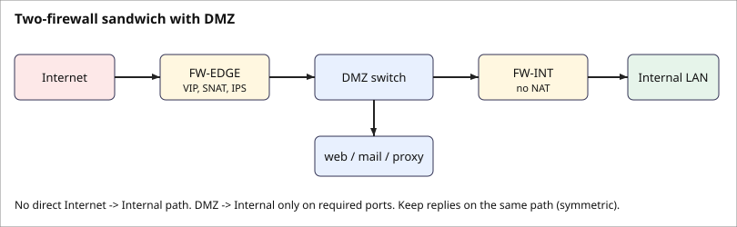

*شکل: دوفایروال با DMZ.*

### ۵) مثال حل‌شده

**نیاز:** وب‌سایت عمومی، API داخلی، DB. طراحی: Edge: VIP 203.0.113.50:443→10.10.10.20 (DMZ). Internal: DMZ→10.20.20.5:8080 (App)؛ App→DB فقط داخل Internal. Policy Matrix:

``` text
EDGE    : WAN  -> DMZ      : VIP web  TCP 443        accept + IPS + log
EDGE    : DMZ  -> WAN      : DNS, updates only        accept + log
EDGE    : INT  -> WAN      : users HTTP/HTTPS/DNS     accept + UTM + NAT
INT     : DMZ  -> SRV      : 10.10.10.20 -> 10.20.20.5 TCP 8080   accept + log
INT     : SRV  -> DMZ      : established only (implicit via session)
INT     : any  -> any      : implicit deny + log
```

**مثال متوسط:** `ping` از Internet به DB داخلی ناکام است؛ Debug Flow روی Edge: «Denied policy 0» ← درست (هیچ Policy). نشان‌دهنده‌ی طراحی سالم است.

**مثال سخت:** پس از Compromise وب‌سرور DMZ، مهاجم سعی می‌کند به DB وصل شود: DMZ→SRV فقط 8080 مجاز است، بقیه deny+log؛ Alert بر پایه‌ی «Denied از DMZ به SRV» می‌تواند نشانه‌ی نفوذ باشد (Detection).

### ۶) طراحی و تصمیم‌گیری

| سؤال | تصمیم |
|---|---|
| دوفایروال یا تک؟ | ریسک بالا/دارایی حساس ← دو؛ سازمان کوچک ← یک با DMZ و UTM |
| NAT | Edge فقط؛ Internal Routing |
| HA | هر دو HA (فصل ۲۲) |
| تنوع سازنده | در صورت بودجه/مهارت |
| Log | مرکزی، با Timestamp همگام (NTP) |

### ۷) پیاده‌سازی و Verification (GUI/CLI)

**GUI:** Policy & Objects → Virtual IPs (VIP)؛ Firewall Policy (WAN→DMZ)؛ Network → Static Routes (DMZ→Internal)؛ Log & Report → Forward Traffic.

**CLI:**

``` text
config firewall vip
    edit "VIP-WEB"
        set extip 203.0.113.50
        set mappedip "10.10.10.20"
        set extintf "wan1"
        set portforward enable
        set extport 443
        set mappedport 443
    next
end
get router info routing-table all
diagnose debug flow filter addr 10.10.10.20
diagnose sys session filter dst 10.10.10.20
```

(نام فیلدها `Unverified`.) **آزمون‌ها:** مثبت: اینترنت→VIP؛ منفی: اینترنت→DB، DMZ→DB، Internal→Internet مستقیم (بدون Policy).

### ۸) Troubleshooting

| علامت | علت |
|---|---|
| VIP از بیرون کار نمی‌کند | Policy مقصد (post-DNAT)، Route، ARP |
| DMZ به Internal نمی‌رسد | Policy Internal، مسیر، NAT اشتباه |
| فقط بعضی ارتباط‌ها Drop | Asymmetric/Session |
| Log مبدأ همه یک IP | Double NAT |

### ۹) نکات امنیتی

- Internal هرگز Internet را به‌طور مستقیم به‌رسمیت نشناسد.
- سرورهای DMZ نباید اعتبار (Credential) شبکه‌ی داخلی داشته باشند.
- تغییرات هر دو فایروال Change یکپارچه.

### ۱۰) جمع‌بندی مفهومی

- DMZ اثر نفوذ را محدود می‌کند؛ دو فایروال لایه‌ی کنترل مستقل است.
- NAT را فقط لبه؛ Internal ترجیحاً Routing.
- مسیر برگشت متقارن؛ Policy در جهت درست.
- طراحی را با «اگر لایه‌ی اول بشکند» ارزیابی کنید.
- مدیریت و Log را متمرکز کنید.

### ۱۱) تمرین و ارزیابی

**ت1.** (ساده) DMZ چیست؟ *(پاسخ: 15-0-ت1)*

**ت2.** (ساده) چرا Internal NAT نمی‌کند؟ *(پاسخ: 15-0-ت2)*

**ت3.** (متوسط) مسیر یک درخواست Internet→App را بنویسید. *(پاسخ: 15-0-ت3)*

**ت4.** (متوسط) Double NAT چه مشکلی در Log دارد؟ *(پاسخ: 15-0-ت4)*

**ت5.** (سخت) پس از Compromise وب‌سرور، کدام سه کنترل جلوی حرکت جانبی را می‌گیرد؟ *(پاسخ: 15-0-ت5)*

**ت6.** (سخت، طراحی) برای سازمانی با بودجه‌ی محدود تصمیم دو فایروال در برابر تک‌فایروال+DMZ را با معیار ریسک بگیرید. *(پاسخ: 15-0-ت6)*

**Q1.** Quick quiz (English): Why avoid NAT on the internal firewall? *(پاسخ: 15-0-Q1)*

### ۱۲) اصطلاحات و English Corner

| مخفف | شکل کامل | معنی |
|---|---|---|
| DMZ | Demilitarized Zone | ناحیه‌ی واسط |
| Edge | Edge firewall | فایروال لبه |
| Sandwich | Firewall sandwich | دو فایروال با DMZ بین آن‌ها |
| VIP | Virtual IP | آدرس مجازی DNAT |

- *Place public servers in a DMZ between two firewalls.* ← سرورهای عمومی را در DMZ بین دو فایروال بگذارید.
- *Preserve original source addresses for logging.* ← آدرس مبدأ اصلی را برای Log حفظ کنید.

### ۱۳) منابع

- NIST SP 800-41 Rev.1 — Guidelines on Firewalls (DMZ designs).
- Fortinet Docs: FortiOS 7.0 Administration Guide — Virtual IPs، Firewall policy.

### بخش تکمیلی درس: سناریوی واقعی، مثال‌های بیشتر و عیب‌یابی

> بخش‌های زیر درس بالا را کامل می‌کنند: سناریوی گام‌به‌گام، مثال‌های بیشتر از ساده تا سخت، جدول عیب‌یابی و پرسش‌های مصاحبه. ابتدا بخش‌های اصلی بالا را مطالعه کنید.

### تعمیق: مقایسه‌ی یک‌فایروالی و دوفایروالی با عدد

**سناریو.** ۲۰۰ کاربر، ۱۵ سرور داخلی، ۳ سرور DMZ.

| معیار | یک فایروال | دو فایروال |
|---|---|---|
| نقطه‌ی شکست | ۱ | ۲ (با HA هر کدام ۱ جفت) |
| سطح حمله به داخل | یک Policy اشتباه کافی | باید دو لایه شکسته شود |
| تفکیک مسئولیت | ندارد | Edge=امنیت، Internal=شبکه |
| هزینه/پیچیدگی | کم | بیشتر |

**جریان:** Internet → Edge (NAT+VIP) → DMZ؛ Users → Internal → Edge → Internet. DMZ هرگز مستقیم به داخل Session نمی‌گشاید.

**تحلیل خرابی:** اگر Edge بیفتد اینترنت و DMZ قطع؛ Internal با Policy Route/Default به Edge همچنان داخلی کار می‌کند. اگر Internal بیفتد فقط ارتباط داخلی.

**پرسش‌های مصاحبه**
1. *چرا دو سازنده‌ی متفاوت؟* ضعف مشترک کم می‌شود (بحث Defense in Depth).
2. *DMZ به داخل؟* فقط جریان‌های حداقلی و آغاز از داخل.
3. *هزینه‌ی عملیاتی؟* دو مجموعه Policy و Backup.

### تکمیل عمیق: چرا دو فایروال؟ تحلیل جریان و خرابی

#### چرا باید یاد بگیریم؟

یک قلعه‌ی با یک دیوار، با شکسته‌شدن آن دیوار، همه‌چیز در دسترس است. قلعه‌ی با دو دیوار و حیاط میانی (DMZ) مهاجم را مجبور می‌کند دو بار نفوذ کند و در هر مرحله دیده شود. طراحی دو فایروالی همین «دفاع در عمق» (Defense in Depth) است.

#### توضیح ساده

- **Edge FW**: رو به اینترنت؛ NAT، VIP، DMZ.
- **Internal FW**: رو به شبکه‌ی داخلی؛ Users، Servers، Mgmt.
- بین آنها یک لینک /30 (LINK).

``` text
Internet -- Edge FW -- DMZ
               |
            LINK /30
               |
           Internal FW -- Users / Servers / Mgmt
```

#### مثال ساده — مقایسه با عدد

| معیار | یک فایروال | دو فایروال |
|---|---|---|
| دفعات نفوذ لازم برای رسیدن به داخل | 1 | 2 |
| تفکیک مسئولیت | ندارد | دارد |
| هزینه/پیچیدگی | کم | بیشتر |

#### مثال متوسط — جریان‌ها

``` text
F1 Users -> Internet : Internal(accept) -> Edge(accept + SNAT) -> ISP
F2 Internet -> DMZ    : Edge(VIP + policy) -> DMZ
F3 DMZ -> Internal    : denied by default (only minimal exceptions)
```

#### مثال سخت — تحلیل خرابی

| خرابی | اثر |
|---|---|
| Edge | اینترنت و DMZ قطع؛ داخلی سالم |
| Internal | ارتباط داخلی/به اینترنت قطع؛ DMZ سالم |
| لینک LINK | Users بی‌اینترنت |

با HA برای هر کدام این اثرها کم می‌شود.

#### Lab

نمودار را با نام Interface بکشید و سه جریان را ردیابی کنید.

#### عیب‌یابی طراحی

| علامت (مشاهده) | علت محتمل (باید اثبات شود) | اقدام پس از اثبات |
|---|---|---|
| DMZ به داخل باز | Policy | Deny |
| دو NAT | طراحی | یکی |
| مسیر ناقص | Route | کامل |

#### پرسش‌ها با پاسخ

**۱. چرا DMZ جدا؟** سرورهای در معرض اینترنت.
**۲. DMZ به داخل؟** ممنوع مگر استثنا.
**۳. NAT کجا؟** Edge.

#### English Corner

- *Defense in depth forces an attacker to defeat multiple independent layers.*
- Q: Why should DMZ hosts be unable to initiate sessions to the internal network?

## درس 15-1 — طراحی معماری دوفایروالی: نقش‌ها، Zoneها، آدرس‌دهی و جدول مسیر

**فصل 15 · بازنویسی عمیق · پیش‌نیاز: ۱۵-۰، ۱۲-۲، ۱۳-۱ · ≈ 10 ساعت**

> **وضعیت:** FortiOS 7.0.3 نامی (بوت‌نشده)؛ دستورها طبق مستندات 7.0 ولی `Unverified` تا اجرای Lab؛ Lab «اجرا نشده».

<!--deep-->

### هدف آموزشی

در پایان این درس باید بتوانید:

1. نقش Edge و Internal را در معماری دوفایروالی تعریف کنید.
2. Interfaceها، Zoneها و آدرس‌دهی را (با /30 برای Transit) طراحی کنید.
3. جدول مسیر دو دستگاه را بنویسید و Route برگشت را فراموش نکنید.
4. ماتریس Policy بین Zoneها را طراحی کنید.
5. Asymmetric، Double NAT و Rule Drift را به‌عنوان خطر بشناسید.
6. طراحی را با Packet Walk اثبات کنید.

### چرا باید یاد بگیریم؟

یک ساختمان اداری را در نظر بگیرید: نگهبان در ورودی ساختمان (Edge) و کارت‌خوان جلوی اتاق سرور (Internal). اگر مهاجم از نگهبان رد شود، هنوز مانع دوم دارد. دو فایروال هم همین «دفاع لایه‌ای» است. ولی دو دستگاه یعنی دو برابر Route، دو برابر Policy و دو برابر نقطه‌ی خطا؛ بدون طراحی دقیق، خود پیچیدگی تبدیل به آسیب‌پذیری می‌شود. این درس نقشه‌ی ساختمان را قبل از اجرا می‌کشد.

### نقش‌ها

| دستگاه | نقش | قابل‌دسترس از |
|---|---|---|
| Edge | اتصال به ISP، NAT، DMZ، VIP | اینترنت |
| Internal | Users، Servers، Mgmt | فقط از Edge و داخل |

اصل: **هر ترافیک ورودی از اینترنت ابتدا در Edge متوقف و فقط مجاز به DMZ می‌رود؛ هیچ مسیر مستقیمی از اینترنت به Internal وجود ندارد.**

### توپولوژی

``` text
 Internet
    |
 [ISP 203.0.113.1]
    |
 port1 WAN 203.0.113.2/29
 +-------+
 | EDGE  |-- port2 DMZ 10.30.0.1/24 -- [Web]
 +-------+
 port3 LINK 10.99.0.1/30
    |
 port1 LINK 10.99.0.2/30
 +----------+
 | INTERNAL |-- port2 USERS 10.10.0.1/24
 +----------+-- port3 SRV   10.20.0.1/24
              -- port4 MGMT  10.50.0.1/24
```

### جدول Interface

| دستگاه | Interface | Zone | آدرس |
|---|---|---|---|
| Edge | port1 | WAN | 203.0.113.2/29 |
| Edge | port2 | DMZ | 10.30.0.1/24 |
| Edge | port3 | LINK | 10.99.0.1/30 |
| Internal | port1 | LINK | 10.99.0.2/30 |
| Internal | port2 | USERS | 10.10.0.1/24 |
| Internal | port3 | SRV | 10.20.0.1/24 |
| Internal | port4 | MGMT | 10.50.0.1/24 |

### چرا /30 برای Transit؟

``` text
/30 -> 4 addresses - network - broadcast = 2 usable hosts
```

دو آدرس قابل‌استفاده برای دو فایروال کافی است و هیچ Host سوم نمی‌تواند در آن لینک قرار بگیرد (سطح حمله‌ی کمینه).

### جدول مسیر

``` text
Internal: 0.0.0.0/0     via 10.99.0.1
Edge    : 0.0.0.0/0     via 203.0.113.1
Edge    : 10.10.0.0/24  via 10.99.0.2
Edge    : 10.20.0.0/24  via 10.99.0.2
Edge    : 10.50.0.0/24  via 10.99.0.2
```

Internal فقط یک Default به Edge دارد. Edge باید «برگشت» به سه شبکه‌ی داخلی را بداند؛ وگرنه پاسخ‌ها از Default (WAN) خارج و گم می‌شوند.

### ماتریس Policy

| از ↓ به → | Internet | DMZ | Users | Servers | Mgmt |
|---|---|---|---|---|---|
| Internet | - | HTTPS (VIP) | - | - | - |
| DMZ | - | - | - | DB 1433 از App | - |
| Users | HTTP/S/DNS (SNAT) | HTTPS | - | App 443 | - |
| Servers | Updates | - | - | - | - |
| Mgmt | - | SSH | - | SSH | - |

خالی (-) یعنی Deny. هر خانه یک Policy مشخص دارد؛ هیچ ALL/ALL.

### خطرها

| خطر | علت | کاهش |
|---|---|---|
| Asymmetric | دو مسیر بین Edge و Internal | یک Link، Route واحد |
| Double NAT | NAT در هر دو | NAT فقط در Edge |
| Rule Drift | اختلاف Policy دو دستگاه | بازبینی فصلی |
| SPOF | هر دستگاه یک نقطه‌ی خطا | HA/DR (فصل بعد) |

### مثال‌های حل‌شده

#### مثال ساده — Transit

چرا 10.99.0.0/30 و نه /24؟ فقط دو Host لازم است؛ /24 ۲۵۴ آدرس بی‌دلیل در معرض ورود می‌گذارد.

#### مثال متوسط — Summary Route

سه شبکه‌ی 10.10.0.0/24، 10.20.0.0/24 و 10.50.0.0/24 پیوسته نیستند (10.30 و 10.40 بین‌شان است). Summary 10.0.0.0/16 DMZ (10.30) را هم پوشش می‌دهد و Edge را به اشتباه برای DMZ به Internal می‌فرستد. پس سه Route جدا.

``` text
10.10.0.0/24 + 10.20.0.0/24 + 10.50.0.0/24 -> not contiguous
Summary 10.0.0.0/16 would also cover DMZ 10.30.0.0/24 -> WRONG
```

#### مثال سخت — Route برگشت فراموش‌شده

Users به اینترنت می‌روند؛ پاسخ به Edge می‌رسد؛ Edge Route به 10.10.0.0/24 ندارد و از Default به ISP می‌فرستد ⇒ گم. علامت: کاربر Timeout؛ Sniffer روی port1 Edge پاسخ ورودی را می‌بیند ولی SYN-ACK به داخل نمی‌رسد؛ `get router info routing-table details 10.10.0.5` (Edge) ⇒ Default. رفع: Route برگشت. تأیید: همان دستور ⇒ via 10.99.0.2.

### مسیر GUI (مستندی، Unverified)

1. هر فایروال: Network → Interfaces برای Transit و Zoneها.
2. Network → Static Routes.
3. Policy & Objects برای ماتریس.

### Lab هدایت‌شده (اجرا نشده)

1. جدول Interface و Route را بنویسید.
2. ماتریس Policy را روی کاغذ پر کنید.
3. برای سه جریان Packet Walk Hop-by-hop بنویسید.

### عیب‌یابی سریع

| علامت (مشاهده) | علت محتمل (باید اثبات شود) | اقدام پس از اثبات |
|---|---|---|
| پاسخ گم | Route برگشت | افزودن در Edge |
| IP تکراری | Overlap | بازبینی |
| Mgmt از Users قابل‌دسترس | Policy | Deny |
| دو NAT | تنظیم اشتباه | NAT فقط Edge |

### نکات امنیتی

Mgmt را هرگز از اینترنت یا Users باز نکنید؛ لینک Transit را فقط برای همین دو دستگاه نگه دارید.

### جمع‌بندی

Edge ورودی عمومی و DMZ؛ Internal شبکه‌های داخلی؛ Transit /30؛ Route برگشت در Edge الزامی؛ NAT فقط Edge؛ ماتریس Policy بدون ALL؛ خطرها: Asymmetric و Rule Drift.

### تمرین و ارزیابی

**ت1.** (ساده) چرا NAT فقط روی Edge؟ *(پاسخ: 15-1-ت1)*

**ت2.** (ساده) Default Internal به کجاست؟ *(پاسخ: 15-1-ت2)*

**ت3.** (متوسط) چرا Edge باید Route شبکه‌های داخلی را داشته باشد؟ *(پاسخ: 15-1-ت3)*

**ت4.** (متوسط) DMZ→DB مستقیم چرا ممنوع؟ *(پاسخ: 15-1-ت4)*

**ت5.** (سخت) طرح ممیزی‌پذیر را بنویسید. *(پاسخ: 15-1-ت5)*

**ت6.** (سخت، طراحی) ریسک Rule drift را چگونه کنترل می‌کنید؟ *(پاسخ: 15-1-ت6)*

**Q1.** Quick quiz (English): Why configure NAT only on the edge firewall? *(پاسخ: 15-1-Q1)*

### اصطلاحات و English Corner

| مخفف | شکل کامل | معنی |
|---|---|---|
| DMZ | Demilitarized Zone | منطقه‌ی حائل |

- *Edge handles north-south traffic.* ← Edge ترافیک شمال-جنوب را کنترل می‌کند.

### کارت Lab

**کارت Lab:** طراحی دوفایروالی (اجرا نشده). **Evidence:** `02-design/arch2.md`.

### منابع

- Fortinet FortiOS 7.0 Administration Guide: Firewall policies; Routing
- NIST SP 800-41

<a id="l-15-2"></a>

## درس 15-2 — ساخت Edge: WAN، DMZ، NAT، VIP و Policy ورودی

**فصل 15 · بازنویسی عمیق · پیش‌نیاز: ۱۵-۱، ۱۳-۲، ۱۳-۳ · ≈ 10 ساعت**

> **وضعیت:** FortiOS 7.0.3 نامی (بوت‌نشده)؛ دستورها طبق مستندات 7.0 ولی `Unverified` تا اجرای Lab؛ Lab «اجرا نشده».

<!--deep-->

### هدف آموزشی

در پایان این درس باید بتوانید:

1. WAN، DMZ و Transit را روی Edge پیکربندی کنید.
2. Default Route و Routeهای برگشت را بنویسید.
3. SNAT (خروجی) و VIP (ورودی) را روی Edge بسازید.
4. Policyهای ورودی (Internet→DMZ) را ایمن بنویسید.
5. با Lookup، Session و Sniffer آزمون کنید.
6. چهار خطای رایج Edge را رفع کنید.

### چرا باید یاد بگیریم؟

Edge «دروازه‌ی شهر» است: همه‌ی ترافیک عمومی از آن رد می‌شود. یک اشتباه در VIP یا Policy یعنی سرور داخلی را در معرض اینترنت گذاشتن. در این درس Edge را قدم‌به‌قدم می‌سازیم و با آزمون مثبت و منفی ثابت می‌کنیم فقط همان چیزی باز است که می‌خواهیم.

### قدم ۱ — Interfaceها

``` text
config system interface
    edit "port1"
        set alias WAN
        set mode static
        set ip 203.0.113.2 255.255.255.248
        set allowaccess ping
    next
    edit "port2"
        set alias DMZ
        set ip 10.30.0.1 255.255.255.0
    next
    edit "port3"
        set alias LINK
        set ip 10.99.0.1 255.255.255.252
    next
end
```

روی WAN فقط `ping` (و در صورت نیاز) مجاز؛ هرگز `http`، `ssh`، `telnet` از اینترنت.

### قدم ۲ — Routeها

``` text
config router static
    edit 1
        set gateway 203.0.113.1
        set device port1
    next
    edit 2
        set dst 10.10.0.0 255.255.255.0
        set gateway 10.99.0.2
        set device port3
    next
    edit 3
        set dst 10.20.0.0 255.255.255.0
        set gateway 10.99.0.2
        set device port3
    next
    edit 4
        set dst 10.50.0.0 255.255.255.0
        set gateway 10.99.0.2
        set device port3
    next
end
```

### قدم ۳ — خروجی (SNAT)

``` text
config firewall policy
    edit 10
        set name "LINK-to-WAN"
        set srcintf "port3"
        set dstintf "port1"
        set srcaddr "all"
        set dstaddr "all"
        set action accept
        set schedule "always"
        set service "HTTP" "HTTPS" "DNS"
        set nat enable
        set logtraffic all
    next
end
```

NAT فقط اینجا (Edge). با `nat enable` مبدأ به 203.0.113.2 (یا Pool) ترجمه می‌شود.

### قدم ۴ — ورودی (VIP + Policy)

``` text
config firewall vip
    edit "VIP-WEB"
        set extip 203.0.113.3
        set mappedip 10.30.0.10
        set extintf port1
        set portforward enable
        set protocol tcp
        set extport 443
        set mappedport 443
    next
end
config firewall policy
    edit 20
        set name "WAN-to-DMZ-WEB"
        set srcintf "port1"
        set dstintf "port2"
        set srcaddr "all"
        set dstaddr "VIP-WEB"
        set action accept
        set schedule "always"
        set service "HTTPS"
        set logtraffic all
    next
end
```

نکته: `dstaddr` باید خود VIP باشد، نه IP داخلی.

### Policyهای DMZ

| Policy | مسیر | سرویس | توضیح |
|---|---|---|---|
| 20 | WAN→DMZ | HTTPS (VIP) | انتشار |
| 30 | DMZ→WAN | DNS/NTP/Updates | حداقل |
| 99 | any→any | - | Deny + Log (Implicit) |

اصل: DMZ نباید آزادانه به داخل ابتکار اتصال بزند؛ این مسیر فقط از Internal با Policy مشخص.

### آزمون

``` text
diagnose firewall iprope lookup 198.51.100.50 40000 203.0.113.3 443 tcp port1
diagnose sys session filter dst 10.30.0.10
diagnose sniffer packet any 'host 10.30.0.10 and tcp port 443' 4 10 a
```

آزمون منفی: از اینترنت به پورت 22 همان VIP ⇒ باید Deny (Lookup ⇒ policy 0).

### مثال‌های حل‌شده

#### مثال ساده — VIP

کاربر اینترنت به 203.0.113.3:443 ⇒ Edge DNAT به 10.30.0.10:443. Session: `act=dnat`. Sniffer port2: بسته با مقصد 10.30.0.10.

#### مثال متوسط — آزمون منفی

اینترنت → 203.0.113.3:22: Lookup ⇒ policy 0؛ Log: deny. ثابت می‌کند فقط HTTPS باز است.

#### مثال متوسط — Route برگشت

Web (10.30.0.10) پاسخ را به Edge می‌دهد (Gateway Edge). برای Users: پاسخ از Edge به Internal باید Route داشته باشد؛ Route 10.10.0.0/24 via 10.99.0.2 موجود است ⇒ OK.

#### مثال سخت — VIP و Policy اشتباه

`dstaddr` Policy برابر `all` و VIP هم باز؛ ظاهراً کار می‌کند ولی Policy برای هر آدرس عمومی ناخواسته باز است. رفع: `dstaddr "VIP-WEB"`. آزمون: Lookup به 203.0.113.4:443 ⇒ policy 0.

#### مثال سخت — Hairpin

Users داخلی با IP عمومی 203.0.113.3 به سایت می‌روند: ترافیک از Internal به Edge و برگشت به DMZ. نیاز به Policy LINK→DMZ و گاهی NAT؛ ساده‌تر: DNS داخلی نام را به 10.30.0.10 حل کند (Split DNS).

### مسیر GUI (مستندی، Unverified)

1. Network → Interfaces.
2. Static Routes.
3. Virtual IPs.
4. Firewall Policy.

### Lab هدایت‌شده (اجرا نشده)

1. Interface/Route/Policy را اعمال کنید.
2. VIP و آزمون مثبت/منفی.
3. Sniffer در دو Interface.

### عیب‌یابی سریع

| علامت (مشاهده) | علت محتمل (باید اثبات شود) | اقدام پس از اثبات |
|---|---|---|
| VIP کار نمی‌کند | dstaddr اشتباه | VIP |
| پاسخ نمی‌آید | Gateway سرور | Edge |
| NAT نمی‌شود | nat disable | enable |
| از اینترنت پورت دیگر باز | Policy باز | تنگ |

### نکات امنیتی

Policy ورودی فقط پورت لازم؛ IPS/WAF در صورت لایسنس (Needs-License)؛ مدیریت Edge فقط از Mgmt.

### جمع‌بندی

Edge: Interface، Route (با برگشت)، SNAT، VIP + Policy با dstaddr=VIP، آزمون مثبت و منفی. DMZ حداقل دسترسی.

### تمرین و ارزیابی

**ت1.** (ساده) Policy 99؟ *(پاسخ: 15-2-ت1)*

**ت2.** (ساده) VIP چه می‌کند؟ *(پاسخ: 15-2-ت2)*

**ت3.** (متوسط) چرا port1 بدون Admin access؟ *(پاسخ: 15-2-ت3)*

**ت4.** (متوسط) آزمون منفی؟ *(پاسخ: 15-2-ت4)*

**ت5.** (سخت) VIP جواب نمی‌دهد. *(پاسخ: 15-2-ت5)*

**ت6.** (سخت، طراحی) ماتریس Edge. *(پاسخ: 15-2-ت6)*

**Q1.** Quick quiz (English): Which policy should end the Edge rule list? *(پاسخ: 15-2-Q1)*

### اصطلاحات و English Corner

| مخفف | شکل کامل | معنی |
|---|---|---|
| VIP | Virtual IP | آدرس مجازی |

- *Test denied flows too.* ← جریان‌های ردشده را هم آزمون کنید.

### کارت Lab

**کارت Lab:** Edge (اجرا نشده). **Evidence:** `02-design/fgt-edge.md`.

### منابع

- Fortinet FortiOS 7.0 Administration Guide: Virtual IPs

<a id="l-15-3"></a>

### ضمیمه: پرونده‌ی کامل حل‌شده — «VIP وب از اینترنت باز نمی‌شود»

**ورودی:** VIP-WEB-443 (203.0.113.10 → 10.30.0.10) ساخته شده؛ از اینترنت Timeout.

**گام ۱ — Debug flow:**

``` text
diagnose debug flow filter addr 203.0.113.10
diagnose debug flow trace start 20
diagnose debug enable
 -> "Denied by forward policy check (policy 0)"
```

**گام ۲ — علت:** Policy 2 با dstaddr=10.30.0.10 (آدرس داخلی) نوشته شده؛ باید VIP باشد (DNAT قبل از Policy).

**گام ۳ — رفع:** dstaddr را به VIP-WEB-443 تغییر دهید.

**گام ۴ — Verify:** Debug: «Allowed by Policy-2»؛ `session list`: DNAT 203.0.113.10:443 → 10.30.0.10:443.

**گام ۵ — آزمون منفی:** SSH به 203.0.113.10 ⇒ Deny (policyid=99 با Log).

**گام ۶ — پایان:** `diagnose debug disable` و `diagnose debug reset`.

## درس 15-3 — ساخت Internal: Users، Servers، Mgmt و Routing به Edge با آزمون کامل

**فصل 15 · بازنویسی عمیق · پیش‌نیاز: ۱۵-۱، ۱۵-۲ · ≈ 10 ساعت**

> **وضعیت:** FortiOS 7.0.3 نامی (بوت‌نشده)؛ دستورها طبق مستندات 7.0 ولی `Unverified` تا اجرای Lab؛ Lab «اجرا نشده».

<!--deep-->

### هدف آموزشی

در پایان این درس باید بتوانید:

1. Interface و Zoneهای Internal (Users، Servers، Mgmt) را پیکربندی کنید.
2. Default Route به Edge را بگذارید و NAT را فقط روی Edge نگه دارید.
3. Policyهای Users، Servers و Mgmt را بر اساس حداقل دسترسی بنویسید.
4. آزمون کامل (مثبت/منفی/Hop-by-hop) انجام دهید.
5. مدیریت (SSH/HTTPS) را فقط از Mgmt مجاز کنید.
6. خطاهای رایج Internal را رفع کنید.

### چرا باید یاد بگیریم؟

Internal «کارت‌خوان اتاق سرور» است. مهاجمی که یک لپ‌تاپ آلوده در Users دارد، نباید بتواند مستقیم به پایگاه‌داده یا Mgmt برسد. Internal با Policy سخت‌گیرانه بین Zoneهای داخلی از حرکت جانبی (Lateral Movement) جلوگیری می‌کند.

### Interface و Zone

``` text
config system zone
    edit "ZN-USERS"
        set interface "port2"
    next
    edit "ZN-SRV"
        set interface "port3"
    next
    edit "ZN-MGMT"
        set interface "port4"
        set intrazone deny
    next
end
```

`intrazone deny` یعنی Hostهای داخل یک Zone هم بدون Policy نمی‌توانند به هم برسند.

### Default Route

``` text
config router static
    edit 1
        set gateway 10.99.0.1
        set device port1
    next
end
```

Internal هیچ NAT خروجی ندارد؛ NAT فقط در Edge.

### Policyها

``` text
config firewall policy
    edit 10
        set name "USERS-to-APP"
        set srcintf "ZN-USERS"
        set dstintf "ZN-SRV"
        set srcaddr "NET-USERS"
        set dstaddr "HOST-APP"
        set service "HTTPS"
        set action accept
        set schedule "always"
        set logtraffic all
    next
    edit 20
        set name "USERS-to-NET"
        set srcintf "ZN-USERS"
        set dstintf "port1"
        set srcaddr "NET-USERS"
        set dstaddr "all"
        set service "HTTP" "HTTPS" "DNS"
        set action accept
        set schedule "always"
        set logtraffic all
    next
    edit 30
        set name "MGMT-to-ALL-SSH"
        set srcintf "ZN-MGMT"
        set dstintf "ZN-SRV"
        set srcaddr "HOST-ADMIN"
        set dstaddr "all"
        set service "SSH"
        set action accept
        set schedule "always"
        set logtraffic all
    next
end
```

مدیریت FortiGate: `set allowaccess https ssh` فقط روی port4 (Mgmt) و `trusthost` برای Admin.

### مثال‌های حل‌شده

#### مثال ساده — Users به اپ

PC 10.10.0.5 → 10.20.0.30:443: Lookup (ورودی port2) ⇒ policy 10 ⇒ OK.

#### مثال متوسط — آزمون منفی

Users → Servers پورت 1433 (DB): Lookup ⇒ policy 0 ⇒ Deny؛ Log deny. ثابت می‌کند Users مستقیم به DB دسترسی ندارند.

#### مثال متوسط — اینترنت

Users → 8.8.8.8:53: Policy 20 ⇒ Internal Route به Edge ⇒ Edge SNAT ⇒ اینترنت. Session Internal بدون NAT؛ Session Edge با SNAT.

#### مثال سخت — حرکت جانبی

PC آلوده در Users به SSH سرور 10.20.0.30 تلاش می‌کند. Policy SSH فقط از ZN-MGMT است ⇒ Deny؛ Log هشدار. مقایسه: بدون Zone و با ALL، حمله موفق می‌شد.

#### مثال سخت — Default Route اشتباه

Default روی port1 ولی Gateway اشتباه (10.99.0.9). علامت: Users اینترنت ندارند. `get router info routing-table details 8.8.8.8` ⇒ via 10.99.0.9؛ ARP ناموفق. رفع: Gateway درست 10.99.0.1. تأیید: ping به 10.99.0.1 و Debug.

### آزمون کامل

``` text
get router info routing-table details 8.8.8.8
diagnose firewall iprope lookup 10.10.0.5 40000 10.20.0.30 443 tcp port2
diagnose firewall iprope lookup 10.10.0.5 40000 10.20.0.30 1433 tcp port2
diagnose sys session filter src 10.10.0.5
diagnose sys session list
```

### مسیر GUI (مستندی، Unverified)

1. Network → Interfaces برای هر پورت.
2. Network → Static Routes → Default به 10.255.0.1.
3. Policy & Objects → Firewall Policy با ماتریس.
4. Log & Report → Forward Traffic برای آزمون منفی.

### Lab هدایت‌شده (اجرا نشده)

1. Zoneها و Policyها را بسازید.
2. آزمون مثبت/منفی را اجرا کنید.
3. Mgmt را محدود و SSH را از Users تست کنید.

### عیب‌یابی سریع

| علامت (مشاهده) | علت محتمل (باید اثبات شود) | اقدام پس از اثبات |
|---|---|---|
| اینترنت ندارند | Default/Gateway | تصحیح |
| Users به DB می‌رسند | Policy باز | تنگ |
| Mgmt از Users باز | allowaccess | محدود |
| Zone Policy کار نمی‌کند | Interface عضو نیست | عضویت |

### نکات امنیتی

Admin با MFA و `trusthost`؛ SSH فقط Key؛ Log همه‌ی Policyها؛ DB فقط از App.

### جمع‌بندی

Internal: Zone با `intrazone deny`، Default به Edge، NAT فقط Edge، Policy حداقل دسترسی (Users→App، Mgmt→SSH)، آزمون منفی برای اثبات.

### تمرین و ارزیابی

**ت1.** (ساده) چرا NAT روی Internal خاموش است؟ *(پاسخ: 15-3-ت1)*

**ت2.** (ساده) Default Internal به کجا؟ *(پاسخ: 15-3-ت2)*

**ت3.** (متوسط) چرا Servers→Internet باید محدود باشد؟ *(پاسخ: 15-3-ت3)*

**ت4.** (متوسط) چرا Mgmt جدا؟ *(پاسخ: 15-3-ت4)*

**ت5.** (سخت) اینترنت ندارند ولی Servers ok؛ مسیر عیب‌یابی؟ *(پاسخ: 15-3-ت5)*

**ت6.** (سخت، طراحی) ماتریس Internal برای ۱۵۰ کاربر و ۱۰ سرور. *(پاسخ: 15-3-ت6)*

**Q1.** Quick quiz (English): Why is NAT not enabled on the internal firewall in this design? *(پاسخ: 15-3-Q1)*

### اصطلاحات و English Corner

| مخفف | شکل کامل | معنی |
|---|---|---|
| Lateral movement | Lateral movement | حرکت جانبی مهاجم |
| Transit | Transit network | شبکه‌ی ارتباطی دو فایروال |

- *Internal firewall limits lateral movement.* ← فایروال داخلی حرکت جانبی را محدود می‌کند.

### کارت Lab

**کارت Lab:** Internal (اجرا نشده). **Evidence:** `02-design/fgt-internal.md`.

### منابع

- Fortinet FortiOS 7.0 Administration Guide: Firewall policies; Routing
- NIST SP 800-41 Rev.1

<a id="l-15-4"></a>

## درس 15-4 — DMZ سه‌لایه: Web، App، DB؛ Policy، آزمون منفی و پایش

**فصل 15 · بازنویسی عمیق · پیش‌نیاز: ۱۵-۱ تا ۱۵-۳ · ≈ 10 ساعت**

> **وضعیت:** FortiOS 7.0.3 نامی (بوت‌نشده)؛ دستورها طبق مستندات 7.0 ولی `Unverified` تا اجرای Lab؛ Lab «اجرا نشده».

<!--deep-->

### هدف آموزشی

در پایان این درس باید بتوانید:

1. معماری سه‌لایه (Web، App، DB) را در DMZ و Servers طراحی کنید.
2. Policy بین لایه‌ها را با اصل «فقط لایه‌ی مجاور» بنویسید.
3. آزمون منفی (Web به DB مستقیم ممنوع) را اجرا کنید.
4. Log و پایش هر لایه را تنظیم کنید.
5. اثر نفوذ به Web را با و بدون تفکیک مقایسه کنید.
6. خطاهای رایج سه‌لایه را رفع کنید.

### چرا باید یاد بگیریم؟

اگر وب‌سرور هک شود و DB در همان شبکه با دسترسی آزاد باشد، مهاجم در چند دقیقه همه‌ی داده را می‌برد. در سه‌لایه، Web فقط با App حرف می‌زند و App فقط با DB: مهاجم برای رسیدن به داده باید دو مانع را رد کند و در هر مانع Log و آلارم دارد. مثل بانک: سالن (Web)، کارمند (App)، خزانه (DB)؛ مشتری مستقیم به خزانه نمی‌رود.

### معماری

``` text
Internet -> [Edge] -> DMZ: Web (10.30.0.10)
                         |  HTTPS 8443
                         v
              [Internal] SRV: App (10.20.0.30)
                         |  TCP 1433
                         v
                         DB  (10.20.0.40)
```

### ماتریس سه‌لایه

| از | به | سرویس | اجازه |
|---|---|---|---|
| Internet | Web | HTTPS 443 (VIP) | بله |
| Web | App | TCP 8443 | بله |
| App | DB | TCP 1433 | بله |
| Web | DB | هر | **خیر** |
| Internet | App/DB | هر | **خیر** |
| DB | Internet | هر | **خیر** |

### Policyها (Internal و Edge)

``` text
config firewall policy
    edit 40
        set name "WEB-to-APP"
        set srcintf "LINK"
        set dstintf "ZN-SRV"
        set srcaddr "HOST-WEB"
        set dstaddr "HOST-APP"
        set service "TCP-8443"
        set action accept
        set schedule "always"
        set logtraffic all
    next
    edit 41
        set name "APP-to-DB"
        set srcintf "ZN-SRV"
        set dstintf "ZN-SRV"
        set srcaddr "HOST-APP"
        set dstaddr "HOST-DB"
        set service "TCP-1433"
        set action accept
        set schedule "always"
        set logtraffic all
    next
end
```

نکته: App و DB در یک Zone‌اند؛ پس `intrazone deny` باعث می‌شود Policy صریح لازم باشد (و Web به DB اصلاً مسیر ندارد). برای تفکیک قوی‌تر DB را در Zone/VLAN جدا بگذارید.

### مثال‌های حل‌شده

#### مثال ساده — مسیر مجاز

کاربر اینترنت ← Edge VIP ← Web ← Internal Policy 40 ← App ← Policy 41 ← DB. هر گام Log دارد؛ Session در هر فایروال جدا.

#### مثال متوسط — آزمون منفی

``` text
diagnose firewall iprope lookup 10.30.0.10 40000 10.20.0.40 1433 tcp port3
 -> policy 0 (deny)
```

Web به DB مستقیم ممنوع؛ Log deny. اگر Policy 0 نبود و مجاز شد، خطای طراحی است.

#### مثال متوسط — پایش

برای هر Policy: `logtraffic all`؛ هشدار: تعداد Deny از Web به DB > 0 ⇒ Alert (نشانه‌ی تلاش حرکت جانبی). فهرست Dashboard: Top Denied.

#### مثال سخت — نفوذ به Web

مهاجم با آسیب‌پذیری Web کنترل سرور را گرفت. تلاش: اسکن شبکه‌ی داخلی ⇒ Deny (Edge/Internal)، فقط 8443 به App مجاز. تلاش Exploit روی App از طریق 8443 ممکن است (باید IPS/WAF)؛ تلاش به DB ⇒ Deny. اثر: دامنه‌ی خسارت محدود به Web و (در صورت آسیب‌پذیری App) App.

#### مثال سخت — DB با اینترنت

برای به‌روزرسانی DB، تیم موقتاً DB→Internet را باز کرد و فراموش شد. ممیزی: Policy بدون Owner/Expiry، Hit Count فعال ⇒ DB به C2 وصل شد (در سناریو). درس: Policy موقت با Comment و تاریخ انقضا، بازبینی فصلی (۱۳-۵).

### مسیر GUI (مستندی، Unverified)

1. Policy & Objects → Firewall Policy → ترتیب Policyها.
2. Log & Report → Forward Traffic → Filter policyid=61.

### Lab هدایت‌شده (اجرا نشده)

1. Policy 40 و 41 را بسازید.
2. آزمون منفی Web→DB و Internet→App.
3. Alert برای Deny غیرعادی.

### عیب‌یابی سریع

| علامت (مشاهده) | علت محتمل (باید اثبات شود) | اقدام پس از اثبات |
|---|---|---|
| App به DB نمی‌رسد | Policy/Port | 41 |
| Web به DB می‌رسد | Policy بیش‌ازحد | حذف |
| Log نیست | logtraffic | all |
| DB اینترنت دارد | Policy موقت | حذف |

### نکات امنیتی

DB فقط TLS و حساب سرویس؛ IPS روی مسیر Web→App (Needs-License)؛ Backup DB خارج از شبکه.

### جمع‌بندی

سه‌لایه با «فقط مجاور»؛ آزمون منفی الزامی؛ Log و Alert روی Deny غیرعادی؛ Policy موقت ممنوع بدون انقضا.

### تمرین و ارزیابی

**ت1.** (ساده) چرا Web→DB ممنوع است؟ *(پاسخ: 15-4-ت1)*

**ت2.** (ساده) چرا Deny صریح با وجود Implicit Deny؟ *(پاسخ: 15-4-ت2)*

**ت3.** (متوسط) DB→Internet چرا ممنوع؟ *(پاسخ: 15-4-ت3)*

**ت4.** (متوسط) آزمون منفی چیست؟ *(پاسخ: 15-4-ت4)*

**ت5.** (سخت) Web آلوده Scan می‌زند؛ پاسخ؟ *(پاسخ: 15-4-ت5)*

**ت6.** (سخت، طراحی) ماتریس و Alertها. *(پاسخ: 15-4-ت6)*

**Q1.** Quick quiz (English): Why use three tiers instead of placing web and database together? *(پاسخ: 15-4-Q1)*

### اصطلاحات و English Corner

| مخفف | شکل کامل | معنی |
|---|---|---|
| Tier | Application tier | لایه‌ی برنامه |
| SOC | Security Operations Center | مرکز عملیات امنیت |

- *The web tier must not reach the database directly.* ← لایه‌ی وب نباید مستقیماً به DB برسد.

### کارت Lab

**کارت Lab:** سه‌لایه (اجرا نشده). **Evidence:** `02-design/fgt-3tier.md`.

### منابع

- Fortinet FortiOS 7.0 Administration Guide: Firewall policies
- NIST SP 800-41; OWASP

<a id="l-15-5"></a>

## درس 15-5 — Packet Walk در دو فایروال: NAT در دو نقطه، Session در هر سمت و اثبات

**فصل 15 · بازنویسی عمیق · پیش‌نیاز: ۱۵-۱ تا ۱۵-۴، ۱۴-۳ · ≈ 10 ساعت**

> **وضعیت:** FortiOS 7.0.3 نامی (بوت‌نشده)؛ دستورها طبق مستندات 7.0 ولی `Unverified` تا اجرای Lab؛ Lab «اجرا نشده».

<!--deep-->

### هدف آموزشی

در پایان این درس باید بتوانید:

1. Packet Walk کامل Users→اینترنت و اینترنت→Web را در دو فایروال بنویسید.
2. نقاط NAT (SNAT در Edge، DNAT در Edge) را مشخص کنید.
3. Session در هر فایروال را بخوانید و تفاوت‌ها را توضیح دهید.
4. با Sniffer در چهار نقطه مسیر را اثبات کنید.
5. تفاوت Asymmetric و Symmetric را روی دو دستگاه بشناسید.
6. نبود NAT در Internal را اثبات کنید.

### چرا باید یاد بگیریم؟

وقتی دو فایروال دارید، عیب‌یابی «کدام فایروال بسته را گم کرد؟» سخت‌تر می‌شود. Packet Walk مثل نقشه‌ی مسیر پستی است: بسته از کدام Hub می‌گذرد، کجا برچسب آدرس عوض می‌شود. با آن، هر خرابی را به یک نقطه‌ی مشخص نسبت می‌دهید.

### Packet Walk — Users به اینترنت

``` text
PC 10.10.0.5 -> 8.8.8.8:53 (UDP)
 1 PC -> Internal port2  (src 10.10.0.5 dst 8.8.8.8)
 2 Internal: route default -> port1 (10.99.0.1)
 3 Internal: policy 20 accept, NO NAT
 4 Internal port1 -> Edge port3  (src 10.10.0.5 unchanged)
 5 Edge: route default -> port1 (203.0.113.1)
 6 Edge: policy 10 accept, SNAT 10.10.0.5 -> 203.0.113.2
 7 Edge port1 -> ISP -> 8.8.8.8
 8 Reply: 8.8.8.8 -> 203.0.113.2
 9 Edge: reverse NAT -> 10.10.0.5, route -> port3 via 10.99.0.2
10 Internal: session match -> PC
```

### Packet Walk — اینترنت به Web

``` text
Client 198.51.100.50 -> 203.0.113.3:443
 1 Edge port1: VIP DNAT 203.0.113.3 -> 10.30.0.10
 2 Edge: policy 20 (WAN->DMZ), session created
 3 Edge port2 -> Web 10.30.0.10
 4 Web replies -> Edge (gateway)
 5 Edge: reverse DNAT, src 203.0.113.3 -> client
```

### Session در دو فایروال

| دستگاه | Session | NAT |
|---|---|---|
| Internal | 10.10.0.5:5353 → 8.8.8.8:53 | ندارد |
| Edge | 10.10.0.5:5353 → 8.8.8.8:53 | `act=snat → 203.0.113.2` |

``` text
Internal: diagnose sys session filter src 10.10.0.5 ; session list  (no snat)
Edge    : diagnose sys session filter src 10.10.0.5 ; session list  (act=snat)
```

### Sniffer در چهار نقطه

``` text
A: Internal port2  src 10.10.0.5
B: Internal port1  src 10.10.0.5  (still private)
C: Edge     port3  src 10.10.0.5
D: Edge     port1  src 203.0.113.2 (NATed)
```

اگر A دیده شود ولی B نه ⇒ Internal Policy/Route. B دیده شود ولی C نه ⇒ لینک Transit. C دیده شود ولی D نه ⇒ Edge Policy/Route.

### Asymmetric

اگر Internal چند لینک به Edge داشت و پاسخ از لینک دیگری برمی‌گشت، Session در Internal وجود نداشت و RPF/State fail می‌شد. طراحی تک‌لینک این را حذف می‌کند.

### مثال‌های حل‌شده

#### مثال ساده — کجا NAT؟

فقط Edge. Sniffer B: src هنوز 10.10.0.5. اگر 203.0.113.2 دیده شود، Internal هم NAT می‌کند (اشتباه: Double NAT).

#### مثال متوسط — گم‌شدن در Transit

A و B دیده شد، C نه. بررسی: VLAN لینک Transit اشتباه. رفع: VLAN/کابل. تأیید: C دیده شد.

#### مثال متوسط — Session نیمه

Edge Session با `SYN_SENT`؛ D دیده شد؛ پاسخ نیامد ⇒ بالادست.

#### مثال سخت — Double NAT ناخواسته

کاربران به اینترنت می‌روند ولی Log Edge همه را 10.99.0.2 (Internal) نشان می‌دهد؛ ممیزی نمی‌داند کدام کاربر. علت: `nat enable` در Policy Internal. رفع: `nat disable` در Internal. درس: NAT فقط Edge تا Log و ردیابی کاربر حفظ شود.

#### مثال سخت — Route برگشت Edge

پاسخ به D می‌آید ولی C دیده نمی‌شود: Edge Route به 10.10.0.0/24 ندارد ⇒ پاسخ از Default خارج. `routing-table details 10.10.0.5` در Edge. رفع: Route برگشت.

### Lab هدایت‌شده (اجرا نشده)

1. چهار Sniffer هم‌زمان.
2. Session هر دو فایروال را مقایسه کنید.
3. Double NAT را عمدی بسازید و رفع کنید.

### عیب‌یابی سریع

| علامت (مشاهده) | علت محتمل (باید اثبات شود) | اقدام پس از اثبات |
|---|---|---|
| A ولی B نه | Internal | Policy/Route |
| B ولی C نه | Transit | VLAN |
| C ولی D نه | Edge | Policy |
| Src نادرست در Log | Double NAT | nat disable |

### جمع‌بندی

Packet Walk با چهار نقطه‌ی Sniffer؛ NAT فقط Edge؛ Session هر دو فایروال؛ Route برگشت در Edge؛ Double NAT ردیابی را خراب می‌کند.

### تمرین و ارزیابی

**ت1.** (ساده) NAT کجا انجام می‌شود؟ *(پاسخ: 15-5-ت1)*

**ت2.** (ساده) در جریان B، Internal نقش دارد؟ *(پاسخ: 15-5-ت2)*

**ت3.** (متوسط) Hairpin چرا مشکل می‌سازد؟ *(پاسخ: 15-5-ت3)*

**ت4.** (متوسط) Split DNS چیست؟ *(پاسخ: 15-5-ت4)*

**ت5.** (سخت) Session فقط در Internal است؛ علت؟ *(پاسخ: 15-5-ت5)*

**ت6.** (سخت، طراحی) Runbook سه‌جریانی. *(پاسخ: 15-5-ت6)*

**Q1.** Quick quiz (English): How can internal users reach an internal web server by its public name? *(پاسخ: 15-5-Q1)*

### اصطلاحات و English Corner

| مخفف | شکل کامل | معنی |
|---|---|---|
| Un-NAT | Reverse translation | ترجمه‌ی معکوس |

- *Document the packet walk in a runbook.* ← Packet Walk را در Runbook مستند کنید.

### کارت Lab

**کارت Lab:** Walk (اجرا نشده). **Evidence:** `03-ops/walk-arch2.md`.

### منابع

- Fortinet FortiOS 7.0 Administration Guide: Packet flow
- FortiOS 7.0: Virtual IPs

<a id="l-15-6"></a>

## درس 15-6 — خرابی‌ها و آزمون G6: Edge، Internal، DMZ و گزارش RCA

**فصل 15 · بازنویسی عمیق · پیش‌نیاز: ۱۵-۱ تا ۱۵-۵ · ≈ 10 ساعت**

> **وضعیت:** FortiOS 7.0.3 نامی (بوت‌نشده)؛ دستورها طبق مستندات 7.0 ولی `Unverified` تا اجرای Lab؛ Lab «اجرا نشده».

<!--deep-->

### هدف آموزشی

در پایان این درس باید بتوانید:

1. خرابی‌های Edge، Internal و DMZ را تفکیک کنید.
2. با ده‌گامی و Packet Walk علت را محلی‌سازی کنید.
3. RCA بنویسید.
4. آزمون G6 را با Rubric بشناسید.
5. نقش Rollback و Change را بدانید.
6. اثر خرابی هر دستگاه را تحلیل کنید (بدون HA).

### چرا باید یاد بگیریم؟

دو دستگاه یعنی دو نقطه‌ی خطا. سؤال اول در بحران: «مشکل از Edge است یا Internal یا بین‌شان؟». بدون محلی‌سازی، هر دو را زیر و رو می‌کنید و تغییرات تصادفی خطای جدید می‌سازد. G6 این مهارت را می‌سنجد.

### اثر خرابی هر دستگاه

| خرابی | اثر |
|---|---|
| Edge Down | اینترنت و DMZ قطع؛ داخلی بین Zoneها ادامه |
| Internal Down | Users/Servers قطع؛ DMZ و Edge سالم |
| لینک Transit | Users بدون اینترنت؛ DMZ سالم |
| Policy اشتباه Edge | DMZ یا اینترنت |
| Route برگشت | پاسخ گم |

### روش محلی‌سازی

1. Scope: کدام Zone/سرویس؟
2. Sniffer A–D (درس قبل): نقطه‌ی قطع.
3. در همان فایروال: Route، Policy، NAT، Session.
4. رفع و آزمون.

### پرونده‌ها

**پرونده ۱ — Users اینترنت ندارند:** Sniffer: A، B، C دیده؛ D نه. Edge Policy 10 Disable (CHG شب). رفع: Enable. RCA: Change بدون آزمون پس از اجرا.

**پرونده ۲ — Web از اینترنت قابل‌دسترس نیست:** Lookup ⇒ policy 0. VIP درست؛ Policy 20 dstintf=port3 (اشتباه). رفع: port2. تأیید: Session DNAT.

**پرونده ۳ — Users به App نمی‌رسند:** Internal Lookup ⇒ policy 0؛ HOST-APP IP قدیمی. رفع: آدرس. آزمون منفی DB هنوز Deny.

**پرونده ۴ — ترکیبی:** Route برگشت پاک شد + Policy تغییر. یکی‌یکی رفع.

### قالب RCA

``` text
Incident : Users no internet, 40 users, 25 min
Detect   : helpdesk call 09:05
Localize : Sniffer A-C ok, D missing -> Edge policy 10
Cause    : policy 10 disabled during change CHG-310
Fix      : enable policy 10
Prevent  : post-change smoke test, peer review
```

### آزمون G6

سه خرابی تزریقی (Edge Policy، Internal Route، DMZ VIP).

| معیار | امتیاز |
|---|---|
| محلی‌سازی با Sniffer | 25 |
| Evidence (Lookup/Session) | 25 |
| رفع صحیح | 25 |
| آزمون منفی/RCA | 15 |
| صداقت (ثبت اشتباه) | 10 |

### مثال‌های حل‌شده

#### مثال ساده — Zone

«فقط DMZ قطع». Sniffer Edge port2: نه Internal؛ Edge Policy 20 بررسی.

#### مثال متوسط — Transit

همه‌ی Zoneهای داخلی بی‌اینترنت، DMZ سالم. Sniffer B ولی C نه ⇒ Transit (VLAN/کابل). رفع و تأیید.

#### مثال متوسط — Rollback

Policy جدید Edge اینترنت را قطع کرد. Rollback ۲ دقیقه‌ای (Revision) سرویس را برگرداند؛ سپس RCA.

#### مثال سخت — دو خرابی

Edge Policy 20 اشتباه + Internal Route پاک. ترتیب: ۱) Route (Users) ۲) آزمون ۳) Policy (DMZ) ۴) آزمون؛ ثبت جدا. اگر هم‌زمان تغییر دهید، نمی‌دانید کدام اثر داشت.

#### مثال سخت — Edge Down

Edge قطع؛ DMZ و اینترنت رفت. داخلی بین Zone‌ها کار می‌کند. نتیجه: بدون HA، Edge SPOF. توصیه: HA/ISP دوم (فصل بعد).

### تعمیق علمی v4.1: محلی‌سازی خرابی در معماری دوفایروالی

**استدلال بر پایه‌ی نقاط مشاهده:** چون مسیر یکتا است (Users → Internal → Transit → Edge → ISP)، هر نقطه‌ی Sniffer (A: Internal ورودی، B: Internal خروجی، C: Edge ورودی، D: Edge خروجی) مسیر را نصف می‌کند. اگر بسته در A هست و در B نیست، علت **در Internal** است؛ اگر در B هست و در C نیست، **لینک Transit** (VLAN/کابل/Policy روی سوئیچ)؛ اگر در C هست و در D نیست، **Edge** (Policy/Route/NAT).

**فرض‌ها:** هر دو فایروال سالم و بدون HA؛ Sniffer روی Interface واقعی (نه `any`)؛ Offload اثر نگذاشته (در غیر این‌صورت Sniffer کم می‌بیند).

**سوءبرداشت‌ها:** «NAT فقط در Edge است پس خرابی NAT فقط در Edge رخ می‌دهد» (Double NAT ناخواسته در Internal هم ممکن است)؛ «Policy درست روی Edge یعنی Internal هم درست است» (Policyها مستقل‌اند).

**مثال حل‌شده:** Users اینترنت ندارند؛ A، B، C دیده می‌شود ولی D نه ⇒ فرضیه‌ی Edge. آزمون: `iprope lookup` در Edge و بررسی Policy 10 ⇒ Disable شده ⇒ رفع. اگر Lookup سالم بود، فرضیه‌ی بعد Route/ISP.

**سؤال انتقالی:** اگر A، B، C، D همه بسته را نشان بدهند ولی کاربر Timeout بگیرد، کدام فرضیه‌ها باقی می‌مانند و با چه آزمونی تفکیک می‌شوند؟

### Lab هدایت‌شده (اجرا نشده)

1. سه خرابی را بسازید.
2. محلی‌سازی با A–D.
3. RCA.

### عیب‌یابی سریع

| علامت (مشاهده) | علت محتمل (باید اثبات شود) | اقدام پس از اثبات |
|---|---|---|
| همه‌جا تغییر | بی‌محلی‌سازی | Sniffer |
| Rollback ندارید | Change بی‌طرح | Backup |
| خطای دوباره | آزمون ناقص | Smoke test |

### جمع‌بندی

محلی‌سازی با Sniffer چهارنقطه‌ای؛ رفع یکی‌یکی؛ RCA و Rollback؛ دو فایروال بدون HA دو SPOF دارد.

### تمرین و ارزیابی

**ت1.** (ساده) Route برگشت چرا مهم است؟ *(پاسخ: 15-6-ت1)*

**ت2.** (ساده) policy 0 یعنی؟ *(پاسخ: 15-6-ت2)*

**ت3.** (متوسط) NAT دوباره چه علامتی دارد؟ *(پاسخ: 15-6-ت3)*

**ت4.** (متوسط) چرا Evidence از هر دو فایروال؟ *(پاسخ: 15-6-ت4)*

**ت5.** (سخت) دو عیب هم‌زمان را چگونه جدا می‌کنید؟ *(پاسخ: 15-6-ت5)*

**ت6.** (سخت، طراحی) چک‌لیست پیشگیری. *(پاسخ: 15-6-ت6)*

**Q1.** Quick quiz (English): Why should faults be fixed one at a time? *(پاسخ: 15-6-Q1)*

### اصطلاحات و English Corner

| مخفف | شکل کامل | معنی |
|---|---|---|
| RCA | Root Cause Analysis | تحلیل ریشه‌ای |

- *Collect evidence from both firewalls.* ← از هر دو فایروال شواهد جمع کنید.

### کارت Lab

**کارت Lab:** G6 (اجرا نشده). **Evidence:** `03-ops/rca-arch2.md`.

### منابع

- Fortinet FortiOS 7.0 Administration Guide: Troubleshooting

## پاسخ‌های فصل 15

> ابتدا بدون نگاه حل کنید. شناسه: درس-نوع+شماره (ت = تمرین، م = مرور).


### پاسخ‌های بازنویسی عمیق درس 15-1

**15-1-ت1** — تا Session و عیب‌یابی ساده بماند و NAT دوباره پیچیدگی نسازد.

**15-1-ت2** — به Edge (Transit).

**15-1-ت3** — تا بسته‌ی برگشتی/پاسخ را به Internal برگرداند.

**15-1-ت4** — اگر وب‌سرور هک شود، مهاجم مستقیم به DB نرسد؛ فقط App.

**15-1-ت5** — نمودار، آدرس، ماتریس، مسیر، آزمون.

**15-1-ت6** — بازبینی فصلی، Config مقایسه‌ی خودکار، Comment/Owner.

**15-1-Q1** — To keep traffic analysis simple and avoid double translation.


### پاسخ‌های بازنویسی عمیق درس 15-2

**15-2-ت1** — Deny با Log.

Policy 99 آخرین قاعده با Deny و Log است؛ Implicit Deny Log ندارد و برای Alert/ممیزی نیاز به Deny صریح است.

**15-2-ت2** — DNAT.

VIP ترجمه‌ی مقصد (DNAT) از IP عمومی به IP داخلی سرور را انجام می‌دهد؛ Policy باید به آن اشاره کند.

**15-2-ت3** — سطح حمله.

port1 (WAN) بدون Admin access تا مدیریت از اینترنت قابل‌دسترس نباشد و سطح حمله کم شود.

**15-2-ت4** — SSH به VIP.

آزمون منفی: SSH به VIP (پورت 22) باید رد شود و Log با policyid=99 ثبت شود.

**15-2-ت5** — Policy، Route، Session.

VIP جواب نمی‌دهد: Policy dst=VIP، Route داخلی سرور، Session و DNAT و Log را بررسی کنید.

**15-2-ت6** — جدول.

ماتریس Edge: Transit→WAN (SNAT)، WAN→DMZ (VIP)، DMZ→Transit (فقط App) و Deny صریح.

**15-2-Q1** — An explicit deny with logging.

An explicit deny with logging should end the Edge rule list.

### پاسخ‌های بازنویسی عمیق درس 15-3

**15-3-ت1** — NAT دوباره Log و رد‌یابی را خراب می‌کند و Edge IP واقعی را نمی‌بیند؛ ترجمه یک‌بار روی Edge کافی است.

**15-3-ت2** — به Edge از طریق Transit (10.255.0.1).

Default Internal به Edge از طریق Transit (10.255.0.1) است.

**15-3-ت3** — سرور آلوده نباید به C2 اینترنت وصل شود؛ فقط مقاصد Update و HTTPS لازم باز می‌ماند.

**15-3-ت4** — تا فقط Admin به مدیریت برسد و سطح حمله کم شود.

**15-3-ت5** — Lookup، Debug flow، Sniffer port1 Internal و port2 Edge، Route برگشت، Transit؛ Evidence هر دو سمت.

**15-3-ت6** — طبق جدول: Users→Internet، Users→App 443، Mgmt→SSH، Servers→Update، Deny با Log.

**15-3-Q1** — Because translating twice hides real source addresses and complicates logging and troubleshooting.


### پاسخ‌های بازنویسی عمیق درس 15-4

**15-4-ت1** — اگر وب‌سرور هک شود، مهاجم مستقیم به DB نرسد؛ فقط App مجاز است.

**15-4-ت2** — Implicit Deny Log ندارد؛ Deny صریح برای Log و Alert لازم است.

**15-4-ت3** — تا سرور آلوده نتواند داده خارج کند یا به C2 وصل شود.

**15-4-ت4** — تلاش برای ارتباط ممنوع و تأیید اینکه رد می‌شود و Log ثبت می‌شود.

**15-4-ت5** — Alert، Quarantine، بررسی Log، حذف دسترسی؛ مستند.

**15-4-ت6** — طبق جدول؛ Alert بر policyid=61.

ماتریس سه‌لایه: Internet→Web 443، Web→App 8443، App→DB 1433، Web→DB ممنوع و Alert روی Deny Web→DB (policyid=61).

**15-4-Q1** — To limit lateral movement and expose the database to fewer systems.


### پاسخ‌های بازنویسی عمیق درس 15-5

**15-5-ت1** — فقط روی Edge.

NAT فقط روی Edge انجام می‌شود تا Log و Session ساده بماند.

**15-5-ت2** — خیر؛ ترافیک فقط از Edge به DMZ می‌رود.

در جریان Internet→Web فقط Edge دخیل است؛ Internal نقشی ندارد.

**15-5-ت3** — پاسخ سرور مستقیم به کاربر می‌رود یا مسیر برگشت از فایروال دور می‌زند.

**15-5-ت4** — DNS داخلی IP داخلی را برای کاربران داخلی می‌دهد.

**15-5-ت5** — بسته به Edge نمی‌رسد؛ Transit/Route/ACL.

**15-5-ت6** — قالب بالا.

Runbook سه‌جریانی: برای هر جریان مسیر، Policyها، NAT و دستورهای اثبات.

**15-5-Q1** — Use split DNS so the name resolves to the internal address.


### پاسخ‌های بازنویسی عمیق درس 15-6

**15-6-ت1** — Edge باید پاسخ را به Internal برگرداند؛ بدون Route به Default و ISP می‌رود و Drop می‌شود.

**15-6-ت2** — Implicit Deny؛ Policy مطابق نیست.

**15-6-ت3** — IP مبدأ همه‌ی کاربران در Edge Log یکسان است.

**15-6-ت4** — تا معلوم شود بسته به کدام فایروال می‌رسد و کجا گم می‌شود.

**15-6-ت5** — یکی‌یکی رفع و آزمون؛ ثبت اثر هر تغییر.

**15-6-ت6** — Route، Policy، NAT، Backup، آزمون منفی، Monitoring Transit.

**15-6-Q1** — To know which change solved the problem and avoid masking the root cause.

### پاسخ‌های درس افزوده‌ی 15-0 (فصل 15)

**15-0-ت1** — ناحیه‌ی واسط برای سرورهای در معرض اینترنت تا نفوذ به آن‌ها مستقیماً به شبکه‌ی داخلی نرسد.

**15-0-ت2** — برای حفظ آدرس واقعی در Log و جلوگیری از Double NAT و عیب‌یابی سخت؛ Internal فقط Routing می‌کند.

**15-0-ت3** — Client→VIP روی Edge (DNAT به وب DMZ)→Policy WAN→DMZ→وب به App از Internal (Policy DMZ→SRV 8080)→App به DB داخل Internal؛ برگشت از همان Sessionها.

**15-0-ت4** — آدرس مبدأ همه یک IP می‌شود و منبع واقعی در Log سرور پنهان می‌ماند.

**15-0-ت5** — Policy حداقلی DMZ→SRV (فقط 8080)، Deny+Log و Alert روی تلاش‌های ممنوع، Segmentation/Least Privilege و نداشتن اعتبارنامه‌ی داخلی روی DMZ.

**15-0-ت6** — دارایی‌های حساس و بودجه کافی: دو فایروال؛ بودجه کم: تک‌فایروال با DMZ، UTM، HA و Patch دقیق؛ تصمیم با ریسک × اثر.

**15-0-Q1** — To keep the original source address in logs and avoid double-NAT troubleshooting problems.

# پایان بخش ۵ (فصل‌های ۱۳ تا ۱۵)

## ۱) خلاصه‌ی مهارت‌های کسب‌شده
- Policy/NAT/VIP/Session/Shadow؛ Sniffer، Debug Flow، iprope، MTU/MSS؛ معماری دوفایروالی با DMZ و سه‌لایه.

## ۲) آزمون پایان سه فصل
**س1** — First Match و Implicit deny؟

**س2** — Policy NAT در برابر Central NAT؟

**س3** — انواع IP Pool؟

**س4** — VIP چه می‌کند و چرا Policy لازم است؟

**س5** — چرا filter قبل از session list؟

**س6** — Policy 0 در Debug Flow؟

**س7** — Sniffer verbose 4؟

**س8** — دو ابزار شناسایی Policy مطابق؟

**س9** — MSS Clamp برای چیست؟

**س10** — چرا Web به DB نه؟

**س11** — NAT کجا در معماری ۲؟

**س12** — خرابی «Return Route» علامت؟


## ۳) پاسخ آزمون
- **س1:** اولین Policy مطابق؛ Deny ضمنی در پایان.
- **س2:** NAT داخل Policy در برابر جدول جدا.
- **س3:** overload، one-to-one، fixed-port-range، port-block-allocation.
- **س4:** DNAT؛ VIP فقط نگاشت است.
- **س5:** حجم خروجی/CPU.
- **س6:** Implicit deny.
- **س7:** با نام Interface.
- **س8:** iprope lookup و Policy Lookup.
- **س9:** حل بسته‌ی بزرگ در Tunnel/MTU کم.
- **س10:** Least Privilege.
- **س11:** Edge.
- **س12:** TCP برقرار نمی‌شود.

## ۴) معیارهای تسلط
| مهارت | سطح | شاهد |
|---|---|---|
| Policy/NAT | L3-L4 | G5 |
| عیب‌یابی FortiOS | L3 | آزمون فصل ۱۴ |
| معماری ۲ | L3 | G6 |

## ۵) مشکلات و موارد باقی‌مانده (صریح)
1. همه‌ی Labها اجرا نشده. 2. سینتکس `central-snat-map`، `tcp-mss-*`، `execute log filter` و `fwpolicy-implicit-log` در 7.0.3 `Unverified`. 3. VM FortiGate با ≥ 2 GB لازم است؛ دو FGT همزمان فشار RAM.

## ۶) پیش‌نیازهای بخش بعد
Lab معماری ۲ ساخته و Backup؛ لایسنس UTM (Needs-License) بررسی؛ Windows Server AD (فصل ۱۷).

## ۷) فهرست Lab و منابع مرتبط
کارت‌های Lab ، `02-design/arch2.md` (خروجی دانشجو)

## ۸) وضعیت دوره
| مورد | مقدار |
|---|---|
| آخرین فصل تکمیل‌شده | ۱۵ |
| آخرین درس تکمیل‌شده | ۱۵-۶ |
| مهارت‌های تأییدشده | **هیچ‌کدام هنوز آزمون عملی واقعی نشده‌اند** (ممیزی/اجرای شما لازم است) |
| موضوعات نیازمند مرور | طبق «معیارهای تسلط» |
| فصل بعدی | ۱۶ |
| فایل تولیدشده | `course/Course_Part_05_Chapters_13-15.md` |

---

# Enterprise Network & Security Engineering — دوره‌ی تخصصی Cisco و Enterprise Firewall
## بخش ۶ از ۱۱ — فصل‌های ۱۶ تا ۱۸

| مورد | مقدار |
|---|---|
| نام دوره | Enterprise Network & Security Engineering (Cisco + FortiGate) |
| شماره بخش | ۶ از ۱۱ |
| فصل‌های این فایل | ۱۶ ، ۱۷ ، ۱۸ |
| تاریخ تولید | ۲۰۲۶-۱۱-۲۶ |
| نسخه Blueprint | v3.0 (+ بازبینی ۱٫۱) |
| نسخه‌های نرم‌افزار | FortiOS 7.0.3 (اسمی؛ بوت‌نشده؛ تأیید با `get system status`) ؛ Cisco vIOS-L2 15.2(20200924، Experimental) ؛ Cisco vIOS 15.9(3)M9 ؛ VPCS ؛ PNetLab 4.2.8 ؛ ESXi 8.0U2 ؛ CSR1000v 17.03.02 (IOS-XE؛ آزمایش‌نشده) |
| وضعیت تکمیل | **فصل‌های ۱۶–۱۸ تولید شد؛ UTM، Authentication، IPsec S2S.** Labها «اجرا نشده»؛ UTM به لایسنس FortiGuard وابسته (Needs-License)؛ دستورها آزمایش‌نشده. |

> **قوانین خواندن:** تمرین‌ها و پرسش‌های مرور بدون پاسخ‌اند؛ پاسخ در «پاسخ‌های فصل». «اجرا نشده» یعنی خروجی‌ها **پیش‌نیاز/پیش‌بینی** هستند. «CLI-Accepted» ≠ «کار می‌کند». رمزها نمونه‌اند.

### وضعیت راستی‌آزمایی Labهای این بخش
خلاصه: اجرا نشده (فقط طراحی): 18.

| Lab | وضعیت |
|---|---|
| 16-1 | اجرا نشده (فقط طراحی) |
| 16-2 | اجرا نشده (فقط طراحی) |
| 16-3 | اجرا نشده (فقط طراحی) |
| 16-4 | اجرا نشده (فقط طراحی) |
| 16-5 | اجرا نشده (فقط طراحی) |
| 16-6 | اجرا نشده (فقط طراحی) |
| 17-1 | اجرا نشده (فقط طراحی) |
| 17-2 | اجرا نشده (فقط طراحی) |
| 17-3 | اجرا نشده (فقط طراحی) |
| 17-4 | اجرا نشده (فقط طراحی) |
| 17-5 | اجرا نشده (فقط طراحی) |
| 17-6 | اجرا نشده (فقط طراحی) |
| 18-1 | اجرا نشده (فقط طراحی) |
| 18-2 | اجرا نشده (فقط طراحی) |
| 18-3 | اجرا نشده (فقط طراحی) |
| 18-4 | اجرا نشده (فقط طراحی) |
| 18-5 | اجرا نشده (فقط طراحی) |
| 18-6 | اجرا نشده (فقط طراحی) |

---

<a id="ch16"></a>

> **نسخه‌ی اصلاح‌شده (v3.9):** نسخه‌ی توسعه‌یافته‌ی فایل اصلی؛ درس‌های افزوده: ۱۶-۰، ۱۶-۷، ۱۸-۰ (دسته C). فایل اصلی در `course/` حفظ شده است. پاسخ‌های درس‌های افزوده در «پاسخ‌های فصل» همان فصل است.

# فصل 16 — UTM: آنتی‌ویروس، IPS، Application Control، Web Filter و SSL Inspection

> **یادداشت علمی v4.0 — فصل 16:** عمومی: UTM، TLS Inspection. مختص محصول: **Flow/Proxy در FortiOS 7.0** (جدول رسمی تأییدشده)، لایسنس FortiGuard.
> فرض: بازرسی Flow دارای وضعیت Stream است؛ تفاوت‌ها به Profile/نسخه وابسته‌اند.
> مراجع: Fortinet Docs 7.0 Inspection modes (تأییدشده)؛ OWASP برای WAF.


**مدت:** ۳۶ ساعت | **پیش‌نیاز:** فصل ۱۳، ۱۴.
**اهداف:** Security Profile و Profile Group؛ AV؛ Web Filter (Static URL به‌جای Category)؛ IPS و DoS؛ Application Control؛ SSL/SSH Inspection؛ اثر Performance و عیب‌یابی.
**هشدار لایسنس (مهم):** طبق مستند Fortinet: AV و IPS به لایسنس **FortiGuard AV/IPS** برای به‌روزرسانی Signature؛ Web Filter و DNS Filter (Category) به **Web/DNS Security**؛ و Signature **Application Control** جزو سرویس‌های پایه‌ی قرارداد FortiCare است (لایسنس امنیتی جدا نمی‌خواهد ولی FortiCare معتبر لازم است). اگر لایسنس منقضی شود FortiGate همچنان فایروال می‌ماند: AV/IPS با Signature قدیمی اسکن می‌کنند و فقط به‌روزرسانی قطع می‌شود، ولی Category در Web/DNS Filter کار نمی‌کند. در Lab ایزوله و Evaluation این وابستگی `Needs-License` و وضعیتش `Unverified` است. هر درس بخش «بدون لایسنس چه می‌توان کرد» دارد (Static URL، Custom IPS، DoS، Port-based). **همه‌ی دستورها آزمایش‌نشده روی Image.**
**معیار تسلط:** Profile ساخته و به Policy وصل؛ اثبات با Log/تست؛ توضیح اثر SSL Inspection بر Performance و Certificate.
**اشتباهات رایج:** فعال‌کردن Deep Inspection بدون نصب CA؛ Profile روی همه‌ی ترافیک؛ نادیده‌گرفتن لایسنس؛ بدون تست.

**درس‌های فصل:**
- [درس 16-1 — Security Profile و لایسنس: نقشه‌ی UTM](#l-16-1)
- [درس 16-2 — Web Filter و DNS Filter (Static و Category)](#l-16-2)
- [درس 16-3 — Antivirus و File Filter](#l-16-3)
- [درس 16-4 — IPS، DoS و Application Control](#l-16-4)
- [درس 16-5 — SSL/SSH Inspection: Certificate و CA](#l-16-5)
- [درس 16-6 — Performance، عیب‌یابی UTM و آزمون فصل](#l-16-6)

---

<a id="l-16-1"></a>

## درس 16-0 — Inspection Mode (Flow در برابر Proxy)، TLS Inspection و زنجیره‌ی اعتماد

**فصل ۱۶ · درس افزوده (پیش‌درس ۱۶-۱) · پیش‌نیاز: ۱۲-۰، ۱۱-۷، مفاهیم TLS و PKI · ≈ ۸ ساعت**

> **وضعیت (FortiOS 7.0.3):** تفاوت Flow/Proxy و پروفایل‌های SSL از مستند رسمی 7.0 تأیید شد ([Inspection modes](https://docs.fortinet.com/document/fortigate/7.0.1/administration-guide/721410/inspection-modes)، [Inspection mode feature comparison](https://docs.fortinet.com/document/fortigate/7.0.0/administration-guide/922096/inspection-mode-feature-comparison)، [SSL & SSH Inspection](https://docs.fortinet.com/document/fortigate/7.0.1/administration-guide/929997/ssl-ssh-inspection)). جزئیات روی Image `Unverified`. Needs-License: سرویس‌های FortiGuard.

### ۱) هدف آموزشی

دانشجو در پایان می‌تواند:

1. تفاوت **Flow-based** و **Proxy-based Inspection** را از نظر سازوکار، قابلیت و Performance بگوید و برای هر سناریو انتخاب کند.
2. توضیح دهد TLS چگونه کار می‌کند و چرا بدون **SSL Inspection** محتوای HTTPS دیده نمی‌شود.
3. **Certificate Inspection** و **Deep Inspection** را از نظر دید، ریسک و پیش‌نیاز مقایسه کند.
4. **زنجیره‌ی اعتماد (Certificate Chain)، CA و Trust Store** را توضیح دهد و بگوید چرا مرورگر به CA فایروال باید اعتماد کند.
5. **SNI** و محدودیت‌های دید روی ترافیک رمزشده (TLS 1.3، ECH، Certificate Pinning) را بشناسد.
6. در سناریوی واقعی Exemption امن بنویسد.

### ۲) پیش‌نیازها

Handshake TLS در سطح مفهومی (Client Hello، Certificate، Key Exchange)، مفهوم کلید عمومی/خصوصی و گواهی (PKI)، Packet Flow (۱۲-۰).

### ۳) مفهوم پایه

بیشتر ترافیک امروز رمزشده است. فایروالی که فقط پورت و IP را ببیند، نمی‌تواند بدافزار داخل HTTPS را کشف کند. **UTM** یعنی بازرسی محتوا؛ و بازرسی محتوا برای ترافیک رمزشده نیاز به **رمزگشایی** دارد. این رمزگشایی یک **حمله‌ی Man-in-the-Middle مجاز** است: فایروال به‌جای سرور، گواهی صادر می‌کند. کاربر فقط وقتی خطا نمی‌بیند که به CA فایروال اعتماد کرده باشد.

### ۴) توضیح عمیق فنی

#### ۴-۱) Flow-based در برابر Proxy-based

طبق مستند Fortinet (7.0):

**دو مدل ذهنی دقیق (مستند رسمی FortiOS 7.0، بخش Inspection modes؛ نقل از منبع با خلاصه‌ی صفحه):**

- **Flow-based:** ترافیک در Policy «Buffer کامل» نمی‌شود؛ بازرسی روی **جریان بسته‌ها** و به‌صورت **Stream/وضعیت‌دار** انجام می‌شود (ماژول‌های امنیتی در یک گذر مشترک اجرا می‌شوند؛ تطبیق الگو با موتور DFA که ممکن است توسط سخت‌افزار CP شتاب بگیرد). **این به معنی «دیدن چند بسته‌ی تصادفی» یا «ناتوانی در تحلیل جریان» نیست:** موتور وضعیت جریان را نگه می‌دارد و می‌تواند الگوهایی را که در چند بسته پخش شده‌اند تشخیص دهد. برای تصمیم نهایی، طبق مستند، آخرین بسته تا صدور «حکم» اسکن نگه داشته می‌شود و در صورت تخلف اتصال Reset می‌شود. تأخیر حدس‌پذیرتر و CPU معمولاً کمتر است.
- **Proxy-based:** فایروال اتصال را به‌عنوان پراکسی ختم می‌کند و محتوا را **بازسازی** می‌کند (مثلاً ساختار HTTP/فایل کامل)؛ به همین دلیل بعضی قابلیت‌های نیازمند «دیدن کل شیء» ممکن‌اند (مثل Content Disarm یا Client Comforting در AV، سهمیه‌ی Web Filter). هزینه‌ی CPU/Memory و تأخیر معمولاً بیشتر است.
- حالت بازرسی **در هر Policy** تنظیم می‌شود (`set inspection-mode flow|proxy`)؛ Flow برای Policyهای جدید حالت پیش‌فرض است (مستند رسمی 7.0).

**تفاوت «Stream» و «Buffering/بازسازی» به زبان ساده:** Stream مثل بازرس کنار نوار نقاله است که اجناس را هنگام عبور می‌بیند و وضعیت را به خاطر می‌سپارد؛ Proxy مثل بازرسی است که کل محموله را پایین می‌آورد، باز می‌کند و دوباره می‌بندد. اولی سریع‌تر، دومی برای بعضی بررسی‌ها انعطاف‌پذیرتر است؛ هیچ‌کدام «برتر مطلق» نیست.

**مقایسه‌ی قابلیت‌ها بر اساس جدول رسمی «Inspection mode feature comparison» (FortiOS 7.0.0)، با تکیه بر خلاصه‌ی صفحه (قبل از استفاده، جدول زنده‌ی نسخه‌ی خودتان را ببینید):**

| قابلیت | Flow | Proxy | یادداشت |
|---|---|---|---|
| Antivirus، Web Filter، DNS Filter، Application Control، IPS، File Filter، Email Filter، VoIP، SSL/SSH Inspection | بله | بله | اما زیرگزینه‌ها متفاوت است |
| DLP | محدود (طبق جدول: در Flow فقط CLI) | بله | بدون Fingerprint/Watermark در Flow |
| ICAP | خیر | بله | فقط Proxy |
| WAF | خیر | بله | فقط Proxy |
| AV: Content Disarm، Client Comforting | خیر | بله | تفاوت زیرگزینه |
| Web Filter: Category Usage Quota، Search Engine، Web Profile Override | خیر | بله | تفاوت زیرگزینه |
| Email Filter: بررسی با کمک FortiGuard | خیر | بله | تفاوت زیرگزینه |

**مقایسه‌ی کلی (با فرض مدل/نسخه‌ی یکسان؛ نه اعداد تضمینی):**

| معیار | Flow | Proxy |
|---|---|---|
| سازوکار | بازرسی Stream با وضعیت جریان | ختم و بازسازی محتوا |
| تأخیر/CPU | معمولاً کمتر | معمولاً بیشتر |
| زیرگزینه‌های Profile | کمتر | بیشتر |
| پوشش پورت/رفتار SSL | وابسته به Profile SSL و نسخه | وابسته به پورت‌های نگاشت‌شده/Inspect all ports |
| کاربرد | ترافیک عمومی با Throughput بالا | نیاز به قابلیت Proxy-only |

**هشدارهای علمی:** (۱) رفتار هر روش در هر Security Profile مستقل است؛ از «Flow این‌طور است» به همه‌ی Profileها تعمیم ندهید. (۲) اثر کارایی به مدل، Offload، حجم و نوع ترافیک وابسته است و باید اندازه‌گیری شود (در این دوره اندازه‌گیری انجام نشده). (۳) نقش دقیق IPS Engine در Flow و شرایط Offload در منابع این بازنگری تأیید نشد → نیازمند بررسی. (۴) ماژول‌های تغییرکننده‌ی نسخه (مثلاً زیرگزینه‌های جدید در 7.2+) را از جدول همان نسخه بخوانید.

(برای هر Profile باید جدول «Inspection mode feature comparison» همان نسخه بررسی شود.)

#### ۴-۲) TLS در یک نگاه

``` text
1. ClientHello  : supported versions/ciphers, SNI (server name, plaintext in TLS<=1.2/1.3 default)
2. ServerHello  : chosen cipher
3. Certificate  : server certificate chain
4. Key exchange : (EC)DHE -> session keys
5. Finished     : encrypted application data
```

- **SNI (Server Name Indication):** نام سرور در ClientHello (معمولاً رمزنشده)؛ فایروال بدون رمزگشایی می‌تواند بر اساس SNI فیلتر کند.
- TLS 1.3: گواهی سرور رمز می‌شود؛ بنابراین Certificate Inspection روی TLS 1.3 اطلاعات کمتری دارد (SNI می‌ماند). با **ECH (Encrypted Client Hello)** حتی SNI هم رمز می‌شود (محدودیت آینده/مرورگرهای جدید).

#### ۴-۳) Certificate Inspection

فایروال فقط **اطلاعات گواهی و SNI** را می‌بیند (تا لایه‌ی TLS) و محتوای رمزشده را باز نمی‌کند. توانایی: Web Filter بر اساس Category/FQDN، بلاک گواهی نامعتبر/منقضی. محدودیت: AV/IPS/DLP روی محتوای HTTPS ناممکن.

#### ۴-۴) Deep Inspection (Full SSL Inspection)

فایروال به‌عنوان **Proxy TLS** عمل می‌کند:

``` text
Client <==TLS(session A, cert signed by firewall CA)==> FortiGate <==TLS(session B)==> Server
                       decrypt -> inspect (AV/IPS/Web/DLP) -> re-encrypt
```

- باید **CA فایروال** (یا CA سازمانی) در Trust Store همه‌ی کلاینت‌ها نصب باشد (GPO/MDM)، وگرنه خطای گواهی.
- ریسک: بار CPU، مشکل با برنامه‌های Pin‌شده، مسائل حریم خصوصی/حقوقی، افزایش سطح حمله به خود فایروال (گواهی‌های صادرشده، کلید CA).
- **Exemption:** بانک، سلامت، به‌روزرسانی‌های Pin‌شده، برنامه‌های خاص (Teams/OS update) از Inspection مستثنا شوند (Address/FQDN/Category).
- 7.0 دو Profile آماده دارد: `certificate-inspection` و `deep-inspection` (و `no-inspection`) طبق مستند.

#### ۴-۵) Certificate Chain، CA و Trust

``` text
Root CA (in trust store) -> Intermediate CA -> Server certificate
Browser: verify signature chain up to a trusted root, check name (SAN), validity, revocation (OCSP/CRL)
```

در Deep Inspection فایروال زنجیره‌ی سرور واقعی را **اعتبارسنجی می‌کند** و برای کلاینت گواهی جدید (با همان Subject/SAN) با **CA فایروال** امضا می‌کند. اگر گواهی سرور معتبر نباشد، فایروال باید به کلاینت هشدار بدهد (گواهی «untrusted» جداگانه؛ تنظیم Action برای گواهی نامعتبر مهم است: Allow/Block/Warning). CA فایروال به‌صورت پیش‌فرض Self-signed است؛ بهتر است CA داخلی سازمان (Intermediate) استفاده شود.

#### ۴-۶) محدودیت‌های دید

- **Certificate Pinning:** برنامه‌ای که گواهی خاص را انتظار دارد با گواهی فایروال خطا می‌دهد.
- **TLS 1.3/ECH/QUIC (HTTP/3 روی UDP 443):** QUIC معمولاً قابل Inspection عمیق نیست؛ سیاست معمول: بلاک QUIC تا ترافیک به TCP/TLS برگردد (Application Control).
- **mTLS (Mutual TLS):** گواهی کلاینت؛ Inspection ممکن است آن را بشکند.
- **STARTTLS، SMTPS، IMAPS:** پروتکل‌های دیگر هم Profile جدا دارند.

#### ۴-۷) Detection در برابر Prevention

- **Detection (Monitor):** رویداد را Log می‌کند ولی ترافیک را عبور می‌دهد.
- **Prevention (Block):** ترافیک را مسدود می‌کند.
- روش ایمن استقرار: ابتدا **Monitor** و بررسی False Positive، سپس Block برای موارد با اطمینان بالا.

### ۵) مثال حل‌شده

**نیاز:** Policy Users→Internet با AV و Web Filter و SSL Inspection.

``` text
config firewall policy
    edit 10
        set name "Users-to-Internet"
        set srcintf "port2"
        set dstintf "port1"
        set srcaddr "Users-Net"
        set dstaddr "all"
        set action accept
        set schedule "always"
        set service "HTTP" "HTTPS" "DNS"
        set inspection-mode flow
        set ssl-ssh-profile "certificate-inspection"
        set nat enable
        set logtraffic all
    next
end
```

(نام فیلدها طبق مستند 7.0؛ `Unverified` روی Image.) سپس برای سناریوی بانک: Profile سفارشی Deep با Exemption.

**مثال متوسط:** پس از فعال‌کردن Deep Inspection، برنامه‌ی Updater خطای TLS می‌دهد. علت: Pinning. راه‌حل: Exemption آن FQDN، نه خاموش‌کردن Deep برای همه.

**مثال سخت:** کاربران مرورگر Firefox هنوز هشدار گواهی می‌بینند در حالی‌که Chrome ندارد. تحلیل: Firefox Trust Store جداگانه دارد؛ CA فقط در Windows Store نصب شده است. راه‌حل: Policy Firefox (`security.enterprise_roots.enabled`) یا نصب CA در Firefox (مدیریت متمرکز). ثبت در RCA.

### ۶) طراحی و تصمیم‌گیری

| سؤال | تصمیم |
|---|---|
| Flow یا Proxy؟ | Flow برای عموم؛ Proxy برای نیاز خاص (طبق جدول مقایسه) |
| Deep یا Certificate Inspection؟ | Deep برای Users→Internet؛ Certificate برای سرورها/سلامت |
| CA فایروال یا CA سازمانی؟ | CA سازمانی (Intermediate) با توزیع GPO |
| Exemptionها | بانک، سلامت، Pinned، Update |
| QUIC | بلاک یا Exempt طبق سیاست |
| گواهی نامعتبر | Block/Warning برای Users |

### ۷) پیاده‌سازی: GUI و CLI

**GUI:**

1. Security Profiles → SSL/SSH Inspection → Create New (یا Clone از deep-inspection).
2. Inspection Method: Full SSL Inspection / SSL Certificate Inspection.
3. CA Certificate: انتخاب، و Download/Export CA برای نصب روی کلاینت.
4. Exempt from SSL Inspection: Web Categories، Addresses.
5. Policy & Objects → Firewall Policy → ویرایش Policy → Inspection Mode و SSL Inspection.

**CLI:**

``` text
config firewall ssl-ssh-profile
    edit "SSL-DEEP-LAB"
        config https
            set ports 443
            set status deep-inspection
        end
        set untrusted-caname "Fortinet_CA_Untrusted"
    next
end
get firewall ssl-ssh-profile
```

(`untrusted-caname`، `status` و ... با CLI Reference 7.0 تطبیق شود؛ `Unverified`.)

### ۸) Troubleshooting

| علامت | شاهد | علت |
|---|---|---|
| خطای گواهی در مرورگر | Issuer = CA فایروال | CA روی کلاینت نصب نیست |
| برنامه TLS خطا می‌دهد | Capture: Alert | Pinning |
| سایت HTTPS کند | CPU، `sys top` | Deep روی ترافیک سنگین |
| Block کار نمی‌کند | Log بدون UTM | Profile/SSL Inspection وصل نیست یا Pinned |
| QUIC دور می‌زند | Capture UDP 443 | QUIC Inspect نمی‌شود |

### ۹) نکات امنیتی

- کلید خصوصی CA فایروال حساس‌ترین دارایی این سیستم است؛ دسترسی Admin محدود و Backup رمزشده.
- رمزگشایی داده‌ی کاربران ملاحظات حقوقی و حریم خصوصی دارد؛ سیاست و رضایت لازم.
- گواهی‌های نامعتبر را Block کنید؛ اجازه‌ی «Allow» پیش‌فرض خطرناک است.

### ۱۰) جمع‌بندی مفهومی

- Flow معمولاً سبک‌تر و با زیرگزینه‌های کمتر؛ Proxy با زیرگزینه‌های بیشتر و هزینه‌ی معمولاً بیشتر؛ انتخاب Per-Policy و وابسته به Profile/نسخه (جدول ۴-۱).
- Certificate Inspection فقط گواهی/SNI؛ Deep محتوا را می‌بیند ولی نیاز به CA و Exemption دارد.
- TLS 1.3/ECH/QUIC/Pinning دید را کم می‌کنند.
- Monitor قبل از Block.
- کلید CA یک دارایی بحرانی است.

### ۱۱) تمرین و ارزیابی

**ت1.** (ساده) Flow و Proxy چه فرقی دارند؟ *(پاسخ: 16-0-ت1)*

**ت2.** (ساده) SNI چیست؟ *(پاسخ: 16-0-ت2)*

**ت3.** (متوسط) چرا Deep Inspection نیاز به نصب CA روی کلاینت دارد؟ *(پاسخ: 16-0-ت3)*

**ت4.** (متوسط) Certificate Pinning چه مشکلی ایجاد می‌کند؟ راه‌حل؟ *(پاسخ: 16-0-ت4)*

**ت5.** (سخت) برای ۳ گروه (کاربران عادی، سرورها، بانک/سلامت) استراتژی SSL Inspection را طراحی کنید. *(پاسخ: 16-0-ت5)*

**ت6.** (سخت، طراحی) QUIC چه مشکلی برای Inspection دارد و چگونه مدیریت می‌شود؟ *(پاسخ: 16-0-ت6)*

**م1.** Detection و Prevention چه فرقی دارند؟ *(پاسخ: 16-0-م1)*

**Q1.** Quick quiz (English): What can certificate inspection see that deep inspection also sees, and what only deep inspection sees? *(پاسخ: 16-0-Q1)*

### ۱۲) اصطلاحات و English Corner

| مخفف | شکل کامل | معنی |
|---|---|---|
| SNI | Server Name Indication | نام سرور در Hello |
| CA | Certificate Authority | مرجع گواهی |
| PKI | Public Key Infrastructure | زیرساخت کلید عمومی |
| ECH | Encrypted Client Hello | رمزکردن Hello |
| QUIC | QUIC | پروتکل انتقال روی UDP |
| mTLS | Mutual TLS | TLS دوطرفه |
| OCSP | Online Certificate Status Protocol | بررسی ابطال گواهی |

- *Deep inspection decrypts and re-encrypts TLS sessions.* ← Deep Inspection نشست TLS را رمزگشایی و دوباره رمزگذاری می‌کند.
- *Exempt pinned and privacy-sensitive destinations from inspection.* ← مقصدهای Pinned و حساس حریم خصوصی را از Inspection مستثنا کنید.

### ۱۳) منابع

- Fortinet Docs: [Inspection modes](https://docs.fortinet.com/document/fortigate/7.0.1/administration-guide/721410/inspection-modes)، [Inspection mode feature comparison](https://docs.fortinet.com/document/fortigate/7.0.0/administration-guide/922096/inspection-mode-feature-comparison)، [SSL & SSH Inspection](https://docs.fortinet.com/document/fortigate/7.0.1/administration-guide/929997/ssl-ssh-inspection)، [Inspection mode per policy](https://docs.fortinet.com/document/fortigate/7.0.0/administration-guide/366651/inspection-mode-per-policy).
- RFC 8446 — TLS 1.3؛ RFC 6066 (SNI)؛ RFC 5280 (X.509 PKI).

### بخش تکمیلی درس: سناریوی واقعی، مثال‌های بیشتر و عیب‌یابی

> بخش‌های زیر درس بالا را کامل می‌کنند: سناریوی گام‌به‌گام، مثال‌های بیشتر از ساده تا سخت، جدول عیب‌یابی و پرسش‌های مصاحبه. ابتدا بخش‌های اصلی بالا را مطالعه کنید.

### تعمیق: انتخاب Flow یا Proxy با معیار واقعی

**سناریو.** شعبه با ۱ Gbps و نیاز به Web Filter با Category + Antivirus.

| نیاز | Flow | Proxy |
|---|---|---|
| حداکثر سرعت | بهتر | کندتر |
| قابلیت‌های عمیق (مثلاً بعضی اسکن‌ها) | محدودتر | کامل‌تر |
| NPU Offload | امکان | معمولاً خیر |

قانون عملی: پیش‌فرض Flow؛ Proxy فقط اگر قابلیت لازم آن را بخواهد (طبق جدول قابلیت‌های مستند Fortinet برای نسخه).

**زنجیره‌ی اعتماد TLS:** مرورگر باید CA فایروال را بپذیرد؛ بدون نصب CA هشدار «Not Secure». استثنا برای بانکداری/پزشکی (Exemption) از نظر حریم خصوصی.

**پرسش‌های مصاحبه**
1. *چرا SSL Inspection بدون CA خطا می‌دهد؟* گواهی ساختگی اعتماد ندارد.
2. *Certificate Pinning؟* برنامه گواهی را قفل می‌کند؛ Exemption لازم.
3. *هزینه CPU؟* رمزگشایی/رمزگذاری دوباره.

### تکمیل عمیق: Flow در برابر Proxy و TLS Inspection — انتخاب درست

#### چرا باید یاد بگیریم؟

فایروال نسل جدید فقط «پورت» را نمی‌بیند؛ محتوا را هم بازرسی می‌کند. ولی بازرسی هزینه دارد و دو روش دارد که هر کدام جای خود را دارند. انتخاب غلط یا سرعت را می‌کشد یا قابلیت لازم را از دست می‌دهد.

#### توضیح ساده

- **Flow-based**: ترافیک بدون Buffering کامل و به‌صورت Stream وضعیت‌دار بازرسی می‌شود (نه فقط چند بسته). معمولاً سریع‌تر؛ امکان Offload وابسته به مدل/Profile.
- **Proxy-based**: اتصال ختم و محتوا بازسازی می‌شود؛ بعضی قابلیت‌ها فقط در این حالت هست (مثل WAF، ICAP) و معمولاً هزینه‌ی بیشتری دارد؛ «عمیق‌تر» مطلق نیست و به Profile بستگی دارد.

جدول قابلیت‌های هر حالت در مستند Fortinet نسخه آمده؛ قاعده‌ی عملی: پیش‌فرض Flow، و Proxy فقط وقتی قابلیت مورد نیاز آن را بخواهد.

#### مثال ساده — انتخاب

شعبه 1 Gbps با Web Filter Category + Antivirus: Flow-based معمولاً کافی و سریع است.

#### مثال متوسط — SSL/TLS Inspection

بیش از ۹۰٪ ترافیک رمز است؛ بدون Inspection، AV/IPS/Web Filter عمیق نمی‌بینند. فایروال نقش «مرد میانی مجاز» دارد: اتصال کلاینت را با گواهی ساختگی (امضاشده با CA سازمان) خاتمه می‌دهد و اتصال دوم را به سرور می‌سازد.

``` text
Client <-TLS(cert signed by Corp CA)-> FortiGate <-TLS(real server cert)-> Server
```

کلاینت باید CA سازمان را بپذیرد.

#### مثال سخت — Certificate Pinning

برنامه‌هایی که گواهی را «قفل» می‌کنند (بانک، برخی Appها) با Inspection شکست می‌خورند. راه: Exemption برای آن دسته/Domain؛ و مستندسازی دلیل. همچنین دسته‌های حساس حریم (سلامت، مالی) را از Inspection مستثنی کنید.

#### هزینه

رمزگشایی/رمزنگاری دوباره CPU می‌خورد؛ ظرفیت را با Baseline اندازه بگیرید (درس 16-6).

#### Lab

یک Policy با Inspection را تنها در Lab بسازید.

#### عیب‌یابی

| علامت (مشاهده) | علت محتمل (باید اثبات شود) | اقدام پس از اثبات |
|---|---|---|
| هشدار گواهی | CA نصب نیست | توزیع |
| برنامه شکست | Pinning | Exemption |
| CPU بالا | Inspection | مقیاس/Exemption |

#### پرسش‌ها با پاسخ

**۱. Flow یا Proxy؟** پیش‌فرض Flow.
**۲. چرا CA؟** اعتماد.
**۳. Pinning؟** گواهی قفل‌شده.

#### English Corner

- *Deep inspection requires clients to trust the inspection CA.*
- Q: Why are some categories exempted from SSL inspection?

## درس 16-1 — نقشه‌ی UTM: Security Profileها، لایسنس FortiGuard و ماتریس قابلیت

**فصل 16 · بازنویسی عمیق · پیش‌نیاز: ۱۶-۰، ۱۲-۰، ۱۳-۱ · ≈ 6 ساعت**

> **وضعیت:** FortiOS 7.0.3 (بوت‌نشده)؛ دستورها `Unverified`؛ Lab «اجرا نشده»؛ وابستگی لایسنس هر قابلیت صریح ذکر شده است.

<!--deep-->

### هدف آموزشی

در پایان این درس باید بتوانید:

1. فهرست Security Profileها و محل اتصال آن‌ها به Firewall Policy را بگویید.
2. برای هر قابلیت وابستگی لایسنس FortiGuard را مشخص کنید (Needs-License یا بدون لایسنس).
3. جای UTM را در Packet Flow پیدا کنید (پس از تطبیق Policy، قبل از SNAT).
4. «Profile ساخته‌شده» را از «محافظت واقعاً فعال» تفکیک کنید.
5. ماتریس لایسنس و قابلیت را برای یک Lab تکمیل و با شاهد ثبت کنید.
6. رفتار هنگام انقضای لایسنس یا خطای Rating را پیش‌بینی کنید.

### چرا باید یاد بگیریم؟

فرض کنید یک ساختمان دارید. Firewall Policy مثل نگهبان در است: می‌پرسد «کارت دارید؟ اجازه‌ی ورود به این طبقه را دارید؟». ولی نگهبان داخل کیف شما را نگاه نمی‌کند. UTM (Unified Threat Management، یعنی «مدیریت یکپارچه‌ی تهدید») مثل دستگاه اشعه‌ی ایکس و بازرس کیف است: محتوای ترافیک را بازرسی می‌کند — آیا فایل ویروس دارد؟ آیا سایت مخرب است؟ آیا الگوی حمله دیده می‌شود؟

دو خطای پرهزینه‌ی رایج:

1. مدیر می‌گوید «فایروال همه‌ی ویروس‌ها را می‌گیرد» ولی لایسنس Antivirus منقضی شده است؛ حادثه که رخ می‌دهد ادعای شما «بدون شاهد» بوده.
2. تیم Profile را می‌سازد ولی هرگز به Policy وصل نمی‌کند؛ همه فکر می‌کنند محافظت فعال است.

این درس نقشه‌ی کامل UTM را می‌دهد تا هیچ‌کدام از این دو اتفاق نیفتد.

### UTM چیست؟ (توضیح ساده)

هر Security Profile یک «بازرس تخصصی» است:

| بازرس (Profile) | چه چیزی را بررسی می‌کند | مثال روزمره |
|---|---|---|
| Antivirus | بدافزار داخل فایل | اشعه‌ی ایکس کیف |
| Web Filter | نوع و دسته‌ی سایت | فهرست مکان‌های ممنوعه |
| DNS Filter | نام دامنه‌ای که کاربر می‌پرسد | دفتر تلفن مشکوک |
| Application Control | نوع برنامه (BitTorrent، Telegram) | تشخیص نوع وسیله |
| IPS | الگوی حمله به آسیب‌پذیری | کارشناس امنیت |
| File Filter | نوع/پسوند فایل | ممنوعیت حمل جعبه‌ی خاص |
| SSL/SSH Inspection | بازکردن ترافیک رمز | بازکردن بسته‌ی مهر و موم شده |

نکته‌ی کلیدی: **Profile به‌تنهایی هیچ کاری نمی‌کند؛ باید داخل یک Policy انتخاب شود.** فقط ترافیکی بازرسی می‌شود که با آن Policy تطبیق و `accept` شده باشد.

### جای UTM در Packet Flow

``` text
Ingress -> RPF -> Session -> DNAT -> Route -> Policy match -> [Security profiles] -> SNAT -> Egress
```

نتیجه‌ی عملی:

1. ترافیک Deny شده هرگز به Profile نمی‌رسد.
2. UTM بعد از Policy است؛ پس اگر Policy اشتباه تطبیق بخورد، Profile اشتباه اعمال می‌شود.
3. SSL Inspection (اگر روشن باشد) پیش از بازرسی لایه‌ی ۷ ترافیک را رمزگشایی می‌کند.

### ماتریس قابلیت و لایسنس

| قابلیت | کار اصلی | لایسنس FortiGuard | بدون لایسنس |
|---|---|---|---|
| Antivirus | Signature بدافزار | بله (AV DB) | File Filter و بلاک نوع فایل |
| Web Filter | Category و URL | Category: بله | Static URL Filter |
| DNS Filter | بلاک دامنه‌ی مخرب | Category: بله | Static domain |
| Application Control | شناخت برنامه | بله | بلاک با Port/Service |
| IPS | Signature حمله | بله | Custom Signature، DoS Policy |
| File Filter | نوع فایل | خیر | کار می‌کند |
| SSL/SSH Inspection | رمزگشایی TLS | خیر (CA لازم) | کار می‌کند |

(جزئیات هر مدل و Contract را در مستند رسمی FortiOS 7.0 بررسی کنید؛ این جدول سطح مفهومی است.)

### سه سطح شاهد

برای ادعای «محافظت فعال است» سه شاهد لازم است:

1. **پیکربندی:** Profile در Policy هست؟

``` text
show firewall policy 30
```

2. **وضعیت سرویس:** FortiGuard Valid است؟ (GUI: System > FortiGuard یا `diagnose debug rating`)
3. **رفتار:** آزمون واقعی (فایل EICAR، سایت دسته‌بندی‌شده) و Log.

### وقتی لایسنس نیست یا Rating خطا می‌دهد

برای Web Filter در صورت خطای Rating: `error-allow` یا `error-block`.

``` text
config webfilter profile
    edit "WF-STD"
        config ftgd-wf
            set options error-allow
        end
    next
end
```

`error-allow` یعنی در خطا اجازه بده (دسترسی‌پذیری بالا، ریسک بیشتر)؛ `error-block` یعنی مسدود کن (امنیت بالا، ریسک قطع). انتخاب طبق سیاست سازمان.

### مثال‌های حل‌شده

#### مثال ساده — کدام Profile چه می‌بیند؟

سؤال: «کاربر فایل .exe را از سایت می‌گیرد؛ کدام Profile‌ها دخیل‌اند؟» پاسخ مرحله‌ای:

1. Web Filter: آیا دسته‌ی سایت مجاز است؟
2. Application Control: برنامه‌ی دانلود چیست؟
3. File Filter: آیا نوع exe بلاک است؟
4. Antivirus: آیا محتوا بدافزار است؟
5. IPS: آیا الگوی Exploit دارد؟

هر Profile یک سؤال جدا می‌پرسد؛ همه باید در Policy باشند.

#### مثال متوسط — بررسی وضعیت

``` text
get system status
diagnose debug rating
execute update-now
```

در Lab بدون لایسنس: `diagnose debug rating` نشان می‌دهد Rating Server در دسترس نیست؛ پس Category/AV/IPS در این Lab «Needs-License» و اجرا نشده ثبت می‌شود. لایه‌ی جایگزین: Static URL، File Filter و DoS Policy.

#### مثال متوسط — ماتریس Lab

| قابلیت | لایسنس | روش جایگزین | وضعیت Lab |
|---|---|---|---|
| Web Filter Category | Needs-License | Static URL | اجرا نشده |
| Antivirus | Needs-License | File Filter | اجرا نشده |
| SSL Inspection | بدون لایسنس | - | قابل اجرا |

#### مثال سخت — لایسنس منقضی

لایسنس تمام شد ولی Profile روی Policy مانده. Category Rating نمی‌گیرد؛ رفتار طبق `error-allow/error-block`. ممیز می‌پرسد «چه مدت بدون محافظت بودید؟». پاسخ با Evidence: تاریخ انقضا در FortiGuard، Log خطای Rating، و زمان تمدید. درس: هشدار ۶۰ و ۳۰ روز قبل از انقضا + پایش Rating Error.

#### مثال سخت — Profile بی‌اتصال

تیم IPS Sensor ساخت ولی Policy اینترنت را تغییر نداد. آزمون: فایل EICAR دانلود شد و Log UTM خالی بود ⇒ Profile متصل نیست. رفع: Policy ⇒ Security Profiles. اثبات: Log ⇒ `Security Events`.

### مسیر GUI (مستندی، Unverified)

1. Security Profiles → هر Profile: وضعیت و گزینه‌ها.
2. Policy & Objects → Firewall Policy → Security Profiles: فعال‌سازی و انتخاب.
3. System → FortiGuard: وضعیت لایسنس/DB.
4. Log & Report → Security Events.

### Lab هدایت‌شده (اجرا نشده)

1. Profile ساده بسازید و به Policy وصل کنید.
2. با `show firewall policy` اتصال را ثابت کنید.
3. ماتریس لایسنس Lab را پر کنید.

### عیب‌یابی سریع

| علامت (مشاهده) | علت محتمل (باید اثبات شود) | اقدام پس از اثبات |
|---|---|---|
| Profile هست ولی اثر ندارد | به Policy وصل نیست | انتخاب در Policy |
| Rating Error | لایسنس/DNS FortiGuard | بررسی |
| Log UTM خالی | Policy Deny/Match نشده | Lookup |
| حفاظت ادعایی | بدون شاهد | سه سطح شاهد |

### نکات امنیتی

لایسنس و تاریخ انقضا را پایش کنید؛ رفتار `error-allow` را آگاهانه انتخاب کنید؛ ادعای «محافظت» را همیشه با Log و آزمون پشتیبانی کنید.

### جمع‌بندی

Security Profile داخل Policy فعال می‌شود و فقط ترافیک Accept شده را بازرسی می‌کند. هر قابلیت وابستگی لایسنس مشخص دارد؛ ادعا نیازمند سه شاهد (پیکربندی، وضعیت سرویس، رفتار) است.

### تمرین و ارزیابی

**ت1.** (ساده) UTM در کجای Packet Flow است؟ *(پاسخ: 16-1-ت1)*

**ت2.** (ساده) کدام قابلیت‌ها بدون لایسنس کار می‌کنند؟ *(پاسخ: 16-1-ت2)*

**ت3.** (متوسط) چرا «Profile ساخته شد» شاهد کافی نیست؟ *(پاسخ: 16-1-ت3)*

**ت4.** (سخت) ماتریس لایسنس Lab خود را با ۳ شاهد بسازید. *(پاسخ: 16-1-ت4)*

**ت5.** (سخت، طراحی) طرح لایه‌ای ضدبدافزار برای سازمانی بدون Sandbox. *(پاسخ: 16-1-ت5)*

**Q1.** Quick quiz (English): Why is a created profile not proof of protection? *(پاسخ: 16-1-Q1)*

### اصطلاحات و English Corner

| مخفف | شکل کامل | معنی |
|---|---|---|
| UTM | Unified Threat Management | مدیریت یکپارچه‌ی تهدید |
| FortiGuard | FortiGuard Services | سرویس به‌روزرسانی Fortinet |
| Profile | Security profile | مجموعه‌ی تنظیم بازرسی |

- *A security profile only works when it is attached to an accepting policy.* ← Profile فقط وقتی کار می‌کند که به Policy مجاز وصل شده باشد.

### کارت Lab

**Lab:** ماتریس UTM. **وضعیت:** اجرا نشده. **Evidence:** `03-ops/utm-license-log.md`. **Rollback:** ندارد (فقط خواندنی).

### منابع

- Fortinet Docs: FortiOS 7.0 Administration Guide — Security Profiles، FortiGuard.
- [Inspection mode feature comparison](https://docs.fortinet.com/document/fortigate/7.0.0/administration-guide/922096/inspection-mode-feature-comparison).

<a id="l-16-2"></a>

## درس 16-2 — Web Filter و DNS Filter: Static URL، Category، FQDN و عیب‌یابی HTTPS

**فصل ۱۶ · بازنویسی عمیق (جایگزین نسخه‌ی فشرده) · پیش‌نیاز: ۱۶-۰، ۱۶-۱، ۱۲-۰ · ≈ ۶ ساعت**

> **وضعیت (FortiOS 7.0.3):** Static URL Filter بدون لایسنس FortiGuard کار می‌کند؛ Category/Rating **Needs-License**. سینتکس `Unverified` روی Image. Lab «اجرا نشده».

<!--deep-->

### هدف آموزشی

در پایان این درس باید بتوانید:

1. Web Filter را در سه لایه (Static URL، Category، Content) توضیح دهید.
2. DNS Filter و تفاوتش با Web Filter را بشناسید.
3. Static URL Filter با Simple/Wildcard/Regex بسازید.
4. FortiGuard Category Filter را (با لایسنس) تنظیم کنید و Action‌ها (Allow/Block/Monitor/Warning/Authenticate) را بشناسید.
5. Override و Local Category را بدانید.
6. Log را بخوانید و دلیل بلاک را اثبات کنید.

### چرا باید یاد بگیریم؟

Web Filter شبیه «فهرست مکان‌های ممنوعه‌ی مدرسه» است: دانش‌آموز می‌خواهد به مغازه‌ی خاصی برود؛ مدیر مدرسه براساس دسته (قمار، بزرگسال، بدافزار) اجازه می‌دهد یا نمی‌دهد. اهمیت: کاهش سطح حمله (سایت‌های Phishing/Malware)، رعایت قوانین سازمان و پهنای باند. مشکل رایج: بلاک بیش از حد (کاربران ناراضی) یا کمتر از حد (حادثه).

### سه لایه‌ی Web Filter

| لایه | کار | لایسنس |
|---|---|---|
| Static URL Filter | تطبیق دستی URL | خیر |
| FortiGuard Category | رتبه‌بندی ابری سایت | بله |
| Content/Script Filter | حذف Script/Cookie، Safe Search | بخشی |

ترتیب بررسی: Static URL Filter ⇒ FortiGuard Category ⇒ سایر.

### Static URL Filter

``` text
config webfilter urlfilter
    edit 1
        set name "URLF-BLOCK"
        config entries
            edit 1
                set url "badsite.example"
                set type simple
                set action block
            next
            edit 2
                set url "*.gambling.example"
                set type wildcard
                set action block
            next
            edit 3
                set url "^.*\.casino\..*$"
                set type regex
                set action block
            next
        end
    next
end
```

| نوع | معنی | مثال |
|---|---|---|
| simple | تطبیق دقیق | `badsite.example` |
| wildcard | ستاره | `*.example.com` |
| regex | عبارت منظم | الگو |

Action: `allow`، `block`، `monitor`، `exempt` (از سایر بازرسی‌ها معاف).

### FortiGuard Category

``` text
config webfilter profile
    edit "WF-STD"
        config ftgd-wf
            set options error-allow
            config filters
                edit 1
                    set category 26
                    set action block
                next
                edit 2
                    set category 8
                    set action monitor
                next
            end
        end
    next
end
```

شماره‌ی Category در مستند FortiGuard هست؛ در عمل از GUI انتخاب کنید و شماره را از آنجا بخوانید (`<ID>`، دسته‌ها از لایسنس FortiGuard می‌آید: Needs-License).

Actionها: Allow، Block، Monitor، Warning (صفحه‌ی هشدار با Continue)، Authenticate (فقط کاربر مجاز).

### DNS Filter

DNS Filter قبل از اتصال، نام دامنه را در پاسخ DNS بررسی می‌کند. مزیت: بدون رمزگشایی HTTPS، سریع، و برای همه‌ی پروتکل‌ها (نه فقط وب). Static domain و Category (لایسنس).

``` text
config dnsfilter profile
    edit "DNS-STD"
        config domain-filter
            set domain-filter-table 1
        end
        config ftgd-dns
            config filters
                edit 1
                    set category 12
                    set action block
                next
            end
        end
    next
end
```

نتیجه‌ی بلاک: Sinkhole (آدرس مسدودکننده) یا NXDOMAIN.

### Web Filter در برابر DNS Filter

| ویژگی | Web Filter | DNS Filter |
|---|---|---|
| بررسی | URL/Category | نام دامنه |
| HTTPS بدون Inspection | فقط SNI/دامنه | بله (در DNS) |
| صفحه‌ی بلاک | بله | نه (Sinkhole) |
| پوشش | HTTP/HTTPS | همه‌ی پروتکل‌ها |

استفاده‌ی هم‌زمان توصیه می‌شود.

### Override و Local Category

- **Override:** ادمین/مجاز موقتاً سایت را باز کند (زمان‌دار).
- **Local Category:** دسته‌ی سازمانی خودتان (مثلاً «پورتال‌های مجاز»).

### مثال‌های حل‌شده

#### مثال ساده — بلاک یک سایت

Static URL Filter: `badsite.example` ⇒ block. آزمون: مرورگر ⇒ صفحه‌ی Blocked. Log: `action=blocked`، `urlfilteridx=1`.

#### مثال متوسط — Wildcard و Exempt

سایت‌های `*.example.com` مجاز؛ ولی `ads.example.com` بلاک. ترتیب مهم است: ورودی دقیق‌تر بالاتر. `exempt` برای سایت بانک (بدون AV/Inspection).

#### مثال متوسط — خواندن Log

``` text
date=2026-11-27 time=10:15:01 type="utm" subtype="webfilter" eventtype="ftgd_blk"
srcip=10.10.0.5 hostname="gambling.example" catdesc="Gambling" action="blocked"
```

`catdesc` دسته، `action` نتیجه. اگر `action=passthrough` یعنی Allow.

#### مثال سخت — HTTPS و Inspection

بدون SSL Inspection، Web Filter فقط SNI/CN را می‌بیند؛ URL کامل را نه. بنابراین `https://site/path-bad` نمی‌تواند با Path بلاک شود. راه: SSL Inspection (۱۶-۵) یا بلاک دامنه.

#### مثال سخت — Rating Error

لایسنس منقضی ⇒ Category Rating نیست ⇒ طبق `error-allow` همه‌چیز باز. Log: `eventtype="ftgd_err"`. رفع: تمدید + پایش.

### Lab هدایت‌شده (اجرا نشده)

1. Static URL با سه نوع بسازید.
2. DNS Filter با Static domain.
3. بلاک را با Log ثابت کنید.

### عیب‌یابی سریع

| علامت (مشاهده) | علت محتمل (باید اثبات شود) | اقدام پس از اثبات |
|---|---|---|
| بلاک نمی‌شود | Policy بدون Profile | اتصال |
| HTTPS بلاک نمی‌شود | بدون Inspection | Inspection یا دامنه |
| همه چیز باز | Rating Error | لایسنس |
| بلاک زیاد | Category زیاد | Monitor/Override |

### نکات امنیتی

Safe Search اجباری؛ Policy برای سایت‌های بانکی exempt؛ Log همه‌ی بلاک‌ها؛ DNS Filter برای دستگاه‌های بدون Agent.

### جمع‌بندی

Web Filter سه لایه دارد (Static، Category، Content)؛ DNS Filter سریع و پروتکل‌مستقل است؛ بدون SSL Inspection Web Filter محدود است؛ Rating Error رفتار پیش‌فرض را تعیین می‌کند.

### تمرین و ارزیابی

**ت1.** (ساده) Static URL با Category چه فرقی دارد؟ *(پاسخ: 16-2-ت1)*

**ت2.** (ساده) Exempt چه می‌کند؟ *(پاسخ: 16-2-ت2)*

**ت3.** (متوسط) چرا بلاک مسیر در HTTPS نیاز به Deep دارد؟ *(پاسخ: 16-2-ت3)*

**ت4.** (متوسط) DNS Filter چه نقطه‌ضعفی دارد؟ *(پاسخ: 16-2-ت4)*

**ت5.** (سخت) فرضیه‌های «URL بلاک‌شده باز می‌شود» را به ترتیب و با شاهد بنویسید. *(پاسخ: 16-2-ت5)*

**ت6.** (سخت، طراحی) سیاست وب برای ۳ گروه (کارمند، مهمان، سرور) طراحی کنید. *(پاسخ: 16-2-ت6)*

**Q1.** Quick quiz (English): What does an exempt action in a static URL filter do? *(پاسخ: 16-2-Q1)*

### اصطلاحات و English Corner

| مخفف | شکل کامل | معنی |
|---|---|---|
| Static URL | Static URL filter | فیلتر دستی URL |
| FQDN | Fully Qualified Domain Name | نام کامل دامنه |
| DoH | DNS over HTTPS | DNS رمزشده |
| Safe Search | Safe search enforcement | اجبار جست‌وجوی امن |

- *HTTPS without deep inspection reveals only the domain name.* ← HTTPS بدون Deep فقط نام دامنه را نشان می‌دهد.

### Lab

**کارت Lab:** Static URL Filter. **هدف:** بلاک یک دامنه و اثبات با Log. **توپولوژی:** Client → FGT → Web Lab. **وضعیت:** اجرا نشده. **مراحل:** مطابق بخش ۵. **Verification:** مثبت/منفی؛ Log. **Rollback:** حذف Profile از Policy. **Evidence:** `03-ops/webfilter-static.md`.

### منابع

- Fortinet Docs: FortiOS 7.0 Administration Guide — Web filter، DNS filter؛ [Inspection modes](https://docs.fortinet.com/document/fortigate/7.0.1/administration-guide/721410/inspection-modes).

<a id="l-16-3"></a>

## درس 16-3 — Antivirus و File Filter: سازوکار، حالت‌ها و تست امن

**فصل ۱۶ · بازنویسی عمیق · پیش‌نیاز: ۱۶-۰، ۱۶-۲ · ≈ ۶ ساعت**

> **وضعیت (FortiOS 7.0.3):** AV Signature **Needs-License**؛ File Filter بدون لایسنس. گزینه‌های Flow/Proxy از جدول مقایسه‌ی رسمی ([Inspection mode feature comparison](https://docs.fortinet.com/document/fortigate/7.0.0/administration-guide/922096/inspection-mode-feature-comparison)). Lab «اجرا نشده».

<!--deep-->

### هدف آموزشی

در پایان این درس باید بتوانید:

1. سازوکار Antivirus (Signature، Heuristic، Sandbox) را توضیح دهید.
2. تفاوت Flow-based و Proxy-based AV را بشناسید.
3. File Filter (بدون لایسنس) را تنظیم کنید.
4. Quarantine، Action و Log AV را بشناسید.
5. با فایل EICAR آزمون ایمن اجرا کنید.
6. محدودیت‌ها (فایل رمزشده، حجم، Archive) را بدانید.

### چرا باید یاد بگیریم؟

Antivirus در لبه مثل بازرسی گمرک است: بسته‌ها را قبل از ورود به کشور باز می‌کند. مزیت: یک نقطه‌ی کنترل برای همه‌ی دستگاه‌ها (حتی بدون آنتی‌ویروس). محدودیت: فایل رمزگذاری‌شده یا ترافیک رمز (HTTPS بدون Inspection) را نمی‌بیند؛ پس AV لبه جایگزین Endpoint نیست، مکمل است.

### سازوکارها

| روش | ایده |
|---|---|
| Signature | مقایسه با پایگاه امضا (نیازمند لایسنس) |
| Heuristic | رفتار/الگوی مشکوک |
| Sandbox (FortiSandbox) | اجرای فایل در محیط ایزوله (Needs-License/جدا) |
| Botnet/C&C | نام/IP سرورهای کنترل |

### Flow-based در برابر Proxy-based (برای Antivirus)

| ویژگی | Flow-based | Proxy-based |
|---|---|---|
| ذخیره‌ی فایل | بدون Buffering کامل؛ بازرسی Stream وضعیت‌دار | محتوا بازسازی/بافر می‌شود |
| تأخیر/منابع | معمولاً کمتر | معمولاً بیشتر |
| زیرگزینه‌های AV | کمتر (طبق جدول رسمی 7.0.0: بدون Content Disarm و Client Comforting) | بیشتر |
| پیش‌فرض | Policy جدید در 7.0 | انتخاب صریح |
| Quarantine/Sandbox | وابسته به نسخه/مدل/لایسنس؛ در منابع این بازنگری تأیید نشد | وابسته به نسخه/مدل/لایسنس |

«Flow = چند بسته‌ی اول» **نادرست** است؛ Flow وضعیت جریان را نگه می‌دارد. «Proxy = همیشه امن‌تر» هم نادرست است؛ تفاوت در زیرگزینه‌ها و سازوکار است. رفتار هر Security Profile را جدا و از جدول همان نسخه بخوانید؛ جزئیات Offload وابسته به مدل است (نیازمند بررسی).

### Antivirus Profile

``` text
config antivirus profile
    edit "AV-STD"
        config http
            set options scan
        end
        config ftp
            set options scan
        end
        config smtp
            set options scan
        end
    next
end
```

Action متداول: `scan` (بلاک و Log)، `avmonitor` (فقط Log).

### File Filter (بدون لایسنس)

``` text
config file-filter profile
    edit "FF-STD"
        config rules
            edit "block-exe"
                set protocol http https ftp smtp
                set action block
                set file-type "exe" "msi"
            next
        end
    next
end
```

مزیت: بدون FortiGuard کار می‌کند؛ برای محیط‌های ایزوله (Lab) مناسب.

### آزمون ایمن با EICAR

EICAR یک رشته‌ی استاندارد و بی‌خطر است که همه‌ی AVها آن را «ویروس» می‌شناسند.

``` text
X5O!P%@AP[4\PZX54(P^)7CC)7}$EICAR-STANDARD-ANTIVIRUS-TEST-FILE!$H+H*
```

دانلود از سایت رسمی eicar.org؛ در FortiGate با AV فعال باید بلاک و Log شود. بدون لایسنس AV (Signature) بلاک نمی‌شود؛ File Filter با پسوند com/exe می‌تواند.

### محدودیت‌ها

| مورد | اثر |
|---|---|
| فایل رمزشده (ZIP با رمز) | قابل‌اسکن نیست؛ File Filter یا Block |
| بیش از حد حجم | `oversize` ⇒ Pass/Block طبق تنظیم |
| Archive تو در تو | عمق محدود |
| HTTPS بدون Inspection | اسکن نمی‌شود |

### مثال‌های حل‌شده

#### مثال ساده — File Filter

بلاک exe از HTTP. آزمون: دانلود `setup.exe` ⇒ بلاک؛ Log `utm filefilter blocked`.

#### مثال متوسط — EICAR

Policy با AV-STD. دانلود EICAR ⇒ صفحه‌ی «High Security Alert»؛ Log: `virus="EICAR_TEST_FILE" action="blocked"`. (با لایسنس؛ در Lab بدون لایسنس: اجرا نشده.)

#### مثال متوسط — oversize

فایل 500MB بزرگ‌تر از Limit: `oversize` ⇒ تنظیم `block` یا `pass`. تصمیم: Pass با Log و Endpoint AV؛ یا Block برای محیط حساس.

#### مثال سخت — فایل رمزشده

مهاجم Malware را در ZIP با رمز می‌فرستد؛ AV نمی‌بیند. دفاع لایه‌ای: File Filter «Encrypted Archive» ⇒ Block/Quarantine؛ Sandbox؛ Endpoint.

#### مثال سخت — HTTPS

بدافزار از HTTPS؛ بدون Inspection اسکن ناممکن؛ پس SSL Inspection (۱۶-۵) یا بلاک دامنه (DNS Filter).

### Lab هدایت‌شده (اجرا نشده)

1. File Filter exe ⇒ آزمون.
2. EICAR (در صورت لایسنس).
3. Log را بخوانید.

### عیب‌یابی سریع

| علامت (مشاهده) | علت محتمل (باید اثبات شود) | اقدام پس از اثبات |
|---|---|---|
| EICAR رد می‌شود | AV بدون لایسنس/Policy | بررسی |
| فایل بزرگ رد می‌شود | oversize | تنظیم |
| HTTPS اسکن نمی‌شود | بدون Inspection | فعال |
| CPU بالا | Proxy-based | Flow |

### نکات امنیتی

AV لبه مکمل Endpoint؛ Quarantine را پایش کنید؛ File Filter برای نوع‌های پرخطر؛ Sandbox برای تهدید ناشناخته.

### جمع‌بندی

AV با Signature/Heuristic/Sandbox؛ Flow معمولاً سبک‌تر و Proxy با قابلیت‌های بیشتر (وابسته به Profile و نسخه)؛ File Filter بدون لایسنس؛ EICAR برای آزمون ایمن؛ فایل رمزشده و HTTPS محدودیت‌اند.

### تمرین و ارزیابی

**ت1.** (ساده) EICAR چیست؟ *(پاسخ: 16-3-ت1)*

**ت2.** (ساده) AV چه چیزی را نمی‌بیند؟ *(پاسخ: 16-3-ت2)*

**ت3.** (متوسط) تفاوت AV در Flow و Proxy؟ *(پاسخ: 16-3-ت3)*

**ت4.** (متوسط) چرا سقف اندازه‌ی فایل نقطه‌ی کور است؟ *(پاسخ: 16-3-ت4)*

**ت5.** (سخت) سیاست دفاع از zip رمزدار را طراحی کنید. *(پاسخ: 16-3-ت5)*

**Q1.** Quick quiz (English): Why can't antivirus inspect a password-protected archive? *(پاسخ: 16-3-Q1)*

### اصطلاحات و English Corner

| مخفف | شکل کامل | معنی |
|---|---|---|
| AV | Antivirus | ضدویروس |
| Heuristic | Heuristic detection | تشخیص رفتاری/الگویی |
| Sandbox | Sandbox | محیط اجرای ایزوله |
| Magic bytes | File magic bytes | امضای ابتدای فایل |

- *Antivirus is one layer, not a complete defense.* ← ضدویروس یک لایه است، نه دفاع کامل.

### Lab

**کارت Lab:** AV/File Filter. **هدف:** EICAR و بلاک exe. **وضعیت:** اجرا نشده. **Verification:** Log AV/File Filter. **Rollback:** حذف Profile. **Evidence:** `03-ops/av-notes.md` (نتیجه‌ی واقعی).

### منابع

- Fortinet Docs: [Inspection mode feature comparison](https://docs.fortinet.com/document/fortigate/7.0.0/administration-guide/922096/inspection-mode-feature-comparison)؛ EICAR (eicar.org).

<a id="l-16-4"></a>

## درس 16-4 — IPS، DoS Policy و Application Control: سازوکار، تنظیم و FP

**فصل ۱۶ · بازنویسی عمیق · پیش‌نیاز: ۱۶-۰، ۱۶-۷، ۱۱-۷ · ≈ ۷ ساعت**

> **وضعیت (FortiOS 7.0.3):** Signature IPS **Needs-License** (FortiGuard AV/IPS)؛ Signature برنامه (Application Control) طبق مستند جزو FortiCare پایه است؛ DoS Policy و Custom Signature بدون لایسنس. سینتکس `Unverified`. تست حمله فقط در Lab ایزوله و مجاز. Lab «اجرا نشده».

<!--deep-->

### هدف آموزشی

در پایان این درس باید بتوانید:

1. IPS، DoS Policy و Application Control را با هدف و جای اتصال تفکیک کنید.
2. IPS Sensor با Severity و Action مناسب بسازید.
3. DoS Policy با Anomaly و آستانه‌ی مبتنی بر Baseline بنویسید.
4. Application Control را با Category و Action تنظیم کنید.
5. False Positive را با Exemption مستند مدیریت کنید.
6. ترتیب پیاده‌سازی ایمن (Monitor ⇒ Block) را اجرا کنید.

### چرا باید یاد بگیریم؟

این سه ابزار «سه نوع نگهبان» هستند: IPS (Intrusion Prevention System، یعنی «سامانه‌ی پیشگیری از نفوذ») کارشناس امنیتی است که الگوی حمله را می‌شناسد؛ DoS Policy مأمور کنترل جمعیت است که هجوم را محدود می‌کند؛ Application Control مأمور بازرسی نوع فعالیت است (بازی، پیام‌رسان، Torrent). اگر هرکدام را بدون تنظیم روشن کنید، یا هیچ اثری ندارد یا سرویس‌های قانونی را قطع می‌کند. این درس تنظیم متعادل را آموزش می‌دهد.

### IPS (Intrusion Prevention System)

IPS ترافیک را با Signature حمله مقایسه می‌کند (پایگاه FortiGuard؛ Needs-License) و در صورت تطبیق Log، Drop یا Quarantine می‌کند.

``` text
config ips sensor
    edit "IPS-SRV"
        config entries
            edit 1
                set severity high critical
                set action block
                set status enable
                set log enable
            next
        end
    next
end
```

نکته‌ها:

1. `severity`: low/medium/high/critical؛ برای شروع high و critical.
2. `action`: `pass` (فقط Log)، `block`، `reset`، `quarantine`.
3. `os/application/location`: فیلتر مرتبط با دارایی (Linux/Web) برای کاهش FP و CPU.
4. روی Policy ورودی به سرورها (VIP) و Policy خروجی کاربران.

### DoS Policy

DoS Policy روی Interface ورودی و **قبل** از Policy اصلی اجرا می‌شود (کم‌هزینه).

``` text
config firewall DoS-policy
    edit 1
        set interface "port1"
        set srcaddr "all"
        set dstaddr "VIP-WEB"
        set service "ALL"
        config anomaly
            edit "tcp_syn_flood"
                set status enable
                set log enable
                set action block
                set threshold 2000
            next
        end
    next
end
```

آستانه را از Baseline بگیرید (مثلاً ۲۰ برابر Peak عادی)، نه عدد خیالی. مراحل: Monitor با `action pass` ⇒ دو هفته Log ⇒ تعیین آستانه ⇒ Block.

### Application Control

``` text
config application list
    edit "APP-STD"
        config entries
            edit 1
                set category 2
                set action block
            next
            edit 2
                set category 5
                set action pass
            next
        end
    next
end
```

دسته‌ها (مثل P2P، Proxy، Social Media) از FortiGuard (Needs-License)؛ شماره را از GUI/مستند بخوانید. Application Control برنامه را از رفتار (و SNI/Header) می‌شناسد، نه فقط پورت.

### مقایسه

| ابزار | هدف | محل | لایسنس |
|---|---|---|---|
| IPS | نفوذ/Exploit | Policy | بله (Signature) |
| DoS Policy | سیل و Anomaly | Interface، پیش از Policy | خیر |
| App Control | کنترل برنامه | Policy | بله |

### False Positive

``` text
config ips sensor
    edit "IPS-SRV"
        config entries
            edit 2
                set rule 12345
                set action pass
                set status enable
            next
        end
        config exempt-ip
            edit 1
                set dst-ip 10.20.0.30 255.255.255.255
            next
        end
    next
end
```

قانون: هر Exemption با «مالک، دلیل، تاریخ بازبینی».

### مثال‌های حل‌شده

#### مثال ساده — IPS

Severity high/critical ⇒ block. آزمون Lab (با لایسنس): ارسال الگوی تست؛ Log `attack="..."` و `action=dropped`.

#### مثال متوسط — DoS با Baseline

Baseline SYN عادی: ۱۰۰ بسته/ثانیه (Peak ۳۰۰).

``` text
Threshold = Peak * 6 = 300 * 6 = 1800  (round to 2000)
```

آستانه ۲۰۰۰؛ ابتدا `pass` + Log ⇒ بررسی ⇒ `block`.

#### مثال متوسط — App Control

کاربران نباید BitTorrent: Category P2P ⇒ block. آزمون: Torrent Client ⇒ Log `appcat="P2P"`، `action=block`.

#### مثال سخت — IPS و FP

IPS بلاک می‌کند ورودی سامانه‌ی پرداخت را. Log: rule 12345، dst 10.20.0.30. تحلیل: الگوی قانونی. اقدام: Exemption فقط همان rule و همان Host، مالک، تاریخ بازبینی ۹۰ روزه.

#### مثال سخت — DoS و CDN

آستانه بدون در نظر گرفتن CDN/NAT مشتری (یک IP پشت NAT هزاران کاربر) باعث بلاک مشتریان واقعی شد. راه: آستانه بر اساس Source IP + Exempt برای IPهای مشتری بزرگ؛ Rate-limit به‌جای Block.

### Lab هدایت‌شده (اجرا نشده)

1. IPS Sensor با Monitor.
2. DoS Policy برای SYN Flood.
3. App Control برای P2P.

### عیب‌یابی سریع

| علامت (مشاهده) | علت محتمل (باید اثبات شود) | اقدام پس از اثبات |
|---|---|---|
| IPS اثر ندارد | Policy/لایسنس | بررسی |
| CPU بالا | Sensor کلی | فیلتر |
| FP زیاد | آستانه | Exemption |
| DoS مشتری بلاک | NAT/CDN | Exempt |

### نکات امنیتی

از Monitor شروع و بعد Block؛ Exemption‌ها بازبینی دوره‌ای؛ Signature را به‌روز نگه دارید.

### جمع‌بندی

IPS (الگوی حمله)، DoS (حجم/Anomaly)، App Control (برنامه). Monitor ⇒ Block؛ آستانه از Baseline؛ FP با Exemption مستند.

### تمرین و ارزیابی

**ت1.** (ساده) IPS و DoS Policy چه فرقی دارند؟ *(پاسخ: 16-4-ت1)*

**ت2.** (ساده) Virtual Patching یعنی چه؟ *(پاسخ: 16-4-ت2)*

**ت3.** (متوسط) Threshold DoS را چگونه تعیین می‌کنید؟ *(پاسخ: 16-4-ت3)*

**ت4.** (متوسط) چرا QUIC بلاک می‌شود؟ *(پاسخ: 16-4-ت4)*

**ت5.** (سخت) پس از IPS، CPU ۹۰٪ شد؛ تحلیل و رفع. *(پاسخ: 16-4-ت5)*

**Q1.** Quick quiz (English): Why start an IPS sensor in monitor mode? *(پاسخ: 16-4-Q1)*

### اصطلاحات و English Corner

| مخفف | شکل کامل | معنی |
|---|---|---|
| IPS | Intrusion Prevention System | جلوگیری از نفوذ |
| DoS | Denial of Service | انکار سرویس |
| Anomaly | Anomaly threshold | آستانه‌ی ناهنجاری |
| Virtual patching | Virtual patching | وصله‌ی مجازی |

- *Tune thresholds from your own baseline.* ← آستانه‌ها را از Baseline خودتان تنظیم کنید.

### Lab

**کارت Lab:** DoS و IPS. **وضعیت:** اجرا نشده. **Verification:** Log anomaly/IPS، `sys top`. **Rollback:** حذف Policy/Profile. **Evidence:** `03-ops/ips-dos.md`.

### منابع

- Fortinet Docs: FortiOS 7.0 Administration Guide — DoS policy، Intrusion prevention، Application control.

<a id="l-16-5"></a>

## درس 16-5 — SSL Inspection عملی: ساخت CA، نصب، Exemption و آزمون

**فصل ۱۶ · بازنویسی عمیق · پیش‌نیاز: ۱۶-۰ (مفاهیم TLS/CA)، ۱۶-۲ · ≈ ۶ ساعت**

> **وضعیت (FortiOS 7.0.3):** پروفایل‌های `certificate-inspection`/`deep-inspection` طبق مستند. سینتکس `Unverified`. Lab «اجرا نشده».

<!--deep-->

### هدف آموزشی

در پایان این درس باید بتوانید:

1. دلیل نیاز به SSL Inspection را از «کوری لایه‌ی ۷» توضیح دهید.
2. Certificate Inspection و Deep Inspection را تفکیک کنید.
3. CA داخلی بسازید، به کلاینت‌ها نصب کنید و Profile را بنویسید.
4. Exemption (بانک، سلامت، حریم خصوصی) و Pinning را مدیریت کنید.
5. خطای گواهی را عیب‌یابی کنید.
6. ریسک‌های حقوقی و امنیتی را بدانید.

### چرا باید یاد بگیریم؟

بیشتر ترافیک امروز HTTPS است. بدون SSL Inspection، فایروال مثل مأمور پستی است که فقط روی پاکت را می‌بیند: نشانی (SNI) را می‌خواند ولی محتوا (فایل، URL، بدافزار) را نه. مهاجمان هم این را می‌دانند و بدافزار را داخل HTTPS می‌فرستند. Deep Inspection در لبه پاکت را باز می‌کند (با اجازه‌ی کاربر/سازمان)، بازرسی می‌کند و دوباره می‌بندد. هزینه‌اش: CPU، پیچیدگی گواهی و ملاحظات حریم خصوصی.

### دو حالت

| حالت | چه می‌کند | نتیجه |
|---|---|---|
| Certificate Inspection | فقط گواهی/SNI را می‌بیند | بدون رمزگشایی، URL کامل نه |
| Deep Inspection | رمزگشایی کامل با CA فایروال | AV/IPS/Web Filter کامل |

### مکانیزم Deep Inspection (Man-in-the-Middle مجاز)

``` text
Client  <-TLS1->  FortiGate  <-TLS2->  Server
         (cert signed by CA-FGT)   (real server cert)
```

1. کلاینت به سرور وصل می‌شود؛ FortiGate TLS1 را با گواهی ساخته‌شده توسط CA خودش پاسخ می‌دهد.
2. FortiGate TLS2 را با سرور واقعی برقرار می‌کند و گواهی را اعتبارسنجی می‌کند.
3. محتوا رمزگشایی، بازرسی و دوباره رمز می‌شود.

شرط: کلاینت به CA فایروال اعتماد داشته باشد (Trust).

### ساخت CA و Profile

``` text
config vpn certificate setting
    set certname-rsa2048 "Fortinet_CA_SSL"
end

config firewall ssl-ssh-profile
    edit "SSL-DEEP"
        config https
            set ports 443
            set status deep-inspection
        end
        set caname "Fortinet_CA_SSL"
        config ssl-exempt
            edit 1
                set type fortiguard-category
                set category 31
            next
        end
    next
end
```

در عمل: CA داخلی سازمان (AD CS) را Import کنید تا کلاینت‌ها قبلاً اعتماد داشته باشند؛ CA پیش‌فرض فورتی‌نت فقط برای Lab. شماره‌ی Category (`<ID>`) را از GUI بگیرید.

### نصب CA روی کلاینت‌ها

1. دریافت CA (`.crt`) از FortiGate (Security Profiles ⇒ SSL/SSH Inspection).
2. Windows دامنه: GPO ⇒ Computer Config ⇒ Windows Settings ⇒ Security Settings ⇒ Public Key Policies ⇒ Trusted Root Certification Authorities.
3. Linux/Firefox: Import دستی.
4. موبایل/BYOD: MDM یا نصب دستی؛ یا Exempt.

### Exemptions

| دسته | چرا Exempt؟ |
|---|---|
| بانکی/مالی | حریم و الزام قانونی |
| سلامت | حریم شخصی |
| Update سیستم‌عامل (Pinning) | Certificate Pinning |
| برنامه‌های Pinning (Dropbox، برخی Mobile Apps) | شکست اتصال |

### خطاها

| علامت | علت |
|---|---|
| هشدار گواهی در مرورگر | CA نصب نشده |
| برنامه کار نمی‌کند | Pinning |
| `ERR_CERT_AUTHORITY_INVALID` | کلاینت CA را نمی‌شناسد |
| کندی | CPU/Proxy |

### مثال‌های حل‌شده

#### مثال ساده — Certificate Inspection

حالت ساده: فقط `CN/SNI` دیده می‌شود. Web Filter می‌تواند `badsite.example` را بلاک کند؛ `https://site/path` را نه.

#### مثال متوسط — Deep + GPO

Deep Inspection روی Users؛ CA از AD CS. GPO نصب CA. آزمون: مرورگر ⇒ قفل سبز؛ در Properties Issuer = CA سازمان. Log: `utm ssl` و AV فایل را اسکن می‌کند.

#### مثال متوسط — Exempt بانک

دسته‌ی Finance/Health Exempt؛ آزمون: Issuer = بانک واقعی (نه CA سازمان). حریم حفظ می‌شود.

#### مثال سخت — Pinning

برنامه‌ی موبایل پس از Inspection قطع شد (Certificate Pinning). راه: Exempt با FQDN برنامه (از Log `ssl-anomaly`) نه کل Category.

#### مثال سخت — ملاحظات حقوقی

رمزگشایی ترافیک کارکنان باید در سیاست امنیتی سازمان و قرارداد/اعلان آمده باشد؛ داده‌ی رمزگشایی‌شده (رمز، ایمیل شخصی) محافظت و Log حداقلی. بدون مجوز، ریسک حقوقی.

### Lab هدایت‌شده (اجرا نشده)

1. CA بسازید/Import و Profile Deep.
2. CA را روی یک کلاینت نصب کنید.
3. Exempt و آزمون Pinning.

### عیب‌یابی سریع

| علامت (مشاهده) | علت محتمل (باید اثبات شود) | اقدام پس از اثبات |
|---|---|---|
| هشدار گواهی | CA | GPO/نصب |
| اپ قطع | Pinning | Exempt |
| کند | CPU | Offload/Exempt |
| Bank با CA ما | Exempt نیست | افزودن |

### نکات امنیتی

کلید خصوصی CA را ایمن نگه دارید (HSM/دسترسی محدود)؛ Exempt حریم؛ Log حساس؛ سیاست‌نامه‌ی رمزگشایی.

### جمع‌بندی

SSL Inspection کوری HTTPS را برطرف می‌کند؛ Certificate در برابر Deep؛ CA و Trust؛ Exempt (بانک/Pinning)؛ ملاحظات CPU و حریم خصوصی.

### تمرین و ارزیابی

**ت1.** (ساده) چرا Intermediate CA سازمانی بهتر است؟ *(پاسخ: 16-5-ت1)*

**ت2.** (ساده) کاربر Firefox خطا می‌بیند؛ چرا؟ *(پاسخ: 16-5-ت2)*

**ت3.** (متوسط) گواهی Untrusted چه نقشی دارد؟ *(پاسخ: 16-5-ت3)*

**ت4.** (سخت) با `openssl s_client` اثبات کنید Deep Inspection فعال است. *(پاسخ: 16-5-ت4)*

**ت5.** (سخت، طراحی) برنامه‌ی Exemption برای یک سازمان بنویسید. *(پاسخ: 16-5-ت5)*

**Q1.** Quick quiz (English): How can openssl s_client show that traffic is being inspected? *(پاسخ: 16-5-Q1)*

### اصطلاحات و English Corner

| مخفف | شکل کامل | معنی |
|---|---|---|
| ADCS | Active Directory Certificate Services | سرویس گواهی AD |
| Trust store | Certificate trust store | مخزن CAهای معتبر |
| Exemption | SSL exemption | استثنای Inspection |

- *Verify inspection by comparing the certificate issuer.* ← با مقایسه‌ی Issuer گواهی، Inspection را اثبات کنید.

### Lab

**کارت Lab:** SSL Inspection. **وضعیت:** اجرا نشده. **Verification:** Issuer گواهی، Log. **Rollback:** بازگشت به certificate-inspection. **Evidence:** `03-ops/ssl-inspection.md`.

### منابع

- Fortinet Docs: [SSL & SSH Inspection](https://docs.fortinet.com/document/fortigate/7.0.1/administration-guide/929997/ssl-ssh-inspection)؛ OpenSSL s_client manual.

<a id="l-16-6"></a>

## درس 16-6 — Performance UTM، اندازه‌گیری، عیب‌یابی و آزمون عملی فصل ۱۶

**فصل 16 · بازنویسی عمیق · پیش‌نیاز: ۱۶-۰ تا ۱۶-۵، ۱۲-۹، ۲۷-۰ · ≈ 6 ساعت**

> **وضعیت:** FortiOS 7.0.3 (بوت‌نشده)؛ دستورها `Unverified`؛ Lab «اجرا نشده»؛ وابستگی لایسنس هر قابلیت صریح ذکر شده است.

<!--deep-->

### هدف آموزشی

در پایان این درس باید بتوانید:

1. اثر هر Profile روی CPU/Throughput/Latency را بشناسید.
2. Baseline عملکرد را اندازه‌گیری کنید.
3. با `get system performance status` و `diagnose sys top` تحلیل کنید.
4. فعال‌سازی تدریجی و Exempt را برای بهینه‌سازی به‌کار ببرید.
5. نقش NPU/Offload و Conserve Mode را بدانید.
6. گزارش اندازه‌گیری بنویسید.

### چرا باید یاد بگیریم؟

UTM بدون اندازه‌گیری مثل افزودن بار به کامیون بدون چک‌کردن ظرفیت است: کامیون راه می‌افتد ولی در سربالایی می‌ایستد. در فایروال: روشن‌کردن همه‌ی Profileها بدون سنجش باعث CPU 100٪، قطعی و در نهایت Conserve Mode می‌شود. این درس یاد می‌دهد قبل و بعد اندازه بگیرید و تدریجی پیش بروید.

### اثر Profileها (کیفی)

| Profile | هزینه |
|---|---|
| IPS، Deep SSL | بالا |
| Antivirus (Proxy) | بالا |
| Flow AV | متوسط |
| Web/DNS Filter | کم تا متوسط |
| App Control | متوسط |

اعداد واقعی به مدل و نسخه وابسته‌اند؛ از Datasheet و اندازه‌گیری خودتان استفاده کنید (نه حدس).

### اندازه‌گیری

``` text
get system performance status
diagnose sys top 2 20
diagnose sys session stat
diagnose hardware sysinfo conserve
get system performance firewall statistics
```

| مورد | معنی |
|---|---|
| CPU/Memory | بار کلی |
| `sys top` | فرآیندهای پرمصرف (ipsengine, wad) |
| Session count | تعداد اتصال |
| conserve | حالت محافظتی حافظه |

### Conserve Mode

وقتی حافظه به آستانه‌ی بحرانی (مثلاً ۸۸٪) برسد، FortiGate UTM را محدود می‌کند (بلاک یا Bypass طبق `av-failopen`) تا پایدار بماند. علامت: Log `conserve mode`.

``` text
config system global
    set av-failopen pass
end
```

`pass` = در Conserve بازرسی نکن (امنیت کمتر)؛ `off` = Drop (قطع).

### روش فعال‌سازی تدریجی

1. Baseline (بدون UTM): CPU/Throughput.
2. روشن‌کردن Profile اول (مثلاً Web Filter) و اندازه‌گیری.
3. Profile بعدی، دوباره اندازه‌گیری.
4. Exempt برای ترافیک حجیم و بی‌ریسک (Backup، Video Streaming).
5. Policy جدا برای سرورها (IPS) و کاربران (Web/AV).

### مثال‌های حل‌شده

#### مثال ساده — Baseline

``` text
CPU idle 85%, sessions 12000, throughput 400 Mbps (no UTM)
```

پس از Web Filter: CPU idle 80%. افزایش کم؛ ادامه.

#### مثال متوسط — IPS

IPS Sensor همه‌ی Signatureها: CPU 40% ⇒ 75%. اقدام: فیلتر `severity high critical` و `os Linux` ⇒ 55%.

``` text
Cost = (CPU_after - CPU_before) = 75 - 40 = 35 points
After tuning = 55 - 40 = 15 points
```

#### متوسط — Exempt ترافیک حجیم

Backup شبانه 5Gbps ⇒ AV/IPS Exempt (Policy جدا از مبدأ سرور Backup به مقصد مشخص). CPU کاهش یافت. ریسک: لایه‌ی دیگر (Endpoint).

#### مثال سخت — Conserve Mode

ساعت اوج، حافظه ۹۰٪؛ Conserve فعال و `av-failopen=pass`: UTM بایپس شد؛ ممیز: «چه مدت بدون AV بودید؟» پاسخ با Log. رفع: افزایش حافظه/مدل بالاتر یا کاهش Profile.

#### مثال سخت — Deep SSL و CPU

Deep Inspection روی همه‌ی ترافیک: Throughput از 800 به 250. راه: Exempt دسته‌های سنگین (Video)، Certificate Inspection برای آن‌ها، و بررسی NPU (پشتیبانی SSL Offload در برخی مدل‌ها).

### مسیر GUI (مستندی، Unverified)

1. Dashboard → Performance (CPU/Memory/Sessions).
2. FortiView → Sources/Destinations.
3. Log & Report → Security Events.
4. Policy → ستون Security Profiles برای مقایسه.

### Lab هدایت‌شده (اجرا نشده)

1. Baseline ثبت.
2. Profile به Profile فعال و اندازه‌گیری.
3. جدول هزینه.

### عیب‌یابی سریع

| علامت (مشاهده) | علت محتمل (باید اثبات شود) | اقدام پس از اثبات |
|---|---|---|
| CPU 100٪ | UTM زیاد | فیلتر |
| Conserve | حافظه | کاهش/ارتقا |
| کند فقط HTTPS | Deep SSL | Exempt |
| Offload نیست | UTM فعال | طبیعی |

### نکات امنیتی

`av-failopen` را آگاهانه انتخاب کنید؛ ظرفیت را برای Peak آینده برنامه‌ریزی کنید.

### جمع‌بندی

اندازه‌گیری قبل/بعد؛ فعال‌سازی تدریجی؛ Exempt ترافیک حجیم؛ Conserve Mode و `av-failopen`؛ عدد از Datasheet و اندازه‌گیری نه حدس.

### تمرین و ارزیابی

**ت1.** (ساده) چرا هر بار فقط یک Profile اضافه می‌کنیم؟ *(پاسخ: 16-6-ت1)*

**ت2.** (متوسط) Offload IPS را چگونه محدود می‌کند؟ *(پاسخ: 16-6-ت2)*

**ت3.** (سخت) جدول اثر برای ۴ Profile طراحی کنید. *(پاسخ: 16-6-ت3)*

**ت4.** (سخت) آزمون عملی: Web Filter + File Filter + Deep با Exemption را پیاده و ۵ آزمون مثبت/منفی بنویسید. *(پاسخ: 16-6-ت4)*

**ت5.** (سخت، طراحی) Rubric ۱۰۰ نمره‌ای برای آزمون این فصل بنویسید. *(پاسخ: 16-6-ت5)*

**Q1.** Quick quiz (English): Why measure performance with one profile at a time? *(پاسخ: 16-6-Q1)*

### اصطلاحات و English Corner

| مخفف | شکل کامل | معنی |
|---|---|---|
| Baseline | Performance baseline | مرجع عملکرد عادی |
| iperf | iperf | ابزار اندازه‌گیری Throughput |
| Exception | Exception rule | استثنای کنترل‌شده |

- *Measure before and after enabling each profile.* ← قبل و بعد از فعال‌سازی هر Profile اندازه بگیرید.

### کارت Lab

**Lab:** آزمون UTM. **وضعیت:** اجرا نشده. **Evidence:** `03-ops/utm-perf.md`. **Rollback:** حذف Profile از Policy.

### منابع

- Fortinet Docs: FortiOS 7.0 — Performance، Inspection modes؛ iperf3 documentation.

## درس 16-7 — کارت قابلیت هر Security Profile: چه می‌بیند، چه نمی‌بیند، هزینه و راستی‌آزمایی

**فصل ۱۶ · درس افزوده (پس از ۱۶-۶) · پیش‌نیاز: ۱۶-۰، ۱۶-۱ تا ۱۶-۶ · ≈ ۶ ساعت**

> **وضعیت (FortiOS 7.0.3):** برای هر قابلیت وابستگی لایسنس و حالت Inspection در جدول مقایسه‌ی رسمی ([Inspection mode feature comparison](https://docs.fortinet.com/document/fortigate/7.0.0/administration-guide/922096/inspection-mode-feature-comparison)) باید تأیید شود؛ ستون «Needs-License» برای Signatureهای FortiGuard است. دستورها `Unverified`. Lab «اجرا نشده».

<!--deep-->

### هدف آموزشی

در پایان این درس باید بتوانید:

1. برای هر قابلیت امنیتی «کارت ۱۰پرسشی» پر کنید.
2. هر قابلیت را از نظر نسخه/لایسنس/محدودیت/عیب‌یابی بشناسید.
3. ادعای بدون مستند را شناسایی و حذف کنید.
4. کارت‌ها را برای Runbook تیم بسازید.
5. وضعیت هر کارت (Verified/Unverified/Needs-License) را صادقانه ثبت کنید.
6. آزمون ایمن هر قابلیت را تعیین کنید.

### چرا باید یاد بگیریم؟

اگر به مدیر بگویید «این قابلیت را داریم» و بعد معلوم شود لایسنس نیست، اعتبار تیم از دست می‌رود. کارت قابلیت مثل «برچسب غذایی» است: ترکیبات، منشأ، تاریخ انقضا. برای هر قابلیت ده سؤال یکسان می‌پرسیم تا هیچ ادعای بررسی‌نشده‌ای باقی نماند.

### ده پرسش کارت

1. چه مشکلی را حل می‌کند؟
2. چه چیزی را نمی‌بیند (محدودیت)؟
3. نسخه‌ی FortiOS و مدل؟
4. نیاز لایسنس؟
5. وابستگی (SSL Inspection، Proxy)؟
6. کجا فعال می‌شود (Policy/Interface)؟
7. دستور/GUI پیکربندی؟
8. آزمون ایمن؟
9. Log/عیب‌یابی؟
10. ریسک (FP، عملکرد، حریم)؟

### نمونه‌ی کارت — Web Filter (Category)

| پرسش | پاسخ |
|---|---|
| 1 | بلاک دسته‌های سایت |
| 2 | HTTPS بدون Inspection: فقط دامنه |
| 3 | 7.0 (طبق مستند) |
| 4 | FortiGuard Web Filtering (Needs-License) |
| 5 | SSL Inspection برای URL کامل |
| 6 | Webfilter Profile در Policy |
| 7 | `config webfilter profile` |
| 8 | سایت تست دسته‌بندی‌شده |
| 9 | Log `utm webfilter` |
| 10 | بلاک بیش‌ازحد؛ حریم HTTPS |

### نمونه‌ی کارت — IPS

| پرسش | پاسخ |
|---|---|
| 1 | جلوگیری از Exploit |
| 2 | ترافیک رمز بدون Inspection |
| 4 | Signature: Needs-License |
| 6 | IPS Sensor در Policy |
| 8 | الگوی تست (Lab با لایسنس) |
| 10 | CPU، FP |

### وضعیت‌ها

| وضعیت | معنی |
|---|---|
| Verified | در Lab/دستگاه اجرا و Log دیده شد |
| Unverified | طبق مستند؛ اجرا نشده |
| Needs-License | بدون لایسنس قابل‌اجرا نیست |
| Not Applicable | در این مدل/نسخه نیست |

در این دوره همه‌ی Labها «اجرا نشده» و دستورها `Unverified` هستند.

### مثال‌های حل‌شده

#### مثال ساده — کارت File Filter

لایسنس: ندارد؛ آزمون: دانلود exe ⇒ بلاک؛ وضعیت: Unverified (Lab اجرا نشده).

#### مثال متوسط — ادعای بدون مستند

«FortiGate همه‌ی Ransomware را می‌گیرد». اصلاح: AV/IPS/Sandbox بخشی از تهدیدها را با Signature شناخته‌شده می‌گیرند؛ ادعای کامل بی‌پایه؛ دفاع لایه‌ای. ثبت در کارت «محدودیت».

#### مثال متوسط — Runbook

برای هر کارت: «اگر Log خالی ⇒ ۱) Profile در Policy؟ ۲) لایسنس؟ ۳) Inspection؟». تیم شب با کارت عیب‌یابی می‌کند.

#### مثال سخت — ممیزی

ممیز: «اثبات کنید DNS Filter فعال است». شاهد: ۱) `show dnsfilter profile` ۲) FortiGuard Valid ۳) آزمون دامنه‌ی تست و Log. بدون سومی «ادعا».

#### مثال سخت — تغییر نسخه

پس از ارتقا به 7.2 یک قابلیت تغییر کرد. کارت نسخه‌دار؛ بازبینی کارت‌ها در هر ارتقا؛ DECISIONS_LOG.

### Lab هدایت‌شده (اجرا نشده)

1. کارت ۱۰پرسشی برای سه قابلیت بنویسید.
2. وضعیت صادقانه ثبت کنید.
3. Runbook از کارت‌ها.

### عیب‌یابی سریع

| علامت (مشاهده) | علت محتمل (باید اثبات شود) | اقدام پس از اثبات |
|---|---|---|
| ادعا بدون مستند | کارت نیست | کارت |
| لایسنس نامشخص | بررسی نشده | FortiGuard |
| کارت قدیمی | بدون نسخه | بازبینی |

### نکات امنیتی

کارت‌ها در مخزن مستندات نسخه‌دار؛ تغییرات با Review.

### جمع‌بندی

کارت ۱۰پرسشی برای هر قابلیت: حل مسئله، محدودیت، نسخه، لایسنس، وابستگی، فعال‌سازی، دستور، آزمون، Log، ریسک. وضعیت صادقانه و Runbook.

### تمرین و ارزیابی

**ت1.** (ساده) FP و FN را با مثال تعریف کنید. *(پاسخ: 16-7-ت1)*

**ت2.** (ساده) Web Filter چه چیزی را در HTTPS بدون Deep می‌بیند؟ *(پاسخ: 16-7-ت2)*

**ت3.** (متوسط) چرا DNS Filter در برابر DoH ضعیف است؟ *(پاسخ: 16-7-ت3)*

**ت4.** (متوسط) IPS چرا Offload را محدود می‌کند؟ *(پاسخ: 16-7-ت4)*

**ت5.** (سخت) استقرار فازی یک IPS را با معیار خروج از هر فاز بنویسید. *(پاسخ: 16-7-ت5)*

**ت6.** (سخت، طراحی) برای ۳ دارایی (سرور مالی، کاربران، مهمان) ترکیب Profileها و Detection/Prevention را پیشنهاد دهید. *(پاسخ: 16-7-ت6)*

**Q1.** Quick quiz (English): Why can't a file filter stop malware inside an allowed file type? *(پاسخ: 16-7-Q1)*

### اصطلاحات و English Corner

| مخفف | شکل کامل | معنی |
|---|---|---|
| FP | False Positive | هشدار کاذب |
| FN | False Negative | عدم تشخیص |
| IPS | Intrusion Prevention System | سامانه‌ی جلوگیری از نفوذ |
| EICAR | EICAR test file | فایل تست استاندارد |
| DoH | DNS over HTTPS | DNS رمزشده |
| Zero-day | Zero-day | حمله‌ی بدون Signature |

- *Start in monitor mode, tune, then enforce.* ← با Monitor شروع کنید، تنظیم کنید، سپس اعمال کنید.
- *Every control has blind spots; combine layers.* ← هر کنترل نقطه‌ی کور دارد؛ لایه‌ها را ترکیب کنید.

### منابع

- Fortinet Docs: [Inspection mode feature comparison](https://docs.fortinet.com/document/fortigate/7.0.0/administration-guide/922096/inspection-mode-feature-comparison)، FortiOS 7.0 Administration Guide — Security Profiles.
- EICAR: www.eicar.org (فایل تست).

## درس 16-8 — WAF (Web Application Firewall): حفاظت از وب‌سرور در برابر SQL Injection و XSS

**فصل 16 · درس افزوده برای انطباق با سرفصل رسمی NSE 4 (FortiOS 7.0): «Configure IPS, DoS, and WAF to protect the network from hacking and DDoS attacks» · پیش‌نیاز: ۱۶-۰، ۱۶-۴، ۱۳-۳**

> **وضعیت:** نظری/مستندی؛ FortiOS 7.0.3 نامی؛ دستورها `Unverified`؛ WAF و امضاهای آن Needs-License/وابسته به نسخه و مدل؛ Lab اجرا نشده و فقط در Lab ایزوله مجاز است.

### ۱) این درس درباره چیست و چرا باید یاد بگیریم؟

**چه چیزی یاد می‌گیریم:** WAF چه فرقی با فایروال معمولی و IPS دارد، چه حمله‌هایی را می‌گیرد (SQL Injection، XSS)، و در FortiGate چطور برای یک وب‌سرور منتشرشده با VIP اعمال می‌شود.

**چرا لازم است؟** فایروال معمولی فقط می‌گوید «پورت 443 باز است». ولی مهاجم از همان پورت باز، با یک درخواست آلوده (مثل `' OR 1=1 --` در فیلد ورود) بانک اطلاعات را می‌خواند. WAF مثل نگهبانی است که نه فقط «چه کسی وارد می‌شود» بلکه «چه می‌گوید» را هم می‌خواند.

### ۲) مفهوم پایه: چیست و چرا؟ (از صفر، با زبان ساده)

**چرا WAF؟** فایروال معمولی فقط می‌گوید «443 باز است». مهاجم از همان پورت باز با درخواست آلوده (SQL Injection، XSS) به برنامه حمله می‌کند. WAF محتوای HTTP را می‌خواند و الگوهای حمله به برنامه‌ی وب را می‌گیرد؛ برخلاف Web Filter که از کاربران حفاظت می‌کند، WAF از **وب‌سرور شما** حفاظت می‌کند.

**جمع‌بندی اصلی درس:** #### ۲-۱) تفاوت‌ها

| ابزار | از چه کسی/چه چیزی حفاظت می‌کند | مثال |
|---|---|---|
| Firewall Policy | شبکه (پورت/IP) | فقط 443 باز |
| Web Filter | کاربران داخلی در برابر سایت بد | بلوک دسته‌ی «Malicious» |
| IPS | آسیب‌پذیری سرویس‌ها (امضا) | Exploit شناخته‌شده |
| **WAF** | **برنامه‌ی وب** (HTTP) | SQL Injection، XSS |

#### ۲-۲) حمله‌های اصلی (OWASP)

OWASP = Open Worldwide Application Security Project؛ فهرست «Top 10» ریسک‌های وب.

- **SQL Injection:** ورودی کاربر داخل Query پایگاه‌داده تزریق می‌شود.

``` text
Request: GET /login?user=admin'--&pass=x
Query  : SELECT * FROM users WHERE user='admin'--' AND pass='x'
Effect : password check is commented out
```

- **XSS (Cross-Site Scripting):** کد جاوااسکریپت مهاجم در صفحه‌ی قربانی اجرا می‌شود.

``` text
Request: GET /search?q=<script>alert(1)</script>
```

- **سایر:** Path Traversal (`../../etc/passwd`)، Command Injection، Cookie Tampering.

#### ۲-۳) چگونه WAF تشخیص می‌دهد

1. **Signature:** الگوهای شناخته‌شده‌ی حمله.
2. **Constraints:** محدودیت طول URL/Header/Parameter، متدهای مجاز.
3. **URL Access Control:** فقط مسیرهای مجاز.
4. **Rate/Behavior:** رفتار غیرعادی.

در FortiGate، پروفایل WAF بخشی از Security Profiles است و (طبق مستند) نیاز به حالت بازرسی **Proxy-based** دارد؛ برای حفاظت جدی و پیشرفته، محصول اختصاصی **FortiWeb** است. محدودیت‌های دقیق را از مستند FortiOS نسخه بخوانید.

### ۳) دستورهای نمونه (Unverified)

``` text
config waf profile
 edit "WAF-WEB"
  config signature
   set credit-card-detection-threshold 3
  end
  config constraint
   config header-length
    set status enable
    set length 8192
    set action block
    set log enable
    set severity high
   end
  end
 next
end
config firewall policy
 edit 30
  set inspection-mode proxy
  set waf-profile "WAF-WEB"
  set ssl-ssh-profile "deep-inspection"
 next
end
```

(نام و ساختار دقیق Signature/Class را در GUI/CLI Help نسخه بررسی کنید.) برای HTTPS به SSL Inspection با گواهی سرور (Full SSL Inspection برای Server Protection) نیاز است تا WAF محتوا را ببیند.

### ۴) مثال‌های حل‌شده از ساده به سخت

**ساده — کجا WAF بگذاریم؟** وب‌سرور DMZ با VIP روی Edge ⇒ WAF روی Policy `INET -> DMZ` (ورودی).

**متوسط — آزمون ایمن در Lab.**

``` text
curl -sk "https://203.0.113.3/search?q=<script>alert(1)</script>"
curl -sk "https://203.0.113.3/login?user=admin'--"
```

انتظار: درخواست Block و Log با نوع `waf`. فقط روی Lab ایزوله و با سرور تست (مثل DVWA) این آزمون را انجام دهید.

**سخت — False Positive.** WAF درخواست مشروع یک فرم (با علامت `'` در نام «O'Brien») را مسدود می‌کند. راه:

1. Log: کدام Signature؟
2. بررسی: ورودی واقعاً مشروع است؟
3. Exemption مستند فقط برای آن URL/Parameter، با مالک و تاریخ.
4. پایش دو هفته.

### ۵) Lab (اجرا نشده)

#### مثال ساده

`/search?q=<script>alert(1)</script>` ⇒ XSS؛ `/login?user=admin'--` ⇒ SQLi.

#### مثال متوسط — جای WAF

روی Policy ورودی `INET -> DMZ` با SSL Inspection (گواهی سرور).

#### مثال سخت — False Positive

نام «O'Brien» بلوک می‌شود: Log Signature، تأیید ورودی مشروع، Exemption فقط برای همان Parameter، پایش.

#### مثال‌های اصلی درس (مرور)

یک وب‌سرور آزمایشی پشت VIP؛ ابتدا حالت Monitor (Pass+Log) و سپس Block.

### ۶) اصطلاحات این درس

| اصطلاح | شکل کامل | معنی |
|---|---|---|
| WAF | Web Application Firewall | فایروال برنامه‌ی وب |
| XSS | Cross-Site Scripting | اسکریپت‌نویسی میان‌سایتی |
| SQLi | SQL Injection | تزریق SQL |
| OWASP | Open Worldwide Application Security Project | پروژه‌ی امنیت برنامه‌ی وب |
| FP | False Positive | هشدار غلط |

### ۷) تمرین‌ها

**ت1.** (ساده) تفاوت WAF و Web Filter؟ *(پاسخ: 16-8-ت1 در بخش «پاسخ‌ها» انتهای فصل)*

**ت2.** (ساده) SQL Injection چیست؟ *(پاسخ: 16-8-ت2 در بخش «پاسخ‌ها» انتهای فصل)*

**ت3.** (متوسط) چرا WAF برای HTTPS به SSL Inspection نیاز دارد؟ *(پاسخ: 16-8-ت3 در بخش «پاسخ‌ها» انتهای فصل)*

**ت4.** (سخت) False Positive روی یک فرم؛ چهار گام رفع. *(پاسخ: 16-8-ت4 در بخش «پاسخ‌ها» انتهای فصل)*

### ۸) English Corner

- *A web application firewall inspects HTTP requests for attacks such as SQL injection and cross-site scripting.*
- *Start in monitor mode to find false positives.*
- **Q1.** What does XSS stand for? *(پاسخ: 16-8-Q1 در بخش «پاسخ‌ها» انتهای فصل)*

---

<a id="l-16-9"></a>

### بخش تکمیلی درس: سناریوی واقعی، مثال‌های بیشتر و عیب‌یابی

> بخش‌های زیر درس بالا را کامل می‌کنند: سناریوی گام‌به‌گام، مثال‌های بیشتر از ساده تا سخت، جدول عیب‌یابی و پرسش‌های مصاحبه. ابتدا بخش‌های اصلی بالا را مطالعه کنید.

### تکمیل عمیق: جدول عیب‌یابی سریع — WAF

| علامت | شاهد برای بررسی | علت محتمل و رفع |
|---|---|---|
| WAF هیچ حمله‌ای را نمی‌گیرد | حالت بازرسی/Profile | Proxy mode یا SSL Inspection ناقص |
| درخواست مشروع بلوک | Log Signature | False Positive؛ Exemption مستند |
| HTTPS دیده نمی‌شود | SSL Profile | Deep Inspection با گواهی سرور |
| بار CPU بالا | `diagnose sys top` | محدودکردن WAF به Policy ورودی |

## درس 16-9 — Web Filter در FortiGate: دسته‌های FortiGuard، Static URL، Rating و عیب‌یابی

**فصل 16 · درس افزوده برای سرفصل رسمی NSE 4 (FortiOS 7.0): «Identify FortiGate inspection modes and configure web and DNS filtering» · پیش‌نیاز: ۱۶-۱، ۱۶-۲**

> **وضعیت:** نظری/مستندی؛ FortiOS 7.0.3 نامی؛ دستورها `Unverified`؛ دسته‌های FortiGuard Needs-License؛ Lab اجرا نشده.

### ۱) این درس درباره چیست و چرا باید یاد بگیریم؟

**چه چیزی یاد می‌گیریم:** Web Filter سه لایه دارد: Category (FortiGuard)، Static URL Filter و Content/Safe Search؛ هر سایت یک «Rating» دارد و Action می‌تواند Allow، Monitor، Block، Warning یا Authenticate باشد.

**چرا لازم است؟** مدیر می‌گوید «شبکه‌های اجتماعی بسته، سایت بانک باز». اگر نحوه‌ی تصمیم‌گیری (اول Static URL؟ یا Category؟) را ندانید، یک سایت را به‌اشتباه باز یا بسته می‌کنید و کسی نمی‌داند چرا.

### ۲) مفهوم پایه: چیست و چرا؟ (از صفر، با زبان ساده)

**چرا Web Filter عمیق؟** تصمیم بین Static URL، Category و Quota را باید بدانید تا سایت را درست باز یا بسته کنید و علت بلوک را توضیح دهید. هر سایت یک Rating دارد و هر دسته Action (Allow/Monitor/Block/Warning/Authenticate).

**جمع‌بندی اصلی درس:** #### ۲-۱) ترتیب ارزیابی (مفهومی)

1. **Static URL Filter** (Exempt/Block/Allow/Monitor): سریع‌ترین و صریح‌ترین.
2. **FortiGuard Category Filter:** فایروال Rating سایت را از FortiGuard می‌پرسد (Cache می‌کند) و Action دسته را اعمال می‌کند.
3. **Content Filter / Safe Search / Quota:** مرحله‌های تکمیلی.

ترتیب دقیق و تعامل را از مستند FortiOS همان نسخه بخوانید؛ اصل: Exempt در Static URL می‌تواند بازرسی‌های بعدی را (طبق تنظیم) دور بزند.

#### ۲-۲) دسته‌ها و Actionها

| Action | معنی |
|---|---|
| Allow | اجازه، بدون Log ویژه |
| Monitor | اجازه + Log |
| Block | مسدود + صفحه‌ی جایگزین |
| Warning | هشدار؛ کاربر می‌تواند ادامه دهد |
| Authenticate | نیاز به Login (دسته‌ی ویژه) |

دسته‌ها در گروه‌ها: Potentially Liable، Adult/Mature، Bandwidth Consuming، Security Risk، General Interest و غیره. **Local Categories/Ratings:** می‌توانید سایت سازمانی را به دسته‌ی محلی نگاشت کنید.

#### ۲-۳) خطای Rating

اگر FortiGuard در دسترس نیست (لایسنس منقضی/قطع ارتباط)، رفتار با گزینه‌ی خطا در Profile (مثلاً `error-allow` یا `error-block` در `options`) تعیین می‌شود: Allow یا Block.

``` text
config webfilter profile
 edit "WF-STD"
  set feature-set flow
  config ftgd-wf
   set options error-allow
   config filters
    edit 1
     set category 26
     set action block
    next
   end
  end
 next
end
```

(شماره‌ی Category را از GUI/مستند بخوانید؛ عدد بالا مثال است.)

#### ۲-۴) Static URL

``` text
config webfilter urlfilter
 edit 1
  set name "STATIC-URL"
  config entries
   edit 1
    set url "*.example-bad.com"
    set type wildcard
    set action block
   next
   edit 2
    set url "intranet.example.com"
    set type simple
    set action exempt
   next
  end
 next
end
```

انواع: Simple، Wildcard، Regex. Exempt سایت امن را از بررسی‌های دیگر خارج می‌کند.

### ۳) مثال‌های حل‌شده از ساده به سخت

**ساده.** Block دسته‌ی «Social Networking»؛ آزمون: مرورگر به سایت مثال ⇒ صفحه‌ی بلوک و Log `action=blocked`.

**متوسط — استثنا.** سایت آموزشی در دسته‌ی «Streaming» مسدود شده ولی لازم است. راه: Static URL با `exempt` فقط برای آن Domain؛ ثبت دلیل و مالک.

**متوسط — Quota.** دسته‌ی «Bandwidth Consuming» با سهمیه‌ی ۳۰ دقیقه در روز: Action `Warning` با Quota.

**سخت — «سایت مجاز بلوک می‌شود».**

1. Log: `catdesc` و `url`: دسته‌ی اشتباه؟
2. `diagnose debug rating`: وضعیت سرور Rating.
3. Rating اشتباه ⇒ درخواست «Rating Review» از FortiGuard یا Local Rating.
4. Static URL با Exempt برای حل فوری.
5. HTTPS: بدون Inspection فقط Domain دیده می‌شود (درس ۱۶-۲).

**سخت — Rating در دسترس نیست.** Log: `Rating error`. بررسی: لایسنس، DNS فایروال، Route به FortiGuard، `error-allow` یا `error-block` طبق سیاست امنیتی.

### ۴) Lab (اجرا نشده)

Static URL بدون لایسنس قابل‌تست است؛ Category فقط با لایسنس.

### ۵) اصطلاحات این درس

#### مثال ساده

Block دسته‌ی Social Networking؛ آزمون: صفحه‌ی بلوک و Log.

#### مثال متوسط — استثنا

سایت آموزشی در دسته‌ی Streaming: Static URL با `exempt`، مالک و دلیل ثبت.

#### مثال سخت — Rating در دسترس نیست

`diagnose debug rating`؛ بررسی لایسنس/DNS/Route؛ گزینه‌ی خطا.

#### مثال‌های اصلی درس (مرور)

| اصطلاح | شکل کامل | معنی |
|---|---|---|
| FortiGuard | — | سرویس اطلاعات تهدید Fortinet |
| URL | Uniform Resource Locator | نشانی وب |
| SNI | Server Name Indication | نام سرور در TLS |
| Rating | — | دسته‌ی اختصاص‌یافته به سایت |

### ۶) تمرین‌ها

**ت1.** (ساده) پنج Action وب‌فیلتر؟ *(پاسخ: 16-9-ت1 در بخش «پاسخ‌ها» انتهای فصل)*

**ت2.** (ساده) تفاوت Block و Warning؟ *(پاسخ: 16-9-ت2 در بخش «پاسخ‌ها» انتهای فصل)*

**ت3.** (متوسط) چرا Static URL با Exempt لازم است؟ *(پاسخ: 16-9-ت3 در بخش «پاسخ‌ها» انتهای فصل)*

**ت4.** (سخت) Rating در دسترس نیست؛ سه علت و رفتار مناسب. *(پاسخ: 16-9-ت4 در بخش «پاسخ‌ها» انتهای فصل)*

### ۷) English Corner

- *Static URL filters can exempt trusted sites from further inspection.*
- *If the rating service is unavailable, the profile decides whether to allow or block.*
- **Q1.** What is a local rating? *(پاسخ: 16-9-Q1 در بخش «پاسخ‌ها» انتهای فصل)*

---

<a id="l-16-10"></a>

## درس 16-10 — IPS و DoS در عمق: Sensor، Rate-based، Custom Signature، Fail-open و Anomaly

**فصل 16 · درس افزوده برای سرفصل رسمی NSE 4 (FortiOS 7.0): «Configure IPS, DoS, and WAF to protect the network from hacking and DDoS attacks» · پیش‌نیاز: ۱۶-۴، ۱۶-۸**

> **وضعیت:** نظری/مستندی؛ FortiOS 7.0.3 نامی؛ دستورها `Unverified`؛ امضاهای به‌روز IPS نیاز به لایسنس FortiGuard دارند؛ Lab اجرا نشده.

### ۱) این درس درباره چیست و چرا باید یاد بگیریم؟

**چه چیزی یاد می‌گیریم:** IPS Sensor چطور امضاها را بر اساس شدت/هدف انتخاب می‌کند، امضای Rate-based چیست، Custom Signature چطور نوشته می‌شود، Fail-open چه می‌کند و DoS Policy چه آستانه‌هایی دارد.

**چرا لازم است؟** IPS مثل نگهبانی است که الگوهای حمله را می‌شناسد؛ DoS Policy مثل کنترل‌کننده‌ی ازدحام درب ورودی است که وقتی تعداد درخواست‌ها غیرعادی شد جلوی سیل را می‌گیرد. IPS غلط‌تنظیم یا همه‌چیز را قطع می‌کند (FP) یا حمله را رد می‌کند (FN). و اگر موتور IPS خراب شود، تصمیم «ترافیک عبور کند یا نه» (Fail-open/closed) باید از قبل گرفته شده باشد.

### ۲) توضیح از پایه

#### ۲-۱) IPS Sensor

Sensor مجموعه‌ی «فیلتر»ها است؛ هر فیلتر امضاها را بر اساس **Severity، Target (Client/Server)، OS، Protocol و Application** انتخاب و Action تعیین می‌کند.

| Action | معنی |
|---|---|
| pass | عبور + (Log در صورت فعال) |
| monitor | عبور + Log |
| block | مسدود |
| reset | مسدود + Reset اتصال |
| default | مقدار پیش‌فرض خود امضا |

``` text
config ips sensor
 edit "IPS-DMZ"
  config entries
   edit 1
    set severity high critical
    set location server
    set protocol HTTP HTTPS
    set action block
    set log enable
   next
  end
 next
end
config firewall policy
 edit 30
  set ips-sensor "IPS-DMZ"
 next
end
```

بهترین‌روش: برای سرور وب `location server`؛ برای کاربران `location client`. دسته‌ی بسیار گسترده (همه‌ی امضاها + Block) باعث FP و مصرف CPU می‌شود.

#### ۲-۲) امضای Rate-based

Rate-based امضایی است که **تعداد دفعات** در بازه‌ی زمانی را می‌سنجد؛ مثل «بیش از N تلاش ورود ناموفق در T ثانیه». برای Brute-force کاربرد دارد و در Sensor می‌توان `rate-count`، `rate-duration`، `rate-track` (src-ip/dest-ip) را تنظیم کرد.

#### ۲-۳) Custom Signature

وقتی امضای آماده نیست (مثلاً الگوی خاص برنامه‌ی داخلی):

``` text
config ips custom
 edit "Block.Evil.Header"
  set signature "F-SBID( --name \"Block.Evil.Header\"; --protocol tcp; --service HTTP; --flow from_client; --pattern \"X-Evil: 1\"; --no_case; )"
 next
end
```

(سینتکس دقیق را از مستند FortiOS بخوانید.) سپس Custom را در Sensor Entry اضافه کنید. همیشه ابتدا Monitor.

#### ۲-۴) Fail-open

اگر موتور IPS به‌دلیل کمبود حافظه یا خطا نتواند بسته را بررسی کند:

- **Fail-open:** ترافیک عبور می‌کند (دسترسی حفظ، امنیت کاهش).
- **Fail-closed:** ترافیک مسدود می‌شود (امنیت حفظ، قطع سرویس).

``` text
config ips global
 set fail-open enable
end
```

انتخاب بر اساس ریسک: شعبه‌ی عادی معمولاً Fail-open؛ بخش بسیار حساس Fail-closed با HA.

#### ۲-۵) DoS Policy

DoS Policy **پیش از Firewall Policy** (در ورود بسته) اعمال می‌شود تا سیل را زود قطع کند. آنومالی‌ها:

| Anomaly | معنی |
|---|---|
| tcp_syn_flood | سیل SYN |
| tcp_port_scan | اسکن پورت |
| tcp_src_session / tcp_dst_session | تعداد Session هم‌زمان |
| udp_flood | سیل UDP |
| icmp_flood | سیل ICMP |
| ip_src_session | Session از یک مبدأ |

``` text
config firewall DoS-policy
 edit 1
  set interface "port1"
  set srcaddr "all"
  set dstaddr "VIP-WEB"
  set service "ALL"
  config anomaly
   edit "tcp_syn_flood"
    set status enable
    set log enable
    set action block
    set threshold 2000
   next
   edit "tcp_src_session"
    set status enable
    set threshold 5000
   next
  end
 next
end
```

آستانه‌های پیش‌فرض را از مستند نسخه بخوانید (مثلاً SYN Flood پیش‌فرض ۲۰۰۰)؛ آستانه را بر اساس Baseline تعیین کنید: Peak عادی × ضریب.

### ۳) مثال‌های حل‌شده از ساده به سخت

**ساده — تنظیم آستانه.** Peak عادی SYN به وب‌سرور 400/s.

``` text
Threshold = Peak x 3 = 400 x 3 = 1200 SYN/s
```

**متوسط — Brute-force SSH.** Rate-based: بیش از 5 تلاش در 30 ثانیه از یک مبدأ ⇒ Block مبدأ برای دقایقی (Quarantine/Block-duration).

**متوسط — مراحل ایمن.** ۱) Monitor 2 هفته ۲) بررسی Log ۳) Block برای Critical/High ۴) Exemption مستند.

**سخت — «سایت داخلی بعد از IPS کند شد».**

1. `diagnose sys top 2 20`: پروسه‌ی ipsengine بالا؟
2. `diagnose ips ...` برای وضعیت (طبق نسخه).
3. بازبینی Sensor: همه‌ی امضاها با Block ⇒ محدود به `server` و `high/critical`.
4. Offload: IPS معمولاً Offload را کاهش می‌دهد؛ مدل/ظرفیت.
5. در Fail-open بودن: Log `IPS engine busy`؟

**سخت — DoS Block قانونی.** آستانه `tcp_src_session = 100` برای یک NAT بزرگ (همه‌ی کاربران یک IP)؛ مسدود می‌شود. راه: آستانه‌ی بالاتر برای آن مبدأ یا Policy جدا؛ DoS را روی IP مشخص اعمال کنید.

### ۴) Lab (اجرا نشده)

IPS با لایسنس: Monitor ⇒ Log ⇒ Block؛ DoS: آزمون با ابزار تولید ترافیک در Lab ایزوله فقط.

### ۵) اصطلاحات این درس

| اصطلاح | شکل کامل | معنی |
|---|---|---|
| IPS | Intrusion Prevention System | سیستم جلوگیری از نفوذ |
| DoS | Denial of Service | حمله‌ی انکار سرویس |
| DDoS | Distributed DoS | انکار سرویس توزیع‌شده |
| FP / FN | False Positive / False Negative | هشدار غلط / ندیدن حمله |
| SYN Flood | — | سیل درخواست اتصال |

### ۶) تمرین‌ها

**ت1.** (ساده) Action‌های IPS؟ *(پاسخ: 16-10-ت1 در بخش «پاسخ‌ها» انتهای فصل)*

**ت2.** (ساده) Fail-open و Fail-closed؟ *(پاسخ: 16-10-ت2 در بخش «پاسخ‌ها» انتهای فصل)*

**ت3.** (متوسط) Peak SYN برابر 700/s؛ آستانه با ضریب 3؟ *(پاسخ: 16-10-ت3 در بخش «پاسخ‌ها» انتهای فصل)*

**ت4.** (سخت) IPS سرور را کند کرده؛ چهار اقدام. *(پاسخ: 16-10-ت4 در بخش «پاسخ‌ها» انتهای فصل)*

### ۷) English Corner

- *Start new IPS signatures in monitor mode before switching to block.*
- *DoS policies are evaluated before firewall policies.*
- **Q1.** What does fail-open mean for an IPS? *(پاسخ: 16-10-Q1 در بخش «پاسخ‌ها» انتهای فصل)*

---

## پاسخ‌های فصل 16

> ابتدا بدون نگاه حل کنید. شناسه: درس-نوع+شماره (ت = تمرین، م = مرور).


### پاسخ‌های بازنویسی درس 16-1

**16-1-ت1** — بعد از Policy lookup و قبل از SNAT؛ فقط برای ترافیک Accept‌شده.

Security Profile پس از Policy lookup و پیش از SNAT روی ترافیک Accept‌شده اعمال می‌شود؛ ترافیک Deny‌شده هرگز بازرسی نمی‌شود. پس بدون Policy مجاز، Profile اثری ندارد.

**16-1-ت2** — File Filter، SSL Inspection، Static URL، DoS Policy، Custom IPS.

زیرمجموعه‌ی Security Profile: File Filter، SSL Inspection، Static URL، DoS Policy و Custom IPS؛ هر کدام لایسنس یا شرط جدا دارد (Needs-License برای FortiGuard).

**16-1-ت3** — باید به Policy وصل، لایسنس معتبر و رفتار با Log اثبات شود.

برای ادعای «فعال است»: Profile به Policy وصل، لایسنس معتبر (`diagnose autoupdate versions`) و رفتار با Log (بلاک/اجازه) اثبات شود.

**16-1-ت4** — برای هر ردیف: خروجی `fortiguard-service status`، `show firewall policy`، و Log آزمون؛ ردیف بدون شاهد «اجرا نشده».

**16-1-ت5** — File Filter، Deep Inspection با Exemption، AV، IPS، Web/DNS Filter، EDR و Patch؛ FN باقی‌مانده را مستند کنید.

**16-1-Q1** — Because it must be attached to a policy, backed by a valid license/database, and verified by logs.

### پاسخ‌های بازنویسی درس 16-2

**16-2-ت1** — Static دستی و بدون لایسنس؛ Category بر پایه‌ی رتبه‌بندی FortiGuard (Needs-License).

**16-2-ت2** — Exempt مقصد را از بقیه‌ی بررسی‌های Web Filter معاف می‌کند.

Exempt مقصد را از بقیه‌ی بررسی‌های Web Filter معاف می‌کند (مثلاً وب‌سایت بانک)؛ باید با دقت استفاده شود تا سوراخ امنیتی نسازد.

**16-2-ت3** — مسیر URL داخل HTTPS رمزشده است؛ فقط با رمزگشایی (Deep) دیده می‌شود.

در HTTPS مسیر URL رمزشده است و فقط با رمزگشایی (Deep Inspection) دیده می‌شود؛ بدون آن فقط SNI/دامنه قابل‌رؤیت است.

**16-2-ت4** — DoH/DoT و IP مستقیم دور می‌زنند.

DoH/DoT و دسترسی مستقیم با IP، Web Filter مبتنی بر DNS/نام را دور می‌زنند؛ باید DoH را کنترل و Application Control اعمال کرد.

**16-2-ت5** — Profile وصل نیست؛ Policy دیگر بالاتر؛ HTTPS و نیاز مسیر؛ QUIC؛ DoH؛ Exempt. شاهد: Debug Flow، Log، Capture.

**16-2-ت6** — کارمند: Category+Static+Deep با Exemption؛ مهمان: سخت‌گیرانه با Safe Search؛ سرور: فقط FQDN مجاز Update.

**16-2-Q1** — It exempts the matching destination from the remaining web filter checks.


### پاسخ‌های بازنویسی درس 16-3

**16-3-ت1** — فایل تست استاندارد بی‌خطر که ضدویروس‌ها آن را ویروس تست می‌شناسند.

فایل EICAR تست استاندارد بی‌خطر است که همه‌ی ضدویروس‌ها آن را ویروس شناسایی می‌کنند؛ برای آزمون AV بدون خطر.

**16-3-ت2** — Zero-day، آرشیو رمزدار، HTTPS بدون Deep و فایل بزرگ‌تر از سقف.

AV نمی‌بیند: Zero-day، آرشیو رمزدار، HTTPS بدون Deep Inspection و فایل بزرگ‌تر از سقف اسکن.

**16-3-ت3** — Flow در جریان و سبک؛ Proxy فایل را کامل بازسازی می‌کند و دقیق‌تر ولی سنگین‌تر است.

**16-3-ت4** — فایل بزرگ‌تر از سقف اسکن نمی‌شود و ممکن است عبور کند.

فایل بزرگ‌تر از سقف اسکن (oversize) اسکن نمی‌شود و بسته به تنظیم ممکن است عبور کند؛ سقف را با ریسک تنظیم و Log کنید.

**16-3-ت5** — File Filter برای آرشیو رمزدار، Sandbox (لایسنس)، محدودسازی منبع، آموزش کاربر و Monitor.

**16-3-Q1** — Because its contents are encrypted and cannot be read by the scanner.


### پاسخ‌های بازنویسی درس 16-4

**16-4-ت1** — IPS بر اساس Signature حمله‌ی شناخته‌شده؛ DoS Policy بر اساس حجم/نرخ غیرعادی.

**16-4-ت2** — بلاک اکسپلویت آسیب‌پذیری تا Patch سرور با Signature IPS.

Virtual Patching: Signature IPS اکسپلویت آسیب‌پذیری را تا زمان Patch واقعی سرور مسدود می‌کند.

**16-4-ت3** — از Baseline حجم عادی؛ آستانه کمی بالاتر از پیک عادی و آزمون با ترافیک واقعی.

**16-4-ت4** — QUIC با TLS1.3 روی UDP قابل Inspection عمیق نیست؛ بلاک آن ترافیک را به TCP/TLS برمی‌گرداند.

**16-4-ت5** — `sys top` فرایند ipsengine، Sensor گسترده؛ رفع: Sensor انتخابی (Target=Server، Severity High+)، Monitor برای بقیه و اندازه‌گیری مجدد.

**16-4-Q1** — To measure false positives before blocking and avoid business disruption.


### پاسخ‌های بازنویسی درس 16-5

**16-5-ت1** — Trust از قبل برقرار است و نصب دستی روی کلاینت‌ها کم می‌شود.

CA سازمانی در دامنه توزیع می‌شود و Trust از قبل برقرار است؛ نصب دستی روی کلاینت‌ها کم می‌شود.

**16-5-ت2** — Firefox Trust Store جدا دارد.

Firefox Trust Store جدا از ویندوز دارد؛ CA باید جدا نصب یا از طریق Policy توزیع شود.

**16-5-ت3** — به کلاینت گواهی ناموثق می‌دهد تا گواهی نامعتبر مقصد دیده شود.

گواهی ناموثق به کلاینت داده می‌شود تا گواهی نامعتبر مقصد دیده شود و کاربر هشدار بگیرد؛ بدون آن مقصد مشکوک مخفی می‌ماند.

**16-5-ت4** — `openssl s_client -connect host:443 -servername host` و مقایسه‌ی Issuer با CA فایروال.

**16-5-ت5** — Exemption برای Finance/Health، Pinned Updaterها، سرورهای داخلی؛ حداقل گستره، مستند و بازبینی دوره‌ای.

**16-5-Q1** — The certificate issuer is the firewall CA instead of the real public CA.


### پاسخ‌های بازنویسی درس 16-6

**16-6-ت1** — تا اثر هر Profile جداگانه دیده شود.

Profile را یکی‌یکی فعال کنید تا اثر هر کدام (CPU، Latency، Block) جدا دیده شود و علت مشکل معلوم باشد.

**16-6-ت2** — بازرسی محتوایی در CPU/CP انجام می‌شود و Session کامل Offload نمی‌شود.

بازرسی محتوایی در CPU/CP انجام می‌شود و Session کامل Offload نمی‌شود؛ بنابراین Throughput کم می‌شود.

**16-6-ت3** — ستون‌ها: Profile، CPU، Throughput، Latency، FP؛ ردیف Baseline و هر Profile و ترکیب؛ شرایط یکسان.

**16-6-ت4** — مثبت: سایت مجاز باز؛ دانلود مجاز؛ منفی: سایت ممنوع Block؛ exe Block؛ سایت Exempt بدون Inspect؛ همه با Log.

**16-6-ت5** — پیکربندی ۳۰، آزمون مثبت/منفی ۳۰، Log و Evidence ۲۰، عیب‌یابی ۱۰، صداقت (Unverified/اجرا نشده) ۱۰.

**16-6-Q1** — To isolate the impact of each profile instead of guessing which one caused the load.

### پاسخ‌های درس افزوده‌ی 16-0 (فصل 16)

**16-0-ت1** — Flow: بازرسی در جریان بدون بازسازی کامل؛ سریع‌تر. Proxy: ختم و بازسازی؛ قابلیت بیشتر و هزینه‌ی بیشتر.

**16-0-ت2** — نام سرور در ClientHello (SNI) که معمولاً رمزنشده است و گواهی.

در TLS رمزنشده‌ی ClientHello نام سرور (SNI) و بعد گواهی دیده می‌شود؛ پایه‌ی Web Filter بدون رمزگشایی.

**16-0-ت3** — فایروال برای کلاینت گواهی جایگزین صادر می‌کند؛ مرورگر فقط اگر CA آن را بپذیرد خطا نمی‌دهد.

**16-0-ت4** — برنامه گواهی مشخصی را انتظار دارد؛ با Deep Inspection خطا می‌دهد؛ راه‌حل Exemption.

**16-0-ت5** — کاربران عادی: Deep + Exemption؛ سرورها: Certificate Inspection؛ بانک/سلامت: Exempt.

**16-0-ت6** — QUIC روی UDP 443 با TLS 1.3 قابل Inspection عمیق نیست؛ مدیریت: بلاک QUIC با Application Control تا به TCP/TLS برگردد.

**16-0-م1** — Detection فقط Log می‌کند؛ Prevention ترافیک را مسدود می‌کند.

Detection فقط Log می‌کند؛ Prevention ترافیک را مسدود می‌کند. شروع با Detection برای سنجش False Positive، بعد Prevention.

**16-0-Q1** — Certificate inspection sees the certificate and SNI; deep inspection additionally sees the decrypted payload.


### پاسخ‌های درس افزوده‌ی 16-7 (فصل 16)

**16-7-ت1** — FP: بی‌خطر به‌اشتباه تهدید؛ FN: تهدید واقعی که دیده نشد.

False Positive: ترافیک بی‌خطر به‌اشتباه تهدید؛ False Negative: تهدید واقعی که دیده نشد. هر دو هزینه دارند؛ تنظیم باید تعادل ایجاد کند.

**16-7-ت2** — دامنه/SNI و اطلاعات گواهی.

فقط دامنه/SNI و اطلاعات گواهی در دسترس است مگر Deep Inspection فعال باشد.

**16-7-ت3** — DoH درخواست DNS را داخل HTTPS رمز می‌کند و فایروال Query را نمی‌بیند.

DoH درخواست DNS را داخل HTTPS رمز می‌کند و فایروال Query را نمی‌بیند؛ لازم است DoH کنترل شود.

**16-7-ت4** — IPS به بازرسی محتوا در CPU/CP نیاز دارد.

IPS به بازرسی محتوا در CPU/CP نیاز دارد و Offload کامل Session ممکن نیست.

**16-7-ت5** — فاز ۱ Monitor (معیار: جمع FP)، فاز ۲ تنظیم (معیار: FP زیر آستانه)، فاز ۳ Block سیگنچرهای با اطمینان بالا، فاز ۴ بازبینی ماهانه.

**16-7-ت6** — سرور مالی: IPS Prevention + SSL Certificate + AV؛ کاربران: Web+AV+App+Deep؛ مهمان: Web Filter+DNS Filter، Prevention سبک.

**16-7-Q1** — Because the file type is allowed and the malicious content is inside that type; the filter only looks at the type.

### پاسخ‌های درس افزوده‌ی 16-8 (فصل 16)

**16-8-ت1** — Web Filter کاربران داخلی را هنگام مرور سایت‌های بیرونی کنترل می‌کند؛ WAF وب‌سرور شما را از درخواست‌های مخرب ورودی (SQLi، XSS) حفاظت می‌کند.

**16-8-ت2** — تزریق ورودی مخرب داخل Query پایگاه‌داده تا منطق Query تغییر کند (مثلاً دور زدن بررسی رمز).

**16-8-ت3** — چون HTTPS رمز است و WAF بدون رمزگشایی محتوای HTTP را نمی‌بیند؛ باید با گواهی سرور (Server Protection) بازرسی عمیق انجام شود.

**16-8-ت4** — ۱) بررسی Log و Signature ۲) تأیید مشروع‌بودن ورودی ۳) Exemption مستند فقط برای همان URL/Parameter ۴) پایش و بازبینی.

**16-8-Q1** — Cross-Site Scripting.

### پاسخ‌های درس افزوده‌ی 16-9 (فصل 16)

**16-9-ت1** — Allow، Monitor، Block، Warning، Authenticate.

**16-9-ت2** — Block مسدود می‌کند؛ Warning هشدار می‌دهد و کاربر می‌تواند ادامه دهد.

**16-9-ت3** — برای سایت‌های مورد اعتماد که به‌اشتباه Block می‌شوند؛ با Exempt سریع و مستند باز می‌شوند.

**16-9-ت4** — لایسنس منقضی، DNS/Route به FortiGuard، قطع ارتباط؛ رفتار: `error-allow` یا `error-block` طبق سیاست امنیتی و پایش.

**16-9-Q1** — A category assigned locally on the firewall to a site, overriding or complementing the FortiGuard rating.

### پاسخ‌های درس افزوده‌ی 16-10 (فصل 16)

**16-10-ت1** — pass، monitor، block، reset، default.

**16-10-ت2** — Fail-open: هنگام خرابی موتور IPS ترافیک عبور می‌کند؛ Fail-closed: ترافیک مسدود می‌شود.

**16-10-ت3** — 700 × 3 = 2100 SYN/s.

**16-10-ت4** — ۱) بررسی CPU و ipsengine ۲) محدود کردن Sensor به `server` و `high/critical` ۳) اعمال فقط روی Policyهای لازم ۴) بررسی ظرفیت/مدل و Offload.

**16-10-Q1** — If the IPS engine fails, traffic is still passed without inspection.

---

# فصل 17 — Authentication: AD، LDAP، RADIUS، FSSO و Captive Portal

> **یادداشت علمی v4.0 — فصل 17:** عمومی: AAA، LDAP/Kerberos/RADIUS. مختص محصول: FSSO. **محدودیت 4768/4769 و NTLM فقط برای Agentless Polling Connector در مستند 7.0.0**.
> فرض: روش Agentless؛ DC Agent/Collector Agent تأیید نشدند.
> مراجع: RFC 4511/4120/2865؛ Fortinet Docs 7.0.0 (FSSO polling؛ تأییدشده).
> **وضعیت منبع v4.1:** صفحه‌ی رسمی Polling Connector فقط برای 7.0.0 با متن (خلاصه‌ی صفحه) خوانده شد؛ 7.2.0 و 7.6.0 قابل‌خواندن نبود (نتیجه: نامعلوم)؛ DC Agent، Collector Agent، حالت‌های Event Log/NetAPI، پورت‌ها و تعداد Collector: منبع قابل‌خواندن پیدا نشد → نیازمند تأیید.


**مدت:** ۳۶ ساعت | **پیش‌نیاز:** فصل ۱۳، فصل ۷ (DNS/DHCP).
**اهداف:** Active Directory روی Windows Server (VM Lab)؛ LDAP و گروه‌ها؛ RADIUS (NPS)؛ FSSO؛ Captive Portal؛ Policy مبتنی بر هویت؛ عیب‌یابی Auth.
**Windows:** Domain Controller روی Golden Windows Server (`phase0a/Golden_W2025_Runbook.md`)؛ همه‌ی دستورهای Windows را شما اجرا می‌کنید. **رمزها نمونه‌اند.**
**نسخه:** FortiOS 7.0.3 اسمی؛ دستورها آزمایش‌نشده.
**معیار تسلط:** Policy بر اساس گروه AD؛ تست LDAP/RADIUS؛ رفع «Auth شکست» با `diagnose test authserver` و Debug.
**اشتباهات رایج:** DN اشتباه؛ ساعت نامتوازن (Kerberos)؛ پورت 389/636 بسته؛ حساب سرویس با رمز منقضی.

**درس‌های فصل:**
- [درس 17-1 — AD، DNS و DHCP روی Windows Server (آماده‌سازی Lab)](#l-17-1)
- [درس 17-2 — LDAP و Policy بر اساس گروه](#l-17-2)
- [درس 17-3 — RADIUS (NPS) و MFA](#l-17-3)
- [درس 17-4 — FSSO: Single Sign-On](#l-17-4)
- [درس 17-5 — Captive Portal، مهمان و Firewall Authentication](#l-17-5)
- [درس 17-6 — عیب‌یابی Authentication و آزمون فصل](#l-17-6)

---

<a id="l-17-1"></a>

## درس 17-0 — AAA و هویت: LDAP، Kerberos، RADIUS و FSSO از درون

**فصل ۱۷ · درس افزوده (پیش‌درس ۱۷-۱) · پیش‌نیاز: ۱۲-۰، ۱۱-۰، آشنایی با AD · ≈ ۸ ساعت**

> **وضعیت (FortiOS 7.0):** حالت‌های FSSO و محدودیت Polling از مستند رسمی ([FSSO polling connector](https://docs.fortinet.com/document/fortigate/7.0.0/administration-guide/503764/fsso-polling-connector-agent-installation)، [FSSO](https://docs.fortinet.com/document/fortigate/7.0.8/administration-guide/450337)) تأیید شد؛ سینتکس روی Image `Unverified`؛ Lab «اجرا نشده».

### ۱) هدف آموزشی

1. **AAA** (Authentication، Authorization، Accounting) را تعریف و با مثال تفکیک کند.
2. سازوکار **LDAP Bind/Search** و تفاوت **Simple/Regular Bind** را بفهمد.
3. **Kerberos** و **NTLM** را در حد مفهومی (Ticket، KDC، ساعت) و اثر آن‌ها بر FSSO بگوید.
4. **RADIUS** (Access-Request/Accept/Reject، Shared Secret، Attributes) را توضیح دهد.
5. حالت‌های **FSSO** (DC Agent، Collector Agent Polling، FortiGate Polling) را مقایسه و انتخاب کند.
6. **Policy مبتنی بر هویت** را بنویسد و محدودیت‌ها (IP→User) را بشناسد.

### ۲) پیش‌نیازها

DNS و AD (مفهوم)، Packet Flow (۱۲-۰)، مدل تهدید (۱۱-۰).

### ۳) مفهوم پایه

فایروال سنتی «IP» می‌شناسد؛ ولی امنیت واقعی بر پایه‌ی **هویت** است: «گروه Finance به سرور مالی»، نه «192.168.10.5». AAA سه پرسش را جواب می‌دهد: **تو کیستی؟ (Authentication)** **چه کاری می‌توانی بکنی؟ (Authorization)** **چه کردی؟ (Accounting)**.

### ۴) توضیح عمیق فنی

#### ۴-۱) LDAP

LDAP پروتکل پرس‌وجو از Directory است (AD یک Directory است). مراحل Authentication با LDAP:

1. فایروال به سرور LDAP **Bind** می‌کند (با حساب سرویس) تا بتواند جست‌وجو کند.
2. کاربر را با **cnid** (مثلاً `sAMAccountName`) و **DN** پایه جست‌وجو می‌کند و DN کاربر را می‌یابد.
3. با DN کاربر و رمزی که وارد کرده، **Bind دوم** انجام می‌دهد؛ موفقیت = رمز صحیح.
4. گروه‌های کاربر را (برای Authorization) می‌خواند.

نکات: پورت 389 (بدون رمزنگاری)، 636 (LDAPS)، StartTLS؛ حساب سرویس حداقل دسترسی؛ **رمز LDAP بدون رمزنگاری قابل شنود است** پس LDAPS/StartTLS.

#### ۴-۲) Kerberos و NTLM

- **Kerberos:** احراز هویت مبتنی بر Ticket؛ KDC (در DC) Ticket Granting Ticket صادر می‌کند؛ نیاز به ساعت هماهنگ (≤ 5 دقیقه اختلاف) و DNS درست. رویدادهای ورود در Security Log DC (مثلاً 4768/4769) تولید می‌شوند.
- **NTLM:** قدیمی‌تر، چالش–پاسخ؛ ضعیف‌تر و در حال حذف.
- اثر بر FSSO — **با حدود اعتبار دقیق:** مستند رسمی FortiOS 7.0 (صفحه‌ی «FSSO polling connector agent installation»، Administration Guide 7.0.0) درباره‌ی **روش Agentless/Polling Connector روی خود FortiGate** می‌گوید: Agent رویدادهای Security Event Log کنترلرهای دامنه را Poll می‌کند؛ «فقط رویدادهای ورود Kerberos با شناسه‌ی 4768 و 4769 پشتیبانی می‌شوند»، «احراز هویت مبتنی بر NTLM پشتیبانی نمی‌شود»، و در ورود هم‌زمان تعداد زیاد کاربر ممکن است Daemon بعضی ورودها را از دست بدهد (و استفاده از «FSSO agent mode» پیشنهاد شده). **این محدودیت‌ها به همان روش و همان نسخه‌ی مستند مربوط‌اند و نباید به DC Agent یا Collector Agent تعمیم داده شوند.** رفتار Collector Agent (حالت‌های Windows Event/NetAPI/…) و DC Agent در منابع این بازنگری **تأیید نشد → نیازمند بررسی در مستند FSSO Agent همان نسخه**. اینکه آیا نسخه‌های بعد از 7.0 همین محدودیت را دارند نیز نیازمند بررسی است.

#### ۴-۳) RADIUS

- Client (فایروال) **Access-Request** به سرور (NPS) می‌فرستد با User-Name/Password (رمز با Shared Secret محافظت می‌شود).
- پاسخ: **Access-Accept** (با Attributeها مثل Group/VLAN)، **Access-Reject**، یا **Access-Challenge** (برای MFA/OTP).
- پورت UDP 1812 (Auth) و 1813 (Accounting).
- Shared Secret باید دو سر یکی باشد؛ NPS فقط Clientهای تعریف‌شده را می‌پذیرد.

#### ۴-۴) FSSO (Fortinet Single Sign-On)

هدف: کاربر یک بار به دامنه Login می‌کند؛ FSSO این ورود را به فایروال خبر می‌دهد تا **IP→User/Group** نگاشت شود و Policy بر اساس گروه کار کند، بدون Login دوباره.

| حالت | سازوکار | نکته |
|---|---|---|
| DC Agent + Collector | Agent روی DC نصب می‌شود و ورود را به Collector می‌دهد؛ Collector به FortiGate گزارش می‌کند | جزئیات پورت/تعداد Collector از مستند FSSO Agent همان نسخه (در این بازنگری تأیید نشد) |
| Collector Agent (روش Polling/Event Log) | Collector روی یک سرور ویندوز DCها را برای رویدادهای ورود بررسی می‌کند (بدون DC Agent) | محدودیت‌ها و رویدادهای پشتیبانی‌شده‌ی آن **تأیید نشد** و با محدودیت روش Agentless برابر فرض نشود |
| FortiGate Polling Connector (Agentless) | FortiGate مستقیم Security Event Log کنترلرهای دامنه را Poll می‌کند و گروه‌ها را از LDAP می‌گیرد | طبق مستند 7.0.0: فقط Kerberos 4768/4769؛ NTLM نه؛ احتمال از دست‌رفتن ورودها در ورود هم‌زمان زیاد؛ پیش‌نیاز: LDAP |

**انتخاب روش (استدلال):** تصمیم به معماری (تعداد DC و کاربر، الگوی ورود Kerberos/NTLM، سیاست نصب نرم‌افزار روی DC، نسخه‌ی FortiOS/Agent) بستگی دارد. اگر محیط NTLM قابل‌توجه یا ورود هم‌زمان زیاد دارد، روش Agentless طبق مستند خود مستند را به Agent mode ارجاع می‌دهد؛ ولی مناسب‌بودن Collector/DC Agent برای NTLM را باید از مستند همان Agent تأیید کرد.

نکات مستند (روش Agentless): در Polling، چون Security Event Log اطلاعات گروه ندارد، FortiGate با LDAP گروه را می‌پرسد و فقط کاربرانی که در گروه‌های Filter هستند به لیست FSSO می‌روند؛ `polling-frequency` بین 1 تا 30 ثانیه (پیش‌فرض 10).

#### ۴-۵) محدودیت‌های هویت مبتنی بر IP

- **چند کاربر روی یک IP** (Terminal Server، NAT): FSSO فقط یک کاربر را می‌بیند (راه‌حل: Terminal Server Agent).
- **IP عوض می‌شود** (DHCP، VPN): نگاشت باید به‌روز شود؛ Timeout ورود.
- **سرور/Printer بدون Login:** استثنا/Policy IP-based.
- **Spoofing:** اگر مهاجم IP کاربر را جعل کند، هویت اشتباه می‌شود؛ به Anti-spoofing و Segmentation وابسته است.

#### ۴-۶) Policy مبتنی بر هویت

Policy Source = User/Group (FSSO) به‌علاوه‌ی Subnet برای دقت. ترتیب: Policy مبتنی بر هویت وقتی Match می‌شود که نگاشت IP→User موجود باشد؛ در غیر این صورت Policy بعدی (یا Captive Portal) مطابق می‌شود.

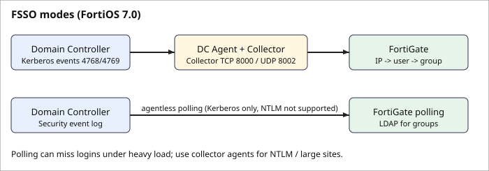

*شکل: حالت‌های FSSO.*

### ۵) مثال حل‌شده

**نیاز:** گروه Finance به سرور مالی، بقیه ممنوع.

``` text
config user ldap
    edit "LDAP-AD"
        set server "192.168.90.40"
        set cnid "sAMAccountName"
        set dn "dc=lab,dc=local"
        set type regular
        set username "CN=svc-fgt,CN=Users,DC=lab,DC=local"
        set password <SERVICE-ACCOUNT-PASSWORD>
        set secure ldaps
        set port 636
    next
end
config user fsso-polling
    edit 1
        set server "192.168.90.40"
        set ldap-server "LDAP-AD"
        set polling-frequency 10
    next
end
config user group
    edit "GRP-FINANCE"
        set group-type fsso-service
        set member "CN=Finance,CN=Users,DC=lab,DC=local"
    next
end
```

(سینتکس نمونه؛ `Unverified`؛ با CLI Reference 7.0 تطبیق شود.) Policy: Source = GRP-FINANCE، Destination = SRV-FIN، Service = HTTPS.

**GUI:** User & Authentication → LDAP Servers؛ Security Fabric → External Connectors → FSSO (Poll Active Directory Server)؛ User & Authentication → User Groups؛ Policy & Objects → Firewall Policy.

**آزمون‌ها:** مثبت: کاربر Finance دسترسی دارد؛ منفی: کاربر دیگر ندارد؛ IP عوض شود؛ Terminal Server.

**مثال متوسط:** کاربر Login کرد ولی Policy مطابق نشد. علت‌ها به ترتیب: نگاشت IP→User نیامده (Polling/Log)، گروه در Filter نیست، DN اشتباه، ساعت ناهماهنگ.

**مثال سخت:** بعضی کاربران پس از ورود با NTLM در روش **Agentless Polling Connector** دیده نمی‌شوند. علت طبق مستند FortiOS 7.0.0: این روش فقط رویدادهای Kerberos 4768/4769 را پشتیبانی می‌کند. تفکیک علت: ۱) Security Log DC برای همان ورود چه رویدادی دارد؟ (۴۷۶۸/۴۷۶۹ یا فقط NTLM) ۲) آیا نام/SPN/DNS باعث بازگشت به NTLM شده؟ ۳) آیا ورود هم‌زمان زیاد باعث از دست‌رفتن رویداد شده؟ راه‌ها: اصلاح DNS/SPN تا Kerberos استفاده شود، یا بررسی روش Agent-based (مناسب‌بودن آن برای NTLM باید از مستند Agent نسخه‌ی شما تأیید شود).

### ۶) طراحی و تصمیم‌گیری

| سؤال | تصمیم |
|---|---|
| LDAP یا RADIUS؟ | LDAP برای Directory/گروه؛ RADIUS برای VPN/Wi-Fi/MFA/NPS |
| FSSO کدام حالت؟ | به معماری، نسخه و الگوی ورود (Kerberos/NTLM) بستگی دارد؛ Agentless برای محیط کوچک با Kerberos؛ ورود هم‌زمان زیاد یا NTLM ⇒ مستند Agent mode را بررسی کنید (تأیید نشده) |
| رمزنگاری | LDAPS/StartTLS |
| Redundancy | چند Collector، چند LDAP |
| Fallback | Captive Portal برای IP بدون Login |

### ۷) Verification

``` text
diagnose test authserver ldap LDAP-AD <user> <password>
diagnose debug authd fsso list
diagnose debug application fnbamd -1
diagnose debug enable
diagnose debug disable
```

### ۸) Troubleshooting

| علامت | علت |
|---|---|
| Bind شکست | DN/رمز/پورت/TLS |
| کاربر یافت نمی‌شود | DN/OU/cnid |
| FSSO کاربر نیست | Kerberos/NTLM، ساعت، Event Log، Group Filter |
| RADIUS Reject | Secret/Client/Policy NPS |
| Policy مطابق نمی‌شود | نگاشت IP→User |

### ۹) نکات امنیتی

- حساب سرویس LDAP read-only؛ رمز قوی؛ ذخیره‌ی رمز در ریپو ممنوع.
- LDAP بدون TLS ممنوع در تولید.
- MFA برای مدیریت و VPN.
- Log ورود ناموفق را مانیتور کنید.

### ۱۰) جمع‌بندی مفهومی

- AAA سه سؤال: کیستی، چه می‌توانی، چه کردی.
- LDAP: Bind سرویس + Search + Bind کاربر.
- Kerberos نیازمند ساعت و DNS؛ روش Agentless Polling طبق مستند 7.0.0 فقط Kerberos 4768/4769 را می‌خواند (محدودیت همان روش).
- RADIUS: Request/Accept/Reject با Secret.
- هویت مبتنی بر IP محدودیت دارد؛ طراحی با Fallback.

### ۱۱) تمرین و ارزیابی

**ت1.** (ساده) AAA را تعریف کنید. *(پاسخ: 17-0-ت1)*

**ت2.** (ساده) پورت LDAP و LDAPS؟ *(پاسخ: 17-0-ت2)*

**ت3.** (متوسط) چرا ساعت برای Kerberos مهم است؟ *(پاسخ: 17-0-ت3)*

**ت4.** (متوسط) FSSO Polling چه محدودیتی دارد؟ *(پاسخ: 17-0-ت4)*

**ت5.** (سخت) چند کاربر روی یک Terminal Server دارید؛ چه مشکلی در FSSO پیش می‌آید؟ *(پاسخ: 17-0-ت5)*

**ت6.** (سخت، طراحی) برای ۵۰۰ کاربر ویندوزی و ۵۰ کاربر Mac/Linux راه‌حل هویت را بنویسید. *(پاسخ: 17-0-ت6)*

**Q1.** Quick quiz (English): Why does LDAP authentication use two binds? *(پاسخ: 17-0-Q1)*

### ۱۲) اصطلاحات و English Corner

| مخفف | شکل کامل | معنی |
|---|---|---|
| AAA | Authentication, Authorization, Accounting | هویت، مجوز، حسابرسی |
| LDAP | Lightweight Directory Access Protocol | پروتکل Directory |
| KDC | Key Distribution Center | مرکز توزیع کلید Kerberos |
| FSSO | Fortinet Single Sign-On | ورود یکپارچه |
| NPS | Network Policy Server | سرور RADIUS ویندوز |
| DN | Distinguished Name | نام مسیر در Directory |

- *Use LDAPS or StartTLS to protect directory credentials.* ← برای محافظت از اعتبارنامه‌ها LDAPS/StartTLS بزنید.
- *FSSO maps logons to IP addresses.* ← FSSO ورود را به IP نگاشت می‌کند.

### ۱۳) منابع

- Fortinet Docs: [FSSO polling connector agent installation](https://docs.fortinet.com/document/fortigate/7.0.0/administration-guide/503764/fsso-polling-connector-agent-installation)، [FSSO](https://docs.fortinet.com/document/fortigate/7.0.8/administration-guide/450337)، [config user fsso-polling](https://docs.fortinet.com/document/fortigate/7.0.0/cli-reference/516620/config-user-fsso-polling).
- RFC 4511 (LDAP)، RFC 4120 (Kerberos)، RFC 2865 (RADIUS).

### بخش تکمیلی درس: سناریوی واقعی، مثال‌های بیشتر و عیب‌یابی

> بخش‌های زیر درس بالا را کامل می‌کنند: سناریوی گام‌به‌گام، مثال‌های بیشتر از ساده تا سخت، جدول عیب‌یابی و پرسش‌های مصاحبه. ابتدا بخش‌های اصلی بالا را مطالعه کنید.

### تعمیق: ردیابی یک ورود کاربر از پایه تا Policy

**جریان LDAP + Group:** کاربر → FortiGate (Captive/VPN) → Bind با حساب سرویس → Search کاربر در Base DN → خواندن memberOf → تطبیق با User Group → Policy.

``` text
Base DN : DC=corp,DC=local
Filter  : (sAMAccountName=ali)
Group   : CN=VPN-Users,OU=Groups,DC=corp,DC=local
```

**Kerberos در FSSO:** DC رویداد 4768/4769 را ثبت می‌کند؛ Collector آن را می‌خواند و IP↔User را به FortiGate می‌دهد.

**پرسش‌های مصاحبه**
1. *چرا حساب سرویس؟* Bind بدون کاربر انسانی.
2. *RADIUS یا LDAP؟* RADIUS برای VPN/Wi-Fi/MFA؛ LDAP برای جستجوی دایرکتوری.
3. *نقطه‌ی شکست؟* DNS، ساعت (Kerberos ±5 دقیقه)، پورت 389/636.

### تکمیل عمیق: AAA و هویت از درون — LDAP، Kerberos، RADIUS، FSSO

#### چرا باید یاد بگیریم؟

Policy بر اساس IP یعنی «این دستگاه» را کنترل می‌کنیم، نه «این انسان» را. کاربر لپ‌تاپش را عوض می‌کند، IP عوض می‌شود و Policy بی‌اثر می‌شود. هویت (Identity) Policy را به «کاربر/گروه» وصل می‌کند: «گروه مالی به ERP دسترسی دارد»، فارغ از IP.

#### AAA

AAA = Authentication (چه کسی هستی؟)، Authorization (چه اجازه‌ای داری؟)، Accounting (چه کردی؟).

#### مثال ساده — چهار مسیر هویت

| روش | کاربرد | منبع حقیقت |
|---|---|---|
| LDAP | جستجوی کاربر/گروه | Active Directory |
| RADIUS | VPN، Wi-Fi، MFA | NPS/FortiAuthenticator |
| Kerberos | SSO در Windows | KDC روی DC |
| FSSO | شناسایی بدون Login جدا | رویدادهای DC |

#### مثال متوسط — جریان LDAP

``` text
1 user submits username/password to FortiGate (portal/VPN)
2 FortiGate binds with service account
3 search (sAMAccountName=ali) under Base DN
4 verify password (bind as user) or compare
5 read memberOf -> match user group -> policy
```

#### مثال سخت — FSSO و Kerberos

کاربر وارد ویندوز می‌شود؛ DC رویداد 4768 (TGT) یا 4624 را ثبت می‌کند؛ Collector آن را می‌خواند و جدول IP↔User را برای FortiGate می‌فرستد. ساعت‌ها باید حداکثر ۵ دقیقه اختلاف داشته باشند (Kerberos).

#### نکته‌ی امنیتی

حساب سرویس LDAP حداقل دسترسی (فقط خواندن)؛ هرگز Domain Admin. ارتباط LDAPS (636) با گواهی معتبر.

#### Lab

نقشه‌ی جریان یک ورود را روی کاغذ بکشید و محل شکست‌های ممکن را علامت بزنید.

#### عیب‌یابی

| علامت (مشاهده) | علت محتمل (باید اثبات شود) | اقدام پس از اثبات |
|---|---|---|
| Bind شکست | DN/رمز | بررسی |
| Group match نه | Base DN | تصحیح |
| FSSO خالی | رویداد نمی‌رسد | Collector |

#### پرسش‌ها با پاسخ

**۱. AAA یعنی؟** هویت، مجوز، حسابداری.
**۲. چرا حساب سرویس کم‌دسترسی؟** حمله به Bind.
**۳. FSSO چه فایده؟** Policy کاربری بدون Login اضافه.

#### English Corner

- *Identity-based policies follow the user, not the IP address.*
- Q: Why must the LDAP service account have minimal privileges?

## درس 17-1 — آماده‌سازی Lab هویت: Active Directory، DNS، OU، گروه و حساب سرویس روی Windows Server

**فصل 17 · بازنویسی عمیق · پیش‌نیاز: ۱۷-۰، Golden_W2025_Runbook · ≈ 6 ساعت**

> **وضعیت:** FortiOS 7.0.3 (بوت‌نشده)؛ دستورها `Unverified`؛ Lab «اجرا نشده»؛ وابستگی لایسنس هر قابلیت صریح ذکر شده است. دستورهای Windows را شما اجرا می‌کنید؛ رمزها نمونه‌اند.

<!--deep-->

### هدف آموزشی

در پایان این درس باید بتوانید:

1. زیرساخت Active Directory (AD) را برای Lab بسازید: Forest/Domain، DNS، OU، گروه، کاربر تست و حساب سرویس.
2. وابستگی‌های FortiGate به AD (DNS، زمان، پورت‌ها) را بشناسید.
3. ساختار OU و گروه را برای Policy هویتی طراحی کنید.
4. اصل حداقل دسترسی را برای حساب سرویس رعایت کنید.
5. سلامت AD را با dcdiag و آزمون‌های ساده بسنجید.
6. Snapshot و Rollback را قبل از تغییر اجرا کنید.

### چرا باید یاد بگیریم؟

اگر بخواهید به یک مهمان در هتل اتاق بدهید، به لیست رزرو (دفتر هتل) نیاز دارید؛ فایروال هم برای Policy مبتنی بر «چه کسی» به یک «دفتر هویت» نیاز دارد: Active Directory. ولی اگر دفتر هتل نامرتب باشد (DNS خراب، ساعت اشتباه، گروه‌های شلوغ)، هیچ Policy درستی ساخته نمی‌شود. بیشتر شکست‌های «LDAP کار نمی‌کند» واقعاً مشکل AD/DNS/زمان است نه FortiGate. پس قبل از FortiGate، AD را تمیز می‌سازیم.

### نقش AD در این Lab

| مؤلفه | نقش | مثال |
|---|---|---|
| Domain Controller (DC) | مرجع هویت | DC01.corp.example |
| DNS | پیدا کردن DC (SRV) | corp.example |
| OU | سازمان‌دهی | OU=Users,OU=Corp |
| Group | اساس Policy | GG-Internet-Users |
| Service Account | حساب خواندن LDAP | svc-fgt-ldap |

### آدرس‌دهی Lab (نمونه)

``` text
DC01        10.20.0.10   corp.example
Users net   10.10.0.0/24
FortiGate   10.20.0.1    (LDAP client)
DNS         10.20.0.10
```

### گام‌ها

1. نصب Windows Server و نقش AD DS + DNS.
2. ساخت Forest `corp.example`.
3. OUها: Corp، Users، Groups، Service.
4. گروه‌ها: `GG-Internet-Users`، `GG-Admins`.
5. کاربر تست: `alice`، `bob`.
6. حساب سرویس: `svc-fgt-ldap` (فقط عضو Domain Users، بدون ادمین).
7. DNS: DC خودش را به‌عنوان DNS و Forwarder به بیرون.
8. زمان: DC با منبع زمان معتبر؛ کلاینت‌ها و FortiGate با همان NTP.

### دستورهای PowerShell (اجرا نشده)

``` text
Install-WindowsFeature AD-Domain-Services -IncludeManagementTools
Install-ADDSForest -DomainName "corp.example" -DomainNetbiosName "CORP"
New-ADOrganizationalUnit -Name "Corp" -Path "DC=corp,DC=example"
New-ADOrganizationalUnit -Name "Users" -Path "OU=Corp,DC=corp,DC=example"
New-ADGroup -Name "GG-Internet-Users" -GroupScope Global -Path "OU=Groups,OU=Corp,DC=corp,DC=example"
New-ADUser -Name "alice" -SamAccountName alice -Path "OU=Users,OU=Corp,DC=corp,DC=example" -AccountPassword (Read-Host -AsSecureString) -Enabled $true
Add-ADGroupMember -Identity "GG-Internet-Users" -Members alice
```

رمزها در ریپو ذخیره نمی‌شوند؛ از Read-Host/Vault.

### وابستگی‌های FortiGate

| نیاز | چرا | آزمون |
|---|---|---|
| DNS | یافتن DC | `execute ping dc01.corp.example` |
| زمان | Kerberos (حداکثر ۵ دقیقه اختلاف) | `diagnose sys ntp status` |
| پورت 389/636 | LDAP/LDAPS | `execute telnet 10.20.0.10 636` (در دسترسی) |
| پورت 88/445 | Kerberos/SMB (FSSO) | Policy بین Zone‌ها |

### سلامت AD

``` text
dcdiag /v
repadmin /replsummary
nltest /dsgetdc:corp.example
nslookup -type=SRV _ldap._tcp.dc._msdcs.corp.example
```

اگر SRV پاسخ ندهد، DNS مشکل دارد. اگر `dcdiag` شکست بخورد، قبل از FortiGate رفع کنید.

### طراحی OU و گروه

``` text
corp.example
 OU=Corp
  OU=Users      (alice, bob)
  OU=Groups     (GG-Internet-Users, GG-Admins)
  OU=Service    (svc-fgt-ldap)
```

اصل AGDLP: Account ⇒ Global group ⇒ Domain Local ⇒ Permission. برای Policy فایروال گروه‌های Global کافی است. نام‌گذاری ثابت (`GG-<Purpose>`).

### مثال‌های حل‌شده

#### مثال ساده — کاربر و گروه

alice در `OU=Users` و عضو `GG-Internet-Users`. DN کامل:

``` text
CN=GG-Internet-Users,OU=Groups,OU=Corp,DC=corp,DC=example
```

این DN را در FortiGate به‌عنوان Remote Group می‌دهید (درس ۱۷-۲).

#### مثال متوسط — حساب سرویس

`svc-fgt-ldap` فقط خواندن؛ رمز طولانی و بدون انقضا؛ «Deny interactive logon». هیچ عضویتی در Domain Admins. اگر FortiGate افشا شود، خسارت محدود.

#### مثال متوسط — تست DNS

``` text
nslookup dc01.corp.example 10.20.0.10
nslookup -type=SRV _ldap._tcp.corp.example
```

اگر SRV خالی است، Zone DNS با AD یکپارچه نیست.

#### مثال سخت — اختلاف زمان

Kerberos/LDAPS با اختلاف ۱۰ دقیقه خطا می‌دهد. علامت: `KRB_AP_ERR_SKEW`. رفع: NTP یکسان. آزمون: `w32tm /query /status`.

#### مثال سخت — Snapshot و Rollback

قبل از تغییر Schema/GPO: Snapshot VM. اگر اشتباه شد Rollback. توجه: Rollback DC در محیط چند DC خطرناک (USN Rollback)؛ در Lab تک‌DC مجاز؛ در Production از بازیابی رسمی AD استفاده کنید.

### مسیر GUI (مستندی، Unverified)

1. Server Manager → Add Roles → Active Directory Domain Services و DNS.
2. Active Directory Users and Computers → ساخت OU/Group/User.
3. DNS Manager → بررسی Zone lab.local.
4. FortiGate: Network → DNS = 192.168.90.40.

### Lab هدایت‌شده (اجرا نشده)

1. AD بسازید و dcdiag بزنید.
2. OU/گروه/کاربر و حساب سرویس.
3. DNS SRV و NTP را تست کنید.

### عیب‌یابی سریع

| علامت (مشاهده) | علت محتمل (باید اثبات شود) | اقدام پس از اثبات |
|---|---|---|
| SRV نیست | DNS | یکپارچه |
| Kerberos خطا | زمان | NTP |
| Bind شکست | رمز/DN | بررسی |
| گروه خالی | عضویت | Add-ADGroupMember |

### نکات امنیتی

حساب سرویس حداقل دسترسی؛ LDAPS (نه LDAP ساده)؛ گروه‌ها با مالک؛ رمز در Vault.

### جمع‌بندی

AD سالم (DNS، زمان، OU/گروه) پیش‌نیاز هویت FortiGate است؛ حساب سرویس حداقل‌دسترسی؛ Snapshot قبل از تغییر؛ اعتبارسنجی با dcdiag و SRV.

### تمرین و ارزیابی

**ت1.** (ساده) چرا DNS روی DC لازم است؟ *(پاسخ: 17-1-ت1)*

**ت2.** (ساده) چرا حساب سرویس جدا؟ *(پاسخ: 17-1-ت2)*

**ت3.** (متوسط) FGT نام DC را resolve نمی‌کند؛ مراحل. *(پاسخ: 17-1-ت3)*

**ت4.** (سخت) طراحی OU/گروه برای ۳ نقش. *(پاسخ: 17-1-ت4)*

**ت5.** (سخت، طراحی) برنامه‌ی Snapshot/Rollback برای Lab AD. *(پاسخ: 17-1-ت5)*

**Q1.** Quick quiz (English): Why must DNS be correct before AD authentication works? *(پاسخ: 17-1-Q1)*

### اصطلاحات و English Corner

| مخفف | شکل کامل | معنی |
|---|---|---|
| AD DS | Active Directory Domain Services | سرویس Directory |
| OU | Organizational Unit | واحد سازمانی |
| SRV | DNS service record | رکورد سرویس |

- *Use a least-privilege service account for LDAP binds.* ← برای Bind از حساب سرویس با حداقل دسترسی استفاده کنید.

### کارت Lab

**Lab:** DC و کاربران. **وضعیت:** اجرا نشده. **Evidence:** `03-ops/ad-lab.md`. **Rollback:** Snapshot.

### منابع

- Microsoft Learn: Active Directory Domain Services Overview.
- `phase0a/Golden_W2025_Runbook.md`.

<a id="l-17-2"></a>

## درس 17-2 — LDAP در FortiGate و Policy بر اساس گروه: Bind، Search، User Group و آزمون

**فصل 17 · بازنویسی عمیق · پیش‌نیاز: ۱۷-۰، ۱۷-۱، ۱۲-۰ · ≈ 7 ساعت**

> **وضعیت:** FortiOS 7.0.3 (بوت‌نشده)؛ دستورها `Unverified`؛ Lab «اجرا نشده»؛ وابستگی لایسنس هر قابلیت صریح ذکر شده است.

<!--deep-->

### هدف آموزشی

در پایان این درس باید بتوانید:

1. سرور LDAP را در FortiGate بسازید (cnid، dn، Bind، LDAPS).
2. User Group با Remote Group (DN کامل) بسازید.
3. Policy گروهی بنویسید و محدودیت IP→User را بشناسید.
4. با ابزار تست و Debug مشکل را عیب‌یابی کنید.
5. تفاوت Regular و Simple Bind را بدانید.
6. LDAP را امن (LDAPS/StartTLS) تنظیم کنید.

### چرا باید یاد بگیریم؟

Policy بر اساس «گروه» به‌جای IP یعنی دسترسی دنبال انسان است نه دستگاه: وقتی alice لپ‌تاپ عوض کند، دسترسی‌اش عوض نمی‌شود. LDAP (Lightweight Directory Access Protocol، یعنی «پروتکل سبک دسترسی به دایرکتوری») به FortiGate می‌گوید «این کاربر کیست و عضو کدام گروه است». ولی دقت کنید: LDAP تنها **کاربر و رمز را اعتبارسنجی** می‌کند؛ نگاشت «IP ⇒ کاربر» برای ترافیک کاربران عادی را FSSO یا Captive Portal انجام می‌دهد (۱۷-۴، ۱۷-۵).

### پیکربندی LDAP

``` text
config user ldap
    edit "LDAP-CORP"
        set server "10.20.0.10"
        set cnid "sAMAccountName"
        set dn "DC=corp,DC=example"
        set type regular
        set username "CN=svc-fgt-ldap,OU=Service,OU=Corp,DC=corp,DC=example"
        set password <SECRET>
        set secure ldaps
        set port 636
        set ca-cert "CA_Corp_Root"
    next
end
```

| پارامتر | معنی |
|---|---|
| cnid | ویژگی نام کاربری (sAMAccountName در AD) |
| dn | ریشه‌ی جست‌وجو |
| type regular | Bind با حساب سرویس، سپس Search |
| secure ldaps | رمزگذاری با TLS روی 636 |
| ca-cert | CA برای اعتبارسنجی سرور |

رمز فقط در Vault/Prompt؛ در ریپو `<SECRET>`.

### Simple در برابر Regular Bind

- **Simple:** مستقیم `cn=user,dn` + رمز کاربر.
- **Regular:** ابتدا با حساب سرویس Bind، سپس نام کاربر را جست‌وجو و DN او را پیدا می‌کند و رمز را آزمایش می‌کند. انعطاف بیشتر (sAMAccountName).

### User Group با Remote Group

``` text
config user group
    edit "UG-Internet"
        set member "LDAP-CORP"
        config match
            edit 1
                set server-name "LDAP-CORP"
                set group-name "CN=GG-Internet-Users,OU=Groups,OU=Corp,DC=corp,DC=example"
            next
        end
    next
end
```

`group-name` باید **DN کامل** باشد (با حروف دقیق).

### Policy گروهی

``` text
config firewall policy
    edit 50
        set name "USERS-GROUP-INTERNET"
        set srcintf "ZN-USERS"
        set dstintf "port1"
        set srcaddr "all"
        set dstaddr "all"
        set groups "UG-Internet"
        set service "HTTP" "HTTPS" "DNS"
        set action accept
        set schedule "always"
        set nat enable
        set logtraffic all
    next
end
```

نکته: با `groups` فایروال **احراز هویت** می‌خواهد (Captive Portal) مگر FSSO قبلاً کاربر را شناخته باشد.

### آزمون LDAP

``` text
diagnose test authserver ldap LDAP-CORP alice <password>
diagnose debug application fnbamd -1
diagnose debug enable
```

GUI: User & Authentication > LDAP Servers ⇒ Test Connectivity و Test User Credentials.

### LDAPS و گواهی

1. CA سازمان را به FortiGate Import کنید.
2. DC باید گواهی سرور (Server Auth) داشته باشد.
3. `secure ldaps` + `ca-cert`.
4. `set server-identity-check enable` برای تطبیق نام.

### مثال‌های حل‌شده

#### مثال ساده — تست کاربر

``` text
diagnose test authserver ldap LDAP-CORP alice <password>
authenticate 'alice' against 'LDAP-CORP' succeeded
```

اتصال، Bind و رمز صحیح است.

#### مثال متوسط — گروه اشتباه

alice احراز می‌شود ولی Policy اعمال نمی‌شود. DN گروه با OU اشتباه (OU=Users به‌جای OU=Groups). رفع: DN دقیق از ADSI Edit/PowerShell:

``` text
Get-ADGroup GG-Internet-Users | Select DistinguishedName
```

#### مثال متوسط — LDAPS شکست

خطا `certificate verify failed`. CA Import نشده یا نام سرور با SAN نمی‌خواند. رفع: Import CA یا استفاده از FQDN.

#### مثال سخت — Nested Group

alice عضو `GG-Sub` است و `GG-Sub` عضو `GG-Internet-Users`. Match مستقیم کار نمی‌کند. راه‌حل‌ها: ۱) عضویت مستقیم ۲) `set group-search-base`/گروه تو‌در‌تو (بسته به نسخه) ۳) تعریف گروه‌های Flat در AD. نکته‌ی طراحی: گروه‌های Flat برای Policy.

#### مثال سخت — IP→User

Policy گروهی ولی کاربر بدون Portal/FSSO نمی‌تواند شناخته شود؛ ترافیک Deny. راه: FSSO (۱۷-۴) یا Captive Portal (۱۷-۵). این خطای مفهومی رایج است.

### مسیر GUI (مستندی، Unverified)

1. User & Authentication → LDAP Servers → Create New (Server، cnid، dn، Bind).
2. Test Connectivity و Test User Credentials.
3. User Groups → Create New → Remote Groups → Add (انتخاب گروه از LDAP).
4. Policy → Source = گروه.

### Lab هدایت‌شده (اجرا نشده)

1. LDAP و Test.
2. User Group و Policy.
3. LDAPS با CA.

### عیب‌یابی سریع

| علامت (مشاهده) | علت محتمل (باید اثبات شود) | اقدام پس از اثبات |
|---|---|---|
| Bind failed | رمز/DN | بررسی |
| کاربر OK ولی Policy نه | DN گروه | دقیق |
| TLS خطا | CA | Import |
| Timeout | Port/Firewall | 636 |

### نکات امنیتی

LDAPS الزامی؛ حساب سرویس حداقل؛ رمز در Vault؛ `trusthost` ادمین؛ Log احراز.

### جمع‌بندی

LDAP اعتبارسنجی و عضویت گروه را می‌دهد؛ Regular Bind؛ DN کامل برای Remote Group؛ LDAPS با CA؛ نگاشت IP→User با FSSO/Portal.

### تمرین و ارزیابی

**ت1.** (ساده) cnid چیست؟ *(پاسخ: 17-2-ت1)*

**ت2.** (ساده) چرا LDAPS؟ *(پاسخ: 17-2-ت2)*

**ت3.** (متوسط) کاربر یافت نمی‌شود؛ علت محتمل؟ *(پاسخ: 17-2-ت3)*

**ت4.** (سخت) Policy گروهی مطابق نمی‌شود؛ فرضیه‌ها. *(پاسخ: 17-2-ت4)*

**ت5.** (سخت، طراحی) طرح گروه‌بندی برای ۳ دسترسی. *(پاسخ: 17-2-ت5)*

**Q1.** Quick quiz (English): Which information must an LDAP server entry in FortiGate contain to find a user? *(پاسخ: 17-2-Q1)*

### اصطلاحات و English Corner

| مخفف | شکل کامل | معنی |
|---|---|---|
| cnid | Common name identifier | ویژگی ورود |
| DN | Distinguished Name | نام مسیر |
| LDAPS | LDAP over TLS | LDAP رمزشده |

- *Test the LDAP connection before building policies.* ← قبل از Policy اتصال LDAP را تست کنید.

### کارت Lab

**Lab:** LDAP. **وضعیت:** اجرا نشده. **Evidence:** `03-ops/ldap.md`. **Rollback:** حذف User Group/LDAP.

### منابع

- RFC 4511 (LDAP)؛ Fortinet Docs: FortiOS 7.0 — LDAP servers، User groups.

<a id="l-17-3"></a>

## درس 17-3 — RADIUS و NPS، احراز هویت چندعاملی (MFA) و Attributeها

**فصل 17 · بازنویسی عمیق · پیش‌نیاز: ۱۷-۰، ۱۷-۲ · ≈ 6 ساعت**

> **وضعیت:** FortiOS 7.0.3 (بوت‌نشده)؛ دستورها `Unverified`؛ Lab «اجرا نشده»؛ وابستگی لایسنس هر قابلیت صریح ذکر شده است. MFA به FortiToken/OTP وابسته است (Needs-License/سرویس جداگانه).

<!--deep-->

### هدف آموزشی

در پایان این درس باید بتوانید:

1. RADIUS و NPS را در Windows Server راه بیندازید.
2. FortiGate را به‌عنوان RADIUS Client تنظیم کنید (Shared Secret).
3. Attributeها (Class، Filter-Id، Fortinet-Group-Name) را بشناسید.
4. MFA/OTP را با RADIUS (FortiToken/Third-party) توضیح دهید.
5. VPN/Admin را با RADIUS احراز کنید.
6. خطاهای رایج (Secret، پورت، Timeout) را رفع کنید.

### چرا باید یاد بگیریم؟

RADIUS (Remote Authentication Dial-In User Service) «مأمور کنترل ورود» شبکه است: وقتی یک کاربر به VPN/Wi-Fi/Admin می‌خواهد وارد شود، دستگاه (RADIUS Client) از سرور مرکزی (NPS) می‌پرسد «اجازه بدهم؟». مزیت: یک مرکز برای همه‌ی دستگاه‌ها، امکان MFA و تحویل Attribute (مثلاً گروه). برای ادمین FortiGate و VPN، RADIUS+MFA استاندارد صنعتی است.

### جریان RADIUS

``` text
User -> [FortiGate (Client)] -- Access-Request (user, password) --> [NPS]
[NPS] -- Access-Accept (attributes) or Access-Reject --> [FortiGate]
```

| پیام | معنی |
|---|---|
| Access-Request | درخواست احراز |
| Access-Challenge | سؤال بیشتر (OTP) |
| Access-Accept | موفق + Attribute |
| Access-Reject | رد |

UDP 1812 (Auth) و 1813 (Accounting)؛ رمز کاربر با Shared Secret مبهم می‌شود؛ بقیه‌ی بسته رمز نیست.

### NPS (Windows)

1. نصب Network Policy Server.
2. ثبت در AD.
3. RADIUS Client: IP FortiGate، Shared Secret قوی.
4. Network Policy: شرط «Windows Groups = GG-VPN»، روش احراز PAP/MS-CHAPv2 (بسته به نیاز)، Attribute برگشتی.

### FortiGate

``` text
config user radius
    edit "RADIUS-NPS"
        set server "10.20.0.11"
        set secret <SECRET>
        set auth-type auto
        set timeout 5
        set nas-ip 10.20.0.1
    next
end
config user group
    edit "UG-VPN"
        set member "RADIUS-NPS"
    next
end
```

`nas-ip` همان IP که در NPS Client ثبت شده است.

### Attributeها

| Attribute | کاربرد |
|---|---|
| Filter-Id / Class | نام گروه |
| Fortinet-Group-Name (VSA) | گروه به FortiGate |
| Session-Timeout | مدت اتصال |
| Framed-IP-Address | IP اختصاصی |

در Policy می‌توان با `Fortinet-Group-Name` گروه را مطابقت داد.

### MFA/OTP

- **FortiToken** (Needs-License برای تعداد بیشتر): OTP روی FortiGate.
- **Third-party/Azure MFA NPS Extension:** NPS بعد از رمز OTP می‌گیرد؛ ⇒ `Access-Challenge`.
- نکته: زمان ساعت‌ها هماهنگ؛ Timeout بلندتر برای تأیید Push (مثلاً 30–60 ثانیه).

### Admin با RADIUS

``` text
config system admin
    edit "radius-admin"
        set remote-auth enable
        set accprofile "super_admin"
        set wildcard enable
        set remote-group "UG-ADMIN"
    next
end
```

اصل: دسترسی ادمین با MFA؛ یک حساب Break-glass محلی با رمز قوی نگه‌دارید (برای قطعی RADIUS).

### مثال‌های حل‌شده

#### مثال ساده — تست

``` text
diagnose test authserver radius RADIUS-NPS pap alice <password>
authenticate 'alice' against 'pap' succeeded
```

#### مثال متوسط — Secret اشتباه

NPS Log: «Access Request discarded: shared secret mismatch» (Event 6274). FortiGate Timeout. رفع: Secret یکسان دو طرف.

#### مثال متوسط — Attribute گروه

NPS با `Class`/VSA گروه را برمی‌گرداند؛ FortiGate در Policy `groups UG-VPN` تطبیق می‌دهد. آزمون: Debug `fnbamd` Attribute را نشان می‌دهد.

#### مثال سخت — MFA Timeout

Push Notification ۳۰ ثانیه می‌خواهد ولی `timeout 5` است ⇒ شکست. رفع: افزایش `timeout` به 60 ثانیه در FortiGate و هماهنگی با تنظیم Timeout سمت NPS/MFA. آزمون: Push را تأیید کنید و Accept.

#### مثال سخت — قطعی RADIUS

NPS Down؛ VPN/Admin قفل. راه: دو NPS (Primary/Secondary: `set secondary-server`)، Break-glass محلی، پایش.

### مسیر GUI (مستندی، Unverified)

1. User & Authentication → RADIUS Servers → Create New (Name، Primary Server، Secret).
2. Test Connectivity/Credentials.
3. NPS: RADIUS Clients → New (IP فایروال، Secret).
4. NPS: Network Policies → شرط Group.

### Lab هدایت‌شده (اجرا نشده)

1. NPS و Client.
2. RADIUS در FortiGate و Test.
3. Policy گروهی VPN.

### عیب‌یابی سریع

| علامت (مشاهده) | علت محتمل (باید اثبات شود) | اقدام پس از اثبات |
|---|---|---|
| Timeout | Secret/پورت/IP | بررسی |
| Reject | Network Policy | شرط |
| MFA Timeout | timeout کم | افزایش |
| گروه نمی‌آید | Attribute | VSA |

### نکات امنیتی

Secret طولانی و منحصر به‌فرد برای هر Client؛ RADIUS روی شبکه‌ی مدیریت؛ MFA برای Admin/VPN؛ Break-glass.

### جمع‌بندی

RADIUS/NPS احراز مرکزی با MFA؛ Secret و NAS-IP هماهنگ؛ Attribute برای گروه؛ Timeout متناسب MFA؛ افزونگی و Break-glass.

### تمرین و ارزیابی

**ت1.** (ساده) پورت‌های RADIUS؟ *(پاسخ: 17-3-ت1)*

**ت2.** (ساده) Shared Secret چیست؟ *(پاسخ: 17-3-ت2)*

**ت3.** (متوسط) Access-Reject با رمز درست؛ علت؟ *(پاسخ: 17-3-ت3)*

**ت4.** (سخت) VPN با MFA بعد از رمز قطع می‌شود؛ فرضیه‌ها. *(پاسخ: 17-3-ت4)*

**ت5.** (سخت، طراحی) طرح RADIUS برای مدیریت فایروال با MFA. *(پاسخ: 17-3-ت5)*

**Q1.** Quick quiz (English): What does Access-Challenge enable? *(پاسخ: 17-3-Q1)*

### اصطلاحات و English Corner

| مخفف | شکل کامل | معنی |
|---|---|---|
| NPS | Network Policy Server | سرور RADIUS ویندوز |
| NAS | Network Access Server | دستگاه دسترسی (فایروال) |
| OTP | One-Time Password | رمز یک‌بارمصرف |

- *The shared secret must match on both sides.* ← Secret باید دو سر یکی باشد.

### کارت Lab

**Lab:** RADIUS. **وضعیت:** اجرا نشده. **Evidence:** `03-ops/radius.md`. **Rollback:** حذف RADIUS.

### منابع

- RFC 2865 (RADIUS)؛ Microsoft Learn: NPS.

<a id="l-17-4"></a>

## درس 17-4 — FSSO عملی: انتخاب حالت، پیکربندی، Group Filter و عیب‌یابی

**فصل 17 · بازنویسی عمیق · پیش‌نیاز: ۱۷-۰، ۱۷-۲ · ≈ 6 ساعت**

> **وضعیت:** FortiOS 7.0.3 (بوت‌نشده)؛ دستورها `Unverified`؛ Lab «اجرا نشده»؛ وابستگی لایسنس هر قابلیت صریح ذکر شده است.

<!--deep-->

### هدف آموزشی

در پایان این درس باید بتوانید:

1. FSSO (Fortinet Single Sign-On) را تعریف و جای آن را در جریان هویت بگویید.
2. سه حالت را مقایسه و انتخاب کنید: DC Agent، Collector Agent با Polling، FortiGate Polling (بدون Agent).
3. Collector Agent را نصب و FortiGate را متصل کنید.
4. FSSO User Group را در Policy به‌کار ببرید.
5. محدودیت‌ها (Multi-user IP، NAT، Terminal Server) را بشناسید.
6. FSSO را با `diagnose debug authd fsso` عیب‌یابی کنید.

### چرا باید یاد بگیریم؟

کاربر وقتی صبح به Windows وارد می‌شود، یک بار رمز می‌زند. SSO (Single Sign-On، یعنی «ورود یگانه») یعنی FortiGate همان ورود را ببیند و دوباره از کاربر رمز نخواهد. بدون FSSO، Policy گروهی با Captive Portal رمز می‌پرسد؛ کاربران ناراضی می‌شوند. FSSO از Event Logهای Domain Controller «چه کسی از کدام IP وارد شد» را یاد می‌گیرد و نگاشت IP→User را می‌سازد.

### نقش FSSO در جریان

``` text
 User logs on -> [DC] security event 4624
                   |
              [Collector Agent] reads events (polling)
                   |  (TCP 8000)
              [FortiGate] maps IP -> user -> groups
                   |
              Policy match by group
```

### سه حالت

| حالت | چگونه | مزیت | عیب |
|---|---|---|---|
| DC Agent | Agent روی هر DC | Real-time | نصب روی DC |
| Collector Agent (Polling) | یک Collector Event Log را می‌خواند | ساده | تأخیر Polling |
| FortiGate Polling (Agentless) | FortiGate مستقیم DCها را می‌خواند | بدون نصب | محدودیت ظرفیت/نسخه |

(محدودیت‌های دقیق Agentless در مستند FSSO polling connector 7.0 بررسی شود؛ طبق مستند محدودیت تعداد کاربر دارد.)

انتخاب Lab: Collector Agent Polling (ساده و مرسوم).

### پیکربندی Collector

1. نصب FSSO Collector Agent روی یک سرور عضو دامنه.
2. حساب سرویس با دسترسی Event Log Reader و عضو Distributed COM Users.
3. Password به FortiGate (Shared).
4. Groups را انتخاب (Directory Access).

### FortiGate

``` text
config user fsso
    edit "FSSO-CORP"
        set server "10.20.0.12"
        set password <SECRET>
        set port 8000
        set ldap-server "LDAP-CORP"
    next
end
config user group
    edit "UG-FSSO-Internet"
        set group-type fsso-service
        set member "CORP/GG-INTERNET-USERS"
    next
end
```

Policy:

``` text
config firewall policy
    edit 60
        set name "FSSO-USERS-INTERNET"
        set srcintf "ZN-USERS"
        set dstintf "port1"
        set srcaddr "all"
        set dstaddr "all"
        set groups "UG-FSSO-Internet"
        set service "HTTP" "HTTPS" "DNS"
        set action accept
        set schedule "always"
        set nat enable
        set logtraffic all
    next
end
```

### آزمون

``` text
diagnose debug authd fsso list
diagnose debug authd fsso server-status
```

`list` فهرست IP→User→Groups و `server-status` اتصال به Collector.

### محدودیت‌ها

| مورد | اثر |
|---|---|
| چند کاربر پشت یک IP (Terminal Server، NAT) | فقط یک کاربر شناخته؛ نیاز TS Agent |
| IP ثابت دستگاه بدون Logon | کاربر ناشناس؛ fallback Captive Portal |
| Logoff | تأخیر پاک شدن |
| ساعت | اختلاف ⇒ Eventها نادیده |

### مثال‌های حل‌شده

#### مثال ساده — اتصال

`server-status`: «connected». سپس alice Logon؛ `list`: `10.10.0.5  alice  CORP/GG-INTERNET-USERS`. Policy 60 اعمال شد.

#### مثال متوسط — Policy گروهی

alice در گروه ⇒ اینترنت؛ bob خارج از گروه ⇒ Deny (Lookup/Log: `policy 0`). Log `user=alice group=...`.

#### مثال متوسط — Fallback

کاربر بدون Logon (BYOD) ⇒ FSSO او را نمی‌شناسد؛ Policy دوم با Captive Portal (۱۷-۵) برای او.

#### مثال سخت — Terminal Server

۲۰ کاربر روی یک RDS با یک IP؛ FSSO یک نفر را می‌شناسد و همه با دسترسی او. راه: Terminal Services Agent (Port Range per user) یا Policy جدا برای RDS.

#### مثال سخت — NAT قبل از FortiGate

اگر کاربران پشت NAT دیگری باشند، IP ثابت می‌شود و FSSO نگاشت را اشتباه دارد. راه: FortiGate را قبل از NAT قرار دهید یا از Agent/Portal استفاده کنید.

### مسیر GUI (مستندی، Unverified)

1. User & Authentication → LDAP (از ۱۷-۲).
2. Security Fabric → External Connectors → Create New → FSSO.
3. Poll Active Directory Server: IP، User، Password، LDAP Server.
4. User Groups → FSSO → Members.
5. Policy: Source = گروه FSSO.

### Lab هدایت‌شده (اجرا نشده)

1. Collector و اتصال.
2. Logon کاربر و `fsso list`.
3. Policy گروهی و آزمون منفی.

### عیب‌یابی سریع

| علامت (مشاهده) | علت محتمل (باید اثبات شود) | اقدام پس از اثبات |
|---|---|---|
| connected نیست | Password/پورت 8000 | بررسی |
| لیست خالی | Event Log/دسترسی | حساب سرویس |
| کاربر اشتباه | RDS/NAT | TS Agent |
| تأخیر | Polling | تنظیم |

### نکات امنیتی

Password Collector قوی؛ ارتباط Collector⇄FortiGate در شبکه‌ی مدیریت؛ حساب سرویس حداقل؛ Policy گروهی + Deny پیش‌فرض.

### جمع‌بندی

FSSO نگاشت IP→User را از Logon می‌سازد؛ سه حالت؛ محدودیت RDS/NAT؛ fallback Captive Portal؛ عیب‌یابی با `authd fsso`.

### تمرین و ارزیابی

**ت1.** (ساده) Polling چه رویدادهایی را می‌خواند؟ *(پاسخ: 17-4-ت1)*

**ت2.** (متوسط) کاربر Login کرده ولی دیده نمی‌شود؛ ۳ علت. *(پاسخ: 17-4-ت2)*

**ت3.** (سخت) چرا Terminal Server مشکل‌ساز است؟ *(پاسخ: 17-4-ت3)*

**ت4.** (سخت) Collector یا Polling برای ۲۰۰۰ کاربر با NTLM؟ *(پاسخ: 17-4-ت4)*

**ت5.** (سخت، طراحی) آزمون ۵ مورد FSSO. *(پاسخ: 17-4-ت5)*

**Q1.** Quick quiz (English): Why can FSSO polling miss users who authenticate with NTLM? *(پاسخ: 17-4-Q1)*

### اصطلاحات و English Corner

| مخفف | شکل کامل | معنی |
|---|---|---|
| FSSO | Fortinet Single Sign-On | ورود یکپارچه |
| DC Agent | Domain controller agent | Agent روی DC |
| Collector | Collector agent | جمع‌کننده |

- *Choose the FSSO mode by authentication protocol and scale.* ← حالت FSSO را بر اساس پروتکل احراز و مقیاس انتخاب کنید.

### کارت Lab

**Lab:** FSSO. **وضعیت:** اجرا نشده. **Evidence:** `03-ops/fsso.md`. **Rollback:** حذف Connector.

### منابع

- [FSSO polling connector agent installation](https://docs.fortinet.com/document/fortigate/7.0.0/administration-guide/503764/fsso-polling-connector-agent-installation)
- [FSSO](https://docs.fortinet.com/document/fortigate/7.0.8/administration-guide/450337)

<a id="l-17-5"></a>

## درس 17-5 — Captive Portal، مهمان و Firewall Authentication: طراحی ایمن Guest

**فصل 17 · بازنویسی عمیق · پیش‌نیاز: ۱۷-۰، ۱۱-۰ · ≈ 6 ساعت**

> **وضعیت:** FortiOS 7.0.3 (بوت‌نشده)؛ دستورها `Unverified`؛ Lab «اجرا نشده»؛ وابستگی لایسنس هر قابلیت صریح ذکر شده است.

<!--deep-->

### هدف آموزشی

در پایان این درس باید بتوانید:

1. Firewall Authentication و Captive Portal را توضیح دهید.
2. Portal را روی Policy/Interface فعال کنید.
3. Guest Access (کاربر موقت، Voucher/Sponsor) را بشناسید.
4. HTTPS Portal و گواهی را درست تنظیم کنید.
5. Timeout و Session Authentication را مدیریت کنید.
6. مشکلات رایج (Redirect HTTPS، گواهی، DNS) را رفع کنید.

### چرا باید یاد بگیریم؟

اگر کسی FSSO ندارد (مهمان، BYOD، دستگاه غیردامنه‌ای)، نمی‌توانید «ناشناس» را مجاز یا ممنوع کنید. Captive Portal مثل «میز پذیرش» است: قبل از ورود، شما را به صفحه‌ی ورود می‌برد و پس از احراز، IP شما با هویت نگاشت می‌شود. در هتل و فرودگاه همین است.

### سازوکار

``` text
1 User opens http://example.com
2 FortiGate: no identity for 10.10.0.77 -> redirect to portal
3 User enters credentials (LDAP/RADIUS/Local)
4 Success -> IP mapped to user/group
5 Policy by group applies until auth timeout
```

### فعال‌سازی

``` text
config user setting
    set auth-timeout 30
    set auth-type http https
    set auth-cert "Fortinet_Factory"
end

config firewall policy
    edit 70
        set name "GUEST-PORTAL"
        set srcintf "ZN-GUEST"
        set dstintf "port1"
        set srcaddr "all"
        set dstaddr "all"
        set groups "UG-GUEST"
        set service "HTTP" "HTTPS" "DNS"
        set action accept
        set schedule "always"
        set nat enable
        set logtraffic all
    next
end
```

نکات:

1. `auth-timeout` دقیقه‌ی بی‌فعالیتی.
2. پورت Portal: HTTP 1000، HTTPS 1003 (پیش‌فرض).
3. Policy احراز باید قبل از Policy عمومی بیاید.
4. DNS و HTTPS Portal باید برای کاربر قابل‌دسترس باشند (Policy DNS مجاز قبل از احراز).

### Guest

``` text
config user local
    edit "guest01"
        set type password
        set passwd <SECRET>
        set status enable
    next
end
```

برای مهمان واقعی: حساب موقت با Expiration (GUI: User & Device > Guest Management با Sponsor/Voucher؛ Needs-License ممکن است برای بعضی امکانات).

### گواهی HTTPS Portal

با گواهی Factory هشدار مرورگر ظاهر می‌شود. استفاده از گواهی CA سازمان یا عمومی با نام DNS (مثل `portal.corp.example`) مناسب است.

``` text
config user setting
    set auth-cert "Portal_Cert"
    set auth-redirect-addr "portal.corp.example"
end
```

### مثال‌های حل‌شده

#### مثال ساده — Portal

مهمان: باز کردن سایت HTTP ⇒ صفحه‌ی ورود ⇒ guest01 ⇒ اینترنت. `diagnose firewall auth list` ⇒ `10.10.0.77 guest01 UG-GUEST`.

#### مثال متوسط — HTTPS Redirect

کاربر `https://site`؛ فایروال نمی‌تواند Redirect بدهد بدون هشدار گواهی (TLS قبل از Portal). راه: Captive Portal Detection در OS؛ یا کاربران ابتدا HTTP/آدرس Portal؛ یا SSL Deep Inspection (با CA نصب). این خطای رایج «Portal نمی‌آید» است.

#### مثال متوسط — Timeout

`auth-timeout 30`: پس از ۳۰ دقیقه بی‌فعالیتی دوباره ورود. برای مهمان کوتاه، برای کارمند طولانی‌تر یا FSSO.

#### مثال سخت — ترتیب Policy

Policy عمومی `all` بالاتر از Portal؛ ترافیک مهمان بدون احراز عبور می‌کند. رفع: ترتیب و Policy عمومی دقیق‌تر. آزمون: Lookup بدون کاربر.

#### مثال سخت — DNS

کاربر Portal را نمی‌بیند چون DNS (UDP 53) قبل از احراز بسته است. رفع: Policy DNS بدون گروه در بالا.

### مسیر GUI (مستندی، Unverified)

1. Network → Interfaces → VLAN Guest → Security Mode: Captive Portal.
2. User & Authentication → User Definition → Local User موقت.
3. Policy: Guest→WAN با Web Filter.
4. Log & Report.

### Lab هدایت‌شده (اجرا نشده)

1. Policy و Portal.
2. Guest و ورود.
3. `auth list`.

### عیب‌یابی سریع

| علامت (مشاهده) | علت محتمل (باید اثبات شود) | اقدام پس از اثبات |
|---|---|---|
| Portal نمی‌آید | HTTPS/DNS | HTTP/DNS Policy |
| هشدار گواهی | Factory Cert | گواهی سازمان |
| بدون احراز عبور | ترتیب | Policy |
| دوباره ورود | timeout | تنظیم |

### نکات امنیتی

حساب Guest با انقضا؛ Guest در Zone جدا با Policy محدود؛ Log ورود؛ Rate Limit؛ HTTPS Portal.

### جمع‌بندی

Captive Portal برای کاربران بدون SSO؛ Policy احراز، DNS قبل از احراز، گواهی مناسب، Timeout؛ Guest جدا و محدود.

### تمرین و ارزیابی

**ت1.** (ساده) Captive Portal چیست؟ *(پاسخ: 17-5-ت1)*

**ت2.** (متوسط) چرا گواهی Portal مهم است؟ *(پاسخ: 17-5-ت2)*

**ت3.** (سخت) طراحی Guest با ۴ کنترل. *(پاسخ: 17-5-ت3)*

**ت4.** (سخت) Login Loop را عیب‌یابی کنید. *(پاسخ: 17-5-ت4)*

**ت5.** (سخت، طراحی) آزمون منفی Guest. *(پاسخ: 17-5-ت5)*

**Q1.** Quick quiz (English): Why must a guest network be isolated from internal networks? *(پاسخ: 17-5-Q1)*

### اصطلاحات و English Corner

| مخفف | شکل کامل | معنی |
|---|---|---|
| Captive portal | Captive portal | صفحه‌ی ورود قبل از اینترنت |
| Sponsor | Guest sponsor | مسئول تأیید مهمان |
| BYOD | Bring Your Own Device | دستگاه شخصی |

- *Keep guest accounts time-limited and isolated.* ← حساب‌های مهمان زمان‌دار و ایزوله باشند.

### کارت Lab

**Lab:** Captive Portal. **وضعیت:** اجرا نشده. **Evidence:** `03-ops/captive.md`. **Rollback:** `set security-mode none`.

### منابع

- Fortinet Docs: FortiOS 7.0 — Captive portal، Firewall authentication.

<a id="l-17-6"></a>

## درس 17-6 — آزمون عملی هویت و عیب‌یابی Authentication: سه پرونده‌ی واقعی با شواهد، کلید و Rubric

**فصل 17 · بازنویسی عمیق · پیش‌نیاز: ۱۷-۰ تا ۱۷-۵، ۱۷-۷، ۱۴-۷ · ≈ 8 ساعت**

> **وضعیت:** FortiOS 7.0.3 (بوت‌نشده) و CSR1000v؛ دستورها `Unverified` مگر با لینک؛ Lab «اجرا نشده».

<!--deep-->

### هدف آموزشی

در پایان این درس باید بتوانید:

1. یک پرونده‌ی هویتی را با مسیر LDAP → Group → Policy → Log عیب‌یابی کنید.
2. آزمون عملی (Gate) هویت را با Rubric بشناسید.
3. Evidence هر گام را بخوانید (`fnbamd`، `authd`، `auth list`).
4. خطاهای مفهومی (IP→User، Nested Group) را تفکیک کنید.
5. RCA بنویسید.
6. آزمون مثبت و منفی بزنید.

### چرا باید یاد بگیریم؟

هویت چند حلقه دارد: AD، LDAP، گروه، FSSO/Portal، Policy. خرابی در هر حلقه علامت مشابه دارد («کاربر Deny می‌شود»). بدون روش، حدس می‌زنید. این درس یک زنجیره‌ی بررسی می‌دهد که حلقه‌ی معیوب را در چند دقیقه پیدا می‌کند.

### زنجیره‌ی بررسی

``` text
1 AD   : user exists, enabled, in group?
2 LDAP : test authserver ok?
3 Group: remote DN matches?
4 Map  : IP -> user known (fsso list / auth list)?
5 Policy: lookup matches group policy?
6 Log  : user/group in traffic log?
```

### دستورها

``` text
diagnose test authserver ldap LDAP-CORP alice <password>
diagnose debug authd fsso list
diagnose firewall auth list
diagnose debug application fnbamd -1
diagnose debug enable
diagnose firewall iprope lookup 10.10.0.5 40000 198.51.100.8 443 tcp port2
```

### پرونده ۱ — alice Deny می‌شود

1. AD: alice عضو GG-Internet-Users است (PowerShell).
2. LDAP Test: موفق.
3. `fsso list`: آدرس 10.10.0.5 نیست ⇒ نگاشت نشده.
4. علت: Collector Event را نمی‌خواند (حساب سرویس بدون دسترسی).
5. رفع: دسترسی؛ Logon دوباره؛ `list` الان alice.
6. آزمون: Lookup ⇒ policy 60؛ Log user=alice.

### پرونده ۲ — همه Deny

`server-status`: disconnected. پورت 8000 بسته بین Collector و FortiGate. رفع: Policy/Firewall ویندوز. تأیید: connected.

### پرونده ۳ — گروه اشتباه

alice احراز و نگاشت شد ولی Policy دیگری برنده می‌شود. `fsso list` گروه: `CORP/GG-OTHER`. alice در گروه اشتباه (AD). رفع AD. آزمون: Log group.

### Rubric آزمون هویت

| معیار | امتیاز |
|---|---|
| زنجیره‌ی بررسی | 25 |
| Evidence | 25 |
| رفع | 25 |
| آزمون منفی | 15 |
| RCA | 10 |

### مثال‌های حل‌شده

#### مثال ساده — فقط یک کاربر

فقط bob Deny؛ بقیه OK. مشکوک: عضویت گروه bob. AD: bob در `GG-Internet-Users` نیست؛ رفع و Logon مجدد.

#### مثال متوسط — بعد از تغییر گروه

عضویت در AD عوض شد ولی کاربر هنوز Deny. علت: Token/FSSO Cache. رفع: Logoff/Logon، `diagnose firewall auth clear` برای همان IP.

#### مثال متوسط — IP→User

کاربر دو IP (Wi-Fi/LAN) دارد؛ فقط یکی نگاشت. بررسی `fsso list`. رفع: Logon روی IP جدید یا Portal.

#### مثال سخت — Nested و Cache

گروه تودرتو ⇒ Policy کار نمی‌کند؛ کاربر جدید عضو شد ولی هنوز Deny (Cache). راه: گروه Flat و `clear`. تأیید.

#### مثال سخت — دو علت

FSSO قطع (8000) + گروه اشتباه. یکی‌یکی؛ هر رفع با آزمون. ثبت Evidence.

### تعمیق علمی v4.1: زنجیره‌ی هویت و خطاهای مفهومی

**زنجیره‌ی علت‌ومعلول:** AD (کاربر/گروه) ⇒ LDAP/FSSO (نگاشت IP→کاربر→گروه) ⇒ Policy گروهی ⇒ Log. شکست در هر حلقه، علامت یکسان «Deny/کاربر ناشناس» می‌سازد؛ بنابراین باید **حلقه‌به‌حلقه** با شاهد جدا شود: عضویت گروه در AD، موفقیت `authserver` تست، وجود ردیف در `fsso list` یا `auth list`، `iprope lookup` با کاربر، Log.

**فرض‌ها (برای FSSO):** روش جمع‌آوری مشخص است. محدودیت «فقط Kerberos 4768/4769 و بدون NTLM» طبق صفحه‌ی رسمی 7.0.0 مربوط به **Polling Connector (Agentless)** است؛ برای Collector/DC Agent منبع قابل‌خواندن پیدا نشد → هیچ نتیجه‌ای را از آن‌ها استنتاج نکنید.

**سوءبرداشت‌ها:** «LDAP Test موفق یعنی Policy گروهی کار می‌کند» (LDAP فقط اعتبارسنجی/عضویت را می‌دهد؛ IP→User جداست)؛ «کاربر در گروه است پس Policy مطابق می‌شود» (ممکن است Cache/Nested Group/Policy دیگر برنده باشد)؛ «نبود کاربر در FSSO یعنی NTLM» (فرضیه‌ی ممکن است، نه حکم).

**مثال حل‌شده:** alice Deny می‌شود. AD: عضو گروه ✓؛ LDAP Test ✓؛ `fsso list` ردیف ندارد ⇒ مشکل جمع‌آوری ورود. فرضیه‌ها: رویداد ورود دیده نمی‌شود (روش/Event/دسترسی)، Group Filter، زمان. آزمون: Log Security DC برای آن ورود. فقط اگر رویداد NTLM-only باشد و روش Agentless باشد، محدودیت مستند 7.0.0 مصداق دارد.

**سؤال انتقالی:** کاربری با دو IP (Wi-Fi/LAN) فقط روی یکی نگاشت دارد؛ طراحی Policy شما چگونه باید با این حالت رفتار کند و چه ریسک امنیتی دارد؟

### Lab هدایت‌شده (اجرا نشده)

1. سه خرابی بسازید.
2. زنجیره را اجرا و ثبت کنید.
3. RCA.

### عیب‌یابی سریع

| علامت (مشاهده) | علت محتمل (باید اثبات شود) | اقدام پس از اثبات |
|---|---|---|
| user ناشناس | FSSO | بررسی |
| گروه اشتباه | AD | اصلاح |
| بعد از تغییر هنوز Deny | Cache | clear |
| Policy اشتباه | ترتیب | Lookup |

### جمع‌بندی

زنجیره‌ی AD ⇒ LDAP ⇒ Group ⇒ Map ⇒ Policy ⇒ Log؛ Evidence هر حلقه؛ Cache و Nested دام‌اند؛ RCA.

### تمرین و ارزیابی

**ت1.** (ساده) bind error 49 یعنی چه؟ *(پاسخ: 17-6-ت1)*

**ت2.** (ساده) چرا Debug را Reset می‌کنیم؟ *(پاسخ: 17-6-ت2)*

**ت3.** (متوسط) S2: چرا Mac دیده نمی‌شود؟ *(پاسخ: 17-6-ت3)*

**ت4.** (متوسط) S3: Reject با رمز درست؛ سه علت. *(پاسخ: 17-6-ت4)*

**ت5.** (سخت) RCA کامل S1. *(پاسخ: 17-6-ت5)*

**ت6.** (سخت، طراحی) چک‌لیست ۸ لایه‌ای Auth با آزمون هر لایه. *(پاسخ: 17-6-ت6)*

**Q1.** Quick quiz (English): Which approach finds the failing layer fastest in an authentication problem? *(پاسخ: 17-6-Q1)*

### اصطلاحات و English Corner

| مخفف | شکل کامل | معنی |
|---|---|---|
| Bind | LDAP bind | ورود به Directory |
| Group filter | FSSO group filter | فیلتر گروه‌ها |

- *Test authentication independently of policies first.* ← ابتدا Authentication را جدا از Policy تست کنید.

### کارت Lab

**کارت Lab:** آزمون Auth. **Evidence:** `03-ops/rca-auth.md`.

### منابع

- درس‌های ۱۷-۰ تا ۱۷-۷
- RFC 4511، RFC 2865

## درس 17-7 — عیب‌یابی Authentication بر اساس شواهد: از Bind تا Policy (LDAP، RADIUS، FSSO)

**فصل 17 · بازنویسی عمیق · پیش‌نیاز: ۱۷-۱ تا ۱۷-۶ · ≈ 11 ساعت**

> **وضعیت:** FortiOS 7.0.3 نامی (بوت‌نشده)؛ سناریو و کلید آموزشی؛ Lab «اجرا نشده»؛ دستورها `Unverified` تا اجرای Lab؛ FMG/FAZ وابسته به لایسنس (Needs-License).

<!--deep-->

### هدف آموزشی

در پایان این درس باید بتوانید:

1. عیب‌یابی Authentication را بر اساس «شواهد» (نه حدس) انجام دهید.
2. خروجی `fnbamd`، `authd` و Log را بخوانید.
3. خطاهای LDAP (Bind، DN، TLS)، RADIUS (Secret، Timeout) و FSSO را تفکیک کنید.
4. جدول «علامت ⇒ علت ⇒ آزمون ⇒ رفع» بسازید.
5. تفاوت Authentication و Authorization را بدانید.
6. حساب Break-glass و قفل (Lockout) را مدیریت کنید.

### چرا باید یاد بگیریم؟

«کاربر نمی‌تواند وارد شود» یکی از شایع‌ترین تیکت‌هاست. بدون ابزار درست، مجبورید رمز را Reset کنید و امیدوار باشید. با شواهد، ظرف دو دقیقه می‌گویید «رمز درست ولی گروه ناقص» یا «RADIUS Secret اشتباه».

### Authentication در برابر Authorization

| مفهوم | سؤال | مثال خطا |
|---|---|---|
| Authentication | کیست؟ | رمز غلط، حساب قفل |
| Authorization | چه اجازه‌ای؟ | گروه اشتباه، Policy |
| Accounting | چه کرد؟ | Log |

### ابزار

``` text
diagnose debug reset
diagnose debug application fnbamd -1
diagnose debug application authd -1
diagnose debug enable
# reproduce login
diagnose debug disable
```

### جدول علامت ⇒ علت

| پیام/علامت | علت | آزمون | رفع |
|---|---|---|---|
| `Can't contact LDAP server` | شبکه/پورت | telnet 636 | Policy/Firewall |
| `Invalid credentials (49)` | رمز/DN Bind | LDAP test | حساب سرویس |
| `certificate verify failed` | CA/نام | بررسی CA | Import |
| RADIUS Timeout | Secret/IP/پورت | NPS Log 6274 | هماهنگ |
| RADIUS Reject | Network Policy | NPS 6273 | شرط |
| user ناشناس | FSSO | `fsso list` | Collector |
| احراز OK ولی Deny | Authorization | `iprope lookup` | گروه/Policy |
| حساب قفل | Lockout | AD | Unlock |

### Lockout

اگر حساب سرویس LDAP با رمز اشتباه چندبار تلاش کند، AD آن را قفل می‌کند ⇒ همه‌ی احرازها شکست. راه: رمز درست، پایش Event 4740، «Password never expires» برای حساب سرویس (طبق سیاست)، و آستانه‌ی Lockout مناسب.

### Break-glass

یک ادمین محلی با رمز بسیار قوی (در گاوصندوق) که وابسته به LDAP/RADIUS نیست؛ استفاده‌ی آن Alert دارد.

### مثال‌های حل‌شده

#### مثال ساده — رمز غلط

`authenticate 'alice' against 'LDAP-CORP' failed! (Invalid credentials)`. تست با رمز درست ⇒ OK. نتیجه: رمز کاربر.

#### مثال متوسط — DN اشتباه

Bind سرویس موفق ولی کاربر پیدا نمی‌شود: `dn` ریشه اشتباه (`DC=corp` به‌جای `DC=corp,DC=example`). رفع و آزمون.

#### مثال متوسط — RADIUS

NPS Event 6273 (Denied): «Authentication failed due to... no matching network policy». رفع: Network Policy گروه/Condition.

#### مثال سخت — LDAPS و زمان

LDAPS ناگهان شکست؛ علت: گواهی DC منقضی. علامت: `certificate has expired`. رفع: تمدید و پایش انقضا. درس: هشدار ۳۰ روز قبل.

#### مثال سخت — قفل ادمین

LDAP Down؛ ادمین‌ها نمی‌توانند وارد شوند. Break-glass نجات داد. ثبت و بازبینی: افزونگی LDAP (دو DC)، پایش.

### مسیر GUI (مستندی، Unverified)

1. User & Authentication → LDAP Servers → Test Connectivity / Test User Credentials.
2. User Groups → Remote Groups.

### Lab هدایت‌شده (اجرا نشده)

1. شش خطا را بسازید.
2. جدول را پر کنید.
3. Break-glass و Alert.

### عیب‌یابی سریع

| علامت (مشاهده) | علت محتمل (باید اثبات شود) | اقدام پس از اثبات |
|---|---|---|
| همه نمی‌توانند | LDAP/RADIUS Down | افزونگی |
| یک نفر | حساب | AD |
| بعد از ارتقا | CA/TLS | بررسی |
| ادمین قفل | وابسته به AD | Break-glass |

### نکات امنیتی

MFA برای ادمین؛ Break-glass با Alert؛ Log احراز مرکزی؛ حساب سرویس حداقل و پایش.

### جمع‌بندی

شواهد (`fnbamd`، NPS، Log) به‌جای حدس؛ Authentication ≠ Authorization؛ Lockout و انقضای گواهی دام‌اند؛ Break-glass و افزونگی.

### تمرین و ارزیابی

**ت1.** (ساده) کد 49 LDAP؟ *(پاسخ: 17-7-ت1)*

**ت2.** (ساده) چرا Test authserver؟ *(پاسخ: 17-7-ت2)*

**ت3.** (متوسط) لاگین موفق ولی دسترسی نه؟ *(پاسخ: 17-7-ت3)*

**ت4.** (متوسط) RADIUS Reject؟ *(پاسخ: 17-7-ت4)*

**ت5.** (سخت) پس از تغییر رمز همه رد می‌شوند. *(پاسخ: 17-7-ت5)*

**ت6.** (سخت، طراحی) چک‌لیست. *(پاسخ: 17-7-ت6)*

**Q1.** Quick quiz (English): What does LDAP result code 49 mean? *(پاسخ: 17-7-Q1)*

### اصطلاحات و English Corner

| مخفف | شکل کامل | معنی |
|---|---|---|
| LDAP | Lightweight Directory Access Protocol | پروتکل دایرکتوری |
| FSSO | Fortinet Single Sign-On | ورود یکپارچه |

- *Test each hop of the authentication chain.* ← هر گام زنجیره‌ی Authentication را آزمون کنید.

### کارت Lab

**کارت Lab:** عیب‌یابی Auth (اجرا نشده). **Evidence:** `03-ops/auth-rca.md`.

### منابع

- Fortinet FortiOS 7.0 Administration Guide: Authentication; LDAP; RADIUS; FSSO

## درس 17-8 — روش‌های Firewall Authentication در FortiGate: Active، Passive، Local و Remote

**فصل 17 · درس افزوده برای سرفصل رسمی NSE 4 (FortiOS 7.0): «Identify and configure different methods of firewall authentication» · پیش‌نیاز: ۱۷-۰ تا ۱۷-۵**

> **وضعیت:** نظری/مستندی؛ FortiOS 7.0.3 نامی؛ دستورها `Unverified`؛ Lab اجرا نشده.

### ۱) این درس درباره چیست و چرا باید یاد بگیریم؟

**چه چیزی یاد می‌گیریم:** Policy بر اساس «کاربر» چگونه با روش‌های مختلف شناسایی کاربر ساخته می‌شود: **Active** (کاربر خودش Login می‌کند) و **Passive** (فایروال بدون پرسش از منبع دیگر می‌فهمد)، و کجا هر کدام مناسب است.

**چرا لازم است؟** وقتی می‌گویید «فقط گروه مالی به ERP برود»، فایروال باید بداند هر IP متعلق به چه کسی است. اگر روش اشتباه انتخاب شود، یا کاربران مدام Login می‌کنند (آزاردهنده) یا اصلاً شناسایی نمی‌شوند (نقص امنیتی).

### ۲) توضیح از پایه

#### ۲-۱) دو خانواده

| خانواده | چگونه | مثال |
|---|---|---|
| Active | فایروال از کاربر Username/Password می‌خواهد | Captive Portal، Firewall Authentication (HTTP/HTTPS/FTP/Telnet) |
| Passive | هویت از منبع دیگر گرفته می‌شود | FSSO (از Active Directory)، RSSO (از RADIUS Accounting) |

#### ۲-۲) منبع حساب

- **Local:** کاربر داخل خود FortiGate (`config user local`).
- **Remote:** LDAP، RADIUS، TACACS+، Kerberos/FSSO.

#### ۲-۳) جریان Active

1. کاربر اولین درخواست HTTP/HTTPS را می‌زند.
2. اولین Policy مطابق که کاربر/گروه دارد، تشخیص می‌دهد کاربر هنوز Authenticate نشده.
3. فایروال درخواست را Redirect می‌کند به صفحه‌ی Login (Captive Portal).
4. پس از موفقیت، یک ورودی در جدول Authentication ثبت و Policy اعمال می‌شود.
5. پس از Timeout بیکاری (پیش‌فرض ۵ دقیقه، قابل‌تغییر) نیاز به Login مجدد.

``` text
config user setting
 set auth-timeout 5
 set auth-timeout-type idle-timeout
 set auth-type http https ftp telnet
end
```

#### ۲-۴) مثال Policy

``` text
config user local
 edit "ali"
  set type password
  set passwd ***
 next
end
config user group
 edit "G-FIN"
  set member "ali"
 next
end
config firewall policy
 edit 40
  set name "FIN-to-ERP"
  set srcintf "port2"
  set dstintf "port3"
  set srcaddr "all"
  set dstaddr "SRV-ERP"
  set groups "G-FIN"
  set service "HTTPS"
  set action accept
 next
end
```

برای بررسی کاربران فعال:

``` text
diagnose firewall auth list
diagnose firewall auth clear
```

### ۳) مثال‌های حل‌شده از ساده به سخت

**ساده — کدام روش؟** شبکه‌ی مهمان: Active (Captive Portal). کارکنان دامنه‌ای در شبکه‌ی داخلی: Passive (FSSO) تا Login دوم نداشته باشند.

**متوسط — چرا Policy «کاربر» همه‌ی ترافیک را نمی‌گیرد؟** Active Auth فقط برای پروتکل‌های پشتیبانی‌شده (HTTP/HTTPS/FTP/Telnet) صفحه‌ی Login می‌دهد. برای SSH یا برنامه‌های دیگر، کاربر باید قبلاً از طریق مرورگر Login کند یا از FSSO استفاده شود.

**متوسط — HTTPS و گواهی.** Redirect HTTPS به صفحه‌ی Login نیاز به گواهی معتبر دارد؛ وگرنه کاربر هشدار می‌بیند. مستندات پورت‌های Authentication (HTTP و HTTPS) را بررسی و در Policy Local-in مجاز کنید.

**سخت — کاربر Login می‌کند ولی دسترسی ندارد.**

1. `diagnose firewall auth list` ⇒ کاربر هست؟ گروه؟
2. گروه درست در Policy (`groups`)؟
3. ترتیب Policy: Policy بالاتر بدون کاربر ترافیک را گرفته؟
4. Timeout منقضی شده؟
5. اگر LDAP: گروه Nested یا Base DN (درس ۱۷-۲).
6. اگر چند کاربر پشت یک NAT: هویت به IP وابسته است ⇒ یک کاربر دیگری را «بهره‌مند» می‌کند؛ راه: FSSO/TS Agent یا Authentication per session.

### ۴) Lab (اجرا نشده)

یک Policy با گروه محلی؛ از PC مرورگر را باز کنید، Login و `diagnose firewall auth list` را ببینید.

### ۵) اصطلاحات این درس

| اصطلاح | شکل کامل | معنی |
|---|---|---|
| FSSO | Fortinet Single Sign-On | SSO فورتی‌نت |
| RSSO | RADIUS Single Sign-On | SSO بر پایه‌ی RADIUS Accounting |
| LDAP | Lightweight Directory Access Protocol | پروتکل دایرکتوری |
| NAS | Network Access Server | سرور دسترسی شبکه |

### ۶) تمرین‌ها

**ت1.** (ساده) Active و Passive را تعریف کنید. *(پاسخ: 17-8-ت1 در بخش «پاسخ‌ها» انتهای فصل)*

**ت2.** (ساده) کدام روش برای مهمان؟ *(پاسخ: 17-8-ت2 در بخش «پاسخ‌ها» انتهای فصل)*

**ت3.** (متوسط) چرا برای SSH Active Auth کار نمی‌کند؟ *(پاسخ: 17-8-ت3 در بخش «پاسخ‌ها» انتهای فصل)*

**ت4.** (سخت) کاربر Login شده ولی رد می‌شود؛ پنج بررسی. *(پاسخ: 17-8-ت4 در بخش «پاسخ‌ها» انتهای فصل)*

### ۷) English Corner

- *Active authentication prompts the user; passive authentication learns identity from another source.*
- *Use FSSO to avoid a second login for domain users.*
- **Q1.** Which command lists authenticated firewall users? *(پاسخ: 17-8-Q1 در بخش «پاسخ‌ها» انتهای فصل)*

---

## پاسخ‌های فصل 17

> ابتدا بدون نگاه حل کنید. شناسه: درس-نوع+شماره (ت = تمرین، م = مرور).


### پاسخ‌های بازنویسی درس 17-1

**17-1-ت1** — AD از SRV Record برای یافتن سرویس‌ها استفاده می‌کند.

AD برای یافتن سرویس‌های دامنه (KDC، LDAP) از رکورد SRV در DNS استفاده می‌کند؛ DNS خراب یعنی دامنه خراب.

**17-1-ت2** — حداقل دسترسی و ممیزی‌پذیری.

حساب سرویس باید Least Privilege و ممیزی‌پذیر باشد تا افشای آن آسیب را محدود کند.

**17-1-ت3** — DNS فایروال، `execute nslookup`، Route/Policy Local-out، Sniffer 53.

DNS کار نمی‌کند: DNS فایروال، `execute nslookup`، Route/Policy Local-out و Sniffer روی 53.

**17-1-ت4** — Corp/Users/Groups/ServiceAccounts؛ گروه‌های Finance/IT/Guest؛ Policy بر پایه‌ی گروه.

**17-1-ت5** — Snapshot قبل از Forest، بعد از پایه، قبل از هر تغییر؛ آزمون Restore.

Snapshot: قبل از ساخت Forest، پس از پایه و پیش از هر تغییر؛ و آزمون Restore برای اثبات.

**17-1-Q1** — Because AD clients locate domain services through DNS SRV records.


### پاسخ‌های بازنویسی درس 17-2

**17-2-ت1** — ویژگی نام ورود در Directory (مثل sAMAccountName).

Common Name Identifier (cnid) ویژگی نام ورود در Directory است (مثل sAMAccountName) که FortiGate با آن کاربر را می‌جوید.

**17-2-ت2** — تا رمزها قابل شنود نباشند.

LDAPS رمز و پرس‌وجو را رمز می‌کند؛ LDAP ساده می‌تواند رمزها را قابل شنود کند.

**17-2-ت3** — dn/OU اشتباه یا cnid ناسازگار.

user not found: dn/OU اشتباه یا cnid ناسازگار؛ با `diagnose test authserver ldap` بررسی کنید.

**17-2-ت4** — DN گروه، Nested، نگاشت IP→User، ترتیب Policy؛ آزمون‌ها: authserver، AD، Debug Flow.

**17-2-ت5** — گروه‌ها: Finance (ERP)، IT (مدیریت)، Guest (اینترنت)؛ Policy هر کدام Source=Group.

**17-2-Q1** — The base DN, the common name identifier (cnid) and bind credentials.


### پاسخ‌های بازنویسی درس 17-3

**17-3-ت1** — UDP 1812 و 1813.

RADIUS Authentication روی UDP 1812 و Accounting روی 1813 (برخی پیاده‌سازی قدیمی 1645/1646).

**17-3-ت2** — رمز مشترک Client/Server برای محافظت/اعتبارسنجی.

Shared Secret رمز مشترک FortiGate و RADIUS است که بسته‌ها را اعتبارسنجی/محافظت می‌کند؛ عدم‌تطابق باعث Reject می‌شود.

**17-3-ت3** — Policy NPS/گروه مجاز نیست.

Access-Reject با رمز درست: Policy NPS/گروه مجاز نیست؛ شاهد در Event Log سرور NPS.

**17-3-ت4** — Timeout کوتاه، Challenge پشتیبانی‌نشده، Secret، NPS Policy.

Timeout کوتاه، Challenge پشتیبانی‌نشده، Secret و NPS Policy از علل ناموفق‌بودن MFA هستند.

**17-3-ت5** — Admin remote auth=RADIUS، Challenge OTP، گروه Admin، Accounting، Fallback local admin.

**17-3-Q1** — Additional authentication steps such as one-time passwords.


### پاسخ‌های بازنویسی درس 17-4

**17-4-ت1** — Kerberos 4768/4769.

روش Agentless Polling Connector در FortiOS 7.0.0 طبق مستند رسمی فقط رویدادهای Kerberos 4768/4769 را پشتیبانی می‌کند؛ ورود NTLM در آن دیده نمی‌شود. این محدودیت به DC Agent/Collector Agent تعمیم داده نمی‌شود (برای آن‌ها نیازمند بررسی).

**17-4-ت2** — Group Filter، NTLM، ساعت/Event Log.

FSSO کاربر را نمی‌بیند: Group Filter، NTLM، ساعت و دسترسی به Event Log را بررسی کنید.

**17-4-ت3** — چند کاربر با یک IP؛ نگاشت یک‌به‌یک ممکن نیست؛ TS Agent.

چند کاربر با یک IP (Terminal Server) نگاشت یک‌به‌یک را ممکن نمی‌کند؛ از TS Agent استفاده کنید.

**17-4-ت4** — پاسخ قطعی‌تر از «Collector» نیست؛ استدلال: ۱) Agentless طبق مستند 7.0.0 NTLM را پشتیبانی نمی‌کند ⇒ برای ۲۰۰۰ کاربر با NTLM مناسب نیست؛ ۲) روش Agent-based گزینه‌ی بررسی است ولی پشتیبانی NTLM آن باید از مستند FSSO Agent نسخه‌ی شما تأیید شود؛ ۳) راه سوم کاهش NTLM با اصلاح DNS/SPN. گزینه‌ها را با هزینه/نسخه/معماری مقایسه کنید.

Agent-based جایگزین بررسی‌شدنی است؛ محدودیت‌های Agentless (NTLM، از دست‌رفتن ورود در همزمانی زیاد) فقط برای همان روش مستند شده است.

**17-4-ت5** — Login/Logout، تغییر IP، گروه جدید، NTLM، قطع Collector؛ هر کدام Evidence.

آزمون FSSO: Login/Logout، تغییر IP، گروه جدید، NTLM و قطع Collector؛ برای هرکدام Evidence.

**17-4-Q1** — The agentless polling connector (per FortiOS 7.0.0 docs) reads only Kerberos events 4768/4769, so NTLM logons are not captured by that method.


### پاسخ‌های بازنویسی درس 17-5

**17-5-ت1** — صفحه‌ی ورود قبل از دسترسی.

Captive Portal قبل از دسترسی صفحه‌ی ورود را نشان می‌دهد؛ برای Guest و BYOD.

**17-5-ت2** — Redirect HTTPS و جلوگیری از عادت کاربر به هشدار.

Redirect باید HTTPS باشد تا کاربر به هشدار گواهی عادت نکند و رمز در متن ساده نرود.

**17-5-ت3** — Zone جدا، Policy حداقلی، حساب موقت، Log و Timeout.

Guest Wi-Fi: Zone جدا، Policy حداقلی (فقط اینترنت)، حساب موقت، Log و Timeout.

**17-5-ت4** — گواهی، Redirect، DNS، Policy.

Captive Portal کار نمی‌کند: گواهی، Redirect، DNS و Policy را بررسی کنید.

**17-5-ت5** — nmap از Guest به Users/Servers باید Filtered باشد.

nmap از Guest به Users/Servers باید Filtered باشد؛ آزمون منفی جداسازی.

**17-5-Q1** — Because guests are untrusted devices and could attack or scan internal systems.


### پاسخ‌های بازنویسی عمیق درس 17-6

**17-6-ت1** — اعتبارنامه‌ی نامعتبر: DN یا رمز حساب/کاربر اشتباه.

اعتبارنامه‌ی نامعتبر: DN یا رمز حساب/کاربر اشتباه؛ Bind را تست کنید.

**17-6-ت2** — بار CPU، حجم Log و افشای اطلاعات حساس.

Debug بار CPU، حجم Log و افشای اطلاعات حساس دارد؛ محدود و موقتی.

**17-6-ت3** — NTLM (در روش Agentless Polling طبق مستند 7.0.0 فقط Kerberos دیده می‌شود)، یا Group Filter؛ علت را با Security Log DC اثبات کنید.

FSSO کاربر را نمی‌بیند: علامت را از علت جدا کنید؛ فرضیه‌ها: NTLM در روش Agentless، Group Filter، ساعت/DNS، قطع Collector؛ با Log DC و `fsso list` تفکیک کنید.

**17-6-ت4** — Policy NPS/گروه، Secret، Constraint روش احراز؛ شاهد: NPS Event.

RADIUS Reject: Policy NPS/گروه، Secret و Constraint روش احراز؛ شاهد: NPS Event.

**17-6-ت5** — علامت: Login شکست؛ شواهد: bind error؛ علت: DN حساب سرویس؛ رفع: DN دقیق؛ پیشگیری: ثبت DN و تست پس از تغییر OU.

**17-6-ت6** — شبکه، DNS/ساعت، TLS، Bind، Search، گروه، FSSO، Policy؛ برای هرکدام یک دستور/آزمون.

**17-6-Q1** — Testing each layer from the cheapest check upward and recording evidence at every step.

### پاسخ‌های درس افزوده‌ی 17-0 (فصل 17)

**17-0-ت1** — Authentication (کیستی)، Authorization (چه می‌توانی)، Accounting (چه کردی).

Authentication کیستی، Authorization چه می‌توانی و Accounting چه کردی؛ سه رکن AAA.

**17-0-ت2** — LDAP 389؛ LDAPS 636.

LDAP روی TCP 389 و LDAPS روی 636.

**17-0-ت3** — Kerberos به Ticket با Timestamp وابسته است؛ اختلاف زمان زیاد باعث رد Ticket می‌شود.

**17-0-ت4** — فقط Kerberos (4768/4769)؛ NTLM پشتیبانی نمی‌شود؛ در ورود هم‌زمان زیاد ممکن است ورودی از دست برود.

**17-0-ت5** — چند کاربر یک IP دارند و FSSO فقط یک نگاشت IP→User می‌بیند؛ راه‌حل Terminal Server Agent یا Policy IP-based.

**17-0-ت6** — ویندوز: FSSO + LDAP؛ Mac/Linux: Captive Portal/RADIUS یا Policy IP-based؛ MFA برای VPN؛ Fallback و Redundancy.

**17-0-Q1** — The first bind uses a service account to find the user DN; the second bind with the user DN and password verifies the password.


### پاسخ‌های درس افزوده‌ی 17-7 (فصل 17)


### پاسخ‌های بازنویسی عمیق درس 17-7

**17-7-ت1** — اعتبار Bind نامعتبر.

کد 49 LDAP یعنی اعتبار Bind نامعتبر؛ حساب سرویس/رمز را بررسی کنید.

**17-7-ت2** — برای جدا کردن مشکل سرور از Policy.

`diagnose test authserver` مشکل سرور را از مشکل Policy جدا می‌کند.

**17-7-ت3** — گروه در Policy/عضویت.

لاگین موفق ولی دسترسی نه: گروه در Policy یا عضویت گروه.

**17-7-ت4** — Shared Secret/کاربر.

RADIUS Reject: Shared Secret یا کاربر.

**17-7-ت5** — رمز Bind؛ به‌روزرسانی؛ CHG.

پس از تغییر رمز Bind همه رد می‌شوند: رمز را به‌روز کنید و CHG ثبت.

**17-7-ت6** — ۶ گام.

چک‌لیست شش‌گامی: Reachability، Bind، کاربر، رمز، گروه، Policy.

**17-7-Q1** — Invalid credentials.

### پاسخ‌های درس افزوده‌ی 17-8 (فصل 17)

**17-8-ت1** — Active: فایروال از کاربر Login می‌خواهد (Captive Portal). Passive: هویت از منبع دیگر (FSSO/RSSO) بدون پرسش از کاربر گرفته می‌شود.

**17-8-ت2** — Active (Captive Portal).

**17-8-ت3** — Active Auth فقط برای HTTP/HTTPS/FTP/Telnet صفحه‌ی Login دارد؛ برای SSH باید قبلاً Login مرورگری شود یا از FSSO استفاده کرد.

**17-8-ت4** — ۱) `diagnose firewall auth list` ۲) گروه در Policy ۳) ترتیب Policy ۴) Timeout ۵) گروه Nested/Base DN در LDAP (و NAT مشترک).

**17-8-Q1** — `diagnose firewall auth list`.

---

# فصل 18 — IPsec Site-to-Site: IKEv2، Phase 1/2، MTU و عیب‌یابی (G7)

> **یادداشت علمی v4.0 — فصل 18:** عمومی: IPsec/IKEv2/ESP. مختص محصول: پارامترهای FortiGate/CSR.
> فرض: الگوریتم‌ها نمونه‌ی پایه‌اند نه تنها پاسخ؛ MTU محاسبه‌ی تقریبی است.
> مراجع: RFC 4301، 4303، 7296، 8247؛ Fortinet/Cisco.


**مدت:** ۳۶ ساعت | **پیش‌نیاز:** فصل ۱۳، ۱۴؛ فصل ۵ (Routing).
**اهداف:** مفهوم IPsec (IKE Phase 1/2، SA، Proposal)؛ ساخت Tunnel بین دو FortiGate (و بعداً CSR)؛ Static Route و Policy برای ترافیک Tunnel؛ MTU/MSS؛ عیب‌یابی «Tunnel بالا ولی ترافیک نه».
**نسخه:** FortiOS 7.0.3 اسمی؛ دستورها آزمایش‌نشده. IPsec در Lab بدون لایسنس ممکن است (`Unverified`).
**Gate G7:** Tunnel بالا + ترافیک دوطرفه + سناریوی عیب Phase 2 mismatch.
**اشتباهات رایج:** Proposal ناهمسان؛ Selector نادرست؛ Route/Policy فراموش‌شده؛ NAT-T؛ MTU.

**درس‌های فصل:**
- [درس 18-1 — مفهوم IPsec: IKE، SA و Proposal](#l-18-1)
- [درس 18-2 — ساخت Tunnel بین دو FortiGate (CLI و GUI)](#l-18-2)
- [درس 18-3 — عیب‌یابی IPsec: Phase 1/2 و Debug](#l-18-3)
- [درس 18-4 — MTU/MSS و Fragmentation در Tunnel](#l-18-4)
- [درس 18-5 — Tunnel با Cisco CSR و Dead Peer Detection](#l-18-5)
- [درس 18-6 — Gate G7 و آزمون فصل](#l-18-6)

---

<a id="l-18-1"></a>

## درس 18-0 — IPsec از پایه تا عیب‌یابی لایه‌ای: IKE، SA، PFS، Selector، Rekey و NAT-T

**فصل ۱۸ · درس افزوده (پیش‌درس ۱۸-۱، تکمیل ۱۸-۱ و ۱۸-۲) · پیش‌نیاز: ۵-۰، ۱۲-۰، مفاهیم رمزنگاری · ≈ ۱۰ ساعت**

> **وضعیت (FortiOS 7.0.3):** پیش‌فرض‌ها از CLI Reference 7.0 ([phase1-interface](https://docs.fortinet.com/document/fortigate/7.0.5/cli-reference/371620/config-vpn-ipsec-phase1-interface)، [phase2-interface](https://docs.fortinet.com/document/fortigate/7.0.0/cli-reference/371620/config-vpn-ipsec-phase2-interface)) بررسی شد: `ike-version` پیش‌فرض ۱، DPD پیش‌فرض on-demand و `dpd-retrycount` ۳، `npu-offload` پیش‌فرض enable، Phase 1 keylife پیش‌فرض 86400، Phase 2 PFS پیش‌فرض enable و keylifeseconds پیش‌فرض 43200؛ مستند خود تأکید می‌کند بین نقطه‌نسخه‌ها فرق دارد. Lab «اجرا نشده».

### ۱) هدف آموزشی

دانشجو در پایان می‌تواند:

1. توضیح دهد IPsec چه تضمین‌هایی می‌دهد (محرمانگی، یکپارچگی، احراز هویت، ضد Replay).
2. **IKEv1 و IKEv2**، Phase 1/Phase 2 و **Child SA** را مقایسه کند.
3. الگوریتم‌های رمز (AES/GCM)، یکپارچگی (SHA2)، **Diffie-Hellman** و **PFS** را توضیح دهد و انتخاب کند.
4. **Traffic Selector** را بفهمد و ناسازگاری آن را کشف کند.
5. **Route-based در برابر Policy-based VPN** را مقایسه و انتخاب کند.
6. **NAT-T، DPD، Rekey/Lifetime** و رفتار ناپایداری Tunnel را تحلیل کند.
7. مشکل VPN را **لایه‌به‌لایه** کشف کند: شبکه، IKE، هویت، Proposal، Selector، Routing، Policy، MTU.

### ۲) پیش‌نیازها

مفاهیم کلید متقارن/نامتقارن، هش، تبادل کلید (به‌طور شهودی)؛ Routing (فصل ۵)؛ Packet Flow (۱۲-۰)؛ MTU/MSS (۱۸-۴).

### ۳) مفهوم پایه

اینترنت امن نیست. IPsec یک «لوله‌ی رمزشده» بین دو Gateway می‌سازد تا شبکه‌های خصوصی از میان اینترنت با هم صحبت کنند. IPsec در لایه‌ی ۳ است (برخلاف TLS که لایه‌ی کاربرد/انتقال است) و به همین دلیل برای **هر** ترافیک IP قابل‌استفاده است.

> **تشبیه:** دو دفتر قرار است نامه‌ها را با پیک امن رد و بدل کنند. اول (Phase 1) هویت یکدیگر را در یک اتاق خصوصی تأیید و یک رمز مشترک برای مکالمات مدیریتی می‌سازند. سپس (Phase 2) برای هر دسته‌ی نامه یک پاکت مهر‌ومومشده و قفل مخصوص می‌سازند (کلید داده).

### ۴) توضیح عمیق فنی

#### ۴-۱) تضمین‌های IPsec

| تضمین | سازوکار |
|---|---|
| محرمانگی | رمزنگاری (AES-CBC/GCM) |
| یکپارچگی | HMAC/AEAD (SHA-2، GCM) |
| احراز هویت | PSK یا گواهی/Certificate |
| ضد Replay | شماره‌ی توالی (Sequence Number) |

پروتکل‌ها: **ESP** (رمز + یکپارچگی؛ پروتکل IP 50) و **AH** (فقط یکپارچگی؛ کم‌کاربرد). مدیریت کلید: **IKE** (UDP 500؛ و UDP 4500 با NAT-T).

#### ۴-۲) IKEv1 و IKEv2

| | IKEv1 | IKEv2 |
|---|---|---|
| مراحل | Phase 1 (Main/Aggressive) + Phase 2 (Quick Mode) | IKE_SA_INIT + IKE_AUTH + CREATE_CHILD_SA |
| تعداد پیام | بیشتر (Main: 6 + QM: 3) | کمتر (معمولاً ۴ پیام برای Tunnel) |
| EAP/MOBIKE | محدود | EAP، MOBIKE |
| Traffic Selector | Phase 2 Selector تک‌جفت | Selector چندگانه (Narrowing) |
| پایداری | قدیمی‌تر | مدرن‌تر؛ بهبود NAT-T و DPD |
| پیش‌فرض FortiOS 7.0 | ۱ (طبق CLI Reference) | باید صریحاً `set ike-version 2` |

**Aggressive Mode (IKEv1)** هویت را به‌صورت آشکار می‌فرستد و در برابر حمله‌ی Offline روی PSK ضعیف‌تر است؛ مورد استفاده با Dial-up قدیمی. در طراحی جدید IKEv2 ترجیح داده می‌شود.

#### ۴-۳) IKE SA و Child SA

``` text
Phase 1 / IKE SA : authenticate peers, negotiate IKE proposal, derive keys for IKE channel
Phase 2 / Child SA: negotiate IPsec proposal and traffic selectors, derive keys for ESP data
```

هر Child SA در هر جهت یک **SPI** دارد. Tunnel «بالا» یعنی هر دو SA برقرارند.

#### ۴-۴) الگوریتم‌ها، DH و PFS

- **Encryption:** AES-128/256 (CBC یا GCM)؛ GCM هم رمز و هم یکپارچگی (AEAD).
- **Integrity/PRF:** SHA-256/384/512؛ MD5/SHA-1 منسوخ.
- **DH Group:** تبادل کلید اولیه. گروه‌های کوچک (۱، ۲، ۵) ضعیف‌اند؛ ≥ 14 (2048-bit MODP) یا منحنی‌های بیضوی (19، 20، 21) توصیه می‌شود (راهنمای NIST/RFC؛ دقیق‌ترین گزینه‌ها را از سیاست سازمان بگیرید).
- **PFS (Perfect Forward Secrecy):** در هر Rekey Phase 2 یک تبادل DH تازه انجام می‌شود تا افشای کلید بلندمدت، ترافیک گذشته را باز نکند. طبق CLI Reference 7.0 پیش‌فرض Phase 2 PFS روشن است. هزینه: CPU بیشتر هنگام Rekey؛ **ناسازگاری PFS/DH group بین دو سر یکی از رایج‌ترین دلایل شکست Phase 2** است.

#### ۴-۵) احراز هویت

- **PSK:** ساده؛ باید طولانی/تصادفی؛ مدیریت سخت در مقیاس.
- **Certificate:** مقیاس‌پذیر و امن‌تر؛ نیازمند PKI و CRL/OCSP.
- Peer ID: `peertype`/`peerid` هنگام چند Peer یا Aggressive مهم است.

#### ۴-۶) Traffic Selector و Route-based/Policy-based

**Selector** می‌گوید کدام ترافیک وارد Tunnel شود (Local/Remote Subnet).

- **Policy-based:** Selector همان Policy رمزنگاری است؛ هر جفت Subnet = SA جداگانه؛ ساده برای دو شبکه ولی مقیاس‌پذیر نیست؛ Routing پویا مشکل.
- **Route-based (Interface-based) — توصیه‌ی اصلی FortiOS:** Tunnel یک Interface مجازی است؛ Selector معمولاً `0.0.0.0/0` ↔ `0.0.0.0/0` و **Routing + Firewall Policy** تعیین می‌کنند چه چیزی عبور کند. مناسب Hub-and-Spoke، OSPF/BGP روی Tunnel، SD-WAN.

> **قانون:** در Route-based سه چیز باید هم‌زمان درست باشند: **Route به Tunnel Interface، Policy دوطرفه، Selector سازگار.**

#### ۴-۷) NAT-T

اگر بین دو Peer NAT باشد، ESP (پروتکل 50) عبور نمی‌کند. **NAT-T** ESP را داخل UDP 4500 کپسوله می‌کند. در Phase 1 `nattraversal` (پیش‌فرض enable) و باز بودن UDP 500/4500. علامت: Tunnel بالا ولی ESP ترافیک ندارد.

#### ۴-۸) DPD، Rekey و Lifetime

- **DPD (Dead Peer Detection):** پیام دوره‌ای برای کشف مرگ Peer؛ پیش‌فرض on-demand (طبق CLI 7.0) با `dpd-retrycount` ۳؛ زمان‌های کوتاه Failover سریع می‌دهند ولی با Jitter لینک Flap می‌کنند.
- **Keylife:** Phase 1 پیش‌فرض 86400 s؛ Phase 2 پیش‌فرض 43200 s (طبق CLI Reference 7.0). **Rekey** قبل از انقضا انجام می‌شود تا SA بدون قطع تعویض شود.
- ناسازگاری Lifetime دو سر: معمولاً مشکل نیست (کوچک‌تر برنده می‌شود)، ولی با تجهیزات برخی سازندگان باعث Rekey ناموفق/قطع دوره‌ای می‌شود.

#### ۴-۹) MTU و MSS

سربار ESP/UDP (تقریباً ۵۰ تا ۸۰ بایت بسته به الگوریتم و NAT-T) اندازه‌ی مؤثر بسته را کم می‌کند. علامت: ping کوچک OK، دانلود بزرگ قفل (درس ۱۸-۴). راه‌حل: کاهش MTU Tunnel یا `tcp-mss-sender/receiver`.

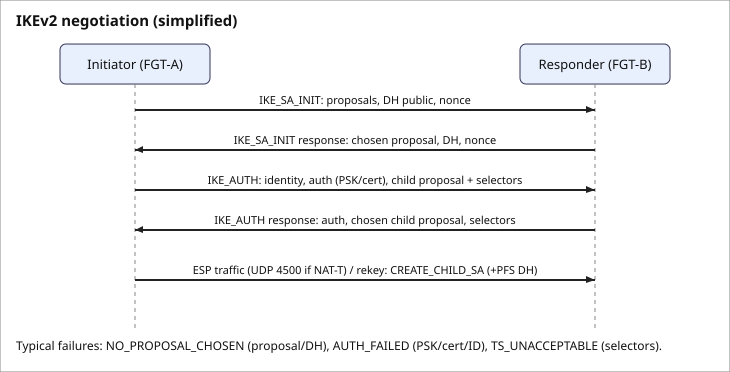

*شکل: مذاکره‌ی IKEv2 و خطاهای رایج.*

### ۵) مثال حل‌شده (Route-based S2S)

``` text
config vpn ipsec phase1-interface
    edit "TO-B"
        set interface "wan1"
        set ike-version 2
        set remote-gw 203.0.113.2
        set peertype any
        set proposal aes256gcm-prfsha256
        set dhgrp 20
        set dpd on-idle
        set dpd-retrycount 3
        set nattraversal enable
        set psksecret <PSK-LAB>
    next
end
config vpn ipsec phase2-interface
    edit "TO-B-P2"
        set phase1name "TO-B"
        set proposal aes256gcm
        set pfs enable
        set dhgrp 20
        set src-subnet 0.0.0.0 0.0.0.0
        set dst-subnet 0.0.0.0 0.0.0.0
    next
end
config router static
    edit 100
        set dst 192.168.20.0 255.255.255.0
        set device "TO-B"
    next
end
```

(مقادیر الگوریتم نمونه‌اند؛ نام دقیق Proposal/`dpd on-idle` با CLI Reference 7.0 و سیاست سازمان تطبیق شود؛ `Unverified`.)

**GUI معادل:** VPN → IPsec Tunnels → Create New → Custom → Network (Remote Gateway، Interface) → Authentication (PSK، IKE Version 2) → Phase 1 Proposal (Encryption/Authentication/DH Group) → Phase 2 Selectors (Local/Remote Address) → Phase 2 Proposal، PFS → OK؛ سپس Network → Static Routes و Policy & Objects → Firewall Policy (دو جهت).

**مثال متوسط (تحلیل):** Phase 1 بالا ولی Phase 2 شکست می‌خورد. اولین فرضیه‌ها: Proposal Phase 2 ناهمسان، PFS/DH ناهمسان، Selector ناهمسان. شاهد: `diagnose debug application ike -1` پیام NO_PROPOSAL_CHOSEN یا TS_UNACCEPTABLE.

**مثال سخت:** Tunnel Up، Bytes out بالا، in صفر. فرضیه‌ها به ترتیب: (۱) Policy سمت مقابل ندارد، (۲) Route برگشت ندارد، (۳) NAT-T/فایروال میانی UDP 4500 را نمی‌دهد (ESP نمی‌رسد)، (۴) Selector نامطابق (ترافیک Drop قبل Encrypt). تفکیک با `diagnose vpn tunnel list` (شمارنده Encrypt/Decrypt)، Sniffer روی WAN (ESP/UDP 4500)، Debug Flow در سمت مقابل.

### ۶) طراحی و تصمیم‌گیری

| سؤال | تصمیم |
|---|---|
| IKEv1 یا IKEv2؟ | IKEv2 مگر سازگاری مانع شود |
| PSK یا Certificate؟ | Certificate برای مقیاس؛ PSK قوی برای Lab/کوچک |
| Route-based یا Policy-based؟ | Route-based (توصیه‌ی FortiOS) |
| Proposal | AES-GCM + SHA2 + DH ≥ 14 یا ECP؛ حذف الگوریتم ضعیف |
| PFS | روشن؛ هزینه‌ی CPU را بسنجید |
| DPD | on-idle/on-demand؛ زمان متوازن |
| MTU/MSS | از ابتدا تنظیم و با Capture تأیید |

### ۷) Verification

``` text
diagnose vpn ike gateway list
diagnose vpn tunnel list
get vpn ipsec tunnel summary
diagnose vpn ike log filter name TO-B
diagnose debug application ike -1
diagnose debug enable
diagnose debug disable
diagnose debug reset
diagnose sniffer packet wan1 "host 203.0.113.2 and (udp port 500 or udp port 4500 or proto 50)" 4 20 l
```

(`diagnose` فرمت دقیق `Unverified`.)

### ۸) Troubleshooting لایه‌ای (جدول تصمیم)

| لایه | آزمون | علامت | رفع |
|---|---|---|---|
| ۱) شبکه | ping/Sniffer روی UDP 500 | بسته‌ی IKE به Peer نمی‌رسد | Route/ACL/NAT |
| ۲) IKE_SA/Phase 1 | Debug IKE | NO_PROPOSAL_CHOSEN، AUTH_FAILED | Proposal، DH، PSK/گواهی، Peer ID |
| ۳) Child SA/Phase 2 | Debug IKE | TS_UNACCEPTABLE، NO_PROPOSAL | Selector، PFS/DH، Proposal |
| ۴) داده | `tunnel list` Encrypt/Decrypt | Out بالا In صفر | Policy مقابل، NAT-T، Route برگشت |
| ۵) Routing | `get router info routing-table details` | مسیر به Tunnel نیست | Static/OSPF/BGP |
| ۶) Policy | Debug Flow | Denied policy 0 | Policy دوطرفه |
| ۷) MTU | ping -f، Capture | بزرگ‌ها قفل | MTU/MSS |
| ۸) پایداری | Log، `ike gateway list` | قطع دوره‌ای | Lifetime/DPD/لینک |

### ۹) نکات امنیتی

- PSK قوی و منحصربه‌فرد برای هر Peer؛ در ریپو ذخیره نکنید.
- الگوریتم‌های منسوخ (DES، MD5، DH1/2) را غیرفعال کنید.
- IKEv1 Aggressive با PSK ضعیف خطرناک است.
- `peertype any` را فقط در Lab/نیاز؛ در تولید Peer ID مشخص.
- لاگ VPN را مانیتور کنید (تلاش‌های ناموفق).

### ۱۰) جمع‌بندی مفهومی

- IPsec = IKE (مدیریت کلید) + ESP (داده)؛ IKE_SA و Child SA.
- IKEv2 مدرن‌تر؛ PFS روشن؛ DH/Proposal دو سر یکی.
- Route-based = Selector باز + Route + Policy.
- NAT-T، DPD، Rekey و MTU علت اصلی ناپایداری‌اند.
- عیب‌یابی لایه‌ای: شبکه → IKE → Selector → Routing → Policy → MTU.

### ۱۱) تمرین و ارزیابی

**ت1.** (ساده) تفاوت Phase 1 و Phase 2 را بگویید. *(پاسخ: 18-0-ت1)*

**ت2.** (ساده) PFS چه کاری می‌کند؟ *(پاسخ: 18-0-ت2)*

**ت3.** (متوسط) چرا Route-based برای Hub-and-Spoke بهتر است؟ *(پاسخ: 18-0-ت3)*

**ت4.** (متوسط) NAT-T چه مشکلی را حل می‌کند و از چه پورتی استفاده می‌کند؟ *(پاسخ: 18-0-ت4)*

**ت5.** (سخت) Tunnel بالا ولی Bytes in صفر است. فرضیه‌ها را به ترتیب و شاهد هرکدام بنویسید. *(پاسخ: 18-0-ت5)*

**ت6.** (سخت، طراحی) Proposal پیشنهادی برای سازمان (Cipher، Hash، DH، PFS، Lifetime، DPD) را با دلیل بنویسید. *(پاسخ: 18-0-ت6)*

**ت7.** (سخت) Phase 2 با TS_UNACCEPTABLE شکست می‌خورد؛ Selectorهای دو طرف را چگونه تطبیق می‌دهید؟ *(پاسخ: 18-0-ت7)*

**م1.** DPD چیست؟ *(پاسخ: 18-0-م1)*

**Q1.** Quick quiz (English): Why is PFS recommended for IPsec? *(پاسخ: 18-0-Q1)*

### ۱۲) اصطلاحات و English Corner

| مخفف | شکل کامل | معنی |
|---|---|---|
| IKE | Internet Key Exchange | تبادل کلید |
| ESP | Encapsulating Security Payload | کپسوله‌سازی امن (IP 50) |
| SA | Security Association | قرارداد امنیتی |
| SPI | Security Parameter Index | شناسه‌ی SA |
| DH | Diffie-Hellman | تبادل کلید |
| PFS | Perfect Forward Secrecy | رازداری رو به جلو |
| DPD | Dead Peer Detection | تشخیص Peer مرده |
| TS | Traffic Selector | انتخاب‌گر ترافیک |
| NAT-T | NAT Traversal | عبور از NAT |
| AEAD | Authenticated Encryption with Associated Data | رمز و یکپارچگی توأم |

- *Phase 2 usually fails because of mismatched proposals or selectors.* ← Phase 2 معمولاً به‌خاطر ناهمسانی Proposal یا Selector شکست می‌خورد.
- *Enable PFS so that a key compromise does not expose past traffic.* ← PFS را فعال کنید تا افشای کلید ترافیک گذشته را باز نکند.

### ۱۳) منابع

- Fortinet Docs: [config vpn ipsec phase1-interface](https://docs.fortinet.com/document/fortigate/7.0.5/cli-reference/371620/config-vpn-ipsec-phase1-interface)، [phase2-interface](https://docs.fortinet.com/document/fortigate/7.0.0/cli-reference/371620/config-vpn-ipsec-phase2-interface)، [Phase 1 configuration](https://docs.fortinet.com/document/fortigate/7.0.2/administration-guide/790613/phase-1-configuration).
- RFC 7296 — IKEv2؛ RFC 4303 — ESP؛ RFC 3947/3948 — NAT-T؛ RFC 3706 — DPD؛ RFC 8247 — Algorithm Requirements for IKEv2.

### بخش تکمیلی درس: سناریوی واقعی، مثال‌های بیشتر و عیب‌یابی

> بخش‌های زیر درس بالا را کامل می‌کنند: سناریوی گام‌به‌گام، مثال‌های بیشتر از ساده تا سخت، جدول عیب‌یابی و پرسش‌های مصاحبه. ابتدا بخش‌های اصلی بالا را مطالعه کنید.

### تعمیق: ردیابی لایه‌ای یک Tunnel که بالا نمی‌آید

**لایه‌ها:** ۱) UDP/500 می‌رسد؟ ۲) Phase1 (IKE_SA) ۳) Phase2 (Child SA/Selector) ۴) Route و Policy ۵) داده.

``` text
diagnose vpn ike gateway list
diagnose vpn tunnel list
get vpn ipsec tunnel summary
```

تفسیر: Gateway بالا ولی Tunnel پایین ⇒ مشکل Selector یا Proposal Phase2؛ هیچ Gateway ⇒ Reachability/PSK/IKE Version.

**قاعده‌ی عددی Rekey:** اگر `keylife` = 43200 ثانیه، Rekey کمی قبل از انقضا آغاز می‌شود؛ ناهمخوانی دو سر معمولاً با کمترین مقدار حل می‌شود.

**پرسش‌های مصاحبه**
1. *Selector ناهمخوان چه نشانه‌ای؟* `no matching selector` / TS_UNACCEPTABLE.
2. *NAT-T چه موقع؟* دستگاه پشت NAT؛ UDP/4500.
3. *PFS؟* کلید جدید برای Phase2.

### تکمیل عمیق: IPsec از درون — IKE، SA، Selector و Rekey با مثال

#### چرا باید یاد بگیریم؟

IPsec را بسیاری با «کپی کردن پیکربندی» برپا می‌کنند و وقتی بالا نیامد، نمی‌دانند از کجا شروع کنند. درک مراحل داخلی، عیب‌یابی را از «حدس» به «خواندن پیام» تبدیل می‌کند.

#### توضیح ساده

IPsec دو مرحله دارد:

1. **IKE SA (Phase 1)**: دو سر یکدیگر را احراز هویت می‌کنند و یک کانال امن برای مذاکره می‌سازند.
2. **Child SA / IPsec SA (Phase 2)**: روی همان کانال، پارامترهای رمزنگاری داده و Selector (چه ترافیکی محافظت شود) توافق می‌شود.

IKE = Internet Key Exchange، یعنی «تبادل کلید اینترنتی». SA = Security Association، یعنی «تفاهم امنیتی» بین دو سر.

#### مثال ساده — لایه‌های عیب‌یابی

``` text
L1 reachability : UDP/500 (and 4500 for NAT-T) reachable?
L2 IKE SA       : diagnose vpn ike gateway list
L3 Child SA     : diagnose vpn tunnel list
L4 route/policy : route to remote subnet + policy both ways
L5 data         : counters enc/dec increase
```

#### مثال متوسط — نشانه‌ها

- Gateway ندارید ⇒ Reachability/PSK/نسخه‌ی IKE.
- Gateway هست ولی Tunnel Down ⇒ Proposal/Selector Phase2.
- Tunnel Up ولی ping نه ⇒ Route/Policy.
- Tunnel Up ولی فقط `enc` افزایش می‌یابد، `dec` نه ⇒ طرف مقابل رمزگشایی نمی‌کند (Policy/Route آن سمت).

#### Rekey

کلیدها محدود زمانی دارند؛ قبل از انقضا کلید جدید ساخته می‌شود تا قطع نشود.

``` text
keylife 43200 s = 12 hours
Rekey margin ~ a few minutes before expiry
```

اگر دو سر Lifetime متفاوت دارند، هرکدام زودتر منقضی شود Rekey را آغاز می‌کند؛ بهتر است یکسان باشند.

#### PFS

Perfect Forward Secrecy یعنی برای هر Child SA، DH جدید انجام شود تا لو رفتن یک کلید، کلیدهای دیگر را لو ندهد.

#### NAT-T

اگر یکی از دو سر پشت NAT باشد، ESP روی UDP/4500 کپسوله می‌شود.

#### مثال سخت — شکست متناوب

Tunnel هر ۸ ساعت یک بار برای چند ثانیه قطع می‌شود: Lifetime Phase1 متفاوت و Rekey Collision. رفع: یکسان‌سازی و فعال‌بودن `auto-negotiate`.

#### Lab

دو FortiGate (یا FGT و CSR) را با Proposal یکسان بسازید و سپس عمداً یک پارامتر را عوض کنید.

#### عیب‌یابی

| علامت (مشاهده) | علت محتمل (باید اثبات شود) | اقدام پس از اثبات |
|---|---|---|
| no proposal chosen | رمز | یکسان |
| AUTH_FAILED | PSK/ID | یکسان |
| TS_UNACCEPTABLE | Selector | یکسان |

#### پرسش‌ها با پاسخ

**۱. تفاوت Phase1 و 2؟** هویت/کانال در برابر داده.
**۲. PFS چیست؟** DH جدید برای هر SA.
**۳. NAT-T؟** کپسوله روی UDP/4500.

#### English Corner

- *Phase 1 authenticates the peers; phase 2 negotiates the data protection.*
- Q: What does perfect forward secrecy protect against?

## درس 18-1 — IPsec در عمل: از نیاز تا طراحی — Proposal، شبکه‌ها و برگه‌ی پارامتر

**فصل 18 · بازنویسی عمیق · پیش‌نیاز: ۱۸-۰، ۵-۰ · ≈ 5 ساعت**

> **وضعیت:** FortiOS 7.0.3 (بوت‌نشده)؛ دستورها `Unverified`؛ Lab «اجرا نشده».

<!--deep-->

### هدف آموزشی

در پایان این درس باید بتوانید:

1. نیاز کسب‌وکار (اتصال دو شعبه) را به طراحی IPsec ترجمه کنید.
2. Proposal (Phase 1 و Phase 2) را با معیار امنیت و سازگاری انتخاب کنید.
3. Subnetهای دو سمت را بدون Overlap طراحی کنید.
4. برگه‌ی پارامتر هماهنگ دو طرف را بنویسید.
5. Route-based و Policy-based را مقایسه کنید.
6. چک‌لیست قبل از ساخت (NAT-T، پورت، Route، Policy) را بشناسید.

### چرا باید یاد بگیریم؟

اگر دو شعبه با نامه‌ی پستی (اینترنت) مکاتبه کنند، هر کس می‌تواند نامه را بخواند. IPsec مثل «کیف دیپلماتیک» است: نامه در جعبه‌ی قفل‌دار می‌رود و فقط گیرنده کلید دارد. ولی دو طرف باید **دقیقاً** روی قفل و کلید توافق کنند؛ یک عدم‌تطابق کوچک (مثلاً DH Group) یعنی تونل بالا نمی‌آید. بیشتر زمان IPsec صرف طراحی و برگه‌ی پارامتر می‌شود نه تایپ دستور.

> **حدود اعتبار (v4.0) — انتخاب الگوریتم و DH Group:** مقادیر این درس (AES-256، SHA-256، DH 14) یک **نمونه‌ی پایه‌ی رایج و سازگار** است، نه «تنها پاسخ درست». انتخاب واقعی به سیاست امنیتی سازمان و الزام‌های انطباق (مثل راهنماهای NIST/FIPS)، سازگاری با دستگاه طرف مقابل، توان پردازشی/Offload، نسخه‌ی FortiOS و طول عمر داده‌ی محافظت‌شده بستگی دارد. طبق جدول RFC 8247 (خوانده‌شده، بخش 2.4): گروه 14 (MODP 2048) «MUST»، گروه 19 (ECP 256) «SHOULD»، گروه‌های 5 و 2 «SHOULD NOT» (گروه 2 در آینده‌ی نزدیک «MUST NOT» خواهد شد)، گروه 1 «MUST NOT». گروه 20 در این جدول نیامده؛ گروه‌های دیگر را با سیاست سازمان و مستند محصول بسنجید. راهنمای عمومی الگوریتم‌های IKEv2: RFC 8247. پشتیبانی هر Group/الگوریتم را از مستند همان نسخه تأیید کنید.

### نیاز کسب‌وکار ⇒ طراحی

نیاز: «شعبه‌ی تهران (10.1.0.0/24) و تبریز (10.2.0.0/24) به هم دسترسی داشته باشند، امن، با IP عمومی ثابت».

| تصمیم | انتخاب | دلیل |
|---|---|---|
| نوع | Route-based | انعطاف Routing (OSPF/BGP) |
| IKE | IKEv2 | سریع‌تر، قوی‌تر |
| احراز | PSK قوی (یا Certificate) | ساده/بهتر |
| Phase1 | AES256-SHA256، DH 14+ | امن و گسترده |
| Phase2 | AES256-SHA256، PFS | ایمن |
| Selector | 0.0.0.0/0 (Route-based) | Routing کنترل کند |

### Route-based در برابر Policy-based

| ویژگی | Route-based | Policy-based |
|---|---|---|
| Interface تونل | دارد | ندارد |
| Routing | Static/OSPF/BGP روی تونل | Selector تعیین |
| انعطاف | بالا | کم |
| پیچیدگی عیب‌یابی | کمتر | بیشتر |
| پیشنهاد | بله | موارد قدیمی |

### برگه‌ی پارامتر

| پارامتر | سمت A (تهران) | سمت B (تبریز) |
|---|---|---|
| IP عمومی | 198.51.100.10 | 203.0.113.20 |
| Subnet داخلی | 10.1.0.0/24 | 10.2.0.0/24 |
| IKE | v2 | v2 |
| Proposal P1 | aes256-sha256 | aes256-sha256 |
| DH | 14 | 14 |
| Lifetime P1 | 86400 | 86400 |
| Proposal P2 | aes256-sha256 | aes256-sha256 |
| PFS | enable (DH 14) | enable (DH 14) |
| Lifetime P2 | 43200 | 43200 |
| PSK | <SECRET> | <SECRET> |
| NAT-T | enable | enable |

اصل: هر ردیف باید در دو طرف **یکسان** (Lifetime الزاماً یکسان نیست ولی سازگار باشد).

### چک‌لیست پیش از ساخت

1. UDP 500 و 4500 و ESP (پروتکل 50) بین دو IP عمومی باز است.
2. IP عمومی ثابت (یا DDNS/Peer Type Dynamic).
3. Subnetها Overlap ندارند.
4. مسیر Default روی WAN درست است.
5. ساعت (NTP) هماهنگ برای Certificate.
6. MTU: تونل ≈ ۱۴۲۰–۱۴۳۰ (۱۸-۴).

### مثال‌های حل‌شده

#### مثال ساده — Overlap

هر دو شعبه 192.168.1.0/24 ⇒ Overlap. راه: Renumber یک سمت، یا NAT بین دو سمت (Policy NAT/Double NAT)؛ بهترین: آدرس‌دهی یکتا.

#### مثال متوسط — پارامتر ناسازگار

سمت A DH 14 و B DH 5. Debug: `no proposal chosen`. رفع: هر دو 14. در طراحی همیشه برگه‌ی مشترک.

#### مثال متوسط — ساده‌ترین Proposal

Phase1: `aes256-sha256` و `dhgrp 14`؛ Phase2 با PFS 14. لیست کوتاه (یک یا دو Proposal) برای کاهش شانس عدم‌تطابق.

#### مثال سخت — NAT قبل از FortiGate

یک سمت پشت مودم NAT است. نیاز NAT-T (UDP 4500)، و Port Forward 500/4500 روی مودم یا ISP Bridge. علامت: Phase1 بالا ولی ESP عبور نمی‌کند. راه: NAT-T Force یا Bridge.

#### مثال سخت — چند تونل (Hub)

۱۰ شعبه به مرکز: Hub-and-Spoke؛ Subnetها یکتا؛ OSPF/BGP روی تونل‌ها؛ ADVPN برای Spoke-to-Spoke (۱۸-۸). در طراحی اول Subnet Plan.

### مسیر GUI (مستندی، Unverified)

1. VPN → IPsec Wizard یا Custom: گام‌ها مطابق ۱۸-۲.

### Lab هدایت‌شده (اجرا نشده)

1. برگه‌ی پارامتر را کامل کنید.
2. چک‌لیست را پر کنید.
3. Overlap را شبیه‌سازی و راه‌حل بگویید.

### عیب‌یابی سریع

| علامت (مشاهده) | علت محتمل (باید اثبات شود) | اقدام پس از اثبات |
|---|---|---|
| no proposal chosen | Proposal | هماهنگ |
| Phase1 بالا P2 نه | Selector/PFS | تطبیق |
| ESP عبور نمی‌کند | NAT-T | 4500 |
| Overlap | آدرس‌دهی | تغییر |

### نکات امنیتی

PSK طولانی و تصادفی (یا Certificate)؛ AES-GCM یا AES256؛ DH 14+؛ DES/3DES/MD5/SHA1 ممنوع؛ Dead Peer Detection.

### جمع‌بندی

طراحی قبل از دستور: نیاز ⇒ پارامتر؛ برگه‌ی مشترک؛ Route-based؛ Subnet یکتا؛ چک‌لیست پورت/NAT-T/MTU.

### تمرین و ارزیابی

**ت1.** (ساده) چرا IKEv2؟ *(پاسخ: 18-1-ت1)*

**ت2.** (متوسط) چرا Pre-check شبکه؟ *(پاسخ: 18-1-ت2)*

**ت3.** (سخت) Overlap 192.168.1.0/24 را چگونه حل می‌کنید؟ *(پاسخ: 18-1-ت3)*

**ت4.** (سخت) برگه‌ی پارامتر برای دو شعبه بنویسید. *(پاسخ: 18-1-ت4)*

**ت5.** (سخت، طراحی) معیار پذیرش Tunnel را ۵ بند بنویسید. *(پاسخ: 18-1-ت5)*

**Q1.** Quick quiz (English): Why prepare a parameter sheet before configuring a tunnel? *(پاسخ: 18-1-Q1)*

### اصطلاحات و English Corner

| مخفف | شکل کامل | معنی |
|---|---|---|
| Peer ID | IKE peer identity | هویت همتا |

- *Mirror every parameter on both peers.* ← هر پارامتر را روی هر دو سر آینه کنید.

### کارت Lab

**Lab:** برگه‌ی پارامتر. **Evidence:** `02-design/ipsec-params.md`.

### منابع

- [phase1-interface](https://docs.fortinet.com/document/fortigate/7.0.5/cli-reference/371620/config-vpn-ipsec-phase1-interface)
- RFC 7296

<a id="l-18-2"></a>

## درس 18-2 — ساخت Tunnel Site-to-Site بین دو FortiGate: طراحی، GUI، CLI و Verification

**فصل ۱۸ · بازنویسی عمیق · پیش‌نیاز: ۱۸-۰ (IKE، Selector، PFS)، ۱۲-۰، فصل ۵ · ≈ ۷ ساعت**

> **وضعیت (FortiOS 7.0.3):** پیش‌فرض‌ها از CLI Reference 7.0؛ سینتکس `Unverified`؛ PSK نمونه؛ Lab «اجرا نشده».

<!--deep-->

### هدف آموزشی

در پایان این درس باید بتوانید:

1. Tunnel Site-to-Site بین دو FortiGate را با GUI Wizard و CLI بسازید.
2. Phase 1 و Phase 2 را با پارامتر هماهنگ تنظیم کنید.
3. Static Route و Policy دوطرفه را بنویسید.
4. وضعیت را با `diagnose vpn ike gateway list` و `diagnose vpn tunnel list` تأیید کنید.
5. ترافیک واقعی را آزمون و Sniffer کنید (ESP/NAT-T).
6. خطاهای ساخت را رفع کنید.

### چرا باید یاد بگیریم؟

حالا که برگه‌ی پارامتر آماده است، «ساختمان را می‌سازیم». ترتیب مهم است: Phase 1 (قرارداد امنیتی)، Phase 2 (کانال داده)، Route (چه ترافیکی از تونل برود) و Policy (اجازه‌ی عبور). اگر یک تکه جا بیفتد، تونل ممکن است «بالا» باشد ولی ترافیک رد نشود؛ این از شایع‌ترین گیج‌کننده‌هاست.

### توپولوژی

``` text
 LAN-A 10.1.0.0/24 -- [FGT-A 198.51.100.10] ==== IPsec ==== [FGT-B 203.0.113.20] -- LAN-B 10.2.0.0/24
```

### Phase 1 (FGT-A)

``` text
config vpn ipsec phase1-interface
    edit "TO-B"
        set interface "port1"
        set ike-version 2
        set peertype any
        set net-device disable
        set proposal aes256-sha256
        set dhgrp 14
        set remote-gw 203.0.113.20
        set psksecret <SECRET>
        set dpd on-idle
        set nattraversal enable
        set keylife 86400
    next
end
```

### Phase 2

``` text
config vpn ipsec phase2-interface
    edit "TO-B-P2"
        set phase1name "TO-B"
        set proposal aes256-sha256
        set pfs enable
        set dhgrp 14
        set src-subnet 0.0.0.0 0.0.0.0
        set dst-subnet 0.0.0.0 0.0.0.0
        set keylife-seconds 43200
    next
end
```

### Route و Policy

``` text
config router static
    edit 10
        set dst 10.2.0.0 255.255.255.0
        set device "TO-B"
    next
    edit 11
        set dst 10.2.0.0 255.255.255.0
        set blackhole enable
        set distance 254
    next
end
config firewall policy
    edit 80
        set name "LAN-to-B"
        set srcintf "ZN-LAN"
        set dstintf "TO-B"
        set srcaddr "NET-A"
        set dstaddr "NET-B"
        set action accept
        set schedule "always"
        set service "ALL"
        set logtraffic all
    next
    edit 81
        set name "B-to-LAN"
        set srcintf "TO-B"
        set dstintf "ZN-LAN"
        set srcaddr "NET-B"
        set dstaddr "NET-A"
        set action accept
        set schedule "always"
        set service "ALL"
        set logtraffic all
    next
end
```

Route blackhole با Distance بالا: وقتی تونل Down است، ترافیک به Default (اینترنت) نشت نمی‌کند. NAT روی Policy تونل **غیرفعال**.

سمت B معکوس: `remote-gw 198.51.100.10`، Route به 10.1.0.0/24، Policyهای متقارن.

### تأیید

``` text
diagnose vpn ike gateway list
diagnose vpn tunnel list
get vpn ipsec tunnel summary
```

نمونه:

``` text
name=TO-B ... status=established
proxyid=TO-B-P2 ... enc: spi=... bytes=...
```

بایت‌های enc/dec باید با ترافیک افزایش یابند.

### آزمون

1. ping از 10.1.0.5 به 10.2.0.5.
2. `diagnose sniffer packet any 'host 203.0.113.20 and (esp or udp port 500 or udp port 4500)' 4 10 a`.
3. آزمون منفی: Policy را موقتاً Disable ⇒ ping قطع (اثبات اینکه Policy کنترل می‌کند).

### مثال‌های حل‌شده

#### مثال ساده — موفق

Phase1 established، ping OK، `enc/dec` افزایش. Log Policy 80 و 81.

#### مثال متوسط — بالا ولی ترافیک نه

Phase1 و Phase2 up ولی ping Timeout. بررسی: Route (آیا 10.2.0.0/24 از TO-B؟)، Policy برگشتی، و در B Route به 10.1.0.0/24. معمولاً Route یا Policy یک سمت فراموش شده.

#### مثال متوسط — NAT اشتباه

Policy تونل `nat enable` ⇒ مبدأ به IP تونل ترجمه شد و B ترافیک را نمی‌شناسد. رفع: `nat disable`.

#### مثال سخت — Selector و Route-based

Phase2 با Selector خاص در یک سمت و 0.0.0.0/0 در سمت دیگر ⇒ فقط Phase2 بالا نمی‌آید (`no matching selector`). رفع: هر دو 0.0.0.0/0 (Route-based) یا دقیقاً مطابق.

#### مثال سخت — نشت ترافیک

تونل Down و Route blackhole نیست ⇒ ترافیک 10.2.0.0/24 از Default به اینترنت رفت (نشت اطلاعات!). رفع: blackhole Distance 254. تأیید: تونل قطع ⇒ ping Timeout نه عبور از اینترنت.

### Lab هدایت‌شده (اجرا نشده)

1. P1/P2/Route/Policy دو طرف.
2. تأیید و آزمون.
3. نشت و blackhole.

### عیب‌یابی سریع

| علامت (مشاهده) | علت محتمل (باید اثبات شود) | اقدام پس از اثبات |
|---|---|---|
| Phase1 down | PSK/Proposal | Debug IKE |
| P2 down | Selector/PFS | تطبیق |
| بالا ولی ping نه | Route/Policy | بررسی |
| ترافیک بدون رمز | Route نشتی | blackhole |

### نکات امنیتی

PSK قوی؛ NAT روی Policy تونل خاموش؛ DPD؛ Log؛ محدودیت Policy (نه ALL) در عمل.

### جمع‌بندی

ترتیب: Phase1 ⇒ Phase2 ⇒ Route (+ blackhole) ⇒ Policy دوطرفه (بدون NAT) ⇒ تأیید با `ike gateway list` و `tunnel list` ⇒ آزمون مثبت/منفی.

### تمرین و ارزیابی

**ت1.** (ساده) سه چیز لازم برای ترافیک Tunnel Route-based؟ *(پاسخ: 18-2-ت1)*

**ت2.** (متوسط) چرا Policy دوطرفه لازم است؟ *(پاسخ: 18-2-ت2)*

**ت3.** (متوسط) Verification سه‌سطحی را بنویسید. *(پاسخ: 18-2-ت3)*

**ت4.** (سخت) فقط Bytes out رشد می‌کند؛ فرضیه‌ها و آزمون. *(پاسخ: 18-2-ت4)*

**ت5.** (سخت، طراحی) Policy حداقلی برای دسترسی Site A به یک سرور در Site B. *(پاسخ: 18-2-ت5)*

**Q1.** Quick quiz (English): Which three elements must be correct for route-based VPN traffic to flow? *(پاسخ: 18-2-Q1)*

### اصطلاحات و English Corner

| مخفف | شکل کامل | معنی |
|---|---|---|
| Route-based | Route-based VPN | VPN مبتنی بر Interface و Route |
| Mirror | Mirrored config | پیکربندی آینه‌ای |
| Encrypt/Decrypt counters | SA counters | شمارنده‌ی SA |

- *Both peers must have mirrored proposals and selectors.* ← هر دو Peer باید Proposal و Selector آینه‌ای داشته باشند.

### Lab

**کارت Lab:** Tunnel S2S. **وضعیت:** اجرا نشده. **Verification:** مطابق بخش ۴. **Rollback:** حذف phase2/phase1/Route/Policy. **Evidence:** `03-ops/s2s-a-b.md`.

### منابع

- Fortinet Docs: [config vpn ipsec phase1-interface](https://docs.fortinet.com/document/fortigate/7.0.5/cli-reference/371620/config-vpn-ipsec-phase1-interface)، [phase2-interface](https://docs.fortinet.com/document/fortigate/7.0.0/cli-reference/371620/config-vpn-ipsec-phase2-interface).

<a id="l-18-3"></a>

## درس 18-3 — عیب‌یابی IPsec با Debug IKE: خواندن پیام‌ها و تصمیم‌گیری لایه‌ای

**فصل 18 · بازنویسی عمیق · پیش‌نیاز: ۱۸-۱، ۱۸-۲ · ≈ 11 ساعت**

> **وضعیت:** FortiOS 7.0.3 نامی (بوت‌نشده)؛ سناریو و کلید آموزشی؛ Lab «اجرا نشده»؛ دستورها `Unverified` تا اجرای Lab؛ FMG/FAZ وابسته به لایسنس (Needs-License).

<!--deep-->

### هدف آموزشی

در پایان این درس باید بتوانید:

1. Debug IKE را با فیلتر اجرا و پایان دهید.
2. پیام‌های کلیدی (SA_INIT، AUTH، CREATE_CHILD_SA) را بخوانید.
3. خطاهای رایج را بشناسید (no proposal chosen، AUTH failed، TS_UNACCEPTABLE).
4. رویکرد لایه‌ای (شبکه ⇒ Phase1 ⇒ Phase2 ⇒ Route/Policy) را اجرا کنید.
5. نیازمندی‌های NAT-T و Dead Peer Detection را بدانید.
6. گزارش RCA بنویسید.

### چرا باید یاد بگیریم؟

وقتی IPsec بالا نمی‌آید پیام خطا مبهم است: «تونل down». Debug IKE دقیقاً می‌گوید پیشنهاد کدام طرف رد شد. مثل شنیدن مکالمه‌ی دو سفیر که بر سر شرایط توافق نمی‌کنند. با آن عیب‌یابی از «حدس» به «خواندن» می‌رسد.

### راه‌اندازی

``` text
diagnose vpn ike log-filter clear
diagnose vpn ike log-filter dst-addr4 203.0.113.20
diagnose debug application ike -1
diagnose debug enable
# trigger: ping across or 'diagnose vpn ike restart'
diagnose debug disable
diagnose debug reset
```

### رویکرد لایه‌ای

``` text
L0 Network : UDP 500/4500 reachable? (sniffer)
L1 Phase1  : IKE_SA_INIT / IKE_AUTH
L2 Phase2  : CREATE_CHILD_SA / selectors
L3 Data    : route, policy, ESP counters
```

### پیام‌های کلیدی (IKEv2)

| پیام | معنی |
|---|---|
| `IKE_SA_INIT` | توافق الگوریتم و تبادل DH |
| `IKE_AUTH` | احراز و ایجاد Child SA اول |
| `CREATE_CHILD_SA` | Rekey/Child جدید |
| `no proposal chosen` | الگوریتم‌ها نمی‌خوانند |
| `AUTHENTICATION_FAILED` | PSK/Certificate/ID |
| `TS_UNACCEPTABLE` | Traffic Selector نمی‌خواند |
| `INVALID_KE_PAYLOAD` | DH Group |

### خطاها و رفع

| خطا | علت | رفع |
|---|---|---|
| no proposal chosen | Proposal/DH | هماهنگ |
| AUTHENTICATION_FAILED | PSK/ID | PSK و peerid |
| TS_UNACCEPTABLE | Selector | 0.0.0.0/0 یا مطابق |
| timeout در SA_INIT | UDP 500 بسته | Firewall/ISP |
| Phase1 up، ESP نه | NAT-T/ESP | 4500 |
| flapping | DPD/Rekey/MTU | تنظیم |

### NAT-T و DPD

NAT-T (NAT Traversal): اگر یکی از طرفین NAT شده، IKE به UDP 4500 می‌رود و ESP داخل UDP کپسوله می‌شود. DPD (Dead Peer Detection) همتای مرده را تشخیص می‌دهد (`dpd on-idle`/`on-demand`).

### مثال‌های حل‌شده

#### مثال ساده — no proposal chosen

``` text
ike 0:TO-B:100: no proposal chosen
```

مقایسه‌ی Proposal دو سمت: A=`aes256-sha256`/DH14 و B=`aes128-sha1`/DH5. رفع: هماهنگ. بعد از رفع: `IKE_SA_INIT` تکمیل.

#### مثال متوسط — AUTH failed

``` text
ike 0:TO-B:100: initiator: AUTHENTICATION_FAILED
```

PSK در B یک حرف متفاوت. رفع و آزمون. نکته: PSK را کپی/پیست کنید؛ فاصله‌ی انتهایی دام رایج است.

#### مثال متوسط — Timeout

Debug فقط SA_INIT خروجی و پاسخ نمی‌آید. Sniffer: UDP 500 خارج، برگشت نه. ISP/Firewall میانی بلاک. رفع: باز کردن UDP 500/4500 و ESP.

#### مثال سخت — TS_UNACCEPTABLE

A: Selector 10.1.0.0/24↔10.2.0.0/24؛ B: 10.2.0.0/24↔10.1.0.0/16. IKEv2 TS را نمی‌پذیرد. راه: مطابقت یا 0.0.0.0/0. توجه: بعضی نسخه‌ها در IKEv1 چند Phase2 می‌سازند؛ IKEv2 یک TS Set.

#### مثال سخت — Flapping

تونل هر چند دقیقه بالا/پایین می‌شود. Log: `DPD timeout`، MTU بزرگ (Fragment شکسته). رفع: MSS Clamp، DPD مناسب، ISP لینک را بررسی. نکته: IKE Fragmentation برای پیام‌های بزرگ با Certificate.

### Lab هدایت‌شده (اجرا نشده)

1. خطاهای سه‌گانه را بسازید.
2. Debug و تفسیر.
3. RCA.

### عیب‌یابی سریع

| علامت (مشاهده) | علت محتمل (باید اثبات شود) | اقدام پس از اثبات |
|---|---|---|
| خروجی طوفانی | بی‌فیلتر | log-filter |
| Debug بسته‌نشده | disable نشده | reset |
| کار نکرد بعد از تغییر | SA قدیمی | `diagnose vpn ike gateway clear` |

### نکات امنیتی

Debug IKE ممکن است اطلاعات حساس بدهد؛ در پایان disable/reset؛ لاگ را امن نگه‌دارید.

### جمع‌بندی

Debug IKE با فیلتر؛ لایه‌ها (شبکه، P1، P2، Data)؛ پیام‌های SA_INIT/AUTH/CHILD؛ خطاهای رایج و رفع؛ NAT-T و DPD.

### تمرین و ارزیابی

**ت1.** (ساده) IKE_SA_INIT چه می‌کند؟ *(پاسخ: 18-3-ت1)*

**ت2.** (ساده) TS_UNACCEPTABLE؟ *(پاسخ: 18-3-ت2)*

**ت3.** (متوسط) AUTH_FAILED؟ *(پاسخ: 18-3-ت3)*

**ت4.** (متوسط) Timeout؟ *(پاسخ: 18-3-ت4)*

**ت5.** (سخت) Timeout رفع. *(پاسخ: 18-3-ت5)*

**ت6.** (سخت، طراحی) درخت تصمیم. *(پاسخ: 18-3-ت6)*

**Q1.** Quick quiz (English): Which IKEv2 exchange negotiates algorithms and DH? *(پاسخ: 18-3-Q1)*

### اصطلاحات و English Corner

| مخفف | شکل کامل | معنی |
|---|---|---|
| TS | Traffic Selector | انتخابگر ترافیک |

- *Filter the IKE debug to a single peer.* ← Debug IKE را به یک peer محدود کنید.

### کارت Lab

**کارت Lab:** Debug IKE (اجرا نشده). **Evidence:** `03-ops/ike-debug.md`.

### منابع

- Fortinet FortiOS 7.0 Administration Guide: IPsec VPN troubleshooting
- RFC 7296

<a id="l-18-4"></a>

## درس 18-4 — MTU/MSS و Fragmentation در Tunnel IPsec: محاسبه‌ی سربار، آزمون DF، PMTUD و تنظیم

**فصل 18 · بازنویسی عمیق · پیش‌نیاز: ۱۸-۰، ۲۸-۲ · ≈ 8 ساعت**

> **وضعیت:** FortiOS 7.0.3 (بوت‌نشده) و CSR1000v؛ دستورها `Unverified` مگر با لینک؛ Lab «اجرا نشده».

<!--deep-->

### هدف آموزشی

در پایان این درس باید بتوانید:

1. Overhead IPsec و MTU موثر تونل را محاسبه کنید.
2. MSS مناسب را برای Clamp حساب کنید.
3. Fragmentation و PMTUD را در تونل تحلیل کنید.
4. با `ping -f -l` MTU مسیر را آزمون و Clamp را تنظیم کنید.
5. علائم MTU (فایل بزرگ، HTTPS، RDP) را تشخیص دهید.
6. بین MSS Clamp و Interface MTU تفاوت را بدانید.

### چرا باید یاد بگیریم؟

تونل IPsec مثل قراردادن نامه در پاکت دوم است: پاکت بزرگ‌تر می‌شود و دیگر در «صندوق» (MTU ۱۵۰۰) جا نمی‌شود. اگر بسته‌ی ۱۵۰۰ بایتی را رمز کنید، چند ده بایت اضافه می‌شود و از حد می‌گذرد ⇒ Fragment یا Drop. شکایت رایج بعد از راه‌اندازی تونل: «ping می‌رود، وب سبک باز می‌شود، ولی فایل بزرگ، RDP یا اپلیکیشن قطع می‌شود». این دقیقاً MTU است.

### Overhead

ESP Tunnel Mode (با AES-CBC، SHA-256 و NAT-T): تقریبی ۷۰–۸۰ بایت.

| جزء | بایت (تقریبی) |
|---|---|
| IP جدید | 20 |
| UDP (NAT-T) | 8 |
| ESP Header (SPI+Seq) | 8 |
| IV (AES-CBC) | 16 |
| Padding + Pad len + Next hdr | 2 تا 17 |
| ICV (SHA-256-128) | 16 |

(AES-GCM Overhead متفاوت و کمتر است؛ مقادیر دقیق به الگوریتم/NAT-T بستگی دارد.)

``` text
Overhead ~ 20 + 8 + 8 + 16 + ~10 + 16 = 78
Effective MTU = 1500 - 78 = 1422
MSS (TCP)     = Effective MTU - 40 = 1382
```

عملاً MSS Clamp ≈ ۱۳۶۰ (حاشیه‌ی ایمن).

### Fragmentation و PMTUD

- اگر DF=1 و بسته از MTU بزرگ‌تر باشد ⇒ Drop + ICMP «Fragmentation needed» (Type 3 Code 4).
- اگر ICMP بلاک باشد ⇒ Black hole (اتصال گیر می‌کند).
- اگر DF=0 ⇒ Fragmentation (کندی، گاهی Drop در میانی).
- FortiOS گاهی پیش از رمز Fragment می‌کند (`set ip-fragmentation pre-encapsulation`) یا پس از آن (post).

### MSS Clamp

``` text
config firewall policy
    edit 80
        set tcp-mss-sender 1360
        set tcp-mss-receiver 1360
    next
end
```

یا روی Interface تونل:

``` text
config system interface
    edit "TO-B"
        set tcp-mss 1360
        set mtu-override enable
        set mtu 1400
    next
end
```

Clamp فقط TCP را درست می‌کند؛ UDP (مثل VoIP/DNS بزرگ) باید با MTU Interface/برنامه.

### یافتن MTU مسیر

``` text
Windows: ping -f -l 1372 10.2.0.5
Linux  : ping -M do -s 1372 10.2.0.5
```

1372 + 28 = 1400. اگر شکست، کم کنید تا موفق شود؛ حداکثر موفق + 28 = MTU مسیر.

### مثال‌های حل‌شده

#### مثال ساده — محاسبه

``` text
Effective MTU = 1500 - 78 = 1422
MSS           = 1422 - 40 = 1382
```

انتخاب Clamp = 1360 (کمی کمتر برای احتیاط).

#### مثال متوسط — آزمون ping

ping -f -l 1400 ⇒ شکست؛ 1372 ⇒ موفق؛ 1392 ⇒ شکست؛ 1380 ⇒ موفق؛ 1385 ⇒ شکست ⇒ حداکثر 1380 ⇒ MTU = 1380 + 28 = 1408.

``` text
Path MTU = 1380 + 28 = 1408
MSS      = 1408 - 40 = 1368
```

Clamp = 1360 ⇒ ایمن.

#### مثال متوسط — علامت

وب سبک OK؛ دانلود ۵MB قطع. Sniffer: SYN با `mss 1460`؛ بسته‌ی داده‌ی ۱۵۰۰ ⇒ Drop. با Clamp: `mss 1360` در SYN؛ دانلود کامل.

#### مثال سخت — ICMP بلاک

Clamp نیست و Policy ICMP Type 3 را نمی‌دهد ⇒ PMTUD شکست ⇒ Black hole. راه: Clamp (مستقل از ICMP) و اجازه‌ی ICMP Type 3. اثبات: Sniffer نبود ICMP برگشتی.

#### مثال سخت — دو تونل تودرتو

IPsec داخل GRE یا دو لایه ⇒ Overhead دو برابر؛ MTU ≈ ۱۳۵۰ و MSS ≈ ۱۳۱۰. محاسبه‌ی دقیق برای هر لایه؛ تست ping DF.

### مسیر GUI (مستندی، Unverified)

1. Network → Interfaces → Tunnel → MTU.
2. Policy → CLI برای MSS.

### Lab هدایت‌شده (اجرا نشده)

1. Path MTU را پیدا کنید.
2. Clamp و SYN را در Sniffer ببینید.
3. بلاک ICMP و اثر آن.

### عیب‌یابی سریع

| علامت (مشاهده) | علت محتمل (باید اثبات شود) | اقدام پس از اثبات |
|---|---|---|
| فایل بزرگ قطع | MTU | Clamp |
| فقط RDP/اپ | UDP/MTU | MTU Interface |
| ping کوچک OK | MTU | ping DF |
| PMTUD | ICMP بلاک | Type 3 |

### نکات امنیتی

ICMP را کامل بلاک نکنید؛ Type 3 Code 4 مجاز؛ از کاهش بی‌رویه‌ی MTU که کارایی را پایین می‌آورد پرهیز.

### جمع‌بندی

Overhead ≈ ۷۰–۸۰ بایت ⇒ MTU موثر ≈ ۱۴۲۰ و MSS ≈ ۱۳۶۰؛ Clamp برای TCP، MTU Interface برای UDP؛ ping DF برای اندازه‌گیری؛ PMTUD و ICMP.

### تمرین و ارزیابی

**ت1.** (ساده) MSS از MTU چگونه محاسبه می‌شود؟ *(پاسخ: 18-4-ت1)*

**ت2.** (ساده) PMTUD Black hole چیست؟ *(پاسخ: 18-4-ت2)*

**ت3.** (متوسط) سربار ESP+UDP با GCM چقدر است؟ *(پاسخ: 18-4-ت3)*

**ت4.** (متوسط) ping DF 1372 موفق/1400 شکست؛ MTU مؤثر؟ *(پاسخ: 18-4-ت4)*

**ت5.** (سخت) چرا MSS Clamp برای UDP کافی نیست؟ *(پاسخ: 18-4-ت5)*

**ت6.** (سخت، طراحی) استاندارد MTU/MSS سازمان. *(پاسخ: 18-4-ت6)*

**Q1.** Quick quiz (English): Why do small pings succeed while large transfers hang when the path MTU is too small? *(پاسخ: 18-4-Q1)*

### اصطلاحات و English Corner

| مخفف | شکل کامل | معنی |
|---|---|---|
| PMTUD | Path MTU Discovery | کشف MTU مسیر |
| DF | Don’t Fragment bit | بیت عدم فرگمنت |
| Black hole | PMTUD black hole | حفره‌ی سیاه PMTUD |

- *Measure the effective MTU with DF-bit pings.* ← MTU مؤثر را با ping و DF-bit اندازه بگیرید.

### کارت Lab

**کارت Lab:** MTU. **Evidence:** `03-ops/mtu.md`.

### منابع

- RFC 1191
- RFC 4821
- RFC 4303 (ESP)

<a id="l-18-5"></a>

## درس 18-5 — Interop FGT–CSR: IPsec IKEv2 route-based، نگاشت، Debug دوطرفه و آزمون Rekey

**فصل 18 · بازنویسی عمیق · پیش‌نیاز: ۱۸-۰، ۲۵-۰، ۲۵-۳ · ≈ 8 ساعت**

> **وضعیت:** FortiOS 7.0.3 (بوت‌نشده) و CSR1000v؛ دستورها `Unverified` مگر با لینک؛ Lab «اجرا نشده». CSR دستورها `Unverified`.

<!--deep-->

### هدف آموزشی

در پایان این درس باید بتوانید:

1. تونل IPsec IKEv2 Route-based بین FortiGate و Cisco IOS-XE (CSR 1000v) بسازید.
2. معادل‌های پارامتر (Proposal، Profile، VTI) را در دو سازنده بشناسید.
3. Traffic Selector را برای هماهنگی دو سازنده درست تنظیم کنید.
4. وضعیت را در هر دو طرف تأیید کنید.
5. خطاهای Interop (Proposal، ID، Selector، MTU) را رفع کنید.
6. محدودیت‌های Lab (اجرا نشده، نسخه) را صادقانه ثبت کنید.

### چرا باید یاد بگیریم؟

در دنیای واقعی همیشه همه‌ی دستگاه‌ها FortiGate نیستند: شعبه‌ای با Cisco، شریکی با Palo Alto. IPsec استاندارد است، ولی هر سازنده اصطلاح و پیش‌فرض خودش را دارد؛ مثل دو مترجم با لهجه‌ی متفاوت. اگر معادل‌ها را بشناسید، Interop را حل می‌کنید.

### توپولوژی

``` text
LAN-FGT 10.1.0.0/24 -- [FGT 198.51.100.10] === IKEv2 === [CSR 203.0.113.20] -- LAN-CSR 10.2.0.0/24
```

### پیکربندی FortiGate

``` text
config vpn ipsec phase1-interface
    edit "TO-CSR"
        set interface "port1"
        set ike-version 2
        set peertype any
        set proposal aes256-sha256
        set dhgrp 14
        set remote-gw 203.0.113.20
        set psksecret <SECRET>
    next
end
config vpn ipsec phase2-interface
    edit "TO-CSR-P2"
        set phase1name "TO-CSR"
        set proposal aes256-sha256
        set pfs enable
        set dhgrp 14
        set src-subnet 0.0.0.0 0.0.0.0
        set dst-subnet 0.0.0.0 0.0.0.0
    next
end
```

### پیکربندی Cisco CSR (IOS-XE)

``` text
crypto ikev2 proposal IKEV2-PROP
 encryption aes-cbc-256
 integrity sha256
 group 14
!
crypto ikev2 policy IKEV2-POL
 proposal IKEV2-PROP
!
crypto ikev2 keyring KR
 peer FGT
  address 198.51.100.10
  pre-shared-key <SECRET>
!
crypto ikev2 profile IKEV2-PROF
 match identity remote address 198.51.100.10 255.255.255.255
 authentication remote pre-share
 authentication local pre-share
 keyring local KR
!
crypto ipsec transform-set TS esp-aes 256 esp-sha256-hmac
 mode tunnel
!
crypto ipsec profile IPSEC-PROF
 set transform-set TS
 set pfs group14
 set ikev2-profile IKEV2-PROF
!
interface Tunnel0
 ip address 169.254.100.2 255.255.255.252
 tunnel source GigabitEthernet1
 tunnel destination 198.51.100.10
 tunnel mode ipsec ipv4
 tunnel protection ipsec profile IPSEC-PROF
 ip tcp adjust-mss 1360
!
ip route 10.1.0.0 255.255.255.0 Tunnel0
```

### جدول معادل‌ها

| مفهوم | FortiGate | Cisco IOS-XE |
|---|---|---|
| Phase 1 | phase1-interface | IKEv2 Proposal/Policy/Profile |
| Phase 2 | phase2-interface | IPsec Transform-set/Profile |
| Interface تونل | خودکار (TO-CSR) | `interface Tunnel0` (VTI) |
| PSK | psksecret | keyring |
| PFS | `pfs enable` | `set pfs group14` |
| MSS | tcp-mss | `ip tcp adjust-mss` |
| وضعیت | `diagnose vpn tunnel list` | `show crypto ikev2 sa`، `show crypto ipsec sa` |

### تأیید

FortiGate:

``` text
diagnose vpn ike gateway list
diagnose vpn tunnel list
```

Cisco:

``` text
show crypto ikev2 sa
show crypto ipsec sa
show interface Tunnel0
```

### مثال‌های حل‌شده

#### مثال ساده — موفق

`show crypto ikev2 sa` ⇒ READY؛ FortiGate `established`؛ ping 10.1.0.5 ⇒ 10.2.0.5 OK؛ شمارنده‌ی encaps/decaps در Cisco بالا می‌رود.

#### مثال متوسط — Proposal

Cisco پیش‌فرض‌ها را دارد (مثلاً DH 5 در بعضی نسخه‌ها)؛ FortiGate 14. Debug: `no proposal chosen`. رفع: صریح در هر دو.

#### مثال متوسط — Selector

Cisco VTI از 0.0.0.0/0 استفاده می‌کند ⇒ FortiGate هم 0.0.0.0/0. اگر FortiGate Selector محدود باشد ⇒ `TS_UNACCEPTABLE`.

#### مثال سخت — IKE ID

FortiGate Local ID خالی و Cisco `match identity remote fqdn`... عدم‌تطابق ID ⇒ `AUTHENTICATION_FAILED`. رفع: `match identity remote address` یا تنظیم `localid` در FGT و `identity local fqdn` در Cisco.

#### مثال سخت — MTU Interop

Cisco `ip mtu 1400`؛ FortiGate بدون Clamp. فایل بزرگ قطع. رفع: `ip tcp adjust-mss 1360` در Cisco و Clamp در FGT. ثبت: هر دو سمت Clamp.

### Lab هدایت‌شده (اجرا نشده)

1. CSR و FGT را راه بیندازید.
2. تأیید دو طرف.
3. خطای ID/Proposal را بسازید.

### عیب‌یابی سریع

| علامت (مشاهده) | علت محتمل (باید اثبات شود) | اقدام پس از اثبات |
|---|---|---|
| no proposal | DH/الگوریتم | هماهنگ |
| AUTH failed | PSK/ID | بررسی |
| TS_UNACCEPTABLE | Selector | 0.0.0.0/0 |
| فایل بزرگ | MTU | MSS |

### نکات امنیتی

PSK یا Certificate؛ Proposal قوی؛ Interface تونل با ACL/Policy؛ لایسنس CSR (Smart Licensing) را رعایت کنید؛ Lab «اجرا نشده».

### جمع‌بندی

Interop با جدول معادل‌ها؛ IKEv2 Route-based با VTI؛ Selector 0.0.0.0/0؛ ID و Proposal صریح؛ MSS دو سمت.

### تمرین و ارزیابی

**ت1.** (ساده) معادل diagnose vpn tunnel list در CSR؟ *(پاسخ: 18-5-ت1)*

**ت2.** (ساده) چرا Selector any/any؟ *(پاسخ: 18-5-ت2)*

**ت3.** (متوسط) PFS ناهمسان چه نشانه‌ای دارد؟ *(پاسخ: 18-5-ت3)*

**ت4.** (متوسط) چرا Lifetime ناهمسان خطرناک است؟ *(پاسخ: 18-5-ت4)*

**ت5.** (سخت) Tunnel هر ساعت قطع؛ تحلیل. *(پاسخ: 18-5-ت5)*

**ت6.** (سخت، طراحی) گزارش Interop. *(پاسخ: 18-5-ت6)*

**Q1.** Quick quiz (English): What is the CSR equivalent of FortiGate "diagnose vpn ike gateway list"? *(پاسخ: 18-5-Q1)*

### اصطلاحات و English Corner

| مخفف | شکل کامل | معنی |
|---|---|---|
| Transform set | IPsec transform set | الگوریتم‌های ESP |

- *Align lifetimes across vendors.* ← Lifetime را بین سازندگان هم‌سان کنید.

### کارت Lab

**کارت Lab:** FGT–CSR. **Evidence:** `03-ops/fgt-csr.md`.

### منابع

- Cisco IKEv2 configuration guide
- RFC 7296

<a id="l-18-6"></a>

## درس 18-6 — Gate G7: آزمون عملی IPsec — صورت مسئله، کلید پاسخ کامل و Rubric

**فصل 18 · بازنویسی عمیق · پیش‌نیاز: ۱۸-۱ تا ۱۸-۵ · ≈ 12 ساعت**

> **وضعیت:** FortiOS 7.0.3 نامی (بوت‌نشده)؛ سناریو و کلید پاسخ آموزشی‌اند؛ Lab «اجرا نشده»؛ دستورها `Unverified` تا اجرای Lab؛ ویژگی‌های وابسته به لایسنس مشخص شده‌اند.

### ۱) هدف آموزشی

در پایان این درس باید بتوانید:

1. یک تونل Site-to-Site IPsec (IKEv2) را از طراحی تا Verification مستند و پیاده‌سازی کند.
2. سه خرابی تزریق‌شده (عدم‌تطابق Proposal، Selector، NAT-T/MTU) را با شواهد تشخیص دهد.
3. هر خرابی را با Debug محدود و دستور Verification اثبات و رفع کند.
4. گزارش RCA و Evidence Index را تحویل دهد.
5. خود را با Rubric نمره‌دهی و ضعف‌ها را صادقانه ثبت کند.

### ۲) مفهوم پایه: چیست و چرا؟ (از صفر، با زبان ساده)

**چرا G7؟** Gate ایست بازرسی است: ثابت می‌کنید IPsec را از طراحی تا عیب‌یابی انجام می‌دهید. سه خرابی تزریقی: PSK، Selector، Route.

**جمع‌بندی اصلی درس:** Gate G7 آخرین سنجش فصل IPsec است. در دنیای واقعی تونل «بالا نمی‌آید» و مشتری فقط همین را می‌گوید؛ شما باید مرحله‌به‌مرحله ثابت کنید مشکل در Phase 1 است یا Phase 2، در Proposal است یا Selector، در NAT-T است یا MTU. این درس صورت مسئله، کلید پاسخ کامل و Rubric را یک‌جا می‌دهد تا هم تمرین کنید و هم خودتان را ارزیابی.

### ۳) توضیح عمیق فنی

#### ۱) صورت مسئله

دو سایت: HQ (FGT-HQ، WAN 198.51.100.2، LAN 10.10.0.0/16) و Branch (FGT-BR، WAN 203.0.113.2، LAN 10.20.0.0/16). نیاز: تونل IPsec IKEv2 با AES-256/SHA-256، DH Group 14، PFS فعال، DPD، فقط ترافیک LAN↔LAN، Log و Policy دوطرفه.

#### ۲) طراحی (پاسخ مرجع)

| پارامتر | مقدار |
|---|---|
| IKE | v2 |
| Phase1 Proposal | aes256-sha256 |
| DH Group | 14 |
| Lifetime P1 | 86400 s |
| Phase2 Proposal | aes256-sha256 |
| PFS | enable (DH 14) |
| Lifetime P2 | 43200 s |
| Selector | 10.10.0.0/16 ↔ 10.20.0.0/16 |
| DPD | on-idle، interval 10، retry 3 |
| NAT-T | enable |
| MTU/MSS | MSS-clamp 1350 |

#### ۳) پیکربندی مرجع HQ

``` text
config vpn ipsec phase1-interface
 edit "TO-BR"
  set interface "port1"
  set ike-version 2
  set peertype any
  set net-device disable
  set proposal aes256-sha256
  set dhgrp 14
  set remote-gw 203.0.113.2
  set psksecret <PSK-FROM-VAULT>
  set dpd on-idle
  set dpd-retrycount 3
  set dpd-retryinterval 10
  set nattraversal enable
 next
end
config vpn ipsec phase2-interface
 edit "TO-BR-P2"
  set phase1name "TO-BR"
  set proposal aes256-sha256
  set pfs enable
  set dhgrp 14
  set src-subnet 10.10.0.0 255.255.0.0
  set dst-subnet 10.20.0.0 255.255.0.0
 next
end
config router static
 edit 50
  set dst 10.20.0.0 255.255.0.0
  set device "TO-BR"
 next
end
config firewall policy
 edit 70
  set name "HQ-to-BR"
  set srcintf "port2"
  set dstintf "TO-BR"
  set srcaddr "NET-HQ"
  set dstaddr "NET-BR"
  set action accept
  set schedule "always"
  set service "ALL"
  set logtraffic all
 next
 edit 71
  set name "BR-to-HQ"
  set srcintf "TO-BR"
  set dstintf "port2"
  set srcaddr "NET-BR"
  set dstaddr "NET-HQ"
  set action accept
  set schedule "always"
  set service "ALL"
  set logtraffic all
 next
end
```

(PSK را هرگز در ریپو ننویسید؛ دستورها `Unverified` تا Lab؛ نام پارامتر `dpd` و `net-device` را با CLI help تأیید کنید.)

دقت DPD (طبق مستند/KB Fortinet): حالت پیش‌فرض DPD بسته به نوع تونل فرق دارد (on-demand یا on-idle برای dynamic)؛ در **IKEv2** تنظیم‌های `dpd-retrycount` و `dpd-retryinterval` به‌طور مستقل رعایت نمی‌شوند و Retransmission IKEv2 زمان ثابت حدود ۹۳ ثانیه دارد؛ اگر retrycount × retryinterval از ۹۳ بیشتر شود SA در ۹۳ ثانیه پاک می‌شود. پس زمان تشخیص قطع را روی IKEv2 با آزمون اندازه بگیرید.

#### ۴) خرابی‌های تزریق‌شده و کلید پاسخ

**خرابی A: Proposal متفاوت.** Branch با aes128-sha1 پیکربندی شده. شاهد:

``` text
diagnose vpn ike gateway list
diagnose debug application ike -1
diagnose debug enable
 ... "no proposal chosen" / NO_PROPOSAL_CHOSEN
```

علت: عدم‌تطابق Phase 1 Proposal. رفع: یکسان‌سازی aes256-sha256. آزمون: `diagnose vpn ike gateway list` وضعیت established.

**خرابی B: Selector.** Phase 1 ok ولی Phase 2 نمی‌آید؛ Branch Selector 10.20.0.0/24 است. شاهد: `diagnose vpn tunnel list` بدون SA یا پیام `TS_UNACCEPTABLE`/`no matching selector`. رفع: یکسان‌سازی /16 (یا Selector دقیق در هر دو). آزمون: `get vpn ipsec tunnel summary` up و ping.

**خرابی C: MTU/NAT-T.** تونل up ولی انتقال فایل بزرگ می‌ایستد. شاهد: ping با DF: 1372 ok و 1422 fail؛ Capture: Retransmission بزرگ. رفع: MSS-clamp 1350 و اجازه‌ی ICMP؛ NAT-T فعال و UDP 4500 باز. آزمون: دانلود ۱۰۰ MB.

#### ۵) Verification مرجع

``` text
get vpn ipsec tunnel summary
diagnose vpn ike gateway list
diagnose vpn tunnel list name TO-BR
diagnose sys session filter dst 10.20.0.5
diagnose sys session list
```

#### ۶) Rubric (۱۰۰ امتیاز)

| معیار | امتیاز |
|---|---|
| طراحی و جدول پارامتر | 15 |
| پیکربندی صحیح هر دو سر | 20 |
| تشخیص سه خرابی با شواهد | 30 |
| رفع و آزمون مثبت/منفی | 20 |
| Evidence Index و RCA | 10 |
| صداقت (Unverified و محدودیت‌ها) | 5 |

نمره‌ی قبولی ۷۵ و حداقل ۲۰ در بخش «تشخیص».

### ۴) طراحی و تصمیم‌گیری

| سؤال طراحی | گزینه‌ها و معیار انتخاب |
|---|---|
| IKEv2 یا v1 | IKEv2 برای Site-to-Site جدید |
| PFS | enable |
| DPD | on-idle |
| Policy | دوطرفه با Log |

### ۵) مثال‌های حل‌شده (ساده، متوسط، سخت)

#### مثال ساده — کلید

برگه‌ی پارامتر ← ساخت ← اثبات (counter + ping).

#### مثال متوسط — سه خرابی

AUTH_FAILED ⇒ PSK؛ TS_UNACCEPTABLE ⇒ Selector؛ Tunnel Up بدون ping ⇒ Route.

#### مثال سخت — دو خطای هم‌زمان

پس از رفع PSK، Selector هنوز خراب. قاعده: یک تغییر در هر زمان و آزمون پس از هر تغییر. Rubric: Up ۲۰، Routing ۱۵، Policy ۱۵، MTU ۱۵، عیب‌یابی ۲۵، گزارش ۱۰.

#### مثال‌های اصلی درس (مرور)

**ساده (حل‌شده: خرابی A):** ورودی: Debug IKE پیام NO_PROPOSAL_CHOSEN. مراحل: ۱) `diagnose vpn ike gateway list` تونل در حالت connecting. ۲) Debug محدود به peer: `diagnose vpn ike log-filter dst-addr4 203.0.113.2`. ۳) خط Proposal دو سر مقایسه می‌شود: HQ aes256-sha256، BR aes128-sha1. پاسخ: عدم‌تطابق Proposal؛ رفع در BR و آزمون established.

**متوسط (خرابی B):** Phase 1 established ولی ping به 10.20.0.5 ندارد. مراحل: ۱) `diagnose vpn tunnel list` تعداد SA صفر برای Phase 2. ۲) Selector HQ /16 و BR /24. ۳) رفع Selector. ۴) `get vpn ipsec tunnel summary` selectors up. پاسخ: Selector Mismatch؛ با /16 یکسان یا Subnet دقیق.

**سخت (خرابی C + RCA):** تونل up ولی فایل بزرگ می‌ایستد. مراحل: ۱) PMTU با ping DF: 1372 ok، 1422 fail ⇒ PMTU≈1400. ۲) MSS=1400−40=1360 با حاشیه 1350. ۳) `set tcp-mss-sender 1350` روی Policy تونل. ۴) ICMP frag-needed مجاز. ۵) دانلود ۱۰۰MB سه بار بدون Retransmission. RCA: سربار ESP/UDP-encap MTU مؤثر را کم کرد و MSS تنظیم نشده بود؛ پیشگیری: MSS-clamp استاندارد برای همه‌ی تونل‌ها.

### ۶) پیاده‌سازی از مسیر GUI

1. VPN → IPsec Wizard یا Custom: Phase 1 و Phase 2 را مطابق جدول بسازید.
2. Network → Static Routes: مسیر 10.20.0.0/16 به Interface تونل.
3. Policy & Objects → دو Policy (HQ→BR و BR→HQ).
4. Monitor → IPsec Monitor برای وضعیت.

### ۷) پیاده‌سازی از مسیر CLI

``` text
get vpn ipsec tunnel summary
diagnose vpn ike gateway list
diagnose vpn tunnel list name TO-BR
diagnose debug application ike -1
diagnose debug enable
diagnose debug disable
diagnose debug reset
```

### ۸) Verification (اثبات صحت)

- Phase 1 و Phase 2 در حالت up.
- ping و TCP بین LANها.
- Session با policy_id درست.
- دانلود بزرگ بدون Retransmission.
- آزمون منفی: ترافیک غیرمجاز رد.

### ۹) Troubleshooting

| علامت | شاهد برای بررسی | علت محتمل و رفع |
|---|---|---|
| NO_PROPOSAL_CHOSEN | Proposal دو سر | یکسان‌سازی |
| TS_UNACCEPTABLE | Selector | Subnet |
| فایل بزرگ می‌ایستد | PMTU | MSS-clamp |
| تونل flap | DPD/NAT-T | تایمر/UDP 4500 |

### ۱۰) نکات امنیتی

- PSK قوی و در Vault.
- Policy حداقلی.
- Debug را خاموش کنید.

### ۱۱) جمع‌بندی مفهومی

- Proposal، Selector، MTU سه خرابی رایج.
- Debug محدود به peer.
- Rubric و Evidence.

### ۱۲) تمرین و ارزیابی

**ت1.** (ساده) NO_PROPOSAL_CHOSEN یعنی چه؟ *(پاسخ: 18-6-ت1)*

**ت2.** (ساده) Selector چیست؟ *(پاسخ: 18-6-ت2)*

**ت3.** (متوسط) Phase 1 up ولی ping نه؛ بررسی‌ها؟ *(پاسخ: 18-6-ت3)*

**ت4.** (متوسط) چرا Debug محدود به peer؟ *(پاسخ: 18-6-ت4)*

**ت5.** (سخت) MSS را برای PMTU 1400 محاسبه کنید. *(پاسخ: 18-6-ت5)*

**ت6.** (سخت، طراحی) Evidence Index برای G7. *(پاسخ: 18-6-ت6)*

**Q1.** Quick quiz (English): Which command lists IKE gateways and their state? *(پاسخ: 18-6-Q1)*

### ۱۳) اصطلاحات و English Corner

| مخفف | شکل کامل | معنی |
|---|---|---|
| IKE | Internet Key Exchange | تبادل کلید اینترنت |
| PFS | Perfect Forward Secrecy | محرمانگی پیش‌رونده |
| DPD | Dead Peer Detection | تشخیص همتای مرده |
| NAT-T | NAT Traversal | عبور از NAT |

- *The tunnel is up but traffic does not flow.* ← تونل up است ولی ترافیک عبور نمی‌کند.

### ۱۴) کارت Lab

**کارت Lab:** G7 IPsec (اجرا نشده). **Evidence:** `03-ops/g7-ipsec.md`.

### ۱۵) منابع

- Fortinet FortiOS 7.0 Administration Guide: IPsec VPN
- FortiOS 7.0 IPsec troubleshooting

### بخش تکمیلی درس: سناریوی واقعی، مثال‌های بیشتر و عیب‌یابی

> بخش‌های زیر درس بالا را کامل می‌کنند: سناریوی گام‌به‌گام، مثال‌های بیشتر از ساده تا سخت، جدول عیب‌یابی و پرسش‌های مصاحبه. ابتدا بخش‌های اصلی بالا را مطالعه کنید.

### تعمیق: کلید ارزیابی G7

**Rubric:** Tunnel برقرار ۲۰، Routing ۱۵، Policy ۱۵، MTU ۱۵، عیب‌یابی خرابی تزریقی ۲۵، گزارش ۱۰.

**خرابی‌های نمونه:** PSK متفاوت، Selector اشتباه، Route ناقص؛ برای هرکدام پیام Debug، علت و رفع.

**پرسش‌های مصاحبه**
1. *تفاوت Route-based و Policy-based؟* Interface مجازی در برابر Policy.
2. *Dead Peer Detection؟* تشخیص قطع.
3. *شاهد برقراری؟* شمارنده‌ها و ping.

### تکمیل عمیق: G7 — صورت مسئله، کلید پاسخ و Rubric

#### چرا؟

G7 ثابت می‌کند IPsec را از طراحی تا عیب‌یابی اجرا می‌کنید.

#### صورت مسئله

دو سایت 10.1.0.0/24 و 10.2.0.0/24؛ Tunnel IKEv2؛ سه خرابی تزریقی: PSK، Selector، Route.

#### کلید

1. برگه‌ی پارامتر.
2. ساخت Tunnel.
3. اثبات (counter + ping).
4. خرابی ۱: AUTH_FAILED ⇒ PSK.
5. خرابی ۲: TS_UNACCEPTABLE ⇒ Selector.
6. خرابی ۳: Tunnel Up بدون ping ⇒ Route.
7. MTU.

#### Rubric

``` text
Up 20 | Routing 15 | Policy 15 | MTU 15 | Fault diagnosis 25 | Report 10
```

#### مثال سخت — دو خرابی هم‌زمان

PSK درست شد ولی Selector هنوز؛ پس از هر رفع آزمون جدید. قاعده: یک تغییر در هر زمان.

#### Lab

سه خرابی را ایجاد و رفع کنید و شواهد را ثبت.

#### عیب‌یابی

| علامت (مشاهده) | علت محتمل (باید اثبات شود) | اقدام پس از اثبات |
|---|---|---|
| چند خطا | هم‌زمان | یکی‌یکی |
| Evidence ناقص | ثبت | الگو |
| MTU فراموش | آزمون ناقص | DF |

#### پرسش‌ها با پاسخ

**۱. چرا یکی‌یکی؟** ردیابی.
**۲. Evidence؟** debug + counters.
**۳. MTU؟** آزمون DF.

#### English Corner

- *Fix one fault at a time and retest.*
- Q: How do you distinguish a selector problem from a routing problem?

<a id="l-18-7"></a>

## درس 18-7 — IPsec: پروتکل‌ها (AH/ESP)، حالت‌ها (Transport/Tunnel) و انواع VPN (Site-to-Site و Remote Access)

**فصل 18 · درس افزوده برای انطباق با سرفصل رسمی CCNA 200-301 (مورد 4.5: Describe IPsec remote access and site-to-site VPNs — protocols and transport modes) و NSE4 (Implement a meshed or partially redundant IPsec VPN) · پیش‌نیاز: ۱۸-۰**

> **وضعیت:** نظری/مستندی؛ دستورها `Unverified`؛ Lab اجرا نشده.

### ۱) این درس درباره چیست و چرا باید یاد بگیریم؟

**چه چیزی یاد می‌گیریم:** IPsec از چه قطعاتی ساخته شده، فرق AH و ESP، فرق Transport و Tunnel Mode و فرق VPN بین دو سایت با VPN کاربر راه‌دور.

**چرا لازم است؟** اگر نامه‌ی محرمانه‌ای را با پست عادی بفرستید، همه می‌خوانند. IPsec یعنی نامه را در پاکت قفل‌دار بگذارید. ولی سؤال این است: فقط «محتوای نامه» را قفل کنیم یا «کل نامه به‌همراه آدرس‌ها» را داخل پاکت بزرگ‌تری بگذاریم؟ این همان تفاوت Transport و Tunnel است. و سؤال آزمون CCNA همین است.

### ۲) مفهوم پایه: چیست و چرا؟ (از صفر، با زبان ساده)

**چرا حالت‌های IPsec را بدانیم؟** سؤال کلاسیک آزمون و علت خطاهای عملی: Transport یا Tunnel؟ AH یا ESP؟ Site-to-Site یا Remote Access؟ هر کدام برای سناریوی مشخصی است.

**جمع‌بندی اصلی درس:** #### ۲-۱) چهار هدف IPsec

1. **Confidentiality:** رمزنگاری.
2. **Integrity:** تغییرنکردن داده.
3. **Authentication:** هویت طرف مقابل.
4. **Anti-replay:** جلوگیری از بازپخش بسته.

#### ۲-۲) دو پروتکل داده

| پروتکل | شماره‌ی IP Protocol | کار | با NAT |
|---|---|---|---|
| AH (Authentication Header) | 51 | فقط احراز هویت/یکپارچگی؛ رمزنگاری ندارد | معمولاً ناسازگار (هدر IP را هم پوشش می‌دهد) |
| ESP (Encapsulating Security Payload) | 50 | رمزنگاری + احراز هویت | با NAT-T سازگار |

در عمل تقریباً همه از **ESP** استفاده می‌کنند.

#### ۲-۳) دو حالت (Mode)

``` text
Original packet : [IP hdr A->B][TCP][data]

Transport mode  : [IP hdr A->B][ESP hdr][TCP][data][ESP trailer/auth]
                  (original IP header kept; only the payload is protected)

Tunnel mode     : [New IP hdr GW1->GW2][ESP hdr][IP hdr A->B][TCP][data][ESP trailer/auth]
                  (entire original packet is protected and hidden)
```

| معیار | Transport | Tunnel |
|---|---|---|
| هدر IP اصلی | قابل‌مشاهده | رمز و پنهان |
| کاربرد | بین دو میزبان (مثلاً GRE over IPsec، L2TP) | بین دو Gateway (Site-to-Site) و Remote Access |
| سربار | کمتر | بیشتر (هدر IP اضافه) |

#### ۲-۴) IKE: مذاکره‌ی کلید

IKE (Internet Key Exchange) کانال امن و کلیدها را می‌سازد. UDP/500؛ در حضور NAT از **NAT-T** روی UDP/4500 استفاده می‌شود.

| IKEv1 | IKEv2 |
|---|---|
| Phase 1: Main Mode (6 پیام) یا Aggressive (3) | IKE_SA_INIT + IKE_AUTH (4 پیام) |
| Phase 2: Quick Mode | CREATE_CHILD_SA |

IKEv2 ساده‌تر، سریع‌تر و با پشتیبانی بهتر از NAT-T و MOBIKE است.

#### ۲-۵) دو نوع VPN

| معیار | Site-to-Site | Remote Access |
|---|---|---|
| طرفین | دو Gateway | کاربر (کلاینت) و Gateway |
| اتصال | دائمی | موقت |
| IP | شبکه‌ها ثابت | IP داخلی به کلاینت داده می‌شود (Mode Config) |
| هویت | PSK/گواهی بین دستگاه‌ها | کاربر (و گاهی دستگاه) + MFA |
| مثال | شعبه ⇄ مرکز | کارمند دورکار |

### ۳) دستورهای نمونه (Unverified)

نمونه‌ی Cisco IOS با Crypto Map (روش قدیمی):

``` text
crypto isakmp policy 10
 encryption aes 256
 hash sha256
 authentication pre-share
 group 14
crypto isakmp key MySecret address 198.51.100.2
crypto ipsec transform-set TS esp-aes 256 esp-sha256-hmac
 mode tunnel
access-list 110 permit ip 10.1.0.0 0.0.0.255 10.2.0.0 0.0.0.255
crypto map CMAP 10 ipsec-isakmp
 set peer 198.51.100.2
 set transform-set TS
 match address 110
interface GigabitEthernet0/0
 crypto map CMAP
```

بررسی:

``` text
show crypto isakmp sa
show crypto ipsec sa
```

### ۴) مثال‌های حل‌شده از ساده به سخت

**ساده — کدام Mode؟** دو شعبه با روتر؛ شبکه‌های LAN را وصل می‌کنیم ⇒ **Tunnel** (چون Gatewayها به‌جای میزبان‌ها صحبت می‌کنند و آدرس‌های خصوصی باید پنهان بماند).

**متوسط — سربار.** ESP Tunnel با AES-CBC و SHA-256: هدر IP جدید 20 بایت + ESP هدر 8 + IV 16 + Padding/Trailer و ICV (حدود 12 تا 32). مجموع حدود 50 تا 73 بایت.

``` text
Overhead ~ 20 (new IP) + 8 (ESP) + 16 (IV) + padding/trailer (2-17) + ICV (12-32)
Inner MTU = 1500 - overhead  ~ 1427 (conservative)
```

بنابراین باید MTU/MSS را تنظیم کرد (درس ۱۸-۴).

**سخت — AH پشت NAT.** سایتی با AH و NAT: Tunnel بالا نمی‌آید؛ چون NAT آدرس را عوض می‌کند و AH هدر IP را در Hash دارد. راه: ESP + NAT-T (UDP/4500). تشخیص: Capture نشان می‌دهد پروتکل 51 رد می‌شود ولی Integrity خطا می‌دهد.

**سخت — Remote Access.** کاربر در هتل UDP/500 مسدود دارد: IPsec وصل نمی‌شود. راه: NAT-T روی 4500 (اگر باز است)، یا IPsec over TCP/SSL VPN (درس ۲۰-۷).

### ۵) Lab (اجرا نشده)

#### مثال ساده

دو شعبه با روتر ⇒ Tunnel Mode + ESP.

#### مثال متوسط — سربار

ESP Tunnel ≈ 50 تا 73 بایت ⇒ MSS Clamp.

#### مثال سخت — AH پشت NAT

AH هدر IP را در Hash دارد؛ NAT آن را عوض می‌کند و Integrity شکست می‌خورد ⇒ ESP + NAT-T.

#### مثال‌های اصلی درس (مرور)

یک Tunnel بین دو روتر؛ با Wireshark ESP را ببینید و تأیید کنید Payload رمز است.

### ۶) اصطلاحات این درس

| اصطلاح | شکل کامل | معنی |
|---|---|---|
| IPsec | Internet Protocol Security | امنیت لایه‌ی IP |
| AH | Authentication Header | هدر احراز هویت |
| ESP | Encapsulating Security Payload | بار امن کپسوله‌شده |
| IKE | Internet Key Exchange | تبادل کلید |
| SA | Security Association | تفاهم امنیتی |
| NAT-T | NAT Traversal | عبور از NAT |
| PSK | Pre-Shared Key | کلید از پیش‌اشتراکی |

### ۷) تمرین‌ها

**ت1.** (ساده) AH و ESP چه فرقی دارند؟ *(پاسخ: 18-7-ت1 در بخش «پاسخ‌ها» انتهای فصل)*

**ت2.** (ساده) Transport در برابر Tunnel؟ *(پاسخ: 18-7-ت2 در بخش «پاسخ‌ها» انتهای فصل)*

**ت3.** (متوسط) چرا برای Site-to-Site معمولاً Tunnel Mode؟ *(پاسخ: 18-7-ت3 در بخش «پاسخ‌ها» انتهای فصل)*

**ت4.** (سخت) VPN با AH پشت NAT بالا نمی‌آید؛ علت و راه‌حل. *(پاسخ: 18-7-ت4 در بخش «پاسخ‌ها» انتهای فصل)*

### ۸) English Corner

- *ESP provides confidentiality and authentication; AH provides authentication only.*
- *Tunnel mode encapsulates the entire original IP packet.*
- **Q1.** Which UDP port is used for NAT traversal? *(پاسخ: 18-7-Q1 در بخش «پاسخ‌ها» انتهای فصل)*

---

<a id="l-18-8"></a>

### بخش تکمیلی درس: سناریوی واقعی، مثال‌های بیشتر و عیب‌یابی

> بخش‌های زیر درس بالا را کامل می‌کنند: سناریوی گام‌به‌گام، مثال‌های بیشتر از ساده تا سخت، جدول عیب‌یابی و پرسش‌های مصاحبه. ابتدا بخش‌های اصلی بالا را مطالعه کنید.

### تکمیل عمیق: جدول عیب‌یابی سریع — IPsec Mode

| علامت | شاهد برای بررسی | علت محتمل و رفع |
|---|---|---|
| Tunnel با AH پشت NAT بالا نمی‌آید | Capture پروتکل 51 | استفاده از ESP + NAT-T |
| Tunnel بالا ولی ping نه | شمارنده‌ها/Route | Selector یا Route/Policy |
| فقط HTTPS کند | MTU/MSS | سربار ESP؛ MSS Clamp |
| Remote Access کاربر در هتل وصل نمی‌شود | UDP 500/4500 | پورت مسدود؛ NAT-T یا SSL VPN |

## درس 18-8 — IPsec Meshed و Partially Redundant: Full-Mesh، Hub-Spoke، Tunnel پشتیبان و DPD

**فصل 18 · درس افزوده برای سرفصل رسمی NSE 4 (FortiOS 7.0): «Implement a meshed or partially redundant IPsec VPN» · پیش‌نیاز: ۱۸-۲، ۱۹-۰، ۱۹-۵**

> **وضعیت:** نظری/مستندی؛ FortiOS 7.0.3 نامی؛ دستورها `Unverified`؛ Lab اجرا نشده.

### ۱) این درس درباره چیست و چرا باید یاد بگیریم؟

**چه چیزی یاد می‌گیریم:** چند Tunnel برای اتصال چند سایت لازم است، تفاوت Full-Mesh، Partial-Mesh و Hub-and-Spoke، و چطور با دو Tunnel پشتیبان (Redundant) و DPD قطع یک مسیر ISP را بدون دخالت دستی پوشش بدهیم.

**چرا لازم است؟** اگر شعبه فقط یک Tunnel داشته باشد و ISP آن قطع شود، شعبه از مرکز جدا می‌شود. «Partially Redundant» یعنی فقط مسیرهای حیاتی دو Tunnel دارند (هزینه‌ی متعادل). و «Meshed» یعنی چند سایت مستقیم با هم صحبت کنند. آزمون NSE4 این طراحی را از روی نمودار می‌پرسد.

### ۲) مفهوم پایه: چیست و چرا؟ (از صفر، با زبان ساده)

**چرا Meshed و Redundant؟** یک Tunnel یعنی یک نقطه‌ی شکست. Hub-and-Spoke ساده است؛ Full-mesh تأخیر کم؛ Partial تعادل؛ Tunnel پشتیبان قطع ISP را پوشش می‌دهد.

**جمع‌بندی اصلی درس:** #### ۲-۱) تعداد Tunnel

``` text
Full mesh      = N x (N - 1) / 2
Hub-and-Spoke  = N - 1   (hub + N-1 spokes)
Partial mesh   = somewhere between (only the pairs that need direct traffic)
Redundant      = each logical link x 2 (primary + secondary)
```

مثال: N=6: Full-mesh = 6×5/2 = 15؛ Hub-and-Spoke = 5؛ اگر هر کدام دو Tunnel پشتیبان داشته باشد: 10 در Hub-Spoke Redundant.

| الگو | مزیت | عیب |
|---|---|---|
| Full-mesh | کمترین تأخیر بین هر دو سایت | تعداد Tunnel زیاد |
| Hub-and-Spoke | ساده | تمام ترافیک Spoke-Spoke از Hub |
| Partial | تعادل | طراحی دقیق |
| ADVPN | Spoke-Spoke پویا | نیاز به Routing/نسخه |

#### ۲-۲) Tunnel پشتیبان

دو Phase1 به همان Peer: یکی از WAN1 (اصلی) و دیگری از WAN2 (پشتیبان). Route هر دو به شبکه‌ی مقصد با **Priority/Distance** متفاوت:

``` text
config vpn ipsec phase1-interface
 edit "TO-HQ-1"
  set interface "port1"
  set remote-gw 198.51.100.2
  set dpd on-idle
  set dpd-retryinterval 5
  set dpd-retrycount 3
  set net-device disable
 next
 edit "TO-HQ-2"
  set interface "port2"
  set remote-gw 198.51.100.3
  set dpd on-idle
 next
end
config router static
 edit 100
  set dst 10.1.0.0 255.255.0.0
  set device "TO-HQ-1"
  set distance 10
 next
 edit 101
  set dst 10.1.0.0 255.255.0.0
  set device "TO-HQ-2"
  set distance 20
 next
end
```

وقتی Tunnel اول Down شود، Route با Distance 10 غیرفعال و مسیر دوم فعال می‌شود. **DPD (Dead Peer Detection)** تشخیص می‌دهد Peer مرده است تا Tunnel را Down اعلام کند؛ بدون آن، Tunnel «Up» می‌ماند در حالی که ترافیک می‌ریزد.

``` text
Detection time ~ dpd-retryinterval x dpd-retrycount = 5 s x 3 = 15 s
```

> **حدود اعتبار (v4.0):** این رابطه یک **تقریب آموزشی و حد پایین نظری** است، نه تضمین زمانی. زمان واقعی به نحوه‌ی اجرای Probe (Interval، Timeout، همزمانی)، گم‌شدن تصادفی بسته‌ها، تنظیم failtime/recoverytime، زمان به‌روزرسانی Route/FIB، بازسازی Session/NAT، پروتکل مسیریابی و BFD، و رفتار برنامه‌ی کاربر بستگی دارد. برای عدد قابل‌اتکا باید در محیط هدف **اندازه‌گیری** شود (در این دوره اندازه‌گیری انجام نشده است).


حالت‌ها: `on-idle` (فقط وقتی ترافیک نیست)، `on-demand`، `disable`. در `on-idle` بررسی زمانی انجام می‌شود که Tunnel ترافیک ندارد؛ مقدار را با آزمون بسنجید.

برای مسیریابی پویا (BGP/OSPF روی Tunnel) Failover خودکارتر و بدون Static است (درس ۱۹-۲، ۱۹-۳).

#### ۲-۳) ADVPN برای Meshed پویا

Hub با `auto-discovery-sender` و Spoke با `auto-discovery-receiver`؛ Shortcut بین Spokeها به‌صورت خودکار (درس ۱۹-۵). برای Partial-Mesh ثابت می‌توان فقط جفت‌های مشخص Tunnel مستقیم ساخت.

#### ۲-۴) XAuth و IKEv1

در IKEv1 Dial-up، XAuth احراز هویت کاربر را بعد از Phase1 اضافه می‌کند (`xauthtype`). در IKEv2 از EAP استفاده می‌شود. برای سایت-به-سایت، XAuth لازم نیست.

### ۳) مثال‌های حل‌شده از ساده به سخت

**ساده — شمارش.** ۸ سایت Full-mesh: 8×7/2 = 28 Tunnel؛ Hub-and-Spoke: 7.

**متوسط — طراحی Partial-Mesh.** ۵ سایت: Hub + دو منطقه (A1، A2) و (B1، B2). ترافیک A1↔A2 زیاد است؛ Tunnel مستقیم A1–A2 و B1–B2 + همه به Hub: 4 (Spoke-Hub) + 2 (مستقیم) = 6 Tunnel؛ Full-mesh 10.

**متوسط — زمان Failover.**

``` text
Failover ~ DPD detection (15 s) + route convergence (~1-2 s) = ~16-17 s
```

اگر هدف 5 ثانیه است: DPD سریع‌تر (`retryinterval 2`، `retrycount 2` ⇒ 4 s) یا Routing پویا با BFD.

**سخت — «Tunnel پشتیبان هیچ‌وقت فعال نمی‌شود».**

1. `get router info routing-table all`: Route دوم (Distance 20) هست؟
2. `diagnose vpn tunnel list`: Tunnel دوم Up (از قبل برقرار) است؟ اگر Down باشد، باید `auto-negotiate`/Keepalive برقرار کند.
3. Policy برای Interface دوم؟ (بدون Policy ترافیک رد می‌شود.)
4. Selector دو سر یکسان؟
5. `dpd` فعال؟ بدون DPD اگر Peer ناپدید شود ولی Tunnel Up بماند، Route اصلی در جدول می‌ماند.

**سخت — دو ISP پشت NAT.** Tunnel پشتیبان از پشت NAT: NAT-T روی UDP/4500؛ `nattraversal enable`؛ Peer باید پورت باز داشته باشد.

### ۴) Lab (اجرا نشده)

دو FortiGate با دو ISP؛ Tunnel اصلی/پشتیبان؛ قطع WAN1 و اندازه‌گیری زمان Failover با ping.

### ۵) اصطلاحات این درس

#### مثال ساده — شمارش

N=6: Full-mesh 15، Hub-Spoke 5.

#### مثال متوسط — زمان Failover

DPD 5 s × 3 = 15 s + همگرایی ≈ 16 s.

#### مثال سخت — پشتیبان فعال نمی‌شود

Route دوم، Tunnel دوم Up، Policy، Selector و DPD را بررسی کنید.

#### مثال‌های اصلی درس (مرور)

| اصطلاح | شکل کامل | معنی |
|---|---|---|
| DPD | Dead Peer Detection | تشخیص Peer مرده |
| ADVPN | Auto-Discovery VPN | Shortcut پویا بین Spokeها |
| XAuth | Extended Authentication | احراز هویت کاربر در IKEv1 |
| NAT-T | NAT Traversal | عبور از NAT |
| BFD | Bidirectional Forwarding Detection | تشخیص سریع قطع لینک |

### ۶) تمرین‌ها

**ت1.** (ساده) تعداد Tunnel برای 10 سایت Full-mesh؟ *(پاسخ: 18-8-ت1 در بخش «پاسخ‌ها» انتهای فصل)*

**ت2.** (ساده) DPD چه می‌کند؟ *(پاسخ: 18-8-ت2 در بخش «پاسخ‌ها» انتهای فصل)*

**ت3.** (متوسط) DPD با interval 4 و count 3؛ زمان تشخیص؟ *(پاسخ: 18-8-ت3 در بخش «پاسخ‌ها» انتهای فصل)*

**ت4.** (متوسط) Hub-Spoke با 6 Spoke و دو Hub؛ تعداد Tunnel؟ *(پاسخ: 18-8-ت4 در بخش «پاسخ‌ها» انتهای فصل)*

**ت5.** (سخت) Tunnel پشتیبان فعال نمی‌شود؛ پنج بررسی. *(پاسخ: 18-8-ت5 در بخش «پاسخ‌ها» انتهای فصل)*

### ۷) English Corner

- *Dead peer detection lets the firewall bring a failed tunnel down so the backup route can take over.*
- *A partial mesh adds direct tunnels only between sites that exchange a lot of traffic.*
- **Q1.** How many tunnels does a full mesh of N sites need? *(پاسخ: 18-8-Q1 در بخش «پاسخ‌ها» انتهای فصل)*

---

## پاسخ‌های فصل 18

> ابتدا بدون نگاه حل کنید. شناسه: درس-نوع+شماره (ت = تمرین، م = مرور).


### پاسخ‌های بازنویسی درس 18-1

**18-1-ت1** — مدرن‌تر؛ پیام کمتر؛ پیش‌فرض 7.0 v1 است.

IKEv2 مدرن‌تر است، پیام کمتر و ویژگی بهتر دارد؛ پیش‌فرض FortiOS 7.0 هنوز v1 است و باید صریح انتخاب شود.

**18-1-ت2** — تا خطای شبکه با خطای IPsec اشتباه نشود.

Reachability را جدا تست کنید تا خطای شبکه با خطای IPsec اشتباه نشود.

**18-1-ت3** — NAT به Subnet یکتا یا Re-IP؛ ثبت در IP Plan.

Overlap آدرس: NAT به Subnet یکتا یا Re-IP و ثبت در IP Plan.

**18-1-ت4** — جدول ۱۸-۱ کامل شده با مقادیر و دلایل.

**18-1-ت5** — IKE/Child SA، ping، TCP، MTU، Failover.

آزمون: IKE/Child SA، ping، TCP، MTU و Failover.

**18-1-Q1** — To ensure both peers use mirrored settings and to avoid trial and error.

### پاسخ‌های بازنویسی درس 18-2

**18-2-ت1** — Route به Tunnel، Policy دوطرفه و Selector سازگار.

تونل Route-based نیاز به Route به Tunnel، Policy دوطرفه و Selector سازگار دارد.

**18-2-ت2** — چون ترافیک در هر دو جهت باید اجازه داشته باشد و Stateful فقط جهت شروع را به Session می‌گذارد.

**18-2-ت3** — IKE SA Established؛ Child SA با شمارنده‌ی Encrypt/Decrypt؛ ping/Log داده.

Verify: IKE SA Established، Child SA با شمارنده‌ی Encrypt/Decrypt و ping/Log داده.

**18-2-ت4** — Policy سمت مقابل، Route برگشت، NAT-T/UDP 4500، Selector. شاهد: tunnel list، Sniffer، Debug Flow.

**18-2-ت5** — Source=Subnet/Host مجاز Site A، Destination=سرور خاص، Service=پورت لازم، Log فعال.

**18-2-Q1** — A route to the tunnel interface, policies in both directions, and compatible selectors.


### پاسخ‌های بازنویسی درس 18-3


### پاسخ‌های بازنویسی عمیق درس 18-3

**18-3-ت1** — الگوریتم و DH را توافق می‌کند.

IKE_SA_INIT الگوریتم و DH را توافق می‌کند.

**18-3-ت2** — Selector نامطابق.

TS_UNACCEPTABLE یعنی Selector نامطابق.

**18-3-ت3** — PSK/هویت.

AUTHENTICATION_FAILED یعنی PSK یا هویت متفاوت.

**18-3-ت4** — UDP 500/4500.

Timeout: UDP 500/4500 را بررسی کنید.

**18-3-ت5** — Sniffer و ACL.

Timeout را با Sniffer و ACL دو سر رفع کنید.

**18-3-ت6** — طبق متن.

**18-3-Q1** — IKE_SA_INIT.

### پاسخ‌های بازنویسی عمیق درس 18-4

**18-4-ت1** — MSS ≈ MTU − 40 (هدر IP و TCP).

MSS ≈ MTU − 40 (هدر IP و TCP)؛ در تونل MTU مؤثر کمتر است.

**18-4-ت2** — بسته‌ی بزرگ DF Drop می‌شود و ICMP Frag-Needed بلاک است؛ فرستنده اندازه را کم نمی‌کند.

**18-4-ت3** — حدود 58–66 بایت (IP 20، UDP 8، ESP 8، IV 8، trailer/pad، ICV 16).

سربار ESP حدود ۵۸ تا ۶۶ بایت (IP 20، UDP 8، ESP 8، IV 8، trailer/pad، ICV 16).

**18-4-ت4** — 1372+28 = 1400.

MTU مسیر = اندازه‌ی ping موفق + 28؛ 1372 + 28 = 1400.

**18-4-ت5** — MSS مخصوص TCP است؛ UDP باید با MTU کم/اندازه‌ی برنامه/Fragmentation حل شود.

**18-4-ت6** — MTU Tunnel 1400، MSS 1360، ICMP 3/4 باز، آزمون پس از هر تغییر.

MTU تونل 1400، MSS 1360، ICMP 3/4 باز و آزمون پس از هر تغییر.

**18-4-Q1** — Small packets fit through the tunnel, but large DF packets are dropped without ICMP feedback.


### پاسخ‌های بازنویسی عمیق درس 18-5

**18-5-ت1** — show crypto ipsec sa.

`show crypto ipsec sa` در Cisco برای Child SA و شمارنده‌ها.

**18-5-ت2** — Route-based؛ Routing تعیین می‌کند ترافیک وارد Tunnel شود.

Route-based: Routing تعیین می‌کند ترافیک وارد Tunnel شود؛ برخلاف Policy-based.

**18-5-ت3** — Phase 2/Rekey شکست؛ INVALID_KE_PAYLOAD/NO_PROPOSAL.

Phase 2/Rekey شکست: INVALID_KE_PAYLOAD یا NO_PROPOSAL (PFS/DH).

**18-5-ت4** — Rekey رفتار متفاوت دارد و ممکن است قطع/Flap شود.

Rekey در سازنده‌ها رفتار متفاوت دارد و ممکن است Flap بدهد.

**18-5-ت5** — Lifetime/PFS؛ Log دو سر؛ یکسان‌سازی؛ آزمون.

Lifetime/PFS را در دو سر یکسان کنید و Log دو سر را مقایسه کنید.

**18-5-ت6** — جدول پارامتر/نتیجه/نسخه.

**18-5-Q1** — show crypto ikev2 sa.


### پاسخ‌های بازنویسی عمیق درس 18-6


### پاسخ‌های بازنویسی عمیق درس 18-6

**18-6-ت1** — دو سر روی الگوریتم‌های Phase 1 توافق نکردند؛ Proposal هر دو سر را مقایسه و یکسان کنید.

**18-6-ت2** — شبکه‌های مبدأ و مقصدی که در Phase 2 رمز می‌شوند؛ باید در دو سر یکسان (متقارن) باشد.

**18-6-ت3** — Phase 2/Selector، Route به Interface تونل، Policy دوطرفه، سپس Debug و Session.

**18-6-ت4** — تا CPU و حجم Log کنترل شود و فقط همان تونل دیده شود.

Debug محدود به peer تا CPU و حجم Log کنترل شود.

**18-6-ت5** — MSS = 1400 − 40 = 1360؛ با حاشیه 1350 تنظیم و با دانلود بزرگ آزمون می‌شود.

**18-6-ت6** — فهرست خروجی‌ها: ike gateway، tunnel list، session، ping/TCP، Debug محدود، تصویر، زمان و نتیجه.

**18-6-Q1** — diagnose vpn ike gateway list.

### پاسخ‌های درس افزوده‌ی 18-0 (فصل 18)

**18-0-ت1** — Phase 1 کانال کنترل امن (IKE SA)؛ Phase 2 SA داده (Child SA) و Selector.

Phase 1 کانال کنترل امن (IKE SA) و Phase 2 SA داده (Child SA) با Selector.

**18-0-ت2** — با هر Rekey کلید تازه با DH جدید می‌سازد تا افشای کلید قدیمی ترافیک گذشته را باز نکند.

**18-0-ت3** — Selector باز + Routing + Policy؛ Routing پویا و مقیاس‌پذیری راحت.

Route-based: Selector باز + Routing + Policy؛ مقیاس‌پذیر و مناسب Routing پویا.

**18-0-ت4** — عبور از NAT با کپسوله‌کردن ESP در UDP؛ پورت UDP 4500.

NAT-T ESP را در UDP 4500 کپسوله می‌کند تا از NAT عبور کند.

**18-0-ت5** — ۱) Policy سمت مقابل؛ ۲) Route برگشت؛ ۳) NAT-T/UDP 4500؛ ۴) Selector. شاهد: tunnel list، Sniffer، Debug Flow سمت مقابل.

**18-0-ت6** — AES-256-GCM، SHA-256، DH 20 یا ≥ 14، PFS روشن، Lifetime حدود 8 تا 24 ساعت، DPD on-idle با retry 3؛ دلیل: امنیت و سازگاری.

**18-0-ت7** — Selectorها آینه‌ی هم باشند؛ در Route-based از 0.0.0.0/0 استفاده یا Subnetهای دقیق هم‌سان؛ بررسی Debug IKE.

**18-0-م1** — پیام دوره‌ای برای تشخیص مرگ Peer و پاک‌کردن SA.

DPD پیام دوره‌ای برای تشخیص مرگ Peer و پاک‌کردن SA است.

**18-0-Q1** — Because it gives forward secrecy: compromise of a long-term key does not expose past sessions.

### پاسخ‌های درس افزوده‌ی 18-7 (فصل 18)

**18-7-ت1** — AH فقط احراز هویت/یکپارچگی (IP Protocol 51، بدون رمزنگاری) ولی ESP رمزنگاری و احراز هویت (Protocol 50).

**18-7-ت2** — Transport هدر IP اصلی را نگه می‌دارد و فقط Payload را محافظت می‌کند؛ Tunnel کل بسته‌ی اصلی را کپسوله و رمز می‌کند و هدر IP جدید اضافه می‌کند.

**18-7-ت3** — چون Gatewayها به‌جای میزبان‌ها صحبت می‌کنند، شبکه‌های داخلی نباید دیده شوند و ترافیک LAN به LAN باید کپسوله شود.

**18-7-ت4** — AH هدر IP را در Hash دارد؛ NAT آن را عوض می‌کند و Integrity شکست می‌خورد. راه‌حل: ESP با NAT-T (UDP/4500).

**18-7-Q1** — UDP 4500.

### پاسخ‌های درس افزوده‌ی 18-8 (فصل 18)

**18-8-ت1** — 10×9/2 = 45.

**18-8-ت2** — با Keepalive/بررسی ترافیک می‌فهمد Peer پاسخ نمی‌دهد و Tunnel را Down می‌کند تا Route پشتیبان فعال شود.

**18-8-ت3** — 4 × 3 = 12 ثانیه.

**18-8-ت4** — 6 Spoke × 2 Hub = 12 Tunnel (به‌علاوه‌ی Tunnel بین دو Hub در صورت نیاز).

**18-8-ت5** — ۱) Route دوم در جدول ۲) Tunnel دوم Up/قابل‌برقراری ۳) Policy برای Interface دوم ۴) Selector یکسان ۵) فعال بودن DPD.

**18-8-Q1** — N × (N − 1) / 2.

---

# پایان بخش ۶ (فصل‌های ۱۶ تا ۱۸)

## ۱) خلاصه‌ی مهارت‌های کسب‌شده
- Security Profile و SSL Inspection؛ LDAP/RADIUS/FSSO/Captive؛ IPsec S2S با FGT و CSR، MTU/MSS و عیب‌یابی.

## ۲) آزمون پایان سه فصل
**س1** — کدام قابلیت‌های UTM بدون لایسنس کار می‌کنند؟

**س2** — چرا Deep Inspection نیاز به CA دارد؟

**س3** — Static URL در برابر Category؟

**س4** — cnid در LDAP؟

**س5** — پورت RADIUS؟

**س6** — FSSO چه می‌کند؟

**س7** — Phase 1 و 2 چیست؟

**س8** — چرا Tunnel بالا ولی ترافیک نه؟

**س9** — دستور Debug IKE؟

**س10** — MSS چیست؟

**س11** — NAT-T پورت؟

**س12** — چرا Debug را Disable می‌کنیم؟


## ۳) پاسخ آزمون
- **س1:** Static URL، File Filter، DoS Policy، Custom IPS.
- **س2:** تا مرورگر گواهی فایروال را بپذیرد.
- **س3:** Static محلی؛ Category نیاز Rating.
- **س4:** ویژگی ورود (sAMAccountName).
- **س5:** UDP 1812/1813.
- **س6:** هویت ورود ویندوز را به FGT می‌دهد.
- **س7:** IKE SA و IPsec SA.
- **س8:** Route/Policy/Selector.
- **س9:** diagnose debug application ike -1.
- **س10:** حداکثر قطعه‌ی TCP.
- **س11:** UDP 4500.
- **س12:** بار CPU و Log.

## ۴) معیارهای تسلط
| مهارت | سطح | شاهد |
|---|---|---|
| UTM | L2 | آزمون فصل ۱۶ |
| Authentication | L3 | آزمون فصل ۱۷ |
| IPsec S2S | L3 | G7 |

## ۵) مشکلات و موارد باقی‌مانده (صریح)
1. همه‌ی Labها اجرا نشده. 2. UTM به لایسنس وابسته. 3. سینتکس IPsec/CSR/MSS در 7.0.3 `Unverified`. 4. Windows DC/NPS لازم است.

## ۶) پیش‌نیازهای بخش بعد
Tunnel S2S پایدار و Backup؛ آشنایی با OSPF/BGP؛ برنامه‌ی Dual-ISP.

## ۷) فهرست Lab و منابع مرتبط
کارت‌های Lab، `03-ops/*` (خروجی دانشجو)

## ۸) وضعیت دوره
| مورد | مقدار |
|---|---|
| آخرین فصل تکمیل‌شده | ۱۸ |
| آخرین درس تکمیل‌شده | ۱۸-۶ |
| مهارت‌های تأییدشده | **هیچ‌کدام هنوز آزمون عملی واقعی نشده‌اند** (ممیزی/اجرای شما لازم است) |
| موضوعات نیازمند مرور | طبق «معیارهای تسلط» |
| فصل بعدی | ۱۹ |
| فایل تولیدشده | `course/Course_Part_06_Chapters_16-18.md` |

---

# Enterprise Network & Security Engineering — دوره‌ی تخصصی Cisco و Enterprise Firewall
## بخش ۷ از ۱۱ — فصل‌های ۱۹ تا ۲۱

| مورد | مقدار |
|---|---|
| نام دوره | Enterprise Network & Security Engineering (Cisco + FortiGate) |
| شماره بخش | ۷ از ۱۱ |
| فصل‌های این فایل | ۱۹ ، ۲۰ ، ۲۱ |
| تاریخ تولید | ۲۰۲۶-۱۱-۲۶ |
| نسخه Blueprint | v3.0 (+ بازبینی ۱٫۱) |
| نسخه‌های نرم‌افزار | FortiOS 7.0.3 (اسمی؛ بوت‌نشده؛ تأیید با `get system status`) ؛ Cisco vIOS-L2 15.2(20200924، Experimental) ؛ Cisco vIOS 15.9(3)M9 ؛ VPCS ؛ PNetLab 4.2.8 ؛ ESXi 8.0U2 ؛ CSR1000v 17.03.02 (IOS-XE؛ آزمایش‌نشده) |
| وضعیت تکمیل | **فصل‌های ۱۹–۲۱ تولید شد؛ Hub-and-Spoke، Remote Access، Dual-ISP/SD-WAN.** Labها «اجرا نشده»؛ SSL VPN فقط ایزوله به‌دلیل CVE؛ دستورها آزمایش‌نشده. |

> **قوانین خواندن:** تمرین‌ها و پرسش‌های مرور بدون پاسخ‌اند؛ پاسخ در «پاسخ‌های فصل». «اجرا نشده» یعنی خروجی‌ها **پیش‌نیاز/پیش‌بینی** هستند. «CLI-Accepted» ≠ «کار می‌کند». رمزها نمونه‌اند.

### وضعیت راستی‌آزمایی Labهای این بخش
خلاصه: اجرا نشده (فقط طراحی): 16.

| Lab | وضعیت |
|---|---|
| 19-1 | اجرا نشده (فقط طراحی) |
| 19-2 | اجرا نشده (فقط طراحی) |
| 19-3 | اجرا نشده (فقط طراحی) |
| 19-4 | اجرا نشده (فقط طراحی) |
| 19-5 | اجرا نشده (فقط طراحی) |
| 19-6 | اجرا نشده (فقط طراحی) |
| 20-1 | اجرا نشده (فقط طراحی) |
| 20-2 | اجرا نشده (فقط طراحی) |
| 20-3 | اجرا نشده (فقط طراحی) |
| 20-4 | اجرا نشده (فقط طراحی) |
| 20-5 | اجرا نشده (فقط طراحی) |
| 21-1 | اجرا نشده (فقط طراحی) |
| 21-2 | اجرا نشده (فقط طراحی) |
| 21-3 | اجرا نشده (فقط طراحی) |
| 21-4 | اجرا نشده (فقط طراحی) |
| 21-5 | اجرا نشده (فقط طراحی) |

---

<a id="ch19"></a>

> **نسخه‌ی اصلاح‌شده (v3.9):** نسخه‌ی توسعه‌یافته‌ی فایل اصلی؛ درس‌های افزوده: ۲۰-۷، ۲۱-۷ (دسته C). فایل اصلی در `course/` حفظ شده است. پاسخ‌های درس‌های افزوده در «پاسخ‌های فصل» همان فصل است.

# فصل 19 — Hub-and-Spoke، OSPF/BGP روی FortiGate و Local Breakout

> **یادداشت علمی v4.0 — فصل 19:** عمومی: Hub-and-Spoke، OSPF/BGP، Local Breakout. مختص محصول: ADVPN FortiOS.
> فرض: Summary هم‌تراز و Null Route؛ ADVPN وابسته به Next-hop و نسخه.
> مراجع: RFC 4271/2328؛ Fortinet ADVPN docs.
> **وضعیت منبع v4.1:** صفحه‌های ADVPN و «BGP multiple path support» در Administration Guide 7.0 وجود دارند، اما نام و رفتار گزینه‌های `auto-discovery-*`، `add-route`، `next-hop-self-rr` و نحوه‌ی انتخاب میان چند مسیر در متن بازخوانده‌شده تأیید نشد → این سینتکس‌ها از حافظه/دانش عملیاتی و `Unverified`اند.


**مدت:** ۳۶ ساعت | **پیش‌نیاز:** فصل ۹، ۱۸.
**اهداف:** توپولوژی Hub-and-Spoke با چند Tunnel؛ Routing پویا (OSPF/BGP) روی Tunnel؛ Local Breakout؛ معماری ۴ (چندشعبه). Gate: چهار شعبه از مسیر Hub ارتباط دارند و قطع یک Tunnel بقیه را نمی‌شکند.
**نسخه:** FortiOS 7.0.3 اسمی؛ دستورها آزمایش‌نشده؛ ADVPN در `Unverified`.
**اشتباهات رایج:** Route Overlap؛ فراموشی `net-device`/IP Tunnel؛ Policy بین Spokeها؛ Loop مسیر.

**درس‌های فصل:**
- [درس 19-1 — طراحی Hub-and-Spoke و IP Plan](#l-19-1)
- [درس 19-2 — ساخت Tunnelهای Spoke و OSPF روی Tunnel](#l-19-2)
- [درس 19-3 — BGP روی FortiGate و Failover مسیر](#l-19-3)
- [درس 19-4 — Local Breakout و Policy اینترنت شعبه](#l-19-4)
- [درس 19-5 — ADVPN (مفهومی) و مقیاس‌پذیری](#l-19-5)
- [درس 19-6 — معماری ۴: چندشعبه و آزمون فصل](#l-19-6)

---

<a id="l-19-1"></a>

## درس 19-0 — طراحی Overlay چندشعبه: Hub-and-Spoke، Routing پویا روی Tunnel و ADVPN

**فصل ۱۹ · درس افزوده (پیش‌درس ۱۹-۱) · پیش‌نیاز: ۱۸-۰، ۹-۰، ۹-۷، ۵-۷ · ≈ ۸ ساعت**

> **وضعیت (FortiOS 7.0):** نکات ADVPN/BGP از مستند رسمی ([ADVPN and shortcut paths 7.0.9](https://docs.fortinet.com/document/fortigate/7.0.9/administration-guide/985659/advpn-and-shortcut-paths)، [ADVPN with BGP](https://docs.fortinet.com/document/fortigate/7.0.1/administration-guide/820072/advpn-with-bgp-as-the-routing-protocol)) بررسی شد. سینتکس روی 7.0.3 `Unverified`؛ برخی گزینه‌ها (مثل Shortcut Override) از 7.0.4 آمده‌اند. Lab «اجرا نشده».

### ۱) هدف آموزشی

1. Overlay و Underlay را تفکیک و **توپولوژی‌های Full-mesh، Hub-and-Spoke و ADVPN** را مقایسه کند.
2. **Routing پویا** (BGP/OSPF) روی Tunnel طراحی کند و تفاوت **iBGP/eBGP** و نقش **Route Reflector** را بگوید.
3. IP Plan بدون Overlap، **Tunnel Interface IP** و **net-device** را درست تنظیم کند.
4. ADVPN را (در صورت پشتیبانی نسخه) با Sender/Receiver و Shortcut بفهمد.
5. رفتار شبکه را هنگام خرابی Tunnel/Hub تحلیل (Convergence) و Failover را طراحی کند.
6. **Local Breakout** را در برابر مسیر مرکزی (Backhaul) با معیار امنیت/Performance انتخاب کند.

### ۲) مفهوم پایه: چیست و چرا؟ (از صفر، با زبان ساده)

**چرا Overlay چندشعبه را «طراحی» کنیم؟** اتصال دو شعبه با یک Tunnel ساده است. اتصال ۳۰ شعبه به‌صورت دستی یعنی ده‌ها Tunnel، ده‌ها Route و کابوس نگهداری. طراحی Overlay یعنی قبل از ساخت درباره‌ی «شکل» (Hub-and-Spoke یا Mesh)، «مسیریابی» (Static یا پویا) و «مقیاس» تصمیم بگیرید. مثل طراحی شبکه‌ی جاده‌ای بین شهرها: اگر هر شهر مستقیم به همه‌ی شهرها جاده بکشد، هزینه‌ی نگهداری انفجاری می‌شود؛ اگر همه از یک مرکز بگذرند، مرکز پرترافیک می‌شود.

**Overlay و Underlay:** Underlay همان اینترنت/ISP است؛ Overlay شبکه‌ی خصوصی مجازی روی آن (Tunnelها). شعبه‌ها فکر می‌کنند در یک شبکه‌ی خصوصی هستند.

**سه الگو**

1. **Full-mesh:** هر دو سایت مستقیم. تعداد Tunnel = N(N−1)/2.
2. **Hub-and-Spoke:** همه به Hub. تعداد Tunnel = N. ترافیک Spoke↔Spoke از Hub می‌گذرد.
3. **ADVPN:** پایه Hub-and-Spoke؛ هنگام نیاز بین دو Spoke Tunnel مستقیم (Shortcut) ساخته می‌شود؛ ارزان‌تر از Mesh و سریع‌تر از Hub-Spoke.

**چرا Routing پویا؟** با Static Route برای هر شعبه‌ی جدید باید همه‌ی دستگاه‌ها ویرایش شوند و Failover خودکار ندارید. OSPF/BGP روی Tunnel مسیرها را خودکار می‌یابد و با قطع Hub به Hub دوم می‌رود.

**جمع‌بندی اصلی درس:**

IPsec (۱۸-۰)، BGP (۹-۰، ۹-۷)، Convergence (۵-۷)، Packet Flow (۱۲-۰)، SD-WAN (۲۱-۷ برای ترکیب).

### ۳) مفهوم پایه

شرکتی با ۲۰ شعبه: Full-mesh یعنی ۱۹۰ Tunnel (n(n−1)/2) که مقیاس‌پذیر نیست. **Hub-and-Spoke:** هر شعبه (Spoke) فقط به مرکز (Hub) Tunnel دارد؛ ترافیک شعبه‌به‌شعبه از Hub می‌گذرد (ساده، مرکزی برای Policy/Inspection، ولی تأخیر و بار روی Hub). **ADVPN:** در Hub-and-Spoke، Spokeها در صورت نیاز **Tunnel مستقیم (Shortcut)** بین هم می‌سازند.

### ۴) توضیح عمیق فنی

#### ۴-۱) مقایسه

| الگو | تعداد Tunnel (n شعبه) | مزیت | عیب |
|---|---|---|---|
| Full-mesh | n(n−1)/2 | کمترین تأخیر | پیچیده/غیرمقیاس‌پذیر |
| Hub-and-Spoke | n (به Hub) | ساده، کنترل مرکزی | Hub گلوگاه/SPOF؛ تأخیر Spoke-to-Spoke |
| ADVPN | n + Shortcutهای پویا | ترکیب مزایا | وابسته به نسخه، پیچیده‌تر |

``` text
Full-mesh tunnels = n(n-1)/2     example: n=20 -> 190
```

#### ۴-۲) Routing روی Tunnel

- **Static** برای شعب کم؛ **OSPF** (point-to-point) یا **BGP** برای مقیاس و Failover.
- **BGP** معمولاً توصیه می‌شود: مقیاس‌پذیر، کنترل Policy. طبق مستند ADVPN: بین Hub و Spokeها **iBGP** استفاده می‌شود؛ Hub می‌تواند **Route Reflector** باشد و Neighbor-group/neighbor-range روی Subnet تونل تعریف کند تا Spokeهای جدید بدون تغییر Hub اضافه شوند.
- IP روی Tunnel: برای Peering BGP (/32 روی Tunnel یا Loopback). Loopback Peering نیاز به Route Static/IKE-installed برای رسیدن به Loopback دارد.
- **Selector** Phase 2: 0.0.0.0/0 تا Routing تصمیم بگیرد (۱۸-۰).

#### ۴-۳) نکات اجرایی

- `net-device`: طبق مستند ADVPN با BGP، روی Hub باید `set net-device disable` (Phase 1) باشد تا یک Interface برای همه‌ی Spokeها و Peering درست کار کند.
- **Route Overlap:** Subnet هر شعبه یکتا (IP Plan فصل ۲).
- **Policy:** Tunnel↔LAN دوطرفه؛ برای Spoke-to-Spoke از Hub: Policy Tunnel→Tunnel روی Hub.
- **Anti-loop:** BGP AS_PATH/Route Reflector؛ OSPF Area.

#### ۴-۴) ADVPN (7.0)

طبق مستند: Hub Phase 1: `set auto-discovery-sender enable`؛ Spoke: `set auto-discovery-receiver enable`. Spoke A→Spoke B: ترافیک اول از Hub؛ Hub به A و B اطلاع می‌دهد (Shortcut)؛ A و B Tunnel مستقیم می‌سازند و Routeها/Next-hop به‌روز می‌شوند. مستند می‌گوید **GUI برخی گزینه‌های ADVPN را ندارد** و فقط CLI. در 7.0.4 «shortcut override» و «tag-match» برای کنترل بهتر نیز آمده است.

#### ۴-۵) Local Breakout در برابر Backhaul

| | Backhaul (همه به Hub) | Local Breakout |
|---|---|---|
| امنیت | Inspection یکپارچه | هر شعبه باید UTM داشته باشد |
| Performance | تأخیر/بار Hub | سریع |
| هزینه | پهنای Hub زیاد | ISP محلی |
| سیاست | یکسان | ممکن است ناهمگون |

معمول: سازمانی ← Tunnel؛ SaaS/اینترنت ← Local Breakout با UTM و SD-WAN (۲۱-۷).

#### ۴-۶) خرابی و Convergence

- قطع Tunnel Spoke–Hub: Hub مسیر را پس از Detect (DPD/BGP Hold/BFD) حذف می‌کند.
- Spoke با دو Hub: Failover بین Hubها (Local-pref/MED).
- Hub fail: Hub دوم + HA؛ زمان Convergence ≈ Detect + BGP.

### ۵) مثال حل‌شده

#### مثال ساده — شمارش Tunnel

``` text
Full mesh = N x (N - 1) / 2
Hub&Spoke = N
N = 10 -> 45 vs 10 ;  N = 50 -> 1225 vs 50
```

#### مثال متوسط — طراحی دو Hub

۱۰ شعبه با دو Hub (Primary/Secondary):

``` text
Tunnels = spokes x hubs = 10 x 2 = 20
```

هر Spoke به هر دو Hub Tunnel دارد؛ Routing پویا Hub اصلی را با Metric بهتر ترجیح می‌دهد.

#### مثال متوسط — زمان Failover

``` text
Failover = detection + convergence
OSPF dead 40 s (default) -> with BFD ~ 1 s
```

برای هدف «کمتر از ۱۰ ثانیه» BFD یا Timerهای کوتاه (با آزمون) لازم است.

#### مثال سخت — Hub گلوگاه

ترافیک Spoke↔Spoke زیاد است و Hub اشباع می‌شود. شاهد: CPU/Throughput Hub و تأخیر. راه: ADVPN یا Tunnel مستقیم Partial بین جفت‌های پرترافیک. اثبات: ping/iperf بین دو Spoke قبل و بعد؛ مسیر traceroute از Hub به مستقیم تغییر می‌کند.

#### مثال‌های اصلی درس (مرور)

**نیاز:** 1 Hub (AS 65000) + Spoke1/Spoke2؛ BGP iBGP. Hub: `set auto-discovery-sender enable`، `set net-device disable`؛ Spokeها: `set auto-discovery-receiver enable`.

``` text
# HUB (sketch)
config vpn ipsec phase1-interface
    edit "HUB-TUN"
        set type dynamic
        set auto-discovery-sender enable
        set net-device disable
        set add-route disable
    next
end
config router bgp
    set as 65000
    config neighbor-group
        edit "SPOKES"
            set remote-as 65000
            set route-reflector-client enable
        next
    end
    config neighbor-range
        edit 1
            set prefix 10.255.0.0 255.255.255.0
            set neighbor-group "SPOKES"
        next
    end
end
```

(سینتکس برگرفته از ساختار مستند 7.0.9؛ جزئیات `Unverified` روی 7.0.3.)

**مثال متوسط:** قطع Tunnel Spoke1: `get router info bgp summary` همسایه Idle؛ Route شعبه از جدول حذف؛ شعب دیگر دیگر ترافیک را به Spoke1 نمی‌فرستند.

**مثال سخت:** ترافیک Spoke1→Spoke2 از Hub می‌گذرد و کند است. با ADVPN Shortcut ساخته می‌شود؛ ولی Shortcut ساخته نشد: بررسی: Sender/Receiver، Policy Spoke→Spoke، Route Next-hop. شاهد: `diagnose vpn tunnel list`.

### ۶) طراحی و تصمیم‌گیری

| سؤال | تصمیم |
|---|---|
| تعداد شعب | ≤ ۵: Static/OSPF؛ بیشتر: BGP |
| Hub تکی/دوتایی | دوتایی برای SLA بالا |
| ADVPN | وقتی ترافیک Spoke-to-Spoke زیاد و نسخه پشتیبانی کند |
| Breakout | محلی با UTM برای SaaS |
| Subnet | Summarize و یکتا |

### ۷) GUI و CLI (Verification)

**GUI:** VPN → IPsec Tunnels؛ Network → BGP/OSPF؛ Monitor → IPsec Monitor؛ Routing Monitor. **CLI:**

``` text
get router info bgp summary
get router info routing-table all
diagnose vpn tunnel list
diagnose vpn ike gateway list
```

### ۸) Troubleshooting

| علامت | علت |
|---|---|
| BGP Active | Policy/Route Peer، AS، `net-device` |
| Route نمی‌آید | Filter/RR/Next-hop |
| Spoke-to-Spoke کند | ADVPN فعال نشده/Policy |
| شعبه‌ی جدید وصل نمی‌شود | neighbor-range/Phase 1 dynamic |

### ۹) نکات امنیتی

- Hub هدف حمله است؛ Patch و محدودیت Source.
- Policy Spoke-to-Spoke را حداقلی بنویسید.
- Local Breakout بدون UTM = حفره.

### ۱۰) جمع‌بندی مفهومی

- Full-mesh n(n−1)/2؛ Hub-and-Spoke n؛ ADVPN ترکیب.
- BGP iBGP با RR برای مقیاس.
- IP Plan یکتا؛ Selector باز؛ Policy دوطرفه.
- ADVPN وابسته به نسخه؛ GUI محدود.
- Backhaul در برابر Breakout: امنیت در برابر Performance.

### ۱۱) تمرین و ارزیابی

**ت1.** (ساده) تعداد Tunnel Full-mesh برای ۲۰ شعبه؟ *(پاسخ: 19-0-ت1)*

**ت2.** (ساده) Overlay و Underlay چیست؟ *(پاسخ: 19-0-ت2)*

**ت3.** (متوسط) چرا BGP برای شعب زیاد بهتر از Static؟ *(پاسخ: 19-0-ت3)*

**ت4.** (متوسط) نقش Route Reflector در Hub چیست؟ *(پاسخ: 19-0-ت4)*

**ت5.** (سخت) ADVPN چگونه Spoke-to-Spoke را بهینه می‌کند و چه پیش‌نیازهایی دارد؟ *(پاسخ: 19-0-ت5)*

**ت6.** (سخت، طراحی) برای ۱۰ شعبه با دو Hub، Failover و Breakout را طراحی کنید. *(پاسخ: 19-0-ت6)*

**Q1.** Quick quiz (English): What is the main drawback of pure hub-and-spoke for spoke-to-spoke traffic? *(پاسخ: 19-0-Q1)*

### ۱۲) اصطلاحات و English Corner

| مخفف | شکل کامل | معنی |
|---|---|---|
| ADVPN | Auto-Discovery VPN | Tunnel پویای Spoke-to-Spoke |
| RR | Route Reflector | بازتاب‌دهنده‌ی مسیر |
| Overlay | Overlay network | شبکه‌ی روی ISP |
| Breakout | Local internet breakout | خروج محلی |

- *Use dynamic routing over tunnels for scalability.* ← برای مقیاس‌پذیری از Routing پویا روی Tunnel استفاده کنید.
- *ADVPN builds on-demand shortcuts between spokes.* ← ADVPN بین Spokeها Shortcut سفارشی می‌سازد.

### ۱۳) منابع

- Fortinet Docs: [ADVPN and shortcut paths](https://docs.fortinet.com/document/fortigate/7.0.9/administration-guide/985659/advpn-and-shortcut-paths)، [ADVPN with BGP](https://docs.fortinet.com/document/fortigate/7.0.1/administration-guide/820072/advpn-with-bgp-as-the-routing-protocol)، [Enhanced BGP next hop updates and ADVPN shortcut override 7.0.4](https://docs.fortinet.com/document/fortigate/7.0.0/new-features/245878/enhanced-bgp-next-hop-updates-and-advpn-shortcut-override-7-0-4).

### بخش تکمیلی درس: سناریوی واقعی، مثال‌های بیشتر و عیب‌یابی

> بخش‌های زیر درس بالا را کامل می‌کنند: سناریوی گام‌به‌گام، مثال‌های بیشتر از ساده تا سخت، جدول عیب‌یابی و پرسش‌های مصاحبه. ابتدا بخش‌های اصلی بالا را مطالعه کنید.

### تعمیق: انتخاب Topology با عدد

**۱۰ شعبه:** Full-mesh = N(N-1)/2 = 45 Tunnel؛ Hub-and-Spoke = 10 Tunnel.

``` text
Full mesh tunnels = N*(N-1)/2 = 10*9/2 = 45
Hub&Spoke tunnels = N = 10
```

ADVPN: Spoke به Spoke فقط در صورت نیاز Shortcut می‌سازد؛ ترکیب ارزان Hub-Spoke و کارایی Mesh.

**پرسش‌های مصاحبه**
1. *Hub نقطه‌ی شکست؟* دو Hub.
2. *Routing پویا چرا؟* Failover و مقیاس.
3. *ADVPN نیازها؟* IKEv2، Routing، تنظیم Hub.

### تکمیل عمیق: طراحی Overlay چندشعبه — از ۳ شعبه تا ۳۰۰ شعبه

#### چرا باید یاد بگیریم؟

اتصال دو شعبه با یک Tunnel ساده است. اتصال ۳۰ شعبه به‌صورت دستی یعنی صدها Tunnel، صدها Route و کابوس نگهداری. طراحی Overlay یعنی تصمیم‌گیری درباره‌ی «ساختار» (Hub-and-Spoke یا Mesh)، «مسیریابی» (Static یا پویا) و «مقیاس» پیش از ساخت.

#### توضیح ساده

Overlay شبکه‌ای مجازی است که روی اینترنت (Underlay) ساخته می‌شود؛ شعبه‌ها با Tunnel به هم وصل‌اند و فکر می‌کنند در یک شبکه‌ی خصوصی هستند.

#### مثال ساده — شمارش Tunnel

``` text
Full mesh tunnels  = N x (N - 1) / 2
Hub-and-Spoke      = N (one per spoke, to hub)
N = 10 -> mesh = 45 ; hub-spoke = 10
N = 50 -> mesh = 1225 ; hub-spoke = 50
```

نتیجه: Mesh با رشد N منفجر می‌شود.

#### مثال متوسط — ADVPN

ADVPN = Auto-Discovery VPN. ساختار پایه Hub-and-Spoke است؛ وقتی Spoke A با Spoke B زیاد ارتباط دارد، Hub به آنها «Shortcut» پیشنهاد می‌کند و Tunnel مستقیم ساخته می‌شود. مزیت: هزینه‌ی Hub-Spoke + کارایی Mesh.

#### مثال سخت — Hub Failure

Hub تنها نقطه‌ی شکست است. طراحی: دو Hub (Primary/Secondary) با Routing پویا؛ Spoke به هر دو Tunnel دارد؛ ترجیح با Metric.

``` text
Failover time ~ detect (BFD/Dead timer) + route convergence
OSPF dead 40 s (default broadcast) ; with BFD ~ <1 s
```

مقادیر پیش‌فرض را از مستند نسخه بخوانید.

#### Lab

نمودار سه‌لایه برای ۱۰ شعبه بکشید و تعداد Tunnel را محاسبه کنید.

#### عیب‌یابی طراحی

| علامت (مشاهده) | علت محتمل (باید اثبات شود) | اقدام پس از اثبات |
|---|---|---|
| پیچیدگی انفجاری | Mesh کامل | Hub-Spoke/ADVPN |
| Hub bottleneck | ترافیک Spoke-Spoke | ADVPN |
| Failover کند | Timer | BFD |

#### پرسش‌ها با پاسخ

**۱. چند Tunnel برای ۲۰ شعبه Mesh؟** ۱۹۰.
**۲. ADVPN چه مشکلی را حل می‌کند؟** ترافیک Spoke-Spoke.
**۳. چرا دو Hub؟** SPOF.

#### English Corner

- *A full mesh grows quadratically; hub-and-spoke grows linearly.*
- Q: How does ADVPN combine the benefits of both designs?

## درس 19-1 — طراحی آدرس‌دهی چندشعبه: IP Plan، Summarization با محاسبه‌ی باینری، Tunnel IP و ظرفیت Hub

**فصل 19 · بازنویسی عمیق · پیش‌نیاز: ۱۹-۰، ۲-۲ (VLSM)، ۹-۰ · ≈ 8 ساعت**

> **وضعیت:** FortiOS 7.0.3 (بوت‌نشده)؛ دستورها `Unverified` مگر با لینک مرجع؛ Lab «اجرا نشده».

<!--deep-->

### هدف آموزشی

در پایان این درس باید بتوانید:

1. IP Plan سلسله‌مراتبی برای ده‌ها شعبه طراحی کنید (HQ، Region، Branch، Tunnel، Loopback).
2. Summary Route (Route Aggregation) را محاسبه و ایمن اعلام کنید.
3. Null Route (blackhole) برای جلوگیری از Loop را بنویسید.
4. Overlap بین شعبه‌ها را تشخیص و رفع کنید.
5. ظرفیت و رشد آینده را در طراحی لحاظ کنید.
6. طراحی را با ابزار (ipaddress در Python) راستی‌آزمایی کنید.

### چرا باید یاد بگیریم؟

شهری را تصور کنید که خیابان‌هایش بدون الگو شماره‌گذاری شده: برای تحویل بسته، هر تپه و کوچه باید جداگانه در نقشه ثبت شود. شهر منظم اما «منطقه ۱، محله ۵، پلاک ۱۲» دارد؛ مأمور فقط منطقه را می‌شناسد و بقیه محلی حل می‌شود. IP Plan سلسله‌مراتبی همین است: Hub فقط یک Route برای هر منطقه نگه می‌دارد، نه ۵۰ Route. جدول مسیر کوچک‌تر یعنی همگرایی سریع‌تر و عیب‌یابی ساده‌تر. اشتباه در این مرحله بعدها تقریباً بدون Renumbering جبران‌پذیر نیست.

### اصول طراحی

1. **بلوک پیوسته و هم‌تراز** برای هر منطقه (Summary ممکن).
2. **جدا کردن نقش‌ها:** LAN شعبه، Tunnel، Loopback، Management.
3. **رشد:** هر منطقه ظرفیت دو برابر اولیه.
4. **یکتایی سراسری:** بدون Overlap حتی بین شرکت‌های ادغام‌شده.
5. **مستندسازی:** جدول واحد (IPAM) نه Excel پراکنده.

### نمونه‌ی IP Plan

``` text
10.0.0.0/8            company
  10.0.0.0/16         HQ (DC, users, mgmt)
  10.1.0.0/16         Region A (branches 10.1.X.0/24)
  10.2.0.0/16         Region B
  10.3.0.0/16         Region C
  10.250.0.0/16       Tunnel interconnect (p2p /30)
  10.254.0.0/24       Loopbacks (/32 each)
  10.255.0.0/16       Reserved
```

برای هر Tunnel یک `/30` از 10.250.0.0/16: ۴۰ شعبه × ۴ آدرس = ۱۶۰ آدرس، بسیار کمتر از ظرفیت ۶۵۵۳۶.

### محاسبه‌ی Summary

قاعده: بلوک مجموعه‌ای از شبکه‌ها باید با مرز توان ۲ هم‌تراز باشد.

``` text
Branches: 10.1.4.0/24, 10.1.5.0/24, 10.1.6.0/24, 10.1.7.0/24
3rd octet: 4,5,6,7  -> binary 000001xx
Common prefix of 3rd octet = 6 bits  -> /16 + 6 = /22
Summary = 10.1.4.0/22   (10.1.4.0 - 10.1.7.255)
```

بررسی هم‌ترازی: عدد 4 باید مضرب 4 باشد (بلوک چهارتایی). اگر شعبه‌ها از 10.1.5.0 شروع شوند، /22 هم‌تراز نیست.

### Null Route برای Summary

``` text
config router static
    edit 100
        set dst 10.1.0.0 255.255.0.0
        set blackhole enable
        set distance 254
    next
end
```

چرا؟ اگر Summary /16 اعلام شده ولی فقط 10.1.4.0/24 موجود است و بسته‌ای به 10.1.9.5 برسد، بدون Null Route ممکن است با Default برگردد و Loop بسازد. Null Route آن را Drop می‌کند.

### Overlap

``` text
python3 -c "import ipaddress as i; print(i.ip_network('10.16.0.0/20').overlaps(i.ip_network('10.16.8.0/24')))"
```

خروجی `True` یعنی هم‌پوشانی. ابزار IPAM و اسکریپت بررسی قبل از اضافه‌کردن شعبه.

### مثال‌های حل‌شده

#### مثال ساده — Summary

چهار شعبه 10.1.4–7.0/24؛ Summary 10.1.4.0/22 + Null Route. Hub یک Route منطقه را به Spoke/Region Router می‌دهد؛ جدول به‌جای ۴ ورودی ۱ ورودی.

#### مثال متوسط — شعبه‌ی پنجم

شعبه‌ی 10.1.8.0/24 اضافه می‌شود؛ /22 آن را پوشش نمی‌دهد. گزینه‌ها: ۱) Summary /21 (10.1.0.0/21) با ظرفیت 8 شعبه ۲) Region /16 کلی. تصمیم: در طراحی اولیه /21 یا /20 رزرو کنید.

``` text
/21 -> 8 x /24 (10.1.0.0 - 10.1.7.255)
/20 -> 16 x /24 (10.1.0.0 - 10.1.15.255)
```

#### مثال متوسط — Tunnel /30

Hub–Spoke1: 10.250.1.0/30 ⇒ Hub .1، Spoke .2. Loopback Hub 10.254.0.1/32. Peering BGP با Loopback (پایدارتر از IP Tunnel).

#### مثال سخت — ادغام شرکت‌ها

دو شرکت هر دو 10.1.0.0/24 دارند. راه‌ها: ۱) NAT 1:1 موقت روی Tunnel و Renumber تدریجی ۲) برای شعبه‌ی جدید آدرس جدید. NAT هزینه‌ی عیب‌یابی دارد (DNS و برنامه‌های Embedded IP). برنامه‌ی Renumber با Change Window و آزمون.

#### مثال سخت — Summary ناقص

Region A /16 ولی شعبه‌ای در منطقه‌ی دیگر 10.1.200.0/24 گرفته؛ Hub ترافیک آن را به Region A می‌فرستد ⇒ قطع. درس: سیاست تخصیص: فقط IPAM تخصیص دهد.

### Lab هدایت‌شده (اجرا نشده)

1. IP Plan برای ۱۶ شعبه بنویسید.
2. Summary را محاسبه و Null Route بنویسید.
3. Overlap را با Python بررسی کنید.

### عیب‌یابی سریع

| علامت (مشاهده) | علت محتمل (باید اثبات شود) | اقدام پس از اثبات |
|---|---|---|
| Loop | Summary بدون Null | blackhole |
| قطع منطقه‌ای | تخصیص خارج بلوک | IPAM |
| Overlap | ادغام | NAT/Renumber |
| جدول بزرگ | بدون Summary | طراحی |

### نکات امنیتی

Null Route برای Summary؛ Prefix-list ورودی/خروجی؛ جلوگیری از Leak Summary به اینترنت.

### جمع‌بندی

سلسله‌مراتب (HQ/Region/Branch/Tunnel/Loopback)؛ Summary هم‌تراز و Null Route؛ بررسی Overlap؛ ظرفیت رشد؛ IPAM.

### تمرین و ارزیابی

**ت1.** (ساده) چرا Summary باید «هم‌تراز» باشد؟ *(پاسخ: 19-1-ت1)*

**ت2.** (ساده) Tunnel IP با /30 چند آدرس مصرف می‌کند و چرا؟ *(پاسخ: 19-1-ت2)*

**ت3.** (متوسط) Summary 10.1.0.0/16 اعلام شده ولی فقط 10.1.4.0/24 موجود است. ترافیک 10.1.9.5 چه می‌شود و چرا Null route مهم است؟ *(پاسخ: 19-1-ت3)*

**ت4.** (متوسط) برای ۴۰ شعبه با ۲ Tunnel هر کدام، تعداد SA و Tunnel Hub را حساب کنید. *(پاسخ: 19-1-ت4)*

**ت5.** (سخت) شرکت ادغام‌شده Overlap دارد. طرح گذار سه‌مرحله‌ای بنویسید. *(پاسخ: 19-1-ت5)*

**ت6.** (سخت، طراحی) IP Plan منطقه‌ای را برای ۳ منطقه × ۲۵۰ شعبه بنویسید و خلاصه‌ها را نشان دهید. *(پاسخ: 19-1-ت6)*

**Q1.** Quick quiz (English): Why must a summary prefix be aligned to its block boundary? *(پاسخ: 19-1-Q1)*

### اصطلاحات و English Corner

| مخفف | شکل کامل | معنی |
|---|---|---|
| Summarization | Route summarization | خلاصه‌سازی مسیر |
| Null route | Blackhole route | مسیر دور‌ریز |
| LPM | Longest Prefix Match | بلندترین Prefix مطابق |
| Aligned | Block alignment | هم‌ترازی بلوک |

- *Summarize routes at regional boundaries.* ← مسیرها را در مرز منطقه‌ها خلاصه کنید.
- *Add a null route for every summary.* ← برای هر Summary یک Null route اضافه کنید.

### کارت Lab

**کارت Lab:** IP Plan چندشعبه. **هدف:** طرح ۴۰ شعبه + Summary + Null route. **وضعیت:** اجرا نشده. **مراحل:** (۱) جدول IP Plan؛ (۲) اسکریپت Overlap؛ (۳) تنظیم blackhole Route؛ (۴) آزمون traceroute. **Verification:** مطابق بخش ۸. **Rollback:** حذف Routeها. **Evidence:** `02-design/hub-spoke-plan.md`.

### منابع

- RFC 4632 — CIDR
- RFC 1918
- Fortinet Docs: Static routes (blackhole)؛ FortiOS 7.0 Administration Guide

<a id="l-19-2"></a>

## درس 19-2 — Tunnelهای Hub–Spoke و OSPF روی Tunnel: طراحی، Network Type، Cost، Convergence و عیب‌یابی

**فصل 19 · بازنویسی عمیق · پیش‌نیاز: ۱۹-۰، ۱۹-۱، ۱۸-۲، ۶-۱ (OSPF) · ≈ 8 ساعت**

> **وضعیت:** FortiOS 7.0.3 (بوت‌نشده)؛ دستورها `Unverified` مگر با لینک مرجع؛ Lab «اجرا نشده».

<!--deep-->

### هدف آموزشی

در پایان این درس باید بتوانید:

1. Hub-and-Spoke را با IPsec Route-based بسازید.
2. IP Tunnel، Phase1/Phase2 و Static Route اولیه را بنویسید.
3. OSPF را روی Tunnel (point-to-multipoint/point-to-point) تنظیم کنید.
4. Neighbor، LSDB و Route را تأیید کنید.
5. Failover دو Hub را درک کنید.
6. خطاهای رایج (MTU OSPF، Network Type، Passive) را رفع کنید.

### چرا باید یاد بگیریم؟

Static Route برای دو شعبه کافی است؛ برای ۲۰ شعبه، هر تغییر یعنی ۲۰ ویرایش دستی و احتمال اشتباه. OSPF (Open Shortest Path First) مثل سیستم GPS است که خودش تغییر مسیرها را پخش می‌کند: شعبه‌ی جدید اضافه شود یا تونلی قطع شود، جدول به‌روز می‌شود. برای overlay چندشعبه، Routing پویا استاندارد است.

### توپولوژی

``` text
            [HUB 198.51.100.10]
             /        \
   10.250.1.0/30   10.250.2.0/30
           /            \
   [SPOKE1]            [SPOKE2]
   10.1.1.0/24         10.1.2.0/24
```

### تونل (Hub)

``` text
config vpn ipsec phase1-interface
    edit "SPK1"
        set interface "port1"
        set ike-version 2
        set peertype any
        set net-device enable
        set proposal aes256-sha256
        set dhgrp 14
        set remote-gw 203.0.113.21
        set psksecret <SECRET>
        set dpd on-idle
    next
end
config vpn ipsec phase2-interface
    edit "SPK1-P2"
        set phase1name "SPK1"
        set proposal aes256-sha256
        set pfs enable
        set dhgrp 14
        set src-subnet 0.0.0.0 0.0.0.0
        set dst-subnet 0.0.0.0 0.0.0.0
    next
end
config system interface
    edit "SPK1"
        set ip 10.250.1.1 255.255.255.255
        set remote-ip 10.250.1.2 255.255.255.255
    next
end
```

برای Hub با Spokeهای زیاد از `dialup` (Peer Type با Dynamic) و `net-device enable` استفاده می‌شود تا ایفیس تونل به ازای هر Spoke خودکار ساخته شود.

### OSPF روی Tunnel

``` text
config router ospf
    set router-id 10.254.0.1
    config area
        edit 0.0.0.0
        next
    end
    config network
        edit 1
            set prefix 10.250.0.0 255.255.0.0
            set area 0.0.0.0
        next
    end
    config interface
        edit "SPK1"
            set network-type point-to-point
            set cost 10
            set hello-interval 10
            set dead-interval 40
        next
    end
    config redistribute "connected"
        set status enable
    end
end
```

نکته‌ها:

1. `network-type point-to-point` برای تونل ۱:۱ (بدون DR/BDR).
2. `point-to-multipoint` برای Hub با چند Spoke روی یک Interface.
3. MTU تونل با MTU OSPF هماهنگ؛ عدم تطابق ⇒ Stuck in ExStart.
4. Spoke: LAN با `passive-interface` (فقط Prefix اعلام شود).

### تأیید

``` text
get router info ospf neighbor
get router info ospf database
get router info routing-table ospf
get router info ospf interface SPK1
```

وضعیت مطلوب: Neighbor در `Full`.

### مثال‌های حل‌شده

#### مثال ساده — Neighbor

`get router info ospf neighbor` ⇒ `10.254.1.1 Full/ - ... SPK1`. Route به 10.1.1.0/24 با `O`.

#### مثال متوسط — Network Type

دو سمت یکی broadcast و دیگری point-to-point؛ Neighbor بالا می‌آید ولی Route‌ها ناقص یا Hello Mismatch. رفع: هر دو point-to-point.

#### مثال متوسط — ExStart

Neighbor در ExStart/Exchange گیر کرده. علت: MTU تونل متفاوت. رفع: `set mtu-ignore enable` (موقت/با آگاهی) یا هماهنگ‌کردن MTU.

#### مثال سخت — دو Hub

Spoke به Hub1 و Hub2 تونل دارد؛ OSPF cost: Hub1=10، Hub2=100 ⇒ Primary/Backup. قطع Hub1 ⇒ OSPF طی Dead-interval (۴۰ ثانیه) یا سریع‌تر با BFD (`set bfd enable`) به Hub2 می‌رود. آزمون: قطع Hub1، `get router info routing-table ospf`.

#### مثال سخت — Redistribute خطرناک

Hub `redistribute static` همه‌ی Staticها را اعلام می‌کند، شامل Default به ISP ⇒ Spokeها به اینترنت از Hub می‌روند ناخواسته. راه: Route-map/Prefix-list برای redistribute و Default فقط عمدی.

### مسیر GUI (مستندی، Unverified)

1. VPN → IPsec Tunnels: Tunnel Hub–Spoke با Selector 0.0.0.0/0 (طبق ۱۸-۲).
2. Network → Interfaces → Tunnel Interface: IP/Remote IP (یا /32).
3. Network → OSPF: Router ID، Areas، Networks (10.250.0.0/16)، Interfaces (Network Type=Point-to-Point، Hello/Dead، Cost، Authentication).
4. Policy & Objects: Policy Tunnel↔LAN دوطرفه.
5. Monitor → Routing Monitor و Network → OSPF Neighbors.

### Lab هدایت‌شده (اجرا نشده)

1. دو Spoke و Hub؛ OSPF.
2. Failover با دو Hub.
3. MTU Mismatch و رفع.

### عیب‌یابی سریع

| علامت (مشاهده) | علت محتمل (باید اثبات شود) | اقدام پس از اثبات |
|---|---|---|
| Neighbor نیست | Tunnel/Network | بررسی |
| ExStart | MTU | هماهنگ |
| Route نیست | network statement | prefix |
| Loop | redistribute | filter |

### نکات امنیتی

احراز OSPF (MD5/SHA) روی Interface؛ Passive در LAN؛ فیلتر Prefix؛ جلوگیری از تزریق Route.

### جمع‌بندی

Hub-and-Spoke با IPsec Route-based؛ OSPF با Network Type مناسب؛ MTU هماهنگ؛ Passive LAN؛ دو Hub با Cost و BFD؛ redistribute با فیلتر.

### تمرین و ارزیابی

**ت1.** (ساده) Hello/Dead پیش‌فرض OSPF روی Tunnel p2p چند ثانیه است و Dead چه رابطه‌ای با Hello دارد؟ *(پاسخ: 19-2-ت1)*

**ت2.** (ساده) چرا Selector 0.0.0.0/0 برای OSPF لازم است؟ *(پاسخ: 19-2-ت2)*

**ت3.** (متوسط) محاسبه کنید: Dead 40 s، BFD 300 ms×3، SPF delay 200 ms. زمان قطع در هر دو حالت؟ *(پاسخ: 19-2-ت3)*

**ت4.** (متوسط) Neighbor در Init مانده؛ سه فرضیه به ترتیب بنویسید. *(پاسخ: 19-2-ت4)*

**ت5.** (سخت) دو Tunnel با Cost 10 و 100. لینک ISP1 ناپایدار است (۳۰ ثانیه Up/۳۰ ثانیه Down). مشکل را شرح دهید و راه‌حل بدهید. *(پاسخ: 19-2-ت5)*

**ت6.** (سخت، طراحی) برای ۴۰ شعبه OSPF یا BGP؟ با ۴ معیار توجیه کنید. *(پاسخ: 19-2-ت6)*

**Q1.** Quick quiz (English): Why do tunnels often need BFD or very short dead timers for fast failover? *(پاسخ: 19-2-Q1)*

### اصطلاحات و English Corner

| مخفف | شکل کامل | معنی |
|---|---|---|
| p2p | Point-to-point network type | نوع شبکه‌ی نقطه‌به‌نقطه |
| p2mp | Point-to-multipoint | نقطه‌به‌چندنقطه |
| SPF | Shortest Path First | الگوریتم مسیر کوتاه |
| ABR | Area Border Router | روتر مرز Area |
| BFD | Bidirectional Forwarding Detection | تشخیص دوطرفه‌ی خرابی |

- *Set explicit OSPF costs to define primary and backup tunnels.* ← برای تعیین Tunnel اصلی و پشتیبان Cost را صریح تنظیم کنید.
- *Convergence time is dominated by failure detection.* ← زمان Convergence عمدتاً به کشف خرابی بستگی دارد.

### کارت Lab

**کارت Lab:** OSPF روی Tunnel. **هدف:** Neighbor Full + Failover زیر ۲ ثانیه با BFD. **وضعیت:** اجرا نشده. **مراحل:** Tunnel، OSPF، Cost، BFD، قطع لینک. **Verification:** مطابق بخش ۸. **Rollback:** حذف OSPF Interface. **Evidence:** `03-ops/ospf-tunnel.md`.

### منابع

- RFC 2328 — OSPFv2
- RFC 5880 — BFD
- Fortinet Docs: OSPF؛ IPsec VPN with dynamic routing (7.0)

<a id="l-19-3"></a>

## درس 19-3 — BGP روی FortiGate برای Overlay: iBGP، Route Reflector، Next-hop، Local-pref، Failover و Filtering

**فصل 19 · بازنویسی عمیق · پیش‌نیاز: ۱۹-۰، ۹-۰، ۹-۷ · ≈ 8 ساعت**

> **وضعیت:** FortiOS 7.0.3 (بوت‌نشده)؛ دستورها `Unverified` مگر با لینک مرجع؛ Lab «اجرا نشده». از مستند: ADVPN با BGP → iBGP بین Hub و Spoke، `net-device disable` روی Hub.

<!--deep-->

### هدف آموزشی

در پایان این درس باید بتوانید:

1. چرا و کی BGP را برای Overlay انتخاب کنیم (در برابر OSPF) بگویید.
2. iBGP و eBGP را روی Tunnel تنظیم کنید.
3. Route Reflector را برای Hub به‌کار ببرید.
4. Prefix-list، Route-map و Local-Preference را برای کنترل مسیر بنویسید.
5. Neighbor و جدول BGP را تأیید کنید.
6. عیب‌یابی (Idle/Active، Next-hop، Loop) را انجام دهید.

### چرا باید یاد بگیریم؟

OSPF برای یک «شهر» کوچک عالی است؛ ولی برای ده‌ها شعبه با سیاست‌های مختلف (کدام Prefix از کدام مسیر برود، کدام Hub اول) به ابزار «سیاست‌محور» نیاز دارید. BGP (Border Gateway Protocol) مثل سرویس پستی بین‌شهری است که نه تنها مسیر را پخش می‌کند، بلکه به شما اجازه می‌دهد قوانین بگذارید: «بسته‌ی شعبه‌ی A از Hub1 برود و فقط اگر آن قطع شد Hub2». مقیاس‌پذیری و کنترل، دلیل غالب انتخاب BGP در SD-WAN و ADVPN است.

### iBGP در برابر eBGP

| ویژگی | iBGP | eBGP |
|---|---|---|
| AS | یکسان | متفاوت |
| AD | 200 | 20 |
| Next-hop | تغییر نمی‌کند (`next-hop-self`) | تغییر می‌کند |
| Loop prevention | Split-horizon (Route Reflector لازم) | AS-path |

در Overlay معمولاً iBGP با یک AS (مثلاً 65000) و Hub به‌عنوان Route Reflector.

### پیکربندی Hub (Route Reflector)

``` text
config router bgp
    set as 65000
    set router-id 10.254.0.1
    config neighbor-group
        edit "SPOKES"
            set remote-as 65000
            set route-reflector-client enable
            set next-hop-self enable
            set update-source "Lo0"
        next
    end
    config neighbor-range
        edit 1
            set prefix 10.254.1.0 255.255.255.0
            set neighbor-group "SPOKES"
        next
    end
    config network
        edit 1
            set prefix 10.0.0.0 255.255.0.0
        next
    end
end
```

`neighbor-range` پذیرش خودکار Spokeها از بازه‌ی Loopback (بدون ثبت جدا برای هر کدام).

### پیکربندی Spoke

``` text
config router bgp
    set as 65000
    set router-id 10.254.1.1
    config neighbor
        edit "10.254.0.1"
            set remote-as 65000
            set update-source "Lo0"
        next
    end
    config network
        edit 1
            set prefix 10.1.1.0 255.255.255.0
        next
    end
end
```

Peering با Loopback به‌جای IP Tunnel: پایدارتر (اگر تونل جابه‌جا شود Session نمی‌ماند). Reachability Loopback از طریق Static/OSPF روی Tunnel.

### کنترل مسیر

``` text
config router prefix-list
    edit "PL-BRANCH"
        config rule
            edit 1
                set prefix 10.1.0.0 255.255.0.0
                set ge 24
                set le 24
            next
        end
    next
end
config router route-map
    edit "RM-PREFER-HUB1"
        config rule
            edit 1
                set match-ip-address "PL-BRANCH"
                set set-local-preference 200
            next
        end
    next
end
```

Local-Preference بالاتر = ترجیح بیشتر (فقط داخل AS). Prefix-list ورودی از پذیرش Prefix اشتباه (Leak/Hijack) جلوگیری می‌کند.

### تأیید

``` text
get router info bgp summary
get router info bgp neighbors 10.254.1.1
get router info bgp network
get router info routing-table bgp
```

### مثال‌های حل‌شده

#### مثال ساده — Established

`get router info bgp summary` ⇒ `10.254.1.1 ... Up/Down 00:05:12  State/PfxRcd 1`. یعنی Established و یک Prefix.

#### مثال متوسط — Idle/Active

State=Active: Spoke به Hub وصل نمی‌شود. علت‌ها: Reachability Loopback نیست، `update-source` اشتباه، TCP 179 بسته. آزمون: `execute ping-options source 10.254.1.1; execute ping 10.254.0.1`.

#### مثال متوسط — Next-hop

iBGP Prefix را از Hub به Spoke2 می‌رساند ولی Next-hop آدرس Spoke1 (غیرقابل‌دسترس). رفع: `next-hop-self` روی RR یا Reachability به Next-hop.

#### مثال سخت — دو Hub با Local-Pref

Hub1 با LP=200، Hub2 با LP=100 برای 10.0.0.0/16 (HQ). Spoke Hub1 را ترجیح می‌دهد. قطع Hub1 ⇒ BGP Hold-timer (پیش‌فرض ۱۸۰ ثانیه) یا BFD سریع‌تر. اصلاح: `set bfd enable`، `keepalive 5 holdtime 15`. آزمون Failover.

#### مثال سخت — Leak

Spoke به‌اشتباه Prefix مشتری را اعلام می‌کند و Hub به همه‌ی Spokeها RR می‌کند. راه: Prefix-list ورودی روی Hub (فقط Prefixهای مجاز هر Spoke) و `maximum-prefix`.

### مسیر GUI (مستندی، Unverified)

1. Network → BGP: AS، Router ID.
2. Neighbor Groups/Neighbors (بعضی گزینه‌ها مثل neighbor-group فقط CLI).
3. Networks: Prefixهای قابل‌اعلام.
4. Network → Routing Objects → Prefix Lists/Route Maps.
5. Monitor → Routing Monitor.

### Lab هدایت‌شده (اجرا نشده)

1. iBGP Hub/Spoke با Loopback.
2. Local-Pref و Failover.
3. Prefix-list و آزمون Leak.

### عیب‌یابی سریع

| علامت (مشاهده) | علت محتمل (باید اثبات شود) | اقدام پس از اثبات |
|---|---|---|
| Idle/Active | Reachability/179 | Loopback |
| Prefix نمی‌آید | network/RR | بررسی |
| Next-hop نامعتبر | next-hop-self | فعال |
| Failover کند | Timer | BFD |

### نکات امنیتی

Password MD5/TCP-AO؛ Prefix-list ورودی؛ `maximum-prefix`؛ Peer فقط از Loopback مجاز؛ GTSM.

### جمع‌بندی

BGP برای سیاست و مقیاس؛ iBGP با RR روی Hub؛ Peering با Loopback؛ Local-Pref و Prefix-list؛ BFD و Timer برای Failover.

### تمرین و ارزیابی

**ت1.** (ساده) iBGP Split-horizon چیست؟ *(پاسخ: 19-3-ت1)*

**ت2.** (ساده) چرا RR تعداد Session را کم می‌کند؟ *(پاسخ: 19-3-ت2)*

**ت3.** (متوسط) برای Primary Hub Local-pref چه می‌دهید و چرا؟ *(پاسخ: 19-3-ت3)*

**ت4.** (متوسط) Established ولی PfxRcd=0. فرضیه‌ها را بنویسید. *(پاسخ: 19-3-ت4)*

**ت5.** (سخت) Hub1 قطع می‌شود؛ Hold 180 و BFD 300×3 وجود دارد. زمان قطع تقریبی؟ *(پاسخ: 19-3-ت5)*

**ت6.** (سخت، طراحی) Policy BGP را برای جلوگیری از Leak بین شعب بنویسید. *(پاسخ: 19-3-ت6)*

**Q1.** Quick quiz (English): How does a route reflector reduce the number of iBGP sessions? *(پاسخ: 19-3-Q1)*

### اصطلاحات و English Corner

| مخفف | شکل کامل | معنی |
|---|---|---|
| RR | Route Reflector | بازتاب‌دهنده‌ی مسیر |
| Cluster-ID | Route reflector cluster ID | شناسه‌ی خوشه RR |
| MRAI | Minimum Route Advertisement Interval | حداقل فاصله‌ی اعلام |
| Max-prefix | Maximum prefix limit | سقف Prefix |

- *Use route reflectors instead of a full iBGP mesh.* ← به‌جای Full-mesh iBGP از RR استفاده کنید.
- *Filter prefixes on both inbound and outbound.* ← Prefix را هم ورودی و هم خروجی فیلتر کنید.

### کارت Lab

**کارت Lab:** BGP Overlay. **هدف:** iBGP+RR، Failover Hub. **وضعیت:** اجرا نشده/Unverified. **Verification:** مطابق بخش ۸. **Rollback:** حذف BGP. **Evidence:** `03-ops/bgp-tunnel.md`.

### منابع

- [ADVPN with BGP](https://docs.fortinet.com/document/fortigate/7.0.1/administration-guide/820072/advpn-with-bgp-as-the-routing-protocol)
- [ADVPN and shortcut paths](https://docs.fortinet.com/document/fortigate/7.0.9/administration-guide/985659/advpn-and-shortcut-paths)
- RFC 4271، RFC 4456 (Route Reflection)، RFC 7454

<a id="l-19-4"></a>

## درس 19-4 — Local Breakout و Policy اینترنت شعبه: Backhaul در برابر Breakout، Split مسیر، SaaS، UTM و Failover

**فصل 19 · بازنویسی عمیق · پیش‌نیاز: ۱۹-۰، ۱۲-۰، ۱۶-۰، ۲۱-۷ · ≈ 8 ساعت**

> **وضعیت:** FortiOS 7.0.3 (بوت‌نشده)؛ دستورها `Unverified` مگر با لینک مرجع؛ Lab «اجرا نشده».

<!--deep-->

### هدف آموزشی

در پایان این درس باید بتوانید:

1. Backhaul (همه‌ی ترافیک به HQ) را با Local Breakout (خروج محلی اینترنت) مقایسه کنید.
2. معیارهای تصمیم (تأخیر، پهنای باند، امنیت، هزینه) را وزن‌دهی کنید.
3. Policy اینترنت شعبه را با UTM حداقلی و SaaS محلی بنویسید.
4. ترافیک داخلی (ERP) را از Tunnel و SaaS را از ISP محلی هدایت کنید.
5. NAT و DNS در Breakout را درست تنظیم کنید.
6. Failover Breakout به Backhaul را طراحی کنید.

### چرا باید یاد بگیریم؟

شعبه‌ی تبریز می‌خواهد Microsoft 365 را باز کند. اگر Backhaul باشد: بسته از تبریز با تونل به تهران می‌رود، از فایروال مرکزی بیرون می‌آید، به ابر می‌رسد و برمی‌گردد؛ تأخیر چند برابر و لینک HQ تحت فشار. Local Breakout یعنی تبریز مستقیم از ISP محلی بیرون برود. ولی هر شعبه‌ی «بیرون‌رو» یک لبه‌ی اینترنتی جدید است که باید امن شود. تصمیم برپایه‌ی ترازوی هزینه–ریسک–کارایی است.

### مقایسه

| معیار | Backhaul | Local Breakout |
|---|---|---|
| تأخیر SaaS | بالا | پایین |
| امنیت | متمرکز (یک نقطه) | توزیع‌شده (هر شعبه) |
| پهنای HQ | فشار زیاد | آزاد |
| پیچیدگی | کم | بیشتر |
| دید/Log | یکجا | باید جمع شود |
| هزینه | لینک HQ بزرگ | UTM در شعبه |

الگوی رایج: **ترکیبی** — ترافیک داخلی از Tunnel؛ SaaS شناخته‌شده Local Breakout؛ بقیه‌ی اینترنت یا Breakout با UTM یا Backhaul بسته به سیاست.

### معماری Policy

``` text
Branch LAN -> ERP (10.0.0.0/16)    -> via IPsec tunnel (Route)
Branch LAN -> M365/Zoom/Teams      -> local ISP (Internet Service DB/SD-WAN rule)
Branch LAN -> other internet       -> local ISP + UTM (or backhaul)
Guest      -> local ISP only (no tunnel, isolated)
```

### پیکربندی

Route:

``` text
config router static
    edit 1
        set gateway 203.0.113.1
        set device "port1"
    next
end
```

Policy اینترنت با NAT و UTM:

``` text
config firewall policy
    edit 90
        set name "LAN-to-INTERNET"
        set srcintf "ZN-LAN"
        set dstintf "port1"
        set srcaddr "NET-BRANCH"
        set dstaddr "all"
        set action accept
        set schedule "always"
        set service "HTTP" "HTTPS" "DNS"
        set utm-status enable
        set ssl-ssh-profile "certificate-inspection"
        set webfilter-profile "WF-STD"
        set dnsfilter-profile "DNS-STD"
        set nat enable
        set logtraffic all
    next
end
```

Policy تونل (داخلی): بدون NAT.

برای SaaS: در FortiOS 7.0 از Internet Service Database (ISDB) در Policy/SD-WAN Rule استفاده می‌شود (Needs-License برای به‌روزرسانی DB).

### DNS

شعبه باید DNS درست داشته باشد: نام‌های داخلی (corp.example) از DNS مرکزی (از طریق Tunnel)، سایر نام‌ها از DNS محلی/عمومی. `config system dns-database/forwarder` یا Conditional Forwarding روی DNS Server داخلی.

### Failover

اگر ISP محلی قطع شد: ترافیک اینترنت به Backhaul (Default از Tunnel با Distance بالا). 

``` text
config router static
    edit 2
        set dst 0.0.0.0 0.0.0.0
        set device "TO-HUB1"
        set distance 50
        set priority 10
    next
end
```

Route محلی Distance 10 (اولویت)، Route Backhaul Distance 50 (پشتیبان).

### مثال‌های حل‌شده

#### مثال ساده — تصمیم

Teams از تهران با Backhaul 80ms و از تبریز Breakout 15ms. تصمیم: Breakout برای Teams.

#### مثال متوسط — Split

ERP 10.0.0.0/16 ⇒ Tunnel (Route خاص). Default ⇒ ISP محلی. `get router info routing-table details 10.0.5.10` ⇒ TO-HUB1؛ `... 52.96.0.1` ⇒ port1.

#### مثال متوسط — NAT

ترافیک Tunnel: `nat disable`؛ اینترنت: `nat enable`. اگر اشتباه شود ERP مبدأ NAT شده می‌بیند و ACL آن شکست می‌خورد.

#### مثال سخت — امنیت شعبه

بدون UTM در Breakout، یک لپ‌تاپ آلوده مستقیم به اینترنت می‌رود. UTM حداقلی: DNS Filter + Web Filter (Category) + IPS برای سرویس‌های ورودی (اگر VIP). Needs-License. جایگزین: Backhaul برای دسته‌های پرخطر (SD-WAN Rule بر پایه‌ی Application/Category).

#### مثال سخت — Failover و Session

ISP محلی قطع شد؛ Sessionهای اینترنت قطع می‌شوند (NAT منبع عوض شد). توضیح به کاربر: یک بار اتصال دوباره؛ Session Pickup فقط در HA. اندازه‌گیری: Failover زیر ۱۰ ثانیه با Link Monitor.

### مسیر GUI (مستندی، Unverified)

1. Network → Static Routes (Default محلی) و (Tunnel Route).
2. Policy & Objects → Addresses → FQDN/Internet Service.
3. Policy & Objects → Firewall Policy: LAN→WAN (NAT ✓) با Security Profiles.
4. Network → SD-WAN → SD-WAN Rules (در صورت استفاده).
5. Log & Report → Forward Traffic.

### Lab هدایت‌شده (اجرا نشده)

1. Split: ERP تونل، اینترنت محلی.
2. NAT صحیح در هر Policy.
3. Failover به Backhaul.

### عیب‌یابی سریع

| علامت (مشاهده) | علت محتمل (باید اثبات شود) | اقدام پس از اثبات |
|---|---|---|
| ERP خراب | NAT روی تونل | nat disable |
| SaaS کند | Backhaul | Breakout |
| اینترنت قطع بعد از قطع ISP | بدون Backup | Route پشتیبان |
| DNS داخلی نه | Forwarder | شرطی |

### نکات امنیتی

Breakout بدون UTM ممنوع؛ Guest ایزوله؛ Log مرکزی؛ بازبینی دسته‌های Breakout.

### جمع‌بندی

Backhaul در برابر Breakout با معیار؛ الگوی ترکیبی؛ NAT صحیح؛ DNS شرطی؛ Failover با Distance/Link Monitor؛ UTM در شعبه.

### تمرین و ارزیابی

**ت1.** (ساده) مزیت اصلی Breakout چیست؟ *(پاسخ: 19-4-ت1)*

**ت2.** (ساده) چرا ERP از Tunnel می‌رود نه Default؟ *(پاسخ: 19-4-ت2)*

**ت3.** (متوسط) Latency را برای Backhaul با 40 ms و 15 ms و Breakout 22 ms مقایسه کنید. *(پاسخ: 19-4-ت3)*

**ت4.** (متوسط) Default Route BGP از Hub و Default محلی هر دو هستند؛ کدام برنده است و چگونه کنترل می‌کنید؟ *(پاسخ: 19-4-ت4)*

**ت5.** (سخت) Breakout بدون UTM باعث آلودگی شد. طرح اصلاح با ۴ لایه بنویسید. *(پاسخ: 19-4-ت5)*

**ت6.** (سخت، طراحی) Failover وقتی هر دو ISP شعبه قطع‌اند چیست؟ *(پاسخ: 19-4-ت6)*

**Q1.** Quick quiz (English): Why does a more specific route to the headquarters win over a local default route? *(پاسخ: 19-4-Q1)*

### اصطلاحات و English Corner

| مخفف | شکل کامل | معنی |
|---|---|---|
| Backhaul | Traffic backhaul | بازگرداندن ترافیک به مرکز |
| ISDB | Internet Service Database | پایگاه سرویس‌های اینترنتی |
| SaaS | Software as a Service | نرم‌افزار به‌عنوان سرویس |
| FQDN | Fully Qualified Domain Name | نام کامل دامنه |

- *Break out trusted SaaS locally and keep sensitive traffic on the tunnel.* ← SaaS مورد اعتماد را محلی خارج کنید و ترافیک حساس را روی Tunnel نگه دارید.

### کارت Lab

**کارت Lab:** Breakout. **هدف:** تفکیک مسیر ERP/اینترنت. **وضعیت:** اجرا نشده. **Evidence:** `03-ops/breakout.md`. **Rollback:** حذف Default محلی.

### منابع

- Fortinet Docs: SD-WAN، Static routes، Internet Service Database (7.0)
- NIST SP 800-41

<a id="l-19-5"></a>

## درس 19-5 — ADVPN در عمل: ساخت، فرایند Shortcut، BGP/OSPF، Policy، محدودیت‌ها و عیب‌یابی

**فصل 19 · بازنویسی عمیق · پیش‌نیاز: ۱۹-۰، ۱۹-۳، ۱۸-۰ · ≈ 8 ساعت**

> **وضعیت:** FortiOS 7.0.3 (بوت‌نشده)؛ دستورها `Unverified` مگر با لینک مرجع؛ Lab «اجرا نشده». طبق مستند: Hub `auto-discovery-sender`، Spoke `auto-discovery-receiver`، GUI برخی گزینه‌ها را ندارد؛ shortcut override از 7.0.4.

<!--deep-->

### هدف آموزشی

در پایان این درس باید بتوانید:

1. ADVPN (Auto-Discovery VPN) را توضیح دهید: چرا و چگونه Spoke-to-Spoke مستقیم ساخته می‌شود.
2. نقش Hub (sender) و Spoke (receiver) را تنظیم کنید.
3. فرایند Shortcut (Shortcut Offer، Query، Tunnel مستقیم) را بخوانید.
4. BGP/OSPF را برای ADVPN درست تنظیم کنید.
5. ترافیک را قبل و بعد از Shortcut اثبات کنید.
6. محدودیت‌ها و خطاها را عیب‌یابی کنید.

### چرا باید یاد بگیریم؟

در Hub-and-Spoke ساده، ترافیک شعبه‌ی تهران به شعبه‌ی تبریز از Hub (مرکز) می‌گذرد: تأخیر زیاد و فشار روی Hub. تونل Full-Mesh برای ۵۰ شعبه ۱۲۲۵ تونل می‌خواهد؛ غیرعملی. ADVPN راه میانی است: ابتدا از Hub، و اگر ترافیک مستقیم بین دو شعبه دیده شد، **خودکار** یک Tunnel مستقیم (Shortcut) می‌سازد. مثل کوچه‌ی میان‌بر: ابتدا از میدان اصلی می‌روید، بعد که الگو معلوم شد، راه مستقیم باز می‌شود.

### مراحل Shortcut

``` text
1 Spoke1 -> Spoke2 traffic goes via Hub (hub-and-spoke path)
2 Hub notices Spoke1/2 pair, sends "shortcut offer" to Spoke1
3 Spoke1 sends query via Hub to Spoke2
4 Spoke1 <-> Spoke2 negotiate a direct IPsec tunnel (shortcut)
5 Later packets use direct tunnel; Hub only for routing/control
```

### پیکربندی Hub

``` text
config vpn ipsec phase1-interface
    edit "HUB-VPN"
        set type dynamic
        set interface "port1"
        set ike-version 2
        set net-device disable
        set proposal aes256-sha256
        set dhgrp 14
        set psksecret <SECRET>
        set auto-discovery-sender enable
        set add-route disable
    next
end
```

`auto-discovery-sender enable`: Hub به Spokeها Shortcut Offer می‌دهد. `net-device disable` همراه ADVPN توصیه می‌شود تا Interface منفرد مشترک بین Spokeها باشد (در 7.0 برای ADVPN با IKEv2 مستند را بررسی کنید).

### پیکربندی Spoke

``` text
config vpn ipsec phase1-interface
    edit "TO-HUB1"
        set interface "port1"
        set ike-version 2
        set net-device enable
        set proposal aes256-sha256
        set dhgrp 14
        set remote-gw 198.51.100.10
        set psksecret <SECRET>
        set auto-discovery-receiver enable
        set add-route disable
    next
end
```

`auto-discovery-receiver enable`: Spoke پیشنهاد Shortcut را می‌پذیرد.

### Routing برای ADVPN

BGP/OSPF باید **Next-hop** درست را برای Spoke2 بدهد تا Spoke1 بتواند Shortcut را به آن بسازد. با iBGP و RR: `next-hop-self` را روی RR **غیرفعال** نگه دارید تا Next-hop اصلی (Spoke2) حفظ شود؛ در غیر این‌صورت Hub Next-hop می‌شود و Shortcut ساخته نمی‌شود. (جزئیات مستند ADVPN 7.0 را بررسی کنید.)

### تأیید

``` text
diagnose vpn tunnel list
diagnose vpn ike gateway list
get router info routing-table details 10.1.2.5
diagnose sniffer packet any 'host 10.1.2.5' 4 10 a
```

قبل: مسیر از `TO-HUB1`. بعد: Tunnelی جدید (`TO-HUB1_0`) به Spoke2 مستقیم و Route به همان.

### مثال‌های حل‌شده

#### مثال ساده — دیدن Shortcut

پنج بسته‌ی ping ابتدا از Hub می‌گذرد (TTL و Sniffer روی Hub)؛ بعد از Shortcut ping مستقیم: Sniffer Hub بسته‌ها را نمی‌بیند؛ Sniffer Spoke2 از IP عمومی Spoke1.

#### مثال متوسط — Next-hop

Shortcut ساخته نمی‌شود. بررسی: `get router info bgp network` ⇒ Next-hop برای 10.1.2.0/24 = Hub (RR با next-hop-self). رفع: `next-hop-self disable` روی RR یا `next-hop-self-rr`. آزمون: Next-hop = Spoke2.

#### مثال متوسط — NAT

Spoke پشت NAT: Shortcut نیازمند NAT-T و تبادل پورت؛ اگر دو سمت پشت NAT سخت (Symmetric) باشند، Shortcut شکست می‌خورد و ترافیک از Hub ادامه می‌یابد (بدون قطع). این رفتار Fail-safe است.

#### مثال سخت — ترافیک نامتقارن

Spoke1→Spoke2 مستقیم، Spoke2→Spoke1 هنوز از Hub (Shortcut یک‌طرفه) ⇒ Stateful drop. علت: Route نامتقارن/ `add-route`. رفع: هماهنگ Next-hop و `auto-discovery-receiver` در هر دو سمت. آزمون Sniffer هر دو جهت.

#### مثال سخت — مقیاس

۵۰ Spoke با Shortcutهای پویا؛ هر Spoke تا ۴۹ Tunnel پویا ممکن است. محدودیت Tunnel در مدل FortiGate (Datasheet). راه: Idle-timeout Shortcut، یا فقط ترافیک مشخص. پایش تعداد Tunnel.

### مسیر GUI (مستندی، Unverified)

1. VPN → IPsec Tunnels: Tunnel Hub/Spoke (گزینه‌های ADVPN فقط CLI).
2. Network → BGP: Neighbor/Neighbor Group.
3. Policy & Objects: Policy Spoke→Spoke.
4. Monitor → IPsec Monitor: Shortcutها.

### Lab هدایت‌شده (اجرا نشده)

1. Hub و دو Spoke با ADVPN.
2. Shortcut را با Sniffer اثبات کنید.
3. Next-hop اشتباه و رفع.

### عیب‌یابی سریع

| علامت (مشاهده) | علت محتمل (باید اثبات شود) | اقدام پس از اثبات |
|---|---|---|
| Shortcut نیست | Next-hop | RR |
| یک‌طرفه | receiver/Route | هر دو |
| پشت NAT | Symmetric NAT | از Hub |
| Tunnel زیاد | مقیاس | timeout |

### نکات امنیتی

Policy Spoke-to-Spoke صریح؛ Prefix-list؛ PSK/Certificate؛ Log Shortcut؛ محدودیت Shortcut.

### جمع‌بندی

ADVPN: Hub-and-Spoke اول، Shortcut مستقیم پویا؛ sender/receiver؛ Next-hop درست در BGP/OSPF؛ اثبات با Sniffer؛ NAT سخت و مقیاس محدودیت‌اند.

### تمرین و ارزیابی

**ت1.** (ساده) چه چیزی روی Hub و چه چیزی روی Spoke فعال می‌شود؟ *(پاسخ: 19-5-ت1)*

**ت2.** (ساده) ADVPN چه مشکلی را حل می‌کند؟ *(پاسخ: 19-5-ت2)*

**ت3.** (متوسط) ترافیک Spoke-to-Spoke ۴۰٪ کل است و Hub محدود پهنای‌باند دارد؛ تصمیم؟ *(پاسخ: 19-5-ت3)*

**ت4.** (متوسط) Shortcut ساخته نمی‌شود؛ ۴ علت و آزمون. *(پاسخ: 19-5-ت4)*

**ت5.** (سخت) در 7.0.3 Shortcut ترافیک را کنترل نمی‌کند. چه می‌کنید؟ *(پاسخ: 19-5-ت5)*

**ت6.** (سخت، طراحی) ریسک امنیتی Shortcut و کنترل آن. *(پاسخ: 19-5-ت6)*

**Q1.** Quick quiz (English): What security trade-off does an ADVPN shortcut introduce? *(پاسخ: 19-5-Q1)*

### اصطلاحات و English Corner

| مخفف | شکل کامل | معنی |
|---|---|---|
| Shortcut | ADVPN shortcut tunnel | Tunnel میان‌بر |
| Sender | auto-discovery-sender | فرستنده‌ی اعلان Shortcut (Hub) |
| Receiver | auto-discovery-receiver | گیرنده‌ی اعلان (Spoke) |

- *ADVPN builds shortcut tunnels on demand between spokes.* ← ADVPN در صورت نیاز Tunnel میان‌بر بین Spokeها می‌سازد.
- *Check the exact FortiOS patch level before relying on shortcut override.* ← پیش از اتکا به shortcut override سطح Patch را بررسی کنید.

### کارت Lab

**کارت Lab:** ADVPN. **وضعیت:** اجرا نشده/Unverified؛ نیاز به سه VM FortiGate. **Evidence:** `03-ops/advpn.md`. **Rollback:** غیرفعال‌کردن sender/receiver.

### منابع

- [ADVPN and shortcut paths](https://docs.fortinet.com/document/fortigate/7.0.9/administration-guide/985659/advpn-and-shortcut-paths)
- [ADVPN with BGP](https://docs.fortinet.com/document/fortigate/7.0.1/administration-guide/820072/advpn-with-bgp-as-the-routing-protocol)
- [Enhanced BGP next hop updates and ADVPN shortcut override 7.0.4](https://docs.fortinet.com/document/fortigate/7.0.0/new-features/245878/enhanced-bgp-next-hop-updates-and-advpn-shortcut-override-7-0-4)

<a id="l-19-6"></a>

## درس 19-6 — آزمون معماری ۴: چندشعبه با Failover — صورت مسئله، کلید پاسخ و Rubric

**فصل 19 · بازنویسی عمیق · پیش‌نیاز: ۱۹-۰ تا ۱۹-۵ · ≈ 8 ساعت**

> **وضعیت:** FortiOS 7.0.3 (بوت‌نشده)؛ دستورها `Unverified` مگر با لینک مرجع؛ Lab «اجرا نشده».

<!--deep-->

### هدف آموزشی

در پایان این درس باید بتوانید:

1. معماری ۴ (HQ + سه شعبه + دو Hub) را از نیازمندی تا Evidence تحویل دهید.
2. Convergence (زمان همگرایی) را اندازه‌گیری و با هدف مقایسه کنید.
3. سه عیب تزریق‌شده را فرضیه‌محور رفع کنید.
4. RCA و Evidence Index بنویسید.
5. خود را با Rubric نمره بدهید و ضعف‌ها را ثبت کنید.
6. صداقت در ثبت (اجرا نشده) را رعایت کنید.

### چرا باید یاد بگیریم؟

آزمون مثل «ماراتن کوچک» است: IP Plan، Overlay، Routing، Failover، Breakout و عیب‌یابی را در یک سناریو می‌سنجد. در دنیای واقعی مشتری نمی‌گوید «BGP خراب است»؛ می‌گوید «شعبه‌ی B به ERP نمی‌رسد». توانایی تبدیل علامت به علت در معماری کامل همین مهارت Gate است.

### صورت مسئله

سازمان: HQ (Data Center) + سه شعبه (A، B، C). هر شعبه دو ISP. دو Hub (HQ1، HQ2). نیازمندی‌ها:

1. R1: IP Plan بدون Overlap و Summary منطقه‌ای.
2. R2: Overlay IPsec IKEv2 با iBGP + Route Reflector؛ Failover Hub کمتر از ۱۰ ثانیه.
3. R3: ERP از Tunnel؛ اینترنت Local Breakout با UTM حداقلی؛ SaaS محلی.
4. R4: Guest ایزوله.
5. R5: Backup/Restore و Evidence.

عیب‌های تزریق‌شده (توسط مربی):

1. Policy یک‌طرفه Tunnel↔LAN در شعبه B.
2. Prefix-list خروجی اشتباه در شعبه C.
3. MTU Tunnel در شعبه A.

### کلید پاسخ — طراحی

``` text
HQ        10.0.0.0/16
Region A  10.1.0.0/16 (A=10.1.1.0/24, B=10.1.2.0/24, C=10.1.3.0/24)
Tunnel    10.250.0.0/16 (/30 per tunnel)
Loopback  10.254.0.0/24 (/32 each)
AS        65000 (iBGP), Hub1/Hub2 = RR
Null route 10.1.0.0/16 (distance 254) at hubs
```

Failover: BFD (300 ms × 3) + Local-Pref (Hub1=200، Hub2=100) ⇒ قطع Hub1 در ≈ ۱ ثانیه تشخیص + همگرایی BGP.

### کلید پاسخ — سه عیب

**عیب ۱ (Policy یک‌طرفه در B):**

1. علامت: LAN-B به ERP نمی‌رسد، HQ→B کار می‌کند.
2. Evidence: `diagnose sys session filter dst 10.0.5.10` ⇒ Session نیست؛ Debug Flow: `Denied by forward policy check (policy 0)`.
3. علت: Policy `TO-HUB → LAN` بدون Policy معکوس `LAN → TO-HUB`.
4. رفع: افزودن Policy معکوس.
5. تأیید: `iprope lookup` ⇒ policy؛ ping ERP OK.

**عیب ۲ (Prefix-list C):**

1. علامت: شعبه‌ی C به بقیه نمی‌رسد؛ بقیه C را نمی‌بینند.
2. Evidence: `get router info bgp neighbors <hub> advertised-routes` ⇒ 10.1.30.0/24 به‌جای 10.1.3.0/24.
3. علت: Prefix-list خروجی دارای Prefix اشتباه (تایپ).
4. رفع: اصلاح و `execute router clear bgp ip <hub> soft out`.
5. تأیید: Hub `get router info bgp network` ⇒ 10.1.3.0/24.

**عیب ۳ (MTU در A):**

1. علامت: ping کوچک OK، فایل بزرگ قطع.
2. Evidence: `ping -f -l 1400` شکست؛ Sniffer: SYN `mss 1460`.
3. علت: بدون MSS Clamp، PMTUD بلاک.
4. رفع: Clamp 1360 و MTU تونل 1400.
5. تأیید: SYN با `mss 1360`، دانلود کامل.

### اندازه‌گیری Convergence

``` text
Run: ping -t 10.0.5.10 (from Branch A)
Cut Hub1 link at t0
Measure: first lost reply -> first restored reply
Result example: 4.2 s   (target < 10 s)
```

گزارش: میانگین سه تکرار.

### Rubric (۱۰۰)

| معیار | امتیاز |
|---|---|
| طراحی/IP Plan | 15 |
| Overlay/Routing | 20 |
| Breakout/Policy | 15 |
| Failover و اندازه‌گیری | 20 |
| عیب‌یابی سه‌گانه با RCA | 20 |
| Evidence/صداقت | 10 |

### مثال‌های حل‌شده

#### مثال ساده — IP Plan

بدون Overlap؛ Summary /16 با Null route. نمره‌ی کامل بخش طراحی.

#### مثال متوسط — RCA عیب ۲

``` text
Impact   : Branch C isolated from overlay, 25 min
Cause    : outbound prefix-list typo 10.1.30.0/24
Fix      : correct prefix, soft-out clear
Prevent  : config review + route-advertisement test in change checklist
```

#### مثال متوسط — Evidence Index

| عیب | فایل Evidence | دستور |
|---|---|---|
| ۱ | ev1_flow.txt | debug flow |
| ۲ | ev2_bgp.txt | advertised-routes |
| ۳ | ev3_ping_mss.txt | ping DF، sniffer |

#### مثال سخت — دو عیب هم‌زمان

B و C هم‌زمان خراب. ترتیب: اول عیب‌ای که مانع دسترسی HQ می‌شود؛ هر رفع را جدا آزمون و ثبت. اگر هم‌زمان تغییر دهید، علت قابل‌اثبات نیست.

#### مثال سخت — صداقت

Lab اجرا نشده است. گزارش باید بنویسد «خروجی‌ها نمونه‌ی آموزشی/Unverified» نه ادعای اجرا؛ نمره‌ی Evidence/صداقت به همین بستگی دارد.

### Lab هدایت‌شده (اجرا نشده)

1. سناریو را بسازید.
2. سه عیب را رفع و Evidence جمع کنید.
3. Convergence را اندازه‌گیری کنید.

### عیب‌یابی سریع

| علامت (مشاهده) | علت محتمل (باید اثبات شود) | اقدام پس از اثبات |
|---|---|---|
| Failover کند | Timer | BFD |
| یک شعبه ایزوله | Prefix/Policy | advertised-routes |
| فایل بزرگ | MTU | Clamp |

### جمع‌بندی

آزمون معماری: طراحی، Overlay، Failover، Breakout و سه عیب. Evidence، RCA و صداقت (اجرا نشده/Unverified).

### تمرین و ارزیابی

**ت1.** (ساده) چرا Summary و Null route در IP Plan آزمون آمده است؟ *(پاسخ: 19-6-ت1)*

**ت2.** (ساده) Evidence Index چه ستون‌هایی دارد؟ *(پاسخ: 19-6-ت2)*

**ت3.** (متوسط) Failover Hub با BFD 300 ms×3 و MRAI iBGP حدود 5 s چقدر است؟ *(پاسخ: 19-6-ت3)*

**ت4.** (متوسط) عیب ۱: Bytes in صفر در شعبه B. مراحل کشف و رفع. *(پاسخ: 19-6-ت4)*

**ت5.** (سخت) عیب ۲: Prefix-list خروجی شعبه C فقط Prefix اشتباه را اجازه می‌دهد. روش کشف و رفع. *(پاسخ: 19-6-ت5)*

**ت6.** (سخت، طراحی) برنامه‌ی بهبود پس از آزمون با ۵ اقدام. *(پاسخ: 19-6-ت6)*

**Q1.** Quick quiz (English): What is the purpose of the evidence index in an architecture exam? *(پاسخ: 19-6-Q1)*

### اصطلاحات و English Corner

| مخفف | شکل کامل | معنی |
|---|---|---|
| A4 | Architecture 4 (multi-branch) | معماری ۴ |
| Rubric | Scoring rubric | ماتریس ارزیابی |
| Evidence index | Evidence index | فهرست شواهد |

- *Measure convergence and compare it with the target.* ← Convergence را اندازه بگیرید و با هدف مقایسه کنید.

### کارت Lab

**کارت Lab:** آزمون A4. **وضعیت:** اجرا نشده. **Evidence:** `03-ops/a4.md`.

### منابع

- درس‌های ۱۹-۱ تا ۱۹-۵
- RFC 4271، RFC 2328

## پاسخ‌های فصل 19

> ابتدا بدون نگاه حل کنید. شناسه: درس-نوع+شماره (ت = تمرین، م = مرور).


### پاسخ‌های بازنویسی عمیق درس 19-1

**19-1-ت1** — چون Prefix یک بلوک باینری است؛ شروع بلوک باید مضرب اندازه‌ی آن باشد. 10.1.4.0/22 چهار /24 از 4 تا 7 را پوشش می‌دهد؛ 10.1.3.0–6 چنین بلوکی نمی‌سازد و باید به دو Summary شکسته شود (10.1.3.0/24 و 10.1.4.0/23 + 10.1.6.0/24 یا یک /21 بزرگ‌تر با Black hole بیشتر).

**19-1-ت2** — ۴ آدرس: شبکه، دو Host و Broadcast؛ برای ۴۰ Tunnel = ۱۶۰ آدرس. دو آدرس قابل‌استفاده برای دو سر.

**19-1-ت3** — بسته به Hub می‌رسد؛ Route دقیق‌تر برای 10.1.9.0 نیست؛ اگر Default Route (اینترنت) هست، به اینترنت می‌رود و آدرس خصوصی نشت می‌کند و Log/امنیت دچار مشکل می‌شود. Null route برای 10.1.0.0/16 (distance بالا) باعث می‌شود Longest Prefix Match آن را Drop کند ولی Routeهای دقیق‌تر شعب برنده بمانند.

**19-1-ت4** — Tunnel = 80؛ هر Tunnel یک IKE SA و حداقل یک Child SA ⇒ حدود ۱۶۰ SA (بدون Child SAهای چندگانه). این را با حد مدل مقایسه کنید.

**19-1-ت5** — مرحله ۱: کشف دقیق Overlap (اسکریپت) و ثبت Mapping آدرس واقعی↔مجازی. مرحله ۲: NAT دوطرفه موقت برای شعب Overlapدار + Log/DNS سازگار. مرحله ۳: Re-IP تدریجی هر شعبه در Change Window و حذف NAT. ریسک‌ها: ALG، DNS، Route برگشت، Log؛ برای هرکدام آزمون و Rollback.

**19-1-ت6** — Region A 10.1.0.0/16، B 10.2.0.0/16، C 10.3.0.0/16 (هر کدام تا ۲۵۶ شعبه /24)؛ Tunnel 10.250.0.0/16 (/30 ← تا ۱۶۳۸۴ Tunnel)؛ Loopback 10.254.0.0/24؛ HQ 10.0.0.0/16. Summaryها: سه /16 + HQ؛ جمعاً ۴ Route خلاصه و Null route برای هرکدام.

**19-1-Q1** — Because a prefix covers a binary block whose start address must be a multiple of the block size; otherwise it would cover addresses that are not part of the intended subnets.


### پاسخ‌های بازنویسی عمیق درس 19-2

**19-2-ت1** — Hello 10 و Dead 40 ثانیه؛ Dead چهار برابر Hello است و هر دو سر باید یکی باشند.

**19-2-ت2** — چون Hello/LSA با آدرس Tunnel ارسال می‌شود که ممکن است در Selectorهای Subnet‌های مشخص نباشد؛ Selector باز همه‌ی ترافیک Tunnel را رمز می‌کند و Routing تعیین می‌کند چه چیزی وارد شود.

**19-2-ت3** — بدون BFD ≈ 40.2 s؛ با BFD ≈ 0.9 + 0.2 ≈ 1.1 s (بدون LSA/Install چند ده میلی‌ثانیه).

**19-2-ت4** — ۱) Local-in/Policy بسته OSPF را رد می‌کند؛ ۲) Hello/Dead یا Auth ناهمسان؛ ۳) Network Type/Subnet یکسان نیست. شواهد: Sniffer proto 89، `ospf neighbor` دو سر.

**19-2-ت5** — Failback مکرر باعث Flap و Convergence پی‌درپی (CPU و قطع) می‌شود. راه‌حل: Dampening/Hold-down، افزایش recoverytime در Health-check، یا تثبیت روی پشتیبان تا پایداری، SPF throttle و BFD با Multiplier مناسب.

**19-2-ت6** — BGP: مقیاس (LSDB OSPF با ۴۰ Spoke در Area 0 بزرگ)، کنترل Policy (Local-pref/Filter)، Summary/Route Reflector ساده، Convergence قابل‌تنظیم. OSPF برای ≤ ~۱۵ شعبه یا Area منطقه‌ای قابل‌قبول است.

**19-2-Q1** — Because the tunnel can remain up while the path is broken, so default OSPF dead timers of 40 seconds create a long black hole.


### پاسخ‌های بازنویسی عمیق درس 19-3

**19-3-ت1** — مسیری که از یک iBGP Peer یاد گرفته شده به iBGP Peer دیگر داده نمی‌شود؛ برای همین Full-mesh یا RR لازم است.

**19-3-ت2** — هر Client فقط با RR صحبت می‌کند؛ ۴۲ روتر Full-mesh ۸۶۱ Session ولی RR با ۴۰ Client و ۲ RR حدود ۸۰.

**19-3-ت3** — Local-pref بالاتر (مثلاً 200) برای Hub اصلی؛ Local-pref در کل AS رعایت می‌شود و Weight فقط محلی است.

**19-3-ت4** — Peer مسیر اعلام نمی‌کند (network/redistribute)، Filter خروجی/ورودی، RR Client نبودن، Prefix-list. شاهد: advertised/received-routes و `show` Route-map.

**19-3-ت5** — با BFD ≈ 0.9 s Detect + MRAI iBGP حدود چند ثانیه + Install ≈ ۵–۷ ثانیه؛ بدون BFD تا ۱۸۰ ثانیه (یا کمتر اگر Tunnel Down شود و Session قطع شود).

**19-3-ت6** — Spoke فقط Prefix خودش را اعلام کند (Prefix-list out)؛ Hub به Spoke فقط Summary/Default بدهد؛ RR Route-map با Community برای جلوگیری از بازتاب Prefixهای ناخواسته؛ Max-prefix و Alert.

**19-3-Q1** — Clients peer only with the reflector instead of with every other router, which removes the full mesh.


### پاسخ‌های بازنویسی عمیق درس 19-4

**19-4-ت1** — کاهش Latency (حذف یک Hop تا Hub) و کاهش بار پهنای باند Hub.

Local Breakout تأخیر را کم می‌کند (حذف Hop تا Hub) و بار پهنای باند Hub را کاهش می‌دهد.

**19-4-ت2** — Longest Prefix Match: Route 10.0.0.0/8 از Tunnel دقیق‌تر از 0.0.0.0/0 است.

Longest Prefix Match: Route 10.0.0.0/8 از Tunnel دقیق‌تر از 0.0.0.0/0 است؛ پس ترافیک داخلی از Tunnel و بقیه محلی.

**19-4-ت3** — Backhaul = 55 ms؛ Breakout ≈ 22 ms؛ کاهش ≈ 33 ms (60٪).

Backhaul 55 ms در برابر Breakout 22 ms: کاهش ≈ 33 ms (حدود ۶۰٪).

**19-4-ت4** — Distance کمتر برنده است؛ iBGP پیش‌فرض 200 و Static 10؛ پس Static محلی برنده است. اگر Distance را عوض کنید یا Default محلی نباشد، Backhaul می‌شود؛ کنترل با Distance/Priority.

**19-4-ت5** — Web/DNS/File Filter و IPS سبک در شعبه، SaaS فقط با ISDB، Backhaul برای گروه پرریسک، Log و Alert مرکزی، EDR و Patch.

**19-4-ت6** — Default Route پشتیبان از Tunnel (Distance بالاتر)، Policy LAN→Tunnel→Hub→Internet با UTM مرکزی؛ هشدار؛ Failback خودکار با Hold-down؛ آزمون دوره‌ای.

**19-4-Q1** — Because routers choose the longest matching prefix, so the more specific route is used for matching destinations.


### پاسخ‌های بازنویسی عمیق درس 19-5

**19-5-ت1** — Hub: `auto-discovery-sender enable`؛ Spoke: `auto-discovery-receiver enable`.

**19-5-ت2** — ترافیک شعبه‌به‌شعبه که در Hub-and-Spoke دو بار از Hub می‌گذرد؛ با Shortcut مستقیم Latency و بار Hub کم می‌شود.

**19-5-ت3** — ADVPN یا Full-mesh انتخابی برای زوج‌های پرترافیک؛ چون سهم S2S بالا است و Hub گلوگاه می‌شود.

**19-5-ت4** — Receiver خاموش (Phase1)، Policy بین Tunnelها، Route/BGP ناقص، NAT-T؛ آزمون‌ها: Debug IKE، Log Hub، `bgp network`، Sniffer 4500.

**19-5-ت5** — محدودیت نسخه را ثبت کنید؛ بررسی release notes 7.0.4+ (shortcut override)؛ آزمون ارتقا در Lab؛ در صورت نبود امکان ارتقا: Hub-only یا Static Route برای Pairها.

**19-5-ت6** — Inspection مرکزی دور می‌شود؛ پس UTM در Spoke یا Policy حداقلی Spoke-to-Spoke، Log Shortcut مرکزی، Allow فقط Subnetهای لازم.

**19-5-Q1** — Spoke-to-spoke traffic bypasses the hub, so central inspection and logging are skipped unless the spokes enforce them.


### پاسخ‌های بازنویسی عمیق درس 19-6

**19-6-ت1** — برای کاهش Route و جلوگیری از نشت ترافیک آدرس ناموجود به اینترنت.

Summary Route تعداد Route را کم و نشت ترافیک آدرس ناموجود به اینترنت را کم می‌کند.

**19-6-ت2** — شناسه، نیازمندی، آزمون، دستور/Capture، نتیجه، فایل/زمان.

Evidence Index: شناسه، نیازمندی، آزمون، دستور/Capture، نتیجه، فایل و زمان.

**19-6-ت3** — تقریباً 0.9 s Detect + ≈ 5 s Update + Install ≈ ۶ ثانیه؛ هدف < ۱۰ ثانیه برآورده می‌شود.

**19-6-ت4** — Debug Flow در B: Denied policy 0 برای Tunnel→LAN؛ ساخت Policy؛ آزمون مثبت/منفی؛ RCA: چک‌لیست دوطرفه.

**19-6-ت5** — `advertised-routes` در C و `received-routes` در Hub؛ مقایسه با IP Plan؛ اصلاح Prefix-list (10.3.x.0/24)؛ `clear ip bgp soft`؛ تأیید Route در Spokeها.

**19-6-ت6** — BFD روی همه‌ی Tunnelها، Alert بر Prefix غیرمجاز، چک‌لیست Policy دوطرفه، استاندارد MTU/MSS، ADVPN برای زوج‌های پرترافیک.

**19-6-Q1** — It maps every requirement to the test, the raw output and the result so that the claims can be audited.

### پاسخ‌های درس افزوده‌ی 19-0 (فصل 19)

**19-0-ت1** — 20×19/2 = 190 Tunnel.

Full-mesh برای ۲۰ سایت ۱۹۰ Tunnel دارد (۲۰×۱۹/۲)؛ ADVPN/Hub-Spoke این را کم می‌کند.

**19-0-ت2** — Overlay شبکه‌ی Tunnel روی ISP؛ Underlay خود ISP و لینک‌های فیزیکی.

Overlay شبکه‌ی Tunnel روی ISP و Underlay خود ISP و لینک‌های فیزیکی است.

**19-0-ت3** — مقیاس‌پذیری، Failover خودکار و کنترل Policy؛ اضافه‌کردن شعبه بدون تغییر دستی همه‌ی مسیرها.

**19-0-ت4** — Hub Route Reflector مسیرهای iBGP را بین Spokeها بازتاب می‌دهد تا Full-mesh لازم نباشد.

**19-0-ت5** — Spoke-to-Spoke ابتدا از Hub؛ Hub به دو Spoke اطلاع می‌دهد و Shortcut مستقیم ساخته می‌شود. پیش‌نیاز: Sender روی Hub، Receiver روی Spoke، Routing/Policy مناسب و پشتیبانی نسخه.

**19-0-ت6** — دو Hub، BGP با Local-pref برای Hub اصلی، Failover خودکار، Breakout محلی با UTM برای SaaS، IP Plan یکتا.

**19-0-Q1** — Higher latency and load on the hub because spoke-to-spoke traffic must pass through it.

# فصل 20 — Remote Access VPN: SSL VPN (ایزوله) و Dial-up IPsec

> **یادداشت علمی v4.0 — فصل 20:** عمومی: دسترسی راه‌دور، ZTNA مفهوم. مختص محصول: SSL VPN، IPsec Dial-up. SSL VPN به CVEهای تاریخی و حذف Tunnel mode در 7.6.3 (طبق متن درس) حساس است.
> فرض: Lab ایزوله؛ ادعاهای CVE/نسخه باید از PSIRT رسمی بازبینی شود.
> مراجع: Fortinet PSIRT (بازبینی لازم).


**مدت:** ۳۶ ساعت | **پیش‌نیاز:** فصل ۱۷، ۱۸.
**اهداف:** دسترسی راه‌دور کاربران؛ SSL VPN Web/Tunnel؛ Dial-up IPsec؛ MFA مفهومی؛ Split Tunnel.
**هشدار امنیتی:** نسخه‌های 7.0.x دارای CVE شناخته‌شده در SSL VPN هستند (مثل CVE-2022-42475، CVE-2023-27997، CVE-2024-21762؛ CVE-2018-13379 مربوط به 5.4/5.6/6.0 است نه 7.0). **فقط در Lab ایزوله، بدون اتصال به اینترنت.** در تولید باید Patch شود. SSL VPN Tunnel ممکن است Needs-License باشد (`Unverified`).
**اشتباهات رایج:** باز گذاشتن SSL VPN روی WAN؛ بدون MFA؛ Split Tunnel بدون کنترل؛ Subnet Overlap با خانه.

**درس‌های فصل:**
- [درس 20-1 — مفاهیم Remote Access و ریسک](#l-20-1)
- [درس 20-2 — SSL VPN: Portal، Tunnel و Policy](#l-20-2)
- [درس 20-3 — Dial-up IPsec و Split Tunnel](#l-20-3)
- [درس 20-4 — MFA، ثبت رویداد و Hardening VPN](#l-20-4)
- [درس 20-5 — عیب‌یابی Remote Access و آزمون فصل](#l-20-5)

---

<a id="l-20-1"></a>

## درس 20-1 — معماری دسترسی راه‌دور: مدل تهدید، مقایسه‌ی VPN/ZTNA/Bastion، Posture و تصمیم‌گیری

**فصل 20 · بازنویسی عمیق · پیش‌نیاز: ۱۱-۰، ۱۷-۰، ۲۰-۷ · ≈ 8 ساعت**

> **وضعیت:** FortiOS 7.0.3 (بوت‌نشده)؛ دستورها `Unverified` مگر با لینک؛ Lab «اجرا نشده». SSL VPN فقط در Lab ایزوله (CVE).

<!--deep-->

### هدف آموزشی

در پایان این درس باید بتوانید:

1. مدل تهدید دسترسی راه‌دور (دارایی، مهاجم، مسیر، کنترل) را بنویسید.
2. IPsec Dial-up، SSL VPN، ZTNA/Agentless و Bastion را با معیار مقایسه و برای هر گروه کاربر انتخاب کنید.
3. Posture/Device Trust، MFA و Least Privilege را در معماری وارد کنید.
4. Split tunnel و Full tunnel را با ریسک بسنجید.
5. ظرفیت (کاربر هم‌زمان، Throughput) و دسترس‌پذیری را برآورد کنید.
6. طرح نهایی را با ماتریس ریسک ارزیابی کنید.

### چرا باید یاد بگیریم؟

همه‌گیری ثابت کرد که «محل کار» دیگر یک ساختمان نیست. دسترسی راه‌دور درِ پشتی شرکت است که از اینترنت باز می‌شود؛ مهاجمان هم همین را می‌دانند. بیشتر حوادث مهم سال‌های اخیر (باج‌افزار، نفوذ از VPN آسیب‌پذیر، رمز لورفته) از همین مسیر شروع شده‌اند. انتخاب معماری درست (و نه فقط «VPN بگذاریم») تصمیمی است که ریسک سازمان را مستقیماً تعیین می‌کند. مثل انتخاب قفل برای درِ اصلی: کلید ساده یا قفل هوشمند با دوربین؟

### مدل تهدید

| عنصر | نمونه |
|---|---|
| دارایی | ERP، فایل‌سرور، DC، پایگاه‌داده |
| مهاجم | رمز لورفته، بدافزار روی لپ‌تاپ، Insider، اسکنر اینترنتی |
| مسیر | پورت VPN، Portal، کاربر آلوده، BYOD |
| کنترل | MFA، Posture، Least Privilege، Log، Patch |

سناریوهای واقعی:

1. **رمز لورفته** (Credential Stuffing) ⇒ MFA.
2. **آسیب‌پذیری VPN** (CVE) ⇒ Patch سریع، محدودیت Source، جایگزین.
3. **دستگاه آلوده** ⇒ Posture/EMS.
4. **دسترسی بیش‌ازحد** ⇒ Least Privilege و ZTNA.

### مقایسه‌ی گزینه‌ها

| معیار | IPsec Dial-up | SSL VPN | ZTNA | Bastion/Jump |
|---|---|---|---|---|
| لایه‌ی دسترسی | شبکه (L3) | شبکه/وب | برنامه‌محور | میزبان مشخص |
| Client | FortiClient/OS | Web/FortiClient | FortiClient + EMS | مرورگر/SSH |
| Least Privilege | متوسط | متوسط | بالا | بالا |
| Posture | محدود | محدود | قوی | - |
| ریسک CVE | کمتر (تاریخچه) | بالاتر (تاریخچه) | وابسته | کمتر |
| لایسنس | - | - | EMS (Needs-License) | - |

جمع‌بندی (طبق وضعیت ۷.۰): SSL VPN سابقه‌ی آسیب‌پذیری‌های جدی داشته؛ در طراحی جدید IPsec (IKEv2) یا ZTNA ترجیح دارد؛ SSL VPN فقط با Patch به‌روز و در Lab ایزوله (این دوره). (وضعیت دقیق Patch را در PSIRT فورتی‌نت بررسی کنید.)

### Split در برابر Full Tunnel

| ویژگی | Split | Full |
|---|---|---|
| ترافیک اینترنت | مستقیم از کاربر | از VPN |
| پهنای باند فایروال | کم | زیاد |
| دید امنیتی | کم | کامل |
| ریسک | کلاینت پل بین اینترنت و شبکه | کم |

تصمیم: کاربران پرخطر/BYOD ⇒ Full؛ مدیران/Managed ⇒ Split + Posture.

> **حدود اعتبار (v4.0):** «Full Tunnel امن‌تر است» و «Split Tunnel ناامن است» قواعد مطلق نیستند. Split، اینترنت کاربر را از کنترل UTM/Log مرکزی خارج می‌کند ولی بار VPN را کم می‌کند؛ Full دید و کنترل مرکزی می‌دهد ولی بار، تأخیر و نقطه‌ی خرابی می‌افزاید و خودش هدف می‌شود. نتیجه به مدیریت‌شده‌بودن دستگاه، Posture، DNS (نشت DNS در Split)، مسیرهای SaaS، الزام انطباق و ظرفیت بستگی دارد؛ تصمیم باید بر پایه‌ی مدل تهدید و فرض‌های بالا گرفته شود.

### ظرفیت

``` text
Concurrent users = employees x remote ratio x peak concurrency
= 400 x 0.5 x 0.8 = 160

Throughput need = users x avg Mbps
= 160 x 2 = 320 Mbps (VPN throughput, not firewall throughput)
```

ظرفیت از Datasheet «IPsec VPN Throughput» و «Concurrent SSL-VPN users» مدل؛ عدد را از مستند بخوانید.

### Posture و MFA

- MFA برای همه‌ی دسترسی (FortiToken/Third-party).
- Posture: آنتی‌ویروس فعال، OS Patch، دیسک رمز (EMS Needs-License).
- Least Privilege: گروه‌ها جدا، دسترسی به سرویس لازم (نه کل شبکه).

### مثال‌های حل‌شده

#### مثال ساده — انتخاب

۱۰ کارمند، لپ‌تاپ سازمانی، نیاز به فایل‌سرور: IPsec Dial-up + MFA کافی است.

#### مثال متوسط — گروه‌ها

| گروه | دسترسی | روش |
|---|---|---|
| مدیران IT | SSH/RDP سرورها | IPsec + MFA + Bastion |
| فروش | CRM | ZTNA یا Portal |
| پیمانکار | یک برنامه | ZTNA/Bastion، موقت |

#### مثال متوسط — ظرفیت

محاسبه بالا: 160 کاربر، 320Mbps؛ مدل باید حداقل ۲ برابر ظرفیت (حاشیه). بررسی Datasheet.

#### مثال سخت — حادثه

CVE جدید SSL VPN با Exploit فعال. اقدام: ۱) Patch فوری ۲) محدودیت Source/Geo ۳) قطع SSL VPN اگر Patch نیست و استفاده از IPsec ۴) بررسی Log برای نفوذ (IoC) ۵) تغییر رمزها. اگر این مراحل از قبل در Runbook نباشد، ساعت‌ها هدر می‌رود.

#### مثال سخت — BYOD

لپ‌تاپ شخصی بدون Posture. گزینه: Agentless/Web (دسترسی محدود به یک برنامه)، یا VDI/Bastion؛ نه VPN کامل شبکه.

### Lab هدایت‌شده (اجرا نشده)

1. مدل تهدید برای شرکت نمونه.
2. انتخاب روش برای سه گروه.
3. محاسبه‌ی ظرفیت.

### عیب‌یابی سریع

| علامت (مشاهده) | علت محتمل (باید اثبات شود) | اقدام پس از اثبات |
|---|---|---|
| کاربران کند | Full tunnel | Split/ظرفیت |
| دسترسی بیش‌ازحد | شبکه کامل | Policy خاص |
| حادثه | Patch نبود | Runbook |

### نکات امنیتی

MFA اجباری؛ Patch؛ محدودیت Source؛ Log و آلارم نفوذ؛ آزمون دوره‌ای.

### جمع‌بندی

مدل تهدید ⇒ انتخاب (IPsec/ZTNA/Bastion)؛ SSL VPN با احتیاط؛ Posture، MFA، Least Privilege؛ ظرفیت با فرمول؛ Runbook حادثه.

### تمرین و ارزیابی

**ت1.** (ساده) چرا دسترسی راه‌دور پرریسک‌ترین مسیر ورود است؟ *(پاسخ: 20-1-ت1)*

**ت2.** (ساده) Split tunnel چه ریسکی دارد؟ *(پاسخ: 20-1-ت2)*

**ت3.** (متوسط) ظرفیت VPN برای ۶۰۰ کاربر با ۴۰٪ هم‌زمانی و ۲ Mbps میانگین چقدر است؟ *(پاسخ: 20-1-ت3)*

**ت4.** (متوسط) چرا پیمانکار نباید Full network access بگیرد؟ *(پاسخ: 20-1-ت4)*

**ت5.** (سخت) Credential stuffing را با ۵ کنترل لایه‌ای مهار کنید. *(پاسخ: 20-1-ت5)*

**ت6.** (سخت، طراحی) طرح دسترسی راه‌دور برای ۳ گروه با ظرفیت و کنترل‌ها. *(پاسخ: 20-1-ت6)*

**Q1.** Quick quiz (English): Why is multi-factor authentication essential for remote access? *(پاسخ: 20-1-Q1)*

### اصطلاحات و English Corner

| مخفف | شکل کامل | معنی |
|---|---|---|
| Posture | Device posture check | بررسی وضعیت امنیتی دستگاه |
| Bastion | Bastion/jump host | سرور واسط مدیریتی |
| ZTNA | Zero Trust Network Access | دسترسی بدون اعتماد پیش‌فرض |
| Credential stuffing | Credential stuffing | آزمون انبوه رمزهای نشت‌یافته |

- *Grant remote users only the access they need.* ← به کاربران راه‌دور فقط دسترسی لازم بدهید.

### کارت Lab

**کارت Lab:** ماتریس دسترسی. **وضعیت:** طراحی. **Evidence:** `02-design/remote-compare.md`.

### منابع

- NIST SP 800-46 Rev.2
- NIST SP 800-207 (Zero Trust)
- Fortinet Docs: IPsec/SSL VPN (7.0)

<a id="l-20-2"></a>

## درس 20-2 — SSL VPN در 7.0.3 (فقط Lab ایزوله): سازوکار، Portal، Realm، Tunnel، Split و Hardening

**فصل 20 · بازنویسی عمیق · پیش‌نیاز: ۲۰-۱، ۲۰-۷، ۱۷-۲ · ≈ 9 ساعت**

> **وضعیت:** FortiOS 7.0.3 (بوت‌نشده)؛ دستورها `Unverified` مگر با لینک؛ Lab «اجرا نشده». SSL VPN فقط در Lab ایزوله (CVE).

<!--deep-->

### هدف آموزشی

در پایان این درس باید بتوانید:

1. سازوکار SSL VPN (TLS، Web Mode، Tunnel Mode، Portal، IP Pool) را توضیح دهید.
2. در Lab ایزوله Portal، User Group، Policy و Route را بسازید.
3. Split Tunnel، DNS و Realm را تنظیم کنید.
4. Hardening (Source، MFA، Certificate، Timeout، Lockout) را اجرا کنید.
5. Log و مشکلات اتصال را عیب‌یابی کنید.
6. ریسک CVE و مسیر مهاجرت را ارزیابی کنید.

### چرا باید یاد بگیریم؟

SSL VPN هنوز در بسیاری از سازمان‌ها فعال است و در آزمون‌های NSE4 موضوع رسمی بود. ولی درس مهم‌تر این است: SSL VPN روی پورت عمومی (معمولاً 443) باز می‌ماند و در معرض اسکن جهانی است؛ آسیب‌پذیری‌های جدی تاریخی SSL VPN در FortiOS (نمونه‌ها با اطلاعات PSIRT در «جدول CVE» همین درس: CVE-2018-13379 در شاخه‌های ۵٫۴/۵٫۶/۶٫۰، و CVE-2022-42475 و CVE-2023-27997 و CVE-2024-21762 که 7.0 را هم شامل می‌شوند) نشان دادند که Patch‌نکردن به معنای نفوذ است. پس هم باید بدانید چطور ساخته می‌شود، هم چطور سخت‌گیری و در کجا نباید استفاده شود. (در این دوره فقط Lab ایزوله و بدون اتصال به اینترنت.)

### سازوکار

``` text
User -- TLS (443) --> [FortiGate SSL VPN daemon]
   Web Mode   : browser portal, proxied apps (RDP/SSH/HTTP bookmarks)
   Tunnel Mode: FortiClient creates virtual adapter, IP from pool
```

| بخش | کار |
|---|---|
| Portal | چه چیزی کاربر می‌بیند (Bookmark، Tunnel) |
| SSL VPN Settings | Interface، پورت، گواهی، IP Pool |
| User Group | چه کسی |
| Policy | چه چیزی مجاز |

### پیکربندی (Lab)

``` text
config vpn ssl settings
    set servercert "Server_Cert"
    set tunnel-ip-pools "SSLVPN_TUNNEL_ADDR1"
    set port 10443
    set source-interface "port1"
    set source-address "all"
    set default-portal "full-access"
end
config vpn ssl web portal
    edit "PORTAL-STD"
        set tunnel-mode enable
        set web-mode disable
        set split-tunneling enable
        set split-tunneling-routing-address "NET-CORP"
        set dns-server1 10.20.0.10
    next
end
config firewall policy
    edit 100
        set name "SSLVPN-to-CORP"
        set srcintf "ssl.root"
        set dstintf "ZN-SRV"
        set srcaddr "SSLVPN_TUNNEL_ADDR1"
        set dstaddr "NET-CORP"
        set groups "UG-VPN"
        set action accept
        set schedule "always"
        set service "ALL"
        set logtraffic all
    next
end
```

Route برگشت: شبکه‌ی `SSLVPN_TUNNEL_ADDR1` باید برای سرورها به FortiGate برگردد (اگر FortiGate Gateway آن‌ها نیست).

### Realm

Realm امکان چند Portal با نام مسیر متفاوت (`https://vpn.example:10443/staff`) و Portalهای متفاوت می‌دهد.

### Hardening

| اقدام | هدف |
|---|---|
| `source-address` محدود | کاهش اسکن/حمله |
| MFA | رمز لورفته |
| گواهی معتبر | MITM |
| `login-attempt-limit` و `login-block-time` | Brute-force |
| `idle-timeout`، `auth-timeout` | نشست طولانی |
| Patch فوری | CVE |
| `tlsv1-3`، حذف TLS 1.0/1.1 | الگوریتم ضعیف |
| بدون `web-mode` اگر لازم نیست | کاهش سطح |

``` text
config vpn ssl settings
    set ssl-min-proto-ver tls1-2
    set login-attempt-limit 3
    set login-block-time 600
    set idle-timeout 300
    set auth-timeout 28800
end
```

(نام و ارزش‌های دقیق باید با مستند 7.0 بررسی شود؛ Unverified.)

### ریسک CVE و مهاجرت

- نسخه‌ی 7.0.3 اسمی این Lab، طبق صفحات PSIRT خوانده‌شده (۲۷ نوامبر ۲۰۲۶)، در محدوده‌ی سه CVE بعدی قرار می‌گیرد (جدول زیر). نسخه‌ی دقیق Patch و دامنه‌ی نسخه‌ها را همیشه از PSIRT زنده بخوانید.

**جدول CVE — خوانده‌شده از صفحات رسمی FortiGuard PSIRT (نقل کوتاه، متن صفحه):**

| CVE / Advisory | عنوان | تاریخ انتشار | FortiOS 7.0 متأثر | رفع | CVSSv3 | یادداشت |
|---|---|---|---|---|---|---|
| CVE-2022-42475 / FG-IR-22-398 | Heap-based buffer overflow در sslvpnd | 12 Dec 2022 | 7.0.0 تا 7.0.8 | 7.0.9 یا بالاتر | 9.8 | Fortinet اعلام کرده در محیط واقعی بهره‌برداری شده؛ (فیلد «Known Exploited» صفحه: No)؛ راه‌حل: Disable SSL-VPN. شاخه‌های دیگر: 7.2.0–7.2.2، 6.4.0–6.4.10، 6.2.0–6.2.11، 6.0.0–6.0.15 |
| CVE-2023-27997 / FG-IR-23-097 | Heap buffer overflow در sslvpn (pre-auth) | 12 Jun 2023 | 7.0.0 تا 7.0.11 | 7.0.12 یا بالاتر | 9.8 | 7.4 متأثر نیست؛ 7.2.0–7.2.4 متأثر؛ راه‌حل: Disable SSL-VPN |
| CVE-2024-21762 / FG-IR-24-015 | Out-of-bound write در sslvpnd | 8 Feb 2024 | 7.0.0 تا 7.0.13 | 7.0.14 یا بالاتر | 9.8 | «potentially being exploited in the wild»؛ غیرفعال‌کردن Web mode راه‌حل معتبر نیست |
| CVE-2018-13379 / FG-IR-18-384 | نشت فایل از طریق درخواست Language Resource | 24 May 2019 | **متأثر نیست** (FortiOS 6.0.0–6.0.4، 5.6.3–5.6.7، 5.4.6–5.4.12) | 5.4.13، 5.6.8، 6.0.5، 6.2.0 و بالاتر | 9.1 | فقط وقتی SSL VPN فعال باشد |

محدودیت‌ها: NVD (تاریخ/CPE مستقل) خوانده نشد (صفحه‌ی JS)؛ وضعیت این CVEها در فهرست CISA KEV در صفحه‌های بررسی‌شده پیدا نشد (نتیجه‌ی منفی ≠ غیرموجود بودن). مرجع: fortiguard.com/psirt/FG-IR-22-398، FG-IR-23-097، FG-IR-24-015، FG-IR-18-384.
- بنابراین: Lab ایزوله، بدون اتصال اینترنت.
- برنامه‌ی مهاجرت: به IPsec Dial-up (۲۰-۳) یا ZTNA.

### مثال‌های حل‌شده

#### مثال ساده — Portal Tunnel

کاربر با FortiClient به `vpn.example:10443` ⇒ احراز LDAP ⇒ IP از Pool 10.212.134.x ⇒ دسترسی به 10.20.0.0/24.

#### مثال متوسط — Split و DNS

Split: فقط 10.20.0.0/24 از تونل. DNS داخلی 10.20.0.10 برای `corp.example`. آزمون: `nslookup app.corp.example` ⇒ IP داخلی. اگر DNS اشتباه: نام داخلی حل نمی‌شود.

#### مثال متوسط — Hardening

`login-attempt-limit 3`، MFA و Source فقط کشورهای مجاز (Geo). Log حمله Brute-force: `ssl-login-fail`.

#### مثال سخت — Route برگشت

اتصال برقرار، ping سرور ناموفق. Sniffer سرور: درخواست ورودی با Src 10.212.134.5؛ پاسخ به Default Gateway غیر FortiGate. رفع: Route برگشت یا NAT روی Policy (ساده‌تر ولی ردیابی کاربر ضعیف).

#### مثال سخت — CVE

Fortinet Advisory جدید. اقدام: ۱) اگر Patch ندارید، `config vpn ssl settings` را غیرفعال/محدود به Source مدیریتی ۲) بررسی Log برای IoC ۳) Patch ۴) تغییر همه‌ی رمزها و گواهی‌ها در صورت مشکوک بودن نفوذ.

### مسیر GUI (مستندی، Unverified)

1. VPN → SSL-VPN Settings: Listen Interface/Port، Server Certificate، Tunnel IP Pool، DNS، Restrict Access.
2. VPN → SSL-VPN Portals: Tunnel Mode، Split Tunneling، Bookmarks.
3. User & Authentication → User Groups.
4. VPN → SSL-VPN Settings → Authentication/Portal Mapping.
5. Policy & Objects → Firewall Policy: Incoming `ssl.root` → LAN.
6. Monitor → SSL-VPN Monitor.

### Lab هدایت‌شده (اجرا نشده)

1. Portal Tunnel با Split.
2. Hardening.
3. Route برگشت.

### عیب‌یابی سریع

| علامت (مشاهده) | علت محتمل (باید اثبات شود) | اقدام پس از اثبات |
|---|---|---|
| اتصال نمی‌شود | پورت/گواهی | بررسی |
| وصل ولی دسترسی نه | Policy/Route | بررسی |
| نام داخلی نه | DNS | dns-server |
| Brute-force | بدون محدودیت | login-limit |

### نکات امنیتی

MFA؛ Source محدود؛ Patch؛ TLS 1.2+؛ پایش Log؛ برنامه‌ی مهاجرت.

### جمع‌بندی

SSL VPN: Portal/Tunnel/Pool؛ Hardening کامل؛ CVE‌های تاریخی؛ Lab ایزوله؛ مهاجرت به IPsec/ZTNA.

### تمرین و ارزیابی

**ت1.** (ساده) Interface مجازی ssl.root چه نقشی دارد؟ *(پاسخ: 20-2-ت1)*

**ت2.** (ساده) چرا SSL VPN 7.0.3 فقط در Lab ایزوله؟ *(پاسخ: 20-2-ت2)*

**ت3.** (متوسط) وصل شده ولی به LAN نمی‌رسد؛ سه علت و آزمون. *(پاسخ: 20-2-ت3)*

**ت4.** (متوسط) تنظیم Lockout چه حمله‌ای را کم می‌کند؟ *(پاسخ: 20-2-ت4)*

**ت5.** (سخت) CVE اعلام شد؛ اقدام فوری ۵ مرحله‌ای. *(پاسخ: 20-2-ت5)*

**ت6.** (سخت، طراحی) Hardening ۸‌مورد. *(پاسخ: 20-2-ت6)*

**Q1.** Quick quiz (English): Why is an unpatched SSL VPN a critical risk? *(پاسخ: 20-2-Q1)*

### اصطلاحات و English Corner

| مخفف | شکل کامل | معنی |
|---|---|---|
| Portal | SSL VPN portal | پروفایل دسترسی |
| Realm | SSL VPN realm | محدوده/آدرس ورود |
| ssl.root | SSL VPN virtual interface | Interface مجازی ترافیک SSL VPN |

- *Never expose an unpatched SSL VPN to the internet.* ← هرگز SSL VPN بدون Patch را در معرض اینترنت قرار ندهید.

### کارت Lab

**کارت Lab:** SSL VPN ایزوله. **وضعیت:** اجرا نشده. **Evidence:** `03-ops/sslvpn.md`. **Rollback:** حذف Portal/Policy.

### منابع

- [SSL VPN tunnel mode replaced (7.6.3)](https://docs.fortinet.com/document/fortigate/7.6.3/fortios-release-notes/173430/ssl-vpn-tunnel-mode-no-longer-supported)
- FortiGuard PSIRT Advisories
- Fortinet Docs: SSL VPN (7.0)

<a id="l-20-3"></a>

## درس 20-3 — IPsec Dial-up (Remote Access): IKEv2، هویت، Mode Config، Split/Full، DNS و Policy

**فصل 20 · بازنویسی عمیق · پیش‌نیاز: ۱۸-۰، ۲۰-۱، ۱۷-۳ · ≈ 9 ساعت**

> **وضعیت:** FortiOS 7.0.3 (بوت‌نشده)؛ دستورها `Unverified` مگر با لینک؛ Lab «اجرا نشده». SSL VPN فقط در Lab ایزوله (CVE).

<!--deep-->

### هدف آموزشی

در پایان این درس باید بتوانید:

1. IPsec Dial-up IKEv2 را با Phase1 dynamic و Authentication بسازید.
2. Mode Config (IP، DNS، Split) را تنظیم کنید.
3. Policy مبتنی بر گروه و Route برگشت را بنویسید.
4. MFA از طریق RADIUS (EAP) را معماری کنید.
5. مشکلات اتصال، نام و دسترسی را با Debug عیب‌یابی کنید.
6. ظرفیت و Rekey کلاینت‌های هم‌زمان را بسنجید.

### چرا باید یاد بگیریم؟

IPsec Dial-up راه سنتی و بالغ دسترسی راه‌دور است: کاربر (با FortiClient یا کلاینت بومی ویندوز/macOS) به فایروال تونل می‌زند. نسبت به SSL VPN سطح حمله‌ی کوچک‌تری دارد (UDP 500/4500) و تاریخچه‌ی آسیب‌پذیری کمتر. برای بسیاری از سازمان‌ها این گزینه‌ی پیشنهادی جایگزین SSL VPN است.

### سازوکار

``` text
Client (dynamic IP) -- IKEv2 (UDP 500/4500) --> [FortiGate: phase1 type dynamic]
   Authentication: PSK / Certificate / EAP (RADIUS+MFA)
   Mode Config: IP, DNS, split routes assigned to client
```

### Phase 1

``` text
config vpn ipsec phase1-interface
    edit "DIALUP"
        set type dynamic
        set interface "port1"
        set ike-version 2
        set peertype any
        set net-device disable
        set mode-cfg enable
        set proposal aes256-sha256
        set dhgrp 14
        set authmethod psk
        set psksecret <SECRET>
        set eap enable
        set eap-identity send-request
        set ipv4-start-ip 10.212.135.10
        set ipv4-end-ip 10.212.135.200
        set ipv4-netmask 255.255.255.0
        set ipv4-dns-server1 10.20.0.10
        set ipv4-split-include "NET-CORP"
        set dpd on-idle
    next
end
```

`eap enable` + `eap-identity send-request` برای احراز کاربر از RADIUS (NPS با MFA). `ipv4-split-include` Split.

### Phase 2

``` text
config vpn ipsec phase2-interface
    edit "DIALUP-P2"
        set phase1name "DIALUP"
        set proposal aes256-sha256
        set pfs enable
        set dhgrp 14
        set src-subnet 0.0.0.0 0.0.0.0
        set dst-subnet 0.0.0.0 0.0.0.0
    next
end
```

### Policy و Route

``` text
config firewall policy
    edit 110
        set name "DIALUP-to-CORP"
        set srcintf "DIALUP"
        set dstintf "ZN-SRV"
        set srcaddr "all"
        set dstaddr "NET-CORP"
        set groups "UG-VPN"
        set action accept
        set schedule "always"
        set service "ALL"
        set logtraffic all
    next
end
```

Route برگشت: بازه‌ی 10.212.135.0/24 باید برای سرورها به FortiGate اشاره کند.

### هویت

| روش | مزیت | عیب |
|---|---|---|
| PSK مشترک + XAuth/EAP | ساده | PSK مشترک خطرناک |
| Certificate (کاربر/دستگاه) | قوی | PKI لازم |
| EAP + RADIUS + MFA | قوی و مرکزی | NPS لازم |

توصیه: Certificate دستگاه + EAP کاربر (MFA).

### کلاینت‌ها

FortiClient (VPN-only رایگان؛ EMS برای مدیریت Needs-License)، Windows بومی IKEv2، macOS/iOS بومی. جزئیات تنظیم Client در مستند.

### ظرفیت و Rekey

هر کلاینت یک SA؛ تعداد هم‌زمان تابع مدل (Datasheet). `keylife` کوتاه‌تر برای امنیت ولی Rekey زیاد؛ `dpd` برای حذف Sessionهای مرده.

### مثال‌های حل‌شده

#### مثال ساده — اتصال

Windows IKEv2 ⇒ نام کاربر و رمز + OTP ⇒ IP 10.212.135.10 ⇒ ping 10.20.0.30 OK. `diagnose vpn ike gateway list` ⇒ `DIALUP_0`.

#### مثال متوسط — Split و DNS

Split به NET-CORP؛ سایر ترافیک مستقیم. `nslookup app.corp.example` ⇒ DNS 10.20.0.10. اگر Split نباشد: Full tunnel و اینترنت از شرکت.

#### مثال متوسط — EAP/MFA

NPS با Azure MFA Extension؛ Timeout FortiGate کم ⇒ شکست. افزایش Timeout و تنظیم کلاینت. Log NPS 6272/6273.

#### مثال سخت — Route برگشت

اتصال برقرار، فقط Ping به FortiGate OK. پاسخ سرورها به Gateway اشتباه. راه: Route یا NAT روی Policy.

#### مثال سخت — پشت NAT و Fragmentation

کاربر در هتل: UDP 500 بسته. راه‌ها: NAT-T روی UDP 4500؛ بعضی نسخه‌ها/کلاینت‌ها حالت انتقال TCP برای IKE/ESP دارند (در مستند FortiOS 7.0 و FortiClient بررسی شود؛ Unverified). کلاینت‌های بومی ممکن است شکست بخورند و باید گزینه‌ی جایگزین (مثلاً FortiClient) آزمون شود. سیاست: آزمون در شبکه‌های محدود قبل از Rollout.

### مسیر GUI (مستندی، Unverified)

1. VPN → IPsec Wizard → Remote Access (Dial-up) → Custom.
2. Authentication: Peer Options / Mode Config (IP range، DNS، Split).
3. User Groups و Policy (Incoming `dialup`).
4. Monitor → IPsec Monitor.

### Lab هدایت‌شده (اجرا نشده)

1. Dial-up با PSK + EAP.
2. Split و DNS.
3. Route برگشت و آزمون.

### عیب‌یابی سریع

| علامت (مشاهده) | علت محتمل (باید اثبات شود) | اقدام پس از اثبات |
|---|---|---|
| Phase1 رد | PSK/ID | بررسی |
| EAP رد | RADIUS | NPS Log |
| وصل ولی دسترسی نه | Policy/Route | بررسی |
| نام داخلی نه | DNS | ipv4-dns |

### نکات امنیتی

PSK مشترک ممنوع؛ Certificate + EAP؛ MFA؛ Policy گروهی حداقل؛ Log و DPD.

### جمع‌بندی

IPsec Dial-up: dynamic Phase1، Mode Config، EAP/MFA، Policy گروهی، Route برگشت، Split؛ جایگزین پیشنهادی SSL VPN.

### تمرین و ارزیابی

**ت1.** (ساده) type dynamic یعنی چه؟ *(پاسخ: 20-3-ت1)*

**ت2.** (ساده) Mode Config چه چیزهایی به کلاینت می‌دهد؟ *(پاسخ: 20-3-ت2)*

**ت3.** (متوسط) چرا PSK گروهی در تولید ممنوع است؟ *(پاسخ: 20-3-ت3)*

**ت4.** (متوسط) وصل است ولی erp.lab.local resolve نمی‌شود؛ مراحل. *(پاسخ: 20-3-ت4)*

**ت5.** (سخت) ۸۰۰ کلاینت: ظرفیت SA و Rekey را بسنجید. *(پاسخ: 20-3-ت5)*

**ت6.** (سخت، طراحی) معماری Dial-up با MFA برای ۲ گروه. *(پاسخ: 20-3-ت6)*

**Q1.** Quick quiz (English): Why prefer certificates or EAP over a shared pre-shared key for dial-up VPN? *(پاسخ: 20-3-Q1)*

### اصطلاحات و English Corner

| مخفف | شکل کامل | معنی |
|---|---|---|
| EAP | Extensible Authentication Protocol | پروتکل احراز توسعه‌پذیر |
| mode-cfg | IKE mode configuration | تخصیص آدرس/DNS به کلاینت |
| NAT-T | NAT traversal | عبور از NAT |

- *Authenticate every dial-up user individually.* ← هر کاربر Dial-up را جداگانه احراز کنید.

### کارت Lab

**کارت Lab:** Dial-up. **وضعیت:** اجرا نشده. **Evidence:** `03-ops/dialup.md`.

### منابع

- RFC 7296
- Fortinet Docs: IPsec VPN — remote access (7.0)

<a id="l-20-4"></a>

## درس 20-4 — MFA، پایش و Hardening دسترسی راه‌دور: Detection، Alert، پاسخ و بازبینی

**فصل 20 · بازنویسی عمیق · پیش‌نیاز: ۲۰-۲، ۲۰-۳، ۲۷-۰، ۲۹-۰ · ≈ 8 ساعت**

> **وضعیت:** FortiOS 7.0.3 (بوت‌نشده)؛ دستورها `Unverified` مگر با لینک؛ Lab «اجرا نشده». SSL VPN فقط در Lab ایزوله (CVE).

<!--deep-->

### هدف آموزشی

در پایان این درس باید بتوانید:

1. MFA را برای VPN و ادمین معماری کنید (FortiToken، OTP سه‌طرف، Push).
2. Detection (تشخیص): Log، Alert و شاخص‌های حمله به VPN را تعریف کنید.
3. Response (واکنش): قطع نشست، Block IP، Reset رمز را در Runbook بنویسید.
4. Hardening دسترسی راه‌دور را در چک‌لیست جمع کنید.
5. شکست MFA و حساب Break-glass را مدیریت کنید.
6. گزارش دوره‌ای دسترسی راه‌دور را بسازید.

### چرا باید یاد بگیریم؟

رمز سخت‌ترین قفل نیست: لورفته می‌شود، حدس زده می‌شود، فیشینگ می‌شود. MFA (Multi-Factor Authentication، یعنی «احراز چندعاملی») مثل داشتن کلید + اثر انگشت است؛ حتی اگر رمز لو برود، مهاجم عامل دوم را ندارد. ولی MFA بدون پایش کافی نیست: شما باید ببینید چه کسی، از کجا، چه زمانی و چند بار وارد شد. VPN دروازه‌ی عمومی است؛ هر ناهنجاری باید سریع دیده و پاسخ داده شود.

### عامل‌ها

| عامل | مثال |
|---|---|
| چیزی که می‌دانید | رمز |
| چیزی که دارید | توکن/موبایل |
| چیزی که هستید | بیومتریک |

### گزینه‌های MFA در FortiGate

| روش | توضیح | نکته |
|---|---|---|
| FortiToken Mobile | OTP/Push | لایسنس: ۲ توکن رایگان؛ بیشتر Needs-License |
| Email/SMS OTP | کد | SMS ضعیف‌تر |
| RADIUS + MFA Provider (Azure MFA/Duo) | Push | Timeout بلندتر |
| SAML (IdP) | SSO + MFA | بسته به مورد استفاده |

``` text
config user local
    edit "alice"
        set type ldap
        set ldap-server "LDAP-CORP"
        set two-factor fortitoken
        set fortitoken "FTKMOB1234567890"
        set email-to "alice@example.com"
    next
end
```

(سینتکس و محدودیت تعداد توکن‌ها در مستند 7.0 بررسی شود؛ Unverified.)

### Detection

شاخص‌ها:

| شاخص | معنی |
|---|---|
| چندین `login-fail` از یک IP | Brute-force |
| ورود موفق از کشور/ساعت غیرعادی | سوءاستفاده از حساب |
| یک کاربر هم‌زمان از دو مکان | اشتراک/سرقت |
| حجم داده‌ی زیاد | استخراج داده |
| Tunnel پایدار بدون فعالیت | اتصال مشکوک |

Log را به FortiAnalyzer/SIEM بفرستید؛ Alert برای آستانه‌ها.

``` text
execute log filter category 1
execute log filter field subtype vpn
execute log display
diagnose vpn ssl list
diagnose vpn ike gateway list
```

### Response — Runbook

1. تأیید هشدار (کاربر، IP، زمان).
2. قطع نشست: `diagnose vpn ike gateway clear name DIALUP_0` یا `execute vpn sslvpn del-tunnel`.
3. Block: Local-in Policy/Address Group برای IP مشکوک.
4. Reset رمز و Revoke توکن/گواهی.
5. بررسی دسترسی انجام‌شده (Log).
6. گزارش حادثه.

### Hardening چک‌لیست

1. MFA اجباری.
2. Source محدود (Geo/IP).
3. Patch فعال.
4. TLS/IKE الگوریتم قوی.
5. Lockout و Rate-limit.
6. Policy حداقل (نه ALL).
7. Log مرکزی و Alert.
8. حساب Break-glass.
9. بازبینی فصلی کاربران.

### مثال‌های حل‌شده

#### مثال ساده — Brute-force

Log: ۴۰ `login-fail` در ۲ دقیقه از 203.0.113.99. اقدام: Block IP (Local-in) و بررسی هیچ ورود موفق. `login-block-time` به‌صورت خودکار هم کمک می‌کند.

#### مثال متوسط — MFA شکست

کاربر OTP را وارد می‌کند و رد می‌شود. علت: ساعت FortiToken/گوشی اختلاف. رفع: همگام‌سازی زمان؛ در Push: Timeout.

#### مثال متوسط — ورود غیرعادی

alice ساعت ۳ شب از کشور دیگر وارد می‌شود و ۲ ساعت قبل در ایران بود (Impossible Travel). اقدام: Revoke نشست، تماس با کاربر، Reset رمز.

#### مثال سخت — رمز لورفته با MFA Fatigue

مهاجم رمز را دارد و Push را ده‌ها بار می‌فرستد تا کاربر خسته شود و تأیید کند (MFA Fatigue). دفاع: Number Matching، محدودیت تعداد Push، آموزش «هر Push ناخواسته را رد کنید و گزارش دهید»، Alert روی Pushهای رد‌شده.

#### مثال سخت — قطع MFA Provider

Azure MFA/Duo Down. Fail-open یا Fail-close؟ سیاست: ادمین‌ها Break-glass محلی (Fail-close برای کاربران، Fail-open ممنوع)، پایش سرویس، و Runbook ارتباط.

### Lab هدایت‌شده (اجرا نشده)

1. MFA با FortiToken.
2. Alert Brute-force.
3. Runbook Response.

### عیب‌یابی سریع

| علامت (مشاهده) | علت محتمل (باید اثبات شود) | اقدام پس از اثبات |
|---|---|---|
| OTP رد | زمان | همگام |
| Push نمی‌رسد | Provider | بررسی |
| Alert نیست | Log مرکزی | ارسال |
| Brute-force | بدون Limit | Lockout |

### نکات امنیتی

MFA مقاوم به فیشینگ (FIDO2/Certificate) ترجیح؛ Number Matching؛ Break-glass؛ بازبینی دسترسی.

### جمع‌بندی

MFA + Detection + Response + Hardening؛ شاخص‌های Brute-force/Impossible Travel؛ MFA Fatigue؛ Runbook و Break-glass.

### تمرین و ارزیابی

**ت1.** (ساده) Lockout چیست؟ *(پاسخ: 20-4-ت1)*

**ت2.** (ساده) چرا ورود موفق پس از ناموفق‌ها خطرناک‌تر است؟ *(پاسخ: 20-4-ت2)*

**ت3.** (متوسط) آستانه‌ی Alert را چگونه تعیین می‌کنید؟ *(پاسخ: 20-4-ت3)*

**ت4.** (متوسط) پس از Block IP چه چیزی را باید بررسی کنید؟ *(پاسخ: 20-4-ت4)*

**ت5.** (سخت) Playbook ورود مشکوک را در ۶ مرحله بنویسید. *(پاسخ: 20-4-ت5)*

**ت6.** (سخت، طراحی) برنامه‌ی بازبینی ماهانه/فصلی دسترسی VPN. *(پاسخ: 20-4-ت6)*

**Q1.** Quick quiz (English): Which VPN log pattern most strongly indicates a successful brute-force attack? *(پاسخ: 20-4-Q1)*

### اصطلاحات و English Corner

| مخفف | شکل کامل | معنی |
|---|---|---|
| MTTD | Mean Time To Detect | میانگین زمان کشف |
| PIR | Post-incident review | بازبینی پس از حادثه |
| Lockout | Account lockout | قفل حساب |

- *Alert on a successful login that follows many failures.* ← روی ورود موفق پس از شکست‌های متعدد هشدار بدهید.

### کارت Lab

**کارت Lab:** Hardening/Detection VPN. **وضعیت:** اجرا نشده. **Evidence:** `03-ops/vpn-hardening.md`.

### منابع

- NIST SP 800-61
- NIST SP 800-63B
- Fortinet Docs: Log and report (7.0)

<a id="l-20-5"></a>

## درس 20-5 — آزمون عملی دسترسی راه‌دور: SSL-VPN/IPsec Dial-up، MFA و Split Tunnel — صورت مسئله، کلید کامل و Rubric

**فصل 20 · بازنویسی عمیق · پیش‌نیاز: ۲۰-۱ تا ۲۰-۴ · ≈ 12 ساعت**

> **وضعیت:** FortiOS 7.0.3 نامی (بوت‌نشده)؛ سناریو و کلید پاسخ آموزشی‌اند؛ Lab «اجرا نشده»؛ دستورها `Unverified` تا اجرای Lab؛ ویژگی‌های وابسته به لایسنس مشخص شده‌اند.

<!--deep-->

### هدف آموزشی

در پایان این درس باید بتوانید:

1. دسترسی راه‌دور را با گروه‌های جدا، MFA و Policy حداقلی طراحی و پیاده کنید.
2. Split Tunnel را در برابر Full Tunnel با ریسک انتخاب و پیکربندی کنید.
3. سه خرابی (Authentication، Policy/Route، DNS/Split) را با Evidence رفع کنید.
4. آزمون منفی (کاربر غیرمجاز، سرویس غیرمجاز) را اجرا کنید.
5. گزارش و RCA تحویل دهید.
6. خود را با Rubric نمره دهید.

### چرا باید یاد بگیریم؟

آزمون چهار ادعا را اثبات می‌کند: ورود مجاز موفق، ورود غیرمجاز رد، Split صحیح، MFA فعال. دورکاری یعنی درِ اصلی شبکه برای کاربران باز است؛ اگر رمز کاربری لو برود و MFA یا Policy حداقلی نباشد، مهاجم به همه‌چیز می‌رسد. این Gate نشان می‌دهد شما هم می‌سازید، هم ثابت می‌کنید.

### صورت مسئله

۱۲۰ کاربر دورکار. گروه‌ها:

1. `GRP-FIN`: فقط به `10.20.0.10:443` و `10.20.0.11:445`.
2. `GRP-IT`: SSH به شبکه‌ی Mgmt (`10.99.0.0/24`).

الزام‌ها: MFA، Log تمام اتصال‌ها، Split Tunnel، DNS داخلی.

عیب‌های تزریق‌شده:

1. کاربران FIN احراز می‌شوند ولی به سرور نمی‌رسند.
2. نام داخلی `erp.corp.example` حل نمی‌شود.
3. GRP-IT به همه‌ی 10.99.0.0/24 می‌رسد در حالی که فقط باید به 10.99.0.10 برسد (Policy بیش‌ازحد).

### طراحی مرجع

| مورد | تصمیم |
|---|---|
| نوع | IPsec Dial-up IKEv2 (ترجیح) یا SSL-VPN Tunnel (7.0.3) |
| احراز | LDAP/AD + FortiToken (EAP/RADIUS) |
| Pool | 10.212.134.0/24 |
| Split | 10.20.0.0/16 و 10.99.0.0/24 |
| DNS | 10.20.0.10 |
| Policy | یک Policy برای هر گروه، سرویس مشخص |

### کلید پاسخ — Policy حداقلی

``` text
config firewall policy
    edit 201
        set name "VPN-FIN-ERP"
        set srcintf "DIALUP"
        set dstintf "ZN-SRV"
        set srcaddr "all"
        set dstaddr "HOST-ERP" "HOST-FS"
        set groups "GRP-FIN"
        set service "HTTPS" "SMB"
        set action accept
        set schedule "always"
        set logtraffic all
    next
    edit 202
        set name "VPN-IT-SSH"
        set srcintf "DIALUP"
        set dstintf "ZN-MGMT"
        set srcaddr "all"
        set dstaddr "HOST-MGMT-BASTION"
        set groups "GRP-IT"
        set service "SSH"
        set action accept
        set schedule "always"
        set logtraffic all
    next
end
```

### کلید پاسخ — سه عیب

**عیب ۱ (FIN نمی‌رسد):**

1. Evidence: `diagnose firewall iprope lookup 10.212.134.5 40000 10.20.0.10 443 tcp DIALUP` ⇒ policy 0.
2. علت: `srcintf` Policy روی `ssl.root` در حالی که کاربران Dial-up‌اند (Interface اشتباه).
3. رفع: srcintf = DIALUP (یا ssl.root برای SSL).
4. تأیید: Lookup ⇒ policy 201.

**عیب ۲ (DNS):**

1. Evidence: `nslookup erp.corp.example` ⇒ Timeout؛ `ipconfig /all` DNS عمومی.
2. علت: `ipv4-dns-server1`/`dns-server1` تنظیم نیست یا Split DNS.
3. رفع: DNS 10.20.0.10 و Policy UDP/53 به DNS برای گروه.
4. تأیید: nslookup ⇒ IP داخلی.

**عیب ۳ (Policy بیش‌ازحد IT):**

1. Evidence: Lookup به 10.99.0.50:22 ⇒ مجاز.
2. علت: dstaddr = NET-MGMT.
3. رفع: dstaddr = HOST-MGMT-BASTION.
4. آزمون منفی: Lookup به 10.99.0.50 ⇒ policy 0.

### آزمون منفی

| آزمون | انتظار |
|---|---|
| کاربر FIN به SSH Mgmt | Deny |
| کاربر IT به ERP | Deny |
| کاربر غیرعضو | Deny/Reject احراز |
| رمز درست و OTP غلط | Reject |
| IP خارج از Geo مجاز | Block (در صورت تنظیم) |

### Rubric (۱۰۰)

| معیار | امتیاز |
|---|---|
| طراحی و Policy حداقلی | 20 |
| MFA | 15 |
| Split/DNS | 15 |
| رفع سه عیب با Evidence | 30 |
| آزمون منفی | 10 |
| RCA/صداقت | 10 |

### مثال‌های حل‌شده

#### مثال ساده — Lookup

alice(FIN) ⇒ ERP:443: Lookup ⇒ policy 201 ⇒ OK. Log user=alice group=GRP-FIN.

#### مثال متوسط — RCA عیب ۲

``` text
Impact   : internal names unresolved for VPN users, 40 min
Cause    : DNS server not pushed to clients
Fix      : set DNS 10.20.0.10 in mode-config + allow UDP/53
Prevent  : post-change test list includes nslookup
```

#### مثال متوسط — Split

Split فقط 10.20.0.0/16 و 10.99.0.0/24؛ `route print` در کلاینت فقط همین‌ها را از VPN نشان می‌دهد. اینترنت مستقیم.

#### مثال سخت — دو عیب هم‌زمان

DNS و Policy هر دو. ابتدا Policy (قطع دسترسی)، آزمون؛ سپس DNS. اگر یک‌جا تغییر کند و باز هم کار نکند، علت معلوم نیست.

#### مثال سخت — صداقت

Lab اجرا نشده؛ خروجی‌ها آموزشی/Unverified؛ هرگز Evidence جعلی ثبت نشود.

### مسیر GUI (مستندی، Unverified)

1. VPN → SSL-VPN Settings: Port، Cert، Tunnel pool، DNS.
2. VPN → SSL-VPN Portals: Split Tunneling و Routing Address.
3. User & Device: LDAP و FortiToken و گروه.
4. Policy: Source ssl.root و Group.

### Lab هدایت‌شده (اجرا نشده)

1. طراحی را پیاده کنید.
2. سه عیب را رفع کنید.
3. آزمون منفی و RCA.

### عیب‌یابی سریع

| علامت (مشاهده) | علت محتمل (باید اثبات شود) | اقدام پس از اثبات |
|---|---|---|
| policy 0 | Interface/Group | Lookup |
| نام نه | DNS | mode-config |
| بیش‌ازحد | dstaddr | تنگ |
| MFA | زمان | همگام |

### جمع‌بندی

آزمون دورکاری: Policy حداقلی، MFA، Split و DNS، سه عیب با Evidence، آزمون منفی، RCA و صداقت.

### تمرین و ارزیابی

**ت1.** (ساده) چرا MFA؟ *(پاسخ: 20-5-ت1)*

**ت2.** (ساده) Split Tunnel چیست؟ *(پاسخ: 20-5-ت2)*

**ت3.** (متوسط) وصل است ولی به سرور نمی‌رسد؛ مراحل. *(پاسخ: 20-5-ت3)*

**ت4.** (متوسط) چرا گواهی Factory مناسب نیست؟ *(پاسخ: 20-5-ت4)*

**ت5.** (سخت) Split Tunnel ریسک و جبران. *(پاسخ: 20-5-ت5)*

**ت6.** (سخت، طراحی) دو گروه با دسترسی متفاوت. *(پاسخ: 20-5-ت6)*

**Q1.** Quick quiz (English): Why is MFA recommended for remote access VPN? *(پاسخ: 20-5-Q1)*

### اصطلاحات و English Corner

| مخفف | شکل کامل | معنی |
|---|---|---|
| MFA | Multi-Factor Authentication | احراز چندعاملی |
| EDR | Endpoint Detection and Response | تشخیص و پاسخ نقطه‌ی پایانی |

- *Remote access must use multi-factor authentication.* ← دسترسی راه‌دور باید از MFA استفاده کند.

### کارت Lab

**کارت Lab:** آزمون دسترسی راه‌دور (اجرا نشده). **Evidence:** `03-ops/g-remote.md`.

### منابع

- Fortinet FortiOS 7.0 Administration Guide: SSL VPN; IPsec dial-up
- FortiOS 7.0 SSL VPN guide

## درس 20-7 — SSL VPN در برابر IPsec Remote Access: وضعیت نسخه‌ها، ریسک و مهاجرت

**فصل ۲۰ · درس افزوده (پس از ۲۰-۵) · پیش‌نیاز: ۱۸-۰، ۲۰-۱ تا ۲۰-۵ · ≈ ۵ ساعت**

> **وضعیت نسخه (ثبت‌شده در نشست قبلی با لینک رسمی؛ در بازنگری v4.1 دوباره بازخوانی نشد → نیازمند تأیید):** در **FortiOS 7.6.3** حالت **SSL VPN Tunnel mode حذف شده** و با IPsec VPN (قابل اجرا روی TCP 443) جایگزین شده است؛ پیش از ارتقا باید تنظیمات تبدیل شود و تنظیمات پشتیبانی‌نشده پس از ارتقا حذف می‌شوند؛ **Web mode** با نام **Agentless VPN** باقی می‌ماند؛ IPsec Portal ندارد ([SSL VPN tunnel mode replaced with IPsec VPN](https://docs.fortinet.com/document/fortigate/7.6.3/fortios-release-notes/173430/ssl-vpn-tunnel-mode-no-longer-supported)، [Migration guide](https://docs.fortinet.com/document/fortigate/7.6.3/administration-guide/155142/ssl-vpn-tunnel-mode-to-ipsec-vpn-migration-new)). نسخه‌ی هدف دوره **7.0.3** است که هنوز SSL VPN Tunnel mode دارد؛ این درس «چرخه‌ی عمر» را برای تصمیم طراحی می‌گوید. Lab «اجرا نشده».

### ۱) هدف آموزشی

1. تفاوت **SSL VPN (Web/Tunnel)** و **IPsec Remote Access (Dial-up)** را از نظر سازوکار، کلاینت، عبور از فایروال و امنیت بگوید.
2. بداند چرا Fortinet مسیر را از SSL VPN Tunnel به IPsec برده و پیامد برای طراحی امروز چیست.
3. ریسک‌های امنیتی SSL VPN (CVEهای شناخته‌شده روی 7.0.x) را در تصمیم دخالت دهد.
4. طرح **مهاجرت** از SSL VPN به IPsec را بنویسد.
5. برای نیازهای مختلف (کلاینت مدیریت‌شده، BYOD، مرورگر) گزینه‌ی مناسب را انتخاب کند.

### ۲) مفهوم پایه: چیست و چرا؟ (از صفر، با زبان ساده)

**چرا جدول تصمیم؟** انتخاب بین SSL-VPN و IPsec بر پایه‌ی ریسک و محدودیت شبکه‌ی کاربر باشد نه عادت. پروژه‌ی جدید: IPsec IKEv2 + MFA؛ SSL-VPN فقط با نسخه‌ی وصله‌شده و دلیل مشخص.

**جمع‌بندی اصلی درس:**

IPsec (۱۸-۰)، Authentication (فصل ۱۷)، مدل تهدید (۱۱-۰).

### ۳) مفهوم پایه

دسترسی راه‌دور دو نیاز دارد: **هویت قوی** و **کانال امن**. SSL VPN روی TLS (معمولاً TCP 443) کار می‌کند و از اغلب فایروال‌ها عبور می‌کند؛ IPsec سنتی روی UDP 500/4500 و ESP است و گاهی مسدود می‌شود. محبوبیت SSL VPN از «عبور آسان» بود؛ ولی چون به‌صورت **سرویس عمومی روی اینترنت** با کد پیچیده‌ی Web در معرض است، هدف اصلی مهاجمان بوده و آسیب‌پذیری‌های متعدد داشته است.

### ۴) توضیح عمیق فنی

| معیار | SSL VPN Web mode | SSL VPN Tunnel mode | IPsec Dial-up (IKEv2) |
|---|---|---|---|
| کلاینت | مرورگر | FortiClient | FortiClient/کلاینت استاندارد IKEv2 |
| پورت | TCP 443 | TCP 443 | UDP 500/4500؛ در نسخه‌های جدید امکان TCP (طبق مستند 7.6.3) |
| لایه | کاربرد (Proxy) | لایه ۳ روی TLS | لایه ۳ |
| دسترسی | وب‌اپ‌ها/Bookmark | کل شبکه | کل شبکه |
| Portal | دارد | دارد | ندارد |
| وضعیت در 7.6.3 | باقی (Agentless VPN) | **حذف** | ادامه، جایگزین |
| سطح حمله | بالا (سرویس وب) | بالا | کمتر (سطح حمله‌ی IKE) |

نکات:

- هیچ‌یک «کاملاً ایمن» نیستند؛ مدیریت Patch، MFA و محدودسازی Source حیاتی است.
- سرور SSL VPN روی WAN همان Interface مدیریت نیست، ولی روی همان سرویس HTTPS دستگاه ممکن است باشد؛ آسیب‌پذیری‌ها (مانند CVE-2022-42475، CVE-2023-27997 در خطوط 7.0 و قبل/بعد) روی این سطح بوده‌اند (در ریپو: Lab ایزوله).
- مهاجرت به IPsec: Portalها، Realm، و برخی Bookmarkها منتقل نمی‌شوند؛ سناریوهای Web mode باید با Agentless VPN یا ZTNA بازطراحی شوند.

### ۵) مثال حل‌شده (تصمیم طراحی)

#### مثال ساده

کاربر هتل با UDP مسدود ⇒ SSL-VPN یا NAT-T/TCP.

#### مثال متوسط

IPsec برای کارمندان؛ SSL فقط پیمانکار.

#### مثال سخت — مهاجرت

Inventory ← پایلوت ← آموزش ← عبور ← خاموش‌کردن ← بازبینی Log.

#### مثال‌های اصلی درس (مرور)

**نیاز:** ۲۰۰ کارمند، لپ‌تاپ مدیریت‌شده، MFA، دسترسی به شبکه‌ی داخلی؛ ۱۰ پیمانکار فقط به یک وب‌اپ.

| گروه | راه‌حل | دلیل |
|---|---|---|
| کارمندان | IPsec Dial-up IKEv2 + گواهی/MFA | سطح حمله کمتر، مسیر پشتیبانی‌شده‌ی آینده |
| پیمانکاران | Agentless VPN/ZTNA برای یک اپ | حداقل دسترسی |
| نسخه‌ی 7.0.3 Lab | SSL VPN فقط ایزوله برای آموزش | CVE، بدون اینترنت |

**مثال مهاجرت (چک‌لیست):** (۱) فهرست کاربران/گروه/Portal. (۲) ساخت IPsec Dial-up و آزمون با گروه کوچک. (۳) Split-tunnel و DNS. (۴) MFA. (۵) آموزش کاربران (کلاینت). (۶) نقطه‌ی بازگشت (Backup Config). (۷) خاموش‌کردن SSL VPN. (۸) آزمون منفی (دسترسی از WAN به پورت SSL VPN بسته).

### ۶) پیاده‌سازی: GUI/CLI (مفهوم)

**GUI (7.0.3):** VPN → IPsec Wizard → Remote Access (Dial-up) برای IPsec؛ VPN → SSL-VPN Settings/Portals برای SSL VPN. **CLI:** `config vpn ipsec phase1-interface` با `type dynamic`؛ `config vpn ssl settings` برای SSL VPN (`Unverified`؛ با درس‌های ۲۰-۲/۲۰-۳ و ۱۸-۰ تطبیق دهید).

### ۷) Troubleshooting

| علامت | علت |
|---|---|
| کلاینت وصل نمی‌شود | Policy/Portal/Port، Certificate |
| وصل می‌شود ولی شبکه نه | Policy/Route/Split-tunnel |
| پس از ارتقا SSL VPN کار نمی‌کند | حذف Tunnel mode در 7.6.3؛ نیاز مهاجرت |

### ۸) نکات امنیتی

- سرویس SSL VPN را به Source مجاز محدود و MFA فعال کنید.
- Patch سریع؛ نسخه‌ی 7.0.x قدیمی است.
- ثبت و هشدار ورود ناموفق.

### ۹) جمع‌بندی مفهومی

- SSL VPN Tunnel در 7.6.3 حذف شده؛ Web mode به Agentless VPN تبدیل شده؛ IPsec Portal ندارد.
- IPsec Dial-up سطح حمله‌ی کمتر و مسیر آینده است.
- طراحی را بر اساس چرخه‌ی عمر ویژگی بگذارید، نه فقط سهولت.
- نسخه‌ی Lab 7.0.3 با تولید امروز یکی نیست؛ آموزش را با یادداشت نسخه همراه کنید.

### ۱۰) تمرین و ارزیابی

**ت1.** (ساده) چه چیزی در FortiOS 7.6.3 از SSL VPN حذف شد؟ *(پاسخ: 20-7-ت1)*

**ت2.** (ساده) Agentless VPN چیست؟ *(پاسخ: 20-7-ت2)*

**ت3.** (متوسط) چرا IPsec سطح حمله‌ی کمتری دارد؟ *(پاسخ: 20-7-ت3)*

**ت4.** (سخت) چک‌لیست مهاجرت ۸ مرحله‌ای را با ریسک هر مرحله بنویسید. *(پاسخ: 20-7-ت4)*

**ت5.** (سخت، طراحی) برای ۳ گروه کاربر گزینه‌ی دسترسی راه‌دور را انتخاب و دلیل بنویسید. *(پاسخ: 20-7-ت5)*

**Q1.** Quick quiz (English): Why is the lifecycle status of a feature part of a design decision? *(پاسخ: 20-7-Q1)*

### ۱۱) اصطلاحات و English Corner

| مخفف | شکل کامل | معنی |
|---|---|---|
| Agentless VPN | Agentless VPN (web mode) | دسترسی مرورگری بدون کلاینت |
| ZTNA | Zero Trust Network Access | دسترسی بدون اعتماد پیش‌فرض |
| Split tunnel | Split tunneling | عبور بخشی از ترافیک از VPN |
| CVE | Common Vulnerabilities and Exposures | شناسه‌ی آسیب‌پذیری |

- *SSL VPN tunnel mode is no longer supported from FortiOS 7.6.3.* ← SSL VPN Tunnel mode از FortiOS 7.6.3 به بعد پشتیبانی نمی‌شود.
- *Plan the migration before upgrading.* ← قبل از ارتقا مهاجرت را برنامه‌ریزی کنید.

### ۱۲) منابع

- Fortinet Docs: [SSL VPN tunnel mode replaced with IPsec VPN (7.6.3)](https://docs.fortinet.com/document/fortigate/7.6.3/fortios-release-notes/173430/ssl-vpn-tunnel-mode-no-longer-supported)، [SSL VPN tunnel mode to IPsec VPN migration](https://docs.fortinet.com/document/fortigate/7.6.3/administration-guide/155142/ssl-vpn-tunnel-mode-to-ipsec-vpn-migration-new).
- FortiGuard PSIRT Advisories (CVE-2022-42475، CVE-2023-27997) — مراجعه‌ی مستقیم.

### بخش تکمیلی درس: سناریوی واقعی، مثال‌های بیشتر و عیب‌یابی

> بخش‌های زیر درس بالا را کامل می‌کنند: سناریوی گام‌به‌گام، مثال‌های بیشتر از ساده تا سخت، جدول عیب‌یابی و پرسش‌های مصاحبه. ابتدا بخش‌های اصلی بالا را مطالعه کنید.

### تعمیق: جدول تصمیم SSL VPN در برابر IPsec RA

| معیار | SSL VPN | IPsec Dial-up |
|---|---|---|
| عبور از فایروال مهمان (443) | آسان | سخت‌تر (UDP/500/4500) |
| سطح حمله‌ی تاریخی | بالا | کمتر |
| کلاینت | FortiClient/مرورگر | FortiClient |
| روند مستند | بررسی PSIRT نسخه | — |

توصیه‌ی عملی: برای پروژه‌ی جدید IPsec IKEv2 + MFA؛ SSL VPN فقط با نسخه‌ی وصله‌شده طبق مستند Fortinet.

**پرسش‌های مصاحبه**
1. *چرا مهاجرت؟* ریسک آسیب‌پذیری.
2. *UDP مسدود؟* NAT-T/TCP.
3. *Patch؟* پایش PSIRT.

### تکمیل عمیق: SSL VPN در برابر IPsec RA — جدول تصمیم

#### چرا؟

انتخاب بین دو فناوری باید بر اساس ریسک، محدودیت شبکه‌ی کاربر و عملیات باشد نه عادت.

#### جدول تصمیم

| معیار | SSL VPN | IPsec RA |
|---|---|---|
| عبور از شبکه‌های محدود (443) | آسان | سخت‌تر (UDP 500/4500) |
| سابقه‌ی آسیب‌پذیری | بالا | کمتر |
| Performance | متوسط | بهتر (NPU) |
| مدیریت کلاینت | FortiClient/وب | FortiClient |

#### مثال ساده

کاربران هتل/فرودگاه که UDP مسدود دارند ⇒ SSL VPN یا IPsec over TCP (در صورت پشتیبانی نسخه).

#### مثال متوسط — تصمیم برای پروژه‌ی جدید

IPsec IKEv2 + MFA + گواهی؛ SSL VPN فقط برای سناریوی مشخص و با نسخه‌ی وصله‌شده.

#### مثال سخت — مهاجرت

مراحل: ۱) Inventory کاربران ۲) پایلوت IPsec ۳) آموزش ۴) عبور تدریجی ۵) خاموش‌کردن SSL VPN ۶) بازبینی Log.

#### Lab

جدول تصمیم را برای سازمان فرضی خودتان پر کنید.

#### عیب‌یابی

| علامت (مشاهده) | علت محتمل (باید اثبات شود) | اقدام پس از اثبات |
|---|---|---|
| UDP مسدود | شبکه‌ی کاربر | NAT-T/TCP |
| کلاینت قدیمی | نسخه | ارتقا |
| مهاجرت کند | آموزش | پایلوت |

#### پرسش‌ها با پاسخ

**۱. چرا مهاجرت؟** ریسک.
**۲. UDP مسدود چه کنیم؟** NAT-T/TCP.
**۳. پایلوت چرا؟** کاهش ریسک.

#### English Corner

- *Choose the technology by risk and network constraints, not habit.*
- Q: What do you do when UDP 500 and 4500 are blocked?

<a id="l-20-8"></a>

## درس 20-8 — SSL-VPN در FortiGate: Web Mode، Tunnel Mode، Portal، Realm و Split Tunnel

**فصل 20 · درس افزوده برای سرفصل رسمی NSE 4 (FortiOS 7.0): «Configure and implement different SSL-VPN modes to provide secure access to the private network» · پیش‌نیاز: ۲۰-۱، ۲۰-۲**

> **وضعیت:** نظری/مستندی؛ FortiOS 7.0.3 نامی؛ دستورها `Unverified`؛ SSL-VPN فقط در Lab ایزوله و با نسخه‌ی وصله‌شده (به PSIRT نگاه کنید)؛ Lab اجرا نشده.

### ۱) این درس درباره چیست و چرا باید یاد بگیریم؟

**چه چیزی یاد می‌گیریم:** دو حالت SSL-VPN (Web Mode و Tunnel Mode)، سه نوع Portal، چطور کاربران به Portal نگاشت می‌شوند، Split Tunnel چه می‌کند و چطور Policy را می‌نویسیم.

**چرا لازم است؟** کاربر دورکار گاهی فقط می‌خواهد یک سامانه‌ی داخلی را در مرورگر ببیند (Web Mode) و گاهی دسترسی کامل شبکه‌ای می‌خواهد (Tunnel Mode). اگر هر دو را یکسان باز کنید، سطح دسترسی بیش‌ازحد می‌شود؛ اگر اشتباه انتخاب کنید، یا کاربر به منبع نمی‌رسد یا مهاجم بیش از لازم می‌بیند. این دقیقاً سؤال آزمون NSE4 است.

### ۲) توضیح از پایه

#### ۲-۱) دو حالت

| حالت | شرح | کلاینت | مثال |
|---|---|---|---|
| Web Mode | فایروال به‌عنوان «پروکسی» عمل می‌کند؛ کاربر در مرورگر صفحه‌ی Portal با **Bookmark** (HTTP/HTTPS، RDP، SSH، VNC، FTP، SMB ...) می‌بیند | فقط مرورگر | سامانه‌ی داخلی وب |
| Tunnel Mode | روی کلاینت یک کارت مجازی و IP از Pool ساخته می‌شود؛ ترافیک شبکه‌ای از تونل می‌گذرد | FortiClient | دسترسی کامل شبکه |

#### ۲-۲) انواع Portal

- **web-access:** فقط Web Mode.
- **tunnel-access:** فقط Tunnel Mode.
- **full-access:** هر دو.

#### ۲-۳) نگاشت کاربر به Portal

در تنظیمات SSL-VPN، **Authentication Rule** کاربر/گروه را به Portal (و Realm) وصل می‌کند.

``` text
config vpn ssl settings
 set servercert "corp-cert"
 set tunnel-ip-pools "SSLVPN_TUNNEL_ADDR1"
 set source-interface "port1"
 set default-portal "web-access"
 config authentication-rule
  edit 1
   set groups "G-VPN-FULL"
   set portal "full-access"
  next
  edit 2
   set groups "G-VPN-WEB"
   set portal "web-access"
  next
 end
end
```

#### ۲-۴) Portal و Bookmark

``` text
config vpn ssl web portal
 edit "web-access"
  set web-mode enable
  config bookmark-group
   edit "Internal"
    config bookmarks
     edit "Portal"
      set apptype web
      set url "https://intranet.example.com"
     next
     edit "Server RDP"
      set apptype rdp
      set host "10.20.0.30"
     next
    end
   next
  end
 next
end
config vpn ssl web portal
 edit "tunnel-access"
  set tunnel-mode enable
  set ip-pools "SSLVPN_TUNNEL_ADDR1"
  set split-tunneling enable
  set split-tunneling-routing-address "INTERNAL-NETS"
  set dns-server1 10.20.0.5
 next
end
```

(نام و ساختار دقیق را در نسخه‌ی خود بررسی کنید.)

#### ۲-۵) Split Tunnel

- **Full Tunnel:** همه‌ی ترافیک کلاینت (از جمله اینترنت) از فایروال می‌گذرد؛ کنترل بیشتر، بار بیشتر.
- **Split Tunnel:** فقط مسیرهای مشخص (شبکه‌ی داخلی) از تونل می‌روند؛ اینترنت مستقیم.

**Split DNS:** نام‌های داخلی را فقط با DNS داخلی حل کند تا نشت (Leak) نشود.

#### ۲-۶) Policy

ترافیک Tunnel Mode از Interface مجازی `ssl.root` وارد می‌شود:

``` text
config firewall policy
 edit 200
  set name "SSLVPN-to-ERP"
  set srcintf "ssl.root"
  set dstintf "port3"
  set srcaddr "all"
  set dstaddr "SRV-ERP"
  set groups "G-VPN-FULL"
  set service "HTTPS"
  set action accept
  set logtraffic all
 next
end
```

Web Mode به Policy مجزا نیاز ندارد؛ دسترسی توسط Bookmarkهای Portal محدود می‌شود، ولی بازرسی و Log هنوز لازم است.

#### ۲-۷) Host Check و امنیت

کنترل وجود آنتی‌ویروس/فایروال در کلاینت (Host Check)، محدودیت مبدأ (`source-address`، Geo)، MFA، Timeout ورود و `login-attempt-limit`.

### ۳) مثال‌های حل‌شده از ساده به سخت

**ساده — انتخاب حالت.** کارمندی فقط به intranet وب نیاز دارد ⇒ Web Mode با Bookmark. مهندس شبکه که با SSH و ابزارهای مدیریتی کار می‌کند ⇒ Tunnel Mode.

**متوسط — محاسبه‌ی Pool.** ۱۵۰ کاربر هم‌زمان ⇒ Pool حداقل ۱۵۰ آدرس + حاشیه ۲۰٪:

``` text
Pool size = 150 x 1.2 = 180  -> use a /24 (254 addresses) e.g. 10.200.0.0/24
```

**متوسط — Split Tunnel.** `INTERNAL-NETS` شامل 10.20.0.0/24 و 10.30.0.0/24. روی کلاینت `route print` نشان می‌دهد این دو شبکه از آداپتور VPN می‌روند و Default Route همچنان محلی است.

**سخت — «Login می‌شود ولی Portal خالی است».**

1. `diagnose firewall auth list` و `get vpn ssl monitor`: کاربر و گروه؟
2. Authentication Rule: گروه به Portal درست نگاشت شده؟ ترتیب Ruleها (اولین مطابقت)؟
3. Portal فعال `web-mode`/`tunnel-mode` درست؟
4. برای Bookmark: Policy/دسترسی از فایروال به مقصد (Web Mode از خود فایروال به سرور وصل می‌شود).

**سخت — Tunnel بالا ولی ping نه.**

1. Policy از `ssl.root` به شبکه‌ی داخلی؟
2. Route برگشت: سرورهای داخلی باید Pool را به فایروال Route کنند.
3. Split Tunnel Address درست؟
4. `diagnose debug application sslvpn -1` (کوتاه).

**سخت — امنیت.** با توجه به سابقه‌ی آسیب‌پذیری‌های SSL-VPN: نسخه‌ی وصله‌شده، MFA، Local-in Policy برای محدودکردن مبدأ، غیرفعال‌سازی Web Mode اگر لازم نیست و پایش Log؛ در محیط جدید IPsec را مقایسه کنید (درس ۲۰-۷).

### ۴) Lab (اجرا نشده)

Portal web-access و tunnel-access؛ دو کاربر؛ مقایسه‌ی تجربه و `get vpn ssl monitor`.

### ۵) اصطلاحات این درس

| اصطلاح | شکل کامل | معنی |
|---|---|---|
| SSL-VPN | Secure Sockets Layer VPN | VPN روی TLS |
| Portal | — | صفحه‌ی ورود/دسترسی |
| Bookmark | — | میانبر منبع در Portal |
| RDP | Remote Desktop Protocol | دسکتاپ راه‌دور |
| PSIRT | Product Security Incident Response Team | تیم امنیتی محصول |

### ۶) تمرین‌ها

**ت1.** (ساده) تفاوت Web Mode و Tunnel Mode؟ *(پاسخ: 20-8-ت1 در بخش «پاسخ‌ها» انتهای فصل)*

**ت2.** (ساده) سه نوع Portal؟ *(پاسخ: 20-8-ت2 در بخش «پاسخ‌ها» انتهای فصل)*

**ت3.** (متوسط) برای ۲۰۰ کاربر هم‌زمان با حاشیه‌ی ۲۰٪ اندازه‌ی Pool؟ *(پاسخ: 20-8-ت3 در بخش «پاسخ‌ها» انتهای فصل)*

**ت4.** (سخت) کاربر Login می‌کند ولی دسترسی ندارد؛ چهار بررسی. *(پاسخ: 20-8-ت4 در بخش «پاسخ‌ها» انتهای فصل)*

### ۷) English Corner

- *In web mode the FortiGate acts as a reverse proxy for the bookmarked resources.*
- *Split tunneling sends only the listed networks through the VPN.*
- **Q1.** Which interface name carries SSL-VPN tunnel traffic in policies? *(پاسخ: 20-8-Q1 در بخش «پاسخ‌ها» انتهای فصل)*

---

### بخش تکمیلی درس: سناریوی واقعی، مثال‌های بیشتر و عیب‌یابی

> بخش‌های زیر درس بالا را کامل می‌کنند: سناریوی گام‌به‌گام، مثال‌های بیشتر از ساده تا سخت، جدول عیب‌یابی و پرسش‌های مصاحبه. ابتدا بخش‌های اصلی بالا را مطالعه کنید.

### تکمیل عمیق: جدول عیب‌یابی سریع — SSL-VPN

| علامت | شاهد برای بررسی | علت محتمل و رفع |
|---|---|---|
| Portal خالی | Authentication Rule | نگاشت گروه به Portal |
| Tunnel بالا، ping نه | Policy `ssl.root` و Route برگشت | Policy/Route؛ افزودن |
| DNS داخلی حل نمی‌شود | dns-server/Split DNS | تنظیم DNS Portal |
| Web Mode به سرور نمی‌رسد | دسترسی فایروال به مقصد | Policy/Route از فایروال |

## پاسخ‌های فصل 20

> ابتدا بدون نگاه حل کنید. شناسه: درس-نوع+شماره (ت = تمرین، م = مرور).


### پاسخ‌های بازنویسی عمیق درس 20-1

**20-1-ت1** — چون سرویسی اینترنتی است که با اعتبارنامه‌ی کاربر باز می‌شود؛ هدف مهاجمان است و در صورت نفوذ مستقیماً به شبکه‌ی داخلی دسترسی می‌دهد.

**20-1-ت2** — دستگاه کلاینت هم‌زمان به اینترنت و شبکه‌ی داخلی وصل است و در صورت آلودگی پل نفوذ می‌شود.

**20-1-ت3** — هم‌زمان ۶۰۰×0.4 = 240؛ Throughput = 240×2 = 480 Mbps؛ با حاشیه ۳۰٪ ≈ 620 Mbps.

**20-1-ت4** — Least Privilege: فقط به سیستم لازم؛ حذف حرکت جانبی؛ Agentless/ZTNA مناسب است.

**20-1-ت5** — MFA، Lockout/Rate limit، Source/Geo Restriction، Alert نسبت ناموفق/موفق، Credential hygiene (رمز نشت‌یافته).

**20-1-ت6** — جدول گروه→روش→کنترل→ظرفیت؛ کارمند IPsec+MFA+Posture؛ پیمانکار Agentless/ZTNA؛ مدیر Bastion+MFA؛ ظرفیت ۶۲۰ Mbps؛ Log و Alert.

**20-1-Q1** — Because stolen or guessed passwords alone would otherwise grant access to the internal network.


### پاسخ‌های بازنویسی عمیق درس 20-2

**20-2-ت1** — Source Interface Policyهای ترافیک کلاینت‌های SSL VPN است.

Source Interface تعیین می‌کند SSL VPN روی کدام Interface گوش دهد (معمولاً WAN).

**20-2-ت2** — CVEهای شناخته‌شده؛ سرویس اینترنتی؛ ریسک نفوذ.

SSL VPN سرویس اینترنتی با CVEهای شناخته‌شده است؛ ریسک نفوذ دارد؛ پچ فوری و محدودکردن.

**20-2-ت3** — Policy ssl.root→LAN، Route/Policy بازگشت، Split networks؛ Debug Flow، `ssl monitor`، Sniffer.

**20-2-ت4** — Brute-force/Credential stuffing؛ با محدودیت تلاش و زمان Block.

Brute-force/Credential stuffing: محدودیت تلاش و Block زمان‌دار و MFA.

**20-2-ت5** — Patch/غیرفعال، محدودسازی Source، بررسی Log retrospective، چرخش اعتبارنامه‌ها، Alert و مهاجرت.

**20-2-ت6** — Source، MFA، Cert، TLS min، Lockout، Timeout، Realm/Portal حداقلی، Patch/Log.

**20-2-Q1** — Because it is an internet-exposed service with known vulnerabilities that can give attackers direct access to the network.


### پاسخ‌های بازنویسی عمیق درس 20-3

**20-3-ت1** — Peer مقابل IP ثابت/شناخته‌شده ندارد و Gateway هر Peer را می‌پذیرد (با Auth).

**20-3-ت2** — IP، DNS و (در صورت تنظیم) Split networks.

Mode Config IP، DNS و (در صورت تنظیم) Split networks را به کلاینت می‌دهد.

**20-3-ت3** — همه یک رمز دارند؛ افشا = دسترسی همه؛ بدون هویت فردی و MFA.

PSK گروهی: همه یک رمز دارند؛ افشا یعنی دسترسی همه، بدون هویت فردی و MFA.

**20-3-ت4** — DNS در Mode Config، Suffix، nslookup با DNS داخلی، Sniffer 53.

DNS در Mode Config، Suffix، `nslookup` با DNS داخلی و Sniffer 53 را بررسی کنید.

**20-3-ت5** — ≈ ۸۰۰ IKE SA + ۸۰۰ Child SA؛ Lifetime را jitter دهید تا Rekey همزمان نشود؛ با Datasheet مدل مقایسه.

**20-3-ت6** — IKEv2+EAP-RADIUS+OTP؛ Finance/IT Policy؛ DNS/Split؛ دو NPS؛ Log و Alert.

طرح: IKEv2+EAP-RADIUS+OTP، Policy Finance/IT، DNS/Split، دو NPS، Log و Alert.

**20-3-Q1** — Because each user is authenticated individually and a leaked shared key would expose all users.


### پاسخ‌های بازنویسی عمیق درس 20-4

**20-4-ت1** — قفل موقت حساب/IP پس از تعداد مشخص تلاش ناموفق.

Lockout قفل موقت حساب/IP پس از تعداد مشخص تلاش ناموفق است.

**20-4-ت2** — نشانه‌ی احتمالی Brute-force موفق؛ مهاجم اکنون دسترسی دارد.

ورود موفق پس از چند شکست یعنی Brute-force احتمالاً موفق شده؛ مهاجم اکنون دسترسی دارد.

**20-4-ت3** — از Baseline رفتار عادی (تعداد ناموفق‌ها به‌ازای کاربر/IP) و ضریب ایمنی؛ آزمون FP.

**20-4-ت4** — آیا از آن IP ورود موفقی بوده؛ کاربران/Sessionها؛ دسترسی‌ها؛ Log حرکت جانبی.

**20-4-ت5** — Triage، Contain، Scope، Eradicate، Recover، PIR با Owner و زمان.

پاسخ: Triage، Contain، Scope، Eradicate، Recover و PIR با Owner و زمان.

**20-4-ت6** — ماهانه کاربران غیرفعال/گروه/Exception؛ فصلی آزمون MFA/Lockout و Patch؛ ثبت.

**20-4-Q1** — Many failed logins followed by a successful login from the same source.


### پاسخ‌های بازنویسی عمیق درس 20-5


### پاسخ‌های بازنویسی عمیق درس 20-5

**20-5-ت1** — رمز لو رفته بدون عامل دوم دسترسی نمی‌دهد.

رمز لورفته بدون عامل دوم (MFA) دسترسی نمی‌دهد.

**20-5-ت2** — فقط ترافیک شبکه‌ی سازمان از Tunnel می‌رود و بقیه مستقیم.

Split Tunnel: فقط ترافیک شبکه‌ی سازمان از Tunnel می‌رود و بقیه مستقیم.

**20-5-ت3** — Policy Lookup، گروه، dstaddr، Route/Tunnel IP.

**20-5-ت4** — عمومی/نامعتبر و هشدار مرورگر و ریسک MITM.

**20-5-ت5** — ترافیک اینترنت بی‌حفاظت؛ EDR/DNS امن/FortiClient.

**20-5-ت6** — دو Policy، دو گروه، مقاصد حداقلی، آزمون منفی متقابل.

**20-5-Q1** — Because stolen passwords alone would not allow access without the second factor.

### پاسخ‌های درس افزوده‌ی 20-7 (فصل 20)

**20-7-ت1** — SSL VPN Tunnel mode حذف شد و با IPsec جایگزین شد.

SSL VPN Tunnel mode حذف شد و با IPsec جایگزین شد (7.6.3).

**20-7-ت2** — نام جدید SSL VPN Web mode (دسترسی مرورگری بدون کلاینت).

نام جدید SSL VPN Web mode: دسترسی مرورگری بدون کلاینت.

**20-7-ت3** — سرویس وب عمومی ندارد؛ سطح حمله‌ی IKE محدودتر است (و CVEهای SSL VPN متعدد بوده).

**20-7-ت4** — ۱) فهرست کاربران؛ ۲) IPsec آزمایشی؛ ۳) Split-tunnel/DNS؛ ۴) MFA؛ ۵) آموزش؛ ۶) Backup؛ ۷) خاموش‌کردن SSL VPN؛ ۸) آزمون منفی. ریسک: قطعی کاربران، ناسازگاری کلاینت.

**20-7-ت5** — کارمندان: IPsec+MFA؛ پیمانکار: Agentless/ZTNA به یک اپ؛ مهمان: بدون VPN.

کارمندان: IPsec+MFA؛ پیمانکار: Agentless/ZTNA به یک اپ؛ مهمان: بدون VPN.

**20-7-Q1** — Because the support status of a feature determines how long the design stays supported and secure.

### پاسخ‌های درس افزوده‌ی 20-8 (فصل 20)

**20-8-ت1** — Web Mode: دسترسی بدون کلاینت از مرورگر با Bookmark (فایروال پروکسی است)؛ Tunnel Mode: FortiClient کارت مجازی و IP می‌سازد و ترافیک شبکه‌ای از تونل می‌رود.

**20-8-ت2** — web-access، tunnel-access، full-access.

**20-8-ت3** — 200 × 1.2 = 240 آدرس؛ یک /24 (254 آدرس) کافی است.

**20-8-ت4** — ۱) گروه/کاربر در `auth list` ۲) Authentication Rule و ترتیب ۳) فعال بودن حالت Portal ۴) Policy/Route برگشت و دسترسی فایروال به مقصد Bookmark.

**20-8-Q1** — `ssl.root`.

---

# فصل 21 — Dual-ISP و SD-WAN (G8)

> **یادداشت علمی v4.0 — فصل 21:** عمومی: Dual-ISP، SLA، Failover. مختص محصول: SD-WAN FortiOS 7.0.
> فرض: زمان‌های Detect تقریب آموزشی؛ سینتکس SD-WAN باید با نسخه تطبیق شود.
> مرجع: Fortinet Docs 7.0.
> **وضعیت منبع v4.1:** صفحه‌ی «Link health monitor» وجود دارد ولی گزینه‌های `config system link-monitor` (چند `server`، `failtime`، `recoverytime`، `update-static-route`) و مقادیر پیش‌فرض در متن خوانده‌شده تأیید نشد؛ زمان‌ها فقط تقریب آموزشی‌اند.


**مدت:** ۳۶ ساعت | **پیش‌نیاز:** فصل ۱۳، ۱۹.
**اهداف:** دو ISP؛ Failover با Link Monitor؛ SD-WAN Zone/Member/Rule/Health-check؛ Performance SLA؛ معماری ۳. Gate G8: قطع ISP1 بدون قطع جلسه‌ی مهم؛ SD-WAN Rule با Health-check.
**نسخه:** FortiOS 7.0.3؛ SD-WAN داخلی (`Unverified` روی Image). **اشتباهات رایج:** Route با Distance ناهمسان؛ Health-check بدون Server قابل‌اتکا؛ Policy به‌جای Zone.

**درس‌های فصل:**
- [درس 21-1 — Dual-ISP کلاسیک: Static Route و Link Monitor](#l-21-1)
- [درس 21-2 — SD-WAN: Zone، Member و Health-check](#l-21-2)
- [درس 21-3 — SD-WAN Rule و Performance SLA](#l-21-3)
- [درس 21-4 — Failover، Session و معماری ۳](#l-21-4)
- [درس 21-5 — Gate G8 و آزمون فصل](#l-21-5)

---

<a id="l-21-1"></a>

## درس 21-1 — Dual-ISP کلاسیک: Static Route، Distance/Priority، Link Monitor، NAT و تحلیل محدودیت‌ها

**فصل 21 · بازنویسی عمیق · پیش‌نیاز: ۵-۳ (Floating/IP SLA)، ۲۱-۷، ۱۳-۷ · ≈ 8 ساعت**

> **وضعیت:** FortiOS 7.0.3 (بوت‌نشده) و CSR1000v؛ دستورها `Unverified` مگر با لینک؛ Lab «اجرا نشده».

<!--deep-->

### هدف آموزشی

در پایان این درس باید بتوانید:

1. Dual-ISP را با دو Default Route، Distance/Priority و Link Monitor پیاده کنید.
2. Failover و Failback را اندازه بگیرید و اثر روی Session/NAT را تحلیل کنید.
3. محدودیت‌های روش کلاسیک (فقط Up/Down، بدون SLA) را بگویید.
4. ECMP و Policy Route را با Active-Passive مقایسه کنید.
5. NAT خروجی در دو ISP را درست تنظیم کنید.
6. معیار مهاجرت به SD-WAN را بنویسید.

### چرا باید یاد بگیریم؟

یک لینک اینترنت مثل یک جاده‌ی تک‌باند است: اگر ببندد، همه‌چیز قطع. دو ISP یعنی دو جاده. ولی فقط داشتن دو جاده کافی نیست؛ باید بدانید «کی از جاده‌ی دوم برویم؟» و «کی برگردیم؟». روش کلاسیک (Static Route + Link Monitor) ساده‌ترین پاسخ است و برای بسیاری از شعبه‌ها کافی؛ ولی محدودیت دارد: فقط «قطع/وصل» می‌فهمد، نه «کند/پرتلفات». این محدودیت دلیل ورود SD-WAN است.

### سه گونه‌ی Dual-ISP

| گونه | رفتار | کاربرد |
|---|---|---|
| Active-Passive | ISP1 اصلی، ISP2 پشتیبان | ارزان، ساده |
| Active-Active (ECMP) | هر دو، توزیع Session | استفاده از هر دو لینک |
| Policy-based | هر ترافیک ISP مشخص | سرویس خاص → ISP خاص |

### Active-Passive با Distance

``` text
config router static
    edit 1
        set gateway 203.0.113.1
        set device "port1"
        set distance 10
        set priority 1
    next
    edit 2
        set gateway 198.51.100.1
        set device "port2"
        set distance 20
    next
end
```

Route با Distance کمتر برنده است؛ Route دوم (Distance 20) فقط وقتی ظاهر می‌شود که اولی غیرفعال شود.

### Link Monitor

اگر کابل جدا شود Route اول خودکار حذف می‌شود؛ ولی اگر ISP «بالا» باشد و اینترنت «قطع»، Interface Up است و Route می‌ماند. Link Monitor با Ping به یک مقصد بیرونی این را تشخیص می‌دهد.

``` text
config system link-monitor
    edit "LM-ISP1"
        set srcintf "port1"
        set server "8.8.8.8"
        set protocol ping
        set gateway-ip 203.0.113.1
        set interval 1000
        set failtime 5
        set recoverytime 5
        set update-static-route enable
    next
end
```

`update-static-route enable`: وقتی Fail شد Route وابسته غیرفعال می‌شود. زمان تشخیص تقریبی:

``` text
Detect time = interval x failtime = 1000 ms x 5 = 5 s
```

> **حدود اعتبار (v4.0):** این رابطه یک **تقریب آموزشی و حد پایین نظری** است، نه تضمین زمانی. زمان واقعی به نحوه‌ی اجرای Probe (Interval، Timeout، همزمانی)، گم‌شدن تصادفی بسته‌ها، تنظیم failtime/recoverytime، زمان به‌روزرسانی Route/FIB، بازسازی Session/NAT، پروتکل مسیریابی و BFD، و رفتار برنامه‌ی کاربر بستگی دارد. برای عدد قابل‌اتکا باید در محیط هدف **اندازه‌گیری** شود (در این دوره اندازه‌گیری انجام نشده است).


### NAT خروجی

``` text
config firewall policy
    edit 120
        set name "LAN-to-ISP1"
        set srcintf "ZN-LAN"
        set dstintf "port1"
        set srcaddr "all"
        set dstaddr "all"
        set action accept
        set schedule "always"
        set service "ALL"
        set nat enable
    next
    edit 121
        set name "LAN-to-ISP2"
        set srcintf "ZN-LAN"
        set dstintf "port2"
        set srcaddr "all"
        set dstaddr "all"
        set action accept
        set schedule "always"
        set service "ALL"
        set nat enable
    next
end
```

دو Policy جدا برای دو خروجی؛ NAT با IP همان Interface.

### Session و Failover

- Sessionهای قدیمی به IP ISP1 NAT شده‌اند؛ پس از Failover (Route تغییر کرد) آن‌ها قطع می‌شوند (مقصد پاسخ را به IP ISP1 می‌فرستد).
- Sessionهای جدید از ISP2.
- (**تأیید نشد؛ از منابع غیررسمی/حافظه**) گزینه‌ای با نام `snat-route-change` در تنظیمات Global گاهی برای رفتار Session هنگام تغییر Route ذکر می‌شود؛ این ادعا در صفحات رسمی خوانده‌شده پیدا نشد و قطعی نیست (رفتار را در مستند بررسی کنید).

### ECMP

دو Default هم‌Distance ⇒ Session‌ها بین دو لینک تقسیم می‌شوند.

``` text
config system settings
    set v4-ecmp-mode source-ip-based
end
```

حالت‌ها: source-ip-based، weight-based، usage-based، source-dest-ip-based.

### محدودیت‌ها

| محدودیت | اثر |
|---|---|
| فقط Up/Down | لینک کند/پرتلفات تشخیص نمی‌شود |
| یک مقصد Monitor | اگر 8.8.8.8 در دسترس نباشد False Positive |
| Failback کند/سریع | ناپایداری (Flapping) |
| بدون Application Awareness | همه‌ی ترافیک یکسان |

### مثال‌های حل‌شده

#### مثال ساده — قطع کابل

ISP1 کابل جدا ⇒ Route 1 حذف ⇒ Route 2 فعال؛ Session‌های جدید از ISP2.

#### مثال متوسط — ISP بالا، اینترنت قطع

Interface port1 Up ولی ISP مشکل دارد. بدون Link Monitor: Route می‌ماند و اینترنت قطع است. با Link Monitor: Ping به 8.8.8.8 ۵ بار شکست ⇒ Route غیرفعال ⇒ Failover در ≈ ۵ ثانیه.

#### مثال متوسط — Failback و Flapping

لینک ISP1 هر دقیقه قطع/وصل. `recoverytime 5` ⇒ Failback سریع؛ ناپایدار. راه: `recoverytime 60`، یا Failback دستی.

#### مثال سخت — دو مقصد Monitor

Monitor با یک مقصد (8.8.8.8). اگر آن مقصد موقتاً بلاک باشد، Failover اشتباه. راه: چند مقصد (`server "8.8.8.8" "1.1.1.1"`؛ در Link Monitor نسخه‌ی 7.0 چند server قابل‌تعریف است و رفتار تجمیع آن‌ها را در مستند بررسی کنید؛ Unverified).

#### مثال سخت — معیار مهاجرت

تماس ویدیویی با Jitter زیاد روی ISP1 ولی Up؛ Link Monitor تغییر نمی‌دهد. نیاز: Health-check با SLA (Latency/Jitter/Loss) ⇒ SD-WAN (۲۱-۲).

### مسیر GUI (مستندی، Unverified)

1. Network → Static Routes.
2. System → Link Monitor.

### Lab هدایت‌شده (اجرا نشده)

1. Active-Passive و Link Monitor.
2. Failover و Failback.
3. ECMP و مقایسه.

### عیب‌یابی سریع

| علامت (مشاهده) | علت محتمل (باید اثبات شود) | اقدام پس از اثبات |
|---|---|---|
| Failover نمی‌شود | Link Monitor نیست | افزودن |
| Flapping | recoverytime کم | افزایش |
| NAT اشتباه | Policy جدا | بررسی |
| Session قطع | NAT IP | توضیح به کاربر |

### نکات امنیتی

Link Monitor با مقصدی که کنترل دارید؛ Policy هر خروجی با UTM یکسان؛ Failover با Log.

### جمع‌بندی

Dual-ISP کلاسیک: Distance/Priority، Link Monitor، دو Policy NAT، Session قطع در Failover؛ محدودیت: فقط Up/Down ⇒ مهاجرت به SD-WAN.

### تمرین و ارزیابی

**ت1.** (ساده) Distance کمتر یعنی؟ *(پاسخ: 21-1-ت1)*

**ت2.** (ساده) Link Monitor چه می‌کند؟ *(پاسخ: 21-1-ت2)*

**ت3.** (متوسط) چرا Probe با چند Server؟ *(پاسخ: 21-1-ت3)*

**ت4.** (متوسط) Failover زمانی با interval 1 s و failtime 5؟ *(پاسخ: 21-1-ت4)*

**ت5.** (سخت) Loss 30٪ را روش کلاسیک می‌بیند؟ *(پاسخ: 21-1-ت5)*

**ت6.** (سخت، طراحی) معیار مهاجرت به SD-WAN. *(پاسخ: 21-1-ت6)*

**Q1.** Quick quiz (English): What kind of failure can a plain link monitor not detect? *(پاسخ: 21-1-Q1)*

### اصطلاحات و English Corner

| مخفف | شکل کامل | معنی |
|---|---|---|
| ECMP | Equal-Cost Multi-Path | چند مسیر هم‌هزینه |

- *Use multiple probe servers.* ← از چند Server برای Probe استفاده کنید.

### کارت Lab

**کارت Lab:** Dual-ISP. **Evidence:** `03-ops/dual-isp.md`.

### منابع

- Fortinet Docs: Link health monitor، Static routes

<a id="l-21-2"></a>

## درس 21-2 — ساخت SD-WAN عملی: Zone، Member، Health-check، Route و Policy

**فصل ۲۱ · بازنویسی عمیق · پیش‌نیاز: ۲۱-۷ (مفاهیم)، ۲۱-۱، ۱۲-۰ · ≈ ۶ ساعت**

> **وضعیت (FortiOS 7.0.3):** سینتکس 7.0 (`mode load-balance` برای Maximize Bandwidth)؛ `Unverified` روی Image؛ Lab «اجرا نشده».

<!--deep-->

### هدف آموزشی

در پایان این درس باید بتوانید:

1. SD-WAN را در FortiOS 7.0 توضیح دهید (Zone، Member، Health-check، Rule).
2. SD-WAN Zone و Member (Interface/Gateway) را بسازید.
3. Health-check با SLA را تنظیم کنید.
4. Policy و Route را با SD-WAN Zone تنظیم کنید.
5. وضعیت را با `diagnose sys sdwan` بخوانید.
6. خطاهای ساخت (Route/Policy قدیمی، Zone) را رفع کنید.

### چرا باید یاد بگیریم؟

Dual-ISP کلاسیک فقط «قطع/وصل» می‌فهمد. SD-WAN (Software-Defined Wide Area Network) مثل یک سامانه‌ی ناوبری هوشمند است: کیفیت هر مسیر (تأخیر، جیتر، تلفات) را مرتب اندازه می‌گیرد و هر برنامه را به بهترین مسیر می‌فرستد. فورتی‌نت SD-WAN را روی FortiGate ساخته است، بدون دستگاه جدا. در عمل: Teams را از مسیر کم‌جیتر ببرید، دانلود حجیم را از لینک ارزان.

### اجزا

| جزء | کار |
|---|---|
| Member | Interface + Gateway عضو SD-WAN |
| Zone | گروه Memberها؛ در Policy به‌جای Interface |
| Health-check | سنجش کیفیت (Ping/HTTP/DNS) |
| SLA | آستانه‌ی Latency/Jitter/Loss |
| Service (Rule) | انتخاب مسیر برای ترافیک |

### نکته‌ی مهم قبل از ساخت

Interface‌ها نباید در Static Route یا Policy قدیمی مستقیم استفاده شده باشند (نه در Policy، نه Route)؛ باید به Zone منتقل شوند. بنابراین: ۱) Policyهای قدیمی را به Zone منتقل کنید ۲) Routeهای قدیمی حذف ۳) Default Route از Zone.

### پیکربندی

``` text
config system sdwan
    set status enable
    config zone
        edit "virtual-wan-link"
        next
    end
    config members
        edit 1
            set interface "port1"
            set gateway 203.0.113.1
            set cost 0
        next
        edit 2
            set interface "port2"
            set gateway 198.51.100.1
            set cost 0
        next
    end
    config health-check
        edit "HC-INTERNET"
            set server "8.8.8.8" "1.1.1.1"
            set protocol ping
            set interval 1000
            set failtime 5
            set recoverytime 5
            set members 1 2
            config sla
                edit 1
                    set link-cost-factor latency jitter packet-loss
                    set latency-threshold 150
                    set jitter-threshold 30
                    set packetloss-threshold 2
                next
            end
        next
    end
end
```

Route و Policy:

``` text
config router static
    edit 1
        set sdwan-zone "virtual-wan-link"
    next
end
config firewall policy
    edit 130
        set name "LAN-to-WAN"
        set srcintf "ZN-LAN"
        set dstintf "virtual-wan-link"
        set srcaddr "all"
        set dstaddr "all"
        set action accept
        set schedule "always"
        set service "ALL"
        set nat enable
        set utm-status enable
        set logtraffic all
    next
end
```

(نحوه‌ی Route با `sdwan-zone` در 7.0؛ در بعضی نسخه‌ها `set device "virtual-wan-link"`؛ در مستند 7.0 بررسی شود؛ Unverified.)

### آستانه‌های SLA (نمونه)

| برنامه | Latency | Jitter | Loss |
|---|---|---|---|
| وب عمومی | 300 ms | - | 5% |
| ویدیو/VoIP | 150 ms | 30 ms | 1–2% |
| ERP | 100 ms | 20 ms | 1% |

اعداد آموزشی؛ مقدار واقعی را از سنجش خودتان بگیرید.

### تأیید

``` text
diagnose sys sdwan health-check
diagnose sys sdwan member
diagnose sys sdwan service
get router info routing-table all
```

نمونه:

``` text
Health Check(HC-INTERNET):
Seq(1 port1): state(alive), packet-loss(0.0%) latency(12.3ms) jitter(1.2ms) sla_map=0x1
Seq(2 port2): state(alive), packet-loss(0.0%) latency(28.1ms) jitter(3.4ms) sla_map=0x1
```

### مثال‌های حل‌شده

#### مثال ساده — دو عضو

port1 و port2 عضو؛ هر دو alive؛ ترافیک پیش‌فرض Rule ضمنی (Source-IP). دید: `sdwan member`.

#### مثال متوسط — SLA شکست

port1 Latency 230ms (آستانه 150) ⇒ `sla_map` صفر ⇒ ترافیک مبتنی بر SLA به port2 می‌رود. Log: `sla-fail`. بدون قطع کامل لینک.

#### مثال متوسط — Policy

Policy با `virtual-wan-link` و NAT؛ اگر برای هر Interface Policy جداگانه داشته باشید، SD-WAN اثر ندارد.

#### مثال سخت — Interface در Route قدیمی

پیام «interface in use» هنگام افزودن Member. علت: Interface در Policy/Static Route. رفع: Route/Policy را به Zone ببرید یا حذف. نکته: ابتدا Backup.

#### مثال سخت — Health-check هدف

Health-check با 8.8.8.8 از هر دو لینک؛ اگر یک ISP مقصد را بلاک کند Fail اشتباه. راه: چند Server، یا HTTP به سرویس خودتان.

### Lab هدایت‌شده (اجرا نشده)

1. Zone/Member/Health-check.
2. Policy و Route با Zone.
3. مشاهده‌ی SLA و Fail.

### عیب‌یابی سریع

| علامت (مشاهده) | علت محتمل (باید اثبات شود) | اقدام پس از اثبات |
|---|---|---|
| Member اضافه نمی‌شود | Interface در Route/Policy | انتقال |
| اثر ندارد | Policy با Interface | Zone |
| Dead | Health-check | Server/Gateway |
| همه از یک لینک | Rule | Service |

### نکات امنیتی

Policy روی Zone با UTM یکسان؛ Health-check با Server قابل‌اطمینان؛ Log SLA.

### جمع‌بندی

SD-WAN: Member، Zone، Health-check با SLA، Policy/Route با Zone؛ تأیید با `diagnose sys sdwan`؛ قبل از ساخت Policy/Routeهای قدیمی را منتقل کنید.

### تمرین و ارزیابی

**ت1.** (ساده) چرا Interface قبل از افزودن به SD-WAN باید از Policyها آزاد شود؟ *(پاسخ: 21-2-ت1)*

**ت2.** (متوسط) Default Route در SD-WAN روی چه Interface است؟ *(پاسخ: 21-2-ت2)*

**ت3.** (سخت) Member Dead با اینترنت سالم؛ تحلیل. *(پاسخ: 21-2-ت3)*

**ت4.** (سخت، طراحی) برنامه‌ی مهاجرت بدون قطع از Dual-ISP کلاسیک به SD-WAN. *(پاسخ: 21-2-ت4)*

**Q1.** Quick quiz (English): Where is the default route attached in an SD-WAN design? *(پاسخ: 21-2-Q1)*

### اصطلاحات و English Corner

| مخفف | شکل کامل | معنی |
|---|---|---|
| Member | SD-WAN member | عضو Zone |
| Zone | SD-WAN zone | گروه منطقی لینک‌ها |
| Probe | Health-check probe | بسته‌ی سنجش کیفیت |

- *Remove interface references before adding it to SD-WAN.* ← قبل از افزودن Interface به SD-WAN مرجع‌های آن را بردارید.

### Lab

**کارت Lab:** SD-WAN. **وضعیت:** اجرا نشده. **Rollback:** بازگشت Config. **Evidence:** `03-ops/sdwan.md`.

### منابع

- Fortinet Docs: [SD-WAN](https://docs.fortinet.com/document/fortigate/7.0.1/administration-guide/19246/sd-wan)، [config system sdwan](https://docs.fortinet.com/document/fortigate/7.0.1/cli-reference/94620/config-system-sdwan).

<a id="l-21-3"></a>

## درس 21-3 — SD-WAN Rule و Performance SLA: انتخاب مسیر بر اساس برنامه و کیفیت

**فصل ۲۱ · بازنویسی عمیق · پیش‌نیاز: ۲۱-۲، ۲۱-۷ · ≈ ۶ ساعت**

> **وضعیت (7.0.3):** `mode sla`/`load-balance`/`manual` مطابق مستند 7.0؛ سینتکس `Unverified`؛ Lab «اجرا نشده».

<!--deep-->

### هدف آموزشی

در پایان این درس باید بتوانید:

1. SD-WAN Rule (Service) را با Source/Destination/Application بسازید.
2. Strategy (Best Quality، Lowest Cost، Maximize Bandwidth، Manual/Priority) را بشناسید.
3. Performance SLA را به Rule وصل کنید.
4. Application-aware routing برای Teams/M365 را اجرا کنید.
5. اثر Rule را با `diagnose sys sdwan service` بخوانید.
6. Fail-over و Fail-back بین Memberها را سنجش کنید.

### چرا باید یاد بگیریم؟

Health-check می‌گوید «این لینک چقدر خوب است»؛ Rule می‌گوید «کدام ترافیک روی کدام لینک برود». مثل مدیریت ناوگان: تماس تصویری مدیرعامل از کم‌جیتر‌ترین مسیر؛ پشتیبان‌گیری شبانه از لینک ارزان. بدون Rule، SD-WAN فقط یک جدول اندازه‌گیری است.

### Rule (Service) — اجزا

| جزء | معنی |
|---|---|
| Source/Destination | چه ترافیکی |
| Internet Service/Application | برنامه‌ی شناخته‌شده (ISDB؛ Needs-License) |
| Mode/Strategy | چگونه انتخاب |
| Priority Members | ترتیب ترجیح |
| SLA | آستانه‌ای که باید رعایت شود |

### Strategy

| Mode | رفتار |
|---|---|
| Auto/Best Quality (`priority`) | بهترین کیفیت (Latency/Jitter/Loss) |
| Lowest Cost (`sla`) | ارزان‌ترین عضو که SLA را رعایت می‌کند |
| Maximize Bandwidth (`load-balance`) | توزیع برای پهنای بیشتر |
| Manual (`manual`) | عضو ثابت |

### پیکربندی

``` text
config system sdwan
    config service
        edit 1
            set name "TEAMS"
            set mode sla
            set dst "Microsoft-Teams"
            set src "NET-LAN"
            config sla
                edit "HC-INTERNET"
                    set id 1
                next
            end
            set priority-members 1 2
        next
        edit 2
            set name "BULK-BACKUP"
            set mode manual
            set dst "NET-BACKUP"
            set priority-members 2
        next
    end
end
```

نکات:

1. `dst "Microsoft-Teams"` از Internet Service Database (Needs-License برای به‌روزرسانی).
2. `mode sla` + `priority-members 1 2`: اگر عضو 1 SLA را رعایت کند استفاده می‌شود؛ وگرنه 2.
3. Rule‌ها به‌ترتیب بررسی می‌شوند؛ اولین تطابق.
4. ترافیک بدون Rule ⇒ Rule ضمنی (`sd-wan` default: source-ip-based).

### تأیید

``` text
diagnose sys sdwan service
diagnose sys sdwan internet-service-app-ctrl-list
diagnose sys session filter dst 52.112.0.1
diagnose sys session list
```

نمونه Service:

``` text
Service(1): TEAMS, Mode(sla), sla-compare-method(order)
 Members(2): 1: Seq_num(1 port1), alive, sla(0x1), cost(0), selected
             2: Seq_num(2 port2), alive, sla(0x1), cost(0)
```

`selected` عضوی که ترافیک را می‌برد.

### مثال‌های حل‌شده

#### مثال ساده — Rule Teams

ترافیک Teams ⇒ Rule 1 ⇒ port1 (SLA OK). Session: `dev=port1`. اگر port1 Latency 200ms ⇒ selected به port2.

#### مثال متوسط — Backup

Rule 2 `manual` ⇒ ISP2 ارزان؛ Backup شبانه از port2 و Teams مزاحم نمی‌شود.

#### مثال متوسط — ترتیب Rule

Rule عمومی `dst all` قبل از Rule Teams ⇒ Teams هرگز تطبیق نمی‌خورد. رفع: ترتیب (Teams بالاتر).

#### مثال سخت — Session موجود

Rule عوض شد ولی Session فعال هنوز از مسیر قدیمی. Sessionها تا پایان روی همان عضو می‌مانند (مگر `sdwan` قابلیت Re-evaluate). برای آزمون: Clear Session با فیلتر.

#### مثال سخت — ISDB بدون لایسنس

Internet Service DB Needs-License. جایگزین: Address Object/FQDN (`*.teams.microsoft.com` با محدودیت‌های DNS) یا Port-based. هشدار: FQDN دقیق نیست و Teams از IP و پورت‌های UDP زیاد استفاده می‌کند.

### Lab هدایت‌شده (اجرا نشده)

1. Rule Teams (SLA).
2. Rule Backup (manual).
3. شکست SLA و مشاهده‌ی تغییر.

### عیب‌یابی سریع

| علامت (مشاهده) | علت محتمل (باید اثبات شود) | اقدام پس از اثبات |
|---|---|---|
| Rule تطبیق نمی‌خورد | ترتیب/Dst | بررسی |
| همه از یک لینک | Rule ضمنی | Service |
| Session قدیمی | Re-evaluate | Clear |
| ISDB خالی | لایسنس | FQDN |

### نکات امنیتی

Rule‌ها با Owner و دلیل؛ Log SLA؛ جلوگیری از Bypass UTM با مسیر دیگر؛ بازبینی ISDB.

### جمع‌بندی

Rule انتخاب می‌کند «چه ترافیکی روی چه لینکی»؛ Strategy (Best Quality/Lowest Cost/Maximize BW/Manual)؛ ترتیب و ISDB؛ تأیید با `diagnose sys sdwan service`.

### تمرین و ارزیابی

**ت1.** (ساده) ترتیب ارزیابی Ruleها؟ *(پاسخ: 21-3-ت1)*

**ت2.** (متوسط) فرق `mode sla` و `load-balance`؟ *(پاسخ: 21-3-ت2)*

**ت3.** (سخت) چرا Rule VoIP هیچ Hit ندارد؟ *(پاسخ: 21-3-ت3)*

**ت4.** (سخت، طراحی) سه Rule برای VoIP/ERP/Backup با SLA بنویسید. *(پاسخ: 21-3-ت4)*

**Q1.** Quick quiz (English): What happens when no SD-WAN rule matches? *(پاسخ: 21-3-Q1)*

### اصطلاحات و English Corner

| مخفف | شکل کامل | معنی |
|---|---|---|
| Rule/Service | SD-WAN rule (service) | قانون انتخاب مسیر |
| Implicit rule | Implicit SD-WAN rule | قانون پیش‌فرض |
| Hysteresis | Hysteresis | تأخیر برای جلوگیری از نوسان |

- *Put the most specific rules first.* ← مشخص‌ترین Ruleها را اول بگذارید.

### Lab

**کارت Lab:** SD-WAN Rule. **وضعیت:** اجرا نشده. **Evidence:** `03-ops/sdwan-rule.md`.

### منابع

- Fortinet Docs: [Maximize bandwidth (SLA) strategy](https://docs.fortinet.com/document/fortigate/7.0.1/administration-guide/708464/maximize-bandwidth-sla-strategy)، [config system sdwan](https://docs.fortinet.com/document/fortigate/7.0.1/cli-reference/94620/config-system-sdwan).

<a id="l-21-4"></a>

## درس 21-4 — Failover عملی، Session و NAT در Dual-ISP/SD-WAN: آزمون، Clear، IP ثابت و معماری ۳

**فصل 21 · بازنویسی عمیق · پیش‌نیاز: ۲۱-۱، ۲۱-۲، ۲۱-۳، ۱۳-۷ · ≈ 8 ساعت**

> **وضعیت:** FortiOS 7.0.3 (بوت‌نشده) و CSR1000v؛ دستورها `Unverified` مگر با لینک؛ Lab «اجرا نشده».

<!--deep-->

### هدف آموزشی

در پایان این درس باید بتوانید:

1. Failover و Failback را به‌صورت عملی آزمون و اندازه‌گیری کنید.
2. اثر Failover بر Session و NAT را توضیح و مدیریت کنید.
3. مشکل «IP ثابت خروجی» (Whitelist شریک/بانک) را حل کنید.
4. سرویس‌های ورودی (VIP) را در Dual-ISP پایدار نگه دارید.
5. Flapping را کنترل کنید (`recoverytime`، Failback دستی).
6. گزارش اثر Failover برای کسب‌وکار بنویسید.

### چرا باید یاد بگیریم؟

Failover فقط عوض‌شدن Route نیست؛ تجربه‌ی کاربر است. وقتی ISP1 قطع می‌شود: تماس‌های جاری قطع می‌شوند؟ بانک IP جدید را می‌پذیرد؟ سایت عمومی از بیرون در دسترس می‌ماند؟ بسیاری از قطعی‌های «با وجود Dual-ISP» از همین‌جا می‌آیند: طراحان تنها «Route دوم» را دیدند، نه اثر آن را بر Session، NAT و DNS.

### چه اتفاقی می‌افتد؟

| مورد | قبل (ISP1) | بعد (ISP2) |
|---|---|---|
| Default Route | via ISP1 | via ISP2 |
| IP عمومی کاربر | 203.0.113.2 | 198.51.100.2 |
| Sessionهای باز | روی ISP1 | قطع/Session جدید |
| IP VIP وب | IP ISP1 | از بیرون در دسترس نیست |
| DNS | A record ISP1 | باید به ISP2 هم اشاره کند |

### آزمون Failover

``` text
# 1) baseline
ping -t 8.8.8.8          (from LAN PC)
# 2) cut ISP1 link
# 3) record: first loss -> first success
Failover time = t(first success after cut) - t(cut)
# 4) restore ISP1
Failback time = t(route returns to ISP1) - t(restore)
```

نمونه:

``` text
Detect = interval x failtime = 1000 ms x 5 = 5 s
Failover total ~ 5 s + routing update (~1 s) = ~6 s
```

> **حدود اعتبار (v4.0):** این رابطه یک **تقریب آموزشی و حد پایین نظری** است، نه تضمین زمانی. زمان واقعی به نحوه‌ی اجرای Probe (Interval، Timeout، همزمانی)، گم‌شدن تصادفی بسته‌ها، تنظیم failtime/recoverytime، زمان به‌روزرسانی Route/FIB، بازسازی Session/NAT، پروتکل مسیریابی و BFD، و رفتار برنامه‌ی کاربر بستگی دارد. برای عدد قابل‌اتکا باید در محیط هدف **اندازه‌گیری** شود (در این دوره اندازه‌گیری انجام نشده است).


برای Failback: `recoverytime` تعداد Pingهای موفق لازم قبل از بازگشت.

### Session و NAT

- Session قدیمی: IP مبدأ NAT شده‌ی ISP1؛ پاسخ به ISP1 می‌رود (قطع). Session جدید از ISP2.
- اگر Sessionهای قدیمی باقی بمانند و برنامه Timeout بلند داشته باشد، کاربر «کار نمی‌کند» می‌بیند تا Session بمیرد:

``` text
diagnose sys session filter clear
diagnose sys session filter dev 3
diagnose sys session clear
```

(ابتدا Policy/Route را بررسی کنید؛ Clear بدون فیلتر خطرناک است.)

### IP ثابت خروجی

بانک/شریک فقط IP ISP1 را Whitelist کرده. گزینه‌ها:

| گزینه | توضیح |
|---|---|
| Policy Route/SD-WAN Rule Manual | ترافیک آن مقصد فقط ISP1؛ اگر ISP1 قطع، آن سرویس قطع (آگاهانه) |
| Whitelist هر دو IP | درخواست از شریک (ساده‌ترین) |
| IP مستقل (PI/BGP) | IP یکتا از هر دو ISP (هزینه/پیچیدگی) |
| Proxy/VPN به مرکز | IP ثابت مرکز |

### سرویس‌های ورودی

برای VIP با IP ISP1: اگر ISP1 قطع شود از بیرون در دسترس نیست. راه‌ها: DNS با دو A record و Health-check خارجی (GSLB)، یا IP مستقل/BGP، یا VIP دوم روی ISP2 با DNS Failover. TTL کوتاه (۶۰–۳۰۰ ثانیه) در DNS.

### Flapping

لینک ناپایدار ⇒ رفت‌وبرگشت. راه‌ها: `recoverytime` بالا (مثلاً ۶۰)، Hold-down، Failback دستی در ساعت کم‌ترافیک.

### مثال‌های حل‌شده

#### مثال ساده — اندازه‌گیری

ping مستمر: ۶ بسته قطع (۶ ثانیه) ⇒ Failover ≈ ۶ ثانیه (در هدف ۱۰ ثانیه).

#### مثال متوسط — تماس ویدیویی

Teams قطع و دوباره وصل می‌شود (۶–۱۰ ثانیه) چون IP عمومی عوض شد. توضیح به کاربر: اتصال جدید خودکار؛ Session Persistence بین ISPها ممکن نیست (IP عمومی عوض می‌شود).

#### مثال متوسط — VIP

سایت `www.example.com` با A record ISP1. قطع ISP1 ⇒ سایت از بیرون پایین. راه: DNS Failover با TTL 60 و Health-check؛ یا Cloud/CDN جلوی هر دو.

#### مثال سخت — Failback و تماس

ISP1 برگشت و Failback فوری؛ تماس‌ها دوباره قطع. راه: `recoverytime` بالا یا Failback دستی. آزمون: Failback فقط خارج از ساعت کار.

#### مثال سخت — IP ثابت

بانک فقط IP ISP1. قطع ISP1 ⇒ ورود به بانک شکست. تصمیم: Rule ثابت برای بانک روی ISP1 (آگاهانه) + درخواست Whitelist IP ISP2 + طرح اضطراری (VPN به مرکز).

### Lab هدایت‌شده (اجرا نشده)

1. Failover/Failback را اندازه‌گیری کنید.
2. Session را با فیلتر پاک کنید.
3. VIP و DNS Failover.

### عیب‌یابی سریع

| علامت (مشاهده) | علت محتمل (باید اثبات شود) | اقدام پس از اثبات |
|---|---|---|
| Session گیر | NAT قدیم | Clear |
| Flapping | recoverytime | افزایش |
| بانک رد | IP | Whitelist |
| سایت قطع | VIP ISP1 | DNS Failover |

### نکات امنیتی

Clear با فیلتر؛ Policy هر دو خروجی یکسان؛ Log Failover؛ DNS با TTL مناسب.

### جمع‌بندی

Failover = Route + Session + NAT + IP + DNS؛ اندازه‌گیری با فرمول؛ IP ثابت و VIP نیاز طراحی؛ Flapping با recoverytime.

### تمرین و ارزیابی

**ت1.** (ساده) چرا دانلود پس از Failover قفل می‌شود؟ *(پاسخ: 21-4-ت1)*

**ت2.** (ساده) Clear را چگونه فیلتر می‌کنید؟ *(پاسخ: 21-4-ت2)*

**ت3.** (متوسط) چرا recoverytime > failtime؟ *(پاسخ: 21-4-ت3)*

**ت4.** (متوسط) IP ثابت بانک؛ سه راه. *(پاسخ: 21-4-ت4)*

**ت5.** (سخت) Matrix آزمون Failover را کامل کنید. *(پاسخ: 21-4-ت5)*

**ت6.** (سخت، طراحی) معماری ۳. *(پاسخ: 21-4-ت6)*

**Q1.** Quick quiz (English): Why can an ISP failover break connections to partners that whitelist your IP? *(پاسخ: 21-4-Q1)*

### اصطلاحات و English Corner

| مخفف | شکل کامل | معنی |
|---|---|---|
| Whitelist | IP allowlist | فهرست IPهای مجاز |
| Hold-down | Hold-down timer | تأخیر بازگشت |

- *Clear stale sessions with a filter.* ← Sessionهای کهنه را با Filter پاک کنید.

### کارت Lab

**کارت Lab:** Failover. **Evidence:** `03-ops/failover.md`.

### منابع

- درس ۱۳-۷
- Fortinet Docs: SD-WAN

<a id="l-21-5"></a>

## درس 21-5 — Gate G8: آزمون عملی Dual-ISP و SD-WAN — صورت مسئله، کلید پاسخ کامل و Rubric

**فصل 21 · بازنویسی عمیق · پیش‌نیاز: ۲۱-۱ تا ۲۱-۴ · ≈ 12 ساعت**

> **وضعیت:** FortiOS 7.0.3 نامی (بوت‌نشده)؛ سناریو و کلید پاسخ آموزشی‌اند؛ Lab «اجرا نشده»؛ دستورها `Unverified` تا اجرای Lab؛ ویژگی‌های وابسته به لایسنس مشخص شده‌اند.

<!--deep-->

### هدف آموزشی

در پایان این درس باید بتوانید:

1. SD-WAN دو Member (ISP-A و ISP-B)، Health-check و Rule را طراحی و پیاده کنید.
2. Failover و Failback را با اندازه‌گیری (failtime/recoverytime) آزمون کنید.
3. Mode‌ها (priority/load-balance/best-quality) را انتخاب و توجیه کنید.
4. سه خرابی را رفع کنید (Health-check اشتباه، Policy ناهمخوان، Route).
5. گزارش و Rubric تحویل دهید.
6. صداقت (اجرا نشده/Unverified) را رعایت کنید.

### چرا باید یاد بگیریم؟

دو ISP داریم. اگر ISP-A قطع شد، ترافیک مالی باید خودکار به ISP-B برود و پس از بازگشت A در زمان مشخص برگردد. «قطع شد ولی Failover نشد» یا «Failover شد ولی Voice خراب است» یعنی معماری شکست خورده. G8 اثبات می‌کند طراحی، SLA، Rule، Failover و Brownout (خرابی تدریجی کیفیت) را از طراحی تا Evidence می‌توانید.

### صورت مسئله

FortiGate شعبه: `port1` (ISP-A، 198.51.100.2/30، GW 198.51.100.1) و `port4` (ISP-B، 203.0.113.2/30، GW 203.0.113.1). LAN `10.10.0.0/24`. نیاز:

1. ترافیک عادی از A.
2. Failover به B زیر ۵ ثانیه.
3. Voice: تأخیر زیر ۱۰۰ms، Loss زیر ۲٪.
4. Failback بعد از ۶۰ ثانیه ثبات.
5. Teams با Best Quality.

عیب‌های تزریق‌شده:

1. Health-check روی Gateway ISP (Ping به GW) ولی GW به ICMP پاسخ نمی‌دهد ⇒ همیشه dead.
2. Policy هنوز با `port1` (نه Zone) ⇒ SD-WAN اثر ندارد.
3. Default Route قدیمی روی port1 هنوز وجود دارد.

### طراحی مرجع

| مورد | مقدار |
|---|---|
| Members | port1 (seq 1)، port4 (seq 2) |
| Health-check | HC-GLOBAL: server 8.8.8.8 و 1.1.1.1، ping، interval 1000 ms |
| failtime / recoverytime | 5 / 60 |
| Rule 1 | Teams: Mode best quality (latency) |
| Rule 2 | Default: priority (member 1 اول) |

``` text
Detect time    = interval x failtime = 1000 ms x 5 = 5 s  (borderline vs < 5 s target)
Tuned          = interval 500 ms x failtime 5 = 2.5 s
```

> **حدود اعتبار (v4.0):** این رابطه یک **تقریب آموزشی و حد پایین نظری** است، نه تضمین زمانی. زمان واقعی به نحوه‌ی اجرای Probe (Interval، Timeout، همزمانی)، گم‌شدن تصادفی بسته‌ها، تنظیم failtime/recoverytime، زمان به‌روزرسانی Route/FIB، بازسازی Session/NAT، پروتکل مسیریابی و BFD، و رفتار برنامه‌ی کاربر بستگی دارد. برای عدد قابل‌اتکا باید در محیط هدف **اندازه‌گیری** شود (در این دوره اندازه‌گیری انجام نشده است).


برای رسیدن به «زیر ۵ ثانیه»، interval را ۵۰۰ms کنید (بار Probe بیشتر؛ ملاحظه‌ی ISP).

### کلید پاسخ — پیکربندی

``` text
config system sdwan
    set status enable
    config members
        edit 1
            set interface "port1"
            set gateway 198.51.100.1
        next
        edit 2
            set interface "port4"
            set gateway 203.0.113.1
        next
    end
    config health-check
        edit "HC-GLOBAL"
            set server "8.8.8.8" "1.1.1.1"
            set protocol ping
            set interval 500
            set failtime 5
            set recoverytime 60
            set members 1 2
            config sla
                edit 1
                    set latency-threshold 100
                    set packetloss-threshold 2
                next
            end
        next
    end
    config service
        edit 1
            set name "TEAMS"
            set mode priority
            set dst "Microsoft-Teams"
            set health-check "HC-GLOBAL"
            set priority-members 1 2
        next
        edit 2
            set name "DEFAULT"
            set mode manual
            set priority-members 1
        next
    end
end
```

(`mode priority` در 7.0: `set mode priority` + `set health-check` + `set priority-zone`/`priority-members`. جزئیات سینتکس در مستند 7.0 بررسی شود؛ Unverified.)

### کلید پاسخ — سه عیب

**عیب ۱ (Health-check به GW):**

1. Evidence: `diagnose sys sdwan health-check` ⇒ Seq(1): `state(dead)`، packet-loss 100٪؛ ولی ping عادی از LAN به اینترنت OK.
2. علت: Server = GW ISP که ICMP را رد می‌کند.
3. رفع: Server = 8.8.8.8/1.1.1.1.
4. تأیید: `state(alive)`.

**عیب ۲ (Policy با Interface):**

1. Evidence: `session list` ⇒ `dev=port1` همیشه؛ Failover تأثیر ندارد.
2. علت: Policy `dstintf port1` به‌جای Zone.
3. رفع: `dstintf "virtual-wan-link"`.
4. تأیید: قطع A ⇒ Session جدید `dev=port4`.

**عیب ۳ (Default Route قدیمی):**

1. Evidence: `get router info routing-table all` ⇒ Default Static روی port1 با Distance 10 بدون SD-WAN.
2. علت: Route قدیمی.
3. رفع: حذف Route و Default از Zone.
4. تأیید: Route با `sdwan` (یا `virtual-wan-link`).

### آزمون Failover/Failback

``` text
1 ping -t 8.8.8.8
2 cut ISP-A (port1)
3 measure loss window (target < 5 s)
4 restore ISP-A
5 verify failback only after 60 s stable (recoverytime)
6 inject loss 5% on A (Brownout) -> Voice moves to B
```

### Rubric (۱۰۰)

| معیار | امتیاز |
|---|---|
| طراحی و پارامتر | 15 |
| پیاده‌سازی SD-WAN | 20 |
| Failover/Failback با اندازه‌گیری | 20 |
| سه عیب با Evidence | 25 |
| Brownout و Rule | 10 |
| گزارش/صداقت | 10 |

### مثال‌های حل‌شده

#### مثال ساده — Detect time

interval 500ms × failtime 5 = ۲٫۵ ثانیه تشخیص؛ + بروزرسانی ≈ ۳ ثانیه؛ هدف ۵ ثانیه رعایت.

#### مثال متوسط — RCA عیب ۱

``` text
Impact : SD-WAN considered A dead; all traffic on B, 3 days, cost overrun
Cause  : health-check target = ISP gateway (ICMP filtered)
Fix    : use 8.8.8.8 and 1.1.1.1
Prevent: validate health-check targets with independent ping before enabling
```

#### مثال متوسط — Brownout

Loss 5٪ روی A: Link Monitor کلاسیک Up می‌ماند؛ SLA (Loss<2٪) fail ⇒ Voice به B. نشان‌دهنده‌ی مزیت SD-WAN.

#### مثال سخت — Failback ناپایدار

A هر ۳۰ ثانیه قطع/وصل؛ `recoverytime 60` مانع Flapping می‌شود. بدون آن Voice مدام قطع.

#### مثال سخت — صداقت

Lab اجرا نشده؛ زمان‌های ۵ ثانیه و ۲٫۵ ثانیه محاسبه‌ی مدل است نه اندازه‌گیری؛ در گزارش «Unverified» ثبت.

### مسیر GUI (مستندی، Unverified)

1. Network → SD-WAN → Interface Members: افزودن port1 و port4.
2. Performance SLA: ساخت HC-GLOBAL.
3. SD-WAN Rules: Teams و Default.
4. Policy & Objects: خروجی Zone SD-WAN.

### Lab هدایت‌شده (اجرا نشده)

1. SD-WAN را بسازید.
2. سه عیب را رفع کنید.
3. Failover و Brownout را اندازه‌گیری کنید.

### عیب‌یابی سریع

| علامت (مشاهده) | علت محتمل (باید اثبات شود) | اقدام پس از اثبات |
|---|---|---|
| dead دائمی | هدف Health-check | سرور |
| اثر ندارد | Policy | Zone |
| مسیر قدیمی | Route | حذف |
| Flapping | recoverytime | افزایش |

### جمع‌بندی

G8: SD-WAN با Health-check/SLA، Failover زیر ۵ ثانیه (محاسبه و اندازه‌گیری)، سه عیب با Evidence، Brownout، Rubric و صداقت.

### تمرین و ارزیابی

**ت1.** (ساده) چرا Health-check به Gateway کافی نیست؟ *(پاسخ: 21-5-ت1)*

**ت2.** (ساده) Failtime و Recoverytime چیست؟ *(پاسخ: 21-5-ت2)*

**ت3.** (متوسط) زمان تقریبی Failover با failtime 5 و interval 1000 ms؟ *(پاسخ: 21-5-ت3)*

**ت4.** (متوسط) چرا Policy باید به Zone SD-WAN باشد؟ *(پاسخ: 21-5-ت4)*

**ت5.** (سخت) Flap باعث پرش ترافیک می‌شود؛ تحلیل و رفع. *(پاسخ: 21-5-ت5)*

**ت6.** (سخت، طراحی) Rule برای Teams. *(پاسخ: 21-5-ت6)*

**Q1.** Quick quiz (English): Why should the policy destination be the SD-WAN zone? *(پاسخ: 21-5-Q1)*

### اصطلاحات و English Corner

| مخفف | شکل کامل | معنی |
|---|---|---|
| SD-WAN | Software-Defined WAN | شبکه‌ی گسترده‌ی نرم‌افزاری |
| SLA | Service Level Agreement | توافق سطح سرویس |

- *A health check should probe a remote target.* ← Health-check باید مقصد دور را پایش کند.

### کارت Lab

**کارت Lab:** G8 Dual-ISP/SD-WAN (اجرا نشده). **Evidence:** `03-ops/g8-sdwan.md`.

### منابع

- Fortinet FortiOS 7.0 Administration Guide: SD-WAN
- FortiOS 7.0 SD-WAN guide

## درس 21-7 — SD-WAN از درون: Health-check، SLA، استراتژی‌ها، Failover/Failback و تفاوت با Routing

**فصل ۲۱ · درس افزوده (تکمیل ۲۱-۳) · پیش‌نیاز: ۱۲-۰، ۱۳-۷، ۵-۷ · ≈ ۸ ساعت**

> **وضعیت (FortiOS 7.0.3):** سینتکس و استراتژی‌ها از مستند رسمی 7.0 ([config system sdwan](https://docs.fortinet.com/document/fortigate/7.0.1/cli-reference/94620/config-system-sdwan)، [Link health monitor](https://docs.fortinet.com/document/fortigate/7.0.1/administration-guide/580649/link-health-monitor)، [Maximize bandwidth (SLA)](https://docs.fortinet.com/document/fortigate/7.0.1/administration-guide/708464/maximize-bandwidth-sla-strategy)) بررسی شد. **دقت نسخه:** مستند 7.0 استراتژی «Maximize Bandwidth» را معادل `mode load-balance` می‌داند؛ در نسخه‌های بعد از 7.4.1 این به Lowest Cost (SLA) با `load-balance enable` منتقل شده است؛ پس سینتکس 7.0 را با نسخه‌های جدید مخلوط نکنید. Failback/Preemption به‌صورت مستقل در منابع جست‌وجوشده تأیید نشد (`Unverified`). Lab «اجرا نشده».

### ۱) هدف آموزشی

دانشجو در پایان می‌تواند:

1. توضیح دهد **SD-WAN چه چیزی را به Routing معمولی اضافه می‌کند** و چه چیزی را عوض نمی‌کند.
2. **Zone، Member، Health-check (Performance SLA)، SD-WAN Rule (Service)** را تعریف و ارتباطشان را بگوید.
3. Health-check را درست طراحی کند (Server قابل‌اتکا، Protocol، `interval`، `failtime`، `recoverytime`، آستانه‌های Latency/Jitter/Packet Loss).
4. **استراتژی‌های انتخاب مسیر** (Manual، Best Quality، Lowest Cost (SLA)، Maximize Bandwidth/Load-balance) را انتخاب کند.
5. **Failover و Failback** را تحلیل کند و بگوید با Sessionهای موجود چه می‌شود.
6. تفاوت **تصمیم Routing** با **تصمیم Firewall Policy** را در SD-WAN بیان کند.

### ۲) پیش‌نیازها

Packet Flow (۱۲-۰)، Session (۱۳-۷)، Convergence (۵-۷)، Dual-ISP کلاسیک (۲۱-۱).

### ۳) مفهوم پایه

با دو ISP، Routing ساده فقط «مسیر اصلی/پشتیبان» می‌داند و لینک را تا وقتی Interface Up است سالم فرض می‌کند. اما ISP می‌تواند **Up باشد و خراب** (Latency بالا، Packet Loss، بدون پاسخ). **SD-WAN** کیفیت لینک را اندازه می‌گیرد (Health-check) و مسیر را بر اساس **کیفیت و برنامه** انتخاب می‌کند؛ همه‌ی لینک‌ها (Members) در یک **Zone منطقی** جمع می‌شوند و Policy روی Zone نوشته می‌شود.

### ۴) توضیح عمیق فنی

#### ۴-۱) اجزا

``` text
SD-WAN Zone (virtual-wan-link or custom)
  +- Member 1: wan1 (gateway, cost, priority)
  +- Member 2: wan2
Health-check (performance SLA): probes a server per member -> latency/jitter/loss
SD-WAN Rule (service): match traffic -> choose member by strategy + SLA
Firewall policy: srcintf LAN -> dstintf SD-WAN zone (NOT individual wan ports)
Static route: default route via the SD-WAN interface
```

#### ۴-۲) Health-check

طبق مستند: Performance SLA/Health-check کیفیت لینک را می‌سنجد و می‌تواند مسیرها را حذف کند یا ترافیک را جابه‌جا کند. پارامترهای مهم CLI:

- `server`: هدف Probe (باید قابل‌اتکا، مستقل از ISP؛ مثلاً DNS عمومی یا سرور سازمان).
- `protocol`: ping / tcp-echo / udp-echo / http / dns و ...
- `interval` (میلی‌ثانیه): فاصله‌ی Probe.
- `failtime`: تعداد شکست متوالی برای Dead؛ مستند حداقل ۲ را توصیه می‌کند.
- `recoverytime`: تعداد موفقیت متوالی برای بازگشت به Alive (اثر مستقیم بر **Failback**).
- `sla`: آستانه‌ها (`latency-threshold`، `jitter-threshold`، `packetloss-threshold`).
- اگر یک Member چند Health-check دارد، طبق مستند **همه** باید شکست بخورند تا مسیرهای آن از Load-balancing حذف شود.

``` text
Detect time ~= interval x failtime
Recovery time ~= interval x recoverytime
```

> **حدود اعتبار (v4.0):** این رابطه یک **تقریب آموزشی و حد پایین نظری** است، نه تضمین زمانی. زمان واقعی به نحوه‌ی اجرای Probe (Interval، Timeout، همزمانی)، گم‌شدن تصادفی بسته‌ها، تنظیم failtime/recoverytime، زمان به‌روزرسانی Route/FIB، بازسازی Session/NAT، پروتکل مسیریابی و BFD، و رفتار برنامه‌ی کاربر بستگی دارد. برای عدد قابل‌اتکا باید در محیط هدف **اندازه‌گیری** شود (در این دوره اندازه‌گیری انجام نشده است).


مثال: interval 1000 ms و failtime 5 ← Detect ≈ 5 s؛ recoverytime 10 ← Recovery ≈ 10 s. **ترکیب failtime/recoverytime** تعیین می‌کند شبکه چقدر سریع و چقدر پایدار تغییر کند: failtime بسیار کم = Flap؛ recoverytime کم = بازگشت زودهنگام به لینک ناپایدار.

#### ۴-۳) Rule و استراتژی‌ها (7.0)

| استراتژی (GUI) | `mode` CLI | رفتار |
|---|---|---|
| Manual | `manual` | عضو مشخص، بدون کیفیت |
| Best Quality | `priority`/`quality` (بسته به نسخه) | بهترین کیفیت طبق معیار (latency/jitter/loss/bandwidth) |
| Lowest Cost (SLA) | `sla` | اولین عضو (به ترتیب Priority) که SLA را برآورده کند |
| Maximize Bandwidth (SLA) | `load-balance` | همه‌ی اعضایی که SLA را برآورده می‌کنند، با Hash توزیع می‌شوند |

(نام‌های دقیق CLI/GUI در 7.0.3 با مستند تطبیق شود.) `priority-members` ترتیب اعضا را مشخص و `sla` Rule را به Health-check وصل می‌کند.

#### ۴-۴) Routing در برابر Policy در SD-WAN

- **Routing/SD-WAN Rule** تصمیم می‌گیرد **از کدام Member** بسته خارج شود.
- **Firewall Policy** تصمیم می‌گیرد **مجاز است یا نه** (و Profile/NAT).
- ترتیب (۱۲-۰): Policy Route ← SD-WAN Rule ← Routing Table. اگر Rule مطابق نباشد، Default به Implicit Rule (Load-balancing بر اساس Cost/Hash) می‌افتد.
- Policy باید روی **Zone SD-WAN** نوشته شود؛ اگر روی Interface فیزیکی بنویسید، Failover Policy را از بین می‌برد.

#### ۴-۵) Failover و Failback

- **Failover:** وقتی Health-check Member فعلی را Dead/ناقض SLA کند، Rule عضو بعدی را برمی‌گزیند.
- **Failback:** وقتی Member اصلی دوباره Alive/موفق SLA شد (بعد از `recoverytime`)، ترافیک **جدید** به آن برمی‌گردد.
- **Sessionهای موجود** معمولاً روی مسیر قبلی می‌مانند تا تمام شوند یا Clear شوند (۱۳-۷)؛ NAT/IP عوض می‌شود و ممکن است Sessionها در مقصد (مثلاً بانک با IP ثابت) بشکنند. تنظیمات مرتبط با «کشتن Session هنگام تغییر مسیر» نسخه‌ای است (`Unverified`).
- Failback می‌تواند خود Flap‌زا باشد: با `recoverytime` مناسب و Hold-down طراحی شود.

#### ۴-۶) SD-WAN و IPsec

Tunnelهای IPsec (۱۸-۰) به‌عنوان Member عضو Zone می‌شوند؛ Health-check از طریق Tunnel برای مسیرهای Overlay. ترکیب: Underlay (ISPها) + Overlay (Tunnelها).

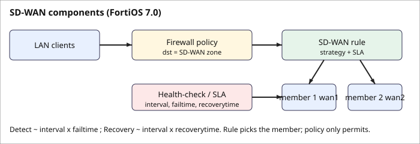

*شکل: اجزای SD-WAN و ارتباط Rule، Policy و Health-check.*

### ۵) مثال حل‌شده

**هدف:** VoIP روی لینک با Latency < 80 ms و Jitter < 20 ms؛ سایر ترافیک Load-balance.

``` text
config system sdwan
    set status enable
    config zone
        edit "virtual-wan-link"
        next
    end
    config members
        edit 1
            set interface "wan1"
            set gateway 198.51.100.1
        next
        edit 2
            set interface "wan2"
            set gateway 203.0.113.1
        next
    end
    config health-check
        edit "HC-DNS"
            set server "8.8.8.8"
            set protocol ping
            set interval 1000
            set failtime 5
            set recoverytime 10
            set members 1 2
            config sla
                edit 1
                    set latency-threshold 80
                    set jitter-threshold 20
                    set packetloss-threshold 2
                next
            end
        next
    end
    config service
        edit 1
            set name "VOIP"
            set mode sla
            set dst "all"
            set internet-service-app-ctrl 0
            config sla
                edit "HC-DNS"
                    set id 1
                next
            end
            set priority-members 1 2
        next
    end
end
```

(`internet-service-app-ctrl` در مثال بالا نمونه‌ی ساختاری است و باید با Application/Internet Service واقعی جایگزین یا حذف شود؛ سینتکس کامل `Unverified`.)

**GUI:** Network → SD-WAN → SD-WAN Zones/Members؛ Network → SD-WAN → Performance SLAs (Health-check)؛ SD-WAN Rules؛ Policy & Objects → Firewall Policy با Outgoing Interface = Zone. Static Route: مقصد 0.0.0.0/0 با Interface = SD-WAN Zone.

**مثال متوسط:** WAN1 Latency 150 ms شد: Health-check SLA را نقض می‌کند و Rule ترافیک VoIP را به WAN2 می‌برد، بقیه Load-balance؛ Log SLA: Latency.

**مثال سخت (Flap):** لینک ناپایدار هر ۳۰ ثانیه از SLA می‌افتد/برمی‌گردد. با failtime 2 و recoverytime 3 مسیر ۲۰ بار در دقیقه عوض می‌شود. راه‌حل: افزایش recoverytime (مثلاً 30)، افزودن Hysteresis در آستانه‌ی SLA (اجازه‌ی نوسان)، یا Manual برای VoIP.

### ۶) طراحی و تصمیم‌گیری

| سؤال | تصمیم |
|---|---|
| Server Health-check | مستقل از ISP، چند Server (قابل‌اتکا) |
| failtime | ≥ 2 (طبق مستند)؛ بالاتر برای لینک نویزی |
| recoverytime | بیشتر از failtime برای جلوگیری از Failback زودهنگام |
| استراتژی | SLA برای Real-time؛ load-balance برای حجم |
| Policy | روی Zone |
| Session | تصمیم درباره‌ی Clear هنگام Failover |

### ۷) Verification

``` text
diagnose sys sdwan health-check
diagnose sys sdwan member
diagnose sys sdwan service
diagnose sys session list
get router info routing-table all
```

(نام زیردستورها `Unverified`.) GUI: Network → SD-WAN → Performance SLAs (نمودار Latency/Jitter/Loss).

### ۸) Troubleshooting

| علامت | شاهد | علت |
|---|---|---|
| Member همیشه Dead | health-check | Server غیرقابل‌دسترس/Policy/Route Probe |
| Rule اثر ندارد | `diagnose sys sdwan service` | Match/Priority؛ Rule بعد از Default |
| Failover انجام شد ولی Session قفل | `session list` | Session قدیمی |
| Flap | Log SLA | failtime/recoverytime/آستانه |
| ترافیک از Interface فیزیکی می‌رود | Policy روی Interface | Policy روی Zone نیست |

### ۹) نکات امنیتی

- Health-check به سرور خارجی = ترافیک Local-out؛ Policy/Source را کنترل کنید.
- مسیر پشتیبان هم باید از Policy و Profile عبور کند.
- Failover می‌تواند ترافیک را از Inspection عبور ندهد اگر Policyها یکسان نباشند.

### ۱۰) جمع‌بندی مفهومی

- SD-WAN = Zone + Member + Health-check + Rule.
- Detect ≈ interval × failtime؛ Failback با recoverytime.
- Rule مسیر را انتخاب می‌کند؛ Policy اجازه می‌دهد؛ هر دو لازم‌اند.
- Sessionهای موجود با Failover تغییر مسیر نمی‌دهند.
- سینتکس 7.0 را با نسخه‌های جدید (۷.۴+) مخلوط نکنید.

### ۱۱) تمرین و ارزیابی

**ت1.** (ساده) Health-check برای چیست؟ *(پاسخ: 21-7-ت1)*

**ت2.** (ساده) Policy را روی کدام Interface می‌نویسیم؟ *(پاسخ: 21-7-ت2)*

**ت3.** (متوسط) Detect و Recovery با interval 500 ms، failtime 4، recoverytime 20 چقدر است؟ *(پاسخ: 21-7-ت3)*

**ت4.** (متوسط) فرق Lowest Cost (SLA) و Maximize Bandwidth؟ *(پاسخ: 21-7-ت4)*

**ت5.** (سخت) Flap لینک ناپایدار را با تنظیمات Health-check کاهش دهید. *(پاسخ: 21-7-ت5)*

**ت6.** (سخت، طراحی) برای VoIP، ERP و Backup استراتژی و SLA جداگانه طراحی کنید. *(پاسخ: 21-7-ت6)*

**م1.** چرا Server Health-check باید مستقل از ISP باشد؟ *(پاسخ: 21-7-م1)*

**Q1.** Quick quiz (English): What does recoverytime control? *(پاسخ: 21-7-Q1)*

### ۱۲) اصطلاحات و English Corner

| مخفف | شکل کامل | معنی |
|---|---|---|
| SD-WAN | Software-Defined WAN | WAN نرم‌افزاری |
| SLA | Service Level Agreement | آستانه‌ی کیفیت |
| Failback | Failback | بازگشت به مسیر اصلی |
| Jitter | Jitter | نوسان تأخیر |
| Overlay/Underlay | Overlay / Underlay | شبکه‌ی روی ISP / خود ISP |

- *Health checks decide when a member is alive and meeting its SLA.* ← Health-check تعیین می‌کند Member زنده است و SLA را رعایت می‌کند.
- *Write firewall policies on the SD-WAN zone, not on member interfaces.* ← Policy را روی Zone بنویسید نه Interface اعضا.

### ۱۳) منابع

- Fortinet Docs: [SD-WAN](https://docs.fortinet.com/document/fortigate/7.0.1/administration-guide/19246/sd-wan)، [Link health monitor](https://docs.fortinet.com/document/fortigate/7.0.1/administration-guide/580649/link-health-monitor)، [Maximize bandwidth (SLA) strategy](https://docs.fortinet.com/document/fortigate/7.0.1/administration-guide/708464/maximize-bandwidth-sla-strategy)، [config system sdwan](https://docs.fortinet.com/document/fortigate/7.0.1/cli-reference/94620/config-system-sdwan).

### بخش تکمیلی درس: سناریوی واقعی، مثال‌های بیشتر و عیب‌یابی

> بخش‌های زیر درس بالا را کامل می‌کنند: سناریوی گام‌به‌گام، مثال‌های بیشتر از ساده تا سخت، جدول عیب‌یابی و پرسش‌های مصاحبه. ابتدا بخش‌های اصلی بالا را مطالعه کنید.

### تعمیق: خواندن Health-check

``` text
diagnose sys sdwan health-check
 Seq(1 port1): state(alive), packet-loss(0.000%) latency(12.3) jitter(0.8)
 Seq(2 port2): state(dead)
diagnose sys sdwan service
```

`state(dead)` پس از failtime شکست متوالی. Failback پس از recoverytime موفقیت. اگر هر دو alive ولی SLA بد: Rule به SLA متوسل می‌شود.

**پرسش‌های مصاحبه**
1. *مقدار پیش‌فرض failtime؟* ۵.
2. *Probe پروتکل؟* ping/http/tcp-echo/dns.
3. *Weight/Cost؟* برای lowest-cost.

### تکمیل عمیق: SD-WAN از درون — Health-check، SLA و Failback

#### چرا؟

بدون فهمیدن اینکه Health-check چطور کار می‌کند، نمی‌توانید رفتار عجیب (مثلاً تغییر مسیر بی‌دلیل) را توضیح دهید.

#### خواندن خروجی

``` text
diagnose sys sdwan health-check
Health Check(HC1):
Seq(1 port1): state(alive), packet-loss(0.000%) latency(12.31) jitter(0.82) sla_map=0x1
Seq(2 port2): state(dead)
```

تفسیر: Member 1 زنده با کیفیت خوب و `sla_map=0x1` (SLA 1 را رعایت می‌کند)؛ Member 2 مرده.

#### پارامترها

| پارامتر | معنی |
|---|---|
| interval | فاصله‌ی پروب (ms) |
| failtime | تعداد شکست متوالی برای dead |
| recoverytime | تعداد موفقیت متوالی برای alive |
| probe-timeout | مهلت پاسخ |

مقادیر پیش‌فرض را از مستند نسخه بخوانید.

#### مثال ساده — زمان‌ها

``` text
Down detection = interval x failtime ; Up detection = interval x recoverytime
500 ms x 5 = 2.5 s ; 500 ms x 5 = 2.5 s
```

> **حدود اعتبار (v4.0):** این رابطه یک **تقریب آموزشی و حد پایین نظری** است، نه تضمین زمانی. زمان واقعی به نحوه‌ی اجرای Probe (Interval، Timeout، همزمانی)، گم‌شدن تصادفی بسته‌ها، تنظیم failtime/recoverytime، زمان به‌روزرسانی Route/FIB، بازسازی Session/NAT، پروتکل مسیریابی و BFD، و رفتار برنامه‌ی کاربر بستگی دارد. برای عدد قابل‌اتکا باید در محیط هدف **اندازه‌گیری** شود (در این دوره اندازه‌گیری انجام نشده است).


#### مثال متوسط — Probe پروتکل

ping، http، tcp-echo، dns؛ برای وب از http مفیدتر است چون ping ممکن است مسدود/Rate-limit شود.

#### مثال سخت — اشتباه رایج

یک سرور واحد برای Health-check (مثلاً 8.8.8.8) اگر مقصد مشکل پیدا کند، هر دو لینک را «dead» می‌کند. راه: دو سرور متفاوت و `update-static-route`/`members` هوشمند.

#### Lab

Health-check را با دو پروب مختلف مقایسه کنید.

#### عیب‌یابی

| علامت (مشاهده) | علت محتمل (باید اثبات شود) | اقدام پس از اثبات |
|---|---|---|
| هر دو dead | یک سرور | دو سرور |
| ping مسدود | Rate limit | http |
| flap | آستانه | تنظیم |

#### پرسش‌ها با پاسخ

**۱. sla_map؟** وضعیت SLAها.
**۲. چرا دو سرور؟** SPOF Health-check.
**۳. failtime؟** شمارش شکست.

#### English Corner

- *Use more than one probe target so a remote outage does not mark all links dead.*
- Q: What do interval and failtime determine together?

## پاسخ‌های فصل 21

> ابتدا بدون نگاه حل کنید. شناسه: درس-نوع+شماره (ت = تمرین، م = مرور).


### پاسخ‌های بازنویسی عمیق درس 21-1

**21-1-ت1** — Route ترجیحی.

Static با Priority/Distance بهتر Route ترجیحی است.

**21-1-ت2** — با Probe کشف قطع ISP و حذف Route.

Probe (Link-monitor/Health-check) قطع ISP را کشف و Route را حذف می‌کند.

**21-1-ت3** — تا خرابی Server با خرابی لینک اشتباه نشود.

چند Server پایش شود تا خرابی یک Server با خرابی لینک اشتباه نشود.

**21-1-ت4** — ≈ 5 ثانیه (به‌علاوه‌ی Convergence).

زمان تشخیص تقریباً failtime × interval ≈ ۵ ثانیه به‌علاوه‌ی Convergence.

**21-1-ت5** — خیر؛ SLA/Loss Threshold در SD-WAN.

خیر؛ در SD-WAN SLA/Loss Threshold برای کیفیت وجود دارد.

**21-1-ت6** — SLA، چند لینک، Overlay، گزارش کیفیت.

طرح: SLA، چند لینک، Overlay و گزارش کیفیت.

**21-1-Q1** — A degraded link with high loss or latency that still answers probes.

### پاسخ‌های بازنویسی درس 21-2

**21-2-ت1** — چون Interface عضو SD-WAN نباید مستقیم در Policy/Route/Object مرجع داشته باشد.

**21-2-ت2** — روی Zone SD-WAN.

Policy روی Zone SD-WAN نوشته می‌شود، نه Interface فیزیکی.

**21-2-ت3** — Server/Protocol Probe، ICMP توسط ISP بلاک؛ Route/Source Probe؛ شاهد Sniffer؛ رفع: dns/http Probe.

**21-2-ت4** — Backup، فهرست مرجع‌ها، ساخت Zone/Member، انتقال Policy/Route به Zone در Change Window، آزمون و Rollback.

**21-2-Q1** — On the SD-WAN zone interface.


### پاسخ‌های بازنویسی درس 21-3

**21-3-ت1** — بالا به پایین؛ اولین Rule مطابق.

SD-WAN Rule از بالا به پایین و اولین Rule مطابق اعمال می‌شود.

**21-3-ت2** — sla: اولین عضو دارای SLA؛ load-balance: توزیع بین همه‌ی اعضای دارای SLA.

Mode sla اولین عضو دارای SLA؛ load-balance توزیع بین همه‌ی اعضای دارای SLA. نام‌گذاری مستند Fortinet: Best Quality (حالت priority)، Lowest Cost (حالت sla) و Maximize Bandwidth (load-balance)؛ از 7.4.1 Load-balance داخل Lowest Cost (SLA) ادغام شده است.

**21-3-ت3** — Rule عمومی بالاتر Match می‌شود؛ ترتیب را اصلاح کنید.

Rule عمومی بالاتر Match می‌شود؛ ترتیب را اصلاح کنید.

**21-3-ت4** — VoIP: sla با Latency<80/Jitter<20؛ ERP: sla با ترجیح لینک پایدار؛ Backup: load-balance.

**21-3-Q1** — Traffic is handled by the implicit rule, which load-balances across members.


### پاسخ‌های بازنویسی عمیق درس 21-4

**21-4-ت1** — Session با SNAT/Interface قدیمی ادامه نمی‌یابد.

با Failover، Session با SNAT/Interface قدیمی ادامه نمی‌یابد؛ باید Session پاک یا Pickup شود.

**21-4-ت2** — `filter dev/src/dst` سپس `clear`.

`diagnose sys session filter dev/src/dst` سپس `clear` برای پاک‌سازی انتخابی.

**21-4-ت3** — تا بازگشت زودهنگام به لینک ناپایدار رخ ندهد.

recoverytime/Hold برای جلوگیری از بازگشت زودهنگام به لینک ناپایدار.

**21-4-ت4** — Rule روی ISP ثابت، IP Pool/BGP، هماهنگی Partner.

Rule روی ISP ثابت، IP Pool/BGP و هماهنگی Partner برای IP مبدأ.

**21-4-ت5** — قطع/Session/بازگشت/Partner با اندازه‌گیری.

Evidence Failover: قطع، Session، بازگشت و Partner با اندازه‌گیری.

**21-4-ت6** — Dual-ISP SD-WAN HA با Rule/SLA و Clear.

طرح Dual-ISP SD-WAN HA با Rule/SLA و Clear.

**21-4-Q1** — The outgoing source IP changes to the other ISP address.


### پاسخ‌های بازنویسی عمیق درس 21-5


### پاسخ‌های بازنویسی عمیق درس 21-5

**21-5-ت1** — Gateway ممکن است زنده باشد ولی ISP قطع؛ باید مقصد خارجی را پایش کرد.

**21-5-ت2** — تعداد شکست پشت‌سرهم برای Dead و تعداد موفقیت برای بازگشت (Alive).

**21-5-ت3** — حدود ۵ ثانیه (۵ × ۱ ثانیه) به‌علاوه‌ی چند صد میلی‌ثانیه.

**21-5-ت4** — Rule و انتخاب Member فقط برای ترافیک وارد Zone SD-WAN اعمال می‌شود.

**21-5-ت5** — recoverytime کوتاه؛ افزایش و Health-check دو-Server؛ آزمون ۳ قطع/وصل.

**21-5-ت6** — Mode SLA با Latency و Health-check؛ Default priority؛ آزمون اندازه‌گیری Latency.

**21-5-Q1** — Because SD-WAN rules only apply to traffic that goes to the SD-WAN zone.

### پاسخ‌های درس افزوده‌ی 21-7 (فصل 21)

**21-7-ت1** — سنجش کیفیت لینک (Latency/Jitter/Loss) و تشخیص Dead.

Performance SLA سنجش کیفیت لینک (Latency/Jitter/Loss) و تشخیص Dead است.

**21-7-ت2** — روی Zone SD-WAN.

Rule SD-WAN روی ترافیک Zone SD-WAN اعمال می‌شود.

**21-7-ت3** — Detect = 500 ms × 4 = 2 s؛ Recovery = 500 ms × 20 = 10 s.

Detect = 500 ms × 4 = 2 s؛ Recovery = 500 ms × 20 = 10 s.

``` text
Detect = 500 ms x 4 = 2 s ; Recovery = 500 ms x 20 = 10 s
```

> **حدود اعتبار (v4.0):** این رابطه یک **تقریب آموزشی و حد پایین نظری** است، نه تضمین زمانی. زمان واقعی به نحوه‌ی اجرای Probe (Interval، Timeout، همزمانی)، گم‌شدن تصادفی بسته‌ها، تنظیم failtime/recoverytime، زمان به‌روزرسانی Route/FIB، بازسازی Session/NAT، پروتکل مسیریابی و BFD، و رفتار برنامه‌ی کاربر بستگی دارد. برای عدد قابل‌اتکا باید در محیط هدف **اندازه‌گیری** شود (در این دوره اندازه‌گیری انجام نشده است).


**21-7-ت4** — Lowest Cost (SLA): اولین عضو دارای SLA؛ Maximize Bandwidth: توزیع بین همه‌ی اعضای دارای SLA.

**21-7-ت5** — افزایش recoverytime، افزودن Hysteresis در آستانه‌ها، failtime متناسب، Probe چندگانه، Manual برای ترافیک حساس.

**21-7-ت6** — VoIP: SLA با Latency/Jitter کم؛ ERP: Best Quality؛ Backup: Lowest Cost یا Load-balance با SLA آسان.

**21-7-م1** — تا خرابی ISP با خرابی خود Probe اشتباه گرفته نشود؛ مستقل بودن نتیجه‌ی قابل‌اتکا می‌دهد.

**21-7-Q1** — The number of consecutive successful probes required before a link is considered alive again (failback behavior).

# پایان بخش ۷ (فصل‌های ۱۹ تا ۲۱)

## ۱) خلاصه‌ی مهارت‌های کسب‌شده
- Hub-and-Spoke با OSPF/BGP؛ SSL VPN/Dial-up؛ Dual-ISP، SD-WAN Rule/SLA.

## ۲) آزمون پایان سه فصل
**س1** — چرا Selector 0.0.0.0/0 برای پویا؟

**س2** — network-type OSPF روی Tunnel؟

**س3** — iBGP یا eBGP؟

**س4** — Local Breakout؟

**س5** — ADVPN وضعیت؟

**س6** — چرا SSL VPN ایزوله؟

**س7** — Split Tunnel؟

**س8** — MFA چرا؟

**س9** — Link Monitor؟

**س10** — SD-WAN Zone؟

**س11** — SLA Strategy؟

**س12** — Session پس از Failover؟


## ۳) پاسخ آزمون
- **س1:** تا Routing از Tunnel عبور کند.
- **س2:** point-to-point.
- **س3:** iBGP همان AS؛ eBGP AS متفاوت.
- **س4:** خروج محلی به اینترنت.
- **س5:** Unverified.
- **س6:** CVEهای 7.0.x.
- **س7:** فقط ترافیک سازمانی.
- **س8:** لایه‌ی دوم.
- **س9:** تشخیص قطع ISP.
- **س10:** گروه منطقی Memberها.
- **س11:** انتخاب بر اساس کیفیت.
- **س12:** می‌ماند مگر Clear.

## ۴) معیارهای تسلط
| مهارت | سطح | شاهد |
|---|---|---|
| Hub-and-Spoke | L3 | آزمون فصل ۱۹ |
| Remote Access | L2 | آزمون فصل ۲۰ |
| SD-WAN | L3 | G8 |

## ۵) مشکلات و موارد باقی‌مانده (صریح)
1. Labها اجرا نشده. 2. SD-WAN/ADVPN/sslvpn سینتکس Unverified. 3. SSL VPN فقط ایزوله.

## ۶) پیش‌نیازهای بخش بعد
Dual-ISP پایدار؛ آشنایی با HA؛ لایسنس HA بررسی.

## ۷) فهرست Lab و منابع مرتبط
کارت‌های Lab، `03-ops/*`

## ۸) وضعیت دوره
| مورد | مقدار |
|---|---|
| آخرین فصل تکمیل‌شده | ۲۱ |
| آخرین درس تکمیل‌شده | ۲۱-۶ |
| مهارت‌های تأییدشده | **هیچ‌کدام هنوز آزمون عملی واقعی نشده‌اند** (ممیزی/اجرای شما لازم است) |
| موضوعات نیازمند مرور | طبق «معیارهای تسلط» |
| فصل بعدی | ۲۲ |
| فایل تولیدشده | `course/Course_Part_07_Chapters_19-21.md` |

---

# Enterprise Network & Security Engineering — دوره‌ی تخصصی Cisco و Enterprise Firewall
## بخش ۸ از ۱۱ — فصل‌های ۲۲ تا ۲۴

| مورد | مقدار |
|---|---|
| نام دوره | Enterprise Network & Security Engineering (Cisco + FortiGate) |
| شماره بخش | ۸ از ۱۱ |
| فصل‌های این فایل | ۲۲ ، ۲۳ ، ۲۴ |
| تاریخ تولید | ۲۰۲۶-۱۱-۲۶ |
| نسخه Blueprint | v3.0 (+ بازبینی ۱٫۱) |
| نسخه‌های نرم‌افزار | FortiOS 7.0.3 (اسمی؛ بوت‌نشده؛ تأیید با `get system status`) ؛ Cisco vIOS-L2 15.2(20200924، Experimental) ؛ Cisco vIOS 15.9(3)M9 ؛ VPCS ؛ PNetLab 4.2.8 ؛ ESXi 8.0U2 ؛ CSR1000v 17.03.02 (IOS-XE؛ آزمایش‌نشده) |
| وضعیت تکمیل | **فصل‌های ۲۲–۲۴ تولید شد؛ HA، Multi-Firewall/Asymmetric، Data Center.** Labها «اجرا نشده»؛ HA/VDOM به لایسنس وابسته؛ دستورها آزمایش‌نشده. |

> **قوانین خواندن:** تمرین‌ها و پرسش‌های مرور بدون پاسخ‌اند؛ پاسخ در «پاسخ‌های فصل». «اجرا نشده» یعنی خروجی‌ها **پیش‌نیاز/پیش‌بینی** هستند. «CLI-Accepted» ≠ «کار می‌کند». رمزها نمونه‌اند.

### وضعیت راستی‌آزمایی Labهای این بخش
خلاصه: اجرا نشده (فقط طراحی): 13.

| Lab | وضعیت |
|---|---|
| 22-1 | اجرا نشده (فقط طراحی) |
| 22-2 | اجرا نشده (فقط طراحی) |
| 22-3 | اجرا نشده (فقط طراحی) |
| 22-4 | اجرا نشده (فقط طراحی) |
| 22-5 | اجرا نشده (فقط طراحی) |
| 23-1 | اجرا نشده (فقط طراحی) |
| 23-2 | اجرا نشده (فقط طراحی) |
| 23-3 | اجرا نشده (فقط طراحی) |
| 23-4 | اجرا نشده (فقط طراحی) |
| 24-1 | اجرا نشده (فقط طراحی) |
| 24-2 | اجرا نشده (فقط طراحی) |
| 24-3 | اجرا نشده (فقط طراحی) |
| 24-4 | اجرا نشده (فقط طراحی) |

---

<a id="ch22"></a>

> **نسخه‌ی اصلاح‌شده (v3.9):** نسخه‌ی توسعه‌یافته‌ی فایل اصلی؛ درس‌های افزوده: ۲۲-۰، ۲۴-۰ (دسته C). فایل اصلی در `course/` حفظ شده است. پاسخ‌های درس‌های افزوده در «پاسخ‌های فصل» همان فصل است.

# فصل 22 — High Availability: FGCP، Session Sync و Failover

> **یادداشت علمی v4.0 — فصل 22:** عمومی: SPOF، RTO/RPO. مختص محصول: FGCP. زمان‌ها و Election نیازمند تطبیق با مستند نسخه.
> فرض: A-P، Heartbeat جدا؛ Failover زمانی تضمین نیست.
> مرجع: Fortinet FGCP docs (در این بازنگری بازخوانی نشد).
> **وضعیت منبع v4.1:** صفحه‌های FGCP و FGSP در Administration Guide 7.0.0 یافت شد ولی بدنه‌ی آن‌ها قابل‌خواندن نبود؛ ترتیب Election، `ha-uptime-diff-margin`، Timerهای Heartbeat، دامنه‌ی `session-pickup` و سینتکس FGSP تأیید نشدند → از حافظه و `Unverified`.


**مدت:** ۳۶ ساعت | **پیش‌نیاز:** فصل ۱۳، ۲۱.
**اهداف:** مفهوم HA (Active-Passive، Active-Active)؛ FGCP؛ Heartbeat؛ Priority و Override؛ Session Sync؛ Monitor Interface؛ تست Failover.
**هشدار لایسنس:** HA در VM به لایسنس مناسب نیاز دارد (`Needs-License`) و در Evaluation ممکن است محدود باشد؛ همه‌ی دستورها `Unverified`.
**اشتباهات رایج:** Heartbeat روی همان لینک داده؛ Priority/Override نادرست؛ ناهمسانی Firmware؛ نبود Monitor Interface.

**درس‌های فصل:**
- [درس 22-1 — مفاهیم HA و FGCP](#l-22-1)
- [درس 22-2 — پیکربندی HA Active-Passive](#l-22-2)
- [درس 22-3 — تست Failover و Session Sync](#l-22-3)
- [درس 22-4 — عیب‌یابی HA و Upgrade](#l-22-4)
- [درس 22-5 — آزمون فصل ۲۲](#l-22-5)

---

<a id="l-22-1"></a>

## درس 22-0 — HA در FortiGate (FGCP): Election، Heartbeat، Sync، Failover/Failback و Split-brain

**فصل ۲۲ · درس افزوده (پیش‌درس ۲۲-۱) · پیش‌نیاز: ۱۱-۷، ۱۳-۷، ۵-۷ · ≈ ۱۰ ساعت**

> **وضعیت (FortiOS 7.0.3):** مفاهیم FGCP، Split-brain و Session Pickup از مستند رسمی بررسی شد ([FGCP 7.0.3](https://docs.fortinet.com/document/fortigate/7.0.3/administration-guide/62403/fgcp)، [Troubleshoot an HA formation](https://docs.fortinet.com/document/fortigate/7.4.0/administration-guide/946059/troubleshoot-an-ha-formation)، [Session pickup](https://docs.fortinet.com/document/fortigate/7.6.0/administration-guide/955521/session-pickup)). **دقت نسخه:** بعضی ویژگی‌ها مثل `backup-hbdev` در 7.6 معرفی شده و در 7.0.3 نیست. **Needs-License/محدودیت:** HA روی VM به لایسنس مناسب و دو VM با لایسنس معتبر نیاز دارد؛ در Lab Evaluation ممکن است محدود باشد. Lab «اجرا نشده».

### ۱) هدف آموزشی

دانشجو در پایان می‌تواند:

1. تفاوت **Active-Passive** و **Active-Active** را بگوید و بداند چرا Active-Passive رایج‌تر است.
2. توضیح دهد **FGCP** چگونه عضو Primary را انتخاب می‌کند (Election) و چه چیزی هم‌گام می‌شود.
3. **Heartbeat** را درست طراحی کند (اختصاصی، Redundant) و **Split-brain** را تحلیل و پیشگیری کند.
4. **Configuration Sync** و **Session Pickup/Sync** را تفکیک و اثر هرکدام را در Failover بگوید.
5. **Interface Monitoring**، Link Failure و Device Failure را تحلیل کند.
6. **Failover/Failback** و `override` را با پیامدشان بشناسد.
7. محدودیت‌ها و وابستگی‌های نسخه/لایسنس را اعلام کند.

### ۲) پیش‌نیازها

Session/Stateful (۱۱-۷، ۱۳-۷)، Convergence (۵-۷)، Interface/VLAN FortiGate (فصل ۱۲)، ARP/MAC (فصل ۲، ۳).

### ۳) مفهوم پایه

فایروال لبه نقطه‌ی شکست واحد (SPOF) است. **HA** دو (یا بیشتر) دستگاه را در یک **Cluster** قرار می‌دهد تا با خرابی یکی، دیگری ترافیک را ادامه دهد. هدف فقط «یک Cluster ساختن» نیست؛ هدف **پیش‌بینی رفتار سیستم در انواع خرابی** است: خرابی لینک، خرابی دستگاه، قطع Heartbeat، خرابی نیمه‌کاره.

### ۴) توضیح عمیق فنی

#### ۴-۱) FGCP

**FortiGate Clustering Protocol (FGCP)** پروتکل اختصاصی Fortinet برای HA است. اعضا از طریق **Heartbeat** Interfaceها با هم صحبت می‌کنند. طبق مستند، هم‌گام‌سازی روی لینک Heartbeat با TCP/703 و UDP/703 انجام می‌شود. Cluster با **Group Name، Group ID/Password و Mode** هم‌هویت می‌شود.

| Mode | رفتار |
|---|---|
| Active-Passive (a-p) | یک Primary ترافیک می‌برد؛ Secondary آماده است |
| Active-Active (a-a) | Primary بار Inspection (UTM) را بین اعضا پخش می‌کند؛ ترافیک همچنان از Primary ورودی/خروجی می‌شود؛ پیچیده‌تر |

(Active-Active در FGCP «توزیع بار Session/UTM» است، نه ECMP واقعی؛ جزئیات مستند.)

#### ۴-۲) Election (انتخاب Primary)

به‌طور خلاصه (ترتیب دقیق و Age-difference را از مستند همان نسخه بخوانید؛ `Unverified` در جزئیات):

``` text
Default (override disabled):
 1. more monitored interfaces up
 2. longer HA uptime (age)
 3. higher priority
 4. higher serial number
With override enabled: monitored interfaces -> priority -> uptime -> serial
```

نتیجه: با `override disable` عضوی که بیشتر زنده بوده Primary می‌ماند و بعد از بازگشت دستگاه اصلی، **Failback خودکار رخ نمی‌دهد**؛ با `override enable` دستگاه با Priority بالاتر پس از بازگشت Primary می‌شود (Failback) ولی ممکن است باعث قطع کوتاه و Flap شود.

#### ۴-۳) Heartbeat

- Interfaceهای اختصاصی (`hbdev`) با Priority؛ حداقل دو لینک Redundant ترجیحاً مستقیم (Back-to-back).
- ترافیک Heartbeat شامل Hello و Sync (Config، Session). مستند توصیه می‌کند برای کاهش Split-brain: لینک Heartbeat Redundant، مستقیم، و برای سایت‌های دور زمان Lost Interval بیشتر.
- **Heartbeat را روی همان لینک داده/سوئیچ مشترک خراب نگذارید.**

#### ۴-۴) Split-brain

اگر اعضا Heartbeat را از دست بدهند ولی هر دو زنده باشند، **هر دو خود را Primary می‌پندارند**: آدرس IP/MAC تکراری، Sessionهای متناقض، قطعی شدید. طبق مستند علت‌ها: قطع/ناپایداری Heartbeat؛ راه‌های پیشگیری: لینک Back-to-back، Heartbeat Redundant، Lost Interval مناسب. (`backup-hbdev` در 7.6 اضافه شده و در 7.0.3 موجود نیست.) پس از رفع، یک عضو باید دوباره Join شود و Config Sync انجام شود؛ بررسی Config واگرا لازم است.

#### ۴-۵) Sync: Configuration و Session

- **Configuration Sync:** Primary پیکربندی را به Secondary می‌فرستد (به‌جز تنظیمات اختصاصی هر دستگاه مثل Hostname/HA priority). بررسی: `diagnose sys ha checksum cluster`.
- **Session Sync/Pickup:** طبق مستند Session Pickup جدول Session **TCP** را به Secondary هم‌گام می‌کند؛ UDP و ICMP تنظیم جداگانه‌ای دارند و پیش‌نیازشان فعال بودن Pickup TCP است. بدون Pickup، با Failover همه‌ی Sessionها قطع می‌شوند و کلاینت‌ها باید Session بسازند. با Pickup اغلب Sessionهای TCP ادامه می‌یابند. هزینه: پهنای Heartbeat و CPU.
- VPN/IPsec SA و بعضی State‌ها همگام نمی‌شوند یا بسته به نسخه متفاوت‌اند؛ پس از Failover IPsec ممکن است Rekey/Renegotiate کند (`Unverified`).

#### ۴-۶) Monitoring و انواع خرابی

| خرابی | تشخیص | رفتار |
|---|---|---|
| Link failure (Interface مانیتورشده) | Monitor Interface | تعداد Interface سالم کم می‌شود ← Failover |
| Device failure | قطع Heartbeat | Secondary Primary می‌شود |
| Heartbeat failure با دو دستگاه زنده | Split-brain | خطرناک |
| خرابی نرم‌افزار/CPU | Heartbeat/Process | Failover یا Cluster ناپایدار |
| خرابی ISP | Interface Up ولی لینک مرده | HA این را نمی‌بیند؛ نیاز Health-check/SD-WAN (۲۱-۷) |

> **درس مهم:** HA خرابی «فایروال» را پوشش می‌دهد، نه خرابی «سرویس ISP». این‌ها را با SD-WAN/Link Monitor مکمل کنید.

#### ۴-۷) Failover time

Failover معمولاً چند ثانیه (Detect + Election + ARP/MAC Update): بعد از Failover Primary جدید **Gratuitous ARP** می‌فرستد و MAC مجازی Cluster به Primary جدید منتقل می‌شود تا سوئیچ‌ها یاد بگیرند. نتیجه: چند ثانیه قطعی؛ Sessionها فقط با Pickup می‌مانند.


*شکل: HA، Heartbeat، Election و Split-brain.*

### ۵) مثال حل‌شده

**هدف:** Active-Passive با Heartbeat روی port3 و port4، Monitor روی port1 و port2.

``` text
config system ha
    set group-name "FGT-HA-LAB"
    set mode a-p
    set password <HA-PASSWORD>
    set hbdev "port3" 100 "port4" 50
    set monitor "port1" "port2"
    set priority 200
    set session-pickup enable
    set override disable
end
```

دستگاه دوم: همان `group-name/password/mode/hbdev`، `priority 100`.

**GUI:** System → HA → Mode: Active-Passive؛ Device Priority؛ Cluster Settings (Group Name، Password)؛ Heartbeat Interfaces (انتخاب و Priority)؛ Monitor Interfaces؛ Session Pickup.

**Verification:**

``` text
get system ha status
diagnose sys ha status
diagnose sys ha checksum cluster
diagnose sys ha history read
```

(`Unverified`.)

**مثال متوسط:** Failover آزمایشی: `execute ha manage` یا Shutdown Interface مانیتورشده؛ ping پیوسته از کلاینت؛ ثبت تعداد بسته‌های از دست‌رفته و زمان.

**مثال سخت (Split-brain):** کابل Heartbeat کشیده می‌شود و لینک داده‌ها سالم‌اند: دو Primary. شواهد: `get system ha status` در هر دستگاه خود را Primary نشان می‌دهد؛ ARP جدول سوئیچ دو MAC برای یک IP. راه‌حل فوری: اتصال دوباره‌ی Heartbeat و تعیین کدام عضو Primary بماند (ریست دیگری)، سپس بررسی Config Checksum. پیشگیری: Heartbeat Redundant و Back-to-back.

### ۶) طراحی و تصمیم‌گیری

| سؤال | تصمیم |
|---|---|
| a-p یا a-a؟ | a-p (سادگی)؛ a-a برای بار UTM زیاد |
| Heartbeat | ۲ لینک مجزا، مستقیم |
| `override` | خاموش (پایداری)؛ روشن فقط اگر Failback مطلوب و Flap کنترل شود |
| Session Pickup | روشن برای سرویس‌های حساس به قطع؛ هزینه‌اش را بسنجید |
| Monitor Interface | همه‌ی Interfaceهای حیاتی؛ نه Interface مدیریت |
| Firmware | یکسان؛ ارتقا طبق روال |
| لایسنس | هر دو دستگاه لایسنس معتبر |

### ۷) Troubleshooting

| علامت | شاهد | علت |
|---|---|---|
| Cluster Form نمی‌شود | Group/Password/Mode، لینک HB | ناهمسانی |
| Secondary Out-of-sync | `ha checksum cluster` | Config/Firmware |
| Failover بدون دلیل | `ha history` | Monitor/HB flap |
| دو Primary | `ha status` | Split-brain |
| Session قطع می‌شود | Pickup خاموش | فعال‌سازی/محدودیت UDP |
| بعد از Failover VPN قطع | IKE Log | Renegotiate |

### ۸) نکات امنیتی

- HA Password قوی؛ لینک HB را از شبکه‌ی کاربران جدا نگه دارید.
- Heartbeat روی سوئیچ مشترک قابل جعل/اختلال است؛ ترجیحاً مستقیم.
- نسخه‌ی 7.0.3 دارای CVE؛ HA آسیب‌پذیری را حل نمی‌کند.

### ۹) جمع‌بندی مفهومی

- FGCP: Heartbeat + Sync (Config، Session) + Election.
- Election: Monitor ← Age ← Priority ← Serial (با Override: Priority جلوتر).
- Split-brain از قطع HB با دستگاه‌های زنده؛ با HB Redundant/مستقیم پیشگیری می‌شود.
- Session Pickup TCP را حفظ می‌کند؛ UDP/ICMP جدا.
- HA ≠ حفاظت از خرابی ISP.

### ۱۰) تمرین و ارزیابی

**ت1.** (ساده) Active-Passive و Active-Active را مقایسه کنید. *(پاسخ: 22-0-ت1)*

**ت2.** (ساده) Split-brain یعنی چه؟ *(پاسخ: 22-0-ت2)*

**ت3.** (متوسط) با `override disable` پس از بازگشت Primary اصلی چه می‌شود؟ *(پاسخ: 22-0-ت3)*

**ت4.** (متوسط) چرا Heartbeat Redundant لازم است؟ *(پاسخ: 22-0-ت4)*

**ت5.** (سخت) پس از Failover کاربران باید Session TCP را دوباره بسازند؛ علت و راه‌حل؟ *(پاسخ: 22-0-ت5)*

**ت6.** (سخت، طراحی) برای سایت مرکزی با دو ISP و دو FGT، HA و SD-WAN را کنار هم طراحی و نقش هرکدام را بنویسید. *(پاسخ: 22-0-ت6)*

**م1.** `diagnose sys ha checksum cluster` برای چیست؟ *(پاسخ: 22-0-م1)*

**Q1.** Quick quiz (English): What causes a split-brain scenario in an HA cluster? *(پاسخ: 22-0-Q1)*

### ۱۱) اصطلاحات و English Corner

| مخفف | شکل کامل | معنی |
|---|---|---|
| HA | High Availability | دسترس‌پذیری بالا |
| FGCP | FortiGate Clustering Protocol | پروتکل Cluster |
| HB | Heartbeat | نبض Cluster |
| SPOF | Single Point of Failure | نقطه‌ی شکست واحد |
| GARP | Gratuitous ARP | ARP اعلام‌کننده |
| Pickup | Session pickup | حفظ Session |

- *Split-brain happens when cluster members lose heartbeat and each assumes the primary role.* ← Split-brain وقتی رخ می‌دهد که اعضا Heartbeat را از دست بدهند و هر دو نقش Primary را فرض کنند.
- *HA protects against device failure, not against upstream ISP failure.* ← HA از خرابی دستگاه محافظت می‌کند، نه از خرابی ISP بالادست.

### ۱۲) منابع

- Fortinet Docs: [FGCP](https://docs.fortinet.com/document/fortigate/7.0.3/administration-guide/62403/fgcp)، [Troubleshoot an HA formation](https://docs.fortinet.com/document/fortigate/7.4.0/administration-guide/946059/troubleshoot-an-ha-formation)، [Session pickup (7.6)](https://docs.fortinet.com/document/fortigate/7.6.0/administration-guide/955521/session-pickup) (برای مفهوم؛ تفاوت نسخه را بررسی کنید).

### بخش تکمیلی درس: سناریوی واقعی، مثال‌های بیشتر و عیب‌یابی

> بخش‌های زیر درس بالا را کامل می‌کنند: سناریوی گام‌به‌گام، مثال‌های بیشتر از ساده تا سخت، جدول عیب‌یابی و پرسش‌های مصاحبه. ابتدا بخش‌های اصلی بالا را مطالعه کنید.

### تعمیق: Election و Failover با سناریو

دو FG: A priority 200، B priority 100، override غیرفعال. A ریبوت و برمی‌گردد ⇒ چون override خاموش، ترتیب Monitored Interface > Age > Priority؛ B (قدیمی‌تر) Primary می‌ماند؛ برای بازگشت A: `override enable` یا تغییر Age (محاسبه‌ی مستند).

``` text
get system ha status
diagnose sys ha history read
```

Heartbeat روی دو لینک (Redundant) و VLAN/Interface جدا. **پرسش‌های مصاحبه**
1. *Split-brain؟* دو Primary.
2. *Monitor Port؟* قطع ⇒ Failover.
3. *Session Pickup؟* حفظ TCP در Failover (Needs-License ندارد، قابلیت پایه).

### تکمیل عمیق: FGCP — چطور دو فایروال یکی می‌شوند؟

#### چرا باید یاد بگیریم؟

یک فایروال تکی یعنی یک نقطه‌ی شکست؛ اگر بسوزد، کل سازمان از اینترنت جدا می‌شود. HA (High Availability، یعنی «دسترس‌پذیری بالا») دو دستگاه را طوری به هم وصل می‌کند که اگر یکی بیفتد، دیگری بی‌وقفه کار را ادامه دهد. پروتکل FortiGate برای این کار FGCP (FortiGate Clustering Protocol) است.

#### توضیح ساده

دو دستگاه یک Cluster می‌سازند. یکی **Primary** (ترافیک را پردازش می‌کند) و دیگری **Secondary** (آماده‌باش). بین آنها یک یا چند لینک **Heartbeat** هست که مدام «من زنده‌ام» می‌گویند و Config و Session را همگام می‌کنند.

#### انتخاب Primary (Election)

طبق مستند Fortinet وقتی `override` غیرفعال است ترتیب مقایسه چنین است:

1. تعداد Monitored Interface سالم (بیشتر بهتر)
2. Age (مدت زمان بالا بودن؛ با Margin 300 ثانیه)
3. Priority (بالاتر بهتر؛ پیش‌فرض 128)
4. Serial Number (بزرگ‌تر)

وقتی `override` فعال باشد، Priority پیش از Age بررسی می‌شود.

#### مثال ساده

A با Priority 200 و B با 100. اگر هر دو هم‌زمان بوت شوند و Override خاموش باشد، به دلیل برابری Age (در Margin) Priority تعیین‌کننده است ⇒ A Primary. اگر A بعد از قطع برگردد و B حالا Primary است و override خاموش، B Primary می‌ماند (Age بیشتر).

#### مثال متوسط — Failover با Monitor

Port1 (WAN) در Monitor است. با قطع کابل WAN در Primary، تعداد Monitored سالم کمتر می‌شود ⇒ Secondary (با WAN سالم) Primary می‌شود.

``` text
get system ha status
diagnose sys ha history read
```

#### مثال سخت — Split-brain

اگر همه‌ی لینک‌های Heartbeat قطع شوند، هر دو دستگاه خود را Primary می‌پندارند (Split-brain) و IP/MAC تکراری ایجاد می‌شود. جلوگیری: دو Heartbeat Interface مستقل (کابل مستقیم/دو سوئیچ)، و Monitor.

#### همگام‌سازی

Config از Primary به Secondary کپی می‌شود؛ `Configuration Status: in-sync`. Session Pickup: Sessionهای TCP نیز همگام می‌شوند تا هنگام Failover قطع نشوند (قابلیت پایه؛ مستند نسخه را بخوانید).

#### Lab

دو FortiGate VM (لایسنس معتبر) را در HA قرار دهید؛ این Lab برای ما «اجرا نشده» است و Needs-License.

#### عیب‌یابی

| علامت (مشاهده) | علت محتمل (باید اثبات شود) | اقدام پس از اثبات |
|---|---|---|
| out-of-sync | تغییر محلی | `execute ha synchronize start` |
| Failover بی‌دلیل | Heartbeat ناپایدار | لینک‌ها |
| Split-brain | همه‌ی HB قطع | چندلینک |

#### پرسش‌ها با پاسخ

**۱. ترتیب Election (override خاموش)؟** Monitor، Age، Priority، Serial.
**۲. Heartbeat چرا دو لینک؟** افزونگی.
**۳. Split-brain؟** دو Primary.

#### English Corner

- *The primary is elected by monitored interfaces, age, priority and serial number.*
- Q: What causes a split-brain and how can you prevent it?

## درس 22-1 — مفاهیم HA برای طراحی: SPOF، سطوح افزونگی، انتخاب مدل و تحلیل خرابی‌ها

**فصل 22 · بازنویسی عمیق · پیش‌نیاز: ۲۲-۰، ۱۱-۷، ۵-۷ · ≈ 8 ساعت**

> **وضعیت:** FortiOS 7.0.3 (بوت‌نشده)؛ HA/VDOM Needs-License؛ دستورها `Unverified` مگر با لینک؛ Lab «اجرا نشده».

<!--deep-->

### هدف آموزشی

در پایان این درس باید بتوانید:

1. SPOF (Single Point of Failure) را در یک معماری پیدا کنید.
2. سطوح افزونگی (لینک، دستگاه، سایت) را تفکیک کنید.
3. RTO و RPO و اثر آن‌ها بر انتخاب HA را محاسبه کنید.
4. FGCP Active-Passive و Active-Active را از نظر طراحی مقایسه کنید.
5. جایگزین‌ها (VRRP، Standalone + Backup، Cloud Redundancy) را بشناسید.
6. هزینه‌ی افزونگی در برابر هزینه‌ی قطعی را ارزیابی کنید.

### چرا باید یاد بگیریم؟

اگر فروشگاه شما فقط یک صندوق دارد و آن خراب شود، فروش متوقف می‌شود. دو صندوق (Active-Passive) یعنی دومی منتظر است. ولی اگر هر دو به یک پریز وصل باشند، پریز SPOF است. HA فقط «دو دستگاه» نیست؛ یعنی حذف تمام نقاط تک‌خطایی از مسیر: برق، لینک، سوئیچ، ISP، فایروال. بسیاری از پروژه‌ها دو فایروال می‌خرند ولی هر دو را به یک سوئیچ می‌زنند؛ سوئیچ می‌شود SPOF و HA بی‌فایده.

### SPOF — جست‌وجو

``` text
Users -- [SW] -- [FGT-A] -- [SW] -- ISP1
                 [FGT-B]
```

SPOFهای ممکن: سوئیچ تک، کابل تک، منبع تغذیه‌ی تک، ISP تک، دیسک (لاگ)، لایسنس، آدمی که فقط او رمز را می‌داند.

### سطوح افزونگی

| سطح | روش |
|---|---|
| لینک | LAG/Redundant Interface، دو کابل |
| دستگاه | HA Cluster (FGCP) |
| ISP | Dual-ISP/SD-WAN |
| سایت | DR (سایت دوم)، DNS/GSLB |
| برق | دو منبع، دو مسیر UPS |

### RTO و RPO

- **RTO** (Recovery Time Objective): حداکثر زمان قطع قابل‌قبول.
- **RPO** (Recovery Point Objective): حداکثر داده/وضعیت از دست‌رفته‌ی قابل‌قبول.

برای فایروال: RPO یعنی Sessionها و پیکربندی؛ FGCP پیکربندی را Sync می‌کند و (با session-pickup) Session TCP را.

``` text
Availability = Uptime / (Uptime + Downtime)
99.9%  -> ~8.76 h downtime / year
99.99% -> ~52.6 min / year
```

``` text
Downtime/year (99.9%) = 365 x 24 x 0.001 = 8.76 h
Downtime/year (99.99%) = 365 x 24 x 0.0001 = 0.876 h = 52.6 min
```

### FGCP: Active-Passive در برابر Active-Active

| ویژگی | Active-Passive | Active-Active |
|---|---|---|
| ترافیک | Primary | هر دو (UTM توزیع) |
| سادگی | بالا | کمتر |
| ظرفیت | یک دستگاه | بیشتر (فقط بعضی ترافیک‌ها) |
| عیب‌یابی | ساده | پیچیده |
| پیشنهاد | بله (عمومی) | موارد خاص |

### جایگزین‌ها

| روش | توضیح | محدودیت |
|---|---|---|
| VRRP | Gateway مجازی بین دو FGT مستقل | بدون Sync Config/Session |
| Standalone + Backup + Cold Spare | ارزان | RTO ساعت‌ها |
| Cloud/ VM Redundancy | بسته به پلتفرم | معماری ابری |
| دو سایت (DR) | سایت دوم | RTO/RPO تعریف |

### هزینه در برابر قطعی

``` text
Cost of outage = revenue/hour x hours + SLA penalties + reputation
Cost of HA     = 2nd device + licenses + support + complexity
```

مثال: فروشگاه آنلاین 10M در ساعت؛ قطع ۴ ساعت ⇒ 40M؛ HA سالانه 8M ⇒ توجیه‌پذیر.

### مثال‌های حل‌شده

#### مثال ساده — پیدا کردن SPOF

دو FGT در HA ولی هر دو به یک سوئیچ ⇒ سوئیچ SPOF. راه: دو سوئیچ (Stack یا جدا) با اتصال متقاطع.

#### مثال متوسط — RTO

نیاز: RTO < 10 s برای Sessionها. FGCP Failover معمولاً چند ثانیه؛ با Session Pickup اتصال‌های TCP می‌مانند. قابل‌قبول. ولی اگر برنامه‌ی Voice حساس است، تماس ممکن است Glitch ثانیه‌ای داشته باشد.

#### مثال متوسط — VRRP یا FGCP

شعبه‌ی کوچک با دو FGT مستقل: VRRP ساده ولی Config دوباره باید دستی؛ FGCP Sync خودکار. تصمیم: FGCP (اگر دو دستگاه هم‌مدل).

#### مثال سخت — Availability

نیاز 99.99٪؛ فایروال HA 99.99٪ ولی ISP 99.5٪. کل سیستم محدود به ضعیف‌ترین حلقه: ISP تک ⇒ سایت 99.5٪. راه: دو ISP. محاسبه‌ی ترکیبی:

``` text
Serial availability  = A1 x A2 = 0.9999 x 0.995 = 0.99490
Parallel (2 ISPs)    = 1 - (1-0.995) x (1-0.995) = 0.999975
```

#### مثال سخت — HA و Config نادرست

Cluster سالم ولی Policy ناقص ⇒ HA هم همان ناقص را Sync می‌کند. HA خطاهای پیکربندی را حل نمی‌کند، تکثیر می‌کند.

### Lab هدایت‌شده (اجرا نشده)

1. معماری موجود را رسم و SPOF علامت بزنید.
2. RTO/RPO تعریف و روش انتخاب کنید.
3. هزینه‌ی HA در برابر قطعی را بنویسید.

### عیب‌یابی سریع

| علامت (مشاهده) | علت محتمل (باید اثبات شود) | اقدام پس از اثبات |
|---|---|---|
| HA بی‌فایده | SPOF دیگر | حذف |
| Failover کند | Timer | تنظیم |
| Config خراب Sync | تکثیر | Change Control |
| ISP تک | Availability پایین | Dual-ISP |

### نکات امنیتی

HA لینک Heartbeat را ایزوله و رمزگذاری‌شده نگه دارد؛ دسترسی مدیریتی جدا برای هر عضو؛ آزمون دوره‌ای.

### جمع‌بندی

HA یعنی حذف SPOFها؛ RTO/RPO و Availability با فرمول؛ FGCP Active-Passive پیش‌فرض عملی؛ VRRP و DR جایگزین؛ هزینه‌ی افزونگی را با هزینه‌ی قطعی بسنجید.

### تمرین و ارزیابی

**ت1.** (ساده) SPOF چیست؟ *(پاسخ: 22-1-ت1)*

**ت2.** (ساده) HA ISP را پوشش می‌دهد؟ *(پاسخ: 22-1-ت2)*

**ت3.** (متوسط) دستگاه 99.5٪ و جفت HA موازی؛ دسترس‌پذیری؟ *(پاسخ: 22-1-ت3)*

**ت4.** (متوسط) چرا حلقه‌ی ضعیف سقف را تعیین می‌کند؟ *(پاسخ: 22-1-ت4)*

**ت5.** (سخت) چهار خرابی خارج از HA. *(پاسخ: 22-1-ت5)*

**ت6.** (سخت، طراحی) ماتریس خرابی برای سایت مرکزی. *(پاسخ: 22-1-ت6)*

**Q1.** Quick quiz (English): Why does the weakest component limit overall availability in a serial chain? *(پاسخ: 22-1-Q1)*

### اصطلاحات و English Corner

| مخفف | شکل کامل | معنی |
|---|---|---|
| SPOF | Single point of failure | نقطه‌ی شکست واحد |
| MTBF | Mean time between failures | میانگین فاصله‌ی خرابی |
| DR | Disaster recovery | بازیابی از فاجعه |

- *HA is not a substitute for change control.* ← HA جایگزین کنترل تغییر نیست.

### کارت Lab

**کارت Lab:** نقشه HA. **Evidence:** `02-design/ha-map.md`.

### منابع

- [FGCP](https://docs.fortinet.com/document/fortigate/7.0.3/administration-guide/62403/fgcp)
- NIST SP 800-34

<a id="l-22-2"></a>

## درس 22-2 — پیکربندی HA Active-Passive: برگه‌ی طراحی، GUI، CLI، Heartbeat، Monitor و Verification

**فصل 22 · بازنویسی عمیق · پیش‌نیاز: ۲۲-۰، ۲۲-۱، ۱۲-۲ · ≈ 11 ساعت**

> **وضعیت:** FortiOS 7.0.3 نامی (بوت‌نشده)؛ دستورها طبق مستندات 7.0 ولی `Unverified` تا اجرای Lab؛ Lab «اجرا نشده»؛ HA/VDOM وابسته به مدل/لایسنس (Needs-License).

<!--deep-->

### هدف آموزشی

در پایان این درس باید بتوانید:

1. پیش‌نیازهای HA (هم‌مدل، هم‌نسخه، هم‌لایسنس، پورت‌ها، دیسک) را بررسی کنید.
2. برگه‌ی طراحی (Group، Mode، Priority، hbdev، monitor، session-pickup) را بنویسید.
3. HA را از GUI و CLI روی دو دستگاه پیکربندی کنید.
4. وضعیت Cluster و Sync را با دستورهای Verification تأیید کنید.
5. Management Interface اختصاصی (ha-mgmt) را تنظیم کنید.
6. خطاهای رایج ساخت Cluster را رفع کنید.

### چرا باید یاد بگیریم؟

ساختن Cluster مثل ازدواج دو دستگاه است: باید کاملاً هم‌خوان باشند (مدل، نسخه، لایسنس) و روی «قوانین زندگی مشترک» توافق کنند (Group، Password، Heartbeat). یک اختلاف کوچک (مثلاً نسخه‌ی FortiOS) و Cluster تشکیل نمی‌شود یا Sync نمی‌شود. چون HA روی دستگاه Production اعمال می‌شود، یک اشتباه می‌تواند اینترنت را قطع کند؛ پس برگه‌ی طراحی و ترتیب اجرا حیاتی است.

### پیش‌نیازها

| مورد | چرا |
|---|---|
| هم‌مدل و هم‌سخت‌افزار | Sync و Offload |
| هم‌نسخه و Build | رفتار و Sync |
| لایسنس FortiGuard هر دو | خدمات هر عضو |
| پورت‌های Heartbeat | حداقل ۲ لینک مستقیم |
| Interfaceهای یکسان | Monitor/Failover |
| زمان (NTP) | Log و Certificate |

### برگه‌ی طراحی

| پارامتر | FGT-A | FGT-B |
|---|---|---|
| group-name | FGT-HA | FGT-HA |
| mode | a-p | a-p |
| password | <SECRET> | <SECRET> |
| hbdev | port3 (100)، port4 (50) | port3 (100)، port4 (50) |
| priority | 200 | 100 |
| override | disable | disable |
| monitor | port1، port2 | port1، port2 |
| session-pickup | enable | enable |
| ha-mgmt | port8 | port8 |
| hostname | FGT-A | FGT-B |

### پیکربندی CLI (FGT-A)

``` text
config system ha
    set group-id 10
    set group-name "FGT-HA"
    set mode a-p
    set password <SECRET>
    set hbdev "port3" 100 "port4" 50
    set session-pickup enable
    set session-pickup-connectionless enable
    set priority 200
    set override disable
    set monitor "port1" "port2"
    set ha-mgmt-status enable
    config ha-mgmt-interfaces
        edit 1
            set interface "port8"
            set gateway 10.50.0.254
        next
    end
end
```

FGT-B: همان با `priority 100`. نکات:

1. `group-id` برای MAC مجازی (VMAC) استفاده می‌شود؛ دو Cluster در یک L2 باید Group-ID متفاوت داشته باشند.
2. `override disable`: عضو با Priority بالاتر پس از بازگشت به‌صورت خودکار Primary نمی‌شود (ثبات).
3. Hostname هر عضو باید جدا باشد (Sync نمی‌شود).

### ترتیب اجرا

1. Backup پیکربندی.
2. نسخه و لایسنس را بررسی کنید.
3. کابل Heartbeat را وصل کنید.
4. HA را روی FGT-A (که Config اصلی دارد) فعال کنید.
5. HA را روی FGT-B با همان پارامتر و Priority پایین‌تر فعال کنید؛ FGT-B Config خود را از A می‌گیرد.
6. Cluster Sync را تأیید کنید.

اجرا روی B قبل از A می‌تواند Config را بازنویسی کند؛ همیشه دستگاه حاوی Config درست Primary بماند.

### Verification

``` text
get system ha status
diagnose sys ha status
diagnose sys ha checksum cluster
diagnose sys ha history read
execute ha manage 1 admin
```

نمونه:

``` text
HA Health Status: OK
Mode: HA A-P
Primary : FGT-A, FG...A, HA cluster index = 0
Secondary: FGT-B, FG...B, HA cluster index = 1
```

`checksum cluster` باید در دو عضو برابر باشد (Config Sync).

### مثال‌های حل‌شده

#### مثال ساده — Cluster تشکیل شد

`get system ha status` ⇒ دو عضو؛ Primary=FGT-A. `diagnose sys ha checksum cluster` ⇒ checksum یکسان.

#### مثال متوسط — Out-of-sync

Checksum متفاوت. علت: Config دستی روی B (تنظیم ممنوع). راه: `execute ha synchronize start` یا از Primary تغییر دهید؛ هرگز روی Secondary تغییر ندهید (به‌جز ha-mgmt).

#### مثال متوسط — Monitor

`monitor port1 port2`: اگر لینک port1 در Primary Down شود، Failover. اگر Monitor نباشد، Failover فقط با خرابی کامل دستگاه.

#### مثال سخت — نسخه‌ی متفاوت

B نسخه‌ی 7.0.2 و A 7.0.3. Cluster اولیه ممکن است تشکیل شود ولی Sync مشکل دارد. رفع: ارتقای B به همان Build قبل از HA. توصیه: Upgrade روی هر دو قبل از Cluster.

#### مثال سخت — Heartbeat روی لینک مشترک

hbdev روی port1 (که ترافیک کاربر هم دارد). در ازدحام Heartbeat Loss ⇒ Failover اشتباه (Flapping). رفع: لینک اختصاصی و Redundant. نمونه‌ی هشدار: `HA heartbeat lost`.

### مسیر GUI (مستندی، Unverified)

1. System → HA را باز کنید.
2. Mode و Priority را تنظیم کنید.
3. Heartbeat و Monitor Interfaces را انتخاب کنید.
4. Apply و بررسی Cluster Members.

### Lab هدایت‌شده (اجرا نشده)

1. برگه‌ی طراحی را کامل کنید.
2. Cluster بسازید و Verify کنید.
3. Out-of-sync عمدی و رفع.

### عیب‌یابی سریع

| علامت (مشاهده) | علت محتمل (باید اثبات شود) | اقدام پس از اثبات |
|---|---|---|
| Cluster تشکیل نمی‌شود | Group/Password/Mode | هماهنگ |
| Out-of-sync | تغییر روی Secondary | Sync |
| Flapping | Heartbeat | لینک اختصاصی |
| B Config را بازنویسی | ترتیب | Primary درست |

### نکات امنیتی

Password HA قوی؛ لینک Heartbeat ایزوله؛ `ha-mgmt` فقط در Mgmt؛ Backup قبل از تغییر.

### جمع‌بندی

HA با پیش‌نیاز و برگه‌ی طراحی؛ A-P، hbdev دو لینک، monitor و session-pickup؛ ترتیب فعال‌سازی؛ تأیید با `get system ha status` و `checksum cluster`.

### تمرین و ارزیابی

**ت1.** (ساده) پیش‌نیازهای HA؟ *(پاسخ: 22-2-ت1)*

**ت2.** (ساده) چرا دو hbdev؟ *(پاسخ: 22-2-ت2)*

**ت3.** (متوسط) override disable چه می‌کند؟ *(پاسخ: 22-2-ت3)*

**ت4.** (متوسط) Out-of-sync یعنی؟ *(پاسخ: 22-2-ت4)*

**ت5.** (سخت) عضو دوم Join نمی‌شود. *(پاسخ: 22-2-ت5)*

**ت6.** (سخت، طراحی) برگه‌ی HA. *(پاسخ: 22-2-ت6)*

**Q1.** Quick quiz (English): Why should changes be made on the primary unit only? *(پاسخ: 22-2-Q1)*

### اصطلاحات و English Corner

| مخفف | شکل کامل | معنی |
|---|---|---|
| FGCP | FortiGate Clustering Protocol | پروتکل خوشه‌بندی |

- *Heartbeat links must be dedicated.* ← لینک‌های Heartbeat باید اختصاصی باشند.

### کارت Lab

**کارت Lab:** پیکربندی HA (اجرا نشده؛ Needs-License). **Evidence:** `03-ops/ha-config.md`.

### منابع

- Fortinet FortiOS 7.0 Administration Guide: HA (FGCP)
- FortiOS 7.0 HA guide

<a id="l-22-3"></a>

## درس 22-3 — آزمون Failover/Failback و Session Pickup: طراحی تست، اندازه‌گیری و تحلیل

**فصل 22 · بازنویسی عمیق · پیش‌نیاز: ۲۲-۲ · ≈ 11 ساعت**

> **وضعیت:** FortiOS 7.0.3 نامی (بوت‌نشده)؛ دستورها طبق مستندات 7.0 ولی `Unverified` تا اجرای Lab؛ Lab «اجرا نشده»؛ HA/VDOM وابسته به مدل/لایسنس (Needs-License).

<!--deep-->

### هدف آموزشی

در پایان این درس باید بتوانید:

1. برنامه‌ی تست Failover (Reboot، قطع لینک، قطع Monitor، قطع برق) را طراحی کنید.
2. زمان قطع را با Ping/Probe دقیق اندازه بگیرید.
3. Session Pickup را برای TCP، UDP و NAT آزمون و محدودیت‌ها را بدانید.
4. Failback کنترل‌شده را اجرا کنید.
5. Election را در حالت `override` با و بدون آن تحلیل کنید.
6. گزارش آزمون (Evidence) را بنویسید.

### چرا باید یاد بگیریم؟

HA آزمون‌نشده «امیدوارانه» است. ماشینی که هرگز چرخ یدکش را عوض نکرده‌اید، در جاده نمی‌دانید جک کجاست. آزمون Failover باید در Change Window با برنامه انجام شود و عدد (زمان قطع) داشته باشد، نه «به نظر خوب بود». همچنین Session Pickup همه‌چیز را نجات نمی‌دهد؛ باید دقیقاً بدانید چه چیزی حفظ می‌شود.

> **حدود اعتبار (v4.0) — Failover/Failback در HA:** زمان‌ها و رفتار Failover (چند ثانیه، حفظ Session، Failback خودکار یا نه) در این دوره **توصیف مدل‌اند نه تضمین**. به مدل سخت‌افزار، نسخه‌ی FortiOS، تعداد/نوع Session، UTM/Proxy، Offload، لینک Heartbeat، `override`، Monitor و رفتار برنامه بستگی دارند. ترتیب Election در این درس باید با مستند FGCP همان نسخه تطبیق داده شود (در این بازنگری منبع رسمی مستقل برای آن بازخوانی نشد → نیازمند بررسی). «Failover = ۴ ثانیه» را فقط به‌عنوان نمونه‌ی اندازه‌گیری فرضی بخوانید.

### الگوریتم Election

بدون `override`:

``` text
1 monitored interfaces up count   (more is better)
2 HA uptime (age)                 (greater is better; diff < margin ignored)
3 priority                        (higher is better)
4 serial number                   (higher wins)
```

با `override`:

``` text
1 monitored interfaces
2 priority
3 HA uptime
4 serial number
```

پیامد: با `override disable`، عضوی که تازه برگشته (Uptime کم) Primary نمی‌شود؛ عضو فعلی می‌ماند (Failback خودکار نیست). با `override enable` عضو با Priority بالا بلافاصله پس از Sync دوباره Primary می‌شود (ممکن است قطع دوباره بسازد).

### برنامه‌ی آزمون

| # | آزمون | انتظار |
|---|---|---|
| 1 | Reboot Primary | Failover < N ثانیه |
| 2 | قطع کابل port1 (Monitor) | Failover |
| 3 | قطع Heartbeat یک لینک | بدون Failover |
| 4 | قطع هر دو Heartbeat | Split-brain (آزمون کنترل‌شده، ۲۲-۵) |
| 5 | Failback | کنترل‌شده |
| 6 | Session Pickup | اتصال‌های TCP حفظ |

### اندازه‌گیری

``` text
ping -t 8.8.8.8   (from LAN)            -> loss window = outage
ssh to server + long command           -> TCP session survival
iperf3 -c SRV -t 120                   -> throughput interruption
```

``` text
Outage = (lost pings) x (ping interval)
Example: 4 lost x 1 s = 4 s
```

### Session Pickup

| ترافیک | حفظ می‌شود؟ |
|---|---|
| TCP (با session-pickup) | بله (عموماً) |
| UDP/ICMP | فقط با `session-pickup-connectionless enable` |
| NAT | بله (Session شامل NAT) |
| IPsec SA | تونل دوباره برقرار می‌شود (SA Sync بسته به مدل/نسخه) |
| UTM/Proxy Session | معمولاً حفظ نمی‌شود (Flow-based محدود) |
| Sessionهای Offload | بسته به مدل |

بدون Session Pickup: Sessionها قطع و کاربر دوباره اتصال می‌گیرد.

### Failback کنترل‌شده

``` text
execute ha failover set 1
```

(یا Priority عوض کنید) در پنجره‌ی کم‌ترافیک؛ اگر `override disable`، Failover دستی لازم است. ثبت زمان و Session.

### مثال‌های حل‌شده

#### مثال ساده — Reboot

`execute reboot` روی Primary. ping پایدار: ۳ بسته قطع (۳ ثانیه) ⇒ Failover ≈ ۳ ثانیه. `diagnose sys ha history read` دلیل: `HA state changed: ... reboot`.

#### مثال متوسط — Session Pickup

SSH به سرور و `ping` طولانی. Failover: SSH ادامه می‌یابد؛ `iperf3` چند ثانیه توقف و ادامه. نتیجه: Session TCP حفظ شد.

#### مثال متوسط — UDP

Voice روی UDP: بدون `session-pickup-connectionless` پس از Failover تماس قطع و دوباره برقرار می‌شود. با آن: بسته‌ها ادامه (با Glitch کوتاه).

#### مثال سخت — Override

`override enable` و Priority A=200: پس از reboot A و بازگشت، A فوراً Primary می‌شود ⇒ قطع دوم. رفع: `override disable` یا Failback در زمان برنامه‌ریزی‌شده.

#### مثال سخت — Monitor و Failover اشتباه

Monitor port2 (داخلی) در Primary Down (سوئیچ داخلی خراب). Failover به B ولی B هم به همان سوئیچ وصل است ⇒ خرابی ادامه. درس: Monitor باید معنی‌دار باشد و SPOF مشترک را در طراحی حذف کنید.

### Lab هدایت‌شده (اجرا نشده)

1. شش آزمون جدول را اجرا و زمان بگیرید.
2. Session Pickup TCP/UDP.
3. Failback کنترل‌شده.

### عیب‌یابی سریع

| علامت (مشاهده) | علت محتمل (باید اثبات شود) | اقدام پس از اثبات |
|---|---|---|
| Failover کند | Heartbeat Timer | تنظیم |
| Session قطع | pickup غیرفعال | enable |
| Failback ناخواسته | override | disable |
| Voice قطع | UDP | connectionless |

### نکات امنیتی

آزمون فقط در پنجره‌ی مجاز؛ Backup پیش از آزمون؛ Log HA مرکزی؛ آلارم Failover.

### جمع‌بندی

آزمون Failover با عدد؛ Election بدون/با override؛ Session Pickup (TCP، UDP، NAT) و محدودیت‌ها؛ Failback کنترل‌شده؛ Monitor معنی‌دار.

### تمرین و ارزیابی

**ت1.** (ساده) قطع چگونه محاسبه می‌شود؟ *(پاسخ: 22-3-ت1)*

**ت2.** (ساده) pickup؟ *(پاسخ: 22-3-ت2)*

**ت3.** (متوسط) کدام Sessionها ریست می‌شوند؟ *(پاسخ: 22-3-ت3)*

**ت4.** (متوسط) چرا Failback کنترل‌شده؟ *(پاسخ: 22-3-ت4)*

**ت5.** (سخت) Failover ۱۲ ثانیه؛ تحلیل. *(پاسخ: 22-3-ت5)*

**ت6.** (سخت، طراحی) ماتریس تست. *(پاسخ: 22-3-ت6)*

**Q1.** Quick quiz (English): How do you calculate the outage duration with a continuous ping? *(پاسخ: 22-3-Q1)*

### اصطلاحات و English Corner

| مخفف | شکل کامل | معنی |
|---|---|---|
| HB | Heartbeat | ضربان |

- *Measure failover time, do not assume it.* ← زمان Failover را اندازه بگیرید، فرض نکنید.

### کارت Lab

**کارت Lab:** تست Failover (اجرا نشده). **Evidence:** `03-ops/ha-failover.md`.

### منابع

- Fortinet FortiOS 7.0 Administration Guide: HA failover

<a id="l-22-4"></a>

## درس 22-4 — عیب‌یابی HA و ارتقای Cluster: Out-of-sync، Flap، Split-brain، Upgrade Path و Rollback

**فصل 22 · بازنویسی عمیق · پیش‌نیاز: ۲۲-۲، ۲۲-۳، ۱۲-۶ · ≈ 11 ساعت**

> **وضعیت:** FortiOS 7.0.3 نامی (بوت‌نشده)؛ دستورها طبق مستندات 7.0 ولی `Unverified` تا اجرای Lab؛ Lab «اجرا نشده»؛ HA/VDOM وابسته به مدل/لایسنس (Needs-License).

<!--deep-->

### هدف آموزشی

در پایان این درس باید بتوانید:

1. علائم و علل Out-of-sync، Flapping، Split-brain و Join‌نشدن را بشناسید.
2. با `get system ha status`، `checksum`، `history` علت را پیدا کنید.
3. Split-brain را رفع و پیشگیری کنید.
4. Upgrade Cluster را با حداقل قطعی (Uninterruptible Upgrade) برنامه‌ریزی و Rollback را آزمون کنید.
5. دسترسی به عضو Secondary را بدانید (`execute ha manage`).
6. Runbook عیب‌یابی HA بنویسید.

### چرا باید یاد بگیریم؟

HA وقتی خراب شود معمولاً در بدترین زمان است: ساعت ۳ شب یا وسط حمله. دو دستگاه هر دو خود را «اصلی» می‌دانند (Split-brain)، Primary مدام عوض می‌شود، یا Config یکی نیست. اگر ابزار و ترتیب را از قبل ندانید، با تغییرات تصادفی وضع را بدتر می‌کنید. این درس Runbook آماده می‌دهد.

### علائم و علل

| علامت | علت | شاهد |
|---|---|---|
| Out-of-sync | تغییر مستقیم Secondary، Heartbeat ضعیف | checksum متفاوت |
| Flapping | override، Monitor ناپایدار، HB | `history read` |
| Split-brain | قطع همه‌ی Heartbeatها | دو Primary |
| عضو Join نمی‌شود | نسخه/Group/Password | status |
| لایسنس/UTM متفاوت | FortiGuard یک عضو | System > FortiGuard |

### ابزارها

``` text
get system ha status
diagnose sys ha status
diagnose sys ha checksum cluster
diagnose sys ha checksum show
diagnose sys ha history read
execute ha synchronize start
execute ha manage 1 admin
```

`ha manage` ورود به Secondary از Primary (CLI).

### Split-brain

وقتی هیچ Heartbeat بین دو عضو نمی‌رسد ولی هر دو زنده‌اند، هر دو Primary می‌شوند ⇒ MAC مجازی تکراری ⇒ قطعی و آشفتگی ARP.

پیشگیری:

1. حداقل دو Heartbeat مستقل (کابل مستقیم، پورت‌های متفاوت).
2. `ha-mgmt` برای دسترسی جدا.
3. Monitor Interface برای Failover منطقی.
4. در صورت نیاز لینک Heartbeat از طریق سوئیچ ایزوله با VLAN اختصاصی.

رفع:

1. تشخیص: هر دو عضو `HA state: primary`.
2. بازگرداندن Heartbeat.
3. Primary درست را حفظ و Secondary را Restart/Rejoin کنید؛ اگر Config متفاوت شده، بررسی کنید کدام Config درست است.
4. Backup و ثبت.

### Upgrade Cluster

``` text
# on primary
execute restore image tftp <file> <server>
# cluster upgrades secondary first, then fails over, then upgrades old primary
```

مراحل رسمی (Uninterruptible Upgrade، مستند FortiOS):

1. Backup همه‌ی Config.
2. بررسی مسیر Upgrade (Upgrade Path Tool).
3. آپلود Image روی Primary.
4. Secondary ارتقا و Reboot؛ Cluster Sync.
5. Failover به Secondary (جدید)؛ ارتقای Primary قدیمی.
6. بازگشت (اختیاری).
7. آزمون کامل.

Rollback: Image قبلی (Backup Partition) یا Restore Config.

### Runbook

``` text
1 get system ha status           (who is primary?)
2 diagnose sys ha history read   (why did it change?)
3 diagnose sys ha checksum cluster (config equal?)
4 check heartbeat links physical state
5 check monitor interfaces
6 sync / restart secondary if needed
7 record evidence + RCA
```

### مثال‌های حل‌شده

#### مثال ساده — Out-of-sync

Checksum متفاوت: `diagnose sys ha checksum show` بخش `firewall.policy` متفاوت است. کسی روی B تغییر داده. رفع: `execute ha synchronize start` از Primary و جلوگیری از ورود مستقیم به B.

#### مثال متوسط — Flapping

`history read` ⇒ هر ۲ دقیقه `monitor interface port2 failed`. لینک port2 ناپایدار (کابل). رفع کابل؛ اگر Monitor به SFP ناپایدار وابسته است، Hold-down.

#### مثال متوسط — Join نشد

B به Cluster نمی‌پیوندد. `get system ha status` ⇒ تنها یک عضو. بررسی: group-name متفاوت، یا Password، یا `group-id`. رفع و آزمون.

#### مثال سخت — Split-brain

هر دو Heartbeat روی یک سوئیچ بودند و سوئیچ ریبوت شد ⇒ هر دو Primary و IP تکراری. رفع: کابل Heartbeat مستقیم؛ طراحی اصلاح. RCA: SPOF مشترک.

#### مثال سخت — Upgrade ناموفق

Secondary پس از ارتقا Boot Loop. Rollback: Boot به Partition قبلی (`execute set-next-reboot primary/secondary`)، Restore Config، بررسی Upgrade Path (پرش نسخه‌ی غیرمجاز). درس: Lab/Staging قبل از Production، Console دسترسی.

### Lab هدایت‌شده (اجرا نشده)

1. Out-of-sync عمدی و Sync.
2. Flapping با کابل ناپایدار.
3. Upgrade با Rollback.

### عیب‌یابی سریع

| علامت (مشاهده) | علت محتمل (باید اثبات شود) | اقدام پس از اثبات |
|---|---|---|
| دو Primary | Heartbeat | کابل/طراحی |
| checksum | تغییر Secondary | sync |
| Flap | Monitor/override | تنظیم |
| Boot Loop | Upgrade | Rollback |

### نکات امنیتی

Image از منبع رسمی و بررسی Hash؛ Backup رمزگذاری‌شده؛ Console ایمن؛ ثبت Change.

### جمع‌بندی

ابزارهای HA (status، checksum، history)؛ Split-brain با پیشگیری و رفع؛ Upgrade بدون قطع طولانی و Rollback؛ Runbook.

### تمرین و ارزیابی

**ت1.** (ساده) Split-brain چیست؟ *(پاسخ: 22-4-ت1)*

**ت2.** (ساده) ha history read؟ *(پاسخ: 22-4-ت2)*

**ت3.** (متوسط) Out-of-sync علت؟ *(پاسخ: 22-4-ت3)*

**ت4.** (متوسط) Upgrade ترتیب؟ *(پاسخ: 22-4-ت4)*

**ت5.** (سخت) Split-brain رفع. *(پاسخ: 22-4-ت5)*

**ت6.** (سخت، طراحی) برنامه Rollback. *(پاسخ: 22-4-ت6)*

**Q1.** Quick quiz (English): Which command shows the reason for a recent HA failover? *(پاسخ: 22-4-Q1)*

### اصطلاحات و English Corner

| مخفف | شکل کامل | معنی |
|---|---|---|
| Split-brain | Split brain | دو Primary |

- *Upgrade the secondary unit first.* ← ابتدا Secondary را ارتقا دهید.

### کارت Lab

**کارت Lab:** عیب‌یابی HA (اجرا نشده). **Evidence:** `03-ops/ha-troubleshoot.md`.

### منابع

- Fortinet FortiOS 7.0 Administration Guide: HA troubleshooting; Upgrade

<a id="l-22-5"></a>

## درس 22-5 — آزمون عملی HA: طراحی، Failover، Split-brain کنترل‌شده، Upgrade و RCA — کلید پاسخ و Rubric

**فصل 22 · بازنویسی عمیق · پیش‌نیاز: ۲۲-۱ تا ۲۲-۴ · ≈ 12 ساعت**

> **وضعیت:** FortiOS 7.0.3 نامی (بوت‌نشده)؛ سناریو و کلید پاسخ آموزشی‌اند؛ Lab «اجرا نشده»؛ دستورها `Unverified` تا اجرای Lab؛ ویژگی‌های وابسته به لایسنس مشخص شده‌اند.

<!--deep-->

### هدف آموزشی

در پایان این درس باید بتوانید:

1. Cluster Active-Passive FGCP را با پارامتر درست طراحی و Verify کنید.
2. Failover و Failback را اندازه‌گیری و Session Pickup را آزمون کنید.
3. Split-brain را در Lab کنترل‌شده تولید، تشخیص و رفع کنید.
4. Upgrade Cluster و Rollback را برنامه‌ریزی کنید.
5. RCA و Evidence Index بنویسید.
6. Rubric را اجرا و صداقت را ثبت کنید.

### چرا باید یاد بگیریم؟

Gate HA همه‌ی مهارت‌های فصل را یکجا می‌سنجد: طراحی، ساخت، آزمون Failover، Split-brain و Upgrade. در دنیای واقعی مشتری می‌گوید «ما دو فایروال داریم ولی دیشب همه چیز قطع شد». شما باید بتوانید بگویید چرا و چگونه جلوگیری کنیم.

### صورت مسئله

سازمان دو FortiGate هم‌مدل دارد. نیازمندی‌ها:

1. Active-Passive با Failover زیر ۱۰ ثانیه.
2. Session Pickup برای TCP.
3. Management جدا برای هر عضو.
4. آزمون Split-brain کنترل‌شده.
5. برنامه‌ی Upgrade بدون قطع طولانی.

عیب‌های تزریق‌شده:

1. Heartbeat فقط یک لینک و روی پورت مشترک با ترافیک.
2. `override enable` با Priority بالا روی A، باعث Failback ناخواسته.
3. B Config دستی دارد (Out-of-sync).

### طراحی مرجع

| پارامتر | مقدار |
|---|---|
| mode | a-p |
| hbdev | port3 (100)، port4 (50) مستقیم |
| priority | A=200، B=100 |
| override | disable |
| monitor | port1، port2 |
| session-pickup | enable (+connectionless) |
| ha-mgmt | port8 |

### کلید پاسخ — سه عیب

**عیب ۱ (Heartbeat مشترک):**

1. Evidence: `history read` ⇒ `heartbeat lost` در ساعات اوج؛ Flapping.
2. علت: hbdev روی لینک شلوغ و تکی.
3. رفع: دو لینک اختصاصی مستقیم.
4. تأیید: بدون Flapping در ۲۴ ساعت.

**عیب ۲ (override):**

1. Evidence: پس از Reboot A، A فوراً Primary؛ Session قطع.
2. علت: `override enable`.
3. رفع: `override disable` + Failback دستی در پنجره.
4. تأیید: Reboot A ⇒ B Primary می‌ماند.

**عیب ۳ (Out-of-sync):**

1. Evidence: `checksum cluster` متفاوت (policy).
2. علت: تغییر مستقیم روی B.
3. رفع: `execute ha synchronize start`؛ دسترسی ادمین B محدود.
4. تأیید: checksum برابر.

### آزمون Split-brain کنترل‌شده

``` text
1 backup both configs
2 disconnect all heartbeat links (lab only, maintenance window)
3 observe: both primary? (get system ha status on both via console/ha-mgmt)
4 reconnect heartbeat
5 observe re-election, check which config wins
6 verify checksum, session, traffic
```

نتیجه: Cluster پس از اتصال دوباره بر اساس Election (monitored interfaces ⇒ uptime ⇒ priority ⇒ serial) یک Primary انتخاب می‌کند. ثبت: چه Sessionهایی قطع شد.

### Upgrade و Rollback

1. Backup + Upgrade Path.
2. Secondary ارتقا؛ Failover؛ Primary ارتقا.
3. آزمون: Ping، Session، Policy، UTM.
4. Rollback آزمایشی (Boot Partition قبلی) در Lab.

### Rubric (۱۰۰)

| معیار | امتیاز |
|---|---|
| طراحی/پارامتر | 15 |
| ساخت و Verify | 15 |
| Failover و Session Pickup با اندازه‌گیری | 20 |
| سه عیب با Evidence | 25 |
| Split-brain و Upgrade | 15 |
| RCA/صداقت | 10 |

### مثال‌های حل‌شده

#### مثال ساده — Evidence Index

| مورد | فایل | دستور |
|---|---|---|
| وضعیت | ev1_ha.txt | `get system ha status` |
| Sync | ev2_cs.txt | `checksum cluster` |
| تاریخچه | ev3_hist.txt | `history read` |

#### مثال متوسط — RCA

``` text
Impact  : outage 12 s + session loss at 02:10
Cause   : override enabled, A returned and took over
Fix     : override disable, planned failback
Prevent : HA change checklist; test reboot in window
```

#### مثال متوسط — اندازه‌گیری

Reboot Primary: ۴ ping قطع (۴ ثانیه) و SSH باقی ماند ⇒ زیر هدف ۱۰ ثانیه.

#### مثال سخت — Split-brain ناخواسته

در Production Heartbeat قطع شد. هر دو Primary؛ ARP آشفته. اقدام: ۱) Console به B ۲) Shutdown پورت‌های داده‌ی B ۳) اصلاح Heartbeat ۴) Rejoin ۵) RCA. درس: دو Heartbeat مستقل.

#### مثال سخت — صداقت

Lab اجرا نشده؛ زمان‌ها مدل‌اند؛ گزارش باید «Unverified» بنویسد.

### مسیر GUI (مستندی، Unverified)

1. System → HA: Mode، Group name، Password، Heartbeat Interfaces، Priority.
2. Monitor Interfaces را انتخاب کنید.
3. System → Firmware برای Upgrade.

### Lab هدایت‌شده (اجرا نشده)

1. Cluster، سه عیب را رفع کنید.
2. Split-brain کنترل‌شده.
3. Upgrade با Rollback.

### عیب‌یابی سریع

| علامت (مشاهده) | علت محتمل (باید اثبات شود) | اقدام پس از اثبات |
|---|---|---|
| Flapping | Heartbeat | اختصاصی |
| Failback ناخواسته | override | disable |
| checksum | Config | sync |
| دو Primary | HB | کابل |

### جمع‌بندی

G-HA: طراحی، ساخت، Failover، Session Pickup، Split-brain، Upgrade/Rollback، سه عیب، RCA و Evidence با صداقت.

### تمرین و ارزیابی

**ت1.** (ساده) Heartbeat چیست؟ *(پاسخ: 22-5-ت1)*

**ت2.** (ساده) override disable چه می‌کند؟ *(پاسخ: 22-5-ت2)*

**ت3.** (متوسط) چرا دو لینک HB؟ *(پاسخ: 22-5-ت3)*

**ت4.** (متوسط) Session pickup چه می‌کند؟ *(پاسخ: 22-5-ت4)*

**ت5.** (سخت) Split-brain را شرح و رفع کنید. *(پاسخ: 22-5-ت5)*

**ت6.** (سخت، طراحی) برنامه‌ی Upgrade Cluster. *(پاسخ: 22-5-ت6)*

**Q1.** Quick quiz (English): What causes a split-brain in an HA cluster? *(پاسخ: 22-5-Q1)*

### اصطلاحات و English Corner

| مخفف | شکل کامل | معنی |
|---|---|---|
| FGCP | FortiGate Clustering Protocol | پروتکل خوشه‌بندی |
| HB | Heartbeat | ضربان |

- *Use two independent heartbeat links.* ← از دو لینک Heartbeat مستقل استفاده کنید.

### کارت Lab

**کارت Lab:** آزمون HA (اجرا نشده؛ Needs-License). **Evidence:** `03-ops/g-ha.md`.

### منابع

- Fortinet FortiOS 7.0 Administration Guide: HA (FGCP)
- FortiOS 7.0 HA guide

## درس 22-6 — HA در عمق: Active-Active، Load Balancing، Virtual Cluster و Management Interface

**فصل 22 · درس افزوده برای سرفصل رسمی NSE 4 (FortiOS 7.0): «Identify and configure different operation modes for an FGCP HA cluster» · پیش‌نیاز: ۲۲-۰ تا ۲۲-۵**

> **وضعیت:** نظری/مستندی؛ FortiOS 7.0.3 نامی (بوت نشده)؛ دستورها `Unverified`؛ HA به دو دستگاه لایسنس‌دار نیاز دارد (Needs-License)؛ Lab اجرا نشده.

### ۱) این درس درباره چیست و چرا باید یاد بگیریم؟

**چه چیزی یاد می‌گیریم:** دو حالت FGCP (Active-Passive و Active-Active)، اینکه در Active-Active واقعاً چه چیزی تقسیم می‌شود، Virtual Cluster، Interface مدیریتی اختصاصی و کدام حالت را چه وقت انتخاب کنیم.

**چرا لازم است؟** تصور «Active-Active یعنی ظرفیت دو برابر» اشتباه رایجی است. اگر آن را اشتباه بفهمید، فایروال را کم‌ظرفیت می‌خرید و Cluster بعد از Failover از بار پر می‌شود. سؤال آزمون هم دقیقاً همین تفاوت‌هاست.

### ۲) توضیح از پایه

| معیار | Active-Passive (a-p) | Active-Active (a-a) |
|---|---|---|
| ترافیک | فقط Primary پردازش می‌کند | Primary بخشی را به Subordinate می‌دهد |
| ظرفیت پس از Failover | همان یک دستگاه | یک دستگاه (باید برای بار کامل طراحی شود) |
| پیچیدگی | کم | بیشتر |
| کاربرد | رایج‌ترین | بار UTM سنگین |

#### ۲-۱) در Active-Active دقیقاً چه چیزی تقسیم می‌شود؟

طبق مستند FortiOS، به‌صورت پیش‌فرض Primary ترافیکی را که **بازرسی عمیق (UTM/Proxy-based)** می‌خواهد بین اعضا پخش می‌کند؛ ترافیک عادی (بدون Profile) همچنان از Primary می‌گذرد، مگر اینکه گزینه‌ی `load-balance-all` فعال شود. Primary همیشه تمام ترافیک ورودی را دریافت می‌کند و بخشی را به Subordinate می‌فرستد؛ پس Primary نقطه‌ی عبور اصلی می‌ماند.

``` text
config system ha
 set mode a-a
 set schedule round-robin
 set load-balance-all disable
end
```

الگوریتم‌های Schedule (نمونه): `round-robin`، `weight-round-robin`، `least-connection`، `random`، `ip`، `ipport`، `hub`، `none`.

#### ۲-۲) Virtual Cluster

وقتی چند VDOM دارید، می‌توان VDOMها را به دو Virtual Cluster تقسیم کرد: Cluster 1 در عضو A Primary و Cluster 2 در عضو B Primary. بدین ترتیب هر دستگاه برای بخشی از VDOMها Active است و بار توزیع می‌شود (در عین حال هر دو Failover‌پذیرند). نیاز به Multi-VDOM (درس ۲۴).

#### ۲-۳) Management Interface اختصاصی

``` text
config system ha
 set ha-mgmt-status enable
 config ha-mgmt-interfaces
  edit 1
   set interface "mgmt"
   set gateway 10.50.0.1
  next
 end
end
```

با این تنظیم می‌توانید به **هر عضو** مستقیماً (حتی Secondary) از شبکه‌ی Mgmt وصل شوید؛ بدون آن، مدیریت فقط به Primary می‌رسد.

#### ۲-۴) سایر تنظیمات مرتبط

``` text
config system ha
 set group-name "FGT-HA"
 set hbdev "port7" 50 "port8" 50
 set session-pickup enable
 set monitor "port1" "port2"
 set override disable
end
```

### ۳) مثال‌های حل‌شده از ساده به سخت

**ساده — انتخاب حالت.** شعبه‌ی کوچک با ترافیک 300 Mbps و بدون UTM سنگین ⇒ Active-Passive.

**متوسط — محاسبه‌ی ظرفیت.** مرکز با 3 Gbps ترافیک؛ هر دستگاه با UTM می‌تواند 2 Gbps. اگر Active-Active فرض شود ولی `load-balance-all` خاموش باشد، Primary همچنان همه‌ی ترافیک را می‌پذیرد.

``` text
Required capacity after failover = 3 Gbps
Single unit capacity (UTM)       = 2 Gbps
2 < 3  ->  after failover one unit is overloaded
```

نتیجه: باید مدل بزرگ‌تر یا Profileهای سبک‌تر؛ A-A ظرفیت را حل نمی‌کند، چون پس از Failover باز یک دستگاه می‌ماند.

**متوسط — دسترسی به Secondary.** برای ارتقا باید به Subordinate وصل شوید؛ بدون Management Interface اختصاصی ممکن نیست. با `ha-mgmt-status enable` از Mgmt مستقیم.

**سخت — Virtual Cluster.** دو VDOM: `VD-A` و `VD-B`. تنظیم: VD-A در vcluster1 با Priority بالاتر روی FGT-1 و VD-B در vcluster2 با Priority بالاتر روی FGT-2.

``` text
get system ha status
diagnose sys ha history read
```

انتظار: هر دستگاه برای یک VDOM Primary است. در Failover یک دستگاه، VDOMهای او نیز به دستگاه دیگر می‌روند.

**سخت — «A-A فعال است ولی Subordinate کم‌کار است».** علت: Policy بدون Profile ⇒ ترافیک تقسیم نمی‌شود. راه: `load-balance-all enable` (با سنجش اثر) یا اعمال Profileها طبق نیاز.

### ۴) Lab (اجرا نشده)

دو FortiGate VM لایسنس‌دار؛ a-p و سپس a-a؛ `get system ha status` و Session را مقایسه کنید.

### ۵) اصطلاحات این درس

| اصطلاح | شکل کامل | معنی |
|---|---|---|
| FGCP | FortiGate Clustering Protocol | پروتکل Cluster فورتی‌گیت |
| a-p / a-a | Active-Passive / Active-Active | حالت‌های HA |
| vcluster | Virtual Cluster | Cluster مجازی برای VDOM |
| HBdev | Heartbeat Device | Interface ضربان‌قلب |

### ۶) تمرین‌ها

**ت1.** (ساده) تفاوت a-p و a-a؟ *(پاسخ: 22-6-ت1 در بخش «پاسخ‌ها» انتهای فصل)*

**ت2.** (ساده) Virtual Cluster به چه چیزی نیاز دارد؟ *(پاسخ: 22-6-ت2 در بخش «پاسخ‌ها» انتهای فصل)*

**ت3.** (متوسط) چرا A-A ظرفیت پس از Failover را حل نمی‌کند؟ *(پاسخ: 22-6-ت3 در بخش «پاسخ‌ها» انتهای فصل)*

**ت4.** (سخت) چگونه به Subordinate مستقیم وصل شویم؟ *(پاسخ: 22-6-ت4 در بخش «پاسخ‌ها» انتهای فصل)*

### ۷) English Corner

- *In active-active mode the primary unit distributes only certain sessions to the subordinate units.*
- *Size the cluster so that one unit can carry the full load after a failover.*
- **Q1.** What does load-balance-all change? *(پاسخ: 22-6-Q1 در بخش «پاسخ‌ها» انتهای فصل)*

---

## پاسخ‌های فصل 22

> ابتدا بدون نگاه حل کنید. شناسه: درس-نوع+شماره (ت = تمرین، م = مرور).


### پاسخ‌های بازنویسی عمیق درس 22-1

**22-1-ت1** — نقطه‌ی شکست واحد.

نقطه‌ی شکست واحد (SPOF) جزئی است که خرابی آن کل سرویس را قطع می‌کند؛ فایروال تکی SPOF کلاسیک است و HA آن را حذف می‌کند.

**22-1-ت2** — خیر؛ SD-WAN/Dual-ISP.

خیر؛ HA فایروال خرابی ISP را پوشش نمی‌دهد؛ برای آن Dual-ISP/SD-WAN لازم است.

**22-1-ت3** — 1−0.005×0.005 = 99.9975٪.

دو فایروال موازی با دسترس‌پذیری ۹۹٫۵٪ هر کدام: احتمال خرابی هم‌زمان 0.005×0.005=0.000025 ⇒ دسترس‌پذیری 99.9975٪ (با فرض استقلال).

``` text
A = 1 - (0.005 x 0.005) = 99.9975 %
```

**22-1-ت4** — دسترس‌پذیری سری ضرب می‌شود؛ ISP 99.9٪ کل را محدود می‌کند.

در اجزای سری دسترس‌پذیری ضرب می‌شود؛ ISP با ۹۹٫۹٪ سقف کل سیستم را محدود می‌کند، هرقدر فایروال HA باشد.

**22-1-ت5** — چهار خرابی خارج از دامنه‌ی HA

**استدلال کلی:** HA فقط خرابی «یک دستگاه از دو دستگاه یکسان» را پوشش می‌دهد؛ خطاهایی که هر دو دستگاه یکسان تجربه می‌کنند یا خارج از دستگاه‌اند پوشش داده نمی‌شوند.

1. **خرابی ISP/لینک بیرونی:** هر دو فایروال همان لینک را دارند ⇒ مکمل: Dual-ISP/SD-WAN.
2. **Config خراب:** FGCP پیکربندی را همگام می‌کند، پس خطای Policy روی هر دو عضو اعمال می‌شود ⇒ مکمل: Change Management، Backup، Rollback.
3. **CVE یا باگ نرم‌افزاری مشترک:** هر دو عضو همان نسخه را اجرا می‌کنند ⇒ مکمل: Patch Management، Segmentation، تنوع/Staging.
4. **Split-brain:** خود HA می‌تواند در قطع Heartbeat خطا بسازد ⇒ مکمل: Heartbeat مستقل و Monitor مناسب.

(موارد دیگر: SPOF سوئیچ/برق مشترک، خطای انسانی.)

**22-1-ت6** — ماتریس خرابی سایت مرکزی

**روش ساخت:** برای هر جزء بپرسید «اگر این خراب شود چه می‌شود؟» و مکمل و RTO هدف را بنویسید.

| جزء | ریسک | راه مکمل | RTO هدف |
|---|---|---|---|
| فایروال | قطع کامل | HA A-P | ثانیه تا ده‌ها ثانیه |
| ISP | قطع اینترنت | Dual-ISP + SD-WAN | چند ثانیه |
| سوئیچ هسته | قطع داخلی | Stack/دو سوئیچ + LAG | ثانیه |
| برق | قطع کل | دو منبع + دو UPS/مسیر | بدون وقفه |
| Config | تغییر خراب | Backup، Change، Rollback | دقیقه |
| سایت | فاجعه | DR سایت دوم | ساعت (طبق RTO/RPO) |

**تحلیل:** عدد RTO از نیاز کسب‌وکار می‌آید نه از قابلیت دستگاه؛ اگر RTO هدف از توان راه‌حل کمتر است، یا راه‌حل را ارتقا دهید یا هدف را با مدیریت بازنگری کنید.

**22-1-Q1** — Because serial availabilities multiply, so the lowest one dominates.

### پاسخ‌های بازنویسی درس 22-2


### پاسخ‌های بازنویسی عمیق درس 22-2

**22-2-ت1** — هم‌مدل، هم‌نسخه، لایسنس، Heartbeat، پورت‌های مشابه.

پیش‌نیاز HA: هم‌مدل، هم‌نسخه (Build یکسان)، لایسنس، Heartbeat اختصاصی و پورت‌های مشابه.

**22-2-ت2** — تا خرابی یک لینک Cluster را نشکند.

دو لینک Heartbeat تا خرابی یک لینک Cluster را نشکند و Split-brain نشود.

**22-2-ت3** — پس از بازگشت عضو قوی‌تر، Primary تغییر نمی‌کند و Flap نمی‌شود.

**22-2-ت4** — Config اعضا یکی نیست؛ checksum متفاوت.

Out-of-sync یعنی Config اعضا یکی نیست و checksum متفاوت است؛ با `diagnose sys ha checksum cluster` دیده می‌شود.

**22-2-ت5** — نسخه، Group، Password، لایسنس، HB.

عضو دوم Join نمی‌شود — روش بررسی: ۱) `get system status` روی هر دو: نسخه/Build و Serial. ۲) `get system ha status` روی Primary: آیا عضو دوم دیده می‌شود؟ ۳) Group name و Password یکسان؟ ۴) Heartbeat: کابل، `hbdev` و VLAN. ۵) لایسنس هر دو. رفع معمول: هم‌نسخه‌سازی یا Group/Password یکسان؛ پس از Join checksum را مقایسه کنید.

**22-2-ت6** — برگه‌ی HA

**برگه‌ی HA (قابل اجرا و با دلیل):**
| پارامتر | مقدار | دلیل |
|---|---|---|
| mode | a-p | سادگی و عدم Asymmetric |
| group-name/group-id | یکتا | VMAC و جداسازی Cluster |
| password | Vault | اعتبار Cluster |
| hbdev | دو لینک مستقیم | حذف SPOF Heartbeat |
| priority | A=200، B=100 | تعیین نقش ترجیحی |
| override | disable | جلوگیری از Failback ناخواسته |
| monitor | Interfaceهای حیاتی | Failover منطقی |
| session-pickup | enable | حفظ TCP |
| ha-mgmt | Interface Mgmt | دسترسی به Secondary |

**نکته‌ی علمی:** مقدار هر پارامتر با مستند FGCP همان نسخه تطبیق داده شود؛ برگه بدون ستون «دلیل» فقط کپی دستور است نه طراحی.

**22-2-Q1** — Because configuration is synchronized from the primary to the secondary.

### پاسخ‌های بازنویسی درس 22-3


### پاسخ‌های بازنویسی عمیق درس 22-3

**22-3-ت1** — تعداد بسته‌ی گمشده × Interval.

زمان قطع = تعداد بسته‌ی گمشده × فاصله‌ی ping؛ مثال ۱۲ بسته × ۰٫۲ ثانیه = ۲٫۴ ثانیه.

**22-3-ت2** — همگام‌سازی Session.

Session pickup Sessionهای TCP را بین اعضا همگام می‌کند تا پس از Failover ادامه یابند.

**22-3-ت3** — برخی UTM/Proxy.

Sessionهای مبتنی بر UTM/Proxy یا SSL Inspection ممکن است پس از Failover ریست شوند.

**22-3-ت4** — جلوگیری از Flap.

Failback کنترل‌شده از Flap و قطع‌های پیاپی جلوگیری می‌کند.

**22-3-ت5** — Failover ۱۲ ثانیه؛ تحلیل

**علامت:** Failover ۱۲ ثانیه، بیش از هدف (مثلاً ۱۰ ثانیه). این علامت است نه علت.

**فرضیه‌ها و آزمون تفکیک:**
1. **تشخیص دیر:** `diagnose sys ha history read` زمان رویداد و دلیل را نشان می‌دهد؛ اگر فاصله‌ی «خرابی» تا «تغییر وضعیت» زیاد است، فرضیه‌ی Heartbeat/Monitor Timer تقویت می‌شود.
2. **Monitor نداشتن:** خرابی لینک بدون Monitor فقط با Heartbeat دیده می‌شود (کندتر).
3. **پس از Failover:** ARP/Gratuitous، MAC مجازی و سوئیچ بالادست (جدول MAC) ممکن است ثانیه‌ها طول بکشد؛ Sniffer روی سوئیچ/اولین بسته‌ی خروجی Primary جدید.
4. **Session/Route:** همگرایی BGP/OSPF یا SD-WAN بعد از Failover که نه به HA بلکه به مسیریابی برمی‌گردد.

**استدلال:** برای هر فرضیه پیش‌بینی بنویسید و آزمون ارزان را اول بزنید. پیش‌فرض Timerها را از مستند نسخه بخوانید (در این دوره تأیید نشده). علت وقتی اثبات می‌شود که با تغییر Timer/Monitor یا رفع مسئله‌ی ARP، زمان واقعاً کم شود.

**22-3-ت6** — ماتریس تست HA

| # | آزمون | انتظار | شاهد |
|---|---|---|---|
| 1 | Reboot Primary | Failover + حفظ TCP | Ping/iperf + `history` |
| 2 | قطع Interface Monitor | Failover | `get system ha status` |
| 3 | قطع یک Heartbeat | بدون Failover | وضعیت HA بدون تغییر |
| 4 | قطع هر دو Heartbeat (Lab، پنجره) | Split-brain کنترل‌شده | وضعیت دو عضو |
| 5 | Failback کنترل‌شده | بدون قطع غیرمنتظره | Ping/Session |

**چرا همین پنج؟** هر آزمون یک مکانیزم متفاوت را می‌سنجد (خرابی دستگاه، Monitor، افزونگی Heartbeat، شکست Heartbeat، بازگشت). آزمون ۳ ثابت می‌کند افزونگی HB کار می‌کند؛ آزمون ۴ بدترین حالت را می‌شناساند.

**22-3-Q1** — Lost packets multiplied by the ping interval.

### پاسخ‌های بازنویسی عمیق درس 22-4


### پاسخ‌های بازنویسی عمیق درس 22-4

**22-4-ت1** — دو عضو هر دو Primary شده‌اند.

Split-brain یعنی هر دو عضو خود را Primary می‌دانند (HB قطع)؛ ARP/IP تکراری و قطعی ایجاد می‌کند.

**22-4-ت2** — تاریخچه‌ی علل تغییر Primary.

`diagnose sys ha history read` تاریخچه و علت تغییر Primary را نشان می‌دهد.

**22-4-ت3** — تغییر روی Secondary یا HB.

Out-of-sync معمولاً از تغییر مستقیم روی Secondary یا ضعف Heartbeat می‌آید.

**22-4-ت4** — Secondary، Failover، Primary.

ترتیب Upgrade: Secondary، Failover، سپس Primary قبلی؛ با checksum پس از هر مرحله.

**22-4-ت5** — رفع Split-brain

**فرض:** هر دو عضو Primary و Heartbeat قطع است.

**استدلال گام‌ها:**
1. تأیید با `get system ha status` از Console/ha-mgmt هر دو؛ هر اقدام از راه دور ممکن است خودش دچار تکرار IP/MAC باشد.
2. قبل از بازگرداندن Heartbeat، تصمیم بگیرید **کدام Config درست است** (اگر در فاصله‌ی Split تغییری روی هر دو انجام شده). Backup هر دو را بگیرید.
3. Heartbeat را بازگردانید (دو لینک مستقل).
4. Cluster طبق Election یک Primary انتخاب می‌کند؛ عضوی که نباید Primary بماند را در صورت نیاز Reboot/Rejoin کنید.
5. `diagnose sys ha checksum cluster` و Sync؛ سپس آزمون ترافیک.
6. RCA: چرا Heartbeat‌ها هر دو قطع شدند؟ (SPOF مشترک؟) و اصلاح طراحی.

**چرا همه‌ی گزینه‌ها یکسان نیستند؟** Reboot کورکورانه ممکن است Config جدیدتر را از بین ببرد؛ رفع بدون کشف علت دوباره تکرار می‌شود.

**22-4-ت6** — برنامه‌ی Rollback Cluster

**هدف:** بازگشت سریع و قابل‌پیش‌بینی پس از ارتقای ناموفق.
1. **پیش از ارتقا:** Backup Config هر دو عضو، Hash، ثبت نسخه‌ی قبلی و Partition قبلی؛ آزمون Rollback در Lab.
2. **اگر فقط Secondary مشکل دارد:** Boot از Partition قبلی همان عضو (`execute set-next-reboot` طبق مستند)، اتصال به Cluster و Sync.
3. **اگر بعد از Failover مشکل نمایان شد:** Failover به عضو قدیمی (در صورتی که هنوز ارتقا نشده)، سپس Rollback عضو جدید.
4. **اگر Config به قالب جدید تبدیل شده:** Restore Config پیش از ارتقا روی Firmware قدیمی.
5. **تأیید:** `get system ha status`، `checksum cluster`، VPN، BGP، UTM، Log.

**نکته‌ی استدلالی:** ارتقای Firmware و تبدیل Config دو تغییرند؛ Rollback ناقص (فقط یکی) باعث ناسازگاری می‌شود.

**22-4-Q1** — diagnose sys ha history read.

### پاسخ‌های بازنویسی عمیق درس 22-5


### پاسخ‌های بازنویسی عمیق درس 22-5

**22-5-ت1** — ارتباط بین اعضا برای تشخیص سلامت و همگام‌سازی؛ قطع کامل آن Split-brain می‌سازد.

**22-5-ت2** — پس از بازگشت عضو قوی‌تر، Primary فعلی را تغییر نمی‌دهد و از Flap جلوگیری می‌کند.

**22-5-ت3** — تا خرابی یک لینک Cluster را Split نکند.

دو لینک HB مستقل تا خرابی یک لینک Cluster را Split نکند.

**22-5-ت4** — Sessionهای TCP را بین اعضا همگام می‌کند تا پس از Failover ادامه یابند.

**22-5-ت5** — Split-brain در Gate HA

**شرح:** با قطع تمام لینک‌های Heartbeat، هر عضو نمی‌تواند وضعیت دیگری را ببیند و فرض می‌کند دیگری خراب است؛ طبق منطق Election خودش Primary می‌شود. نتیجه: دو Primary با VMAC/IP یکسان ⇒ آشفتگی ARP، قطع/نوسان.

**رفع (مرحله‌ای):** Console به هر دو ⇒ جلوگیری از آسیب ادامه‌دار (پورت‌های داده‌ی یکی را موقت Down) ⇒ بازگرداندن HB ⇒ Rejoin کنترل‌شده ⇒ بررسی Config/Sessionها ⇒ RCA.

**پیشگیری:** حداقل دو HB مستقل و مستقیم، Monitor مناسب، ha-mgmt برای دسترسی جدا، آزمون دوره‌ای.

**سوءبرداشت:** «Split-brain یعنی Config دو عضو متفاوت است» ← نه؛ مشکل در دید حالت (State) است؛ Config ممکن است حتی یکسان باشد.

**22-5-ت6** — برنامه‌ی Upgrade Cluster

1. Backup Config و ثبت Partition/نسخه‌ی فعلی؛ بررسی Upgrade Path و Release Notes.
2. Staging با Config واقعی.
3. Image روی Primary؛ Cluster ابتدا Secondary را ارتقا می‌دهد (روش Uninterruptible).
4. پس از Rejoin و `checksum` برابر، Failover کنترل‌شده.
5. ارتقای عضو قبلی؛ آزمون کامل (HA، VPN، BGP، SD-WAN، UTM، Log).
6. Rollback آماده: Partition قبلی/Restore Config؛ معیار Trigger از قبل.

**چرا ترتیب مهم است؟** اگر هر دو را هم‌زمان ارتقا دهید، افزونگی هنگام تغییر وجود ندارد؛ ترتیب «Secondary اول» همیشه یک عضو سالم را برای بازگشت نگه می‌دارد.

**22-5-Q1** — Loss of all heartbeat links so both units think they are primary.

### پاسخ‌های درس افزوده‌ی 22-0 (فصل 22)

**22-0-ت1** — Active-Passive: یک دستگاه ترافیک می‌برد؛ Active-Active: بار Inspection بین اعضا پخش می‌شود؛ a-p ساده‌تر.

**22-0-ت2** — قطع Heartbeat با دو دستگاه زنده که هر دو Primary می‌شوند.

Split-brain: HB قطع ولی هر دو دستگاه زنده‌اند و هر دو Primary می‌شوند.

**22-0-ت3** — Failback خودکار نمی‌شود؛ عضو فعلی Primary می‌ماند.

با override disable، Failback خودکار انجام نمی‌شود؛ عضو فعلی Primary می‌ماند.

**22-0-ت4** — تا خرابی یک لینک باعث Split-brain نشود.

دو لینک HB تا خرابی یک لینک Split-brain نسازد.

**22-0-ت5** — علت Session Pickup و راه‌حل

**فرض‌ها:** Cluster FGCP، ترافیک TCP عادی (بدون Proxy-based UTM)، لینک Heartbeat سالم.

**استدلال:**
1. FGCP پیکربندی را همیشه همگام می‌کند، اما جدول Session را فقط وقتی `session-pickup` فعال باشد به Secondary می‌فرستد. بدون آن، Secondary پس از Failover Sessionهای قبلی را نمی‌شناسد.
2. بسته‌ی بعدی TCP روی Primary جدید «بسته‌ی بدون Session» است؛ SYN نیست و به‌عنوان اتصال معتبر تلقی نمی‌شود، پس رد یا Reset می‌شود و برنامه اتصال را دوباره می‌سازد.
3. راه‌حل: `set session-pickup enable` (و برای UDP/ICMP `session-pickup-connectionless`)؛ اثبات: Failover آزمایشی با `ssh` یا `iperf` طولانی.
4. محدودیت‌ها: Sessionهای مبتنی بر Proxy/بعضی UTM، SSL Inspection یا Sessionهای وابسته به Helper ممکن است همگام نشوند؛ Session Pickup هم‌گام‌سازی نیمه‌همزمان است و بسته‌های لحظه‌ی Failover ممکن است گم شوند.

**چرا گزینه‌های دیگر کافی نیستند؟** کاهش Timeout یا Failover سریع‌تر Session را برنمی‌گرداند؛ فقط همگام‌سازی Session مشکل را هدف می‌گیرد.

**سؤال انتقالی:** در Cluster دارای Session Pickup، چرا ممکن است یک تماس SIP/UDP هنوز قطع شود؟ (راهنما: connectionless، NAT/Helper.)

**22-0-ت6** — HA و SD-WAN کنار هم

**فرض‌ها:** سایت مرکزی، دو FGT در Cluster A-P، دو ISP.

**استدلال نقش‌ها:**
| لایه | خطایی که حل می‌کند | خطایی که حل نمی‌کند |
|---|---|---|
| HA (FGCP) | خرابی دستگاه، Reboot، خرابی Interface Monitor | خرابی ISP، Config خراب (همگام می‌شود)، CVE مشترک |
| SD-WAN/Dual-ISP | خرابی یا افت کیفیت لینک ISP | خرابی خود فایروال |

**طراحی:** هر ISP به هر دو عضو Cluster (با سوئیچ‌های جدا یا Redundant Interface) تا خرابی یک فایروال ISP را قطع نکند؛ Heartbeat دو لینک مستقل؛ SD-WAN روی Cluster یک‌پارچه با Health-checkهایی که به مقصد خارجی (نه Gateway) می‌روند؛ Monitor Interface روی لینک‌های مهم.

**اشتباه رایج:** تصور اینکه HA «افزونگی ISP» هم می‌دهد؛ برعکس، اگر هر دو فایروال به یک ISP/سوئیچ وصل باشند همان SPOF می‌ماند.

**22-0-م1** — بررسی هم‌خوانی Config بین اعضا.

Checksum Cluster هم‌خوانی Config بین اعضا را بررسی می‌کند.

**22-0-Q1** — Loss of heartbeat between members that are both still running, so each assumes the primary role.

### پاسخ‌های درس افزوده‌ی 22-6 (فصل 22)

**22-6-ت1** — در a-p فقط Primary ترافیک را پردازش می‌کند؛ در a-a Primary بخشی از ترافیک (پیش‌فرض ترافیک نیازمند UTM/Proxy) را به Subordinate توزیع می‌کند.

**22-6-ت2** — Multi-VDOM؛ VDOMها بین دو Virtual Cluster تقسیم می‌شوند.

**22-6-ت3** — چون پس از افتادن یک عضو فقط یک دستگاه می‌ماند و باید کل بار را بردارد؛ ظرفیت طراحی باید بر پایه‌ی یک دستگاه باشد.

**22-6-ت4** — اتصال مستقیم به عضو Subordinate

**مسئله:** در Cluster، مدیریت معمولاً به Primary می‌رسد؛ برای عیب‌یابی عضو دیگر دسترسی مستقیم لازم است.

**راه‌ها:**
1. **ha-mgmt interface:** Interface مدیریتی اختصاصی با IP یکتا برای هر عضو (`config system ha → ha-mgmt-status`).
2. **`execute ha manage <ID> <admin>`** از CLI Primary.
3. Console/OOB.

**استدلال:** اتصال به Interface داده‌ی مشترک به Primary می‌رود؛ بنابراین بدون ha-mgmt یا Console مشاهده‌ی مستقل عضو دوم ممکن نیست. ha-mgmt را در شبکه‌ی Mgmt بگذارید نه روی لینک کاربران.

**22-6-Q1** — With it enabled, the primary distributes all sessions (not only those requiring content inspection) to the cluster members.

---

# فصل 23 — Multi-Firewall و Asymmetric Routing (معماری ۵)

> **یادداشت علمی v4.0 — فصل 23:** عمومی: Asymmetric Routing و Stateful. مختص محصول: RPF/`asymroute`/FGSP در FortiOS.
> فرض: رفتار RPF/Session وابسته به نسخه؛ غیرفعال‌سازی کنترل‌ها فقط موقت.
> مرجع: Fortinet Docs.
> **وضعیت منبع v4.1:** وجود، نام و رفتار `asymroute`، `tcp-session-without-syn`، `strict-src-check` و سینتکس FGSP در صفحات رسمی خوانده‌شده تأیید نشد؛ آن‌ها از حافظه‌اند و نباید قطعی تلقی شوند.


**مدت:** ۳۶ ساعت | **پیش‌نیاز:** فصل ۱۰، ۱۵، ۲۲.
**اهداف:** چند فایروال پشت‌سرهم/موازی؛ Asymmetric Routing و اثر آن بر Stateful؛ `asymroute`؛ Policy Routing؛ عیب‌یابی با Sniffer.
**اشتباهات رایج:** فعال‌کردن asymroute بدون درک؛ نادیده‌گرفتن Session؛ Route دوطرفه ناهمسان.

**درس‌های فصل:**
- [درس 23-1 — چرا Asymmetric برای Stateful مشکل است](#l-23-1)
- [درس 23-2 — رفع Asymmetric: Policy Routing و Source NAT](#l-23-2)
- [درس 23-3 — چند فایروال سری و موازی](#l-23-3)
- [درس 23-4 — مانیتورینگ Session و آزمون معماری ۵](#l-23-4)

---

<a id="l-23-1"></a>

## درس 23-0 — Asymmetric Routing در Stateful Firewall: تحلیل بسته‌به‌بسته، RPF و راه‌حل‌ها

**فصل ۲۳ · درس افزوده (پیش‌درس ۲۳-۱) · پیش‌نیاز: ۱۰-۶، ۱۰-۹، ۱۲-۰، ۱۱-۷ · ≈ ۶ ساعت**

> **وضعیت (FortiOS 7.0.3):** رفتار RPF و Session از مستند Packet Flow؛ دستورها `Unverified`؛ Lab «اجرا نشده».

### ۱) هدف آموزشی

1. تعریف دقیق **Asymmetric Routing** و علت‌های پیدایش آن (ISP دوگانه، ECMP، دو فایروال).
2. توضیح بسته‌به‌بسته‌ی علت Drop در فایروال Stateful (نبود Session، RPF، TCP out-of-window).
3. نشانه‌ها در Log و Debug؛ تفکیک از مشکل Policy.
4. راه‌حل‌ها و ریسک هرکدام: طراحی متقارن، Policy Route، SNAT، Session Sync، `asymroute` (بی‌ریسک نیست).
5. طراحی چندفایروال با مسیر متقارن.

### ۲) مفهوم پایه: چیست و چرا؟ (از صفر، با زبان ساده)

**چرا مسیر نامتقارن مسئله‌ی فایروال است؟** تصور کنید نگهبان ساختمان دفتری دارد: هر کس وارد شود، نامش را ثبت می‌کند و هنگام خروج، نام را تطبیق می‌دهد. اگر کسی از در دیگر (که نگهبان دیگری با دفتر خالی دارد) خارج شود، آن نگهبان می‌گوید «من این آدم را ندیده‌ام» و جلویش را می‌گیرد. فایروال Stateful همین‌طور است: وقتی SYN می‌رسد Session می‌سازد؛ بسته‌ی بعدی را فقط اگر با Session بخواند می‌پذیرد.

**مسیر نامتقارن (Asymmetric Routing)** یعنی بسته‌ی رفت از مسیر A و بسته‌ی برگشت از مسیر B برود. برای روتر ساده بی‌اشکال است، برای فایروال Stateful مشکل‌ساز.

``` text
Client -> FW1 -> Server       (SYN, Session created on FW1)
Server -> FW2 -> Client       (SYN-ACK arrives at FW2: no session -> drop)
```

**چرا پیش می‌آید؟** دو ISP، ECMP، Policy Route یک‌طرفه، دو فایروال موازی، سرور با چند کارت شبکه. **علامت کلاسیک:** «گاهی کار می‌کند، گاهی نه» و در Debug Flow پیام `no session matched` یا Drop بسته‌ی SYN-ACK.

**RPF** (Reverse Path Forwarding) نیز مسیر نامتقارن را نمی‌پسندد: فایروال بررسی می‌کند بسته از همان Interface‌ای آمده که برای رسیدن به مبدأ استفاده می‌کند.

**جمع‌بندی اصلی درس:**

در مسیر نامتقارن، **رفت** از فایروال A و **برگشت** از فایروال B می‌گذرد. A فقط SYN را دیده؛ B فقط SYN/ACK را. هیچ‌کدام Handshake کامل را ندیده‌اند؛ فایروال Stateful برگشتی را که Session ندارد رد می‌کند.

### ۳) توضیح عمیق فنی

#### ۳-۱) علت‌ها

- **Dual-ISP/ECMP:** مسیر رفت و برگشت بر اساس Hash/BGP متفاوت.
- **دو فایروال موازی** بدون Sync.
- **VPN + Internet:** رفت از Tunnel، برگشت از Internet.
- **Policy Routing/SD-WAN** در یک سر.
- **Route خراب:** Route برگشت به Interface دیگر.

#### ۳-۲) بسته‌به‌بسته

``` text
Client -> FW-A (SYN)            : session created on A
Server -> FW-B (SYN/ACK)        : B has no session -> DROP (or RPF fail)
Client never gets SYN/ACK       : retransmit SYN, timeout
```

دو شکل Drop:

1. **RPF (Reverse Path Check) fail:** بسته‌ی برگشتی از Interfaceای وارد شد که بهترین مسیر به مبدأ آن نیست. Debug Flow: `reverse path check fail, drop`.
2. **No session / Denied policy:** بسته‌ی برگشتی مطابق Policy جدید ارزیابی می‌شود (چون Session نیست) و اگر Policy مجاز نداشته باشد Drop می‌شود؛ یا SYN/ACK بدون SYN را ماشین حالت TCP نمی‌پذیرد.

#### ۳-۳) راه‌حل‌ها

| راه‌حل | چگونه | مزیت | ریسک |
|---|---|---|---|
| طراحی متقارن | Route/Metric برای برگشت از همان مسیر | بهترین | نیاز طراحی |
| Policy Route/SNAT | برگشت را به همان فایروال بکشید | سریع | عیب‌یابی سخت‌تر، Log مبهم |
| Session Sync/HA | Session به فایروال دیگر کپی | حفظ Session | پیچیدگی/لایسنس |
| `asymroute`/غیرفعال‌سازی بررسی‌ها | بسته‌ی بدون Session را عبور می‌دهد | رفع Drop | **امنیت کم**؛ Inspection ناقص؛ فقط موقت |
| Hash متقارن/Anycast | Flow هر دو جهت یک مسیر | مقیاس | وابسته به تجهیزات |

> **اصل:** ابتدا طراحی متقارن؛ سپس Sync؛ آخرین راه غیرفعال‌کردن بررسی.

#### ۳-۴) تشخیص

``` text
diagnose debug flow filter addr <client>
diagnose debug flow trace start 20
diagnose sys session filter src <client>
diagnose sys session list
get router info routing-table details <client>
diagnose sniffer packet any "host <client> and port <p>" 4 20 l
```

سه شاهد: Sniffer SYN فقط در A؛ SYN/ACK فقط در B؛ `session list` فقط در A.

### ۴) مثال حل‌شده

**شرایط:** دو ISP روی یک فایروال، SD-WAN با Load-balance. کاربران گزارش می‌دهند «بعضی اتصال‌ها بعد از Failover قفل می‌شوند». شواهد: Sniffer روی WAN1: SYN؛ روی WAN2: SYN/ACK؛ `session list`: Session با NAT مربوط به WAN1. **تحلیل:** پس از Failover مسیر برگشت پیش از به‌روزشدن Session تغییر کرده؛ پاسخ از Interface دیگری می‌رسد و Session روی Interface قبلی ثبت شده است. **رفع:** Clear فیلترشده‌ی Sessionهای مرتبط (۱۳-۷) و تنظیم Health-check/Timeout (۲۱-۷). **درس:** قبل از نتیجه‌گیری، شواهد را از هر دو Interface و Session جمع کنید.

**مثال متوسط:** دو فایروال موازی با ECMP: Hash رفت و برگشت متفاوت. **رفع:** Hash متقارن یا Active-Passive.

**مثال سخت:** VPN دو‌طرفه: رفت از Tunnel، برگشت از Internet (Route خراب). Debug Flow سمت مقابل: «reverse path check fail». **رفع:** Route برگشت به Tunnel.

### ۵) GUI و CLI

#### مثال ساده — شاهد با Sniffer

``` text
FW1: SYN seen, ACK seen, SYN-ACK NOT seen
FW2: SYN-ACK seen,       SYN NOT seen
```

هر فایروال فقط یک جهت را دیده است ⇒ رفت از FW1 و برگشت از FW2.

#### مثال متوسط — Debug Flow

``` text
diagnose debug flow filter addr 198.51.100.8
diagnose debug flow trace start 10
diagnose debug enable
```

روی FW2 پیام «no session matched» یا «Denied by forward policy check (policy 0)» برای SYN-ACK. این دلیل «Drop بسته‌ی برگشت» است.

#### مثال متوسط — RPF

``` text
get router info routing-table details 198.51.100.8
```

اگر Route به مبدأ از Interface دیگری برود، `reverse path check fail` دیده می‌شود.

#### مثال سخت — ECMP

دو لینک با ECMP؛ رفت و برگشت Hash متفاوت دارند و دو فایروال جدا پشت لینک‌ها هستند. اتصال‌ها بی‌نظم قطع می‌شوند. راه‌ها: Hash متقارن، SNAT، Session Sync (HA A-A)، یا حذف ECMP. تأیید: ۱۰۰ بار curl بدون خطا.

#### مثال‌های اصلی درس (مرور)

**GUI:** Network → Static Routes/Policy Routes؛ Log & Report → Forward Traffic (Deny)؛ Dashboard → Sessions. **CLI:** مطابق ۳-۴؛ `config router policy`.

### ۶) نکات امنیتی

- غیرفعال‌کردن بررسی‌های RPF/State باعث عبور بسته‌های جعلی می‌شود.
- هر استثنا مستند با تاریخ بازبینی.

### ۷) جمع‌بندی مفهومی

- Asymmetric = رفت و برگشت از دو مسیر؛ Stateful نمی‌پذیرد.
- شواهد: Sniffer در هر دو سمت + Session.
- طراحی متقارن بهترین راه؛ `asymroute` آخرین.
- RPF و Policy دو علت متفاوت Drop‌اند.

### ۸) تمرین و ارزیابی

**ت1.** (ساده) Asymmetric Routing چیست؟ *(پاسخ: 23-0-ت1)*

**ت2.** (ساده) چرا Stateful آن را رد می‌کند؟ *(پاسخ: 23-0-ت2)*

**ت3.** (متوسط) RPF fail چه نشانه‌ای در Debug دارد؟ *(پاسخ: 23-0-ت3)*

**ت4.** (سخت) سه راه‌حل را با ریسک مقایسه کنید. *(پاسخ: 23-0-ت4)*

**ت5.** (سخت، طراحی) دو فایروال موازی با ECMP را متقارن کنید. *(پاسخ: 23-0-ت5)*

**Q1.** Quick quiz (English): Which evidence proves asymmetric routing? *(پاسخ: 23-0-Q1)*

### ۹) اصطلاحات و English Corner

| مخفف | شکل کامل | معنی |
|---|---|---|
| RPF | Reverse Path Forwarding | بررسی مسیر معکوس |
| asymroute | Asymmetric routing allowance | اجازه‌ی مسیر نامتقارن |
| SNAT | Source NAT | تغییر مبدأ |

- *Prefer a symmetric design over disabling stateful checks.* ← طراحی متقارن را به غیرفعال‌کردن بررسی‌ها ترجیح دهید.

### ۱۰) منابع

- Fortinet Docs: [Debugging the packet flow](https://docs.fortinet.com/document/fortigate/7.0.3/administration-guide/54688/debugging-the-packet-flow)؛ FortiOS 7.0 Administration Guide — Asymmetric routing.

### بخش تکمیلی درس: سناریوی واقعی، مثال‌های بیشتر و عیب‌یابی

> بخش‌های زیر درس بالا را کامل می‌کنند: سناریوی گام‌به‌گام، مثال‌های بیشتر از ساده تا سخت، جدول عیب‌یابی و پرسش‌های مصاحبه. ابتدا بخش‌های اصلی بالا را مطالعه کنید.

### تعمیق: ردیابی بسته‌به‌بسته‌ی مسیر نامتقارن

``` text
Client -> FW1 -> Server      (forward via ISP-A)
Server -> FW2 -> Client      (reply via ISP-B)
FW2 sees SYN-ACK without SYN -> drop (no session)
```

نشانه در Debug Flow: `no session matched` / `Denied ... (policy 0)` برای SYN-ACK. شواهد: Sniffer روی هر دو FW.

**پرسش‌های مصاحبه**
1. *چرا Stateful مسئله دارد؟* Session باید دو جهت را ببیند.
2. *Stateless؟* ACL مشکل ندارد.
3. *RPF؟* می‌تواند رد کند.

### تکمیل عمیق: چرا مسیر نامتقارن فایروال Stateful را زمین می‌زند؟

#### چرا باید یاد بگیریم؟

فایروال Stateful مثل نگهبانی است که دفتر ثبت دارد: وقتی کسی وارد می‌شود ثبت می‌کند و موقع خروج، اسمش را تطبیق می‌دهد. اگر فرد از در دیگری خارج شود که نگهبان دیگری دارد و دفترش خالی است، می‌گوید «من این آدم را ندیدم» و جلویش را می‌گیرد. مسیر نامتقارن (Asymmetric Routing) یعنی رفت از یک مسیر و برگشت از مسیر دیگر؛ در شبکه‌های دو ISP یا دو فایروال بسیار رایج است و علت بسیاری از «گاهی کار می‌کند، گاهی نه» است.

#### توضیح ساده

فایروال Stateful برای هر اتصال یک Session می‌سازد (با بسته‌ی SYN). بسته‌ی بعدی را فقط اگر با Session مطابقت داشته باشد می‌پذیرد.

``` text
Client -> FW1 -> Server       (SYN, session created on FW1)
Server -> FW2 -> Client       (SYN-ACK arrives at FW2, no session)
FW2: drop (no session / reverse path)
```

#### مثال ساده — نشانه در Debug Flow

``` text
msg="no session matched"
msg="Denied by forward policy check (policy 0)"
```

برای بسته‌ی SYN-ACK بدون SYN؛ و در Sniffer هر دو فایروال می‌بینید که هر کدام فقط یک جهت را دیده است.

#### مثال متوسط — دو ISP

کاربر از طریق ISP-A خارج می‌شود (SNAT به IP-A)؛ ولی اگر SNAT نباشد و سرور مقصد پاسخ را به IP داخلی از طریق ISP-B بفرستد ⇒ مسیر برگشت متفاوت. SNAT پاسخ را به IP همان ISP برمی‌گرداند و مسئله را حل می‌کند.

#### مثال سخت — ECMP

دو لینک با ECMP (Equal-Cost Multi-Path، یعنی «چندمسیره با هزینه‌ی برابر»): بسته‌های رفت و برگشت با Hash متفاوت ممکن است از لینک‌های مختلف بروند. اگر دو فایروال جدا پشت دو لینک باشند، Session یک‌جانبه می‌شود. راه: Hash بر اساس 5-tuple متقارن، یا Session Sync.

#### RPF

Reverse Path Forwarding: فایروال بررسی می‌کند بسته‌ی ورودی از همان Interface‌ای که برای رسیدن به آن منبع استفاده می‌کند آمده باشد؛ اگر نه، رد می‌کند (Anti-spoofing). با مسیر نامتقارن RPF شکست می‌خورد.

#### Lab

دو مسیر بین دو دستگاه بسازید و Sniffer هر دو را مقایسه کنید.

#### عیب‌یابی

| علامت (مشاهده) | علت محتمل (باید اثبات شود) | اقدام پس از اثبات |
|---|---|---|
| SYN-ACK Drop | مسیر نامتقارن | متقارن‌سازی |
| RPF fail | Route | تصحیح |
| گاهی کار می‌کند | ECMP | Hash متقارن |

#### پرسش‌ها با پاسخ

**۱. چرا Stateful مشکل دارد؟** Session یک‌جانبه.
**۲. RPF چیست؟** بررسی مسیر معکوس.
**۳. ECMP چرا؟** توزیع بار.

#### English Corner

- *A stateful firewall must see both directions of a flow.*
- Q: How does SNAT help with asymmetric return paths?

## درس 23-1 — Asymmetric Routing برای Stateful: تعریف دقیق، علت‌ها، تحلیل بسته‌به‌بسته و تفکیک RPF از No-session

**فصل 23 · بازنویسی عمیق · پیش‌نیاز: ۲۳-۰، ۱۰-۶، ۱۱-۷، ۱۲-۰ · ≈ 8 ساعت**

> **وضعیت:** FortiOS 7.0.3 (بوت‌نشده)؛ دستورها `Unverified`؛ Lab «اجرا نشده».

<!--deep-->

### هدف آموزشی

در پایان این درس باید بتوانید:

1. Asymmetric Routing (مسیر نامتقارن) را دقیق تعریف کنید.
2. علت‌های رایج (دو ISP، دو فایروال، ECMP، Policy Route) را بشناسید.
3. اثر آن را بر فایروال Stateful تحلیل بسته‌به‌بسته کنید.
4. تفاوت `reverse path check fail` (RPF) و `no session matched` را بگویید.
5. نشانه‌ها را در Sniffer و Debug Flow ببینید.
6. تشخیص را با Evidence ثبت کنید.

### چرا باید یاد بگیریم؟

فرض کنید نامه‌ای را با پست پیشتاز می‌فرستید، ولی پاسخ از شرکت پخش دیگری برمی‌گردد. شما به گیرنده‌ی اول (فایروال اول) رسید ثبت کرده‌اید، ولی پاسخ به گیرنده‌ی دوم می‌رسد که از ارسال شما خبر ندارد؛ آن را رد می‌کند. فایروال Stateful هم همین است: به بسته‌ی «پاسخ» فقط وقتی اجازه می‌دهد که بسته‌ی «درخواست» را دیده و Session ساخته باشد. در معماری‌های چند لینکی/چند فایروالی، مسیر رفت و برگشت ممکن است متفاوت باشد؛ نتیجه: اتصال‌هایی که «گاهی کار می‌کنند و گاهی نه». تشخیص درست این مشکل از ماهرترین عیب‌یابی‌هاست.

### تعریف

``` text
Forward : Client -> FW-A -> Server      (SYN passes FW-A, session created on A)
Return  : Server -> FW-B -> Client      (SYN-ACK passes FW-B, no session there)
```

مسیر **متقارن** یعنی رفت و برگشت از همان دستگاه (و همان Interface‌ها).

### علت‌ها

| علت | مثال |
|---|---|
| دو ISP | خروج از ISP1، پاسخ از ISP2 |
| دو فایروال موازی | بار روی هر دو بدون Session Sync |
| ECMP | هر Flow به یک لینک |
| Policy Route | مسیر رفت با Policy و برگشت با Route معمولی |
| Routing پویا | OSPF/BGP هزینه‌ی متفاوت |
| NAT ناقص | پاسخ با IP دیگری |

### اثر روی Stateful

فایروال برای هر Session یک ورودی دارد؛ بسته‌ی پاسخ را با آن تطبیق می‌دهد. اگر پاسخ به دستگاهی برسد که Session ندارد:

1. TCP: بسته‌ی SYN-ACK (بدون SYN قبلی) ⇒ Drop (`no session matched`) یا RST.
2. اگر Interface ورودی پاسخ با Route برگشت به مبدأ نخواند ⇒ RPF Drop.

### دو پیام متفاوت

| پیام Debug | معنی | علت اصلی |
|---|---|---|
| `reverse path check fail, drop` | Interface ورودی بسته با Route به مبدأ نمی‌خواند | Routing |
| `no session matched` / `Denied: no session` | Session برای این بسته نیست | State |

``` text
diagnose debug flow filter addr 10.10.0.5
diagnose debug flow trace start 20
diagnose debug enable
```

### تحلیل بسته‌به‌بسته

``` text
t0 Client 10.10.0.5 -> Srv 198.51.100.8 SYN            arrives FW-A port2
t1 FW-A: route -> port1 (ISP1), policy OK, session created, SNAT 203.0.113.2
t2 SYN leaves FW-A port1
t3 SYN-ACK returns via ISP2 -> FW-B port1 (dst 203.0.113.2? or 198.51.100.2)
t4 FW-B: no session -> drop (SYN-ACK without SYN)
```

نتیجه: کلاینت Timeout. FW-A Session را `SYN_SENT` نشان می‌دهد؛ FW-B در Debug: `no session matched`.

### نشانه‌ها

| ابزار | نشانه |
|---|---|
| Sniffer FW-A | SYN خروجی، SYN-ACK نه |
| Sniffer FW-B | SYN-ACK ورودی (غریب) |
| Session FW-A | `SYN_SENT` |
| Debug Flow FW-B | `no session matched` / RPF |

### مثال‌های حل‌شده

#### مثال ساده — دو ISP

NAT با IP ISP1 ولی پاسخ از ISP2 می‌آید (مقصد، IP ISP1 را از مسیر دیگری می‌فرستد). چون IP ISP1 متعلق به ISP1 است معمولاً پاسخ به همان ISP برمی‌گردد؛ اگر Policy/SNAT IP اشتباه شود (IP ISP2 روی لینک ISP1) پاسخ جای دیگر می‌رود. رفع: SNAT با IP همان Interface.

#### مثال متوسط — RPF

Debug: `reverse path check fail`. `get router info routing-table details 10.10.0.5` ⇒ از port3. بسته از port4 آمده. رفع: Route صحیح یا Policy Route.

#### مثال متوسط — دو فایروال موازی

Edge1 و Edge2 با ECMP. SYN به Edge1 و SYN-ACK به Edge2. Edge2 Session ندارد ⇒ Drop. این نمونه‌ی کلاسیک.

#### مثال سخت — تفکیک دو پیام

دو خرابی با علامت یکسان (Timeout): ۱) RPF (Routing اشتباه) ۲) نبود Session (State). تفکیک با Debug Flow: پیام متفاوت؛ رفع: Route در اولی، طراحی متقارن/Session Sync در دومی.

#### مثال سخت — UDP

UDP Session برای پاسخ می‌خواهد؛ DNS با Asymmetric گاهی کار می‌کند (Session دیرتر ساخته می‌شود). نتیجه‌ی «گاهی کار می‌کند» سخت‌ترین عیب‌یابی است. Evidence: Sniffer دو فایروال هم‌زمان.

### Lab هدایت‌شده (اجرا نشده)

1. توپولوژی دو ISP بسازید.
2. علامت‌ها را در Sniffer/Debug ببینید.
3. RPF و no session را تفکیک کنید.

### عیب‌یابی سریع

| علامت (مشاهده) | علت محتمل (باید اثبات شود) | اقدام پس از اثبات |
|---|---|---|
| SYN_SENT دائم | پاسخ از مسیر دیگر | تقارن |
| RPF fail | Route | تصحیح |
| no session | دستگاه دیگر | Session Sync/تقارن |
| گاهی کار می‌کند | ECMP | طراحی |

### نکات امنیتی

غیرفعال کردن RPF/Asymmetric Check (`asymroute`) فایروال را در برابر Spoofing/Session Hijack حساس می‌کند؛ فقط به‌عنوان راه‌حل موقت و آگاهانه.

### جمع‌بندی

Asymmetric: رفت و برگشت از دو مسیر؛ Stateful پاسخ بدون Session را رد می‌کند؛ RPF و no-session دو پیام متفاوت‌اند؛ تشخیص با Sniffer دو سمت و Debug Flow.

### تمرین و ارزیابی

**ت1.** (ساده) چرا روتر معمولی Asymmetric را تحمل می‌کند ولی فایروال Stateful نه؟ *(پاسخ: 23-1-ت1)*

**ت2.** (ساده) دو نشانه‌ی Drop در Debug Flow را نام ببرید. *(پاسخ: 23-1-ت2)*

**ت3.** (متوسط) ECMP دو فایروال: ۵۰٪ Flowها شکست می‌خورند؛ توضیح و رفع. *(پاسخ: 23-1-ت3)*

**ت4.** (متوسط) چرا SNAT بدون Session برگشتی را خراب می‌کند؟ *(پاسخ: 23-1-ت4)*

**ت5.** (سخت) VPN+Internet نامتقارن: دو علت و روش تفکیک. *(پاسخ: 23-1-ت5)*

**ت6.** (سخت، طراحی) چه موقع Asymmetric را می‌پذیریم؟ *(پاسخ: 23-1-ت6)*

**Q1.** Quick quiz (English): What two firewall behaviors commonly cause drops under asymmetric routing? *(پاسخ: 23-1-Q1)*

### اصطلاحات و English Corner

| مخفف | شکل کامل | معنی |
|---|---|---|
| RPF | Reverse Path Forwarding check | بررسی مسیر معکوس |
| Session sync | Session synchronization | همگام‌سازی Session |
| Anycast | Anycast routing | مسیریابی چندمقصدی |

- *Capture at both firewalls to prove asymmetry.* ← برای اثبات Asymmetric در هر دو فایروال Capture بگیرید.

### کارت Lab

**کارت Lab:** تشخیص Asymmetric. **وضعیت:** اجرا نشده. **Evidence:** `03-ops/asym.md`.

### منابع

- [Debugging the packet flow](https://docs.fortinet.com/document/fortigate/7.0.3/administration-guide/54688/debugging-the-packet-flow)
- RFC 3704 (Ingress filtering/RPF)

<a id="l-23-2"></a>

## درس 23-2 — رفع Asymmetric: طراحی متقارن، Policy Route، SNAT، Session Sync و ریسک هر راه‌حل

**فصل 23 · بازنویسی عمیق · پیش‌نیاز: ۲۳-۰، ۲۳-۱، ۱۰-۴، ۲۲-۰ · ≈ 8 ساعت**

> **وضعیت:** FortiOS 7.0.3 (بوت‌نشده)؛ دستورها `Unverified`؛ Lab «اجرا نشده».

<!--deep-->

### هدف آموزشی

در پایان این درس باید بتوانید:

1. چهار راه‌حل رفع Asymmetric را بشناسید: طراحی متقارن، Policy Route، SNAT، Session Sync.
2. ریسک هر راه‌حل را بسنجید.
3. `asymroute` و `tcp-session-without-syn` را درست (و با آگاهی از ریسک) بشناسید.
4. SNAT برای اجبار برگشت را پیاده کنید.
5. HA/Session Sync را برای موازی‌سازی مقایسه کنید.
6. توصیه‌ی طراحی بنویسید.

### چرا باید یاد بگیریم؟

وقتی مسیر نامتقارن را تشخیص دادید، سه راه دارید: ۱) مسیر را متقارن کنید (بهترین)، ۲) فایروال را مجبور به پذیرش کنید (خطرناک)، ۳) Session را بین دو فایروال همگام کنید (پیچیده). مهندس خوب «راحت‌ترین» را انتخاب نمی‌کند؛ «ایمن‌ترین» را برمی‌گزیند. غیرفعال کردن کنترل‌ها چون «کار می‌کند» رایج‌ترین دام است.

### راه‌حل ۱ — طراحی متقارن

``` text
Rule: forward and return must traverse the same firewall interface pair.
```

ابزارها: Policy Route/SD-WAN Rule برای ثابت‌کردن خروج، تنظیم Metric/Local-Pref در BGP/OSPF، یا ECMP با Hash سازگار (`source-dest-ip-based` برای دو جهت).

``` text
config system settings
    set v4-ecmp-mode source-dest-ip-based
end
```

### راه‌حل ۲ — Policy Route

``` text
config router policy
    edit 1
        set input-device "port2"
        set src "10.10.0.0/255.255.255.0"
        set dst "198.51.100.0/255.255.255.0"
        set output-device "port1"
        set gateway 203.0.113.1
    next
end
```

برگشت باید همان Interface؛ Policy Route فقط جهت رفت را کنترل می‌کند؛ برای برگشت: SNAT با IP همان لینک تا مقصد پاسخ را به همان لینک بفرستد.

### راه‌حل ۳ — SNAT

اگر مبدأ را به IP لینک مشخص NAT کنید، پاسخ طبق Routing اینترنت به همان لینک می‌رسد:

``` text
config firewall ippool
    edit "POOL-ISP1"
        set startip 203.0.113.2
        set endip 203.0.113.2
    next
end
config firewall policy
    edit 140
        set name "LAN-ISP1"
        set srcintf "ZN-LAN"
        set dstintf "port1"
        set srcaddr "all"
        set dstaddr "all"
        set action accept
        set schedule "always"
        set service "ALL"
        set nat enable
        set ippool enable
        set poolname "POOL-ISP1"
    next
end
```

### راه‌حل ۴ — Session Sync / HA

دو فایروال موازی با FGCP Active-Active یا FGSP (FortiGate Session Life Support Protocol):

``` text
config system standalone-cluster
    set standalone-group-id 1
    set group-member-id 1
    config cluster-peer
        edit 1
            set peerip 10.99.99.2
            set syncvd "root"
        next
    end
end
```

(FGSP: Sessionها بین دو فایروال مستقل همگام می‌شوند؛ جزئیات سینتکس در مستند 7.0 بررسی شود؛ Unverified.)

### گزینه‌ی «پذیرش»

``` text
config system settings
    set asymroute enable
end
config system global
    set tcp-session-without-syn enable
end
```

`asymroute enable`: کنترل Asymmetric (RPF-like) سخت‌گیری کمتر؛ `tcp-session-without-syn enable`: بسته‌ی غیر-SYN بدون Session پذیرفته می‌شود. **ریسک:** فایروال دیگر State را به‌طور کامل اعمال نمی‌کند؛ UTM/NAT ممکن است درست کار نکند؛ حملات Spoofing/Session Injection. فقط راه‌حل موقت.

### مقایسه

| راه‌حل | امنیت | پیچیدگی | توصیه |
|---|---|---|---|
| طراحی متقارن | بالا | متوسط | اولین انتخاب |
| Policy Route | بالا | کم | وقتی ساده است |
| SNAT | بالا | کم | Dual-ISP |
| Session Sync (FGSP/HA) | بالا | بالا | موازی Active-Active |
| asymroute/tcp-session-without-syn | پایین | کم | فقط موقت |

### مثال‌های حل‌شده

#### مثال ساده — SNAT برای Dual-ISP

Policy ISP1 با Pool مخصوص IP ISP1؛ پاسخ به همان لینک. آزمون: `diagnose sys session list` ⇒ `act=snat ... (203.0.113.2)`.

#### مثال متوسط — ECMP

دو ISP Active-Active با ECMP: ترافیک Flow به Flow؛ SNAT با IP لینک خروجی تضمین می‌کند پاسخ برمی‌گردد. تنظیم `v4-ecmp-mode source-ip-based` برای ثبات.

#### مثال متوسط — Policy Route

شعبه‌ها: ترافیک ERP همیشه از Tunnel؛ بقیه از ISP محلی. Policy Route (یا SD-WAN Rule) خروج را ثابت می‌کند.

#### مثال سخت — FGSP

دو Edge موازی با Load Balancer بالادست. Asymmetric رایج. FGSP Sessionها را همگام می‌کند؛ پاسخ به هر Edge برسد، Session دارد. محدودیت: Sync UTM ناقص؛ لایسنس/مدل. آزمون: شکست یکی، Session ادامه.

#### مثال سخت — دام asymroute

مدیر `asymroute enable` کرد و مشکل «حل شد». سه ماه بعد حادثه: Spoofing از شبکه‌ی مهمان کنترل نشد (RPF خاموش). RCA: راه‌حل موقت دائمی شد. درس: ثبت تاریخ بازبینی و طرح جایگزین.

### مسیر GUI (مستندی، Unverified)

1. Network → Policy Routes → Create New.
2. Policy & Objects → IP Pools / NAT در Policy.
3. System → HA (Session pickup).
4. Log & Report → Forward Traffic.

### Lab هدایت‌شده (اجرا نشده)

1. SNAT با Pool.
2. Policy Route.
3. asymroute و مقایسه امنیتی.

### عیب‌یابی سریع

| علامت (مشاهده) | علت محتمل (باید اثبات شود) | اقدام پس از اثبات |
|---|---|---|
| پاسخ از ISP دیگر | NAT/Policy | Pool |
| ECMP گاهی کار | Hash | تنظیم |
| asymroute | امنیت | طراحی |
| Sync ناقص | FGSP | بررسی |

### نکات امنیتی

از `asymroute`/`tcp-session-without-syn` فقط موقت و مستند؛ RPF را حفظ کنید؛ Session Sync لینک ایزوله.

### جمع‌بندی

ترتیب راه‌حل: متقارن‌سازی، Policy Route، SNAT، Session Sync؛ غیرفعال‌سازی کنترل‌ها آخرین و موقت؛ ریسک هر راه‌حل را مستند کنید.

### تمرین و ارزیابی

**ت1.** (ساده) Policy Route چه کاری می‌کند؟ *(پاسخ: 23-2-ت1)*

**ت2.** (ساده) چرا SNAT برگشت را به همان فایروال می‌کشد؟ *(پاسخ: 23-2-ت2)*

**ت3.** (متوسط) ترتیب انتخاب راه‌حل‌ها را با دلیل بنویسید. *(پاسخ: 23-2-ت3)*

**ت4.** (متوسط) SNAT چه اثر منفی روی Log دارد؟ *(پاسخ: 23-2-ت4)*

**ت5.** (سخت) دو فایروال Active-Active با ECMP؛ طرح را انتخاب کنید و دلیل بیاورید. *(پاسخ: 23-2-ت5)*

**ت6.** (سخت، طراحی) آزمون پذیرش پس از رفع Asymmetric. *(پاسخ: 23-2-ت6)*

**Q1.** Quick quiz (English): Why should symmetric routing be preferred over disabling stateful checks? *(پاسخ: 23-2-Q1)*

### اصطلاحات و English Corner

| مخفف | شکل کامل | معنی |
|---|---|---|
| PBR | Policy-based routing | مسیر مبتنی بر Policy |
| IP Pool | NAT IP pool | مخزن آدرس NAT |
| Symmetric hash | Symmetric hashing | Hash متقارن |

- *Prefer symmetric design over workarounds.* ← طراحی متقارن را به راه‌حل‌های موقت ترجیح دهید.

### کارت Lab

**کارت Lab:** رفع. **وضعیت:** اجرا نشده. **Evidence:** `03-ops/asym-fix.md`.

### منابع

- Fortinet Docs: Policy routes، IP pools (7.0)
- RFC 2992 (ECMP analysis)

<a id="l-23-3"></a>

## درس 23-3 — چند فایروال سری و موازی: الگوها، NAT، Session، Failure Domain و مانیتورینگ

**فصل 23 · بازنویسی عمیق · پیش‌نیاز: ۲۳-۰، ۱۵-۰، ۲۲-۰ · ≈ 8 ساعت**

> **وضعیت:** FortiOS 7.0.3 (بوت‌نشده)؛ دستورها `Unverified`؛ Lab «اجرا نشده».

<!--deep-->

### هدف آموزشی

در پایان این درس باید بتوانید:

1. الگوهای چند فایروال (سری، موازی) را مقایسه کنید.
2. NAT و Session را در هر الگو تحلیل کنید.
3. Failure Domain (دامنه‌ی خرابی) را تعریف و حداقل کنید.
4. فایروال سری را با دو سازنده (تنوع) توجیه کنید.
5. فایروال موازی (Load-balanced) را با Session Sync طراحی کنید.
6. مانیتورینگ و Rule Drift را مدیریت کنید.

### چرا باید یاد بگیریم؟

دو فایروال می‌توانند مثل دو نگهبان پشت‌سر هم (سری) یا دو نگهبان کنار هم (موازی) باشند. سری امنیت لایه‌ای می‌دهد ولی دو نقطه‌ی خرابی و پیچیدگی NAT؛ موازی ظرفیت و دسترس‌پذیری می‌دهد ولی Asymmetric و Session Sync. انتخاب اشتباه یا بی‌دلیل، پیچیدگی را زیاد و امنیت را کم می‌کند.

### الگوی ۱ — سری (Edge + Internal)

``` text
Internet -- [FW1 Edge] -- [FW2 Internal] -- LAN
```

| ویژگی | توضیح |
|---|---|
| هدف | Defense in Depth، تفکیک DMZ/داخلی |
| NAT | فقط Edge (جلوگیری از Double NAT) |
| Session | هر دستگاه Session جدا؛ مسیر یکتا ⇒ Asymmetric ندارد |
| خطر | دو Policy مستقل ⇒ Drift؛ هر دستگاه SPOF |
| تنوع سازنده | امنیت بیشتر (آسیب‌پذیری مشترک کمتر) ولی مدیریت گران‌تر |

### الگوی ۲ — موازی (Load-sharing)

``` text
Internet -- [LB/Router] -- [FW-A]
                         -- [FW-B] -- [LB/Switch] -- LAN
```

| ویژگی | توضیح |
|---|---|
| هدف | ظرفیت و دسترس‌پذیری |
| Session | باید Hash سازگار (دو جهت) یا Session Sync |
| خطر | Asymmetric (۲۳-۱) |
| راه‌حل | ECMP با Hash متقارن، FGSP، یا HA Cluster |

### الگوی ۳ — Cluster (HA)

دو دستگاه به‌عنوان یک فایروال منطقی (FGCP): ساده‌ترین برای دسترس‌پذیری؛ Active-Active محدود.

### Failure Domain

``` text
Failure domain = set of services lost when one component fails
```

مثال: یک Edge FW تنها ⇒ دامنه = کل اینترنت؛ دو Edge موازی ⇒ نصف ظرفیت. طراحی هدف: دامنه‌ی خرابی کوچک و شناخته‌شده.

### NAT و Session در سری

فقط Edge NAT. Internal بدون NAT ⇒ Log Internal IP واقعی کاربر را دارد؛ Edge IP ترجمه‌شده. اگر NAT دو جا باشد: ردیابی کاربر دشوار و Hairpin/DNS پیچیده.

### مانیتورینگ

| سنجه | دلیل |
|---|---|
| CPU/Memory/Session | ظرفیت |
| وضعیت HA/Heartbeat | افزونگی |
| Policy Hit/Drift | سازگاری |
| Latency بین‌دو FW | سری |
| Sync Status | FGSP |

### Rule Drift

در سری، Policy دو دستگاه باید منطقی هماهنگ باشد (مثلاً DMZ→Internal در Edge Deny و در Internal Allow؟ تناقض). ابزار: ماتریس Policy مشترک، Change هم‌زمان، بازبینی فصلی.

### مثال‌های حل‌شده

#### مثال ساده — انتخاب الگو

ساختمان اداری ۲۰۰ نفر، دو اتصال اینترنت: HA Cluster Active-Passive (ساده‌ترین، بدون Asymmetric).

#### مثال متوسط — سری برای DMZ

Edge: اینترنت↔DMZ؛ Internal: DMZ↔LAN. NAT فقط Edge. Policy ماتریس. اگر Edge خراب: DMZ و اینترنت قطع؛ LAN داخلی ادامه (Failure Domain محدود).

#### مثال متوسط — موازی با ECMP

دو FW پشت دو Router با ECMP. ریسک Asymmetric. راه‌حل: Hash متقارن (`source-dest-ip`) یا FGSP. آزمون: Flow Hash در دو جهت.

#### مثال سخت — دو سازنده سری

Edge FortiGate و Internal دستگاه دیگر. مزیت: آسیب‌پذیری مشترک کمتر. هزینه: دو مهارت، دو لایسنس، Policy متفاوت. توجیه: داده‌ی بسیار حساس.

#### مثال سخت — Drift

Edge اجازه‌ی 443 به DMZ را دارد و Internal 8443؛ برنامه‌ی Web پورت را به 8443 تغییر داد؛ فقط Internal عوض شد ⇒ قطع. درس: Change هر دو و تست End-to-End.

### Lab هدایت‌شده (اجرا نشده)

1. سه الگو را رسم و مقایسه کنید.
2. Failure Domain هر الگو.
3. Drift با ماتریس.

### عیب‌یابی سریع

| علامت (مشاهده) | علت محتمل (باید اثبات شود) | اقدام پس از اثبات |
|---|---|---|
| Double NAT | NAT دو جا | فقط Edge |
| Asymmetric | موازی | Hash/Sync |
| Drift | دو Policy | ماتریس |
| ظرفیت | موازی بدون LB | طراحی |

### نکات امنیتی

Policy هر دو دستگاه حداقل؛ Sync لینک ایزوله؛ Log مرکزی با همبستگی دو دستگاه.

### جمع‌بندی

سری برای عمق دفاعی، موازی برای ظرفیت (با Hash/Sync)، Cluster ساده‌ترین دسترس‌پذیری؛ NAT فقط یک‌جا؛ Failure Domain و Drift را مدیریت کنید.

### تمرین و ارزیابی

**ت1.** (ساده) چرا NAT فقط روی یک فایروال؟ *(پاسخ: 23-3-ت1)*

**ت2.** (ساده) Blast radius چیست؟ *(پاسخ: 23-3-ت2)*

**ت3.** (متوسط) تفاوت Canary و تغییر هم‌زمان؟ *(پاسخ: 23-3-ت3)*

**ت4.** (متوسط) Drift Policy را چگونه کشف می‌کنید؟ *(پاسخ: 23-3-ت4)*

**ت5.** (سخت) Active-Active: ۴ الزام برای عملکرد صحیح. *(پاسخ: 23-3-ت5)*

**ت6.** (سخت، طراحی) الگوی مناسب برای ظرفیت ۳۰ Gbps با Defense in Depth. *(پاسخ: 23-3-ت6)*

**Q1.** Quick quiz (English): What is the main benefit of a canary change on multi-firewall designs? *(پاسخ: 23-3-Q1)*

### اصطلاحات و English Corner

| مخفف | شکل کامل | معنی |
|---|---|---|
| Canary | Canary change | تغییر آزمایشی روی بخش کوچک |
| Blast radius | Blast radius | دامنه‌ی اثر |
| Drift | Configuration drift | انحراف پیکربندی |

- *Test changes on one firewall before rolling out.* ← تغییرات را ابتدا روی یک فایروال آزمایش کنید.

### کارت Lab

**کارت Lab:** سری/موازی. **Evidence:** `02-design/multi-fw.md`.

### منابع

- NIST SP 800-41
- Google SRE Book (Canarying)

<a id="l-23-4"></a>

## درس 23-4 — آزمون معماری ۵: چندفایروالی و مسیر نامتقارن — صورت مسئله، کلید پاسخ و Rubric

**فصل 23 · بازنویسی عمیق · پیش‌نیاز: ۲۳-۱ تا ۲۳-۳، ۱۰-۶ · ≈ 12 ساعت**

> **وضعیت:** FortiOS 7.0.3 نامی (بوت‌نشده)؛ سناریو و کلید پاسخ آموزشی‌اند؛ Lab «اجرا نشده»؛ دستورها `Unverified` تا اجرای Lab؛ ویژگی‌های وابسته به لایسنس مشخص شده‌اند.

<!--deep-->

### هدف آموزشی

در پایان این درس باید بتوانید:

1. معماری چندفایروالی و مسیر نامتقارن را طراحی و تشخیص دهید.
2. سه عیب تزریق‌شده را با Evidence رفع کنید.
3. گزینه‌ی صحیح (متقارن‌سازی/SNAT/Session Sync) را توجیه کنید.
4. RCA و ریسک گزینه‌ها را بنویسید.
5. Rubric را اجرا کنید.
6. صداقت را ثبت کنید.

### چرا باید یاد بگیریم؟

مشتریان معمولاً نمی‌گویند «Asymmetric»؛ می‌گویند «بعضی اتصال‌ها گاهی قطع می‌شود». شما باید نشانه‌ها را به معماری تبدیل کنید. این Gate سنجش همین مهارت است: دیدن علت در چند فایروال و چند مسیر و پیشنهاد راه‌حل ایمن.

### صورت مسئله

سازمان: دو Edge Firewall (E1، E2) موازی با دو ISP؛ پشت آن‌ها Core Switch. ترافیک با ECMP توزیع می‌شود. شکایت: «حدود ۳۰٪ اتصال‌های HTTPS به سایت‌های خارجی Timeout می‌شوند؛ DNS و ping مشکلی ندارند».

عیب‌های تزریق‌شده:

1. ECMP با Hash مبتنی بر مبدأ فقط؛ Return از Edge دیگر.
2. `asymroute` فعال شده توسط تیم قبلی بدون مستند.
3. SNAT با IP ISP1 روی لینک ISP2.

### کلید پاسخ — تشخیص

1. Sniffer E1 و E2 هم‌زمان: SYN در E1، SYN-ACK در E2.
2. Debug Flow E2: `no session matched`.
3. Session E1: `SYN_SENT`.
4. `show system settings | grep asymroute` ⇒ enable.
5. Session NAT: `act=snat ... (203.0.113.2)` روی `port2` (ISP2).

### کلید پاسخ — رفع

**عیب ۱ (Hash):**

1. علت: Hash فقط مبدأ؛ برگشت Hash دیگر.
2. رفع: `set v4-ecmp-mode source-dest-ip-based` و Policy Route برای ثبات؛ یا Session Sync (FGSP).
3. تأیید: Sniffer: SYN و SYN-ACK روی همان Edge.

**عیب ۲ (`asymroute`):**

1. علت: راه‌حل موقت قدیمی که مشکل را پنهان کرده و RPF را ضعیف.
2. رفع: غیرفعال‌سازی پس از اصلاح تقارن؛ ثبت.
3. تأیید: آزمون Spoofing/RPF در Lab.

**عیب ۳ (SNAT):**

1. علت: IP ISP1 روی لینک ISP2.
2. رفع: Pool هر لینک با IP همان ISP.
3. تأیید: Session `snat` با IP درست؛ پاسخ از لینک درست.

### مقایسه‌ی راه‌حل‌ها

| گزینه | امنیت | عملی بودن | تصمیم |
|---|---|---|---|
| Hash متقارن + SNAT | بالا | ساده | انتخاب نهایی |
| FGSP | بالا | پیچیده | آینده |
| asymroute | پایین | ساده | حذف |

### Rubric (۱۰۰)

| معیار | امتیاز |
|---|---|
| تشخیص با Evidence | 25 |
| رفع سه عیب | 30 |
| توجیه راه‌حل و ریسک | 20 |
| آزمون و تأیید | 15 |
| RCA/صداقت | 10 |

### مثال‌های حل‌شده

#### مثال ساده — Sniffer

``` text
E1: port1 out SYN to 198.51.100.8
E2: port1 in  SYN-ACK from 198.51.100.8
```

نشانه‌ی کلاسیک.

#### مثال متوسط — RCA

``` text
Impact  : ~30% HTTPS timeouts for 3 weeks
Cause   : ECMP source-only hash + SNAT IP mismatch + asymroute masking
Fix     : symmetric hash, per-link SNAT pool, asymroute disable
Prevent : change checklist for dual-ISP; Sniffer on both Edges in acceptance test
```

#### مثال متوسط — آزمون پذیرش

۵۰ اتصال متوالی با `curl`؛ همه باید موفق (۱۰۰٪). قبل از رفع ۷۰٪؛ پس از رفع ۱۰۰٪.

#### مثال سخت — سه عیب هم‌زمان

ترتیب: ابتدا SNAT (سطح پایین)، سپس Hash، سپس `asymroute` را در پایان خاموش کنید (تا پوشش مشکل برداشته نشود پیش از رفع). ثبت هر مرحله.

#### مثال سخت — صداقت

Lab اجرا نشده؛ درصدها نمونه‌ی آموزشی؛ گزارش «Unverified».

### Lab هدایت‌شده (اجرا نشده)

1. سناریو را بسازید.
2. سه عیب را رفع کنید.
3. آزمون پذیرش.

### عیب‌یابی سریع

| علامت (مشاهده) | علت محتمل (باید اثبات شود) | اقدام پس از اثبات |
|---|---|---|
| ۳۰٪ Timeout | Hash/SNAT | متقارن |
| asymroute روشن | راه‌حل موقت | خاموش |
| IP نادرست | Pool | اصلاح |

### جمع‌بندی

Gate معماری ۵: تشخیص Asymmetric با Sniffer دو Edge و Debug، رفع سه‌گانه (Hash، asymroute، SNAT)، مقایسه‌ی راه‌حل‌ها، RCA و صداقت.

### تمرین و ارزیابی

**ت1.** (ساده) چرا Source-based؟ *(پاسخ: 23-4-ت1)*

**ت2.** (ساده) BFD چه می‌کند؟ *(پاسخ: 23-4-ت2)*

**ت3.** (متوسط) علت قطع Session پس از Failover؟ *(پاسخ: 23-4-ت3)*

**ت4.** (متوسط) SNAT دوم چه ریسکی دارد؟ *(پاسخ: 23-4-ت4)*

**ت5.** (سخت) Capture دو سمتی. *(پاسخ: 23-4-ت5)*

**ت6.** (سخت، طراحی) سه‌فایروالی. *(پاسخ: 23-4-ت6)*

**Q1.** Quick quiz (English): How can you prove asymmetric routing with captures? *(پاسخ: 23-4-Q1)*

### اصطلاحات و English Corner

| مخفف | شکل کامل | معنی |
|---|---|---|
| BFD | Bidirectional Forwarding Detection | تشخیص دوطرفه |

- *Keep each session on one firewall.* ← هر Session را روی یک فایروال نگه دارید.

### کارت Lab

**کارت Lab:** معماری ۵ (اجرا نشده). **Evidence:** `03-ops/arch5.md`.

### منابع

- Fortinet FortiOS 7.0 Administration Guide: Routing; Session

## پاسخ‌های فصل 23

> ابتدا بدون نگاه حل کنید. شناسه: درس-نوع+شماره (ت = تمرین، م = مرور).


### پاسخ‌های بازنویسی عمیق درس 23-1

**23-1-ت1** — روتر فقط بر پایه‌ی مقصد هر بسته تصمیم می‌گیرد؛ فایروال Stateful تصمیم را به Session وابسته می‌کند که فقط روی دستگاه اول ساخته شده.

**23-1-ت2** — `reverse path check fail, drop` و `Denied by forward policy check (policy 0)`.

**23-1-ت3** — Hash رفت و برگشت متفاوت؛ نیمی از Flowها هر دو جهت را از یک فایروال می‌بینند و نیمی نه. رفع: Hash متقارن (هر دو جهت یکسان)، یا Active-Passive، یا Session Sync.

**23-1-ت4** — ترجمه‌ی مبدأ فقط در Session فایروال اول ثبت شده؛ فایروال دوم نمی‌تواند پاسخ را به آدرس واقعی ترجمه کند.

**23-1-ت5** — VPN+Internet نامتقارن؛ دو علت و تفکیک

**علامت:** گاهی ترافیک VPN و اینترنت هم‌زمان مشکل دارد.

**فرضیه ۱:** Policy Route/ECMP متفاوت برای دو جهت ⇒ آزمون: Sniffer دو فایروال هم‌زمان؛ SYN و SYN-ACK کجا؟
**فرضیه ۲:** SNAT با IP اشتباه روی لینک دیگر ⇒ آزمون: `session list` برای `act=snat` و IP.
**فرضیه ۳:** Route برگشت Tunnel ناقص ⇒ `get router info routing-table details` به مقصد/مبدأ.

**روش تفکیک:** آزمونی را اول بزنید که چند فرضیه را رد کند؛ فقط یک متغیر را هر بار تغییر دهید؛ علت وقتی اثبات می‌شود که تغییر آن علامت را برطرف و بازگرداندنش علامت را برگرداند.

**23-1-ت6** — چه موقع Asymmetric پذیرفته می‌شود؟

**استدلال:** Asymmetric ذاتاً «خطا» نیست؛ مشکل برای Stateful Inspection است. می‌توان آن را پذیرفت وقتی:
1. Session Sync یا ساختار Stateless/نیمه‌حالت (Anycast، Scrubbing) آن را مدیریت می‌کند؛
2. کنترل جایگزین (Inspection جای دیگر، ACL Stateless) ریسک را جبران می‌کند؛
3. ریسک امنیتی (Spoofing/بی‌حالتی) صراحتاً ارزیابی، مستند و امضا شده؛
4. آزمون و پایش وجود دارد.

**چه موقع نمی‌پذیریم؟** برای ترافیک نیازمند UTM/NAT حالت‌دار یا ممیزی سخت.

**23-1-Q1** — Reverse path check failure and the absence of a matching session or policy for the return packet.


### پاسخ‌های بازنویسی عمیق درس 23-2

**23-2-ت1** — مسیر را بر اساس مبدأ/Interface ورودی/سرویس تعیین می‌کند، قبل از Routing Table.

**23-2-ت2** — چون آدرس مبدأ ترجمه‌شده متعلق به همان لینک است و Upstream پاسخ را به همان مسیر می‌دهد.

**23-2-ت3** — متقارن‌سازی (ریشه‌ای)، Session Sync/Active-Passive، Policy Route/SNAT، `asymroute` (آخرین).

**23-2-ت4** — آدرس واقعی مبدأ در سرور پنهان می‌شود و تحلیل حادثه سخت‌تر می‌شود.

**23-2-ت5** — دو فایروال Active-Active با ECMP؛ انتخاب طرح

**گزینه‌ها:** (الف) Hash متقارن + SNAT هر لینک، (ب) FGSP، (ج) HA Active-Passive.

**استدلال:** اگر ظرفیت یک دستگاه کافی است (ج) ساده‌ترین و ایمن‌ترین است. اگر ظرفیت دو دستگاه لازم است، (الف) هزینه‌ی کمتر ولی وابسته به رفتار تجهیز بالادست؛ (ب) State را همگام می‌کند و تحمل بیشتر دارد ولی پیچیده‌تر است.

**توصیه با فرض ظرفیت بیش از یک دستگاه و ISP دوگانه:** (الف) با SNAT/Pool هر لینک + آزمون پذیرش؛ (ب) برای آینده. دلیل: بدون وابستگی به Sync UTM و با ردیابی قابل‌قبول.

**23-2-ت6** — آزمون پذیرش پس از رفع Asymmetric

1. ۲۰ (یا ۵۰) اتصال متوالی از چند Source، همه باید موفق باشند.
2. Sniffer روی هر دو فایروال: SYN/SYN-ACK روی همان دستگاه.
3. `session list`: Session فقط در یک فایروال برای هر Flow.
4. Log کامل بدون `reverse path check fail`.
5. آزمون منفی: RPF فعال و Spoofing شبیه‌سازی‌شده ⇒ Drop.
6. آزمون خرابی: قطع یک مسیر ⇒ Flowهای جدید سالم.

**چرا همه‌ی این‌ها؟** فقط موفقیت اتصال ممکن است اتفاقی باشد؛ Sniffer و Session علت و تقارن را اثبات می‌کنند.

**23-2-Q1** — Because disabling checks weakens security, while symmetric routing solves the root cause.


### پاسخ‌های بازنویسی عمیق درس 23-3

**23-3-ت1** — Log و عیب‌یابی ساده می‌ماند و آدرس واقعی حفظ می‌شود.

NAT فقط روی Edge: Log و عیب‌یابی ساده می‌ماند و IP واقعی کاربر در Internal حفظ می‌شود.

**23-3-ت2** — دامنه‌ی اثر یک خطا/خرابی.

Blast radius دامنه‌ی اثر یک خطا یا خرابی است؛ جداسازی آن را کم می‌کند.

**23-3-ت3** — Canary ابتدا روی یک دستگاه؛ اگر سالم بود ادامه؛ تغییر هم‌زمان خطا را همه‌جا ایجاد می‌کند.

**23-3-ت4** — Diff پیکربندی دو فایروال پس از هر تغییر و به‌صورت دوره‌ای؛ Alert.

**23-3-ت5** — چهار الزام Active-Active

1. **Session Sync یا Hash متقارن** تا رفت و برگشت یک دستگاه.
2. **همسانی Config و نسخه** (Sync یا مدیریت مرکزی).
3. **ظرفیت N+1:** هر دستگاه باید بار کل را در خرابی تحمل کند؛ وگرنه Active-Active افزونگی واقعی نیست.
4. **پایش و آزمون:** Health-check، Failover، Drift.

**استدلال:** بدون ۱ Asymmetric؛ بدون ۲ رفتار متفاوت؛ بدون ۳ خرابی یک دستگاه اوج بار را قطع می‌کند؛ بدون ۴ مشکلات پنهان می‌مانند.

**23-3-ت6** — الگو برای ۳۰ Gbps با Defense in Depth

**فرض:** هیچ دستگاه تنها ۳۰ Gbps با UTM/Inspection نمی‌دهد (از Datasheet بررسی شود).

**الگو:** Edge موازی N+1 با ECMP/Hash متقارن برای ظرفیت (مثلاً ۳ دستگاه که هرکدام ≥ ۱۵ Gbps در شرایط واقعی) + لایه‌ی Internal سری با HA برای عمق دفاعی؛ NAT فقط Edge.

**معیارها:** ظرفیت واقعی با Inspection (نه ظرفیت Firewall خام)، ریسک Asymmetric، هزینه، پیچیدگی عملیاتی. عدد ۳۰ Gbps را با اندازه‌گیری/ Datasheet مدل تأیید کنید.

**23-3-Q1** — It limits the blast radius by testing the change on one device before applying it everywhere.


### پاسخ‌های بازنویسی عمیق درس 23-4


### پاسخ‌های بازنویسی عمیق درس 23-4

**23-4-ت1** — تا هر Session روی یک فایروال بماند.

Source-based تا هر Session روی یک فایروال بماند و Asymmetric نشود.

**23-4-ت2** — تشخیص سریع خرابی مسیر.

BFD خرابی مسیر را در حد ثانیه (یا کمتر) تشخیص می‌دهد؛ OSPF به‌تنهایی کندتر است.

**23-4-ت3** — Sync نیست.

پس از Failover Sessionها ریست می‌شوند چون فایروال‌ها Cluster نیستند و Session sync ندارند.

**23-4-ت4** — لیست مجاز مقصد.

SNAT دوم با IP متفاوت ریسک دارد: لیست مجاز مقصد باید هر دو IP را بپذیرد.

**23-4-ت5** — Capture دو سمتی

1. Capture هم‌زمان روی هر دو فایروال با فیلتر Host/Port یکسان و ساعت NTP همگام.
2. مقایسه‌ی جهت‌ها: SYN روی دستگاه A و SYN-ACK روی B یعنی Asymmetric.
3. Session list هر دو.
4. نتیجه‌گیری فقط وقتی که زمان‌ها همخوان باشند (اختلاف ساعت تفسیر را خراب می‌کند).

**23-4-ت6** — طرح سه‌فایروالی

طرح نمونه (قابل نقد): دو Edge موازی (ECMP متقارن + SNAT هر لینک) و یک Internal HA. جدول: نقش، مسیر رفت/برگشت، Failover (قطع یک Edge ⇒ نصف ظرفیت)، آزمون Asymmetric (Sniffer دو Edge).
**استدلال:** افزودن دستگاه بدون طراحی تقارن ریسک را بالا می‌برد؛ سه دستگاه فقط وقتی ارزش دارد که ظرفیت یا دسترس‌پذیری واقعاً لازم باشد.

**23-4-Q1** — By capturing on both firewalls and showing each sees only one direction.

### پاسخ‌های درس افزوده‌ی 23-0 (فصل 23)

**23-0-ت1** — رفت و برگشت یک ارتباط از دو مسیر/دستگاه متفاوت.

Asymmetric: رفت و برگشت یک ارتباط از دو مسیر/دستگاه متفاوت.

**23-0-ت2** — چون برگشتی بدون Session مطابق Handshake نیست (و/یا RPF fail) و رد می‌شود.

**23-0-ت3** — پیام reverse path check fail, drop.

پیام Debug flow: `reverse path check fail, drop` در ترافیک نامتقارن.

**23-0-ت4** — مقایسه‌ی سه راه‌حل Asymmetric

| راه‌حل | چه چیزی را درست می‌کند | ریسک/هزینه |
|---|---|---|
| طراحی متقارن | علت ریشه | نیاز به تغییر طراحی؛ کم‌ریسک امنیتی |
| Policy Route/SNAT | اجبار برگشت از همان مسیر | Log/ردیابی کاربر مبهم (SNAT)، وابسته به مقصد |
| Session Sync (FGSP/HA) | Session روی هر دو دستگاه | پیچیدگی، همگام‌سازی ناقص UTM |
| غیرفعال‌کردن کنترل‌ها | علامت را پنهان می‌کند | بالاترین ریسک امنیتی |

**انتخاب:** ابتدا علت ریشه؛ سپس راه‌حل‌هایی که State را حفظ می‌کنند؛ پذیرش بدون کنترل فقط موقت و مستند.

**23-0-ت5** — متقارن‌سازی دو فایروال موازی با ECMP

**فرض:** دو فایروال Active-Active پشت ECMP.

1. **Hash دوطرفه:** تنظیم ECMP/LB طوری که Flow در دو جهت یک دستگاه را انتخاب کند (مثلاً Hash بر اساس src+dst قرینه). فرض: تجهیز بالادست و پایین‌دست هر دو همین الگو را اجرا کنند.
2. **یا Active-Passive:** بدون Asymmetric ولی ظرفیت کمتر.
3. **یا Session Sync** (FGSP) تا هر دستگاه Session دارد.

**آزمون:** ۵۰ اتصال و Sniffer روی هر دو؛ SYN و SYN-ACK باید روی همان فایروال باشند.

**محدودیت:** Hash متقارن با NAT (تغییر IP) یا Failover ممکن است بر هم بخورد؛ آن را آزمون کنید.

**23-0-Q1** — Sniffer shows SYN on one firewall and SYN/ACK on another, and the session exists only on the first.

# فصل 24 — معماری Data Center و Segmentation (G9)

> **یادداشت علمی v4.0 — فصل 24:** عمومی: Segmentation، East-West. مختص محصول: VDOM/Zone.
> فرض: Lab/طراحی؛ لایسنس VDOM وابسته به مدل.
> مرجع: Fortinet Docs.


**مدت:** ۳۶ ساعت | **پیش‌نیاز:** فصل ۱۵، ۲۲، ۲۳.
**اهداف:** Segmentation Data Center؛ VRF/VDOM (مفهومی)؛ East-West در برابر North-South؛ Micro-segmentation؛ معماری ۷. Gate G9: سه Zone Data Center با Policy حداقلی و تست Isolation.
**نسخه:** VDOM در VM ممکن است محدود به لایسنس باشد (`Needs-License`، `Unverified`).
**اشتباهات رایج:** Policy any-any داخلی؛ ناهمسانی VLAN؛ فراموشی Logging.

**درس‌های فصل:**
- [درس 24-1 — East-West و Segmentation](#l-24-1)
- [درس 24-2 — Policy حداقلی Web/App/DB](#l-24-2)
- [درس 24-3 — VDOM و VRF (مفهومی)](#l-24-3)
- [درس 24-4 — Logging و Gate G9](#l-24-4)

---

<a id="l-24-1"></a>

## درس 24-0 — معماری VDOM: Multi-tenant، Inter-VDOM Link، منابع و جداسازی مدیریتی

**فصل ۲۴ · درس افزوده (پیش‌درس ۲۴-۱) · پیش‌نیاز: ۱۲-۰، ۱۳-۷، ۱۰-۸ · ≈ ۸ ساعت**

> **وضعیت (FortiOS 7.0.x):** مفاهیم Inter-VDOM و منابع از مستند رسمی 7.0 ([Inter-VDOM routing](https://docs.fortinet.com/document/fortigate/7.0.0/administration-guide/335646/inter-vdom-routing)، [Global and per-VDOM resources](https://docs.fortinet.com/document/fortigate/7.0.0/administration-guide/538256/global-and-per-vdom-resources)) بررسی شد. **Needs-License/محدودیت:** تعداد VDOM مجاز وابسته به مدل/لایسنس است؛ روی FortiGate-VM Lab `Unverified`. Lab «اجرا نشده».

### ۱) هدف آموزشی

1. VDOM را تعریف و با Zone و VRF مقایسه کند.
2. **حالت‌ها** (No VDOM، Split-Task، Multi VDOM) و نقش **Management VDOM** را بگوید.
3. **Inter-VDOM Link** را طراحی و Routing/Policy بین VDOMها را بنویسد.
4. **منابع (Global و Per-VDOM)** را کنترل و اثر آن را بگوید.
5. **جداسازی مدیریتی (Administrative Separation)** و Multi-tenant را طراحی کند.
6. محدودیت‌ها (Offload، لایسنس، پیچیدگی) را بشناسد.

### ۲) مفهوم پایه: چیست و چرا؟ (از صفر، با زبان ساده)

**چرا VDOM؟** ساختمان چندواحدی را تصور کنید: برق و آسانسور مشترک، هر واحد قفل و دیوار خودش. VDOM (Virtual Domain) یک FortiGate را چند فایروال مجازی می‌کند؛ هر کدام Route، Policy، Interface و ادمین جدا دارند. مشتریان MSSP، دیتاسنترهای چندمستأجره و جداسازی بخش‌های حساس همین نیاز را دارند.

**دو سطح:** Global (سخت‌افزار، نسخه، HA، ادمین‌های سراسری، محدودیت منابع) و VDOM (Policy، Routing، VPN، UTM). ترافیک بین VDOMها فقط از **Inter-VDOM Link** با Policy دو سر می‌گذرد؛ چیزی خودبه‌خود جاری نمی‌شود. **لایسنس:** تعداد VDOM اضافه بر پیش‌فرض Needs-License.

**جمع‌بندی اصلی درس:**

Packet Flow (۱۲-۰)، VRF و Leak (۱۰-۸)، Zone/Policy.

### ۳) مفهوم پایه

**VDOM (Virtual Domain)** یک فایروال مجازی مستقل درون یک دستگاه فیزیکی است: Interface، Routing Table، Policy، Object، VPN و Admin مخصوص خود. کاربرد: Multi-tenant (چند مشتری)، جداسازی کامل واحدها، فایروال‌های متعدد با هزینه‌ی کمتر. تفاوت با **Zone**: Zoneها در یک Routing Table و یک مجموعه‌ی Policy هستند؛ VDOM Routing Table و Policy جدا دارد و **ترافیک بین VDOMها فقط از طریق Link عبور می‌کند**.

### ۴) توضیح عمیق فنی

#### ۴-۱) حالت‌ها

- **No VDOM (پیش‌فرض):** یک VDOM به نام `root`.
- **Split-Task VDOM:** یک VDOM مدیریتی جدا از VDOM ترافیکی (در برخی مدل‌ها).
- **Multi VDOM:** چند VDOM؛ یک Global برای تنظیمات سراسری (System، Admin Profile، Log، Firmware)، و هر VDOM تنظیمات خودش.

#### ۴-۲) Inter-VDOM Link

طبق مستند، **VDOM Link** یک جفت Interface مجازی است که دو VDOM را بدون پورت فیزیکی اضافی وصل می‌کند؛ نوع پیش‌فرض ppp و برای IPv6 link-local/OSPFv3 باید `ethernet` شود؛ **VDOM Link از Traffic Offload پشتیبانی نمی‌کند** و برای Offload گزینه‌ی NPU-VDOM-LINK هست (مدل‌های دارای NPU). مثال مستند: یک Link برای هر VDOM بخش به VDOM root (مدیریتی). **Policy باید در هر VDOM جدا تعریف شود** و Route/Object هم.

#### ۴-۳) منابع

طبق مستند: در Split-Task/Multi VDOM می‌توان **Global Resources** و **Per-VDOM Resources** تنظیم کرد؛ اگر تغییر ندهید، محدودیت Per-VDOM **نامحدود** است و یک VDOM می‌تواند همه‌ی منابع دستگاه (Session، Policy، ...) را بخورد؛ Fortinet توصیه می‌کند برای منابع حیاتی سقف بگذارید (GUI: System → Global Resources و System → VDOM → Override Maximum/Guaranteed). این جدا‌سازی منابع شرط Multi-tenant ایمن است.

#### ۴-۴) جداسازی مدیریتی

Admin Profile و Admin به VDOM محدود می‌شوند؛ مدیر مشتری A نباید Config مشتری B را ببیند. Super Admin فقط Global. این بخش از اصل Least Privilege است (۱۱-۰).

#### ۴-۵) VDOM در برابر Zone و VRF

| | Zone | VRF (Cisco) | VDOM |
|---|---|---|---|
| Routing Table | مشترک | جدا | جدا |
| Policy/Object | مشترک | — | جدا |
| Admin جدا | نه | نه | بله |
| منابع جدا | نه | — | بله |
| هزینه/پیچیدگی | کم | متوسط | بالا |

#### ۴-۶) الگوی Management VDOM و Transit

مرکز: VDOM `root` (اینترنت، Management). هر مشتری: VDOM جدا + Inter-VDOM Link به root. NAT/اینترنت در root. Policy در هر VDOM فقط ترافیک خود را می‌سنجد؛ ترافیک بین مشتری‌ها **فقط از root** و با Policy.

### ۵) مثال حل‌شده

#### مثال ساده — ساخت

``` text
config system settings
 set vdom-mode multi-vdom
end
config vdom
 edit TENANT-A
 next
 edit TENANT-B
 next
end
```

هشدار: تغییر حالت Config را متأثر می‌کند؛ Backup قبل از آن.

#### مثال متوسط — سهم منابع

``` text
Per-tenant cap = capacity / tenants = 200000 / 4 = 50000 sessions
```

#### مثال سخت — Inter-VDOM Link

``` text
config global
 config system vdom-link
  edit "A-B"
  next
 end
end
```

در هر VDOM یک Interface (`A-B0`، `A-B1`)، IP /30، Route و Policy؛ بدون Policy ping جواب نمی‌دهد (ایزولاسیون پیش‌فرض).

#### مثال‌های اصلی درس (مرور)

``` text
config system global
    set vdom-mode multi-vdom
end
config vdom
    edit CUST-A
    next
    edit CUST-B
    next
end
config global
    config system vdom-link
        edit "A-ROOT"
            set type ethernet
        next
    end
end
config global
    config system interface
        edit "A-ROOT0"
            set vdom "CUST-A"
        next
        edit "A-ROOT1"
            set vdom "root"
        next
    end
end
```

(سینتکس `vdom-link`/`vdom-mode`/نام Interface Link با CLI Reference 7.0 تطبیق شود؛ `Unverified`. فعال‌سازی Multi VDOM در Lab با Backup قبلی.)

**GUI:** System → Settings → Virtual Domains (Enable Multi VDOM)؛ System → VDOM → Create New؛ Network → Interfaces → Create New → VDOM Link؛ Global → System → Global Resources؛ System → Administrators → Admin Profile/VDOM.

**مثال متوسط (Resource Limit):** CUST-B سیل Session می‌فرستد و جدول Session کل دستگاه پر می‌شود. با Per-VDOM Maximum Sessions برای CUST-B، فقط CUST-B متأثر می‌شود.

**مثال سخت (طراحی):** سه مشتری، هر یک Subnet 10.0.0.0/24 هم‌پوشان. VDOM جدا (Routing جدا) اجازه‌ی Overlap می‌دهد؛ NAT در root برای اینترنت. بین مشتری‌ها ارتباط ممنوع؛ سرویس مشترک DNS از root با Policy و NAT مناسب. بحث امنیتی: Leak مستقیم بین VDOMها وجود ندارد مگر Link/Policy.

### ۶) طراحی و تصمیم‌گیری

| سؤال | تصمیم |
|---|---|
| VDOM یا Zone؟ | VDOM وقتی Admin/Routing/Policy جدا و Multi-tenant لازم است؛ Zone برای تقسیم داخلی ساده |
| تعداد VDOM | مطابق لایسنس/مدل؛ ساده نگه دارید |
| منابع | سقف برای منابع حیاتی |
| Offload | VDOM Link معمولاً Offload ندارد؛ Throughput را بسنجید |
| مدیریت | Admin و Profile محدود به VDOM |

### ۷) Troubleshooting

| علامت | علت |
|---|---|
| بین VDOMها ping نمی‌رود | Link/Route/Policy یکی از VDOMها |
| Policy اثر ندارد | در VDOM اشتباه نوشته شده |
| CPU بالا با VDOM Link | بدون Offload |
| یک VDOM همه‌ی منابع را می‌خورد | Limit تنظیم نشده |

### ۸) نکات امنیتی

- VDOM جداسازی نرم‌افزاری است؛ دارای آسیب‌پذیری Global مشترک می‌ماند.
- Admin Profile Super Admin را محدود نگه دارید.
- Logging جدا و ارسال Log هر VDOM.

### ۹) جمع‌بندی مفهومی

- VDOM = فایروال مجازی با Routing/Policy/Admin/منابع جدا.
- ارتباط بین VDOMها فقط از Inter-VDOM Link.
- منابع Per-VDOM پیش‌فرض نامحدودند؛ سقف بگذارید.
- VDOM Link Offload ندارد (مستند 7.0).
- تعداد مجاز VDOM وابسته به مدل/لایسنس است.

### ۱۰) تمرین و ارزیابی

**ت1.** (ساده) VDOM چیست؟ *(پاسخ: 24-0-ت1)*

**ت2.** (ساده) Inter-VDOM Link برای چیست؟ *(پاسخ: 24-0-ت2)*

**ت3.** (متوسط) چرا Per-VDOM Resource Limit لازم است؟ *(پاسخ: 24-0-ت3)*

**ت4.** (متوسط) تفاوت VDOM و Zone؟ *(پاسخ: 24-0-ت4)*

**ت5.** (سخت) طراحی دو مشتری با Subnet هم‌پوشان و اینترنت مشترک. *(پاسخ: 24-0-ت5)*

**ت6.** (سخت، طراحی) جداسازی مدیریتی برای ۳ نقش (Super Admin، Admin مشتری، Auditor) بنویسید. *(پاسخ: 24-0-ت6)*

**Q1.** Quick quiz (English): Why can an unlimited per-VDOM resource setting be dangerous? *(پاسخ: 24-0-Q1)*

### ۱۱) اصطلاحات و English Corner

| مخفف | شکل کامل | معنی |
|---|---|---|
| VDOM | Virtual Domain | فایروال مجازی |
| root | root VDOM | VDOM پیش‌فرض/مدیریتی |
| Multi-tenant | Multi-tenancy | چندمستأجری |
| Global | Global VDOM | تنظیمات سراسری |

- *VDOM links connect virtual domains without physical ports.* ← VDOM Link بدون پورت فیزیکی VDOMها را وصل می‌کند.
- *Set per-VDOM resource limits to prevent one tenant from exhausting the device.* ← سقف منابع بگذارید تا یک مشتری دستگاه را اشباع نکند.

### ۱۲) منابع

- Fortinet Docs: [Inter-VDOM routing](https://docs.fortinet.com/document/fortigate/7.0.0/administration-guide/335646/inter-vdom-routing)، [Global and per-VDOM resources](https://docs.fortinet.com/document/fortigate/7.0.0/administration-guide/538256/global-and-per-vdom-resources).

### بخش تکمیلی درس: سناریوی واقعی، مثال‌های بیشتر و عیب‌یابی

> بخش‌های زیر درس بالا را کامل می‌کنند: سناریوی گام‌به‌گام، مثال‌های بیشتر از ساده تا سخت، جدول عیب‌یابی و پرسش‌های مصاحبه. ابتدا بخش‌های اصلی بالا را مطالعه کنید.

### تعمیق: VDOM — سناریوی چند‌مستاجر

``` text
config vdom
 edit TENANT-A
next
end
config global
 config system vdom-link
  edit "A-LINK"
  next
 end
end
```

منابع: `config global; config system resource-limit` برای Session/Policy هر VDOM. Inter-VDOM Link ترافیک را بین مستاجران عبور می‌دهد با Policy.

**VDOM = Needs-License** برای تعداد بیش از پیش‌فرض (طبق مدل).

**پرسش‌های مصاحبه**
1. *Management VDOM؟* root.
2. *ایزوله کامل؟* جداول Route/Policy جدا.
3. *محدودیت منابع؟* resource-limit.

### تکمیل عمیق: VDOM — یک فایروال، چند فایروال مجازی

#### چرا باید یاد بگیریم؟

یک ساختمان اداری را تصور کنید که چند شرکت مستأجر دارد. همه از یک ورودی و آسانسور مشترک استفاده می‌کنند، ولی هر شرکت قفل، کلید و فضای خودش را دارد. VDOM (Virtual Domain، یعنی «دامنه‌ی مجازی») همین کار را با یک FortiGate می‌کند: هر VDOM جدول مسیر، Policy، Interface و ادمین جدا دارد. مشتریان MSSP، دیتاسنترهای چندمستأجره و جداسازی بخش‌های حساس همین نیاز را دارند.

#### توضیح ساده

دو سطح وجود دارد:

- **Global**: منابع مشترک (سخت‌افزار، نسخه، HA، Log سراسری).
- **VDOM**: هر مستأجر (Interface، Route، Policy، VPN).

یک VDOM ویژه به نام `root` معمولاً برای مدیریت استفاده می‌شود. ترافیک بین دو VDOM باید از **Inter-VDOM Link** عبور کند و Policy بخواهد؛ چیزی به‌صورت خودکار بین آنها جاری نمی‌شود.

#### مثال ساده — ساخت دو VDOM

``` text
config system settings
 set vdom-mode multi-vdom
end
config vdom
 edit TENANT-A
 next
 edit TENANT-B
 next
end
```

هشدار: تغییر به Multi-VDOM ساختار Config را تغییر می‌دهد؛ در Lab و پس از Backup انجام دهید. لایسنس: مدل‌ها تعداد VDOM پیش‌فرض دارند (معمولاً ۱۰)؛ بیش از آن Needs-License.

#### مثال متوسط — Inter-VDOM Link

``` text
config global
 config system vdom-link
  edit "A-B"
  next
 end
end
```

در هر VDOM یک Interface به نام `A-B0` و `A-B1` ساخته می‌شود؛ هرکدام را IP بدهید و Policy بنویسید.

#### مثال سخت — مدیریت منابع

``` text
config global
 config system vdom-property
  edit TENANT-A
   set session 50000
   set policy 500
  next
 end
end
```

محدودکردن Session باعث می‌شود یک مستأجر پرترافیک، منابع بقیه را نخورد. محاسبه: اگر ظرفیت ۲۰۰,۰۰۰ Session و ۴ مستأجر، سقف ۵۰,۰۰۰ برای هرکدام.

``` text
Per-tenant cap = capacity / tenants = 200000 / 4 = 50000
```

#### Lab

دو VDOM با Interface جدا بسازید، یک Inter-VDOM Link و یک Policy، و آزمون کنید که بدون Policy ارتباط برقرار نمی‌شود.

#### عیب‌یابی

| علامت (مشاهده) | علت محتمل (باید اثبات شود) | اقدام پس از اثبات |
|---|---|---|
| ارتباط بین VDOM نیست | Policy/Route | Policy دو سر |
| ادمین Tenant همه را می‌بیند | Profile | `vdom` محدود |
| Session پر می‌شود | سقف نیست | vdom-property |

#### پرسش‌ها با پاسخ

**۱. VDOM چه چیزی را جدا می‌کند؟** Route، Policy، Interface، ادمین.
**۲. چرا Inter-VDOM Policy؟** ایزوله‌سازی پیش‌فرض.
**۳. محدودیت منابع چرا؟** جلوگیری از اثر همسایه‌ی پرمصرف.

#### English Corner

- *Each VDOM has its own routing table and policy set.*
- Q: What prevents one tenant from exhausting the device's sessions?

## درس 24-1 — East-West و Segmentation: Zone، Trust Level، Flow Discovery و Policy Matrix

**فصل 24 · بازنویسی عمیق · پیش‌نیاز: ۱۱-۲، ۱۵-۴ · ≈ 11 ساعت**

> **وضعیت:** FortiOS 7.0.3 نامی (بوت‌نشده)؛ دستورها طبق مستندات 7.0 ولی `Unverified` تا اجرای Lab؛ Lab «اجرا نشده»؛ HA/VDOM وابسته به مدل/لایسنس (Needs-License).

<!--deep-->

### هدف آموزشی

در پایان این درس باید بتوانید:

1. East-West و North-South را تعریف و تفاوت ریسکشان را بگویید.
2. Segmentation را با Zone و Trust Level طراحی کنید.
3. Flow Discovery (کشف جریان‌های واقعی) را با Log انجام دهید.
4. ماتریس Policy مبتنی بر Trust Level بسازید.
5. Micro-segmentation را از Macro تمایز دهید.
6. اثر Lateral Movement را با و بدون Segmentation مقایسه کنید.

### چرا باید یاد بگیریم؟

مهاجمان معمولاً از در اصلی (North-South) وارد می‌شوند ولی خسارت اصلی در «حرکت جانبی» داخل شبکه (East-West) است. شبکه‌ی تخت (Flat) مثل ساختمانی است که یک بار از در رد شوید، به همه‌ی اتاق‌ها دسترسی دارید. Segmentation اتاق‌ها را قفل می‌کند. تجربه‌ی حوادث باج‌افزار نشان می‌دهد شبکه‌های Flat در ساعات به‌جای روزها آلوده می‌شوند.

### تعریف‌ها

| اصطلاح | معنی |
|---|---|
| North-South | ترافیک ورود/خروج Data Center یا شبکه |
| East-West | ترافیک بین سرورها/Zoneهای داخلی |
| Lateral Movement | حرکت مهاجم بین سیستم‌ها |
| Segmentation | تقسیم شبکه به بخش‌های قابل‌کنترل |
| Micro-segmentation | Policy تا سطح هر Workload |

### Trust Level

``` text
Level 0 Internet / Untrusted
Level 1 DMZ
Level 2 Users
Level 3 Servers (App)
Level 4 Data (DB, Secrets)
Level 5 Management
```

قاعده: ترافیک از سطح پایین‌تر به بالاتر باید با Policy صریح و حداقلی باشد؛ از اعتماد بالا به پایین هم بی‌حساب نیست (Outbound Control).

### Zone و ماتریس

``` text
config system zone
    edit "ZN-WEB"
        set interface "port5"
        set intrazone deny
    next
    edit "ZN-APP"
        set interface "port6"
        set intrazone deny
    next
    edit "ZN-DB"
        set interface "port7"
        set intrazone deny
    next
end
```

| از ↓ به → | WEB | APP | DB | MGMT |
|---|---|---|---|---|
| Internet | 443 | - | - | - |
| WEB | - | 8443 | - | - |
| APP | - | - | 1433 | - |
| DB | - | - | - | - |
| MGMT | SSH | SSH | SSH | - |

### Flow Discovery

قبل از نوشتن Policy حداقلی باید جریان‌های واقعی را بشناسید:

1. Policy موقت «Allow + Log» برای مشاهده (فقط در پنجره‌ی مشخص).
2. Log را تحلیل: Src، Dst، Port، حجم.
3. فهرست جریان‌های ضروری.
4. Policy حداقلی ⇒ حذف Policy موقت.

``` text
execute log filter category 0
execute log filter field srcintf port5
execute log display
```

ابزار: FortiAnalyzer/Fabric، یا Export و تحلیل با اسکریپت.

### مثال‌های حل‌شده

#### مثال ساده — ماتریس

Web فقط به App:8443؛ App فقط به DB:1433؛ DB به هیچ‌جا Outbound ندارد. هر Deny Log می‌شود.

#### مثال متوسط — Flow Discovery

یک هفته Log: Web→App 8443 (OK)، Web→DB 1433 (!). فهرست نشان داد یک اسکریپت قدیمی مستقیم به DB وصل می‌شد. تصمیم: اسکریپت اصلاح؛ سپس Policy Web→DB حذف.

``` text
Flow count by (src,dst,port):
 web01 -> app01:8443   120000
 web01 -> db01:1433         14   <- review
```

#### مثال متوسط — Trust Level

Users (Level 2) به DB (Level 4) مستقیم؟ ممنوع. کاربر از طریق App. Admin از MGMT با Bastion.

#### مثال سخت — Lateral Movement

وب‌سرور آلوده؛ مهاجم اسکن 10.30.0.0/24. در شبکه‌ی Flat: ۵۰ سرور پاسخ می‌دهند و SMB/RDP باز است ⇒ باج‌افزار. با Segmentation: فقط 8443 به App مجاز؛ اسکن Drop و Log. زمان تشخیص از روزها به دقیقه (آلارم Deny).

``` text
Without segmentation: reachable targets = 50 hosts x many ports
With segmentation   : reachable targets = 1 host x 1 port
Reduction           = 1 / (50 x many) -> orders of magnitude
```

#### مثال سخت — Micro-segmentation

حتی در یک Zone (مثلاً ZN-APP) سرورها نباید به هم Allow باشند (`intrazone deny`)؛ ارتباط‌ها با Policy. ابزار: Address Group جدا، یا Security Group در ابر. هزینه: مدیریت بیشتر. توصیه: از Macro شروع، سپس Micro برای داده‌ی حساس.

### Lab هدایت‌شده (اجرا نشده)

1. Zoneها و ماتریس.
2. Flow Discovery با Log.
3. آزمون اسکن و Deny.

### عیب‌یابی سریع

| علامت (مشاهده) | علت محتمل (باید اثبات شود) | اقدام پس از اثبات |
|---|---|---|
| Policy باز | Allow قدیمی | Discovery/حذف |
| برنامه نمی‌رسد | جریان جا افتاد | Log Deny |
| intrazone | Policy نیست | صریح |
| Log حجیم | همه‌چیز Log | فیلتر |

### نکات امنیتی

Default Deny؛ Log Deny؛ Alert روی Deny غیرعادی؛ Policy موقت با انقضا.

### جمع‌بندی

East-West خطر اصلی؛ Trust Level + Zone + intrazone deny؛ Flow Discovery قبل از Policy حداقلی؛ Micro-segmentation برای داده‌ی حساس.

### تمرین و ارزیابی

**ت1.** (ساده) East-West چیست؟ *(پاسخ: 24-1-ت1)*

**ت2.** (ساده) چرا Flow Discovery؟ *(پاسخ: 24-1-ت2)*

**ت3.** (متوسط) چرا Rollout مرحله‌ای؟ *(پاسخ: 24-1-ت3)*

**ت4.** (متوسط) WEB→DB مشکوک؟ *(پاسخ: 24-1-ت4)*

**ت5.** (سخت) Backup شبانه قطع شد. *(پاسخ: 24-1-ت5)*

**ت6.** (سخت، طراحی) Matrix DC. *(پاسخ: 24-1-ت6)*

**Q1.** Quick quiz (English): Why is east-west traffic a major risk in data centers? *(پاسخ: 24-1-Q1)*

### اصطلاحات و English Corner

| مخفف | شکل کامل | معنی |
|---|---|---|
| Lateral movement | Lateral movement | حرکت جانبی |

- *Discover flows before enforcing policies.* ← قبل از اعمال Policy جریان‌ها را کشف کنید.

### کارت Lab

**کارت Lab:** Segmentation (اجرا نشده). **Evidence:** `02-design/dc-matrix.md`.

### منابع

- Fortinet FortiOS 7.0 Administration Guide: Firewall policies
- NIST SP 800-125B

<a id="l-24-2"></a>

## درس 24-2 — Policy حداقلی Web/App/DB: ماتریس، پیاده‌سازی و آزمون Isolation

**فصل 24 · بازنویسی عمیق · پیش‌نیاز: ۲۴-۱، ۱۵-۴ · ≈ 11 ساعت**

> **وضعیت:** FortiOS 7.0.3 نامی (بوت‌نشده)؛ دستورها طبق مستندات 7.0 ولی `Unverified` تا اجرای Lab؛ Lab «اجرا نشده»؛ HA/VDOM وابسته به مدل/لایسنس (Needs-License).

<!--deep-->

### هدف آموزشی

در پایان این درس باید بتوانید:

1. ماتریس Policy سه‌لایه‌ی Web/App/DB را بنویسید.
2. Policyهای حداقلی را (سرویس‌های مشخص، Address Object، Log) پیاده کنید.
3. آزمون Isolation (مثبت و منفی) را اجرا کنید.
4. با `iprope lookup` و Log اثبات کنید.
5. Outbound سرورها را کنترل کنید.
6. مستندسازی Policy (Comment/Owner) را رعایت کنید.

### چرا باید یاد بگیریم؟

«Policy حداقلی» یعنی هر قانون فقط همان چیزی را اجازه دهد که لازم است؛ نه یک پورت بیشتر. ولی ساختن Policy حداقلی بدون آزمون منفی مثل نصب قفل بدون امتحان است: نمی‌دانید واقعاً بسته است. این درس نوشتن و اثبات را با هم آموزش می‌دهد.

### ماتریس

| # | از | به | سرویس | اجازه |
|---|---|---|---|---|
| 1 | Internet | WEB (VIP) | HTTPS 443 | بله |
| 2 | WEB | APP | TCP 8443 | بله |
| 3 | APP | DB | TCP 1433 | بله |
| 4 | MGMT | WEB/APP/DB | SSH 22 | بله |
| 5 | WEB | DB | هر | خیر |
| 6 | DB | Internet | هر | خیر |
| 7 | APP | Internet | HTTPS (Update) | محدود (FQDN) |

### پیاده‌سازی

``` text
config firewall address
    edit "HOST-WEB01"
        set subnet 10.30.0.10 255.255.255.255
    next
    edit "HOST-APP01"
        set subnet 10.20.0.30 255.255.255.255
    next
    edit "HOST-DB01"
        set subnet 10.20.0.40 255.255.255.255
    next
end
config firewall service custom
    edit "TCP-8443"
        set tcp-portrange 8443
    next
    edit "TCP-1433"
        set tcp-portrange 1433
    next
end
config firewall policy
    edit 301
        set name "WEB-to-APP-8443"
        set srcintf "ZN-WEB"
        set dstintf "ZN-APP"
        set srcaddr "HOST-WEB01"
        set dstaddr "HOST-APP01"
        set service "TCP-8443"
        set action accept
        set schedule "always"
        set logtraffic all
        set comments "owner=AppTeam; ticket=CHG-501; review=2026-Q4"
    next
    edit 302
        set name "APP-to-DB-1433"
        set srcintf "ZN-APP"
        set dstintf "ZN-DB"
        set srcaddr "HOST-APP01"
        set dstaddr "HOST-DB01"
        set service "TCP-1433"
        set action accept
        set schedule "always"
        set logtraffic all
        set comments "owner=DBTeam; ticket=CHG-502; review=2026-Q4"
    next
end
```

نکته‌ها: Address دقیق (نه subnet)، Service دقیق (نه ALL)، `comments` مالک و تیکت، `logtraffic all` برای اثبات.

### آزمون Isolation

``` text
# positive
diagnose firewall iprope lookup 10.30.0.10 40000 10.20.0.30 8443 tcp port5
# negative
diagnose firewall iprope lookup 10.30.0.10 40000 10.20.0.40 1433 tcp port5
diagnose firewall iprope lookup 10.20.0.40 40000 8.8.8.8 443 tcp port7
```

انتظار: مثبت ⇒ policy 301؛ دو منفی ⇒ policy 0 (Deny). سپس آزمون واقعی از میزبان‌ها: `nc -vz 10.20.0.40 1433` از Web ⇒ Timeout؛ و Log Deny.

### Outbound سرورها

DB: بدون Outbound. APP: فقط FQDN مجاز Update (Address FQDN) با HTTPS. WEB: فقط به APP و پاسخ.

### مثال‌های حل‌شده

#### مثال ساده — مثبت

Lookup Web→App:8443 ⇒ policy 301. `nc -vz 10.20.0.30 8443` از Web ⇒ Connected.

#### مثال متوسط — منفی

Web→DB:1433: Lookup ⇒ policy 0؛ `nc` ⇒ Timeout؛ Log: `action=deny policyid=0` (Implicit Deny) با `logtraffic` پیش‌فرض Deny (حتماً فعال).

``` text
config log setting
    set fwpolicy-implicit-log enable
end
```

#### مثال متوسط — ترتیب

Policy قدیمی «ZN-WEB → ZN-APP ALL» بالاتر از 301 ⇒ Isolation نقض. Hit Count قدیمی را دیدید؛ حذف/Disable و آزمون دوباره.

#### مثال سخت — Outbound DB

DB به اینترنت برای Update باز بود. ممیزی: آزمون منفی DB→Internet شکست (مجاز بود). رفع: Policy حذف؛ Update از Repository داخلی. حادثه‌ی نمونه: DB آلوده Exfiltration.

#### مثال سخت — Isolation در ابر هیبرید

DB روی VLAN دوم با ESXi. Isolation فقط در FortiGate کافی نیست؛ vSwitch/Port Group هم باید جدا باشد. آزمون از VM همسایه در همان Hypervisor. درس: Isolation یک زنجیره است.

### Lab هدایت‌شده (اجرا نشده)

1. سه Policy و Address/Service.
2. آزمون مثبت و دو منفی.
3. Implicit Deny Log.

### عیب‌یابی سریع

| علامت (مشاهده) | علت محتمل (باید اثبات شود) | اقدام پس از اثبات |
|---|---|---|
| منفی مجاز | Policy قدیمی | ترتیب |
| مثبت رد | Service/Interface | Lookup |
| Log نیست | implicit log | فعال |
| DB Outbound | Policy | حذف |

### نکات امنیتی

Policy هر Workload با Owner؛ بازبینی فصلی؛ Alert Deny؛ بدون ALL.

### جمع‌بندی

Policy حداقلی (Address/Service دقیق، Owner، Log)، آزمون مثبت+منفی با Lookup و آزمون واقعی، Outbound کنترل‌شده، Isolation زنجیره‌ای (شبکه + Hypervisor).

### تمرین و ارزیابی

**ت1.** (ساده) چرا Object Host-level؟ *(پاسخ: 24-2-ت1)*

**ت2.** (ساده) Deny صریح؟ *(پاسخ: 24-2-ت2)*

**ت3.** (متوسط) آزمون منفی؟ *(پاسخ: 24-2-ت3)*

**ت4.** (متوسط) Lookup؟ *(پاسخ: 24-2-ت4)*

**ت5.** (سخت) Hit Count ۱۲؟ *(پاسخ: 24-2-ت5)*

**ت6.** (سخت، طراحی) Policy سه‌لایه. *(پاسخ: 24-2-ت6)*

**Q1.** Quick quiz (English): Why use host-level address objects between tiers? *(پاسخ: 24-2-Q1)*

### اصطلاحات و English Corner

| مخفف | شکل کامل | معنی |
|---|---|---|
| Least privilege | Least privilege | حداقل دسترسی |

- *Test the denied flows too.* ← جریان‌های ردشده را هم آزمون کنید.

### کارت Lab

**کارت Lab:** Policy سه‌لایه (اجرا نشده). **Evidence:** `02-design/dc-policy.md`.

### منابع

- Fortinet FortiOS 7.0 Administration Guide: Firewall policies

<a id="l-24-3"></a>

### ضمیمه: پرونده‌ی کامل حل‌شده — «Policy Deny بین Web و DB اثر ندارد»

**ورودی:** Policy 61 (DENY-WEB-to-DB) ساخته شده ولی telnet از WEB به DB:1433 موفق است.

**گام ۱ — Lookup:**

``` text
diagnose firewall iprope lookup 10.30.1.10 40000 10.30.3.10 1433 tcp ZN-WEB
 -> policy 12 (ALL, accept)
```

**گام ۲ — علت:** Policy 12 قدیمی (ZN-WEB→ZN-DB ALL) بالاتر از 61 قرار دارد (Shadow).

**گام ۳ — رفع:** Policy 61 را بالاتر از 12 ببرید؛ 12 را Disable کنید؛ پس از دو هفته مشاهده حذف.

**گام ۴ — آزمون منفی:** telnet 1433 ⇒ Timeout؛ Log: action=deny policyid=61.

**گام ۵ — Evidence:** خروجی Lookup قبل/بعد، Log، زمان، نام مجری.

## درس 24-3 — Lab عملی VDOM: ساخت، Inter-VDOM Link، Policy و محدودیت منابع

**فصل 24 · بازنویسی عمیق · پیش‌نیاز: ۲۴-۱، ۲۴-۲ · ≈ 11 ساعت**

> **وضعیت:** FortiOS 7.0.3 نامی (بوت‌نشده)؛ دستورها طبق مستندات 7.0 ولی `Unverified` تا اجرای Lab؛ Lab «اجرا نشده»؛ HA/VDOM وابسته به مدل/لایسنس (Needs-License).

<!--deep-->

### هدف آموزشی

در پایان این درس باید بتوانید:

1. VDOM (Virtual Domain) را بسازید و وضعیت Multi-VDOM را روشن کنید.
2. Interface را به VDOM تخصیص دهید.
3. Inter-VDOM Link بسازید و Policy بین VDOMها بنویسید.
4. محدودیت منابع هر VDOM (Resource Limits) را تنظیم کنید.
5. Admin Profile و Administrator هر VDOM را جدا کنید.
6. ایزولاسیون را با آزمون منفی ثابت کنید.

### چرا باید یاد بگیریم؟

VDOM یعنی «یک فایروال فیزیکی، چند فایروال مجازی». مثل یک ساختمان که هر طبقه‌اش یک شرکت مستقل با کلید مجزاست. کاربردها: Multi-tenant (ISP/MSP)، جداسازی Production/Test، یا جداسازی دپارتمان‌ها با Admin متفاوت. ولی VDOM لایسنس و ظرفیت دارد (مدل: تعداد پیش‌فرض ۱۰؛ بیشتر Needs-License) و پیچیدگی را بالا می‌برد؛ فقط وقتی لازم است استفاده شود.

### مفاهیم

| مفهوم | معنی |
|---|---|
| Global | تنظیمات مشترک (Admin، HA، FortiGuard، Interfaces فیزیکی) |
| VDOM | Routing، Policy، VPN، Address مستقل |
| root | VDOM پیش‌فرض (مدیریت در حالت Management VDOM) |
| Inter-VDOM Link | لینک مجازی بین VDOMها |
| Resource Limits | سقف Session، Policy و … |

### فعال‌سازی Multi-VDOM

``` text
config system global
    set vdom-mode multi-vdom
end
```

(در 7.0 `vdom-mode multi-vdom` در Global؛ با ورود دوباره Admin؛ Backup قبل از فعال‌سازی؛ بازگشت به Single-VDOM ساده نیست.)

### ساخت VDOM و تخصیص

``` text
config vdom
    edit TENANT-A
    next
    edit TENANT-B
    next
end
config global
    config system interface
        edit "port5"
            set vdom "TENANT-A"
        next
        edit "port6"
            set vdom "TENANT-B"
        next
    end
end
```

### Inter-VDOM Link

``` text
config global
    config system vdom-link
        edit "vlnk-AB"
        next
    end
    config system interface
        edit "vlnk-AB0"
            set vdom "TENANT-A"
            set ip 10.254.0.1 255.255.255.252
        next
        edit "vlnk-AB1"
            set vdom "TENANT-B"
            set ip 10.254.0.2 255.255.255.252
        next
    end
end
```

سپس در هر VDOM Static Route و Policy. اگر نباید ارتباطی باشد، Inter-VDOM ایجاد نکنید.

### Policy در VDOM

``` text
config vdom
    edit TENANT-A
        config firewall policy
            edit 1
                set name "A-LAN-to-INTERNET"
                set srcintf "port5"
                set dstintf "port1"
                set srcaddr "all"
                set dstaddr "all"
                set action accept
                set schedule "always"
                set service "ALL"
                set nat enable
                set logtraffic all
            next
        end
    next
end
```

هر VDOM جدول مسیر، Policy، Address و VPN خودش را دارد. اینترنت مشترک (port1) باید به یک VDOM (مثلاً root یا TRANSIT) تعلق گیرد و بقیه از طریق Inter-VDOM دسترسی بگیرند.

### Resource Limits

``` text
config global
    config system vdom-property
        edit "TENANT-A"
            set session 100000
            set policy 500
            set firewall-address 1000
        next
    end
end
```

سقف‌ها از «طغیان» یک VDOM روی دیگران جلوگیری می‌کند. مقدار را از ظرفیت مدل و Baseline تعیین کنید.

### Admin و Profile

Administrator با Admin Profile محدود به VDOM خاص (`set vdom "TENANT-A"`). Super Admin فقط در Global. اصل: هر Tenant فقط VDOM خودش را ببیند.

### مثال‌های حل‌شده

#### مثال ساده — دو Tenant

TENANT-A و B با Interfaceهای جدا. Policy هر کدام اینترنت. آزمون: از A به B ping ⇒ Timeout (هیچ Inter-VDOM نیست). Isolation اثبات.

#### مثال متوسط — Inter-VDOM

A و B باید به یک سرویس مشترک (SHARED VDOM) برسند: Inter-VDOM Link A↔SHARED و B↔SHARED؛ Policyها حداقلی؛ بین A و B ارتباط نه. آزمون: A→B Timeout؛ A→SHARED سرویس OK.

#### مثال متوسط — Resource

`session 100000` برای A. یک Tenant حمله‌ی SYN Flood دارد؛ فقط A به سقف می‌رسد؛ B سالم. بدون سقف، Session Table کل دستگاه پر می‌شد.

#### مثال سخت — Admin نشت

Admin Tenant A دسترسی Global داشت ⇒ می‌تواند Config B را ببیند. رفع: Profile محدود + VDOM مشخص؛ آزمون: Login به‌عنوان Admin-A و تلاش به `config vdom edit TENANT-B` ⇒ Permission denied.

#### مثال سخت — لایسنس و HA

تعداد VDOM بیش از Default (۱۰) نیاز دارد؛ Needs-License؛ در HA هر دو عضو باید VDOM یکسان؛ Failover برای VDOMهای جداگانه (VCluster) پیچیده‌تر. تصمیم: طراحی با حداقل VDOM و ثبت.

### مسیر GUI (مستندی، Unverified)

1. System → Settings: Virtual Domains Enable.
2. Global → Virtual Domains → Create New.
3. Network → Interfaces → Inter-VDOM Link.

### Lab هدایت‌شده (اجرا نشده)

1. دو VDOM و Interface.
2. Inter-VDOM و Policy.
3. Resource Limit و Admin محدود.

### عیب‌یابی سریع

| علامت (مشاهده) | علت محتمل (باید اثبات شود) | اقدام پس از اثبات |
|---|---|---|
| Interface تخصیص نمی‌شود | Policy/Route دارد | حذف قبلی |
| ارتباط A↔B | Inter-VDOM ناخواسته | حذف |
| VDOM گیر | منابع | Limits |
| Admin می‌بیند همه | Profile | محدود |

### نکات امنیتی

Admin هر VDOM جدا؛ Global فقط Super Admin با MFA؛ Log هر VDOM جدا (یا Tag)؛ Inter-VDOM حداقلی.

### جمع‌بندی

VDOM = فایروال مجازی مستقل؛ Global/VDOM؛ Interface، Inter-VDOM و Policy؛ Resource Limits؛ Admin محدود؛ آزمون منفی Isolation؛ لایسنس و HA ملاحظه‌ی طراحی.

### تمرین و ارزیابی

**ت1.** (ساده) VDOM چیست؟ *(پاسخ: 24-3-ت1)*

**ت2.** (ساده) Inter-VDOM Link؟ *(پاسخ: 24-3-ت2)*

**ت3.** (متوسط) چرا Resource Limit؟ *(پاسخ: 24-3-ت3)*

**ت4.** (متوسط) Management VDOM؟ *(پاسخ: 24-3-ت4)*

**ت5.** (سخت) ping بین VDOM ندارد. *(پاسخ: 24-3-ت5)*

**ت6.** (سخت، طراحی) دو VDOM. *(پاسخ: 24-3-ت6)*

**Q1.** Quick quiz (English): What is the purpose of an inter-VDOM link? *(پاسخ: 24-3-Q1)*

### اصطلاحات و English Corner

| مخفف | شکل کامل | معنی |
|---|---|---|
| VDOM | Virtual Domain | دامنه‌ی مجازی |

- *Limit the resources of each VDOM.* ← منابع هر VDOM را محدود کنید.

### کارت Lab

**کارت Lab:** VDOM (اجرا نشده؛ Needs-License). **Evidence:** `02-design/vdom-lab.md`.

### منابع

- Fortinet FortiOS 7.0 Administration Guide: Virtual Domains

<a id="l-24-4"></a>

## درس 24-4 — Logging Data Center و Gate G9: اثبات Isolation، آزمون منفی، Alert و مستندسازی

**فصل 24 · بازنویسی عمیق · پیش‌نیاز: ۲۴-۱ تا ۲۴-۳ · ≈ 12 ساعت**

> **وضعیت:** FortiOS 7.0.3 نامی (بوت‌نشده)؛ سناریو و کلید پاسخ آموزشی‌اند؛ Lab «اجرا نشده»؛ دستورها `Unverified` تا اجرای Lab؛ ویژگی‌های وابسته به لایسنس مشخص شده‌اند.

<!--deep-->

### هدف آموزشی

در پایان این درس باید بتوانید:

1. Logging Data Center (مرکز، Tag، Retention) را طراحی کنید.
2. اثبات Isolation با آزمون منفی و Log را انجام دهید.
3. Alert برای Deny غیرعادی/Lateral Movement تعریف کنید.
4. Gate G9 را (طراحی، آزمون، Evidence، Rubric) اجرا کنید.
5. مستندسازی Policy/Isolation را بنویسید.
6. صداقت (اجرا نشده/Unverified) را رعایت کنید.

### چرا باید یاد بگیریم؟

امنیت Data Center بدون Log اثبات‌پذیر نیست. ادعای «وب به DB دسترسی ندارد» تا وقتی Log آزمون منفی را نشان ندهد فقط ادعاست. ممیز و مدیر حادثه به شواهد نیاز دارند: چه کسی، چه زمان، چه چیزی رد شد. G9 از شما می‌خواهد با آزمون منفی و Log ثابت کنید دو مستأجر/لایه جدا هستند و ناهنجاری در دقیقه دیده می‌شود.

### طراحی Logging

| مورد | تصمیم |
|---|---|
| مقصد | FortiAnalyzer/Syslog/SIEM |
| فیلد | Traffic، Event، UTM (در صورت لایسنس) |
| Retention | حداقل ۹۰ روز آنلاین، ۱ سال آرشیو (طبق الزام) |
| Tag | VDOM/Zone/Tenant در Log |
| زمان | NTP یکسان |
| امنیت | انتقال رمزگذاری‌شده (`reliable` + TLS) |

``` text
config log syslogd setting
    set status enable
    set server "10.50.0.20"
    set mode reliable
    set port 6514
    set enc-algorithm high
    set facility local7
end
config log setting
    set fwpolicy-implicit-log enable
    set local-in-allow enable
    set local-in-deny-unicast enable
end
```

(`mode reliable` و TLS در مستند 7.0 بررسی شود؛ Unverified.)

### آزمون منفی و Log

برای هر ادعای Isolation:

1. اجرای آزمون (مثلاً `nc -vz db 1433` از Web).
2. مشاهده‌ی Timeout.
3. پیدا کردن Log Deny متناظر (زمان، Src، Dst، Port، policyid=0).
4. ثبت Evidence.

``` text
execute log filter category 0
execute log filter field dstip 10.20.0.40
execute log filter field action deny
execute log display
```

### Alert

| Alert | شرط | واکنش |
|---|---|---|
| Lateral scan | >20 Deny از یک Src به Dst‌های مختلف در ۱ دقیقه | Isolation Host |
| Web→DB | هر Deny | بررسی فوری |
| DB Outbound | هر Allow/Deny به اینترنت | حادثه |
| Policy تغییر | Event config | Review |
| Admin ورود | خارج از ساعت | تأیید |

### Gate G9 — صورت مسئله

Data Center با دو Tenant (VDOM A و B) و سه‌لایه Web/App/DB. باید ثابت شود:

1. A و B هیچ ارتباطی ندارند.
2. Web به DB ندارد.
3. DB Outbound ندارد.
4. Log و Alert کار می‌کند.

عیب‌های تزریق‌شده:

1. Inter-VDOM Link ناخواسته بین A و B با Policy ALL.
2. Policy Web→DB قدیمی با Hit Count > 0.
3. Log Deny فعال نیست (implicit log خاموش).

### کلید پاسخ

**عیب ۱:**

1. Evidence: `ping` از A به B موفق؛ Log Policy ALL.
2. رفع: حذف Inter-VDOM و Policy.
3. تأیید: آزمون منفی Timeout + Log Deny.

**عیب ۲:**

1. Evidence: `Hit Count` Web→DB؛ Lookup ⇒ مجاز.
2. رفع: حذف Policy؛ بررسی چه کسی از آن استفاده کرده.
3. تأیید: Lookup ⇒ policy 0.

**عیب ۳:**

1. Evidence: آزمون منفی انجام شد ولی Log Deny نیست.
2. رفع: `fwpolicy-implicit-log enable`.
3. تأیید: Log Deny در FortiAnalyzer.

### Rubric (۱۰۰)

| معیار | امتیاز |
|---|---|
| طراحی Log/Tag/Retention | 15 |
| آزمون منفی و Evidence | 25 |
| رفع سه عیب | 25 |
| Alert | 15 |
| مستندسازی | 10 |
| صداقت | 10 |

### مثال‌های حل‌شده

#### مثال ساده — Evidence

آزمون: Web→DB:1433 Timeout. Log: `2026-11-27 10:15:01 srcip=10.30.0.10 dstip=10.20.0.40 dstport=1433 action=deny policyid=0`. Evidence: فایل `ev_negative_web_db.txt`.

#### مثال متوسط — Alert

Lateral scan: ۳۰ Deny در یک دقیقه از web01. Alert ⇒ Isolation (Quarantine Host) ⇒ تحقیق.

#### مثال متوسط — مستندسازی

جدول Isolation: ادعا، آزمون، Evidence، تاریخ، مالک؛ هر سه ماه تکرار.

| ادعا | آزمون | Evidence | تاریخ |
|---|---|---|---|
| A≠B | ping/nc | ev1.txt | 2026-11-27 |
| Web≠DB | nc 1433 | ev2.txt | 2026-11-27 |

#### مثال سخت — Retention

حادثه ۴ ماه بعد کشف شد؛ Log فقط ۹۰ روز. فاجعه. قاعده: Retention بر اساس «زمان تشخیص تیپیک» (Dwell Time) نه حداقل؛ آرشیو ارزان‌تر (Cold).

#### مثال سخت — صداقت

Lab اجرا نشده؛ Logهای بالا نمونه‌ی آموزشی؛ در گزارش «Unverified».

### Lab هدایت‌شده (اجرا نشده)

1. Log مرکزی.
2. آزمون منفی و Evidence.
3. Alert و گزارش.

### عیب‌یابی سریع

| علامت (مشاهده) | علت محتمل (باید اثبات شود) | اقدام پس از اثبات |
|---|---|---|
| Log Deny نیست | implicit log | enable |
| Log نمی‌رسد | syslog/TLS | بررسی |
| زمان متفاوت | NTP | همگام |
| Alert کاذب | آستانه | تنظیم |

### جمع‌بندی

Log مرکزی با Tag و Retention؛ آزمون منفی + Log = اثبات Isolation؛ Alert برای Lateral Movement؛ G9 با سه عیب؛ مستندسازی و صداقت.

### تمرین و ارزیابی

**ت1.** (ساده) چرا Deny صریح با Log؟ *(پاسخ: 24-4-ت1)*

**ت2.** (ساده) Isolation را چگونه اثبات می‌کنید؟ *(پاسخ: 24-4-ت2)*

**ت3.** (متوسط) Alert چه شرطی دارد؟ *(پاسخ: 24-4-ت3)*

**ت4.** (متوسط) Log کجا؟ *(پاسخ: 24-4-ت4)*

**ت5.** (سخت) Log ناقص. *(پاسخ: 24-4-ت5)*

**ت6.** (سخت، طراحی) ماتریس آزمون DC. *(پاسخ: 24-4-ت6)*

**Q1.** Quick quiz (English): Why is a negative test needed to prove isolation? *(پاسخ: 24-4-Q1)*

### اصطلاحات و English Corner

| مخفف | شکل کامل | معنی |
|---|---|---|
| SOC | Security Operations Center | مرکز عملیات امنیت |

- *Isolation must be proven with logs.* ← ایزولاسیون باید با Log اثبات شود.

### کارت Lab

**کارت Lab:** G9 (اجرا نشده). **Evidence:** `03-ops/g9-dc.md`.

### منابع

- Fortinet FortiOS 7.0 Administration Guide: Logging

## درس 24-5 — انواع VDOM، منابع Global و VDOM، مدیریت VDOM و طراحی چندمستاجره

**فصل 24 · درس افزوده برای سرفصل رسمی NSE 4 (FortiOS 7.0): «Describe and configure VDOMs to split a FortiGate into multiple virtual devices» · پیش‌نیاز: ۲۴-۰ تا ۲۴-۳**

> **وضعیت:** نظری/مستندی؛ FortiOS 7.0.3 نامی؛ دستورها `Unverified`؛ VDOM اضافه بر تعداد پیش‌فرض Needs-License؛ Lab اجرا نشده.

### ۱) این درس درباره چیست و چرا باید یاد بگیریم؟

**چه چیزی یاد می‌گیریم:** چه چیزی در سطح Global و چه چیزی در سطح VDOM تنظیم می‌شود، Management VDOM چیست، حالت NAT/Transparent هر VDOM، و چگونه ادمین‌ها و منابع را مدیریت کنیم.

**چرا لازم است؟** VDOM یک ساختمان چندواحدی است؛ برق و آسانسور مشترک (Global) و هر واحد کلید و دیوار خودش (VDOM). اگر ندانید فلان تنظیم Global است یا VDOM، یا آن را جای اشتباه می‌جویید یا یک تغییر Global همه‌ی مستأجران را قطع می‌کند.

### ۲) توضیح از پایه

#### ۲-۱) Global در برابر VDOM

| در Global | در VDOM |
|---|---|
| نسخه‌ی Firmware، Reboot | Firewall Policy، NAT |
| HA | Routing (Static/OSPF/BGP) |
| Interface فیزیکی (تخصیص به VDOM) | Interface مجازی/VLAN، Zone |
| Admin Profile و ادمین‌های Super | VPN، UTM Profile |
| Log سراسری، FortiGuard | کاربران/گروه‌ها (محدوده‌ی VDOM) |
| محدودیت منابع | Address/Service Objectها |

#### ۲-۲) انواع VDOM

- **Traffic VDOM (پیش‌فرض):** ترافیک عبوری مستأجر.
- **Admin VDOM:** مخصوص مدیریت/ارتباطات خود فایروال (FortiGuard، Log، DNS)؛ ترافیک کاربری از آن عبور نمی‌کند. (در FortiOS 7.0 مفهوم Management VDOM قابل‌تعیین است.)

``` text
config global
 config system global
  set management-vdom "root"
 end
end
```

#### ۲-۳) حالت هر VDOM

NAT/Route یا Transparent (درس ۱۲-۱۰) به‌ازای هر VDOM جدا. مثلاً VDOM مشتری A در NAT و VDOM بازرسی در Transparent.

#### ۲-۴) ادمین‌ها

- **Super Admin:** همه‌ی VDOMها و Global.
- **ادمین VDOM:** فقط VDOM یا VDOMهای تخصیص‌یافته.

``` text
config global
 config system admin
  edit "tenantA-admin"
   set accprofile "prof-tenant"
   set vdom "TENANT-A"
  next
 end
end
```

#### ۲-۵) منابع

``` text
config global
 config system vdom-property
  edit "TENANT-A"
   set session 50000
   set policy 500
   set firewall-address 1000
  next
 end
end
```

هر مستأجر سقف دارد؛ یک مستأجر پرمصرف نباید دیگران را خفه کند.

#### ۲-۶) ارتباط بین VDOMها

Inter-VDOM Link (Interface مجازی دو سر) با Policy هر دو سر؛ مستقیم هیچ ترافیکی بین VDOMها نمی‌رود.

### ۳) مثال‌های حل‌شده از ساده به سخت

**ساده — کجا؟** «ارتقای Firmware» Global؛ «افزودن Policy برای مستأجر A» داخل VDOM A.

**متوسط — محاسبه‌ی سهم منابع.** ظرفیت Session دستگاه = 200000 و ۴ مستأجر:

``` text
Equal share = 200000 / 4 = 50000
With 20 % reserve for management = 160000 / 4 = 40000 per tenant
```

**متوسط — طراحی.** سه VDOM: `MGMT` (Admin/Management)، `TENANT-A`، `TENANT-B` و یک VDOM `DMZ-SHARED` با Inter-VDOM Link. هر مستأجر فقط به DMZ مشترک (با Policy حداقلی).

**سخت — «ادمین مستأجر همه چیز را می‌بیند».** بررسی: `accprofile` (دسترسی سراسری؟) و `vdom` اختصاصی؛ حذف Super Admin از حساب مستأجر؛ پروفایل با `scope vdom`.

**سخت — تغییر Mode.** تبدیل VDOM از NAT به Transparent پاک‌سازی Interface/Route/Policy را می‌طلبد؛ Backup (Global و VDOM) و پنجره‌ی تغییر.

**سخت — Log.** هر VDOM Log جدا ارسال می‌کند؛ در Syslog فیلد `vd` را نگه دارید؛ در FortiAnalyzer ADOM به‌ازای VDOM/مستأجر.

### ۴) Lab (اجرا نشده)

دو VDOM با ادمین جدا؛ آزمون اینکه ادمین A VDOM B را نمی‌بیند.

### ۵) اصطلاحات این درس

| اصطلاح | شکل کامل | معنی |
|---|---|---|
| VDOM | Virtual Domain | دامنه‌ی مجازی |
| MGMT VDOM | Management VDOM | VDOM مدیریت |
| MSSP | Managed Security Service Provider | ارائه‌دهنده‌ی خدمات امنیت مدیریت‌شده |
| ADOM | Administrative Domain | دامنه‌ی مدیریتی FortiManager/Analyzer |

### ۶) تمرین‌ها

**ت1.** (ساده) سه تنظیم Global و سه تنظیم VDOM. *(پاسخ: 24-5-ت1 در بخش «پاسخ‌ها» انتهای فصل)*

**ت2.** (ساده) Management VDOM چیست؟ *(پاسخ: 24-5-ت2 در بخش «پاسخ‌ها» انتهای فصل)*

**ت3.** (متوسط) ظرفیت 120000 Session و ۳ مستأجر با ذخیره 10٪؛ سهم هر مستأجر؟ *(پاسخ: 24-5-ت3 در بخش «پاسخ‌ها» انتهای فصل)*

**ت4.** (سخت) ادمین مستأجر به VDOM دیگر دسترسی دارد؛ علت و رفع. *(پاسخ: 24-5-ت4 در بخش «پاسخ‌ها» انتهای فصل)*

### ۷) English Corner

- *Firmware upgrades and HA are configured globally, while policies and routing are per-VDOM.*
- *Each VDOM administrator should be restricted to their own VDOM.*
- **Q1.** What connects two VDOMs? *(پاسخ: 24-5-Q1 در بخش «پاسخ‌ها» انتهای فصل)*

---

### بخش تکمیلی درس: سناریوی واقعی، مثال‌های بیشتر و عیب‌یابی

> بخش‌های زیر درس بالا را کامل می‌کنند: سناریوی گام‌به‌گام، مثال‌های بیشتر از ساده تا سخت، جدول عیب‌یابی و پرسش‌های مصاحبه. ابتدا بخش‌های اصلی بالا را مطالعه کنید.

### تکمیل عمیق: جدول عیب‌یابی سریع — VDOM

| علامت | شاهد برای بررسی | علت محتمل و رفع |
|---|---|---|
| ادمین مستأجر همه‌چیز را می‌بیند | `accprofile` و `vdom` | Profile سراسری؛ ادمین VDOM-محدود |
| ارتباط بین VDOMها نیست | Inter-VDOM Link/Policy | Policy دو سر و Route |
| یک مستأجر منابع را می‌خورد | `vdom-property` | تعیین سقف Session/Policy |
| Log مخلوط | فیلد `vd` | جدا کردن Log هر VDOM |

## پاسخ‌های فصل 24

> ابتدا بدون نگاه حل کنید. شناسه: درس-نوع+شماره (ت = تمرین، م = مرور).


### پاسخ‌های بازنویسی عمیق درس 24-1


### پاسخ‌های بازنویسی عمیق درس 24-1

**24-1-ت1** — ترافیک بین سرورهای داخلی.

East-West ترافیک بین سرورهای داخلی است و فایروال لبه آن را نمی‌بیند.

**24-1-ت2** — تا Policy روی جریان واقعی باشد.

Flow Discovery تا Policy روی جریان واقعی نوشته شود نه حدس.

**24-1-ت3** — جلوگیری از قطع سرویس ناشناخته.

Rollout مرحله‌ای از قطع سرویس ناشناخته (مثل Backup شبانه) جلوگیری می‌کند.

**24-1-ت4** — مسیر ممنوع طراحی.

WEB→DB در Log مسیر ممنوع طراحی بود و باید بررسی/مسدود شود.

**24-1-ت5** — Log طولانی‌تر و مالک.

Backup شبانه قطع شد — تحلیل: Log deny: BACKUP→DB 445 ساعت 02:00. در Discovery ۱۴ روزه دیده نشده چون Backup هفتگی بود. رفع: Policy مجزا برای BACKUP→DB با Service 445 و Schedule شبانه؛ آموزه: Log ≥ ۳۰ روز و مشورت مالک برای کارهای کم‌تکرار؛ پیش از Deny نهایی دوره‌ی Monitor.

**24-1-ت6** — ماتریس DC

| از ↓ به → | WEB | APP | DB | MGMT |
|---|---|---|---|---|
| Internet | 443 | - | - | - |
| WEB | - | 8443 | - | - |
| APP | - | - | 1433 | - |
| DB | - | - | - | - |
| MGMT | SSH | SSH | SSH | - |

**استدلال:** هر خانه‌ی خالی Deny صریح؛ مسیر فقط به لایه‌ی مجاور؛ DB بدون Outbound. بدون Flow Discovery، خانه‌ها را حدس نزنید.

**24-1-Q1** — Because attackers move laterally between servers once inside.

### پاسخ‌های بازنویسی درس 24-2


### پاسخ‌های بازنویسی عمیق درس 24-2

**24-2-ت1** — Least privilege.

Address Object در سطح Host تا Least privilege رعایت شود.

**24-2-ت2** — Log و Alert.

Deny صریح برای Log و Alert لازم است؛ Implicit Deny Log ندارد.

**24-2-ت3** — WEB→DB.

آزمون منفی WEB→DB: telnet 1433 رد و در Log Deny دیده شود.

**24-2-ت4** — Policy مطابق.

`iprope lookup` Policy مطابق جریان را نشان می‌دهد.

**24-2-ت5** — Hit Count ۱۲ برای Deny

**علامت:** Hit=12 روی Policy Deny. **علت اثبات‌نشده** است.

**فرضیه‌ها:** تلاش واقعی نفوذ/اسکن؛ برنامه‌ی قانونی با وابستگی جا افتاده؛ خطای پیکربندی.
**تفکیک:** Log Deny (Src، Dst، Port، زمان، الگو)؛ آیا Src شناخته‌شده؟ آیا زمان با Job مشخص مطابقت دارد؟ ۱۲ بار در یک ثانیه یا ۱۲ بار در ماه؟
**اقدام:** اگر قانونی، Policy حداقلی؛ اگر مشکوک، Alert/تحقیق.

**24-2-ت6** — Policy سه‌لایه

Policyهای ۵۰ (WEB→APP:8443)، ۶۰ (APP→DB:1433) و ۶۱ (Deny WEB→DB با Log) نمونه‌اند. **استدلال:** Policy Deny صریح WEB→DB اگرچه Implicit Deny هم هست، مشاهده‌پذیری و Hit Count می‌دهد؛ ترتیب باید درست باشد (Deny بالاتر از Allowهای عام). آزمون مثبت/منفی با `iprope lookup`.

**24-2-Q1** — To grant only the minimum necessary access.

### پاسخ‌های بازنویسی درس 24-3


### پاسخ‌های بازنویسی عمیق درس 24-3

**24-3-ت1** — فایروال مجازی مستقل.

VDOM فایروال مجازی مستقل است (Routing، Policy، Admin، منابع جدا).

**24-3-ت2** — لینک منطقی بین دو VDOM.

Inter-VDOM Link لینک منطقی بین دو VDOM بدون پورت فیزیکی است. طبق مستند Fortinet به‌صورت پیش‌فرض Point-to-Point (ppp) است؛ برای OSPFv3/IPv6 که به آدرس Link-local نیاز دارد، نوع لینک باید `ethernet` باشد؛ IP روی لینک فقط وقتی لازم است که مسیریابی پویا بخواهید.

**24-3-ت3** — جلوگیری از مصرف همه‌ی منابع.

Resource Limit تا یک VDOM همه‌ی Sessionها و منابع را نخورد.

**24-3-ت4** — VDOM سرویس‌های سیستمی.

Management VDOM VDOM سرویس‌های سیستمی (DNS، FortiGuard) است؛ معمولاً root.

**24-3-ت5** — IP، Route، Policy دو جهت.

ping بین VDOM ندارد — بررسی به ترتیب: ۱) IP روی دو سر vlk (vlk0 در DMZ و vlk1 در INT) و Subnet یکسان. ۲) Route در هر VDOM به Subnet VDOM دیگر از طریق vlk. ۳) Policy دو جهت. ۴) `diagnose debug flow` داخل هر VDOM (`config vdom / edit X`). ۵) آزمون ping. علت رایج: Policy فقط یک‌طرفه.

**24-3-ت6** — دو VDOM با Inter-VDOM Link

1. دو VDOM (DMZ و INT) و Interface هر کدام.
2. `vdom-link` و IP /30 دو سر.
3. Route در هر VDOM به Subnet دیگر از طریق vlnk.
4. Policy دو جهت حداقلی.
5. Resource Limit هر VDOM.
6. آزمون: مثبت ping/سرویس مجاز؛ منفی سرویس غیرمجاز.
**نکته:** ایجاد Inter-VDOM یعنی ایجاد مسیر؛ فقط اگر ارتباط لازم است.

**24-3-Q1** — To route traffic between two virtual domains.

### پاسخ‌های بازنویسی عمیق درس 24-4


### پاسخ‌های بازنویسی عمیق درس 24-4

**24-4-ت1** — Implicit Deny Log ندارد.

Implicit Deny Log ندارد؛ پس Deny صریح با Log لازم است.

**24-4-ت2** — آزمون منفی و Log Deny.

Isolation با آزمون منفی و Log Deny اثبات می‌شود.

**24-4-ت3** — تعداد Deny بین WEB و DB در بازه.

شرط Alert: تعداد Deny بین WEB و DB در یک بازه (مثلاً ≥۵ در ۵ دقیقه).

**24-4-ت4** — Syslog/FortiAnalyzer.

Log متمرکز در Syslog یا FortiAnalyzer ذخیره می‌شود.

**24-4-ت5** — Log ناقص

**علامت:** آزمون منفی انجام شد ولی Log Deny نیست. **علت محتمل:** `fwpolicy-implicit-log` خاموش، یا Policy Deny صریح بدون `logtraffic`، یا Log به مرکز نرسیده، یا فیلتر Log. **تفکیک:** ابتدا Log محلی `execute log display`؛ سپس Syslog/مرکز. **رفع:** فعال‌سازی Log Deny ضمنی/صریح و آزمون دوباره.

**24-4-ت6** — ماتریس آزمون DC

| # | ادعا | آزمون | انتظار |
|---|---|---|---|
| 1 | Web→App مجاز | `nc 8443` | Connected |
| 2 | App→DB مجاز | `nc 1433` | Connected |
| 3 | Web→DB ممنوع | `nc 1433` | Timeout + Log |
| 4 | DB→Internet ممنوع | curl | Timeout + Log |
| 5 | A≠B (مستأجر) | ping | Timeout |
| 6 | Mgmt محدود | SSH از Users | رد |
| 7 | Alert | اسکن | Alert |

**24-4-Q1** — Because isolation is proven by showing that forbidden traffic is denied and logged.

### پاسخ‌های درس افزوده‌ی 24-0 (فصل 24)

**24-0-ت1** — فایروال مجازی مستقل با Routing/Policy/Admin/منابع جدا.

VDOM فایروال مجازی مستقل با Routing/Policy/Admin/منابع جدا.

**24-0-ت2** — اتصال دو VDOM بدون پورت فیزیکی.

Inter-VDOM Link اتصال دو VDOM بدون پورت فیزیکی.

**24-0-ت3** — تا یک VDOM همه‌ی منابع (Session و ...) را نخورد.

Resource Limit تا یک VDOM همه‌ی منابع را مصرف نکند.

**24-0-ت4** — Zone در یک Routing/Policy مشترک؛ VDOM جدا و با Link ارتباط.

Zone در یک Routing/Policy مشترک است؛ VDOM جدا و با Link ارتباط می‌گیرد.

**24-0-ت5** — دو مشتری با Subnet هم‌پوشان و اینترنت مشترک

**فرض:** هر دو مشتری 10.0.0.0/24 دارند؛ اینترنت مشترک.

**طراحی:** هر مشتری یک VDOM؛ چون Routing جدول جدا دارد، Overlap مشکلی ایجاد نمی‌کند؛ اتصال به اینترنت از VDOM مشترک (Transit) با Inter-VDOM Link و **NAT در VDOM مشتری** (آدرس مبدأ به IP یکتا/Pool هر مشتری)؛ بین مشتری‌ها هیچ Inter-VDOM ایجاد نشود.

**استدلال:** Overlap در VDOM جدا قابل‌تحمل است؛ ولی ورود به VDOM مشترک باید NAT شود وگرنه آدرس‌های یکسان در Transit برخورد می‌کنند. آزمون: ping بین مشتری‌ها شکست؛ هر کدام اینترنت دارد.

**24-0-ت6** — جداسازی مدیریتی سه نقش

| نقش | دسترسی | دلیل |
|---|---|---|
| Super Admin | Global و همه VDOMها | کم‌تعداد، MFA، Break-glass |
| Admin مشتری | فقط VDOM خودش | حداقل دسترسی |
| Auditor | Log/Config فقط‌خواندنی | جداسازی وظایف |

**آزمون منفی:** Admin مشتری A تلاش به VDOM B ⇒ Permission denied. **استدلال:** بدون محدودیت VDOM، مستأجر Config مستأجر دیگر را می‌بیند.

**24-0-Q1** — Because one tenant could consume all sessions and resources and disrupt every other VDOM.

### پاسخ‌های درس افزوده‌ی 24-5 (فصل 24)

**24-5-ت1** — Global: Firmware، HA، Interface فیزیکی/تخصیص، ادمین‌ها و Profile؛ VDOM: Policy، Routing، VPN، UTM Profile.

**24-5-ت2** — VDOM مخصوص ارتباطات مدیریتی خود فایروال (FortiGuard، Log، DNS) که ترافیک کاربران از آن عبور نمی‌کند.

**24-5-ت3** — 120000 × 0.9 = 108000؛ 108000 / 3 = 36000 Session برای هر مستأجر.

**24-5-ت4** — ادمین مستأجر به VDOM دیگر دسترسی دارد

**علامت:** Admin مستأجر A به VDOM B دسترسی دارد.
**علت محتمل (باید اثبات شود):** Admin Profile/`vdom` اشتباه (دسترسی Global یا چند VDOM)، حساب مشترک، یا Inter-VDOM Link با Policy باز.
**تفکیک:** `show system admin <name>` برای `vdom` و `accprofile`؛ ورود به‌عنوان آن Admin و تلاش به VDOM B؛ بررسی vdom-link.
**رفع:** Profile حداقلی، VDOM مشخص، حذف Link/Policy غیرلازم، آزمون منفی تکراری.

**24-5-Q1** — An inter-VDOM link (with policies on both sides).

---

# پایان بخش ۸ (فصل‌های ۲۲ تا ۲۴)

## ۱) خلاصه‌ی مهارت‌های کسب‌شده
- HA FGCP و Failover؛ Asymmetric Routing؛ Segmentation Data Center و Policy حداقلی.

## ۲) آزمون پایان سه فصل
**س1** — Active-Passive چیست؟

**س2** — Heartbeat؟

**س3** — Session Pickup؟

**س4** — چرا Override خاموش؟

**س5** — Asymmetric چرا Drop؟

**س6** — Policy Route؟

**س7** — Double NAT؟

**س8** — East-West؟

**س9** — Least privilege؟

**س10** — VDOM؟

**س11** — VRF؟

**س12** — G9؟


## ۳) پاسخ آزمون
- **س1:** یک دستگاه فعال.
- **س2:** لینک همگام‌سازی.
- **س3:** حفظ Session هنگام Failover.
- **س4:** جلوگیری از Flap.
- **س5:** نبود Session.
- **س6:** مسیر مبتنی بر مبدأ.
- **س7:** پرهیز.
- **س8:** ترافیک داخلی.
- **س9:** حداقل دسترسی.
- **س10:** فایروال مجازی؛ لایسنس.
- **س11:** Routing جدا.
- **س12:** سه Zone با Isolation.

## ۴) معیارهای تسلط
| مهارت | سطح | شاهد |
|---|---|---|
| HA | L2 | آزمون فصل ۲۲ |
| Asymmetric | L3 | A5 |
| Segmentation | L3 | G9 |

## ۵) مشکلات و موارد باقی‌مانده (صریح)
1. Labها اجرا نشده. 2. HA/VDOM به لایسنس وابسته. 3. سینتکس Unverified.

## ۶) پیش‌نیازهای بخش بعد
Backup همه‌ی Gateها؛ آشنایی با FortiManager/Analyzer (لایسنس).

## ۷) فهرست Lab و منابع مرتبط
کارت‌های Lab، `03-ops/*`

## ۸) وضعیت دوره
| مورد | مقدار |
|---|---|
| آخرین فصل تکمیل‌شده | ۲۴ |
| آخرین درس تکمیل‌شده | ۲۴-۶ |
| مهارت‌های تأییدشده | **هیچ‌کدام هنوز آزمون عملی واقعی نشده‌اند** (ممیزی/اجرای شما لازم است) |
| موضوعات نیازمند مرور | طبق «معیارهای تسلط» |
| فصل بعدی | ۲۵ |
| فایل تولیدشده | `course/Course_Part_08_Chapters_22-24.md` |

---

# Enterprise Network & Security Engineering — دوره‌ی تخصصی Cisco و Enterprise Firewall
## بخش ۹ از ۱۱ — فصل‌های ۲۵ تا ۲۷

| مورد | مقدار |
|---|---|
| نام دوره | Enterprise Network & Security Engineering (Cisco + FortiGate) |
| شماره بخش | ۹ از ۱۱ |
| فصل‌های این فایل | ۲۵ ، ۲۶ ، ۲۷ |
| تاریخ تولید | ۲۰۲۶-۱۱-۲۶ |
| نسخه Blueprint | v3.0 (+ بازبینی ۱٫۱) |
| نسخه‌های نرم‌افزار | FortiOS 7.0.3 (اسمی؛ بوت‌نشده؛ تأیید با `get system status`) ؛ Cisco vIOS-L2 15.2(20200924، Experimental) ؛ Cisco vIOS 15.9(3)M9 ؛ VPCS ؛ PNetLab 4.2.8 ؛ ESXi 8.0U2 ؛ CSR1000v 17.03.02 (IOS-XE؛ آزمایش‌نشده) |
| وضعیت تکمیل | **فصل‌های ۲۵–۲۷ تولید شد؛ Multi-vendor، FMG/FAZ و جایگزین، Logging/Monitoring/API/Hardening.** Labها «اجرا نشده»؛ FMG/FAZ Needs-License؛ دستورها آزمایش‌نشده. |

> **قوانین خواندن:** تمرین‌ها و پرسش‌های مرور بدون پاسخ‌اند؛ پاسخ در «پاسخ‌های فصل». «اجرا نشده» یعنی خروجی‌ها **پیش‌نیاز/پیش‌بینی** هستند. «CLI-Accepted» ≠ «کار می‌کند». رمزها نمونه‌اند.

### وضعیت راستی‌آزمایی Labهای این بخش
خلاصه: اجرا نشده (فقط طراحی): 13.

| Lab | وضعیت |
|---|---|
| 25-1 | اجرا نشده (فقط طراحی) |
| 25-2 | اجرا نشده (فقط طراحی) |
| 25-3 | اجرا نشده (فقط طراحی) |
| 25-4 | اجرا نشده (فقط طراحی) |
| 26-1 | اجرا نشده (فقط طراحی) |
| 26-2 | اجرا نشده (فقط طراحی) |
| 26-3 | اجرا نشده (فقط طراحی) |
| 26-4 | اجرا نشده (فقط طراحی) |
| 27-1 | اجرا نشده (فقط طراحی) |
| 27-2 | اجرا نشده (فقط طراحی) |
| 27-3 | اجرا نشده (فقط طراحی) |
| 27-4 | اجرا نشده (فقط طراحی) |
| 27-5 | اجرا نشده (فقط طراحی) |

---

<a id="ch25"></a>

> **نسخه v3.9:** این بخش در دسته‌های B/A/C بدون تغییر محتوایی است (فشرده‌تر از فصل‌های توسعه‌یافته؛ در دسته D بازنویسی می‌شود).

# فصل 25 — Multi-Vendor: FortiGate در کنار Cisco CSR (معماری ۶)

> **یادداشت علمی v4.0 — فصل 25:** عمومی: Interop OSPF/BGP/IPsec. مختص محصول: Cisco CSR (IOS-XE) ↔ FortiGate.
> فرض: جدول معادل مفهومی؛ نام گزینه‌ها با نسخه تطبیق شود.
> مراجع: RFC 7296، 2328، 4271؛ مستندات دو سازنده.


**مدت:** ۳۶ ساعت | **پیش‌نیاز:** فصل ۹، ۱۸، ۱۹.
**اهداف:** اتصال FGT و CSR با BGP/OSPF؛ IPsec چندسازنده؛ تفاوت Terminology؛ Troubleshooting مقایسه‌ای.
**نسخه:** CSR1000v 17.03.02 (IOS-XE) و FortiOS 7.0.3 اسمی؛ آزمایش‌نشده.
**اشتباهات رایج:** پیش‌فرض‌های ناهمسان (Timer، MTU، Lifetime)؛ Router-ID؛ اختلاف Passive-interface.

**درس‌های فصل:**
- [درس 25-1 — تفاوت اصطلاحات Cisco و Fortinet](#l-25-1)
- [درس 25-2 — BGP/OSPF بین FGT و CSR](#l-25-2)
- [درس 25-3 — IPsec چندسازنده و عیب‌یابی مقایسه‌ای](#l-25-3)
- [درس 25-4 — معماری ۶ و آزمون](#l-25-4)

---

<a id="l-25-1"></a>

## درس 25-0 — Interoperability چندسازنده: نگاشت مفاهیم، پیش‌فرض‌های ناهمسان و عیب‌یابی

**فصل ۲۵ · درس افزوده (پیش‌درس ۲۵-۱) · پیش‌نیاز: ۱۸-۰، ۵-۷، ۹-۷ · ≈ ۵ ساعت**

> **وضعیت:** CSR1000v 17.03.02 (IOS-XE) و FortiOS 7.0.3؛ دستورهای CSR/FortiGate `Unverified`؛ Lab «اجرا نشده».

### ۱) هدف آموزشی

1. نگاشت اصطلاحات Cisco و Fortinet (Interface، Zone، ACL/Policy، Route-map، VRF/VDOM).
2. شناخت **پیش‌فرض‌های ناهمسان** و آثار آن (Timer، MTU، Lifetime، Authentication).
3. اتصال Cisco–FortiGate با OSPF/BGP و IPsec و عیب‌یابی مقایسه‌ای.
4. نوشتن چک‌لیست Interop.

### ۲) مفهوم پایه: چیست و چرا؟ (از صفر، با زبان ساده)

**چرا Interoperability؟** سازمان‌ها معمولاً چند سازنده دارند: Cisco در هسته، Fortinet در لبه، شاید یک سازنده‌ی سوم در شعب. اگر «مفهوم» را بدانید، تغییر سازنده فقط تغییر Syntax است. اگر فقط دستور حفظ کرده باشید، با هر سازنده از صفر شروع می‌کنید. مثل مترجم: «آب» و «Water» یک مفهوم‌اند.

**سه سطح نگاشت**

1. **مفهومی:** SVI ↔ VLAN Interface؛ ACL ↔ Policy؛ NAT ↔ Policy NAT/VIP؛ VRF ↔ VDOM (تقریبی).
2. **رفتاری:** ACL بی‌حافظه است و باید برگشت را بنویسید؛ Policy فورتی‌گیت Stateful است. ترتیب NAT و Policy هم فرق دارد.
3. **پیش‌فرض‌ها:** مثلاً Reference Bandwidth OSPF، Timerها، Admin Distance، Keepalive.

**قاعده‌ی عملی:** هر نگاشت را با آزمون تأیید کنید (Lookup، Debug Flow، show ip route)، نه فقط با خواندن مستند.

**جمع‌بندی اصلی درس:**

پروتکل‌ها استاندارد (RFC) هستند ولی **پیش‌فرض‌ها و محدودیت‌ها** برند-به-برند فرق دارد؛ بیشتر خرابی Interop از «فرض یکسان بودن پیش‌فرض‌ها» می‌آید.

### ۳) توضیح عمیق فنی

#### ۳-۱) نگاشت مفاهیم

| مفهوم | Cisco IOS-XE | FortiOS |
|---|---|---|
| Interface L3 | `interface Gi0/1` + `ip address` | `config system interface` |
| Zone | (Zone-Based Firewall) | `config system zone` |
| ACL/Policy | ACL | Firewall Policy |
| NAT | `ip nat` | Policy NAT/VIP/IP Pool |
| Route-map | `route-map` | `config router route-map` |
| Prefix-list | `ip prefix-list` | `config router prefix-list` |
| VRF | `vrf` | VDOM/VRF |
| نمایش جدول مسیر | `show ip route` | `get router info routing-table all` |
| نمایش Session | `show ip nat translations` | `diagnose sys session list` |

#### ۳-۲) پیش‌فرض‌های ناهمسان (نمونه)

| مورد | Cisco | FortiOS | اثر |
|---|---|---|---|
| OSPF Hello/Dead | 10/40 (Broadcast/P2P) | قابل‌تنظیم؛ باید یکی باشد | Neighbor نمی‌آید |
| OSPF Network Type | Broadcast روی Ethernet | تنظیم دستی | DR/BDR یا P2P ناسازگار |
| MTU | 1500 | 1500؛ Tunnel کمتر | OSPF Exstart |
| IKEv2 | قابل‌تنظیم | IKEv1 پیش‌فرض در 7.0 (CLI Ref) | عدم توافق |
| PFS | Group تنظیم | PFS پیش‌فرض enable | Phase 2 ناسازگار |
| Lifetime | IKE 24h، IPsec 1h (پیش‌فرض‌های متداول؛ `Unverified`) | 86400/43200 | Rekey ناهمسان |
| BGP Hold | 180 | 180 (متداول؛ `Unverified`) | — |

(جدول بر پایه‌ی پیش‌فرض‌های متداول است؛ هر مقدار را در Lab بخوانید.)

#### ۳-۳) استراتژی Interop

1. هر دو سمت را **صریح** پیکربندی کنید؛ به پیش‌فرض‌ها تکیه نکنید.
2. یک «برگه‌ی پارامتر» مشترک (Proposal، DH، PFS، Timer، MTU، MSS، Auth).
3. تست مرحله‌ای: L3 → Routing → IPsec → Policy.
4. عیب‌یابی با Debug **هر دو سو** هم‌زمان.

### ۴) مثال حل‌شده

**OSPF FGT–CSR:** Neighbor در Exstart می‌ماند. شواهد: `show ip ospf neighbor` (CSR) Exstart؛ `get router info ospf neighbor` (FGT). **علت:** MTU متفاوت (Tunnel/VLAN). **رفع:** MTU یکسان یا `ip ospf mtu-ignore` (CSR؛ با ریسک؛ `Unverified`). **تأیید:** Full.

``` text
! CSR
interface Tunnel0
 ip mtu 1400
 ip ospf network point-to-point
router ospf 1
 network 10.255.0.0 0.0.0.3 area 0
```

``` text
# FortiGate
config router ospf
    config ospf-interface
        edit "TO-CSR"
            set interface "TO-CSR"
            set network-type point-to-point
        next
    end
end
```

**IPsec Interop (مثال سخت):** Phase 1 OK، Phase 2 NO_PROPOSAL_CHOSEN. فرضیه‌ها: PFS/DH Group، Transform، Selector. شاهد: Debug هر دو؛ **رفع:** تطبیق PFS Group و Proposal.

### ۵) GUI و CLI

#### مثال ساده — ACL به Policy

``` text
Cisco:
ip access-list extended USERS-OUT
 permit tcp 10.10.0.0 0.0.0.255 host 10.20.0.10 eq 443
 deny ip any any log

FortiGate:
 srcaddr NET-USERS, dstaddr SRV-ERP, service HTTPS, action accept, log
 + final deny with log
```

مراحل: ۱) Wildcard 0.0.0.255 یعنی /24 ۲) permit به Policy Accept ۳) deny پایانی با Log ۴) برگشت در FortiGate خودکار.

#### مثال متوسط — پیش‌فرض OSPF

``` text
Cost = Reference BW / Interface BW
100 / 1000 = 0.1 -> rounded to 1
```

1G و 10G هر دو Cost=1 ⇒ باید `auto-cost reference-bandwidth` هر دو سر یکسان تنظیم شود.

#### مثال سخت — ترتیب ارزیابی NAT/Policy

مهندسی Policy ورودی VIP را با IP داخلی نوشت و Lookup مطابق نشد، چون در FortiGate Policy بعد از DNAT ارزیابی می‌شود و باید به VIP اشاره کند. با Debug Flow ترتیب را اثبات کنید.

#### مثال‌های اصلی درس (مرور)

FortiGate: Network → OSPF/BGP؛ VPN → IPsec Tunnels. CSR: CLI. **Verification:** `show ip ospf neighbor`/`get router info ospf neighbor`؛ `show crypto ikev2 sa`/`diagnose vpn ike gateway list`.

### ۶) نکات امنیتی

- Authentication OSPF/BGP هر دو سمت یکسان.
- از الگوریتم‌های قوی مشترک.

### ۷) جمع‌بندی

- پروتکل یکی؛ پیش‌فرض‌ها فرق دارد.
- پیکربندی صریح + برگه‌ی پارامتر.
- Debug دو سمتی.

### ۸) تمرین و ارزیابی

**ت1.** (ساده) معادل `show ip route` در FortiOS؟ *(پاسخ: 25-0-ت1)*

**ت2.** (متوسط) چرا OSPF در Exstart می‌ماند؟ *(پاسخ: 25-0-ت2)*

**ت3.** (سخت) یک برگه‌ی پارامتر IPsec بین FGT و CSR بنویسید. *(پاسخ: 25-0-ت3)*

**Q1.** Quick quiz (English): Why shouldn't you rely on vendor defaults in multi-vendor links? *(پاسخ: 25-0-Q1)*

### ۹) اصطلاحات و English Corner

| مخفف | شکل کامل | معنی |
|---|---|---|
| Interop | Interoperability | سازگاری |
| Exstart | OSPF ExStart state | مرحله‌ی تبادل DBD |
| mtu-ignore | OSPF MTU ignore | نادیده‌گرفتن MTU |

- *Configure parameters explicitly on both vendors.* ← پارامترها را روی هر دو سازنده صریحاً تنظیم کنید.

### ۱۰) منابع

- Cisco: IOS XE OSPF/IKEv2 Configuration Guides؛ Fortinet Docs: FortiOS 7.0 CLI Reference (`config router ospf`، `phase1-interface`)؛ RFC 2328، RFC 7296.

### بخش تکمیلی درس: سناریوی واقعی، مثال‌های بیشتر و عیب‌یابی

> بخش‌های زیر درس بالا را کامل می‌کنند: سناریوی گام‌به‌گام، مثال‌های بیشتر از ساده تا سخت، جدول عیب‌یابی و پرسش‌های مصاحبه. ابتدا بخش‌های اصلی بالا را مطالعه کنید.

### تعمیق: نگاشت مفهوم با یک جدول عملی

| مفهوم | Cisco | FortiGate |
|---|---|---|
| Interface مجازی L3 | SVI | VLAN Interface |
| ACL | access-list | Firewall Policy |
| NAT | ip nat | Policy NAT/VIP |
| Route-map | route-map | Route-map/Policy Route |
| VRF | vrf | VDOM (تقریبی) |

همه‌ی نگاشت‌ها تقریبی‌اند؛ تفاوت Stateful (ACL بدون وضعیت در Cisco) را فراموش نکنید.

**پرسش‌های مصاحبه**
1. *VRF = VDOM؟* ایده مشابه نه یکسان.
2. *ACL Stateful؟* نه.
3. *انتقال Policy؟* بازنویسی نه ترجمه تحت‌اللفظی.

### مثال حل‌شده: انتقال یک ACL سیسکو به Policy فورتی‌گیت

**ورودی (Cisco):**

``` text
ip access-list extended USERS-OUT
 permit tcp 10.10.0.0 0.0.0.255 host 10.20.0.10 eq 443
 permit udp 10.10.0.0 0.0.0.255 host 10.20.0.5 eq 53
 deny   ip any any log
```

**مراحل**
1. Wildcard `0.0.0.255` یعنی ماسک `255.255.255.0`؛ پس منبع 10.10.0.0/24.
2. هر `permit` به یک سطر Policy با Service جدا تبدیل می‌شود.
3. `deny ip any any log` همان Policy Deny صریح با Log است (در FortiGate Implicit Deny بدون Log).
4. تفاوت کلیدی: ACL سیسکو بدون وضعیت است و باید قاعده‌ی برگشت را هم بنویسید؛ Policy فورتی‌گیت Stateful است و برگشت خودکار مجاز می‌شود.

**خروجی (FortiGate):**

``` text
config firewall policy
 edit 10
  set srcintf "port2"
  set dstintf "port3"
  set srcaddr "NET-USERS"
  set dstaddr "SRV-WEB"
  set service "HTTPS"
  set action accept
  set logtraffic all
 next
 edit 11
  set srcintf "port2"
  set dstintf "port3"
  set srcaddr "NET-USERS"
  set dstaddr "SRV-DNS"
  set service "DNS"
  set action accept
 next
 edit 90
  set srcintf "any"
  set dstintf "any"
  set srcaddr "all"
  set dstaddr "all"
  set service "ALL"
  set action deny
  set logtraffic all
 next
end
```

**تأیید:** `diagnose firewall iprope lookup 10.10.0.5 40000 10.20.0.10 443 tcp port2` باید Policy 10 را بدهد؛ آزمون منفی: پورت 22 ⇒ Policy 90.

### تکمیل عمیق: Interoperability — چرا زبان مشترک مهم‌تر از برند است؟

#### چرا باید یاد بگیریم؟

سازمان‌ها معمولاً چند سازنده دارند: Cisco در هسته، Fortinet در لبه، شاید Juniper یا MikroTik در شعب. اگر «مفهوم» را بدانید، تغییر سازنده فقط تغییر Syntax است. اگر فقط دستور حفظ کرده باشید، با هر سازنده‌ی جدید از صفر شروع می‌کنید.

#### توضیح ساده

مثل مترجم: «آب» در فارسی و «Water» در انگلیسی یک مفهوم‌اند. در شبکه: «Interface مجازی L3 روی VLAN» در Cisco به آن SVI می‌گویند و در FortiGate «VLAN Interface».

#### جدول نگاشت مفاهیم

| مفهوم | Cisco | FortiGate |
|---|---|---|
| Interface مجازی L3 | SVI | VLAN Interface |
| ACL | access-list | Firewall Policy |
| NAT | ip nat | Policy NAT/VIP |
| Route Policy | route-map | route-map / Policy Route |
| جداسازی Routing | VRF | VDOM (تقریبی) |

VRF = Virtual Routing and Forwarding، یعنی «جدول مسیر مجازی». VDOM علاوه بر Routing، Policy و Admin را هم جدا می‌کند؛ پس «تقریبی» است.

#### مثال ساده — تبدیل ACL به Policy

Cisco:

``` text
ip access-list extended USERS-OUT
 permit tcp 10.10.0.0 0.0.0.255 host 10.20.0.10 eq 443
 deny ip any any log
```

مراحل: ۱) Wildcard 0.0.0.255 یعنی /24 ۲) permit به Policy Accept ۳) deny پایانی به Policy Deny با Log ۴) Stateful بودن: برگشت خودکار.

FortiGate:

``` text
config firewall policy
 edit 10
  set srcintf "port2"
  set dstintf "port3"
  set srcaddr "NET-USERS"
  set dstaddr "SRV-ERP"
  set service "HTTPS"
  set action accept
  set logtraffic all
 next
end
```

#### مثال متوسط — پیش‌فرض‌های متفاوت

OSPF Reference Bandwidth: پیش‌فرض Cisco و FortiGate هر دو 100 Mbps است؛ لینک 1 Gbps و 10 Gbps هر دو Cost=1 می‌شوند. باید دستی یکسان تنظیم شود.

``` text
Cost = Reference BW / Interface BW
100 / 1000 = 0.1 -> 1 (rounded up to minimum)
```

#### مثال سخت — تفاوت رفتاری

در Cisco ACL قبل از NAT یا بعد از NAT ارزیابی می‌شود (بسته به جهت)؛ در FortiGate Policy بر اساس **بعد از DNAT و قبل از SNAT**. یک مهندس که نگاشت را تحت‌اللفظی انجام می‌دهد، Policy با IP اشتباه می‌نویسد. راه: با Debug Flow ترتیب را ببینید.

#### Lab

یک جدول نگاشت ۱۰ ردیفی از دستورهای روزمره‌ی خودتان بسازید.

#### عیب‌یابی

| علامت (مشاهده) | علت محتمل (باید اثبات شود) | اقدام پس از اثبات |
|---|---|---|
| ترافیک برگشت رد | فرض Stateless | Stateful |
| NAT متفاوت | ترتیب ارزیابی | Debug |
| Cost مغایر | Reference | یکسان‌سازی |

#### پرسش‌ها با پاسخ

**۱. VRF=VDOM؟** نه دقیقاً.
**۲. چرا Wildcard؟** معکوس Mask.
**۳. چرا نگاشت مفهومی؟** جدا از Syntax.

#### English Corner

- *Learn the concept first, then map it to each vendor's syntax.*
- Q: How does a VRF differ from a VDOM?

## درس 25-1 — نگاشت مفاهیم Cisco و Fortinet: برگه‌ی تطبیق دستورها و مدل‌های پردازش

**فصل 25 · بازنویسی عمیق · پیش‌نیاز: فصل ۲ تا ۱۵ · ≈ 11 ساعت**

> **وضعیت:** FortiOS 7.0.3 نامی (بوت‌نشده)؛ سناریو و کلید آموزشی؛ Lab «اجرا نشده»؛ دستورها `Unverified` تا اجرای Lab؛ FMG/FAZ وابسته به لایسنس (Needs-License).

<!--deep-->

### هدف آموزشی

در پایان این درس باید بتوانید:

1. مفاهیم هم‌ارز Cisco و Fortinet را نگاشت کنید (Interface، Zone، ACL/Policy، NAT، VRF/VDOM، Routing).
2. برگه‌ی تطبیق (Rosetta Sheet) برای تیم بسازید.
3. تفاوت فلسفه‌ی طراحی (ACL ترتیبی در برابر Policy مبتنی بر Zone و Session) را بگویید.
4. دستورهای دیدن وضعیت را در دو سازنده مقایسه کنید.
5. دام‌های رایج مهاجرت/Interop را بشناسید.
6. نگاشت را با مثال واقعی پیکربندی تأیید کنید.

### چرا باید یاد بگیریم؟

مهندسی که فقط Cisco بداند وقتی FortiGate ببیند، مثل کسی است که انگلیسی بلد است و با فرانسوی مواجه می‌شود: مفاهیم یکسان‌اند ولی واژه‌ها و فلسفه‌ی نگارش متفاوت. در شرکت‌های واقعی تقریباً همیشه چند سازنده داریم. «برگه‌ی تطبیق» ساده‌ترین ابزار برای انتقال دانش بین تیم‌هاست و جلوی اشتباه‌های مهاجرت را می‌گیرد.

### فلسفه‌ی طراحی

| ویژگی | Cisco IOS/ASA | FortiGate |
|---|---|---|
| تصمیم | ACL ترتیبی روی Interface | Policy بر پایه‌ی Interface/Zone مبدأ↔مقصد |
| وضعیت | ACL ساده Stateless؛ ASA/Zone-Based FW Stateful | همیشه Stateful |
| NAT | دستور جدا/Object NAT | داخل Policy یا Central NAT |
| UTM | ماژول/دستگاه جدا (FirePOWER) | Profile داخل Policy |
| مجازی‌سازی | VRF/Context | VDOM |

### نگاشت مفاهیم

| مفهوم | Cisco | FortiGate |
|---|---|---|
| Interface مجازی L3 | SVI `interface vlan 10` | VLAN Interface |
| Trunk | `switchport mode trunk` | VLAN sub-interface روی پورت |
| ACL ورودی | `ip access-group ACL in` | Firewall Policy |
| Zone | `zone security` | `config system zone` |
| NAT خروجی | `ip nat inside source list ... overload` | Policy `nat enable` |
| Static NAT | `ip nat inside source static` | VIP |
| Default Route | `ip route 0.0.0.0 0.0.0.0 GW` | `config router static` |
| VRF | `vrf definition` | VDOM |
| ECMP | `maximum-paths` | `v4-ecmp-mode` |
| Floating Static | AD بالاتر | Distance/Priority |
| IP SLA | `ip sla` + `track` | Link Monitor/SD-WAN Health-check |
| FHRP | HSRP/VRRP | FGCP/VRRP |

### نگاشت دستورهای مشاهده

| هدف | Cisco | FortiGate |
|---|---|---|
| جدول مسیر | `show ip route` | `get router info routing-table all` |
| جزئیات مسیر | `show ip route 10.1.1.1` | `get router info routing-table details 10.1.1.1` |
| Interface | `show ip interface brief` | `get system interface physical` |
| Session/NAT | `show ip nat translations` | `diagnose sys session list` |
| ARP | `show ip arp` | `get system arp` |
| OSPF همسایه | `show ip ospf neighbor` | `get router info ospf neighbor` |
| BGP خلاصه | `show ip bgp summary` | `get router info bgp summary` |
| IPsec | `show crypto ikev2 sa` | `diagnose vpn ike gateway list` |
| Packet Capture | `monitor capture` | `diagnose sniffer packet` |
| Config فعلی | `show running-config` | `show full-configuration` |

### ACL در برابر Policy — مثال

Cisco:

``` text
ip access-list extended USERS-IN
 permit tcp 10.10.0.0 0.0.0.255 host 10.20.0.30 eq 443
 deny   ip any any log
interface Gi0/1
 ip access-group USERS-IN in
```

FortiGate معادل:

``` text
config firewall policy
    edit 10
        set name "USERS-to-APP"
        set srcintf "ZN-USERS"
        set dstintf "ZN-SRV"
        set srcaddr "NET-USERS"
        set dstaddr "HOST-APP"
        set service "HTTPS"
        set action accept
        set schedule "always"
        set logtraffic all
    next
end
```

تفاوت مهم: ACL سیسکو Wildcard Mask (`0.0.0.255`) دارد، Fortinet Subnet Mask (`255.255.255.0`). ACL در جهت ورودی Interface؛ Policy بر دو سر (src→dst). پاسخ‌ها در Stateful خودکار مجازند.

### مثال‌های حل‌شده

#### مثال ساده — Wildcard

``` text
Cisco  : 10.10.0.0 0.0.0.255
Fortinet: 10.10.0.0 255.255.255.0 (or 10.10.0.0/24)
Wildcard = 255.255.255.255 - 255.255.255.0 = 0.0.0.255
```

#### مثال متوسط — NAT

Cisco: `ip nat inside source list 10 interface Gi0/0 overload`. Fortinet: Policy خروجی با `set nat enable` (و IP Pool اختیاری). Static NAT Cisco ⇒ VIP در Fortinet همراه Policy؛ فراموش کردن Policy دلیل رایج «VIP کار نمی‌کند».

#### مثال متوسط — ترتیب

Cisco ACL: اولین تطابق؛ Implicit Deny انتها. Fortinet: ترتیب Policy از بالا، اولین تطابق؛ Implicit Deny (Policy 0). Log Deny ضمنی باید روشن شود.

#### مثال سخت — مهاجرت ACL با `established`

Cisco: `permit tcp any any established` برای برگشت. در FortiGate لازم نیست (Stateful). کپی ACL به Policy باعث Policyهای اضافی/ناامن می‌شود. درس: «ترجمه‌ی مفهومی»، نه خط‌به‌خط.

#### مثال سخت — VRF به VDOM

VRF جداسازی L3؛ VDOM جداسازی کامل Policy/Admin/VPN. معادل یک‌به‌یک نیستند: VRF-Lite روی یک Router کافی؛ VDOM سنگین‌تر و لایسنس. تصمیم طبق نیاز Admin جدا.

### Lab هدایت‌شده (اجرا نشده)

1. یک ACL را به Policy ترجمه کنید.
2. NAT/Static NAT را نگاشت کنید.
3. جدول Rosetta تیم را کامل کنید.

### عیب‌یابی سریع

| علامت (مشاهده) | علت محتمل (باید اثبات شود) | اقدام پس از اثبات |
|---|---|---|
| Wildcard اشتباه | Mask | تبدیل |
| VIP بی‌اثر | Policy نیست | افزودن |
| ACL کپی | established | Stateful |
| VRF/VDOM | تفاوت | تصمیم |

### نکات امنیتی

ترجمه‌ی مفهومی با بازبینی امنیتی؛ Implicit Deny Log؛ حذف Policyهای اضافی.

### جمع‌بندی

نگاشت مفاهیم (ACL↔Policy، NAT↔Policy/VIP، VRF↔VDOM، IP SLA↔Link Monitor)؛ Wildcard در برابر Mask؛ Stateful؛ Rosetta Sheet برای تیم.

### تمرین و ارزیابی

**ت1.** (ساده) معادل show ip route؟ *(پاسخ: 25-1-ت1)*

**ت2.** (ساده) ACL در FortiGate؟ *(پاسخ: 25-1-ت2)*

**ت3.** (متوسط) تفاوت ذخیره؟ *(پاسخ: 25-1-ت3)*

**ت4.** (متوسط) برگشت ترافیک؟ *(پاسخ: 25-1-ت4)*

**ت5.** (سخت) ACL را به Policy ببرید. *(پاسخ: 25-1-ت5)*

**ت6.** (سخت، طراحی) برگه‌ی تطبیق. *(پاسخ: 25-1-ت6)*

**Q1.** Quick quiz (English): What is the FortiGate equivalent of a Cisco ACL? *(پاسخ: 25-1-Q1)*

### اصطلاحات و English Corner

| مخفف | شکل کامل | معنی |
|---|---|---|
| ACL | Access Control List | فهرست کنترل دسترسی |

- *Do not translate configs line by line.* ← Config را خط‌به‌خط ترجمه نکنید.

### کارت Lab

**کارت Lab:** نگاشت Cisco–Fortinet (اجرا نشده). **Evidence:** `02-design/mapping-sheet.md`.

### منابع

- Cisco IOS docs
- Fortinet FortiOS 7.0 Administration Guide

<a id="l-25-2"></a>

## درس 25-2 — OSPF و BGP بین FortiGate و CSR: برگه‌ی پارامتر، پیکربندی دوطرفه، Redistribution و عیب‌یابی مقایسه‌ای

**فصل 25 · بازنویسی عمیق · پیش‌نیاز: ۲۵-۰، ۲۵-۱، ۶-۱، ۹-۷، ۱۰-۱ · ≈ 9 ساعت**

> **وضعیت:** FortiOS 7.0.3 و CSR1000v 17.03.02 (IOS-XE)؛ بوت‌نشده؛ دستورها `Unverified`؛ Lab «اجرا نشده».

<!--deep-->

### هدف آموزشی

در پایان این درس باید بتوانید:

1. OSPF بین FortiGate و Cisco CSR را با برگه‌ی پارامتر هماهنگ راه بیندازید.
2. BGP (eBGP) بین FortiGate و CSR را پیکربندی کنید.
3. Network Type، Hello/Dead، MTU، Area و Authentication را هماهنگ کنید.
4. Neighbor و جدول را در هر دو سمت تأیید کنید.
5. Redistribution و Prefix-list را ایمن به‌کار ببرید.
6. خطاهای رایج Interop را رفع کنید.

### چرا باید یاد بگیریم؟

OSPF/BGP استاندارد باز هستند و باید بین دو سازنده کار کنند. ولی پیش‌فرض‌ها متفاوت‌اند: مثلاً Network Type یا MTU، یا Cisco در BGP پیش‌فرض Next-hop را تغییر نمی‌دهد (iBGP). یک پارامتر ناهماهنگ و Neighbor بالا نمی‌آید. برگه‌ی پارامتر مشترک مهم‌ترین ابزار است.

### توپولوژی نمونه

``` text
LAN-FGT 10.10.0.0/16 -- [FGT 198.51.100.2/30] --- [CSR 198.51.100.1/30] -- LAN-CSR 10.20.0.0/16
```

### برگه‌ی پارامتر OSPF

| پارامتر | FortiGate | CSR |
|---|---|---|
| Router-ID | 10.254.0.1 | 10.254.0.2 |
| Area | 0.0.0.0 | 0 |
| Network Type | broadcast/point-to-point | همان |
| Hello/Dead | 10/40 | 10/40 |
| Auth | MD5/SHA | هماهنگ |
| MTU | 1500 | 1500 |

### OSPF — FortiGate

``` text
config router ospf
    set router-id 10.254.0.1
    config area
        edit 0.0.0.0
        next
    end
    config network
        edit 1
            set prefix 198.51.100.0 255.255.255.252
            set area 0.0.0.0
        next
    end
    config interface
        edit "port1"
            set network-type point-to-point
            set hello-interval 10
            set dead-interval 40
        next
    end
end
```

### OSPF — CSR

``` text
router ospf 1
 router-id 10.254.0.2
 network 198.51.100.0 0.0.0.3 area 0
interface GigabitEthernet1
 ip ospf network point-to-point
 ip ospf hello-interval 10
 ip ospf dead-interval 40
```

### BGP — eBGP

FortiGate (AS 65001):

``` text
config router bgp
    set as 65001
    set router-id 10.254.0.1
    config neighbor
        edit "198.51.100.1"
            set remote-as 65002
            set password <SECRET>
        next
    end
    config network
        edit 1
            set prefix 10.10.0.0 255.255.0.0
        next
    end
end
```

CSR (AS 65002):

``` text
router bgp 65002
 bgp router-id 10.254.0.2
 neighbor 198.51.100.2 remote-as 65001
 neighbor 198.51.100.2 password <SECRET>
 address-family ipv4
  network 10.20.0.0 mask 255.255.0.0
  neighbor 198.51.100.2 activate
```

نکته: Cisco برای Prefix باید در جدول مسیر وجود داشته باشد (`network` فقط Prefix موجود در RIB را اعلام می‌کند؛ Null0 برای Summary). FortiGate هم همین.

### تأیید

``` text
FortiGate: get router info ospf neighbor ; get router info bgp summary ; get router info routing-table all
CSR      : show ip ospf neighbor ; show ip bgp summary ; show ip route
```

### مثال‌های حل‌شده

#### مثال ساده — OSPF Full

FGT: `get router info ospf neighbor` ⇒ `10.254.0.2 Full`. CSR: `show ip ospf neighbor` ⇒ FULL. Route `O 10.20.0.0/16`.

#### مثال متوسط — MTU

FGT `mtu 1500`؛ CSR `ip mtu 1400` ⇒ Neighbor در ExStart. رفع: هماهنگ یا `ip ospf mtu-ignore` (موقت). علامت: Log `Mismatched MTU`.

#### مثال متوسط — Network Type

FGT broadcast (DR/BDR)، CSR point-to-point: Hello سازگار نیست یا DR انتخاب نمی‌شود. رفع: هر دو point-to-point.

#### مثال سخت — eBGP Multi-hop

Peer روی Loopback (غیر مستقیم) ⇒ eBGP به‌طور پیش‌فرض TTL=1 ⇒ شکست. رفع: `set ebgp-enforce-multihop enable` و `ebgp-multihop-ttl 2` در FGT؛ `neighbor x ebgp-multihop 2` و `update-source Loopback0` در CSR. توصیه: Peer مستقیم برای سادگی.

#### مثال سخت — Redistribution حلقه

دو سازنده هر دو OSPF↔BGP Redistribute می‌کنند ⇒ حلقه‌ی مسیر (Route Feedback). راه: Tag/Route-map، Prefix-list، فقط یک نقطه‌ی Redistribution و AD‌ها را درنظر بگیرید.

### Lab هدایت‌شده (اجرا نشده)

1. OSPF دو سمت.
2. eBGP و Prefix.
3. MTU/Network Type Mismatch.

### عیب‌یابی سریع

| علامت (مشاهده) | علت محتمل (باید اثبات شود) | اقدام پس از اثبات |
|---|---|---|
| ExStart | MTU | هماهنگ |
| Neighbor نیست | Hello/Auth/Area | بررسی |
| BGP Idle/Active | Reachability/TTL | multihop |
| Route نمی‌آید | network/Prefix-list | بررسی |

### نکات امنیتی

Auth OSPF/BGP؛ Prefix-list ورودی؛ Passive Interface؛ `maximum-prefix`.

### جمع‌بندی

OSPF/BGP بین FGT و CSR: برگه‌ی پارامتر؛ Network Type/MTU/Hello؛ eBGP مستقیم یا multihop؛ تأیید دو سمت؛ Redistribution ایمن.

### تمرین و ارزیابی

**ت1.** (ساده) چرا OSPF در Exstart می‌ماند؟ *(پاسخ: 25-2-ت1)*

**ت2.** (ساده) AD پیش‌فرض eBGP و OSPF در Cisco؟ *(پاسخ: 25-2-ت2)*

**ت3.** (متوسط) مقایسه‌ی دستور Verification OSPF در دو سازنده. *(پاسخ: 25-2-ت3)*

**ت4.** (متوسط) چرا Tag در Redistribution دوطرفه؟ *(پاسخ: 25-2-ت4)*

**ت5.** (سخت) Prefix بین OSPF و BGP Flap می‌کند؛ تحلیل و رفع. *(پاسخ: 25-2-ت5)*

**ت6.** (سخت، طراحی) برگه‌ی پارامتر برای ۳ Link بین FGT و CSR. *(پاسخ: 25-2-ت6)*

**Q1.** Quick quiz (English): Why can a bidirectional redistribution without tags create a routing loop? *(پاسخ: 25-2-Q1)*

### اصطلاحات و English Corner

| مخفف | شکل کامل | معنی |
|---|---|---|
| DBD | Database Description packet | بسته‌ی توصیف پایگاه |
| Tag | Route tag | برچسب مسیر |
| AD | Administrative Distance | اعتبار منبع مسیر |

- *Match MTU, network type and authentication on both vendors.* ← MTU، Network Type و Auth را در هر دو سازنده یکسان کنید.

### کارت Lab

**کارت Lab:** OSPF/BGP FGT–CSR. **وضعیت:** اجرا نشده. **Evidence:** `03-ops/ospf-fgt-csr.md`.

### منابع

- RFC 2328
- RFC 4271
- Cisco IOS XE OSPF/BGP Configuration Guides
- Fortinet CLI Reference 7.0

<a id="l-25-3"></a>

## درس 25-3 — IPsec چندسازنده: روش مقایسه‌ی Debug، جدول مغایرت و Interop آزمایشی FGT–CSR

**فصل 25 · بازنویسی عمیق · پیش‌نیاز: ۱۸-۳، ۲۵-۱، ۲۵-۲ · ≈ 11 ساعت**

> **وضعیت:** FortiOS 7.0.3 نامی (بوت‌نشده)؛ سناریو و کلید آموزشی؛ Lab «اجرا نشده»؛ دستورها `Unverified` تا اجرای Lab؛ FMG/FAZ وابسته به لایسنس (Needs-License).

<!--deep-->

### هدف آموزشی

در پایان این درس باید بتوانید:

1. IPsec چندسازنده را با جدول معادل (Proposal، DH، PFS، Lifetime، Selector) طراحی کنید.
2. Debug دو سمت (FortiGate و Cisco) را کنار هم بخوانید و Mismatch را بیابید.
3. تفاوت Selector (ACL/Crypto Map در برابر Route-based) را حل کنید.
4. NAT-T، ID و Lifetime را هماهنگ کنید.
5. جدول مغایرت (Mismatch Table) بسازید.
6. روش عیب‌یابی دوسمتی را اجرا کنید.

### چرا باید یاد بگیریم؟

وقتی یک سمت Fortinet و سمت دیگر Cisco است، پیام خطا از هر دو سمت بخشی از حقیقت را می‌گوید؛ مثل دو شاهد که هرکدام نیمی از ماجرا را دیده‌اند. مهارت اصلی خواندن هر دو Debug و مقایسه‌ی «چه پیشنهاد کردم» با «چه پذیرفتی» است. اشتباه رایج: فقط یک سمت را بررسی کردن.

### جدول معادل

| مفهوم | FortiGate | Cisco CSR |
|---|---|---|
| IKE نسخه | `ike-version 2` | `crypto ikev2 ...` |
| رمز P1 | `proposal aes256-sha256` | `encryption aes-cbc-256` + `integrity sha256` |
| DH | `dhgrp 14` | `group 14` |
| PFS | `pfs enable` + `dhgrp` | `set pfs group14` |
| Lifetime P1 | `keylife 86400` | `lifetime 86400` (ikev2 profile) |
| Lifetime P2 | `keylife-seconds 3600` | `set security-association lifetime seconds 3600` |
| Selector | `src-subnet/dst-subnet` | ACL در Crypto Map یا VTI 0.0.0.0/0 |
| ID محلی | `localid` | `identity local` |
| NAT-T | `nattraversal` | خودکار |

### مشکل Selector

حالت‌های ممکن:

| FortiGate | CSR | نتیجه |
|---|---|---|
| 0.0.0.0/0 (Route-based) | Crypto Map با ACL | IKEv2 TS: FGT 0/0 پیشنهاد، CSR ACL را می‌خواهد ⇒ معمولاً CSR جواب می‌دهد با Narrow؛ ممکن ناسازگار |
| دقیقاً 10.10/16↔10.20/16 | ACL همان | سازگار |
| 0.0.0.0/0 | VTI `tunnel mode ipsec` | سازگار (Route-based دو سمت) |

توصیه: هر دو Route-based (VTI) یا هر دو Selector دقیقاً یکسان.

### CSR با Crypto Map (Policy-based)

``` text
ip access-list extended VPN-ACL
 permit ip 10.20.0.0 0.0.255.255 10.10.0.0 0.0.255.255
crypto map CM 10 ipsec-isakmp
 set peer 198.51.100.2
 set transform-set TS
 set pfs group14
 set ikev2-profile PROF
 match address VPN-ACL
interface GigabitEthernet1
 crypto map CM
```

FortiGate مقابل با Selector دقیق:

``` text
config vpn ipsec phase2-interface
    edit "TO-CSR-P2"
        set phase1name "TO-CSR"
        set proposal aes256-sha256
        set pfs enable
        set dhgrp 14
        set src-subnet 10.10.0.0 255.255.0.0
        set dst-subnet 10.20.0.0 255.255.0.0
    next
end
```

### روش مقایسه‌ی Debug

1. فعال‌سازی هم‌زمان:

``` text
FortiGate: diagnose vpn ike log-filter dst-addr4 203.0.113.2 ; diagnose debug application ike -1 ; diagnose debug enable
CSR      : debug crypto ikev2 ; debug crypto ikev2 error ; terminal monitor
```

2. هم‌زمان ایجاد ترافیک.
3. جدول: «پیشنهاد Initiator» ⇄ «انتخاب Responder» ⇄ «خطا».
4. غیرفعال‌سازی: `diagnose debug disable` و `undebug all`.

### جدول مغایرت

| پارامتر | FGT | CSR | هماهنگ؟ | اقدام |
|---|---|---|---|---|
| Encryption | aes256 | aes-cbc-256 | بله | - |
| Integrity | sha256 | sha256 | بله | - |
| DH | 14 | 14 | بله | - |
| PFS | 14 | بدون | خیر | `set pfs group14` در CSR |
| Selector | 10.10/16↔10.20/16 | ACL مخالف جهت | خیر | اصلاح ACL |
| Lifetime P2 | 3600 | 28800 | کوچک‌تر برنده | هماهنگ |

### مثال‌های حل‌شده

#### مثال ساده — موفق

`show crypto ikev2 sa` ⇒ READY؛ `diagnose vpn ike gateway list` ⇒ established؛ ping 10.10.0.5↔10.20.0.5.

#### مثال متوسط — PFS

Phase2 رد: FGT PFS فعال، CSR بدون. Debug CSR: `Received no_proposal_chosen`. رفع: `set pfs group14` در CSR یا غیرفعال در FGT (ایمن‌تر: فعال در هر دو).

#### مثال متوسط — ACL معکوس

ACL سیسکو برای 10.20↔10.10 (جهت درست) ولی FGT Selector 10.10↔10.20: IKEv2 TS_UNACCEPTABLE. رفع: ACL و Selector آینه‌ای دقیق (Cisco ACL از دید خود: src=LAN محلی، dst=LAN دور).

#### مثال سخت — ID

FGT `localid` خالی (IP). CSR `match identity remote fqdn fgt.example`. `AUTHENTICATION_FAILED`. رفع: `match identity remote address 198.51.100.2` یا `set localid fgt.example` در FGT. Debug دو سمت ID را نشان می‌دهد.

#### مثال سخت — Lifetime و Rekey

FGT 86400؛ CSR 28800. Rekey هر ۸ ساعت، ولی اگر CSR زودتر Rekey کند و DPD/Make-before-break ناسازگار باشد، قطع‌های کوتاه. راه: Lifetime برابر و بررسی Rekey در Log؛ در زمان Rekey اختلال ثانیه‌ای بررسی شود.

### Lab هدایت‌شده (اجرا نشده)

1. IKEv2 FGT↔CSR (Route-based).
2. PFS/Selector Mismatch و رفع.
3. جدول مغایرت.

### عیب‌یابی سریع

| علامت (مشاهده) | علت محتمل (باید اثبات شود) | اقدام پس از اثبات |
|---|---|---|
| no_proposal_chosen | PFS/الگوریتم | هماهنگ |
| TS_UNACCEPTABLE | Selector | آینه |
| AUTH_FAILED | ID/PSK | بررسی |
| قطع دوره‌ای | Lifetime | هماهنگ |

### نکات امنیتی

Debug هم‌زمان ولی کوتاه؛ PSK قوی؛ الگوریتم قوی؛ Log فقط لازم.

### جمع‌بندی

IPsec چندسازنده: جدول معادل، Selector آینه‌ای یا Route-based، ID، PFS و Lifetime؛ Debug دوسمتی و جدول مغایرت.

### تمرین و ارزیابی

**ت1.** (ساده) Mismatch رایج؟ *(پاسخ: 25-3-ت1)*

**ت2.** (ساده) چرا NTP؟ *(پاسخ: 25-3-ت2)*

**ت3.** (متوسط) Rekey قطع؟ *(پاسخ: 25-3-ت3)*

**ت4.** (متوسط) DPD؟ *(پاسخ: 25-3-ت4)*

**ت5.** (سخت) DPD کند. *(پاسخ: 25-3-ت5)*

**ت6.** (سخت، طراحی) Test Plan. *(پاسخ: 25-3-ت6)*

**Q1.** Quick quiz (English): Why synchronize clocks when comparing debugs from two vendors? *(پاسخ: 25-3-Q1)*

### اصطلاحات و English Corner

| مخفف | شکل کامل | معنی |
|---|---|---|
| DPD | Dead Peer Detection | تشخیص همتای مرده |

- *Compare both sides with synchronized clocks.* ← دو سمت را با ساعت‌های هماهنگ مقایسه کنید.

### کارت Lab

**کارت Lab:** Interop FGT–CSR (اجرا نشده). **Evidence:** `03-ops/interop.md`.

### منابع

- Fortinet FortiOS 7.0 Administration Guide: IPsec
- Cisco IOS-XE IKEv2

<a id="l-25-4"></a>

## درس 25-4 — آزمون معماری ۶ (FGT+CSR): IPsec چندسازنده، مقایسه‌ی Debug و جدول مغایرت — کلید پاسخ و Rubric

**فصل 25 · بازنویسی عمیق · پیش‌نیاز: ۲۵-۱ تا ۲۵-۳ · ≈ 12 ساعت**

> **وضعیت:** FortiOS 7.0.3 نامی (بوت‌نشده)؛ سناریو و کلید پاسخ آموزشی‌اند؛ Lab «اجرا نشده»؛ دستورها `Unverified` تا اجرای Lab؛ ویژگی‌های وابسته به لایسنس مشخص شده‌اند.

<!--deep-->

### هدف آموزشی

در پایان این درس باید بتوانید:

1. تونل IKEv2 بین FortiGate و Cisco CSR1000v را طراحی کنید.
2. پارامترهای معادل را جدول‌بندی کنید.
3. Debug هر دو سمت را مقایسه و Mismatch را بیابید.
4. سه خرابی تزریق‌شده را رفع کنید.
5. گزارش و Rubric تحویل دهید.
6. صداقت را ثبت کنید.

### چرا باید یاد بگیریم؟

در دنیای واقعی طرف مقابل تونل همیشه Fortinet نیست. این آزمون نشان می‌دهد می‌توانید دو سازنده را کنار هم راه بیندازید، ناسازگاری را با Evidence پیدا و رفع کنید و گزارش بنویسید. اشتباه رایج «همه IPsec هستند» است؛ نام پارامترها، پیش‌فرض‌ها و Selector متفاوت است.

### صورت مسئله

FGT (`198.51.100.2`، LAN `10.10.0.0/16`) و CSR1000v (`203.0.113.2`، LAN `10.20.0.0/16`). IKEv2، AES-256، SHA-256، DH 14، PFS DH 14، Lifetime P1 86400، P2 3600.

عیب‌های تزریق‌شده:

1. PFS در FGT فعال و در CSR غیرفعال.
2. ACL CSR جهت معکوس.
3. Lifetime P2 ناسازگار (FGT 3600، CSR 28800) و NAT اشتباه روی Policy تونل در FGT.

### جدول معادل مرجع

| مفهوم | FortiGate | Cisco CSR |
|---|---|---|
| P1 | `proposal aes256-sha256`, `dhgrp 14` | `encryption aes-cbc-256`, `integrity sha256`, `group 14` |
| Auth | `psksecret` | keyring |
| Selector | `src-subnet/dst-subnet` | ACL crypto |
| P2 | `phase2-interface` | transform-set `esp-aes 256 esp-sha256-hmac` |
| PFS | `set pfs enable` | `set pfs group14` |
| Lifetime | `keylife` | `lifetime` |

### کلید پاسخ — تشخیص و رفع

**عیب ۱ (PFS):**

1. Evidence CSR: `debug crypto ikev2` ⇒ no_proposal_chosen در CREATE_CHILD_SA/Phase2.
2. Evidence FGT: Phase1 up، Phase2 down.
3. رفع: `set pfs group14` در CSR.
4. تأیید: `show crypto ipsec sa` ⇒ encaps/decaps.

**عیب ۲ (ACL):**

1. Evidence: TS_UNACCEPTABLE.
2. علت: ACL CSR: `permit ip 10.10.0.0 0.0.255.255 10.20.0.0 0.0.255.255` (جهت اشتباه).
3. رفع: ACL از دید CSR: src=10.20/16 dst=10.10/16.
4. تأیید: `show crypto ipsec sa` ⇒ `local ident (10.20/16) remote ident (10.10/16)`.

**عیب ۳ (Lifetime و NAT):**

1. Evidence: Rekey دوره‌ای قطع کوتاه؛ ترافیک تونل با Src NAT شده.
2. رفع: Lifetime برابر 3600 و `nat disable` در Policy تونل.
3. تأیید: Session بدون `snat`؛ Rekey بدون قطع قابل‌توجه.

### گزارش مقایسه‌ی Debug

| لحظه | FGT می‌گوید | CSR می‌گوید | نتیجه |
|---|---|---|---|
| IKE_SA_INIT | proposal ok | proposal ok | بله |
| IKE_AUTH | auth ok | auth ok | بله |
| CHILD_SA | no proposal | no_proposal_chosen | PFS |

### Rubric (۱۰۰)

| معیار | امتیاز |
|---|---|
| جدول معادل | 15 |
| راه‌اندازی تونل | 20 |
| مقایسه‌ی Debug | 20 |
| رفع سه عیب | 25 |
| آزمون و گزارش | 10 |
| صداقت | 10 |

### مثال‌های حل‌شده

#### مثال ساده — ACL آینه

CSR ACL: `permit ip 10.20.0.0 0.0.255.255 10.10.0.0 0.0.255.255`. FGT Selector: src 10.10/16 dst 10.20/16. آینه‌ی هم‌اند.

#### مثال متوسط — RCA

``` text
Impact  : tunnel P2 down 40 min after change
Cause   : PFS mismatch (FGT on, CSR off)
Fix     : enable PFS group14 on CSR
Prevent : pre-change parameter sheet signed by both teams
```

#### مثال متوسط — اثبات NAT

Session FGT برای ping 10.10.0.5→10.20.0.5: `act=snat` ⇒ اشتباه. با `nat disable` Session بدون ترجمه.

#### مثال سخت — دو عیب هم‌زمان

PFS و ACL هر دو؛ Debug یک خطای اولی را نشان می‌دهد (no proposal) و دومی پنهان است تا اولی رفع شود. روش: رفع یکی ⇒ آزمون ⇒ بعدی.

#### مثال سخت — صداقت

Lab اجرا نشده؛ پیام‌های Debug نمونه‌ی آموزشی؛ گزارش «Unverified».

### Lab هدایت‌شده (اجرا نشده)

1. تونل FGT↔CSR.
2. سه عیب را رفع کنید.
3. جدول مقایسه و گزارش.

### عیب‌یابی سریع

| علامت (مشاهده) | علت محتمل (باید اثبات شود) | اقدام پس از اثبات |
|---|---|---|
| P2 down | PFS | هماهنگ |
| TS_UNACCEPTABLE | ACL | آینه |
| Rekey قطع | Lifetime | برابر |
| src NAT | Policy | nat disable |

### جمع‌بندی

آزمون ۶: طراحی FGT↔CSR با جدول معادل؛ مقایسه‌ی Debug؛ سه عیب (PFS، ACL، Lifetime/NAT)؛ گزارش، Rubric و صداقت.

### تمرین و ارزیابی

**ت1.** (ساده) Selector در Cisco چیست؟ *(پاسخ: 25-4-ت1)*

**ت2.** (ساده) DH گروه 14 یعنی؟ *(پاسخ: 25-4-ت2)*

**ت3.** (متوسط) P1 up و P2 down؛ علت؟ *(پاسخ: 25-4-ت3)*

**ت4.** (متوسط) Debug کجا؟ *(پاسخ: 25-4-ت4)*

**ت5.** (سخت) rekey Flap. *(پاسخ: 25-4-ت5)*

**ت6.** (سخت، طراحی) جدول معادل. *(پاسخ: 25-4-ت6)*

**Q1.** Quick quiz (English): Why must crypto ACL and FortiGate selectors mirror each other? *(پاسخ: 25-4-Q1)*

### اصطلاحات و English Corner

| مخفف | شکل کامل | معنی |
|---|---|---|
| DH | Diffie-Hellman | تبادل کلید |

- *Compare both sides debug output.* ← خروجی Debug دو سمت را مقایسه کنید.

### کارت Lab

**کارت Lab:** معماری ۶ (اجرا نشده). **Evidence:** `03-ops/arch6.md`.

### منابع

- Cisco IOS-XE IKEv2 guide
- Fortinet FortiOS 7.0 Administration Guide: IPsec

## پاسخ‌های فصل 25

> ابتدا بدون نگاه حل کنید. شناسه: درس-نوع+شماره (ت = تمرین، م = مرور).


### پاسخ‌های بازنویسی درس 25-1


### پاسخ‌های بازنویسی عمیق درس 25-1

**25-1-ت1** — get router info routing-table all.

معادل `show ip route`: `get router info routing-table all`.

**25-1-ت2** — Firewall Policy.

ACL در FortiGate: Firewall Policy.

**25-1-ت3** — Cisco دستی؛ Fortinet خودکار.

Cisco Config را دستی ذخیره می‌کند؛ FortiOS تغییرات را خودکار ذخیره می‌کند.

**25-1-ت4** — Fortinet Stateful.

FortiGate Stateful است و برگشت ترافیک را خودکار می‌پذیرد؛ ACL ساده Stateless.

**25-1-ت5** — ACL به Policy

**نمونه:** `permit tcp 10.10.0.0 0.0.0.255 host 10.20.0.30 eq 443`.
1. Wildcard را به Mask تبدیل کنید (`0.0.0.255` ⇒ `255.255.255.0`).
2. Interface ورودی ACL ⇒ `srcintf`؛ مقصد را از Route ⇒ `dstintf`.
3. Address/Service شیء بسازید؛ Action accept؛ Log.
4. Stateful است؛ `established` یا Policy برگشت لازم نیست.
5. Implicit Deny و Log آن را فعال کنید.
6. آزمون با `iprope lookup` مثبت و منفی.
**دام:** ترجمه‌ی خط‌به‌خط ACL قدیمی Policyهای اضافی و ناامن می‌سازد؛ ترجمه‌ی مفهومی لازم است.

**25-1-ت6** — برگه‌ی تطبیق

برگه‌ی تطبیق سه ستون دارد: **مفهوم / Cisco / Fortinet** به‌علاوه‌ی ستون «تفاوت رفتاری» (مثلاً ACL ترتیبی در برابر Policy مبتنی بر Zone/Interface، NAT در دستور جدا در برابر داخل Policy، VRF در برابر VDOM). **استدلال:** ستون تفاوت رفتاری مهم‌ترین است چون ترجمه‌ی اسم بدون رفتار گمراه‌کننده است. هر ردیف با مثال کوتاه و دستور مشاهده تکمیل شود.

**25-1-Q1** — A firewall policy.

### پاسخ‌های بازنویسی عمیق درس 25-2

**25-2-ت1** — معمولاً MTU متفاوت؛ DBD بزرگ‌تر از MTU همتا کنار گذاشته می‌شود.

**25-2-ت2** — eBGP = 20 و OSPF = 110؛ پس BGP برنده است.

eBGP با AD 20 بر OSPF با 110 برنده می‌شود.

**25-2-ت3** — CSR: `show ip ospf neighbor`؛ FGT: `get router info ospf neighbor`.

**25-2-ت4** — تا Prefix دوباره به منبعش بازگردانده نشود؛ از Loop و Flap جلوگیری می‌کند.

**25-2-ت5** — Flap مسیر بین OSPF و BGP

**علامت:** Prefix مدام ظاهر و ناپدید می‌شود.
**فرضیه‌ها:** Redistribution دوطرفه (Route Feedback) بدون Tag/فیلتر؛ AD متفاوت باعث جابه‌جایی مسیر برنده؛ ناپایداری لینک؛ Summary/Null.
**تفکیک:** `get router info routing-table database` و Log تغییر؛ منبع Prefix (O/B)؛ `show router ospf/bgp` Redistribute؛ آزمون با قطع یک جهت Redistribution.
**رفع:** یک نقطه‌ی Redistribution، Route-map با Tag و Deny حلقه، Prefix-list، تنظیم AD.
**استدلال:** Flap ناشی از «حلقه‌ی بازخورد» است نه لزوماً خطای یک پروتکل.

**25-2-ت6** — برگه‌ی پارامتر ۳ Link FGT↔CSR

برای هر Link ردیف جدا: IP /30، Area/Network Type/Hello/Dead/Auth OSPF، AS و Neighbor BGP، Prefix اعلام/دریافت، Cost/Local-Pref، MTU، BFD. **قواعد:** Subnet یکتا؛ Cost برای تعیین اصلی/پشتیبان؛ مقدار هر ردیف دو سمت یکسان؛ آزمون Failover هر Link. بدون یکتایی IP و Router-ID، همسایگی ناپایدار می‌شود.

**25-2-Q1** — Because routes can be redistributed back into their source protocol repeatedly.


### پاسخ‌های بازنویسی عمیق درس 25-3


### پاسخ‌های بازنویسی عمیق درس 25-3

**25-3-ت1** — DH، Selector، Lifetime.

Mismatch رایج: DH، Selector و Lifetime.

**25-3-ت2** — تطبیق خطوط Debug.

NTP تا خطوط Debug دو سازنده قابل‌تطبیق باشند.

**25-3-ت3** — Lifetime نامتقارن.

Rekey قطع: Lifetime نامتقارن؛ یکسان کنید.

**25-3-ت4** — تشخیص همتای مرده.

DPD همتای مرده را تشخیص می‌دهد و SA را پاک می‌کند.

**25-3-ت5** — DPD کند

**علامت:** تشخیص قطع تونل کند است. این علامت علت یکتا ندارد.
**فرضیه‌ها:** DPD روی on-idle (بدون ترافیک بررسی نمی‌شود)؛ interval/retry بزرگ؛ تنظیم متفاوت دو سمت؛ مسیر بازگشت یا Route تونل باقی می‌ماند.
**تفکیک:** `diagnose vpn ike gateway list` و Debug IKE زمان DPD؛ قطع کنترل‌شده‌ی لینک و اندازه‌گیری؛ مقایسه‌ی پارامترها (FGT `dpd`/retry، CSR `dpd`).
**رفع:** `dpd on-demand/on-idle` طبق نیاز، interval و retry کوتاه‌تر، BFD برای Overlay. زمان‌ها محاسبه‌ی تقریبی‌اند؛ اندازه‌گیری در محیط هدف.

**25-3-ت6** — Test Plan چندسازنده

Test Plan: ۱) Phase1/Phase2 بالا (دو سمت) ۲) ترافیک دوطرفه ۳) Rekey ۴) DPD/Failover ۵) MTU/MSS ۶) NAT-T ۷) آزمون منفی (PSK غلط، Selector غلط) ۸) Debug هم‌زمان و جدول مغایرت. برای هر آزمون: انتظار، دستور هر دو سمت، Evidence. **استدلال:** آزمون منفی نشان می‌دهد پیام خطا در هر سازنده چگونه ظاهر می‌شود (مهارت عیب‌یابی).

**25-3-Q1** — To match corresponding events across both logs.

### پاسخ‌های بازنویسی عمیق درس 25-4


### پاسخ‌های بازنویسی عمیق درس 25-4

**25-4-ت1** — ACL crypto.

Selector در Cisco ACL crypto است.

**25-4-ت2** — ۲۰۴۸ بیت MODP.

DH گروه 14 همان MODP 2048 بیت است.

**25-4-ت3** — Selector/PFS/Transform.

P1 up و P2 down: Selector، PFS یا Transform Set.

**25-4-ت4** — هر دو سمت.

Debug را در هر دو سمت هم‌زمان بگیرید.

**25-4-ت5** — Flap هنگام Rekey

**علامت:** در فاصله‌های منظم تونل قطع می‌شود.
**فرضیه‌ها:** Lifetime ناهمخوان و Rekey همزمان؛ PFS/Proposal ناسازگار در CHILD_SA؛ DPD/Make-before-break؛ MTU/Fragmentation هنگام Rekey؛ Lifetime Soft/Hard.
**تفکیک:** تطبیق Lifetimeها؛ Debug هر دو سمت دقیقاً هنگام Flap؛ مقایسه‌ی زمان Flap با Lifetime (ضرایب مثل ۳۶۰۰ ثانیه)؛ تغییر یک پارامتر در هر آزمون.
**رفع:** Lifetime هم‌اندازه، Rekey مرحله‌ای، پیشنهاد Proposal یکسان. علت وقتی اثبات می‌شود که Flap در زمان‌های مورد انتظار حذف شود.

**25-4-ت6** — جدول معادل

جدول معادل چندسازنده باید شامل: Proposal، DH/PFS، Lifetime، Selector، ID، NAT-T، DPD، دستور مشاهده و پیام خطای رایج هر سمت باشد. **ارزش جدول:** دانشجو بتواند پیام خطا در یک سمت را به پارامتر سمت دیگر نگاشت کند (مثلاً `no_proposal_chosen` ⇒ مقایسه PFS/DH).

**25-4-Q1** — Because mismatched selectors prevent phase 2 from negotiating.

### پاسخ‌های درس افزوده‌ی 25-0 (فصل 25)

**25-0-ت1** — get router info routing-table all.

`show ip route` ↔ `get router info routing-table all`.

**25-0-ت2** — اغلب MTU Mismatch بین دو سر.

اغلب MTU Mismatch بین دو سر (مثلاً در OSPF) علت گیرکردن است.

**25-0-ت3** — برگه‌ی پارامتر IPsec بین FGT و CSR

**روش:** جدول دوطرفه که هر ردیف «مقدار FGT / مقدار CSR / معادل دستور / وضعیت هماهنگی» دارد.

| پارامتر | FGT | CSR |
|---|---|---|
| IKE | v2 | IKEv2 |
| رمز و Integrity | aes256, sha256 | aes-cbc-256, sha256 |
| DH/PFS | 14 / فعال | group 14 / `set pfs group14` |
| Lifetime P1/P2 | 86400 / 3600 | هم‌اندازه یا سازگار |
| Selector | آینه‌ی ACL یا 0.0.0.0/0 (Route-based) | ACL آینه یا VTI |
| ID/PSK | `localid`/Vault | `match identity`/keyring |
| NAT-T/DPD | فعال/تنظیم | تنظیم هماهنگ |

**استدلال:** هر ردیفی که فقط یک سمت دارد یک ناسازگاری بالقوه است؛ برگه قبل از ساخت امضا شود.

**25-0-Q1** — Because defaults differ between vendors and cause subtle mismatches.

# فصل 26 — FortiManager و FortiAnalyzer (معماری ۹) و جایگزین‌های بدون لایسنس

> **یادداشت علمی v4.0 — فصل 26:** عمومی: مدیریت مرکزی، Config as Code. مختص محصول: FMG/FAZ (لایسنس).
> فرض: محاسبات هزینه/خطا مدل ساده؛ Needs-License.
> مرجع: Fortinet Docs.


**مدت:** ۳۶ ساعت | **پیش‌نیاز:** فصل ۲۲، ۲۵.
**هشدار لایسنس:** FortiManager (FMG) و FortiAnalyzer (FAZ) VM به لایسنس/Evaluation نیاز دارند (`Needs-License`). این فصل **مفهوم و طراحی** را آموزش می‌دهد و **جایگزین عملی بدون لایسنس** (rsyslog/Zabbix و Backup خودکار) را در Lab اجرا می‌کند. هیچ ادعای اجرا روی FMG/FAZ نشده است.
**اهداف:** مدیریت مرکزی؛ Policy Package؛ Log مرکزی؛ جایگزین.
**اشتباهات رایج:** انتظار FMG/FAZ رایگان؛ نبود Backup.

**درس‌های فصل:**
- [درس 26-1 — مفهوم FMG/FAZ و لایسنس](#l-26-1)
- [درس 26-2 — Syslog مرکزی (جایگزین FAZ)](#l-26-2)
- [درس 26-3 — Backup خودکار و Config Management](#l-26-3)
- [درس 26-4 — طراحی معماری ۹ و آزمون](#l-26-4)

---

<a id="l-26-1"></a>

## درس 26-0 — مدیریت مرکزی: معماری FortiManager و FortiAnalyzer، ADOM، Policy Package و محدودیت لایسنس

**فصل ۲۶ · درس افزوده (پیش‌درس ۲۶-۱) · پیش‌نیاز: ۱۲-۰، ۱۳-۷، ۲۲-۰ · ≈ ۵ ساعت**

> **وضعیت (FortiManager/FortiAnalyzer 7.0):** مفهوم ADOM، Install Wizard، افزودن FAZ و تداخل Log Forwarding از مستند رسمی بررسی شد ([Device Manager](https://docs.fortinet.com/document/fortimanager/7.0.0/administration-guide/478145/device-manager)، [Add FortiAnalyzer](https://docs.fortinet.com/document/fortimanager/7.0.0/administration-guide/654379/add-fortianalyzer)، [Installing policy packages](https://docs.fortinet.com/document/fortimanager/7.0.7/administration-guide/153046/installing-policy-packages-and-device-settings)). **Needs-License:** FMG/FAZ VM به لایسنس/Evaluation نیاز دارند؛ **هیچ ادعای اجرا روی آن‌ها نشده است.** جزئیات لایسنس VM باید از مستند/فروشنده تأیید شود (`Unverified`). Lab: جایگزین عملی با rsyslog و Backup.

### ۱) هدف آموزشی

1. نقش **FMG** (مدیریت پیکربندی) و **FAZ** (Log/Report) را تفکیک کند.
2. **ADOM، Device Manager، Policy Package، Install** و **Revision** را توضیح دهد.
3. معماری مدیریت مرکزی برای ۱۰ تا ۱۰۰ دستگاه را طراحی و ریسک‌ها را بگوید.
4. **جایگزین بدون لایسنس** (Syslog مرکزی + Git/Backup + Ansible/API) را طراحی کند.
5. RBAC و Audit مدیریت مرکزی را بنویسد.

### ۲) مفهوم پایه: چیست و چرا؟ (از صفر، با زبان ساده)

**چرا مدیریت مرکزی؟** با ۳ فایروال دستی ممکن است؛ با ۳۰ یک تغییر ساده ۳۰ ورود و ۳۰ فرصت خطا است. FortiManager پیکربندی (Policy Package) و FortiAnalyzer Log را مرکزی می‌کند. هر دو Needs-License؛ جایگزین بدون لایسنس: Git + rsyslog.

**ریسک:** نقطه‌ی مرکزی هدف جذاب مهاجم است؛ Hardening، شبکه‌ی Mgmt جدا، MFA و Backup خود FMG الزامی.

**جمع‌بندی اصلی درس:**

مدیریت ۲۰ فایروال یکی‌یکی = ناهمگونی، خطا، بی‌Audit. **FMG** پیکربندی/Policy را مرکزی نگه می‌دارد و به دستگاه‌ها «نصب» می‌کند؛ **FAZ** Logها را جمع و تحلیل می‌کند. مرکزی‌سازی هم **سطح حمله** و هم **نقطه‌ی شکست** جدید است.

### ۳) توضیح عمیق فنی

#### ۳-۱) اجزا

- **Device Manager:** ثبت دستگاه‌ها و گروه‌ها، وضعیت Sync.
- **ADOM (Administrative Domain):** بخش مجزا برای دستگاه‌ها/مدیران؛ هر ADOM Policy Package و Object خودش را دارد (برای Multi-tenant یا نسخه‌های مختلف).
- **Policy Package:** مجموعه‌ی Policy/Object که به یک یا چند دستگاه **نصب (Install)** می‌شود؛ مستند: Install Wizard → انتخاب Package و مقصد و زمان‌بندی اختیاری.
- **Device Settings:** تنظیمات مختص دستگاه (Interface، Route).
- **Revision History:** نسخه‌ی تنظیمات؛ بازگشت (Revert).

#### ۳-۲) FAZ

- FAZ Logهای FortiGate را جمع می‌کند (Log Forwarding/Fetching).
- طبق مستند: در FMG با ADOM فعال می‌توان یک FAZ به هر ADOM وصل کرد؛ نام ADOM باید در هر دو یکی باشد؛ و **وقتی ویژگی‌های FAZ در FMG فعال است، Log Forwarding/Fetching/Aggregation پشتیبانی نمی‌شود**؛ افزودن FAZ، قابلیت‌های FAZ را خودکار فعال می‌کند و غیرفعال‌شدنی نیست.

#### ۳-۳) ریسک‌های مرکزی‌سازی

| ریسک | کاهش |
|---|---|
| FMG هدف حمله/نقطه‌ی شکست | شبکه‌ی مدیریت جدا، HA، RBAC، MFA |
| Install اشتباه روی همه | Staging/ADOM آزمایشی، Install Preview، Revision |
| Sync نامنظم | بررسی وضعیت Sync، Install زمان‌بندی‌شده |
| لایسنس | برنامه‌ریزی/جایگزین |

#### ۳-۴) جایگزین بدون لایسنس (برای Lab)

``` text
Config backup : execute backup config tftp/sftp (daily) -> Git repo (no secrets)
Logs          : config log syslogd setting -> rsyslog -> (Zabbix/ELK)
Monitoring    : SNMPv3 + Zabbix
Automation    : REST API/Ansible (read-first)
Change record : ticket + diff of configs
```

#### ۳-۵) Syslog (جایگزین FAZ)

طبق CLI Reference 7.0: `config log syslogd setting` گزینه‌های `server`، `port` (پیش‌فرض 514)، `mode` (udp، reliable، legacy-reliable)، `facility`، `source-ip`، `format` (default، csv، cef، rfc5424) و TLS را دارد؛ **حالت reliable** برای Extended Logging لازم است (مستند Log Message Reference).

### ۴) مثال حل‌شده

**نیاز:** Log مرکزی بدون FAZ.

``` text
config log syslogd setting
    set status enable
    set server "192.168.90.20"
    set mode reliable
    set port 514
    set format rfc5424
    set facility local7
end
```

(ممکن است برای TCP/TLS پورت دیگری لازم باشد؛ سینتکس `Unverified`.) سمت rsyslog: Listener TCP، قالب RFC5424، چرخش Log. **آزمون:** تولید رویداد (Login ناموفق) و دیدن آن در سرور؛ بررسی Timestamp و NTP.

**مثال متوسط:** پس از Install Policy Package به ۳ دستگاه، یکی خطا می‌دهد؛ روش: Install Preview، Revision Diff، Rollback، بررسی وابستگی (Interface Mapping).

**مثال سخت (طراحی):** ۴ شعبه + HQ؛ ADOM برای هر واحد؟ تصمیم: ADOM بر اساس نسخه FortiOS یا مستأجر؛ نه صرفاً جغرافیا؛ Policy Package پایه + Override محلی.

### ۵) GUI و CLI

#### مثال ساده — تصمیم

≤5 دستگاه: Git+rsyslog؛ 6 تا 20: ارزیابی؛ بیش از 20: FMG/FAZ.

#### مثال متوسط — Policy Package

یک Package «Branch-Standard» روی ۱۰ شعبه؛ Object خاص هر شعبه با Meta Variable.

#### مثال سخت — ADOM

جداسازی مشتریان: ادمین A به Log B دسترسی ندارد.

#### مثال‌های اصلی درس (مرور)

**GUI FMG:** Device Manager → Add Device؛ Policy & Objects → Policy Package → Install. **GUI FGT:** Security Fabric/Central Management. **CLI FGT:**

``` text
config system central-management
    set type fortimanager
    set fmg "192.168.90.30"
end
```

(`Unverified`.)

### ۶) نکات امنیتی

- مدیریت مرکزی فقط از شبکه‌ی مدیریت؛ Admin جدا با MFA.
- Log شامل داده‌ی حساس است؛ رمزنگاری انتقال/ذخیره.
- بدون Audit تغییرات، Change ثبت نمی‌شود.

### ۷) جمع‌بندی

- FMG پیکربندی؛ FAZ Log؛ ADOM جداسازی؛ Policy Package نصب.
- مرکزی‌سازی ریسک جدید ایجاد می‌کند.
- جایگزین بدون لایسنس: Syslog، Git، SNMPv3، API.
- ادعای اجرا بدون دستگاه ممنوع.

### ۸) تمرین و ارزیابی

**ت1.** (ساده) FMG و FAZ چه فرقی دارند؟ *(پاسخ: 26-0-ت1)*

**ت2.** (ساده) ADOM چیست؟ *(پاسخ: 26-0-ت2)*

**ت3.** (متوسط) چرا Install Preview لازم است؟ *(پاسخ: 26-0-ت3)*

**ت4.** (سخت) معماری جایگزین بدون لایسنس را برای ۱۰ فایروال بنویسید. *(پاسخ: 26-0-ت4)*

**Q1.** Quick quiz (English): What is an ADOM used for? *(پاسخ: 26-0-Q1)*

### ۹) اصطلاحات و English Corner

| مخفف | شکل کامل | معنی |
|---|---|---|
| FMG | FortiManager | مدیریت مرکزی |
| FAZ | FortiAnalyzer | تحلیل Log |
| ADOM | Administrative Domain | دامنه‌ی مدیریتی |
| RBAC | Role-Based Access Control | دسترسی نقش‌محور |

- *Preview before installing a policy package.* ← قبل از نصب Policy Package پیش‌نمایش بگیرید.

### ۱۰) منابع

- Fortinet Docs: [Device Manager](https://docs.fortinet.com/document/fortimanager/7.0.0/administration-guide/478145/device-manager)، [Add FortiAnalyzer](https://docs.fortinet.com/document/fortimanager/7.0.0/administration-guide/654379/add-fortianalyzer)، [Installing policy packages](https://docs.fortinet.com/document/fortimanager/7.0.7/administration-guide/153046/installing-policy-packages-and-device-settings)، [config log syslogd setting](https://docs.fortinet.com/document/fortigate/7.0.0/cli-reference/456620/config-log-syslogd-setting).

### بخش تکمیلی درس: سناریوی واقعی، مثال‌های بیشتر و عیب‌یابی

> بخش‌های زیر درس بالا را کامل می‌کنند: سناریوی گام‌به‌گام، مثال‌های بیشتر از ساده تا سخت، جدول عیب‌یابی و پرسش‌های مصاحبه. ابتدا بخش‌های اصلی بالا را مطالعه کنید.

### تعمیق: چه زمانی FMG/FAZ؟

معیار: بیش از ~۵ دستگاه، نیاز به Policy Package یکسان (FMG) یا Log متمرکز و گزارش (FAZ). هر دو Needs-License.

**ADOM:** جداسازی دامنه‌ی مدیریتی.

**پرسش‌های مصاحبه**
1. *بدون FMG؟* Git/Ansible.
2. *FAZ جایگزین؟* rsyslog/SIEM.
3. *Install Target؟* انتشار Policy.

### مثال حل‌شده: تصمیم FortiManager/FortiAnalyzer یا جایگزین

**شرایط:** ۱۲ فایروال، تیم ۴ نفره، بودجه محدود.

| نیاز | راهکار بدون لایسنس | راهکار Fortinet |
|---|---|---|
| Policy یکسان در ۱۲ دستگاه | قالب Config + Git/Ansible | FortiManager (Needs-License) |
| Log متمرکز | rsyslog/Graylog | FortiAnalyzer (Needs-License) |
| گزارش آماده | SIEM | FAZ Reports |

**تصمیم نمونه:** Log با rsyslog+Graylog، Backup با Git، و ارزیابی FMG وقتی تعداد دستگاه از ۲۰ گذشت یا ممیزی Policy Package لازم شد. هر عدد آستانه در جلسه‌ی خودتان تعیین شود؛ این فقط نمونه است.

### تکمیل عمیق: مدیریت مرکزی — از ۳ دستگاه تا ۳۰ دستگاه

#### چرا باید یاد بگیریم؟

با ۳ فایروال می‌توانید هر کدام را جداگانه مدیریت کنید. با ۳۰ فایروال، یک تغییر ساده (مثلاً افزودن یک Address) یعنی ۳۰ بار ورود، ۳۰ بار خطای احتمالی و ۳۰ مغایرت پنهان. مدیریت مرکزی سه مسئله را حل می‌کند: **یکنواختی** (همه یک Policy)، **دیده‌شدن** (Log یک‌جا) و **کنترل تغییر** (چه کسی چه کرد).

#### توضیح ساده

دو نقش جدا:

- **FortiManager (FMG)**: مدیریت پیکربندی؛ Policy Package، Device Manager، Script.
- **FortiAnalyzer (FAZ)**: مدیریت Log و گزارش؛ جمع‌آوری، جستجو، Event Handler.

هر دو Needs-License و به‌صورت VM یا سخت‌افزار عرضه می‌شوند؛ در این دوره بدون لایسنس نمی‌توان اجرا شان کرد، پس با جایگزین‌های متن‌باز مفهوم را تمرین می‌کنیم.

#### مثال ساده — تصمیم با عدد

| تعداد دستگاه | نیاز | تصمیم پیشنهادی |
|---|---|---|
| ≤ 5 | کم | Git + rsyslog |
| 6–20 | متوسط | ارزیابی FMG/FAZ |
| > 20 | زیاد | FMG/FAZ توجیه‌پذیر |

اعداد آستانه نمونه‌اند؛ هر سازمان بر اساس هزینه‌ی خطای انسانی تصمیم می‌گیرد.

#### مثال متوسط — Policy Package

یک Package «Branch-Standard» شامل Policyهای Users→Internet و Guest. با Install روی ۱۰ شعبه، همه‌ی آنها دقیقاً یکی می‌شوند. Objectهای خاص هر شعبه (مثل IP محلی) با **Metadata Variable/Normalized Interface** جدا می‌شوند.

#### مثال سخت — ADOM و جداسازی

ADOM = Administrative Domain، یعنی «دامنه‌ی مدیریتی». شرکت A و B هر کدام یک ADOM با Policy و Log جدا؛ ادمین A به Log B دسترسی ندارد. از ADOM برای مشتریان MSSP یا بخش‌های بزرگ سازمان استفاده می‌شود.

#### ریسک مدیریت مرکزی

نقطه‌ی مرکزی هدف جذاب مهاجم است؛ Hardening، شبکه‌ی Mgmt جدا، MFA و Backup خود FMG الزامی است.

#### Lab (بدون لایسنس)

یک ساختار Git با Config چند دستگاه بسازید و تغییر یک Address را به همه با اسکریپت اعمال کنید (روی Lab)؛ مزایا/معایب نسبت به FMG را بنویسید.

#### عیب‌یابی

| علامت (مشاهده) | علت محتمل (باید اثبات شود) | اقدام پس از اثبات |
|---|---|---|
| Install ناموفق | Object ناهمخوان | Policy Check |
| Device Out-of-sync | تغییر محلی | Retrieve/Re-install |
| FGFM قطع | پورت 541 | بررسی مسیر |

#### پرسش‌ها با پاسخ

**۱. تفاوت FMG و FAZ؟** پیکربندی در برابر Log.
**۲. ADOM چیست؟** دامنه‌ی مدیریتی جدا.
**۳. چرا HA برای FMG؟** نقطه‌ی مرکزی.

#### English Corner

- *Centralized management reduces drift between devices.*
- Q: What is the difference between FortiManager and FortiAnalyzer?

## درس 26-1 — FMG و FAZ: نقش‌ها، معماری، ADOM، لایسنس و تصمیم «ابزار یا جایگزین» با تحلیل هزینه و ریسک

**فصل 26 · بازنویسی عمیق · پیش‌نیاز: ۲۶-۰، ۲۲-۰، ۲۷-۰ · ≈ 8 ساعت**

> **وضعیت:** FortiOS 7.0.3 / FortiManager-FortiAnalyzer 7.0 (Needs-License؛ بوت‌نشده)؛ دستورها `Unverified` مگر با لینک؛ Lab «اجرا نشده».

<!--deep-->

### هدف آموزشی

در پایان این درس باید بتوانید:

1. نقش FortiManager (FMG) و FortiAnalyzer (FAZ) را تفکیک کنید.
2. معماری، ADOM، Device Manager، Policy Package و Provisioning Template را توضیح دهید.
3. وابستگی لایسنس (Device License، VM در برابر Hardware) را بشناسید.
4. تصمیم «ابزار یا جایگزین» (Syslog + Git + Ansible) را با تحلیل هزینه و ریسک بگیرید.
5. مدل استقرار (HA، فاصله‌ی شبکه، Fabric) را بشناسید.
6. ریسک‌های مدیریت مرکزی (SPOF، دسترسی بالا) را کنترل کنید.

### چرا باید یاد بگیریم؟

اگر ۵ فایروال دارید، مدیریت تک‌تک ممکن است. با ۵۰ فایروال، هر تغییر Policy ۵۰ ورود و ۵۰ احتمال اشتباه است. FortiManager مثل «دفتر مرکزی» است که یک Policy را برای همه توزیع می‌کند؛ FortiAnalyzer «بایگانی و تحلیل‌گر» است که Logها را جمع می‌کند. ولی هر دو لایسنس و هزینه دارند و خودشان هدف حمله‌ی پرارزش‌اند (کنترل همه‌ی فایروال‌ها). تصمیم باید آگاهانه باشد: گاهی Syslog + Git + Ansible کافی و ارزان‌تر است.

### نقش‌ها

| ابزار | وظیفه | خروجی |
|---|---|---|
| FortiManager (FMG) | مدیریت Config مرکزی، Policy Package، Template، Firmware | یک نقطه‌ی تغییر |
| FortiAnalyzer (FAZ) | جمع‌آوری Log، گزارش، رویداد، IOC | دید و Compliance |
| FortiGate | اجرا | ترافیک |

### مفاهیم FMG

| مفهوم | معنی |
|---|---|
| ADOM | Administrative Domain؛ جداسازی دستگاه‌ها/Tenantها |
| Device Manager | فهرست دستگاه‌ها و وضعیت |
| Policy Package | مجموعه Policy که روی چند دستگاه اعمال می‌شود |
| Provisioning/System Template | قالب Interface/DNS/NTP |
| Install | ارسال Config به دستگاه |
| Revision | نسخه‌ی تاریخی Config |
| Firmware Management | ارتقا مرکزی |

جریان کار:

``` text
Edit Policy Package -> Install Preview -> Install -> Verify on device -> Revision saved
```

### مفاهیم FAZ

| مفهوم | معنی |
|---|---|
| Log Storage | آنلاین/آرشیو |
| ADOM | تفکیک Logها |
| FortiView/Reports | تحلیل |
| Event Handler | هشدار |
| Fabric/Security Rating | نمای سازمانی |

### لایسنس (کلیات؛ مدل را در مستند بررسی کنید)

| مورد | نکته |
|---|---|
| FMG/FAZ Hardware یا VM | VM بر اساس تعداد Device/ظرفیت لاگ لایسنس می‌شود |
| Device License | تعداد دستگاه مدیریت‌شده |
| ADOM | تعداد ADOM به لایسنس/مدل |
| Log GB/Day | ظرفیت FAZ |
| Support (FortiCare) | به‌روزرسانی/Patch |

(Needs-License؛ در این دوره Lab بدون FMG/FAZ، همه‌ی بخش‌ها «اجرا نشده».)

### تصمیم: ابزار یا جایگزین

| معیار | FMG/FAZ | Syslog + Git + Ansible |
|---|---|---|
| هزینه | لایسنس | کمتر (زمان مهندسی) |
| یکپارچگی با Fortinet | کامل | نیازمند توسعه |
| Policy Package | آماده | دستی/Template |
| Log Analytics | FortiView | ELK/Graylog |
| Compliance گزارش | آماده | ساخت |
| مهارت | Fortinet | DevOps |
| مقیاس | زیاد | بسته به پروژه |

قاعده‌ی تجربی: زیر ~۱۰ دستگاه، با تیم DevOps ⇒ جایگزین؛ ۵۰+ دستگاه یا Compliance سخت ⇒ FMG/FAZ.

### مثال‌های حل‌شده

#### مثال ساده — تغییر Policy

۲۰ شعبه، یک Policy جدید: در FMG یک بار Policy Package، Install Preview و Install؛ ۲۰ دستگاه. بدون FMG: ۲۰ ورود.

#### مثال متوسط — ADOM

MSP با ۳ مشتری: ADOM جدا برای هر مشتری، Admin جدا؛ مشتری A Config B را نمی‌بیند.

#### مثال متوسط — هزینه

۱۲ دستگاه؛ لایسنس FMG-VM + FAZ-VM سالانه X؛ جایگزین: rsyslog + Git + Ansible (۱۰ نفر-روز راه‌اندازی + ۱ نفر-روز در ماه). تصمیم: جایگزین، با طرح مهاجرت.

``` text
Break-even = license cost per year / (engineer cost per day x maintenance days)
```

#### مثال سخت — ریسک FMG

FMG هک می‌شود ⇒ مهاجم Config ۵۰ دستگاه را تغییر می‌دهد. کنترل‌ها: MFA، دسترسی فقط از Mgmt، Trusted Host، Log Audit، Backup آفلاین، RBAC، Install فقط با Approval (Workflow Mode).

#### مثال سخت — HA

FMG تک ⇒ SPOF مدیریتی (ترافیک اثر ندارد ولی مدیریت قطع). راه: FMG HA، Backup دوره‌ای، دسترسی مستقیم اضطراری (Break-glass) به فایروال‌ها. FAZ: Log Forward/HA برای عدم از دست‌رفتن Log.

### مسیر GUI (مستندی، Unverified)

1. FMG: Device Manager → Add Device/Group.
2. FMG: Policy & Objects → Policy Package → Install Wizard (Preview).
3. FMG: System Settings → Administrators/ADOMs.
4. FGT: Security Fabric → Fabric Connectors / System → Central Management.

### Lab هدایت‌شده (اجرا نشده)

1. معماری FMG/FAZ را رسم کنید.
2. Break-even را محاسبه کنید.
3. ریسک و کنترل را جدول کنید.

### عیب‌یابی سریع

| علامت (مشاهده) | علت محتمل (باید اثبات شود) | اقدام پس از اثبات |
|---|---|---|
| Install ناموفق | Conflict/Revision | Preview |
| Log نمی‌رسد | Reliable/FW | بررسی |
| دستگاه Out of Sync | تغییر مستقیم | Retrieve/Import |
| هزینه بالا | لایسنس | جایگزین |

### نکات امنیتی

دسترسی FMG/FAZ به شبکه‌ی Mgmt؛ MFA؛ Workflow؛ Backup؛ Break-glass؛ Audit Log.

### جمع‌بندی

FMG مدیریت Config، FAZ Log؛ ADOM/Policy Package؛ لایسنس؛ تصمیم با هزینه و ریسک؛ FMG خودش هدف حمله است و باید سخت شود.

### تمرین و ارزیابی

**ت1.** (ساده) تفاوت FMG و FAZ؟ *(پاسخ: 26-1-ت1)*

**ت2.** (ساده) ADOM چه کاری می‌کند؟ *(پاسخ: 26-1-ت2)*

**ت3.** (متوسط) چرا Install Preview لازم است؟ *(پاسخ: 26-1-ت3)*

**ت4.** (متوسط) دو محدودیت مستند FMG/FAZ؟ *(پاسخ: 26-1-ت4)*

**ت5.** (سخت) ۱۲ فایروال و ۲۰ تغییر در ماه با ۳٪ خطا؛ هزینه‌ی خطا چقدر است و تصمیم؟ *(پاسخ: 26-1-ت5)*

**ت6.** (سخت، طراحی) معماری برای ۴ مشتری ۳۰ فایروال. *(پاسخ: 26-1-ت6)*

**Q1.** Quick quiz (English): Why is a central manager both a benefit and a risk? *(پاسخ: 26-1-Q1)*

### اصطلاحات و English Corner

| مخفف | شکل کامل | معنی |
|---|---|---|
| FMG | FortiManager | مدیریت مرکزی |
| FAZ | FortiAnalyzer | تحلیل Log |
| ADOM | Administrative Domain | دامنه‌ی مدیریتی |
| Break-glass | Break-glass access | دسترسی اضطراری |

- *Preview changes before installing a policy package.* ← قبل از نصب Policy Package تغییرات را پیش‌نمایش کنید.

### کارت Lab

**کارت Lab:** سند تصمیم FMG/FAZ. **وضعیت:** طراحی (Needs-License). **Evidence:** `02-design/fmg-faz.md`.

### منابع

- [Device Manager](https://docs.fortinet.com/document/fortimanager/7.0.0/administration-guide/478145/device-manager)
- [Add FortiAnalyzer](https://docs.fortinet.com/document/fortimanager/7.0.0/administration-guide/654379/add-fortianalyzer)
- [Installing policy packages](https://docs.fortinet.com/document/fortimanager/7.0.7/administration-guide/153046/installing-policy-packages-and-device-settings)

<a id="l-26-2"></a>

## درس 26-2 — Syslog مرکزی (جایگزین FAZ): FortiGate → rsyslog با TCP/TLS، قالب، Parse، Retention و آزمون

**فصل 26 · بازنویسی عمیق · پیش‌نیاز: ۲۶-۰، ۲۶-۱، ۲۷-۰ · ≈ 8 ساعت**

> **وضعیت:** FortiOS 7.0.3 / FortiManager-FortiAnalyzer 7.0 (Needs-License؛ بوت‌نشده)؛ دستورها `Unverified` مگر با لینک؛ Lab «اجرا نشده».

<!--deep-->

### هدف آموزشی

در پایان این درس باید بتوانید:

1. FortiGate را به‌عنوان Syslog Client با TCP/TLS (Reliable) تنظیم کنید.
2. rsyslog را به‌عنوان Collector (دریافت، قالب، ذخیره) پیکربندی کنید.
3. قالب Log FortiGate (Key=Value) را Parse کنید.
4. Retention، Rotation و حجم را برنامه‌ریزی کنید.
5. آزمون انتها‌به‌انتها (ارسال → دریافت → جست‌وجو) را اجرا کنید.
6. محدودیت‌های جایگزین FAZ را بدانید.

### چرا باید یاد بگیریم؟

Log فقط روی دستگاه، مثل دفتر ثبت پشت در که اگر مهاجم در را بشکند، دفتر را هم می‌سوزاند. Log باید فوراً به جای امن دیگری برود. وقتی FAZ لایسنس نیست، rsyslog و Syslog روی Linux راه‌حل ارزان و قدرتمندی است؛ فقط باید قابل‌اعتماد (TCP/TLS)، قابل‌جست‌وجو و با Retention مشخص باشد.

### جریان

``` text
FortiGate --(TCP 6514 TLS)--> rsyslog (Linux) --> files / Elasticsearch / Graylog
```

UDP 514 ساده ولی بدون تضمین؛ در شبکه‌ی شلوغ Log گم می‌شود. TCP/TLS (Reliable) برای Production.

### FortiGate (Client)

``` text
config log syslogd setting
    set status enable
    set server "10.50.0.20"
    set mode reliable
    set port 6514
    set facility local7
    set format default
    set enc-algorithm high
end
config log syslogd filter
    set severity information
    set forward-traffic enable
    set local-traffic enable
    set anomaly enable
end
```

(TLS در FortiOS 7.0 با `mode reliable` و `enc-algorithm`؛ CA/Certificate را در مستند بررسی کنید؛ Unverified.)

### rsyslog (Collector)

``` text
# /etc/rsyslog.d/10-fortigate.conf
module(load="imtcp"
       StreamDriver.Name="gtls"
       StreamDriver.Mode="1"
       StreamDriver.AuthMode="x509/name")
global(
  DefaultNetstreamDriver="gtls"
  DefaultNetstreamDriverCAFile="/etc/rsyslog.d/ca.pem"
  DefaultNetstreamDriverCertFile="/etc/rsyslog.d/server.pem"
  DefaultNetstreamDriverKeyFile="/etc/rsyslog.d/server.key")
input(type="imtcp" port="6514")

template(name="FgtPerHost" type="string"
         string="/var/log/fortigate/%HOSTNAME%/%$YEAR%-%$MONTH%-%$DAY%.log")
if $fromhost-ip startswith '10.' then {
   action(type="omfile" dynaFile="FgtPerHost")
   stop
}
```

(حداقل نمونه؛ در Production AuthMode و Firewall دقیق‌تر.)

### قالب Log

``` text
date=2026-11-27 time=10:15:01 devname="FGT-A" logid="0000000013" type="traffic" subtype="forward" level="notice"
srcip=10.10.0.5 srcport=50000 dstip=198.51.100.8 dstport=443 policyid=30 action="accept" proto=6 sentbyte=1200 rcvdbyte=9800
```

ساختار Key=Value ⇒ با Grok/Regex/Logstash قابل Parse.

``` text
grep 'policyid=30' /var/log/fortigate/FGT-A/2026-11-27.log | grep 'action="deny"'
```

### Retention و حجم

``` text
Daily volume = events/sec x avg bytes x 86400
Example: 500 ev/s x 500 B x 86400 = 21.6 GB/day
90 days = 1.94 TB (before compression)
```

با فشرده‌سازی ۸:۱ حدود ۲۴۰ گیگابایت. `logrotate` روزانه + `compress` + حذف پس از N روز؛ آرشیو سرد برای الزامات حقوقی.

``` text
# /etc/logrotate.d/fortigate
/var/log/fortigate/*/*.log {
    daily
    rotate 90
    compress
    missingok
    notifempty
}
```

### آزمون انتها‌به‌انتها

1. FortiGate: `execute log test`/ترافیک واقعی.
2. Collector: `ss -tnp | grep 6514`.
3. `tail -f /var/log/fortigate/FGT-A/...`.
4. جست‌وجوی سیاست خاص.
5. قطع Collector و بازگشت: آیا Log بافر می‌شود؟ (FortiGate بافر محدود دارد.)

### مثال‌های حل‌شده

#### مثال ساده — گرفتن Log

ترافیک Policy 30 ⇒ خط Log در فایل روز. جست‌وجو با policyid.

#### مثال متوسط — حجم

۵۰۰ ev/s ⇒ ۲۱٫۶GB در روز؛ فضا برای ۹۰ روز بعد از فشرده‌سازی ≈ ۲۴۰GB. دیسک ۵۰۰GB با حاشیه OK.

#### مثال متوسط — UDP یا TCP

UDP: در ازدحام ۵٪ Log گم شد. با TCP/TLS: بدون گم‌شدن (تا بافر). برای ممیزی TCP/TLS.

#### مثال سخت — قطع Collector

Collector ۲ ساعت Down؛ FortiGate Log را فقط تا ظرفیت بافر نگه می‌دارد؛ بخشی از دست می‌رود. راه: دو Collector (`server` و `second-server`)، ذخیره‌ی محلی به‌عنوان پشتیبان، آلارم قطع.

#### مثال سخت — محدودیت جایگزین

FAZ تحلیل آماده (FortiView، IOC، Compliance) می‌دهد؛ rsyslog فقط ذخیره. برای تحلیل: Graylog/ELK و Dashboard. هزینه‌ی مهندسی را حساب کنید. همچنین Time-sync و Parse نسخه‌ها.

### مسیر GUI (مستندی، Unverified)

1. Log & Report → Log Settings → Remote Logging and Archiving → Send Logs to Syslog.
2. Log & Report → Forward Traffic/Events برای بررسی.

### Lab هدایت‌شده (اجرا نشده)

1. rsyslog Collector.
2. FortiGate Reliable.
3. آزمون و Logrotate.

### عیب‌یابی سریع

| علامت (مشاهده) | علت محتمل (باید اثبات شود) | اقدام پس از اثبات |
|---|---|---|
| Log نمی‌رسد | Firewall/پورت | 6514 |
| TLS خطا | CA/زمان | همگام |
| فایل رشد | rotate | logrotate |
| گم‌شدن | UDP | TCP |

### نکات امنیتی

TLS؛ دسترسی Collector محدود؛ Log فقط‌خواندنی؛ Integrity (Hash)؛ Retention طبق قانون؛ جدا از سیستم عملیاتی.

### جمع‌بندی

Syslog مرکزی با TCP/TLS و rsyslog؛ قالب Key=Value و Parse؛ Retention با محاسبه‌ی حجم؛ آزمون انتها‌به‌انتها؛ جایگزین FAZ بدون تحلیل آماده.

### تمرین و ارزیابی

**ت1.** (ساده) چرا `mode reliable`؟ *(پاسخ: 26-2-ت1)*

**ت2.** (ساده) `source-ip` چه کمکی می‌کند؟ *(پاسخ: 26-2-ت2)*

**ت3.** (متوسط) حجم 8M رویداد در روز با 450 B و Retention 90 روز چقدر است؟ *(پاسخ: 26-2-ت3)*

**ت4.** (متوسط) Log نمی‌رسد؛ سه آزمون به ترتیب. *(پاسخ: 26-2-ت4)*

**ت5.** (سخت) قطع ۱۰ دقیقه‌ای سرور Logهای آن بازه را از بین برد؛ راه‌حل. *(پاسخ: 26-2-ت5)*

**ت6.** (سخت، طراحی) معماری Log برای ۱۰ فایروال با ۱۸۰ روز Retention. *(پاسخ: 26-2-ت6)*

**Q1.** Quick quiz (English): Why is UDP syslog unsuitable for critical firewall logs? *(پاسخ: 26-2-Q1)*

### اصطلاحات و English Corner

| مخفف | شکل کامل | معنی |
|---|---|---|
| rsyslog | rsyslog | سرویس Syslog لینوکس |
| RFC5424 | Syslog protocol format | قالب استاندارد Syslog |
| CEF | Common Event Format | قالب رویداد مشترک |

- *Alert when a device stops sending logs.* ← وقتی دستگاه Log نمی‌فرستد هشدار بدهید.

### کارت Lab

**کارت Lab:** Syslog. **وضعیت:** اجرا نشده. **Evidence:** `03-ops/syslog.md`.

### منابع

- [config log syslogd setting](https://docs.fortinet.com/document/fortigate/7.0.0/cli-reference/456620/config-log-syslogd-setting)
- RFC 5424
- rsyslog documentation

<a id="l-26-3"></a>

## درس 26-3 — Backup خودکار و مدیریت Config با Git: Sanitize، Diff، Audit، Restore و Drift

**فصل 26 · بازنویسی عمیق · پیش‌نیاز: ۲۶-۰، ۲۷-۷ · ≈ 8 ساعت**

> **وضعیت:** FortiOS 7.0.3 / FortiManager-FortiAnalyzer 7.0 (Needs-License؛ بوت‌نشده)؛ دستورها `Unverified` مگر با لینک؛ Lab «اجرا نشده».

<!--deep-->

### هدف آموزشی

در پایان این درس باید بتوانید:

1. Backup خودکار Config را (API/SSH/Scheduler) طراحی کنید.
2. Sanitize (حذف Secret) را قبل از ذخیره در Git اجرا کنید.
3. Diff و Audit را برای کشف تغییر غیرمجاز به‌کار ببرید.
4. Restore و تأیید آن را آزمون کنید.
5. Config Drift (انحراف از Baseline) را تشخیص دهید.
6. برنامه‌ی نگهداری (Retention، رمزگذاری، دسترسی) را بنویسید.

### چرا باید یاد بگیریم؟

Backup قدیمی مثل بیمه‌ای است که هرگز ادعا نکرده‌اید: تا وقتی نیاز نشده، نمی‌دانید کار می‌کند یا نه. دو مشکل رایج: Backup دستی که فراموش می‌شود، و Backup که در Git می‌رود و رمز/PSK را لو می‌دهد. ترکیب Backup خودکار + Sanitize + Git + Diff، هم ردپای تغییرات را می‌دهد و هم کشف تغییر غیرمجاز را ممکن می‌کند. این Pattern «Config as Code» است.

### جریان

``` text
Scheduler -> backup script (API/SSH) -> sanitize -> git commit -> diff report -> alert on unexpected change
                                   \-> encrypted full backup (offline vault)
```

### دو نوع Backup

| نوع | محتوا | محل |
|---|---|---|
| Full (با Secret) | برای Restore واقعی | رمزگذاری‌شده، آفلاین/Vault |
| Sanitized | بدون Secret | Git برای Diff/Audit |

هیچ‌گاه Full را در Git ننویسید.

### Backup با API

``` text
curl -sk -H "Authorization: Bearer <API_TOKEN>" \
  "https://10.50.0.1/api/v2/monitor/system/config/backup?scope=global" -o fgt-a.conf
```

توکن در Vault؛ API User با Profile فقط برای Backup و Trusted Host فقط سرور Backup.

### Sanitize

مواردی که باید حذف/ماسک شوند: `set password ENC ...`، `set psksecret ENC ...`، `set secret`، `set passwd`، گواهی خصوصی.

``` text
sed -E 's/(set (password|psksecret|passwd|secret|private-key) ).*/\1<REDACTED>/' fgt-a.conf > fgt-a.sanitized.conf
```

بررسی: `grep -E 'ENC |private-key' fgt-a.sanitized.conf` باید خالی باشد.

### Git و Diff

``` text
cd /srv/fgt-config
cp /tmp/fgt-a.sanitized.conf ./fgt-a.conf
git add fgt-a.conf
git diff --stat HEAD
git commit -m "backup 2026-11-27 FGT-A"
git diff HEAD~1 -- fgt-a.conf
```

Diff روزانه می‌گوید «چه چیزی عوض شد». اگر تغییر با Ticket (CHG) مطابقت نداشت: هشدار.

### Drift

Baseline: Config تأییدشده (Golden). Drift: هر تفاوت از Baseline.

``` text
diff <(grep -v '^#' baseline.conf) <(grep -v '^#' current.conf)
```

نکته: خطوط غیرقطعی (timestamp، uuid) فیلتر شوند.

### Restore و آزمون

``` text
# GUI: System > Configuration > Restore
# CLI:
execute restore config tftp fgt-a.conf <server>
```

آزمون دوره‌ای (فصلی) Restore روی دستگاه Lab: بوت، Policy، Route، VPN. «Backup که Restore نشده، Backup نیست».

### مثال‌های حل‌شده

#### مثال ساده — Diff

``` text
+ edit 305
+     set name "TEMP-ANY"
+     set srcaddr "all"
+     set dstaddr "all"
+     set service "ALL"
```

تغییر ناخواسته (Policy ALL). Alert ⇒ بررسی ⇒ حذف.

#### مثال متوسط — Sanitize

PSK در فایل Git ماند ⇒ حادثه‌ی نشت. راه: pre-commit hook که `ENC ` را پیدا کند و Commit را رد کند.

``` text
# .git/hooks/pre-commit
if grep -qE 'ENC |private-key' *.conf; then echo "secret found"; exit 1; fi
```

#### مثال متوسط — Retention

۳۰ روز روزانه + ۱۲ ماه ماهانه؛ رمزگذاری با GPG؛ کپی خارج از سایت.

#### مثال سخت — Restore ناموفق

Restore Config روی نسخه‌ی متفاوت FortiOS شکست یا بخشی از Config ردشد. راه: Backup همراه نسخه؛ Restore روی همان نسخه؛ آزمون فصلی؛ ثبت نسخه در نام فایل.

#### مثال سخت — Drift هدفمند

تیم عملیات در اضطرار روی فایروال Policy اضافه کرد (بدون CHG). Diff شبانه تشخیص داد. فرایند: ثبت بعدی CHG، بازبینی، یا Rollback. Policy: «Break-glass تغییر» با گزارش بعدی.

### Lab هدایت‌شده (اجرا نشده)

1. اسکریپت Backup و Sanitize.
2. Git و Diff.
3. Restore در Lab.

### عیب‌یابی سریع

| علامت (مشاهده) | علت محتمل (باید اثبات شود) | اقدام پس از اثبات |
|---|---|---|
| Secret در Git | Sanitize ناقص | hook |
| Diff پر از نویز | timestamp | فیلتر |
| Restore شکست | نسخه | هم‌نسخه |
| Backup نشد | Token/Trusted | بررسی |

### نکات امنیتی

Full رمزگذاری و آفلاین؛ Git خصوصی با MFA؛ دسترسی Read-only؛ Audit؛ تست Restore فصلی.

### جمع‌بندی

Config as Code: Backup خودکار + Sanitize + Git + Diff؛ Full رمزگذاری‌شده؛ Drift و Audit؛ Restore آزمون‌شده.

### تمرین و ارزیابی

**ت1.** (ساده) چرا Backup بدون Restore کافی نیست؟ *(پاسخ: 26-3-ت1)*

**ت2.** (ساده) Drift یعنی چه؟ *(پاسخ: 26-3-ت2)*

**ت3.** (متوسط) Sanitizer باید چه الگوهایی را پاک کند؟ *(پاسخ: 26-3-ت3)*

**ت4.** (متوسط) چرا Tag قبل از Change؟ *(پاسخ: 26-3-ت4)*

**ت5.** (سخت) Secret در Git Commit شد؛ مراحل اقدام. *(پاسخ: 26-3-ت5)*

**ت6.** (سخت، طراحی) برنامه‌ی Backup/Restore با RTO هدف ۳۰ دقیقه. *(پاسخ: 26-3-ت6)*

**Q1.** Quick quiz (English): Why is removing a secret from Git history not enough after it was committed? *(پاسخ: 26-3-Q1)*

### اصطلاحات و English Corner

| مخفف | شکل کامل | معنی |
|---|---|---|
| Drift | Configuration drift | انحراف پیکربندی |
| Sanitize | Sanitize config | پاک‌سازی Secret |
| RTO | Recovery Time Objective | زمان هدف بازیابی |

- *Never commit secrets to a repository.* ← هرگز Secret را در مخزن Commit نکنید.

### کارت Lab

**کارت Lab:** Backup/Git. **وضعیت:** اجرا نشده. **Evidence:** `03-ops/backup.md`.

### منابع

- Git documentation
- NIST SP 800-53 CM-2/CM-3
- Fortinet Docs: Backup and restore (7.0)

<a id="l-26-4"></a>

## درس 26-4 — طراحی معماری ۹ (مدیریت مرکزی و عملیات): RBAC، Change، Audit و آزمون با Rubric

**فصل 26 · بازنویسی عمیق · پیش‌نیاز: ۲۶-۱ تا ۲۶-۳، ۳۲-۱ · ≈ 11 ساعت**

> **وضعیت:** FortiOS 7.0.3 نامی (بوت‌نشده)؛ سناریو و کلید آموزشی؛ Lab «اجرا نشده»؛ دستورها `Unverified` تا اجرای Lab؛ FMG/FAZ وابسته به لایسنس (Needs-License).

<!--deep-->

### هدف آموزشی

در پایان این درس باید بتوانید:

1. معماری مدیریت مرکزی و عملیات (RBAC، Change، Audit، Backup، Log) را طراحی کنید.
2. نقش‌ها و Admin Profile حداقلی تعریف کنید.
3. فرایند Change (Request، Review، Window، Rollback، Verify) را بنویسید.
4. Audit و گزارش را مستند کنید.
5. سه عیب تزریق‌شده را در Gate رفع کنید.
6. Rubric را اجرا و صداقت را ثبت کنید.

### چرا باید یاد بگیریم؟

بیشتر حوادث امنیتی/قطعی از «عملیات» می‌آید نه از فناوری: دسترسی زیاد، تغییر بدون Review، بی‌Audit، بی‌Backup. معماری مدیریت یعنی قانون‌گذاری برای همین‌ها. مثل قانون ساختمان: هر کارگر کلید همه‌ی اتاق‌ها را ندارد، هر تغییر مجوز می‌خواهد، و دفتری ثبت می‌کند چه کسی چه کرد.

### RBAC — نقش‌ها

| نقش | دسترسی | Profile (مثال) |
|---|---|---|
| NOC-Read | فقط خواندن | `prof_readonly` |
| Net-Ops | Policy/Route غیرحساس | `prof_netops` |
| Sec-Admin | UTM/VPN/Auth | `prof_secadmin` |
| Super-Admin | همه (کم و با MFA) | `super_admin` |
| Auditor | Log و Config فقط‌خواندنی | `prof_audit` |
| Automation | API فقط Backup | `prof_api_backup` |

``` text
config system accprofile
    edit "prof_readonly"
        set secfabgrp read
        set ftviewgrp read
        set authgrp read
        set sysgrp read
        set netgrp read
        set loggrp read
        set fwgrp read
        set vpngrp read
        set utmgrp read
        set wifi read
    next
end
config system admin
    edit "noc-alice"
        set accprofile "prof_readonly"
        set trusthost1 10.50.0.0 255.255.255.0
        set two-factor fortitoken
    next
end
```

اصل: Least Privilege، `trusthost`، MFA، حساب شخصی (نه مشترک)، Break-glass فقط یکی با رمز در Vault.

### فرایند Change

``` text
1 Request (ticket CHG-xxx: what, why, risk, rollback)
2 Review/Approval (peer + owner)
3 Window (approved time)
4 Pre-check + Backup
5 Implement
6 Verify (test list)
7 Close (evidence, update docs)
8 Post-implementation review (if failed)
```

Change اضطراری (Emergency) با تأیید سریع و Review بعدی.

### Audit

| سؤال | منبع |
|---|---|
| چه کسی؟ | Admin Log (`logid` Config change) |
| چه چیزی؟ | Diff در Git |
| چرا؟ | Ticket |
| چه زمانی؟ | Log |
| نتیجه؟ | Verify |

گزارش ماهانه: تغییرات، Break-glass، ورودهای ناموفق، Policy بدون Owner.

### Gate — صورت مسئله

سازمان ۱۵ فایروال، ۸ ادمین، بدون فرایند. باید: RBAC، Change، Backup/Audit، Log مرکزی طراحی و ثابت شود.

عیب‌های تزریق‌شده:

1. همه‌ی ادمین‌ها `super_admin` و حساب مشترک `admin`.
2. تغییر در Production بدون Ticket (Policy ALL موقت).
3. Backup فقط دستی و Restore آزمون‌نشده.

### کلید پاسخ

| عیب | Evidence | رفع |
|---|---|---|
| ۱ | `show system admin` | Profile حداقلی، حساب شخصی، MFA، Trusthost |
| ۲ | Diff Git و Log Admin | Policy حذف؛ فرایند Change؛ Alert روی Policy جدید |
| ۳ | تاریخ آخرین Backup | Backup خودکار + آزمون Restore فصلی |

### Rubric (۱۰۰)

| معیار | امتیاز |
|---|---|
| RBAC | 20 |
| فرایند Change | 20 |
| Audit/Log | 15 |
| Backup/Restore | 15 |
| رفع سه عیب | 20 |
| مستندسازی/صداقت | 10 |

### مثال‌های حل‌شده

#### مثال ساده — Profile

NOC فقط می‌خواند. تلاش `config firewall policy` ⇒ Permission denied. آزمون منفی RBAC.

#### مثال متوسط — Change

CHG-601: افزودن Policy HTTPS به سرور جدید. Review، Window شنبه ۲۲:۰۰، Backup، اجرا، Verify (`iprope lookup`)، Close.

``` text
Rollback plan: delete policy 340; restore backup fgt-a-2026-11-27.conf
```

#### مثال متوسط — Audit

Log: `user=bob action=Edit cfgpath=firewall.policy cfgobj=305`. Ticket نیست ⇒ بررسی. نتیجه: تغییر اضطراری؛ ثبت بعدی و Review.

#### مثال سخت — حساب مشترک

سه نفر با `admin`. حادثه: Policy ALL ایجاد شد؛ نمی‌توان فهمید چه کسی. راه: حساب شخصی، حذف/غیرفعال admin (یا Break-glass)، Audit.

#### مثال سخت — Emergency Change

قطعی ساعت ۲ شب؛ Emergency Change با تأیید تلفنی مدیر؛ انجام؛ فردا Review و مستند. بدون این، یا قطعی طولانی یا تغییر پنهان.

### Lab هدایت‌شده (اجرا نشده)

1. Profile و Admin.
2. فرایند Change و یک CHG نمونه.
3. گزارش Audit.

### عیب‌یابی سریع

| علامت (مشاهده) | علت محتمل (باید اثبات شود) | اقدام پس از اثبات |
|---|---|---|
| همه Super | RBAC نیست | Profile |
| تغییر بی‌Ticket | فرایند | Alert/Policy |
| Restore نشد | آزمون نیست | فصلی |
| حساب مشترک | ردگیری | شخصی |

### نکات امنیتی

MFA، Trusthost، Break-glass، Log مرکزی، Backup رمزگذاری‌شده، بازبینی فصلی دسترسی.

### جمع‌بندی

معماری مدیریت: RBAC حداقلی، Change با Ticket/Review/Rollback، Audit، Backup آزمون‌شده، Log مرکزی؛ سه عیب و Rubric؛ صداقت.

### تمرین و ارزیابی

**ت1.** (ساده) ADOM؟ *(پاسخ: 26-4-ت1)*

**ت2.** (ساده) چرا Revision؟ *(پاسخ: 26-4-ت2)*

**ت3.** (متوسط) Install Preview؟ *(پاسخ: 26-4-ت3)*

**ت4.** (متوسط) چرا مرکز هدف است؟ *(پاسخ: 26-4-ت4)*

**ت5.** (سخت) Install قطع کرد؛ رفع. *(پاسخ: 26-4-ت5)*

**ت6.** (سخت، طراحی) RBAC چهارسطحی. *(پاسخ: 26-4-ت6)*

**Q1.** Quick quiz (English): Why use install preview before pushing a policy package? *(پاسخ: 26-4-Q1)*

### اصطلاحات و English Corner

| مخفف | شکل کامل | معنی |
|---|---|---|
| ADOM | Administrative Domain | دامنه‌ی مدیریتی |

- *Review the diff before installing.* ← قبل از Install تفاوت‌ها را بازبینی کنید.

### کارت Lab

**کارت Lab:** معماری ۹ (اجرا نشده؛ Needs-License). **Evidence:** `02-design/arch9.md`.

### منابع

- Fortinet FortiManager Administration Guide
- FortiAnalyzer Administration Guide

### ضمیمه: پرونده‌ی کامل حل‌شده — Install با Preview و Rollback

**سناریو:** افزودن Policy 62 به ۵ شعبه از طریق FortiManager (Needs-License).

1. **Revision:** پیش از تغییر یک Revision/Backup ثبت کنید (برچسب «before-CHG0123»).
2. **تغییر:** در Policy Package شعبه‌ها Policy 62 را اضافه کنید.
3. **Install Preview:** برای هر شعبه فقط ۱ خط تغییر (`+ policy 62`) دیده می‌شود؛ اگر Object مشترک هم تغییر کرده بود باید جدا بررسی می‌شد.
4. **Install در Window:** ساعت 22:00؛ نتیجه: ۴ موفق، ۱ شکست (FGFM).
5. **رفع شکست:** Connectivity/FGFM شعبه‌ی پنجم؛ Install مجدد.
6. **Verify:** Policy Lookup روی هر شعبه؛ Hit Count.
7. **Rollback در صورت نیاز:** نصب Revision قبلی؛ ۸ دقیقه.

``` text
Audit alert: 'Configuration changed' by user net01 at 22:03 -> ticket CHG-0123
```

## پاسخ‌های فصل 26

> ابتدا بدون نگاه حل کنید. شناسه: درس-نوع+شماره (ت = تمرین، م = مرور).


### پاسخ‌های بازنویسی عمیق درس 26-1

**26-1-ت1** — FMG پیکربندی و Policy را مرکزی مدیریت و روی دستگاه‌ها Install می‌کند؛ FAZ Log را جمع و تحلیل و گزارش می‌دهد.

**26-1-ت2** — دستگاه‌ها، مدیران و Policyها را در دامنه‌های مدیریتی جدا نگه می‌دارد (مشتری/نسخه).

**26-1-ت3** — تا دیفِ تغییرات قبل از اعمال دیده شود و خطای گسترده روی چند دستگاه رخ ندهد.

**26-1-ت4** — هر ADOM یک FAZ؛ و هنگام فعال بودن ویژگی‌های FAZ روی FMG، Log Forwarding/Fetching/Aggregation پشتیبانی نمی‌شود.

**26-1-ت5** — هزینه‌ی خطا در ۲۰ تغییر ماهانه

**محاسبه (مدل ساده؛ فرض: خطاها مستقل و ۳٪ ثابت):**
``` text
Expected failed changes / month = 20 x 0.03 = 0.6
Per year = 0.6 x 12 = 7.2
Annual cost of errors = 7.2 x (avg outage hours x cost per hour + fix effort)
```
**استدلال:** عدد قطعی نیست؛ به شدت و مدت هر خطا بستگی دارد. اگر هر خطا یک ساعت قطع و ۱۰ میلیون در ساعت هزینه داشته باشد ≈ ۷۲ میلیون در سال. تصمیم: Staging/Preview/Review و Rollback خودکار (مثلاً Policy Package با Install Preview در FMG یا Pipeline Git+Ansible) را با هزینه‌ی آن مقایسه کنید؛ اگر کاهش خطا هزینه‌ی ابزار را توجیه کند انجام دهید. نرخ ۳٪ را با داده‌ی واقعی بسنجید.

**26-1-ت6** — معماری ۴ مشتری ۳۰ فایروال

**فرض:** MSP؛ جداسازی مشتری الزامی.
**طراحی:** FMG با ADOM هر مشتری و Admin Profile جدا؛ FAZ با ADOM/Retention هر مشتری؛ Policy Package و Template مشترک پایه + اختصاصی؛ دسترسی مدیریتی از Mgmt؛ HA برای FMG/FAZ؛ Backup آفلاین. **استدلال:** ADOM مرز Config/Log است؛ بدون آن ریسک نشت بین مشتری‌ها. لایسنس تعداد Device/ADOM/GB روزانه را از مستند محاسبه کنید.

**26-1-Q1** — It simplifies consistent management but becomes a high-value target and single point of failure.


### پاسخ‌های بازنویسی عمیق درس 26-2

**26-2-ت1** — TCP؛ از دست رفتن Log کمتر و برای Extended Logging لازم است.

Syslog روی TCP تضمین تحویل بهتر دارد و برای Extended Logging لازم است.

**26-2-ت2** — مبدأ یکتا و قابل‌کنترل برای ACL/مسیر و شناسایی دستگاه در سرور.

**26-2-ت3** — ≈ 3.6 GB/روز؛ ×90 ≈ 324 GB؛ با فشرده‌سازی 10:1 ≈ 32 GB.

حجم Log ≈ 3.6 GB/روز؛ ۹۰ روز ≈ 324 GB؛ با فشرده‌سازی ۱۰:۱ ≈ 32 GB.

``` text
3.6 GB x 90 = 324 GB ; 324 / 10 = 32.4 GB
```

**26-2-ت4** — `execute ping` با source-ip، Sniffer روی Interface خروجی FGT، tcpdump روی سرور و بررسی Firewall سرور.

**26-2-ت5** — از دست‌رفتن Log هنگام قطع سرور

**علت:** ارسال بدون بافر کافی (UDP) یا بافر محدود FortiGate.
**راه‌ها:** TCP/TLS Reliable، دو Collector، ذخیره‌ی محلی کافی، Forward از FortiAnalyzer/Relay، آلارم قطع Collector، آزمون قطع/وصل.
**استدلال:** هیچ بافر نامحدود نیست؛ باید ظرفیت بافر را بر اساس نرخ Log × مدت قطع حساب کرد:
``` text
Buffer needed = log rate (MB/min) x outage minutes
Example: 10 MB/min x 10 = 100 MB
```

**26-2-ت6** — معماری Log ۱۰ فایروال، ۱۸۰ روز

FortiGate ⇒ TLS ⇒ دو rsyslog (Active/Standby) ⇒ ذخیره‌ی گرم ۹۰ روز + آرشیو سرد ۱۸۰ روز؛ NTP؛ Parse به Graylog/ELK؛ Integrity (Hash)؛ دسترسی RBAC. حجم:
``` text
Daily = events/s x avg bytes x 86400 ; 180 days = Daily x 180 (before compression)
```
**فرض:** نرخ و اندازه‌ی Log را از اندازه‌گیری بگیرید؛ اعداد تضمینی نیستند.

**26-2-Q1** — Because UDP does not guarantee delivery, so events can be lost during network or server problems.


### پاسخ‌های بازنویسی عمیق درس 26-3

**26-3-ت1** — چون نمی‌دانیم فایل کامل/سازگار است و RTO واقعی چقدر است.

Backup را باید Restore کرد تا مطمئن شویم فایل کامل است و RTO واقعی معلوم شود.

**26-3-ت2** — تفاوت پیکربندی واقعی دستگاه با نسخه‌ی مرجع در Git.

Drift یعنی تفاوت Config واقعی دستگاه با نسخه‌ی مرجع در Git.

**26-3-ت3** — `password`، `psksecret`، `secret`، `passwd`، گواهی/کلید خصوصی و توکن API.

**26-3-ت4** — نقطه‌ی بازگشت مشخص برای Rollback و مقایسه.

Revision/Tag نقطه‌ی بازگشت مشخص برای Rollback و مقایسه است.

**26-3-ت5** — Secret در Git Commit شد

1. **فرض نشت:** Secret را فوراً چرخش (Rotate) دهید؛ حذف از Git کافی نیست چون در تاریخچه و Cloneها مانده.
2. تعیین دامنه: چه Secretی، کدام Branch/Remote، چه کسی Clone کرد؟
3. پاک‌سازی تاریخچه (filter-repo) فقط پس از Rotate.
4. بررسی Log استفاده‌ی Secret.
5. پیشگیری: pre-commit hook، Sanitize، Scan (gitleaks).
**استدلال:** ترتیب مهم است؛ پاک‌سازی تاریخچه بدون Rotate امنیت نمی‌دهد.

**26-3-ت6** — برنامه‌ی Backup/Restore با RTO ۳۰ دقیقه

**اجزا:** Backup روزانه خودکار رمزگذاری‌شده + Hash، نگهداری سه نسخه (محلی، Vault، خارج از سایت)، Runbook Restore، دستگاه یا VM آماده، آزمون فصلی با زمان‌سنجی.
``` text
RTO budget = provisioning + restore + verification  (e.g. 10 + 8 + 10 = 28 min)
```
**استدلال:** RTO واقعی فقط با آزمون Restore معلوم می‌شود؛ بودجه‌ی زمانی نظری ضمانت نیست. Secretها (PSK، گواهی) را در Vault جدا نگه دارید.

**26-3-Q1** — Because it may already have been copied or exposed, so credentials must be rotated.


### پاسخ‌های بازنویسی عمیق درس 26-4


### پاسخ‌های بازنویسی عمیق درس 26-4

**26-4-ت1** — دامنه‌ی مدیریتی جدا.

ADOM دامنه‌ی مدیریتی جدا برای گروهی از دستگاه‌ها است.

**26-4-ت2** — Rollback.

Revision امکان Rollback می‌دهد.

**26-4-ت3** — نمایش تغییرات پیش از اعمال.

Install Preview تغییرات را پیش از اعمال نشان می‌دهد.

**26-4-ت4** — دسترسی به همه‌ی دستگاه‌ها.

مرکز مدیریت هدف جذاب است چون دسترسی به همه‌ی دستگاه‌ها دارد.

**26-4-ت5** — Install قطع کرد؛ رفع

**اقدام فوری:** Rollback (Revision قبلی یا Restore) برای بازگرداندن سرویس؛ سپس Evidence.
**تحلیل علت:** Install Preview/Diff را بررسی؛ Policy/Object متفاوت؟ ترتیب؟ تفاوت Device با Package؟
**پیشگیری:** Preview اجباری، Canary (یک دستگاه)، Workflow/Approval، Test Matrix.
**درس:** رفع فوری و ریشه‌یابی جدا هستند.

**26-4-ت6** — RBAC چهارسطحی

| سطح | نقش | دسترسی |
|---|---|---|
| 1 | NOC Read | خواندن Dashboard/Log |
| 2 | Net-Ops | Policy/Route غیرحساس در VDOM/ADOM خودش |
| 3 | Sec-Admin | UTM/VPN/Auth |
| 4 | Super-Admin | Global (کم، MFA، Break-glass) |

**اصول:** Least Privilege، تفکیک وظایف، حساب شخصی، MFA، Audit. **آزمون منفی:** هر نقش یک عمل غیرمجاز را انجام دهد ⇒ رد.

**26-4-Q1** — To review the changes that will be applied and avoid unintended impact.

### پاسخ‌های درس افزوده‌ی 26-0 (فصل 26)

**26-0-ت1** — FMG پیکربندی/Policy مرکزی؛ FAZ جمع‌آوری و تحلیل Log.

FMG پیکربندی/Policy مرکزی؛ FAZ جمع‌آوری و تحلیل Log.

**26-0-ت2** — دامنه‌ی مدیریتی مجزا برای دستگاه‌ها/مدیران با Policy Package و Object خودش.

**26-0-ت3** — تا تأثیر نصب پیش از اعمال دیده شود و خطای گسترده رخ ندهد.

Install Preview تا اثر نصب پیش از اعمال دیده شود.

**26-0-ت4** — معماری جایگزین بدون لایسنس برای ۱۰ فایروال

**اجزا:** Syslog TLS مرکزی (rsyslog + Graylog/ELK)، SNMPv3 + Zabbix، Backup خودکار با API/SSH + Sanitize + Git، Ansible/Python برای تغییر، Vault برای Secret، Runbook و CHG.
**فرض:** تیم مهارت DevOps دارد.
**استدلال:** برای ۱۰ دستگاه هزینه‌ی لایسنس ممکن است بیش از هزینه‌ی مهندسی باشد؛ ولی قابلیت‌هایی مثل گزارش Compliance آماده و FortiView را باید خودتان بسازید. ریسک: وابستگی به فرد؛ کاهش: مستندسازی و آزمون.

**26-0-Q1** — To separate devices, administrators and policy sets into administrative domains (for example per tenant or version).

# فصل 27 — Logging، Monitoring، Performance، API، Hardening و Backup (G10)

> **یادداشت علمی v4.0 — فصل 27:** عمومی: Logging، SNMP، API، Hardening. مختص محصول: FortiOS 7.0 و Zabbix.
> فرض: OIDها و سینتکس نیازمند تطبیق با MIB/مستند نسخه؛ آستانه‌ها از Baseline.
> مراجع: RFC 5424، SNMPv3 (RFC 3414)؛ Fortinet MIB.
> **وضعیت منبع v4.1:** OIDهای SNMP (CPU/Memory/Session)، فیلدهای `config system snmp user` و `api-user` و مسیرهای REST API از MIB/CLI Reference رسمی بازخوانی نشدند → `Unverified`؛ برای پیاده‌سازی با FORTINET-FORTIGATE-MIB و CLI Reference نسخه‌ی خود تطبیق دهید.


**مدت:** ۳۶ ساعت | **پیش‌نیاز:** فصل ۱۴، ۲۶.
**اهداف:** Logging؛ SNMP و Zabbix؛ Performance Baseline؛ REST API؛ Hardening؛ Backup/Restore. Gate G10: مانیتورینگ+Log+Hardening+Backup با شاهد.
**اشتباهات رایج:** SNMP v2c باز؛ API Token بی‌محدودیت؛ Admin روی WAN؛ Backup بدون تست Restore.

**درس‌های فصل:**
- [درس 27-1 — Logging و Log Settings](#l-27-1)
- [درس 27-2 — SNMP و مانیتورینگ Zabbix](#l-27-2)
- [درس 27-3 — REST API و Automation](#l-27-3)
- [درس 27-4 — Hardening و Backup/Restore](#l-27-4)
- [درس 27-5 — Gate G10 و آزمون](#l-27-5)

---

<a id="l-27-1"></a>

## درس 27-0 — Logging، Monitoring و Baseline: چه چیزی را، چرا و چگونه ثبت و پایش کنیم

**فصل ۲۷ · درس افزوده (پیش‌درس ۲۷-۱) · پیش‌نیاز: ۱۴-۷، ۲۶-۰ · ≈ ۶ ساعت**

> **وضعیت (FortiOS 7.0):** انواع Log و گزینه‌های Syslog از مستند رسمی ([Sample logs by log type](https://docs.fortinet.com/document/fortigate/7.0.5/administration-guide/986892/sample-logs-by-log-type)، [syslogd setting](https://docs.fortinet.com/document/fortigate/7.0.0/cli-reference/456620/config-log-syslogd-setting)) تأیید شد. SNMPv3 و REST API روی FortiGate در این دور تأیید نشد و `Unverified` است.

### ۱) هدف آموزشی

1. انواع Log (Traffic، Event، UTM) و **سطح ثبت** را بشناسد و بر اساس هدف انتخاب کند.
2. **Baseline** عملکرد (CPU، Memory، Session، Throughput) بسازد و انحراف را تشخیص دهد.
3. معیارهای مانیتورینگ و **آستانه‌ی هشدار** معنادار تعیین کند (نه فقط «روشن/خاموش»).
4. Log را با NTP همگام و در مقصد مرکزی نگه دارد (Retention).
5. از Log به **تحلیل حادثه** برسد.

### ۲) مفهوم پایه: چیست و چرا؟ (از صفر، با زبان ساده)

**چرا Baseline؟** پزشک وقتی می‌گوید «فشار 160 بالاست» که بداند فشار نرمال شما 120 است. در شبکه هم «CPU 60٪» برای یک دستگاه عادی و برای دستگاه دیگر فاجعه است. Baseline یعنی ثبت رفتار عادی تا انحراف را تشخیص دهید.

**سه پرسش:** چه چیزی را اندازه بگیریم (CPU، Session، پهنای باند، خطا)؟ هر چند وقت؟ چه عددی «هشدار» است؟ آستانه‌ی خوب از دو چیز می‌آید: ظرفیت دستگاه (دیتاشیت) و رفتار واقعی (P95). P95 یعنی ۹۵٪ زمان مقدار کمتر یا مساوی آن بود؛ ۵٪ اوج‌های لحظه‌ای حذف می‌شوند تا گمراه نکنند.

**Alert Fatigue:** اگر روزی ۲۰۰ هشدار بیاید هیچ‌کس نمی‌خواند. هر هشدار باید **اقدام‌پذیر** باشد و دوره‌ی تحمل داشته باشد (مثلاً ۱۰ دقیقه).

**جمع‌بندی اصلی درس:**

Log بدون هدف = انبار داده؛ Monitoring بدون Baseline = «همه چیز نرمال است» یا «همه چیز بد است» بدون مرجع. سه سؤال: **چه چیزی ثبت شود؟ برای چه تصمیمی؟ چه کسی می‌بیند و چه زمانی؟**

### ۳) توضیح عمیق فنی

#### ۳-۱) انواع Log

| نوع | محتوا | کاربرد |
|---|---|---|
| Traffic (Forward/Local) | Sessionها: Source/Dest/Service/Action/Policy | تحلیل جریان، حادثه |
| Event | Login مدیر، تغییر Config، VPN، HA، System | Audit، تغییر |
| UTM/Security | AV، Web، DNS، App، IPS، DLP | تهدید |

طبق مستند: Log امنیتی نیاز دارد که Policy دارای UTM باشد و `logtraffic` روی `utm` یا `all`. **Policyهای Deny** را هم Log کنید؛ Policy 0 (Implicit deny) با تنظیم جدا قابل Log است (`Unverified`).

#### ۳-۲) سطح Log و هزینه

`logtraffic all` همه‌ی Session‌ها (حجم زیاد)؛ `utm` فقط Sessionهای دارای رویداد UTM. تصمیم: Allow مهم و همه‌ی Deny؛ سرویس‌های پرحجم بی‌اهمیت: خاموش. **حجم Log = Session × اندازه‌ی رکورد.**

#### ۳-۳) Baseline

قبل از مشکل، در یک هفته‌ی عادی اندازه بگیرید و نگه دارید: CPU/Memory میانگین و پیک، تعداد Session، Throughput، Interface Errors، تعداد VPN، حجم Log. «CPU 70٪» بدون Baseline معنی ندارد: برای یک دستگاه عادی و برای دیگری اوج حمله.

#### ۳-۴) آستانه‌ها (نمونه؛ برای محیط خود تنظیم کنید)

| معیار | هشدار | بحرانی | دلیل |
|---|---|---|---|
| CPU | > 70٪ ۵ دقیقه | > 90٪ | ظرفیت |
| Memory | > 80٪ | > 90٪ (Conserve mode) | ظرفیت |
| Session | > 70٪ حد | > 90٪ | Exhaustion |
| Interface Error | رشد مداوم | — | کابل/Duplex |
| HA | عضو Out-of-sync | Failover | دسترس‌پذیری |
| VPN | Tunnel Down | — | وصل نبودن |
| Disk Log | > 80٪ | > 90٪ | از دست رفتن Log |

#### ۳-۵) ابزارها

- **Syslog:** ارسال Log به سرور مرکزی (UDP/TCP/TLS؛ `format rfc5424`/`cef`)؛ حالت reliable ضروری برای Extended Logging.
- **SNMP** (ترجیحاً v3): پایش Interface/CPU/Memory با Zabbix.
- **API/CLI:** جمع‌آوری وضعیت (`get system performance status`، `diagnose sys top`).
- **NTP:** بدون زمان یکسان Log چند دستگاه قابل Correlation نیست.

#### ۳-۶) از Log به حادثه

مثال تحلیل: «Deny زیاد از 198.51.100.7 به پورت‌های متعدد» ← Port Scan. Correlation: همان IP در Log DNS/Web؟ آیا موفق شد؟ اقدام: Block، بازبینی. این پایه‌ی فصل ۲۹ است.

### ۴) مثال حل‌شده

``` text
config firewall policy
    edit 10
        set logtraffic all
    next
end
config log syslogd setting
    set status enable
    set server "192.168.90.20"
    set mode reliable
    set format rfc5424
end
get system performance status
diagnose sys top 2 20
```

(`Unverified`.) **برنامه‌ی Baseline:** هر ۵ دقیقه ۷ روز؛ جدول میانگین/پیک؛ آستانه‌ها = Baseline × ضریب.

**مثال متوسط:** CPU ناگهان 85٪: تقسیم مسیر: Session جدید (حمله؟)، Profile/UTM، Local-in (Scan مدیریتی)، Log. شواهد: `sys top`، `session statistics`، Log Deny.

**مثال سخت:** Log دیسک پر و Log حادثه از دست رفت: راه‌حل: Syslog مرکزی reliable + Retention + هشدار Disk.

### ۵) GUI و CLI

#### مثال ساده — ساخت Baseline

داده‌ی ۷ روز: CPU میانگین 18٪، P95 = 41٪؛ Session میانگین 25,000 و Peak 38,000؛ ظرفیت 200,000.

#### مثال متوسط — آستانه

``` text
Session warn = 0.5 x 200000 = 100000
Session crit = 0.8 x 200000 = 160000
CPU warn     = P95 x 1.5   = 41 x 1.5 ~ 61 %
```

مراحل: ظرفیت ← درصد ← P95 ← ضریب ← مدت پایداری.

#### مثال سخت — فصلی

پایان ماه ترافیک ۳ برابر است. Baseline جدا برای «روز عادی» و «پایان ماه» یا آستانه‌ی وابسته به تقویم؛ وگرنه هر ماه هشدار کاذب.

#### مثال‌های اصلی درس (مرور)

**GUI:** Log & Report → Log Settings؛ Forward Traffic؛ Events؛ Dashboard → Performance؛ FortiView. **CLI:** `get log ...`، `get system performance status`.

### ۶) نکات امنیتی

- Log حاوی IP/User است؛ دسترسی محدود و رمزنگاری انتقال.
- از Log پاک نکردن برای مخفی‌کردن؛ Immutable storage.
- Timestamp دقیق (NTP) برای ارزش قانونی.

### ۷) جمع‌بندی

- ثبت هدفمند؛ Baseline قبل از مشکل؛ آستانه‌ی مبتنی بر Baseline.
- Log مرکزی reliable، NTP هماهنگ.
- Log→Correlation→حادثه.

### ۸) تمرین و ارزیابی

**ت1.** (ساده) سه نوع Log را بگویید. *(پاسخ: 27-0-ت1)*

**ت2.** (متوسط) چرا Baseline لازم است؟ *(پاسخ: 27-0-ت2)*

**ت3.** (سخت) آستانه‌های هشدار برای ۶ معیار با دلیل بنویسید. *(پاسخ: 27-0-ت3)*

**ت4.** (سخت، طراحی) برنامه‌ی Retention برای ۱۸۰ روز Log با حجم ۲ GB/روز. *(پاسخ: 27-0-ت4)*

**Q1.** Quick quiz (English): Why must firewall clocks be synchronized with NTP? *(پاسخ: 27-0-Q1)*

### ۹) اصطلاحات و English Corner

| مخفف | شکل کامل | معنی |
|---|---|---|
| Baseline | Performance baseline | مرجع وضعیت عادی |
| SNMP | Simple Network Management Protocol | پروتکل پایش |
| Retention | Log retention | مدت نگهداری |
| Correlation | Log correlation | همبستگی Log |

- *Establish a baseline before setting alert thresholds.* ← قبل از آستانه‌ها Baseline بسازید.

### ۱۰) منابع

- Fortinet Docs: [Sample logs by log type](https://docs.fortinet.com/document/fortigate/7.0.5/administration-guide/986892/sample-logs-by-log-type)، [config log syslogd setting](https://docs.fortinet.com/document/fortigate/7.0.0/cli-reference/456620/config-log-syslogd-setting)؛ NIST SP 800-92 — Guide to Log Management.

### بخش تکمیلی درس: سناریوی واقعی، مثال‌های بیشتر و عیب‌یابی

> بخش‌های زیر درس بالا را کامل می‌کنند: سناریوی گام‌به‌گام، مثال‌های بیشتر از ساده تا سخت، جدول عیب‌یابی و پرسش‌های مصاحبه. ابتدا بخش‌های اصلی بالا را مطالعه کنید.

### تعمیق: Baseline با عدد

Baseline: میانگین CPU 18٪، Session 25k، Throughput Peak 400 Mbps. هشدار: CPU > 70٪ برای ۱۰ دقیقه؛ Session > 80٪ ظرفیت.

**پرسش‌های مصاحبه**
1. *چرا Baseline؟* تشخیص غیرعادی.
2. *آستانه؟* درصدی از Peak.
3. *Alert Fatigue؟* آستانه‌ی دقیق.

### مثال حل‌شده: ساخت Baseline و آستانه

**داده‌ی ۷ روزه:** CPU میانگین 18٪، P95 = 41٪؛ Session میانگین 25000، Peak 38000؛ ظرفیت Session مدل = 200000.

``` text
Session alert warn = 0.5 x 200000 = 100000
Session alert crit = 0.8 x 200000 = 160000
CPU warn = P95 x 1.5 = 61%
```

مراحل: ۱) Baseline از دورهٔ نرمال ۲) آستانه بر اساس ظرفیت و P95 ۳) بازبینی ماهانه. هشدار با Duration (مثلاً ۱۰ دقیقه) برای کاهش Alert Fatigue.

### تکمیل عمیق: Baseline — بدون «نرمال»، «غیرعادی» معنا ندارد

#### چرا باید یاد بگیریم؟

پزشک وقتی می‌گوید «فشار خون ۱۶۰ بالاست» که بداند فشار نرمال شما ۱۲۰ است. اگر فشار همیشگی کسی ۱۶۰ باشد، همین عدد نرمال اوست. در شبکه هم «CPU ۶۰٪» برای یک دستگاه عادی و برای دستگاه دیگر فاجعه است. **Baseline** یعنی ثبت رفتار عادی تا انحراف را تشخیص دهید.

#### توضیح ساده

سه سؤال: چه چیزی را اندازه بگیریم (CPU، Session، پهنای باند، خطا)؟ هر چند وقت یک‌بار؟ چه عددی «هشدار» است؟

#### مثال ساده — ساخت Baseline

داده‌ی ۷ روز: CPU میانگین ۱۸٪، P95 برابر ۴۱٪؛ Session میانگین ۲۵,۰۰۰ و Peak ۳۸,۰۰۰؛ ظرفیت مدل ۲۰۰,۰۰۰ Session.

P95 یعنی ۹۵٪ زمان مقدار کمتر یا مساوی این عدد بود (۵٪ بالاترین‌ها حذف می‌شود تا اوج‌های لحظه‌ای گمراه نکنند).

#### مثال متوسط — تعیین آستانه

``` text
Session warn = 50% of capacity = 0.5 x 200000 = 100000
Session crit = 80% of capacity = 0.8 x 200000 = 160000
CPU warn     = P95 x 1.5      = 41 x 1.5 ~ 61 %
```

مراحل: ۱) ظرفیت از مستند مدل ۲) درصد ۳) P95 ۴) ضریب ۵) مدت پایداری (مثلاً ۱۰ دقیقه) تا هشدار کاذب کم شود.

#### مثال سخت — فصل‌بندی

پایان ماه مالی ترافیک ۳ برابر می‌شود. Baseline یک ماه عادی هشدار کاذب می‌دهد. راه: Baseline جدا برای «روز عادی» و «پایان ماه» یا آستانه‌ی وابسته به تقویم.

#### Alert Fatigue

اگر روزی ۲۰۰ هشدار بیاید، هیچ‌کس نمی‌خواند. قاعده: هشدار باید **اقدام‌پذیر** باشد؛ اگر کسی کاری نمی‌کند، حذفش کنید یا به گزارش تبدیلش کنید.

#### Lab

یک هفته داده‌ی Zabbix یا SNMP جمع کنید و جدول Baseline را بسازید.

#### عیب‌یابی

| علامت (مشاهده) | علت محتمل (باید اثبات شود) | اقدام پس از اثبات |
|---|---|---|
| هشدار زیاد | آستانه‌ی نزدیک به نرمال | P95 × ضریب |
| هشدار دیر | آستانه بالا | کاهش |
| نویز شبانه | کار Backup | Maintenance window |

#### پرسش‌ها با پاسخ

**۱. P95 چیست؟** ۹۵٪ مقادیر زیر آن.
**۲. چرا مدت پایداری؟** حذف اوج لحظه‌ای.
**۳. Alert Fatigue؟** هشدار زیاد و بی‌اقدام.

#### English Corner

- *A baseline tells you what normal looks like.*
- Q: Why use the 95th percentile instead of the maximum?

## درس 27-1 — Logging در FortiGate: انواع Log، سطح ثبت، Policy Logging، ذخیره‌ی محلی و طراحی حجم/Retention

**فصل 27 · بازنویسی عمیق · پیش‌نیاز: ۲۷-۰، ۲۶-۲، ۱۴-۷ · ≈ 8 ساعت**

> **وضعیت:** FortiOS 7.0.3 (بوت‌نشده)؛ Log/Syslog از مستند 7.0؛ SNMPv3 و REST API روی 7.0.3 `Unverified`؛ Lab «اجرا نشده».

<!--deep-->

### هدف آموزشی

در پایان این درس باید بتوانید:

1. انواع Log (Traffic، Event، Security/UTM، Local Traffic) را تفکیک کنید.
2. سطح ثبت Policy (`logtraffic all/utm/disable`) را درست انتخاب کنید.
3. ذخیره‌ی محلی (Memory/Disk) و مقصدهای ارسال را بشناسید.
4. حجم و Retention را محاسبه و طراحی کنید.
5. Implicit Deny و Local-in Log را فعال کنید.
6. Log را فیلتر و تفسیر کنید.

### چرا باید یاد بگیریم؟

Log «جعبه‌ی سیاه» شبکه است. بعد از حادثه، تنها منبع حقیقت است. ولی Log زیاد، دیسک را پر می‌کند و CPU می‌خورد؛ Log کم، شما را کور می‌کند. تعادل: چه چیز با چه سطحی، کجا، تا کی. بدون این طراحی، «Log همه‌چیز» و «هیچ‌چیز پیدا نمی‌شود» هر دو اتفاق می‌افتد.

### انواع Log

| نوع | محتوا | مثال |
|---|---|---|
| Traffic (Forward) | Sessionهای عبوری | accept/deny، بایت |
| Local Traffic | ترافیک به/از خود FortiGate | SSH به FGT، DNS |
| Event | رویداد سیستم | ورود Admin، تغییر Config، HA، VPN |
| Security (UTM) | AV، Web Filter، IPS، App Control | بلاک، شناسایی |
| Anomaly | DoS Policy | SYN Flood |

### سطح ثبت

| تنظیم Policy | معنی |
|---|---|
| `logtraffic all` | همه‌ی Sessionها (شروع/پایان) |
| `logtraffic utm` | فقط رویدادهای UTM |
| `logtraffic disable` | هیچ |

``` text
config firewall policy
    edit 30
        set logtraffic all
        set logtraffic-start disable
    next
end
config log setting
    set fwpolicy-implicit-log enable
    set local-in-allow disable
    set local-in-deny-unicast enable
    set local-in-deny-broadcast disable
end
```

`logtraffic-start`: Log هنگام شروع Session (بار بیشتر)؛ معمولاً فقط پایان کافی.

### سطح Severity

Emergency، Alert، Critical، Error، Warning، Notification، Information، Debug. برای مقصد: `severity information` مناسب؛ `debug` فقط موقت.

### ذخیره‌ی محلی

``` text
config log disk setting
    set status enable
    set ullogd-ram-cache enable
    set max-log-file-size 100
    set storage ...
end
config log memory setting
    set status enable
end
```

(مدل‌ها بدون دیسک فقط Memory محدود دارند؛ Log را به مرکز بفرستید.)

``` text
execute log filter category 0
execute log filter field action deny
execute log filter start-line 1
execute log display
get log disk setting
```

### محاسبه‌ی حجم

``` text
Events/day = sessions per second x 86400
Volume/day = events/day x avg log size

500 sessions/s x 86400 = 43.2 M events/day
43.2 M x 450 B       = 19.4 GB/day (traffic only)
```

Retention ۹۰ روز: ≈ ۱٫۷۵TB خام؛ با فشرده‌سازی ≈ ۲۲۰GB (نسبت ۸:۱ تقریبی).

### Log Deny ضمنی

``` text
config log setting
    set fwpolicy-implicit-log enable
end
```

بدون آن، ترافیک Denied توسط Implicit Deny Log نمی‌شود و در حادثه کور می‌شوید.

### مثال‌های حل‌شده

#### مثال ساده — انتخاب

Policy اینترنت کاربران: `logtraffic all`؛ Policy مرکز داده‌ی داخلی حجیم Backup: `utm` یا Log اختصاصی با نمونه‌برداری.

#### مثال متوسط — خواندن Log

``` text
date=2026-11-27 time=10:15:01 type="traffic" subtype="forward" srcip=10.10.0.5 dstip=198.51.100.8
dstport=443 policyid=30 action="close" sentbyte=1200 rcvdbyte=9800 duration=35
```

`action=close` یعنی Session تمام شد؛ `deny` یعنی مسدود؛ `timeout` یعنی انقضا. `rcvdbyte=0` یعنی پاسخی نبود.

#### مثال متوسط — حجم

۵۰۰ session/s ⇒ ≈ ۱۹٫۴GB/روز. دیسک محلی ۱۲۰GB فقط ۶ روز. راه: ارسال به مرکز (۲۶-۲)، یا کاهش (Backup بدون Log).

#### مثال سخت — Log همه‌چیز و CPU

`logtraffic all` روی ۱۰۰ Policy پرترافیک + Syslog + FAZ ⇒ CPU log daemon بالا، تأخیر. راه: Log فقط Policyهای مهم، `logtraffic-start disable`، Offload Log به مرکز، `log-invalid-packet disable`.

#### مثال سخت — ممیز و Retention

ممیز Log ۶ ماه پیش می‌خواهد؛ شما ۹۰ روز دارید. Retention باید از الزام قانونی/Dwell Time تعیین شود؛ آرشیو سرد ارزان.

### مسیر GUI (مستندی، Unverified)

1. Log & Report → Log Settings: Local logging، Disk، Remote.
2. Policy & Objects → Firewall Policy → Logging Options (Log Allowed Traffic: All/Security Events).
3. Log & Report → Forward Traffic / Events / AntiVirus / Web Filter.
4. Dashboard → Log widgets.

### Lab هدایت‌شده (اجرا نشده)

1. Policy با سطوح مختلف.
2. فیلتر Log و خواندن.
3. محاسبه‌ی حجم.

### عیب‌یابی سریع

| علامت (مشاهده) | علت محتمل (باید اثبات شود) | اقدام پس از اثبات |
|---|---|---|
| Log نیست | logtraffic disable | all |
| Deny دیده نمی‌شود | implicit log | enable |
| دیسک پر | حجم | Retention/مرکز |
| CPU بالا | Log زیاد | کاهش |

### نکات امنیتی

Log حاوی IP/User است؛ دسترسی محدود؛ انتقال رمزگذاری‌شده؛ Integrity؛ حذف طبق سیاست.

### جمع‌بندی

انواع Log؛ سطح ثبت و Implicit Deny Log؛ محاسبه‌ی حجم و Retention؛ ذخیره‌ی محلی محدود و ارسال مرکزی.

### تمرین و ارزیابی

**ت1.** (ساده) سه نوع Log در FortiOS؟ *(پاسخ: 27-1-ت1)*

**ت2.** (ساده) تفاوت `logtraffic all` و `utm`؟ *(پاسخ: 27-1-ت2)*

**ت3.** (متوسط) محاسبه کنید: 12M Session، 450 B، 180 روز. *(پاسخ: 27-1-ت3)*

**ت4.** (متوسط) چرا Deny باید Log شود؟ *(پاسخ: 27-1-ت4)*

**ت5.** (سخت) نویز Log مانع کشف نفوذ شد؛ طرح اصلاح. *(پاسخ: 27-1-ت5)*

**ت6.** (سخت، طراحی) استاندارد Logging سازمان را در ۸ بند بنویسید. *(پاسخ: 27-1-ت6)*

**Q1.** Quick quiz (English): Why should the local firewall log not be the only copy of the logs? *(پاسخ: 27-1-Q1)*

### اصطلاحات و English Corner

| مخفف | شکل کامل | معنی |
|---|---|---|
| Forward traffic | Forward traffic log | Log ترافیک عبوری |
| Implicit deny | Implicit deny policy | رد ضمنی |
| Retention | Log retention | مدت نگهداری |

- *Log denied traffic to detect scans.* ← Deny را برای کشف Scan Log کنید.

### کارت Lab

**کارت Lab:** Logging. **وضعیت:** اجرا نشده. **Evidence:** `03-ops/log.md`.

### منابع

- [Sample logs by log type](https://docs.fortinet.com/document/fortigate/7.0.5/administration-guide/986892/sample-logs-by-log-type)
- [Log message fields](https://docs.fortinet.com/document/fortigate/7.0.0/fortios-log-message-reference/357866/log-message-fields)
- NIST SP 800-92

<a id="l-27-2"></a>

## درس 27-2 — مانیتورینگ با SNMP و Zabbix: معیارها، Template، Trigger، Baseline و کاهش Alert نویزی

**فصل 27 · بازنویسی عمیق · پیش‌نیاز: ۲۷-۰، ۲۷-۱ · ≈ 8 ساعت**

> **وضعیت:** FortiOS 7.0.3 (بوت‌نشده)؛ Log/Syslog از مستند 7.0؛ SNMPv3 و REST API روی 7.0.3 `Unverified`؛ Lab «اجرا نشده».

<!--deep-->

### هدف آموزشی

در پایان این درس باید بتوانید:

1. SNMP (v2c و v3) را روی FortiGate ایمن تنظیم کنید.
2. معیارهای کلیدی (CPU، Memory، Session، Interface، HA، VPN) و OIDها را بشناسید.
3. Zabbix Host/Template/Trigger را بسازید.
4. Baseline و آستانه‌ی معنادار تعیین کنید.
5. Alert نویزی را کاهش دهید (Dependency، Hysteresis، Maintenance).
6. مانیتورینگ را با آزمون Alert تأیید کنید.

### چرا باید یاد بگیریم؟

مانیتورینگ مثل چراغ‌های داشبورد ماشین است: قبل از خراب‌شدن موتور هشدار می‌دهد. ولی چراغی که هر لحظه چشمک بزند، دیگر دیده نمی‌شود (Alert Fatigue). مهندس خوب «چه چیزی، با چه آستانه‌ای، به چه کسی» را بر اساس Baseline تعیین می‌کند، نه عدد دلخواه.

### SNMP ایمن

| نسخه | امنیت |
|---|---|
| v1/v2c | Community متن ساده، ضعیف |
| v3 | احراز (SHA) + رمزگذاری (AES) |

``` text
config system snmp sysinfo
    set status enable
    set description "FGT-A"
    set location "DC1"
end
config system snmp user
    edit "zbx-monitor"
        set security-level auth-priv
        set auth-proto sha
        set auth-pwd <SECRET>
        set priv-proto aes
        set priv-pwd <SECRET>
        set queries enable
        set query-port 161
    next
end
config system interface
    edit "port8"
        set allowaccess ping https ssh snmp
    next
end
```

اصل: SNMP فقط روی Interface مدیریتی و با Local-in Policy/Trusted برای IP سرور Zabbix.

### معیارها و OID (نمونه؛ با MIB بررسی شود)

| معیار | OID (FORTINET-FORTIGATE-MIB) |
|---|---|
| CPU % | `1.3.6.1.4.1.12356.101.4.1.3.0` |
| Memory % | `1.3.6.1.4.1.12356.101.4.1.4.0` |
| Session Count | `1.3.6.1.4.1.12356.101.4.1.8.0` |
| Interface in/out | IF-MIB `ifHCInOctets` (`1.3.6.1.2.1.31.1.1.1.6`) |
| Uptime | `1.3.6.1.2.1.1.3.0` |

(OIDها از MIB رسمی فورتی‌نت؛ Unverified در این Lab.)

آزمون:

``` text
snmpwalk -v3 -l authPriv -u zbx-monitor -a SHA -A <SECRET> -x AES -X <SECRET> 10.50.0.1 1.3.6.1.4.1.12356.101.4.1.3
```

### Zabbix

1. Host: IP مدیریتی، Interface SNMP v3.
2. Template: «Template Net Fortinet FortiGate SNMP» (از Zabbix Templates، نسخه‌ی مناسب).
3. Macro: `{$SNMP_USER}` ... (Secret در Vault Macro).
4. Trigger ها.

### Baseline و آستانه

``` text
Baseline: 14 days, same hour-of-day
CPU normal 20-35%, peak 60%
Warning  > 80% for 10 min
Critical > 90% for 5 min
```

شرط «برای N دقیقه» جلوی Spike کوتاه را می‌گیرد (Hysteresis).

### کاهش نویز

| تکنیک | توضیح |
|---|---|
| Duration | فقط وقتی مدت ادامه یافت |
| Dependency | اگر Interface پایین است، Alert سرویس وابسته ارسال نشود |
| Maintenance | در Window تغییر خاموش |
| Severity | Warning ⇒ ایمیل؛ Critical ⇒ Page |
| Deduplicate | گروه‌بندی Alertها |
| Hysteresis | آستانه‌ی بازیابی کمتر از آستانه‌ی هشدار |

### Triggerهای ضروری

| Trigger | شرط |
|---|---|
| CPU High | >90٪ برای 5 دقیقه |
| Memory High/Conserve | >85٪ |
| Session Count | >80٪ ظرفیت |
| Interface Down | ifOperStatus != up |
| HA Failover | تغییر Primary |
| VPN Tunnel Down | تونل کلیدی Down |
| Log Disk | >85٪ |

### مثال‌های حل‌شده

#### مثال ساده — CPU

Baseline ۲۵٪؛ Trigger ۹۰٪ برای ۵ دقیقه. Spike ۳۰ ثانیه ⇒ Alert نمی‌دهد.

#### مثال متوسط — Session Capacity

ظرفیت ۱ میلیون Session؛ Warning در ۸۰۰ هزار.

``` text
Threshold = capacity x 0.8 = 1,000,000 x 0.8 = 800,000
```

SYN Flood سریع Session را پر می‌کند؛ همراه DoS Policy.

#### مثال متوسط — Dependency

لینک ISP پایین ⇒ ۲۰ Alert از سرویس‌های پشت آن. Dependency: Trigger اصلی «ISP Down»، بقیه سرکوب. نتیجه‌ی یک Alert معنی‌دار.

#### مثال سخت — Alert Fatigue

۲۰۰ Alert در هفته، ۹۵٪ بی‌اهمیت؛ تیم نادیده می‌گیرد؛ یک Alert واقعی گم شد. اصلاح: بازبینی هر Trigger (چه کسی؟ چه اقدامی؟)، حذف بی‌اقدام‌ها، Duration، Severity. KPI: درصد Alertهای عملی.

#### مثال سخت — SNMP v2c لورفته

Community `public` در اینترنت باز بود؛ مهاجم اطلاعات گرفت. راه: v3، Local-in محدود، حذف v2c، تغییر Community. Alert روی SNMP از IP ناشناخته.

### مسیر GUI (مستندی، Unverified)

1. System → SNMP: SNMPv3 users/Communities (Source Hosts).
2. Network → Interfaces → Administrative Access: SNMP روی Interface مدیریت.
3. Zabbix: Configuration → Hosts → Templates → Triggers.

### Lab هدایت‌شده (اجرا نشده)

1. SNMPv3 و snmpwalk.
2. Host/Template/Trigger.
3. آزمون Alert و کاهش نویز.

### عیب‌یابی سریع

| علامت (مشاهده) | علت محتمل (باید اثبات شود) | اقدام پس از اثبات |
|---|---|---|
| Timeout | allowaccess/Local-in | بررسی |
| Auth خطا | پروتکل/رمز | هماهنگ |
| Alert زیاد | آستانه | Duration |
| داده نیست | OID/Template | بررسی |

### نکات امنیتی

SNMPv3 auth+priv؛ Secret در Vault؛ فقط IP سرور؛ بدون v2c؛ Log دسترسی.

### جمع‌بندی

SNMPv3 ایمن؛ معیارها و OID؛ Zabbix؛ آستانه از Baseline با Duration؛ کاهش نویز (Dependency، Hysteresis، Maintenance).

### تمرین و ارزیابی

**ت1.** (ساده) چرا v3 بهتر از v2c است؟ *(پاسخ: 27-2-ت1)*

**ت2.** (ساده) Hysteresis چیست؟ *(پاسخ: 27-2-ت2)*

**ت3.** (متوسط) CPU>80٪ هر شب Alert می‌دهد؛ چگونه کاهش می‌دهید؟ *(پاسخ: 27-2-ت3)*

**ت4.** (متوسط) Dependency در Zabbix چه می‌کند؟ *(پاسخ: 27-2-ت4)*

**ت5.** (سخت) Alert Storm هنگام قطع ISP؛ طرح. *(پاسخ: 27-2-ت5)*

**ت6.** (سخت، طراحی) ۶ Trigger کلیدی FortiGate با آستانه و دلیل. *(پاسخ: 27-2-ت6)*

**Q1.** Quick quiz (English): What is alert fatigue and how can it be reduced? *(پاسخ: 27-2-Q1)*

### اصطلاحات و English Corner

| مخفف | شکل کامل | معنی |
|---|---|---|
| Baseline | Performance baseline | مرجع عادی |
| Hysteresis | Hysteresis | تأخیر برگشت |
| Actionable rate | Actionable alert rate | نسبت Alertهای نیازمند اقدام |

- *Prefer SNMPv3 and restrict polling sources.* ← SNMPv3 را ترجیح دهید و منابع Poll را محدود کنید.

### کارت Lab

**کارت Lab:** SNMP/Zabbix. **وضعیت:** اجرا نشده (`Unverified` برای v3). **Evidence:** `03-ops/snmp.md`.

### منابع

- Zabbix documentation (SNMP templates)
- Fortinet Docs: SNMP (7.0)
- NIST SP 800-137 (Continuous monitoring)

<a id="l-27-3"></a>

## درس 27-3 — REST API و Automation امن: احراز هویت، Trusted Host، GET/PUT، Idempotency، Rollback و آزمون

**فصل 27 · بازنویسی عمیق · پیش‌نیاز: ۲۷-۱، ۲۶-۳، ۲۷-۷ · ≈ 8 ساعت**

> **وضعیت:** FortiOS 7.0.3 (بوت‌نشده)؛ Log/Syslog از مستند 7.0؛ SNMPv3 و REST API روی 7.0.3 `Unverified`؛ Lab «اجرا نشده». مسیر دقیق Token/Endpoint 7.0.3 `Unverified`.

<!--deep-->

### هدف آموزشی

در پایان این درس باید بتوانید:

1. REST API فورتی‌نت (CMDB و Monitor) را بشناسید.
2. API User با Profile حداقلی و Trusted Host بسازید.
3. GET/PUT/POST/DELETE را با curl اجرا کنید.
4. Idempotency و Rollback را در Automation رعایت کنید.
5. Secret را ایمن نگه دارید و Log API را بررسی کنید.
6. Automation (Ansible/Python) را امن طراحی کنید.

### چرا باید یاد بگیریم؟

اگر هر تغییر را با کلیک انجام دهید، تکرارپذیر و قابل‌ممیزی نیست و با رشد شبکه فرسوده می‌شوید. API امکان «زیرساخت به‌صورت کد» می‌دهد: تغییر یک بار تعریف، چندبار اجرا. ولی API یک در دیگر به فایروال است؛ Token لورفته یعنی ادمین لورفته. امنیت API به اندازه‌ی خود Automation اهمیت دارد.

### دو شاخه‌ی API

| شاخه | مسیر | کاربرد |
|---|---|---|
| CMDB | `/api/v2/cmdb/...` | پیکربندی (Policy، Address) |
| Monitor | `/api/v2/monitor/...` | وضعیت/Backup/Session |

### ساخت API User

``` text
config system accprofile
    edit "prof_api_ro"
        set secfabgrp read
        set fwgrp read
        set netgrp read
        set sysgrp read
        set loggrp read
    next
end
config system api-user
    edit "api-automation"
        set accprofile "prof_api_ro"
        set vdom "root"
        config trusthost
            edit 1
                set type ipv4-trusthost
                set ipv4-trusthost 10.50.0.30 255.255.255.255
            next
        end
    next
end
execute api-user generate-key api-automation
```

Key فقط یک‌بار نمایش داده می‌شود؛ در Vault. Profile حداقلی (Read-only برای مانیتورینگ؛ Write فقط در Pipeline تأییدشده).

### GET

``` text
curl -sk -H "Authorization: Bearer <API_TOKEN>" \
  "https://10.50.0.1/api/v2/cmdb/firewall/policy?filter=policyid==30"
curl -sk -H "Authorization: Bearer <API_TOKEN>" \
  "https://10.50.0.1/api/v2/monitor/system/status"
```

### PUT / POST / DELETE

``` text
# update (idempotent): set comments on policy 30
curl -sk -X PUT -H "Authorization: Bearer <API_TOKEN>" -H "Content-Type: application/json" \
  -d '{"comments":"owner=NetOps; chg=CHG-701"}' \
  "https://10.50.0.1/api/v2/cmdb/firewall/policy/30"

# create
curl -sk -X POST -H "Authorization: Bearer <API_TOKEN>" -H "Content-Type: application/json" \
  -d '{"name":"HOST-NEW","subnet":"10.20.0.50 255.255.255.255"}' \
  "https://10.50.0.1/api/v2/cmdb/firewall/address"

# delete
curl -sk -X DELETE -H "Authorization: Bearer <API_TOKEN>" \
  "https://10.50.0.1/api/v2/cmdb/firewall/address/HOST-NEW"
```

`-k` فقط در Lab؛ در Production با CA معتبر (`--cacert`).

### Idempotency

عملیاتی که چندبار اجرا شود همان نتیجه را بدهد. PUT معمولاً Idempotent (مقدار نهایی)، POST ایجاد می‌کند و تکرار آن Duplicate/خطا. الگو: «GET ⇒ اگر وجود ندارد POST ⇒ وگرنه PUT».

### Rollback

1. قبل از تغییر: Backup (GET config).
2. اجرای تغییر.
3. Verify (GET + آزمون).
4. در شکست: بازگرداندن (PUT مقدار قبلی/Restore).

``` text
before=$(curl -sk -H "Authorization: Bearer $T" ".../firewall/policy/30")
# change ...
# verify ...
# rollback: curl -X PUT -d "$before_json" ...
```

### مثال‌های حل‌شده

#### مثال ساده — وضعیت

`monitor/system/status` ⇒ نسخه و Hostname. برای Inventory خودکار.

#### مثال متوسط — Comment

PUT روی Policy 30 برای افزودن Owner/Ticket. اجرای دوباره همان نتیجه (Idempotent).

#### مثال متوسط — Trusted Host

Token از IP دیگر: پاسخ 403. ثابت می‌کند Trusted Host کار می‌کند (آزمون منفی).

#### مثال سخت — Token لورفته

Token در Git عمومی افتاد. اقدام: ۱) Revoke (`execute api-user generate-key` جدید یا حذف User) ۲) بررسی Log API (چه دسترسی‌هایی؟) ۳) Scan مخزن (gitleaks) و pre-commit hook ۴) RCA. پیشگیری: Vault، Profile Read-only، Trusted Host.

#### مثال سخت — Automation بی‌کنترل

Pipeline با Write Profile Policy را تغییر داد و اشتباه Deny All شد. اصلاح: Dry-run/Preview، Approval، Canary (یک دستگاه)، Rollback خودکار با Verify، Rate-limit.

### مسیر GUI (مستندی، Unverified)

1. System → Administrators → Create New → REST API Admin (Profile، Trusted Hosts، توکن).
2. Log & Report → Events → System برای Audit.

### Lab هدایت‌شده (اجرا نشده)

1. API User و Trusted Host.
2. GET/PUT و Verify.
3. آزمون منفی Token.

### عیب‌یابی سریع

| علامت (مشاهده) | علت محتمل (باید اثبات شود) | اقدام پس از اثبات |
|---|---|---|
| 401 | Token | بررسی |
| 403 | Trusted/Profile | بررسی |
| 424/خطا | وابستگی Object | ترتیب |
| تغییر دوباره | Idempotency | GET قبل |

### نکات امنیتی

Token در Vault؛ Profile حداقلی؛ Trusted Host؛ HTTPS با CA معتبر؛ Log و Alert روی API؛ چرخش Token.

### جمع‌بندی

CMDB/Monitor؛ API User حداقلی و Trusted Host؛ GET/PUT/POST/DELETE؛ Idempotency و Rollback؛ مدیریت Secret.

### تمرین و ارزیابی

**ت1.** (ساده) چرا Trusthost برای API؟ *(پاسخ: 27-3-ت1)*

**ت2.** (ساده) Idempotent یعنی چه؟ *(پاسخ: 27-3-ت2)*

**ت3.** (متوسط) 401 با Token درست؛ علل؟ *(پاسخ: 27-3-ت3)*

**ت4.** (متوسط) Dry-run چه فایده‌ای دارد؟ *(پاسخ: 27-3-ت4)*

**ت5.** (سخت) Script ۵۰ Object تکراری ساخت؛ تحلیل و اصلاح. *(پاسخ: 27-3-ت5)*

**ت6.** (سخت، طراحی) طرح امن Automation برای مانیتورینگ و تغییر Policy. *(پاسخ: 27-3-ت6)*

**Q1.** Quick quiz (English): Why should automation scripts support a dry-run mode? *(پاسخ: 27-3-Q1)*

### اصطلاحات و English Corner

| مخفف | شکل کامل | معنی |
|---|---|---|
| API | Application Programming Interface | رابط برنامه‌نویسی |
| Idempotent | Idempotent operation | عملیات تکرارپذیر بدون اثر اضافه |
| Canary | Canary deployment | اعمال آزمایشی روی بخش کوچک |

- *Never store API tokens in a repository.* ← هرگز توکن API را در مخزن ذخیره نکنید.

### کارت Lab

**کارت Lab:** API. **وضعیت:** اجرا نشده/Unverified. **Evidence:** `03-ops/api.md`.

### منابع

- Fortinet Docs: REST API / API user (7.0)
- OWASP API Security Top 10

<a id="l-27-4"></a>

## درس 27-4 — Hardening مدیریتی عملی و Backup/Restore: اجرای چک‌لیست، آزمون منفی و اثبات بازیابی

**فصل 27 · بازنویسی عمیق · پیش‌نیاز: ۲۷-۷، ۱۲-۸، ۲۶-۳ · ≈ 8 ساعت**

> **وضعیت:** FortiOS 7.0.3 (بوت‌نشده)؛ Log/Syslog از مستند 7.0؛ SNMPv3 و REST API روی 7.0.3 `Unverified`؛ Lab «اجرا نشده».

<!--deep-->

### هدف آموزشی

در پایان این درس باید بتوانید:

1. چک‌لیست Hardening مدیریتی را اجرا کنید و دلیل هر مورد را بگویید.
2. آزمون منفی (از IP غیرمجاز، با پروتکل غیرفعال) برای اثبات Hardening بزنید.
3. Backup/Restore را طوری انجام دهید که «بازیابی‌شدنی بودن» ثابت شود.
4. Timeoutها، Lockout، Banner و Password Policy را تنظیم کنید.
5. NTP/Syslog/SNMP را امن و هماهنگ کنید.
6. گزارش Hardening بنویسید.

### چرا باید یاد بگیریم؟

فایروال با پیش‌فرض‌های راحت ایمن نیست. Hardening یعنی بستن همه‌ی درهایی که لازم نیست. ولی کار نیمه‌تمام دو خطر دارد: ادعای «سخت‌سازی شد» بدون آزمون، و قفل شدن خودتان از دستگاه (Lockout). این درس هم اجرا و هم اثبات را (با آزمون منفی) و هم برنامه‌ی بازگشت را آموزش می‌دهد.

### چک‌لیست

| حوزه | اقدام | دلیل |
|---|---|---|
| Admin | حساب شخصی، تغییر نام `admin`، MFA، حذف حساب مشترک | Accountability |
| دسترسی | `allowaccess` حداقل، `trusthost`، Local-in Policy | کاهش سطح حمله |
| پروتکل | غیرفعال Telnet/HTTP؛ HTTPS/SSH قوی | رمزنگاری |
| پورت | تغییر پورت پیش‌فرض (اختیاری) + محدودیت Source | کاهش اسکن |
| Timeout | `admintimeout` کوتاه | نشست رها شده |
| Lockout | `admin-lockout-threshold/duration` | Brute-force |
| Password | حداقل طول، پیچیدگی، انقضا | رمز ضعیف |
| Banner | هشدار حقوقی | حقوقی |
| زمان | NTP امن | Log و گواهی |
| سرویس‌ها | غیرفعال بی‌استفاده‌ها | سطح حمله |
| Log | ارسال مرکزی | شواهد |
| Backup | رمزگذاری، خودکار | بازیابی |

### پیکربندی نمونه

``` text
config system global
    set admintimeout 10
    set admin-lockout-threshold 3
    set admin-lockout-duration 600
    set admin-https-ssl-versions tlsv1-2 tlsv1-3
    set admin-ssh-v1 disable
    set strong-crypto enable
    set pre-login-banner enable
    set post-login-banner enable
end
config system password-policy
    set status enable
    set min-lower-case-letter 1
    set min-upper-case-letter 1
    set min-number 1
    set min-non-alphanumeric 1
    set minimum-length 14
    set expire-status enable
    set expire-day 90
end
config system interface
    edit "port1"
        unset allowaccess
        set allowaccess ping
    next
    edit "port8"
        set allowaccess https ssh
    next
end
config system admin
    edit "net-bob"
        set trusthost1 10.50.0.0 255.255.255.0
    next
end
config system ntp
    set type custom
    set ntpsync enable
    config ntpserver
        edit 1
            set server "10.50.0.10"
        next
    end
end
```

(نام و مقدار گزینه‌ها با مستند 7.0 بررسی شود؛ Unverified.)

### Local-in Policy

``` text
config firewall local-in-policy
    edit 1
        set intf "port1"
        set srcaddr "all"
        set dstaddr "all"
        set service "ALL"
        set schedule "always"
        set action deny
    next
end
```

مدیریت از اینترنت ممنوع؛ اجازه فقط از Mgmt (Local-in Allow برای MGMT قبل از Deny).

### آزمون منفی

| آزمون | انتظار |
|---|---|
| `ssh` به Interface WAN | Timeout/Refused |
| HTTP به مدیریت | Redirect/Refused |
| Login از IP غیر Trusted | رد |
| سه رمز غلط | Lockout |
| TLS 1.0 | رد (`openssl s_client -tls1`) |

``` text
nmap -p 22,80,443,23 <WAN-IP>
openssl s_client -connect 10.50.0.1:443 -tls1
```

### Backup/Restore قابل‌اثبات

1. Backup رمزگذاری‌شده (Password):

``` text
execute backup config tftp fgt-a.conf <server> <backup-password>
```

2. بررسی Hash فایل و ثبت.
3. Restore روی دستگاه Lab هم‌نسخه.
4. آزمون: Route، Policy، VPN، HA، Log.
5. ثبت زمان Restore (RTO واقعی).

### مثال‌های حل‌شده

#### مثال ساده — Lockout

سه رمز غلط ⇒ ۱۰ دقیقه قفل. آزمون ✓. هشدار: Break-glass قبل از اعمال تنظیم Lockout.

#### مثال متوسط — اسکن WAN

`nmap` از اینترنت فقط ICMP/VPN پورت‌ها را نشان می‌دهد؛ 22/443 مدیریت بسته. گزارش Evidence.

#### مثال متوسط — Restore واقعی

Restore روی Lab ۱۲ دقیقه؛ ۲ مورد (گواهی/Secret) دستی. نتیجه: RTO بازیابی ≈ ۱۵ دقیقه؛ Runbook به‌روز.

#### مثال سخت — Lockout خودمان

`trusthost` اشتباه؛ همه‌ی Adminها قفل. راه: Console، `config system admin edit ... unset trusthost1`؛ درس: Change با Console آماده و آزمون با یک حساب قبل از اعمال برای همه.

#### مثال سخت — Restore Secret

Backup بدون رمز، Secret (PSK) ENC به کلید دستگاه وابسته است؛ Restore روی دستگاه دیگر PSK شکسته. راه: Backup رمزگذاری‌شده با `backup-password` (که Secretها را منتقل‌پذیر می‌کند) و ثبت PSK در Vault.

### Lab هدایت‌شده (اجرا نشده)

1. اجرای چک‌لیست.
2. آزمون‌های منفی.
3. Backup/Restore و زمان.

### عیب‌یابی سریع

| علامت (مشاهده) | علت محتمل (باید اثبات شود) | اقدام پس از اثبات |
|---|---|---|
| قفل شدید | trusthost | Console |
| اسکن پورت باز | allowaccess | حذف |
| Restore شکست | نسخه/Secret | هم‌نسخه |
| TLS قدیمی | ssl-versions | تنظیم |

### نکات امنیتی

MFA؛ Break-glass؛ Backup رمزگذاری‌شده؛ تغییرات با Ticket؛ Evidence بعد از هر آزمون.

### جمع‌بندی

Hardening با چک‌لیست و آزمون منفی؛ Lockout/Trusthost/TLS؛ Backup رمزگذاری‌شده و Restore آزمون‌شده؛ Break-glass و Console برای جلوگیری از قفل.

### تمرین و ارزیابی

**ت1.** (ساده) آزمون منفی چیست؟ *(پاسخ: 27-4-ت1)*

**ت2.** (ساده) چرا `admintimeout`؟ *(پاسخ: 27-4-ت2)*

**ت3.** (متوسط) پس از Restore VPN کار نمی‌کند؛ چرا؟ *(پاسخ: 27-4-ت3)*

**ت4.** (متوسط) چگونه RTO را اندازه می‌گیرید؟ *(پاسخ: 27-4-ت4)*

**ت5.** (سخت) ۱۰ کنترل Hardening با آزمون منفی بنویسید. *(پاسخ: 27-4-ت5)*

**ت6.** (سخت، طراحی) برنامه‌ی کاهش RTO از ۴۵ به ۳۰ دقیقه. *(پاسخ: 27-4-ت6)*

**Q1.** Quick quiz (English): Why must every hardening control be accompanied by a negative test? *(پاسخ: 27-4-Q1)*

### اصطلاحات و English Corner

| مخفف | شکل کامل | معنی |
|---|---|---|
| RTO | Recovery Time Objective | زمان هدف بازیابی |
| Negative test | Negative test | آزمون ممنوعیت |

- *Prove each control with a negative test.* ← هر کنترل را با آزمون منفی ثابت کنید.

### کارت Lab

**کارت Lab:** Hardening. **وضعیت:** اجرا نشده. **Evidence:** `03-ops/hardening.md`.

### منابع

- CIS FortiGate Benchmark
- NIST SP 800-53
- Fortinet: Hardening your FortiOS

<a id="l-27-5"></a>

## درس 27-5 — Gate G10: آزمون عملی Logging، Monitoring، Hardening و Backup — کلید پاسخ کامل و Rubric

**فصل 27 · بازنویسی عمیق · پیش‌نیاز: ۲۷-۱ تا ۲۷-۴ · ≈ 12 ساعت**

> **وضعیت:** FortiOS 7.0.3 نامی (بوت‌نشده)؛ سناریو و کلید پاسخ آموزشی‌اند؛ Lab «اجرا نشده»؛ دستورها `Unverified` تا اجرای Lab؛ ویژگی‌های وابسته به لایسنس مشخص شده‌اند.

<!--deep-->

### هدف آموزشی

در پایان این درس باید بتوانید:

1. Logging، Monitoring، Hardening و Backup را در یک سناریوی Gate پیاده و اثبات کنید.
2. سه عیب تزریق‌شده را با Evidence رفع کنید.
3. آزمون‌های منفی و Evidence Index بسازید.
4. گزارش و Rubric تحویل دهید.
5. RTO واقعی Restore را اندازه بگیرید.
6. صداقت (اجرا نشده/Unverified) را رعایت کنید.

### چرا باید یاد بگیریم؟

Gate G10 اثبات می‌کند «عملیات امن» دارید نه فقط «تنظیمات». عملیات امن یعنی: Log می‌رسد، Alert به‌موقع می‌آید، دسترسی بسته است، و Backup واقعاً بازیابی می‌شود. هرکدام را باید با شاهد نشان دهید.

### صورت مسئله

FortiGate شعبه (`FGT-A`، Mgmt: `port8` 10.50.0.1). نیازمندی‌ها:

1. Log Traffic/Event به rsyslog (TCP/TLS) برسد.
2. Zabbix با SNMPv3 CPU/Memory/Session/Interface را بگیرد؛ Alert CPU>90٪ برای ۵ دقیقه.
3. Hardening: مدیریت فقط از Mgmt، MFA، Lockout، TLS≥1.2.
4. Backup خودکار رمزگذاری‌شده و Restore آزمون‌شده (RTO ≤ ۲۰ دقیقه).

عیب‌های تزریق‌شده:

1. `allowaccess https ssh` روی `port1` (WAN) فعال.
2. `fwpolicy-implicit-log` غیرفعال؛ Deny دیده نمی‌شود.
3. Backup بدون رمز و SNMP v2c با Community `public`.

### کلید پاسخ

**عیب ۱ (مدیریت روی WAN):**

1. Evidence: `nmap -p 22,443 <WAN-IP>` ⇒ open.
2. رفع: `set allowaccess ping` روی port1؛ Local-in Deny.
3. تأیید: nmap ⇒ filtered/closed.

**عیب ۲ (Implicit Log):**

1. Evidence: آزمون Deny بدون Log.
2. رفع: `set fwpolicy-implicit-log enable`.
3. تأیید: Log `policyid=0 action=deny`.

**عیب ۳ (Backup/SNMP):**

1. Evidence: فایل Backup متن ساده؛ `snmpwalk -v2c -c public` موفق.
2. رفع: Backup با `backup-password`؛ حذف v2c؛ SNMPv3 auth-priv؛ Local-in برای 161 فقط Zabbix.
3. تأیید: `snmpwalk -v2c` Timeout؛ v3 موفق.

### آزمون Restore

1. Backup رمزگذاری‌شده + Hash.
2. Restore روی Lab هم‌نسخه.
3. زمان‌سنجی:

``` text
RTO measured = t(device serving traffic) - t(restore start)
Example: 14 min  (target <= 20 min)
```

4. Verify: Route، Policy، VPN، Log، SNMP.

### Evidence Index

| مورد | فایل | دستور |
|---|---|---|
| WAN scan before/after | ev1_nmap.txt | nmap |
| Deny log | ev2_deny.txt | execute log display |
| SNMPv3 | ev3_snmp.txt | snmpwalk |
| Restore | ev4_restore.txt | زمان‌ها |
| Backup hash | ev5_hash.txt | sha256sum |

### Rubric (۱۰۰)

| معیار | امتیاز |
|---|---|
| Logging مرکزی | 15 |
| Monitoring/Alert | 15 |
| Hardening با آزمون منفی | 25 |
| Backup/Restore و RTO | 20 |
| رفع سه عیب | 15 |
| Evidence/صداقت | 10 |

### مثال‌های حل‌شده

#### مثال ساده — Trigger

CPU 95٪ برای ۶ دقیقه ⇒ Alert؛ Spike ۳۰ ثانیه ⇒ ندارد. Evidence: Zabbix event.

#### مثال متوسط — RCA

``` text
Impact  : management plane reachable from internet 3 weeks (exposure, no breach found)
Cause   : allowaccess https/ssh on WAN since commissioning
Fix     : allowaccess ping only + local-in deny; MFA enforced
Prevent : post-commissioning hardening checklist + external scan monthly
```

#### مثال متوسط — اندازه‌گیری RTO

۱۴ دقیقه (۸ Restore + ۶ تأیید دستی گواهی/VPN). ثبت و هدف ≤ ۲۰ دقیقه برآورده.

#### مثال سخت — ترتیب رفع

۱) مدیریت روی WAN (فوری امنیتی) ۲) SNMP v2c ۳) Backup رمز ۴) Implicit Log. اولویت بر اساس ریسک نه ترتیب لیست.

#### مثال سخت — صداقت

Lab اجرا نشده؛ زمان RTO و خروجی nmap نمونه‌ی آموزشی؛ گزارش «Unverified».

### Lab هدایت‌شده (اجرا نشده)

1. سه عیب را رفع کنید.
2. Restore و RTO.
3. گزارش و Evidence Index.

### عیب‌یابی سریع

| علامت (مشاهده) | علت محتمل (باید اثبات شود) | اقدام پس از اثبات |
|---|---|---|
| مدیریت باز در WAN | allowaccess | حذف |
| Deny بدون Log | implicit | enable |
| SNMP v2c | ضعیف | v3 |
| Backup متن ساده | بدون رمز | backup-password |

### جمع‌بندی

G10: Log مرکزی، Monitoring با Alert معنادار، Hardening با آزمون منفی، Backup/Restore با RTO، سه عیب، Evidence و صداقت.

### تمرین و ارزیابی

**ت1.** (ساده) چرا SNMPv3؟ *(پاسخ: 27-5-ت1)*

**ت2.** (ساده) چرا Hash Backup؟ *(پاسخ: 27-5-ت2)*

**ت3.** (متوسط) Log نمی‌رسد؛ مراحل. *(پاسخ: 27-5-ت3)*

**ت4.** (متوسط) allowaccess snmp؟ *(پاسخ: 27-5-ت4)*

**ت5.** (سخت) Restore آزمایشی. *(پاسخ: 27-5-ت5)*

**ت6.** (سخت، طراحی) چک‌لیست G10. *(پاسخ: 27-5-ت6)*

**Q1.** Quick quiz (English): Why should backups be encrypted? *(پاسخ: 27-5-Q1)*

### اصطلاحات و English Corner

| مخفف | شکل کامل | معنی |
|---|---|---|
| NMS | Network Management System | سامانه‌ی مدیریت |

- *Test the restore, not only the backup.* ← Restore را هم آزمون کنید نه فقط Backup.

### کارت Lab

**کارت Lab:** G10 (اجرا نشده). **Evidence:** `03-ops/g10.md`.

### منابع

- Fortinet FortiOS 7.0 Administration Guide: Logging; SNMP; Backup

## درس 27-7 — Hardening، Backup/Restore و API: امن‌سازی مدیریتی و بازیابی قابل‌اثبات

**فصل ۲۷ · درس افزوده (پس از ۲۷-۵) · پیش‌نیاز: ۱۲-۸، ۲۶-۰، ۲۷-۰ · ≈ ۶ ساعت**

> **وضعیت (FortiOS 7.0.3):** اصول از دانش عملیاتی و Local-in (۱۲-۸)؛ دستورهای `Unverified`؛ **REST API و SNMPv3 در این دور با مستند رسمی تأیید نشد** (به مرجع 7.0 مراجعه شود). Lab «اجرا نشده».

### ۱) هدف آموزشی

1. چک‌لیست Hardening مدیریتی (Admin، Access، سرویس‌ها، زمان‌بندی) را اجرا و دلیل هر مورد را بگوید.
2. **Backup/Restore** را طوری انجام دهد که «بازیابی‌شدنی بودن» اثبات شود.
3. **API/Automation** را با Least Privilege و Trusted Host محدود و ایمن به‌کار بگیرد.
4. تغییرات مدیریتی را Audit و Rollback کند.

### ۲) مفهوم پایه: چیست و چرا؟ (از صفر، با زبان ساده)

**چرا ممیزی ادمین؟** مهاجمی که ادمین شود همه‌چیز دارد. فهرست ادمین‌ها را مرتب با فهرست مجاز مقایسه کنید و Log ورود را هشدار بدهید.

**جمع‌بندی اصلی درس:**

فایروال لبه با پیش‌فرض‌های «راحت» ایمن نیست. Hardening یعنی کاهش سطح حمله: هر سرویس/حساب/پورت غیرضروری را ببندید و هر چه باقی ماند محافظت و پایش شود. Backup بدون **تست Restore** ادعاست، نه تضمین.

### ۳) توضیح عمیق فنی

#### ۳-۱) چک‌لیست Hardening

| حوزه | اقدام | دلیل |
|---|---|---|
| Admin | تغییر رمز/نام admin پیش‌فرض، حساب شخصی، حذف حساب مشترک | Accountability |
| دسترسی | `allowaccess` حداقل، Trusted Host، Local-in Policy | سطح حمله (۱۲-۸) |
| پروتکل | غیرفعال Telnet/HTTP؛ HTTPS/SSH با TLS/Cipher مناسب | رمزنگاری |
| MFA | برای Admin | سرقت رمز |
| Timeout/Lockout | `admintimeout`، `admin-lockout-*` | Brute-force |
| Profile | Admin Profile حداقلی (Read-only برای Audit) | Least Privilege |
| زمان | NTP امن | Log معتبر |
| Banner/Log | Log تغییر Config و Login | Audit |
| Patch | پیگیری PSIRT؛ نسخه‌ی 7.0.3 قدیمی است | CVE |

#### ۳-۲) Backup

- **چه چیزی:** Config (کامل)، Certificate/Key (جدا و رمزشده)، لیست نسخه/Serial/لایسنس.
- **کجا:** مقصد خارج از دستگاه (SFTP/Git)، رمزنگاری، Retention (روزانه/هفتگی).
- **امنیت:** فایل Config شامل Hash/رمز رمزگذاری‌شده است ولی حساس؛ هرگز در مخزن عمومی؛ پاک‌کردن Secret قبل از Git.
- **تست Restore:** در Lab با همان نسخه و Interface؛ بازیابی و مقایسه `show` پیکربندی؛ ثبت زمان RTO.

#### ۳-۳) API و Automation

اصول: حساب/Token **فقط** با Profile لازم؛ **Trusted Host** (IP مبدأ)؛ Token در Vault/متغیر محیطی؛ شروع با GET (خواندنی)؛ هر POST/PUT با Change؛ Log تماس‌های API. `Unverified`: روش ایجاد Token و مسیرهای `/api/v2/...` در 7.0.3 را با مرجع تأیید کنید.

#### ۳-۴) Audit و Rollback

- هر تغییر: Ticket، Diff Config، تأییدکننده.
- Rollback: Config قبلی + Session (۱۳-۷) + تست مثبت/منفی.
- «تغییر اضطراری» هم ثبت شود.

### ۴) مثال حل‌شده

``` text
config system global
    set admintimeout 10
    set admin-lockout-threshold 3
    set admin-lockout-duration 300
end
config system admin
    edit "mgr-hamed"
        set accprofile "super_admin_readonly"
        set trusthost1 192.168.90.0 255.255.255.0
    next
end
execute backup config sftp fgt-daily.conf 192.168.90.10 backup-user <PASSWORD>
```

(نام فیلدها/سینتکس `Unverified`.) **تست Restore:** Lab FGT هم‌نسخه، `execute restore config ...`، مقایسه Interface/Policy، ثبت RTO.

**مثال متوسط:** Backup با رمز در ریپو Commit شد. اقدام: حذف از تاریخچه، چرخش رمزها، Scan Secret (ابزار)، Prevention (pre-commit).

**مثال سخت:** پس از ارتقا Config ناسازگار؛ Rollback: Backup قبل از ارتقا، Firmware قبلی، تست.

### ۵) GUI و CLI

#### مثال ساده

``` text
show system admin
```

#### مثال متوسط — Local-in

``` text
config firewall local-in-policy
 edit 1
  set intf "port1"
  set srcaddr "all"
  set dstaddr "all"
  set service "HTTPS" "SSH"
  set action deny
  set schedule "always"
 next
end
```

#### مثال سخت — ادمین ناشناس

ورود «backup2» ساعت 03:10 از IP خارجی: غیرفعال‌سازی، تغییر رمز همه، diff Config با Backup، بررسی Persistence (SSH Key/Script)، PIR.

#### مثال‌های اصلی درس (مرور)

**GUI:** System → Administrators؛ System → Settings؛ System → Config → Backup/Restore؛ Log & Report → Events. **CLI:** مطابق مثال.

### ۶) نکات امنیتی

- حساب مشترک و رمز ضعیف ممنوع.
- Token API هرگز در Log/ریپو.
- Backup رمزشده.

### ۷) جمع‌بندی

- Hardening = کاهش سطح حمله + Least Privilege + MFA + Patch.
- Backup بدون تست Restore بی‌اعتبار.
- API با Trusted Host و Profile حداقلی.

### ۸) تمرین و ارزیابی

**ت1.** (ساده) چرا Telnet/HTTP غیرفعال شود؟ *(پاسخ: 27-7-ت1)*

**ت2.** (متوسط) تست Restore چگونه انجام می‌شود؟ *(پاسخ: 27-7-ت2)*

**ت3.** (سخت) چک‌لیست ۱۰ مورد Hardening با دلیل. *(پاسخ: 27-7-ت3)*

**ت4.** (سخت، طراحی) Token API برای مانیتورینگ را ایمن طراحی کنید. *(پاسخ: 27-7-ت4)*

**Q1.** Quick quiz (English): Why is an untested backup unreliable? *(پاسخ: 27-7-Q1)*

### ۹) اصطلاحات و English Corner

| مخفف | شکل کامل | معنی |
|---|---|---|
| RTO | Recovery Time Objective | زمان هدف بازیابی |
| Hardening | System hardening | امن‌سازی |
| Trusted host | Trusted host | IP مجاز |

- *Backups must be tested by restoring them.* ← Backupها باید با Restore تست شوند.

### ۱۰) منابع

- Fortinet: «Hardening your FortiOS» (مرجع رسمی؛ نسخه‌ی 7.0 را بررسی کنید)؛ CIS Fortinet FortiGate Benchmark؛ NIST SP 800-53 (CM، AU).

### بخش تکمیلی درس: سناریوی واقعی، مثال‌های بیشتر و عیب‌یابی

> بخش‌های زیر درس بالا را کامل می‌کنند: سناریوی گام‌به‌گام، مثال‌های بیشتر از ساده تا سخت، جدول عیب‌یابی و پرسش‌های مصاحبه. ابتدا بخش‌های اصلی بالا را مطالعه کنید.

### تعمیق: امن‌سازی مدیریتی

Mgmt جدا، Local-in Policy، Syslog، API Trusted Host، رمز Backup. تأیید با اسکنر پورت از Users: پورت‌های مدیریت باید بسته باشند.

**پرسش‌های مصاحبه**
1. *Out-of-band؟* شبکه‌ی جدا.
2. *نسخه؟* وصله‌ی PSIRT.
3. *اسکن؟* nmap از Users.

### مثال حل‌شده: مدیریت Admin ناخواسته

``` text
show system admin
config log eventfilter ; set system enable ; end
```

Backup قبل از تغییر، سپس حذف ادمین بلااستفاده و ثبت Evidence از `show system admin` قبل/بعد.

### تکمیل عمیق: امن‌سازی مدیریتی — پرونده‌ی «ادمین ناشناس» و اسکن پورت

#### چرا؟

مدیریت آسیب‌پذیرترین سطح است؛ مهاجم با ادمین شدن، همه‌چیز دارد.

#### مثال ساده — ممیزی ادمین‌ها

``` text
show system admin
config log eventfilter
 set system enable
end
```

فهرست ادمین‌ها را با فهرست مجاز مقایسه کنید؛ هر مورد اضافی را بررسی.

#### مثال متوسط — Local-in Policy

``` text
config firewall local-in-policy
 edit 1
  set intf "port1"
  set srcaddr "all"
  set dstaddr "all"
  set service "HTTPS" "SSH"
  set action deny
  set schedule "always"
 next
end
```

یعنی از WAN ورود مدیریتی رد شود؛ استثنای IP مجاز را بالاتر بگذارید.

#### مثال سخت — ادمین ناشناس

بررسی Log Event: ورود ادمین «backup2» از IP خارجی در ساعت ۰۳:۱۰. اقدام: ۱) غیرفعال‌سازی ۲) تغییر رمز همه ۳) بررسی تغییرات Config (`diff` با Backup) ۴) بررسی Persistence (Script، SSH Key) ۵) PIR.

#### Lab

یک ادمین آزمایشی بسازید، ورود را Log کنید و مسیر هشدار را تست کنید.

#### عیب‌یابی

| علامت (مشاهده) | علت محتمل (باید اثبات شود) | اقدام پس از اثبات |
|---|---|---|
| ورود مدیریتی از اینترنت | allowaccess | بستن |
| ادمین ناشناس | کنترل ضعیف | ممیزی |
| Log ادمین ندارد | eventfilter | فعال |

#### پرسش‌ها با پاسخ

**۱. Local-in چیست؟** ترافیک به خود فایروال.
**۲. چرا diff Config؟** کشف تغییر ناخواسته.
**۳. چرا PIR؟** جلوگیری از تکرار.

#### English Corner

- *Management access should never be exposed to the internet.*
- Q: What do you check after finding an unknown admin?

<a id="l-27-8"></a>

## درس 27-8 — Log در FortiGate: مقصدها، سطح‌ها، مشاهده و عیب‌یابی

**فصل 27 · درس افزوده برای سرفصل رسمی NSE 4 (FortiOS 7.0): «Configure log settings and diagnose problems using the logs» · پیش‌نیاز: ۲۷-۱، ۲۶-۲**

> **وضعیت:** نظری/مستندی؛ FortiOS 7.0.3 نامی؛ دستورها `Unverified`؛ FortiAnalyzer Needs-License؛ Lab اجرا نشده.

### ۱) این درس درباره چیست و چرا باید یاد بگیریم؟

**چه چیزی یاد می‌گیریم:** Logها کجا ذخیره می‌شوند (Memory، Disk، FortiAnalyzer، Syslog، FortiCloud)، چه سطحی ثبت شود، چطور مشاهده کنیم و چطور از Log علت یک خرابی را بیابیم.

**چرا لازم است؟** Log دوربین مدار بسته‌ی شبکه است. اگر روی Memory ثبت شود، با ریبوت گم می‌شود؛ اگر Disk کوچک باشد، پس از چند روز بازنویسی می‌شود؛ اگر هیچ‌چیز ثبت نشود، در حادثه کور هستید. آزمون NSE4 «تشخیص مشکل با Log» می‌خواهد؛ پس باید بدانید در Log کدام فیلد را بخوانید.

### ۲) توضیح از پایه

#### ۲-۱) مقصدها

| مقصد | ماندگاری | نکته |
|---|---|---|
| Memory | موقت (ریبوت = حذف) | فقط رویدادهای اخیر |
| Disk | محلی؛ در بعضی مدل‌ها/VM پیش‌فرض خاموش | ظرفیت کم، Rolling |
| FortiAnalyzer | متمرکز | تحلیل و گزارش (Needs-License) |
| Syslog | سرور مرکزی (rsyslog/SIEM) | درس ۲۶-۲ |
| FortiCloud | ابر Fortinet | طبق لایسنس |

#### ۲-۲) نوع Log

- **Traffic:** Sessionها (Forward/Local).
- **Event:** سیستم، ادمین، VPN، HA، Router.
- **Security (UTM):** AV، IPS، Web، App.

#### ۲-۳) سطح (Severity)

0 Emergency، 1 Alert، 2 Critical، 3 Error، 4 Warning، 5 Notification، 6 Information، 7 Debug. Log را با آستانه‌ی حداقل (مثلاً Information) ثبت کنید.

``` text
config log memory filter
 set severity information
end
config log disk setting
 set status enable
 set max-log-file-size 20
 set diskfull overwrite
end
config log fortianalyzer setting
 set status enable
 set server 10.50.0.30
 set reliable enable
end
config log syslogd setting
 set status enable
 set server 10.50.0.20
 set mode reliable
end
```

#### ۲-۴) Log در Policy

``` text
config firewall policy
 edit 30
  set logtraffic all
 next
end
```

`all` همه‌ی Sessionها؛ `utm` فقط رویداد UTM؛ `disable` هیچ.

### ۳) مشاهده و جست‌وجو

``` text
execute log filter category 0
execute log filter field srcip 10.10.0.5
execute log filter field dstport 443
execute log filter start-line 1
execute log filter view-lines 20
execute log display
diagnose log test
```

`diagnose log test` Logهای نمونه تولید می‌کند تا مسیر ارسال را بیازمایید.

نمونه Log Traffic و فیلدهای مهم:

``` text
date=2026-11-27 time=10:12:01 logid=0000000013 type=traffic subtype=forward level=notice
srcip=10.10.0.5 dstip=198.51.100.8 dstport=443 action=deny policyid=0 service=HTTPS
sentbyte=0 rcvdbyte=0 srcintf="port2" dstintf="port1"
```

فیلدها: `action` (accept/deny/close/timeout)، `policyid` (0 = Deny ضمنی)، `srcintf/dstintf`، `sentbyte/rcvdbyte`، `duration`.

### ۴) مثال‌های حل‌شده از ساده به سخت

**ساده.** `policyid=0 action=deny` ⇒ ترافیک مطابق هیچ Policy نشد؛ Policy یا Interface اشتباه.

**متوسط — «Log نمی‌رسد».**

1. Policy `logtraffic` فعال؟
2. مقصد فعال (`config log disk setting`)؟
3. Syslog: `execute ping`، Route، Source IP، پورت و `tcpdump` روی سرور.
4. FAZ: در GUI وضعیت Connection و (طبق نسخه) `execute log fortianalyzer test-connectivity` (Unverified).
5. سطح Severity بسیار بالا (فقط Critical) ⇒ Log کم.

**متوسط — حجم Log.** 2 GB در روز ×۱۲ دستگاه × ۹۰ روز = 2160 GB؛ پس برای نگهداری ۹۰ روزه ≈ 2.1 TB (درس ۲۶-۱).

**سخت — حادثه‌ی «اتصال دیشب قطع شد».**

1. فیلتر زمانی روی Traffic با `dstip` سرور.
2. `action=timeout` و `rcvdbyte=0` ⇒ بدون پاسخ از سرور.
3. Event Log: تغییر Config/Link/HA در همان ساعت؟
4. `date/time` با NTP هم‌گام (Timezone).
5. نتیجه: لینک ISP در ۰۲:۱۰ قطع (Event Log: `Link-monitor status changed`).

### ۵) Lab (اجرا نشده)

Logging به Syslog را فعال، یک Deny ایجاد و Log را در سرور و `execute log display` مقایسه کنید.

### ۶) اصطلاحات این درس

| اصطلاح | شکل کامل | معنی |
|---|---|---|
| FAZ | FortiAnalyzer | تحلیل‌گر Log فورتی‌نت |
| Syslog | System Logging Protocol | ارسال Log شبکه‌ای |
| UTM | Unified Threat Management | مدیریت یکپارچه‌ی تهدید |
| SIEM | Security Information and Event Management | جمع‌آوری و همبستگی رویداد |

### ۷) تمرین‌ها

**ت1.** (ساده) چرا Memory Log کافی نیست؟ *(پاسخ: 27-8-ت1 در بخش «پاسخ‌ها» انتهای فصل)*

**ت2.** (ساده) `policyid=0` یعنی چه؟ *(پاسخ: 27-8-ت2 در بخش «پاسخ‌ها» انتهای فصل)*

**ت3.** (متوسط) پنج گام وقتی Log به Syslog نمی‌رسد. *(پاسخ: 27-8-ت3 در بخش «پاسخ‌ها» انتهای فصل)*

**ت4.** (سخت) از Log علت قطع شبانه را چگونه می‌یابید؟ *(پاسخ: 27-8-ت4 در بخش «پاسخ‌ها» انتهای فصل)*

### ۸) English Corner

- *Send logs to a central server so they survive a reboot or disk overwrite.*
- *A traffic log with policy ID 0 means the session was denied by the implicit deny rule.*
- **Q1.** Which log type records administrator logins? *(پاسخ: 27-8-Q1 در بخش «پاسخ‌ها» انتهای فصل)*

---

## پاسخ‌های فصل 27

> ابتدا بدون نگاه حل کنید. شناسه: درس-نوع+شماره (ت = تمرین، م = مرور).


### پاسخ‌های بازنویسی عمیق درس 27-1

**27-1-ت1** — Traffic، Event و Security/UTM.

سه نوع Log: Traffic، Event و Security/UTM.

**27-1-ت2** — all همه‌ی Sessionها را ثبت می‌کند؛ utm فقط Sessionهایی را که رویداد UTM دارند.

**27-1-ت3** — 12M×450B = 5.4 GB/روز؛ ×180 ≈ 972 GB؛ با 20٪ حاشیه ≈ 1.17 TB؛ فشرده‌سازی کاهش می‌دهد.

**27-1-ت4** — برای کشف Scan/حمله و عیب‌یابی Policy.

Log Deny برای کشف Scan/حمله و عیب‌یابی Policy.

**27-1-ت5** — نویز Log مانع کشف نفوذ

**مسئله:** Log زیاد بی‌ارزش، Log مهم گم.
**طرح:** ۱) تعیین Use-caseهای تشخیص ۲) فیلتر/کاهش Log کم‌ارزش در مبدأ (نه حذف Log امنیتی) ۳) سطح‌بندی ۴) Correlation (Brute→Success) ۵) Baseline ۶) بازبینی ماهانه‌ی درصد Alert عملی ۷) آزمون Purple Team.
**استدلال:** حذف بدون هدف کوری ایجاد می‌کند؛ کاهش نویز باید از تحلیل نیاز آغاز شود.

**27-1-ت6** — استاندارد Logging در ۸ بند

۱) چه چیز Log شود ۲) سطح ۳) مقصد/TLS ۴) زمان NTP ۵) Retention ۶) دسترسی و Integrity ۷) Alert ۸) بازبینی دوره‌ای. **هر بند قابل‌آزمون:** مثلاً «Retention ۱۸۰ روز» با آزمون وجود Log قدیمی‌ترین روز.

**27-1-Q1** — Because local storage is limited and may be overwritten or lost during an incident.


### پاسخ‌های بازنویسی عمیق درس 27-2

**27-2-ت1** — احراز و رمزنگاری؛ v2c Community را متن آشکار می‌فرستد.

SNMPv3 احراز و رمزنگاری دارد؛ v2c Community را متن آشکار می‌فرستد.

**27-2-ت2** — تفاوت آستانه‌ی ورود و خروج Alert برای جلوگیری از نوسان.

Hysteresis: تفاوت آستانه‌ی ورود و خروج Alert برای جلوگیری از نوسان.

**27-2-ت3** — آستانه از Baseline با ضریب، Maintenance window، Trigger مدت‌دار (10m).

**27-2-ت4** — Alert وابسته را وقتی وابستگی اصلی Down است سرکوب می‌کند.

Dependency suppression Alert وابسته را وقتی وابستگی اصلی Down است سرکوب می‌کند.

**27-2-ت5** — Alert Storm هنگام قطع ISP

**علامت:** ده‌ها Alert.
**تحلیل:** یک علت ریشه (ISP) ⇒ چند معلول. **طرح:** Dependency (Trigger اصلی «ISP Down» بقیه را سرکوب)، Duration، گروه‌بندی، Maintenance Window، Severity، Runbook برای Alert اصلی. KPI: درصد Alert عملی.

**27-2-ت6** — ۶ Trigger کلیدی

CPU (>90٪/۵ دقیقه)، Memory/Conserve، Session (>80٪)، Interface/ISP Down، VPN Down، HA Failover/Split. **دلیل هر کدام:** اثر مستقیم بر سرویس یا هشدار زودهنگام؛ آستانه‌ها از Baseline.

**27-2-Q1** — Excessive low-value alerts cause operators to ignore them; baselines, dependencies and hysteresis reduce them.


### پاسخ‌های بازنویسی عمیق درس 27-3

**27-3-ت1** — تا Token فقط از IP مجاز قابل‌استفاده باشد و سرقت Token کم‌اثر شود.

**27-3-ت2** — اجرای مکرر همان نتیجه را بدهد، بدون ایجاد تغییر یا Object تکراری.

**27-3-ت3** — Trusthost، Token لغو/منقضی، API user غیرفعال.

API Token: Trusthost، لغو/انقضا و غیرفعال‌کردن API user.

**27-3-ت4** — Diff تغییرات را بدون اعمال نشان می‌دهد و خطای گسترده را قبل از وقوع کشف می‌کند.

**27-3-ت5** — Script ۵۰ Object تکراری

**علت محتمل:** POST بدون بررسی وجود (Idempotency نبود)، یا Retry پس از Timeout.
**تحلیل:** Log API و پاسخ‌ها؛ آیا Script دو بار اجرا شد؟
**اصلاح:** الگوی GET⇒POST/PUT؛ نام یکتا؛ Dry-run؛ Rate-limit؛ حذف تکراری‌ها با Backup؛ آزمون اجرای دوباره (باید بدون تغییر).

**27-3-ت6** — طرح امن Automation

Token Read-only برای مانیتورینگ و Token جدا برای تغییر؛ Trusted Host؛ Vault؛ Pipeline با Review/Approval؛ Dry-run؛ Canary؛ Rollback خودکار؛ Log و Alert روی API. **استدلال:** جداسازی دسترسی خواندن/نوشتن خطر را کم می‌کند.

**27-3-Q1** — To show the planned changes without applying them and catch mistakes before they spread.


### پاسخ‌های بازنویسی عمیق درس 27-4

**27-4-ت1** — آزمونی که باید شکست بخورد تا اثبات شود دسترسی غیرمجاز بسته است.

**27-4-ت2** — کاهش خطر Session رهاشده.

Idle timeout خطر Session رهاشده را کم می‌کند.

**27-4-ت3** — گواهی/کلید/PSK یا لایسنس جداگانه بازیابی نشده؛ باید در Runbook باشد.

**27-4-ت4** — زمان از شروع Restore تا سرویس‌های حیاتی تأییدشده؛ در Lab با زمان‌سنج.

**27-4-ت5** — ۱۰ کنترل Hardening با آزمون منفی

۱) مدیریت روی WAN بسته ⇒ nmap ۲) TLS≥1.2 ⇒ s_client tls1 رد ۳) Lockout ⇒ سه رمز غلط ۴) Trusthost ⇒ ورود از IP دیگر رد ۵) MFA ⇒ بدون OTP رد ۶) SNMPv3 ⇒ v2c رد ۷) NTP امن ⇒ زمان ۸) Banner ۹) Local-in ⇒ پورت‌های ناخواسته ۱۰) Backup رمزگذاری‌شده ⇒ فایل متن ساده نیست. هر کنترل یک آزمون منفی و Evidence دارد.

**27-4-ت6** — کاهش RTO از ۴۵ به ۳۰ دقیقه

**تحلیل:** زمان را به اجزا تقسیم کنید (آماده‌سازی دستگاه، Restore، تنظیمات Secret/گواهی، تأیید). گلوگاه را بیابید و بهینه کنید: VM آماده، Restore خودکار، Secret در Vault، چک‌لیست تأیید.
``` text
45 = 15 (prepare) + 10 (restore) + 12 (manual secrets/certs) + 8 (verify)
Target 30: prepare 8 + restore 10 + secrets 4 + verify 8
```
**فرض:** اعداد نمونه؛ هدف باید با آزمون دوباره تأیید شود.

**27-4-Q1** — Because only a failed unauthorized attempt proves the control actually works.


### پاسخ‌های بازنویسی عمیق درس 27-5


### پاسخ‌های بازنویسی عمیق درس 27-5

**27-5-ت1** — احراز هویت و رمزگذاری.

SNMPv3 احراز هویت و رمزگذاری دارد.

**27-5-ت2** — تأیید صحت.

Hash Backup صحت فایل را تأیید می‌کند.

**27-5-ت3** — Sniffer، Route، Policy، سرور.

Log نمی‌رسد: Sniffer، Route، Policy و سرور.

**27-5-ت4** — لازم برای پاسخ SNMP.

allowaccess snmp برای پاسخ SNMP لازم است.

**27-5-ت5** — Restore آزمایشی

Backup رمزگذاری‌شده ⇒ Restore روی Lab هم‌نسخه ⇒ زمان‌سنجی ⇒ تأیید Route/Policy/VPN/Log/SNMP ⇒ ثبت مشکلات (Secret، گواهی) ⇒ به‌روزرسانی Runbook. «Backup که Restore نشده، Backup نیست.»

**27-5-ت6** — چک‌لیست G10

Logging TLS و Retention، Monitoring و Alert با Baseline، Hardening با آزمون منفی، Backup رمزگذاری‌شده و Restore زمان‌سنجی‌شده، API ایمن، Evidence Index، RCA عیوب، صداقت. هر مورد «ادعا + آزمون + شاهد» دارد.

**27-5-Q1** — Because they contain passwords and keys.

### پاسخ‌های درس افزوده‌ی 27-0 (فصل 27)

**27-0-ت1** — Traffic، Event، UTM/Security.

سه نوع Log: Traffic، Event، UTM.

**27-0-ت2** — تا انحراف را با مرجع عادی تشخیص دهیم و آستانه‌ی معنادار بگذاریم.

**27-0-ت3** — آستانه‌های هشدار برای ۶ معیار

| معیار | آستانه نمونه | دلیل |
|---|---|---|
| CPU | >90٪ ۵ دقیقه | Spike کوتاه نادیده |
| Memory | >85٪ | نزدیکی Conserve |
| Session | >80٪ ظرفیت | حاشیه‌ی حمله |
| Interface Down | بلافاصله | اثر مستقیم |
| VPN Down | ۱ دقیقه | جلوگیری از Flap |
| دیسک Log | >85٪ | قبل از پر شدن |

**نکته:** این اعداد نمونه‌اند؛ مقدار واقعی از Baseline دو تا چهار هفته‌ای.

**27-0-ت4** — Retention ۱۸۰ روز با ۲ GB/روز

``` text
Raw = 2 GB/day x 180 = 360 GB
With compression ratio ~ 8:1 (assumption) = 45 GB
```
**استدلال:** ۳۶۰ گیگابایت خام؛ نسبت فشرده‌سازی به نوع Log وابسته است و ۸:۱ تخمین است. برنامه: ۹۰ روز آنلاین، ۹۰ روز آرشیو؛ حاشیه‌ی رشد ۳۰–۵۰٪؛ پایش مصرف.

**27-0-Q1** — So events from different devices can be correlated reliably in time.


### پاسخ‌های درس افزوده‌ی 27-7 (فصل 27)

**27-7-ت1** — رمز و داده را بدون رمزنگاری می‌فرستند و قابل شنودند.

Telnet/HTTP/SNMPv1-2c رمز و داده را بدون رمزنگاری می‌فرستند و قابل شنودند.

**27-7-ت2** — در Lab هم‌نسخه Restore، مقایسه Interface/Policy/Route، اندازه‌گیری RTO و ثبت.

**27-7-ت3** — چک‌لیست ۱۰ مورد Hardening با دلیل

۱) حساب شخصی (Accountability) ۲) MFA (رمز لو رفته) ۳) Trusthost (کاهش سطح) ۴) allowaccess حداقل ۵) TLS/SSH قوی ۶) Lockout (Brute-force) ۷) Timeout ۸) NTP ۹) Log مرکزی ۱۰) Backup رمزگذاری‌شده. هر مورد دلیل تهدید‌محور دارد نه فقط «بهترین روش».

**27-7-ت4** — Token API ایمن برای مانیتورینگ

Profile Read-only حداقلی، Trusted Host فقط سرور مانیتورینگ، Token در Vault با چرخش، HTTPS با CA معتبر، Log و Alert، Rate-limit. **آزمون منفی:** Token از IP دیگر ⇒ 403؛ عمل نوشتن ⇒ رد.

**27-7-Q1** — Because a backup that was never restored may be corrupt or incomplete, so recovery is not proven.

### پاسخ‌های درس افزوده‌ی 27-8 (فصل 27)

**27-8-ت1** — چون با ریبوت پاک می‌شود و ظرفیت محدود است؛ برای ممیزی باید Log به Disk/FAZ/Syslog برود.

**27-8-ت2** — Deny ضمنی؛ ترافیک با هیچ Policy مطابق نشد (Interface/Address/Service نامنطبق).

**27-8-ت3** — ۱) `logtraffic` روی Policy ۲) فعال بودن مقصد ۳) Route/Source IP/پورت ۴) `tcpdump` و فایروال سرور ۵) سطح Severity.

**27-8-ت4** — یافتن علت قطع شبانه از Log

1. زمان دقیق قطع از شکایت/مانیتورینگ.
2. Log رویداد (Event) در همان بازه: Config change، HA، VPN، Interface.
3. Log Traffic: Deny/Session جدید.
4. الگوی زمانی (تکرار هر شب؟) ⇒ Script/Backup/Cron.
5. همبستگی با CHG و Job.
علت وقتی اثبات می‌شود که غیرفعال/اصلاح آن عامل قطع را حذف کند.

**27-8-Q1** — Event log (system/admin events).

---

# پایان بخش ۹ (فصل‌های ۲۵ تا ۲۷)

## ۱) خلاصه‌ی مهارت‌های کسب‌شده
- اتصال FGT-CSR؛ مدیریت مرکزی و جایگزین بدون لایسنس؛ Syslog، SNMP، API، Hardening، Backup.

## ۲) آزمون پایان سه فصل
**س1** — Exstart در OSPF؟

**س2** — معادل show در FGT؟

**س3** — FMG؟

**س4** — FAZ؟

**س5** — جایگزین FAZ؟

**س6** — Backup بدون Secret؟

**س7** — SNMP امن؟

**س8** — Trusthost؟

**س9** — API Token؟

**س10** — Hardening؟

**س11** — Restore تست؟

**س12** — G10؟


## ۳) پاسخ آزمون
- **س1:** اغلب MTU mismatch.
- **س2:** get/diagnose.
- **س3:** مدیریت مرکزی.
- **س4:** Log مرکزی.
- **س5:** rsyslog.
- **س6:** حذف رمز.
- **س7:** v3.
- **س8:** محدودسازی IP.
- **س9:** کلید دسترسی.
- **س10:** ایمن‌سازی.
- **س11:** برای اعتبار Backup.
- **س12:** Monitoring+Log+Hardening+Backup.

## ۴) معیارهای تسلط
| مهارت | سطح | شاهد |
|---|---|---|
| Multi-vendor | L3 | A6 |
| مدیریت مرکزی | L2 | A9 |
| Ops/Hardening | L3 | G10 |

## ۵) مشکلات و موارد باقی‌مانده (صریح)
1. Labها اجرا نشده. 2. FMG/FAZ لایسنس. 3. API/SNMP سینتکس Unverified.

## ۶) پیش‌نیازهای بخش بعد
Backup همه‌ی Gateها؛ Wireshark/Sniffer مسلط.

## ۷) فهرست Lab و منابع مرتبط
کارت‌های Lab، `03-ops/*`

## ۸) وضعیت دوره
| مورد | مقدار |
|---|---|
| آخرین فصل تکمیل‌شده | ۲۷ |
| آخرین درس تکمیل‌شده | ۲۷-۶ |
| مهارت‌های تأییدشده | **هیچ‌کدام هنوز آزمون عملی واقعی نشده‌اند** (ممیزی/اجرای شما لازم است) |
| موضوعات نیازمند مرور | طبق «معیارهای تسلط» |
| فصل بعدی | ۲۸ |
| فایل تولیدشده | `course/Course_Part_09_Chapters_25-27.md` |

---

# Enterprise Network & Security Engineering — دوره‌ی تخصصی Cisco و Enterprise Firewall
## بخش ۱۰ از ۱۱ — فصل‌های ۲۸ تا ۳۰

| مورد | مقدار |
|---|---|
| نام دوره | Enterprise Network & Security Engineering (Cisco + FortiGate) |
| شماره بخش | ۱۰ از ۱۱ |
| فصل‌های این فایل | ۲۸ ، ۲۹ ، ۳۰ |
| تاریخ تولید | ۲۰۲۶-۱۱-۲۶ |
| نسخه Blueprint | v3.0 (+ بازبینی ۱٫۱) |
| نسخه‌های نرم‌افزار | FortiOS 7.0.3 (اسمی؛ بوت‌نشده؛ تأیید با `get system status`) ؛ Cisco vIOS-L2 15.2(20200924، Experimental) ؛ Cisco vIOS 15.9(3)M9 ؛ VPCS ؛ PNetLab 4.2.8 ؛ ESXi 8.0U2 ؛ CSR1000v 17.03.02 (IOS-XE؛ آزمایش‌نشده) |
| وضعیت تکمیل | **فصل‌های ۲۸–۳۰ تولید شد؛ Packet Analysis، Blue Team/Lifecycle، Migration.** Labها «اجرا نشده»؛ دستورها آزمایش‌نشده. |

> **قوانین خواندن:** تمرین‌ها و پرسش‌های مرور بدون پاسخ‌اند؛ پاسخ در «پاسخ‌های فصل». «اجرا نشده» یعنی خروجی‌ها **پیش‌نیاز/پیش‌بینی** هستند. «CLI-Accepted» ≠ «کار می‌کند». رمزها نمونه‌اند.

### وضعیت راستی‌آزمایی Labهای این بخش
خلاصه: اجرا نشده (فقط طراحی): 13.

| Lab | وضعیت |
|---|---|
| 28-1 | اجرا نشده (فقط طراحی) |
| 28-2 | اجرا نشده (فقط طراحی) |
| 28-3 | اجرا نشده (فقط طراحی) |
| 28-4 | اجرا نشده (فقط طراحی) |
| 28-5 | اجرا نشده (فقط طراحی) |
| 29-1 | اجرا نشده (فقط طراحی) |
| 29-2 | اجرا نشده (فقط طراحی) |
| 29-3 | اجرا نشده (فقط طراحی) |
| 29-4 | اجرا نشده (فقط طراحی) |
| 30-1 | اجرا نشده (فقط طراحی) |
| 30-2 | اجرا نشده (فقط طراحی) |
| 30-3 | اجرا نشده (فقط طراحی) |
| 30-4 | اجرا نشده (فقط طراحی) |

---

<a id="ch28"></a>

> **نسخه v3.9:** این بخش در دسته‌های B/A/C بدون تغییر محتوایی است (فشرده‌تر از فصل‌های توسعه‌یافته؛ در دسته D بازنویسی می‌شود).

# فصل 28 — Packet Analysis و بلوک‌های عیب‌یابی

> **یادداشت علمی v4.0 — فصل 28:** عمومی: TCP/DNS/TLS در Capture. مختص محصول: Sniffer FortiOS/Offload.
> فرض: TLS 1.3 Certificate رمز؛ تحلیل بر پایه‌ی RFC.
> مراجع: RFC 9293 (TCP)، RFC 8446 (TLS 1.3)، RFC 1035.


**مدت:** ۳۶ ساعت | **پیش‌نیاز:** فصل ۲، ۱۴.
**اهداف:** تحلیل بسته با Wireshark و Sniffer FortiGate؛ TCP Handshake، Retransmission، DNS، TLS؛ ده‌پرسش عیب‌یابی؛ بلوک‌های TS تکرارپذیر.
**اشتباهات رایج:** Filter بیش‌ازحد باز؛ تحلیل بدون Baseline؛ فراموشی Disable Debug.

**درس‌های فصل:**
- [درس 28-1 — Sniffer و Capture درست](#l-28-1)
- [درس 28-2 — TCP Handshake، Retransmission و DNS](#l-28-2)
- [درس 28-3 — TLS و Certificate در Capture](#l-28-3)
- [درس 28-4 — ده‌پرسش عیب‌یابی و بلوک TS](#l-28-4)
- [درس 28-5 — آزمون فصل ۲۸](#l-28-5)

---

<a id="l-28-1"></a>

## درس 28-0 — تحلیل بسته عمیق: TCP، DNS، TLS و الگوهای خرابی در Wireshark/Sniffer

**فصل ۲۸ · درس افزوده (پیش‌درس ۲۸-۱) · پیش‌نیاز: ۲-۰، ۱۴-۷، ۱۱-۷ · ≈ ۸ ساعت**

> **وضعیت:** خروجی‌ها نمونه‌ی آموزشی‌اند؛ Capture واقعی در Lab «اجرا نشده».

### ۱) هدف آموزشی

1. TCP را از روی بسته تحلیل کند: Handshake، Window، Retransmission، Dup ACK، RST، Zero Window.
2. الگوهای خرابی را تشخیص دهد: Drop، MTU/PMTUD، Asymmetric، Latency، Packet Loss.
3. DNS و TLS را در Capture بخواند (Query/Response، SNI، Alert).
4. Capture را درست بگیرد (نقطه، Filter، حجم) و با Sniffer FortiGate تکمیل کند.
5. از Capture تا RCA بنویسد.

### ۲) مفهوم پایه: چیست و چرا؟ (از صفر، با زبان ساده)

**چرا تحلیل بسته؟** Log می‌گوید «چه رخ داد»؛ Capture می‌گوید «چه چیزی روی سیم رفت». برای «کند است» Log اغلب چیزی ندارد ولی بسته‌ها دارند: Retransmission، Window صفر، RST. یک ارتباط TCP سه مرحله دارد: Handshake، انتقال، بستن؛ هر مرحله الگوی نرمال و الگوی خراب دارد.

**جمع‌بندی اصلی درس:**

بسته‌ها «حقیقت میدانی»اند: لاگ می‌گوید فایروال چه تصمیمی گرفت؛ Capture می‌گوید روی سیم چه گذشت. تحلیل = مقایسه‌ی دو نقطه‌ی Capture (قبل/بعد از دستگاه).

### ۳) توضیح عمیق فنی

#### ۳-۱) نقطه‌ی Capture

``` text
Client --[A]-- FW(in) FW(out) --[B]-- Server
A and B captures: compare which packet disappears and where
```

اگر بسته در A هست و در B نیست: دستگاه میانی (Policy/Route/Drop). اگر هست ولی پاسخ نیست: سرور/مسیر برگشت.

#### ۳-۲) الگوهای TCP

| الگو | معنی | علت‌های رایج |
|---|---|---|
| SYN بدون SYN/ACK | اتصال برقرار نمی‌شود | Policy، Route، پورت بسته، Asymmetric |
| SYN, RST | پورت بسته/رد | سرویس، Firewall |
| Retransmission | بسته‌ی گم‌شده | تلفات، MTU، Congestion |
| Dup ACK ×3 | Fast retransmit | Loss/Reordering |
| Zero Window | گیرنده پر | برنامه کند |
| ICMP Frag Needed | PMTUD | MTU کمتر در مسیر |
| فقط بزرگ‌ها قفل | PMTUD Black hole | ICMP Block/MTU |

``` text
RTT ~= time between SYN and SYN/ACK
Retransmission rate = retransmitted segments / total segments
```

#### ۳-۳) Wireshark: Filterهای مفید

``` text
tcp.analysis.retransmission
tcp.analysis.duplicate_ack
tcp.flags.syn==1 and tcp.flags.ack==0
tcp.analysis.zero_window
icmp.type==3 and icmp.code==4
dns.flags.rcode != 0
tls.alert_message
```

#### ۳-۴) DNS و TLS

- DNS: Query بدون Response (UDP Drop/سرور)، NXDOMAIN (نام)، Response کند (Latency).
- TLS: ClientHello با SNI؛ Alert `bad_certificate`/`unknown_ca` (CA/Pinning)؛ Handshake کند (RTT/CPU Inspection).

#### ۳-۵) Sniffer FortiGate

`diagnose sniffer packet <if> "<filter>" 4 <count> l` (verbose 4: IP+Interface؛ 6: Ethernet هم)؛ خروجی را به فایل و با اسکریپت به PCAP تبدیل کنید (ابزار fgt2eth)؛ روی Offloadشده ممکن است ناقص باشد (۱۲-۹).

### ۴) مثال حل‌شده

**پرونده:** دانلود ۵۰ MB از VPN در ۲٪ می‌ایستد. Capture در دو سر: بسته‌های بزرگ (1500 B) از A می‌روند و در B نمی‌رسند؛ ICMP Frag Needed بازگردانده نمی‌شود (ICMP توسط Firewall میانی Block). **RCA:** PMTUD Black hole. **رفع:** MSS Clamp (`tcp-mss`)، اجازه‌ی ICMP Type 3 Code 4. **تأیید:** Capture: بسته‌های ≤ MSS؛ دانلود کامل.

**مثال متوسط:** SYN→RST: سرور پورت را نمی‌شناسد؛ مقایسه با `telnet`. **مثال سخت:** Retransmission فقط یک جهت: مسیر برگشت تلفات دارد (Interface Error) → `get system interface physical`.

### ۵) GUI و CLI

#### مثال ساده — RTT

``` text
RTT = SYN-ACK time - SYN time = 0.082 - 0.000 = 82 ms
```

#### مثال متوسط — سقف سرعت

``` text
Throughput max = Window / RTT = 65535 B / 0.082 s ~ 6.4 Mbps
```

یعنی روی لینک 100 Mbps با این Window فقط ~6.4 Mbps؛ Window Scaling خاموش.

#### مثال سخت — دو علت

Window Scaling حذف‌شده + Loss ۳٪. رفع یکی‌یکی و اندازه‌گیری مجدد.

#### مثال‌های اصلی درس (مرور)

**GUI:** Network → Diagnostics → Packet Capture؛ **CLI:** `diagnose sniffer packet any "host X and port Y" 6 100 l`.

### ۶) نکات امنیتی

- PCAP داده‌ی حساس دارد: محدود، رمزنگاری، حذف.
- Capture مجاز و مستند.

### ۷) جمع‌بندی

- دو نقطه‌ی Capture بسته‌ی گم‌شده را پیدا می‌کنند.
- الگوهای TCP علت را نشان می‌دهند.
- MTU/ICMP/Asymmetric سه علت شایع.

### ۸) تمرین و ارزیابی

**ت1.** (ساده) SYN بدون SYN/ACK یعنی چه؟ *(پاسخ: 28-0-ت1)*

**ت2.** (متوسط) PMTUD Black hole را توضیح دهید. *(پاسخ: 28-0-ت2)*

**ت3.** (سخت) Capture دو نقطه‌ای را برای یافتن Drop بنویسید. *(پاسخ: 28-0-ت3)*

**Q1.** Quick quiz (English): Which ICMP type and code signal fragmentation needed? *(پاسخ: 28-0-Q1)*

### ۹) اصطلاحات و English Corner

| مخفف | شکل کامل | معنی |
|---|---|---|
| PMTUD | Path MTU Discovery | کشف MTU مسیر |
| RTT | Round-Trip Time | زمان رفت و برگشت |
| PCAP | Packet capture | فایل بسته |
| Dup ACK | Duplicate ACK | ACK تکراری |

- *Capture at two points to locate where packets disappear.* ← در دو نقطه Capture بگیرید تا محل ناپدید شدن بسته‌ها پیدا شود.

### ۱۰) منابع

- Wireshark User's Guide (TCP analysis)؛ RFC 1191 (PMTUD)، RFC 9293 (TCP)، RFC 792 (ICMP).

### بخش تکمیلی درس: سناریوی واقعی، مثال‌های بیشتر و عیب‌یابی

> بخش‌های زیر درس بالا را کامل می‌کنند: سناریوی گام‌به‌گام، مثال‌های بیشتر از ساده تا سخت، جدول عیب‌یابی و پرسش‌های مصاحبه. ابتدا بخش‌های اصلی بالا را مطالعه کنید.

### تعمیق: الگوهای خرابی در Capture

| الگو | نشانه در Wireshark |
|---|---|
| بسته‌ی گم‌شده | `tcp.analysis.retransmission` |
| Window کوچک | `tcp.analysis.zero_window` |
| RST ناگهانی | `tcp.flags.reset==1` |
| DNS کند | فاصله‌ی Query/Response > 1 s |

**پرسش‌های مصاحبه**
1. *Retransmission یعنی؟* ACK نرسیده.
2. *Zero Window؟* گیرنده پر.
3. *RST از کجا؟* سرور/فایروال.

### مثال حل‌شده: «دانلود کند است» از روی Capture

**داده:** SYN در 0.000، SYN-ACK در 0.082، سپس دریافت با Retransmission پراکنده و Window=0 دوبار.

``` text
RTT = 0.082 - 0.000 = 82 ms
Throughput bound = Window / RTT = 65535 B / 0.082 s ~ 0.8 MB/s ~ 6.4 Mbps
```

نتیجه: با Window کوچک حتی لینک 100 Mbps حدود 6.4 Mbps می‌دهد؛ علت: گیرنده کند یا Window Scaling خاموش. ابزار: فیلتر `tcp.window_size_value` و `tcp.options.wscale`.

### تکمیل عمیق: چرا تحلیل بسته، «چشم‌های» مهندس شبکه است؟

#### چرا باید یاد بگیریم؟

Log می‌گوید «چه چیزی رخ داد»؛ Capture نشان می‌دهد «واقعاً چه چیزی روی سیم رفت». وقتی کاربر می‌گوید «کند است»، Log معمولاً چیزی ندارد، ولی بسته‌ها دارند: Retransmission، Window صفر، RST، DNS کند. تحلیل بسته مثل آزمایش خون است؛ علامت را به علت وصل می‌کند.

#### توضیح ساده

یک ارتباط TCP سه مرحله دارد: **Handshake**، **انتقال داده**، **بستن**. هر مرحله الگوی طبیعی و الگوی خراب دارد.

``` text
Normal  : SYN -> SYN,ACK -> ACK -> data/ACK ... -> FIN/ACK
Broken 1: SYN -> SYN -> SYN (no reply)         => unreachable / dropped
Broken 2: SYN -> RST                            => port closed / policy reset
Broken 3: data -> data (retransmission)        => loss on path
Broken 4: Window = 0                            => receiver overloaded
```

#### مثال ساده — محاسبه‌ی RTT

SYN در زمان 0.000 و SYN-ACK در 0.082 دیده شد.

``` text
RTT = 0.082 - 0.000 = 82 ms
```

RTT = Round Trip Time، یعنی زمان رفت‌وبرگشت.

#### مثال متوسط — سقف سرعت از روی Window

TCP نمی‌تواند سریع‌تر از Window/RTT برود.

``` text
Throughput max = Window / RTT
65535 bytes / 0.082 s = ~799,000 bytes/s = ~6.4 Mbps
```

یعنی حتی روی لینک 100 Mbps، با این Window و RTT بیش از ~6.4 Mbps نمی‌گیرید، مگر Window Scaling فعال باشد. این پاسخ کلاسیک «چرا لینک ۱۰۰ مگ است ولی سرعت ۶ مگ؟» است.

#### مثال سخت — دو علت هم‌زمان

کاربر از شعبه به سرور مرکزی کند است. Capture: RTT=80ms، Retransmission ۳٪، Window Scaling خاموش. دو علت: (۱) Window Scaling توسط یک Middlebox حذف شده؛ (۲) Loss ۳٪ روی لینک. رفع: بررسی Option در SYN، و بررسی کیفیت لینک؛ اندازه‌گیری مجدد پس از هر رفع (تغییر یکی‌یکی).

#### ابزارها

``` text
wireshark display filters:
 tcp.analysis.retransmission
 tcp.analysis.zero_window
 tcp.flags.reset == 1
 dns
 tls.handshake
```

#### Lab

یک pcap نمونه‌ی عمومی (مثلاً از نمونه‌های Wireshark Wiki) را باز و RTT و Retransmission را ثبت کنید.

#### عیب‌یابی

| علامت | شاهد | علت محتمل |
|---|---|---|
| SYN بی‌پاسخ | تکرار SYN | Drop/Route |
| RST بلافاصله | RST پس از SYN | پورت بسته/Policy |
| کندی با Loss | Retrans | کیفیت لینک |
| سرعت پایین با Loss صفر | Window کوچک | Window Scaling |

#### پرسش‌ها با پاسخ

**۱. RTT را از کجا بخوانیم؟** فاصله‌ی SYN تا SYN-ACK.
**۲. چرا Window Scaling مهم است؟** سقف سرعت.
**۳. RST یعنی؟** قطع ناگهانی توسط یکی از طرفین یا Middlebox.

#### English Corner

- *Round-trip time is measured between SYN and SYN-ACK.*
- Q: Why can a 100 Mbps link give only 6 Mbps for one TCP flow?

## درس 28-1 — Capture درست: انتخاب نقطه، Filter، Sniffer FortiGate، PCAP، Offload و ملاحظات امنیت/قانون

**فصل 28 · بازنویسی عمیق · پیش‌نیاز: ۲۸-۰، ۱۴-۷، ۱۲-۹ · ≈ 8 ساعت**

> **وضعیت:** FortiOS 7.0.3 (بوت‌نشده)؛ خروجی‌ها نمونه‌ی آموزشی‌اند؛ دستورها `Unverified`؛ Lab «اجرا نشده».

<!--deep-->

### هدف آموزشی

در پایان این درس باید بتوانید:

1. از روی سؤال عیب‌یابی، نقطه‌ی Capture (دونقطه‌ای، سه‌نقطه‌ای، قبل/بعد از NAT) را انتخاب کنید.
2. Filter دقیق BPF و محدودیت حجم/زمان بنویسید.
3. Sniffer FortiGate (verbose، count، timestamp) را بخوانید و به PCAP تبدیل کنید.
4. اثر Offload و Interface مجازی را بر کامل‌بودن Capture بدانید.
5. محدودیت‌های امنیتی/قانونی PCAP را رعایت کنید.
6. Capture را در Wireshark با Display Filter تحلیل اولیه کنید.

### چرا باید یاد بگیریم؟

Capture بد بدتر از نبودن است: ۲ گیگابایت فایل، بدون زمان، از نقطه‌ی اشتباه؛ هیچ‌چیز نمی‌گوید و ساعت‌ها هدر می‌دهد. Capture خوب مثل عکس‌برداری دقیق از صحنه‌ی تصادف است: از زاویه‌ی درست، با زمان ثبت‌شده، و فقط همان‌چه لازم. قاعده‌ی ارشد: اول سؤال، بعد نقطه، بعد فیلتر، بعد Capture.

### از سؤال به نقطه

| سؤال | نقطه‌ها |
|---|---|
| بسته به فایروال می‌رسد؟ | Interface ورودی فایروال (یا SPAN بالاتر) |
| فایروال آن را عبور می‌دهد؟ | ورودی و خروجی همان فایروال |
| NAT چه کرد؟ | ورودی (آدرس اصلی) و خروجی (ترجمه‌شده) |
| سرور پاسخ می‌دهد؟ | روی خود سرور |
| مسیر برگشت متقارن است؟ | هر دو مسیر/فایروال |
| MTU/Fragment؟ | دو سر تونل |

قاعده‌ی سه‌نقطه‌ای: **کلاینت، FW-in، FW-out** (و در صورت نیاز سرور).

``` text
[Client] --(A)--> [FW port2 (B)]  [FW port1 (C)] --(D)--> [Server]
  A: client capture   B: FW in   C: FW out   D: server capture
```

### Sniffer FortiGate

``` text
diagnose sniffer packet <interface|any> '<BPF filter>' <verbose> <count> <timestamp>
```

| verbose | محتوا |
|---|---|
| 1 | سرآیند IP |
| 3 | + Payload و Ethernet (hex) |
| 4 | + نام Interface |
| 6 | + Payload، Ethernet، Interface (برای PCAP) |

``` text
diagnose sniffer packet port2 'host 10.10.0.5 and tcp port 443' 4 100 a
diagnose sniffer packet any 'host 10.10.0.5 and host 198.51.100.8' 6 0 a
```

`count 0` بی‌پایان (با Ctrl+C)؛ برای PCAP از سطح 6 و تبدیل با `fgt2eth.pl` (Perl، ابزار Fortinet/Community) یا استفاده از GUI Packet Capture که مستقیم PCAP می‌دهد.

### GUI Packet Capture

Network > Packet Capture: Interface، Filter، تعداد، Start، Download. مناسب‌تر برای فایل‌های حجیم و عدم تبدیل دستی.

### Filter BPF

``` text
host 10.10.0.5
host 10.10.0.5 and tcp port 443
net 10.10.0.0/24 and not port 22
tcp[tcpflags] & (tcp-syn|tcp-ack) = tcp-syn
udp port 53
icmp
```

اصل: Filter باریک (Host + Port)، Snaplen محدود برای حریم، و مدت کوتاه (۳۰–۱۲۰ ثانیه).

### Offload و محدودیت‌ها

| مورد | اثر |
|---|---|
| NPU Offload | بسته‌های بعد از Session Setup در سخت‌افزار؛ Sniffer فقط چند بسته‌ی اول را می‌بیند |
| Interface مجازی (VLAN/tunnel) | `any` بسته را دوبار نشان می‌دهد (ورود/خروج) |
| TSO/GRO در کلاینت | بسته‌های بزرگتر از MTU در Capture کلاینت |
| Snaplen | Payload بریده |

راه‌حل Offload: موقتاً `set auto-asic-offload disable` روی Policy (فقط آزمایش، اثر عملکرد) یا Capture در سمت دیگر.

### ملاحظات امنیتی و قانونی

PCAP ممکن است رمز، توکن، ایمیل شخصی داشته باشد. قاعده‌ها: مجوز مکتوب، حداقل فیلتر، Snaplen کم (فقط سرآیند در صورت امکان)، ذخیره‌ی رمزگذاری‌شده، حذف پس از پایان، دسترسی محدود.

### Wireshark — تحلیل اولیه

``` text
ip.addr == 10.10.0.5 && tcp.port == 443
tcp.flags.syn == 1 && tcp.flags.ack == 0
tcp.analysis.retransmission
dns
tls.handshake
```

Statistics > Conversations و Expert Information، خلاصه‌ی سریع مشکلات را می‌دهند.

### مثال‌های حل‌شده

#### مثال ساده — دو نقطه

مشکل: «سرور پاسخ نمی‌دهد». Capture FW-in: SYN دیده می‌شود. FW-out: SYN دیده می‌شود. هیچ SYN-ACK ⇒ سرور/بالادست. زمان ۲ دقیقه.

#### مثال متوسط — NAT

FW-in: src 10.10.0.5؛ FW-out: src 203.0.113.2. NAT درست. اگر FW-out هنوز 10.10.0.5 ⇒ NAT نشده.

#### مثال متوسط — Offload

Capture فقط ۵ بسته‌ی اول Session را نشان می‌دهد. علت: Offload. برای آزمون Policy موقت بدون Offload یا Capture روی سرور.

#### مثال سخت — حریم و قانون

مدیر ارشد: «همه‌ی ترافیک کارمندان را ۱ ساعت ضبط کن». مخاطرات: داده‌ی شخصی، قانون. پاسخ: Capture فقط برای Host مشکل‌دار، Snaplen 96 بایت، مجوز، حذف پس از تحلیل. مستندسازی.

#### مثال سخت — `any` و تکرار

`diagnose sniffer packet any` هر بسته را چند بار (روی Interface‌ها و VLAN) نشان می‌دهد و Wireshark Retransmission کاذب می‌بیند. راه: Interface مشخص یا فیلتر `-i`/Interface نام.

### مسیر GUI (مستندی، Unverified)

1. Network → Diagnostics → Packet Capture: Interface، Filter، Packet count → Start → Download PCAP.
2. Wireshark: File → Open.

### Lab هدایت‌شده (اجرا نشده)

1. سه‌نقطه‌ای با فیلتر.
2. PCAP و Wireshark.
3. Offload و تأثیر.

### عیب‌یابی سریع

| علامت (مشاهده) | علت محتمل (باید اثبات شود) | اقدام پس از اثبات |
|---|---|---|
| Capture خالی | فیلتر/Interface | سادگی |
| بسته‌ی کم | Offload | موقت |
| بسته تکراری | any | Interface |
| فایل حجیم | بی‌فیلتر | host/port/count |

### نکات امنیتی

مجوز؛ حداقل داده؛ رمزنگاری فایل؛ حذف؛ دسترسی محدود؛ ثبت (Evidence Chain).

### جمع‌بندی

اول سؤال، بعد نقطه‌ی Capture (سه‌نقطه‌ای)؛ Filter باریک؛ Sniffer FortiGate و PCAP؛ اثر Offload؛ ملاحظات قانونی؛ تحلیل با Wireshark.

### تمرین و ارزیابی

**ت1.** (ساده) چرا Capture دو‌نقطه‌ای؟ *(پاسخ: 28-1-ت1)*

**ت2.** (ساده) verbose 4 چه نشان می‌دهد؟ *(پاسخ: 28-1-ت2)*

**ت3.** (متوسط) Filter برای فقط SYN/RST؟ *(پاسخ: 28-1-ت3)*

**ت4.** (متوسط) چرا `any` بسته‌ی تکراری نشان می‌دهد؟ *(پاسخ: 28-1-ت4)*

**ت5.** (سخت) Sniffer بسته‌ای نمی‌بیند ولی ترافیک می‌رود؛ تحلیل. *(پاسخ: 28-1-ت5)*

**ت6.** (سخت، طراحی) روش‌نامه‌ی Capture امن برای یک حادثه. *(پاسخ: 28-1-ت6)*

**Q1.** Quick quiz (English): Why should captures be taken at two points around the firewall? *(پاسخ: 28-1-Q1)*

### اصطلاحات و English Corner

| مخفف | شکل کامل | معنی |
|---|---|---|
| BPF | Berkeley Packet Filter | زبان Filter بسته |
| PCAP | Packet capture file | فایل Capture |
| SPAN | Switched Port Analyzer | آینه‌ی پورت |

- *Use narrow capture filters.* ← از Filter باریک استفاده کنید.

### کارت Lab

**کارت Lab:** Capture. **وضعیت:** اجرا نشده. **Evidence:** `03-ops/capture.md`.

### منابع

- Wireshark User Guide
- Fortinet Docs: Packet capture / diagnose sniffer (7.0)
- tcpdump/pcap-filter manual

<a id="l-28-2"></a>

## درس 28-2 — تحلیل TCP و DNS در Capture: Handshake، Window، Retransmission، RTT، RST و الگوهای خرابی

**فصل 28 · بازنویسی عمیق · پیش‌نیاز: ۲۸-۰، ۲۸-۱، ۲-۰ · ≈ 9 ساعت**

> **وضعیت:** FortiOS 7.0.3 (بوت‌نشده)؛ خروجی‌ها نمونه‌ی آموزشی‌اند؛ دستورها `Unverified`؛ Lab «اجرا نشده».

<!--deep-->

### هدف آموزشی

در پایان این درس باید بتوانید:

1. TCP Handshake، Seq/Ack، Window و Flagها را در Capture بخوانید.
2. Retransmission، Duplicate ACK، Zero Window و Reset را تشخیص دهید.
3. DNS Query/Response، RCODE، TTL و TCP Fallback را تحلیل کنید.
4. با Wireshark Expert و Display Filter علت را بیابید.
5. RTT و Latency را از Handshake محاسبه کنید.
6. مثال‌های واقعی را به علت (شبکه/سرور/کلاینت) نسبت دهید.

### چرا باید یاد بگیریم؟

TCP مثل مکالمه‌ی تلفنی منظم است: سلام، علیک، تأیید دریافت هر جمله. وقتی مکالمه مشکل دارد، الگوی خاصی دارد: تکرار جمله (Retransmission)، «صدایتان را نمی‌شنوم» (Zero Window)، قطع ناگهانی (RST). مهندس ارشد از الگو علت را می‌خواند، نه حدس. DNS هم «دفترچه‌ی تلفن» است و بسیاری از خرابی‌ها فقط DNS هستند.

### TCP Handshake

``` text
Client -> Server : SYN       seq=x
Server -> Client : SYN, ACK  seq=y ack=x+1
Client -> Server : ACK       ack=y+1
```

RTT اولیه = زمان بین SYN و SYN-ACK (در Capture نزدیک کلاینت).

``` text
RTT ~ t(SYN-ACK) - t(SYN)
Example: 10:15:01.100 -> 10:15:01.145 => 45 ms
```

### پرچم‌ها

| پرچم | معنی |
|---|---|
| SYN | شروع |
| ACK | تأیید |
| FIN | پایان مؤدبانه |
| RST | قطع فوری (Reset) |
| PSH | تحویل فوری |

### الگوهای مشکل

| الگو | معنی | علت‌های محتمل |
|---|---|---|
| SYN تکراری بدون SYN-ACK | مقصد جواب نمی‌دهد | Firewall/Route/سرور |
| SYN → RST | پورت بسته | سرویس/Policy Reject |
| Retransmission | بسته‌ی گم‌شده | تلفات لینک، MTU، شلوغی |
| Duplicate ACK | گیرنده بسته‌ی بعدی را دریافت می‌کند ولی قبلی گم است | تلفات |
| Zero Window | بافر گیرنده پر | سرور/کلاینت کند |
| RST در میانه | قطع | Firewall/IPS/برنامه |
| Window کوچک | Throughput پایین | Scaling خاموش |
| Out-of-order | ترتیب‌شکنی | چند مسیر |

``` text
tcp.analysis.retransmission
tcp.analysis.fast_retransmission
tcp.analysis.duplicate_ack
tcp.analysis.zero_window
tcp.analysis.window_full
tcp.flags.reset == 1
```

### Throughput و Window

``` text
Max throughput ~ Window / RTT
Window 64 KB, RTT 50 ms:
64,000 B x 8 / 0.05 s = 10.24 Mbps
```

با RTT زیاد و Window کوچک، حتی لینک ۱ Gbps کند است؛ Window Scaling باید فعال باشد (SYN: `WS=...`).

### DNS

``` text
dns.flags.response == 0         (queries)
dns.flags.rcode != 0            (errors)
dns.time > 0.5                  (slow responses)
```

| RCODE | معنی |
|---|---|
| 0 NOERROR | موفق |
| 2 SERVFAIL | خطای Resolver/DNSSEC |
| 3 NXDOMAIN | نام وجود ندارد |
| 5 REFUSED | مجاز نیست |

نکات: TTL (کش)، UDP→TCP Fallback (پاسخ بزرگ، TC bit)، چند Resolver.

### مثال‌های حل‌شده

#### مثال ساده — Handshake

SYN، SYN-ACK، ACK با RTT ۴۵ms: اتصال سالم. وب کند ⇒ مشکل بعد از Handshake (سرور/برنامه).

#### مثال متوسط — Retransmission

``` text
t=0.000 SYN
t=1.000 SYN (retransmit)
t=3.000 SYN (retransmit)
```

فواصل ۱، ۲ ثانیه (Backoff). SYN-ACK نمی‌آید ⇒ مقصد/Policy بالادست. با Capture سمت دیگر: SYN رسیده؟ اگر نه ⇒ مسیر؛ اگر بله ⇒ سرور.

#### مثال متوسط — DNS

`nslookup` کند. Capture: Query در t=0، پاسخ t=2.1s. `dns.time` ۲٫۱ثانیه ⇒ Resolver اول Timeout (۲ثانیه) سپس Resolver دوم. رفع: Resolver خراب را حذف.

#### مثال سخت — Zero Window

آپلود به سرور تا ۲۰٪ پیش می‌رود، سپس Zero Window از سرور. علت: سرور دیسک کند/Thread پر. فایروال بی‌تقصیر؛ Evidence: `tcp.analysis.zero_window` از سرور. تفکیک نقش‌ها: شبکه سالم.

#### مثال سخت — RST میانی

اتصال پس از ۱۵ ثانیه RST می‌خورد. RST با TTL متفاوت (مثلاً TTL 64 در برابر TTL سرور 128) ⇒ RST تزریق‌شده توسط میانی (IPS/Firewall). مقایسه‌ی TTL و `ip.id`. سپس Log IPS/Policy فایروال.

### مسیر GUI (مستندی، Unverified)

1. Wireshark: Statistics → TCP Stream Graphs (Time-Sequence، Throughput، RTT).
2. Statistics → Conversations/IO Graph.
3. Analyze → Expert Information.

### Lab هدایت‌شده (اجرا نشده)

1. PCAP نمونه: Handshake و RTT.
2. Retransmission و DNS Slow.
3. Zero Window و RST.

### عیب‌یابی سریع

| علامت (مشاهده) | علت محتمل (باید اثبات شود) | اقدام پس از اثبات |
|---|---|---|
| SYN بی‌جواب | مقصد | سمت دیگر |
| RST | پورت/Policy | Log |
| Zero Window | سرور | برنامه |
| DNS کند | Resolver | حذف |

### نکات امنیتی

PCAP DNS نام‌های داخلی را لو می‌دهد؛ حفاظت؛ تحلیل TTL برای کشف تزریق.

### جمع‌بندی

TCP: Handshake و الگوها (Retransmission، Dup ACK، Zero Window، RST)؛ Throughput = Window/RTT؛ DNS RCODE و زمان؛ تحلیل نقش‌ها (شبکه/سرور/کلاینت).

### تمرین و ارزیابی

**ت1.** (ساده) SYN→RST یعنی چه؟ *(پاسخ: 28-2-ت1)*

**ت2.** (ساده) Zero Window چیست؟ *(پاسخ: 28-2-ت2)*

**ت3.** (متوسط) Window 64 KB و RTT 100 ms: حد Throughput؟ *(پاسخ: 28-2-ت3)*

**ت4.** (متوسط) BDP برای 100 Mbps و 80 ms؟ *(پاسخ: 28-2-ت4)*

**ت5.** (سخت) Retrans 3٪ + MTU مشکوک؛ جداسازی دو علت. *(پاسخ: 28-2-ت5)*

**ت6.** (سخت، طراحی) گزارش تحلیل Capture را با ساختار بنویسید. *(پاسخ: 28-2-ت6)*

**Q1.** Quick quiz (English): How does window size limit TCP throughput? *(پاسخ: 28-2-Q1)*

### اصطلاحات و English Corner

| مخفف | شکل کامل | معنی |
|---|---|---|
| BDP | Bandwidth-delay product | حاصل‌ضرب پهنای باند و تأخیر |
| RTT | Round-trip time | زمان رفت و برگشت |
| Window scaling | TCP window scaling | مقیاس Window |

- *Patterns in packets point to specific causes.* ← الگوها در بسته‌ها به علت‌های مشخص اشاره می‌کنند.

### کارت Lab

**کارت Lab:** TCP. **وضعیت:** اجرا نشده. **Evidence:** `03-ops/tcp.md`.

### منابع

- RFC 9293
- RFC 7323 (Window Scale)
- Wireshark docs

<a id="l-28-3"></a>

## درس 28-3 — TLS در Capture: Handshake، SNI، Certificate، Alert، TLS 1.3 و اثر Inspection

**فصل 28 · بازنویسی عمیق · پیش‌نیاز: ۲۸-۰، ۱۶-۰، ۱۶-۵ · ≈ 8 ساعت**

> **وضعیت:** FortiOS 7.0.3 (بوت‌نشده)؛ خروجی‌ها نمونه‌ی آموزشی‌اند؛ دستورها `Unverified`؛ Lab «اجرا نشده».

<!--deep-->

### هدف آموزشی

در پایان این درس باید بتوانید:

1. TLS Handshake (1.2 و 1.3) را در Capture بخوانید.
2. SNI، Cipher Suite، Version و Certificate را بیابید.
3. Alertهای TLS را تفسیر کنید.
4. تفاوت TLS 1.3 (رمزشدن Certificate) را در تحلیل بدانید.
5. اثر SSL Inspection را روی Handshake ببینید.
6. خطاهای رایج (Chain، Expired، SNI، Pinning) را تشخیص دهید.

### چرا باید یاد بگیریم؟

بیشتر ترافیک امروز TLS است؛ Capture آن شبیه نامه‌ی مهر و موم‌شده است. ولی «پاکت» (Handshake) قابل‌خواندن است: چه سایتی (SNI)، چه نسخه‌ای، چه رمزنگاری‌ای، آیا Certificate معتبر بود، چرا قطع شد. خیلی از «سایت باز نمی‌شود»ها را فقط با Handshake و Alert می‌شود حل کرد، بدون رمزگشایی محتوا.

### Handshake TLS 1.2

``` text
C -> S : ClientHello   (versions, ciphers, SNI, extensions)
S -> C : ServerHello   (chosen version/cipher)
S -> C : Certificate   (chain)
S -> C : ServerKeyExchange / ServerHelloDone
C -> S : ClientKeyExchange, ChangeCipherSpec, Finished
S -> C : ChangeCipherSpec, Finished
```

### Handshake TLS 1.3

``` text
C -> S : ClientHello (key_share, SNI, supported_versions)
S -> C : ServerHello (key_share) + {EncryptedExtensions, Certificate, Finished}  (encrypted)
C -> S : {Finished}
```

در 1.3 Certificate رمز می‌شود و در Capture دیده نمی‌شود؛ فقط SNI (مگر ECH) و نسخه.

### فیلتر Wireshark

``` text
tls.handshake.type == 1                          (ClientHello)
tls.handshake.type == 2                          (ServerHello)
tls.handshake.type == 11                         (Certificate; TLS 1.2 only visible)
tls.handshake.extensions_server_name
tls.alert_message
tcp.flags.reset == 1
```

### Alertهای رایج

| Alert | معنی | علت |
|---|---|---|
| handshake_failure (40) | توافق نشد | Cipher/Version |
| bad_certificate (42) | گواهی بد | خراب |
| certificate_expired (45) | منقضی | تاریخ |
| unknown_ca (48) | CA ناشناس | Chain/Trust |
| protocol_version (70) | نسخه‌ی پشتیبانی‌نشده | TLS قدیمی |
| internal_error (80) | خطای سرور | سرور |
| close_notify (0) | پایان عادی | - |

### تحلیل Cipher/Version

``` text
tls.handshake.ciphersuite
tls.record.version
```

Cipherهای قدیمی (RC4، 3DES، CBC بدون AEAD)، نسخه‌ی 1.0/1.1 ⇒ هشدار. سیاست: حداقل TLS 1.2، ترجیح AEAD (GCM/ChaCha).

### SSL Inspection و Handshake

با Deep Inspection دو Handshake جدا: کلاینت↔FortiGate (Certificate صادرشده توسط CA فایروال) و FortiGate↔سرور (Certificate واقعی). در Capture سمت کلاینت Issuer = CA فایروال. در Capture سمت سرور Issuer = CA عمومی.

### مثال‌های حل‌شده

#### مثال ساده — SNI

ClientHello با SNI `app.example.com`. فایروال Web Filter بدون Deep Inspection فقط همین را می‌بیند و بر اساس آن بلاک می‌کند.

#### مثال متوسط — handshake_failure

Client TLS 1.0 فقط؛ سرور حداقل 1.2. Alert 40 یا 70 ⇒ رفع: به‌روزرسانی کلاینت (یا آگاهانه TLS 1.0 در سرور داخلی قدیمی با ریسک).

#### مثال متوسط — unknown_ca

کاربران پس از Deep Inspection خطای گواهی. Capture: Alert `unknown_ca` از کلاینت پس از دیدن Certificate با Issuer = CA فایروال. علت: CA روی کلاینت نصب نیست. رفع: GPO.

#### مثال سخت — Pinning

اپ موبایل بعد از Inspection قطع شد: Client بدون Alert چه، سریع FIN/RST پس از Certificate. مشخصه‌ی Certificate Pinning. رفع: Exempt (FQDN) نه Category کامل.

#### مثال سخت — MTU و ClientHello

ClientHello بزرگ (Post-Quantum Key Share در مرورگرهای جدید، ~1.5KB+) در Fragment گم می‌شود (MTU/MSS)؛ سایت باز نمی‌شود ولی بقیه باز می‌شود. Capture: ClientHello Retransmission بدون ServerHello. رفع: MSS Clamp/PMTUD، بررسی IPS/Inspection که Fragment را درست نمی‌بیند. (الگوی واقعی در مرورگرهای جدید.)

### مسیر GUI (مستندی، Unverified)

1. Wireshark: Filter tls؛ Statistics → Protocol Hierarchy.

### Lab هدایت‌شده (اجرا نشده)

1. Capture Handshake 1.2 و 1.3.
2. Alertها را ایجاد و بخوانید.
3. Deep Inspection و Issuer.

### عیب‌یابی سریع

| علامت (مشاهده) | علت محتمل (باید اثبات شود) | اقدام پس از اثبات |
|---|---|---|
| unknown_ca | CA | نصب |
| handshake_failure | Cipher/Version | به‌روزرسانی |
| قطع بعد از Certificate | Pinning | Exempt |
| ClientHello گم | MTU | MSS |

### نکات امنیتی

TLS ≥ 1.2؛ حذف Cipher ضعیف؛ Capture TLS محتوای رمز دارد (حریم)؛ Keylog فقط در Lab.

### جمع‌بندی

TLS Handshake: SNI، Version، Cipher، Certificate (1.2) یا رمزشده (1.3)؛ Alertها؛ اثر Inspection؛ دام‌ها (Pinning، MTU، unknown_ca).

### تمرین و ارزیابی

**ت1.** (ساده) SNI چیست و کجا دیده می‌شود؟ *(پاسخ: 28-3-ت1)*

**ت2.** (ساده) چرا در TLS 1.3 گواهی دیده نمی‌شود؟ *(پاسخ: 28-3-ت2)*

**ت3.** (متوسط) unknown_ca چه می‌گوید؟ *(پاسخ: 28-3-ت3)*

**ت4.** (متوسط) چگونه Inspection را اثبات می‌کنید؟ *(پاسخ: 28-3-ت4)*

**ت5.** (سخت) برنامه‌ی Pinned خطا می‌دهد؛ تصمیم. *(پاسخ: 28-3-ت5)*

**ت6.** (سخت، طراحی) سیاست QUIC/ECH سازمان. *(پاسخ: 28-3-ت6)*

**Q1.** Quick quiz (English): Which command-line tool can show the issuer of the certificate presented through a firewall? *(پاسخ: 28-3-Q1)*

### اصطلاحات و English Corner

| مخفف | شکل کامل | معنی |
|---|---|---|
| ECH | Encrypted Client Hello | رمزکردن ClientHello |
| Pinning | Certificate pinning | پین‌کردن گواهی |
| QUIC | QUIC transport | انتقال روی UDP |

- *The certificate issuer reveals whether inspection is active.* ← Issuer گواهی نشان می‌دهد Inspection فعال است یا نه.

### کارت Lab

**کارت Lab:** TLS. **وضعیت:** اجرا نشده. **Evidence:** `03-ops/tls.md`.

### منابع

- RFC 8446
- RFC 6066
- Wireshark TLS docs

<a id="l-28-4"></a>

## درس 28-4 — ده‌پرسش عیب‌یابی و بلوک‌های TS: چارچوب، سه پرونده‌ی کامل و کتابخانه‌ی TS

**فصل 28 · بازنویسی عمیق · پیش‌نیاز: ۱۴-۷، ۲۸-۱ تا ۲۸-۳ · ≈ 9 ساعت**

> **وضعیت:** FortiOS 7.0.3 (بوت‌نشده)؛ خروجی‌ها نمونه‌ی آموزشی‌اند؛ دستورها `Unverified`؛ Lab «اجرا نشده».

<!--deep-->

### هدف آموزشی

در پایان این درس باید بتوانید:

1. چارچوب ده‌پرسش را برای هر مشکل اجرا کنید.
2. بلوک TS (Troubleshooting) با فرضیه‌های رتبه‌بندی‌شده و شواهد بنویسید.
3. سه پرونده‌ی کامل (VPN، HTTPS کند، MTU) را حل و RCA کنید.
4. کتابخانه‌ی TS قابل‌استفاده‌ی مجدد بسازید.
5. مقایسه‌ی شواهد و رد فرضیه را تمرین کنید.
6. گزارش ۱‌صفحه‌ای ارائه دهید.

### چرا باید یاد بگیریم؟

عیب‌یاب خوب مثل کارآگاه است: فهرست مظنونان (فرضیه‌ها) می‌سازد، برای هرکدام آزمایش ارزان دارد و بر اساس شواهد حذف می‌کند. عیب‌یاب ضعیف همه را همزمان متهم می‌کند و هیچ‌کدام را اثبات نمی‌کند. «بلوک TS» قالبی است که این روش را ثبت‌پذیر و قابل‌تکرار می‌کند: هر عضو تیم همان ساختار را می‌خواند و می‌نویسد.

### بلوک TS

``` text
TS-ID       : TS-2026-0147
Symptom     : who/what/when
Scope       : users/sites affected; not affected
Change      : recent changes (CHG)
Hypotheses  : H1..Hn ranked by likelihood x cost to test
Tests       : command / capture / expected result for each
Evidence    : outputs with timestamps (file names)
Cause       : the surviving hypothesis, proven
Fix         : minimal change + rollback
Verify      : positive and negative tests
Prevent     : monitoring / checklist / design change
```

### ده‌پرسش (یادآوری)

۱ علامت دقیق؟ ۲ Scope؟ ۳ از چه زمانی/چه تغییری؟ ۴ L1/L2؟ ۵ Route؟ ۶ Policy؟ ۷ NAT/Session؟ ۸ DNS؟ ۹ MTU/TLS؟ ۱۰ Verify؟

### رتبه‌بندی فرضیه

``` text
Score = Likelihood (1-5) x (6 - Cost to test (1-5))
```

فرضیه‌ی محتمل و ارزان‌آزمون اول. مثال: «DNS خراب» (محتمل ۴، هزینه ۱) امتیاز ۲۰؛ «باگ Firmware» (۱، ۵) امتیاز ۱.

### پرونده ۱ — VPN

**Symptom:** تونل بالا ولی ترافیک نمی‌رسد (شعبه B).

| فرضیه | آزمون | نتیجه |
|---|---|---|
| H1 Route | `get router info routing-table details` | سالم |
| H2 Policy | `iprope lookup` | policy 0 |
| H3 Selector | `diagnose vpn tunnel list` | سالم |

Cause: Policy یک‌طرفه. Fix: Policy معکوس. Verify: ping، شمارنده‌ی enc/dec.

### پرونده ۲ — HTTPS کند

**Symptom:** HTTP سریع، HTTPS کند فقط از شعبه.

| فرضیه | آزمون | نتیجه |
|---|---|---|
| H1 DNS | `dig` | سالم |
| H2 MTU | `ping -f -l 1400` | شکست |
| H3 SSL Inspection CPU | `diagnose sys top` | سالم |

Cause: MTU تونل/ICMP بلاک. Fix: MSS Clamp 1360. Verify: SYN با `mss 1360`، سرعت.

### پرونده ۳ — MTU/Fragment

**Symptom:** RDP قطع می‌شود، ping کوچک خوب.

| فرضیه | آزمون | نتیجه |
|---|---|---|
| H1 ISP | ping طولانی | ok |
| H2 MTU | `ping -f` | MTU 1400 |
| H3 NIC کلاینت | Capture | ok |

Cause: Fragment UDP RDP روی تونل. Fix: MTU Interface تونل 1400 + `tcp-mss`. Verify: پایداری ۳۰ دقیقه.

### کتابخانه‌ی TS

فهرست الگوها: «تونل بالا ولی ترافیک نه»، «HTTPS کند»، «فقط یک کاربر»، «بعد از ارتقا»، «بعد از تغییر Policy». هر کدام فرضیه‌ها و آزمون‌های آماده.

### مثال‌های حل‌شده

#### مثال ساده — رتبه‌بندی

DNS: 4×(6−1)=20؛ MTU: 3×(6−2)=12؛ Firmware bug: 1×(6−5)=1. ترتیب آزمون: DNS ⇒ MTU ⇒ Firmware.

#### مثال متوسط — رد فرضیه

H1 «Firewall Policy». `iprope lookup` ⇒ policy 30 (مجاز) و Session ساخته شده؛ H1 رد. Evidence ذخیره.

#### مثال متوسط — Scope

«فقط کاربران VLAN 20». Scope ⇒ Policy/Address VLAN 20؛ H اولیه از «DNS عمومی» به «Policy VLAN» تغییر.

#### مثال سخت — دو علت

بعد از رفع MTU هنوز کند. علت دوم: Resolver ثانویه Timeout (۲ثانیه). هر علت جدا، Evidence، رفع. بلوک TS دو Cause دارد.

#### مثال سخت — Confirmation Bias

مهندس مطمئن است «ISP خراب است» و فقط شواهد موافق جمع می‌کند. آزمون رد‌کننده: ping از لینک دوم و Capture سرور نشان داد SYN به سرور نمی‌رسد؛ نه ISP؛ Policy بالادست. درس: همیشه یک آزمون که فرضیه را رد کند.

### Lab هدایت‌شده (اجرا نشده)

1. سه بلوک TS را پر کنید.
2. رتبه‌بندی فرضیه.
3. گزارش ۱‌صفحه‌ای.

### عیب‌یابی سریع

| علامت (مشاهده) | علت محتمل (باید اثبات شود) | اقدام پس از اثبات |
|---|---|---|
| همه‌چیز مشکوک | بی‌رتبه | Score |
| بی‌Evidence | ثبت نشده | بلوک TS |
| یک علت | تعصب | آزمون رد‌کننده |
| تکرار | بی‌Prevent | بخش Prevent |

### جمع‌بندی

بلوک TS: Symptom، Scope، Hypotheses، Tests، Evidence، Cause، Fix، Verify، Prevent؛ رتبه‌بندی Score؛ سه پرونده؛ کتابخانه‌ی الگو؛ آزمون رد‌کننده.

### تمرین و ارزیابی

**ت1.** (ساده) ده پرسش را فهرست کنید. *(پاسخ: 28-4-ت1)*

**ت2.** (ساده) چرا Debug را Disable می‌کنیم؟ *(پاسخ: 28-4-ت2)*

**ت3.** (متوسط) فرضیه‌ها را چگونه رتبه می‌دهید؟ *(پاسخ: 28-4-ت3)*

**ت4.** (متوسط) پرونده A: Bytes in=0؛ علت‌های ممکن؟ *(پاسخ: 28-4-ت4)*

**ت5.** (سخت) پرونده با دو علت هم‌زمان؛ روش جداسازی. *(پاسخ: 28-4-ت5)*

**ت6.** (سخت، طراحی) ساختار کتابخانه‌ی TS برای تیم. *(پاسخ: 28-4-ت6)*

**Q1.** Quick quiz (English): Why rank hypotheses by likelihood and test cost? *(پاسخ: 28-4-Q1)*

### اصطلاحات و English Corner

| مخفف | شکل کامل | معنی |
|---|---|---|
| TS block | Troubleshooting block | قالب عیب‌یابی |
| Hypothesis | Hypothesis | فرضیه |

- *Keep an evidence log for every incident.* ← برای هر حادثه Evidence Log نگه دارید.

### کارت Lab

**کارت Lab:** TS. **وضعیت:** اجرا نشده. **Evidence:** `03-ops/ts.md`.

### منابع

- درس ۱۴-۷
- ITIL Problem Management

<a id="l-28-5"></a>

## درس 28-5 — آزمون عملی فصل ۲۸: تحلیل سه PCAP و RCA — صورت مسئله، کلید پاسخ و Rubric

**فصل 28 · بازنویسی عمیق · پیش‌نیاز: ۲۸-۱ تا ۲۸-۴، ۱۴-۲ · ≈ 12 ساعت**

> **وضعیت:** FortiOS 7.0.3 نامی (بوت‌نشده)؛ سناریو و کلید پاسخ آموزشی‌اند؛ Lab «اجرا نشده»؛ دستورها `Unverified` تا اجرای Lab؛ ویژگی‌های وابسته به لایسنس مشخص شده‌اند.

<!--deep-->

### هدف آموزشی

در پایان این درس باید بتوانید:

1. سه PCAP را با Display Filter تحلیل کنید.
2. الگوهای SYN بی‌پاسخ، Retransmission/MTU و شکست DNS/TLS را تشخیص دهید.
3. برای هر PCAP RCA بنویسید.
4. رفع پیشنهادی و آزمون تأیید را بنویسید.
5. Evidence را با شماره‌ی بسته ثبت کنید.
6. Rubric را اجرا و صداقت را ثبت کنید.

### چرا باید یاد بگیریم؟

PCAP بی‌طرف‌ترین شاهد است: دو مهندس بر سر علت بحث می‌کنند؛ فایل PCAP حکم می‌دهد. ولی فقط وقتی بدانید چه چیزی را باید در آن ببینید. این آزمون سه پرونده‌ی کلاسیک را می‌سنجد: سایت باز نمی‌شود، دانلود می‌ایستد، HTTPS خطا می‌دهد.

### صورت مسئله

سه فایل:

1. `case1.pcap`: سایت باز نمی‌شود.
2. `case2.pcap`: دانلود می‌ایستد.
3. `case3.pcap`: HTTPS خطا.

برای هرکدام: الگو، علت، رفع، آزمون تأیید و Evidence (شماره‌ی بسته).

### فیلترهای پایه

``` text
tcp.flags.syn==1 && tcp.flags.ack==0
tcp.analysis.retransmission
tcp.flags.reset==1
icmp.type==3 && icmp.code==4
dns.flags.rcode != 0
tls.alert_message
```

### کلید پاسخ

**Case 1 — SYN بی‌پاسخ:**

1. الگو: ۵ SYN با Retransmit (۱، ۳، ۷ ثانیه)، هیچ SYN-ACK (بسته‌ی #1، #3، #7).
2. علت‌های محتمل: Firewall سرور/بالادست، Route برگشت.
3. آزمون جداکننده: Capture سمت سرور: SYN رسید؟ نه ⇒ مسیر/Firewall میانی؛ بله ⇒ سرور/Route برگشت.
4. رفع: طبق نتیجه (Policy/Route).
5. تأیید: Handshake کامل، `curl` OK.

**Case 2 — MTU:**

1. الگو: Handshake و چند بسته‌ی کوچک OK؛ بسته‌ی ۱۵۱۴ بایت Retransmit مکرر (#40، #42، #47)؛ ICMP نوع 3 کد 4 غایب.
2. علت: MTU مسیر کمتر و PMTUD بلاک.
3. رفع: MSS Clamp (1360) و اجازه‌ی ICMP Type 3.
4. تأیید: SYN با `mss 1360`، دانلود کامل.

**Case 3 — TLS:**

1. الگو: ClientHello سپس Alert fatal `unknown_ca`/`handshake_failure` (#5).
2. علت: CA ناشناس بعد از Inspection یا ناسازگاری Version/Cipher.
3. رفع: نصب CA یا Exempt یا به‌روزرسانی TLS.
4. تأیید: Handshake کامل و HTTP 200.

### قالب Evidence

| Case | فایل | بسته‌ها | فیلتر | نتیجه |
|---|---|---|---|---|
| 1 | case1.pcap | #1,#3,#7 | `tcp.flags.syn==1` | SYN بی‌پاسخ |
| 2 | case2.pcap | #40,#42,#47 | `tcp.analysis.retransmission` | بسته‌ی بزرگ |
| 3 | case3.pcap | #5 | `tls.alert_message` | unknown_ca |

### Rubric (۱۰۰)

| معیار | امتیاز |
|---|---|
| الگو درست | 30 |
| علت و فرضیه‌ی رد‌شده | 25 |
| رفع و آزمون تأیید | 20 |
| Evidence با شماره‌ی بسته | 15 |
| صداقت/نکات قانونی | 10 |

### مثال‌های حل‌شده

#### مثال ساده — Case 1

زمان‌بندی SYN: ۰، ۱، ۳، ۷ ثانیه (Backoff دوبرابری). نشان‌دهنده‌ی «SYN گم می‌شود»، نه «سرور پورت را رد می‌کند» (RST می‌داد).

#### مثال متوسط — Case 2

بسته‌های کوچک سالم و بزرگ گم ⇒ MTU. با `ping -f -l 1400` ⇒ شکست؛ 1372 ⇒ موفق؛ MTU ≈ 1400. محاسبه‌ی MSS:

``` text
MSS = 1400 - 40 = 1360
```

#### مثال متوسط — Case 3

`unknown_ca` از کلاینت پس از Certificate با Issuer = «FGT-SSL-CA». CA فایروال روی کلاینت نیست. رفع: GPO یا Exempt. این الگو در همه‌ی Deep Inspection مشابه است.

#### مثال سخت — دو علت در یک PCAP

Case 2 شامل Retransmission MTU و هم Zero Window در انتها. دو علت: MTU (شبکه) و سرور کند (برنامه). هر کدام جدا Evidence. اگر فقط یکی را رفع کنید، مشکل نیمه‌کاره می‌ماند.

#### مثال سخت — حریم و قانون

PCAP حاوی Cookie/Token بود. پیش از ارسال به فروشنده: Snaplen کوتاه/حذف Payload (`editcap`/`tshark` فیلتر)، مجوز مکتوب، رمزنگاری فایل. بدون این، نشت داده.

### Lab هدایت‌شده (اجرا نشده)

1. سه PCAP نمونه را تحلیل کنید.
2. جدول Evidence.
3. RCA.

### عیب‌یابی سریع

| علامت (مشاهده) | علت محتمل (باید اثبات شود) | اقدام پس از اثبات |
|---|---|---|
| بی‌جواب | مقصد/مسیر | سمت دیگر |
| بسته‌ی بزرگ گم | MTU | Clamp |
| Alert TLS | CA/Cipher | نصب/به‌روزرسانی |

### جمع‌بندی

آزمون PCAP: سه الگو (SYN بی‌پاسخ، MTU، TLS Alert)، Evidence با شماره‌ی بسته، RCA و آزمون تأیید، رعایت حریم؛ صداقت (Lab اجرا نشده).

### تمرین و ارزیابی

**ت1.** (ساده) SYN بدون SYN-ACK؟ *(پاسخ: 28-5-ت1)*

**ت2.** (ساده) ICMP 3/4؟ *(پاسخ: 28-5-ت2)*

**ت3.** (متوسط) Retransmission بزرگ؟ *(پاسخ: 28-5-ت3)*

**ت4.** (متوسط) TLS alert certificate_unknown؟ *(پاسخ: 28-5-ت4)*

**ت5.** (سخت) Case 3 را رفع کنید. *(پاسخ: 28-5-ت5)*

**ت6.** (سخت، طراحی) قالب Evidence. *(پاسخ: 28-5-ت6)*

**Q1.** Quick quiz (English): Which wireshark filter finds retransmissions? *(پاسخ: 28-5-Q1)*

### اصطلاحات و English Corner

| مخفف | شکل کامل | معنی |
|---|---|---|
| PCAP | Packet capture | فایل Capture |

- *Cite frame numbers as evidence.* ← شماره‌ی فریم‌ها را به‌عنوان Evidence ذکر کنید.

### کارت Lab

**کارت Lab:** آزمون PCAP (اجرا نشده). **Evidence:** `03-ops/pcap-rca.md`.

### منابع

- Wireshark User Guide
- RFC 1191

## پاسخ‌های فصل 28

> ابتدا بدون نگاه حل کنید. شناسه: درس-نوع+شماره (ت = تمرین، م = مرور).


### پاسخ‌های بازنویسی عمیق درس 28-1

**28-1-ت1** — تا مشخص شود بسته کجا ناپدید می‌شود: قبل یا بعد از فایروال.

Capture چند نقطه‌ای تا معلوم شود بسته قبل یا بعد از فایروال ناپدید می‌شود.

**28-1-ت2** — هدر IP به‌علاوه‌ی نام Interface.

verbosity 4: هدر IP و نام Interface.

**28-1-ت3** — `tcp[tcpflags] & (tcp-syn|tcp-rst) != 0`.

فیلتر `tcp[tcpflags] & (tcp-syn|tcp-rst) != 0` فقط SYN و RST را می‌گیرد.

**28-1-ت4** — بسته هم روی Interface ورودی و هم خروجی ثبت می‌شود.

Capture روی Interface ورودی و خروجی نشان می‌دهد بسته از فایروال عبور کرده یا نه.

**28-1-ت5** — Sniffer بسته نمی‌بیند ولی ترافیک می‌رود

**فرضیه‌ها:** Offload (NPU) پس از Session؛ Interface/VLAN اشتباه؛ Filter اشتباه؛ ترافیک مسیر دیگر؛ Capture روی Interface مجازی.
**تفکیک:** Filter ساده‌تر؛ `any`؛ بررسی Session (`npu`)؛ Capture روی سرور؛ Offload موقت (آزمایشی).
**استدلال:** «نبودن بسته در Sniffer» علامت است؛ علت می‌تواند Offload باشد نه Drop.

**28-1-ت6** — روش‌نامه‌ی Capture امن

مجوز مکتوب، Filter باریک، Snaplen کم، مدت کوتاه، ذخیره‌ی رمزگذاری‌شده، Hash، دسترسی محدود، حذف پس از تحلیل، ثبت Chain of Custody.

**28-1-Q1** — To locate where the packet disappears relative to the firewall.


### پاسخ‌های بازنویسی عمیق درس 28-2

**28-2-ت1** — پورت مقصد بسته یا سرویس پاسخ‌گو نیست.

RST پس از SYN: پورت مقصد بسته یا سرویس پاسخ‌گو نیست.

**28-2-ت2** — گیرنده بافر پر دارد و فرستنده باید متوقف شود؛ معمولاً مشکل برنامه است.

**28-2-ت3** — 64 KB/0.1 s ≈ 640 KB/s ≈ 5.2 Mbit/s.

سرعت ≈ 64 KB / 0.1 s = 640 KB/s ≈ 5.2 Mbit/s؛ RTT بالا پنجره‌ی کوچک را محدود می‌کند.

``` text
64 KB / 0.1 s = 640 KB/s ~ 5.2 Mbit/s
```

**28-2-ت4** — 100 Mbit/s × 0.08 s = 8 Mbit = 1 MB.

BDP = 100 Mbit/s × 0.08 s = 8 Mbit = 1 MB؛ پنجره‌ی TCP باید حداقل ۱ MB باشد.

``` text
BDP = 100 Mbit/s x 0.08 s = 8 Mbit = 1 MB
```

**28-2-ت5** — Retransmission ۳٪ و MTU مشکوک

**دو علت ممکن:** تلفات لینک و MTU/PMTUD.
**تفکیک:** MTU: `ping -f` با اندازه‌ی بزرگ و ICMP frag needed؛ تلفات: همه‌ی اندازه‌ها Retransmit هستند؟ بسته‌های کوچک سالم و بزرگ ناموفق ⇒ MTU؛ تلفات یکنواخت ⇒ لینک. آزمون مداخله‌ای: MSS Clamp و مشاهده‌ی کاهش Retrans.
**استدلال:** دو علت می‌توانند هم‌زمان باشند؛ هر کدام را جدا رفع کنید.

**28-2-ت6** — ساختار گزارش تحلیل Capture

Summary، سؤال، نقاط و فیلتر، یافته‌ها با شماره‌ی بسته، فرضیه‌ها، علت اثبات‌شده، رفع، آزمون تأیید، محدودیت‌ها (مثلاً Offload)، Evidence.

**28-2-Q1** — Throughput is limited to the window size divided by the round-trip time.


### پاسخ‌های بازنویسی عمیق درس 28-3

**28-3-ت1** — نام سرور در ClientHello که معمولاً رمزنشده است.

SNI نام سرور در ClientHello است و معمولاً رمزنشده.

**28-3-ت2** — چون پس از ServerHello رمز می‌شود.

پس از ServerHello بقیه‌ی Handshake رمز می‌شود.

**28-3-ت3** — کلاینت CA صادرکننده را نمی‌شناسد؛ معمولاً CA فایروال نصب نیست.

**28-3-ت4** — Issuer گواهی با `openssl s_client` از پشت فایروال برابر CA فایروال است.

**28-3-ت5** — برنامه‌ی Pinned خطا می‌دهد

**علت:** Certificate Pinning؛ برنامه فقط گواهی خودش را می‌پذیرد و Deep Inspection آن را رد می‌کند.
**تصمیم:** Exempt با FQDN دقیق (نه دسته)، ثبت دلیل/مالک/بازبینی؛ جایگزین کنترل (DNS Filter، Endpoint).

**28-3-ت6** — سیاست QUIC/ECH

QUIC روی UDP/443 و ECH (SNI رمز) بازرسی را سخت می‌کنند. گزینه‌ها: بلاک QUIC تا مرورگر به TCP/TLS برگردد (اثر: کارایی)، یا پذیرش با کنترل DNS/Endpoint. تصمیم با ریسک و نیاز بازرسی؛ ECH بدون Endpoint/DNS قابل مشاهده نیست. نیازمند بررسی نسخه‌ی FortiOS.

**28-3-Q1** — openssl s_client combined with openssl x509 -noout -issuer.


### پاسخ‌های بازنویسی عمیق درس 28-4

**28-4-ت1** — چه تغییر کرد، چه کسی، از کی، لایه، رسیدن بسته، Route، Policy، NAT/Session، Profile، خروج/برگشت.

**28-4-ت2** — بار CPU و Log زیاد و خطر اطلاعات حساس.

Debug بار CPU و Log زیاد و ریسک اطلاعات حساس دارد.

**28-4-ت3** — احتمال×اثر÷هزینه‌ی آزمون؛ ارزان و محتمل اول.

اولویت فرضیه: احتمال × اثر ÷ هزینه‌ی آزمون؛ ارزان و محتمل اول.

**28-4-ت4** — Policy مقابل، Route برگشت، NAT-T/ESP، Selector؛ Debug Flow مقابل مشخص می‌کند.

**28-4-ت5** — دو علت هم‌زمان؛ روش جداسازی

یک متغیر را هر بار تغییر دهید؛ برای هر علت شاهد مستقل بخواهید؛ بعد از رفع اولی دوباره بسنجید؛ مستندسازی ترتیب.

**28-4-ت6** — کتابخانه‌ی TS

الگوها (علامت ⇒ فرضیه‌ها ⇒ آزمون ⇒ علت‌های محتمل ⇒ رفع)، نسخه‌دار، با Owner و آخرین بازبینی، مثال Evidence.

**28-4-Q1** — To find the cause faster by testing likely and cheap hypotheses first.


### پاسخ‌های بازنویسی عمیق درس 28-5


### پاسخ‌های بازنویسی عمیق درس 28-5

**28-5-ت1** — مقصد/مسیر پاسخ نمی‌دهد.

SYN بدون SYN-ACK: مقصد/مسیر پاسخ نمی‌دهد.

**28-5-ت2** — Fragmentation needed.

ICMP نوع 3 کد 4 یعنی Fragmentation needed.

**28-5-ت3** — MTU/Loss.

Retransmission بزرگ: MTU یا Loss.

**28-5-ت4** — گواهی ناشناخته.

TLS alert certificate_unknown یعنی گواهی ناشناخته.

**28-5-ت5** — رفع Case 3

`unknown_ca` ⇒ نصب CA فایروال روی کلاینت یا Exempt اگر Pinning؛ آزمون: Handshake کامل و HTTP 200؛ آزمون منفی: سایت دیگر با Inspection.

**28-5-ت6** — قالب Evidence

جدول: Case، فایل، شماره‌ی بسته، فیلتر، نتیجه، زمان، Hash، تحلیل‌گر.

**28-5-Q1** — tcp.analysis.retransmission.

### پاسخ‌های درس افزوده‌ی 28-0 (فصل 28)

**28-0-ت1** — درخواست اتصال بی‌پاسخ: Drop/Policy/Route/پورت بسته یا Asymmetric.

**28-0-ت2** — بسته‌های بزرگ در مسیر با MTU کمتر نمی‌رسند و ICMP Frag Needed Block می‌شود؛ فرستنده اندازه را کم نمی‌کند و ارتباط قفل می‌شود.

**28-0-ت3** — Capture دو نقطه‌ای برای یافتن Drop

روی Interface ورودی و خروجی فایروال با Filter یکسان؛ اگر بسته در ورودی هست و در خروجی نیست ⇒ Drop داخل فایروال (Policy/Route/RPF/Profile) ⇒ Debug Flow. اگر در هر دو هست ⇒ مشکل بیرون از فایروال.

**28-0-Q1** — ICMP type 3 code 4.

# فصل 29 — Blue Team، Lifecycle و Vulnerability Management

> **یادداشت علمی v4.0 — فصل 29:** عمومی: Detection/IR/Vulnerability Mgmt. مختص محصول: لاگ‌های FortiOS.
> فرض: نگاشت ATT&CK مفهومی؛ SLA پیشنهادی نه الزام.
> مراجع: NIST SP 800-61، MITRE ATT&CK، CISA KEV.


**مدت:** ۳۶ ساعت | **پیش‌نیاز:** فصل ۲۷، ۲۸.
**اهداف:** تشخیص و پاسخ (Detection/Response)؛ Lifecycle دستگاه؛ Patch و Vulnerability؛ Threat Hunting ساده؛ Incident Report.
**هشدار:** فقط روی Lab ایزوله و مجاز. هیچ حمله‌ی واقعی بیرون از Lab.
**اشتباهات رایج:** Patch بدون Backup؛ Log ناقص؛ نبود Playbook.

**درس‌های فصل:**
- [درس 29-1 — Detection: Log و IOC ساده](#l-29-1)
- [درس 29-2 — Response و Playbook](#l-29-2)
- [درس 29-3 — Lifecycle، Patch و Vulnerability](#l-29-3)
- [درس 29-4 — Incident Report و آزمون](#l-29-4)

---

<a id="l-29-1"></a>

## درس 29-0 — Blue Team: Detection، Triage و چرخه‌ی پاسخ به حادثه (IR)

**فصل ۲۹ · درس افزوده (پیش‌درس ۲۹-۱) · پیش‌نیاز: ۲۷-۰، ۲۸-۰، ۱۱-۰ · ≈ ۶ ساعت**

> **وضعیت:** مفهومی؛ فقط روی Lab ایزوله و مجاز؛ هیچ حمله‌ی واقعی خارج از Lab.

### ۱) هدف آموزشی

1. چرخه‌ی **IR** (آماده‌سازی، تشخیص/تحلیل، مهار، ریشه‌کنی، بازیابی، درس‌آموخته) را اجرا کند.
2. از Log نشانه‌ی نفوذ (**IOC**) و الگوی رفتار (**TTP**) را تشخیص دهد.
3. **Triage** (اولویت‌بندی) و ثبت شواهد را انجام دهد.
4. Playbook برای سناریوهای رایج بنویسد.
5. تفاوت Detection و Prevention را در عمل بداند.

### ۲) مفهوم پایه: چیست و چرا؟ (از صفر، با زبان ساده)

**چرا Blue Team؟** فایروال بهترین قفل است ولی هیچ قفلی ۱۰۰٪ نیست. پرسش درست «آیا نفوذ می‌شود؟» نیست؛ «چقدر زود می‌فهمیم و چقدر سریع جلویش را می‌گیریم؟» است. Blue Team یعنی تیم دفاعی که **تشخیص** و **پاسخ** را مدیریت می‌کند.

**چرخه‌ی NIST SP 800-61:** آمادگی ← تشخیص و تحلیل ← مهار ← ریشه‌کنی ← بازیابی ← درس‌آموخته.

**Triage** یعنی اولویت‌بندی هشدار با چند پرسش سریع: منبع داخلی یا اینترنتی؟ حساب‌ها واقعی؟ آیا ورود موفق هم بوده؟ **IOC** (نشانه‌ی آلودگی: IP، Hash) زود کهنه می‌شود؛ **TTP** (تاکتیک و تکنیک، با MITRE ATT&CK) ماندگارتر است.

**جمع‌بندی اصلی درس:**

مهاجم باید فقط یک بار موفق شود؛ مدافع باید همیشه ببیند. Blue Team با **دید** (Log)، **هشدار**، **پاسخ** و **یادگیری** ریسک را مدیریت می‌کند. چارچوب مرجع: NIST SP 800-61 (چرخه‌ی IR) و MITRE ATT&CK (زبان مشترک TTP).

### ۳) توضیح عمیق فنی

#### ۳-۱) چرخه‌ی IR

``` text
1 Preparation        : tools, logs, playbooks, contacts, backups
2 Detection/Analysis : alerts, triage, scoping
3 Containment        : short-term (block) and long-term (isolate)
4 Eradication        : remove cause (malware, account, vulnerability)
5 Recovery           : restore, monitor
6 Lessons learned    : report, improve controls
```

#### ۳-۲) IOC و TTP

- **IOC:** IP/Domain/Hash/URL مخرب (قابل مسدودسازی ولی زودگذر).
- **TTP (Tactics, Techniques, Procedures):** رفتار (Scan، Brute-force، Lateral movement، Exfiltration) پایدارتر و ارزشمندتر.

مثال Detection از Firewall:

| الگو | داده | معنی |
|---|---|---|
| یک IP با Deny روی ده‌ها پورت | Traffic Log | Port Scan |
| Login ناموفق مکرر به VPN/Admin | Event Log | Brute-force |
| حجم بالای خروجی به یک IP ناشناس | Traffic Log (Bytes) | Exfiltration |
| DNS به دامنه‌ی نویزی/جدید | DNS Log | DGA/C2 |
| سرور DMZ به Internal (ممنوع) Deny | Traffic Log | حرکت جانبی |

#### ۳-۴) Triage

Severity = اثر × احتمال؛ پرسش‌ها: دارایی کدام است؟ موفق بود؟ داده خارج شد؟ مسیر گسترش؟ (**Scoping**).

#### ۳-۵) مهار با Firewall

Block IP (Address + Deny Policy بالای Policyها)، Quarantine، قطع VPN User، Clear Session (۱۳-۷). **قبل از مهار شواهد را ذخیره کنید** (Log، Capture).

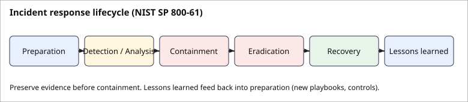

*شکل: چرخه‌ی پاسخ به حادثه.*

### ۴) مثال حل‌شده

**سناریو:** Alert: ۴۰۰ Deny از 198.51.100.7 در ۲ دقیقه به پورت‌های 22,3389,445. **Triage:** Scan؛ موفق؟ Log Allow از همان IP؟ خیر. **مهار:** Address `BLOCK-IP` + Policy Deny بالا؛ Clear Session. **تحلیل:** منبع اینترنت؛ پورت‌های Management بسته‌اند. **درس:** Local-in WAN بسته (۱۲-۸).

``` text
config firewall address
    edit "BLOCK-198.51.100.7"
        set subnet 198.51.100.7 255.255.255.255
    next
end
```

(`Unverified`.)

**مثال سخت (Lateral movement):** PC کاربر Compromise شده و سعی می‌کند به DC SMB بزند؛ Segmentation Deny+Log؛ Alert؛ جداسازی PC؛ بازبینی اعتبارنامه‌ها؛ RCA.

### ۵) GUI و CLI

#### مثال ساده — Triage

هشدار: ۴۳ ورود ناموفق VPN از 203.0.113.50 در ۵ دقیقه. اینترنتی، حساب‌های واقعی، بررسی ورود موفق بعد از شکست‌ها.

#### مثال متوسط

IOC: IP مهاجم؛ TTP: Credential Stuffing. IP را بلاک می‌کنید ولی دفاع پایدار MFA است.

#### مثال سخت — اولویت

(الف) اسکن اینترنتی به VIP، (ب) PC داخلی هر ۶۰ ثانیه به یک مقصد ثابت. اولویت (ب): Beaconing نشانه‌ی ارتباط C2.

``` text
Beacon interval ~ 60 s +- jitter ; low volume ; same destination
```

#### مثال‌های اصلی درس (مرور)

**GUI:** Log & Report؛ FortiView؛ Policy & Objects → Addresses. **CLI:** `execute log filter ...`، `diagnose sys session ...`.

### ۶) نکات امنیتی

- مهار بدون Evidence = از دست رفتن مدرک.
- ارتباط مستند و محدود؛ Change اضطراری ثبت.
- پس از حادثه Policyها و Patch بازبینی.

### ۷) جمع‌بندی

- IR شش فاز؛ Detection از TTP مهم‌تر از IOC.
- Triage و Scoping قبل از مهار.
- Evidence را حفظ کنید؛ درس‌آموخته را اعمال کنید.

### ۸) تمرین و ارزیابی

**ت1.** (ساده) شش فاز IR را بنویسید. *(پاسخ: 29-0-ت1)*

**ت2.** (متوسط) IOC و TTP چه فرقی دارند؟ *(پاسخ: 29-0-ت2)*

**ت3.** (سخت) Playbook Port Scan را بنویسید. *(پاسخ: 29-0-ت3)*

**ت4.** (سخت، طراحی) از Log فایروال سه Detection بسازید. *(پاسخ: 29-0-ت4)*

**Q1.** Quick quiz (English): Why preserve evidence before containment? *(پاسخ: 29-0-Q1)*

### ۹) اصطلاحات و English Corner

| مخفف | شکل کامل | معنی |
|---|---|---|
| IR | Incident Response | پاسخ به حادثه |
| IOC | Indicator of Compromise | نشانه‌ی نفوذ |
| TTP | Tactics, Techniques, Procedures | رفتار مهاجم |
| SOC | Security Operations Center | مرکز عملیات امنیت |

- *Contain first, but preserve the evidence.* ← مهار کنید ولی شواهد را حفظ کنید.

### ۱۰) منابع

- NIST SP 800-61 Rev.2 — Computer Security Incident Handling Guide (مدل کلاسیک ۵ فاز؛ **توجه:** Rev.2 در ۲۰۲۵ با Rev.3 مبتنی بر CSF 2.0 جایگزین/Withdrawn شده؛ برای کار جدید Rev.3 را ببینید)؛ MITRE ATT&CK.

### بخش تکمیلی درس: سناریوی واقعی، مثال‌های بیشتر و عیب‌یابی

> بخش‌های زیر درس بالا را کامل می‌کنند: سناریوی گام‌به‌گام، مثال‌های بیشتر از ساده تا سخت، جدول عیب‌یابی و پرسش‌های مصاحبه. ابتدا بخش‌های اصلی بالا را مطالعه کنید.

### تعمیق: چرخه‌ی پاسخ به حادثه

آماده‌سازی ← شناسایی ← مهار ← ریشه‌کنی ← بازیابی ← درس‌آموخته (NIST SP 800-61). مثال: Brute-force VPN ⇒ شناسایی با Log ⇒ مهار با Local-in Policy ⇒ ریشه‌کنی با MFA.

**پرسش‌های مصاحبه**
1. *Triage؟* اولویت‌بندی.
2. *IOC/TTP؟* نشانه/تکنیک.
3. *مهار قبل از رفع؟* بله.

### مثال حل‌شده: Triage یک هشدار

**هشدار:** ۴۳ ورود ناموفق VPN از 203.0.113.50 در ۵ دقیقه.

1. شدت: متوسط (Brute-force اینترنتی).
2. تأیید: Log Event کاربران مختلف؟ حساب‌های واقعی؟ موفقیتی بعد از شکست‌ها؟
3. مهار: Block IP در Local-in Policy.
4. بررسی: آیا ورود موفق از همان IP بود؟ اگر بله ⇒ حادثه‌ی جدی (ریست رمز، قطع Session).

ثبت Timeline از همان لحظه.

### تکمیل عمیق: Blue Team از صفر — چرخه‌ی پاسخ و منطق تصمیم

#### چرا باید یاد بگیریم؟

فایروال بهترین قفل است، ولی هیچ قفلی صددرصد نیست. پرسش درست این نیست که «آیا نفوذ می‌شود؟» بلکه «چقدر زود می‌فهمیم و چقدر سریع جلویش را می‌گیریم؟». Blue Team یعنی تیم دفاعی که **تشخیص** و **پاسخ** را مدیریت می‌کند.

#### مدل شش‌مرحله‌ای NIST

NIST = National Institute of Standards and Technology، یعنی «مؤسسه‌ی ملی استانداردها و فناوری» (آمریکا). سند SP 800-61 چرخه‌ی پاسخ به حادثه را تعریف می‌کند:

1. Preparation (آمادگی)
2. Detection & Analysis (تشخیص و تحلیل)
3. Containment (مهار)
4. Eradication (ریشه‌کنی)
5. Recovery (بازیابی)
6. Post-Incident Activity (درس‌آموخته)

#### مثال ساده — Triage

Triage یعنی دسته‌بندی هشدار بر اساس اولویت. هشدار: «۴۳ ورود ناموفق VPN». پرسش‌های ۳۰ ثانیه‌ای:

1. منبع داخلی است یا اینترنتی؟ اینترنتی.
2. حساب‌ها واقعی‌اند؟ بله.
3. ورود موفقی هم بوده؟ بررسی می‌کنیم.

#### مثال متوسط — IOC و TTP

IOC = Indicator of Compromise (نشانه‌ی آلودگی): مثلاً IP 203.0.113.50 یا Hash فایل. TTP = Tactics, Techniques, Procedures (تاکتیک‌ها و تکنیک‌ها): مثلاً «Credential Stuffing». IOC زود کهنه می‌شود (IP عوض می‌شود)؛ TTP ماندگارتر است و با MITRE ATT&CK نام‌گذاری می‌شود.

#### مثال سخت — اولویت‌بندی هم‌زمان

دو هشدار: (الف) اسکن پورت از اینترنت به VIP، (ب) یک PC داخلی به یک IP مشکوک ترافیک ثابت هر ۶۰ ثانیه می‌فرستد (Beaconing). اولویت (ب) است چون نشانه‌ی آلودگی داخلی است، در حالی که (الف) نویز اینترنتی است.

``` text
Beacon interval ~ 60 s +- jitter ; low volume ; same dst
=> suspected C2 communication
```

#### Lab

یک Log ساختگی با ۵ هشدار بسازید و Triage کنید: اولویت، دلیل، اقدام.

#### عیب‌یابی فرایند

| علامت (مشاهده) | علت محتمل (باید اثبات شود) | اقدام پس از اثبات |
|---|---|---|
| هشدار زیاد، تصمیم کم | آستانه ضعیف | Tuning |
| دیر فهمیدن | Log ناقص | افزایش Log |
| پاسخ بی‌نظم | Playbook نیست | نوشتن |

#### پرسش‌ها با پاسخ

**۱. IOC و TTP؟** نشانه در برابر رفتار.
**۲. Triage چیست؟** اولویت‌بندی.
**۳. چرا Beaconing خطرناک است؟** ارتباط پنهان با فرماندهی مهاجم.

#### English Corner

- *Triage first, then contain, then investigate.*
- Q: What is the difference between IOC and TTP?

## درس 29-1 — Detection عملی: از Log فایروال به IOC/TTP، Baseline، آستانه، Correlation و Alert

**فصل 29 · بازنویسی عمیق · پیش‌نیاز: ۲۹-۰، ۲۷-۰، ۲۷-۱، ۲۸-۲ · ≈ 8 ساعت**

> **وضعیت:** مفهومی؛ فقط Lab ایزوله و مجاز؛ FortiOS 7.0.3 (بوت‌نشده)؛ دستورها `Unverified`؛ Lab «اجرا نشده».

<!--deep-->

### هدف آموزشی

در پایان این درس باید بتوانید:

1. از Log فایروال به IOC (Indicator of Compromise) و TTP (Tactics, Techniques, Procedures) برسید.
2. Baseline رفتار عادی بسازید و Anomaly را تشخیص دهید.
3. آستانه (Threshold) و Correlation Rule را طراحی کنید.
4. Alert معنادار (کم‌نویز) با اولویت و Owner تعریف کنید.
5. Technique‌ها را به MITRE ATT&CK نگاشت کنید.
6. کیفیت Detection را با آزمون (Purple Team) بسنجید.

### چرا باید یاد بگیریم؟

دزد حرفه‌ای زنگ‌خطر را در یک لحظه بی‌اثر نمی‌کند؛ او چند کار کوچک و مشکوک می‌کند: چند بار در را امتحان می‌کند، شب‌ها وارد می‌شود، قفسه‌ها را بررسی می‌کند. هر کدام جدا بی‌اهمیت است، ولی در کنار هم الگو می‌سازد. Detection یعنی دیدن این الگو در Logهای فایروال قبل از آنکه خسارت بزرگ شود. شاخص مهم: MTTD (Mean Time To Detect). صنعت می‌گوید مهاجم در شبکه روزها یا هفته‌ها می‌ماند (Dwell Time)؛ هر ساعت کوتاه‌کردنِ آن خسارت را کم می‌کند.

### IOC و TTP

| مفهوم | معنی | مثال |
|---|---|---|
| IOC | نشانه‌ی ایستا | IP/دامنه/Hash مخرب |
| TTP | رفتار/روش مهاجم | Brute-force، Scan داخلی |
| Anomaly | انحراف از Baseline | ساعت/حجم غیرعادی |

IOC سریع ولی زودگذر (مهاجم IP عوض می‌کند)؛ TTP ماندگارتر و ارزشمندتر.

### نگاشت ATT&CK (نمونه)

| رفتار در Log | Technique |
|---|---|
| ۴۰ ورود SSH ناموفق | T1110 Brute Force |
| ورود موفق با حساب معتبر | T1078 Valid Accounts |
| ساخت حساب جدید | T1136 Create Account |
| Scan پورت داخلی | T1046 Network Service Discovery |
| بهره‌برداری از سرویس عمومی | T1190 Exploit Public-Facing Application |
| حرکت جانبی با SMB/RDP | T1021 Remote Services |
| ارتباط با C2 | T1071 Application Layer Protocol |

### Baseline

``` text
Baseline for admin login: 2-5 per day, 08:00-18:00, from 10.50.0.0/24
Alert if: login outside window OR from other source OR > 3 failures/5 min
```

Baseline از ۲–۴ هفته‌ی داده؛ بر اساس ساعت‌روز و روز هفته.

### Detection Ruleهای نمونه (روی Log)

| Rule | منطق | Severity |
|---|---|---|
| SSH Brute-force | ≥10 `login failed` از یک Src در ۵ دقیقه | High |
| Admin Success after fails | موفقیت پس از ≥5 ناموفق | Critical |
| Config change off-hours | `cfgpath` تغییر خارج از Window | High |
| Internal scan | یک Src به ≥20 Dst/Port در ۱ دقیقه | High |
| New admin created | `Add system.admin` | Critical |
| DNS tunneling | حجم Query/طول نام غیرعادی | Medium |
| Data exfil | Upload > baseline×N | Medium/High |

مثال Query (شبه‌کد):

``` text
event.subtype = "system" AND logdesc = "Admin login failed"
GROUP BY srcip, 5m
HAVING count >= 10
```

### Correlation

ترکیب رویدادها:

``` text
(Brute-force from X)  followed by  (Admin login success from X within 10 min)
  => Critical: probable compromise
```

یک رویداد ضعیف + رویداد دوم = سیگنال قوی.

### کاهش نویز

1. Whitelist ابزارهای مجاز (Scanner آسیب‌پذیری با IP مشخص).
2. Severity و Owner برای هر Alert.
3. Threshold بر پایه‌ی Baseline.
4. Review ماهانه: چند Alert «عملی» بود؟
5. Suppression زمان‌دار در Maintenance.

### مثال‌های حل‌شده

#### مثال ساده — IOC

Feed: IP 192.0.2.77 بدخواه. Rule: هر Session به/از آن ⇒ Alert. محدودیت: اگر مهاجم IP عوض کند؛ پس TTP هم لازم است.

#### مثال متوسط — Baseline و Alert

Baseline: ۳ ورود Admin در روز. امشب ۲ ورود ساعت ۳:۰۰ از IP خارجی ⇒ Alert (ساعت و Source). بررسی: ادمین در سفر بود (Whitelist زمان‌دار). نتیجه: False Positive ولی فرایند صحیح؛ بهبود: ثبت سفر.

#### مثال متوسط — Correlation

۴۰ ورود ناموفق SSH از 192.0.2.77، سپس یک موفق ⇒ Critical. زمان تشخیص ۲ دقیقه با Correlation در برابر ۵۵ دقیقه با بررسی دستی.

#### مثال سخت — Scan داخلی

Src 10.30.0.10 (Web) به ۳۰۰ Dst/Port در ۱ دقیقه. با Segmentation (فصل ۲۴) بیشتر Deny و Log؛ Rule «Deny Spike از یک Src» ⇒ Alert. ATT&CK T1046. Response: ایزوله‌سازی Host.

#### مثال سخت — کیفیت Detection

Rule نوشته‌اید ولی آیا کار می‌کند؟ Purple Team: شبیه‌سازی Brute-force کنترل‌شده (Lab) و تأیید Alert در ≤ ۵ دقیقه. بدون آزمون «Detection موهوم». ثبت در ماتریس پوشش ATT&CK.

### Lab هدایت‌شده (اجرا نشده)

1. سه Rule و Baseline.
2. Correlation Brute-force→Success.
3. آزمون Purple Team.

### عیب‌یابی سریع

| علامت (مشاهده) | علت محتمل (باید اثبات شود) | اقدام پس از اثبات |
|---|---|---|
| Alert زیاد | آستانه | Baseline |
| Alert نیامد | Log ناقص | منبع |
| FP | Whitelist | بهبود |
| دیر | Polling | Real-time |

### نکات امنیتی

Log Integrity؛ دسترسی SIEM؛ آزمون Detection فقط با مجوز؛ حریم.

### جمع‌بندی

IOC/TTP و نگاشت ATT&CK؛ Baseline و آستانه؛ Correlation ترکیبی؛ کاهش نویز؛ آزمون Detection (Purple Team) و اندازه‌گیری MTTD.

### تمرین و ارزیابی

**ت1.** (ساده) IOC و TTP چه فرقی دارند؟ *(پاسخ: 29-1-ت1)*

**ت2.** (ساده) چرا Baseline لازم است؟ *(پاسخ: 29-1-ت2)*

**ت3.** (متوسط) آستانه‌ی mean+3σ یعنی چه؟ *(پاسخ: 29-1-ت3)*

**ت4.** (متوسط) چرا Exclusion باید زمان‌دار باشد؟ *(پاسخ: 29-1-ت4)*

**ت5.** (سخت) سه رویداد را Correlate و Severity بدهید. *(پاسخ: 29-1-ت5)*

**ت6.** (سخت، طراحی) ۵ Detection با داده/منطق/آستانه/Runbook. *(پاسخ: 29-1-ت6)*

**Q1.** Quick quiz (English): Why are behavior-based detections more durable than indicator-based ones? *(پاسخ: 29-1-Q1)*

### اصطلاحات و English Corner

| مخفف | شکل کامل | معنی |
|---|---|---|
| TTP | Tactics, Techniques and Procedures | رفتار مهاجم |
| FP | False positive | هشدار کاذب |
| ATT&CK | MITRE ATT&CK | ماتریس تکنیک‌های مهاجم |

- *Know your baseline.* ← وضعیت عادی را بشناسید.

### کارت Lab

**کارت Lab:** Detection. **وضعیت:** اجرا نشده. **Evidence:** `03-ops/detect.md`.

### منابع

- NIST SP 800-61
- MITRE ATT&CK
- NIST SP 800-92

<a id="l-29-2"></a>

## درس 29-2 — Response و Playbook: مهار، Evidence، ریشه‌کنی، بازیابی و ارتباطات با مثال‌های اجرایی

**فصل 29 · بازنویسی عمیق · پیش‌نیاز: ۲۹-۰، ۲۹-۱، ۱۳-۷ · ≈ 8 ساعت**

> **وضعیت:** مفهومی؛ فقط Lab ایزوله و مجاز؛ FortiOS 7.0.3 (بوت‌نشده)؛ دستورها `Unverified`؛ Lab «اجرا نشده».

<!--deep-->

### هدف آموزشی

در پایان این درس باید بتوانید:

1. چرخه‌ی پاسخ به حادثه (آمادگی، تشخیص، مهار، ریشه‌کنی، بازیابی، درس‌آموخته) را بگویید.
2. Playbook گام‌به‌گام برای سناریوهای رایج بنویسید.
3. Containment را بدون نابودی Evidence اجرا کنید.
4. Evidence را با زنجیره‌ی نگهداری (Chain of Custody) جمع کنید.
5. Eradication و Recovery را با تأیید پاکی انجام دهید.
6. ارتباطات (داخلی/مدیریتی/قانونی) را برنامه‌ریزی کنید.

### چرا باید یاد بگیریم؟

وقتی آلارم آتش‌سوزی به صدا درمی‌آید، آتش‌نشان‌ها بدون برنامه نمی‌دوند؛ نقش‌ها، مسیر و ابزار از قبل مشخص است. در حادثه‌ی امنیتی هم همین: ساعت ۳ شب با فشار روانی بالا، اگر Playbook نداشته باشید، تصمیم‌های عجولانه می‌گیرید (مثلاً خاموش‌کردن سرور و نابودی Evidence، یا پاک‌کردن Log). Playbook از قبل «چه، که، کی، چگونه» را می‌گوید.

### چرخه‌ی پاسخ (الهام از NIST SP 800-61)

``` text
Preparation -> Detection & Analysis -> Containment -> Eradication -> Recovery -> Post-Incident
```

### Playbook: ورود غیرمجاز Admin FortiGate

| گام | اقدام | ابزار |
|---|---|---|
| 1 تأیید | Alert واقعی است؟ | Log Admin |
| 2 Scope | چه کسی/چه کاری/چه زمانی | Log، Diff Config |
| 3 Contain | Block IP، غیرفعال حساب، قطع نشست | Local-in، `execute ...` |
| 4 Evidence | Snapshot Config، Log، PCAP | ذخیره با Hash |
| 5 Eradicate | حذف حساب/Policy/ پشتی، تغییر رمز/کلید | Config |
| 6 Recover | بازگردانی از Backup پاک، آزمون | Restore |
| 7 Monitor | افزایش پایش ۳۰ روز | SIEM |
| 8 Review | PIR | قالب |

### Containment — اصول

1. **مهار قبل از پاک‌سازی:** ابتدا گسترش را متوقف کنید.
2. **حفظ Evidence:** قبل از Reboot/Wipe، Snapshot/Config/Log.
3. **کم‌ترین اثر کسب‌وکار:** بلاک دقیق (IP/Host) نه قطع کل.
4. **ثبت هر اقدام:** زمان، کس، دستور.

``` text
# block attacker IP on WAN (example, local-in)
config firewall address
    edit "ATTACKER-192.0.2.77"
        set subnet 192.0.2.77 255.255.255.255
    next
end
config firewall local-in-policy
    edit 10
        set intf "port1"
        set srcaddr "ATTACKER-192.0.2.77"
        set dstaddr "all"
        set service "ALL"
        set schedule "always"
        set action deny
    next
end
```

### Evidence و Chain of Custody

| مورد | نحوه | نگهداری |
|---|---|---|
| Config | `show full-configuration` | فایل + SHA256 |
| Log | Export | فقط‌خواندنی |
| PCAP | Sniffer/GUI | رمزنگاری |
| Memory/Disk (سرور) | Image | ابزار Forensics |

``` text
sha256sum fgt-a-config-2026-11-27.conf > fgt-a-config.sha256
```

Chain of Custody: چه کسی، چه زمانی، چه چیزی را گرفت/منتقل کرد؛ امضا. ارزش حقوقی.

### Eradication و Recovery

- حذف مسیرهای دسترسی مهاجم (حساب‌ها، Policyها، Cron، کلید SSH، SNMP Community).
- تغییر **همه** Secretهای در معرض (Admin، PSK، LDAP Bind، API Token، گواهی).
- Restore از Backup پیش از نفوذ (اگر Config مشکوک) و تطبیق Diff.
- Patch آسیب‌پذیری ورودی.
- پایش تشدیدشده.

اصل: پاکی را **اثبات** کنید (Diff با Baseline، اسکن IOC، Log دو هفته).

### ارتباطات

| مخاطب | پیام | زمان |
|---|---|---|
| تیم فنی | جزئیات | لحظه‌ای |
| مدیریت | تأثیر کسب‌وکار، اقدام | هر ساعت |
| حقوقی/Compliance | داده‌ی شخصی؟ الزام اعلام | طبق قانون |
| مشتری/عموم | طبق تصمیم | تأییدشده |

یک سخنگو؛ پیام حقیقی و ساده؛ بدون حدس.

### مثال‌های حل‌شده

#### مثال ساده — بلاک IP

Brute-force از 192.0.2.77: Local-in Deny. زمان ۲ دقیقه. ثبت: ساعت ۰۲:۱۲، اقدام، کس.

#### مثال متوسط — حفظ Evidence

حساب `svc-tmp` ساخته شده. قبل از حذف: `show system admin` را ذخیره + Hash؛ سپس حذف. اگر اول حذف می‌کردید، Evidence رفته بود.

#### مثال متوسط — تغییر Secretها

پس از نفوذ به FortiGate: تغییر رمز Admin، PSK همه‌ی VPNها، Bind LDAP، API Token، گواهی HTTPS (اگر کلید خصوصی در دستگاه بود). فهرست Secret Inventory مهم است؛ بدون آن چیزی جا می‌ماند.

#### مثال سخت — تصمیم Shutdown

سرور آلوده؛ مدیر می‌گوید «خاموش کن». مخاطره: Memory (کلیدها/Malware) از بین می‌رود. تصمیم: ایزوله‌سازی شبکه‌ای (VLAN Quarantine) نه خاموشی، تا Image Memory/Disk گرفته شود. سپس خاموشی.

#### مثال سخت — ارتباطات

داده‌ی شخصی مشتریان در معرض؛ الزام قانونی اعلام. بدون همکاری حقوقی پیام ارسال نشود؛ زمان‌بندی طبق قانون. نکته‌ی مدیریتی: پیام اولیه نباید «هیچ داده‌ای نشت نکرده» بگوید قبل از تأیید.

### Lab هدایت‌شده (اجرا نشده)

1. Playbook ورود غیرمجاز.
2. Local-in Block و ثبت.
3. Evidence + Hash و فهرست Secret.

### عیب‌یابی سریع

| علامت (مشاهده) | علت محتمل (باید اثبات شود) | اقدام پس از اثبات |
|---|---|---|
| Evidence از بین رفت | پاک‌سازی زود | Snapshot اول |
| تکرار نفوذ | Secret جا ماند | Inventory |
| قطع کل | Containment وسیع | دقیق |
| پیام اشتباه | بی‌سخنگو | یک سخنگو |

### نکات امنیتی

دسترسی Evidence محدود؛ ارتباط حادثه روی کانال ایمن/بیرونی (اگر ایمیل آلوده)؛ Playbook را تمرین کنید.

### جمع‌بندی

چرخه‌ی پاسخ؛ Playbook؛ مهار با حفظ Evidence و Chain of Custody؛ Eradication با تغییر همه‌ی Secretها و اثبات پاکی؛ ارتباطات منظم.

### تمرین و ارزیابی

**ت1.** (ساده) چرا Evidence قبل از مهار؟ *(پاسخ: 29-2-ت1)*

**ت2.** (ساده) تفاوت مهار کوتاه‌مدت و بلندمدت؟ *(پاسخ: 29-2-ت2)*

**ت3.** (متوسط) Block شد ولی مهاجم هنوز متصل است؛ چرا؟ *(پاسخ: 29-2-ت3)*

**ت4.** (متوسط) پس از Compromise چه Credentialهایی چرخش یابند؟ *(پاسخ: 29-2-ت4)*

**ت5.** (سخت) Playbook Compromise سرور DMZ را ۷ مرحله‌ای بنویسید. *(پاسخ: 29-2-ت5)*

**ت6.** (سخت، طراحی) سه Playbook اولویت‌دار برای سازمان شما. *(پاسخ: 29-2-ت6)*

**Q1.** Quick quiz (English): Why combine blocking an IP with clearing its existing sessions? *(پاسخ: 29-2-Q1)*

### اصطلاحات و English Corner

| مخفف | شکل کامل | معنی |
|---|---|---|
| Quarantine | Host quarantine | قرنطینه‌ی میزبان |
| Scoping | Incident scoping | تعیین دامنه‌ی حادثه |

- *Preserve evidence before containment.* ← پیش از مهار Evidence را حفظ کنید.

### کارت Lab

**کارت Lab:** Response. **وضعیت:** اجرا نشده. **Evidence:** `03-ops/response.md`.

### منابع

- NIST SP 800-61 Rev.2 (در ۲۰۲۵ با Rev.3 جایگزین شده؛ مدل ۵ فاز کلاسیک مرجع آموزشی)
- SANS Incident Handler Handbook

<a id="l-29-3"></a>

## درس 29-3 — Lifecycle، Patch و Vulnerability Management: Inventory، EoL، PSIRT/CVE، اولویت‌بندی و Rollback

**فصل 29 · بازنویسی عمیق · پیش‌نیاز: ۲۷-۴، ۲۹-۰ · ≈ 8 ساعت**

> **وضعیت:** مفهومی؛ فقط Lab ایزوله و مجاز؛ FortiOS 7.0.3 (بوت‌نشده)؛ دستورها `Unverified`؛ Lab «اجرا نشده».

<!--deep-->

### هدف آموزشی

در پایان این درس باید بتوانید:

1. Inventory دارایی (دستگاه، نسخه، لایسنس، EoL) را بسازید.
2. EoL/EoS و چرخه‌ی پشتیبانی را درک کنید.
3. PSIRT، CVE و اولویت‌بندی (CVSS، EPSS، KEV، Exposure) را به‌کار ببرید.
4. Patch را با Test، Window، Rollback اجرا کنید.
5. SLA Patch (Critical/High/Medium) تعیین کنید.
6. گزارش وضعیت آسیب‌پذیری و Exception Management بسازید.

### چرا باید یاد بگیریم؟

بیشتر نفوذهای بزرگ از آسیب‌پذیری‌های «شناخته‌شده و Patch‌شده» می‌آیند که کسی به‌موقع Patch نکرد. فایروال در لبه است؛ آسیب‌پذیری آن مستقیم از اینترنت قابل‌بهره‌برداری است (نمونه‌ی واقعی با اطلاعات PSIRT: CVE-2022-42475 — FortiOS 7.0.0 تا 7.0.8، رفع 7.0.9 — و CVE-2018-13379 که شاخه‌های 5.4/5.6/6.0 را شامل می‌شود؛ جدول کامل در درس ۲۰-۲). مدیریت Lifecycle یعنی بدانید چه دارید، چه نسخه‌ای، تا کی پشتیبانی می‌شود و کی باید Patch شود.

### Inventory

| فیلد | مثال |
|---|---|
| Hostname/Serial | FGT-A / FG...A |
| مدل | FortiGate-60F |
| FortiOS | 7.0.3 |
| نقش | Edge شعبه تبریز |
| لایسنس FortiGuard | تا 2027-03-01 |
| پشتیبانی (FortiCare) | تا ... |
| EoS مدل | تاریخ |
| Exposure | اینترنتی (SSL-VPN فعال) |
| مالک | NetOps |

بدون Inventory، «همه‌ی FortiGateها را Patch کردیم» غیرقابل‌اثبات است. منبع: CMDB، FMG، Export API.

### EoL و چرخه‌ی پشتیبانی

| اصطلاح | معنی |
|---|---|
| EoO | End of Order |
| EoS (End of Support) | پایان پشتیبانی/Patch امنیتی |
| EoL | پایان عمر |

نسخه‌ی FortiOS هم پشتیبانی محدود دارد (Release Notes و Product Life Cycle). هدف: در نسخه‌ی پشتیبانی‌شده‌ی «Mature/Recommended».

### منبع آسیب‌پذیری

- **FortiGuard PSIRT Advisories:** Fortinet Product Security Incident Response Team.
- **CVE/NVD:** شناسه‌ی عمومی.
- **CISA KEV (Known Exploited Vulnerabilities):** آسیب‌پذیری‌های در حال بهره‌برداری.
- **Mailing/RSS** برای اعلان فوری.

### اولویت‌بندی

``` text
Priority = f(CVSS severity, Exploited in the wild (KEV/EPSS), Exposure, Asset criticality, Compensating controls)
```

| عامل | سؤال |
|---|---|
| CVSS | شدت |
| EPSS/KEV | بهره‌برداری فعال؟ |
| Exposure | از اینترنت قابل‌دسترس؟ |
| Asset | مهم؟ |
| Control جایگزین | WAF/غیرفعال‌سازی ویژگی؟ |

قاعده: KEV + Exposure اینترنتی = فوری (۲۴–۷۲ ساعت)، حتی اگر CVSS متوسط.

### SLA پیشنهادی

| شدت/شرایط | زمان |
|---|---|
| KEV + اینترنتی | ≤ ۷۲ ساعت (یا کنترل جایگزین فوری) |
| Critical | ≤ ۷ روز |
| High | ≤ ۳۰ روز |
| Medium | ≤ ۹۰ روز |
| Low | دوره‌ی بعدی |

### فرایند Patch

``` text
1 Advisory received -> impact analysis (affected? feature enabled?)
2 Mitigation if no patch (disable feature, restrict source)
3 Test in lab/staging
4 Change request (window, rollback)
5 Backup + Upgrade path check
6 Upgrade (HA: secondary first)
7 Verify (traffic, VPN, UTM, HA)
8 Update inventory/report
```

نکته: Upgrade Path Tool فورتی‌نت؛ پرش از نسخه‌ی خیلی قدیمی ممکن است مسیرهای میانی نیاز داشته باشد.

### Exception

اگر Patch ممکن نیست: Exception با مالک، دلیل، کنترل جایگزین، تاریخ انقضا و تأیید ریسک مدیریتی.

### مثال‌های حل‌شده

#### مثال ساده — Inventory

۱۲ FortiGate؛ ۳ دستگاه روی 7.0.3. فهرست با Exposure: دو مورد SSL-VPN فعال. اولویت Patch/غیرفعال‌سازی.

#### مثال متوسط — اولویت

دو CVE: A (CVSS 9.8، بدون Exploit، ویژگی خاموش)، B (CVSS 7.5، KEV، SSL-VPN روی اینترنت فعال). اولویت B.

``` text
B: exploited + exposed  => 72 h
A: feature disabled     => normal window (verify feature is really off)
```

#### مثال متوسط — Mitigation

Patch فوری ممکن نیست؛ غیرفعال‌کردن SSL-VPN یا محدود به Source مدیریتی تا Patch؛ ثبت Exception ۷ روزه.

#### مثال سخت — Rollback

Upgrade مشکل ایجاد کرد (VPN Phase2 شکست). Rollback: Boot Partition قبلی/Restore Config؛ Evidence؛ تحقیق در Release Notes (تغییر Default). درس: Staging با Config واقعی، Test Matrix.

#### مثال سخت — EoS

مدل FortiGate-60E پایان Support؛ نسخه‌ی نهایی قابل نصب دارد، Patch امنیتی نیست. تصمیم: برنامه‌ی جایگزینی مدل با Timeline، Exception موقت، کنترل جایگزین (دسترسی مدیریتی محدود، غیرفعال SSL-VPN).

### Lab هدایت‌شده (اجرا نشده)

1. Inventory.
2. اولویت‌بندی دو CVE.
3. Playbook Patch و Rollback.

### عیب‌یابی سریع

| علامت (مشاهده) | علت محتمل (باید اثبات شود) | اقدام پس از اثبات |
|---|---|---|
| ندانستن نسخه | Inventory | API/FMG |
| Patch دیر | بی‌SLA | سیاست |
| Upgrade شکست | بی‌Staging | Test |
| EoS | بی‌برنامه | جایگزینی |

### نکات امنیتی

Advisory را منبع رسمی بخوانید؛ Image با Hash؛ Backup؛ Window؛ ثبت Exception.

### جمع‌بندی

Inventory، EoL، PSIRT/CVE/KEV، اولویت با Exposure و بهره‌برداری فعال، SLA، فرایند Patch با Staging و Rollback، و Exception مدیریت‌شده.

### تمرین و ارزیابی

**ت1.** (ساده) EoL یعنی چه؟ *(پاسخ: 29-3-ت1)*

**ت2.** (ساده) چرا Exposure در اولویت وزن بالا دارد؟ *(پاسخ: 29-3-ت2)*

**ت3.** (متوسط) Patch ممکن نیست؛ چه می‌کنید؟ *(پاسخ: 29-3-ت3)*

**ت4.** (متوسط) Time-to-patch چیست؟ *(پاسخ: 29-3-ت4)*

**ت5.** (سخت) طرح Patch ۲۰ دستگاه با ۲ Window ماهانه. *(پاسخ: 29-3-ت5)*

**ت6.** (سخت، طراحی) داشبورد Metrics آسیب‌پذیری. *(پاسخ: 29-3-ت6)*

**Q1.** Quick quiz (English): Which factors raise the urgency of patching a vulnerability? *(پاسخ: 29-3-Q1)*

### اصطلاحات و English Corner

| مخفف | شکل کامل | معنی |
|---|---|---|
| PSIRT | Product Security Incident Response Team | تیم امنیت محصول |
| CVSS | Common Vulnerability Scoring System | سامانه‌ی امتیاز آسیب‌پذیری |
| EoL | End of Life | پایان عمر |

- *Track end-of-life dates and plan upgrades early.* ← تاریخ پایان عمر را پیگیری و ارتقا را زود برنامه‌ریزی کنید.

### کارت Lab

**کارت Lab:** Patch. **وضعیت:** اجرا نشده. **Evidence:** `03-ops/patch.md`.

### منابع

- FortiGuard PSIRT
- NIST SP 800-40 Rev.4
- FIRST CVSS

<a id="l-29-4"></a>

## درس 29-4 — گزارش حادثه (PIR) و آزمون عملی Blue Team: سناریوی چندمرحله‌ای با کلید و Rubric

**فصل 29 · بازنویسی عمیق · پیش‌نیاز: ۲۹-۱ تا ۲۹-۳ · ≈ 12 ساعت**

> **وضعیت:** FortiOS 7.0.3 نامی (بوت‌نشده)؛ سناریو و کلید پاسخ آموزشی‌اند؛ Lab «اجرا نشده»؛ دستورها `Unverified` تا اجرای Lab؛ ویژگی‌های وابسته به لایسنس مشخص شده‌اند.

<!--deep-->

### هدف آموزشی

در پایان این درس باید بتوانید:

1. حادثه‌ی چندمرحله‌ای را از چند هشدار پراکنده به Timeline تبدیل کنید.
2. MTTD و MTTR را محاسبه کنید.
3. Containment، Eradication، Recovery را برای سناریو بنویسید.
4. ریشه‌ی علت (Root Cause) و اقدام پیشگیرانه را تعیین کنید.
5. PIR (Post-Incident Review) بدون سرزنش بنویسید.
6. Rubric را اجرا و صداقت را ثبت کنید.

### چرا باید یاد بگیریم؟

حادثه‌ی واقعی با برچسب «حمله‌ی چندمرحله‌ای» نمی‌آید. چند هشدار پراکنده می‌آید و مهندس باید آن‌ها را به یک داستان تبدیل کند. بعد از پایان حادثه، ارزش واقعی در PIR است: اگر درس نگیرید، همان حادثه تکرار می‌شود. PIR خوب «چه کسی مقصر بود» نمی‌پرسد؛ «کدام سازوکار شکست خورد» را می‌پرسد.

### سناریو

ساعت 02:10: Alert، ۴۰ ورود ناموفق SSH به FGT از IP `192.0.2.77`. 02:14: ورود موفق `admin`. 02:20: تغییر Policy و ایجاد حساب `svc-tmp`. 02:35: اتصال از FGT به شبکه‌ی داخلی (Scan). 03:05: کشف توسط SOC.

### Timeline

| ساعت | رویداد | منبع | ATT&CK |
|---|---|---|---|
| 02:10 | Brute-force SSH | Event Log | T1110 |
| 02:14 | ورود موفق | Event Log | T1078 |
| 02:20 | ساخت `svc-tmp` + تغییر Policy | Config Change Log | T1136 |
| 02:35 | Scan داخلی | Forward Traffic | T1046 |
| 03:05 | کشف | SOC | - |

``` text
MTTD = 03:05 - 02:10 = 55 minutes
```

### پاسخ

**Containment (03:10–03:25):**

1. Block IP با Local-in.
2. غیرفعال `admin` و `svc-tmp`، قطع نشست‌ها.
3. جداسازی Mgmt (Console دسترسی).

**Evidence:** Snapshot Config، Export Logها، Hash، فهرست Session (`diagnose sys session list`).

**Eradication:** حذف `svc-tmp` و Policy اضافه، تغییر رمزها/کلیدها (SSH، API Token، PSK، LDAP Bind)، بررسی Backdoor (SNMP، SSH key، Script).

**Recovery:** Restore Config پاک (قبل از 02:10)، Diff با Baseline، آزمون سرویس‌ها، پایش ۳۰ روزه.

``` text
MTTR (contain) = 03:25 - 03:05 = 20 minutes
Total exposure = 03:25 - 02:10 = 75 minutes
```

### ریشه‌ی علت

1. SSH روی WAN باز.
2. بدون MFA و Trusted Host.
3. رمز ضعیف.
4. Alert Brute-force بود ولی هشدار صبح دیده شد (Triage ضعیف / بدون On-call).

### اقدام پیشگیرانه (با Owner/Due)

| اقدام | Owner | موعد |
|---|---|---|
| حذف SSH از WAN، Local-in | NetOps | ۲۴ ساعت |
| MFA + Trusted Host | SecOps | ۷ روز |
| Alert Critical با Page | SOC | ۷ روز |
| Diff روزانه‌ی Config | NetOps | ۳۰ روز |
| Playbook + Drill | SOC | ۳۰ روز |

### قالب PIR

``` text
Summary / Impact / Timeline / Root cause / What went well / What failed / Actions (owner, due) / Lessons
```

اصل: Blameless؛ سازوکار را اصلاح کنید نه فرد.

### Rubric (۱۰۰)

| معیار | امتیاز |
|---|---|
| Timeline و ATT&CK | 20 |
| Containment/Eradication/Recovery | 25 |
| Root Cause | 15 |
| Actions با Owner/Due | 15 |
| PIR بدون سرزنش | 15 |
| صداقت | 10 |

### مثال‌های حل‌شده

#### مثال ساده — MTTD

۵۵ دقیقه. هدف سازمان: ≤ ۱۵ دقیقه برای Critical. فاصله‌ی ۴۰ دقیقه ⇒ اقدام: Correlation (Brute→Success) و Page.

#### مثال متوسط — What went well

Backup پاک در دسترس بود، Console کار کرد، Playbook (جزئی) وجود داشت، Local-in سریع انجام شد. ثبت نقاط قوت برای تکرار.

#### مثال متوسط — اقدام بد/خوب

بد: «آموزش کاربران» (مبهم). خوب: «MFA برای همه‌ی Adminها تا ۷ روز، Owner: SecOps، معیار: ورود بدون MFA ممکن نباشد (آزمون)».

#### مثال سخت — Root Cause عمیق (5 Why)

چرا نفوذ؟ SSH روی WAN. چرا باز؟ پس از Commissioning بسته نشد. چرا؟ Checklist نبود. چرا؟ فرایند تحویل بدون Review امنیتی. ریشه: فرایند، نه یک نفر. اقدام: Checklist اجباری قبل از Production.

#### مثال سخت — صداقت

Lab اجرا نشده؛ سناریو نمونه است؛ PIR واقعی نیست. ثبت «آموزشی/Unverified».

### Lab هدایت‌شده (اجرا نشده)

1. Timeline بسازید.
2. MTTD/MTTR حساب کنید.
3. PIR بنویسید.

### عیب‌یابی سریع

| علامت (مشاهده) | علت محتمل (باید اثبات شود) | اقدام پس از اثبات |
|---|---|---|
| کشف دیر | Triage | Page |
| تکرار | ریشه نادیده | 5 Why |
| PIR سرزنش | فرهنگ | Blameless |
| اقدام مبهم | Owner/Due | SMART |

### جمع‌بندی

سناریوی چندمرحله‌ای ⇒ Timeline و ATT&CK؛ MTTD/MTTR؛ پاسخ کامل؛ Root Cause با 5 Why؛ PIR بدون سرزنش با اقدام‌های SMART؛ صداقت.

### تمرین و ارزیابی

**ت1.** (ساده) MTTD چیست؟ *(پاسخ: 29-4-ت1)*

**ت2.** (ساده) Containment؟ *(پاسخ: 29-4-ت2)*

**ت3.** (متوسط) اولین اقدام؟ *(پاسخ: 29-4-ت3)*

**ت4.** (متوسط) ریشه؟ *(پاسخ: 29-4-ت4)*

**ت5.** (سخت) PIR بنویسید. *(پاسخ: 29-4-ت5)*

**ت6.** (سخت، طراحی) اقدام پیشگیرانه. *(پاسخ: 29-4-ت6)*

**Q1.** Quick quiz (English): What does MTTD measure? *(پاسخ: 29-4-Q1)*

### اصطلاحات و English Corner

| مخفف | شکل کامل | معنی |
|---|---|---|
| PIR | Post-Incident Review | بازبینی پس از حادثه |
| MTTD | Mean Time To Detect | میانگین زمان کشف |

- *A blameless review focuses on process, not people.* ← بازبینی بی‌ملامت روی فرایند است نه افراد.

### کارت Lab

**کارت Lab:** آزمون Blue Team (اجرا نشده). **Evidence:** `03-ops/pir-29.md`.

### منابع

- NIST SP 800-61 Rev.2 (در ۲۰۲۵ با Rev.3 جایگزین شده؛ مدل ۵ فاز کلاسیک مرجع آموزشی)

## پاسخ‌های فصل 29

> ابتدا بدون نگاه حل کنید. شناسه: درس-نوع+شماره (ت = تمرین، م = مرور).


### پاسخ‌های بازنویسی عمیق درس 29-1

**29-1-ت1** — IOC نشانه‌ی مشخص و زودگذر (IP/Hash)؛ TTP رفتار و روش مهاجم و پایدارتر.

**29-1-ت2** — تا انحراف از رفتار عادی تشخیص داده شود و FP کم شود.

Baseline تا انحراف از رفتار عادی تشخیص داده شود و False Positive کم شود.

**29-1-ت3** — مقداری بیش از میانگین به‌علاوه‌ی سه برابر انحراف معیار Alert می‌دهد (تقریباً رویداد نادر).

**29-1-ت4** — تا استثنا فراموش و به حفره تبدیل نشود؛ بازبینی دوره‌ای.

استثنا باید تاریخ پایان داشته باشد تا فراموش و حفره نشود؛ بازبینی دوره‌ای.

**29-1-ت5** — Correlate سه رویداد و Severity

مثال: (الف) ۴۰ شکست SSH از X، (ب) ورود موفق از X، (ج) تغییر Policy ده دقیقه بعد.
**استدلال:** هر یک جدا Medium/High؛ توالی (الف→ب→ج) از یک Src نشانه‌ی احتمالی سوءاستفاده از حساب و تغییر ماندگار است ⇒ **Critical** (با فرض زمان نزدیک و یک Src). اگر ج از Admin شناخته‌شده در Window باشد، سناریو تغییر می‌کند؛ پس Severity باید با Context (ساعت، مبدأ، Ticket) تنظیم شود.

**29-1-ت6** — ۵ Detection کامل

| # | داده | منطق/آستانه | Runbook |
|---|---|---|---|
| 1 | Event Admin | ≥۱۰ شکست/۵ د | بلاک و بررسی |
| 2 | Event Admin | موفق پس از ≥۵ شکست | Critical |
| 3 | Config change | خارج از Window | بررسی CHG |
| 4 | Traffic | Src به ≥۲۰ Dst/دقیقه | ایزوله |
| 5 | Traffic | Upload > Baseline×N | بررسی اتلاف داده |
آستانه‌ها از Baseline.

**29-1-Q1** — Because attackers can change IPs and hashes easily but their behaviors change much less.


### پاسخ‌های بازنویسی عمیق درس 29-2

**29-2-ت1** — مهار ممکن است Session/حافظه/Log را تغییر دهد و تحلیل را ناقص کند.

**29-2-ت2** — کوتاه‌مدت جلوگیری فوری (Block/Quarantine)؛ بلندمدت رفع ریشه‌ای (بازسازی/Patch/چرخش).

**29-2-ت3** — Session قبلی باقی است؛ باید Clear فیلترشده انجام شود.

Session قبلی باقی است؛ Clear فیلترشده انجام شود.

**29-2-ت4** — حساب‌های موجود روی سرور، سرویس‌ها، Tokenها و Credentialهایی که سرور به آن‌ها دسترسی داشت.

**29-2-ت5** — Playbook Compromise سرور DMZ

۱) تأیید و Scope ۲) ایزوله‌سازی شبکه‌ای (نه خاموشی) ۳) Evidence (Memory/Disk/Log/PCAP، Hash) ۴) بررسی حرکت جانبی (Log DMZ→Internal) ۵) Eradication: بازسازی از Image پاک، تغییر Secretها، Patch ۶) Recovery و پایش ۷) PIR.
**استدلال:** سرور DMZ در معرض اینترنت است؛ بازسازی از Image امن‌تر از «پاک‌سازی» است.

**29-2-ت6** — سه Playbook اولویت‌دار

اولویت از Likelihood×Impact: ۱) ورود غیرمجاز به Admin فایروال ۲) Ransomware/حرکت جانبی ۳) قطع VPN/ISP (اختلال). برای هر مورد Trigger، نقش‌ها، Containment، Evidence، Recovery، ارتباط. اولویت‌بندی باید با ریسک واقعی سازمان بازبینی شود.

**29-2-Q1** — Because a block applies to new connections while existing sessions may continue.


### پاسخ‌های بازنویسی عمیق درس 29-3

**29-3-ت1** — پایان پشتیبانی و Patch امنیتی محصول.

EoL پایان پشتیبانی و Patch امنیتی محصول است.

**29-3-ت2** — آسیب‌پذیری قابل‌دسترس از اینترنت سریع‌تر و گسترده‌تر سوءاستفاده می‌شود.

**29-3-ت3** — Compensating Controls: Source Restriction، غیرفعال ویژگی، IPS، Segmentation، پایش.

**29-3-ت4** — فاصله‌ی انتشار Advisory تا اعمال Patch.

Exposure window فاصله‌ی انتشار Advisory تا اعمال Patch است.

**29-3-ت5** — Patch ۲۰ دستگاه با ۲ Window

**فرض:** ۲۰ FortiGate، دو Window ماهانه.
1. Inventory و اولویت (Exposure، KEV، حیاتی بودن).
2. گروه‌بندی: ۲ دستگاه Staging/کم‌ریسک اول (Canary).
3. Window ۱: ۱۰ دستگاه (از کم‌اهمیت)، Window ۲: ۱۰ باقی (HA: Secondary اول).
4. برای KEV+اینترنتی خارج از Window با Emergency Change یا Mitigation.
5. Test Matrix، Rollback، به‌روزرسانی Inventory.
**استدلال:** Window ثابت نباید Patch فوری را عقب بیندازد.

**29-3-ت6** — داشبورد Metrics آسیب‌پذیری

Metrics: درصد دستگاه‌ها روی نسخه‌ی پشتیبانی‌شده، تعداد CVE باز بر اساس شدت/KEV، زمان میانگین Patch (MTTP) در برابر SLA، تعداد Exception و انقضا، EoS نزدیک. **هشدار:** معیار به تنهایی نتیجه نمی‌دهد؛ Exposure و Context را اضافه کنید.

**29-3-Q1** — Internet exposure, available exploits and high asset criticality.


### پاسخ‌های بازنویسی عمیق درس 29-4


### پاسخ‌های بازنویسی عمیق درس 29-4

**29-4-ت1** — زمان تا کشف.

MTTD زمان تا کشف است.

**29-4-ت2** — جلوگیری از گسترش.

Containment جلوگیری از گسترش حادثه است.

**29-4-ت3** — Block و غیرفعال حساب.

اولین اقدام: Block مهاجم و غیرفعال‌کردن حساب‌ها.

**29-4-ت4** — SSH WAN و رمز.

ریشه: SSH روی WAN و رمز ضعیف.

**29-4-ت5** — PIR

Summary، Impact، Timeline (MTTD/MTTR)، Root Cause (5 Why)، What went well، What failed، Actions (Owner/Due/معیار)، Lessons. Blameless: سازوکار را اصلاح کنید نه فرد را.

**29-4-ت6** — اقدام پیشگیرانه

اقدام باید SMART باشد: مثلاً «حذف SSH از WAN تا ۲۴ ساعت، Owner NetOps، معیار: nmap بسته». اقدام مبهم («آموزش») بدون معیار ارزشی ندارد؛ هر اقدام را به علت ریشه وصل کنید.

**29-4-Q1** — The mean time between the start of an incident and its detection.

### پاسخ‌های درس افزوده‌ی 29-0 (فصل 29)

**29-0-ت1** — Preparation، Detection/Analysis، Containment، Eradication، Recovery، Lessons learned.

**29-0-ت2** — IOC نشانه‌ی مشخص و زودگذر (IP/Hash)؛ TTP رفتار و روش مهاجم و پایدارتر.

**29-0-ت3** — Playbook Port Scan

**Trigger:** ≥۲۰ مقصد/پورت از یک Src در ۱ دقیقه (Deny یا Allow).
**گام‌ها:** ۱) تأیید: Src داخلی یا خارجی؟ مجاز (Scanner آسیب‌پذیری)؟ ۲) Scope: چه هدف‌هایی، موفق؟ ۳) اگر خارجی: Block/نادیده طبق سیاست (اسکن اینترنتی عادی است)؛ اگر داخلی: Host مشکوک، ایزوله‌سازی شبکه‌ای ۴) Evidence (Log، PCAP) ۵) بررسی ورود موفق پس از اسکن ۶) ثبت/Tuning.
**استدلال:** اسکن خارجی به‌تنهایی حادثه نیست؛ اسکن داخلی نشانه‌ی احتمالی نفوذ (T1046) است و اولویت بالاتر دارد.

**29-0-ت4** — سه Detection از Log

۱) Brute-force: ≥۱۰ ورود ناموفق/۵ دقیقه از یک Src. ۲) Admin موفق پس از شکست‌ها (Correlation). ۳) Deny Spike از یک Src داخلی به چند Dst (Scan). **هر Detection:** داده‌ی ورودی، منطق، آستانه (از Baseline)، Severity، Runbook و آزمون.

**29-0-Q1** — Because containment actions can alter or erase logs and sessions that are needed for analysis.

# فصل 30 — Migration: از Cisco ASA/Router به FortiGate (معماری ۸، G11)

> **یادداشت علمی v4.0 — فصل 30:** عمومی: Migration/Cutover. مختص محصول: ASA→FortiGate، FortiConverter (لایسنس).
> فرض: معادل‌سازی مفهومی؛ ترتیب NAT بین سازندگان متفاوت.
> مراجع: مستندات سازندگان.


**مدت:** ۳۶ ساعت | **پیش‌نیاز:** فصل ۱۳، ۲۷.
**اهداف:** برنامه‌ریزی مهاجرت؛ Inventory و Mapping Policy؛ Cutover و Rollback؛ تست پیش و پس. Gate G11: Plan کامل با Rollback و Evidence.
**هشدار:** Migration در تولید فقط با Change Window و تأیید؛ اینجا فقط Lab.
**اشتباهات رایج:** کپی بی‌فکر Rule؛ نبود Rollback؛ فراموشی NAT/Route.

**درس‌های فصل:**
- [درس 30-1 — Inventory و Mapping](#l-30-1)
- [درس 30-2 — Plan، Cutover و Rollback](#l-30-2)
- [درس 30-3 — تست پیش/پس و Evidence](#l-30-3)
- [درس 30-4 — Gate G11 و آزمون](#l-30-4)

---

<a id="l-30-1"></a>

## درس 30-0 — روش‌شناسی Migration: Inventory، نگاشت Policy، Cutover و Rollback

**فصل ۳۰ · درس افزوده (پیش‌درس ۳۰-۱) · پیش‌نیاز: ۱۳-۷، ۲۷-۷، ۲۵-۰ · ≈ ۶ ساعت**

> **وضعیت:** روش مستقل از برند؛ نگاشت قوانین ASA→FortiGate مفهومی و `Unverified`؛ فقط Lab.

### ۱) هدف آموزشی

1. مهاجرت را به‌صورت پروژه (Discovery، Design، Build، Test، Cutover، Stabilize) برنامه‌ریزی کند.
2. **Inventory** کامل و **Rule Hygiene** (حذف قوانین مرده/تکراری با Hit Count) انجام دهد.
3. نگاشت **Object، NAT، Route، VPN، Policy** را بنویسد و تفاوت مدل (ACL→Policy، NAT-order) را بفهمد.
4. **Cutover** با Rollback قابل‌اثبات طراحی کند.
5. آزمون پیش/پس و Evidence ثبت کند.

### ۲) مفهوم پایه: چیست و چرا؟ (از صفر، با زبان ساده)

**چرا Migration فقط «کپی» نیست؟** نقل‌مکان به خانه‌ی جدید را تصور کنید: اگر همه‌چیز را بدون مرتب‌کردن ببرید، خانه‌ی جدید هم پر از آشغال می‌شود. ۱۲۰۰ قاعده‌ی قدیمی که ۴۸۰ تایش ۱۲ ماه استفاده نشده، یعنی «بدهی فنی». Migration فرصت پاک‌سازی است.

**شش مرحله:** Inventory ← Hygiene ← نگاشت ← Build و Test در Lab ← Cutover ← Rollback/تثبیت.

**جمع‌بندی اصلی درس:**

مهاجرت = تغییر پرخطر روی دستگاه حیاتی. «کپی کردن Rule» خطرناک است چون مدل پردازش فرق دارد (ترتیب NAT/ACL، Interface Security-level در برابر Zone، Implicit deny). موفقیت = **برابری رفتاری** (نه برابری متن Config) + **بازگشت امن**.

### ۳) توضیح عمیق فنی

#### ۳-۱) فازها

``` text
1 Discovery : inventory interfaces, routes, NAT, ACLs, VPNs, users, logs
2 Design    : target architecture, zone mapping, IP plan, rule cleanup
3 Build     : configure target in parallel (no traffic)
4 Test      : lab/pre-prod, positive & negative tests
5 Cutover   : change window, switch traffic, monitor
6 Stabilize : post-checks, hypercare, decommission after N days
```

#### ۳-۲) Rule Hygiene

با Hit Count و Log ۹۰ روزه: Ruleهای صفر-Hit، تکراری، Shadow، و Any-Any را شناسایی. هر Rule: صاحب، دلیل، تاریخ. **قبل از مهاجرت پاکسازی** کنید تا قوانین بد به سیستم جدید منتقل نشوند.

#### ۳-۳) نگاشت مفاهیم (مثال ASA→FortiGate؛ `Unverified`)

| ASA | FortiGate |
|---|---|
| nameif/security-level | Interface/Zone + Policy |
| access-list + access-group | Firewall Policy |
| object network/group | Address/Address Group |
| NAT (auto/twice) | Policy NAT/VIP/IP Pool/Central NAT |
| route | Static Route |
| crypto map | IPsec Phase1/2 (Route-based) |
| inspect (MPF) | Session Helper/Profile |

نکته: ASA به‌طور پیش‌فرض بین Interfaceهای با Security-level بالاتر→پایین‌تر اجازه می‌دهد؛ FortiGate Implicit deny؛ پس رفتار «بدون Rule» متفاوت است.

#### ۳-۴) Cutover

- **Change Window**، تیم، Rollback Trigger (مثلاً «۳۰ دقیقه بدون سرویس X»)، تماس.
- مراحل: Backup دو سو؛ جابه‌جایی Gateway/Route یا آدرس؛ ARP/Session؛ آزمون سرویس‌های حیاتی؛ مانیتورینگ.
- **Rollback:** بازگرداندن مسیر/کابل؛ Config قبلی؛ آزمون.

#### ۳-۵) Test Matrix

| سرویس | مبدأ | مقصد | انتظار | قبل | بعد |
|---|---|---|---|---|---|
| وب | Users | Internet | OK | ✓ | ✓ |
| ERP | Users | SRV | OK | ✓ | ✓ |
| ممنوع | Guest | SRV | Block | ✓ | ✓ |

### ۴) مثال حل‌شده

**پروژه:** جایگزینی ASA با FGT. Discovery: ۲۴۰ Rule، ۱۱۰ با Hit=0؛ پاکسازی ← ۱۱۰ Policy. Build موازی در Lab. Cutover: شب جمعه ۲۲:۰۰؛ Trigger Rollback ۳۰ دقیقه. شواهد: Test Matrix قبل/بعد. یک سرویس (FTP) خراب: Helper/Session ALG؛ رفع. Hypercare ۷ روز؛ Decommission ۳۰ روز.

**مثال سخت:** پس از Cutover فقط یک اپ کار نمی‌کند؛ ASA «twice NAT» ترتیب خاصی داشت؛ در FGT Policy NAT ناقص. **رفع:** VIP/IP Pool مناسب، Debug Flow.

### ۵) GUI و CLI

#### مثال ساده

``` text
1200 - 480 (no hits) - 120 (duplicates) = 600 candidates
```

#### مثال متوسط — روش Cutover

Big Bang (ریسک بالا، قطع کوتاه)، Phased (شعبه‌به‌شعبه)، Parallel Run (دو دستگاه با مقایسه).

#### مثال سخت — وابستگی پنهان

ACL قدیمی UDP/10050 را (با `permit udp any any`) باز می‌گذاشت و کسی ننوشته بود. راه کشف: Log ۳۰ روزه‌ی دستگاه قدیمی؛ آن را قبل از خاموش‌کردن نگه دارید.

#### مثال‌های اصلی درس (مرور)

**GUI:** Policy & Objects؛ Log & Report. **CLI:** `diagnose firewall iprope lookup ...`، `diagnose debug flow ...`؛ Backup: `execute backup config ...`.

### ۶) نکات امنیتی

- Rule «موقت» هنگام مهاجمت را حذف کنید.
- Secretهای Config قدیمی منتقل نشوند.
- دستگاه قدیمی پس از Decommission پاک‌سازی امن.

### ۷) جمع‌بندی

- Inventory + Hygiene قبل از ساخت؛ برابری رفتاری هدف.
- Cutover بدون Rollback مجاز نیست.
- Test Matrix و Evidence.

### ۸) تمرین و ارزیابی

**ت1.** (ساده) فازهای Migration را بنویسید. *(پاسخ: 30-0-ت1)*

**ت2.** (متوسط) چرا Rule Hygiene قبل از مهاجرت؟ *(پاسخ: 30-0-ت2)*

**ت3.** (سخت) Rollback Trigger و روش آن را طراحی کنید. *(پاسخ: 30-0-ت3)*

**ت4.** (سخت، طراحی) Test Matrix برای ۱۰ سرویس بنویسید. *(پاسخ: 30-0-ت4)*

**Q1.** Quick quiz (English): Why aim for behavioral equivalence rather than copying rules? *(پاسخ: 30-0-Q1)*

### ۹) اصطلاحات و English Corner

| مخفف | شکل کامل | معنی |
|---|---|---|
| Cutover | Cutover | سوئیچ نهایی |
| Hypercare | Hypercare | پایش ویژه پس از تغییر |
| Shadow rule | Shadowed rule | Rule پنهان‌شده |
| Hit count | Hit count | تعداد استفاده |

- *Clean up rules before migrating them.* ← قبل از مهاجرت قوانین را پاکسازی کنید.

### ۱۰) منابع

- NIST SP 800-41 Rev.1؛ ITIL 4 (Change Enablement)؛ Fortinet FortiConverter (مرجع رسمی؛ لایسنس/نسخه را بررسی کنید).

### بخش تکمیلی درس: سناریوی واقعی، مثال‌های بیشتر و عیب‌یابی

> بخش‌های زیر درس بالا را کامل می‌کنند: سناریوی گام‌به‌گام، مثال‌های بیشتر از ساده تا سخت، جدول عیب‌یابی و پرسش‌های مصاحبه. ابتدا بخش‌های اصلی بالا را مطالعه کنید.

### تعمیق: روش Migration

مراحل: Inventory ← Hygiene ← نگاشت ← Lab ← Cutover ← Rollback. مثال: ۱۲۰۰ ACL ⇒ پس از Hygiene ۴۰۰ Policy.

**پرسش‌های مصاحبه**
1. *چرا Hygiene؟* انتقال زباله.
2. *Big Bang؟* ریسک بالا.
3. *Parallel Run؟* مقایسه.

### مثال حل‌شده: برآورد حجم Migration

``` text
ACL rules 1200 ; hit=0 for 12 months: 480 ; duplicates: 120
Remaining = 1200 - 480 - 120 = 600
Objects merge -> ~400 policies
```

پیش از انتقال، Hygiene را با مالکان تأیید کنید.

### تکمیل عمیق: چرا Migration فقط «کپی Config» نیست؟

#### چرا باید یاد بگیریم؟

نقل‌مکان به خانه‌ی جدید را تصور کنید. اگر همه‌چیز را بدون مرتب‌کردن بردارید، خانه‌ی جدید هم پر از آشغال می‌شود. Migration فایروال هم همین است: ۱۲۰۰ قاعده‌ی قدیمی که ۴۸۰ تای آنها ۱۲ ماه است استفاده نشده‌اند. اگر همه را منتقل کنید، «بدهی فنی» را به سیستم جدید می‌برید. Migration فرصتی برای **پاک‌سازی** و **ثبت مستندات** است.

#### توضیح ساده

یک Migration خوب شش مرحله دارد:

1. **Inventory**: چه چیزی داریم؟ (Policy، NAT، VPN، Route، کاربران)
2. **Hygiene**: چه چیزی را نباید ببریم؟
3. **Mapping**: هر مفهوم قدیمی در دستگاه جدید چیست؟
4. **Build & Test in Lab**: ساخت و آزمون.
5. **Cutover**: لحظه‌ی سوییچ.
6. **Rollback / Stabilize**: بازگشت یا تثبیت.

#### مثال ساده — برآورد حجم

``` text
Total rules              = 1200
Never hit (12 months)    = 480
Duplicates / shadowed    = 120
Candidates to migrate    = 1200 - 480 - 120 = 600
```

مراحل: ۱) شمارش ۲) تفکیک ۳) تأیید مالک ۴) انتقال.

#### مثال متوسط — روش‌های Cutover

| روش | شرح | ریسک | زمان قطع |
|---|---|---|---|
| Big Bang | همه یکباره | بالا | کوتاه |
| Phased | شعبه‌به‌شعبه | کم | طولانی |
| Parallel Run | دو دستگاه هم‌زمان با مقایسه | کم | صفر |

انتخاب: اگر سرویس حیاتی دارید و تحمل قطع نیست ⇒ Parallel/Phased.

#### مثال سخت — وابستگی پنهان

پس از Cutover یک برنامه‌ی قدیمی کار نمی‌کند. علت: ACL قدیمی یک مسیر UDP/10050 را (با `permit udp any any`) باز می‌گذاشت و کسی ننوشته بود. راه کشف: Log دستگاه قدیمی ۳۰ روزه با Hit Count و مقایسه با Matrix قبل/بعد. درس: Log قبل از خاموش‌کردن دستگاه قدیمی را نگه دارید.

#### Lab

یک Config نمونه‌ی ACL با ۵۰ خط بسازید؛ Hit Count فرضی بگذارید؛ فهرست «حذف/نگه‌داشتن/بازبینی» بنویسید.

#### عیب‌یابی Migration

| علامت (مشاهده) | علت محتمل (باید اثبات شود) | اقدام پس از اثبات |
|---|---|---|
| سرویس بعد Cutover نمی‌آید | Rule حذف‌شده‌ی ضروری | Log قدیمی + Matrix |
| Performance افت | UTM جدید فعال | Baseline |
| Session قطع | NAT متفاوت | آزمون NAT |

#### پرسش‌ها با پاسخ

**۱. چرا Hygiene قبل از انتقال؟** تا زباله منتقل نشود.
**۲. Parallel Run چه مزیتی دارد؟** مقایسه بی‌قطعی.
**۳. Log قدیمی چرا؟** کشف وابستگی پنهان.

#### English Corner

- *Clean up rules before migrating them.*
- Q: Why keep the old device's logs after cutover?

## درس 30-1 — Migration: Inventory، Rule Hygiene و نگاشت دقیق Object/NAT/Policy/VPN به FortiGate

**فصل 30 · بازنویسی عمیق · پیش‌نیاز: ۳۰-۰، ۲۵-۱، ۱۳-۱ · ≈ 8 ساعت**

> **وضعیت:** روش‌شناسی مستقل از برند؛ نگاشت ASA→FortiGate مفهومی/`Unverified`؛ فقط Lab/Change مجاز؛ FortiOS 7.0.3 (بوت‌نشده).

<!--deep-->

### هدف آموزشی

در پایان این درس باید بتوانید:

1. Inventory کامل فایروال قدیمی (Policy، Object، NAT، VPN، Route، Admin، Log) را بسازید.
2. Rule Hygiene (پاک‌سازی Shadow/بی‌استفاده/تکراری) را قبل از Migration انجام دهید.
3. Object، Service، NAT، Policy و VPN را به معادل FortiGate نگاشت کنید.
4. ابزار تبدیل (FortiConverter، اسکریپت) و محدودیت‌های آن را بشناسید.
5. تفاوت‌های Semantics (ACL ترتیبی، NAT Order، Default Deny، ICMP) را بدانید.
6. جدول نگاشت و Diff را مستند کنید.

### چرا باید یاد بگیریم؟

اسباب‌کشی یک خانه‌ی ۱۰ ساله را تصور کنید: اگر همه‌چیز را بدون بازبینی ببرید، خانه‌ی جدید هم از اشیای بی‌مصرف پر می‌شود. Migration فرصت پاک‌سازی است؛ ولی اگر بی‌دقت پاک‌سازی کنید، چیزی را می‌اندازید که ۳ ماه یک‌بار لازم است (مثلاً Job پایان سال). خطر اصلی Migration «کار می‌کرد، حالا نه» است. نگاشت دقیق و آزمون جلوی آن را می‌گیرد.

### Inventory فایروال قدیمی

| دسته | شامل |
|---|---|
| Interface/Zone/VLAN | آدرس، Mask، Gateway |
| Route | Static، Dynamic (OSPF/BGP) |
| Object | Address، Group، Service |
| Policy/ACL | ترتیب، Hit Count، Comment |
| NAT | Static، Dynamic، Policy NAT، Twice NAT |
| VPN | Site-to-Site، Remote Access، پارامترها |
| UTM/Inspection | Profileها (AV، IPS، Web) |
| Admin/Auth | حساب‌ها، RADIUS/LDAP |
| Log/SNMP/NTP/DNS | سرویس‌های جانبی |
| HA/Licensing | |

Export: `show running-config` (Cisco ASA)، `show full-configuration` (FortiGate قدیمی). Hit Count ۱۲ ماهه (نه ۳۰ روز).

### Rule Hygiene

| مشکل | اقدام |
|---|---|
| Hit=0 (12 ماه) | بررسی/حذف با مالک |
| Shadow/تکراری | ادغام/حذف |
| ALL/ALL | تنگ‌کردن (۱۳-۵) |
| Object بی‌استفاده | حذف |
| Comment نداشتن | تکمیل |
| Policy فصلی | برچسب |

اصل: پاک‌سازی **قبل** یا **بعد** از Migration، نه هم‌زمان با Cutover (تفکیک علل اختلاف). توصیه: ابتدا Lift-and-Shift (هم‌ارز)، سپس Hygiene در Change جدا.

### نگاشت Object/Service

| مبدأ (نمونه ASA) | FortiGate |
|---|---|
| `object network WEB` host | `config firewall address` (subnet /32) |
| `object-group network` | `config firewall addrgrp` |
| `object service HTTPS` | `config firewall service custom` |
| `object-group service` | `config firewall service group` |
| `time-range` | `config firewall schedule` |

### نگاشت ACL/Policy

ASA `access-list OUT extended permit tcp 10.10.0.0 255.255.255.0 host 203.0.113.50 eq 443` ⇒ Policy FortiGate:

``` text
config firewall policy
    edit 10
        set name "USERS-to-SRV-HTTPS"
        set srcintf "inside"
        set dstintf "outside"
        set srcaddr "NET-USERS"
        set dstaddr "HOST-SRV"
        set service "HTTPS"
        set action accept
        set schedule "always"
        set logtraffic all
    next
end
```

تفاوت: ACL روی Interface و جهت؛ Policy بر دو سر. ACL ASA ترتیب و Implicit Deny؛ هر دو مشابه. ICMP در ASA پیش‌فرض بسته (Return)؛ در FortiGate Stateful.

### نگاشت NAT

| مبدأ | FortiGate |
|---|---|
| Static NAT | VIP + Policy |
| Dynamic PAT (interface) | Policy `nat enable` |
| Dynamic Pool | IP Pool (overload/one-to-one) |
| Twice NAT/Policy NAT | Central NAT یا VIP + Policy ترکیبی |
| Identity NAT/NAT exempt | Policy بدون NAT |

دام: ترتیب NAT در ASA (Section 1/2/3) متفاوت با FortiGate؛ تست‌پذیر با `iprope lookup` و Session.

### نگاشت VPN

| مفهوم | ASA/Cisco | FortiGate |
|---|---|---|
| Phase1 | `crypto ikev2 policy` | `phase1-interface` |
| Phase2 | `crypto ipsec` + ACL | `phase2-interface` + Selector |
| PSK | tunnel-group | `psksecret` |
| Interesting traffic | ACL | Selector/Route |

آزمون Interop در Lab قبل از Cutover. PSK از Vault؛ **PSK قدیمی قابل‌استخراج نیست** (Hash/ENC)؛ تعریف مجدد و هماهنگی با Peer.

### ابزار تبدیل

| ابزار | نکته |
|---|---|
| FortiConverter | تبدیل از چند سازنده (لایسنس/Needs-License؛ بازبینی خروجی الزامی) |
| اسکریپت Python/Ansible | کنترل کامل، Policy ساده |
| دستی | برای کوچک/حساس |

هیچ ابزاری تبدیل 100٪ نیست؛ خروجی را Review و Diff کنید.

### مثال‌های حل‌شده

#### مثال ساده — نگاشت Object

`object network WEB host 10.20.0.30` ⇒ `edit "HOST-WEB" set subnet 10.20.0.30 255.255.255.255`.

#### مثال متوسط — Hit Count

Policy بدون Hit در ۳۰ روز؛ در ۱۲ ماه Hit دارد (پایان سال). حذف نشد؛ برچسب «فصلی». درس: دوره‌ی بررسی کوتاه گمراه‌کننده است.

#### مثال متوسط — NAT

Static NAT ASA `10.20.0.30 ⇒ 203.0.113.30` ⇒ VIP `203.0.113.30→10.20.0.30` + Policy `outside→inside dstaddr VIP`. بدون Policy VIP کار نمی‌کند (خطای رایج).

#### مثال سخت — Twice NAT

NAT ASA فقط وقتی مقصد خاص باشد (Policy NAT). FortiGate معادل: Policy مقصد‌محور با IP Pool، یا Central NAT. اگر تبدیل نادرست باشد، فقط بعضی مقاصد ترجمه می‌شوند. آزمون با دو مقصد.

#### مثال سخت — تفاوت Default

ASA: ترافیک High→Low سطح امنیت Interface پیش‌فرض مجاز؛ FortiGate: همه Deny پیش‌فرض. پس از Migration، کاربران اینترنت ندارند چون «Policy ضمنی ASA» وجود داشت. کشف با مقایسه‌ی رفتار (Session پیش/پس).

### Lab هدایت‌شده (اجرا نشده)

1. Inventory و Hit Count.
2. نگاشت Object/Policy/NAT.
3. Diff و Review.

### عیب‌یابی سریع

| علامت (مشاهده) | علت محتمل (باید اثبات شود) | اقدام پس از اثبات |
|---|---|---|
| VIP کار نمی‌کند | Policy | افزودن |
| اینترنت نیست | Policy ضمنی | Policy صریح |
| VPN شکست | PSK/Proposal | هماهنگ |
| NAT ناقص | ترتیب/Twice | تست |

### نکات امنیتی

Config قدیمی حاوی Secret است؛ Sanitize؛ حذف پس از Cutover؛ دسترسی محدود.

### جمع‌بندی

Inventory با Hit Count ۱۲ماهه؛ Hygiene جدا از Cutover؛ نگاشت Object/Policy/NAT/VPN؛ ابزار تبدیل + Review؛ تفاوت‌های Semantics را آزمون کنید.

### تمرین و ارزیابی

**ت1.** (ساده) Hit Count چیست؟ *(پاسخ: 30-1-ت1)*

**ت2.** (ساده) چرا Hygiene قبل از مهاجرت؟ *(پاسخ: 30-1-ت2)*

**ت3.** (متوسط) تفاوت Implicit در ASA و FortiGate؟ *(پاسخ: 30-1-ت3)*

**ت4.** (متوسط) Policy VIP باید مقصد را چه بگذارد؟ *(پاسخ: 30-1-ت4)*

**ت5.** (سخت) Twice-NAT را به FGT نگاشت کنید. *(پاسخ: 30-1-ت5)*

**ت6.** (سخت، طراحی) Mapping Table و Gap List برای ۱۰ Rule نمونه. *(پاسخ: 30-1-ت6)*

**Q1.** Quick quiz (English): Why is behavioral equivalence the goal rather than configuration equivalence? *(پاسخ: 30-1-Q1)*

### اصطلاحات و English Corner

| مخفف | شکل کامل | معنی |
|---|---|---|
| Hit count | Rule hit count | تعداد Match |
| Shadowed rule | Shadowed rule | Rule پنهان‌شده |
| security-level | ASA security level | سطح امنیت ASA |

- *Remove dead rules before migrating.* ← قبل از مهاجرت Ruleهای مرده را حذف کنید.

### کارت Lab

**کارت Lab:** Inventory/Mapping. **وضعیت:** اجرا نشده. **Evidence:** `02-design/mig-inventory.md`.

### منابع

- NIST SP 800-41
- Fortinet FortiConverter documentation
- Cisco ASA 9.x NAT reference

<a id="l-30-2"></a>

## درس 30-2 — Plan، Cutover و Rollback: برنامه‌ی تغییر، معیار Go/No-Go، Trigger و ارتباطات

**فصل 30 · بازنویسی عمیق · پیش‌نیاز: ۳۰-۰، ۳۰-۱، ۳۲-۰ · ≈ 8 ساعت**

> **وضعیت:** روش‌شناسی مستقل از برند؛ نگاشت ASA→FortiGate مفهومی/`Unverified`؛ فقط Lab/Change مجاز؛ FortiOS 7.0.3 (بوت‌نشده).

<!--deep-->

### هدف آموزشی

در پایان این درس باید بتوانید:

1. Plan Migration (خط زمان T-7d تا T+1d) را بنویسید.
2. معیار Go/No-Go و Trigger Rollback را تعیین کنید.
3. Cutover Runbook دقیقه‌به‌دقیقه بسازید.
4. Rollback را (زیر ۱۰ دقیقه) طراحی و آزمون کنید.
5. ارتباطات (ذی‌نفعان، Status Update) را برنامه‌ریزی کنید.
6. ریسک‌ها (Matrix) را ثبت و کاهش دهید.

### چرا باید یاد بگیریم؟

تعویض فایروال مثل تعویض موتور هواپیما در حین پرواز است؛ اگر شکست بخورد باید بتوانید در چند دقیقه برگردید. Plan بد یعنی «بالا بیایید و ببینید چه می‌شود». Plan خوب یعنی هر گام، زمان، مسئول، آزمون و تصمیم بازگشت از قبل نوشته شده است. حدود نیمی از Migrationهای بحرانی به‌دلیل نبود Rollback آزمون‌شده بود.

### خط زمان

``` text
T-14d  scope, inventory, owners, risks
T-7d   baseline capture, backup, config conversion
T-3d   review diff, lab test (functional + VPN + HA)
T-1d   dry run in Lab, rollback rehearsal, Go/No-Go meeting
T0     cutover (window 60 min)
T+1h   post-check (test matrix)
T+1d   monitoring review, close CHG, decommission plan (T+30d)
```

### Go/No-Go

| معیار | Go اگر |
|---|---|
| Lab تست | ۱۰۰٪ آزمون‌های بحرانی موفق |
| Rollback | آزمون‌شده و ≤ ۱۰ دقیقه |
| Backup | Full رمزگذاری‌شده + Hash |
| Peer VPN | هماهنگ و Window تأییدشده |
| تیم | در دسترس + On-call پشتیبان |
| ریسک باز | هیچ ریسک High بدون کنترل |
| Freeze | تغییر دیگری هم‌زمان نیست |

اگر یکی «No» ⇒ تعویق.

### Cutover Runbook (نمونه ۶۰ دقیقه)

| زمان | گام | مسئول | آزمون |
|---|---|---|---|
| 00:00 | شروع، اعلان، Backup OLD | NetOps | Hash |
| 00:05 | Backup NEW، تأیید Config | NetOps | Diff |
| 00:10 | قطع OLD (کابل/VIP) طبق ترتیب مستند | NetOps | - |
| 00:15 | NEW در سرویس | NetOps | ping GW/DNS |
| 00:20 | Test Matrix 1-7 | QA/NetOps | جدول |
| 00:35 | VPNها و UTM | SecOps | up |
| 00:45 | تصمیم Go/Rollback نهایی | مدیر | معیار |
| 00:60 | پایان/اعلان | Lead | گزارش |

### Rollback

``` text
Trigger: critical test fails & cannot be fixed within 15 min, OR any critical service down > 10 min
Steps  : 1 announce rollback
         2 reconnect OLD (cables/IP/VIP as documented)
         3 verify OLD: test matrix
         4 announce completion; schedule RCA
Target : <= 10 minutes
```

Rollback باید یک‌بار در Lab/پنجره‌ی قبلی تمرین شود. ثبت زمان: «Rollback Rehearsal: ۷ دقیقه».

### ارتباطات

| مخاطب | پیام | زمان |
|---|---|---|
| ذی‌نفعان | شروع/پایان | T0، T+60 |
| Help Desk | علائم احتمالی | T-1d |
| مدیریت | تصمیم Go/Rollback | لحظه‌ای |
| Peer/ISP | Window | T-3d |

### ماتریس ریسک

| ریسک | احتمال | اثر | کاهش |
|---|---|---|---|
| VPN Peer ناسازگار | M | H | Lab Interop، تماس Peer |
| Policy ناقص | M | H | Test Matrix، Diff |
| ARP/MAC Cache | H | M | `clear arp` / Gratuitous ARP |
| HA Sync | L | H | آزمون Lab |
| Session قطع | H | L | اعلان |

### مثال‌های حل‌شده

#### مثال ساده — Go/No-Go

روز T-1: Rollback ۱۲ دقیقه (بیش از ۱۰). No-Go؛ بهینه‌سازی (از Cutover کابل به Switch VLAN) و Rehearsal دوباره ⇒ ۷ دقیقه ⇒ Go.

#### مثال متوسط — ARP Cache

بعد از جابه‌جایی کابل، IP Gateway همان ولی MAC جدید؛ سوئیچ/روتر بالادست ARP قدیمی دارند ⇒ ۵ دقیقه قطعی. راه: Gratuitous ARP/`clear ip arp` در بالادست، یا استفاده از همان MAC (VMAC) در HA. در Plan نوشته شد.

#### مثال متوسط — Trigger

۱۵ دقیقه پس از Cutover VPN اصلی Down. Trigger: «سرویس بحرانی > ۱۰ دقیقه» ⇒ Rollback. بدون Trigger از قبل، بحث و تأخیر.

#### مثال سخت — Rollback ناممکن

NEW نسخه‌ی Config OLD را روی سوئیچ تغییر داده (VLAN). Rollback به OLD بدون بازگرداندن سوئیچ ناقص. درس: Rollback تمام تغییرات جانبی (سوئیچ، DNS، ISP) را شامل شود. Runbook «Rollback Checklist» جدا.

#### مثال سخت — Window ناکافی

آزمون‌ها ۴۵ دقیقه طول کشید و Window ۶۰ دقیقه؛ فشار برای ادامه. اصل: ساعت ۴۵ تصمیم نهایی از قبل ثابت؛ اگر Test نامتمام، Rollback نه «امیدوارانه ادامه».

### Lab هدایت‌شده (اجرا نشده)

1. Plan و Go/No-Go.
2. Runbook ۶۰ دقیقه.
3. Rollback Rehearsal و زمان.

### عیب‌یابی سریع

| علامت (مشاهده) | علت محتمل (باید اثبات شود) | اقدام پس از اثبات |
|---|---|---|
| قطع پس از جابه‌جایی | ARP | Gratuitous |
| Rollback کند | بی‌تمرین | Rehearsal |
| بحث Trigger | معیار نیست | از قبل |
| Window تمام | بی‌زمان‌بندی | نقطه‌ی تصمیم |

### نکات امنیتی

Window تغییر + MFA؛ ثبت اقدام؛ Backup رمزگذاری‌شده؛ Config قدیمی بعد از ۳۰ روز امحا.

### جمع‌بندی

Plan زمان‌دار؛ Go/No-Go؛ Runbook دقیقه‌ای؛ Rollback آزمون‌شده با Trigger؛ ارتباطات؛ ماتریس ریسک؛ نقطه‌ی تصمیم از قبل.

### تمرین و ارزیابی

**ت1.** (ساده) Go/No-Go چیست؟ *(پاسخ: 30-2-ت1)*

**ت2.** (ساده) Rollback Trigger چیست؟ *(پاسخ: 30-2-ت2)*

**ت3.** (متوسط) چرا OOB لازم است؟ *(پاسخ: 30-2-ت3)*

**ت4.** (متوسط) چه چیزی در Post-check؟ *(پاسخ: 30-2-ت4)*

**ت5.** (سخت) ۲ آزمون از ۱۰ شکست خورد؛ تصمیم و ثبت. *(پاسخ: 30-2-ت5)*

**ت6.** (سخت، طراحی) Plan ده‌مرحله‌ای برای Cutover فایروال لبه. *(پاسخ: 30-2-ت6)*

**Q1.** Quick quiz (English): Why must rollback criteria be defined before the change? *(پاسخ: 30-2-Q1)*

### اصطلاحات و English Corner

| مخفف | شکل کامل | معنی |
|---|---|---|
| OOB | Out-of-band management | مدیریت خارج از مسیر داده |
| Hypercare | Hypercare | پایش ویژه پس از تغییر |

- *Always have a tested rollback plan.* ← همیشه Rollback Plan آزمون‌شده داشته باشید.

### کارت Lab

**کارت Lab:** Plan. **وضعیت:** اجرا نشده. **Evidence:** `02-design/mig-plan.md`.

### منابع

- ITIL 4 Change Enablement
- Google SRE Book (Release engineering)

<a id="l-30-3"></a>

## درس 30-3 — تست پیش/پس Migration و Evidence: Test Matrix، مقایسه‌ی Session/Log، RCA اختلاف‌ها

**فصل 30 · بازنویسی عمیق · پیش‌نیاز: ۳۰-۱، ۳۰-۲ · ≈ 11 ساعت**

> **وضعیت:** FortiOS 7.0.3 نامی (بوت‌نشده)؛ سناریو و کلید آموزشی؛ Lab «اجرا نشده»؛ دستورها `Unverified` تا اجرای Lab؛ FMG/FAZ وابسته به لایسنس (Needs-License).

<!--deep-->

### هدف آموزشی

در پایان این درس باید بتوانید:

1. Test Matrix پیش/پس از Migration طراحی کنید.
2. Baseline قبل (Session، Hit Count، Throughput، Latency) را ثبت کنید.
3. مقایسه‌ی Session/Log/Hit Count را انجام دهید.
4. اختلاف‌ها را تحلیل و RCA کنید.
5. Evidence را با Hash/زمان نگه دارید.
6. معیار «Migration موفق» را تعریف کنید.

### چرا باید یاد بگیریم؟

بدون اندازه‌گیری قبل، «بعد از Migration همه‌چیز خوب است» فقط احساس است. Baseline مثل عکس قبل از نقاشی ساختمان است: بعد از کار می‌فهمید چه چیزی عوض شد. بسیاری از مشکلات پنهان (یک VPN کم‌ترافیک، یک Policy فصلی) در روز اول دیده نمی‌شود؛ فقط مقایسه‌ی سیستماتیک آن‌ها را آشکار می‌کند.

### Baseline قبل

``` text
# FortiGate OLD
get system performance status
diagnose sys session stat
get system interface physical
diagnose vpn tunnel list
# Policy hit counts (12 months export)
```

معیارها: CPU، Memory، Session Count، Throughput پیک، Latency به نقاط کلیدی، تعداد VPN Up، Policy Hit Count، Log Rate.

### Test Matrix

| # | آزمون | قبل | بعد | معیار |
|---|---|---|---|---|
| 1 | ping GW/DNS | ok | ok | برابر |
| 2 | HTTPS خروج | ok | ok | برابر |
| 3 | VIP وب از بیرون | ok | ok | برابر |
| 4 | IPsec Site-to-Site | up | up | برابر |
| 5 | Session count | N | ≈N | ±۱۰٪ |
| 6 | Hit Count توزیع | baseline | مقایسه | Policyهای فعال هنوز Hit |
| 7 | Log به SIEM | ok | ok | برابر |
| 8 | Latency | L | ≤ L+۵٪ | |
| 9 | UTM (AV/Web) | بلاک | بلاک | برابر |
| 10 | SNMP/Monitoring | ok | ok | برابر |

### مقایسه Session/Log

``` text
# Top talkers before/after
diagnose sys session stat
execute log filter category 0
execute log filter field action deny
execute log display
```

Deny غیرمنتظره بعد از Cutover = Policy ناقص. مقایسه‌ی «Top 20 Deny» قبل/بعد.

### اختلاف‌ها و RCA

| اختلاف | علت‌های محتمل | بررسی |
|---|---|---|
| Session بعد ۱۰٪ کمتر | Timeout/Offload متفاوت | `get system session-ttl` |
| VPN Up نمی‌شود | Proposal پیش‌فرض عوض | Release Notes/Debug |
| Policy Hit صفر | Interface/ترتیب | Lookup |
| Latency بیشتر | UTM/Inspection | Profile |
| Deny جدید | Policy ضمنی OLD | Policy صریح |
| NAT متفاوت | ترتیب NAT | Session |

### معیار موفقیت

1. آزمون‌های بحرانی ۱۰۰٪.
2. بدون Deny غیرمنتظره‌ی معنی‌دار پس از ۲۴ ساعت.
3. Session/Latency در محدوده‌ی تعریف‌شده.
4. شکایت کاربران صفر/مدیریت‌شده.
5. مانیتورینگ/Log سالم.

### Evidence

برای هر آزمون: دستور، خروجی، زمان، Hash، مسئول. فایل‌ها در پوشه‌ی CHG. مثال: `CHG-801/evidence/post_session_stat_2026-11-27T22:10.txt`.

### مثال‌های حل‌شده

#### مثال ساده — Test 5

Session قبل 12000؛ بعد 11200 (۶٫۷٪ کمتر) در محدوده. توضیح: کمی ترافیک شب.

``` text
Diff% = (12000 - 11200) / 12000 x 100 = 6.67 %
```

#### مثال متوسط — Hit صفر

Policy 55 (Backup شبانه) Hit قبلی بالا؛ بعد 0. Lookup: Interface نگاشت اشتباه (`dmz` به‌جای `srv`). رفع و تأیید شبانه‌ی بعد.

#### مثال متوسط — Deny جدید

پس از Cutover Deny زیاد از 10.10.0.0/24 به 53/udp: Policy DNS ضمنی ASA بود، نگاشت نشد. رفع: Policy DNS صریح. اگر Log Deny روشن نبود (`fwpolicy-implicit-log`) کشف نمی‌شد.

#### مثال سخت — VPN کم‌ترافیک

VPN به شریک ماهی یک بار استفاده می‌شد؛ در Cutover Test Matrix نبود؛ بعد از ۲۰ روز کشف. درس: Inventory VPN کامل و آزمون هر تونل (حتی کم‌ترافیک)، و ترافیک مصنوعی (Ping/Probe).

#### مثال سخت — اختلاف Latency

Latency 8ms به 14ms (+75٪). علت: UTM Deep Inspection روی Policyی که قبلاً بدون Inspection بود. تصمیم: Inspection برای دسته‌های پرخطر؛ Exempt برای مسیرهای داخلی؛ تأیید با تست.

### Lab هدایت‌شده (اجرا نشده)

1. Baseline و Test Matrix.
2. مقایسه‌ی Deny.
3. RCA یک اختلاف.

### عیب‌یابی سریع

| علامت (مشاهده) | علت محتمل (باید اثبات شود) | اقدام پس از اثبات |
|---|---|---|
| Hit صفر | Interface/ترتیب | Lookup |
| VPN Down | Proposal | Debug |
| Deny زیاد | Policy ضمنی | صریح |
| Latency | UTM | Profile |

### نکات امنیتی

Evidence شامل داده‌ی حساس؛ دسترسی محدود؛ حذف Config قدیمی؛ بازبینی Policy پس از ۳۰ روز.

### جمع‌بندی

Baseline قبل؛ Test Matrix با معیار؛ مقایسه‌ی Session/Hit/Deny؛ RCA اختلاف‌ها؛ Evidence؛ معیار موفقیت صریح.

### تمرین و ارزیابی

**ت1.** (ساده) چرا Baseline؟ *(پاسخ: 30-3-ت1)*

**ت2.** (ساده) ±۱۰٪؟ *(پاسخ: 30-3-ت2)*

**ت3.** (متوسط) Policy hit صفر؟ *(پاسخ: 30-3-ت3)*

**ت4.** (متوسط) دسته‌بندی؟ *(پاسخ: 30-3-ت4)*

**ت5.** (سخت) No-Go چه می‌کنید؟ *(پاسخ: 30-3-ت5)*

**ت6.** (سخت، طراحی) Test Matrix. *(پاسخ: 30-3-ت6)*

**Q1.** Quick quiz (English): Why must you collect a baseline before migration? *(پاسخ: 30-3-Q1)*

### اصطلاحات و English Corner

| مخفف | شکل کامل | معنی |
|---|---|---|
| Baseline | Baseline measurement | اندازه‌ی مبنا |

- *Compare before and after with evidence.* ← قبل و بعد را با شواهد مقایسه کنید.

### کارت Lab

**کارت Lab:** تست Migration (اجرا نشده). **Evidence:** `03-ops/migration-tests.md`.

### منابع

- Fortinet FortiOS 7.0 Administration Guide: Upgrade

<a id="l-30-4"></a>

### ضمیمه: مثال کامل — مقایسه‌ی Baseline و Post-check

| معیار | قبل | بعد | تفاوت | تصمیم |
|---|---|---|---|---|
| Session count | 41000 | 39000 | −4.9٪ | قابل‌قبول (±10٪) |
| Routeها | 118 | 118 | 0 | OK |
| IPsec | up | up | - | OK |
| Policy 20 hit | 1.0M | 0 | −100٪ | بررسی (Mapping) |
| Log ingestion | ok | ok | - | OK |

**تحلیل Policy 20:** hit صفر ⇒ Interface Mapping اشتباه (port2↔port3). رفع: Mapping؛ پس از ۱۵ دقیقه Hit برگشت.

**تصمیم Go/No-Go:** همه‌ی بحرانی‌ها OK (IPsec، Routeها، Log) و اختلاف قابل‌قبول ⇒ Go. اگر IPsec down بود ⇒ No-Go و Rollback.

``` text
Evidence: E-31..E-38 (baseline, post-check, diffs, decision, timestamp, operator)
```

## درس 30-4 — Gate G11: آزمون عملی Migration — صورت مسئله، کلید پاسخ کامل و Rubric

**فصل 30 · بازنویسی عمیق · پیش‌نیاز: ۳۰-۱ تا ۳۰-۳ · ≈ 12 ساعت**

> **وضعیت:** FortiOS 7.0.3 نامی (بوت‌نشده)؛ سناریو و کلید پاسخ آموزشی‌اند؛ Lab «اجرا نشده»؛ دستورها `Unverified` تا اجرای Lab؛ ویژگی‌های وابسته به لایسنس مشخص شده‌اند.

<!--deep-->

### هدف آموزشی

در پایان این درس باید بتوانید:

1. جایگزینی FGT-OLD (v6.4) با FGT-NEW (v7.0.3) را از Plan تا Evidence اجرا کنید.
2. Config تبدیل‌شده را بازبینی و Diff کنید.
3. Cutover در Window ۶۰ دقیقه‌ای و Rollback زیر ۱۰ دقیقه را اثبات کنید.
4. Test Matrix و مقایسه‌ی اختلاف‌ها را انجام دهید.
5. سه عیب تزریق‌شده را رفع کنید.
6. Rubric را اجرا و صداقت را ثبت کنید.

### چرا باید یاد بگیریم؟

Migration آزمونی است که همه‌ی مهارت‌ها را یکجا می‌سنجد: طراحی، Config، Routing، NAT، VPN، آزمون، ارتباط و صداقت. مشتری انتظار دارد «شبانه عوض شود و صبح کسی نفهمد». این Gate همین را تمرین می‌کند.

### صورت مسئله

جایگزینی `FGT-OLD` (FortiOS 6.4) با `FGT-NEW` (7.0.3) در Lab. نیاز: Config تبدیل‌شده، Policyها هم‌ارز، Cutover در Window ۶۰ دقیقه، Rollback زیر ۱۰ دقیقه.

عیب‌های تزریق‌شده:

1. Policy VIP بدون Policy مقابل (Static NAT قدیمی).
2. IPsec Phase1 پیش‌فرض نسخه‌ی جدید با Peer ناسازگار.
3. Interface نگاشت اشتباه در Policy پشتیبان‌گیری شبانه (Hit=0).

### Plan

``` text
T-7d  inventory, baseline, backup
T-3d  convert config, review diff, lab test
T-1d  dry run in Lab, rollback test, Go/No-Go
T0    cutover (window 60 min)
T+1h  post-check
T+1d  monitoring review, close CHG
```

### Test Matrix

| # | آزمون | قبل | بعد |
|---|---|---|---|
| 1 | ping GW و DNS | ok | ok |
| 2 | HTTPS خروج | ok | ok |
| 3 | VIP وب | ok | ok |
| 4 | IPsec Site-to-Site | up | up |
| 5 | Session count | N | ≈N |
| 6 | Policy hit counts | baseline | مقایسه |
| 7 | Log ingestion | ok | ok |

### Cutover و Rollback

``` text
1 backup OLD and NEW (hash)
2 move cables or VIP in documented order
3 run test matrix (items 1-7)
4 if any critical fail within 15 min -> rollback: restore cabling/IP, verify OLD
```

### کلید پاسخ — سه عیب

**عیب ۱ (VIP):**

1. Evidence: بیرون به VIP Timeout؛ `iprope lookup` ⇒ policy 0.
2. علت: VIP ساخته شده ولی Policy `outside→inside dstaddr VIP` نیست.
3. رفع: افزودن Policy.
4. تأیید: Lookup ⇒ policy؛ Session `dnat`.

**عیب ۲ (IPsec):**

1. Evidence: Debug IKE: `no proposal chosen`.
2. علت: Default Proposal نسخه‌ی 7.0 با Peer قدیمی نمی‌خواند.
3. رفع: Proposal صریح هم‌ارز OLD (`aes256-sha256`، DH 14) یا ارتقای Peer.
4. تأیید: `diagnose vpn tunnel list` ⇒ up؛ ping.

**عیب ۳ (Hit=0):**

1. Evidence: Policy 55 Hit=0 پس از شب اول؛ Backup شکست.
2. علت: `srcintf` اشتباه در نگاشت.
3. رفع: Interface صحیح.
4. تأیید: Hit>0 شب بعد؛ Log.

### مقایسه‌ی اختلاف‌ها

- Session بعد ۱۰٪ کمتر: Timeout/Offload؛ `get system session-ttl`.
- IPsec up نمی‌شود: Proposal پیش‌فرض عوض شده؛ Release Notes.
- Policy hit صفر: ترتیب/Interface نگاشت اشتباه.

### Rubric (۱۰۰)

| معیار | امتیاز |
|---|---|
| Plan و Go/No-Go | 15 |
| Config/Diff Review | 15 |
| Cutover و Rollback (زمان) | 20 |
| Test Matrix/مقایسه | 15 |
| رفع سه عیب | 25 |
| گزارش/صداقت | 10 |

### مثال‌های حل‌شده

#### مثال ساده — Rollback

Rehearsal: ۷ دقیقه (≤ ۱۰). ثبت: ساعت، مسئول، مراحل.

#### مثال متوسط — RCA

``` text
Impact  : inbound web unreachable 20 min after cutover
Cause   : VIP migrated without matching policy
Fix     : add policy outside->inside dstaddr VIP
Prevent : post-conversion lint: every VIP must have a policy; test matrix includes external probe
```

#### مثال متوسط — Lint

اسکریپت: برای هر VIP، Policy با `dstaddr` همان VIP وجود دارد؟ اگر نه ⇒ هشدار. جلوگیری از عیب ۱.

#### مثال سخت — دو عیب هم‌زمان

VIP و IPsec هر دو؛ اولویت: IPsec (سرویس داخلی حیاتی)؛ سپس VIP. هر رفع با آزمون. ثبت ترتیب و دلیل.

#### مثال سخت — صداقت

Lab اجرا نشده؛ زمان‌ها (۷ دقیقه) و Hit Count نمونه‌ی آموزشی؛ گزارش «Unverified».

### Lab هدایت‌شده (اجرا نشده)

1. Migration را در Lab اجرا کنید.
2. سه عیب را رفع کنید.
3. گزارش و Evidence.

### عیب‌یابی سریع

| علامت (مشاهده) | علت محتمل (باید اثبات شود) | اقدام پس از اثبات |
|---|---|---|
| VIP Timeout | Policy | افزودن |
| VPN no proposal | Proposal | صریح |
| Hit 0 | Interface | تصحیح |
| Rollback کند | بی‌تمرین | Rehearsal |

### جمع‌بندی

G11: Migration با Plan، Go/No-Go، Cutover/Rollback زمان‌دار، Test Matrix، سه عیب (VIP، IPsec، Interface)، Lint پس از تبدیل، گزارش و صداقت.

### تمرین و ارزیابی

**ت1.** (ساده) چرا Baseline؟ *(پاسخ: 30-4-ت1)*

**ت2.** (ساده) Rollback کی؟ *(پاسخ: 30-4-ت2)*

**ت3.** (متوسط) IPsec down پس از Cutover؛ علت؟ *(پاسخ: 30-4-ت3)*

**ت4.** (متوسط) Session کمتر؟ *(پاسخ: 30-4-ت4)*

**ت5.** (سخت) Rollback را آزمون کنید. *(پاسخ: 30-4-ت5)*

**ت6.** (سخت، طراحی) Plan T-7d تا T+1d. *(پاسخ: 30-4-ت6)*

**Q1.** Quick quiz (English): Why must the rollback plan be tested before cutover? *(پاسخ: 30-4-Q1)*

### اصطلاحات و English Corner

| مخفف | شکل کامل | معنی |
|---|---|---|
| CHG | Change request | درخواست تغییر |

- *Test the rollback before the cutover.* ← Rollback را پیش از Cutover آزمون کنید.

### کارت Lab

**کارت Lab:** G11 (اجرا نشده). **Evidence:** `03-ops/g11-migration.md`.

### منابع

- Fortinet FortiOS 7.0 Administration Guide: Upgrade and migration

## پاسخ‌های فصل 30

> ابتدا بدون نگاه حل کنید. شناسه: درس-نوع+شماره (ت = تمرین، م = مرور).


### پاسخ‌های بازنویسی عمیق درس 30-1

**30-1-ت1** — تعداد دفعات Match یک Rule؛ برای شناسایی Ruleهای استفاده‌نشده.

**30-1-ت2** — تا قوانین مرده/پرریسک منتقل نشوند.

قوانین مرده/پرریسک نباید منتقل شوند؛ ابتدا پاک‌سازی.

**30-1-ت3** — ASA بین سطوح امنیت پیش‌فرض اجازه می‌دهد؛ FortiGate Implicit deny.

**30-1-ت4** — IP داخلی (post-DNAT) چون DNAT قبل از Policy انجام می‌شود.

Policy با IP داخلی (post-DNAT) چون DNAT قبل از Policy انجام می‌شود.

**30-1-ت5** — Twice-NAT به FGT

Twice-NAT = تغییر هم‌زمان مبدأ و مقصد شرطی. در FortiGate: Policy مقصد‌محور با VIP برای DNAT و IP Pool برای SNAT، یا Central NAT. **آزمون:** دو مقصد متفاوت (یکی با، یکی بدون ترجمه) و `session list`. **فرض:** ترتیب NAT در FortiOS با ASA متفاوت است؛ تبدیل خودکار را بازبینی کنید.

**30-1-ت6** — Mapping Table و Gap List

جدول: Rule مبدأ، معادل FGT، تفاوت Semantics، وضعیت (کامل/نیازمند بازبینی/بدون معادل)، آزمون. Gap: چیزهایی که معادل مستقیم ندارند (مثلاً Twice-NAT پیچیده، Policy ضمنی سطح امنیت) با راه‌حل و ریسک.

**30-1-Q1** — Because the two platforms process traffic differently, so identical text can behave differently.


### پاسخ‌های بازنویسی عمیق درس 30-2

**30-2-ت1** — چک‌لیست تصمیم پیش از شروع؛ یک «No» ⇒ لغو.

Go/No-Go چک‌لیست تصمیم پیش از شروع است؛ یک «No» یعنی لغو.

**30-2-ت2** — شرط از پیش تعریف‌شده که بازگشت را الزامی می‌کند.

Rollback trigger شرط از پیش تعریف‌شده است که بازگشت را الزامی می‌کند.

**30-2-ت3** — اگر مسیر اصلی قطع شود امکان بازگرداندن/مدیریت دستگاه باشد.

Out-of-band دسترسی مستقل از مسیر اصلی تا اگر قطع شد بتوان دستگاه را مدیریت/برگرداند.

**30-2-ت4** — Test Matrix، Log/Session، Monitoring، آزمون مثبت/منفی.

Post-check: Test Matrix، Log/Session، Monitoring و آزمون مثبت/منفی.

**30-2-ت5** — ۲ آزمون از ۱۰ شکست خورد

**تصمیم:** وابسته به بحرانی بودن. اگر هر دو آزمون بحرانی‌اند ⇒ رفع در Window اگر زمان دارد؛ در غیر این‌صورت Rollback. اگر غیربحرانی و Workaround مشخص، Go مشروط با Gap ثبت‌شده. **ثبت:** آزمون، شاهد، علت، تصمیم، مالک، موعد.

**30-2-ت6** — Plan ده‌مرحله‌ای Cutover

۱ Freeze ۲ Backup+Hash ۳ تأیید Peer/ISP ۴ قطع OLD ۵ NEW در سرویس ۶ ARP/MAC ۷ Test Matrix ۸ VPN/UTM ۹ Go/Rollback ۱۰ اعلان و Monitoring. هر مرحله زمان، مسئول، آزمون.

**30-2-Q1** — So the decision is made objectively before pressure and emotions affect judgment.


### پاسخ‌های بازنویسی عمیق درس 30-3


### پاسخ‌های بازنویسی عمیق درس 30-3

**30-3-ت1** — برای مقایسه.

Baseline برای مقایسه‌ی قبل/بعد.

**30-3-ت2** — حد قابل‌قبول Session.

±۱۰٪ حد قابل‌قبول Session.

**30-3-ت3** — Mapping اشتباه.

Policy hit صفر معمولاً Mapping اشتباه است.

**30-3-ت4** — قابل‌قبول/بحرانی.

اختلاف‌ها: قابل‌قبول یا بحرانی.

**30-3-ت5** — No-Go

No-Go یعنی معیار Go برقرار نیست. اقدام: تعویق، ثبت علت، رفع و Rehearsal دوباره؛ اعلام به ذی‌نفعان؛ Window جدید. «ادامه‌ی امیدوارانه» ممنوع.

**30-3-ت6** — Test Matrix

جدول آزمون‌های قبل/بعد با معیار عددی (Session ±۱۰٪، Latency، VPN، Deny غیرمنتظره). علاوه بر ping، آزمون برنامه‌ای (HTTPS، VIP، ERP).

**30-3-Q1** — To compare the state before and after the change with numbers.

### پاسخ‌های بازنویسی عمیق درس 30-4


### پاسخ‌های بازنویسی عمیق درس 30-4

**30-4-ت1** — برای مقایسه‌ی قبل/بعد.

Baseline برای مقایسه‌ی قبل/بعد.

**30-4-ت2** — طبق زمان و معیار از پیش تعیین‌شده.

Rollback طبق زمان و معیار از پیش تعیین‌شده.

**30-4-ت3** — Proposal پیش‌فرض متفاوت.

IPsec down پس از Cutover: Proposal پیش‌فرض نسخه‌ی جدید تغییر کرده.

**30-4-ت4** — Timeout/Offload.

Session کمتر: Timeout یا Offload.

**30-4-ت5** — آزمون Rollback

در Lab/پنجره‌ی قبلی: Cutover را اجرا، سپس Rollback و زمان‌سنجی؛ معیار ≤۱۰ دقیقه؛ بازگرداندن تغییرات جانبی (سوئیچ، DNS) هم باشد؛ ثبت.

**30-4-ت6** — Plan T-7d تا T+1d

T-7d Inventory/Baseline/Backup؛ T-3d Convert/Diff/Lab؛ T-1d Dry run/Rollback/Go-No-Go؛ T0 Cutover؛ T+1h Post-check؛ T+1d Monitoring/Close. هر نقطه Entry/Exit.

**30-4-Q1** — To be sure the old state can be restored within the change window.

### پاسخ‌های درس افزوده‌ی 30-0 (فصل 30)

**30-0-ت1** — Discovery، Design، Build، Test، Cutover، Stabilize.

مراحل Migration: Discovery، Design، Build، Test، Cutover، Stabilize.

**30-0-ت2** — تا قوانین مرده/تکراری/Any-Any منتقل نشوند و پیچیدگی/ریسک کم شود.

**30-0-ت3** — Rollback Trigger و روش

**Trigger (از قبل):** سرویس بحرانی >۱۰ دقیقه یا آزمون بحرانی شکست بدون رفع تا ۱۵ دقیقه یا تصمیم IC. **روش:** اعلام، بازگرداندن کابل/IP/VIP، تأیید OLD، اعلام. **استدلال:** تصمیم در لحظه با فشار روانی بد است؛ Trigger عددی بحث را حذف می‌کند.

**30-0-ت4** — Test Matrix ۱۰ سرویس

برای هر سرویس: مسیر، آزمون مثبت، آزمون منفی، مالک، Baseline قبل/بعد (DNS، HTTPS، VIP، VPN، ERP، Mail، Backup، AD/LDAP، Monitoring، Log). **نکته:** سرویس کم‌ترافیک/فصلی (VPN شریک) را حتماً بگنجانید.

**30-0-Q1** — Because the processing models differ, and the goal is the same behavior, not the same text.

# پایان بخش ۱۰ (فصل‌های ۲۸ تا ۳۰)

## ۱) خلاصه‌ی مهارت‌های کسب‌شده
- Capture و تحلیل؛ Detection/Response؛ Patch/Lifecycle؛ برنامه‌ی Migration با Rollback.

## ۲) آزمون پایان سه فصل
**س1** — Sniffer verbose؟

**س2** — RST؟

**س3** — SNI؟

**س4** — ده‌پرسش؟

**س5** — IOC؟

**س6** — Playbook؟

**س7** — EoL؟

**س8** — Rollback؟

**س9** — Hit count؟

**س10** — Cutover؟

**س11** — Test Matrix؟

**س12** — G11؟


## ۳) پاسخ آزمون
- **س1:** سطح جزئیات.
- **س2:** ریست اتصال.
- **س3:** نام سرور در TLS.
- **س4:** چارچوب عیب‌یابی.
- **س5:** نشانه‌ی نفوذ.
- **س6:** دستورالعمل پاسخ.
- **س7:** پایان عمر.
- **س8:** بازگشت.
- **س9:** تعداد استفاده Rule.
- **س10:** سوئیچ نهایی.
- **س11:** جدول تست.
- **س12:** Plan+Rollback+Evidence.

## ۴) معیارهای تسلط
| مهارت | سطح | شاهد |
|---|---|---|
| Packet Analysis | L3 | آزمون فصل ۲۸ |
| Blue Team | L2 | فصل ۲۹ |
| Migration | L3 | G11 |

## ۵) مشکلات و موارد باقی‌مانده (صریح)
1. Labها اجرا نشده. 2. سینتکس Unverified. 3. هیچ حمله‌ی واقعی بیرون از Lab.

## ۶) پیش‌نیازهای بخش بعد
تمام Gateها (G1–G11) با شاهد؛ Backup.

## ۷) فهرست Lab و منابع مرتبط
کارت‌های Lab، `03-ops/*`

## ۸) وضعیت دوره
| مورد | مقدار |
|---|---|
| آخرین فصل تکمیل‌شده | ۳۰ |
| آخرین درس تکمیل‌شده | ۳۰-۶ |
| مهارت‌های تأییدشده | **هیچ‌کدام هنوز آزمون عملی واقعی نشده‌اند** (ممیزی/اجرای شما لازم است) |
| موضوعات نیازمند مرور | طبق «معیارهای تسلط» |
| فصل بعدی | ۳۱ |
| فایل تولیدشده | `course/Course_Part_10_Chapters_28-30.md` |

---

# Enterprise Network & Security Engineering — دوره‌ی تخصصی Cisco و Enterprise Firewall
## بخش ۱۱ از ۱۱ — فصل‌های ۳۱ تا ۳۲

| مورد | مقدار |
|---|---|
| نام دوره | Enterprise Network & Security Engineering (Cisco + FortiGate) |
| شماره بخش | ۱۱ از ۱۱ |
| فصل‌های این فایل | ۳۱ ، ۳۲ |
| تاریخ تولید | ۲۰۲۶-۱۱-۲۶ |
| نسخه Blueprint | v3.0 (+ بازبینی ۱٫۱) |
| نسخه‌های نرم‌افزار | FortiOS 7.0.3 (اسمی؛ بوت‌نشده؛ تأیید با `get system status`) ؛ Cisco vIOS-L2 15.2(20200924، Experimental) ؛ Cisco vIOS 15.9(3)M9 ؛ VPCS ؛ PNetLab 4.2.8 ؛ ESXi 8.0U2 ؛ CSR1000v 17.03.02 (IOS-XE؛ آزمایش‌نشده) |
| وضعیت تکمیل | **فصل‌های ۳۱–۳۲ تولید شد؛ Capstone I تا IV.** پروژه‌ها «اجرا نشده»؛ دستورها آزمایش‌نشده؛ آزمون نهایی بدون شاهد معتبر نیست. |

> **قوانین خواندن:** تمرین‌ها و پرسش‌های مرور بدون پاسخ‌اند؛ پاسخ در «پاسخ‌های فصل». «اجرا نشده» یعنی خروجی‌ها **پیش‌نیاز/پیش‌بینی** هستند. «CLI-Accepted» ≠ «کار می‌کند». رمزها نمونه‌اند.

### وضعیت راستی‌آزمایی Labهای این بخش
خلاصه: اجرا نشده (فقط طراحی): 12.

| Lab | وضعیت |
|---|---|
| 31-1 | اجرا نشده (فقط طراحی) |
| 31-2 | اجرا نشده (فقط طراحی) |
| 31-3 | اجرا نشده (فقط طراحی) |
| 31-4 | اجرا نشده (فقط طراحی) |
| 31-5 | اجرا نشده (فقط طراحی) |
| 31-6 | اجرا نشده (فقط طراحی) |
| 32-1 | اجرا نشده (فقط طراحی) |
| 32-2 | اجرا نشده (فقط طراحی) |
| 32-3 | اجرا نشده (فقط طراحی) |
| 32-4 | اجرا نشده (فقط طراحی) |
| 32-5 | اجرا نشده (فقط طراحی) |
| 32-6 | اجرا نشده (فقط طراحی) |

---

<a id="ch31"></a>

> **نسخه v3.9:** این بخش در دسته‌های B/A/C بدون تغییر محتوایی است (فشرده‌تر از فصل‌های توسعه‌یافته؛ در دسته D بازنویسی می‌شود).

# فصل 31 — Capstone I و II: طراحی و پیاده‌سازی شبکه‌ی سازمانی

> **یادداشت علمی v4.0 — فصل 31:** عمومی: روش معماری (HLD/LLD/ADR). مختص محصول: پروژه‌ی مرجع «لب».
> فرض: همه‌ی اعداد نمونه؛ Lab اجرا نشده.
> مرجع: ISO/IEC/IEEE 42010 (مفهومی).


**مدت:** ۳۶ ساعت | **پیش‌نیاز:** Gateهای G1 تا G11.
**ماهیت:** پروژه‌ی جامع؛ نه درس جدید. دانشجو طراحی، پیاده‌سازی، تست و مستندسازی می‌کند.
**Capstone I:** طراحی کامل (IP Plan، VLAN، Routing، Firewall، VPN) و سند طراحی.
**Capstone II:** پیاده‌سازی در Lab و Evidence.
**هشدار صداقت:** هر بخش بدون شاهد واقعی «اجرا نشده» ثبت شود؛ ادعای تأییدنشده ممنوع.
**اشتباهات رایج:** طراحی بدون نیازمندی؛ نبود Rollback؛ مستندسازی پس از اتمام.

**درس‌های فصل:**
- [درس 31-1 — نیازمندی‌ها و سند طراحی (HLD)](#l-31-1)
- [درس 31-2 — طراحی تفصیلی (LLD)](#l-31-2)
- [درس 31-3 — پیاده‌سازی مرحله‌ای (Build)](#l-31-3)
- [درس 31-4 — تست و Evidence](#l-31-4)
- [درس 31-5 — Runbook و تحویل](#l-31-5)
- [درس 31-6 — ارزیابی Capstone I و II](#l-31-6)

---

<a id="l-31-1"></a>

## درس 31-0 — Capstone: روش طراحی، معیار پذیرش و ارزیابی قابل‌اندازه‌گیری

**فصل 31 · بازنویسی عمیق · پیش‌نیاز: فصل ۱ تا ۳۰ · ≈ 11 ساعت**

> **وضعیت:** پروژه‌ی Capstone روی Lab نظری (اجرا نشده)؛ FortiOS 7.0.3 نامی؛ همه‌ی دستورها `Unverified`؛ هیچ تجهیز واقعی تغییر نمی‌کند.

### ۱) هدف آموزشی

در پایان این درس باید بتوانید:

1. نیازمندی‌های کسب‌وکار را به نیازمندی فنی قابل‌اندازه‌گیری تبدیل کند.
2. مراحل پروژه (Requirements، HLD، LLD، Build، Test، Handover) را با خروجی هر مرحله بشناسد.
3. معیار پذیرش (Acceptance Criteria) SMART بنویسد.
4. ماتریس ردیابی نیازمندی ← طراحی ← آزمون را بسازد.
5. ریسک‌ها و محدودیت‌های Lab (اجرا نشده) را صادقانه ثبت کند.
6. Rubric ارزیابی Capstone را بفهمد.

### ۲) مفهوم پایه: چیست و چرا؟ (از صفر، با زبان ساده)

**چرا معیار پذیرش؟** پیمانکار می‌گوید «ساختمان تمام شد»؛ شما می‌پرسید «چه چیزی را چک کنم؟». اگر قبلاً نوشته باشید «فشار آب ≥ 2 بار، برق سه‌فاز»، پذیرش ساده است. معیار پذیرش یعنی هر نیازمندی با یک آزمون قابل‌اندازه‌گیری (SMART) گره بخورد و Traceability: Requirement ← Design ← Test ← Evidence.

**جمع‌بندی اصلی درس:**

تا اینجا هر فصل یک مهارت بود. Capstone یعنی «حالا یک سازمان کوچک را از صفر طراحی کن و ثابت کن کار می‌کند». تفاوت مهندس با کسی که فقط دستور بلد است، همین است: او می‌پرسد «چه چیزی را باید ثابت کنم؟» پیش از اینکه اولین دستور را بزند.

در این درس روش را یاد می‌گیرید، نه فقط موضوع را: چطور نیاز مبهم («اینترنت پایدار می‌خواهیم») به معیار اندازه‌گیری‌شده («Failover زیر ۱۰ ثانیه، ۹۹٫۹٪ در ماه») تبدیل می‌شود و چطور هر معیار به یک آزمون و یک Evidence وصل می‌شود.

### ۳) توضیح عمیق فنی

#### ۱) مراحل پروژه

| مرحله | خروجی | ابزار |
|---|---|---|
| Requirements | فهرست نیازمندی (R-01...) | مصاحبه، جدول |
| HLD | نمودار، Zoneها، IP Plan | draw.io، جدول |
| LLD | Interface/Route/Policy/VPN دقیق | جدول، Config |
| Build | Config و Runbook | CLI/GUI |
| Test | آزمون و Evidence | ماتریس آزمون |
| Handover | As-Built، Runbook، آموزش | سند |

#### ۲) نیاز به معیار (SMART)

| نیاز مبهم | نیازمندی SMART | معیار پذیرش |
|---|---|---|
| اینترنت پایدار | R-01: Failover ISP < 10 s | آزمون قطع ISP-A: بسته‌ی گمشده × 0.2 s < 10 |
| امنیت DMZ | R-02: DMZ→DB ممنوع | ۱۰ آزمون منفی همه Deny و Log |
| دورکاری امن | R-03: MFA برای ۱۰۰٪ کاربران | آزمون ورود بدون OTP رد |
| قابل‌نگهداری | R-04: Backup روزانه + Restore آزمون‌شده | فایل + Hash + Restore در Lab |

#### ۳) ماتریس ردیابی

``` text
R-01 -> HLD §3.2 (Dual-ISP SD-WAN) -> LLD table SDWAN -> Test T-05 -> Evidence E-05
R-02 -> HLD §4.1 (DMZ zone) -> LLD Policy 61 -> Test T-09..T-18 -> Evidence E-09..E-18
```

هر نیازمندی بدون آزمون «ادعا» است و هر آزمون بدون نیازمندی «کار اضافه».

#### ۴) صداقت در Lab

چون Labها اجرا نشده‌اند، هر آزمون در گزارش یکی از وضعیت‌ها را دارد: **طراحی‌شده**، **اجرا نشده**، **اجراشده با شاهد**. ادعای «موفق» بدون Evidence ممنوع است.

#### ۵) ریسک‌ها

| ریسک | احتمال | اثر | کاهش |
|---|---|---|---|
| ناسازگاری Image/لایسنس | متوسط | بالا | Probe پیش از Build |
| زمان ناکافی | بالا | متوسط | اولویت‌بندی R-01..R-04 |
| دستور Unverified | بالا | متوسط | تأیید در Lab پیش از ادعا |

#### ۶) Rubric کلی Capstone

نیازمندی و ردیابی ۱۵، طراحی HLD/LLD ۲۵، پیاده‌سازی/Config ۱۵، آزمون و Evidence ۲۵، Runbook و Handover ۱۰، صداقت ۱۰.

### ۴) طراحی و تصمیم‌گیری

| سؤال طراحی | گزینه‌ها و معیار انتخاب |
|---|---|
| شروع | نیازمندی نه دستور |
| ردیابی | هر R به T و E |

### ۵) مثال‌های حل‌شده (ساده، متوسط، سخت)

#### مثال ساده

بد: «اینترنت سریع». خوب: «۹۵٪ دانلودهای ۵ مگابایتی زیر ۲ ثانیه».

#### مثال متوسط — Failover

``` text
ping -i 1 8.8.8.8 ; cut ISP1 ; lost 3 packets x 1 s = 3 s -> PASS if target < 5 s
```

#### مثال سخت — نیازمندی‌های متعارض

«همه‌ی ترافیک رمزگشایی شود» در برابر «تأخیر کمتر از 20 ms»: Baseline، Inspection فقط روی دسته‌های پرریسک، Exemption، و نشان‌دادن تعارض به مدیر با عدد.

#### مثال‌های اصلی درس (مرور)

**ساده (حل‌شده):** نیاز «اینترنت پایدار» ⇒ R-01 Failover < 10 s؛ معیار: آزمون قطع ISP با Ping 200 ms و شمارش بسته.

**متوسط (ماتریس):** برای R-03 (MFA) جدول ردیابی بنویسید: HLD §5 دسترسی راه‌دور؛ LLD Policy گروه‌ها و FortiToken؛ Test T-12 ورود بدون OTP رد؛ Evidence E-12 Log و تصویر.

**سخت (ریسک و اولویت):** زمان ۴ هفته است و ۱۲ نیازمندی داریم. مراحل: ۱) اهمیت×ریسک. ۲) R-01..R-04 «باید» و بقیه «بهتر است». ۳) برنامه‌ی هفتگی. ۴) هر هفته Evidence. معیار پذیرش: همه‌ی «باید»ها آزمون شده، بقیه در گزارش با وضعیت صادقانه.

### ۷) پیاده‌سازی از مسیر CLI

``` text
! no CLI: process lesson; commands appear in LLD (lesson 31-2)
```

### ۸) Verification (اثبات صحت)

- ماتریس ردیابی کامل.
- معیارها قابل‌اندازه‌گیری.

### ۹) Troubleshooting

| علامت | شاهد برای بررسی | علت محتمل و رفع |
|---|---|---|
| معیار مبهم | SMART نیست | عدد و روش اندازه‌گیری |
| آزمون بی‌نیاز | ردیابی | حذف یا نیازمندی |

### ۱۰) نکات امنیتی

- اطلاعات حساس در Evidence نرود.

### ۱۱) جمع‌بندی مفهومی

- نیاز → معیار → آزمون → Evidence.
- ردیابی.
- صداقت.

### ۱۲) تمرین و ارزیابی

**ت1.** (ساده) SMART یعنی چه؟ *(پاسخ: 31-0-ت1)*

**ت2.** (ساده) چرا ماتریس ردیابی؟ *(پاسخ: 31-0-ت2)*

**ت3.** (متوسط) «امنیت خوب» را به معیار تبدیل کنید. *(پاسخ: 31-0-ت3)*

**ت4.** (متوسط) وضعیت آزمون‌های اجرانشده؟ *(پاسخ: 31-0-ت4)*

**ت5.** (سخت) ۱۲ نیازمندی در ۴ هفته؛ اولویت‌بندی. *(پاسخ: 31-0-ت5)*

**ت6.** (سخت، طراحی) Rubric خودارزیابی. *(پاسخ: 31-0-ت6)*

**Q1.** Quick quiz (English): Why must each requirement have a test and evidence? *(پاسخ: 31-0-Q1)*

### ۱۳) اصطلاحات و English Corner

| مخفف | شکل کامل | معنی |
|---|---|---|
| HLD | High-Level Design | طراحی سطح بالا |
| LLD | Low-Level Design | طراحی تفصیلی |
| SMART | SMART criteria | معیار هوشمند |

- *Every requirement must be traceable to a test.* ← هر نیازمندی باید به یک آزمون قابل‌ردیابی باشد.

### ۱۴) کارت Lab

**کارت Lab:** نیازمندی و ردیابی (اجرا نشده). **Evidence:** `02-design/capstone-requirements.md`.

### ۱۵) منابع

- درس‌های فصل ۱ تا ۳۰
- ISO/IEC/IEEE 29148

### بخش تکمیلی درس: سناریوی واقعی، مثال‌های بیشتر و عیب‌یابی

> بخش‌های زیر درس بالا را کامل می‌کنند: سناریوی گام‌به‌گام، مثال‌های بیشتر از ساده تا سخت، جدول عیب‌یابی و پرسش‌های مصاحبه. ابتدا بخش‌های اصلی بالا را مطالعه کنید.

### تعمیق: Capstone — معیار پذیرش

هر نیازمندی ← آزمون پذیرش قابل‌اندازه‌گیری (مثلاً «Failover < 5 s»). ماتریس Traceability: Requirement → Design → Test → Evidence.

**پرسش‌های مصاحبه**
1. *چرا Traceability؟* پوشش.
2. *Acceptance؟* تعریف شده.
3. *Out-of-scope؟* ثبت.

### مثال حل‌شده: Traceability

| Req | Design | Test | Evidence |
|---|---|---|---|
| R1 اینترنت Users | Policy 20 | T1 curl | Log+Session |
| R2 DMZ فقط 443 | VIP+Policy | T2 nmap | خروجی nmap |
| R3 Failover < 5 s | HA/SD-WAN | T3 قطع لینک | ping Loss |

### تکمیل عمیق: چرا Capstone بدون «معیار پذیرش» فقط یک نمایش است؟

#### چرا باید یاد بگیریم؟

فرض کنید پیمانکار ساختمان به شما بگوید «ساختمان تمام شد». می‌پرسید: «چه چیزی را چک کنم؟». اگر قبلاً روی کاغذ نوشته باشید «آب هر طبقه فشار ≥ ۲ بار، برق سه‌فاز، آسانسور تا طبقه ۵»، پذیرش ساده است. اگر ننوشته باشید، بحث می‌شود. پروژه‌ی شبکه هم همین است. **معیار پذیرش** (Acceptance Criteria) یعنی هر نیازمندی با یک آزمون قابل‌اندازه‌گیری گره می‌خورد تا «تمام شد» معنای مشخص داشته باشد.

#### توضیح ساده

یک Capstone خوب سه ستون دارد: **نیازمندی** (چه می‌خواهیم)، **طراحی** (چطور) و **اثبات** (چطور نشان می‌دهیم). رشته‌ای که این سه را به هم وصل می‌کند ماتریس ردیابی (Traceability Matrix) است.

``` text
Requirement  ->  Design element  ->  Test  ->  Evidence
R1           ->  Policy 20       ->  T1    ->  curl output + log
R2           ->  VIP + Policy 30 ->  T2    ->  nmap output
R3           ->  SD-WAN/Link mon ->  T3    ->  ping loss count
```

#### مثال ساده — نیازمندی بد و خوب

| نیازمندی بد | نیازمندی خوب |
|---|---|
| «اینترنت سریع باشد» | «۹۵٪ دانلود‌ها زیر ۲ ثانیه برای فایل ۵ مگابایتی» |
| «امن باشد» | «از Users به Mgmt هیچ پورتی باز نباشد (آزمون nmap)» |
| «Failover داشته باشد» | «قطع لینک اول؛ از دست‌رفتن کمتر از ۵ بسته با ping هر ۱ ثانیه» |

قاعده‌ی SMART: Specific، Measurable، Achievable، Relevant، Time-bound.

#### مثال متوسط — آزمون نیازمندی Failover

``` text
ping -i 1 8.8.8.8           # run on a user PC
# at t=30s disconnect ISP1
# count lost replies until reply returns
lost = 3 packets x 1 s = 3 s  -> PASS if target < 5 s
```

مراحل: ۱) Baseline بگیرید ۲) قطع ۳) شمارش ۴) مقایسه با هدف ۵) ثبت.

#### مثال سخت — نیازمندی‌های متعارض

مدیر می‌خواهد «همه‌ی ترافیک رمزگشایی و بازرسی شود» (SSL Inspection) و هم «تأخیر کمتر از ۲۰ میلی‌ثانیه». تحلیل: Inspection CPU می‌خورد؛ آزمون واقعی لازم است.

راه‌حل: Baseline بگیرید، Inspection را فقط روی دسته‌هایی که ریسک بالا دارند فعال کنید و برای بانک/سلامت Exemption بگذارید. نتیجه را با عدد گزارش دهید و تعارض را به مدیر نشان دهید، نه این‌که پنهان کنید.

#### ساختار پروژه‌ی Capstone

1. نیازمندی و فرضیات
2. HLD (High-Level Design، یعنی طراحی سطح بالا)
3. LLD (Low-Level Design، یعنی طراحی تفصیلی)
4. ساخت مرحله‌ای با Checkpoint
5. آزمون و Evidence
6. Runbook و Handover
7. ارائه و دفاع

#### Lab

برای پروژه‌ی خودتان ۸ نیازمندی SMART بنویسید و برای هر کدام یک آزمون و یک خروجی قابل‌ثبت تعریف کنید.

#### عیب‌یابی طراحی پروژه

| علامت (مشاهده) | علت محتمل (باید اثبات شود) | اقدام پس از اثبات |
|---|---|---|
| آزمون نمی‌توان نوشت | نیازمندی مبهم | بازنویسی SMART |
| نیازمندی بی‌طرح | ماتریس ناقص | افزودن ستون Design |
| طرح بی‌نیازمندی | کار اضافه | حذف یا توجیه |

#### پرسش‌های مرور با پاسخ

**۱. Traceability چه فایده‌ای دارد؟** پوشش کامل و پیدا کردن کار اضافه یا جاافتاده.

**۲. SMART یعنی چه؟** مشخص، قابل‌اندازه‌گیری، دست‌یافتنی، مرتبط، زمان‌دار.

**۳. تعارض نیازمندی‌ها را چه کنیم؟** با عدد نشان دهید و تصمیم را مالک بگیرد.

#### English Corner

- *Every requirement must map to at least one test.* هر نیازمندی باید دست‌کم یک آزمون داشته باشد.
- *Acceptance criteria are agreed before the build starts.*
- Q: What makes a requirement measurable?

## درس 31-1 — Capstone I: نیازمندی‌ها و سند طراحی سطح بالا (HLD) — با نمونه‌ی کامل

**فصل 31 · بازنویسی عمیق · پیش‌نیاز: ۳۱-۰، همه‌ی Gateها · ≈ 8 ساعت**

> **وضعیت:** پروژه‌ی Capstone (HQ + ۳ شعبه)؛ FortiOS 7.0.3 و Cisco (بوت‌نشده)؛ بدون شاهد واقعی «اجرا نشده»؛ دستورها `Unverified`.

<!--deep-->

### هدف آموزشی

در پایان این درس باید بتوانید:

1. نیازمندی عملکردی و غیرعملکردی SMART بنویسید و ابهام را با پرسش‌های شفاف‌ساز رفع کنید.
2. HLD (High-Level Design) کامل تولید کنید.
3. ADR (Architecture Decision Record) برای تصمیم‌های کلیدی بنویسید.
4. معیار پذیرش و برنامه‌ی آزمون سطح بالا را تعریف کنید.
5. ریسک را با احتمال×اثر رتبه‌بندی و کنترل کنید.
6. طرح را با Rubric ارزیابی و بازبینی کنید.

### چرا باید یاد بگیریم؟

مهندس معمار پیش از آنکه آجر بچیند، نقشه‌ی شهر می‌کشد: چه کسی در شهر زندگی می‌کند، چه مسیرهایی لازم است، چه خطراتی (سیل، زلزله) هست. HLD این نقشه برای شبکه است. اگر نیازمندی را مبهم بنویسید («یک شبکه‌ی چندشعبه بساز»)، پروژه با «ولی من فکر می‌کردم...» تمام می‌شود. Capstone اثبات تسلط است؛ و اولین نشانه‌ی تسلط، تبدیل خواسته‌ی مبهم به نیازمندی قابل‌آزمون است.

### پروژه‌ی مرجع

شرکت «لب»: HQ (دیتاسنتر و کاربران)، سه شعبه‌ی A/B/C. ISPهای دوگانه، Hub دوگانه، SaaS (Microsoft 365)، دسترسی راه‌دور، انطباق Log ۱۸۰ روز.

### از خواسته‌ی مبهم به نیازمندی

خواسته‌ی مدیر: «شبکه‌ی شعبه‌ها خوب و امن باشد.»

پرسش‌های شفاف‌ساز:

1. «خوب» یعنی چه Latency/پهنای باند؟ برای کدام برنامه؟
2. دسترس‌پذیری هدف؟ ساعات کاری یا ۲۴×۷؟
3. «امن» یعنی چه تهدیدی؟ الزام قانونی (Log، رمزنگاری)؟
4. بودجه و زمان؟
5. تیم نگهداری چند نفر و چه مهارتی؟
6. سیستم‌های موجود (AD، ERP، IP Plan)؟

### نیازمندی‌ها (SMART)

| ID | نوع | نیازمندی | معیار پذیرش |
|---|---|---|---|
| R1 | عملکردی | ERP از همه‌ی شعب | TCP 443 موفق؛ Latency < 40 ms |
| R2 | غیرعملکردی | دسترس‌پذیری ۹۹٫۹٪ | Failover < 10 s؛ ≤ 8.76 h/سال |
| R3 | امنیتی | Guest ایزوله | nmap منفی: Guest→Internal filtered |
| R4 | امنیتی | دسترسی راه‌دور با MFA | ورود بدون OTP رد می‌شود |
| R5 | عملیاتی | Log ۱۸۰ روز و Alert | فایل Log و Alert آزمایشی |
| R6 | عملیاتی | Backup/Restore RTO ≤ 30 min | Restore Lab زمان‌سنجی‌شده |

``` text
Availability 99.9% -> downtime budget = 0.001 x 8760 h = 8.76 h/year
```

### ساختار HLD

1. هدف/دامنه/فرض‌ها/خارج از دامنه
2. نیازمندی‌ها و معیار پذیرش
3. نمودار معماری
4. IP/VLAN/Zone
5. Routing/Overlay
6. Firewall/UTM/Auth
7. HA/SD-WAN/Dual-ISP
8. مانیتورینگ/Log/Backup
9. تصمیم‌ها (ADR)
10. ریسک‌ها
11. برنامه‌ی آزمون و پذیرش
12. زمان‌بندی و هزینه (در سطح بالا)

### نمودار معماری (مفهومی)

``` text
            Internet (ISP1, ISP2)
                  |
        +---------+----------+
        |  HQ: Hub1  Hub2 (HA/BGP RR)  + DC + Users + Mgmt + DMZ
        +----+---------+-----+
             | IPsec IKEv2 overlay (iBGP, ADVPN)
   +---------+---------+---------+
   Branch A  Branch B  Branch C  (dual ISP, SD-WAN, local breakout for SaaS)
```

### جریان‌ها

| جریان | مسیر |
|---|---|
| F1 Users→Internet | شعبه Breakout (SaaS) یا Hub |
| F2 Internet→DMZ | Hub VIP |
| F3 Mgmt→دستگاه‌ها | Mgmt VLAN، Bastion |
| F4 Branch→ERP | Overlay |
| F5 Remote→ERP | IPsec Dial-up + MFA |
| F6 Log/Monitoring | Syslog TLS، SNMPv3 |

### ADR (نمونه)

``` text
ADR-03: Local breakout for trusted SaaS only
Context: backhaul adds 33 ms to M365; budget limited
Options: A all-backhaul, B all-breakout, C hybrid
Decision: C; SaaS via ISDB/FQDN breakout with Web/DNS/File filter; rest via Hub
Consequences: need UTM at branch; central logging required; review quarterly
```

ADRهای دیگر: ADR-01 IPsec Route-based + BGP؛ ADR-02 دسترسی راه‌دور با IPsec Dial-up (نه SSL VPN) به‌دلیل ریسک CVE؛ ADR-04 Syslog/Git به‌جای FMG/FAZ (هزینه)؛ ADR-05 HA A-P در Hub.

### ریسک

``` text
Risk score = Likelihood (1-5) x Impact (1-5)
```

> **حدود اعتبار (v4.0):** «احتمال × اثر» یک **ابزار رتبه‌بندی نیمه‌کمّی آموزشی** است، نه مدل کامل ریسک. مقیاس‌های ۱ تا ۵ ترتیبی‌اند (نه احتمال یا هزینه‌ی واقعی)، حاصل‌ضرب مقادیر متفاوت را ممکن است برابر کند (۵×۱ و ۱×۵) در حالی که ماهیت‌شان فرق دارد، و به برآورد انسانی وابسته است. برای تصمیم، فرض‌های برآورد، دارایی/تهدید/آسیب‌پذیری و کنترل‌های موجود را کنار عدد بنویسید؛ عدد را «تضمین» ندانید. (مدل‌های کامل‌تر مثل ISO/IEC 27005 یا FAIR فراتر از دامنه‌ی این درس‌اند.)


| ریسک | L | I | امتیاز | کنترل |
|---|---|---|---|---|
| CVE روی Hub | 3 | 5 | 15 | Patch SLA، Source Restriction |
| ISP تک‌شعبه | 4 | 3 | 12 | Dual-ISP + SD-WAN |
| Config خراب Sync | 2 | 5 | 10 | Canary/Rollback |
| فرضیه‌ی غلط | 3 | 4 | 12 | تأیید فرضیه‌ها در Discovery |

### مثال‌های حل‌شده

#### مثال ساده — جریان‌ها

سه جریان F1، F2، F3 را بنویسید؛ هر جریان یک Policy و یک آزمون دارد.

#### مثال متوسط — SMART کردن

«شبکه سریع باشد» ⇒ «RTT شعبه به ERP کمتر از ۴۰ms در ۹۵٪ زمان‌ها در ساعات کاری، اندازه‌گیری با Health-check ۱ ماه». قابل‌آزمون.

#### مثال متوسط — ریسک

ISP outage: 4×3=12 ⇒ Dual-ISP. هزینه‌ی کنترل در برابر ریسک مقایسه می‌شود.

#### مثال سخت — فرضیه‌ی غلط

«ISP IP ثابت می‌دهد» ولی DHCP بود؛ VPN با Peer ثابت شکست خورد. هر فرضیه تا تأیید یک ریسک است؛ در Discovery لیست فرضیه‌ها با تأییدکننده و تاریخ.

#### مثال سخت — تعارض نیازمندی

R2 (۹۹٫۹٪) و محدودیت بودجه (یک ISP). تعارض را مستند و تصمیم مدیریتی بگیرید: ۹۹٫۹٪ فقط با Dual-ISP قابل‌دستیابی؛ یا هدف را ۹۹٪ کنید و پذیرش ریسک را امضا کنید. بدون این، پروژه شکست می‌خورد.

### Lab هدایت‌شده (اجرا نشده)

1. شش نیازمندی SMART برای پروژه‌ی خودتان.
2. نمودار و جدول جریان‌ها.
3. سه ADR و ماتریس ریسک.

### عیب‌یابی سریع

| علامت (مشاهده) | علت محتمل (باید اثبات شود) | اقدام پس از اثبات |
|---|---|---|
| نیازمندی مبهم | بی‌پرسش | شفاف‌ساز |
| بدون معیار | غیر SMART | معیار پذیرش |
| ریسک نادیده | فرضیه | ثبت/تأیید |
| تصمیم بی‌دلیل | ADR نیست | ADR |

### جمع‌بندی

نیازمندی SMART با معیار پذیرش؛ HLD ساختاریافته؛ ADR برای تصمیم‌ها؛ ریسک با امتیاز؛ تعارض‌ها را صریح مستند کنید.

### تمرین و ارزیابی

**ت1.** (ساده) یک نیازمندی SMART مثال بزنید. *(پاسخ: 31-1-ت1)*

**ت2.** (ساده) ADR چیست؟ *(پاسخ: 31-1-ت2)*

**ت3.** (متوسط) 99.9٪ چند ساعت Downtime سالانه می‌دهد؟ *(پاسخ: 31-1-ت3)*

**ت4.** (متوسط) چرا معیار پذیرش از ابتدا؟ *(پاسخ: 31-1-ت4)*

**ت5.** (سخت) تضاد بودجه و دسترس‌پذیری را حل و ثبت کنید. *(پاسخ: 31-1-ت5)*

**ت6.** (سخت، طراحی) HLD ۱۲ بخشی را برای پروژه بنویسید. *(پاسخ: 31-1-ت6)*

**Q1.** Quick quiz (English): Why define acceptance criteria during requirements gathering? *(پاسخ: 31-1-Q1)*

### اصطلاحات و English Corner

| مخفف | شکل کامل | معنی |
|---|---|---|
| HLD | High-Level Design | طراحی سطح بالا |
| ADR | Architecture Decision Record | ثبت تصمیم معماری |
| SMART | Specific, Measurable, Achievable, Relevant, Time-bound | معیارهای نیاز خوب |

- *Define acceptance criteria first.* ← ابتدا معیار پذیرش را تعریف کنید.

### کارت Lab

**کارت Lab:** HLD. **Evidence:** `02-design/capstone-hld.md`.

### منابع

- ISO/IEC/IEEE 29148
- M. Nygard — ADR

<a id="l-31-2"></a>

## درس 31-2 — Capstone I: طراحی تفصیلی (LLD) — جدول Interface/Route/Policy/VPN و ماتریس ردیابی

**فصل 31 · بازنویسی عمیق · پیش‌نیاز: ۳۱-۰، ۳۱-۱ · ≈ 11 ساعت**

> **وضعیت:** پروژه‌ی Capstone روی Lab نظری (اجرا نشده)؛ FortiOS 7.0.3 نامی؛ همه‌ی دستورها `Unverified`؛ هیچ تجهیز واقعی تغییر نمی‌کند.

<!--deep-->

### هدف آموزشی

در پایان این درس باید بتوانید:

1. LLD (Low-Level Design) کامل بنویسید: Interface، IP، VLAN، Route، Policy، VPN، BGP، SD-WAN، HA، Log.
2. جدول‌های قابل‌اجرا بسازید که مهندس دیگر بتواند بدون پرسش پیاده کند.
3. هماهنگی HLD↔LLD (Traceability) را حفظ کنید.
4. پارامترهای VPN/BGP/HA را دقیق و یکسان دو سمت ثبت کنید.
5. ماتریس Policy حداقلی را کامل کنید.
6. LLD را با چک‌لیست بازبینی کنید.

### چرا باید یاد بگیریم؟

HLD نقشه‌ی شهر است؛ LLD نقشه‌ی سیم‌کشی هر ساختمان. بیشتر خطاهای اجرا از LLD مبهم می‌آید: «IP را بعداً می‌گذاریم»، «پارامتر VPN را هماهنگ می‌کنیم». LLD خوب آن‌قدر دقیق است که اگر مهندس دیگری (یا خودتان ۶ ماه بعد) بخواند، بدون حدس بسازد.

### اصول LLD

1. هر مقدار قابل‌اجرا: IP، Mask، Gateway، VLAN، نام Interface.
2. هر Policy: Src/Dst/Service/Action/NAT/Log/Profile/Owner.
3. هر پارامتر هماهنگ‌شونده با Peer: در یک جدول دوطرفه.
4. ردیابی: هر ردیف به R# و ADR# اشاره کند.
5. سازگاری: Subnetها هم‌پوشانی ندارند.

### جدول Interface و IP

| دستگاه | Interface | Zone | IP | VLAN | R# |
|---|---|---|---|---|---|
| HUB1 | port1 | WAN1 | 198.51.100.2/29 | - | R2 |
| HUB1 | port2 | WAN2 | 203.0.113.2/29 | - | R2 |
| HUB1 | port3 | LINK-INT | 10.99.0.1/30 | - | R2 |
| HUB1 | port4 | DMZ | 10.30.0.1/24 | 30 | F2 |
| HUB1 | port5 | HA-HB | - | - | R2 |
| HUB1 | Loopback0 | LOOP | 10.254.0.1/32 | - | BGP |
| BR-A | port1 | WAN1 | DHCP/Static ISP | - | R2 |
| BR-A | port2 | WAN2 | ISP2 | - | R2 |
| BR-A | port3 | LAN | 10.1.1.1/24 | 10 | R1 |
| BR-A | port4 | GUEST | 10.1.101.1/24 | 20 | R3 |
| BR-A | Loopback0 | LOOP | 10.254.1.1/32 | - | BGP |

برای B: 10.1.2.0/24 و C: 10.1.3.0/24، Loopback 10.254.2.1/32 و 10.254.3.1/32.

### برنامه‌ی IP

``` text
10.0.0.0/16     HQ (Users 10.0.10.0/24, Servers 10.0.20.0/24, Mgmt 10.0.50.0/24, DMZ 10.30.0.0/24)
10.1.0.0/16     Branches (A=10.1.1.0/24, B=10.1.2.0/24, C=10.1.3.0/24; Guest 10.1.10X.0/24)
10.250.0.0/16   Tunnel p2p /30
10.254.0.0/24   Loopbacks /32
10.212.135.0/24 Remote-access pool
```

### پارامترهای VPN (دوطرفه)

| پارامتر | HUB | BR-A |
|---|---|---|
| IKE | v2 | v2 |
| P1 | aes256-sha256, DH14, 86400 | همان |
| P2 | aes256-sha256, PFS DH14, 43200 | همان |
| Selector | 0.0.0.0/0 | 0.0.0.0/0 |
| ADVPN | sender | receiver |
| DPD | on-idle 10/3 | همان |
| PSK | Vault: `vpn/hub-bra` | همان |

### BGP

| پارامتر | مقدار |
|---|---|
| AS | 65000 (iBGP) |
| Hub1/Hub2 | RR، Router-ID 10.254.0.1/.2 |
| Peering | Loopback↔Loopback، `update-source` |
| Prefix اعلام‌شده Hub | 10.0.0.0/16، Summary 10.1.0.0/16 |
| Prefix هر شعبه | شبکه‌ی LAN خودش |
| Local-Pref | Hub1=200، Hub2=100 |
| BFD | 300 ms × 3 |
| Prefix-list ورودی | فقط Prefixهای مجاز هر Spoke |
| Null Route | 10.1.0.0/16 distance 254 |

### SD-WAN شعبه

| پارامتر | مقدار |
|---|---|
| Members | port1 (ISP1)، port2 (ISP2) + تونل‌های Overlay |
| Health-check | 8.8.8.8 و 1.1.1.1، ping، interval 500 ms، failtime 5، recoverytime 60 |
| SLA | latency 100 ms، jitter 30 ms، loss 2% |
| Rule Teams | mode sla → ISP محلی |
| Rule ERP | Overlay (Hub) |
| Rule Default | priority ISP1 |

### HA Hub

| پارامتر | مقدار |
|---|---|
| mode | a-p |
| group-name | HUB-HA |
| hbdev | port5 (100)، port6 (50) مستقیم |
| priority | A=200، B=100، override disable |
| monitor | port1، port2، port3 |
| session-pickup | enable |
| ha-mgmt | port8 در Mgmt |

### ماتریس Policy (خلاصه)

| # | از | به | سرویس | Profile | R# |
|---|---|---|---|---|---|
| 10 | Users | ERP (Overlay/HQ) | HTTPS | IPS | R1 |
| 11 | Users | Internet | HTTP/S/DNS | Web+DNS+AV | R1 |
| 12 | Guest | Internet | HTTP/S/DNS | Web+DNS | R3 |
| 13 | Guest | Internal | هیچ | Deny+Log | R3 |
| 20 | Internet | DMZ VIP | HTTPS | IPS/WAF(Needs-License) | F2 |
| 30 | Remote(VPN) | ERP | HTTPS | MFA group | R4 |
| 40 | Mgmt | Devices | SSH/HTTPS | - | F3 |
| 99 | any | any | - | Deny+Log | همه |

### Log/Monitoring/Backup

| مورد | مقدار |
|---|---|
| Syslog | rsyslog TLS 6514، ۱۸۰ روز (R5) |
| SNMP | v3 auth-priv، Zabbix |
| Backup | روزانه، Git + Full رمزگذاری‌شده، Restore RTO ≤ 30 min (R6) |
| NTP | 10.0.50.10 |

### Traceability

| R# | LLD |
|---|---|
| R1 | جدول Interface، Policy 10/11، Rule ERP |
| R2 | HA، Dual-ISP، BFD، Failover |
| R3 | VLAN Guest، Policy 12/13 |
| R4 | Dial-up + MFA، Policy 30 |
| R5 | Syslog، Retention |
| R6 | Backup/Restore |

### مثال‌های حل‌شده

#### مثال ساده — بررسی Overlap

``` text
python3 -c "import ipaddress as i; print(i.ip_network('10.1.1.0/24').overlaps(i.ip_network('10.1.101.0/24')))"
```

False ⇒ OK.

#### مثال متوسط — ردیابی

R3 (Guest ایزوله) ⇒ VLAN 20، Zone Guest، Policy 12 و 13، آزمون nmap. هر R# بدون LLD و هر LLD بدون R# یعنی خطا.

#### مثال متوسط — پارامتر یکسان

جدول دوطرفه نشان داد P2 Lifetime سمت Hub 43200 و Branch 3600؛ رفع قبل از ساخت.

#### مثال سخت — ظرفیت

Hub باید ۳ شعبه + ۵۰ کاربر راه‌دور را تحمل کند. IPsec Throughput لازم:

``` text
Needed = 3 branches x 100 Mbps + 50 users x 5 Mbps = 300 + 250 = 550 Mbps
Choose model with IPsec throughput >= 2 x 550 = 1100 Mbps (headroom)
```

مدل از Datasheet.

#### مثال سخت — LLD ناقص

LLD بدون Policy برای Mgmt؛ در ساخت، تیم به‌صورت موقت ALL باز کرد و فراموش شد. چک‌لیست بازبینی LLD باید «هر Zone Pair Policy یا Deny صریح دارد» را بپرسد.

### Lab هدایت‌شده (اجرا نشده)

1. جدول Interface و IP کامل.
2. پارامترهای VPN/BGP/HA.
3. ماتریس Policy و Traceability.

### عیب‌یابی سریع

| علامت (مشاهده) | علت محتمل (باید اثبات شود) | اقدام پس از اثبات |
|---|---|---|
| Overlap | IP Plan | بررسی |
| VPN ناسازگار | جدول یک‌طرفه | دوطرفه |
| R# بی‌پوشش | Traceability | افزودن |
| Policy ناقص | Zone Pair | بازبینی |

### جمع‌بندی

LLD قابل‌اجرا: Interface/IP/VLAN، VPN/BGP/SD-WAN/HA، ماتریس Policy، Log/Backup؛ Traceability با R#؛ بازبینی با چک‌لیست.

### تمرین و ارزیابی

**ت1.** (ساده) LLD چه تفاوتی با HLD؟ *(پاسخ: 31-2-ت1)*

**ت2.** (ساده) چرا ردیف Policy نیازمندی دارد؟ *(پاسخ: 31-2-ت2)*

**ت3.** (متوسط) Overlap pool VPN؟ *(پاسخ: 31-2-ت3)*

**ت4.** (متوسط) NAT کجا؟ *(پاسخ: 31-2-ت4)*

**ت5.** (سخت) Asymmetric در LLD. *(پاسخ: 31-2-ت5)*

**ت6.** (سخت، طراحی) LLD Internal. *(پاسخ: 31-2-ت6)*

**Q1.** Quick quiz (English): Why should every policy row reference a requirement? *(پاسخ: 31-2-Q1)*

### اصطلاحات و English Corner

| مخفف | شکل کامل | معنی |
|---|---|---|
| LLD | Low-Level Design | طراحی تفصیلی |

- *The LLD must contain exact values.* ← LLD باید مقادیر دقیق داشته باشد.

### کارت Lab

**کارت Lab:** LLD (اجرا نشده). **Evidence:** `02-design/capstone-lld.md`.

### منابع

- درس‌های ۱۵-۱ تا ۱۵-۶، ۲۱-۱

<a id="l-31-3"></a>

## درس 31-3 — Capstone II: ساخت مرحله‌ای (S1–S6) با Checkpoint، دستورهای واقعی، آزمون هر مرحله و Rollback

**فصل 31 · بازنویسی عمیق · پیش‌نیاز: ۳۱-۲ · ≈ 8 ساعت**

> **وضعیت:** پروژه‌ی Capstone (HQ + ۳ شعبه)؛ FortiOS 7.0.3 و Cisco (بوت‌نشده)؛ بدون شاهد واقعی «اجرا نشده»؛ مثال‌ها آموزشی‌اند.

<!--deep-->

### هدف آموزشی

در پایان این درس باید بتوانید:

1. ساخت را به مراحل S1–S6 با Checkpoint و Rollback بشکنید.
2. در هر مرحله آزمون ورود/خروج (Entry/Exit Criteria) تعریف کنید.
3. ترتیب منطقی (پایه ⇒ HA ⇒ Overlay ⇒ SD-WAN ⇒ هویت/UTM ⇒ عملیات) را رعایت کنید.
4. Evidence هر مرحله را جمع کنید.
5. Backup پیش از هر مرحله بگیرید و تغییرات را ثبت کنید.
6. خطاهای رایج هر مرحله را بشناسید.

### چرا باید یاد بگیریم؟

ساختمان را از سقف شروع نمی‌کنند. ساخت مرحله‌ای (S1–S6) هر لایه را قبل از لایه‌ی بعد ثابت می‌کند؛ اگر در S4 مشکل پیدا شود، می‌دانید S1–S3 سالم‌اند و سطح عیب‌یابی کوچک است. ساخت یک‌جا (Big Bang) یعنی ۲۰ مجهول هم‌زمان.

### مراحل

| مرحله | محتوا | Checkpoint |
|---|---|---|
| S1 پایه | Interface، IP، Zone، Route، NTP، DNS، Hardening Mgmt | ping، `allowaccess`، Mgmt فقط از Mgmt |
| S2 HA | Cluster Hub، ha-mgmt، Failover | `get system ha status`، Reboot Test |
| S3 Overlay | IPsec، BGP، ADVPN | `ike gateway`، `bgp summary`، Failover Hub |
| S4 SD-WAN/Breakout | Health-check، Rule، SaaS | `sdwan health-check`، Brownout |
| S5 هویت/UTM/Remote | LDAP/RADIUS/MFA، Profiles، Dial-up | آزمون ورود/رد، EICAR/Web |
| S6 عملیات | Syslog، SNMP، Backup، Runbook | Log می‌رسد، Alert، Restore |

### قاعده‌ی هر مرحله

``` text
Entry : previous checkpoint passed + backup taken + change approved
Do    : implement only this stage
Test  : checkpoint tests (positive and negative)
Exit  : evidence stored; backup after; go/no-go for next
Rollback: restore backup of this stage entry
```

### S1 — پایه

``` text
config system interface ... config router static ... config system ntp ... config system dns ...
```

Checkpoint:

1. هر Interface IP صحیح (`get system interface physical`).
2. Default Route و DNS (`execute ping 8.8.8.8` و `execute ping google.com`).
3. مدیریت فقط از Mgmt (آزمون منفی از WAN/Users).
4. NTP sync (`diagnose sys ntp status`).

### S2 — HA

Checkpoint: دو عضو، checksum برابر، Reboot Primary ⇒ Failover < 10 ثانیه (R2)، Session Pickup.

### S3 — Overlay

Checkpoint: تونل Hub↔شعبه A/B/C (`diagnose vpn ike gateway list`)، BGP Established (`get router info bgp summary`)، Prefix شعب در Hub، ERP قابل‌دسترس، قطع Hub1 ⇒ Hub2 (BFD) در زمان هدف.

### S4 — SD-WAN و Breakout

Checkpoint: `diagnose sys sdwan health-check` alive، Rule Teams به ISP محلی، قطع ISP1 ⇒ Failover < 5s، Brownout (Loss 5٪) ⇒ مسیر عوض.

### S5 — هویت، UTM، دسترسی راه‌دور

Checkpoint: LDAP Test، گروه‌ها، MFA Dial-up (ورود بدون OTP رد)، Web Filter بلاک، آزمون ایمن AV (EICAR با لایسنس؛ بدون آن File Filter)، Guest→Internal filtered (nmap).

### S6 — عملیات

Checkpoint: Log TLS به rsyslog، Retention ۱۸۰ روز (محاسبه)، SNMPv3 + Alert، Backup خودکار + Restore Lab زمان‌سنجی (R6).

### Backup/Rollback هر مرحله

``` text
execute backup config tftp <name>-S<N>-pre.conf <server> <password>
# after exit
execute backup config tftp <name>-S<N>-post.conf <server> <password>
```

Rollback = Restore فایل «pre» همان مرحله.

### مثال‌های حل‌شده

#### مثال ساده — Checkpoint S1

ping GW، DNS، NTP OK؛ آزمون منفی: SSH از WAN Timeout. Exit؛ Backup post.

#### مثال متوسط — S3 شکست

BGP Active. بررسی: Loopback Reachability ندارد (Static نبود). اضافه کردن Route Loopback روی تونل؛ BGP Established. علت در S3 است؛ S1/S2 سالم؛ سطح عیب‌یابی کوچک.

#### مثال متوسط — Rollback

در S4 SD-WAN Policy قدیمی را حذف کرد و اینترنت قطع شد. Rollback به S4-pre ۵ دقیقه؛ سپس انتقال صحیح Policy به Zone.

#### مثال سخت — وابستگی بین مراحل

S5 Policy گروهی (LDAP) کار نمی‌کرد چون DNS در S1 به DC اشاره نداشت؛ خطا در S5 دیده شد ولی ریشه در S1. درس: Checkpoint S1 باید «DNS داخلی حل می‌شود» را شامل شود؛ در بازبینی Checkpointها وابستگی‌های پنهان را اضافه کنید.

#### مثال سخت — Big Bang

تیم همه‌چیز را یک شب ساخت؛ ۱۴ خطا هم‌زمان؛ ۳ روز عیب‌یابی. مقایسه: S1–S6 ۶ روز ولی هر روز Checkpoint و خطای محدود. زمان کل مشابه، ریسک کمتر، Evidence بیشتر.

### Lab هدایت‌شده (اجرا نشده)

1. S1 و S2 را اجرا و Checkpoint.
2. S3 با Failover.
3. Rollback یک مرحله.

### عیب‌یابی سریع

| علامت (مشاهده) | علت محتمل (باید اثبات شود) | اقدام پس از اثبات |
|---|---|---|
| خطا در مرحله‌ی بالاتر | وابستگی پایین | Checkpoint |
| Rollback شکست | Backup نیست | قبل از هر مرحله |
| زمان طولانی | Big Bang | مرحله‌ای |

### نکات امنیتی

هر مرحله با Hardening؛ Secret در Vault؛ Backup رمزگذاری‌شده؛ ثبت تغییر.

### جمع‌بندی

ساخت S1–S6 با Entry/Exit، Checkpoint (مثبت/منفی)، Backup/Rollback هر مرحله؛ وابستگی‌ها را در Checkpoint بیاورید.

### تمرین و ارزیابی

**ت1.** (ساده) چرا ترتیب پایین به بالا؟ *(پاسخ: 31-3-ت1)*

**ت2.** (ساده) Checkpoint چیست؟ *(پاسخ: 31-3-ت2)*

**ت3.** (متوسط) آزمون منفی S3 چیست؟ *(پاسخ: 31-3-ت3)*

**ت4.** (متوسط) هدف زمان Rollback؟ *(پاسخ: 31-3-ت4)*

**ت5.** (سخت) دو علت هم‌زمان در S4؛ روش جداسازی. *(پاسخ: 31-3-ت5)*

**ت6.** (سخت، طراحی) برنامه‌ی Build ۶ مرحله‌ای با Go/No-Go. *(پاسخ: 31-3-ت6)*

**Q1.** Quick quiz (English): Why build and test in stages from the bottom layer upward? *(پاسخ: 31-3-Q1)*

### اصطلاحات و English Corner

| مخفف | شکل کامل | معنی |
|---|---|---|
| Go/No-Go | Go/No-Go decision | تصمیم ادامه/توقف |

- *Do not build the next layer until the current one is verified.* ← تا لایه‌ی فعلی تأیید نشده لایه‌ی بعد را نسازید.

### کارت Lab

**کارت Lab:** Build S1–S6. **Evidence:** `03-ops/capstone-build.md`.

### منابع

- درس ۳۱-۲
- Google SRE Book (Release engineering)

<a id="l-31-4"></a>

## درس 31-4 — Capstone II: آزمون کامل، Evidence Index نمونه‌ی پر، تحلیل سه خرابی و Sign-off

**فصل 31 · بازنویسی عمیق · پیش‌نیاز: ۳۱-۰ تا ۳۱-۳ · ≈ 11 ساعت**

> **وضعیت:** پروژه‌ی Capstone روی Lab نظری (اجرا نشده)؛ FortiOS 7.0.3 نامی؛ همه‌ی دستورها `Unverified`؛ هیچ تجهیز واقعی تغییر نمی‌کند.

<!--deep-->

### هدف آموزشی

در پایان این درس باید بتوانید:

1. مجموعه‌ی آزمون پذیرش (مثبت، منفی، خرابی، کارایی) را با شناسه‌ی T-xx بسازید.
2. Evidence Index پر و قابل‌ردیابی به R# و T-xx بنویسید.
3. سه خرابی کنترل‌شده را اجرا و تحلیل کنید.
4. Gapها (آزمون‌های اجرا نشده/Unverified) را صادقانه ثبت کنید.
5. Sign-off با معیار پذیرش انجام دهید.
6. گزارش نهایی آزمون را بنویسید.

### چرا باید یاد بگیریم؟

ساختمان را قبل از تحویل با بازرس می‌گردند: آب، برق، آتش‌نشانی، همه با فهرست و امضا. پروژه‌ی شبکه هم تا وقتی آزمون پذیرش نشده «ساخته‌شده» است نه «تحویل‌شده». فقط مجموعه‌ی آزمونی که به نیازمندی‌ها وصل است و Evidence دارد، اثبات می‌کند طرح درست پیاده شد. و صداقت: آنچه اجرا نشده باید «اجرا نشده» نوشته شود نه «موفق».

### ساختار آزمون

| دسته | هدف | مثال |
|---|---|---|
| مثبت | کار می‌کند | ERP از شعبه |
| منفی | نباید کار کند | Guest→Internal |
| خرابی | رفتار هنگام خطا | قطع ISP |
| کارایی | عدد | Latency، Throughput |
| امنیتی | کنترل‌ها | MFA، Hardening |
| عملیاتی | Log/Backup | Restore |

### مجموعه‌ی آزمون پذیرش (نمونه)

| ID | R# | آزمون | معیار | نتیجه |
|---|---|---|---|---|
| T-01 | R1 | ERP از شعبه A/B/C | TCP 443، Latency < 40 ms | - |
| T-02 | R1 | Users→Internet با UTM | Web بلاک دسته‌ی ممنوع | - |
| T-03 | R2 | Reboot Hub Primary | Failover < 10 s | - |
| T-04 | R2 | قطع ISP1 شعبه | Failover < 5 s | - |
| T-05 | R2 | قطع Hub1 (BGP/BFD) | همگرایی < 10 s | - |
| T-06 | R3 | Guest→Internal | filtered (nmap) | - |
| T-07 | R3 | Guest→Internet | HTTP/S/DNS OK | - |
| T-08 | R4 | Dial-up بدون OTP | رد | - |
| T-09 | F2 | DMZ→DB | Timeout + Log Deny | - |
| T-10 | R4 | Dial-up با OTP | ورود OK، فقط ERP | - |
| T-11 | R5 | Log TLS در rsyslog | ورود Log | - |
| T-12 | R5 | Alert Brute-force | Alert < 5 min | - |
| T-13 | R6 | Restore روی Lab | RTO ≤ 30 min | - |
| T-14 | - | Hardening: scan WAN | مدیریت بسته | - |
| T-15 | R1 | Throughput Overlay | ≥ هدف | - |

### Evidence Index

| E-ID | T-ID | فایل | دستور/روش | زمان | Hash |
|---|---|---|---|---|---|
| E-01 | T-01 | e01_erp.txt | `curl -w`، `ping` | 2026-11-27 10:05 | sha256 |
| E-05 | T-03 | e05_failover.txt | ping 200 ms + شمارش | 10:40 | sha256 |
| E-09 | T-09 | e09_dmz_db.txt | `nc -vz`، Log | 11:10 | sha256 |
| E-13 | T-13 | e13_restore.txt | زمان‌سنجی | 12:00 | sha256 |

قواعد: هر Evidence فایل، زمان، دستور و Hash دارد؛ Secret ماسک.

### سه خرابی کنترل‌شده

| # | خرابی | انتظار | اندازه‌گیری |
|---|---|---|---|
| F-1 | Reboot Hub Primary | Failover + Session Pickup | زمان قطع |
| F-2 | قطع ISP1 شعبه | SD-WAN مسیر دوم | زمان + Session |
| F-3 | قطع Hub1 | BGP/BFD به Hub2 | زمان همگرایی |

روش اندازه‌گیری:

``` text
ping -i 0.2 10.0.20.30    (send every 200 ms)
Outage = lost packets x 0.2 s
Example: 22 lost x 0.2 = 4.4 s
```

### تحلیل نمونه

F-2: قطع ISP1 شعبه A: ۲۲ بسته گم = ۴٫۴ ثانیه (< 5 s) ✔. Sessionهای اینترنت قطع و دوباره برقرار؛ ERP (Overlay از ISP2) پس از ۷ ثانیه (BGP/IPsec Rekey) ✔ زیر 10.

### Gap

| T-ID | وضعیت | دلیل | اقدام |
|---|---|---|---|
| T-02 (AV) | اجرا نشده | بدون لایسنس | File Filter جایگزین؛ Needs-License |
| T-12 | اجرا نشده | SIEM Lab نیست | آزمون با Zabbix Trigger |
| دستورهای | Unverified | FortiOS 7.0.3 بوت‌نشده | تأیید در Lab |

### Sign-off

شرایط: همه‌ی آزمون‌های بحرانی (T-01، T-03، T-06، T-08، T-09، T-13) Pass؛ Gapها مستند و با ریسک پذیرفته‌شده‌ی مدیریتی؛ امضای مالک و مهندس.

``` text
Sign-off: Acceptance PASS (conditional) - Gaps G-1..G-3 accepted until 2027-01-31
Owner: ______  Engineer: ______  Date: ______
```

### مثال‌های حل‌شده

#### مثال ساده — T-06

`nmap -Pn 10.0.20.30` از Guest ⇒ همه filtered ⇒ Pass؛ Evidence: خروجی + Log Deny.

#### مثال متوسط — اندازه‌گیری

``` text
Lost 22 packets at 200 ms interval = 22 x 0.2 = 4.4 s
```

#### مثال متوسط — Evidence Index کامل

هر ردیف به R# و T# وصل است؛ ممیز می‌تواند از R4 به T-08 و E-08 برود.

#### مثال سخت — آزمون شکست‌خورده

T-05 همگرایی ۱۸ ثانیه (> 10). علت: BFD غیرفعال روی Hub2. رفع و تکرار آزمون؛ هر دو نتیجه در گزارش (Fail ⇒ Fix ⇒ Pass).

#### مثال سخت — صداقت

T-12 اجرا نشده. نباید «Pass» نوشت. در Sign-off Conditional با ریسک.

### Lab هدایت‌شده (اجرا نشده)

1. جدول آزمون و Evidence Index.
2. سه خرابی و اندازه‌گیری.
3. Sign-off و Gap.

### عیب‌یابی سریع

| علامت (مشاهده) | علت محتمل (باید اثبات شود) | اقدام پس از اثبات |
|---|---|---|
| Evidence بی‌Hash | بی‌روال | sha256 |
| آزمون بی‌R# | Traceability | اتصال |
| Fail | عیب | Fix/Retest |
| Pass کاذب | آزمون نشده | Gap |

### جمع‌بندی

آزمون پذیرش مثبت/منفی/خرابی/کارایی با T-xx؛ Evidence Index با Hash؛ سه خرابی با اندازه‌گیری؛ Gap صادقانه؛ Sign-off مشروط با ریسک.

### تمرین و ارزیابی

**ت1.** (ساده) Evidence Index چیست؟ *(پاسخ: 31-4-ت1)*

**ت2.** (ساده) وضعیت اجرا نشده؟ *(پاسخ: 31-4-ت2)*

**ت3.** (متوسط) Sign-off مشروط؟ *(پاسخ: 31-4-ت3)*

**ت4.** (متوسط) F2؟ *(پاسخ: 31-4-ت4)*

**ت5.** (سخت) دو آزمون اجرا نشده. *(پاسخ: 31-4-ت5)*

**ت6.** (سخت، طراحی) Evidence Index. *(پاسخ: 31-4-ت6)*

**Q1.** Quick quiz (English): What does a conditional sign-off mean? *(پاسخ: 31-4-Q1)*

### اصطلاحات و English Corner

| مخفف | شکل کامل | معنی |
|---|---|---|
| Sign-off | Acceptance sign-off | تأیید نهایی |

- *Record untested items honestly.* ← موارد آزمون‌نشده را صادقانه ثبت کنید.

### کارت Lab

**کارت Lab:** آزمون Capstone (اجرا نشده). **Evidence:** `03-ops/capstone-evidence.md`.

### منابع

- درس‌های فصل ۲۱ و ۳۰

<a id="l-31-5"></a>

## درس 31-5 — Capstone II: Runbook کامل نمونه، Handover و آزمون Runbook توسط همکار

**فصل 31 · بازنویسی عمیق · پیش‌نیاز: ۳۱-۴ · ≈ 11 ساعت**

> **وضعیت:** پروژه‌ی Capstone روی Lab نظری (اجرا نشده)؛ FortiOS 7.0.3 نامی؛ همه‌ی دستورها `Unverified`؛ هیچ تجهیز واقعی تغییر نمی‌کند.

<!--deep-->

### هدف آموزشی

در پایان این درس باید بتوانید:

1. Runbook عملیاتی کامل بنویسید (روزانه، هفتگی، ماهانه، رویدادی).
2. Handover (تحویل به تیم عملیات) را با مستندات و آموزش انجام دهید.
3. Runbook را توسط همکار آزمون کنید (Runbook Test).
4. قالب Runbook (Trigger، Pre-check، Steps، Verify، Rollback، Escalation) را رعایت کنید.
5. Contact/Escalation/On-call را تعریف کنید.
6. بازخورد را به Runbook برگردانید.

### چرا باید یاد بگیریم؟

بهترین طراحی بدون Runbook وابسته به حافظه‌ی یک نفر است. ساعت ۳ شب، وقتی آن نفر در دسترس نیست، همکار باید بتواند فقط با خواندن یک سند ۲ صفحه‌ای مشکل را حل یا درست Escalate کند. Runbook نوشته‌ی خوب «بدون فرض دانش قبلی» نوشته می‌شود و با آزمون توسط یک نفر دیگر اعتبار می‌گیرد؛ تا وقتی کس دیگری آن را اجرا نکرده، Runbook فقط ادعاست.

### قالب Runbook

``` text
RB-ID      : RB-07
Title      : Branch ISP failover - verify and escalate
Trigger    : Alert "SDWAN member dead" or user complaint
Owner      : NetOps (backup: SecOps)
Pre-check  : who is affected? time? recent change?
Steps      : numbered commands with expected output
Verify     : how to confirm resolved (positive + negative)
Rollback   : how to undo changes made
Escalation : when and to whom (phone/ticket)
Last test  : date, tester
```

### فهرست Runbookها

| ID | عنوان | نوع |
|---|---|---|
| RB-01 | چک روزانه (Dashboard، HA، VPN، Log، Backup) | روزانه |
| RB-02 | Backup/Restore Config | هفتگی/رویدادی |
| RB-03 | Change: Policy جدید | رویدادی |
| RB-04 | Failover Hub (آزمون/واقعی) | رویدادی |
| RB-05 | VPN شعبه Down | حادثه |
| RB-06 | SD-WAN/ISP | حادثه |
| RB-07 | ورود غیرمجاز Admin | امنیتی |
| RB-08 | Patch/Upgrade Cluster | ماهانه |
| RB-09 | کاربر دسترسی ندارد (۱۰ پرسش) | حادثه |
| RB-10 | بازبینی Policy و Drift | فصلی |

### نمونه‌ی RB-01 — چک روزانه

| گام | دستور/محل | انتظار |
|---|---|---|
| 1 HA | `get system ha status` | دو عضو، Primary درست |
| 2 CPU/Mem | `get system performance status` | CPU < 70٪، Mem < 80٪ |
| 3 VPN | `diagnose vpn ike gateway list` | همه‌ی شعبه‌ها established |
| 4 BGP | `get router info bgp summary` | همه Established |
| 5 SD-WAN | `diagnose sys sdwan health-check` | alive |
| 6 Log | Dashboard Zabbix/rsyslog | Log تازه (< 5 min) |
| 7 Backup | Git commit امروز | وجود |
| 8 Alert باز | Zabbix | بدون Critical باز |

زمان: ≤ ۱۵ دقیقه؛ هر غیرعادی ⇒ Ticket.

### نمونه‌ی RB-05 — VPN شعبه Down

``` text
Trigger : Zabbix "VPN tunnel BR-B down"
Pre     : is ISP up at branch? (ping WAN IP), recent change?
Step 1  : diagnose vpn ike gateway list name BR-B  -> status?
Step 2  : diagnose debug application ike -1 (filter dst-addr4 <BRANCH-WAN-IP>) 2 min
          read: no proposal chosen / AUTH failed / timeout?
Step 3  : act per table (Proposal/PSK/UDP 500-4500)
Verify  : tunnel established; ping 10.1.2.1 from Hub; BGP Established
Rollback: restore last config if change caused it
Escalate: if not resolved in 30 min -> Senior NetOps; ISP ticket if WAN down
```

### Handover

1. مستندات: HLD، LLD، IP Plan، Runbookها، Evidence Index، Gap، ریسک‌ها.
2. آموزش: ۲ جلسه (معماری + اجرای Runbookها).
3. دسترسی: حساب شخصی، MFA، Break-glass در Vault.
4. دوره‌ی Shadow: یک هفته همراهی.
5. امضای تحویل: تیم عملیات تأیید می‌کند می‌تواند Runbookها را اجرا کند.

### آزمون Runbook توسط همکار

روش:

1. همکاری که پروژه را نساخته انتخاب شود.
2. یک سناریو (مثلاً RB-05 با خرابی تزریق‌شده).
3. همکار فقط با Runbook کار کند؛ شما فقط مشاهده.
4. هر ابهام/گام جاافتاده ثبت.
5. Runbook اصلاح و دوباره آزمون.

ثبت: «Last test: 2026-11-27، tester: alice».

``` text
Findings (example):
- Step 2: filter command not shown -> added
- Expected output of Step 1 missing -> added
- Escalation phone outdated -> updated
```

### Contact و Escalation

| سطح | زمان | مخاطب |
|---|---|---|
| L1 | ۰–۳۰ دقیقه | NOC on-call |
| L2 | ۳۰–۶۰ دقیقه | NetOps/SecOps |
| L3 | ۶۰+ دقیقه | معمار/Senior |
| فروشنده | طبق SLA | TAC (FortiCare)، ISP |
| مدیریت | حادثه‌ی High | مدیر IT |

### مثال‌های حل‌شده

#### مثال ساده — بهبود Runbook

آزمون همکار نشان داد گام ۲ «دستور فیلتر» ندارد. افزودن دستور. نتیجه: همکار دوم آن را بدون پرسش اجرا کرد.

#### مثال متوسط — چک روزانه

RB-01 در ۱۲ دقیقه اجرا شد؛ یافته: Backup امروز ناموفق (Token منقضی). Ticket و رفع. ارزش چک روزانه.

#### مثال متوسط — Escalation

VPN Down ۲۵ دقیقه؛ تلاش‌ها بی‌نتیجه؛ طبق Runbook در دقیقه ۳۰ Escalate به L2 با Evidence (Debug). بدون زمان Escalation مهندس ساعت‌ها تنها می‌ماند.

#### مثال سخت — دانش ضمنی

سازنده می‌داند «شعبه C فقط از ISP2 پایدار است». این دانش در Runbook نیست؛ تیم تحویل‌گیرنده مرتب Failover اشتباه می‌دهد. راه: «Known Issues» در Runbook. هر دانش ضمنی باید نوشته شود.

#### مثال سخت — Runbook کهنه

پس از Upgrade، دستور تغییر کرد؛ Runbook قدیمی بود و همکار اشتباه عمل کرد. راه: Runbook نسخه‌دار، بازبینی با هر Upgrade/Change، Owner مشخص و «Last test» ≤ ۶ ماه.

### Lab هدایت‌شده (اجرا نشده)

1. RB-01 و RB-05 را کامل بنویسید.
2. توسط همکار آزمون کنید.
3. Handover Checklist.

### عیب‌یابی سریع

| علامت (مشاهده) | علت محتمل (باید اثبات شود) | اقدام پس از اثبات |
|---|---|---|
| همکار گیر کرد | گام جاافتاده | بازخورد |
| Runbook کهنه | بدون بازبینی | نسخه |
| Escalation دیر | بی‌زمان | جدول |
| دانش ضمنی | ننوشته | Known Issues |

### جمع‌بندی

Runbook با قالب ثابت؛ چک روزانه و حادثه؛ Handover با آموزش و Shadow؛ آزمون توسط همکار؛ Escalation مشخص؛ Runbook نسخه‌دار و به‌روز.

### تمرین و ارزیابی

**ت1.** (ساده) Runbook چیست؟ *(پاسخ: 31-5-ت1)*

**ت2.** (ساده) چرا هر گام یک اقدام؟ *(پاسخ: 31-5-ت2)*

**ت3.** (متوسط) چرا همکار ناآشنا؟ *(پاسخ: 31-5-ت3)*

**ت4.** (متوسط) محتوای Handover؟ *(پاسخ: 31-5-ت4)*

**ت5.** (سخت) Runbook Failover ISP بنویسید. *(پاسخ: 31-5-ت5)*

**ت6.** (سخت، طراحی) برنامه‌ی نگهداری Runbook. *(پاسخ: 31-5-ت6)*

**Q1.** Quick quiz (English): Why should a runbook be tested by someone who did not write it? *(پاسخ: 31-5-Q1)*

### اصطلاحات و English Corner

| مخفف | شکل کامل | معنی |
|---|---|---|
| Runbook | Operational runbook | راهنمای عملیاتی |

- *Write runbooks for tired people at 3 AM.* ← Runbook را برای آدم خسته‌ی ساعت ۳ شب بنویسید.

### کارت Lab

**کارت Lab:** Runbook (اجرا نشده). **Evidence:** `03-ops/capstone-runbook.md`.

### منابع

- درس‌های ۲۷-۱، ۳۱-۴

<a id="l-31-6"></a>

## درس 31-6 — ارزیابی Capstone I و II: ارائه، Q&A، سؤال‌های دفاع و Rubric تفصیلی

**فصل 31 · بازنویسی عمیق · پیش‌نیاز: ۳۱-۰ تا ۳۱-۵ · ≈ 11 ساعت**

> **وضعیت:** پروژه‌ی Capstone روی Lab نظری (اجرا نشده)؛ FortiOS 7.0.3 نامی؛ همه‌ی دستورها `Unverified`؛ هیچ تجهیز واقعی تغییر نمی‌کند.

<!--deep-->

### هدف آموزشی

در پایان این درس باید بتوانید:

1. ارائه‌ی ۱۵ دقیقه‌ای از پروژه‌ی Capstone را ساختار دهید.
2. به سؤال‌های دفاع با پاسخ قابل‌اثبات (Evidence) جواب دهید.
3. Gap و ریسک را صادقانه و حرفه‌ای ارائه کنید.
4. با Rubric تفصیلی خودارزیابی کنید.
5. از سؤال‌های «چرا؟» و «چطور ثابت می‌کنید؟» نترسید.
6. بازخورد را به برنامه‌ی بهبود تبدیل کنید.

### چرا باید یاد بگیریم؟

پروژه‌ای که نتوانید از آن دفاع کنید مال شما نیست. در ممیزی واقعی، مصاحبه‌ی شغلی ارشد یا جلسه با مدیر، کسی دستورهای شما را نمی‌خواند؛ می‌پرسد «چرا؟ چطور ثابت می‌کنید؟ اگر ... شد چه؟». دفاع خوب یعنی هر ادعا به یک Evidence و هر تصمیم به یک ADR وصل باشد، و صادقانه بگویید چه چیزی را ثابت نکرده‌اید.

### ساختار ارائه (۱۵ دقیقه)

| بخش | زمان | محتوا |
|---|---|---|
| ۱ مسئله و نیازمندی‌ها | ۲ دقیقه | چه می‌خواستیم، R1–R6 |
| ۲ HLD | ۳ دقیقه | معماری، جریان‌ها |
| ۳ LLD و تصمیم‌ها | ۳ دقیقه | ADRها |
| ۴ آزمون و Evidence | ۴ دقیقه | T-xx، E-xx، خرابی‌ها |
| ۵ Gap و ریسک | ۲ دقیقه | صادقانه |
| ۶ جمع‌بندی | ۱ دقیقه | درس‌آموخته، گام بعد |

نکته: یک شکل برای معماری، یک جدول برای آزمون، یک عدد برای هر ادعا (Failover = ۴٫۴ ثانیه).

### سؤال‌های دفاع و پاسخ نمونه

| سؤال | پاسخ قابل‌اثبات |
|---|---|
| چرا NAT فقط روی Edge؟ | ردیابی کاربر، جلوگیری از Double NAT؛ Evidence: Session دو فایروال (E-05) |
| چرا DMZ→DB ممنوع؟ | محدود کردن حرکت جانبی؛ آزمون منفی T-09 و Log Deny (E-09) |
| Failover را چطور اندازه گرفتید؟ | Ping هر 200 ms و شمارش بسته؛ E-05 |
| چرا SSL VPN نه؟ | سابقه‌ی CVE و ADR-02؛ جایگزین IPsec Dial-up + MFA (T-08/T-10) |
| چه چیزی را ثابت نکرده‌اید؟ | T-02 (AV بدون لایسنس) و T-12؛ در جدول Gap با ریسک |
| اگر ISP-A و B هم‌زمان قطع شوند؟ | خارج از طراحی؛ ریسک پذیرفته؛ پیشنهاد: لینک LTE (هزینه) |
| چرا FMG/FAZ نه؟ | ADR-04: هزینه؛ جایگزین Syslog+Git؛ بازبینی سالانه |
| بدترین خطای شما؟ | `override enable` در آزمون که Failback ناخواسته داد؛ اصلاح و Runbook |

### فن پاسخ‌دادن

1. **عبارت‌بندی:** ادعا ← Evidence ← محدودیت.
2. **صداقت:** «این را اندازه نگرفتم؛ چون ...؛ اگر وقت بود ...».
3. **دامنه:** اگر سؤال خارج از طراحی است، بگویید و ریسک را نام ببرید.
4. **نه حدس:** «نمی‌دانم، ولی چطور پیدا می‌کنم: ...» بهتر از حدس غلط.

### Rubric تفصیلی (۱۰۰)

| معیار | امتیاز | توضیح |
|---|---|---|
| نیازمندی/ردیابی | 15 | SMART و ماتریس R↔T |
| طراحی | 25 | HLD/LLD صحیح و بدون Overlap |
| پیاده‌سازی | 15 | Config بدون رمز، Checkpointها |
| آزمون و Evidence | 25 | مثبت/منفی/خرابی با Hash |
| Runbook/Handover | 10 | آزمون توسط همکار |
| دفاع و ارائه | 5 | روشن و صادق |
| صداقت | 5 | Unverified و Gap |

قبولی ۷۵ با حداقل ۲۰ در آزمون/Evidence.

### خودارزیابی نمونه

``` text
Requirements 13/15 ; Design 22/25 ; Build 10/15 ; Test 15/25 (2 tests not run)
Runbook 8/10 ; Defense 4/5 ; Honesty 5/5  => 77/100 (conditional)
Improvement: run T-12/T-15 in lab; verify commands on a booted FortiOS
```

### مثال‌های حل‌شده

#### مثال ساده — پاسخ مستند

سؤال: «Guest واقعاً ایزوله است؟» پاسخ: «بله؛ T-06: nmap از Guest به شبکه‌ی داخلی همه filtered؛ Log Deny با ID E-06؛ Policy 13.»

#### مثال متوسط — پاسخ صادقانه

سؤال: «AV را آزمون کردید؟» پاسخ ضعیف: «بله کار می‌کند.» پاسخ قوی: «لایسنس AV نداشتیم؛ File Filter را آزمون کردیم (T-02b). آزمون AV امضایی اجرا نشد و در Gap ثبت شده است.»

#### مثال متوسط — خارج از دامنه

«اگر دیتاسنتر به‌طور کامل از بین برود؟» ⇒ DR سایت دوم خارج از دامنه‌ی این Capstone (ثبت در «خارج از دامنه»)؛ ریسک شناخته‌شده؛ پیشنهاد فاز بعد.

#### مثال سخت — حمله به تصمیم

«چرا Active-Passive و نه Active-Active؟ ظرفیت هدر می‌رود.» پاسخ: «ظرفیت ۲×نیاز ۵۵۰Mbps کافی بود (محاسبه)؛ Active-Active عیب‌یابی و Asymmetric ریسک می‌آورد؛ ADR-05؛ اگر رشد ۳ برابر شود بازنگری.» (تصمیم + داده + شرط بازنگری).

#### مثال سخت — اشتباه خودتان

داور می‌بیند Lifetime P2 سمت Hub و شعبه فرق دارد. قوی‌ترین پاسخ: «درست است؛ در آزمون دوم کشف شد (E-14) و اصلاح شد؛ Checklist ما اکنون جدول دوطرفه را بازبینی می‌کند.» اعتراف + اصلاح + پیشگیری.

### Lab هدایت‌شده (اجرا نشده)

1. ارائه‌ی ۱۵ دقیقه‌ای را تمرین کنید.
2. به هشت سؤال دفاع پاسخ مکتوب دهید.
3. خودارزیابی با Rubric.

### عیب‌یابی سریع

| علامت (مشاهده) | علت محتمل (باید اثبات شود) | اقدام پس از اثبات |
|---|---|---|
| ارائه طولانی | بی‌ساختار | زمان‌بندی |
| پاسخ بی‌Evidence | ادعا | E-xx |
| دفاعی‌شدن | اشتباه پنهان | اعتراف+اصلاح |
| بی‌Gap | غیرصادق | جدول Gap |

### جمع‌بندی

ارائه‌ی ۱۵ دقیقه‌ای ساختاریافته؛ پاسخ‌های قابل‌اثبات با Evidence؛ Gap صادقانه؛ Rubric ۱۰۰ نمره‌ای؛ اعتراف+اصلاح+پیشگیری قوی‌ترین پاسخ به خطاست.

### تمرین و ارزیابی

**ت1.** (ساده) ساختار ارائه؟ *(پاسخ: 31-6-ت1)*

**ت2.** (ساده) نمره‌ی قبولی؟ *(پاسخ: 31-6-ت2)*

**ت3.** (متوسط) پاسخ به «چه چیزی ثابت نکرده‌اید؟» *(پاسخ: 31-6-ت3)*

**ت4.** (متوسط) خودارزیابی؟ *(پاسخ: 31-6-ت4)*

**ت5.** (سخت) «اگر دو ISP قطع شود؟» *(پاسخ: 31-6-ت5)*

**ت6.** (سخت، طراحی) برنامه‌ی بهبود. *(پاسخ: 31-6-ت6)*

**Q1.** Quick quiz (English): Why is honesty about unverified items part of the rubric? *(پاسخ: 31-6-Q1)*

### اصطلاحات و English Corner

| مخفف | شکل کامل | معنی |
|---|---|---|
| Q&A | Questions and Answers | پرسش و پاسخ |

- *Back every claim with evidence.* ← هر ادعا را با شاهد پشتیبانی کنید.

### کارت Lab

**کارت Lab:** ارزیابی Capstone (اجرا نشده). **Evidence:** `03-ops/capstone-eval.md`.

### منابع

- درس‌های ۳۱-۰ تا ۳۱-۵

## پاسخ‌های فصل 31

> ابتدا بدون نگاه حل کنید. شناسه: درس-نوع+شماره (ت = تمرین، م = مرور).


### پاسخ‌های بازنویسی عمیق درس 31-1

**31-1-ت1** — Failover شعبه A کمتر از ۱۰ ثانیه با آزمون ping پیوسته.

Failover شعبه کمتر از ۱۰ ثانیه با آزمون ping پیوسته.

**31-1-ت2** — ثبت تصمیم معماری با زمینه، گزینه‌ها، تصمیم و پیامدها.

ADR ثبت تصمیم معماری با زمینه، گزینه‌ها، تصمیم و پیامدها است.

**31-1-ت3** — 8.76 ساعت.

۹۹٫۹٪ در سال ≈ ۸٫۷۶ ساعت قطع مجاز.

``` text
(1 - 0.999) x 8760 h = 8.76 h
```

**31-1-ت4** — تا موفقیت قابل‌اندازه‌گیری باشد و بحث بعدی کم شود.

معیار پذیرش عددی تا موفقیت قابل‌اندازه‌گیری و بحث بعدی کم شود.

**31-1-ت5** — تضاد بودجه و دسترس‌پذیری

**تضاد:** ۹۹٫۹٪ با یک ISP ممکن نیست. گزینه‌ها: ۱) Dual-ISP (هزینه) ۲) هدف ۹۹٪ با پذیرش ریسک امضاشده ۳) LTE پشتیبان ارزان. **تصمیم و ثبت:** ADR با Context/Options/Decision/Consequences؛ مالک بودجه امضا می‌کند.

**31-1-ت6** — HLD ۱۲ بخشی

۱ هدف/دامنه ۲ نیازمندی ۳ نمودار ۴ IP/VLAN ۵ Routing ۶ Firewall/UTM ۷ HA/SD-WAN ۸ Log/Backup ۹ ADR ۱۰ ریسک ۱۱ آزمون ۱۲ زمان/هزینه. هر بخش به R# وصل شود.

**31-1-Q1** — So that success is measurable and can be verified objectively later.


### پاسخ‌های بازنویسی عمیق درس 31-2


### پاسخ‌های بازنویسی عمیق درس 31-2

**31-2-ت1** — HLD ساختار؛ LLD مقادیر دقیق.

HLD ساختار؛ LLD مقادیر دقیق.

**31-2-ت2** — برای ردیابی و ممیزی.

ردیف Policy نیازمندی دارد برای ردیابی و ممیزی.

**31-2-ت3** — تغییر Pool.

Overlap Pool VPN با Servers: Pool را تغییر دهید.

**31-2-ت4** — Edge.

NAT فقط روی Edge.

**31-2-ت5** — Asymmetric در LLD

LLD باید مسیر رفت و برگشت هر جریان را بنویسد؛ اگر دو لینک/Hub هست، تقارن (Local-Pref، SNAT، Hash) یا Session Sync را مشخص کند. بدون این، Asymmetric در اجرا ظاهر می‌شود.

**31-2-ت6** — LLD Internal

جدول Interface/Zone، Route (Default به Edge)، Policy حداقلی Users/Servers/Mgmt، `intrazone deny`، Log. هر ردیف به R#.

**31-2-Q1** — For traceability and audit.

### پاسخ‌های بازنویسی عمیق درس 31-3

**31-3-ت1** — تا علت خرابی محلی بماند و لایه‌ی بالا روی لایه‌ی نادرست ساخته نشود.

**31-3-ت2** — نقطه‌ی بازگشت با Backup و Tag.

Snapshot/Backup با Tag نقطه‌ی بازگشت است.

**31-3-ت3** — Guest به Internal باید Block باشد.

Guest به Internal باید Block باشد؛ آزمون منفی.

**31-3-ت4** — ≤ ۱۵ دقیقه؛ باید زمان‌سنجی شود.

Rollback ≤ ۱۵ دقیقه و باید زمان‌سنجی شود.

**31-3-ت5** — دو علت هم‌زمان در S4

یک متغیر را هر بار تغییر دهید؛ Checkpoint S3 را دوباره بسنجید تا وابستگی پنهان رد شود؛ شاهد مستقل برای هر علت؛ Rollback به S4-pre در صورت نیاز.

**31-3-ت6** — Build ۶ مرحله‌ای با Go/No-Go

مراحل S1–S6 با Entry/Exit و Go/No-Go: Go فقط اگر Checkpoint مثبت و منفی Pass و Backup post گرفته شود؛ No-Go ⇒ رفع یا Rollback.

**31-3-Q1** — So a failure can be attributed to the stage just built instead of an unknown layer.


### پاسخ‌های بازنویسی عمیق درس 31-4


### پاسخ‌های بازنویسی عمیق درس 31-4

**31-4-ت1** — فهرست شاهدها با شناسه، فایل، زمان و نتیجه.

Evidence Index فهرست شاهدها با شناسه، فایل، زمان و نتیجه است.

**31-4-ت2** — صادقانه ثبت.

آزمون اجرانشده صادقانه ثبت شود.

**31-4-ت3** — با Gap و تاریخ.

Sign-off مشروط: با Gap و تاریخ.

**31-4-ت4** — Health-check.

F2 (Failover کند): Health-check را به Server خارجی تغییر دهید.

**31-4-ت5** — دو آزمون اجرا نشده

هرگز «Pass» ننویسید. در جدول Gap: ID، دلیل (لایسنس/Lab)، ریسک، اقدام، مالک، موعد؛ Sign-off مشروط.

**31-4-ت6** — Evidence Index

ستون‌ها: E-ID، T-ID، R#، فایل، دستور، زمان، Hash، نتیجه. ممیز باید از R تا Evidence قابل‌ردیابی باشد.

**31-4-Q1** — Acceptance with documented gaps that must be closed later.

### پاسخ‌های بازنویسی عمیق درس 31-5


### پاسخ‌های بازنویسی عمیق درس 31-5

**31-5-ت1** — مجموعه‌ی گام‌های مستند برای وضعیت مشخص.

Runbook گام‌های مستند برای وضعیت مشخص است.

**31-5-ت2** — برای کاهش خطا.

هر گام یک اقدام تا خطا کم شود.

**31-5-ت3** — نقص‌های مبهم آشکار می‌شود.

همکار ناآشنا نقص‌های مبهم را آشکار می‌کند.

**31-5-ت4** — As-Built، LLD، Runbook، دسترسی.

Handover: As-Built، LLD، Runbook و دسترسی.

**31-5-ت5** — Runbook Failover ISP

Trigger (Alert SD-WAN)، Pre-check (کدام ISP، تغییر اخیر)، گام‌ها (`diagnose sys sdwan health-check`، مسیر، Session)، Verify (آزمون مثبت/منفی)، Rollback، Escalation (۳۰ دقیقه، تماس ISP)، آخرین آزمون.

**31-5-ت6** — نگهداری Runbook

Owner، نسخه، بازبینی با هر Change/Upgrade و حداقل هر ۶ ماه، آزمون توسط همکار، Known Issues، بازخورد پس از حادثه.

**31-5-Q1** — To reveal ambiguous or missing steps.

### پاسخ‌های بازنویسی عمیق درس 31-6


### پاسخ‌های بازنویسی عمیق درس 31-6

**31-6-ت1** — مسئله، HLD، LLD، آزمون، Gap، جمع‌بندی.

ساختار ارائه: مسئله، HLD، LLD، آزمون، Gap، جمع‌بندی.

**31-6-ت2** — ۷۵ با حداقل ۲۰ در Evidence.

نمره‌ی قبولی ۷۵ با حداقل ۲۰ در Evidence.

**31-6-ت3** — فهرست Unverified و آزمون اجرانشده.

پاسخ به «چه چیزی ثابت نکرده‌اید؟»: فهرست Unverified و آزمون اجرانشده.

**31-6-ت4** — نمره با دلیل.

خودارزیابی: نمره با دلیل برای هر معیار.

**31-6-ت5** — اگر دو ISP قطع شود؟

پاسخ: خارج از طراحی فعلی (Dual-ISP یک خرابی را می‌پوشاند)؛ ریسک شناخته و پذیرفته‌شده در ماتریس؛ گزینه‌ی کاهش: لینک LTE/ماهواره با هزینه‌ی مشخص؛ اثر کسب‌وکار؛ پیشنهاد بازنگری در فاز بعد. استدلال: اعتراف به محدودیت قوی‌تر از ادعای بی‌پایه است.

**31-6-ت6** — برنامه‌ی بهبود

فهرست Gapها با اولویت، اقدام SMART، مالک، موعد، معیار. شامل اجرای آزمون‌های اجرا نشده و تأیید دستورها روی FortiOS بوت‌شده.

**31-6-Q1** — Because claiming unverified results undermines trust and can cause real outages.

### پاسخ‌های درس افزوده‌ی 31-0 (فصل 31)


### پاسخ‌های بازنویسی عمیق درس 31-0

**31-0-ت1** — Specific, Measurable, Achievable, Relevant, Time-bound؛ مشخص، قابل‌اندازه‌گیری، شدنی، مرتبط، زمان‌دار.

**31-0-ت2** — تا هر نیازمندی آزمون و Evidence داشته باشد و هیچ آزمون بی‌هدف نماند.

**31-0-ت3** — مثلاً R-02: DMZ→DB ممنوع با ۱۰ آزمون منفی Deny و Log.

مثلاً R-02: DMZ→DB ممنوع با ۱۰ آزمون منفی Deny و Log.

**31-0-ت4** — «طراحی‌شده/اجرا نشده»، نه «موفق».

آزمون‌های اجرانشده «طراحی‌شده/اجرا نشده» ثبت می‌شوند نه «موفق».

**31-0-ت5** — ۱۲ نیازمندی در ۴ هفته

اولویت‌بندی با MoSCoW (Must/Should/Could/Won't) و ریسک؛ Must (مثلاً R1 ERP، R2 دسترس‌پذیری، R3 Guest) هفته ۱–۲؛ Should بعد؛ Could در صورت زمان؛ مواردی که ۴ هفته جا نمی‌شود را صراحتاً «خارج از دامنه» ثبت کنید.

**31-0-ت6** — Rubric خودارزیابی

Rubric ۱۰۰ نمره‌ای (نیازمندی، طراحی، پیاده‌سازی، آزمون/Evidence، Runbook، دفاع، صداقت) با معیار مشاهده‌پذیر برای هر نمره و ستون «شاهد».

**31-0-Q1** — Because without a test and evidence the requirement is only an unverified claim.

# فصل 32 — Capstone III و IV: عملیات، حادثه و ارزیابی نهایی

> **یادداشت علمی v4.0 — فصل 32:** عمومی: ITIL، IR، PIR. مختص محصول: ارتقا FortiOS.
> فرض: سناریوها آموزشی و بدون اجرا؛ زمان‌ها مدل‌اند.
> مراجع: ITIL 4، NIST SP 800-61.


**مدت:** ۳۶ ساعت | **پیش‌نیاز:** Capstone I و II.
**Capstone III:** عملیات: مانیتورینگ، Change، Incident (شبیه‌سازی).
**Capstone IV:** Migration/ارتقا و ارزیابی نهایی دوره.
**هشدار صداقت:** حوادث فقط در Lab شبیه‌سازی شوند؛ نتایج بدون شاهد «اجرا نشده».
**اشتباهات رایج:** Change بدون Rollback؛ RCA سطحی؛ ادعای تسلط بدون شاهد.

**درس‌های فصل:**
- [درس 32-1 — عملیات روزانه و Change](#l-32-1)
- [درس 32-2 — شبیه‌سازی حادثه و RCA](#l-32-2)
- [درس 32-3 — Migration/ارتقا (کاربرد G11)](#l-32-3)
- [درس 32-4 — ارزیابی نهایی و Portfolio](#l-32-4)
- [درس 32-5 — Roadmap یادگیری بعدی](#l-32-5)
- [درس 32-6 — آزمون نهایی دوره](#l-32-6)

---

<a id="l-32-1"></a>

## درس 32-0 — عملیات واقعی: Change Management، ITIL و شبیه‌سازی حادثه (مقدمه‌ی Capstone III/IV)

**فصل 32 · بازنویسی عمیق · پیش‌نیاز: فصل ۲۷ تا ۳۱ · ≈ 11 ساعت**

> **وضعیت:** عملیات و Capstone III/IV روی Lab نظری (اجرا نشده)؛ FortiOS 7.0.3 نامی؛ دستورها `Unverified`؛ هیچ تجهیز واقعی تغییر نمی‌کند.

### ۱) هدف آموزشی

در پایان این درس باید بتوانید:

1. تفاوت «ساختن شبکه» و «اداره‌ی شبکه» را بگوید.
2. فرایندهای ITIL (Incident، Problem، Change، Release) را در یک سازمان شبکه‌ای نگاشت کند.
3. انواع تغییر (Standard، Normal، Emergency) را تفکیک کند.
4. شاخص‌های عملیات (MTTD، MTTR، Change Success Rate) را محاسبه کند.
5. نقش‌ها (Owner، Implementer، Reviewer، CAB) را بشناسد.
6. مسیر چهار Capstone را بفهمد.

### ۲) مفهوم پایه: چیست و چرا؟ (از صفر، با زبان ساده)

**چرا عملیات؟** پزشک ماهر که ویزیت و پرونده ندارد، بیمار را از دست می‌دهد. بیشتر قطعی‌های جدی از «تغییر بدون ثبت»، «Backup آزمون‌نشده» و «حادثه بدون نقش» می‌آیند. سه ستون: Run، Change، Respond. Incident برای بازگرداندن سرویس؛ Problem برای حذف علت ریشه‌ای. Change سه نوع: Standard، Normal (CAB)، Emergency.

**جمع‌بندی اصلی درس:**

ساختن شبکه یک پروژه است و تمام می‌شود؛ اداره‌ی آن هر روز ادامه دارد. در سازمان‌های واقعی بیشترین قطعی‌ها بعد از «تغییر» رخ می‌دهد، نه به‌دلیل خرابی سخت‌افزار. پس مهارت اصلی مهندس عملیات این است که تغییر را کنترل‌شده، قابل‌برگشت و مستند انجام دهد و در حادثه آرام و روشمند عمل کند.

این درس چارچوب را می‌دهد و Capstone III (عملیات روزانه و Change، حادثه) و IV (Migration/Upgrade) را معرفی می‌کند.

### ۳) توضیح عمیق فنی

#### ۱) ITIL در یک نگاه

| فرایند | هدف | نمونه در شبکه |
|---|---|---|
| Incident | بازگرداندن سرویس سریع | قطع ISP |
| Problem | یافتن ریشه و جلوگیری از تکرار | Flap تکراری لینک |
| Change | تغییر کنترل‌شده | افزودن Policy |
| Release | استقرار نسخه | Upgrade FortiOS |
| Configuration Mgmt | دانستن وضعیت | As-Built، Git |

#### ۲) انواع Change

| نوع | ویژگی | مثال |
|---|---|---|
| Standard | از پیش تأییدشده، کم‌ریسک | افزودن Address Object |
| Normal | بررسی و تأیید | Policy جدید |
| Emergency | فوری، با ثبت بعدی | رفع قطعی |

در ITIL 4 این رویه **Change Enablement** نام دارد و تصمیم‌گیرنده **Change Authority** است که می‌تواند فرد، تیم (CAB) یا قاعده‌ی خودکار باشد؛ اختیار تأیید بر اساس ریسک تقسیم می‌شود نه همه‌چیز از یک هیئت مرکزی (منبع: خلاصه‌های ITIL 4؛ مرجع رسمی PeopleCert را بررسی کنید).

#### ۳) شاخص‌ها

``` text
MTTD = detection time - incident start
MTTR = recovery time - incident start
Change Success Rate = successful changes / total changes x 100
Example: 47 / 50 = 94 %
```

#### ۴) نقش‌ها

Owner (مالک سرویس)، Implementer (مجری)، Reviewer (بازبین فنی)، CAB (هیئت تأیید تغییر) برای تغییرات پرریسک.

#### ۵) چهار Capstone

| Capstone | موضوع |
|---|---|
| I | طراحی و ساخت |
| II | آزمون و Runbook |
| III | عملیات روزانه، Change، حادثه |
| IV | Migration/Upgrade |

#### ۶) اصل مهم

«قابل‌برگشت»: هیچ تغییری بدون Rollback Plan و Backup. و «قابل‌مشاهده»: پیش‌ و پس‌ از تغییر شاخص‌ها اندازه گرفته شود.

### ۴) طراحی و تصمیم‌گیری

| سؤال طراحی | گزینه‌ها و معیار انتخاب |
|---|---|
| نوع Change | طبق ریسک |
| Rollback | اجباری |

### ۵) مثال‌های حل‌شده (ساده، متوسط، سخت)

#### مثال ساده

تغییر بدون ثبت ساعت ۲۳؛ فردا ۴۰ دقیقه جست‌وجو؛ با CHG ۲ دقیقه.

#### مثال متوسط

Standard: افزودن IP به Group؛ Normal: Policy پروژه؛ Emergency: بستن IP مهاجم با بازبینی ۲۴ ساعته.

#### مثال سخت

``` text
MTTR = (20 + 40 + 10 + 30) / 4 = 25 minutes
```

Emergency اشتباه: بلاک کل بلوک مشتری؛ فقط IP مهاجم.

#### مثال‌های اصلی درس (مرور)

**ساده (حل‌شده):** افزودن Address Object ⇒ Standard Change؛ ثبت در سیستم؛ بدون CAB.

**متوسط (شاخص):** ۵۰ تغییر، ۳ ناموفق: Change Success Rate = ۴۷/۵۰ = ۹۴٪. تحلیل: علت ۳ شکست؟ الگوی مشترک (مثلاً بدون Pre-check)؟ اقدام: چک‌لیست.

**سخت (Emergency):** قطع ISP ساعت ۲ بامداد؛ تغییر Emergency برای Failover دستی. مراحل: تصمیم Owner، ثبت لحظه‌ای، اجرا، Verify، ثبت رسمی تا ۲۴ ساعت، Review بعدی. ریسک: دور زدن فرایند؛ جبران: Review اجباری.

### ۷) پیاده‌سازی از مسیر CLI

``` text
! process lesson
```

### ۸) Verification (اثبات صحت)

- شاخص‌ها محاسبه شد.

### ۹) Troubleshooting

| علامت | شاهد برای بررسی | علت محتمل و رفع |
|---|---|---|
| تغییرات ناموفق | Pre-check | چک‌لیست |

### ۱۰) نکات امنیتی

- تغییر بدون تأیید ممنوع.

### ۱۱) جمع‌بندی مفهومی

- ساختن ≠ اداره.
- ITIL.
- Rollback و Verify.

### ۱۲) تمرین و ارزیابی

**ت1.** (ساده) Standard Change چیست؟ *(پاسخ: 32-0-ت1)*

**ت2.** (ساده) MTTR؟ *(پاسخ: 32-0-ت2)*

**ت3.** (متوسط) Change Success Rate برای ۴۷ از ۵۰؟ *(پاسخ: 32-0-ت3)*

**ت4.** (متوسط) CAB چیست؟ *(پاسخ: 32-0-ت4)*

**ت5.** (سخت) Emergency Change در بامداد. *(پاسخ: 32-0-ت5)*

**ت6.** (سخت، طراحی) فرایند Change. *(پاسخ: 32-0-ت6)*

**Q1.** Quick quiz (English): What is an emergency change? *(پاسخ: 32-0-Q1)*

### ۱۳) اصطلاحات و English Corner

| مخفف | شکل کامل | معنی |
|---|---|---|
| ITIL | Information Technology Infrastructure Library | چارچوب مدیریت سرویس |
| CAB | Change Advisory Board | هیئت مشاور تغییر |

- *Every change needs a rollback plan.* ← هر تغییر نیاز به Rollback Plan دارد.

### ۱۴) کارت Lab

**کارت Lab:** مقدمه‌ی عملیات (اجرا نشده). **Evidence:** `03-ops/ops-intro.md`.

### ۱۵) منابع

- ITIL 4 Foundation
- NIST SP 800-61

### بخش تکمیلی درس: سناریوی واقعی، مثال‌های بیشتر و عیب‌یابی

> بخش‌های زیر درس بالا را کامل می‌کنند: سناریوی گام‌به‌گام، مثال‌های بیشتر از ساده تا سخت، جدول عیب‌یابی و پرسش‌های مصاحبه. ابتدا بخش‌های اصلی بالا را مطالعه کنید.

### تعمیق: Change در ITIL

نوع: Standard، Normal، Emergency. CAB برای Normal. هر Change: ریسک، Rollback، آزمون.

**پرسش‌های مصاحبه**
1. *Emergency؟* بازبینی بعدی.
2. *Freeze؟* دوره‌ی حساس.
3. *CMDB؟* منبع حقیقت.

### مثال حل‌شده: دسته‌بندی Change

- افزودن سرور به Address Group: Standard.
- Policy جدید برای پروژه: Normal (CAB).
- بستن IP مهاجم در حادثه: Emergency با بازبینی پس از ۲۴ ساعت.

### تکمیل عمیق: از «مهندس پیکربندی» تا «مهندس عملیات»

#### چرا این بخش را باید یاد بگیریم؟

تصور کنید یک پزشک ماهر دارید که جراحی را عالی بلد است ولی بعد از عمل، بیمار را ویزیت نمی‌کند، پرونده نمی‌نویسد و دارو را ثبت نمی‌کند. بیمار ممکن است بمیرد، نه به‌خاطر ضعف جراحی، بلکه به‌خاطر نبود **فرایند**. شبکه هم همین است. بیشتر قطعی‌های جدی سازمان‌ها نه از ضعف دانش فنی، بلکه از «تغییر بدون ثبت»، «Backup بدون آزمون» و «حادثه بدون نقش مشخص» می‌آید. این فصل شما را از کسی که فقط دستور می‌زند، به کسی تبدیل می‌کند که سازمان به او اعتماد می‌کند.

#### توضیح با زبان ساده

عملیات (Operations) یعنی همه‌ی کارهای تکراری و پیش‌بینی‌پذیر که شبکه را سالم نگه می‌دارد. سه ستون دارد:

1. **Run**: نگهداری روزانه؛ Health Check، Backup، بررسی هشدارها.
2. **Change**: هر تغییر با درخواست، تأیید، اجرا و بستن.
3. **Respond**: وقتی حادثه رخ داد، چه کسی چه می‌کند.

ITIL (Information Technology Infrastructure Library، یعنی «کتابخانه‌ی زیرساخت فناوری اطلاعات») مجموعه‌ی بهترین‌روش‌های صنعتی برای همین سه ستون است. نیازی نیست همه‌ی ITIL را پیاده کنید؛ سه فرایند آن کافی است: Incident Management (مدیریت حادثه)، Change Management (مدیریت تغییر) و Problem Management (مدیریت مسئله‌ی ریشه‌ای).

#### تفاوت Incident و Problem با مثال

صبح کاربران نمی‌توانند به سرور فایل برسند. شما Policy را اصلاح می‌کنید و همه چیز درست می‌شود؛ این **Incident** بود (هدف: برگرداندن سرویس). بعد می‌پرسید «چرا Policy اشتباه شده بود؟ چرا Change Review نکرده بودیم؟»؛ این **Problem** است (هدف: جلوگیری از تکرار).

#### مثال ساده — هزینه‌ی یک تغییر بدون ثبت

یک مهندس شب ساعت ۲۳ برای «رفع سریع» یک Policy را حذف می‌کند. فردا صبح ERP کار نمی‌کند. هیچ‌کس نمی‌داند چه چیزی تغییر کرده. تیم ۴۰ دقیقه Log می‌خواند تا بفهمد. اگر CHG ثبت شده بود، ۲ دقیقه کافی بود: «دیشب Policy 47 حذف شد».

#### مثال متوسط — سه نوع Change

| نوع | تعریف | مثال | تأیید |
|---|---|---|---|
| Standard | تکراری، کم‌ریسک، از پیش تأییدشده | افزودن IP به Address Group | بدون CAB |
| Normal | نیاز به بررسی | Policy جدید برای پروژه | CAB |
| Emergency | حادثه‌ی جاری | بستن IP مهاجم | تأیید سریع + بازبینی بعدی |

CAB = Change Advisory Board، یعنی «هیئت مشورتی تغییر»؛ گروهی که ریسک تغییرات بزرگ را بررسی می‌کند.

#### مثال سخت — تغییر اضطراری که اشتباه شد

حمله‌ی Brute-force به VPN. مهندس Emergency Change می‌زند و کل `203.0.113.0/24` را Block می‌کند. ۱۵ دقیقه بعد مشتری مهم (با IP در همین بلوک) نمی‌تواند وصل شود.

درس: Emergency هم باید حداقل‌های ثبت داشته باشد: چه، چرا، کی، Rollback. مراحل درست:

1. فقط IP مهاجم را Block کنید (نه کل بلوک).
2. زمان و دلیل را در Ticket بنویسید.
3. ظرف ۲۴ ساعت بازبینی کنید و Block اضافی را آزاد کنید.

#### فرمول عملی: اندازه‌گیری سلامت عملیات

``` text
Change success rate = successful changes / total changes x 100
MTTR = total repair time / number of incidents
MTTD = total detection time / number of incidents
```

MTTD = Mean Time To Detect (میانگین زمان تشخیص)، MTTR = Mean Time To Repair (میانگین زمان رفع). مثال: ۴ حادثه با زمان رفع ۲۰، ۴۰، ۱۰ و ۳۰ دقیقه.

``` text
MTTR = (20 + 40 + 10 + 30) / 4 = 25 minutes
```

#### Lab پیشنهادی (روی Lab ایزوله، بدون دست‌زدن به تجهیز واقعی)

1. یک قالب CHG بسازید.
2. یک تغییر فرضی (افزودن Policy) را کامل ثبت کنید: Pre-check، مراحل، Post-check، Rollback.
3. تغییر را در Lab اجرا کنید و زمان واقعی را ثبت کنید.
4. یک‌بار عمداً Rollback را تمرین کنید.

#### عیب‌یابی فرایند

| علامت | علت محتمل | رفع |
|---|---|---|
| CHG‌ها ناقص‌اند | قالب اجباری نیست | فیلدهای الزامی |
| Rollback کار نکرد | آزمون نشده بود | آزمون Rollback در Lab |
| تأیید دیر می‌شود | CAB سنگین | Standard Change برای کارهای تکراری |

#### پرسش‌های مرور با پاسخ

**۱. چرا Emergency Change هم ثبت می‌شود؟** چون بعداً باید بدانید چه چیزی تغییر کرد و آیا اثر جانبی داشت.

**۲. Incident و Problem چه فرقی دارند؟** Incident بازگرداندن سرویس است؛ Problem حذف علت ریشه‌ای.

**۳. چرا Standard Change بدون CAB است؟** ریسک آن قبلاً سنجیده و روش آن ثبت شده است.

**۴. MTTR چه چیزی را نشان می‌دهد؟** سرعت رفع، نه کیفیت پیشگیری.

#### English Corner

- *Change Advisory Board reviews high-risk changes before implementation.* هیئت مشورتی تغییرات پرریسک را قبل از اجرا بررسی می‌کند.
- *Every change must have a rollback plan.* هر تغییر باید برنامه‌ی بازگشت داشته باشد.
- Q: What is the difference between an incident and a problem?
- Q: Why do we measure MTTR?

## درس 32-1 — Capstone III: عملیات روزانه و Change Management (ITIL) — فرایند، قالب CHG و مثال کامل

**فصل 32 · بازنویسی عمیق · پیش‌نیاز: ۳۲-۰ · ≈ 11 ساعت**

> **وضعیت:** عملیات و Capstone III/IV روی Lab نظری (اجرا نشده)؛ FortiOS 7.0.3 نامی؛ دستورها `Unverified`؛ هیچ تجهیز واقعی تغییر نمی‌کند.

<!--deep-->

### هدف آموزشی

در پایان این درس باید بتوانید:

1. عملیات روزانه/هفتگی/ماهانه‌ی شبکه و فایروال را سازمان‌دهی کنید.
2. Change Management بر مبنای ITIL (Standard، Normal، Emergency) را اجرا کنید.
3. RFC/CHG کامل (دلیل، ریسک، آزمون، Rollback، تأیید) بنویسید.
4. تفاوت Incident، Problem و Change را بدانید و به هم وصل کنید.
5. KPIهای عملیاتی (MTTD، MTTR، Change Success Rate) را اندازه بگیرید.
6. CAB (Change Advisory Board) و Post-Implementation Review را برگزار کنید.

### چرا باید یاد بگیریم؟

یک فرودگاه با ۱۰۰۰ پرواز در روز بدون برج مراقبت و فرایند، هرج‌ومرج است. شبکه‌ی سازمانی هم همین: بیشترین خطاهای قطعی از «تغییرات برنامه‌ریزی‌نشده» می‌آید، نه از خرابی سخت‌افزار. مهندس ارشد مهارتش تنها دانستن دستور نیست؛ بلکه تغییر را کنترل‌شده، قابل‌برگشت و مستند انجام می‌دهد. ITIL چارچوب رایج این کار است.

### عملیات تکرارشونده

| دوره | کار | Runbook |
|---|---|---|
| روزانه | چک سلامت، Alertهای باز، Backup | RB-01 |
| هفتگی | بازبینی Log، Patch Advisory، ظرفیت | RB-02 |
| ماهانه | Patch، گزارش، Drill Failover | RB-08 |
| فصلی | بازبینی Policy/دسترسی، Restore Test | RB-10 |
| سالانه | DR Test، بازنگری معماری، لایسنس | - |

### سه مفهوم ITIL

| مفهوم | هدف | مثال |
|---|---|---|
| Incident | بازگرداندن سرویس سریع | VPN شعبه Down |
| Problem | یافتن و رفع ریشه | چرا VPN هر ماه قطع می‌شود؟ |
| Change | تغییر کنترل‌شده | افزودن Policy، ارتقا |

ارتباط: Incident تکراری ⇒ Problem ⇒ رفع ریشه با Change.

### انواع Change

| نوع | ویژگی | تأیید |
|---|---|---|
| Standard | کم‌ریسک، تکراری، از پیش مصوب | خودکار/Template |
| Normal | نیاز به ارزیابی ریسک | CAB/Reviewer |
| Emergency | فوری (حادثه) | تأیید سریع + Review بعدی |

### قالب CHG (RFC)

``` text
CHG-ID       : CHG-0123
Title        : Add HTTPS policy for new app server
Requester    : AppTeam      Owner: NetOps
Type         : Normal       Window: Sat 22:00-23:00
Reason       : business need REQ-882
Impact/Risk  : low; affects only 10.20.0.50; risk score 3x2=6
Plan         : numbered steps with commands
Test (pre/post): iprope lookup; curl; negative test
Rollback     : delete policy 340; restore backup <file> (<= 10 min)
Approvals    : Reviewer ___ ; Owner ___
Evidence     : paths
Result/PIR   : after execution
```

### فرایند

``` text
Request -> Assess (risk, impact) -> Approve (CAB/peer) -> Schedule (window, freeze)
-> Implement (backup first) -> Verify (tests) -> Close (evidence) -> PIR if failed
```

### Change Freeze و ریسک

``` text
Risk score = Likelihood x Impact
Score <= 6   : Standard/Normal with peer review
Score 7-14   : Normal + CAB + staging test
Score >= 15  : CAB + exec approval + extended rollback test
```

> **حدود اعتبار (v4.0):** «احتمال × اثر» یک **ابزار رتبه‌بندی نیمه‌کمّی آموزشی** است، نه مدل کامل ریسک. مقیاس‌های ۱ تا ۵ ترتیبی‌اند (نه احتمال یا هزینه‌ی واقعی)، حاصل‌ضرب مقادیر متفاوت را ممکن است برابر کند (۵×۱ و ۱×۵) در حالی که ماهیت‌شان فرق دارد، و به برآورد انسانی وابسته است. برای تصمیم، فرض‌های برآورد، دارایی/تهدید/آسیب‌پذیری و کنترل‌های موجود را کنار عدد بنویسید؛ عدد را «تضمین» ندانید. (مدل‌های کامل‌تر مثل ISO/IEC 27005 یا FAIR فراتر از دامنه‌ی این درس‌اند.)


دوره‌ی Freeze (پایان سال، فروش ویژه): فقط Emergency.

### KPIها

| KPI | فرمول | هدف نمونه |
|---|---|---|
| Change Success Rate | موفق / کل | ≥ 95٪ |
| Emergency Change Ratio | Emergency / کل | ≤ 10٪ |
| MTTD | زمان کشف | ≤ 15 دقیقه |
| MTTR | زمان بازگردانی | ≤ 60 دقیقه |
| Backlog Problem | تعداد Problem باز | روند کاهشی |

``` text
Change Success Rate = successful / total x 100
Example: 57 / 60 x 100 = 95 %
```

### CAB

شرکت‌کنندگان: NetOps، SecOps، مالک سرویس، Help Desk. جلسه‌ی کوتاه هفتگی: مرور CHGهای هفته‌ی بعد؛ سؤال‌های کلیدی: «Rollback آزمون شده؟ چه کسی تحت تأثیر؟ پنجره درست؟».

### مثال‌های حل‌شده

#### مثال ساده — Standard Change

«افزودن Address Object جدید» تکراری و کم‌ریسک ⇒ Template Standard؛ بدون CAB؛ فقط Peer Review و ثبت.

#### مثال متوسط — CHG کامل

CHG-0123: Policy HTTPS؛ Plan، Pre-test (Lookup)، اجرای شنبه ۲۲:۰۰، Post-test (curl و آزمون منفی)، Rollback ≤ ۱۰ دقیقه. نتیجه: موفق؛ Evidence `chg-0123/`.

#### مثال متوسط — Incident به Problem

VPN شعبه B سه بار در ماه قطع شد (Incident ×3). Problem: علت ریشه MTU/Rekey. Change: MSS Clamp و Lifetime. بدون Problem تکرار Incident ادامه می‌یابد.

#### مثال سخت — Emergency

۰۲:۰۰: Policy اشتباه Production را قطع کرد. Emergency Change: Rollback فوری با تأیید تلفنی مدیر. فردا: CHG ثبت و Review: چرا تغییر بدون آزمون وارد Production شد؟

#### مثال سخت — شکست Change

Upgrade موفق به‌نظر رسید ولی VPN Phase2 پس از ۲ ساعت Down. KPI: Change Failure. PIR: آزمون Post-change فقط ping بود؛ Test Matrix ناقص. اقدام: Test Matrix کامل در قالب CHG.

### Lab هدایت‌شده (اجرا نشده)

1. CHG-0123 را کامل بنویسید.
2. ریسک و نوع Change را تعیین کنید.
3. KPIهای ماه را محاسبه کنید.

### عیب‌یابی سریع

| علامت (مشاهده) | علت محتمل (باید اثبات شود) | اقدام پس از اثبات |
|---|---|---|
| Change شکست | آزمون ناقص | Test Matrix |
| Emergency زیاد | بی‌برنامه | Standard/Template |
| Incident تکراری | Problem نیست | RCA |
| بدون Rollback | بی‌طرح | قالب CHG |

### نکات امنیتی

Change با MFA و Audit؛ جداسازی نقش (درخواست‌کننده ≠ تأییدکننده)؛ ثبت Evidence؛ بازبینی دسترسی.

### جمع‌بندی

عملیات روزانه تا سالانه؛ ITIL: Incident/Problem/Change؛ CHG کامل با ریسک و Rollback؛ CAB و KPI؛ Emergency با Review بعدی.

### تمرین و ارزیابی

**ت1.** (ساده) چه چیزی هر روز بررسی می‌شود؟ *(پاسخ: 32-1-ت1)*

**ت2.** (ساده) Pre-check؟ *(پاسخ: 32-1-ت2)*

**ت3.** (متوسط) CHG ناموفق چطور بسته می‌شود؟ *(پاسخ: 32-1-ت3)*

**ت4.** (متوسط) Window مناسب؟ *(پاسخ: 32-1-ت4)*

**ت5.** (سخت) Post-check Lookup=61. *(پاسخ: 32-1-ت5)*

**ت6.** (سخت، طراحی) قالب CHG. *(پاسخ: 32-1-ت6)*

**Q1.** Quick quiz (English): What should a post-check confirm after a change? *(پاسخ: 32-1-Q1)*

### اصطلاحات و English Corner

| مخفف | شکل کامل | معنی |
|---|---|---|
| CHG | Change request | درخواست تغییر |

- *Always verify after the change.* ← پس از تغییر همیشه تأیید کنید.

### کارت Lab

**کارت Lab:** عملیات روزانه (اجرا نشده). **Evidence:** `03-ops/chg-0123.md`.

### منابع

- ITIL 4 Change Enablement

<a id="l-32-2"></a>

## درس 32-2 — Capstone III: شبیه‌سازی حادثه کامل — سناریو، نقش‌ها، Timeline نمونه، MTTD/MTTR و PIR

**فصل 32 · بازنویسی عمیق · پیش‌نیاز: ۳۲-۰، ۲۹-۴ · ≈ 11 ساعت**

> **وضعیت:** عملیات و Capstone III/IV روی Lab نظری (اجرا نشده)؛ FortiOS 7.0.3 نامی؛ دستورها `Unverified`؛ هیچ تجهیز واقعی تغییر نمی‌کند.

<!--deep-->

### هدف آموزشی

در پایان این درس باید بتوانید:

1. یک شبیه‌سازی کامل حادثه (چندمرحله‌ای با Inject) را اجرا کنید.
2. نقش‌ها (Incident Commander، Ops، Comms، Scribe) را تقسیم کنید.
3. ده‌گامی عیب‌یابی و Playbook پاسخ را هم‌زمان به‌کار ببرید.
4. Timeline، Evidence و Communication Log نگه دارید.
5. PIR بدون سرزنش و اقدام‌های SMART بنویسید.
6. MTTD/MTTR را محاسبه و با هدف مقایسه کنید.

### چرا باید یاد بگیریم؟

آتش‌نشان‌ها با تمرین می‌دوند، نه با مطالعه‌ی دستورالعمل در لحظه‌ی آتش. حادثه‌ی واقعی با فشار، ابهام و چند علت هم‌زمان همراه است. شبیه‌سازی (Game Day / Tabletop) این شرایط را بی‌خطر می‌سازد و نقاط ضعف Runbook، ارتباط و تصمیم‌گیری را پیش از حادثه‌ی واقعی نشان می‌دهد.

### نقش‌ها

| نقش | وظیفه |
|---|---|
| Incident Commander (IC) | تصمیم، اولویت، هماهنگی (نه تایپ دستور) |
| Ops Lead | اجرای فنی |
| Comms Lead | اطلاع‌رسانی به مدیر/کاربر |
| Scribe | ثبت Timeline و Evidence |
| SME | کارشناس موضوع (VPN/Firewall) |

اصل: یک نفر تصمیم می‌گیرد؛ یک نفر می‌نویسد؛ همه کار نمی‌کنند.

### سناریو (چندمرحله‌ای با Inject)

شرکت «لب»؛ جمعه ۱۴:۰۰ (اوج).

| زمان | Inject |
|---|---|
| T+0 | Helpdesk: «شعبه B ERP را نمی‌بیند» |
| T+10 | مانیتورینگ: BGP شعبه B Idle؛ تونل B↔Hub1 Down |
| T+20 | Hub1 پایین نمی‌آید ولی CPU 95٪ |
| T+30 | هشدار: ورودهای ناموفق SSH به Hub1 از IP ناشناس |
| T+45 | Log: تغییر Policy `ALL` توسط حساب `svc-tmp` در ساعت ۱۳:۴۰ |
| T+60 | شعبه C هم قطع (BGP) |

### مسیر حل (کلید)

1. **T+0–10 (Scope):** فقط B؟ همه؟ `diagnose vpn ike gateway list`.
2. **T+10–20:** تونل B به Hub1 Down؛ Hub2 چطور؟ (Failover BGP؟).
3. **T+20:** CPU بالا؛ `diagnose sys top` ⇒ `ipsengine`/`sshd`.
4. **T+30:** Brute-force SSH ⇒ احتمال نفوذ؛ **تغییر ماهیت:** حادثه‌ی امنیتی.
5. IC: اولویت دوم: «مهار» نه فقط «بازگرداندن».
6. Containment: Block IP (Local-in)، غیرفعال `svc-tmp` و `admin`، دسترسی Console.
7. Evidence: Snapshot Config + Log + Hash.
8. Eradication: حذف Policy ALL، حساب‌ها، تغییر همه‌ی Secretها (PSK، Admin، API Token).
9. Recovery: Restore Config پاک، تونل‌ها را دوباره، BGP Established، Failover به Hub2 تا اطمینان.
10. Monitor 72 ساعت.

### Communication Log

| زمان | مخاطب | پیام |
|---|---|---|
| T+15 | مدیر IT | «اختلال شعب؛ در حال بررسی؛ ETA بعدی در ۳۰ دقیقه» |
| T+35 | مدیر IT/امنیت | «نشانه‌ی ورود غیرمجاز؛ تیم امنیت درگیر» |
| T+70 | همه | «سرویس‌ها بازگشت؛ تحقیقات ادامه» |
| T+3d | مدیریت | PIR |

قاعده: پیام حقیقی، ساده، با زمان بعدی.

### Timeline نمونه

``` text
13:40 svc-tmp changed policy ALL (root cause start)
14:00 helpdesk: branch B ERP down       (T+0)
14:10 BGP B Idle                         (T+10)
14:30 SSH brute-force alert              (T+30) => security incident declared
14:50 contained (Local-in block, accounts disabled)
15:30 recovered (restore + tunnels up)
MTTD (from 13:40) = 14:30 - 13:40 = 50 min
MTTR (service)    = 15:30 - 14:00 = 90 min
```

### PIR

``` text
Root cause : svc-tmp (created via exposed SSH; weak password) -> policy ALL -> exfil/scan -> VPN instability
Went well  : Local-in block fast; backup clean; roles clear
Failed     : SSH exposed on WAN; Alert at 14:30 only; no config diff alert
Actions    : remove SSH from WAN (24h, NetOps); MFA+trusthost (7d, SecOps); daily config diff + alert (14d, NetOps); incident drill quarterly (SOC)
```

### مثال‌های حل‌شده

#### مثال ساده — نقش‌ها

IC (علی)، Ops (سارا)، Comms (رضا)، Scribe (نیلوفر). در T+30 IC می‌گوید: «سارا، Block IP؛ رضا، پیام امنیتی؛ نیلوفر، ساعت‌ها را ثبت کن.»

#### مثال متوسط — تغییر ماهیت

از «اختلال شبکه» به «حادثه‌ی امنیتی» در T+30. IC تصمیم گرفت: حفظ Evidence قبل از Restore. اگر فقط «تونل را بالا بیاور» اجرا می‌شد، شواهد از بین می‌رفت.

#### مثال متوسط — اولویت

دو کار هم‌زمان: بازگرداندن شعبه C و مهار نفوذ. IC: اول مهار (۱۵ دقیقه)، سپس بازیابی؛ چون بازیابی بدون مهار دوباره آلوده می‌شود.

#### مثال سخت — Inject غافلگیرکننده

T+50: Comms می‌گوید مدیر اجرایی می‌خواهد «همه‌چیز را خاموش کنید». IC: توضیح ریسک (نابودی Evidence، قطع کامل کسب‌وکار) و پیشنهاد جایگزین (ایزوله‌سازی Mgmt و Hub1). تصمیم مستند. این مهارت ارتباط است.

#### مثال سخت — نقد تمرین

Scribe فاصله‌ی ۱۰ دقیقه‌ای در Timeline داشت (همه درگیر بودند). یافته: قالب ثبت ساده‌تر؛ ابزار مشترک (Doc همزمان). آموزش نقش Scribe.

### Lab هدایت‌شده (اجرا نشده)

1. شبیه‌سازی Tabletop با نقش‌ها.
2. Timeline و Communication Log.
3. PIR و اقدام‌ها.

### عیب‌یابی سریع

| علامت (مشاهده) | علت محتمل (باید اثبات شود) | اقدام پس از اثبات |
|---|---|---|
| همه کار می‌کنند | IC نیست | نقش |
| بی‌Timeline | Scribe | ثبت |
| Evidence گم | Restore زود | Snapshot |
| پیام متناقض | بی‌Comms | سخنگو |

### جمع‌بندی

شبیه‌سازی با نقش‌ها و Inject؛ تغییر ماهیت (اختلال ⇒ امنیتی)؛ مهار پیش از بازیابی؛ Timeline و ارتباطات؛ PIR بدون سرزنش و MTTD/MTTR.

### تمرین و ارزیابی

**ت1.** (ساده) Incident Commander؟ *(پاسخ: 32-2-ت1)*

**ت2.** (ساده) MTTD؟ *(پاسخ: 32-2-ت2)*

**ت3.** (متوسط) چرا Status دوره‌ای؟ *(پاسخ: 32-2-ت3)*

**ت4.** (متوسط) Scribe؟ *(پاسخ: 32-2-ت4)*

**ت5.** (سخت) PIR بنویسید. *(پاسخ: 32-2-ت5)*

**ت6.** (سخت، طراحی) Game Day. *(پاسخ: 32-2-ت6)*

**Q1.** Quick quiz (English): Why do we assign explicit roles during an incident? *(پاسخ: 32-2-Q1)*

### اصطلاحات و English Corner

| مخفف | شکل کامل | معنی |
|---|---|---|
| IC | Incident Commander | فرمانده‌ی حادثه |

- *Communicate regularly during an incident.* ← در حادثه به‌طور منظم اطلاع‌رسانی کنید.

### کارت Lab

**کارت Lab:** شبیه‌سازی حادثه (اجرا نشده). **Evidence:** `03-ops/incident-sim.md`.

### منابع

- NIST SP 800-61 Rev.2 (در ۲۰۲۵ با Rev.3 جایگزین شده؛ مدل ۵ فاز کلاسیک مرجع آموزشی)
- Google SRE: Incident response

<a id="l-32-3"></a>

## درس 32-3 — Capstone IV: مهاجرت/ارتقای کامل در Lab — Plan زمان‌بندی‌شده، Post-check، Rollback و گزارش

**فصل 32 · بازنویسی عمیق · پیش‌نیاز: ۳۰-۱ تا ۳۰-۴، ۳۲-۱ · ≈ 11 ساعت**

> **وضعیت:** عملیات و Capstone III/IV روی Lab نظری (اجرا نشده)؛ FortiOS 7.0.3 نامی؛ دستورها `Unverified`؛ هیچ تجهیز واقعی تغییر نمی‌کند.

<!--deep-->

### هدف آموزشی

در پایان این درس باید بتوانید:

1. مهاجرت/ارتقای کامل را در Lab (از Plan تا Evidence) اجرا کنید.
2. Upgrade Path و Release Notes را بررسی کنید.
3. ارتقای Cluster HA بدون قطع طولانی (Uninterruptible) را برنامه‌ریزی کنید.
4. Rollback را آزمون و زمان‌سنجی کنید.
5. تست پیش/پس را با Baseline مقایسه کنید.
6. گزارش نهایی و درس‌آموخته بنویسید.

### چرا باید یاد بگیریم؟

ارتقای فایروال لبه از پرخطرترین کارهای دوره‌ای است: ممکن است Default تغییر کند، قابلیتی حذف شود، VPN Peer ناسازگار شود. ولی ارتقا نکردن هم خطرناک‌تر است (CVE). مهارت مهندس ارشد اجرای ارتقا به‌صورت قابل‌پیش‌بینی است: بررسی، Staging، Window، Rollback آزمون‌شده.

### Plan

``` text
T-14d  select target version (Recommended/Mature), read Release Notes + Known Issues
T-10d  upgrade path check (Fortinet Upgrade Path tool), license/hardware compat
T-7d   lab: restore production config into lab VMs, upgrade, run test matrix
T-3d   change request, CAB approval, rollback rehearsal
T-1d   backup full (encrypted) + baseline capture, go/no-go
T0     upgrade (HA: secondary first), verify
T+1d   monitor, close CHG, update inventory/runbooks
```

### بررسی Upgrade Path

- مسیر مستقیم یا میانی (مثلاً ممکن است پرش از ۶٫۴ به ۷٫۰ نیاز به نسخه‌ی میانی داشته باشد؛ در ابزار رسمی بررسی کنید).
- Release Notes: Changes in Default Behavior، Known Issues، تغییر Syntax (مثلاً Policy/VPN/SD-WAN).
- سازگاری سخت‌افزار و Peerها (FortiAP/FortiSwitch/FortiClient نسخه‌ی پشتیبانی).

### ارتقای HA بدون قطع طولانی

``` text
1 backup both members
2 upload image to primary; cluster upgrades secondary first
3 secondary reboots, rejoins, config sync verified (checksum)
4 failover to upgraded unit
5 primary upgrades and reboots, rejoins
6 optional failback (planned)
7 verify: HA status, VPN, BGP, SD-WAN, UTM, logs
```

نتیجه‌ی مورد انتظار: قطع کوتاه هنگام Failover (چند ثانیه)؛ Session Pickup بعضی Sessionها را نگه می‌دارد.

### Test Matrix (Baseline)

| # | آزمون | قبل | بعد |
|---|---|---|---|
| 1 | HA status + checksum | ok | ok |
| 2 | IPsec همه‌ی شعبه‌ها | up | up |
| 3 | BGP Established | ok | ok |
| 4 | SD-WAN Health-check | alive | alive |
| 5 | Policy hit/Deny غیرمنتظره | baseline | مقایسه |
| 6 | UTM (Web/DNS/File) | بلاک | بلاک |
| 7 | Dial-up + MFA | ok | ok |
| 8 | Syslog/SNMP | ok | ok |
| 9 | Throughput/CPU | N | ≈N |

### Rollback

``` text
Option A: reboot to previous firmware partition (execute set-next-reboot primary|secondary)
Option B: restore pre-upgrade config on previous firmware (if config converted)
Target  : <= 15 minutes; rehearsed in lab
```

نکته: پس از ارتقای نسخه‌ی اصلی، Config به قالب جدید تبدیل می‌شود؛ بازگشت به نسخه‌ی قدیمی با Config جدید ممکن است سازگار نباشد ⇒ حتماً Backup پیش از ارتقا.

### مثال‌های حل‌شده

#### مثال ساده — انتخاب نسخه

نسخه‌ی هدف: «Recommended» رسمی (مثلاً از جدول Fortinet «Recommended Release») نه جدیدترین. دلیل: بلوغ و باگ‌های کمتر؛ با ثبت در ADR.

#### مثال متوسط — Release Notes

یافته: در نسخه‌ی جدید Proposal پیش‌فرض IPsec تغییر کرده. اقدام: Proposal صریح در همه‌ی Phase1ها قبل از ارتقا؛ آزمون Lab.

#### مثال متوسط — زمان‌سنجی

``` text
Rollback rehearsal: 11 min (target <= 15) -> OK
Upgrade secondary: 8 min ; failover gap: 4 s ; primary: 8 min
Total window used: 35 min of 90
```

#### مثال سخت — شکست در Lab

Upgrade در Lab VPN Phase2 را شکست داد (Selector). کشف قبل از Production. رفع در Config و Test دوباره. ارزش Lab: هزینه‌ی خطا صفر. بدون آن Production.

#### مثال سخت — HA Out-of-sync پس از ارتقا

Secondary Config Sync نشد (`checksum` متفاوت). علت: اختلاف Build؛ رفع: `execute ha synchronize start` پس از هم‌نسخه‌شدن؛ Failover را تا Sync انجام ندهید. Log و Evidence.

### Lab هدایت‌شده (اجرا نشده)

1. Plan ارتقا و بررسی Upgrade Path.
2. Test Matrix پیش/پس.
3. Rollback Rehearsal.

### عیب‌یابی سریع

| علامت (مشاهده) | علت محتمل (باید اثبات شود) | اقدام پس از اثبات |
|---|---|---|
| VPN بعد از ارتقا Down | Default تغییر | Proposal صریح |
| HA Sync نشد | Build | هم‌نسخه |
| Rollback ناسازگار | Config جدید | Backup قبل |
| Window کم | بی‌زمان‌سنجی | Rehearsal |

### نکات امنیتی

Image از منبع رسمی با Hash؛ Backup رمزگذاری‌شده؛ بعد از ارتقا Patch وضعیت؛ ثبت CHG و Evidence.

### جمع‌بندی

ارتقای کامل: انتخاب نسخه، Upgrade Path، Lab، HA ترتیبی، Test Matrix پیش/پس، Rollback آزمون‌شده، گزارش و درس‌آموخته.

### تمرین و ارزیابی

**ت1.** (ساده) Baseline؟ *(پاسخ: 32-3-ت1)*

**ت2.** (ساده) Checkpoint؟ *(پاسخ: 32-3-ت2)*

**ت3.** (متوسط) چرا Rollback زمان‌دار؟ *(پاسخ: 32-3-ت3)*

**ت4.** (متوسط) Session count ±؟ *(پاسخ: 32-3-ت4)*

**ت5.** (سخت) IPsec بعد Upgrade down؛ تصمیم. *(پاسخ: 32-3-ت5)*

**ت6.** (سخت، طراحی) Plan T-7d تا T+1d. *(پاسخ: 32-3-ت6)*

**Q1.** Quick quiz (English): Why define a rollback time limit before the change window? *(پاسخ: 32-3-Q1)*

### اصطلاحات و English Corner

| مخفف | شکل کامل | معنی |
|---|---|---|
| Cutover | Cutover | لحظه‌ی انتقال |

- *Define checkpoints with go/no-go criteria.* ← Checkpoint با معیار ادامه/توقف تعریف کنید.

### کارت Lab

**کارت Lab:** Capstone IV (اجرا نشده). **Evidence:** `03-ops/capstone-iv.md`.

### منابع

- Fortinet Upgrade Path Tool
- FortiOS 7.0 Release Notes

<a id="l-32-4"></a>

### ضمیمه: مثال کامل — برنامه‌ی ساعت‌به‌ساعت Upgrade

| ساعت | کار | Checkpoint |
|---|---|---|
| 21:30 | Backup هر دو، Hash، تأیید checksum | C1 |
| 22:00 | Upgrade Secondary و Boot | C2: in-sync |
| 22:20 | Failover به Secondary (جدید) | C3: سرویس بدون قطع طولانی |
| 22:25 | Upgrade Primary قبلی | C4: checksum |
| 22:45 | Post-check کامل (Test Matrix) | C5 |
| 23:00 | اعلام پایان و Monitoring | - |

**نقطه‌ی تصمیم Rollback:** اگر تا 22:40 C3 یا C4 موفق نشد ⇒ Rollback (Boot از Partition قبلی).

**گزارش:** مدت ۵۵ دقیقه (Plan ۶۰)، انحراف: Sync ۶ دقیقه کند بود؛ درس: پیش از Failover منتظر in-sync بمانید.

## درس 32-4 — ارزیابی نهایی و Portfolio: ماتریس مهارت، تحلیل شکاف، نگاشت نقش و نمونه‌ی Portfolio

**فصل 32 · بازنویسی عمیق · پیش‌نیاز: کل دوره · ≈ 11 ساعت**

> **وضعیت:** عملیات و Capstone III/IV روی Lab نظری (اجرا نشده)؛ FortiOS 7.0.3 نامی؛ دستورها `Unverified`؛ هیچ تجهیز واقعی تغییر نمی‌کند.

<!--deep-->

### هدف آموزشی

در پایان این درس باید بتوانید:

1. ماتریس مهارت (سطح ۰ تا ۴) را صادقانه پر کنید.
2. شکاف‌ها را با شواهد تحلیل و اولویت‌بندی کنید.
3. مهارت‌ها را به نقش‌های شغلی نگاشت کنید.
4. Portfolio حرفه‌ای (پروژه، Evidence، Runbook، ADR) بسازید.
5. برنامه‌ی تکمیل شکاف بنویسید.
6. تفاوت «دانستن»، «تمرین‌کردن» و «اثبات‌کردن» را رعایت کنید.

### چرا باید یاد بگیریم؟

کارفرما به گواهی‌نامه‌ی شما اعتماد نمی‌کند؛ به شواهد اعتماد می‌کند. جمله‌ی «من FortiGate بلدم» ارزش کمی دارد؛ جمله‌ی «این Runbook، این Evidence و این PIR از پروژه‌ای که ساختم» ارزش بالا. ارزیابی صادقانه هم دو فایده دارد: برنامه‌ی یادگیری دقیق می‌شود و از «ادعای بیش‌ازحد» که در مصاحبه یا حادثه رسوا می‌شود جلوگیری می‌کند.

### سطوح مهارت

| سطح | معنی | شاهد لازم |
|---|---|---|
| 0 | نمی‌دانم | - |
| 1 | می‌دانم (نظری) | توضیح دادن بدون مرجع |
| 2 | می‌توانم با راهنما انجام دهم | Lab با مستند |
| 3 | مستقل انجام می‌دهم | Evidence و آزمون |
| 4 | آموزش می‌دهم/معماری می‌کنم | پروژه، ADR، Runbook آزموده |

قاعده: سطح ۳ و ۴ بدون Evidence ثبت نمی‌شود. در این دوره Labها «اجرا نشده»اند؛ بنابراین بسیاری از مهارت‌ها حداکثر سطح ۱–۲ هستند تا وقتی که Lab واقعی انجام شود. این صداقت ارزشمند است.

### ماتریس مهارت (نمونه خودارزیابی)

| حوزه | سطح فعلی | هدف ۶ ماه | شاهد/شکاف |
|---|---|---|---|
| IP و Subnetting | 3 | 4 | تمرین‌های حل‌شده |
| Routing (OSPF/BGP) | 2 | 3 | Lab اجرا نشده |
| Switching/VLAN/STP | 2 | 3 | Lab اجرا نشده |
| FortiGate Policy/NAT | 2 | 3 | Lab اجرا نشده |
| UTM/SSL Inspection | 1 | 3 | Needs-License |
| IPsec/ADVPN | 2 | 3 | Debug‌ها مرور؛ اجرا نشده |
| SD-WAN/HA | 1 | 3 | Lab اجرا نشده |
| Identity (LDAP/RADIUS/FSSO) | 2 | 3 | AD Lab نظری |
| Logging/Monitoring/Automation | 2 | 3 | rsyslog/Zabbix اجرا نشده |
| Incident Response | 2 | 3 | شبیه‌سازی Tabletop |
| Change/ITIL | 3 | 3 | CHG نمونه |
| طراحی (HLD/LLD/ADR) | 3 | 4 | Capstone مستند |

### تحلیل شکاف

``` text
Gap = Target level - Current level
Priority = Gap x Job-relevance (1-5)
Example: SD-WAN: gap 2 x relevance 5 = 10  -> high
         STP   : gap 1 x relevance 2 = 2   -> low
```

بالاترین امتیازها ⇒ برنامه‌ی اول.

### نگاشت نقش

| نقش | مهارت‌های اصلی | حداقل سطح |
|---|---|---|
| Network Engineer | Routing، Switching، VPN، Troubleshooting | 3 |
| Security Engineer | Policy، UTM، Identity، IR | 3 |
| NOC/Operations | Monitoring، Runbook، Change | 3 |
| Network Architect | طراحی، ADR، HA/DR | 4 |
| SOC/Blue Team | Detection، IR، Forensics | 3 |

با پیشینه‌ی مدیر شبکه‌ی مایکروسافت: ترکیب Windows/AD/DNS/DHCP/NPS با Fortinet/Cisco مزیت رقابتی است (Identity-aware Security، Hybrid Azure).

### Portfolio

| آیتم | محتوا | قابل‌اثبات؟ |
|---|---|---|
| Capstone HLD/LLD | اسناد و نمودار | بله |
| ADRها | تصمیم و دلیل | بله |
| Runbookها (آزموده) | RB-01..10 | بله (آزمون همکار) |
| Evidence Index | T-xx و E-xx | بله (در Lab واقعی) |
| PIR/RCA | حادثه‌ی شبیه‌سازی‌شده | بله (Tabletop) |
| Scripts | Backup/Sanitize/Diff | بله |
| Gap | صادقانه | بله |

هیچ Secret/IP واقعی مشتری در Portfolio عمومی. داده‌ها Sanitize.

### برنامه‌ی تکمیل شکاف

| شکاف | اقدام | زمان | معیار |
|---|---|---|---|
| Routing 2→3 | Lab OSPF/BGP FGT↔CSR | ۴ هفته | Evidence |
| SD-WAN 1→3 | Lab Dual-ISP/SD-WAN | ۳ هفته | Failover اندازه‌گیری |
| IR 2→3 | دو Tabletop و یک Game Day | ۶ هفته | PIR |

### مثال‌های حل‌شده

#### مثال ساده — ثبت سطح

SD-WAN: «توضیح می‌دهم ولی نساخته‌ام» ⇒ سطح ۱، نه ۳. ثبت در ماتریس + اقدام: Lab ۳ هفته‌ای.

#### مثال متوسط — اولویت‌بندی

دو شکاف: SD-WAN (۲×۵=۱۰) و STP (۱×۲=۲). ۶ ماه اول SD-WAN؛ STP در سه‌ماهه‌ی دوم.

#### مثال متوسط — Portfolio

پنج آیتم برای مصاحبه‌ی Network Security Engineer: HLD/LLD Capstone، سه ADR، دو Runbook آزموده، PIR، اسکریپت Backup. ترتیب: ابتدا PIR و Runbook (شواهد عملی)، سپس طراحی.

#### مثال سخت — خودارزیابی متورم

شخصی همه‌ی ردیف‌ها را ۴ نمره داد. مصاحبه: «Debug IKE را نشان بده» ⇒ ناتوان. درس: هر سطح ≥۳ با Evidence؛ ممیز/همکار سطح را تأیید کند (Peer Review).

#### مثال سخت — حریم اطلاعات

پروژه‌ی واقعی شرکت قبلی را در Portfolio گذاشت؛ نقض محرمانگی. قاعده: فقط پروژه‌ی آموزشی/Sanitize، با اجازه‌ی کارفرمای قبلی؛ IP/نام/Policy واقعی ممنوع.

### Lab هدایت‌شده (اجرا نشده)

1. ماتریس مهارت را صادقانه پر کنید.
2. تحلیل شکاف و اولویت.
3. Portfolio و برنامه‌ی تکمیل.

### عیب‌یابی سریع

| علامت (مشاهده) | علت محتمل (باید اثبات شود) | اقدام پس از اثبات |
|---|---|---|
| همه سطح ۴ | بی‌شاهد | Evidence |
| برنامه مبهم | شکاف بی‌اولویت | امتیاز |
| Portfolio ضعیف | بی‌Evidence | Runbook/PIR |
| نشت اطلاعات | بدون Sanitize | حذف |

### جمع‌بندی

ماتریس مهارت صادقانه با شاهد؛ تحلیل شکاف با اولویت؛ نگاشت نقش؛ Portfolio اثبات‌پذیر و Sanitize؛ برنامه‌ی تکمیل با معیار.

### تمرین و ارزیابی

**ت1.** (ساده) سطح ۳ یعنی؟ *(پاسخ: 32-4-ت1)*

**ت2.** (ساده) شکاف چیست؟ *(پاسخ: 32-4-ت2)*

**ت3.** (متوسط) چرا Lab اجرا نشده سطح را کم می‌کند؟ *(پاسخ: 32-4-ت3)*

**ت4.** (متوسط) محتوای Portfolio؟ *(پاسخ: 32-4-ت4)*

**ت5.** (سخت) Portfolio برای Firewall Engineer. *(پاسخ: 32-4-ت5)*

**ت6.** (سخت، طراحی) برنامه‌ی پر کردن شکاف. *(پاسخ: 32-4-ت6)*

**Q1.** Quick quiz (English): Why is honest self-assessment valuable? *(پاسخ: 32-4-Q1)*

### اصطلاحات و English Corner

| مخفف | شکل کامل | معنی |
|---|---|---|
| Portfolio | Portfolio | نمونه‌کارها |

- *Show evidence for every skill you claim.* ← برای هر مهارتی که ادعا می‌کنید شاهد نشان دهید.

### کارت Lab

**کارت Lab:** ارزیابی نهایی (اجرا نشده). **Evidence:** `03-ops/skill-matrix.md`.

### منابع

- درس‌های کل دوره

<a id="l-32-5"></a>

## درس 32-5 — Roadmap یادگیری بعدی: مسیر گواهی، Labهای اجرا نشده، Automation و برنامه‌ی ۶ ماهه

**فصل 32 · بازنویسی عمیق · پیش‌نیاز: ۳۲-۴ · ≈ 11 ساعت**

> **وضعیت:** عملیات و Capstone III/IV روی Lab نظری (اجرا نشده)؛ FortiOS 7.0.3 نامی؛ دستورها `Unverified`؛ هیچ تجهیز واقعی تغییر نمی‌کند.

<!--deep-->

### هدف آموزشی

در پایان این درس باید بتوانید:

1. مسیرهای گواهی (Cisco، Fortinet، امنیت، ابر/مایکروسافت) را با پیش‌نیاز مقایسه کنید.
2. برنامه‌ی ۶ ماهه با هدف، زمان و Evidence بنویسید.
3. Labهای اجرا نشده را اولویت‌بندی کنید.
4. Automation و Observability را در برنامه جای دهید.
5. معیار موفقیت اندازه‌گیری‌پذیر تعیین کنید.
6. منابع رسمی را برای راستی‌آزمایی بشناسید.

### چرا باید یاد بگیریم؟

دوره پایان یافت ولی یادگیری نه. بدون برنامه، «بعداً Lab می‌زنم» هرگز اتفاق نمی‌افتد. یادگیری بدون مقصد مثل رانندگی بدون مقصد است. این درس برنامه‌ی ۶ ماهه‌ی اندازه‌گیری‌پذیر می‌سازد و به‌ویژه مهم‌ترین کار را اولویت می‌دهد: اجرای واقعی Labهایی که در این دوره «اجرا نشده» مانده‌اند.

### مسیرهای گواهی (کلیات؛ در سایت رسمی راستی‌آزمایی کنید)

| مسیر | هدف | یادداشت |
|---|---|---|
| Cisco CCNA (200-301) | پایه‌ی شبکه | سرفصل رسمی در دوره مرور شد |
| Cisco CCNP Enterprise / Security | ارشد | ENCOR + تخصص؛ SCOR برای امنیت (کدها را رسمی ببینید) |
| Fortinet: FCP – FortiGate Administrator | مدیریت FortiGate | نام جدید برنامه‌ی Fortinet (قبلاً NSE 4)؛ سرفصل ۷٫۰ در دوره مرور شد |
| Fortinet FCSS | تخصصی (Network Security، SD-WAN، SASE…) | پیش‌نیاز: FCP؛ نام و شاخه‌ها را رسمی ببینید |
| Microsoft: AZ-104/AZ-700/SC-300 | ابر، شبکه، هویت | مناسب پیشینه‌ی شما: Hybrid Network + Entra ID |
| CompTIA Security+ / CySA+ | پایه‌ی امنیت/SOC | مستقل از سازنده |

انتخاب بر اساس نقش و کارفرما؛ گواهی جایگزین Evidence نیست.

(نام گواهی‌ها و کدهای آزمون تغییر می‌کنند؛ فقط منبع رسمی هر سازنده معتبر است.)

### اولویت Labهای اجرا نشده

| اولویت | Lab | چرا |
|---|---|---|
| 1 | Policy/NAT/VIP/Session + Debug (فصل‌های ۱۲–۱۴) | هسته‌ی کار روزانه |
| 2 | IPsec + BGP/OSPF + MTU | ستون Overlay |
| 3 | Dual-ISP/SD-WAN + Failover اندازه‌گیری | مصاحبه‌ی رایج |
| 4 | HA + Split-brain + Upgrade | ریسک بالا |
| 5 | AD/LDAP/FSSO/RADIUS | پیشینه‌ی مایکروسافت شما، ارزش بالا |
| 6 | rsyslog + Zabbix + Backup/Git | عملیات |
| 7 | UTM/SSL Inspection (با لایسنس آزمایشی) | Needs-License |

### برنامه‌ی ۶ ماهه

| ماه | هدف | خروجی/Evidence |
|---|---|---|
| ۱ | Lab Policy/NAT/Debug | ۱۰ Lab با Evidence، Runbook ۱–۳ |
| ۲ | IPsec + مسیریابی پویا | تونل FGT↔CSR، Debug مقایسه‌ای |
| ۳ | SD-WAN + HA | Failover اندازه‌گیری، Split-brain کنترل‌شده |
| ۴ | هویت + UTM | AD/LDAP/MFA، Profiles |
| ۵ | عملیات و Automation | rsyslog/Zabbix، Git Backup، API |
| ۶ | آزمون گواهی + Portfolio | FCP/CCNA یا گواهی انتخابی، Portfolio |

هر ماه: یک «Demo» (۱۰ دقیقه) برای همکار و Evidence در Git.

### Automation و Observability

| حوزه | ابزار | هدف |
|---|---|---|
| Config as Code | Git + Ansible/Python | تغییر تکرارپذیر |
| API | FortiOS REST | Inventory/Backup |
| Monitoring | Zabbix/Prometheus | هشدار معنادار |
| Log | rsyslog + Graylog/ELK | جست‌وجو و همبستگی |
| Lab | EVE-NG/PNetLab (مجوز نرم‌افزار را رعایت کنید) | تمرین |

### معیار موفقیت

``` text
SMART goal: By month 3, I will have run 5 failover tests on a dual-ISP FortiGate lab,
measured outage with 200 ms ping, and documented results (E-xx) in Git.
Metric  : 5 evidence files with hash; median outage < 5 s
```

### مثال‌های حل‌شده

#### مثال ساده — هدف SMART

بد: «SD-WAN را یاد بگیرم.» خوب: «تا پایان ماه ۳، ۵ آزمون Failover با Evidence». قابل‌اندازه‌گیری.

#### مثال متوسط — ترکیب با پیشینه‌ی مایکروسافت

ماه ۴: AD/LDAP/NPS که از قبل می‌شناسید + FortiGate. خروجی: Policy مبتنی بر گروه AD با MFA (NPS Extension). سریع‌ترین جهش ارزش.

#### مثال متوسط — اولویت‌بندی گواهی

بدون Lab، گواهی ارزش عملی کمتر. ترتیب پیشنهادی: Labها (ماه ۱–۵) ⇒ گواهی (ماه ۶). اگر کارفرما گواهی می‌خواهد ترتیب را تغییر دهید ولی Lab را حذف نکنید.

#### مثال سخت — برنامه‌ی شکست‌خورده

برنامه‌ای با ۲۰ هدف؛ در ماه دوم رها شد. اصلاح: حداکثر ۳ هدف در هر ماه، بازبینی هفتگی ۳۰ دقیقه، شریک پاسخگویی (Accountability partner).

#### مثال سخت — اعتبار منابع

وبلاگ‌ها دستور قدیمی/اشتباه می‌دهند. قاعده‌ی دوره: دستور را از مستند رسمی نسخه‌ی خودتان بررسی کنید؛ تا آن زمان `Unverified`. تأیید در Lab، ثبت Evidence، و علامت «تأیید شد».

### Lab هدایت‌شده (اجرا نشده)

1. برنامه‌ی ۶ ماهه‌ی شخصی.
2. هدف SMART سه‌ماهه.
3. فهرست Lab با اولویت.

### عیب‌یابی سریع

| علامت (مشاهده) | علت محتمل (باید اثبات شود) | اقدام پس از اثبات |
|---|---|---|
| برنامه رها شد | هدف زیاد | ۳ هدف |
| فقط گواهی | بی‌Lab | Lab اول |
| منبع نامعتبر | وبلاگ | مستند رسمی |
| بی‌Evidence | ثبت نشده | Git |

### جمع‌بندی

مسیر گواهی بر پایه‌ی نقش؛ Lab‌های اجرا نشده اولویت اول؛ برنامه‌ی ۶ ماهه SMART؛ Automation/Observability؛ منابع رسمی و Evidence.

### تمرین و ارزیابی

**ت1.** (ساده) چرا برنامه‌ی ۶ ماهه؟ *(پاسخ: 32-5-ت1)*

**ت2.** (ساده) معیار موفقیت؟ *(پاسخ: 32-5-ت2)*

**ت3.** (متوسط) اولویت Lab؟ *(پاسخ: 32-5-ت3)*

**ت4.** (متوسط) Automation امن؟ *(پاسخ: 32-5-ت4)*

**ت5.** (سخت) برنامه شکست خورد. *(پاسخ: 32-5-ت5)*

**ت6.** (سخت، طراحی) برنامه‌ی ۶ ماهه. *(پاسخ: 32-5-ت6)*

**Q1.** Quick quiz (English): Why should a learning plan include measurable evidence? *(پاسخ: 32-5-Q1)*

### اصطلاحات و English Corner

| مخفف | شکل کامل | معنی |
|---|---|---|
| NSE | Network Security Expert | برنامه‌ی گواهی Fortinet |

- *Set measurable goals for each month.* ← برای هر ماه هدف قابل‌اندازه‌گیری تعیین کنید.

### کارت Lab

**کارت Lab:** Roadmap (اجرا نشده). **Evidence:** `03-ops/roadmap.md`.

### منابع

- صفحه‌ی رسمی گواهی Cisco و Fortinet (تأیید در زمان استفاده)

<a id="l-32-6"></a>

## درس 32-6 — آزمون نهایی دوره: سناریوی جامع، صورت مسئله، کلید پاسخ و Rubric

**فصل 32 · بازنویسی عمیق · پیش‌نیاز: کل دوره · ≈ 12 ساعت**

> **وضعیت:** عملیات و Capstone III/IV روی Lab نظری (اجرا نشده)؛ FortiOS 7.0.3 نامی؛ دستورها `Unverified`؛ هیچ تجهیز واقعی تغییر نمی‌کند.

<!--deep-->

### هدف آموزشی

در پایان این درس باید بتوانید:

1. سناریوی جامع (Edge، Internal، VPN، SD-WAN، Logging) را تحلیل کنید.
2. سه خرابی چندلایه را با روش ۱۰گامی رفع کنید.
3. طراحی، Policy و آزمون را با Evidence بنویسید.
4. گزارش حادثه (PIR) و CHG را تحویل دهید.
5. با Rubric نمره بدهید و Gap را صادقانه بنویسید.
6. زمان ۱۸۰ دقیقه را مدیریت کنید.

### چرا باید یاد بگیریم؟

آزمون نهایی فقط دانش نمی‌سنجد؛ مدیریت زمان، اولویت، Evidence و صداقت را هم می‌سنجد. در دنیای واقعی خرابی تک‌علتی کم است؛ معمولاً دو یا سه علت با هم می‌آیند و علامت‌ها در هم می‌پیچند. این آزمون همان تجربه را شبیه‌سازی می‌کند.

### راهبرد زمان (۱۸۰ دقیقه)

| بخش | زمان | هدف |
|---|---|---|
| خواندن و علامت‌ها | 15 | Scope، فهرست علامت |
| ده‌گامی و تشخیص | 60 | سه علت با Evidence |
| رفع و آزمون مثبت/منفی | 50 | سه رفع تأییدشده |
| CHG و Rollback | 15 | قالب |
| PIR و Evidence Index | 25 | مستندسازی |
| مرور و Gap | 15 | صداقت |

قاعده: اگر در ۱۵ دقیقه یک علت را نیافتید، علت بعدی را شروع کنید و بعداً برگردید.

### صورت مسئله

شعبه با Edge FW (دو ISP، SD-WAN)، Internal FW، DMZ وب، IPsec به HQ، دورکاری، Syslog. گزارش‌ها:

1. «بعضی کاربران اینترنت ندارند.»
2. «VPN به HQ گاهی قطع می‌شود و دانلود فایل بزرگ می‌ایستد.»
3. «وب‌سایت از بیرون در دسترس نیست.»

### روش ۱۰گامی

``` text
1 define symptom 2 route 3 policy 4 NAT 5 session 6 DNS 7 MTU 8 logs 9 sniffer+debug 10 verify
```

### کلید پاسخ — سه علت

**علت ۱ (اینترنت):**

1. Evidence: `diagnose sys sdwan health-check` ⇒ ISP-A alive؛ کاربران بدون اینترنت؛ Sniffer: SYN خارج از port1 و پاسخ نه.
2. علت: Health-check فقط به Gateway ISP-A؛ ISP-A به اینترنت وصل نیست ولی Gateway جواب می‌دهد ⇒ Failover نمی‌شود.
3. رفع: Server خارجی (8.8.8.8 و 1.1.1.1) در Health-check.
4. تأیید: قطع ISP-A ⇒ Failover؛ آزمون منفی: Server دوم.

**علت ۲ (VPN/MTU):**

1. Evidence: `ping -f -l 1400` شکست؛ Sniffer: SYN `mss 1460`؛ دانلود در ۲۰٪ می‌ایستد.
2. علت: MTU/MSS تونل؛ PMTU 1400.
3. رفع: MSS-clamp 1360 روی Policy تونل (و MTU Interface).
4. تأیید: SYN با `mss 1360`، دانلود کامل.

**علت ۳ (وب):**

1. Evidence: `iprope lookup <client> 40000 <VIP> 443 tcp port1` ⇒ policy 0.
2. علت: Policy `dstaddr` IP داخلی است نه VIP.
3. رفع: `dstaddr "VIP-WEB"`.
4. تأیید: Lookup ⇒ policy؛ Session `dnat`؛ آزمون منفی: پورت 22 به VIP ⇒ Deny.

### خروجی‌های لازم

1. جدول علت/شاهد/رفع.
2. CHG برای رفع‌ها (ترتیب، Window، Rollback).
3. PIR کوتاه.
4. Evidence Index.

### نمونه‌ی CHG

``` text
CHG-9901 (Normal, emergency window)
Fix 1: SD-WAN health-check servers 8.8.8.8, 1.1.1.1   | Rollback: restore previous health-check
Fix 2: tcp-mss 1360 on tunnel policy                  | Rollback: unset tcp-mss
Fix 3: policy dstaddr = VIP-WEB                       | Rollback: previous dstaddr
Order: 3 (customer impact) -> 1 -> 2 ; test after each
```

### Rubric (۱۰۰)

| معیار | امتیاز |
|---|---|
| تشخیص ۳ علت با شاهد | 30 |
| رفع و آزمون مثبت/منفی | 20 |
| CHG و Rollback | 15 |
| PIR و شاخص‌ها | 15 |
| Evidence Index | 10 |
| صداقت و Gap | 10 |

قبولی ۷۰ با حداقل ۲۰ در تشخیص.

### مثال‌های حل‌شده

#### مثال ساده — Lookup

Lookup بیرونی ⇒ policy 0. ده‌گامی: گام ۳ Policy ⇒ فوراً علت ۳. زمان ۵ دقیقه.

#### مثال متوسط — اولویت رفع

سه رفع؛ ترتیب با اثر بر کسب‌وکار: وب (مشتری) ⇒ اینترنت کاربران ⇒ MTU. هر رفع با آزمون.

#### مثال متوسط — Evidence Index

| علت | فایل | دستور |
|---|---|---|
| ۱ | ev1_sdwan.txt | health-check |
| ۲ | ev2_mtu.txt | ping DF، sniffer |
| ۳ | ev3_lookup.txt | iprope lookup |

#### مثال سخت — علت‌های درهم

علامت ۱ و ۲ هر دو با «کند» توصیف شده بودند. Scope جدا کرد: ۱ برای کاربران روی ISP-A؛ ۲ فقط VPN. اگر Scope را نمی‌پرسیدید، یک علت را به هر دو نسبت می‌دادید.

#### مثال سخت — صداقت

Lab اجرا نشده؛ خروجی‌ها آموزشی/Unverified؛ ادعای اندازه‌گیری نباید جعل شود. Gap: «اجرای واقعی در FortiOS بوت‌شده انجام نشد».

### Lab هدایت‌شده (اجرا نشده)

1. سناریو را شبیه‌سازی کنید.
2. سه علت را بیابید و رفع کنید.
3. CHG، PIR، Evidence.

### عیب‌یابی سریع

| علامت (مشاهده) | علت محتمل (باید اثبات شود) | اقدام پس از اثبات |
|---|---|---|
| زمان تمام | بی‌اولویت | قاعده‌ی ۱۵ دقیقه |
| یک علت به همه | Scope نشد | جدا کردن |
| رفع بی‌آزمون | عجله | Verify |
| Evidence ناقص | ثبت نشد | Index |

### جمع‌بندی

آزمون نهایی: سه علت چندلایه (Health-check، MTU، Policy/VIP)، روش ۱۰گامی، CHG با ترتیب، PIR، Evidence Index، Rubric و صداقت.

### تمرین و ارزیابی

**ت1.** (ساده) علت ۱ چیست؟ *(پاسخ: 32-6-ت1)*

**ت2.** (ساده) علت ۳؟ *(پاسخ: 32-6-ت2)*

**ت3.** (متوسط) ترتیب رفع؟ *(پاسخ: 32-6-ت3)*

**ت4.** (متوسط) MSS؟ *(پاسخ: 32-6-ت4)*

**ت5.** (سخت) CHG بنویسید. *(پاسخ: 32-6-ت5)*

**ت6.** (سخت، طراحی) PIR. *(پاسخ: 32-6-ت6)*

**Q1.** Quick quiz (English): Why fix multi-cause failures one at a time? *(پاسخ: 32-6-Q1)*

### اصطلاحات و English Corner

| مخفف | شکل کامل | معنی |
|---|---|---|
| PIR | Post-Incident Review | بازبینی پس از حادثه |

- *Isolate the layers and test after each fix.* ← لایه‌ها را جدا کنید و پس از هر رفع آزمون کنید.

### کارت Lab

**کارت Lab:** آزمون نهایی (اجرا نشده). **Evidence:** `03-ops/final-exam.md`.

### منابع

- کل دوره

## پاسخ‌های فصل 32

> ابتدا بدون نگاه حل کنید. شناسه: درس-نوع+شماره (ت = تمرین، م = مرور).


### پاسخ‌های بازنویسی عمیق درس 32-1


### پاسخ‌های بازنویسی عمیق درس 32-1

**32-1-ت1** — سلامت، Alert، Backup، Log غیرعادی.

روزانه: سلامت، Alert، Backup و Log غیرعادی.

**32-1-ت2** — Backup و بررسی‌های قبل.

Pre-check: Backup و بررسی‌های قبل از تغییر.

**32-1-ت3** — Rollback، ثبت علت و درس.

CHG ناموفق: Rollback، ثبت علت و درس.

**32-1-ت4** — کم‌ترافیک با تیم آماده.

Window: زمان کم‌ترافیک با تیم آماده.

**32-1-ت5** — Post-check Lookup=61

اگر Lookup پس از Change Policy ID 61 (غیرمنتظره) را نشان دهد: Policy دیگری برنده است. بررسی ترتیب/Shadow، Interface/Address، Hit Count؛ رفع و Lookup مجدد؛ ثبت.

**32-1-ت6** — قالب CHG

CHG-ID، عنوان، نوع، Window، دلیل، ریسک، Plan، Test پیش/پس، Rollback، تأییدها، Evidence، نتیجه.

**32-1-Q1** — That the change works as intended and nothing else broke.

### پاسخ‌های بازنویسی عمیق درس 32-2


### پاسخ‌های بازنویسی عمیق درس 32-2

**32-2-ت1** — تصمیم‌گیر و هماهنگ‌کننده.

Incident Commander تصمیم‌گیر و هماهنگ‌کننده است.

**32-2-ت2** — زمان تا کشف.

MTTD زمان تا کشف است.

**32-2-ت3** — اطمینان مدیریت و کاهش تماس‌ها.

Status دوره‌ای اطمینان مدیریت را می‌دهد و تماس‌ها را کم می‌کند.

**32-2-ت4** — ثبت Timeline.

Scribe Timeline را ثبت می‌کند.

**32-2-ت5** — PIR

Root Cause، Timeline، MTTD/MTTR، چه چیزی خوب بود/نبود، اقدام SMART، بدون سرزنش. ارزش PIR در اقدام‌های قابل‌اندازه‌گیری است.

**32-2-ت6** — Game Day

سناریو چندمرحله‌ای، نقش‌ها (IC، Ops، Comms، Scribe)، Inject، Timeline، Communication Log، PIR. هدف: نقاط ضعف Runbook و ارتباط قبل از حادثه‌ی واقعی.

**32-2-Q1** — To avoid confusion and ensure decisions, actions and records are handled.

### پاسخ‌های بازنویسی عمیق درس 32-3


### پاسخ‌های بازنویسی عمیق درس 32-3

**32-3-ت1** — وضعیت پیش از تغییر.

Baseline وضعیت پیش از تغییر است.

**32-3-ت2** — نقطه‌ی تصمیم.

Checkpoint نقطه‌ی تصمیم ادامه/توقف است.

**32-3-ت3** — برای تصمیم به‌موقع.

Rollback زمان‌دار برای تصمیم به‌موقع.

**32-3-ت4** — حدود ±۱۰٪.

Session count حدود ±۱۰٪.

**32-3-ت5** — IPsec بعد از Upgrade down؛ تصمیم

**علامت:** تونل Down پس از Upgrade. **فرضیه‌ها:** Default Proposal عوض شده، Syntax/Selector تبدیل‌شده، Peer ناسازگار. **تفکیک:** Debug IKE دو سمت. **تصمیم:** اگر رفع سریع ممکن نیست و سرویس بحرانی است ⇒ Rollback طبق Trigger؛ سپس Lab و ارتقای مجدد با Proposal صریح.

**32-3-ت6** — Plan T-7d تا T+1d برای ارتقا

T-14d نسخه/Release Notes؛ T-10d Upgrade Path؛ T-7d Lab؛ T-3d CHG/Rehearsal؛ T-1d Backup/Go-No-Go؛ T0 ارتقا (HA: Secondary اول)؛ T+1d پایش و Close.

**32-3-Q1** — To avoid delaying the decision and extending the outage.

### پاسخ‌های بازنویسی عمیق درس 32-4


### پاسخ‌های بازنویسی عمیق درس 32-4

**32-4-ت1** — مستقل و با شاهد.

سطح ۳: مستقل و با شاهد.

**32-4-ت2** — تفاوت سطح فعلی با هدف.

شکاف تفاوت سطح فعلی با هدف است.

**32-4-ت3** — شاهد عملی نیست.

Lab اجرا نشده شاهد عملی نمی‌دهد و سطح را کم می‌کند.

**32-4-ت4** — پروژه، Evidence، Runbook، PIR.

Portfolio: پروژه، Evidence، Runbook، PIR.

**32-4-ت5** — Portfolio Firewall Engineer

PIR، Runbookهای آزموده، HLD/LLD، Evidence Index (Lab واقعی)، اسکریپت Backup/Diff، ADR. هیچ داده‌ی واقعی مشتری؛ Sanitize.

**32-4-ت6** — برنامه‌ی پر کردن شکاف

Gap = سطح هدف − سطح فعلی؛ اولویت = Gap × ارتباط با نقش؛ اقدام (Lab/مطالعه)، زمان، Evidence.

**32-4-Q1** — It shows real skill level and guides focused improvement.

### پاسخ‌های بازنویسی عمیق درس 32-5


### پاسخ‌های بازنویسی عمیق درس 32-5

**32-5-ت1** — تا یادگیری به عمل تبدیل شود.

برنامه‌ی ۶ ماهه تا یادگیری به عمل تبدیل شود.

**32-5-ت2** — اندازه‌گیری‌پذیر.

معیار موفقیت اندازه‌گیری‌پذیر.

**32-5-ت3** — هدف شغلی.

اولویت Lab: هدف شغلی.

**32-5-ت4** — Read-only و Pilot.

Automation امن: Read-only و Pilot.

**32-5-ت5** — برنامه شکست خورد

علت ریشه‌ای: اهداف زیاد، بی‌معیار، بی‌بازبینی. اصلاح: ≤۳ هدف ماهانه، معیار SMART، بازبینی هفتگی، شریک پاسخگویی؛ بازنگری دلیل شکست به‌صورت PIR.

**32-5-ت6** — برنامه‌ی ۶ ماهه

ماه ۱ Policy/NAT/Debug؛ ۲ IPsec و مسیریابی؛ ۳ SD-WAN/HA؛ ۴ هویت/UTM؛ ۵ عملیات/Automation؛ ۶ گواهی و Portfolio. هر ماه Evidence و Demo.

**32-5-Q1** — To verify real progress rather than assumed progress.

### پاسخ‌های بازنویسی عمیق درس 32-6


### پاسخ‌های بازنویسی عمیق درس 32-6

**32-6-ت1** — Health-check روی Gateway.

علت ۱: Health-check روی Gateway.

**32-6-ت2** — dst=IP داخلی.

علت ۳: Policy با dst=IP داخلی نه VIP.

**32-6-ت3** — لایه‌ی پایین‌تر اول.

ترتیب رفع: لایه‌ی پایین‌تر اول.

**32-6-ت4** — PMTU−40.

MSS = PMTU − 40.

**32-6-ت5** — CHG برای رفع‌های آزمون نهایی

سه Fix با ترتیب بر اساس اثر کسب‌وکار (وب مشتری، سپس اینترنت کاربران، سپس MTU)، هر کدام Plan، Test، Rollback؛ آزمون بعد از هر Fix.

**32-6-ت6** — PIR آزمون نهایی

سه علت چندلایه (Health-check، MTU، Policy/VIP)، Timeline، Root Cause (هر کدام علت اثبات‌شده با شاهد)، اقدام پیشگیرانه (Checklist، Test Matrix)، صداقت درباره‌ی Lab اجرانشده.

**32-6-Q1** — To know which change solved which problem.

### پاسخ‌های درس افزوده‌ی 32-0 (فصل 32)


### پاسخ‌های بازنویسی عمیق درس 32-0

**32-0-ت1** — تغییر کم‌ریسک و از پیش تأییدشده.

Standard Change تغییر کم‌ریسک و از پیش تأییدشده است.

**32-0-ت2** — میانگین زمان بازیابی.

MTTR میانگین زمان بازیابی است.

**32-0-ت3** — ۹۴٪.

Change Success Rate = ۴۷/۵۰ = ۹۴٪.

**32-0-ت4** — هیئت تأیید تغییرات پرریسک.

CAB هیئت تأیید تغییرات پرریسک است.

**32-0-ت5** — Emergency Change در بامداد

رفع فوری با تأیید سریع (تلفنی) و ثبت زمان؛ Rollback آماده؛ بعداً CHG کامل، Review و ریشه‌یابی؛ جلوگیری از «Emergency دائمی».

**32-0-ت6** — فرایند Change

Request ⇒ Assess ⇒ Approve ⇒ Schedule ⇒ Implement (Backup) ⇒ Verify ⇒ Close ⇒ PIR (در صورت شکست). نوع Standard/Normal/Emergency با تأیید متناسب.

**32-0-Q1** — An urgent change to restore service that is documented and reviewed afterwards.

# پایان بخش ۱۱ (فصل‌های ۳۱ تا ۳۲)

## ۱) خلاصه‌ی مهارت‌های کسب‌شده
- طراحی HLD/LLD، Build مرحله‌ای، Evidence، Runbook، Change/Incident، Migration، Portfolio.

## ۲) آزمون پایان سه فصل
**س1** — HLD؟

**س2** — LLD؟

**س3** — Acceptance Criteria؟

**س4** — Checkpoint؟

**س5** — Evidence؟

**س6** — Runbook؟

**س7** — Change؟

**س8** — RCA؟

**س9** — Post-check؟

**س10** — Cutover؟

**س11** — Portfolio؟

**س12** — Gap Analysis؟


## ۳) پاسخ آزمون
- **س1:** طراحی سطح بالا.
- **س2:** طراحی تفصیلی.
- **س3:** معیار پذیرش.
- **س4:** نقطه‌ی بازگشت.
- **س5:** شاهد.
- **س6:** دستور عملیاتی.
- **س7:** تغییر کنترل‌شده.
- **س8:** علت ریشه‌ای.
- **س9:** تست پس از تغییر.
- **س10:** سوئیچ نهایی.
- **س11:** نمونه‌کارها.
- **س12:** تحلیل شکاف.

## ۴) معیارهای تسلط
| مهارت | سطح | شاهد |
|---|---|---|
| طراحی | L3 | Capstone I |
| عملیات | L3 | Capstone III |
| ارزیابی نهایی | L3 | آزمون نهایی |

## ۵) مشکلات و موارد باقی‌مانده (صریح)
1. تمام Labها و Capstoneها اجرا نشده. 2. FortiGate بوت‌نشده؛ دستورها Unverified. 3. عمق فصل‌های ۱۰ تا ۳۲ کمتر از فصل‌های ۱ تا ۸ است.

## ۶) پیش‌نیازهای بخش بعد
ممیزی کل دوره؛ سپس تکمیل Phase 0B/FortiGate Boot با تأیید کاربر.

## ۷) فهرست Lab و منابع مرتبط
کارت‌های Lab، `03-ops/*` و `02-design/*` (خروجی دانشجو)

## ۸) وضعیت دوره
| مورد | مقدار |
|---|---|
| آخرین فصل تکمیل‌شده | ۳۲ |
| آخرین درس تکمیل‌شده | ۳۲-۶ |
| مهارت‌های تأییدشده | **هیچ‌کدام هنوز آزمون عملی واقعی نشده‌اند** (ممیزی/اجرای شما لازم است) |
| موضوعات نیازمند مرور | طبق «معیارهای تسلط» |
| فصل بعدی | — |
| فایل تولیدشده | `course/Course_Part_11_Chapters_31-32.md` |
